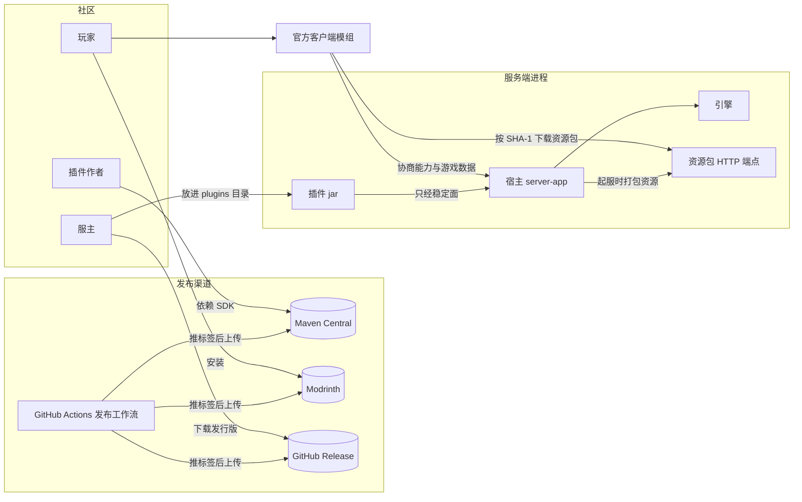
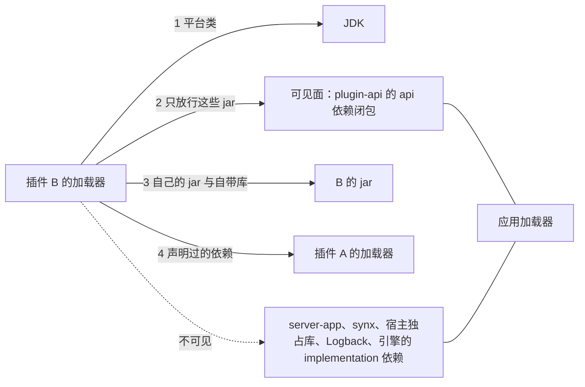

# Synaxis 设计文档 · 生态分册「插件平台、客户端能力与 SDK 发布」

## 1. 元信息 / 变更记录

| 字段 | 值 |
| --- | --- |
| 状态 | 草稿 |
| 项目画像 | 生产产品 |
| Owner | Bearisbug（光照会话维护本分册，§6.2 插件平台由生产就绪会话起草） |
| 评审人 | Bearisbug |
| 最后更新 | 2026-10-22 |
| 关联 | 引擎 `docs/DESIGN.md` · M2 分册 `docs/DESIGN-M2.md` · M3 分册 `docs/DESIGN-M3.md` · 生产就绪分册 `docs/DESIGN-PROD.md` · 玩法架构分册 `docs/DESIGN-PLAY.md` · 插件作者指南 `docs/PLUGINS.md` · 测试文档 `docs/TEST.md` |

本分册分两期写。第一期是草稿模式，只写 §1、链路层、§2、§5、§6、§18、§26 与 §28，先请用户签方向与范围；签字后第二期补全其余契约节，状态改为「评审中」再签一次。签字前两个会话都不为本分册改代码。基线是 `main` `2e0aace979`。

变更记录：

| 日期 | 版本 | 涉及 ID | 一句话 | 类型 |
| --- | --- | --- | --- | --- |
| 2026-10-22 | v0.5 | ADR-ECO-011、ADR-ECO-013、ADR-ECO-014、ADR-ECO-020、ADR-ECO-022、ADR-ECO-023、ADR-ECO-024、RULE-ECO-010、RULE-ECO-011、RULE-ECO-020、INV-ECO-020、INV-ECO-021、FLOW-SDK-RELEASE、REQ-ECO-024、REQ-ECO-031、REQ-ECO-047 | 按两份对抗评审改：发布要用户审批，先推包再载存档，资源可复现，里程碑重排 | 文档 |
| 2026-10-22 | v0.4 | FLOW-PLUGIN-LOAD、FLOW-PLUGIN-ADMIT、FLOW-PLUGIN-DISABLE、FLOW-PLUGIN-STOP、FLOW-PLUGIN-SERVICE、RULE-ECO-002、RULE-ECO-010、REQ-ECO-006、REQ-ECO-014、REQ-ECO-015、REQ-ECO-016、REQ-ECO-017、REQ-ECO-019 | 按独立评审改插件平台：起服模式只看准入回调，禁用不调插件出口，停用回调逐个等，可见面按 jar 生成 | 文档 |
| 2026-10-22 | v0.3 | ADR-ECO-010、ADR-ECO-011、ADR-ECO-012、ADR-ECO-021、ADR-ECO-022、ADR-ECO-023、RULE-ECO-010、RULE-ECO-020、FLOW-SDK-RELEASE、FLOW-PLUGIN-DISABLE | 按独立评审改：稳定面含签名引到的引擎类型，发布把撤不回的 Central 排最后，补资源合并规则与等包上限 | 文档 |
| 2026-10-22 | v0.2 | FLOW-PLUGIN-LOAD、FLOW-PLUGIN-ADMIT、FLOW-PLUGIN-DISABLE、FLOW-PLUGIN-STOP、FLOW-PLUGIN-SERVICE、RULE-ECO-001、RULE-ECO-002、RULE-ECO-010、INV-ECO-001、INV-ECO-002、INV-ECO-003、INV-ECO-004、REQ-ECO-001、REQ-ECO-002、REQ-ECO-003、REQ-ECO-004、REQ-ECO-005、REQ-ECO-006、REQ-ECO-007、REQ-ECO-008、REQ-ECO-009、REQ-ECO-010、REQ-ECO-011、REQ-ECO-012、REQ-ECO-013、REQ-ECO-014、REQ-ECO-015、REQ-ECO-016、REQ-ECO-017、REQ-ECO-018、ADR-ECO-012 | 合入插件平台与第四条拍板，统一资源覆盖冲突的处置 | 文档 |
| 2026-10-22 | v0.1 | ADR-ECO-010、ADR-ECO-020、ADR-ECO-024 | 初稿：生态方向、范围与链路，写入用户当天拍板的三条决定 | 文档、拍板 |

## L1. 链路总览

领域顺序：开发 → 插件平台 → 资源下发 → 客户端能力 → 发布

### 角色：插件作者

| 链路 | 名称 | 领域 | 状态 | 涉及需求 |
| --- | --- | --- | --- | --- |
| FLOW-SDK-START | 用 SDK 建插件工程 | 开发 | 设计中 | REQ-ECO-040、REQ-ECO-041 |
| FLOW-SDK-UPGRADE | 升级 SDK 版本 | 开发 | 设计中 | REQ-ECO-042、REQ-ECO-043 |
| FLOW-PLUGIN-SERVICE | 提供与调用服务 | 插件平台 | 设计中 | REQ-ECO-009、REQ-ECO-010、REQ-ECO-011 |

### 角色：服主

| 链路 | 名称 | 领域 | 状态 | 涉及需求 |
| --- | --- | --- | --- | --- |
| FLOW-PLUGIN-LOAD | 起服加载插件 | 插件平台 | 设计中 | REQ-ECO-001、REQ-ECO-002、REQ-ECO-003、REQ-ECO-004、REQ-ECO-005、REQ-ECO-006、REQ-ECO-007、REQ-ECO-008、REQ-ECO-014、REQ-ECO-019 |
| FLOW-PLUGIN-DISABLE | 运行中禁用插件 | 插件平台 | 设计中 | REQ-ECO-015、REQ-ECO-016、REQ-ECO-017 |
| FLOW-PLUGIN-STOP | 停机逆序停用 | 插件平台 | 设计中 | REQ-ECO-018 |
| FLOW-ASSET-PACK | 起服打包插件资源 | 资源下发 | 设计中 | REQ-ECO-020、REQ-ECO-021、REQ-ECO-022 |

### 角色：玩家

| 链路 | 名称 | 领域 | 状态 | 涉及需求 |
| --- | --- | --- | --- | --- |
| FLOW-PLUGIN-ADMIT | 进服准入判定 | 插件平台 | 设计中 | REQ-ECO-012、REQ-ECO-013 |
| FLOW-ASSET-JOIN | 进服下载资源 | 资源下发 | 设计中 | REQ-ECO-023、REQ-ECO-024、REQ-ECO-031 |
| FLOW-CAP-USE | 插件驱动客户端 | 客户端能力 | 设计中 | REQ-ECO-025、REQ-ECO-026、REQ-ECO-027、REQ-ECO-028、REQ-ECO-029、REQ-ECO-030、REQ-ECO-032 |

### 角色：维护者

| 链路 | 名称 | 领域 | 状态 | 涉及需求 |
| --- | --- | --- | --- | --- |
| FLOW-SDK-RELEASE | 发布 SDK 与模组 | 发布 | 设计中 | REQ-ECO-044、REQ-ECO-045、REQ-ECO-046、REQ-ECO-047 |

界面外壳：客户端｜client-fabric/src/main/java/io/github/bearisbug/synaxis/game/client/play/PlayHud.java

## L2. 链路卡

> 图例：现状待确认 = 实现已定、文档未写，等你确认是否定稿；无用例 = 这一行还没有测试用例；分支未与用户逐类核对 = 所列步骤的分支由 Agent 按文档与代码预填，还没和你逐类问过

### FLOW-PLUGIN-LOAD · 起服加载插件

#### 概要

- **执行者**：宿主，替服主在起服时做
- **触发**：服主启动进程，plugins 目录里有插件 jar
- **进入条件**：启动序列走到启用插件这一步，端口还没绑定
- **结果**：依赖齐全的插件按依赖顺序逐个启用，其余点名原因
- **不管**：运行中禁用、热加载、玩家进服时的准入

#### 主流程

1. S1 扫 plugins 目录，逐个读 jar 里的描述文件 〔无界面〕
2. S2 校验每份描述的字段 〔无界面〕
3. S3 按白名单筛出要启用的插件 〔无界面〕
4. S4 扫选中插件 jar 里的资源，查没声明的覆盖 〔无界面〕
5. S5 建依赖图，排出启用顺序，同层按 id 排 〔无界面〕
6. S6 为每个插件建自己的类加载器 〔无界面〕
7. S7 按顺序实例化入口类，调用启用回调 〔无界面〕
8. S8 写一行汇总：启用了谁、拒载了谁、为什么 〔无界面〕
9. S9 按有没有准入回调判定服务模式 〔无界面〕

#### 分支

> 分支未与用户逐类核对：S1–S9

##### S1 读描述

| 类型 | 分支 | 结果 | 依据 | 测试 |
| --- | --- | --- | --- | --- |
| 失败 | jar 里没有描述文件或解析不了 | 待决策 Q-PLUGIN-LOAD-1 | 现状待确认：§14 缺描述文件错误码；ADR-ECO-001 | 无用例 |
| 边界 | plugins 目录不存在或为空 | 没有插件参与，按核心模式的规则起服 | 现状待确认：§8 缺起服序列引用；ADR-ECO-001 | 无用例 |

##### S2 校验描述

| 类型 | 分支 | 结果 | 依据 | 测试 |
| --- | --- | --- | --- | --- |
| 失败 | id 不合规则或是保留的 synaxis | 待决策 Q-PLUGIN-LOAD-1 | 现状待确认：§8 缺描述字段校验；ADR-ECO-001 | 无用例 |
| 失败 | 两个 jar 声明同一个 id | 整服拒启，端口不绑定，日志点名两个文件 | 现状待确认：§14 缺同 id 错误码；ADR-ECO-002 | 无用例 |
| 失败 | 版本号不是语义化版本 | 待决策 Q-PLUGIN-LOAD-1 | 现状待确认：§8 缺描述字段校验；ADR-ECO-002 | 无用例 |
| 失败 | 宿主的稳定面版本不在声明的范围内 | 待决策 Q-PLUGIN-LOAD-1 | RULE-ECO-020；ADR-ECO-022 | 无用例 |
| 失败 | 声明覆盖的命名空间写法不对或是保留的 | 待决策 Q-PLUGIN-LOAD-1 | RULE-ECO-010；ADR-ECO-012 | 无用例 |
| 失败 | 覆盖别的插件的命名空间却没把它列为依赖 | 待决策 Q-PLUGIN-LOAD-1 | RULE-ECO-010；ADR-ECO-002 | 无用例 |
| 失败 | 必需能力里有宿主不认识的能力 | 待决策 Q-PLUGIN-LOAD-1 | RULE-ECO-011；ADR-ECO-013 | 无用例 |

##### S3 按白名单筛选

| 类型 | 分支 | 结果 | 依据 | 测试 |
| --- | --- | --- | --- | --- |
| 边界 | 白名单里的 id 没有插件对应 | 一行 WARN 点名没对上的 id，其余照常 | 现状待确认：§8 缺白名单键；ADR-ECO-002 | 无用例 |
| 边界 | 选中的插件，其硬依赖没被选中 | 按缺硬依赖处理 | RULE-ECO-002；ADR-ECO-002 | 无用例 |

##### S4 扫资源

| 类型 | 分支 | 结果 | 依据 | 测试 |
| --- | --- | --- | --- | --- |
| 失败 | 文件写进别的命名空间或语言键不带插件 id，又没声明覆盖 | 待决策 Q-PLUGIN-LOAD-1 | RULE-ECO-010；ADR-ECO-012 | 无用例 |

##### S5 排启用顺序

| 类型 | 分支 | 结果 | 依据 | 测试 |
| --- | --- | --- | --- | --- |
| 失败 | 硬依赖不在 plugins 目录里 | 待决策 Q-PLUGIN-LOAD-1 | RULE-ECO-002；ADR-ECO-002 | 无用例 |
| 失败 | 硬依赖在，版本不在声明的范围内 | 待决策 Q-PLUGIN-LOAD-1 | RULE-ECO-002；ADR-ECO-002 | 无用例 |
| 失败 | 硬依赖成环 | 待决策 Q-PLUGIN-LOAD-1 | ADR-ECO-002 | 无用例 |
| 失败 | 硬依赖的插件被拒载 | 待决策 Q-PLUGIN-LOAD-1 | RULE-ECO-002；ADR-ECO-002 | 无用例 |
| 边界 | 软依赖不在或版本不合 | 照常启用，当作这个软依赖不存在 | ADR-ECO-002 | 无用例 |
| 边界 | 软依赖之间成环 | 去掉造成环的软依赖边，按 id 排 | ADR-ECO-002 | 无用例 |

##### S6 建类加载器

| 类型 | 分支 | 结果 | 依据 | 测试 |
| --- | --- | --- | --- | --- |
| 失败 | jar 打不开或已损坏 | 待决策 Q-PLUGIN-LOAD-1 | ADR-ECO-003 | 无用例 |
| 边界 | 插件 jar 带了可见面里也有的类 | 用宿主那份，插件自带的不生效 | ADR-ECO-003；INV-ECO-004 | 无用例 |
| 边界 | 两个插件带了同一个库的不同版本 | 各用各的，互不影响 | ADR-ECO-004 | 无用例 |

##### S7 实例化并启用

| 类型 | 分支 | 结果 | 依据 | 测试 |
| --- | --- | --- | --- | --- |
| 失败 | 入口类找不到或构造器抛异常 | 该插件记为失败，硬依赖它的不启用 | RULE-ECO-002；ADR-ECO-001 | 无用例 |
| 失败 | 启用回调抛异常 | 收回它已登记的一切，硬依赖它的不启用 | RULE-ECO-002；ADR-ECO-007 | 无用例 |
| 失败 | 引用了没声明为依赖的插件的类 | 找不到类，按启用失败处理 | RULE-ECO-001；ADR-ECO-003 | 无用例 |
| 失败 | 第二个插件登记准入回调 | 记下冲突，判模式时整服拒启并点名两个插件 | ADR-ECO-006；INV-ECO-003 | 无用例 |
| 边界 | 启用回调里查软依赖提供的服务 | 软依赖已排在前面启用，查得到 | ADR-ECO-005 | 无用例 |

##### S8 写汇总

| 类型 | 分支 | 结果 | 依据 | 测试 |
| --- | --- | --- | --- | --- |
| 边界 | 有插件被拒载或启用失败 | 汇总行逐个写原因，台账每个一行 | 现状待确认：§20 缺插件拒载事件；ADR-ECO-002 | 无用例 |

##### S9 判定服务模式

| 类型 | 分支 | 结果 | 依据 | 测试 |
| --- | --- | --- | --- | --- |
| 边界 | 有准入回调，起服时实例一个没有或有好几个 | 照常进玩法模式，实例由插件按需建 | ADR-ECO-006 | 无用例 |
| 失败 | 有插件失败且没人登记准入回调 | 整服拒启，端口不绑定 | 现状待确认：§8 缺起服模式判定；ADR-ECO-006 | 无用例 |
| 边界 | 全部启用成功但没人登记准入回调 | 待决策 Q-PLUGIN-LOAD-3 | ADR-ECO-006；待决策 | 无用例 |

#### 待决策

- **Q-PLUGIN-LOAD-1 · 单个插件有问题时，只拒载它还是整服拒启？**
  - 现状：描述不合规整服拒启，启用回调抛异常只拆这一个
  - 建议：只拒载它与硬依赖它的插件，其余照常，汇总行点名
  - 何时换：服主要求插件不齐就不开服，例如比赛服
  - 代价：起服成功不等于插件齐全，服主要看汇总行
  - 不可逆：否
  - 何时定：本分册第一期签字时
  - 谁定：产品
  - 卡住：不卡
- **Q-PLUGIN-LOAD-2 · 还从 classpath 发现插件，还是只认 plugins 目录？**
  - 现状：只从 classpath 发现，插件 jar 靠追加到启动参数
  - 建议：只认 plugins 目录，首方示例也放进去
  - 何时换：首方示例挪出发行包的库目录后，真客户端回归一轮改不绿时
  - 代价：发行包、本地起服任务与回归用例的启动方式要改
  - 不可逆：否
  - 何时定：本分册契约成稿时
  - 谁定：技术
  - 卡住：不卡
- **Q-PLUGIN-LOAD-3 · 没有插件登记准入回调时，核心世界放行还是拒启？**
  - 现状：有插件参与却没人登记，整服拒启
  - 建议：全部启用成功时用核心世界放行，有失败仍拒启；放行时照样按必需能力要求握手
  - 何时换：认定核心世界不该承载对外开服时
  - 代价：只装工具插件的服起在平坦的核心世界上
  - 不可逆：否
  - 何时定：本分册第一期签字时
  - 谁定：产品
  - 卡住：不卡

另见：§28 版本范围的写法；§28 回调期间的线程上下文类加载器；§28 本地构建的 dev 宿主怎么校验；§28 可见面签名门禁的范围

#### 关联

- **契约锚点**：ADR-ECO-001；ADR-ECO-002；ADR-ECO-003；ADR-ECO-004；ADR-ECO-006
- **上游**：—
- **下游**：FLOW-PLUGIN-ADMIT、FLOW-PLUGIN-DISABLE、FLOW-PLUGIN-STOP、FLOW-PLUGIN-SERVICE
- **守住的不变量**：INV-ECO-001、INV-ECO-002、INV-ECO-003、INV-ECO-004

| 步骤 | 位置 |
| --- | --- |
| S1–S5 | `server-app/src/main/java/io/github/bearisbug/synaxis/app/PluginHost.java#discover`；`server-app/src/main/java/io/github/bearisbug/synaxis/app/PluginDescriptors.java#validate`；`server-app/src/main/java/io/github/bearisbug/synaxis/app/Main.java#selectedPlugins`；`server-app/src/main/java/io/github/bearisbug/synaxis/app/PluginHost.java#enable` |
| S7 | `server-app/src/main/java/io/github/bearisbug/synaxis/app/PluginHost.java#enableOne`；`server-app/src/main/java/io/github/bearisbug/synaxis/app/AdmissionRegistry.java#register` |
| S9 | `server-app/src/main/java/io/github/bearisbug/synaxis/app/CoreMode.java#decide`；`server-app/src/main/java/io/github/bearisbug/synaxis/app/Main.java#start` |

### FLOW-PLUGIN-ADMIT · 进服准入判定

#### 概要

- **执行者**：宿主，在玩家进服时按各插件的规则判一次
- **触发**：玩家连接进入配置阶段
- **进入条件**：握手已通过，存档与角色已载入
- **结果**：全部检查放行后由准入回调定落点，否则断线并记下谁拒的
- **不管**：封禁、白名单、握手与转服票据怎么判

#### 主流程

1. S1 宿主依次做完封禁、握手、票据、推资源包、存档、角色 〔无界面〕
2. S2 按插件启用顺序逐个调用准入检查 〔无界面〕
3. S3 全部放行后问准入回调要落点 〔无界面〕
4. S4 把玩家放进返回的实例 〔无界面〕

#### 分支

> 分支未与用户逐类核对：S2–S4

##### S2 调用准入检查

| 类型 | 分支 | 结果 | 依据 | 测试 |
| --- | --- | --- | --- | --- |
| 失败 | 某个检查返回拒绝 | 断线，后面的检查不再调用，台账记下拒绝方〔提示：拒绝方插件给的那句话〕 | ADR-ECO-006；现状待确认：§14 缺插件拒绝原因 | 无用例 |
| 失败 | 检查抛异常或返回空 | 待决策 Q-PLUGIN-ADMIT-1 | ADR-ECO-006；待决策 | 无用例 |
| 边界 | 检查超过 200 毫秒才返回 | 答案照常生效，一行 WARN 点名插件 | 现状待确认：§15 缺检查预算行；ADR-ECO-006 | 无用例 |
| 边界 | 没有任何插件登记检查 | 直接问准入回调 | ADR-ECO-006 | 无用例 |
| 并发 | 检查途中玩家断开 | 后面的检查与准入回调都不再调用 | 现状待确认：§16 缺准入断线竞态；ADR-ECO-006 | 无用例 |
| 并发 | 检查途中该插件被运行中禁用 | 这次答案照常生效，之后的连接不再调它 | ADR-ECO-007；现状待确认：§16 缺准入禁用竞态 | 无用例 |

##### S3 问准入回调

| 类型 | 分支 | 结果 | 依据 | 测试 |
| --- | --- | --- | --- | --- |
| 失败 | 准入回调拒绝 | 断线，原因用它给的文本〔提示：玩法插件给的那句话〕 | 现状待确认：§14 缺准入拒绝原因；ADR-ECO-006 | 无用例 |
| 失败 | 准入回调抛异常或返回空 | 断线〔提示：对局暂不可用〕 | 现状待确认：§14 缺对局暂不可用；ADR-ECO-006 | 无用例 |
| 失败 | 运行中准入回调的插件已被禁用 | 断线〔提示：对局暂不可用〕 | 现状待确认：§14 缺对局暂不可用；ADR-ECO-007 | 无用例 |
| 边界 | 想把落点交给第二个插件决定 | 待决策 Q-PLUGIN-ADMIT-2 | ADR-ECO-006；待决策 | 不测：没定 |

##### S4 放进实例

| 类型 | 分支 | 结果 | 依据 | 测试 |
| --- | --- | --- | --- | --- |
| 并发 | 准入回调返回后停机保存已开始 | 断线〔提示：服务器暂时无法保存数据〕 | 现状待确认：§16 缺停机准入竞态；ADR-ECO-006 | 无用例 |

#### 待决策

- **Q-PLUGIN-ADMIT-1 · 准入检查出错时，拒绝这名玩家还是跳过这个检查？**
  - 现状：只有准入回调，它抛异常时按对局暂不可用拒绝
  - 建议：拒绝，原因用对局暂不可用
  - 何时换：服主宁可放人进来，也不要一个检查出错就全员进不来时
  - 代价：一个出错的检查插件会挡住所有玩家
  - 不可逆：否
  - 何时定：本分册第一期签字时
  - 谁定：产品
  - 卡住：不卡
- **Q-PLUGIN-ADMIT-2 · 落点只许一个插件定，还是允许按优先级接力？**
  - 现状：进程只有一个准入槽，第二个插件登记就抛异常
  - 建议：维持一个，多个玩法之间经场景所有者提供的服务协作
  - 何时换：两个插件各管一部分玩家的落点，又无法经服务表达时
  - 代价：一个进程只跑一个主玩法
  - 不可逆：否
  - 何时定：本分册第一期签字时
  - 谁定：产品
  - 卡住：不卡

另见：ADR-ECO-011

#### 关联

- **契约锚点**：ADR-ECO-006；ADR-ECO-007
- **上游**：FLOW-PLUGIN-LOAD
- **下游**：—
- **守住的不变量**：INV-ECO-003

| 步骤 | 位置 |
| --- | --- |
| S1–S4 | `server-app/src/main/java/io/github/bearisbug/synaxis/app/AdmissionGate.java#admit` |
| S3 | `server-app/src/main/java/io/github/bearisbug/synaxis/app/AdmissionRegistry.java#provider` |

### FLOW-PLUGIN-DISABLE · 运行中禁用插件

#### 概要

- **执行者**：宿主，替服主在进程运行中做
- **触发**：插件异常过多被熔断，或它的硬依赖刚被禁用
- **进入条件**：插件处于已启用，端口已绑定
- **结果**：它与硬依赖它的插件依次停用，登记全部收回，进程继续服务
- **不管**：重新启用、停机时的逐个停用

#### 主流程

1. S1 判定要禁用的插件 〔无界面〕
2. S2 列出它与硬依赖它的插件，按依赖逆序 〔无界面〕
3. S3 在 tick 调度线程的串行段逐个处理 〔无界面〕
4. S4 摘掉它的事件、准入、命令、通道与服务 〔无界面〕
5. S5 通知软依赖它的插件：服务已注销 〔无界面〕
6. S6 宿主撤走它托管实例里的玩家，强制关闭实例 〔无界面〕
7. S7 取消它的任务，收回 Tab 可见性与动作 〔无界面〕
8. S8 在宿主的停用线程上按依赖逆序逐个调停用回调 〔无界面〕
9. S9 记日志与台账，状态改为已禁用 〔无界面〕

#### 分支

> 分支未与用户逐类核对：S1–S9

##### S1 判定

| 类型 | 分支 | 结果 | 依据 | 测试 |
| --- | --- | --- | --- | --- |
| 边界 | 插件 60 秒内异常满 20 次 | 待决策 Q-PLUGIN-DISABLE-1 | ADR-ECO-007；待决策 | 不测：没定 |
| 边界 | 运维要手动禁用某个插件 | 待决策 Q-PLUGIN-DISABLE-3 | ADR-ECO-007；待决策 | 不测：没定 |
| 边界 | 要禁用的插件持有准入回调 | 待决策 Q-PLUGIN-DISABLE-2 | ADR-ECO-006；待决策 | 不测：没定 |

##### S2 列出连带范围

| 类型 | 分支 | 结果 | 依据 | 测试 |
| --- | --- | --- | --- | --- |
| 边界 | 软依赖它的插件 | 继续运行，收到服务注销通知 | RULE-ECO-002；ADR-ECO-005 | 无用例 |
| 并发 | 两个有依赖关系的插件同时被触发禁用 | 合并成一轮，按依赖逆序各处理一次 | ADR-ECO-007；现状待确认：§16 缺禁用合并竞态 | 无用例 |

##### S4 摘掉输入

| 类型 | 分支 | 结果 | 依据 | 测试 |
| --- | --- | --- | --- | --- |
| 并发 | 摘除时配置阶段或插件自开的线程正在派发事件 | 已开始的那次派发照常调到它，之后的不再调 | ADR-ECO-007；现状待确认：§16 缺监听器摘除竞态 | 无用例 |
| 边界 | 它注册的命令占着无前缀名 | 无前缀名空出，不转给别的插件 | 现状待确认：§8 缺命令收回规则；ADR-ECO-007 | 无用例 |

##### S6 撤离与关闭实例

| 类型 | 分支 | 结果 | 依据 | 测试 |
| --- | --- | --- | --- | --- |
| 边界 | 进程开着核心世界 | 玩家送回核心世界的出生点 | ADR-ECO-007 | 无用例 |
| 边界 | 进程没有核心世界 | 该玩家断线〔提示：对局暂不可用〕 | 现状待确认：§14 缺对局暂不可用；ADR-ECO-007 | 无用例 |
| 边界 | 实例配了兜底出口 | 不调用，那是被禁用插件自己的代码 | ADR-ECO-007 | 无用例 |
| 边界 | 5 秒内没撤完 | 剩下的玩家断线，实例注销 | 现状待确认：§15 缺撤离时限行；ADR-ECO-007 | 无用例 |

##### S7 收回其余登记

| 类型 | 分支 | 结果 | 依据 | 测试 |
| --- | --- | --- | --- | --- |
| 边界 | 它登记的玩家数据段 | 保留，照常随玩家保存 | ADR-ECO-007 | 无用例 |
| 边界 | 只放在它内存里的玩家状态 | 丢失，不调它的停机保存钩子 | ADR-ECO-007 | 无用例 |

##### S8 调停用回调

| 类型 | 分支 | 结果 | 依据 | 测试 |
| --- | --- | --- | --- | --- |
| 失败 | 停用回调抛异常 | 一行 ERROR，接着调下一个，禁用照常完成 | 现状待确认：§14 缺停用失败日志码；ADR-ECO-007 | 无用例 |
| 边界 | 停用回调超过预算没返回 | 一行 ERROR，回调留在它自己的线程上，接着调下一个 | ADR-ECO-007 | 无用例 |
| 边界 | 硬依赖者的停用回调还在跑 | 等它返回或等满预算，才调被依赖者的 | RULE-ECO-002；ADR-ECO-007 | 无用例 |

##### S9 收尾

| 类型 | 分支 | 结果 | 依据 | 测试 |
| --- | --- | --- | --- | --- |
| 边界 | 别的插件还拿着它的旧引用调用 | 行为不保证，由调用方负责 | ADR-ECO-005 | 不测：行为不保证 |
| 边界 | 运维想重新启用它 | 只能重启进程 | ADR-ECO-007 | 无用例 |

#### 待决策

- **Q-PLUGIN-DISABLE-1 · 运行中禁用要不要补回熔断？**
  - 现状：运行中不禁用任何插件，异常只记日志
  - 建议：补回熔断，60 秒内异常满 20 次即禁用
  - 何时换：熔断在线上误禁用过正常插件时
  - 代价：一个插件可能在高峰期突然消失；不补回且不给运维命令，运行中禁用就不会发生
  - 不可逆：否
  - 何时定：本分册第一期签字时
  - 谁定：产品
  - 卡住：不卡
- **Q-PLUGIN-DISABLE-2 · 持有准入回调的插件被禁用后，停机还是继续跑？**
  - 现状：未实现，运行中不会禁用插件
  - 建议：走停机序列，保存后以非零码退出，交给编排重启
  - 何时换：服主要求玩法停掉后其余插件的功能仍可用时
  - 代价：一次熔断等于一次停服重启
  - 不可逆：否
  - 何时定：本分册第一期签字时
  - 谁定：产品
  - 卡住：不卡
- **Q-PLUGIN-DISABLE-3 · 给运维一条手动禁用插件的命令，还是不给？**
  - 现状：没有这条命令
  - 建议：不给，出问题的插件用白名单去掉后重启
  - 何时换：线上出现必须不停服摘掉某个插件的事故时
  - 代价：摘插件必须停服
  - 不可逆：否
  - 何时定：本分册第一期签字时
  - 谁定：产品
  - 卡住：不卡

另见：§28 每个插件的停用回调保底多久

#### 关联

- **契约锚点**：ADR-ECO-007；ADR-ECO-005；ADR-ECO-006
- **上游**：FLOW-PLUGIN-LOAD
- **下游**：—
- **守住的不变量**：INV-ECO-001、INV-ECO-002

| 步骤 | 位置 |
| --- | --- |
| S4–S7 | `server-app/src/main/java/io/github/bearisbug/synaxis/app/PluginHost.java#tearDown` |
| S6 | `server-app/src/main/java/io/github/bearisbug/synaxis/app/instance/InstanceRegistry.java#reclaim` |
| S8 | `server-app/src/main/java/io/github/bearisbug/synaxis/app/PluginHost.java#disableWithin` |

### FLOW-PLUGIN-STOP · 停机逆序停用

#### 概要

- **执行者**：宿主，替服主在停机时做
- **触发**：服主停服，或编排发来停止信号
- **进入条件**：停机序列已存完玩家数据、踢出全部玩家
- **结果**：全部已启用插件按依赖逆序停用，每个停用回调都有保底时间
- **不管**：运行中禁用、玩家数据怎么保存

#### 主流程

1. S1 停机序列存完玩家数据，踢出全部玩家 〔无界面〕
2. S2 宿主按依赖逆序排出全部已启用插件 〔无界面〕
3. S3 逐个调停用回调，等它返回或等满保底时间 〔无界面〕
4. S4 收回它的全部登记，强制关闭它剩下的托管实例 〔无界面〕
5. S5 全部插件处理完，进程退出 〔无界面〕

#### 分支

> 分支未与用户逐类核对：S3–S4

##### S3 调停用回调

| 类型 | 分支 | 结果 | 依据 | 测试 |
| --- | --- | --- | --- | --- |
| 失败 | 停用回调抛异常 | 一行 ERROR，接着收回它的登记 | ADR-ECO-002 | 无用例 |
| 边界 | 停用回调超过保底时间没返回 | 一行 ERROR，回调留在它自己的线程上，接着收回 | ADR-ECO-002 | 无用例 |
| 边界 | 前面一个插件的停用回调卡死 | 后面每个插件仍等满自己的保底时间 | ADR-ECO-002 | 无用例 |
| 边界 | 回调里调它硬依赖的插件 | 那个插件还没停用，调得通 | RULE-ECO-002；ADR-ECO-002 | 无用例 |

##### S4 收回登记

| 类型 | 分支 | 结果 | 依据 | 测试 |
| --- | --- | --- | --- | --- |
| 失败 | 收回时抛异常，例如区块加载器出错 | 一行 ERROR，后面的插件照常停用与收回 | ADR-ECO-002 | 无用例 |

#### 待决策

无。

另见：§28 每个插件的停用回调保底多久

#### 关联

- **契约锚点**：ADR-ECO-002
- **上游**：FLOW-PLUGIN-LOAD
- **下游**：—
- **守住的不变量**：INV-ECO-002

| 步骤 | 位置 |
| --- | --- |
| S2–S4 | `server-app/src/main/java/io/github/bearisbug/synaxis/app/PluginHost.java#disableAll`；`server-app/src/main/java/io/github/bearisbug/synaxis/app/PluginHost.java#disableWithin`；`server-app/src/main/java/io/github/bearisbug/synaxis/app/PluginHost.java#tearDown` |

### FLOW-PLUGIN-SERVICE · 提供与调用服务

#### 概要

- **执行者**：插件，经宿主的服务注册表
- **触发**：提供方插件登记一个实现，调用方按接口类型查找
- **进入条件**：双方都已启用，调用方把定义接口的插件列为依赖
- **结果**：调用方拿到最高档的实现，提供方停用后换到下一个
- **不管**：服务接口自身的版本兼容、跨进程调用

#### 主流程

1. S1 提供方在启用期间按接口类型登记实现与档位 〔无界面〕
2. S2 调用方按接口类型查找 〔无界面〕
3. S3 宿主返回最高档的实现，同档取先登记的 〔无界面〕
4. S4 调用方直接调用这个实现 〔无界面〕
5. S5 提供方离开启用时，宿主注销它的登记并派发注销事件 〔无界面〕
6. S6 仍在运行的调用方收到事件，重新查找 〔无界面〕

#### 分支

> 分支未与用户逐类核对：S1–S5

##### S1 登记

| 类型 | 分支 | 结果 | 依据 | 测试 |
| --- | --- | --- | --- | --- |
| 边界 | 同一接口已有同档的实现 | 都留下，先登记的排在前面 | ADR-ECO-005 | 无用例 |
| 边界 | 接口由第三个插件定义 | 提供方与调用方都要把它列为依赖 | RULE-ECO-001；ADR-ECO-005 | 无用例 |

##### S2 查找

| 类型 | 分支 | 结果 | 依据 | 测试 |
| --- | --- | --- | --- | --- |
| 失败 | 调用方没把定义接口的插件列为依赖 | 加载不到接口类，查不了 | RULE-ECO-001；ADR-ECO-003 | 无用例 |
| 边界 | 提供方是软依赖，可能没装 | 先查它是否已启用，再碰它的类 | ADR-ECO-005 | 无用例 |

##### S3 返回实现

| 类型 | 分支 | 结果 | 依据 | 测试 |
| --- | --- | --- | --- | --- |
| 边界 | 没有任何实现 | 返回空 | ADR-ECO-005 | 无用例 |
| 边界 | 查不到，但有同名接口的登记 | 返回空，一行 WARN 点名两个加载器 | ADR-ECO-005 | 无用例 |
| 边界 | 要列出全部实现 | 按档位从高到低、同档按登记先后列出 | ADR-ECO-005 | 无用例 |

##### S5 注销

| 类型 | 分支 | 结果 | 依据 | 测试 |
| --- | --- | --- | --- | --- |
| 边界 | 硬依赖提供方的插件 | 已被连带停用，不再调用 | RULE-ECO-002；ADR-ECO-007 | 无用例 |
| 边界 | 软依赖提供方的插件 | 收到注销事件，换到下一个实现 | ADR-ECO-005 | 无用例 |
| 边界 | 调用方缓存着旧实现的引用 | 行为不保证，由调用方负责 | ADR-ECO-005 | 不测：行为不保证 |
| 并发 | 调用进行中提供方被停用 | 这次调用不被打断，之后查不到它 | ADR-ECO-005 | 无用例 |

#### 待决策

无。

#### 关联

- **契约锚点**：ADR-ECO-005；ADR-ECO-003
- **上游**：FLOW-PLUGIN-LOAD
- **下游**：—
- **守住的不变量**：INV-ECO-002

| 步骤 | 位置 |
| --- | --- |
| S1–S6 | 待补 |

### FLOW-SDK-RELEASE · 发布 SDK 与模组

#### 概要

- **执行者**：Synaxis 维护者，每次发布都经用户批准
- **触发**：用户同意后在 main 上推送版本标签
- **进入条件**：标签所指的提交 CI 全绿
- **结果**：发行版、模组、SDK 分别进 Release、Modrinth、Central
- **不管**：第三方插件自己的发布

#### 主流程

1. S1 用户同意后，维护者推送 vX.Y.Z 标签 〔无界面〕
2. S2 发布工作流从标签取版本号，注入构建 〔无界面〕
3. S3 跑全量检查与真客户端回归、示例门禁、兼容门 〔无界面〕
4. S4 等用户在 GitHub 上批准 release 环境 〔无界面〕
5. S5 建 GitHub Release 草稿，附发行版与稳定面 jar 〔无界面〕
6. S6 把客户端模组上传到 Modrinth 〔无界面〕
7. S7 签名后把 SDK 上传到 Maven Central 〔无界面〕
8. S8 公开 Release 草稿 〔无界面〕

#### 分支

> 分支未与用户逐类核对：S2–S8

##### S2 取版本号

| 类型 | 分支 | 结果 | 依据 | 测试 |
| --- | --- | --- | --- | --- |
| 失败 | 标签不是 vX.Y.Z 的写法 | 工作流失败，不上传任何产物 | 现状待确认：§23 缺发布门禁；ADR-ECO-023 | 无用例 |

##### S3 检查

| 类型 | 分支 | 结果 | 依据 | 测试 |
| --- | --- | --- | --- | --- |
| 失败 | 稳定面的破坏性变更没登记，或版本号没按规则升 | 工作流失败 | RULE-ECO-020；ADR-ECO-022 | 无用例 |
| 失败 | 示例引用了稳定面之外的引擎类型 | 工作流失败 | ADR-ECO-021 | 无用例 |

##### S4 审批

| 类型 | 分支 | 结果 | 依据 | 测试 |
| --- | --- | --- | --- | --- |
| 失败 | 用户拒绝批准 | 工作流结束，什么都没发 | 现状待确认：§23 缺发布门禁；ADR-ECO-023 | 无用例 |

##### S5 建 Release 草稿

| 类型 | 分支 | 结果 | 依据 | 测试 |
| --- | --- | --- | --- | --- |
| 边界 | 同一标签重跑，草稿已存在 | 跳过这一步，用已有的 | 现状待确认：§23 缺重跑规则；ADR-ECO-023 | 无用例 |

##### S6 上传 Modrinth

| 类型 | 分支 | 结果 | 依据 | 测试 |
| --- | --- | --- | --- | --- |
| 失败 | Modrinth 上传失败 | 工作流失败，Central 还没发，修好后同一标签重跑 | ADR-ECO-023 | 无用例 |

##### S7 上传 Maven Central

| 类型 | 分支 | 结果 | 依据 | 测试 |
| --- | --- | --- | --- | --- |
| 失败 | Central 校验没过或上传中断 | 工作流失败，Modrinth 版本保留，同一标签重跑 | 现状待确认：§23 缺重跑规则；ADR-ECO-023 | 无用例 |
| 边界 | 重跑时全部坐标已在 Central | 跳过这一步 | INV-ECO-020；ADR-ECO-023 | 无用例 |
| 边界 | 决定放弃这个版本 | 删掉 Modrinth 版本与 Release 草稿 | ADR-ECO-023 | 不测：人工操作 |

#### 待决策

- **Q-SDK-RELEASE-1 · 模组与 SDK 用同一个版本号，还是各自编号？**
  - 现状：Central 没发过，Release 已有三个版本，模组写死 0.1.0
  - 建议：同一个版本号，一个标签同时发两边
  - 何时换：模组要单独修缺陷而 SDK 不动的情况每月超过一次
  - 代价：SDK 没改也要跟着模组升补丁号
  - 不可逆：否
  - 何时定：M4-B 契约成稿时
  - 谁定：技术
  - 卡住：FLOW-SDK-RELEASE

另见：§28 首次发布前，用户在 Maven Central；§28 Modrinth 的内容规则

#### 关联

- **契约锚点**：ADR-ECO-020；ADR-ECO-021；ADR-ECO-022；ADR-ECO-023；RULE-ECO-020
- **上游**：—
- **下游**：FLOW-SDK-START、FLOW-SDK-UPGRADE
- **守住的不变量**：INV-ECO-020、INV-ECO-021

| 步骤 | 位置 |
| --- | --- |
| S2 | `build-src/src/main/kotlin/synaxis.java-library.gradle.kts#GAME_ENGINE_VERSION` |
| S3 | `.github/workflows/ci.yml#ABI gate of the stable surface` |
| S6 | `client-fabric/build.gradle.kts#version` |
| S7 | `build.gradle.kts#nmcpAggregation`；`build-src/src/main/kotlin/synaxis.publishing.gradle.kts#publishing` |

## L3. 业务规则

### RULE-ECO-001 · 插件只看得见它声明过的插件

适用链路：FLOW-PLUGIN-LOAD、FLOW-PLUGIN-SERVICE

- IF 插件 B 没把插件 A 列为硬依赖或在场的软依赖
- THEN B 加载不到 A 的类，也就查不到以 A 的类型登记的服务

出处：ADR-ECO-003；ADR-ECO-005

### RULE-ECO-002 · 硬依赖不在启用状态，依赖者也不在

适用链路：FLOW-PLUGIN-LOAD、FLOW-PLUGIN-DISABLE

- IF 插件的某个硬依赖没启用、被拒载、启用失败或被禁用
- THEN 这个插件不启用；已启用的先于该依赖收回登记、调完停用回调或等满预算

出处：ADR-ECO-002；ADR-ECO-007

### RULE-ECO-010 · 资源命名空间与语言键归插件所有

适用链路：FLOW-PLUGIN-LOAD、FLOW-ASSET-PACK、FLOW-CAP-USE

| 资源写在哪 | 描述文件 | 依赖 | 结果 |
| --- | --- | --- | --- |
| 自己的命名空间，或以自己 id 加点开头的语言键 | — | — | 放行 |
| 已装插件的命名空间或语言键 | 声明了覆盖对方 | 已把对方列为依赖 | 放行 |
| 原版命名空间或原版语言键 | 声明了覆盖原版 | — | 放行 |
| 其余组合 | — | — | 这个插件拒载 |

出处：ADR-ECO-012

### RULE-ECO-011 · 必需能力缺失时拒绝进服

适用链路：FLOW-PLUGIN-LOAD、FLOW-ASSET-JOIN、FLOW-CAP-USE

- IF 能力协商结果缺少某个已启用插件声明为必需的能力
- THEN 拒绝进服，提示升级模组

出处：ADR-ECO-013

### RULE-ECO-020 · 兼容承诺只覆盖稳定面

适用链路：FLOW-PLUGIN-LOAD、FLOW-SDK-UPGRADE、FLOW-SDK-RELEASE

- IF 成员属于稳定面，范围见 ADR-ECO-021
- THEN 受语义化版本、兼容门与弃用期约束，其余成员不承诺

出处：ADR-ECO-021；ADR-ECO-022

## L4. 不变量

| ID | 不变量 | 由什么保证 | 验证 |
| --- | --- | --- | --- |
| INV-ECO-001 | 已启用插件的每个硬依赖都处于已启用 | ADR-ECO-002；ADR-ECO-007 | 无用例 |
| INV-ECO-002 | 不在启用状态的插件在宿主登记里没有条目，数据段除外 | ADR-ECO-007 | 无用例 |
| INV-ECO-003 | 一个进程至多一个准入回调 | ADR-ECO-006 | 无用例 |
| INV-ECO-004 | 宿主内部类与宿主独占的库对插件加载器不可见 | ADR-ECO-003 | 无用例 |
| INV-ECO-010 | 客户端加载的插件资源包与宿主起服时算出的 SHA-1 相同 | ADR-ECO-011 | 无用例 |
| INV-ECO-011 | 一个资源命名空间至多属于一个插件 | RULE-ECO-010；ADR-ECO-012 | 无用例 |
| INV-ECO-020 | Maven Central 上发布过的版本号不会再发布 | ADR-ECO-023 | 不测：由 Maven Central 拒绝覆盖 |
| INV-ECO-021 | 稳定面的新版本对旧版本二进制兼容：1.0.0 起看主版本，之前看次版本 | ADR-ECO-022 | 无用例 |

## 2. 背景 / 目标 / 非目标

背景：Synaxis 从 Minestom 硬 fork 而来，引擎底座已经完成（`docs/DESIGN.md`）。插件宿主、自定义协议与客户端模组也能用（`docs/DESIGN-M2.md`、`docs/DESIGN-PLAY.md`），但都按「本团队做自己的游戏」设计。

插件只从宿主的 classpath 加载，没有依赖声明与服务互调，整个进程只有一个准入槽。模组只认静态注册的四条通道与四种小部件，资源全部打在模组 jar 里。`plugin-api` 与 `protocol` 不在 Maven Central 的发布聚合里，`docs/DESIGN-M2.md` 的 `ADR-M2-006` 写明 M2 期间社区可用性为零。

用户 2026-10-22 把目标改定为：像 Spigot 那样让第三方自由扩展的服务端核心，靠强制安装的客户端模组拿到原版做不到的自由度，面向公开社区做成生态。同日拍板四条：客户端扩展走服务端驱动加资源下发（`ADR-ECO-010`）；一台服支持多个作者的插件，照 Spigot 做依赖、服务互调与隔离（见 §6.2 插件平台）；首方玩法降为示例（`ADR-ECO-024`）；SDK 与模组公开发布（`ADR-ECO-020`）。

目标：

1. 作者从 Maven Central 拿 SDK 写插件，服主把插件 jar 放进 `plugins/` 起服即可
2. 多个作者的插件同服共存，可以互相依赖、互调服务
3. 插件只写服务端代码，就能用客户端能力目录里的界面、模型、音效、相机与输入
4. 插件的资源随 jar 带上、进服下发；玩家只装一个官方模组，服务器要求新能力时升级它
5. 稳定面按语义化版本发布，破坏性变更由 CI 拦下，弃用成员按承诺期保留
6. 首方示例只用稳定面构建，CI 全绿，给作者当参照

非目标：

- 客户端附属模组 API，以及服务端下发客户端代码或脚本：见 `ADR-ECO-010`
- 插件热加载与热卸载：沿用 `docs/DESIGN-M2.md` 的 `ADR-M2-007`，改插件要重启进程
- 插件沙箱：插件拥有完整 JVM 权限，装不装由服主决定
- 运行 Bukkit、Spigot 或 Paper 插件：「像 Spigot」指扩展模型，不兼容它们的 API
- 自建插件市场网站：插件由作者自己发布
- 升级 Minecraft 版本：仍钉死 26.2
- 首方玩法的新功能：RTS 专属的相机切片与 `docs/DESIGN-PLAY.md` 的 W3、W4a、W4b、W5 暂停

规模画像：

| 维度 | 估算 | 依据 / 假设 |
| --- | --- | --- |
| 插件作者 | 首年活跃作者 ≤ 100 名 | 假设，没有数据；超过 100 名时重估文档与示例的投入 |
| 单服插件数 | 每台服 ≤ 50 个插件 | 假设；超过 50 个时重估起服耗时与资源包总量 |
| 在线玩家 | 每分片 50～500 人 | 沿用 `docs/DESIGN-PROD.md` §2 |
| 资源量 | 每个插件的资源包 ≤ 32 MiB，单服合计 ≤ 128 MiB | 假设；超过时重估下载时长与托管方式 |
| 请求量 | 资源包按 SHA-1 缓存，前提是官方模组调高原版 20 个的缓存上限 | 单分片 500 人重下 128 MiB 约 62.5 GiB 出站，按分片数相乘，这时改用外部地址 |
| 分布与形态 | 单区，SDK 在 Maven Central，模组在 Modrinth | 资源包由宿主内置 HTTP 或服主给的外部地址提供 |

## 3. 成功指标 / 验收阈值

第二期补全。

## 4. 术语表 / 统一语言

第二期补全。

## 5. 功能清单与需求 ID

| ID | 功能 | 对应目标 | 优先级 |
| --- | --- | --- | --- |
| REQ-ECO-001 | 插件 jar 放进 plugins 目录即被发现，读描述不加载类 | 目标 1 | P0 |
| REQ-ECO-002 | 描述文件可声明硬依赖与软依赖，各带版本范围 | 目标 2 | P0 |
| REQ-ECO-003 | 按依赖拓扑序启用、逆序停用，无先后约束的按 id 排 | 目标 2 | P0 |
| REQ-ECO-004 | 描述不合规、缺硬依赖、版本不合或成环的插件不启用 | 目标 2 | P0 |
| REQ-ECO-005 | 硬依赖没启用或启用失败时，依赖它的插件也不启用 | 目标 2 | P0 |
| REQ-ECO-006 | 每个插件一个类加载器，只看得见可见面与声明的依赖 | 目标 2 | P0 |
| REQ-ECO-007 | 宿主内部类与宿主独占的库对插件不可见 | 目标 2 | P0 |
| REQ-ECO-008 | 插件自带的库互不冲突，宿主不在运行期下载库 | 目标 2 | P1 |
| REQ-ECO-009 | 插件可按接口类型登记服务实现，带五档优先级 | 目标 2 | P0 |
| REQ-ECO-010 | 按类型查服务得最高档实现，同档取先登记的 | 目标 2 | P0 |
| REQ-ECO-011 | 提供者停用时服务自动注销，并通知仍在运行的调用方 | 目标 2 | P0 |
| REQ-ECO-012 | 多个插件可各登记准入检查，任一拒绝即拒绝进服 | 目标 2 | P0 |
| REQ-ECO-013 | 准入被拒时日志与台账记下是哪个插件拒的 | 目标 2 | P1 |
| REQ-ECO-014 | 无准入回调时用核心世界还是拒启，按待决策结论（Q-PLUGIN-LOAD-3） | 目标 2 | P1 |
| REQ-ECO-015 | 运行中禁用一个插件时，硬依赖它的插件先停用 | 目标 2 | P1 |
| REQ-ECO-016 | 运行中禁用时收回全部登记，撤离其实例里的玩家 | 目标 2 | P1 |
| REQ-ECO-017 | 运行中禁用由熔断还是运维命令触发，按待决策结论 | 目标 2 | P1 |
| REQ-ECO-018 | 停机时每个插件的停用回调都有保底时间 | 目标 2 | P1 |
| REQ-ECO-019 | 有准入回调即进玩法模式，不要求起服时恰好一个实例 | 目标 2 | P0 |
| REQ-ECO-020 | 插件在 jar 里随带自己命名空间的资源 | 目标 4 | P0 |
| REQ-ECO-021 | 起服时宿主为每个插件打一个资源包 | 目标 4 | P0 |
| REQ-ECO-022 | 宿主托管资源包，也可改用外部地址 | 目标 4 | P0 |
| REQ-ECO-023 | 玩家进服时在配置阶段收到并加载全部资源包 | 目标 4 | P0 |
| REQ-ECO-024 | 资源包下载失败或被拒时拒绝进服 | 目标 4 | P0 |
| REQ-ECO-025 | 插件声明必需能力，宿主按协商结果放行 | 目标 3 | P0 |
| REQ-ECO-026 | 界面能力支持只含数据的布局树 | 目标 3 | P1 |
| REQ-ECO-027 | 物品与展示实体可用插件自己的模型 | 目标 3 | P0 |
| REQ-ECO-028 | 插件可切换玩家的相机形态 | 目标 3 | P1 |
| REQ-ECO-029 | 插件可注册动作键、光标模式与点选 | 目标 3 | P1 |
| REQ-ECO-030 | 插件可播放自己命名空间下的音效 | 目标 3 | P1 |
| REQ-ECO-031 | 模组版本过低时拒绝进服，给出可点开的升级链接 | 目标 4 | P0 |
| REQ-ECO-032 | 插件可用自己的语言文件显示文字 | 目标 3 | P0 |
| REQ-ECO-040 | SDK 发布到 Maven Central | 目标 1 | P0 |
| REQ-ECO-041 | 提供插件模板仓库与本地起服任务 | 目标 1 | P1 |
| REQ-ECO-042 | 稳定面按语义化版本发布，CI 拦截破坏性变更 | 目标 5 | P0 |
| REQ-ECO-043 | 稳定面的弃用成员保留满承诺期才移除 | 目标 5 | P0 |
| REQ-ECO-044 | 客户端模组发布到 Modrinth | 目标 4 | P0 |
| REQ-ECO-045 | 推送版本标签触发发布工作流 | 目标 5 | P1 |
| REQ-ECO-046 | 首方示例只用稳定面，CI 门禁拦截 | 目标 6 | P1 |
| REQ-ECO-047 | 每个版本标签的 Release 附服务端发行版 | 目标 1 | P0 |

运行中禁用的三条需求 `REQ-ECO-015`、`REQ-ECO-016`、`REQ-ECO-017` 跟着 Q-PLUGIN-DISABLE-1 与 Q-PLUGIN-DISABLE-3 走：两项里选了任一项，三条按 P1 做；两项都不做，运行中禁用不会发生，三条移入 §2 非目标，`FLOW-PLUGIN-DISABLE` 改为占位行。

## 6. 总体架构

### 6.1 分层与边界

| 层 | 模块 | 谁写 | 兼容承诺 |
| --- | --- | --- | --- |
| 引擎 | `:`，坐标 `synaxis` | Synaxis 维护者 | 稳定面引到的类型按稳定面承诺，其余不承诺 |
| 稳定面 | `:plugin-api`、`:protocol` 与它们签名引到的引擎类型 | Synaxis 维护者 | 语义化版本、兼容门与弃用期，见 `ADR-ECO-021` |
| 宿主 | `:server-app` | Synaxis 维护者 | 不承诺，服主只用发行版 |
| 工具库 | `:play-kit` | Synaxis 维护者 | 不承诺，沿用 `ADR-PLAY-001` |
| 示例 | `:game-rts`、`:game-rush` | Synaxis 维护者 | 只引用稳定面内的类型，见 `ADR-ECO-021` |
| 插件 | 作者自己的工程 | 第三方作者 | 作者自定 |
| 官方模组 | `client-fabric` | Synaxis 维护者 | 按通道协商版本，见 `ADR-ECO-013` |
| 插件资源 | 插件 jar 的 `assets/<插件 id>/` | 第三方作者 | 命名空间归插件，见 `RULE-ECO-010` |

插件与宿主之间、插件与插件之间的隔离由 §6.2 插件平台定义。

### 6.2 插件平台

本节定五件事：描述文件与依赖解析、每插件类加载器、服务注册表、多个准入来源、插件的停用。插件仍只在起服时启用，改插件要重启进程（`ADR-M2-007`）。类加载器隔离只管类的可见性，不是安全边界，见 §2 非目标的插件沙箱。客户端能力、资源下发与兼容承诺的语义在 §6.3～§6.5，本节只定它们在描述文件里的字段与起服校验。

| 说法 | 含义 |
| --- | --- |
| 硬依赖 | 不在、没启用或版本不合时，本插件不启用 |
| 软依赖 | 在且版本合就排在它后面启用，否则当它不存在 |
| 拒载 | 插件因描述或依赖问题不启用；整服拒不拒启见 Q-PLUGIN-LOAD-1 |
| 可见面 | `plugin-api` 解析后的 api 依赖闭包，插件的加载器经父链只看见这些 jar；含稳定面，可见不等于承诺兼容 |
| 准入检查 | 进服时只答放行或拒绝的插件回调，可以有多个 |
| 准入回调 | `API-M2-011` 的 `AdmissionProvider`，定落点，进程至多一个 |
| 运行中禁用 | 端口绑定之后把一个已启用的插件停掉，不能再启用 |

#### 6.2.1 描述文件与依赖解析

现状：宿主用 `ServiceLoader` 从应用 classpath 找插件（`PluginHost.java:145-149`），要先实例化入口类才读得到 `descriptor()`（`SynaxisPlugin.java:8-10`）。启用顺序就是 `ServiceLoader` 给的顺序（`PluginHost.java:186`）。

描述只有 id、版本与整数 `apiVersion`（`PluginDescriptor.java:15`），没有依赖字段；`apiVersion` 要与宿主严格相等，id 不合规或重复都整服拒启（`PluginDescriptors.java:38-49`、`PluginHost.java:176-184`）。

描述文件 `synaxis-plugin.json` 放在插件 jar 根目录，宿主只读这份文件，不加载插件的类（`ADR-ECO-001`）。字段名第二期在 §8 定稿：

| 字段 | 含义 | 校验 |
| --- | --- | --- |
| `id` | 插件 id，也是通道、命令与资源的命名空间 | 沿用 `[a-z0-9][a-z0-9_-]{0,63}`，不得是 `synaxis`，全进程唯一 |
| `version` | 插件版本 | 语义化版本 2.0.0 的写法 |
| `main` | 入口类全名 | 起服校验不加载它，实例化时找不到按启用失败处理 |
| `apiVersion` | 能用的稳定面版本范围，取代今天的整数 | 宿主的 `plugin-api` 版本须落在范围内，版本语义见 `ADR-ECO-022` |
| `depends` | 硬依赖，每项是插件 id 加版本范围 | 见下方解析规则 |
| `softDepends` | 软依赖，写法同 `depends` | 见下方解析规则 |
| `resourceOverrides` | 要覆盖的别人的资源命名空间 | 见下方覆盖两条，归属规则见 `RULE-ECO-010` |
| `requiredCapabilities` | 必需的客户端能力 id | 见下方能力一条，进服放行见 `RULE-ECO-011` |

字段校验：

- 版本范围推荐只认大于等于与小于两种比较，空格表示同时满足，见 §28 版本范围的写法
- 宿主的稳定面版本取它自带的 `plugin-api` 版本，不落在 `apiVersion` 范围内的插件拒载
- 本地构建的宿主版本是 `dev`（`synaxis.java-library.gradle.kts:10`），排不进任何范围，处理见下段
- SDK 默认把 `apiVersion` 写成不低于编译所用版本、低于下一个主版本，1.0.0 前上界取下一个次版本
- `resourceOverrides` 每项须是合法命名空间，不得是自己的 id 或 `synaxis`，不合规的插件拒载
- 覆盖另一个插件的命名空间时须把它列为依赖，资源包才推在它后面（§6.4 第 4 步）
- 两个插件声明覆盖同一项时的处置归 `ADR-ECO-012`
- 起服还扫选中插件 jar 里的资源：写进别的命名空间的文件、不以插件 id 开头的语言键都要有覆盖声明，否则拒载
- `requiredCapabilities` 每项须是 §6.3 能力目录里的 id，宿主不认识的说明宿主太旧，插件拒载
- 起服只查能力 id 认不认识，进服时按协商结果放行归 `RULE-ECO-011`

`dev` 宿主的处理待 §28 本地构建的 dev 宿主怎么校验。推荐 `dev` 宿主跳过 `apiVersion` 范围校验，起服汇总里逐个插件打一行提示，写明它声明的范围；带正式版本号的宿主严格校验。理由是构建版本取环境变量 `GAME_ENGINE_VERSION`，没设时是 `dev`，本地起服、CI 与真客户端回归跑的都是 `dev` 宿主，严格校验会把这些场合的插件全部拒载。代价是 `dev` 宿主上要求更新 API 的插件不被拒载，要到用到缺的成员时才报 `NoSuchMethodError`。本地构建改为带预发布版本号（例如由最近的标签派生）时，改为照常比较。

解析规则：

- 宿主扫 `plugins/*.jar` 一层，插件的数据目录 `plugins/<id>/` 不变
- classpath 上的插件还认不认，待 Q-PLUGIN-LOAD-2
- 白名单 `synaxis.app.plugins` 照旧按 id 筛，没被选中的硬依赖按缺硬依赖处理
- 启用顺序是依赖图的拓扑序，没有先后约束的按 id 字典序，停用倒过来（`ADR-ECO-002`）
- 只用硬依赖边判环，环上的插件全部拒载；软依赖边造成环时去掉这条边
- 被拒载或启用失败的插件，硬依赖它的插件跟着拒载，逐层传下去（`RULE-ECO-002`）
- 两个 jar 声明同一个 id 仍整服拒启，因为分不出该留哪一个
- 不做 Bukkit 的 `loadbefore` 与 `provides`，需要时按新增可选字段加入
- 起服汇总一行列出已启用与被拒载的插件和原因，台账每个拒载插件记一行

Q-PLUGIN-LOAD-2 两种答案的后果：只认 plugins 目录时，首方示例要挪进去，发行包（`server-app/build.gradle.kts:29` 把 `game-rts` 放在运行期 classpath）、`runRush` 任务与回归用例的启动方式都要改；保留 classpath 发现时，那里的插件由应用加载器加载，看得见宿主内部类与独占库，违反 `INV-ECO-004` 与 `REQ-ECO-007`，依赖声明也约束不到它们。

启用顺序还定下四件事的先后，今天它们都随 classpath 顺序变：命令的无前缀名归先注册者（`API-PROD-011`）；同档事件监听器按插件首次在该档注册的先后执行（`EventNodeImpl.java:38` 是保留插入序的集合，`:466` 按档位稳定排序）；同档服务取先登记的（§6.2.3）；资源包按加载顺序推送，后推的覆盖先推的（§6.4 第 4 步、`ADR-ECO-011`）。

#### 6.2.2 每插件类加载器

现状：插件与宿主共用应用类加载器，插件 jar 靠追加到 `-cp` 生效（`docs/PLUGINS.md` §6）。宿主独占的 PostgreSQL 驱动、HikariCP、Flyway、Jedis 与 Logback 都在这条 classpath 上（`server-app/build.gradle.kts:15-30`），插件运行期看得见；作者按 `docs/PLUGINS.md` §2 把整个 `lib/` 设为 compileOnly，编译期也看得见。两个插件带同一个库的不同版本时只有一版生效，这正是 `docs/DESIGN-PLAY.md` §28.1 D7 的切换条件。

- 查找次序：JDK 平台类，再可见面，再本插件 jar，再声明过的依赖的加载器（`ADR-ECO-003`）
- 可见面由构建从 `plugin-api` 解析后的 api 依赖闭包生成一份 jar 清单，随发行版带上，不手写
- 放行按类所在的 jar 判，不按包名前缀判
- 可见面的类一律由应用加载器给，插件 jar 里自带的同名类不生效
- 应用加载器上可见面之外的 jar 一律不可见，含 `server-app`、`synx`、宿主独占库、Logback 与引擎的 implementation 依赖
- 声明过的依赖指硬依赖与在场的软依赖，不传递：C 要用 A 的类就得自己声明 A（`RULE-ECO-001`）
- 资源先找本插件 jar，再找声明过的依赖；宿主打资源包直接读 jar 文件，不经插件加载器
- 依赖库打进插件 jar，归该插件的加载器，宿主不下载、不解压（`ADR-ECO-004`）
- 插件被禁用后加载器不关闭、不卸载，进程退出时随之结束
- 线程上下文类加载器怎么设，见 §28 回调期间的线程上下文类加载器

包名前缀分不开引擎与宿主：引擎根包是 `io.github.bearisbug.synaxis`，`server-app` 在 `.app` 下，`synx` 在 `.synx` 下，`play-kit` 在 `.game.playkit` 下，都以引擎根包开头，按前缀放行会把它们一并放给插件。

今天的闭包按依赖元数据手算是引擎、`protocol`、`plugin-api`，Adventure 的九个模块及其 api 依赖 `net.kyori:option`、`net.kyori:ansi`、jspecify 与 auto-service 注解，Gson 及其 Error Prone 注解，SLF4J 与 JetBrains 注解，以构建生成的清单为准。

可见面包含稳定面（`ADR-ECO-021`），但可见不等于承诺：稳定面没引到的引擎公开类插件也看得见，改了不走弃用期。

`play-kit` 不进可见面，用它的插件把它打进自己的 jar（`ADR-ECO-004`）。它只有 `Countdown`、`LocalQueue`、`Round` 三个按实例使用的工具类，插件之间没有要共享的状态，也不承诺兼容（`ADR-PLAY-001`）；放进可见面等于让宿主替它定版本，所有插件被绑在宿主带的那一版上。它的类型不得出现在插件之间的接口里。日后要跨插件共享状态时，改成一个经服务注册表提供能力的库插件。

对照：Bukkit 的 `PluginClassLoader` 先问父加载器即服务端的加载器，再问 `libraries` 建的库加载器，最后在全部插件里全局查找。从没声明的插件加载类不会被拦下，Paper 源码注释写明连这段不强制的检查也删了。Paper 插件改为只看见依赖过的插件（`join-classpath`）。本设计取后者，另把父链过滤到可见面。

可见面里的类若在 public 或 protected 签名里用到可见面之外的类型，插件自己的代码碰到这个成员时解析不到；引擎类自己照常解析，因为它们由应用加载器加载。

今天有四处：`DynamicChunk` 的两个 protected 字段是 fastutil 的 `Int2ObjectOpenHashMap`（`DynamicChunk.java:57`、`:65`）；`GeneratorImpl` 的公开 record 用到 `Int2ObjectMap`（`GeneratorImpl.java:31`）；`ConcurrentMessageQueues` 与 `PacketWriting` 的公开方法收发 jctools 类型（`ConcurrentMessageQueues.java:22-34`、`PacketWriting.java:186`）。

`DynamicChunk` 有 `LightingChunk` 与 `SynxChunk` 两个子类，插件也能继承它；后三处所在的类标了 `@ApiStatus.Internal`。第二期在 §24 加门禁，public 与 protected 成员都查，这四处怎么改见 §28 可见面签名门禁的范围。

#### 6.2.3 服务注册表

现状：没有服务注册表。插件之间今天只能经共享的 classpath 直接调对方的类，或经不承诺兼容的 `process()` 碰引擎（`PluginContext.java:23-32`）；宿主发给插件的能力只有 `PluginContextImpl.java:46-52` 那十八项。

- 插件按接口的 `Class` 登记一个实现与档位，五档同 Bukkit 的 `ServicePriority`：最低、低、普通、高、最高
- 启用期间任何时刻都可登记，建议在启用回调里做，调用方按拓扑序排在提供方之后（§6.2.1）
- 查找返回最高档的实现，同档取先登记的；另可按同一顺序列出全部实现（`ADR-ECO-005`）
- Bukkit 按二分查找插入，同档先后没有定义；本设计固定为先登记者在前
- 服务接口由定义它的插件加载，或放在可见面里；调用方要把定义方声明为依赖（`RULE-ECO-001`）
- 查找按 `Class` 身份比对；查不到但有同名的登记时记一行 WARN，点名两个加载器
- 提供者离开启用时，宿主注销它的全部登记并派发注销事件（`INV-ECO-002`）
- 硬依赖提供者的插件已被连带停用，软依赖的靠注销事件换到下一个实现
- 调用方缓存的旧引用在提供者停用后行为不保证，由调用方自己负责
- 软依赖的类可能不存在，碰它之前先查某插件是否已启用，这个查询第二期进 §8

#### 6.2.4 多个准入来源

现状：整个进程只有一个准入槽，第二个插件登记就抛 `IllegalStateException`（`AdmissionRegistry.java:26-33`），起服时冲突即拒启的 `API-PLAY-007` 排在 W0、还没实现。占槽的插件同时是场景所有者（`PluginHost.java:111`）。封禁、维护、人数上限这类插件只能在事件里自己踢人，宿主不知道是谁拒的。

起服模式今天要求有准入回调且恰好一个已注册实例（`CoreMode.java:134`），而实例数的是进程里的全部实例（`Main.java:984-986`）：第二个插件在启用回调里建了实例，或玩法插件按需建实例、起服时一个没有，都会判成拒启。核心模式不要求握手（`CoreMode.java:164`），`requireHandshake` 只在玩法模式调（`Main.java:332`）。拒绝与踢人的原因今天是 `String` 键，没有回退文本（`Admission.java:40` 的 `Admission.Reject`、`Exit.java:26` 的 `Exit.Kick`）。

- 准入分两种登记：准入检查可以有多个，准入回调至多一个（`ADR-ECO-006`、`INV-ECO-003`）
- 准入回调的方法签名不变，持有者仍是场景所有者（`ADR-PLAY-006`），准入检查第二期进 §8
- 顺序：封禁与白名单、握手、转服票据、推资源包、载入存档、载入角色，然后准入检查，最后准入回调
- 推资源包的位置见 `ADR-ECO-011`：握手之后、载存档之前
- 多个准入检查按插件启用顺序调用，第一个拒绝即断线，后面的检查与准入回调都不再调用
- 玩家只看到拒绝方给的那句话，台账 `client_rejected` 加一个属性记拒绝方的插件 id 或 `synaxis`
- 准入检查的拒绝、`Admission.Reject` 与 `Exit.Kick` 的原因都改收 Adventure 的 `Component`
- 翻译组件带回退文本与参数，沿用 `ADR-PLAY-007` 的回退文本约定，`ADR-ECO-010` 没取代这一半
- 每个检查各有 200 毫秒软预算，同 `API-M2-011`：超了记一行 WARN 点名插件，答案照常生效
- 检查在该连接配置阶段的虚拟线程上同步调用，不得阻塞、不得碰实体
- 检查抛异常或返回空怎么判，待 Q-PLUGIN-ADMIT-1
- 没有检查时直接问准入回调；没有准入回调时断线，原因是对局暂不可用，与现状相同
- 起服模式按准入回调判：有准入回调就进玩法模式，起服时有几个实例都行，实例由插件按需建
- 起服时没有任何插件登记准入回调的默认行为，待 Q-PLUGIN-LOAD-3
- 玩法模式要求握手；核心模式下只要有已启用插件声明了必需能力，也要求握手（`RULE-ECO-011`）
- 两个插件登记准入回调仍按 `API-PLAY-007` 拒启；允不允许接力，待 Q-PLUGIN-ADMIT-2

Tab 列表可见性也是全进程单槽（`TabListSlot.java:33-38`），第二个插件设置就抛异常。它不在本期五个主题里，登记在 §28。

#### 6.2.5 停用：启用失败、运行中禁用与停机

现状：插件只在两处被拆掉：端口绑定之前启用回调抛异常（`PluginHost.java:207-212`），以及停机时按启用逆序停用（`PluginHost.java:244-257`）。两处都经 `tearDown` 收回八类登记（`PluginHost.java:340-351`），数据段只在启用失败时丢弃（`PluginHost.java:208`）。全部插件的停用回调共用 5 秒（`PluginHost.java:46`），`EndCause.PLUGIN_DISABLED` 今天只出现在启用失败（`EndCause.java:22`）。运行中没有禁用路径。

强制关闭托管实例时宿主直接踢人、不调插件给的出口（`ManagedInstanceImpl.java:427-433`）。

| 路径 | 何时 | 范围与顺序 | 停用回调 |
| --- | --- | --- | --- |
| 启用失败 | 起服时，端口绑定之前 | 该插件，硬依赖它的跟着拒载 | 不调，同 `API-M2-007` |
| 运行中禁用 | 端口绑定之后，触发源见 Q-PLUGIN-DISABLE-1、Q-PLUGIN-DISABLE-3 | 该插件与硬依赖它的全部插件，按依赖逆序 | 收回登记之后按依赖逆序逐个调，每个最多等一份预算，不占 tick |
| 停机 | 踢人之后，见 `API-PROD-007` | 全部已启用插件，按拓扑逆序 | 先调再收回，保底时长见 §28 每个插件的停用回调保底多久 |

运行中禁用（`ADR-ECO-007`）：

- 在 tick 调度线程的串行段做，与托管实例注销在同一处（`API-PLAY-006`）
- 先摘输入：事件节点、准入检查与准入回调、命令、通道、服务登记
- 再派发服务注销事件，强制关闭它托管的实例
- 实例里的玩家由宿主兜底：开着核心世界就送回核心世界出生点，没有就断线，原因是对局暂不可用
- 不调插件给的兜底出口：那是被禁用插件自己的代码，出口多半指向它正被关闭的实例
- 再取消任务，收回 Tab 可见性、动作与停机保存钩子
- 最后在宿主的停用线程上按依赖逆序逐个调停用回调，不占 tick 调度线程
- 每个回调等它返回或等满一份预算再调下一个，超时记一行 ERROR，预算同停机时的每插件保底
- 数据段保留，照常随玩家保存；只放在插件内存里的状态丢失
- 命令空出的无前缀名不转给别的插件，Tab 可见性回到默认
- 持有准入回调的插件被禁用时进程怎么办，待 Q-PLUGIN-DISABLE-2
- 被禁用的插件不能再启用，要重启进程（`ADR-M2-007`）

运行中禁用把停用回调放在最后：`SynaxisPlugin` 的约定是宿主自己收回全部登记，停用回调只关插件自己开的东西（`SynaxisPlugin.java:61-64`），收回之后再调不违反约定。回调按依赖逆序逐个等，是因为依赖者的停用回调里还可能用到被依赖插件的类与对象。停机路径仍先调停用回调，因为那时 tick 照常在跑、玩家已存完，插件可以用自己的能力收尾。状态机第二期在 §11.1 补拒载终态与运行中的两条转移。

#### 6.2.6 与 Bukkit、Paper 的对照

| 项 | Bukkit | Paper 插件 | 本设计 |
| --- | --- | --- | --- |
| 描述文件 | jar 根的 `plugin.yml` | `paper-plugin.yml` | jar 根的 `synaxis-plugin.json` |
| 依赖字段 | `depend`、`softdepend`、`loadbefore`，只写名字 | 每项带 `load`、`required`、`join-classpath` | 硬依赖与软依赖，每项带版本范围 |
| 缺硬依赖 | 该插件不加载，报 `Unknown dependency`，其余照常 | 未核实 | 拒载，整服拒不拒启待 Q-PLUGIN-LOAD-1 |
| 依赖成环 | 环上插件不加载，报 `circular dependency detected` | 不尝试解环，报错 | 硬依赖成环拒载，软依赖成环去边 |
| 无先后约束的顺序 | 跟 `HashMap` 的迭代顺序走，没有定义 | 未核实 | 按 id 字典序 |
| 类的可见性 | 先父加载器，再插件库，再全局查找全部插件 | 只看见依赖过的插件 | 只放行可见面，再自己，再声明的依赖 |
| 依赖库 | `libraries` 字段，起服时从 Maven 仓库下载 | `PluginLoader` 加 Maven 解析或本地 jar | 打进插件 jar |
| 服务 | `ServicesManager` 五档优先级，同档先后没有定义 | 沿用 Bukkit 的 `ServicesManager` | 五档，同档先登记者在前 |
| 停用 | 取消任务，注销服务、监听器与通道，不连带依赖者 | 未核实 | 连带硬依赖者，另收回命令、准入与托管实例 |

出处：Bukkit 一列核对的是 PaperMC/Paper 仓库 `paper-api` 里保留的 Bukkit 源码，文件是 `SimplePluginManager`、`PluginClassLoader`、`LibraryLoader`、`SimpleServicesManager`，2026-10-22 取 `main` 分支；Paper 一列取 docs.papermc.io 的 Paper plugins 页。标「未核实」的格两处都没查到。

#### 6.2.7 第二期要登记的错误码与事件

插件平台的失败只进日志与起服汇总行，不发给客户端。第二期在 §14 登记 `/errors/plugin-descriptor-invalid`、`/errors/plugin-dependency-missing`、`/errors/plugin-dependency-version`、`/errors/plugin-dependency-cycle`、`/errors/plugin-api-version`、`/errors/plugin-id-duplicate`、`/errors/plugin-enable-failed`，在 §20 登记拒载、启用失败、运行中禁用三类 `EVT:plugin_*` 事件。

### 6.3 客户端能力目录

能力是模组能替插件做的事。只有模组自己实现的能力才有能力 id，每个 id 对应「通道加最低版本」。插件在描述文件 `requiredCapabilities` 里声明，宿主把它折算成对应通道的最低版本，与插件 `ChannelSpec` 声明的取较大的一个，走 `docs/DESIGN-PLAY.md` W1 同一条断线路径（`ADR-ECO-013`、`RULE-ECO-011`）。资源包承载的能力没有 id，装了模组、推了必需包就有。加一项模组能力就要发一版模组（`ADR-ECO-010`），能力 id 的取值第二期在 §8 定。

| 能力 | 承载 | 能力 id | 首批内容 | 现状 |
| --- | --- | --- | --- | --- |
| 界面 | `synaxis:play` 通道 | 有 | 小部件目录加只含数据的布局树，见 `ADR-ECO-014` | 已有文字、计时器、计分板、面板四种小部件 |
| 相机 | `synaxis:play` 的场景相机 | 有 | 原版第一人称与俯视透视 | API 只有原版相机，客户端忽略相机字段 |
| 输入 | `synaxis:play` 的动作键与光标 | 有 | 六个动作键、光标模式与点选 | 客户端只注册了一个动作键 |
| 模型与贴图 | 插件资源包加 `minecraft:item_model` 组件 | 无 | 物品与展示实体用插件自己的模型 | 引擎已有该组件，宿主还没接资源包 |
| 音效 | 资源包的 `sounds.json` 加原版播放音效包 | 无 | 插件命名空间下的新音效 | 原版机制可用，宿主还没接资源包 |
| 文字 | 资源包的语言文件 | 无 | 以插件 id 加点开头的翻译键，组件仍带回退文本 | 只读模组自带的两份语言文件 |
| 粒子 | 原版粒子包 | 无 | 原版粒子，自定义外观要模组新能力，放第二批 | 原版粒子可用 |

远景 `synaxis:farview` 按 `ADR-ECO-024` 作示例，不进能力目录。

### 6.4 资源下发

1. 作者把资源放在插件 jar 的 `pack/assets/<插件 id>/` 下，与打进 jar 的库自带的 `assets/` 分开
2. 语言键以插件 id 加点开头，覆盖别的命名空间或别人的键要声明，见 `RULE-ECO-010`
3. 插件资源包不得带 `shaders/`，着色器在显卡上执行，算代码，见 `ADR-ECO-010`
4. 宿主起服时为每个启用的插件可复现地打一个包，同一输入得同一 SHA-1，包 id 由插件 id 派生
5. 宿主用内置 HTTP 端点提供这些包，服主也可以改配外部地址
6. 玩家进服时，握手与能力判定之后、载入存档之前，按插件加载顺序把全部包作为必需包推送
7. 宿主等客户端回报，最长 120 秒，超时或任一包失败就断线，这时还没占存档租约
8. 之后才载入存档与角色，跑准入检查与准入回调，拒绝原因能用插件自己的语言文件
9. 客户端按 SHA-1 缓存，官方模组调高原版的缓存上限，没变的包不重下

原版按文件类型合并资源包：语言文件按键合并，与文件放在哪个命名空间无关；`sounds.json`、图集与字体是叠加，不是整份覆盖。所以命名空间只管文件路径，语言键另加前缀规则，叠加类文件写进别的命名空间也算覆盖、要声明，逐类规则第二期在 §8 定。

原版 26.2 客户端每次启动都把下载缓存修剪到 20 个文件（`DownloadQueue` 的 `MAX_KEPT_PACKS`），单服 50 个插件时，玩家每次重开游戏都要重下 30 个以上的包。官方模组用 mixin 把上限调到单服包数上限的 3 倍，即 150 个。包也必须可复现：条目按路径排序、时间戳与压缩参数固定，否则每次起服 SHA-1 都变，等于每次重启全员重下。以上两段来自原版客户端的字节码，本仓库还没实测，M4-E 用真客户端核对。

引擎已有原版的资源包推送包与 `Player#sendResourcePacks`，必需包失败即踢（`Player.java:1950-1951`）。配置阶段会等客户端回报，但等的是不带超时的 `join()`（`ConnectionManager.java:528-529`），第 7 步的上限要补上；今天它在准入之后才等包，第 6 步要把推包挪到载存档之前。宿主、插件 API 与模组都还没用上资源包。

`docs/DESIGN-M2.md` 的非目标与 `docs/DESIGN-PLAY.md` 的 `ADR-PLAY-007` 都写了不做服务端资源包，本分册取代这两处（`ADR-ECO-010`、`ADR-ECO-011`）；`ADR-PLAY-007` 里翻译键带回退文本的做法不变。确认框、托管默认值与原版客户端放行三件事见 §28 风险与开放问题。

### 6.5 SDK 与兼容承诺

| 产物 | 去处 | 承诺 |
| --- | --- | --- |
| `plugin-api`、`protocol` | Maven Central，组 `io.github.bearisbug.synaxis` | 稳定面，范围见 `ADR-ECO-021` |
| 引擎 `synaxis` | Maven Central，同一组 | 稳定面引到的类型承诺，其余不承诺 |
| `testing` | Maven Central，同一组 | 插件测试工具，不承诺兼容 |
| 服务端发行版 | 每个版本标签的 GitHub Release 附件 | 服主下载即用 |
| 客户端模组 | Modrinth，能否上架见 §28 Modrinth 的内容规则 | 每条通道的旧版本至少支持 90 天 |
| 插件模板 | GitHub 模板仓库 | 跟随最新 SDK |

现状：发布插件已配好 POM 与 CI 签名，但 Maven Central 的聚合只含引擎与 `testing`，`plugin-api` 与 `protocol` 不在里面，配的是校验通过即自动发布。仓库没有发布工作流，Actions secrets 是空的，构建版本取环境变量、默认是 `dev`。GitHub Release 已有 v0.1.0、v0.2.0、v0.3.0，附 `plugin-api.jar` 与 `protocol.jar`；根目录的 `jitpack.yml` 让 JitPack 能按标签现场构建。JitPack 不作发布渠道，M4-H 删掉 `jitpack.yml`。

`plugin-api` 以 api 依赖再导出整个引擎，公开签名直接用 `Player`、`Instance` 这些引擎类型，而兼容门在 CI 里只拿 GitHub Release `v0.3.0` 的 `plugin-api.jar`、`protocol.jar` 比对，引擎类型改了拦不住（`ADR-ECO-021` 补上）。描述文件的 `apiVersion` 今天要求与宿主严格相等，要按语义化版本改成范围匹配，由 §6.2 插件平台定义。

## 7. 数据模型 / 领域实体

第二期补全。

## 8. 接口契约 (API-first)

第二期补全。

## 9. 数据字典

第二期补全。

## 10. 权限与角色

第二期补全。

## 11. 状态机

第二期补全。

## 12. 关键流程时序

第二期补全。

## 13. 页面与跳转地图

第二期补全。

## 14. 错误处理与错误码

第二期补全。

## 15. 非功能需求

第二期补全。

## 16. 并发与一致性

第二期补全。

## 17. 依赖与外部系统 / SLA

第二期补全。

## 18. ADR 决策记录

- **`ADR-ECO-001` 描述文件放在插件 jar 里，读描述不加载类** — Status: Proposed
  - Context：依赖解析与建加载器要在加载插件类之前拿到全部描述，今天要先实例化入口类才读得到
  - Decision：jar 根放 `synaxis-plugin.json`，宿主扫 `plugins/*.jar` 读这份文件，`descriptor()` 退役
  - Alternatives：
    - 注解处理器生成描述（Velocity 做法，`ADR-M2-006` 原定）：可作为 SDK 生成这份文件的手段，叠在本决定之上
    - 保留 `descriptor()`，用临时加载器实例化后读：依赖没解析就建不出正确的父链，构造器副作用照旧
    - 用 YAML 写（Bukkit 的 `plugin.yml`）：宿主要多带 SnakeYAML，JSON 用的 Gson 已在可见面里
  - Consequences：
    - 读描述不跑插件代码；`descriptor()` 退役是破坏性变更，跟稳定面的下一个破坏性版本走
    - 取代 `ADR-M2-006` 第二段里「descriptor 改由注解处理器生成」一句
    - classpath 上的插件还认不认待 Q-PLUGIN-LOAD-2；只认目录时，发行包、起服任务与回归用例的启动方式要改
    - 保留 classpath 发现时，那里的插件由应用加载器加载，违反 `INV-ECO-004` 与 `REQ-ECO-007`
- **`ADR-ECO-002` 依赖按拓扑序启用，同层按 id 排** — Status: Proposed
  - Context：`docs/DESIGN-M2.md` §28.3 ① 约定出现第二个插件时补回依赖字段、拓扑排序与环检测
  - Decision：硬依赖与软依赖各带版本范围，拓扑序启用、同层按 id 字典序，硬依赖成环与缺依赖拒载
  - Alternatives：
    - 沿用 classpath 顺序：顺序随打包方式变，命令归属与资源覆盖不可复现
    - Bukkit 做法：无先后约束的插件按 `HashMap` 迭代，顺序没有定义
    - 加 `loadbefore`：让别人排到自己后面，先不做，需要时按新增可选字段加入
  - Consequences：
    - 命令无前缀名、同档事件与服务、资源包推送的先后都随之确定；拒载是否整服拒启待 Q-PLUGIN-LOAD-1
    - 补回 §28.3 ① 前两行，取代 `ADR-M2-006`「descriptor 里连 depends 都不写」一句
- **`ADR-ECO-003` 每插件一个类加载器，父链只放行可见面** — Status: Proposed
  - Context：插件与宿主共用应用加载器，宿主独占的驱动与连接池对插件可见，两个插件的同名库互相顶掉
  - Decision：每插件一个加载器，依次查 JDK、可见面、本插件 jar、声明过的依赖；可见面按 jar 判，清单由构建生成
  - Alternatives：
    - 父加载器取应用加载器（`ADR-M2-006` 原定，也是 Bukkit 做法）：宿主独占库仍可见，`ADR-PROD-012` 只剩约定
    - 每插件一个 `ModuleLayer`：`ADR-M2-006` 已否，要写 `module-info`，没有版本解析
    - 全局查找全部插件的类（Bukkit）：能用没声明的插件的类，对方没装或晚加载就找不到
    - 按包名前缀放行：引擎根包也是宿主、`synx` 与 `play-kit` 的包前缀，宿主的类会漏给插件
    - 手写可见面清单：会漏掉传递来的 api 依赖，例如 Adventure 带来的 `net.kyori:option`
  - Consequences：
    - 宿主独占库运行期不可见，插件之间不用重定位库；直接用引擎内部依赖的插件要自带
    - 取代 `ADR-M2-006` 第二段的「parent = app loader」与 `docs/DESIGN-M2.md` §2 每插件加载器的非目标
- **`ADR-ECO-004` 依赖库打进插件 jar，宿主不下载** — Status: Proposed
  - Context：隔离之后插件要自带依赖库，Bukkit 的 `libraries` 在起服时从 Maven 仓库下载
  - Decision：库打进插件 jar，归该插件的加载器；插件之间的接口只用自己的类与可见面类型
  - Alternatives：
    - 起服时下载（Bukkit `libraries`、Paper `MavenLibraryResolver`）：起服要联网，直连 Central 属于过量请求
      - Sonatype 条款 2026-03-31 版禁止过量请求与带宽：[Central Repository Terms of Service](https://central.sonatype.org/terms.html)
      - PaperMC 文档要求改用镜像：[Paper plugins](https://docs.papermc.io/paper/dev/getting-started/paper-plugins/)
    - jar 里嵌 jar，由私有库加载器加载：库对依赖方不可见，但宿主要解压缓存，SDK 要会打这种包
  - Consequences：
    - 起服不联网、可复现；互相依赖的插件跨接口传同名库的类型会 `LinkageError`，出现第一起就改嵌 jar
    - `play-kit` 同样打进用它的插件 jar，不进可见面，理由见 §6.2.2 每插件类加载器
- **`ADR-ECO-005` 服务注册表按类型登记，五档优先级** — Status: Proposed
  - Context：用户 2026-10-22 拍板要服务互调，今天插件之间只能直接调对方的类，实现换不掉
  - Decision：按接口 `Class` 登记实现与五档优先级，查最高档、同档取先登记，提供者停用即注销并通知
  - Alternatives：
    - 只靠直接依赖调对方的类：实现换不掉，提供者停用后调用方拿着失效引用
    - 宿主给服务套动态代理，停用后调用抛异常：只支持接口，每次调用多一层反射，调用方仍要接异常
  - Consequences：经济、权限这类抽象可由第三方插件提供；调用方缓存的旧引用在提供者停用后行为不保证
- **`ADR-ECO-006` 准入分多个检查与一个准入回调** — Status: Proposed
  - Context：`API-M2-011` 全进程一个准入槽，`docs/DESIGN-M2.md` §28.2 留着「多插件时谁提供对局」
  - Decision：检查可多个、只答放行或拒绝，按启用顺序调，首个拒绝即断线；落点仍只由准入回调定
  - Alternatives：
    - 准入事件按优先级改结果、最后写的生效（Bukkit `AsyncPlayerPreLoginEvent`）：封禁会被后面的插件放行
    - 准入回调接力，各答放行、拒绝或交下一个：违反 `ADR-PLAY-006`，要改 `API-M2-011` 的签名
  - Consequences：
    - `API-M2-011` 的方法签名与 `ADR-PLAY-006` 不变，拒绝原因改收 `Component`
    - 越过别人的拒绝只能由拒绝方自己查权限
    - 起服模式只看有没有准入回调，不再要求起服时恰好一个实例，玩法实例可以按需建
    - 关掉 `docs/DESIGN-M2.md` §28.2 的「多插件时谁提供对局」
- **`ADR-ECO-007` 运行中禁用连带硬依赖者** — Status: Proposed
  - Context：今天只在启用失败与停机时拆插件，`docs/DESIGN-M2.md` §28.3 ① 把运行中禁用推到第二个插件
  - Decision：按依赖逆序连带硬依赖它的全部插件，串行段里收回登记、由宿主撤离玩家，再按同一顺序逐个调停用回调
  - Alternatives：
    - 不连带（Bukkit 的 `disablePlugin`）：依赖者带着失效的依赖继续跑，硬依赖只剩排序作用
    - 运行中不禁用任何插件（现状）：一个插件出错只能整进程重启
    - 按插件给的兜底出口撤离：被禁用插件的代码还要再跑，出口多半指向它正被关闭的实例
    - 停用回调在独立线程调、不等它：依赖者的回调可能晚于被依赖者，逆序只管到收回登记
  - Consequences：
    - 禁用一个底层插件会带走一串插件，撤离的玩家与关闭的实例回不来
    - 每个停用回调最多等一份预算，与停机时的每插件保底同一个值
    - 补回 §28.3 ① 的运行中禁用与降级手段，熔断待 Q-PLUGIN-DISABLE-1，`ADR-M2-007` 不变
- **`ADR-ECO-010` 客户端扩展走服务端驱动加资源下发** — Status: Accepted
  - Context：用户 2026-10-22 要客户端自由度高，并面向公开社区做生态
  - Decision：玩家只装官方模组，插件在服务端声明能力，资源随 jar 带上、进服下发
  - Alternatives：
    - 开放客户端 API 给附属模组：每台服要装不同模组，客户端代码安不安全只能玩家自己判断
    - 两者都做：两套扩展方式都要维护兼容
  - Consequences：
    - 作者不写客户端代码，每加一种模组能力都要发一版模组
    - 取代 `ADR-PLAY-007` 里不做服务端资源包的一半，翻译键带回退文本的一半不变
    - 资源包里的着色器在显卡上执行，算代码，插件资源包不得带 `shaders/`
- **`ADR-ECO-011` 每个插件一个原版必需资源包，先推包再载存档** — Status: Proposed
  - Context：引擎已有原版多资源包推送，原版客户端启动时把下载缓存修剪到 20 个文件
  - Decision：每个插件可复现地打一个包，在握手之后、载存档之前作为必需包推送，等回报最长 120 秒
  - Alternatives：
    - 合成一个总包：任一插件改动，全员要重下整包
    - 模组自带下载器：要多写下载与资源重载代码，原版已经有
    - 准入之后再推包：等包时占着存档租约，拒绝原因用不了插件的语言文件
    - 让插件选必需或可选：描述文件多一个字段，缺包进服只会缺图
  - Consequences：
    - 官方模组用 mixin 把缓存上限调到 150 个，没装模组的客户端仍按 20 个算
    - 被拒的玩家也下过一次包，按 SHA-1 缓存，下次不重下
    - 一个包的地址挂了全员进不来，外部地址要有 Runbook，第二期写进 §22
    - 宿主要提供 HTTP 端点或接受外部地址，包的推送顺序决定覆盖优先级
- **`ADR-ECO-012` 资源命名空间等于插件 id** — Status: Proposed
  - Context：两个插件改同一份原版资源时只有一个生效，今天作者和服主都看不出来
  - Decision：资源只放在自己 id 的命名空间，语言键以自己的 id 开头，覆盖别的要声明，没声明的插件拒载
  - Alternatives：
    - 两个插件覆盖同一资源路径时拒载其中一个：要定拒谁，服主只能删插件
    - 完全禁止覆盖原版：做不了改原版外观的插件
  - Consequences：
    - 互不依赖的两个插件覆盖同一资源路径时，后推的生效，起服汇总点名路径与双方
    - 拒载只拒这一个插件与硬依赖它的插件，整服拒不拒启见 Q-PLUGIN-LOAD-1
    - 声明字段是 §6.2.1 的 `resourceOverrides`
    - 保留 id 除了 `synaxis`，还要加 `minecraft` 与官方整合包里各模组的 id
- **`ADR-ECO-013` 能力 id 折算成通道的最低版本** — Status: Proposed
  - Context：`docs/DESIGN-PLAY.md` W1 已有按通道协商与必需通道断线，资源包承载的能力没有通道
  - Decision：只有模组实现的能力有 id，宿主把它折算成通道最低版本，与 `ChannelSpec` 取较大者
  - Alternatives：
    - 每项能力一条新通道：通道数随能力增长，W1 的协商要重做
    - 模组在握手里另报能力 id 集合：hello 要加字段，能力与协议成了两套编号
  - Consequences：
    - 缺能力与缺必需通道走 W1 同一条断线路径
    - 加能力就给对应通道升版本，模组随之发版，资源包承载的项靠必需包兜住
- **`ADR-ECO-014` 界面能力加只含数据的布局树** — Status: Proposed
  - Context：四种 HUD 小部件撑不起插件自己的界面，`ADR-PLAY-004` 否掉了服务端下发布局
  - Decision：加一种布局树，元素有容器、文字、图片、按钮、进度条、列表，不含脚本
  - Alternatives：
    - 只加小部件种类：插件每要一种新界面都得等模组发版
    - 下发脚本：违背 `ADR-ECO-010`
  - Consequences：
    - 要改 `ADR-PLAY-004`，布局树的上限与校验在第二期定
    - 图片只引用资源包里的贴图，不收 URL，客户端按地址拉图会暴露玩家 IP
    - 按钮沿用动作每连接每秒 10 次的上限
- **`ADR-ECO-020` 生态面向公开社区** — Status: Accepted
  - Context：用户 2026-10-22 定生态面向公开社区，真正发布属于对外操作，执行前再问用户
  - Decision：SDK 发布到 Maven Central，模组发布到 Modrinth，稳定面做兼容承诺
  - Alternatives：
    - 先给自己与合作方：用 GitHub Packages，兼容承诺后置
    - 模组只发 GitHub Release：玩家手动装，没有 Modrinth 的更新提示
  - Consequences：
    - Central 上的发布撤不回，每次发布前都先问用户
    - 签名密钥与命名空间要长期维护，Modrinth 能否上架见 §28 Modrinth 的内容规则
- **`ADR-ECO-021` 稳定面含两个模块与它们签名引到的引擎类型** — Status: Proposed
  - Context：`plugin-api` 以 api 依赖再导出引擎，公开签名直接用 `Player`、`Instance` 这些引擎类型
  - Decision：稳定面是两个模块的导出包，加上它们公开与 protected 签名逐层引到的引擎类型，由构建算出
  - Alternatives：
    - 只承诺两个 jar：引擎改了 `Player`，兼容门拦不住，承诺落空
    - 承诺整个引擎：一千多个源文件都要守兼容，引擎改不动
    - 把 `plugin-api` 改成包装引擎的门面，即 Bukkit 的做法：对外类型要重写一遍，工期以月计
  - Consequences：
    - 兼容门覆盖算出的整个集合，集合里的引擎类型改签名也要走弃用期
    - 计算不经过 `PluginContext#process()`，它给出的引擎入口仍不承诺
    - 首方示例只准引用集合内的类型，架构测试拦截，缺什么先补进 `plugin-api`
    - 集合有多大第二期量出来，大到拖住引擎时再评估门面方案
- **`ADR-ECO-022` 稳定面的版本号与弃用期** — Status: Proposed
  - Context：`docs/DESIGN-M2.md` 定的弃用期约 30 天，当时还没有对外发布过
  - Decision：1.0.0 前次版本可以破坏但要在发布说明列出，之后破坏只进主版本，弃用成员至少保留一个次版本且不少于 90 天
  - Alternatives：
    - 沿用 30 天：公开社区的插件更新慢，30 天来不及迁移
    - 不设弃用期：作者没法提前迁移
  - Consequences：
    - 弃用成员要标 `@Deprecated(since, forRemoval)`，发布说明列出弃用与移除
    - 有意的破坏性变更登记在仓内清单，兼容门放行清单里的项，发布说明从清单生成
    - 本地构建的版本是 `dev`，宿主拿它怎么比版本范围由 §6.2.1 定
    - 兼容门比较基线与当前版本差在哪一位，再决定放不放行清单里的项
    - 模组每条通道的旧版本至少支持 90 天，玩家只装最新模组也能进旧宿主
- **`ADR-ECO-023` 推送版本标签触发发布，用户审批后执行，Central 排最后** — Status: Proposed
  - Context：仓库没有发布工作流，Central 配的是校验通过即自动发布，发出去撤不回
  - Decision：推 `v*` 标签后先检查，再等用户批准 `release` 环境，依次发 Release 草稿、Modrinth、Central
  - Alternatives：
    - 在本机手动发布：密钥落在本机，过程不可复现
    - Central 改成人工确认发布：用户要另去 Central 网页点，审批分散在两处
    - Central 排在前面：后面的步骤失败时，撤不回的版本已经发出去了
  - Consequences：
    - 会话推 `v*` 标签前先问用户，环境审批是第二道闸
    - 每一步按同一标签可重跑，已完成的跳过，Central 上全部坐标已在时跳过那一步
    - Release 资产固定叫 `plugin-api.jar` 与 `protocol.jar`，兼容门改取最新公开的 Release 作基线
    - 发布用的密钥先存 Bitwarden，再由用户配进 GitHub Actions secrets，清单见 §28 风险与开放问题
- **`ADR-ECO-024` 首方玩法降为示例** — Status: Accepted
  - Context：用户 2026-10-22 定首方玩法降为示例，人力转到平台
  - Decision：rts、rush 与远景保持能跑与 CI 全绿，RTS 相机切片、W4b、W5 暂停
  - Alternatives：
    - 继续当产品推进：平台与玩法并行，排期更长
  - Consequences：
    - 6b 里通用的相机与输入属于能力目录，并入 M4-F，RTS 专属的单位渲染与选中框暂停
    - 同属示例的 W3 与 W4a 一并暂停，暂停项在 M4-I 之后重排
    - 示例按 `ADR-ECO-021` 只引用稳定面内的类型，迁移排在 M4-G

## 19. 验收 / 测试

第二期补全。插件平台需求的验收口径先列在这里，第二期转成场景：

- REQ-ECO-001：两个 jar 放进 plugins 目录，起服日志两个都启用；入口类写错的那个只在实例化时失败
- REQ-ECO-002：B 硬依赖 A 的 `>=1.0.0 <2.0.0`，A 为 1.4.0 时两个都启用，A 为 2.0.0 时 B 不启用
- REQ-ECO-003：C 依赖 B、B 依赖 A 时启用顺序 A、B、C，停机顺序 C、B、A；互不依赖的按 id 字典序
- REQ-ECO-004：缺硬依赖、版本不合、成环各一例，该插件不启用并在汇总行写明原因；整服拒不拒启按 Q-PLUGIN-LOAD-1
- REQ-ECO-005：A 的启用回调抛异常时，硬依赖 A 的 B 不启用，软依赖 A 的 C 照常启用
- REQ-ECO-006：B 没声明 A 却引用 A 的类，B 启用失败；声明之后 B 能用 A 的类
- REQ-ECO-007：插件里加载 `org.postgresql.Driver` 与宿主的 `Main` 类都抛找不到类
- REQ-ECO-008：A、B 各带同一个库的不同版本，各自调用都得到自己那一版的结果
- REQ-ECO-009：A 登记一个接口的实现后，按该接口能查到这个实现与它的档位
- REQ-ECO-010：A 以高档、C 以普通档登记同一接口时 B 查到 A；两个同档时查到先登记的
- REQ-ECO-011：A 被禁用后 B 再查得到 C 的实现，且 B 收到一次注销通知
- REQ-ECO-012：两个检查一个放行一个拒绝，玩家被断线，原因是拒绝方给的文本
- REQ-ECO-013：上一条的台账 `client_rejected` 那一行带拒绝方的插件 id
- REQ-ECO-014：只装工具插件且全部启用成功，按 Q-PLUGIN-LOAD-3 的结论进核心模式放行或拒启
- REQ-ECO-015：禁用 A 时 B 先收回登记，B 的停用回调返回或等满预算后才调 A 的，软依赖 A 的 C 照常运行
- REQ-ECO-016：禁用后 A 的监听器、任务、命令、通道、服务都不在，实例里的玩家回核心世界或断线，A 的出口没被调用
- REQ-ECO-017：按 Q-PLUGIN-DISABLE-1、Q-PLUGIN-DISABLE-3 的结论写；选熔断时，60 秒内抛 20 次异常即禁用
- REQ-ECO-018：第一个插件的停用回调卡死时，后面每个插件的停用回调仍至少等满保底时长
- REQ-ECO-019：持准入回调的插件起服时不建实例、另一个插件建两个实例，进程照常进玩法模式

资源下发、客户端能力与 SDK 需求的验收口径，第二期同样转成场景：

- REQ-ECO-020：jar 里 `pack/assets/<id>/` 下的模型与贴图进了它的包，jar 根的 `assets/` 不进
- REQ-ECO-021：同一组插件 jar 起服两次，每个包的 SHA-1 都不变
- REQ-ECO-022：配外部地址时宿主把包导出到目录，推送的地址指向外部，起服核不核外部 SHA-1 第二期定
- REQ-ECO-023：三个插件各带资源，真客户端进服后三个包都加载，后推的覆盖先推的
- REQ-ECO-024：客户端拒绝或下载失败时断线，存档租约没被占用
- REQ-ECO-025：插件声明必需的界面能力，旧模组没授予对应通道版本时以模组过旧断线
- REQ-ECO-026：布局树超过元素数、层数或字节上限时宿主拒发，上限第二期定
- REQ-ECO-027：物品的 `minecraft:item_model` 指向插件模型，真客户端截图显示插件模型
- REQ-ECO-028：插件把相机切到俯视透视，真客户端视角改变，切回原版后恢复
- REQ-ECO-029：插件注册六个动作键与点选，点选的目标是实体还是方块第二期定
- REQ-ECO-030：插件播放自己命名空间下的音效，真客户端播放出来
- REQ-ECO-031：旧模组被拒时，断线界面的升级链接点得开
- REQ-ECO-032：插件的语言键按玩家语言显示译文，键不带 id 前缀的插件拒载
- REQ-ECO-040：仓库外的空工程只依赖 Maven Central 上的 `plugin-api` 就能编译
- REQ-ECO-041：用模板仓库建的插件跑本地起服任务能进服
- REQ-ECO-042：改一个稳定面方法的签名又不登记，CI 的兼容门红
- REQ-ECO-043：弃用成员在承诺期内被删，CI 红
- REQ-ECO-044：发布后 Modrinth 上有同版本号的模组
- REQ-ECO-045：推 v* 标签后工作流停在审批，批准后依次发布
- REQ-ECO-046：示例引用一个稳定面之外的引擎类，架构测试红
- REQ-ECO-047：每个版本标签的 Release 附服务端发行版的压缩包

## 20. 埋点 / 分析事件

第二期补全。

## 21. 可观测性 (SLI/SLO/告警)

第二期补全。

## 22. 运维 Runbook

第二期补全。

## 23. 发布: Feature Flag / 灰度 / 回滚

第二期补全。

## 24. 契约同步与防漂移机制

第二期补全。

## 25. 迁移 / 数据回填

第二期补全。

## 26. 里程碑

生态是项目的第四个里程碑 M4。本机一次只跑一个重任务，同一会话的里程碑串行：生产就绪会话依次做 M4-C、M4-D，光照会话依次做 M4-E、M4-G、M4-H。M4-E 要等 M4-C 的插件 jar 加载，M4-F 要等 M4-D，M4-H 要等 M4-C 与 M4-G，因为 Central 上第一个公开版就要带新描述文件与稳定面门禁，发出去撤不回。M4-I 要等其余全部完成。估时是会话的工作日，第二期契约成稿后重估；M4-C 待生产就绪会话估。

| 里程碑 | 产出与退出条件 | 需求 | 负责 | 估时 | 状态 |
| --- | --- | --- | --- | --- | --- |
| M4-A 方向签字 | 本分册第一期签字，`docs/DESIGN.md` §2 与 §28 的交接改完 | — | 两个会话 | 1 天 | 进行中 |
| M4-B 契约成稿 | 其余契约节补全并签字，`docs/TEST.md` 写好用例 | — | 两个会话 | 4～5 天 | 未开始 |
| M4-C 插件平台 | 见 §6.2 插件平台，两个示例在新加载器下照常跑 | REQ-ECO-001、REQ-ECO-002、REQ-ECO-003、REQ-ECO-004、REQ-ECO-005、REQ-ECO-006、REQ-ECO-007、REQ-ECO-008、REQ-ECO-009、REQ-ECO-010、REQ-ECO-011、REQ-ECO-012、REQ-ECO-013、REQ-ECO-014、REQ-ECO-015、REQ-ECO-016、REQ-ECO-017、REQ-ECO-018、REQ-ECO-019 | 生产就绪会话 | 待估 | 未开始 |
| M4-D 能力协商 | `docs/DESIGN-PLAY.md` 的 W0 与 W1 合入 | REQ-ECO-025 | 生产就绪会话 | 4～5 天 | 未开始 |
| M4-E 资源下发 | 可复现打包、托管、载存档前推包，模组调高缓存上限，真客户端 CI 判 | REQ-ECO-020、REQ-ECO-021、REQ-ECO-022、REQ-ECO-023、REQ-ECO-024、REQ-ECO-030、REQ-ECO-032 | 光照会话 | 5～7 天 | 未开始 |
| M4-F 能力首批 | 布局树、W2 的小部件、相机、输入与模型，示例插件用上 | REQ-ECO-026、REQ-ECO-027、REQ-ECO-028、REQ-ECO-029、REQ-ECO-031 | 两个会话 | 10～14 天 | 未开始 |
| M4-G 稳定面与示例 | 构建算出稳定面并接兼容门，示例去掉内部类引用，加示例门禁 | REQ-ECO-042、REQ-ECO-043、REQ-ECO-046 | 光照会话 | 4～6 天 | 未开始 |
| M4-H SDK 首发 | 发布工作流与审批环境、Maven Central、Modrinth、模板仓库，发布前问用户 | REQ-ECO-040、REQ-ECO-041、REQ-ECO-044、REQ-ECO-045、REQ-ECO-047 | 光照会话 | 3～5 天 | 未开始 |
| M4-I 生态验收 | 仓库外两个插件互相依赖、带资源、用能力，真客户端 CI 全绿 | — | 两个会话 | 3～4 天 | 未开始 |

`docs/DESIGN-PLAY.md` 的波次去向：W0、W1 就是 M4-D；W2 的小部件并入 M4-F；6b 里通用的相机与输入并入 M4-F，RTS 专属的单位渲染与选中框暂停；W3、W4a、W4b、W5 是示例，暂停；W6、W7 在 M4-I 之后重排。

## 27. 上线后度量与复盘

第二期补全。

## 28. 风险与开放问题

| 类型 | 描述 | 负责人 | 何时需拍板 | 谁定 | 卡住 |
| --- | --- | --- | --- | --- | --- |
| Open Question | 进服时的资源包确认框：推荐模组只对完成 Synaxis 握手的服自动接受，其余服保留原版确认框 | Bearisbug | 资源下发开工前 | 产品 | FLOW-ASSET-JOIN |
| Open Question | 没装模组的原版客户端：推荐一律不放行，给「未装模组」的断线原因，插件作者能确信玩家都有模组 | Bearisbug | 契约层成稿前 | 产品 | FLOW-ASSET-JOIN |
| Open Question | 资源包托管：推荐单进程服默认内置 HTTP，分片多于 1 个或包合计超过 64 MiB 时要求外部地址 | 光照会话 | M4-E 开工前 | 技术 | FLOW-ASSET-PACK |
| Open Question | `docs/DESIGN.md` 的项目画像：推荐升为生产产品，与本分册一致，M4-B 补齐它的 §3 与 §20 | 光照会话 | M4-B 成稿前 | 技术 | 不卡 |
| 前置 | 首次发布前，用户在 Maven Central 用 GitHub 账号验证 `io.github.bearisbug` 命名空间 | Bearisbug | M4-H 开工前 | — | — |
| 前置 | 用户在 Modrinth 建项目页，生成只带 `VERSION_CREATE` 权限的上传令牌 | Bearisbug | M4-H 开工前 | — | — |
| 前置 | 用户生成 GPG 签名密钥，公钥传到 Central 认的密钥服务器，如 keyserver.ubuntu.com | Bearisbug | M4-H 开工前 | — | — |
| 前置 | GPG 私钥与口令、Central 的 Portal 令牌、Modrinth 令牌先存 Bitwarden，再配进 Actions secrets | Bearisbug | M4-H 开工前 | — | — |
| 前置 | 用户在 GitHub 建 `release` 环境，把自己设为必需审批人 | Bearisbug | M4-H 开工前 | — | — |
| Open Question | Modrinth 的内容规则第 6 条不许主要由 AI 产出的项目公开，模组上不上 Modrinth、贴不贴 AI 标签 | Bearisbug | SDK 首发开工前 | 产品 | FLOW-SDK-RELEASE |
| 风险 | 插件拥有完整 JVM 权限，恶意插件能读写服主机器上的任意文件 | Bearisbug | — | — | — |
| 风险 | 资源包变更后在线玩家同时重下，单分片 500 人约 62.5 GiB 出站，按分片数相乘 | 光照会话 | — | — | — |
| 风险 | 客户端下载资源包时带玩家名与 UUID 请求头，外部地址的托管方会拿到，服主文档要写明 | 光照会话 | — | — | — |
| 风险 | 原版断线界面里的链接点不开，可点的升级链接要由模组画，第一个公开版就得带上 | 光照会话 | — | — | — |
| 交接 | `docs/DESIGN-PLAY.md` §6.4 的「服务端资源包不做」与只读模组语言文件，改为引用本分册 §6.4 | 生产就绪会话 | M4-A 签字后 | — | — |
| 交接 | `ADR-PLAY-004` 否掉的服务端下发布局，若 `ADR-ECO-014` 签字就标为部分被取代 | 生产就绪会话 | M4-A 签字后 | — | — |
| 交接 | `ADR-PLAY-007` 标为部分被 `ADR-ECO-010` 取代：资源包要做，翻译键带回退文本不变 | 生产就绪会话 | M4-A 签字后 | — | — |
| 交接 | §6.2.1 的保留 id 加上 `minecraft` 与官方整合包里各模组的 id | 生产就绪会话 | M4-B 成稿前 | — | — |
| 交接 | `docs/DESIGN-PLAY.md` §26 的 6b、W4b、W5 标暂停，其余波次按本分册 §26 重排 | 生产就绪会话 | M4-A 签字后 | — | — |
| 交接 | `docs/DESIGN-M2.md` 非目标里的服务端资源包分发，改为引用本分册 | 光照会话 | M4-A 签字后 | — | — |
| Open Question | 版本范围的写法：推荐比较式，只认 `>=` 与 `<`，空格表示同时满足；多数作者要求 Maven 区间时改 | 生产就绪会话 | 本分册契约成稿前 | 技术 | FLOW-PLUGIN-LOAD |
| Open Question | 回调期间的线程上下文类加载器：推荐启用与停用回调期间切成插件的，监听器与任务里不切；常用库在监听器里也靠它找自带实现时改为都切 | 生产就绪会话 | 本分册契约成稿前 | 技术 | 不卡 |
| Open Question | 每个插件的停用回调保底多久：推荐停机时每插件 1 秒、总上限 15 秒，多于 15 个时取 15 秒除以插件数；运行中禁用同用每插件 1 秒 | 生产就绪会话 | 本分册契约成稿前 | 技术 | 不卡 |
| Open Question | 第三方插件能不能连自己的数据库：推荐能，驱动打进自己的 jar，宿主的库与连接池仍不可见 | Bearisbug | 本分册第一期签字时 | 产品 | 不卡 |
| Open Question | 本地构建的 dev 宿主怎么校验 `apiVersion`：推荐跳过范围校验，起服汇总里逐个插件提示一行；正式版本号的宿主严格校验 | 生产就绪会话 | 本分册契约成稿前 | 技术 | FLOW-PLUGIN-LOAD |
| Open Question | 可见面签名门禁的范围：推荐 public 与 protected 都查，标 Internal 的类豁免，`DynamicChunk` 两个字段改走方法 | 生产就绪会话 | 本分册契约成稿前 | 技术 | 不卡 |
| Open Question | 翻译键门禁：推荐宿主起服时按 `RULE-ECO-010` 查插件的键，`API-PROD-029` 只管宿主与模组的键 | 生产就绪会话 | 本分册契约成稿前 | 技术 | 不卡 |
| 风险 | Tab 列表可见性也是全进程单槽，两个插件都设置时第二个抛异常，本期没改 | 生产就绪会话 | — | — | — |
| 交接 | `docs/DESIGN-M2.md` 非目标里的插件依赖、熔断、每插件 classloader 与注解处理器，改为引用本分册 | 生产就绪会话 | M4-A 签字后 | — | — |
| 交接 | `docs/DESIGN-M2.md` 插件相关的需求与接口，含起服模式判定与拒绝原因类型，按本分册 §6.2 插件平台改写 | 生产就绪会话 | M4-A 签字后 | — | — |
| 交接 | `docs/DESIGN-M2.md` §11.2 插件状态机、`ADR-M2-006`、§23 降级手段与 §28.3 补回项按本分册改 | 生产就绪会话 | M4-A 签字后 | — | — |
| 交接 | `docs/DESIGN-M2.md` §28.2 的多插件时谁提供对局转已决，见 `ADR-ECO-006` | 生产就绪会话 | M4-A 签字后 | — | — |
| 交接 | `docs/DESIGN-PLAY.md` §2 非目标的服务端资源包删去，每插件 classloader 出自 `ADR-M2-006`，改引 `ADR-ECO-003` | 生产就绪会话 | M4-A 签字后 | — | — |
| 交接 | `docs/DESIGN-PLAY.md` 背景、§6.2、§28.1 的 D2 与 D7 里插件依赖与准入的写法按本分册改 | 生产就绪会话 | M4-A 签字后 | — | — |
| 交接 | `docs/DESIGN-PLAY.md` 的准入冲突、托管实例收回与 `Exit.Kick` 的原因类型，按准入回调与运行中禁用改 | 生产就绪会话 | M4-A 签字后 | — | — |
| 交接 | `docs/DESIGN-PROD.md` 的段收回、停用预算、命令别名与 `ADR-PROD-012`，按本分册改 | 生产就绪会话 | M4-A 签字后 | — | — |
| 交接 | `docs/PLUGINS.md` 的引 SDK、登记入口、带插件起服、能力表与停用预算，按本分册改 | 生产就绪会话 | M4-A 签字后 | — | — |
