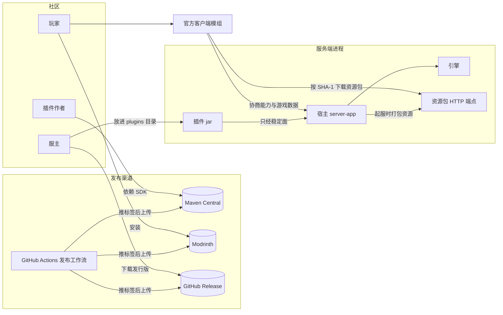

# Synaxis 设计文档 · 生态分册「插件平台、客户端能力与 SDK 发布」

## 1. 元信息 / 变更记录

| 字段 | 值 |
| --- | --- |
| 状态 | 草稿 |
| 项目画像 | 生产产品 |
| Owner | Bearisbug（光照会话维护本分册，§6.2 插件平台由生产就绪会话起草） |
| 评审人 | Bearisbug |
| 最后更新 | 2026-10-22 |
| 关联 | 引擎 `docs/DESIGN.md` · M2 分册 `docs/DESIGN-M2.md` · M3 分册 `docs/DESIGN-M3.md` · 生产就绪分册 `docs/DESIGN-PROD.md` · 玩法架构分册 `docs/DESIGN-PLAY.md` · 插件作者指南 `docs/PLUGINS.md` · 测试文档 `docs/TEST.md` |

本分册分两期写。第一期是草稿模式，只写 §1、链路层、§2、§5、§6、§18、§26 与 §28，先请用户签方向与范围；签字后第二期补全其余契约节，状态改为「评审中」再签一次。签字前两个会话都不为本分册改代码。基线是 `main` `2e0aace979`。

变更记录：

| 日期 | 版本 | 涉及 ID | 一句话 | 类型 |
| --- | --- | --- | --- | --- |
| 2026-10-22 | v0.1 | ADR-ECO-010、ADR-ECO-020、ADR-ECO-024 | 初稿：生态方向、范围与链路，写入用户当天拍板的三条决定 | 文档、拍板 |

## L1. 链路总览

领域顺序：开发 → 资源下发 → 客户端能力 → 发布

### 角色：插件作者

| 链路 | 名称 | 领域 | 状态 | 涉及需求 |
| --- | --- | --- | --- | --- |
| FLOW-SDK-START | 用 SDK 建插件工程 | 开发 | 设计中 | REQ-ECO-040、REQ-ECO-041 |
| FLOW-SDK-UPGRADE | 升级 SDK 版本 | 开发 | 设计中 | REQ-ECO-042、REQ-ECO-043 |

### 角色：服主

| 链路 | 名称 | 领域 | 状态 | 涉及需求 |
| --- | --- | --- | --- | --- |
| FLOW-ASSET-PACK | 起服打包插件资源 | 资源下发 | 设计中 | REQ-ECO-020、REQ-ECO-021、REQ-ECO-022 |

### 角色：玩家

| 链路 | 名称 | 领域 | 状态 | 涉及需求 |
| --- | --- | --- | --- | --- |
| FLOW-ASSET-JOIN | 进服下载资源 | 资源下发 | 设计中 | REQ-ECO-023、REQ-ECO-024、REQ-ECO-031 |
| FLOW-CAP-USE | 插件驱动客户端 | 客户端能力 | 设计中 | REQ-ECO-025、REQ-ECO-026、REQ-ECO-027、REQ-ECO-028、REQ-ECO-029、REQ-ECO-030、REQ-ECO-032 |

### 角色：维护者

| 链路 | 名称 | 领域 | 状态 | 涉及需求 |
| --- | --- | --- | --- | --- |
| FLOW-SDK-RELEASE | 发布 SDK 与模组 | 发布 | 设计中 | REQ-ECO-044、REQ-ECO-045、REQ-ECO-046、REQ-ECO-047 |

界面外壳：客户端｜client-fabric/src/main/java/io/github/bearisbug/synaxis/game/client/play/PlayHud.java

## L2. 链路卡

> 图例：现状待确认 = 实现已定、文档未写，等你确认是否定稿；无用例 = 这一行还没有测试用例；分支未与用户逐类核对 = 所列步骤的分支由 Agent 按文档与代码预填，还没和你逐类问过

### FLOW-SDK-RELEASE · 发布 SDK 与模组

#### 概要

- **执行者**：Synaxis 维护者
- **触发**：在 main 上推送版本标签
- **进入条件**：标签所指的提交 CI 全绿
- **结果**：SDK、模组、发行版分别进 Central、Modrinth、Release
- **不管**：第三方插件自己的发布

#### 主流程

1. S1 维护者在 main 上推送版本标签 〔无界面〕
2. S2 发布工作流核对标签与构建版本一致 〔无界面〕
3. S3 跑全量检查、示例门禁与稳定面兼容门 〔无界面〕
4. S4 签名后把 SDK 上传到 Maven Central 〔无界面〕
5. S5 把客户端模组上传到 Modrinth 〔无界面〕
6. S6 发 GitHub Release，附发行版与稳定面 jar 〔无界面〕
7. S7 把兼容门的基线改到新标签 〔无界面〕

#### 分支

> 分支未与用户逐类核对：S2–S7

##### S2 核对版本

| 类型 | 分支 | 结果 | 依据 | 测试 |
| --- | --- | --- | --- | --- |
| 失败 | 标签版本与构建版本不同 | 工作流失败，不上传任何产物 | 现状待确认：§23 缺发布门禁；ADR-ECO-023 | 无用例 |

##### S3 检查

| 类型 | 分支 | 结果 | 依据 | 测试 |
| --- | --- | --- | --- | --- |
| 失败 | 稳定面有破坏性变更而版本号没升主版本 | 工作流失败 | RULE-ECO-020；ADR-ECO-022 | 无用例 |
| 失败 | 示例调用了稳定面之外的引擎成员 | 工作流失败 | ADR-ECO-021 | 无用例 |

##### S4 上传 Maven Central

| 类型 | 分支 | 结果 | 依据 | 测试 |
| --- | --- | --- | --- | --- |
| 失败 | 该版本号已在 Maven Central | 工作流失败，已发布的版本不变 | INV-ECO-020；ADR-ECO-023 | 不测：由 Maven Central 拒绝覆盖 |
| 失败 | 上传或校验中途失败 | 工作流失败，可用同一标签重跑 | 现状待确认：§23 缺重跑规则；ADR-ECO-023 | 无用例 |

##### S5 上传 Modrinth

| 类型 | 分支 | 结果 | 依据 | 测试 |
| --- | --- | --- | --- | --- |
| 失败 | SDK 已发布而模组上传失败 | 待决策 Q-SDK-RELEASE-2 | 待决策 | 无用例 |

#### 待决策

- **Q-SDK-RELEASE-1 · 模组与 SDK 用同一个版本号，还是各自编号？**
  - 现状：SDK 从未发布，模组版本写死为 0.1.0
  - 建议：同一个版本号，一个标签同时发两边
  - 何时换：模组要单独修缺陷而 SDK 不动的情况每月超过一次
  - 代价：SDK 没改也要跟着模组升补丁号
  - 不可逆：否
  - 何时定：M4-B 契约成稿时
  - 谁定：技术
  - 卡住：FLOW-SDK-RELEASE
- **Q-SDK-RELEASE-2 · SDK 已发布而模组上传失败时，补传模组还是作废这个版本？**
  - 现状：未实现
  - 建议：补传模组，Maven Central 上的版本撤不回
  - 何时换：模组与 SDK 有不可单独使用的协议改动时
  - 代价：两边短时间不同步，玩家先拿不到新模组
  - 不可逆：否
  - 何时定：M4-G 开工前
  - 谁定：技术
  - 卡住：FLOW-SDK-RELEASE

另见：§28 首次发布前，用户在 Maven Central

#### 关联

- **契约锚点**：ADR-ECO-020；ADR-ECO-021；ADR-ECO-022；ADR-ECO-023；RULE-ECO-020
- **上游**：—
- **下游**：FLOW-SDK-START、FLOW-SDK-UPGRADE
- **守住的不变量**：INV-ECO-020、INV-ECO-021

| 步骤 | 位置 |
| --- | --- |
| S3 | `.github/workflows/ci.yml#ABI gate of the stable surface` |
| S4 | `build.gradle.kts#nmcpAggregation`；`build-src/src/main/kotlin/synaxis.publishing.gradle.kts#publishing` |
| S5 | `client-fabric/build.gradle.kts#version` |
| S7 | `gradle/abi-baseline.tag#v0.3.0` |

## L3. 业务规则

### RULE-ECO-010 · 资源命名空间归插件所有

适用链路：FLOW-ASSET-PACK、FLOW-CAP-USE

- IF 插件资源用了不是自己插件 id 的命名空间
- AND 描述文件没有声明覆盖这个命名空间
- THEN 起服时拒绝启用这个插件

出处：ADR-ECO-012

### RULE-ECO-011 · 必需能力缺失时拒绝进服

适用链路：FLOW-ASSET-JOIN、FLOW-CAP-USE

- IF 能力协商结果缺少某个已启用插件声明为必需的能力
- THEN 拒绝进服，提示升级模组

出处：ADR-ECO-013

### RULE-ECO-020 · 兼容承诺只覆盖稳定面

适用链路：FLOW-SDK-UPGRADE、FLOW-SDK-RELEASE

- IF 成员属于 `plugin-api` 或 `protocol` 的导出包
- THEN 受语义化版本、兼容门与弃用期约束，其余成员不承诺

出处：ADR-ECO-021；ADR-ECO-022

## L4. 不变量

| ID | 不变量 | 由什么保证 | 验证 |
| --- | --- | --- | --- |
| INV-ECO-010 | 客户端加载的插件资源包与宿主起服时算出的 SHA-1 相同 | ADR-ECO-011 | 无用例 |
| INV-ECO-011 | 一个资源命名空间至多属于一个插件 | RULE-ECO-010；ADR-ECO-012 | 无用例 |
| INV-ECO-020 | 发布过的版本号不会再发布第二次 | ADR-ECO-023 | 不测：由 Maven Central 拒绝覆盖 |
| INV-ECO-021 | 同一主版本内，稳定面的新版本对旧版本二进制兼容 | ADR-ECO-022 | 无用例 |

## 2. 背景 / 目标 / 非目标

背景：Synaxis 从 Minestom 硬 fork 而来，引擎底座已经完成（`docs/DESIGN.md`）。插件宿主、自定义协议与客户端模组也能用（`docs/DESIGN-M2.md`、`docs/DESIGN-PLAY.md`），但都按「本团队做自己的游戏」设计。

插件只从宿主的 classpath 加载，没有依赖声明与服务互调，整个进程只有一个准入槽。模组只认静态注册的四条通道与四种 HUD 小部件，资源全部打在模组 jar 里。`plugin-api` 与 `protocol` 不在 Maven Central 的发布聚合里，`docs/DESIGN-M2.md` 的 `ADR-M2-006` 写明 M2 期间社区可用性为零。

用户 2026-10-22 把目标改定为：像 Spigot 那样让第三方自由扩展的服务端核心，靠强制安装的客户端模组拿到原版做不到的自由度，面向公开社区做成生态。同日拍板四条：客户端扩展走服务端驱动加资源下发（`ADR-ECO-010`）；一台服支持多个作者的插件，照 Spigot 做依赖、服务互调与隔离（见 §6.2 插件平台）；首方玩法降为示例（`ADR-ECO-024`）；SDK 与模组公开发布（`ADR-ECO-020`）。

目标：

1. 作者从 Maven Central 拿 SDK 写插件，服主把插件 jar 放进 `plugins/` 起服即可
2. 多个作者的插件同服共存，可以互相依赖、互调服务
3. 插件只写服务端代码，就能用客户端能力目录里的界面、模型、音效、相机与输入
4. 插件的资源随 jar 带上，玩家进服时下发，只装一次官方模组
5. 稳定面按语义化版本发布，破坏性变更由 CI 拦下，弃用成员按承诺期保留
6. 首方示例只用稳定面构建，CI 全绿，给作者当参照

非目标：

- 客户端附属模组 API，以及服务端下发客户端代码或脚本：见 `ADR-ECO-010`
- 插件热加载与热卸载：沿用 `docs/DESIGN-M2.md` 的 `ADR-M2-007`，改插件要重启进程
- 插件沙箱：插件拥有完整 JVM 权限，装不装由服主决定
- 运行 Bukkit、Spigot 或 Paper 插件：「像 Spigot」指扩展模型，不兼容它们的 API
- 自建插件市场网站：插件由作者自己发布
- 升级 Minecraft 版本：仍钉死 26.2
- 首方玩法的新功能：RTS 相机切片、`docs/DESIGN-PLAY.md` 的 W4b 与 W5 暂停

规模画像：

| 维度 | 估算 | 依据 / 假设 |
| --- | --- | --- |
| 插件作者 | 首年活跃作者 ≤ 100 名 | 假设，没有数据；超过 100 名时重估文档与示例的投入 |
| 单服插件数 | 每台服 ≤ 50 个插件 | 假设；超过 50 个时重估起服耗时与资源包总量 |
| 在线玩家 | 每分片 50～500 人 | 沿用 `docs/DESIGN-PROD.md` §2 |
| 资源量 | 每个插件的资源包 ≤ 32 MiB，单服合计 ≤ 128 MiB | 假设；超过时重估下载时长与托管方式 |
| 请求量 | 资源包按 SHA-1 缓存，只在首次进服或包变更后下载 | 500 人同时重下 128 MiB 约 62.5 GiB 出站，这时改用外部地址 |
| 分布与形态 | 单区，SDK 在 Maven Central，模组在 Modrinth | 资源包由宿主内置 HTTP 或服主给的外部地址提供 |

## 3. 成功指标 / 验收阈值

第二期补全。

## 4. 术语表 / 统一语言

第二期补全。

## 5. 功能清单与需求 ID

插件平台的需求由生产就绪会话起草，合稿时排在本表最前面。

| ID | 功能 | 对应目标 | 优先级 |
| --- | --- | --- | --- |
| REQ-ECO-020 | 插件在 jar 里随带自己命名空间的资源 | 目标 4 | P0 |
| REQ-ECO-021 | 起服时宿主为每个插件打一个资源包 | 目标 4 | P0 |
| REQ-ECO-022 | 宿主托管资源包，也可改用外部地址 | 目标 4 | P0 |
| REQ-ECO-023 | 玩家进服时在配置阶段收到并加载全部资源包 | 目标 4 | P0 |
| REQ-ECO-024 | 必需的资源包下载失败或被拒时拒绝进服 | 目标 4 | P0 |
| REQ-ECO-025 | 插件声明必需能力，宿主按协商结果放行 | 目标 3 | P0 |
| REQ-ECO-026 | 界面能力支持只含数据的布局树 | 目标 3 | P1 |
| REQ-ECO-027 | 物品与展示实体可用插件自己的模型 | 目标 3 | P0 |
| REQ-ECO-028 | 插件可切换玩家的相机形态 | 目标 3 | P1 |
| REQ-ECO-029 | 插件可注册动作键、光标模式与点选 | 目标 3 | P1 |
| REQ-ECO-030 | 插件可播放自己命名空间下的音效 | 目标 3 | P1 |
| REQ-ECO-031 | 模组版本过低时拒绝进服并给出升级链接 | 目标 4 | P0 |
| REQ-ECO-032 | 插件可用自己的语言文件显示文字 | 目标 3 | P0 |
| REQ-ECO-040 | SDK 发布到 Maven Central | 目标 1 | P0 |
| REQ-ECO-041 | 提供插件模板仓库与本地起服任务 | 目标 1 | P1 |
| REQ-ECO-042 | 稳定面按语义化版本发布，CI 拦截破坏性变更 | 目标 5 | P0 |
| REQ-ECO-043 | 稳定面的弃用成员保留满承诺期才移除 | 目标 5 | P0 |
| REQ-ECO-044 | 客户端模组发布到 Modrinth | 目标 4 | P0 |
| REQ-ECO-045 | 推送版本标签触发发布工作流 | 目标 5 | P1 |
| REQ-ECO-046 | 首方示例只用稳定面，CI 门禁拦截 | 目标 6 | P1 |
| REQ-ECO-047 | 服主从 GitHub Release 下载服务端发行版 | 目标 1 | P0 |

## 6. 总体架构

### 6.1 分层与边界

| 层 | 模块 | 谁写 | 兼容承诺 |
| --- | --- | --- | --- |
| 引擎 | `:`，坐标 `synaxis` | Synaxis 维护者 | 不承诺，插件可以调用 |
| 稳定面 | `:plugin-api`、`:protocol` | Synaxis 维护者 | 语义化版本、兼容门与弃用期，见 `RULE-ECO-020` |
| 宿主 | `:server-app` | Synaxis 维护者 | 不承诺，服主只用发行版 |
| 工具库 | `:play-kit` | Synaxis 维护者 | 不承诺，沿用 `ADR-PLAY-001` |
| 示例 | `:game-rts`、`:game-rush` | Synaxis 维护者 | 只用稳定面，见 `ADR-ECO-021` |
| 插件 | 作者自己的工程 | 第三方作者 | 作者自定 |
| 官方模组 | `client-fabric` | Synaxis 维护者 | 按通道协商版本，见 `ADR-ECO-013` |
| 插件资源 | 插件 jar 的 `assets/<插件 id>/` | 第三方作者 | 命名空间归插件，见 `RULE-ECO-010` |

插件与宿主之间、插件与插件之间的隔离由 §6.2 插件平台定义。

### 6.2 插件平台

由生产就绪会话起草，第一期合稿时填入。范围：描述文件与依赖解析、每插件 classloader、服务注册表、多个准入来源、运行期禁用。

### 6.3 客户端能力目录

能力是模组能替插件做的事。插件在服务端声明要用哪些能力，宿主按 `docs/DESIGN-PLAY.md` W1 的按通道协商结果判定放不放行（`ADR-ECO-013`、`RULE-ECO-011`）。一部分能力原版客户端加资源包就能做到，模组只需保证每个玩家都装着同一套基础；另一部分要模组自己实现，加一项就要发一版模组（`ADR-ECO-010`）。

| 能力 | 承载 | 首批内容 | 现状 |
| --- | --- | --- | --- |
| 界面 | `synaxis:play` 通道 | 小部件目录加只含数据的布局树，见 `ADR-ECO-014` | 已有文字、计时器、计分板、面板四种小部件 |
| 模型与贴图 | 插件资源包加 `minecraft:item_model` 组件 | 物品与展示实体用插件自己的模型 | 引擎已有该组件，宿主还没接资源包 |
| 音效 | 资源包的 `sounds.json` 加原版播放音效包 | 插件命名空间下的新音效 | 原版机制可用，宿主还没接资源包 |
| 文字 | 资源包的语言文件 | 插件命名空间下的翻译键 | 只读模组自带的两份语言文件 |
| 相机 | `synaxis:play` 的场景相机 | 原版第一人称与俯视透视 | API 只有原版相机，客户端忽略相机字段 |
| 输入 | `synaxis:play` 的动作键与光标 | 六个动作键、光标模式与点选 | 客户端只注册了一个动作键 |
| 粒子 | 原版粒子包 | 原版粒子，自定义外观放第二批 | 原版粒子可用 |
| 远景 | `synaxis:farview` 通道 | 沿用 M3-G | 已实现 |

### 6.4 资源下发

1. 作者把资源放在插件 jar 的 `assets/<插件 id>/` 下，覆盖其他命名空间要在描述文件声明
2. 宿主起服时为每个启用的插件打一个资源包，算 SHA-1，包 id 由插件 id 派生
3. 宿主用内置 HTTP 端点提供这些包，服主也可以改配外部地址
4. 玩家进服时，宿主在配置阶段按插件加载顺序推送全部包，等客户端回报后再进游戏
5. 客户端按 SHA-1 缓存，没变的包不重下
6. 插件把资源声明为必需时，下载失败或被拒就拒绝进服

引擎已有原版的资源包推送包与 `Player#sendResourcePacks`，配置阶段会等客户端回报（`ConnectionManager` 的资源包等待）；宿主、插件 API 与模组都还没用上，`docs/DESIGN-M2.md` 把服务端资源包列为非目标，本分册取代那一条（`ADR-ECO-011`）。确认框、托管默认值与原版客户端放行三件事见 §28 风险与开放问题。

### 6.5 SDK 与兼容承诺

| 产物 | 去处 | 承诺 |
| --- | --- | --- |
| `plugin-api`、`protocol` | Maven Central，组 `io.github.bearisbug.synaxis` | 稳定面，见 `RULE-ECO-020` |
| 引擎 `synaxis` | Maven Central，同一组 | 可编译、可调用，不承诺兼容 |
| `testing` | Maven Central，同一组 | 插件测试工具，不承诺兼容 |
| 服务端发行版 | GitHub Release 附件 | 服主下载即用 |
| 客户端模组 | Modrinth | 按通道协商版本 |
| 插件模板 | GitHub 模板仓库 | 跟随最新 SDK |

现状：发布插件已配好 POM 与 CI 签名，但 Maven Central 的聚合只含引擎与 `testing`，`plugin-api` 与 `protocol` 不在里面；仓库没有发布工作流。兼容门在 CI 里拿 GitHub Release `v0.3.0` 的 `plugin-api.jar`、`protocol.jar` 比对，只查这两个模块。描述文件的 `apiVersion` 今天要求与宿主严格相等，要按语义化版本改成范围匹配，由 §6.2 插件平台定义。

## 7. 数据模型 / 领域实体

第二期补全。

## 8. 接口契约 (API-first)

第二期补全。

## 9. 数据字典

第二期补全。

## 10. 权限与角色

第二期补全。

## 11. 状态机

第二期补全。

## 12. 关键流程时序

第二期补全。

## 13. 页面与跳转地图

第二期补全。

## 14. 错误处理与错误码

第二期补全。

## 15. 非功能需求

第二期补全。

## 16. 并发与一致性

第二期补全。

## 17. 依赖与外部系统 / SLA

第二期补全。

## 18. ADR 决策记录

插件平台的 ADR 由生产就绪会话起草，合稿时排在本节最前面。

- **`ADR-ECO-010` 客户端扩展走服务端驱动加资源下发** — Status: Accepted
  - Context：用户 2026-10-22 要客户端自由度高，并面向公开社区做生态
  - Decision：玩家只装官方模组，插件在服务端声明能力，资源随 jar 带上、进服下发
  - Alternatives：
    - 开放客户端 API 给附属模组：每台服要装不同模组，客户端代码安不安全只能玩家自己判断
    - 两者都做：两套扩展方式都要维护兼容
  - Consequences：作者不写客户端代码，每加一种模组能力都要发一版模组
- **`ADR-ECO-011` 每个插件一个原版资源包，配置阶段推送** — Status: Proposed
  - Context：引擎已有原版多资源包推送，配置阶段会等客户端回报
  - Decision：宿主为每个插件打一个包，包 id 由插件 id 派生，客户端按 SHA-1 缓存
  - Alternatives：
    - 合成一个总包：任一插件改动，全员要重下整包
    - 模组自带下载器：要多写下载与资源重载代码，原版已经有
  - Consequences：宿主要提供 HTTP 端点或接受外部地址，包的推送顺序决定覆盖优先级
- **`ADR-ECO-012` 资源命名空间等于插件 id** — Status: Proposed
  - Context：两个插件改同一个原版资源时只有一个生效，作者和服主都看不出来
  - Decision：资源只能放在自己 id 的命名空间，覆盖其他命名空间要声明，两个插件声明同一项时起服拒绝
  - Alternatives：
    - 按加载顺序后者覆盖：冲突静默发生
    - 完全禁止覆盖原版：做不了改原版外观的插件
  - Consequences：描述文件多一个字段，由 §6.2 插件平台定义
- **`ADR-ECO-013` 能力目录是通道版本到能力的对照表** — Status: Proposed
  - Context：`docs/DESIGN-PLAY.md` W1 已经设计了按通道协商版本
  - Decision：每项能力对应「通道加最低版本」，插件声明必需能力，宿主按协商结果判定
  - Alternatives：
    - 每项能力一条新通道：通道数随能力增长，W1 的协商要重做
  - Consequences：加能力就给对应通道升版本，模组随之发版
- **`ADR-ECO-014` 界面能力加只含数据的布局树** — Status: Proposed
  - Context：四种 HUD 小部件撑不起插件自己的界面，`ADR-PLAY-004` 否掉了服务端下发布局
  - Decision：加一种布局树，元素有容器、文字、图片、按钮、进度条、列表，不含脚本
  - Alternatives：
    - 只加小部件种类：插件每要一种新界面都得等模组发版
    - 下发脚本：违背 `ADR-ECO-010`
  - Consequences：要改 `ADR-PLAY-004`，布局树的上限与校验在第二期定
- **`ADR-ECO-020` 生态面向公开社区** — Status: Accepted
  - Context：用户 2026-10-22 定生态面向公开社区
  - Decision：SDK 发布到 Maven Central，模组发布到 Modrinth，稳定面做兼容承诺
  - Alternatives：
    - 先给自己与合作方：用 GitHub Packages，兼容承诺后置
  - Consequences：发布撤不回，首次发布前先问用户，签名密钥与命名空间要长期维护
- **`ADR-ECO-021` 示例只用稳定面，缺什么补进稳定面** — Status: Proposed
  - Context：很多事只能经 `process()` 直调引擎，而引擎不承诺兼容
  - Decision：首方示例只准调用稳定面，架构测试门禁拦截，示例缺什么就往 `plugin-api` 加
  - Alternatives：
    - 承诺整个引擎：一千多个源文件都要守兼容，引擎改不动
    - 只靠文档提醒：没有门禁就会退化
  - Consequences：示例迁移前要先补 `plugin-api`，`process()` 留给愿意承担风险的作者
- **`ADR-ECO-022` 稳定面的版本号与弃用期** — Status: Proposed
  - Context：`docs/DESIGN-M2.md` 定的弃用期约 30 天，当时还没有对外发布过
  - Decision：1.0.0 前次版本可以破坏但要在发布说明列出，之后破坏只进主版本，弃用成员至少保留一个次版本且不少于 90 天
  - Alternatives：
    - 沿用 30 天：公开社区的插件更新慢，30 天来不及迁移
    - 不设弃用期：作者没法提前迁移
  - Consequences：弃用成员要标 `@Deprecated(since, forRemoval)`，发布说明列出弃用与移除
- **`ADR-ECO-023` 推送版本标签触发发布工作流** — Status: Proposed
  - Context：仓库没有发布工作流，`plugin-api` 与 `protocol` 不在 Maven Central 的聚合里
  - Decision：推 `v*` 标签后依次核版本、全量检查、上传 Maven Central 与 Modrinth、发 GitHub Release
  - Alternatives：
    - 在本机手动发布：密钥落在本机，过程不可复现
  - Consequences：Maven Central 与 Modrinth 的令牌由用户配进 GitHub Actions secrets
- **`ADR-ECO-024` 首方玩法降为示例** — Status: Accepted
  - Context：用户 2026-10-22 定首方玩法降为示例，人力转到平台
  - Decision：rts、rush 与远景保持能跑与 CI 全绿，RTS 相机切片、W4b、W5 暂停
  - Alternatives：
    - 继续当产品推进：平台与玩法并行，排期更长
  - Consequences：示例按 `ADR-ECO-021` 只用稳定面，暂停项在 M4-H 之后重排

## 19. 验收 / 测试

第二期补全。

## 20. 埋点 / 分析事件

第二期补全。

## 21. 可观测性 (SLI/SLO/告警)

第二期补全。

## 22. 运维 Runbook

第二期补全。

## 23. 发布: Feature Flag / 灰度 / 回滚

第二期补全。

## 24. 契约同步与防漂移机制

第二期补全。

## 25. 迁移 / 数据回填

第二期补全。

## 26. 里程碑

生态是项目的第四个里程碑 M4。M4-C 与 M4-D 互不依赖，可以并行；M4-E 要等 M4-C 的插件 jar 加载，M4-F 要等 M4-D；M4-G 在 M4-B 之后随时可做；M4-H 要等其余全部完成。估时是会话的工作日，第二期契约成稿后重估。

| 里程碑 | 产出与退出条件 | 负责 | 估时 | 状态 |
| --- | --- | --- | --- | --- |
| M4-A 方向签字 | 本分册第一期签字，`docs/DESIGN.md` §2 与 §28 的交接改完 | 两个会话 | 1 天 | 进行中 |
| M4-B 契约成稿 | 其余契约节补全并签字，`docs/TEST.md` 写好用例 | 两个会话 | 4～5 天 | 未开始 |
| M4-C 插件平台 | 见 §6.2 插件平台 | 生产就绪会话 | 待估 | 未开始 |
| M4-D 能力协商 | `docs/DESIGN-PLAY.md` 的 W0 与 W1 合入 | 生产就绪会话 | 4～5 天 | 未开始 |
| M4-E 资源下发 | 插件资源打包、托管与配置阶段推送，真客户端 CI 判 | 光照会话 | 4～6 天 | 未开始 |
| M4-F 能力首批 | 布局树、相机、输入与模型，示例插件用上 | 两个会话 | 8～12 天 | 未开始 |
| M4-G SDK 首发 | 发布工作流、Maven Central、Modrinth 与模板仓库 | 光照会话 | 3～5 天 | 未开始 |
| M4-H 生态验收 | 仓库外两个插件互相依赖、带资源、用能力，真客户端 CI 全绿 | 两个会话 | 3～4 天 | 未开始 |

## 27. 上线后度量与复盘

第二期补全。

## 28. 风险与开放问题

| 类型 | 描述 | 负责人 | 何时需拍板 | 谁定 | 卡住 |
| --- | --- | --- | --- | --- | --- |
| Open Question | 进服时的资源包确认框，由模组自动接受，还是保留原版确认框 | Bearisbug | 资源下发开工前 | 产品 | FLOW-ASSET-JOIN |
| Open Question | 所有插件都没声明必需能力时，放不放行没装模组的原版客户端 | Bearisbug | 契约层成稿前 | 产品 | FLOW-ASSET-JOIN |
| Open Question | 资源包托管默认用宿主内置 HTTP，还是要求服主给外部地址 | 光照会话 | M4-E 开工前 | 技术 | FLOW-ASSET-PACK |
| Open Question | `docs/DESIGN.md` 的项目画像是否从内部系统升为生产产品 | 光照会话 | M4-B 成稿前 | 技术 | 不卡 |
| 前置 | 首次发布前，用户在 Maven Central 用 GitHub 账号验证 `io.github.bearisbug` 命名空间 | Bearisbug | M4-G 开工前 | — | — |
| 前置 | 用户在 Modrinth 建项目页，把上传令牌配进 GitHub Actions secrets | Bearisbug | M4-G 开工前 | — | — |
| 风险 | 插件拥有完整 JVM 权限，恶意插件能读写服主机器上的任意文件 | Bearisbug | — | — | — |
| 风险 | 资源包变更后在线玩家同时重下，宿主出站带宽可能打满 | 光照会话 | — | — | — |
| 交接 | `docs/DESIGN-PLAY.md` §2 非目标里的服务端资源包与每插件 classloader，改为引用本分册 | 生产就绪会话 | M4-A 签字后 | — | — |
| 交接 | `docs/DESIGN-PLAY.md` §6.4 的「服务端资源包不做」与只读模组语言文件，改为引用本分册 §6.4 | 生产就绪会话 | M4-A 签字后 | — | — |
| 交接 | `ADR-PLAY-004` 否掉的服务端下发布局，若 `ADR-ECO-014` 签字就标为部分被取代 | 生产就绪会话 | M4-A 签字后 | — | — |
| 交接 | `docs/DESIGN-PLAY.md` §26 的 6b、W4b、W5 标暂停，其余波次按本分册 §26 重排 | 生产就绪会话 | M4-A 签字后 | — | — |
| 交接 | `docs/DESIGN-M2.md` 非目标里的插件依赖解析与每插件 classloader，改为引用本分册 | 生产就绪会话 | M4-A 签字后 | — | — |
| 交接 | `docs/DESIGN-M2.md` 非目标里的服务端资源包分发，改为引用本分册 | 光照会话 | M4-A 签字后 | — | — |
| 交接 | 描述文件的 `apiVersion` 由严格相等改为语义化版本范围匹配 | 生产就绪会话 | M4-B 成稿前 | — | — |
| 交接 | 描述文件加覆盖的资源命名空间与必需能力两个字段 | 生产就绪会话 | M4-B 成稿前 | — | — |
| 交接 | `docs/PLUGINS.md` §1 与 §2 改为从 Maven Central 引 SDK | 生产就绪会话 | M4-G 完成后 | — | — |
