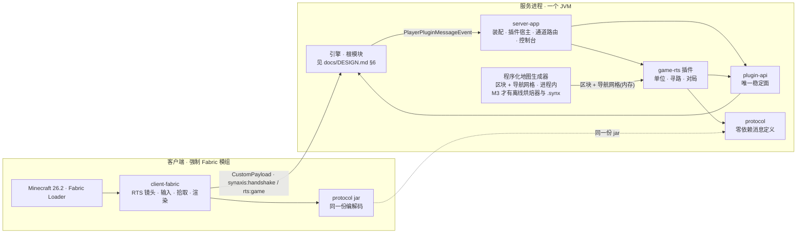
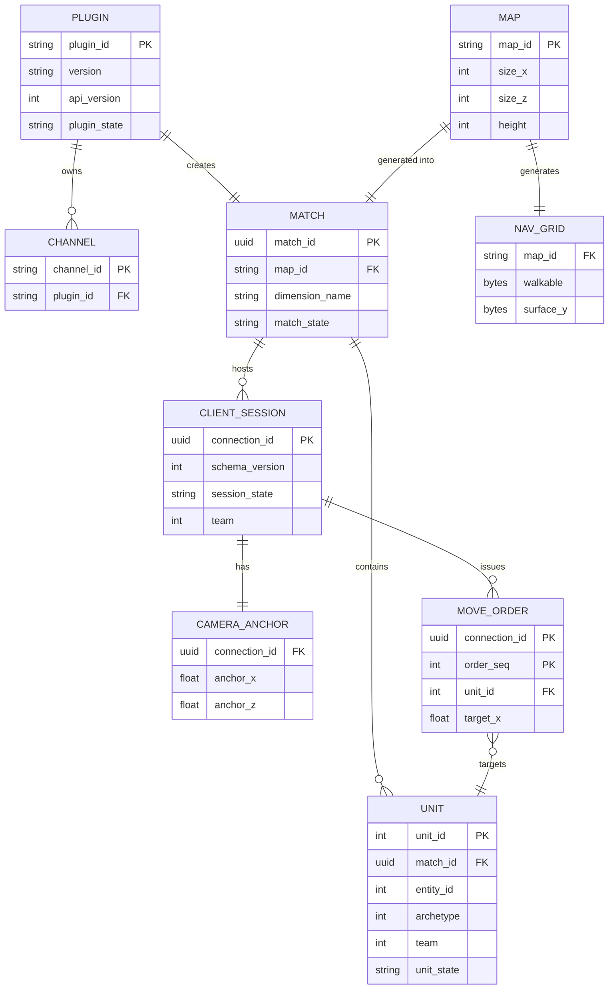
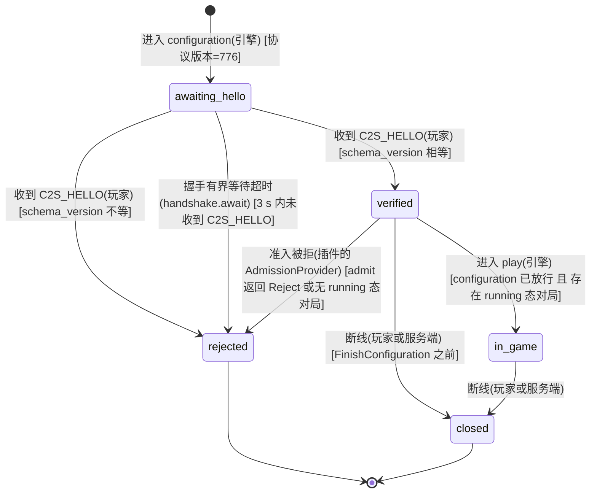
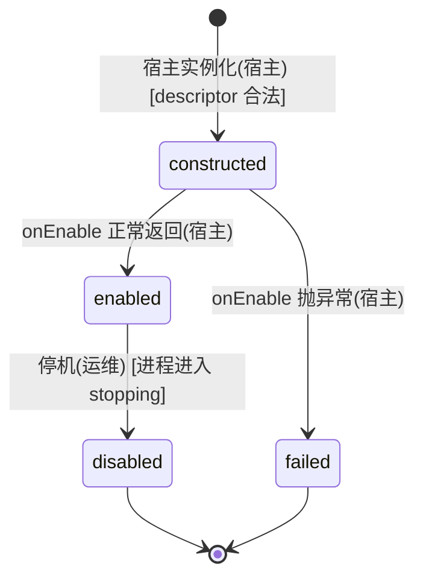
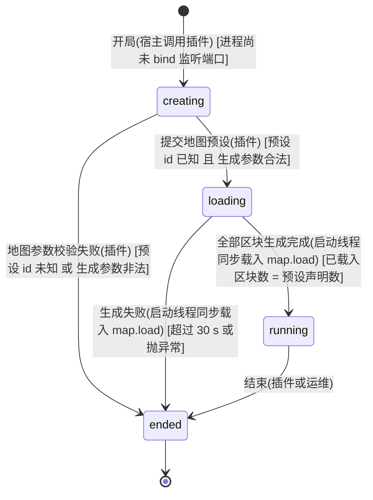
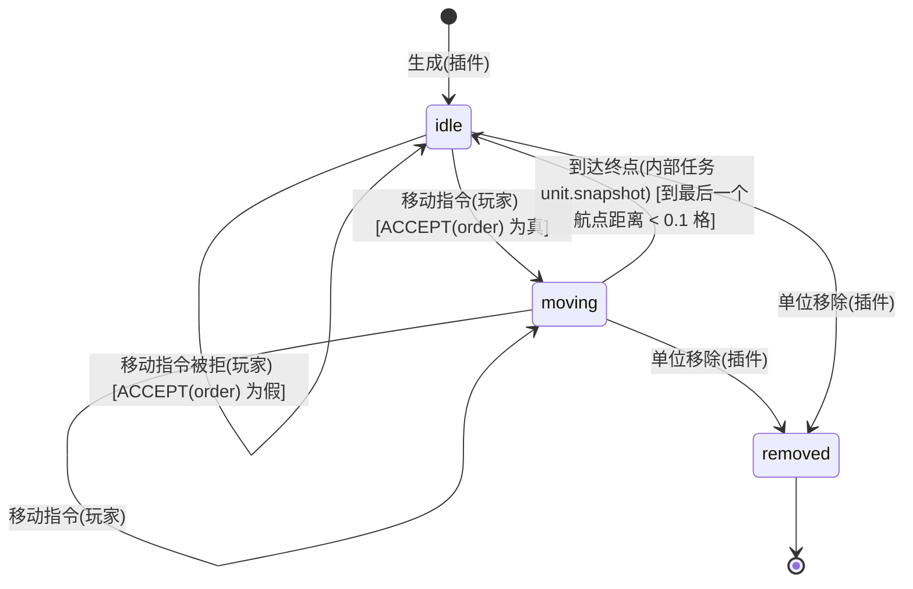
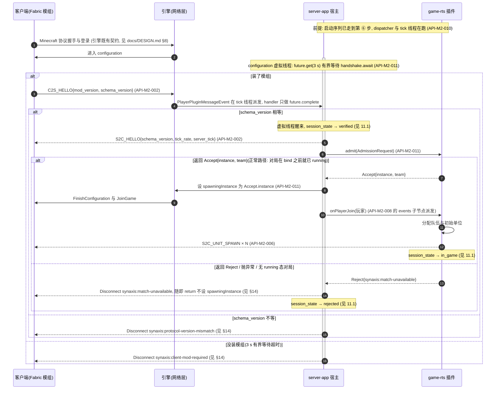
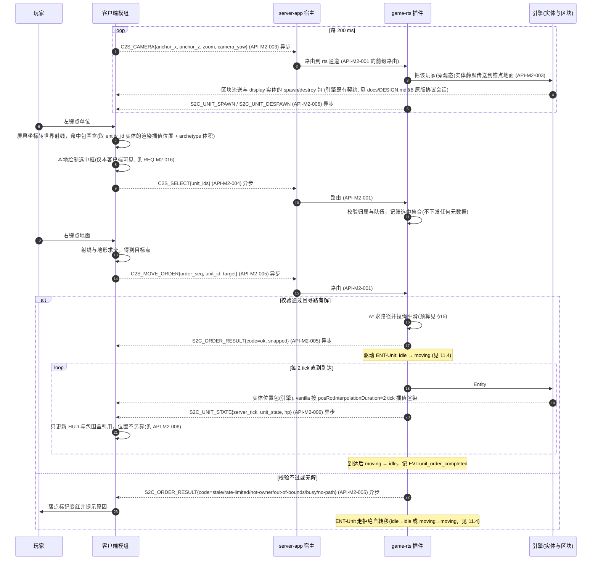
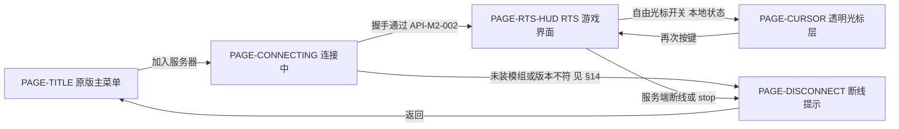

# Synaxis 设计文档 · 里程碑 M2「游戏工程骨架与 RTS 垂直切片」

## 1. 元信息 / 变更记录

| 字段 | 值 |
| --- | --- |
| 状态 | 已签字（2026-09-16：§18 的 A1～A4 四条假设与 §28.1 的 S1～S6 六条不可逆决策全部按默认值通过，可进入 §26 阶段 1；同批签字还定了三条范围裁剪与 Minecraft 版本，见 §1 变更记录 v0.6 与 §28.3） |
| 项目画像 | 生产产品（引擎本体仍是内部系统，见 `docs/DESIGN.md` §1；**M2 交付的是面向真实玩家的游戏**，内测阶段单机单区 ≤ 50 人，因此本文档按生产产品填全部 `[核心]` 节。全部可观测性与埋点落在单进程本地文件，不接外部监控） |
| Owner | Bearisbug |
| 评审人 | Bearisbug |
| 最后更新 | 2026-09-19 |
| 关联 | 引擎单一事实源 `docs/DESIGN.md`（M1 / M1.5） · 测试文档 `docs/TEST.md` · 运行手册 `docs/ENGINE.md` · 审计与开发计划 `docs/research/minestom-audit/00-总结与开发计划.md` · 两轮审计 `docs/research/audit-2026-09-15/` · 仓库 `https://github.com/Bearisbug/synaxis` |

本文档是 `docs/DESIGN.md` 的**里程碑分册**——这是对 design-doc 模板「同一份文档滚动收纳全部功能域」的一次显式偏离，理由与防腐坏机制（三处回指、ID 带 `M2` 域段、跨文档一律引用不复制）见 §24 最后一条。本文档只管 M2 新增的东西。引擎侧的背景、实体、协议状态机、错误码体系、线程模型、构建链一律以 `docs/DESIGN.md` 为准，本文档用「见 `docs/DESIGN.md` §N」引用，不复制。ID 独立编号：需求 `REQ-M2-*`、接口 `API-M2-*`、决策 `ADR-M2-*`、Runbook `RB-M2-*`；实体 `ENT-*`、页面 `PAGE-*`、事件 `EVT:*` 用语义命名，与 M1 天然不冲突。

变更记录：

| 日期 | 版本 | 改动 | 作者 |
| --- | --- | --- | --- |
| 2026-09-16 | v0.1 | 初稿：M2 范围、模块拆分、插件宿主、自定义协议、单位模型、寻路、世界管理与四条审计残留处置、垂直切片验收、阶段计划 | Bearisbug |
| 2026-09-21 | v0.30 | 阶段 0 的 `REQ-M2-020a` 落地回写（客户端模组最小骨架），**接口契约、消息布局与 `schema_version` 一个字未改**。**落地一（工程形态）**：`client-fabric/` 按 `ADR-M2-015` 建成独立 Gradle 构建（Fabric Loom 1.17.21、自带与主构建同版本的 wrapper、`org.gradle.configuration-cache=false`），不在 `settings.gradle.kts` 里；`build` 出一个 32 KB 的模组 jar，`fabric.mod.json` 的 minecraft 依赖由构建脚本里的同一个常量展开成 `"26.2"`（`REQ-M2-020` 的判据），客户端入口点 `SynaxisClientMod` 只做一件事：注册 `rts:game` 通道。**落地二（不混淆之后 Loom 仍然要一条 `mappings`）**：§22 早就写着 26.1 起 MC 不再混淆，但 Loom 不会因此放过空的 `mappings` 配置——Mojang 的 26.2 version manifest 里没有 `client_mappings`、Fabric 也没有 26.2 的 yarn 构建（`meta` 返回空数组），于是 `loom.officialMojangMappings()` 抛 `Failed to find official mojang mappings for 26.2`、不声明 `mappings` 则抛 `Configuration 'mappings' has no dependencies`。落地形态是 `mappings("net.fabricmc:intermediary:0.0.0:v2")`——Fabric 为这个时代发布的**空** tiny 文件（只有一行表头、零条映射），于是客户端代码直接写 Minecraft 自己的名字（`net.minecraft.resources.Identifier`、`CustomPacketPayload.Type`、`RegistryFriendlyByteBuf`），也不存在重映射这一步。这条写进 `ADR-M2-015` 的 Consequences：它改变的不是决策，是决策的执行方式。**落地三（`:protocol` 的跨构建消费与 spike ① 的构建期那一半）**：按 `ADR-M2-015` 的默认路线——主构建 `publishToMavenLocal`、客户端从 `mavenLocal()` 按坐标消费，并用 Loom 的 `include` 把它 JiJ 进模组 jar。带 `module-info.java` 的 jar **能**被 `include` 吞下：嵌套 jar 在 `META-INF/jars/protocol-dev.jar`、`module-info.class` 原样保留、Loom 为它生成一份 `fabric.mod.json`（`id` 由坐标派生、`version` 取工件版本）。构建期唯一的杂音是工件版本 `dev` 不是 SemVer，Loom 打一行 warning；**运行期由 Fabric Loader 真加载这个嵌套 jar 仍未验**（本轮不启动客户端），仍记在 §28.2 spike ① 那一行。**范围**：本轮不含 CI、资源与模型打包、双端向量夹具与任何相机 / 输入 / 渲染代码，那些是 `REQ-M2-020b` 与阶段 6a | Bearisbug |
| 2026-09-19 | v0.29 | 阶段 5 评审第 1 轮修订，一处缺陷修复 + 一处口径扩充 + 一处措辞更正，接口契约、消息布局与结果码一个字未改。**一、节点预算要买距离，不能买宽度**：`ADR-M2-014` 的 octile 启发式在本项目的地图上是**精确的**——地形是一片 1/64 稀疏柱子的平地，两列之间每一条单调折线代价完全相同，A* 没有理由先走哪一条，于是把 4,000 节点的预算花在把起点周围的等代价平台摊开上，目标还在前沿里面就没预算了，于是**空旷、可站立、真的连通的远处目标被答成 `no-path`**。实测（默认预设 `rts-512`，从地图中心按环取随机可站立目标）：100 格 4/200 答错、150 格 100/200、200 格 129/200；全图任取两列的口径下 2,000 对里 1,288 对答错，而整张图在连通性上只有两个连通分量（主区 257,743 列与被墙围住的口袋 196 列），答错的那些两端都在主区。答案还与方向相关（`(456,336)` 215 格找不到、`(510,2)` 359 格找得到），因为开放表把 `(f, 列号)` 打包进一个 `long`、同 f 按列号排序，+x/+z 方向的目标列号最大、要等整个平台摊完才轮到它。**修法是把启发式向目标偏置 `GOAL_BIAS = 1.15`，三重预算一个数都没动**；只按 h 做二次排序（等价于偏置 1.0005）**不够**——实测仍有 68/2,000 答错，平台被柱子扰动过，必须真的贪心才收得住。1.15 在两个预设、各 4 个随机种子、共 160,000 对列上一对都没答错，实服上默认预设四个地图角（离出生点约 356 格）全部回 `ok`；代价是路径代价上界成为最短路的 1.15 倍，实测拉绳之后平均多走 1.3%、最坏的一对多 8%，换来单次展开从平均 560 降到 245（215 格的成功搜索 201～206 节点、`path_ms=0`）。`no-path` 由此回到它在 §19 与 `TC-GAME-041` 里的语义（真的被墙围住），新增 `TC-GAME-065` 与 `PathfinderTest#aFarTargetOnOpenGroundIsRoutedToRatherThanGivenUpOn` 守住「远处空旷目标必须回 `ok`」。**二、超预算放弃在台账里可分辨**：§20 的 `no-path` 那档 `EVT:unit_order_rejected` 增记 `path_nodes` / `path_ms`——`path_nodes > 4,000` 是「搜索吃满预算才收手」、小于是「真的没有路」，`RB-M2-003` 诊断的第一句要分的正是这两件事，而此前这一档只记 `code`，最贵的那一次搜索在台账里是隐形的。当场判定的三档（`out-of-bounds` / `not-owner` / `busy`）不经搜索，照旧不带这两个字段。**三、拉绳平滑的保证按实测写准**：v0.28 那句「拉绳的每一段按 `archetype_radius` 采样校验，所以平滑后的路径对有体积的单位仍然可走」强于代码真正保证的——校验每 0.5 格取一个采样点、判该点处身体盒压住的四列，**两个采样点之间**的斜向扫掠没被覆盖。实测（`rts-128`，3,000 条路径）中心线一次都没进过不可站立的列，而 0.9 宽的身体盒有 1,334 条在某一段擦进过一列、最深 0.17 格。M2 的单位 `hasPhysics=false`，与地形和彼此都不碰撞，这是观感而不是可走性，因此不动采样步长，只把保证写准：**中心线一定可走，身体盒在拐角处最多擦进 0.17 格** | Bearisbug |
| 2026-09-19 | v0.28 | 阶段 5 的 `REQ-M2-016` / `REQ-M2-017` 落地回写（单位与寻路），**接口契约、消息布局与结果码一个字未改**，补的是落地登记。**落地一（单位）**：`Unit` 是自有模型，可见物是一个 `ITEM_DISPLAY`（`UnitEntity`），五条建模规则全在它的构造器里一次设死——`setHasPhysics(false)` / `setNoGravity(true)` / `setPosRotInterpolationDuration(2)` / `setSynchronizationTicks(100)` / `setViewRange(archetype_view_range)` 与按 `archetype_box` 的 `setWidth` / `setHeight`；兴趣集是引擎 viewer 集合的投影，`S2C_UNIT_SPAWN` / `S2C_UNIT_DESPAWN` 挂在 `Entity#updateNewViewer` / `updateOldViewer` 上，插件侧零半径计算；`flags.bit0` 逐连接按 `owner(unit, sender)` 求值，服务端不为选中下发任何实体元数据。**落地二（原型模板的具体取值）**：M2 只有一个原型（`archetype=0`），`archetype_speed=0.15`、`archetype_radius=0.45`、`archetype_view_range=4.0`、`archetype_box=0.9×0.9`；前三项是纯服务端数据住在 `:game-rts` 的 `Archetype`，`archetype_box` 按 §9 两端各持一份，因此它的表住在 `:protocol`（两端共用的那个 jar）并按 §24 冻进 `vectors/archetype_box.bin`，manifest 的 digest 同一个提交里更新——新增的是一份向量文件，没有任何消息布局变化，`schema_version` 保持 `1`。**落地三（寻路）**：8 邻接 A* + 拉绳平滑跑在烘焙好的不可变 `NavGrid` 上，三重预算按 §15 落成「单次 ≤ 4,000 节点展开、每 tick ≤ 4 次搜索、队列深度 32」；对角线不许切角，拉绳的每一段按 `archetype_radius` 采样校验，所以平滑后的路径对有体积的单位仍然可走。**登记一**：§11.4 `ACCEPT(order)` 的后两项落在寻路侧——`busy` 由入队操作本身判定（两条连接可能同时交指令，先读深度再插入的话 §15 的上界只是个建议），`no-path` 由搜索判定，因此**被接受的指令的 `ok` 与吸附终点由队列在随后的 tick 里回**，前五项不通过的仍然当场回。**这一条的代价按真实上界写进 §15 的端到端延迟行与 §21 的 SLO 行**：收包排在当 tick 的 scheduler 任务之后（payload handler 跑在 player tick 里），所以入队的那条最早也要到下一个 tick 才被抽取——队列空时正好 ≤ 1 tick，队列压满时排在第 32 位的那条要等 `32 ÷ 4 = 8` 次抽取、约 400 ms，**越过 §15 的 300 ms 端到端目标与 §21 的 50 ms 服务端分段**。两个数字都没有跟着改：每 tick 4 条与深度 32 是 §15 给 tick 预算立的上界，要把答复压回 1 个 tick 就得把深度砍到 ≤ 4（`busy` 会在远未积压时就开始回，`TC-GAME-042` 第 3 步的「至少 32 条 `ok`」也随之不成立）；而**持续的队列积压本来就是 `RB-M2-003` 那条事故**——§21 的「5 分钟 P99 > 100 ms」正是它的告警信号，处置写在那条 Runbook 的「队列积压」分支里。§2 的常态入站速率（≈ 95 包/秒）下队列深度接近 0，这一档只有在 50 人把 10 操作/秒的额度用满（500 条/秒对上抽取 80 条/秒）时才到得了。`order_seq` 在入队时推进：过了前五项就算这条连接的指令被接受，之后的 `no-path` 是地图的事、不是序号的事。**登记二**：§20 的 `unit_order_issued`（带 `path_nodes` / `path_ms`）、`unit_order_completed`、`unit_order_superseded`（replaced / session-closed / match-ended）与 `no-path` 那档 `unit_order_rejected` 随本阶段全部接通。**登记三**：一局的阵容是固定的 67 个单位（`Roster`：`unit_id=1..64` 本方、`65` 中立、`66` 对方、`67` 远哨），在 bind 之前铺开，`docs/TEST.md` §3 的单位种子照此填实；探针新增 `units` 子命令与 `order --watch`，把三条下行单位消息打印出来 | Bearisbug |
| 2026-09-19 | v0.27 | 阶段 4 评审第 3 轮修订，一处缺陷修复 + 一处口径更正，接口与行为均未改。**一、准入回调里建的表项必须判活**：`API-M2-011` 的 provider 只拿到 `connection_id`，而它的表项由 `PlayerDisconnectEvent` 回收——连接在握手完成之后、`admit` 之前断开时，断线回调先跑（那时表里还没有这一项）、准入回调随后把表项建出来，从此无人回收；客户端只要「发完 `C2S_HELLO` 立刻关 socket」就能无上界地撑大它（§15）。规则写进 `API-M2-011` 的「调用线程与时机」并在 §16 加一行竞态：**判活与建表同一临界区、断线回收进同一把锁**，判活用引擎的 `ConnectionManager#isConnected(connection_id)`（它在 `PlayerDisconnectEvent` 之前就翻假），与引擎 `ConnectionManager#trackPlayer` 同形。**二、`S2C_HELLO` 由谁回**：§11.1 迁移表 `awaiting_hello → verified` 那一行、§19 对应场景与 `API-M2-011` 的交接清单原先写「configuration 虚拟线程回 `S2C_HELLO`」，与实现不符——按实现改文档：核心模式下根本没有等待的线程而一条真握手照样要回，「谁判的谁回」是两种模式下唯一一致的写法，回包只是排进写队列、不与 `spawningInstance` 竞争（`schema` 不等那一脚 kick 仍归虚拟线程，理由见 v0.23） | Bearisbug |
| 2026-09-19 | v0.26 | 阶段 4 评审第 2 轮修订，两处口径更正，无接口与行为改动。**一、台账的上界改成经得起核的说法**：`docs/DESIGN.md` §28 那笔 `EventLedger` 技术债原先写「没有一个调用点的频率由客户端定」，对 §20 的 `session_entered_configuration` / `client_verified` / `client_rejected` 不成立——一次会话就是一条连接，开多少条连接由对端定、离线模式下不要任何凭据，这三条属 `docs/ENGINE.md` §8 的「由连接数决定」那一档且不满足它附带的「必须与一次断开在同一分支上」（前两条写在连接继续活着的分支上）。实测（`rts-128`）：顺序走完 100 次完整登录 8.59 s → 台账多 200 行 / 30,800 字节；50 条并发连接一条 `C2S_HELLO` 都不发、3.1 s 内全被 `synaxis:client-mod-required` 踢掉，同样写 100 行 / 15,750 字节。§15「数据增长」行据此写明「内测 50 人每天 < 10 MB」的前提是连接来源受控（按实测速率约 46 分钟写满），技术债的到期条件改为「端口对不受控的连接来源开放之前」。**二、§15 补窗口口径**：三条玩法预算与洪水闸门都是固定 1 秒窗口而非滑窗，跨边界最坏是表内数字的两倍。连带 `docs/TEST.md`：`TC-GAME-025` 第 1 步的速率实质变更（400 包/秒离 300 的阈值只有 33% 余量、实测 14 次挂 7 次），废弃并由 `TC-GAME-064` 取代 | Bearisbug |
| 2026-09-19 | v0.25 | 阶段 4 评审第 1 轮修订，一处实质改动：**§20 的 `EVT:unit_order_rejected` 只记 `code ∈ {no-path, out-of-bounds, not-owner, busy}` 这四档，`stale` 与 `rate-limited` 不写台账**——这两档本来就不进任何指标的分母（§3「指令被接受率」那一行早就把它们排除在外），而**客户端能按自己的节奏无限产生它们**：§11.4 的判定顺序把 `stale` 排在令牌之前、`rate-limited` 本身就是没抢到令牌，被拒的指令一个令牌也不扣，于是「10 操作/秒」这条玩法预算并不构成服务端工作量的上界，唯一的上界是洪水闸门的 300 包/秒（设计意图的 30 倍）。而台账是**每条事件一次 `open/append/close`、跑在 tick 线程上**：实测单次 append 26 µs、一秒内 1,000 条超频指令让 `logs/events-*.jsonl` 多出 1,002 行 / 215 KB 且连接不断，按 §15 的 50 连接口径就是约 19 ms/tick（预算 50 ms）与远超「内测 50 人每天 < 10 MB」的台账增长——「写多少盘由谁决定」与 §15 给日志立的上界是同一条规矩。§11.4 的两行拒绝分支、§15 的限流行与 §3 的指标行同步写明这一点；`docs/TEST.md` 的 `TC-GAME-023` 判据实质变更，废弃并由 `TC-GAME-063` 取代 | Bearisbug |
| 2026-09-19 | v0.24 | 阶段 4 的 `REQ-M2-009` 落地回写（消息到达之后的服务端权威校验与限流那一层），**接口契约与结果码一个字未改**，补的是落地登记与一条新门禁。**落地**：`rts:game` 由 `:game-rts` 的 `GameChannel` 接进宿主的通道能力，三条 C2S 消息各自判一遍——`C2S_CAMERA` 夹取锚点并按 10/s 丢弃超频的（把锚点变成区块流送仍是 `REQ-M2-018`）、`C2S_SELECT` 按 `owner(unit, sender)` 静默剔除非己方单位并记 `unit_selected`、`C2S_MOVE_ORDER` 按 §11.4 的 `ACCEPT(order)` 自上而下短路求值并**每条必回** `S2C_ORDER_RESULT`；令牌桶按 `order_group` 计（10 操作/秒、组内包数上限 8）、`synaxis:game-flood` 按「连续 3 秒 > 300 包/秒」判并只在这一条上断线。**`ACCEPT(order)` 的后两项（`busy` / `no-path`）与三条下行单位消息（`S2C_UNIT_SPAWN` / `S2C_UNIT_STATE` / `S2C_UNIT_DESPAWN`）不在本阶段**——它们要的是单位与寻路，随 `REQ-M2-016` / `REQ-M2-017` 在阶段 5 落；在那之前一条通过前四项的指令回 `ok` 与吸附终点，但没有东西走过去。**登记一**：§14 的第三个断线键 `synaxis:game-flood` 补进 `plugin-api` 的 `DisconnectKeys`（四个键至此齐全）。**登记二**：§24 新增 ArchUnit 规则⑤（客户端可驱动路径不得逐包写日志的第三份，住在 `:game-rts` 自己的测试源集里），`LogBudget` 随之从 `:server-app` 挪到 `:plugin-api` 并标 `@ApiStatus.Internal`——宿主与插件坐在同一条客户端可控路径上、要用同一个上界，而插件不能依赖宿主。`tools/protocol-probe/probe.py` 新增 `order` / `select` / `game-flood` 三个子命令，`docs/TEST.md` 探针表补三行、`TC-GAME-023` ～ `TC-GAME-026` 与 `TC-GAME-039` 的「用探针发送…」填成实际命令（判据未改） | Bearisbug |
| 2026-09-19 | v0.23 | 阶段 4 的 `REQ-M2-008` 与 `REQ-M2-024` 第 ② 半落地回写，两处设计改动 + 若干落地登记。**改动一：握手所处的阶段做成启动参数** `synaxis.app.handshake-phase`（`configuration` 默认 = `ADR-M2-010` 的决定，`login` 是它自己写的退路），理由是 `ADR-M2-010` 仍是 Proposed、压在阶段 0 spike ④ 上，而能判它的客户端模组要到阶段 6a 才有——两条路径同时可用、各有测试，spike ④ 出结论时改一个默认值即可，不必重做本阶段的产物；落地形态与两条路径的差异写进 `ADR-M2-010` 的「落地形态与退路」，状态仍是 Proposed，收尾动作登记进 §28.2。**改动二：核心模式豁免握手**——`API-M2-010` 第 ⑤ 步的核心模式本就是「不带玩法地验证核心」的形态，而客户端模组是玩法的渲染端，在没有玩法的进程上强制它等于「排除玩法插件 = 压测与冒烟也进不来」，与 v0.18 引入核心模式的理由直接相悖；豁免的**只有那 3 s 有界等待与 `synaxis:client-mod-required`**：核心模式照常注册 `synaxis:handshake`、照常回 `S2C_HELLO`、照常按 `synaxis:protocol-version-mismatch` 与 `synaxis:protocol-error` 判一条真发来的握手，所以「客户端主动声明了不兼容的协议」在两种模式下结论一致（§11.1、§14、§17 各加一句限定）。**落地登记**：`API-M2-011` 写明 schema 不等的 kick 必须由**等待的那条 configuration 虚拟线程**做——在 tick 线程上 kick 会与引擎在事件返回两句之后的 `requireNonNull(spawningInstance)` 竞争，实测让玩家拿到 `synaxis:internal-error`，§11.1 迁移表那一行的「谁触发」随之改写；`AdmissionRequest` 的 `mod_version` / `schema_version` 不再恒为 0；§20 的 `session_entered_configuration` / `client_verified` / `client_rejected` 三个事件已写进 `logs/events-*.jsonl`（`client_rejected` 的 `schema_version` 在 match-unavailable 那一档也照写）；`API-M2-011` 的交接清单补一条表项回收规则——表项要连 `PlayerConnection` 一起存、由每 tick 一次的扫描回收，只认断线回调会被客户端无上界撑大（login 形态下表项建在连接成为玩家之前）；`tools/protocol-probe/probe.py` 已实现 `C2S_HELLO`（§24 工具链那条随之了结）并新增 `handshake` / `no-hello` / `bad-schema` / `duplicate-hello` 四个子命令，全部存量子命令改为进 configuration 阶段就先发一次握手。`docs/TEST.md` 探针表补四行、`TC-GAME-019` / `TC-GAME-020` 前置补「玩法模式」、`TC-GAME-049` / `TC-GAME-050` 的占位填实，新增 `TC-GAME-060`（核心模式豁免）与 `TC-GAME-061`（login 阶段退路）；`docs/DESIGN.md` §8 `API-002` 那句「仅 play 状态的连接可用」按 §28 登记的技术债更正 | Bearisbug |
| 2026-09-19 | v0.22 | 阶段 4 的 `REQ-M2-007` 落地回写，接口契约未变，补的是原文没写死的解码行为与向量布局：§8 `API-M2-001` 写明 record 的 `read` / `write` 分工与解码器的三条硬性行为（未知 `msg_id` 与畸形输入分两类异常表达、`count` 按上限与剩余字节双重校验后才分配、非有限 f32 按畸形处理），字段越界判在紧凑构造器里因此收发同一套判据；§9 的 `order_result_code` 补上线上编码 0～6（顺序即原来写的短路求值顺序）；§24 的向量路径补上 `vectors/edge/` 边界向量与 `manifest.txt`，并把「改布局必须同 PR 升 `schema_version`」写成实际落地的门禁形态与它拦不住的那一种情形 | Bearisbug |
| 2026-09-18 | v0.21 | §24 的 ABI 门引导规则补上「怎么退出引导状态」，设计结论未变：门禁至今从未在有 baseline 的情况下跑过（仓内 50 个 tag 全部继承自上游，一个都不能当 baseline），绿灯只代表 `SKIPPED`。本版把切换点钉成一个文件——`gradle/abi-baseline.tag` 存在与否决定 CI 传不传 `-PbaselineJarDir`，存在时先从该 tag 的 release 取 `plugin-api.jar` / `protocol.jar`，因此「缺失即失败」在切换那一刻自动生效、不需要再改门禁代码；打 tag 与归档 baseline 的流程写进 `docs/ENGINE.md` §7.1。门禁的齿已用本地手工 baseline 实测：删 `PluginContext#dataDirectory()` 变红并点名该方法，只加 `default` 方法不误报，空 baseline 目录报 `Baseline JAR does not exist` 而非跳过；`docs/TEST.md` TC-GAME-005 / TC-GAME-006 随之改成「本地 baseline 就能执行」的形态，只剩 CI 侧真红一步仍等第一个 tag | Bearisbug |
| 2026-09-18 | v0.20 | §14 沿用清单补上引擎在 `docs/DESIGN.md` v0.26 新增的第六个断线键 `synaxis:duplicate-login`（离线模式下 UUID 由用户名派生，两个玩家取同名即命中，对 M2 客户端完全可达，`PAGE-DISCONNECT` 需要它的文案）；「M1 的五个键」随之改为六个。设计结论未变，只是清单与计数跟上引擎 | Bearisbug |
| 2026-09-18 | v0.19 | §28.2 两条技术债处置，设计结论未变：① **反方向 ArchUnit 规则缺失缩小到「查不到的那一半」**——`:server-app` 的测试源集新增 `StableSurfaceArchitectureTest`，禁止 `@ApiStatus.Internal` 的类型出现在 `:plugin-api` 公开签名的返回值或参数里（§24 规则④）。它不需要那个「把所有模块当 `testImplementation` 的聚合项目」：宿主本来就依赖稳定面，规则只看稳定面自己的签名，与插件数量无关；剩下的「插件主动去够引擎内部」那一半仍留给聚合项目。② **断线文本里没有 `connection_id`** 按「二选一」定为**改文档**：`docs/DESIGN.md` §14 已更正为「`connection_id` 只进服务端日志，不拼进断线文本」（该文档 v0.25），与本文档 §13、§14、§19 及 `docs/TEST.md` 的既有口径一致；把 id 拼进 `Component` 会改变每一次断线的可见文本，仍留到玩家自助报障成为痛点时 | Bearisbug |
| 2026-09-18 | v0.18 | **核心模式：`server-app` 在没有任何玩法插件时不再拒绝启动**。原 `API-M2-010` 启动序列第 ⑤ 步要求「恰有一个准入回调 + 恰有一个 `running` 对局」，否则两行 ERROR + 非零码退出、端口不 bind；`smoke` 随 `REQ-M2-021` 删除之后，这条让**服务端核心自己跑不起来**——排除玩法插件等于停机，核心无法独立起服、压测或冒烟。本版把第 ⑤ 步改成三分支（`API-M2-010` 与 §11.3 同步改）：**一个插件都没有参与启动** → 宿主自建一个平坦 `InstanceContainer`、自注册默认准入（任何连接都放行到该世界）、自注册 `synaxis:main` 诊断通道做 echo，打一行 `Core mode (…)` 后照常 bind；**两半齐全** → 玩法模式，行为与本版之前完全一致（玩法优先，核心模式不介入），打一行 `Gameplay mode: … plugin_ids=[…]`；**插件参与了却只留下一半、或什么都没留下**（`onEnable` 抛异常、地图预设非法）→ 仍是配置错误，两行 ERROR + 非零码退出，`TC-GAME-056` 那一档的判据不变——核心模式的条件按「没有插件参与」而不是「没有玩法」写，就是为了不让一个坏掉的插件被核心世界盖过去。新增系统属性 `synaxis.app.core-mode`（`auto` 默认 / `on` 强制核心模式且不发现任何插件 / `off` 强制维持旧的拒启行为），压测与冒烟据此稳定地要到核心模式。连带：§23 两处与 `docs/PLUGINS.md` 第 6 节那句「`synaxis.app.plugins` 去掉 `rts` = 非零码退出」按新行为改写（默认值下改成进核心模式，要拒启得同时配 `core-mode=off`）；`API-M2-011` 的唯一性条随之限定（槽位为空不再一律等于退出：没有插件参与时由宿主用保留 id `synaxis` 自占）；`API-M2-001` 的通道枚举补上核心模式下宿主自注册的 `synaxis:main`、§19「协议探针跑通全部回归」场景写明 `echo` 跑在核心模式的进程上（玩法模式的进程上没有这条通道）；第 ④ 步新增一行 WARN 点名 `synaxis.app.plugins` 里没有插件应答的 id——拼错一个 id 的后果从「启动失败」变成了「安静地进核心模式」，得有一行日志顶上；§5 `REQ-M2-021` 补上「核心模式承接 `smoke` 的平坦世界与 `synaxis:main` echo」这半职责——`docs/TEST.md` §7 那条「探针 `echo` 子命令归属未定」据此了结，按它自己列的两个候选里的第一个（宿主自带一条 `synaxis:*` 诊断通道）落地。`docs/TEST.md` 废 `TC-GAME-032` 换 `TC-GAME-057`（第 1 步判据实质变更）、新增 `TC-GAME-058`（核心模式冒烟），`docs/ENGINE.md` 运行手册补核心模式的起法 | Bearisbug |
| 2026-09-16 | v0.17 | 阶段 3 评审第 2 轮修订，设计结论未变，一处门禁加固、一处技术债登记、两处代码卫生：① **§24 规则③ 的写法被钉死成「按访问查」**——原实现用 `should().callMethodWhere(...)`，而 ArchUnit 把方法引用建模成 `JavaMethodReference`（不进 `getMethodCallsFromSelf()`），游戏侧只要写成 `TagHandler::fromCompound` 规则照样绿，这道「无条件禁止」的闸门就此漏过；改成 `accessTargetWhere(DescribedPredicate<JavaAccess<?>>)` 后两种写法都被捕获，规则自测相应拆成两个合成违规类（直接调用 / 方法引用），后者就是防止谓词被收窄回去的那道红。§24 同批补上规则③ javadoc 里缺的反射盲区说明（规则②早已写了）。② §28.2 新增技术债：`InstanceContainer#getSrcInstance()` / `#getLastBlockChangeTime()` 的唯一消费者 `SharedInstance.areLinked` 随 `REQ-M2-012` 删除后零调用点，但它们是 public、服务于 `copy()` 链路，**不是死代码**，登记以防下一轮被当死代码清掉。③ `Player#spawnPlayer` 的 `updateChunks` 参数在 `REQ-M2-012` 删掉 `areLinked` 快路径后恒为 `true`，参数与它门住的两段分支一并摘掉（行为不变，那条 `@param` 描述的还是随 `SharedInstance` 一起消失的概念）。④ `Match#state` 标 `volatile`：写它的是停机线程（`end()`），读它的是准入回调所在的 configuration 虚拟线程，停机窗口里读到过期的 `RUNNING` 会把已 `unregisterInstance` 的实例交出去 | Bearisbug |
| 2026-09-16 | v0.16 | 阶段 3 评审第 1 轮修订，设计结论未变，三处文档自洽与一处落地登记：① §5 `REQ-M2-004` 那行仍写「七项能力」，与 v0.15 已改成八项的 §8 `API-M2-008` 自相矛盾，按 `API-M2-008` 的措辞对齐（八项全部组合包装，其中事件节点 / 任务 / 通道 / 准入回调四项禁用时一次性摘干净，`analytics()` 无状态、无物可摘）；`docs/PLUGINS.md` §7 的能力表同批补上 `analytics()` 一行——它是 §20 事件唯一的上交通道，插件作者按那份指南写插件时必须看得到它。② `API-M2-010` 启动序列第 ① 步写明「进程级四项」里的第四项 `instance.viewDistance()` **不需要单独设**：`Instance` 构造器已把 `chunkViewDistance` 初始化成 `config.chunkViewDistance()`，与第二项同源，建完实例再调一次是空操作（`Match` 里那行随之删掉）；只有要让某一局的视距与进程级配置不同时才需要显式调。③ **`MapPreset#clamp` 已落地**（`REQ-M2-011` 点名的边界约束），但生产侧还没有调用点，真正的调用点是 `REQ-M2-018` 的镜头锚点上报——在那之前它只有测试在调，不是死代码，不要删 | Bearisbug |
| 2026-09-16 | v0.15 | 阶段 3（世界与审计残留，`REQ-M2-010`～`REQ-M2-015`）落地回写。**唯一的设计改动在 `API-M2-008`：能力面由七项加到八项，新增 `analytics()`**——§20 的事件产生在插件边界两侧且必须落进同一个 `logs/events-YYYYMMDD.jsonl`，而原来的七项没有任何一条能把插件那一半交给宿主，`REQ-M2-011` 的 `match_created` / `match_started` / `match_ended` 因此根本写不出去；该能力不持有状态（禁用时无物可摘），按 §8「演进与弃用」新增方法不属破坏性变更，`api_version` 仍为 `1`。其余为落地登记：`API-M2-010` 第 ③ 步点名浅 `DimensionType` 的 key 常量住在 `plugin-api`（`PluginApi.MATCH_DIMENSION_TYPE`，与 `DisconnectKeys` 同理）、世界高度取 §9 的 64，第 ⑤ 步写明宿主用「已注册实例数」代表「唯一对局已 `running`」（实例只在 `loading → running` 时才进 `InstanceManager`）且两条断言各报各的 ERROR；§28.2 两条转「已决」——**光照 M2 不算**（默认 `DynamicChunk`，实测 1,024 区块 137 ms，§15 的 3 s 预算据此成立）与 `InstanceContainer#copy()` 的内存警告已写进 Javadoc。`docs/DESIGN.md` §28 的四条审计残留同批转「已决」并注明处置它们的 REQ（F29 两条 → `REQ-M2-012` / `REQ-M2-013`，F11 → `REQ-M2-014`，F49 → `REQ-M2-015`）。**本阶段未落地、留给后续的**：`API-M2-010` 第 ① 步的进程级三项已由 `server-app` 设好，但 §15 可见范围的第 ⑤⑥ 项在客户端模组侧，随阶段 6 落；§26 阶段 3 的「ABI 门在 baseline 缺失时失败」仍只有代码路径可验（阶段 2 未打 tag、仓内没有 baseline jar，不带 `-PbaselineJarDir` 时该任务照常 `SKIPPED`） | Bearisbug |
| 2026-09-16 | v0.14 | 阶段 2 评审第 2 轮修订，设计结论未变，三处落地回写：① `API-M2-011` 的 **200 ms 事后软预算已在 `AdmissionGate` 落地**（`admit` 返回后测耗时，超出记一行带 `plugin_id`、`connection_id` 与 `admit_ms` 的 WARN，返回值照常生效），它因此从 v0.13 那份「文档已写、代码未落地」里划掉；同一条里**仍未落地的是 `AdmissionRequest` 的 `mod_version` / `schema_version`**——两者当前恒为 0，填它们的是 `REQ-M2-008` 的握手，随阶段 4 一起落。② §24「依赖矩阵」那条落地：`tools/pkgdeps.py` 加了 `--root-package` 与 `--skip-lower-layer`，四个新模块各跑一条，命令记进 `docs/ENGINE.md` §3.6（§26 阶段 2 的该条退出条件由此满足）。③ 插件停机只剩一条路：`onDisable` 一律由引擎 scheduler 的 shutdown task 驱动，控制台 `stop` 不再先自己调一次——此前控制台路径的 `onDisable` 跑在 tick 线程还活着的时候、SIGINT 路径跑在 tick 线程 join 之后，两条路语义不一致。§17 的 5 s 插件预算与 15 s 总预算不变 | Bearisbug |
| 2026-09-16 | v0.13 | 阶段 2 评审第 1 轮修订，设计结论未变，登记两处「文档已写、代码未落地」的范围（补齐 v0.12 那份清单）：① `API-M2-010` 启动序列第 ① 步的 §15「进程级四项」（`synaxis.entity-view-distance`、`synaxis.chunk-view-distance`、`synaxis.player.chunk-update-limiter-history-size=0` 与建实例时的 `instance.viewDistance()`）目前全靠运维在命令行手敲，`server-app` 一项都没设——四项里有三项要在建 `InstanceContainer` 之前生效，随 `REQ-M2-011` 在阶段 3 一起落；② §14 断线级四个键中 `plugin-api` 的 `DisconnectKeys` 当前只有 `synaxis:match-unavailable`（宿主准入链唯一用得上的那个），另外三个都由握手判定，随 `REQ-M2-008` 在阶段 4 补齐。`API-M2-010`「缓存与超时」的插件侧 5 s 停机预算此前只在文档里，本轮已在 `PluginHost#disableAll` 落地（超时记 ERROR、照常摘能力，不再能被插件卡住） | Bearisbug |
| 2026-09-16 | v0.12 | 阶段 2（插件宿主）落地回写。**唯一的设计改动在 `API-M2-008` 的 `events()`**：由「返回宿主建的 `EventNode.all("plugin/" + id)` 子节点」改为「返回宿主的 `PluginEvents` 包装，节点本身不交给插件」——`EventNode` 是 sealed 接口、`EventNodeImpl#handleException` 是包级私有，插件把监听器直接挂到引擎节点上时，抛出的异常只会在事件树**根部**被捕获，那里没有任何信息指向是哪个插件，本条自己要求的「三层各打一次 `plugin_id`」写不出来；包装同时让「不得对 `PlayerPluginMessageEvent` 建实例作用域映射节点」这条硬约束对插件侧结构性成立（拿不到节点就建不出映射）。其余为落地登记：§5 `REQ-M2-023` 锚点补示例插件（`example-plugin/`，独立 Gradle 构建）与说明（`docs/PLUGINS.md`）的落点；§14 点名这四个断线键的常量类是 `plugin-api` 的 `DisconnectKeys`；§20 的 `plugin_enabled` 已由 server-app 写入 `logs/events-YYYYMMDD.jsonl`。**本阶段未落地、留给阶段 3 的**：`API-M2-010` 启动序列第 ③ 步的浅 `DimensionType` 与第 ⑤ 步里「唯一对局已 `running`」那一半断言随 `REQ-M2-011` 一起做，当前第 ⑤ 步只断言恰有一个准入回调 | Bearisbug |
| 2026-09-16 | v0.11 | §26 阶段 2 的退出条件点名两条此前只挂在别处的待办：`:server-app` 应用 `application` 插件并能 `./gradlew :server-app:run`（阶段 1 没有 `mainClass` 可指，偏差此前只写在该模块的构建脚本注释里，而 `docs/TEST.md` §3 启动段与 `TC-GAME-048` 都依赖这条命令），以及 §24「依赖矩阵」那条 `tools/pkgdeps.py` 的开关——四个模块已经存在，这条不再是悬空待办 | Bearisbug |
| 2026-09-16 | v0.10 | §24 覆盖率门条目按 `ci.yml` 现状写明 `--src-roots` 的范围：`find` 喂给 diff-cover 的是全部模块的报告，src-roots 却只列了引擎与四个新模块，`testing` 模块（约定插件给它出报告，内含 `io/github/bearisbug/synaxis/testing` 的真实源文件）的新增行因此对门禁隐形；`ci.yml` 与 `docs/ENGINE.md` 的本地等价命令同批补上 `testing/src/main/java` | Bearisbug |
| 2026-09-16 | v0.9 | `ADR-M2-005` 要求的显式改名在 `docs/DESIGN.md` 侧执行完毕（该文档 §8 与 `ADR-007` 的「唯一稳定面」由 `platform-api` 改称 `plugin-api`，登记为其 v0.22）；§8 兼容承诺对象那行的回指随之改为陈述已完成的事实 | Bearisbug |
| 2026-09-16 | v0.8 | 阶段 1（模块骨架）落地回写，设计结论未变：§24 新增「模块边界一次性演练」条目，把演练与回滚的可复跑命令和实测输出（`Circular dependency between the following tasks`）记进文档（§26 阶段 1 退出条件要求「把命令记进文档」）；同节的 ABI 门与覆盖率门补上落地形态——不带 `-PbaselineJarDir` 时 `checkBinaryCompatibility` 以 Gradle 的 `SKIPPED` 结束并打印「无 baseline，ABI 门未生效」、带了但 baseline jar 缺失即失败，diff-cover 读全部模块的 jacoco 报告且没有测试的模块也照常出报告（否则该模块的新增行对门禁隐形） | Bearisbug |
| 2026-09-16 | v0.7 | 评审第 5 轮收尾（2 条必改）：**§23 的发布与回滚按「M2 只有一个插件」的事实重写**——feature flag 从插件开关改为地图预设 `synaxis.app.map`，应用层回滚 = 换预设重启、代码层回滚 = `git checkout` 上一个 tag；`synaxis.app.plugins` 去掉 `rts` 会让 `API-M2-010` 启动序列第 ⑤ 步的断言失败（非零码退出、端口不 bind），上线前检查单的回滚演练据此改成两条可验证行为（判据同 `TC-GAME-029` 第 1、4 步与 `TC-GAME-032` 第 1 步），「禁用某个插件」这条降级手段登记进 §28.3 第 ① 条的补回清单。同轮修正三处判据表述：§19 场景「生成与载入耗时小于 3 秒」、§21 结语「进程以非零码退出」、§11.3 末句「每局的唯一性只用 `dimension_name` 表达，不靠按局注册 `DimensionType`」 | Bearisbug |
| 2026-09-16 | v0.6 | **用户签字与三条范围裁剪**：§18 的 A1～A4 与 §28.1 的 S1～S6 全部按默认值通过（`ADR-M2-001`～`ADR-M2-004` 转 Accepted，§28.1 逐行记签字结果），`ADR-M2-016` 定为「M2 不跟 26.3」（理由：跟版本的代价集中在客户端渲染与输入接口，等阶段 0 的相机 spike 有结论后在 M3 开工前重估），版本问题从 §28.2 移出。同批签字砍掉三块范围，逐条登记在 §28.3：① **插件宿主砍半**——M2 只有一个编译期插件，去掉 `depends` 拓扑排序与环检测、滑窗熔断器、§11.2 因熔断而存在的转移、§21 的插件可用性 SLI、`RB-M2-002` 与 `EVT:plugin_tripped`，保留 `ServiceLoader` 发现、descriptor 校验、三段生命周期、能力边界与禁用摘干净、异常归因、通道命名空间；② **`.synx` 推 M3**——M2 的地图由 `REQ-M2-010` 的程序化生成器在进程内直接生成区块（引擎现成的 `Generator`），不落文件也不读回，删掉 `API-M2-009`、`ChunkLoader` 实现、`map.load` 的落盘语义与 `RB-M2-004`；③ **并行对局改单局**——M2 写死单局，§2 / §15 / §17 的预算按单局重算，`ThreadProvider` 硬编码那条技术债与「多局并行」一起挪到 M3。§26 阶段 2 与阶段 3 的内容与工期随之重估（6 → 5 天、6 → 4 天），阶段 0 与阶段 4～6 不动 | Bearisbug |
| 2026-09-16 | v0.5 | 评审第 4 轮收尾（4 处）：**区块更新限流器的判据按 `ChunkUpdateLimitChecker#addToHistory` 的真实语义重写**——它是按调用次数滑动的长度 5 窗口（每次调用都左移数组并把当前 `chunkIndex` 追加到末尾，追加前命中即返回 `false`），所以长距离平移只丢折返后头一两次更新、真正被吞的是相邻区块间的小幅来回推；§15「可见范围」③、`ADR-M2-013` 与 §19 场景统一改成「锚点在**相邻两个区块**之间来回推 5 个来回（共 10 次跨区块），把配置改回 5 后至多前两次还收得到、从第三次起再也收不到 `ChunkData`」；**`admit` 的 200 ms 定为事后测量的软预算**——同一条 configuration 虚拟线程上内联调用一个同步方法，中途中止不了它，超预算只记一行带 `plugin_id` 与实测耗时的 WARN 且返回值照常生效，只有 `admit` 抛异常才按 `Reject("synaxis:match-unavailable")` + ERROR 处理，§8、§11.1 `verified → rejected` 守卫、§12.1 时序图、§17 `handshake.await`（3 s 只覆盖等 `C2S_HELLO`）与 §19 场景同步；**单位／锚点推进到未载入区块时抛的是 `NullPointerException`**（`Check.notNull` 的两个重载都是 `throw new NullPointerException`），`ADR-M2-005` S4 与 `ADR-M2-013` 的异常类型改正；**`REQ-M2-025` 改称「M2 唯一一处为玩法新增的引擎公开入口」**，与 §2 目标 1 的限定对齐（`REQ-M2-002` / `REQ-M2-012` / `REQ-M2-013` / `REQ-M2-014` / `REQ-M2-015` 同样改引擎代码，但不为玩法） | Bearisbug |
| 2026-09-16 | v0.4 | 评审第 3 轮收口（9 条必改）：**启动序列重写**——`MinecraftServer#start(addr)` 内部依次做 bind → `dispatcher().start()` → 起 `TickSchedulerThread`，而 `TickSchedulerThread` 的循环条件是 `process.isAlive()`（`start` 里才翻真），所以 tick 不可能早于 bind；据此把对局载入改成**启动线程上的同步载入**（区块载入跑在虚拟线程、不需要 tick），并同步 §11.3、§17（`map.load` 不再是 Scheduler 任务）；**关掉每玩家区块更新限流器**（`chunk-update-limiter-history-size=0`）——`sendChunkUpdates` 整段被它门住且默认记住最近 5 个区块，RTS 来回推镜头必然丢区块，而 `ADR-M2-013` 选的四参 `teleport` 重载不清历史，只能从配置关，验收判据改成可观察的「来回推 5 个来回每次都收到新区块」；**新增 `API-M2-011` / `REQ-M2-024`**：插件注册唯一 `AdmissionProvider`，握手结果用 `CompletableFuture` 从 tick 线程交回 configuration 虚拟线程做 3 s 有界等待（含超时 / 重复握手 / 等待中断线三条失败路径），`handshake.timeout` 定时器与 §16 那条 CAS 一并退役（原「握手两套机制并存」技术债关闭）；**`REQ-M2-020` 拆 20a / 20b**，最小骨架前移到阶段 0（spike ② / ④ 必须在能启动的模组里做），阶段 0 重估 4～6 → 7～9 天、6a 4 → 3 天，`ADR-M2-010` 改标 Proposed（结论压在 spike ④ 上）；**新增 `REQ-M2-025`**：引擎新增公开的 `Entity#moveTo(Pos)`，切片不再调 `@ApiStatus.Internal` 的 `refreshPosition`（`ADR-M2-005` 的 S4 段二选一并记录），稳定面承诺在 §24 显式登记；**`view_range` 改由 `archetype_view_range` 配置且取 4.0**（剔除半径还要乘客户端「实体距离」倍率 0.5×～5×，50% 时 1.6 远不够），客户端模组进 RTS 模式覆盖该倍率，spike ②(a′) 补 50% 档验证；§14 首段改为「日志行携带 `connection_id`、断线文本不携带」，§28.2 对应技术债只指 `docs/DESIGN.md` §14 | Bearisbug |
| 2026-09-16 | v0.3 | 评审第 2 轮修订（12 条必改）：§11.4 两条 `moving` 自转移合成一条（Mermaid 会把平行自环合并、只留最后一条标签，渲染出的图会与迁移表不符）；单位位置改为**只有一条通道**——屏幕位置与拾取包围盒统一取引擎实体的渲染插值位置，`S2C_UNIT_STATE` / `S2C_UNIT_SPAWN` 去掉坐标与朝向，§16 插值段随之重写；补第五条建模硬规则 `view_range` 与剔除盒（否则镜头推远时单位在 64 格外被客户端剔除）；兴趣集**定义**为引擎 viewer 集合的投影，禁止插件自算半径；补 `owner(unit)` 定义（归属粒度 = `(match_id, team)`）并统一 §7／§9／§10／§11.4；下令令牌桶改按**操作**计（新增 `order_group`）、`C2S_SELECT` 上限压到 8、`synaxis:game-flood` 阈值提到 300 包/秒，消除「正常多选下令把自己踢下线」；F49 的 ArchUnit 规则搬到 `:game-rts` 自己的测试（引擎测试的 classpath 上没有游戏类，写在那里永远绿）；阶段 6 拆成 6a／6b 并把三条客户端未知提前到阶段 0 spike ②；「移动指令达成率」拆成**指令被接受率**与**指令到达率**并新增 `EVT:unit_order_superseded`；阶段 0 新增 spike ④（Fabric 在 configuration 阶段能否向未声明通道的服务端发包）；阶段 1 退出条件改成可执行的一次性演练 + 规则自身单测，并写明第一强制点是模块依赖图 | Bearisbug |
| 2026-09-16 | v0.2 | 评审第 1 轮修订（16 条必改）：§3 四条指标改为可由事件算出的分母并补 4 个埋点；§11.4 补 `moving → moving` 拒绝转移并把守卫统一成 `ACCEPT(order)`；`C2S_CAMERA` 的 `yaw` 更名 `camera_yaw`；对局改为 bind 之前创建、`DimensionType` 全进程只注册一次、§11.1 补 `verified → rejected`（match-unavailable）与 `verified → closed`；ArchUnit 禁止列表改完整前缀（`..plugin..` 会命中引擎 `network.plugin`）；快照改逐人编码（`CachedPacket` 前提不成立）；选中框改客户端本地绘制（发光元数据是实体全局的）；新增「可见范围」契约并把 `zoom` 上限压到 48；地图改由程序化生成器产出、真烘焙器推 M3；ABI 门加 baseline 引导规则；阶段 4／6 的向量验收拆开；F49 规则改无条件禁止；`probe.py` 同步握手列为阶段 4 交付物；移动指令改单单位。同轮在 `docs/DESIGN.md` §1／§26 与 `CLAUDE.md` 登记本分册 | Bearisbug |

## 2. 背景 / 目标 / 非目标

- 背景：M1 与 M1.5 交付了一个只含协议与世界底座、以我们的名字命名、构建链自控的引擎（见 `docs/DESIGN.md` §2、§26）。引擎里已经没有任何原版玩法：没有寻路、没有 AI、没有 Anvil 存档、没有自定义实体类型的同步通道。现在要在它上面长出**游戏**：玩法以插件形式加载，server-app 是插件宿主；客户端强制安装我们的 Fabric 模组，两端走自定义负载包，内容不注册成 MC 的方块 / 物品而是自有数据模型，客户端模组当渲染器。
- 目标：
  1. 把「引擎 / 插件 API / 协议 / 宿主 / 玩法插件」五者的边界一次性切开并用可执行门禁钉死，让引擎本体此后不再为玩法改动。**M2 对引擎只有一处例外**：`REQ-M2-025` 把一个已经存在的内部原语（按航点推进实体位置）提升为公开入口——零行为变更、不引入任何玩法概念，理由与边界见 `ADR-M2-005` 的 S4 段。
  2. 交付一个能被社区照着写插件的稳定面（`:plugin-api`），并给出最小示例插件。
  3. 打通**首个垂直切片**：RTS 镜头下选中一个单位、点地面让它走过去——镜头、输入、自定义协议、服务端寻路、客户端渲染五个环节端到端跑通。
  4. 把世界管理定型（一局一个世界实例、整图预载、局末丢弃），并逐条处置 `docs/DESIGN.md` §28 里的四条审计残留。
- 非目标：
  - 不做插件热加载 / 热卸载（见 `ADR-M2-007`）。改插件 = 重启进程。
  - **不做插件依赖解析与异常熔断**：M2 只有一个编译期插件，`depends` 拓扑排序、环检测与滑窗熔断器都推到第二个插件出现时（范围裁剪，逐条登记在 §28.3）。
  - **不做地图文件格式与落盘**：M2 的地图由 `REQ-M2-010` 的程序化生成器在进程内直接生成区块，不写文件也不读文件；自研格式 `.synx` 推到 M3（范围裁剪，见 §28.3）。
  - **不做并行对局**：M2 全进程**只有一局**，§15 / §17 的预算按单局算；多局并行推到 M3（范围裁剪，见 §28.3）。
  - 不做每插件一个 `URLClassLoader` 的隔离加载器、不做注解处理器生成 descriptor、不做插件市场（形态已按 Paper 设计好，实现留到真有第三方插件时；见 `ADR-M2-006`）。
  - 不做分布式、多进程、跨区同步、代理层、大厅与对局分服。单机单进程。
  - 不做战斗、技能、经济、背包、存档、排行榜；切片只有「选中」与「移动」，且**一条移动指令只带一个单位**（多选下令留到 M3，见 `API-M2-005`）。
  - 不做从 MC 存档转换的离线地图烘焙器（要先复活一个 Anvil 读取器，`instance/anvil` 已在 `74592d8fdf` 删除），也不做地图编辑器；真地图的来源是 M3 议题（见 §28.2）。
  - 不做自定义实体类型（协议上不可行，见 `ADR-M2-002`）。
  - 不把引擎下沉到 `engine/` 子目录（见 `ADR-M2-005`）。
  - 不升 Minecraft 版本（26.2 / 协议 776 继续钉死；**2026-09-16 已签字定为「M2 不跟 26.3」**，重估留到 M3 开工前，见 `ADR-M2-016`）。
  - 不做服务端资源包分发（资源打进模组 jar，见 `REQ-M2-020`）。

规模画像（下游 §15 / §17 / §21 全部数字的唯一来源）：

| 维度 | 估算 | 依据 / 假设（未知则写假设 + 重估阈值） |
| --- | --- | --- |
| 用户量 | 内测同时在线 ≤ 50 人，单进程单区；**全进程只有一局**，在线玩家全部在这一局内 | 沿用 `docs/DESIGN.md` §2 的 ≤ 50 人；单局是 2026-09-16 签字定下的 M2 范围（见 §28.3），出现第二局时要重估 §17 的 `ThreadProvider` 分配与 §15 的 tick 预算 |
| 请求量 | 每玩家入站游戏消息正常峰值 ≤ 95 包/秒（镜头 5 Hz + 选中 ≤ 10/s + 下令 ≤ 10 **操作**/s × 每操作 ≤ 8 包），50 人峰值 ≈ 4,750 包/秒 | 引擎稳态上限是 50 包/tick = 1,000 包/秒/连接（`playerPacketPerTick`），本设计的游戏消息占其 9.5%；`synaxis:game-flood` 的 300 包/秒阈值就是按「远高于 95、远低于 1,000」定的（见 §15）；超过 300 包/秒/连接需重估 §15 限流 |
| 数据量 | 单张地图 ≤ 512×512 方块、世界高度 64 格，整图常驻内存约 25～35 MB（**单局，故这就是全部**）。全服单位数 ≤ 1,000，单玩家视野内 ≤ 200 | 地图尺寸与高度是**假设**（见 §28.2）；超过 1024×1024 或高度 > 128 时「整图常驻」前提不成立，要改流式载入 |
| 出站带宽 | 单位快照 10 Hz，单玩家视野 50 单位 ≈ 2 KB/s；50 人 ≈ 100 KB/s。**单位位置不在这条预算里**——它由引擎的实体位置包承担（见 `docs/DESIGN.md` §15），快照只带 `unit_state` 与 `hp` | 按 §8 `API-M2-006` 的消息布局算（每条目 ≈ 4 字节）；单玩家视野 200 单位时升到 8 KB/s、50 人 400 KB/s，超过 2 MB/s 需改按变更下发（只发状态变化的条目） |
| 分布与形态 | 单机单进程单区，无 CDN，无对象存储；客户端模组与资源由整合包分发 | 用户选定；对外发布另立文档 |

## 3. 成功指标 / 验收阈值

指标只用来判「切片是不是真的成立」，全部由 §20 的 `EVT:*` 事件计算，事件写进 server-app 的本地 JSONL 文件（`logs/events-YYYYMMDD.jsonl`），用一条离线脚本聚合。**每条指标的分子分母都必须是 §20 里实际存在的事件计数，不允许出现「需要人工判断」的排除项**——否则指标算不出来。接口可用性类 SLI 在 §21，不混入本表。

| 指标 | 定义（分子 ÷ 分母，全部是事件计数） | 当前 | 目标 | 由哪些事件算 |
| --- | --- | --- | --- | --- |
| 客户端接入成功率 | `EVT:client_verified` 计数 ÷ `EVT:session_entered_configuration` 计数（分母覆盖「进了 configuration 但自行断开」的会话，故分母 ≥ verified + rejected） | 无（M2 前无客户端） | ≥ 98% | 见 `EVT:session_entered_configuration`、`EVT:client_verified` |
| 指令被接受率 | `EVT:unit_order_issued` 计数 ÷（`EVT:unit_order_issued` + `EVT:unit_order_rejected` 中 `code ∈ {no-path, out-of-bounds, not-owner, busy}` 的计数）。分母**不含** `stale` 与 `rate-limited`——它们是客户端重传与超频的产物，不反映「服务端能不能满足这条指令」，因此按 §20 根本不写进台账 | 无 | ≥ 95% | 见 `EVT:unit_order_issued`、`EVT:unit_order_rejected` |
| 指令到达率 | `EVT:unit_order_completed` 计数 ÷（`EVT:unit_order_issued` − `EVT:unit_order_superseded`）计数。减去 `superseded` 是因为被接受的指令有四条结构性的「永不 completed」出口：被新指令整条替换（RTS 里改道是最常见操作）、单位被移除、玩家断线、对局结束——四者统一记一条 `EVT:unit_order_superseded`（带 `reason`），不减掉这条指标恒不可达 | 无 | ≥ 95% | 见 `EVT:unit_order_issued`、`EVT:unit_order_superseded`、`EVT:unit_order_completed` |
| 首次上手完成率 | 一次会话内既出现过 `EVT:unit_selected` 又出现过 `EVT:unit_order_issued` 的 `connection_id` 数 ÷ `EVT:player_entered_play` 计数 | 无 | ≥ 90% | 见 `EVT:player_entered_play`、`EVT:unit_selected`、`EVT:unit_order_issued` |
| 对局完成率 | `EVT:match_ended`（reason=normal）计数 ÷ `EVT:match_created` 计数（分母覆盖 `creating → ended` 的 map-invalid 对局——它们从不发 `EVT:match_started`） | 无 | ≥ 95% | 见 `EVT:match_created`、`EVT:match_ended` |

「客户端接入成功率」同时作为 §21 的「握手成功率」SLI，两处是同一个数值口径（分母同为 `EVT:session_entered_configuration`），告警阈值见 §21。

## 4. 术语表 / 统一语言

引擎侧术语（服务进程、世界实例、区块、实体、自定义负载、线程归属等）见 `docs/DESIGN.md` §4，本表只登记 M2 新增的。

| 术语 | 定义 | 代码/字段标识 | 对应实体 |
| --- | --- | --- | --- |
| 插件 | 一份玩法实现，由宿主发现并加载；引擎与宿主都不知道它的内容 | `SynaxisPlugin` | `ENT-Plugin` |
| 插件宿主 | `server-app` 模块：装配服务进程、发现并驱动插件生命周期、路由自定义负载、承接冒烟职责 | 模块 `:server-app`，包 `io.github.bearisbug.synaxis.app` | — |
| 插件 API | `:plugin-api` 模块导出的包，唯一稳定面；引擎内部 API 不承诺兼容 | 模块 `:plugin-api`，包 `io.github.bearisbug.synaxis.plugin`（**与引擎既有的 `...network.plugin` 深度不同，ArchUnit 规则用完整前缀区分，见 §24**） | — |
| 通道命名空间 | 一个插件独占的自定义负载通道前缀，等于它的插件 id；宿主保留 `synaxis` 前缀 | `channel_namespace` | `ENT-Plugin` |
| 通道 | 该命名空间下的一条具体自定义负载通道，`<plugin_id>:<name>` | `channel_id` | `ENT-Channel` |
| 消息 id | 单个通道内的消息判别字节（VarInt），作用域只在该通道内 | `msg_id` | — |
| schema 版本 | 两端协议定义的整数版本，握手时必须严格相等 | `schema_version` | `ENT-ClientSession` |
| 单位 | 玩法里的可选中、可下令对象；不是 MC 实体，只是**用**一个 display 实体当它的可见物 | `Unit` | `ENT-Unit` |
| 原型 | 单位的静态模板（外观、速度、体积），自有数据模型，不注册进 MC 注册表 | `archetype` | `ENT-Unit` |
| 对局 | 一局游戏，一一对应一个 `InstanceContainer`；局末整实例丢弃。**M2 全进程只有一局** | `Match` | `ENT-Match` |
| 地图 | 一张由程序化生成器在**进程内**一次产出的地图（区块数据 + 导航网格），只存在于内存，不落文件（`.synx` 文件格式推到 M3，见 §28.3） | `map` | `ENT-Map` |
| 导航网格 | 生成地图时一并产出、此后不可变的可行走格点数据（`walkable` 位集 + `surfaceY`） | `nav_grid` | `ENT-NavGrid` |
| 镜头锚点 | RTS 镜头看向的世界地面点；服务端据它驱动区块流送与单位可见性 | `camera_anchor` | `ENT-CameraAnchor` |
| 兴趣集 | 一个玩家当前应当收到其状态的单位集合。**定义为引擎 viewer 集合的投影**：单位 `u` ∈ 玩家 `p` 的兴趣集 ⟺ `u` 的 display 实体的 viewer 集合包含 `p`。插件不自算半径（见 `API-M2-006`） | — | `ENT-Unit` |
| 移动指令 | 玩家对一组单位下达的「去某点」命令，带单调递增序号 | `move_order` | `ENT-MoveOrder` |
| 快照 | 服务端周期性批量下发的单位状态包 | `unit_state` | `ENT-Unit` |
| 客户端模组 | 强制安装的 Fabric 模组，承担 RTS 镜头、输入、渲染 | `client-fabric` | `ENT-ClientSession` |
| 准入回调 | 插件注册给宿主的一个函数：在 configuration 阶段决定「这条连接进哪个对局实例、属哪个队伍」，或拒绝它。宿主全进程只接受一个 | `AdmissionProvider` | `ENT-ClientSession` |

## 5. 功能清单与需求 ID

工程门禁类需求（`REQ-M2-002`、`REQ-M2-012`、`REQ-M2-013`、`REQ-M2-014`、`REQ-M2-015`、`REQ-M2-021`、`REQ-M2-022`、`REQ-M2-025`）与纯进程内的 `REQ-M2-010` 没有对外接口，按 §5 规则显式标注锚点为 §24 的可执行门禁、§26 的阶段退出条件或 §11 / §16 的具体条目，不悬空。`REQ-M2-001` 虽然也是工程性的，但它承载 `API-M2-007` / `API-M2-008` / `API-M2-010` 三个对外接口，不属此列。

| ID | 功能 | 对应目标 | 优先级 | 锚点 |
| --- | --- | --- | --- | --- |
| REQ-M2-001 | 模块拆分：新增 `:protocol`、`:plugin-api`、`:server-app`、`:game-rts` 四个子项目，删除 `:smoke`；根模块仍是引擎且一个文件不动 | 目标 1 | P0 | 承载 `API-M2-007`、`API-M2-008`、`API-M2-010`；门禁见 §24 |
| REQ-M2-002 | 引擎 `io.github.bearisbug.synaxis.game` 包改名为 `gameevent`；新增 ArchUnit 规则「引擎不得依赖 `io.github.bearisbug.synaxis.game..` / `.plugin..` / `.app..`」（**必须写完整前缀**，写 `..plugin..` 会命中引擎自己的 `network.plugin`，见 §24） | 目标 1 | P0 | 无对外 API，见 §24 ArchUnit 条目与 §26 阶段 1 退出条件 |
| REQ-M2-003 | 插件发现与生命周期：`ServiceLoader` 发现、descriptor 校验（含非法 / 保留 id 与 `api_version`）、construct / onEnable / onDisable 三段。**不做依赖解析**——M2 只有一个编译期插件，`depends` 拓扑排序与环检测推到第二个插件出现时（见 §28.3） | 目标 2 | P0 | `API-M2-007`；状态机见 §11.2 |
| REQ-M2-004 | 插件能力边界：`PluginContext` 八项能力全部组合包装，其中事件节点 / 任务 / 通道 / 准入回调四项在禁用时一次性摘干净（`analytics()` 无状态，无物可摘） | 目标 2 | P0 | `API-M2-008` |
| REQ-M2-005 | 插件异常归因：事件、任务、通道三个包装层各 catch 一次并各打一次 `plugin_id`，异常不外溢、进程继续。**不做熔断器**——滑窗统计与自动禁用推到第二个插件出现时（见 §28.3） | 目标 2 | P0 | `API-M2-008`；状态机见 §11.2 |
| REQ-M2-006 | 通道命名空间：通道 id 强制 `<plugin_id>:<name>`，宿主单监听器前缀路由，未注册通道丢弃并记 WARN；`synaxis` 前缀为宿主保留 | 目标 2 | P0 | `API-M2-001` |
| REQ-M2-007 | `:protocol` 模块：零第三方依赖的手写编解码（`MsgBuf` + record 的静态 read/write），测试向量两端各跑一遍 | 目标 3 | P0 | `API-M2-001` |
| REQ-M2-008 | 握手与客户端模组校验：configuration 阶段等 `C2S_HELLO`，超时或 schema 不等即踢，新增两个 `synaxis:*` 原因键；**同一交付内让 `tools/protocol-probe/probe.py` 实现 `C2S_HELLO`**，否则依赖它的七条 TC 整块失效 | 目标 3 | P0 | `API-M2-002`；状态机见 §11.1 |
| REQ-M2-009 | 切片消息集：`rts:game` 通道 7 条消息（镜头 / 选中 / 下令 / 生成 / 快照 / 移除 / 指令结果）与每类消息的服务端权威校验与速率限制 | 目标 3 | P0 | `API-M2-003`、`API-M2-004`、`API-M2-005`、`API-M2-006` |
| REQ-M2-010 | 程序化地图生成器：按一个固定的地图预设 id + seed，用引擎现成的 `Generator` 在**进程内**直接生成全部区块，并同一次产出导航网格（`walkable` 位集 + `surface_y`）；地图含障碍与一块不可达区域（供 §26 阶段 3 与阶段 5 使用）。**不落文件也不读回**——没有文件格式、没有 `ChunkLoader`、运行时不写盘（`.synx` 推 M3，见 §28.3） | 目标 4 | P0 | 无对外契约条目（进程内生成），见 §11.3 `creating → loading → running` 与 §17 的 `map.load` |
| REQ-M2-011 | 对局生命周期：一局一个 `InstanceContainer`（唯一 dimensionName、浅 `DimensionType`）、整图预载后关闭自动区块加载、边界约束、局末整实例丢弃；修 `enableAutoChunkLoad(false)` 下 `chunkAdder` 的空 future NPE | 目标 4 | P0 | `API-M2-010`；状态机见 §11.3 |
| REQ-M2-012 | 删除 `SharedInstance`（含 `EntityTracker#viewable` 的多态参数、`Chunk` 的 shared 列表、`Player#setInstance` 的 areLinked 快路径、`InstanceManager` 的两个 shared 工厂）——处置 `docs/DESIGN.md` §28 的 F29 残留（a） | 目标 4 | P0 | 无对外 API，见 §11.3 `running → ended` 动作与 §24 |
| REQ-M2-013 | 断线幽灵修复：卸载区块时把「已下线但未 remove 的玩家」当普通实体走 `Acquirable.sync(Entity::remove)` 同步移除——处置 F29 残留（b） | 目标 4 | P0 | 无对外 API，见 §11.3 `running → ended` 动作与 §16 竞态表 |
| REQ-M2-014 | 视距收缩修复：`sendPendingChunks` 出队时按 `chunksLoadedByClient` + `effectiveViewDistance()` 惰性丢弃越界区块；`updateViewDistance` 的中心统一为 `chunksLoadedByClient`——处置 F11 残留 | 目标 4 | P1 | 无对外 API，见 §16 竞态表 |
| REQ-M2-015 | F49 残留处置（降级不修）：`Tag.Structure` / `Tag.View` 与 `TagHandler.fromCompound` 的 Javadoc 标明「不可用于不可信数据」，并加一条 ArchUnit 规则**无条件禁止游戏侧使用**这三者（不是「禁止用于客户端来源 compound」——「来源」是运行期污点属性，静态字节码分析判断不了，那样写等于一条形同虚设的规则）。**该规则住在 `:game-rts` 自己的测试源集里**，不在引擎的 `ArchitectureTest` 里——引擎测试的 classpath 上没有游戏类，写在那边规则永远绿（见 §24 规则③） | 目标 4 | P1 | 无对外 API，见 §24 ArchUnit 条目 |
| REQ-M2-016 | 单位数据模型与表现：自有 `Unit` 模型 + 一个 `ITEM_DISPLAY` 实体做可见物；**五条**建模硬规则（关重力、关物理、spawn 时定死 `setPosRotInterpolationDuration`、把位置重同步周期调到 100 tick、按 `archetype_view_range`（默认 4.0，**不写死临界值**）显式设 `setViewRange` 与剔除盒 `setWidth`/`setHeight`）；**选中框由客户端模组本地绘制**，服务端不下发任何选中相关的元数据 | 目标 3 | P0 | `API-M2-006`；状态机见 §11.4 |
| REQ-M2-017 | 服务端寻路：启动时烘焙的不可变网格 + 8 邻接 A* + 拉绳平滑，跑在实例 tick 线程内并带节点 / 次数 / 耗时三重预算，超预算排队或拒绝 | 目标 3 | P0 | `API-M2-005`（`ORDER_RESULT` 的 `no-path` / `busy` 分支） |
| REQ-M2-018 | RTS 镜头：客户端正交投影 + 固定俯角 + 缩放 + 自由光标 + **进入 RTS 模式时覆盖客户端的渲染距离与实体距离倍率**（退出时还原）；镜头锚点上报，服务端把玩家实体传送到锚点以驱动区块流送与单位可见性，并**关闭引擎的每玩家区块更新限流器**（否则来回推镜头时新区块发不出去，见 §15「可见范围」行与 `ADR-M2-013`） | 目标 3 | P0 | `API-M2-003` |
| REQ-M2-019 | 客户端选中与下令：模组按 `unit_id ↔ entity_id` 绑定，取该实体的**渲染插值位置** + `archetype` 体积构造包围盒做自定义射线拾取（不用 `interaction` 实体，也不用快照坐标——渲染位置与拾取盒必须同源）；点地面产生移动指令，服务端做权威校验 | 目标 3 | P0 | `API-M2-004`、`API-M2-005` |
| REQ-M2-020 | 客户端模组工程：独立 Gradle 构建、`fabric.mod.json` 的 minecraft 依赖钉死 `26.2`、资源打进模组 jar、`:protocol` 以 jar 形式共享。**分两段交付**：`20a` 最小骨架（Loom 构建 + `fabric.mod.json` + 能启动的空模组 + 一条能收发的自定义负载）在 §26 **阶段 0** 就要有——阶段 0 的 spike ② 与 spike ④ 都只能在一个真能启动的 Fabric 模组里做；`20b` 工程完备（CI、双端向量、资源与模型打包、跨构建消费定型）在阶段 6a | 目标 3 | P0 | `API-M2-001`（两端共享同一份编解码） |
| REQ-M2-021 | `server-app` 承接冒烟职责并删除 `smoke`：启动命令、就绪日志、端口属性、日志文件名同步改写，`docs/TEST.md` 受影响用例按其既有惯例更新。**冒烟职责的另一半是核心模式**（`API-M2-010` 第 ⑤ 步）：没有玩法插件时由宿主自建平坦世界、默认准入与 `synaxis:main` echo 通道，把 `smoke` 原来的能力接回来，使服务端核心能脱离玩法独立起服、压测与冒烟 | 目标 1 | P1 | `API-M2-010`；见 §24 文档同步条目与 §26 阶段 2 退出条件 |
| REQ-M2-022 | CI 门禁扩展：jacoco 覆盖率与 diff-cover 覆盖新增四个模块；`:plugin-api` 与 `:protocol` 接 `checkBinaryCompatibility` 并按 §24 的**引导规则**处理 baseline（首个 tag 之前显式 `SKIPPED`、之后缺失即失败）；ArchUnit 依赖挪进版本目录 | 目标 1 | P1 | 无对外 API，见 §24 与 §26 阶段 1／2 退出条件 |
| REQ-M2-023 | 社区上手：一个最小示例插件（打印生命周期、注册一条通道消息、注册一个事件监听器）与一页插件开发说明。落点：示例插件 `example-plugin/`（**独立 Gradle 构建，不进 `settings.gradle.kts`**——插件作者手里就是这个形态，进了就不是了；编译期 classpath 取自 `:server-app:installDist` 的 `lib/`），说明 `docs/PLUGINS.md` | 目标 2 | P2 | `API-M2-007`、`API-M2-008` |
| REQ-M2-024 | 宿主准入链：① 插件通过 `PluginContext#admission()` 注册**唯一**的对局提供者 / 准入回调，决定「连接进哪个对局实例、属哪个队伍」或拒绝；② 握手结果从 **tick 线程**（`C2S_HELLO` 的派发线程）安全交回 **configuration 虚拟线程**（`setSpawningInstance` 的唯一合法调用点）的有界等待机制，含超时、重复握手、等待中断线三条失败路径 | 目标 2、目标 3 | P0 | `API-M2-011`；状态机见 §11.1 |
| REQ-M2-025 | 引擎新增公开的「按航点推进位置」入口 `Entity#moveTo(Pos)`：语义等同现有 `refreshPosition(pos, false, true)`（同步、确定性、不派发事件、不做跨区块异步加载），三个 `refreshPosition` 重载保持 `@ApiStatus.Internal` 不变。**这是 M2 唯一一处为玩法新增的引擎公开入口**（即 §2 目标 1 说的那一处例外；`REQ-M2-002` / `REQ-M2-012` / `REQ-M2-013` / `REQ-M2-014` / `REQ-M2-015` 同样改引擎代码，但都是边界切分与 `docs/DESIGN.md` §28 审计残留的处置，不是为玩法让步），理由是切片里频率最高的那次调用不能落在 `@ApiStatus.Internal` 上，而唯一公开的 `Entity#teleport(...)` 每次派发 `EntityTeleportEvent`、跨区块还走异步路径 | 目标 1、目标 3 | P0 | 无对外契约条目（引擎侧 Java 入口），见 `ADR-M2-005` 的 S4 段、§12.2 时序图与 §24 的稳定面登记 |

## 6. 总体架构



依赖方向是单向的：`engine ← plugin-api ← game-rts`，`server-app` 只在最外层装配。**引擎不得依赖 `plugin-api` / `game-rts` / `server-app` / `protocol`**（`REQ-M2-002` 的 ArchUnit 规则），`protocol` 不得依赖任何第三方库（`ADR-M2-008`）。外部依赖与 SLA 见 §17，逐项与本图对应。

## 7. 数据模型 / 领域实体

引擎侧实体（`ENT-ServerProcess`、`ENT-Instance`、`ENT-Chunk`、`ENT-Entity`、`ENT-Player`、`ENT-Connection`）见 `docs/DESIGN.md` §7，本节只画 M2 新增的，字段的权威定义在 §9。



主键口径：`MOVE_ORDER` 的主键是 (`connection_id`, `order_seq`) 复合键——`order_seq` 只保证**每连接**单调递增，不是全局唯一；`UNIT.unit_id` 同理是**局内**唯一，跨对局可重号（M2 只有一局，重号不会发生）。M2 一条 `MOVE_ORDER` 只指向一个 `UNIT`（见 `API-M2-005`）。

## 8. 接口契约 (API-first)

M2 的对外契约有两类，都不是 HTTP：① 两端共享的**自定义负载消息**（载体见 `ADR-M2-001`）；② 给插件作者的 **Java 稳定面**。**没有第三类文件格式契约**——地图在进程内生成、不落盘（见 `REQ-M2-010`；`.synx` 推 M3，见 §28.3）。机器可读的唯一事实源是 `:protocol` 模块的 record 定义与 `protocol/src/test/resources/vectors/*.bin` 测试向量（防漂移见 §24），本节给摘要。引擎侧的协议会话与 Java API 见 `docs/DESIGN.md` §8 的四条既有契约（原版协议会话、自定义负载通道、进程生命周期、注册表访问），本节不重复。

三条**载体层硬约束**（对全部通道生效，违者在编解码层直接抛）：

- 上行单包 ≤ 32,767 字节——引擎 `ClientPluginMessagePacket` 构造器自己就抛，与原版一致；
- 下行单包 SHOULD ≤ 8 KiB、MUST ≤ 1 MiB——引擎允许到 2 MiB，但原版 / Fabric 客户端只收 1 MiB，引擎不会替我们拦；
- 通道名 ≤ 256 字符；**禁止依赖 Fabric 的 `PayloadTypeRegistry.registerLarge` 分片**（那是走 `fabric:split` 的私有协议，服务端不实现就用不了）。需要发大块数据一律改走模组 jar 内的资源，不发大包。

---

- **`API-M2-001` 自定义负载通道与消息信封** — 实现 `REQ-M2-006`、`REQ-M2-007`、`REQ-M2-020`
  - 方法/路径：`CustomPayload` 包。通道 id 为 `<plugin_id>:<name>`；宿主保留 `synaxis` 命名空间。M2 存在两个通道：`synaxis:handshake`（宿主级握手）与 `rts:game`（RTS 插件的全部游戏消息）；核心模式下另有宿主自注册的 `synaxis:main` 诊断通道（见 `API-M2-010` 第 ⑤ 步）。
  - 信封：`msg_id`（VarInt，见 §9）+ 消息体；`msg_id` 的作用域**只在该通道内**，因此不需要全局消息号注册表——通道命名空间归插件，插件自己分配自己的号段。
  - 鉴权/权限：见 §10；入站消息在 `session_state=verified` 之前只接受 `synaxis:handshake` 通道，其它通道的入站包一律丢弃并计数。
  - 请求/响应：见 `API-M2-002`～`API-M2-006`；编解码由 `:protocol` 的 `MsgBuf`（VarInt / VarLong / f32 / UTF-8 / 定长数组 / 列表）与每条消息 record 的 `read`（静态，读消息体）/ `write`（写 `msg_id` 与消息体）完成。**解码器对入站字节有三条硬性行为**：① 未知 `msg_id` 与畸形输入是两类结果——前者丢弃并 WARN（§9）、后者 `synaxis:protocol-error`（§14），因此编解码层用两个不同的异常表达，宿主不必靠解析消息文本区分；② 任何 `count` 先按自身上限与**剩余字节数**双重校验再分配，发送方不能让解码器替它分配内存；③ 非有限的 f32（NaN / ±Inf）按畸形处理——线上没有任何字段承认这三个值，放过去就会变成一个 NaN 坐标。字段取值越界（`hp < 0`、`team` 不是 u8、`unit_id < 1` 等）在 record 的紧凑构造器里判，因此收发两侧同一套判据。
  - 幂等：除 `API-M2-005` 外全部消息幂等（状态上报与快照天然幂等）。
  - 缓存与超时：不缓存（每条消息都是当帧事实）；未注册通道的入站包直接丢弃，不回错。
  - 版本演进：解码器**只读自己认识的字段，尾部未知字节一律 skip 不报错**；新增字段一律追加在尾部；删字段或改字段语义 = 破坏性变更，必须升 `schema_version`（见「演进与弃用」）。

- **`API-M2-002` 客户端模组握手** — 实现 `REQ-M2-008`
  - 方法/路径：通道 `synaxis:handshake`。`C2S_HELLO{msg_id=0x01, mod_version:varint, schema_version:varint}`；`S2C_HELLO{msg_id=0x81, schema_version:varint, tick_rate:u8, server_tick:varint}`。
  - 阶段：**configuration**（不是 login）。理由见 `ADR-M2-010`。**由启动参数 `synaxis.app.handshake-phase` 选**，默认 `configuration`；`login` 是同一次协商的 login 阶段形态（服务端先问、客户端答，`S2C_HELLO` 是请求负载、`C2S_HELLO` 是应答负载），它存在的唯一理由是 `ADR-M2-010` 尚未被 spike ④ 判定，见该 ADR 的「落地形态与退路」。
  - 鉴权/权限：`ROLE-Player`；服务端在 `AsyncPlayerConfigurationEvent` 中等待，处理器只挂 `GlobalEventHandler`，**禁止挂实例作用域事件节点**（配置阶段玩家没有实例，`PlayerInstanceEvent#getInstance()` 的 `assert` 会在开 `-ea` 的测试里直接炸）。**收包与放行分属两条线程**，交接机制是 `API-M2-011` 的有界等待，不是本条的实现细节。
  - 响应：`schema_version` 相等 → 回 `S2C_HELLO` 并放行；不等 → `synaxis:protocol-version-mismatch` 断线；3 s 超时未收到 → `synaxis:client-mod-required` 断线（见 §14）。
  - **核心模式豁免的只有超时那一条**（`API-M2-010` 第 ⑤ 步）：没有玩法插件的进程里，客户端模组无物可渲染，强制它等于「排除玩法插件 = 压测与冒烟也进不来」——那正是 v0.18 引入核心模式要消除的停机。所以核心模式**不等** `C2S_HELLO`、**不发** `synaxis:client-mod-required`，但通道照常注册、`S2C_HELLO` 照常回、`schema_version` 不等与重复握手照常断线：不要求握手不等于不判一条真发来的握手。玩法模式一律强制。
  - 幂等：一个连接只接受一次 `C2S_HELLO`，第二次视为协议错误断线。
  - 缓存与超时：握手 3 s 预算，由 `API-M2-011` 的有界等待 `handshake.await` 计时（不是 `Scheduler` 定时器，见 §17）。
  - **连带影响（必须与本接口同一阶段交付）**：握手上线即对**所有**非模组客户端生效，包括 `tools/protocol-probe/probe.py`——它的 `login` / `echo` / `zero-frame` / `deep-recursion` / `premature-finish` / `record-registry` 六个子命令全部要进 play 态，`docs/TEST.md` 的 TC-004 / TC-014 / TC-018 / TC-019 / TC-020 / TC-026 / TC-027 都靠它，不改就会在 configuration 3 s 被踢、整块回归台账失效。处置是**让探针实现 `C2S_HELLO`**（它本来就是手写协议实现，加一条负载即可），**不开测试旁路开关**——旁路开关会变成一个能绕过准入的生产开关，代价远大于收益。**已落地**：探针的 `configuration()` 进入该阶段就先发一次 `C2S_HELLO`（login 阶段形态下则应答那条 login plugin request，两者互斥不重发），另新增 `handshake` / `no-hello` / `bad-schema` / `duplicate-hello` 四个子命令覆盖本接口的四条出口；`schema_version` 与包 ID 同理从仓库里读（`ProtocolSchema.java`），不写死。

- **`API-M2-003` 镜头锚点上报** — 实现 `REQ-M2-018`
  - 方法/路径：通道 `rts:game`，`C2S_CAMERA{msg_id=0x01, anchor_x:f32, anchor_z:f32, zoom:f32, camera_yaw:f32}`，17 字节，5 Hz。字段名与 §9、§12.2 一致——**不要写成 `yaw`**，§9 里 `yaw` 是单位朝向（u8，256 分度），同名不同类型正是 §24 要防的两端漂移点。
  - 鉴权/权限：`ROLE-Player`，仅 `session_state=in_game`。
  - 服务端动作：夹取到地图边界内，把该玩家（旁观模式、不可见）的实体传送到锚点对应的地面点，从而让引擎原生的区块流送与 `EntityTracker` 自动跟上（见 `ADR-M2-013`）。
  - 幂等：幂等，后到覆盖先到；同 tick 内多条只取最后一条。
  - 缓存与超时：不缓存；超过 10 条/秒的部分丢弃并计入 flood 计数（见 §15）。

- **`API-M2-004` 单位选中** — 实现 `REQ-M2-019`
  - 方法/路径：通道 `rts:game`，`C2S_SELECT{msg_id=0x02, count:varint, unit_ids:varint[]}`，**`count ≤ 8`**（M2 客户端只做单选，上限 8 是给 M3 框选留的余量；它同时把「一次操作产生的包突发」钉在 8 以内，见 `API-M2-005` 与 §15 限流）。
  - 鉴权/权限：`ROLE-Player`，仅 `session_state=in_game`；服务端逐个校验单位存在、属于本局、`owner(unit, sender)` 为真（定义见 §9），不通过的静默剔除（选中不回错，客户端已有本地高亮）。
  - 响应：无（选中是客户端本地态 + 服务端记账；服务端据它决定后续指令的默认目标集）。
  - 幂等：幂等，整集合替换语义。
  - 缓存与超时：不缓存；超过 10 条/秒的部分丢弃。

- **`API-M2-005` 移动指令与指令结果** — 实现 `REQ-M2-009`、`REQ-M2-017`、`REQ-M2-019`
  - 方法/路径：通道 `rts:game`。请求 `C2S_MOVE_ORDER{msg_id=0x03, order_seq:varint, order_group:varint, unit_id:varint, target_x:f32, target_y:f32, target_z:f32, mods:u8}`；响应 `S2C_ORDER_RESULT{msg_id=0x84, order_seq:varint, code:u8, snapped_x:f32, snapped_y:f32, snapped_z:f32}`。
  - **M2 一条指令只带一个 `unit_id`**（不是列表）。理由：`S2C_ORDER_RESULT` 只有一个 `code` 和一组 `snapped_*`，多单位下「部分成功」没有任何表达方式，§11.4 的 `path ≠ ∅` 守卫也会变成「全部有解还是至少一个有解」的歧义，而 `EVT:unit_order_completed`（全部单位到达）在有一个单位卡住时永不触发。多选下令留到 M3，届时 `ORDER_RESULT` 改成按 `unit_id` 携带逐单位结果并同步改 §3 的口径。客户端选中多个单位时，按每个单位各发一条指令（各自的 `order_seq`）。
  - **`order_group`：令牌桶按「操作」计而不是按「包」计。** 同一次点击产生的全部指令包共用一个 `order_group`，服务端的下令令牌桶消耗的是**不同 `order_group` 的个数**（10 操作/秒），不是包数。不这样做就会出现一条自相矛盾的规则：选 8 个单位点一次地面 = 8 个包，按包计直接超掉 10/s 的一大半，玩家看到「一半单位不动」，连点几次还会撞上 `synaxis:game-flood` 断线——而 §14 刚说过「服务端不因玩法校验失败断线」。M2 的客户端只做单选，`order_group` 恒等于该次指令自身；字段现在就占位，免得 M3 上多选时要做一次破坏性的 `schema_version` 升级。同一 `order_group` 内的包数上限 = `C2S_SELECT` 的 `count` 上限（8），超出部分按超频处理。
  - 鉴权/权限：`ROLE-Player`，仅 `session_state=in_game`。服务端权威校验见 §11.4 的 `ACCEPT(order)` 合取式（序号、令牌桶、归属、边界、可站立、队列、有解六类）。
  - 响应：`code` 取值见 §9 `order_result_code`；`ok` 时 `snapped_*` 是吸附后的实际终点，客户端据它画落点标记。**每条请求必回一条结果**，这是「点了地面但去不了」的唯一反馈路径；单位当前是 `idle` 还是 `moving` 都一样要回（§11.4 为此在两个态上各挂了一条拒绝转移）。
  - 幂等：**非幂等**。`order_seq` 每连接单调递增；服务端只接受严格大于已接受最大值的 seq，重复或回退的 seq 直接回 `code=stale`，不重复下令。
  - 缓存与超时：不缓存；超过 **10 操作/秒**（按 `order_group` 计）的操作，其全部包都回 `code=rate-limited`（不静默丢，否则客户端会一直等结果）。

- **`API-M2-006` 单位可见性与状态快照** — 实现 `REQ-M2-009`、`REQ-M2-016`
  - 方法/路径：通道 `rts:game`，三条下行消息：
    - `S2C_UNIT_SPAWN{msg_id=0x81, unit_id:varint, entity_id:varint, archetype:varint, team:u8, hp:varint, max_hp:varint, flags:u8}`——单位进入兴趣集时发一次，把 `unit_id` 与 `entity_id` 绑上，客户端据此挂包围盒、血条、选中框。**不带坐标与朝向**：见下方「单位位置只有一条通道」。
    - `S2C_UNIT_STATE{msg_id=0x82, server_tick:varint, count:varint, [unit_id:varint, unit_state:u8, hp:varint] × count}`——每 2 tick（10 Hz）一条批量快照，内容是该玩家兴趣集内**全部**单位的状态与血量全量覆盖（不是增量），因此每一条都自带对账语义，不另设第二条对账路径；50 单位约 205 字节。
    - `S2C_UNIT_DESPAWN{msg_id=0x83, count:varint, unit_ids:varint[]}`——单位离开兴趣集或被移除时发。
  - **单位位置只有一条通道（这是本接口最硬的一条约束）**：`ADR-M2-002` 选了真 MC 实体做可见物，引擎的 `EntityTracker` 本来就在向 viewer 发实体位置包，客户端由 vanilla 渲染器按 `setPosRotInterpolationDuration` 插值出屏幕位置。如果快照里再带一份绝对坐标、客户端又拿它维护拾取包围盒，就会有**两个时间基准**（vanilla 插值 vs 快照缓冲），单位移动时「看到的模型」与「点得中的盒子」必然错开半个身位以上，越快越离谱——切片的第一个动作「点中单位」当场不成立。因此：**位置与朝向一律只走引擎实体包；快照只带 `unit_state` 与 `hp`；客户端的包围盒取 `entity_id` 对应实体的当前渲染插值位置 + `archetype` 的体积**（见 `ADR-M2-012`、§16）。副作用是出站带宽从 8 KB/s 降到 2 KB/s（§2、§15）。
  - 鉴权/权限：`ROLE-Player`；**兴趣集 ≡ 引擎 viewer 集合的投影**——`S2C_UNIT_SPAWN` / `S2C_UNIT_DESPAWN` 挂在该单位 display 实体的 viewer 增删回调上（`Entity#updateNewViewer` / `EntityView` 的 add / remove），快照只遍历「该实体的 viewers 包含本玩家」的单位。**禁止插件自己按镜头锚点算半径**：引擎侧按 `entityViewDistance` 的 chunk 环算，插件侧按锚点算，半径口径、取整方式、更新时机任何一处不同，就会出现「实体已被 `DestroyEntities` 掉、快照还在发它」（客户端有包围盒、能点中、屏幕上没东西）或反过来。镜头锚点仍然是兴趣集的**间接**驱动力——它通过传送玩家实体改变引擎 viewer 集合（见 `API-M2-003`、`ADR-M2-013`），但计算权在引擎，不在插件。
  - 幂等：幂等，全量覆盖语义（不做增量编码——增量要两端维护状态机，一次错位就永久漂移）。
  - 缓存与超时：不缓存。**快照按兴趣集逐玩家编码**——兴趣集逐人不同，包内容就逐人不同，引擎的 `CachedPacket` / `sendGroupedPacket`「一次序列化多次发送」的前提（所有接收者收到同一串字节）在这里不成立，不能用。允许的优化只有一种：同一对局内兴趣集**完全相同**的玩家共用一个已编码的 `byte[]`（`PluginMessagePacket` 只持有引用，不复制）。编码预算见 §15 与 §17 的 `unit.snapshot`。`S2C_UNIT_SPAWN` / `S2C_UNIT_DESPAWN` 同样逐人，它们本来就只在单个玩家的兴趣集增删时触发。
  - 顺序：`S2C_UNIT_SPAWN`（插件发的自定义负载）与引擎 `EntityTracker` 自己发的实体 spawn 包由两条代码路径在不同时机触发，客户端**必须容忍两种到达顺序**（先收到 `unit_id → entity_id` 绑定、后收到实体，或反过来），按延迟绑定处理：绑定到位之前该单位不可拾取、不画 HUD；收到未知 `unit_id` 的 `S2C_UNIT_STATE` 条目时静默忽略而不是报错。

- **`API-M2-007` 插件生命周期 Java API** — 实现 `REQ-M2-003`、`REQ-M2-023`
  - 方法：`interface SynaxisPlugin { PluginDescriptor descriptor(); void onEnable(PluginContext ctx); default void onDisable() {} }`；`record PluginDescriptor(String id, String version, int apiVersion)`。**M2 的 descriptor 里没有 `depends` / `softDepends`**——只有一个编译期插件，声明式依赖与它的解析一起推到第二个插件出现时（那时按「新增字段 + `api_version` 加 1」补回，见 §28.3 与「演进与弃用」）。
  - 发现：`ServiceLoader.load(SynaxisPlugin.class)`（M2 阶段只有编译期插件，见 `ADR-M2-006`）。
  - 约束：`id` 必须匹配 `[a-z0-9][a-z0-9_-]{0,63}` 且不得为 `synaxis`；**无参构造器里禁止注册任何东西**（注册一律在 `onEnable`）；`api_version` 与宿主不匹配时拒绝加载并阻止启动（只写日志，不下发客户端）。
  - 顺序：M2 不做依赖解析——`ServiceLoader` 给出的顺序即启用顺序，`onDisable` 按启用逆序调用，由引擎的 `scheduler.shutdown()` 驱动（宿主把逆序禁用注册成 shutdown task），所以控制台 `stop` 与 SIGINT 两条停机路径的时序一致。
  - 版本：`api_version` 是整数，破坏性变更时加 1，见「演进与弃用」。

- **`API-M2-008` 插件能力面 `PluginContext`** — 实现 `REQ-M2-004`、`REQ-M2-005`、`REQ-M2-023`、`REQ-M2-024`
  - 方法（**八项**，全部是组合包装，不直给引擎内部对象）：`process()`、`events()`、`scheduler()`、`channels()`、`admission()`、`dataDirectory()`、`analytics()`、`logger()`。`admission()` 的语义单列在 `API-M2-011`。
  - `events()`：返回宿主的 `PluginEvents` 包装（`addListener(事件类, 监听器)`）；监听器挂在宿主建的 `EventNode.all("plugin/" + id)` 子节点上，**该节点本身不交给插件**，禁用时宿主一次 `removeChild` 摘干净。插件**不得**自行往 `GlobalEventHandler` 挂节点。**为什么是包装而不是直接返回那个 `EventNode`**：`EventNode` 是 sealed 接口、`EventNodeImpl#handleException` 是包级私有，插件把监听器直接挂上去时抛出的异常只会在事件树**根部**被捕获，那里没有任何信息指向是哪个插件，下方「错误与归因」要求的「三层各打一次 `plugin_id`」就无从实现；包装还顺带让下面这条硬约束对插件侧结构性成立——拿不到节点就建不出映射节点。**该硬约束对宿主与引擎仍然有效：事件树上任何一处都不得对 `PlayerPluginMessageEvent` 建实例作用域映射节点（`node.map(instance, EventFilter.INSTANCE)`）**——configuration 阶段派发时 `EventNodeImpl.Handle` 的 mapped 分支会调 `EntityInstanceEvent#getInstance()`，而此时玩家没有实例，开 `-ea` 的测试里直接 AssertionError、不开 `-ea` 则静默丢弃该分支。作用域比「握手监听器别挂实例节点」大：只要树上**任何**代码建了这个映射，全局派发就会踩到。
  - `scheduler()`：包装层记录本插件提交的每个 `Task`，`onDisable` 时逐个 `cancel()`。
  - `channels()`：`register(String name, PayloadHandler)` 与 `send(Player, String name, byte[])`；实际通道 id 强制补 `<plugin_id>:` 前缀，注册时前缀不等于自身 id 直接抛 `IllegalArgumentException`。
  - `admission()`：见 `API-M2-011`。禁用插件时宿主一并摘掉它注册的准入回调——此后新连接一律 `synaxis:match-unavailable`（没有回调 = 没人能说玩家该进哪儿）。
  - `dataDirectory()`：`plugins/<plugin_id>/`，宿主保证存在。
  - `analytics()`：`record(事件名, 属性)`，把 §20 的事件交给宿主写进 `logs/events-YYYYMMDD.jsonl`。**它是本阶段唯一的设计改动**（v0.15 登记）：§20 的事件产生在插件边界两侧（会话与插件侧由宿主写，对局 / 单位 / 指令侧由插件产生），而它们必须落进同一个文件；原来的七项里没有任何一条能把插件那一半交过来，`REQ-M2-011` 的 `match_created` / `match_started` / `match_ended` 因此写不出去。该能力**不持有状态**，所以禁用插件时没有东西要摘（与事件节点 / 任务 / 通道 / 准入回调四项不同）；它也不是破坏性变更——按「演进与弃用」，插件 API 的破坏性变更是删方法 / 改签名 / 收紧约束，新增方法不在其中（`PluginContext` 由宿主实现，插件只调用），`api_version` 保持 `1`。
  - 错误与归因：三个包装层（事件、任务、通道）各 catch 一次并各打一行带 `plugin_id` 的 ERROR，异常不外溢、进程继续。引擎自身的两道隔离（`TickThread` 逐 `Tickable`、`EventNodeImpl.Handle.call` 逐监听器）已经够用，宿主**不再加第三层 catch**，只做归因。**M2 不做熔断**：滑窗统计与「异常超阈值自动禁用」推到第二个插件出现时（见 §28.3）——只有一个插件时，禁用它等于关掉唯一的玩法，与直接停机没有区别。
  - 稳定性承诺：本接口与 `API-M2-007` 是唯一稳定面，由 `checkBinaryCompatibility` 门禁保证（见 §24）；`process()` 返回的引擎对象**不承诺兼容**，插件用它自担风险。

- **`API-M2-010` server-app 启动与运维契约** — 实现 `REQ-M2-001`、`REQ-M2-011`、`REQ-M2-021`
  - 方法：`./gradlew :server-app:run`，或 `java -jar server-app.jar`；配置沿用引擎的 `synaxis.*` 系统属性（见 `docs/DESIGN.md` §8 的进程生命周期契约与 `ServerConfig`），新增 `synaxis.app.port`、`synaxis.app.plugins`（启用的插件 id 列表，空为全部）、`synaxis.app.map`（**地图预设 id**，不是文件路径——地图在进程内生成，见 `REQ-M2-010`）、`synaxis.app.core-mode`（`auto` / `on` / `off`，默认 `auto`，见第 ⑤ 步的核心模式；不是这三个值之一即拒启）。
  - **启动序列（顺序是契约的一部分，不可重排）**：
    - ① 读 `synaxis.*` / `synaxis.app.*` 配置并设定 §15「可见范围」的**进程级四项**（`synaxis.entity-view-distance`、`synaxis.chunk-view-distance`、`synaxis.player.chunk-update-limiter-history-size=0`，以及建实例时的 `instance.viewDistance()`）。前三项由 `ServerConfig.fromSystemProperties()` 在**创建进程时**读一次，`entity-view-distance` 还会在 `Instance` 构造时固化进 `EntityTracker`——两者都是「之后再改无效」。第四项**不需要单独设**：`Instance` 构造器把 `chunkViewDistance` 初始化成 `config.chunkViewDistance()`，与第二项同源；建完实例再调一次 `instance.viewDistance(config.chunkViewDistance())` 是空操作（setter 新旧值相等时直接返回），只有要让某一局的视距与进程级配置**不同**时才需要显式调它。
    - ② `MinecraftServer.init(auth)`。**用引擎的门面，不要自己持一个裸 `ServerProcess`**：`MinecraftServer#start(addr)` 是唯一按正确顺序做完「bind → `process.dispatcher().start()` → 起 `TickSchedulerThread`」三步的公开入口，而 `TickSchedulerThread` 标着 `@ApiStatus.Internal`；自己拼这三步等于把引擎内部顺序复制一份到游戏侧。
    - ③ **注册唯一的浅 `DimensionType`**（M2 只有一个；`dimension_type` 是动态注册表，只在 configuration 阶段随 `RegistryDataPacket` 下发一次，**绝不允许在 bind 之后按局注册**，否则已在线玩家的维度下标会对不上，见 §11.3）。**必须在第 ⑥ 步之前**：`ServerProcess#start` 内部会 `Registries.freeze(...)`，bind 之后注册表就写不动了。宿主注册、插件按 key 取用，这个 key 是宿主与插件之间的契约，因此常量住在 `plugin-api`（`PluginApi.MATCH_DIMENSION_TYPE = "synaxis:match"`，与 §14 四个断线键住在 `DisconnectKeys` 同理）；世界高度取 §9 的 64。
    - ④ 依次 `onEnable` 全部插件（M2 只有一个）。**`synaxis.app.core-mode=on` 时这一步整步跳过**——一个插件都不发现、不启用，这是「强制核心模式」在有玩法插件躺在 classpath 上时仍然确定的唯一做法。`synaxis.app.plugins` 里**一个 classpath 上的插件都对不上的 id**（拼错、或是刻意用来排除全部插件的占位值）只记一行点名这些 id 与实际发现到的 id 的 WARN，不影响本步的选择结果——它存在的理由是第 ⑤ 步：拼错一个 id 的后果不再是启动失败，而是安安静静地进核心模式。插件在此创建对局、注册准入回调（`API-M2-011`），并**在启动线程上同步**把对局推进到 `running`：区块由 `REQ-M2-010` 的程序化 `Generator` 现算，`InstanceContainer#loadChunk` 的生成与回调跑在**虚拟线程**上、既不占 tick 线程也不经 `SchedulerManager`，所以 `CompletableFuture.allOf(...).get(30, SECONDS)` 在还没有任何 tick 的情况下照样能完成。**这一步绝不能写成 `Scheduler` 任务**——`SchedulerManager#processTick` 只在 tick 里推进，而 tick 线程要到第 ⑥ 步才起，排在这里的调度任务永远不会被执行，进程会停在「等对局 ready」上死等。
    - ⑤ 看插件留下了什么，据此决定这个进程**以哪种模式服务**。玩法需要两半——一个准入回调说「连接进哪儿」，一个 `running` 对局作为「进哪儿」的那个地方；宿主并不知道「对局」是什么，它读的是**已注册实例的个数**：按 §11.3，实例只有在整图生成完成、对局转 `running` 时才进 `InstanceManager`，所以「恰有一个已注册实例」就是宿主侧的「唯一对局已 running」。三条分支：
      - **玩法模式**（恰有一个准入回调 + 恰有一个已注册实例）：什么都不做，打一行 `Gameplay mode: … plugin_ids=[…]`，照常往下走。
      - **核心模式**（**一个插件都没有参与这次启动**——发现并选中的插件数为 0，因而既没有准入回调也没有已注册实例，且 `synaxis.app.core-mode` 不是 `off`）：**服务端核心服务它自己**。宿主建一个平坦 `InstanceContainer`（用第 ③ 步那个浅 `DimensionType`，地面以下石头、以上空气，自动区块加载保持开启——它是一张没有边界的平面，不是对局那种整图预载的世界）、注册**宿主自己的**准入回调（任何连接一律 `Accept` 到该世界、`team=0`）、注册 `synaxis:main` 诊断通道做 echo（收到什么原样发回），打一行 `Core mode (synaxis.app.core-mode=…)` 后照常 bind。这条分支的存在理由是**核心必须能脱离玩法独立运行**：`smoke` 随 `REQ-M2-021` 删除之后，「没有玩法就不 bind」等于「排除玩法插件 = 停机」，核心自己没法起服、压测或冒烟。`synaxis` 是宿主保留的通道命名空间（`REQ-M2-006`），所以这条通道由宿主提供不与「通道归插件所有」冲突；它也是唯一一处宿主自己占准入槽与通道的地方，插件侧的唯一性约束（`API-M2-011`）不受影响——核心模式下本来就没有插件在争。
      - **拒启**（上面两条都不成立）：以非零码退出（而不是 bind 之后让玩家撞 `spawningInstance` 的 NPE）。缺的那一半各报各的 ERROR 再退出——哪一条不成立说明插件出了哪种问题。落在这条上的有四种：只有准入回调没有对局、只有对局没有准入回调、对局多于一个，以及**插件参与了启动却什么都没留下**（`onEnable` 抛异常、地图预设非法……）。最后这种是本分支里最要紧的一条：核心模式的条件写成「没有插件参与」而不是「没有玩法」，就是为了不让一个坏掉的插件被核心世界盖过去——否则地图读不出来的那次启动会从「两行 ERROR + 退出码 1」变成「起来了但没人能玩」，运维要过很久才发现（判据见 `docs/TEST.md` `TC-GAME-056`）。
      - `synaxis.app.core-mode` 三个值的含义：`auto`（默认）= 上面三分支；`on` = 无条件核心模式（连带第 ④ 步不发现插件）；`off` = 永不进核心模式，没有玩法就按拒启处理，即本条改动之前的行为。压测与冒烟用 `on` 稳定地要到核心模式，回归「没有玩法必须拒启」这条判据用 `off`。
    - ⑥ `MinecraftServer#start(addr)`，它在引擎内部依次做：bind（`server.init`）→ 冻结注册表 → accept（`server.start`）→ `process.dispatcher().start()` → 起 `TickSchedulerThread`。**tick 线程不可能早于 bind 启动**：`TickSchedulerThread#run` 的循环条件是 `process.isAlive()`，而 `isAlive` 正是在 `start` 里才翻真——这是引擎的硬顺序，不是可选项，第 ④ 步的同步载入就是为它让路的。
    - ⑦ 打印就绪日志。
    - **accept 与第一次 tick 之间有一个窗口**（引擎在同一个 `start()` 里连着做，中间只隔两条语句）：窗口内到达的连接，其 configuration 阶段入站包要等第一个 tick 才被 `interpretPacketQueue` 解释，表现为握手晚 ≤ 50 ms 完成，不会失败（`API-M2-011` 的 3 s 预算远大于它）。就绪日志排在全部三步之后，因此「打印了就绪日志」= 进程已经在 tick。
    - **必须等 tick 起来才会发生的事**（全部排在第 ⑥ 步之后，不要指望它们在启动阶段生效）：`C2S_HELLO` 的派发（configuration 阶段的入站包由 `ConnectionManager#tick` 里的 `configurationPlayers.forEach(Player::interpretPacketQueue)` 解释）、`unit.snapshot`、`pathfind.queue`（见 §17）。
  - 就绪判定：标准输出出现 `synaxis server-app listening on <host>:<port>`（承接 smoke 的就绪日志职责，日志文本变更会让 `docs/TEST.md` 按其惯例废旧 ID 换新 ID，见 §24）。
  - 停机：控制台 `stop` 或 SIGINT，逆序 `onDisable` 全部插件后 `ServerProcess.stop()`。
  - 鉴权/权限：`ROLE-Operator`，见 §10。
  - 缓存与超时：停机总预算 15 s（插件 5 s + 引擎 10 s，见 §17）；超时强制退出并记日志。

- **`API-M2-011` 对局提供者与准入回调 `PluginContext#admission()`** — 实现 `REQ-M2-024`
  - 方法：`admission().register(AdmissionProvider provider)`。`interface AdmissionProvider { Admission admit(AdmissionRequest request); }`；`record AdmissionRequest(UUID connectionId, String username, int modVersion, int schemaVersion)`；`sealed interface Admission permits Admission.Accept, Admission.Reject`，`record Accept(Instance instance, int team)`、`record Reject(String reasonKey)`（`reasonKey` 必须是 §14 的某个 `synaxis:*` 键）。
  - **为什么需要它**：`§11.1` 要求宿主在 configuration 阶段决定「玩家落到哪个对局实例」并在没有可用对局时踢人，而「插件的内容引擎与宿主都不知道」——对局是插件造的，宿主无从得知。本接口就是把这个决定权交回插件的入口，同时让宿主保留唯一的 `setSpawningInstance` 调用点。
  - 唯一性：**全进程只接受一个 provider**。第二次 `register` 抛 `IllegalStateException`；宿主在全部 `onEnable` 之后检查这个槽（`API-M2-010` 启动序列第 ⑤ 步），**有插件参与了启动却没人注册 → 以非零码退出**；**一个插件都没有参与启动 → 核心模式，宿主用保留 id `synaxis` 自己占这个槽**（任何连接一律 `Accept` 到核心世界、`team=0`），槽位仍然只有一个占用者，插件侧的这条约束不因此松动——核心模式下本来就没有插件在争。多插件同时想提供对局是 M3 的问题（见 §28）。
  - 调用线程与时机：宿主在 `AsyncPlayerConfigurationEvent` 处理器所在的 **configuration 虚拟线程**上、拿到握手结果之后、`setSpawningInstance` 之前**内联**调用一次。provider 内**禁止阻塞、禁止碰实体与区块**（此时既没有该实体的 tick 线程所有权，玩家也还不在任何实例里）——它只做「取自己那个 `running` 对局的实例并定队伍」这种纯查表工作（M2 只有一局；接口按「一张对局表」设计，多局时 provider 内部改选路即可，不动签名）。`admit` **抛异常**按 `Reject("synaxis:match-unavailable")` 处理并记一行带 `plugin_id` 的 ERROR。**200 ms 是事后测量的软预算，不是硬超时**：同一条线程内联调用一个同步方法，中途没有任何地方能把它中止，宿主只能在 `admit` 返回后测耗时——超过 200 ms 记一行带 `plugin_id` 与实测耗时的 WARN，**返回值照常生效**（此时结果已经拿到，再改判成 `Reject` 只是凭空多踢一个本可放行的玩家）。要做硬超时就得把 `admit` 丢到另一条虚拟线程上 `get(200, MILLISECONDS)`，代价是被弃的那条线程仍在跑、事后返回的 `Accept` 还要有人处置（玩家早已放行或断线），为一次纯查表引入这套机制不划算，**本设计不做**。真卡住的 provider 占的是这条连接自己的 configuration 虚拟线程：只拖慢这一条握手，不占 tick 线程、不影响其他连接；它落在 3 s 有界等待之外（那 3 s 只覆盖等 `C2S_HELLO`），所以对「慢」的兜底只有那行 WARN，不是断线。
  - **provider 在回调里按 `connection_id` 建的表项，判活与建表必须在同一个临界区里**，而且它自己的断线回收要进同一把锁：这条回调跑在 configuration 虚拟线程上，而回收它的 `PlayerDisconnectEvent` 跑在别的线程上，连接在握手完成之后、`admit` 之前断开时断线回调先跑、那时表里还没有这一项，于是回收什么也没删、随后建出来的表项永不回收——客户端「发完 `C2S_HELLO` 立刻关 socket」一轮留一项，§15 的堆上界就成了只与对端连多少次有关的数。判活问引擎的 `ConnectionManager#isConnected(connection_id)`（`PlayerConnection#disconnect` 先丢连接、后发事件，所以它在断线回调之前就翻假）；同锁使得两个顺序都收敛：断线在前则建表被跳过，建表在前则断线照常收走。引擎的 `ConnectionManager#trackPlayer` 是同一形状。
  - **握手结果的跨线程交接（本接口的另一半，`REQ-M2-024` 的第 ② 项）**：
    - 连接进入 configuration 时（§11.1 `[*] → awaiting_hello`），宿主按 `connection_id` 建一个 `CompletableFuture<HelloResult>`；
    - `C2S_HELLO` 由 `PlayerPluginMessageEvent` 在 **tick 线程**派发（configuration 阶段的入站包由 `ConnectionManager#tick` 的 `interpretPacketQueue` 解释）。`schema_version` 相等时该 handler 做三件事：`complete(result)`、回 `S2C_HELLO`、记 `EVT:client_verified`。**回包归它而不是归等待的那条线程**：核心模式下根本没有等待的线程（不要求握手），而那里的一条真握手照样要被回答，于是「谁判的谁回」是两种模式下唯一一致的写法——重复握手也因此只可能被回答一次（回包挂在 `complete` 的胜者那一侧）。回包只是把包排进这条连接的写队列，与 `spawningInstance` 无关，所以它没有下面那脚 kick 的竞态。**它不得去碰 `AsyncPlayerConfigurationEvent`**——那个事件对象只活在虚拟线程的栈上，`setSpawningInstance` 也只在那条线程上才有意义；
    - configuration 虚拟线程上的处理器做一次有界等待 `future.get(3, SECONDS)`（内部任务名 `handshake.await`，见 §17）：
      - 拿到结果且 `schema_version` 相等（`S2C_HELLO` 已由 tick 线程回过）→ 调 `admit(...)` → `Accept` 则 `setSpawningInstance(accept.instance())`，`Reject` 则 `kick(reject.reasonKey())`；
      - 拿到结果但 `schema_version` 不等 → `kick(synaxis:protocol-version-mismatch)`。**这一脚必须由这条线程踢，不能由读到包的 tick 线程代劳**：引擎在 `call(event)` 之后两句就是 `Objects.requireNonNull(spawningInstance, ...)`，tick 线程上的 kick 与它是竞态，实测会让玩家拿到 `synaxis:internal-error`；tick 线程只负责把结论交出来（`complete`），动作归醒来的这条线程。**核心模式下没有这条等待线程**（不要求握手），那里由 tick 线程直接踢——它就是那时唯一的决定方；
      - `TimeoutException` → **先 `completeExceptionally` 抢下这个 future，抢到才** `kick(synaxis:client-mod-required)`——抢不到说明同一瞬间到了一条 `C2S_HELLO`，由它作数；抢到之后那条迟到的 `C2S_HELLO` 会看到 future 已决而丢弃，这就是 §16 那条竞态的实现形态；
      - **失败路径一律 kick 之后立即 `return`，不要再设 `spawningInstance`**：引擎在 `call(event)` 之后紧接着就是 `if (!player.isOnline()) return;`，被踢掉的玩家根本走不到那句 `Objects.requireNonNull(spawningInstance, ...)`；
      - 等待期间连接断开 → 宿主在断线回调里 `completeExceptionally`，虚拟线程立刻醒来并 return，不必等满 3 s。
      - **交接表里的表项必须能在没有 `Player` 的情况下回收**：`PlayerDisconnectEvent` 只对已经成为 `Player` 的连接发（`PlayerConnection#disconnect` 取不到 player 就不发事件），而 login 形态（见 `API-M2-002`「阶段」）在连接还不是玩家时就建好了表项——只认断线回调这一条删除路径，客户端就能用「连上 → 应答 → 关 socket」这样无需鉴权的一轮把这张表无上界地撑大——每轮留一项、永不回收，§15 的「进程堆 < 2 GB」就成了只与对端发多少次连接有关的数。因此每个表项连它的 `PlayerConnection` 一起存，宿主每 tick 扫一遍（`ServerTickMonitorEvent`，表长与在线连接数同阶）把连接已断的表项 `completeExceptionally` 并移除；断线回调保留，它负责让等待的那条虚拟线程**立刻**醒来，而不是等到下一个 tick。
    - 重复 `C2S_HELLO`：`complete` 返回 `false` **且 future 不是异常完成的**即判重复 → `synaxis:protocol-error` 断线（§14）；异常完成意味着这条连接已经被超时或断线判掉了，那条迟到的包只丢弃、不再追加一次断线。
    - **整条链要求 tick 线程已在运行**：`C2S_HELLO` 只在 tick 里被解释。因此它在 `API-M2-010` 启动序列第 ⑥ 步之后才成立，这也是「对局必须在 bind 之前就绪、而握手必须在 bind 之后才谈得上」的分界。
  - 鉴权/权限：见 §10。`ROLE-PluginAuthor` 是提供方，`ROLE-Host` 是调用方；玩家侧不可见（它不是线协议消息）。
  - 幂等：`register` **非幂等**（第二次抛）；`admit` 每连接恰调用一次；`CompletableFuture#complete` 天然只成功一次，这就是 §16 那条竞态的裁决机制。
  - 缓存与超时：不缓存。等 `C2S_HELLO` 的有界等待 3 s 是**硬超时**；`admit` 无硬超时，200 ms 是事后测量的**软预算**（超出记 WARN，结果仍然生效）。
  - 版本演进：`AdmissionProvider` / `Admission` 属 `:plugin-api`，走 `api_version` 与 `checkBinaryCompatibility`（见 §24）。

演进与弃用：

- 版本方案：两条独立版本轴。① **线协议** `schema_version`（整数，握手时必须严格相等）；② **插件 API** `api_version`（整数，SemVer 的 major 位）。当前均为 `1`。
- 破坏性变更定义：线协议——删字段 / 改字段类型 / 改 `msg_id` 语义 / 改枚举既有取值语义；插件 API——删方法 / 改签名 / 收紧约束。破坏性变更禁止原地改：新方法或新 `msg_id` 并行，旧项标 `@Deprecated` 并注明替代，观察期后移除。
- 弃用期：线协议**无弃用期**（两端由同一个整合包分发，升级是原子的，严格相等校验就是它的防漂移机制）；插件 API 弃用期不少于 1 个内测周期（约 30 天），兼容承诺对象是本仓库之外的社区插件作者。
- 兼容承诺对象：`:plugin-api` 与 `:protocol` 承诺；引擎内部 API 与 `server-app` 不承诺（`docs/DESIGN.md` §8 与 `ADR-007` 里的「唯一稳定面」已按 `ADR-M2-005` 由 `platform-api` 改称 `plugin-api`，见该文档变更记录 v0.22）。
- 当前 deprecated 清单：无。

## 9. 数据字典

引擎侧字段（`connection_id`、`protocol_state`、`entity_id`、`instance_id`、`disconnect_reason` 等）见 `docs/DESIGN.md` §9，本表只登记 M2 新增的。**坐标一律是世界绝对坐标、f32、单位为方块**；单位朝向一律 u8（256 分度）。

| 字段 | API 名 | DB 名 | 类型 | 必填 | 枚举/约束 | 单位/精度 | PII |
| --- | --- | --- | --- | --- | --- | --- | --- |
| 消息号 | `msg_id` | — | varint | 是 | 作用域为单个通道；C2S 用 `0x01`～`0x7F`，S2C 用 `0x81`～`0xFF`；未知值丢弃并 WARN | — | 否 |
| schema 版本 | `schema_version` | — | int | 是 | ≥ 1；两端必须严格相等 | — | 否 |
| 模组版本 | `mod_version` | — | int | 是 | ≥ 1；仅用于日志与遥测，不参与放行判定 | — | 否 |
| 会话状态 | `session_state` | — | enum | 是 | awaiting_hello / verified / in_game / rejected / closed（见 §11.1） | — | 否 |
| 插件 id | `plugin_id` | — | string | 是 | `[a-z0-9][a-z0-9_-]{0,63}`，不得为 `synaxis`；同时是通道命名空间 | — | 否 |
| 插件版本 | `version` | — | string | 是 | 插件自报的版本串，仅用于日志与 `EVT:plugin_enabled`，不参与任何判定 | — | 否 |
| 插件 API 版本 | `api_version` | — | int | 是 | ≥ 1；与宿主不等则拒绝加载并阻止启动 | — | 否 |
| 插件状态 | `plugin_state` | — | enum | 是 | constructed / enabled / disabled / failed（见 §11.2） | — | 否 |
| 通道 id | `channel_id` | — | string | 是 | `<plugin_id>:<name>`，≤ 256 字符；`synaxis:*` 为宿主保留 | — | 否 |
| 对局 id | `match_id` | — | uuid | 是 | 进程内唯一 | — | 否 |
| 对局状态 | `match_state` | — | enum | 是 | creating / loading / running / ended（见 §11.3） | — | 否 |
| 维度名 | `dimension_name` | — | string | 是 | 每局唯一（强制客户端走 dimensionChange，彻底重建世界）。它是 `Instance` 的 `Key`，**自由取值、不进任何注册表**——每局的唯一性只靠它，`DimensionType` 全进程只注册一个且在 bind 之前注册（见 §11.3） | — | 否 |
| 地图 id | `map_id` | — | string | 是 | 程序化生成器的地图预设 id（由 `synaxis.app.map` 指定；未知 id 即生成参数非法，见 §11.3） | — | 否 |
| 地图尺寸 | `size_x` / `size_z` | — | int | 是 | ≤ 512（§2 假设）；必须是 16 的倍数 | 方块 | 否 |
| 世界高度 | `height` | — | int | 是 | 必须是 16 的倍数且 ≥ 16；M2 取 64 | 方块 | 否 |
| 可行走位集 | `walkable` | — | bytes | 是 | 每个 (x,z) 列 1 位；生成后不可变 | — | 否 |
| 站立面高度 | `surface_y` | — | bytes | 是 | short[]，与 `walkable` 同索引 | 方块 | 否 |
| 单位 id | `unit_id` | — | int | 是 | 局内唯一，自 1 递增；与 `entity_id` 是两个号，不可混用 | — | 否 |
| 单位原型 | `archetype` | — | varint | 是 | 自有数据模型的原型号，不注册进任何 MC 注册表；客户端遇未知值按占位模型渲染并 WARN | — | 否 |
| 原型模板（服务端侧） | `archetype_speed` / `archetype_radius` / `archetype_box` / `archetype_view_range` | — | f32 / f32 / f32×2 / f32 | 是 | 原型号背后的静态模板：移动速度（M2 全部原型取 0.15）、寻路与吸附用的半径、客户端拾取包围盒的宽高、display 实体的 `view_range`（客户端剔除半径 = `view_range × 64 格 × 玩家的实体距离倍率`，**M2 全部原型默认 4.0**，见 §15「可见范围」行；它是**配置项而不是写死的临界值**，改 `zoom` 上限或改原型体型时只调这一处）。**速度、半径与 `view_range` 是纯服务端数据不上线**；`archetype_box` 两端各持一份、由 `archetype` 号索引（客户端拿它 + 实体渲染插值位置构造包围盒，见 `API-M2-006`），因此它也落在 §24 的两端漂移防护范围内 | 格/tick · 方块 | 否 |
| 队伍 | `team` | — | u8 | 是 | 0 为中立，1..N 为队伍；M2 只用 0 与 1。**同一个字段既标在单位上（`UNIT.team`）也标在连接上（`CLIENT_SESSION.team`）**，`owner(unit, sender)` 由两者相等判定（见下一行） | — | 否 |
| 单位归属 | `owner`（派生，不单独上线） | — | 派生布尔 | 是 | `owner(unit, sender) ≡ unit.team ≠ 0 ∧ unit.team = sender.team`。**归属粒度是 `(match_id, team)` 而不是个人**：同队两个玩家可以对同一单位下令（M2 单局单队伍，不会真的发生）；中立单位（`team = 0`）对**任何人**都是 `not-owner`，因此也不可被选中。它同时是 §10 选中规则、§11.4 `ACCEPT(order)` 的 `not-owner` 项、以及 `flags.bit0` 三处的**唯一**判据 | — | 否 |
| 目标点 | `target_x` / `target_y` / `target_z` | — | f32 | 是 | 世界绝对坐标；服务端夹取并吸附到最近可站立格 | 方块 | 否 |
| 吸附终点 | `snapped_x` / `snapped_y` / `snapped_z` | — | f32 | 是 | `code=ok` 时是吸附后的实际终点；其余 `code` 时回请求原值 | 方块 | 否 |
| tick 率 | `tick_rate` | — | u8 | 是 | 服务端每秒 tick 数；M2 固定 20 | tick/s | 否 |
| 单位状态 | `unit_state` | — | enum | 是 | idle / moving / removed（见 §11.4） | — | 否 |
| 生命值 | `hp` / `max_hp` | — | varint | 是 | ≥ 0；M2 只显示不消耗 | 点 | 否 |
| 单位标志位 | `flags` | — | u8 | 是 | bit0 = **本玩家对该单位有指挥权**（即服务端对本连接求得的 `owner(unit, sender)`，可选中亦可下令，两者同一判据，不是两个能力）；其余保留位必须写 0，读到非 0 忽略。**没有「当前选中」位**——选中是每连接的客户端本地态，不进线协议（见 `REQ-M2-016`）。因为它逐连接求值，`S2C_UNIT_SPAWN` 本来就是逐人发的（见 `API-M2-006`） | — | 否 |
| 指令序号 | `order_seq` | — | varint | 是 | 每连接单调递增；服务端只接受严格大于已接受最大值的 | — | 否 |
| 指令操作号 | `order_group` | — | varint | 是 | 同一次点击产生的全部指令包共用一个值；每连接单调不减。**下令令牌桶按不同 `order_group` 的个数计（10 操作/秒），不按包计**（见 `API-M2-005`）。M2 恒等于该次指令自身的 `order_seq` | — | 否 |
| 指令结果码 | `order_result_code` | — | enum | 是 | ok / stale / rate-limited / not-owner / out-of-bounds / busy / no-path，线上按这个顺序编成 u8 的 0～6。**它是结果码不是生命周期状态**，是 §11.4 `ACCEPT(order)` 合取式逐项求值的投影（取值顺序 = 短路求值顺序），按 §11 三类出口中的「纯派生」显式免建机 | — | 否 |
| 指令修饰位 | `mods` | — | u8 | 是 | bit0 追加到队列（M2 忽略，必须写 0） | — | 否 |
| 单位状态位 | `unit_state`（`S2C_UNIT_STATE` 的逐条目字段） | — | u8 | 是 | 与本表「单位状态」同一枚举的线上编码：0=idle，1=moving（`removed` 不下发，走 `S2C_UNIT_DESPAWN`） | — | 否 |
| 镜头锚点 | `anchor_x` / `anchor_z` | — | f32 | 是 | 服务端夹取到地图边界内 | 方块 | 否 |
| 镜头缩放 | `zoom` | — | f32 | 是 | 客户端权威，服务端只记录用于遥测；取值 **[8, 48]**（上限由 §15 的可见范围契约反推：半高 48 格、16:9 时屏幕角落离锚点约 97 格，仍在 `entity-view-distance` 的 128 格内。放宽上限必须同步放宽视距与 `archetype_view_range`，否则边缘单位与地形根本没被发送 / 被客户端剔除） | 方块（正交视口半高） | 否 |
| 镜头方位角 | `camera_yaw` | — | f32 | 是 | [0, 360) | 度 | 否 |
| 单位朝向 | `yaw` | — | u8 | 是 | 256 分度，`deg = yaw * 360 / 256`。**仅服务端内部与引擎的实体旋转包使用，不出现在任何 `API-M2-*` 消息里**（单位朝向与位置同源，都走实体包，见 `API-M2-006`）；此处仍登记它，是因为 `API-M2-003` 的 `camera_yaw` 必须与它区分——同名不同类型正是 §24 要防的两端漂移点 | 度 | 否 |
| 服务端 tick | `server_tick` | — | varint | 是 | 快照时间戳，客户端据此做插值对齐 | tick（50 ms） | 否 |
| 批量条目数 | `count` | — | varint | 是 | `S2C_UNIT_STATE` ≤ 512；`C2S_SELECT` ≤ 8，超限即协议错误（上限从 64 压到 8 是为了把一次操作的包突发钉住，见 `API-M2-005`）。`C2S_MOVE_ORDER` **没有** `count` 字段——M2 一条指令只带一个 `unit_id` | — | 否 |

## 10. 权限与角色

引擎侧角色见 `docs/DESIGN.md` §10（`ROLE-Client` / `ROLE-GameApp` / `ROLE-Operator`）。M2 把 `ROLE-Client` 细化为下表的 `ROLE-Player`（必须装模组），并新增两个进程内角色。矩阵的列覆盖全部 10 个 `API-M2-*`。

| 角色 · 操作 | `API-M2-001` 通道 | `API-M2-002` 握手 | `API-M2-003` 镜头 | `API-M2-004` 选中 | `API-M2-005` 下令 | `API-M2-006` 快照 | `API-M2-007` 插件生命周期 | `API-M2-008` 能力面 | `API-M2-010` 启动运维 | `API-M2-011` 准入 |
| --- | --- | --- | --- | --- | --- | --- | --- | --- | --- | --- |
| ROLE-Player（装了模组的玩家） | ✓（仅自己的连接） | ✓ | ✓ | ✓ | ✓ | ✓（只收） | ✗ | ✗ | ✗ | ✗（被判定方，不可调用也不可见） |
| ROLE-PluginAuthor（插件代码，进程内） | ✓（仅自己的命名空间） | ✗（宿主保留） | ✗ | ✗ | ✓（服务端侧回结果） | ✓（服务端侧发送） | ✓（被调用方） | ✓ | ✗ | ✓（提供方，全进程唯一） |
| ROLE-Host（server-app 宿主） | ✓ | ✓ | ✗ | ✗ | ✗ | ✗ | ✓（调用方） | ✓（提供方） | ✓ | ✓（调用方） |
| ROLE-Operator（运维，控制台） | ✗ | ✗ | ✗ | ✗ | ✗ | ✗ | ✗（只能看状态） | ✗ | ✓ | ✗ |

行级可见性（结构化登记，不散落进 §8 散文成第二出处）：

| 端点 | 行级规则 | 强制点 |
| --- | --- | --- |
| `API-M2-004` 选中 | 只能选中 `owner(unit, sender)` 为真的单位（§9：`team ≠ 0 ∧ team = 本连接队伍`），其余静默剔除 | 服务端通道 handler 内校验，与下一行同一判据 |
| `API-M2-005` 下令 | 只能对 `owner(unit, sender)` 为真的单位下令，否则回 `not-owner` | 服务端校验，见 §11.4 的 `ACCEPT(order)` |
| `API-M2-006` 快照 | 只下发本玩家兴趣集内的单位；**兴趣集 ≡ 该单位 display 实体的 viewer 集合包含本玩家**，不是插件按锚点另算的半径 | 引擎 `EntityTracker` 的 viewer 增删回调（插件侧零半径计算，见 `API-M2-006`） |
| `API-M2-001` 通道 | 插件只能注册与收发自己命名空间的通道 | `PluginContext#channels()` 包装层前缀校验 |
| `API-M2-011` 准入 | 一个进程只认一个 `AdmissionProvider`；`Accept` 里的实例必须是 `match_state = running` 的对局实例，否则宿主按 `Reject` 处理 | 宿主在 `setSpawningInstance` 之前复核实例状态（见 §16） |

免列说明：本矩阵无免列端点。`API-M2-006` 是纯下行，`ROLE-Player` 一列标「只收」；`API-M2-011` 是进程内回调，只有进程内角色参与。

## 11. 状态机

引擎侧的连接协议状态机与进程生命周期状态机见 `docs/DESIGN.md` §11.1、§11.2，M2 不改它们；本节的 `ENT-ClientSession` 是**叠在**引擎协议状态机之上的一层游戏侧会话状态，两者的对应关系在 §11.1 正文里写明。

建机前置核对（§9 中取值 ≥ 2 的枚举字段逐一核到）：`session_state` → §11.1；`plugin_state` → §11.2；`match_state` → §11.3；`unit_state` → §11.4；`order_result_code` → **显式免建**，理由是三类出口中的「纯派生/投影态」——它不是任何实体的生命周期，只是 §11.4 那一条接受守卫 `ACCEPT(order)` 求值后的投影：`ok` 由 `idle → moving` 与 `moving` 自转移的接受分支产生，其余六个取值由 `idle → idle` 与 `moving` 自转移的拒绝分支产生，不存在无转移可达的取值。

### 11.1 客户端会话 `ENT-ClientSession`



`awaiting_hello` 对应引擎协议状态 `configuration`，`in_game` 对应 `play`（见 `docs/DESIGN.md` §11.1）。**`rejected` 是显式的 error 终态**：它覆盖「没装模组」（超时）、「版本不对」（schema 不等）、「没有可用对局」三条失败路径，三者的断线原因键不同（见 §14）。**核心模式下只有「超时」那条入边不存在**（`API-M2-010` 第 ⑤ 步豁免了 3 s 有界等待）：`awaiting_hello → verified` 变成无条件通过，其余出边一条不少——一条真发来的 `C2S_HELLO` 仍按 `schema_version` 判，重复的仍判协议错误。

`verified → rejected` 这条边不是防御性冗余，它对着引擎的一条硬约束：`ConnectionManager` 在 configuration 阶段**必须**拿到一个 `spawningInstance`（`Objects.requireNonNull(spawningInstance, ...)`），拿不到就在虚拟线程里抛 NPE，玩家看到的会是 `synaxis:internal-error` 而不是设计好的文案。谁来给这个实例、给不出时怎么踢，由插件注册的准入回调回答（`API-M2-011`）——宿主与引擎都不知道有哪些对局；**核心模式下这个回调由宿主自己提供**（`API-M2-010` 第 ⑤ 步），它一律 `Accept` 到核心世界，所以那种进程里这条边走不到。正常路径下这条边走不到——按 §11.3 与 `API-M2-010`，对局在**监听端口之前**就已进入 `running`；它只在「唯一的对局已 `ended`（正常结束或载入失败）」或「准入回调主动 `Reject`」时命中。

**本机的三条边横跨两条线程，交接点写在 `API-M2-011`**：`awaiting_hello → verified` / `→ rejected`（schema 不等）由 **tick 线程**上的 `C2S_HELLO` 触发，但放行动作（`setSpawningInstance`）只能在 **configuration 虚拟线程**上做；两者靠一个 `CompletableFuture<HelloResult>` 交接，虚拟线程侧做 3 s 有界等待。因此这三条边**都要等 tick 线程起来之后才可能发生**（`API-M2-010` 启动序列第 ⑥ 步）。

迁移表：

| 源 → 目标 | 事件 | 守卫（纯布尔） | 动作（副作用） | 谁触发 | 接口/事件 |
| --- | --- | --- | --- | --- | --- |
| [*] → awaiting_hello | 进入 configuration | `protocol_version = 776` | 按 `connection_id` 建 `CompletableFuture<HelloResult>` 并在 configuration 虚拟线程上起 3 s 有界等待；记 `EVT:session_entered_configuration` | 引擎 | `API-M2-011` |
| awaiting_hello → verified | 收到 C2S_HELLO | `schema_version = 服务端值` | tick 线程侧：`future.complete(...)`、回 `S2C_HELLO`、记 `EVT:client_verified`（回包归判包的这条线程：核心模式下没有等待的线程，一条真握手照样要回）；configuration 虚拟线程侧：调一次 `AdmissionProvider#admit`、**把 `Accept.instance` 设为 `spawningInstance`**（必须在这条线程的这个时刻做：引擎在 `doConfiguration` 内、`FinishConfiguration` 之前就要拿到它，那时会话还在 `verified`，放到 `in_game` 的动作里已经来不及） | 玩家（收包）+ 宿主（放行） | `API-M2-002`（收; msg_id=0x01）、`API-M2-011` |
| awaiting_hello → rejected | 收到 C2S_HELLO | `schema_version ≠ 服务端值` | tick 线程侧：`future.complete(...)`；**断线 `synaxis:protocol-version-mismatch` 由 configuration 虚拟线程做**（它是随后要在不设 `spawningInstance` 的情况下返回的那条线程；tick 线程上踢会与引擎的 `requireNonNull` 竞态，见 `API-M2-011`）；记 `EVT:client_rejected` | 玩家（收包）+ configuration 虚拟线程（断线） | `API-M2-002`（收; msg_id=0x01） |
| awaiting_hello → rejected | 握手有界等待超时 | `future.get(3, SECONDS) 抛 TimeoutException` | 断线 `synaxis:client-mod-required` 后**立即 return，不设 `spawningInstance`**；记 `EVT:client_rejected` | configuration 虚拟线程 | 内部任务 `handshake.await`（`API-M2-011`） |
| verified → in_game | 进入 play | `configuration 已 finish ∧ ∃ 对局 match_state = running` | 放进对局、发 `S2C_UNIT_SPAWN` 初始批；记 `EVT:player_entered_play` | 引擎 | `API-M2-006` |
| verified → rejected | 准入被拒 | `admit(...) 返回 Reject ∨ admit(...) 抛异常 ∨ ¬∃ 对局 match_state = running` | 断线 `Reject.reasonKey`（无回调或无对局时为 `synaxis:match-unavailable`）后立即 return；记 `EVT:client_rejected`（reason=match-unavailable） | 插件的 `AdmissionProvider`（由宿主在虚拟线程上调用） | `API-M2-011` |
| verified → closed | 断线 | `FinishConfiguration 尚未完成` | 撤销该连接的握手记账，不进对局 | 玩家或服务端 | 引擎断线（无对外 API） |
| in_game → closed | 断线 | — | 摘兴趣集、移除该玩家的选中记账；该连接每条在途（已 `ok` 未 completed）的指令各记一条 `EVT:unit_order_superseded`（reason=session-closed） | 玩家或服务端 | `API-M2-010`（stop）或引擎断线 |

### 11.2 插件 `ENT-Plugin`



`failed` 是 error 终态，M2 只有一条入边（`onEnable` 抛异常）：宿主把它的事件节点、任务与通道一次性摘干净、**进程继续走启动序列**（宿主本身不因为某个插件 failed 就停）。M2 交付物里只有 `:game-rts` 一个插件，所以实际后果是 `API-M2-010` 第 ⑤ 步的断言不成立、进程随即以非零码退出；只有在测试里另加一个探测插件时，才看得到「一个 failed、其余照常」这条路径。运行期的 `enabled → failed`（熔断）入边随熔断器一起推到第二个插件出现时（范围裁剪，见 §28.3）。M2 不支持从 `failed` 或 `disabled` 恢复到 `enabled`——重新启用 = 重启进程（`ADR-M2-007`）。

迁移表：

| 源 → 目标 | 事件 | 守卫（纯布尔） | 动作（副作用） | 谁触发 | 接口/事件 |
| --- | --- | --- | --- | --- | --- |
| [*] → constructed | 宿主实例化 | `id 匹配正则 ∧ id ≠ synaxis ∧ api_version = 宿主值` | 建 `plugins/<id>/` 目录；建事件子节点 | 宿主 | `API-M2-007` |
| constructed → enabled | onEnable 正常返回 | — | 挂事件子节点、注册通道；记 `EVT:plugin_enabled` | 宿主 | `API-M2-007` |
| constructed → failed | onEnable 抛异常 | — | 摘节点、取消任务、注销通道；记一行带 `plugin_id` 的 ERROR | 宿主 | `API-M2-007` |
| enabled → disabled | 停机 | `进程 lifecycle_state = stopping` | 逆序调 `onDisable`，5 s 预算 | 运维 | `API-M2-010` |

### 11.3 对局 `ENT-Match`



**M2 全进程只有一局**（范围裁剪，见 §28.3），它**在 server-app 启动序列里、`bind` 监听端口之前创建并推进到 `running`**（见 `API-M2-010` 的启动序列）。**核心模式的进程里一局都没有**：宿主自建的那个核心世界不是对局——它没有 `match_id`、不进本状态机、不记 `EVT:match_*`，只是一个注册进 `InstanceManager` 的实例（见 `API-M2-010` 第 ⑤ 步）；本节整节只描述玩法模式。**`creating → loading → running` 三态的推进必须是启动线程上的同步过程，不能是 `Scheduler` 任务**：`SchedulerManager` 只在 tick 里推进，而 tick 线程要等 `bind` 之后才起（`TickSchedulerThread` 的循环条件是 `process.isAlive()`），排在 bind 之前的调度任务永远不会被执行。可行的原因是区块生成本身不需要 tick——`InstanceContainer#loadChunk` 的生成与回调跑在虚拟线程上，`CompletableFuture.allOf(...).get(30, SECONDS)` 在零 tick 的进程里照样能完成。这一条同时解决两件事：① 引擎在 configuration 阶段硬性要求 `spawningInstance`，端口开之前就有 `running` 对局，玩家永远不会撞上「没有对局可进」的正常路径；② **`DimensionType` 绝不能按局在运行时注册**——`JoinGame` / `Respawn` 里维度是 `VarInt` 下标（`PlayerSpawnInfo.dimensionType`），而 `dimension_type` 这个动态注册表只在 configuration 阶段随 `RegistryDataPacket` 发一次，已经过了 configuration 的在线玩家不可能知道之后新注册的条目，运行时注册会直接打死他们。M2 只需要**一个**浅 `DimensionType`，在 bind 之前注册好；每局的唯一性只用 `dimension_name` 表达（它是 `Instance` 的 `Key`，自由取值、不进注册表，本身就足以逼客户端走 dimensionChange），不靠按局注册 `DimensionType`。

`ended` 兼作正常终态与 error 终态，靠 `EVT:match_ended` 的 `reason` 属性区分（`normal` / `map-invalid` / `load-failed`）。**局末 `ended` 的动作是本设计处置两条 F29 残留的落点**：`unregisterInstance` 逐块卸载是「断线幽灵」的最高频触发场景（`REQ-M2-013`），而 `SharedInstance` 的删除（`REQ-M2-012`）让「shared 实例玩家看不见」这条残留直接消失。

迁移表：

| 源 → 目标 | 事件 | 守卫（纯布尔） | 动作（副作用） | 谁触发 | 接口/事件 |
| --- | --- | --- | --- | --- | --- |
| [*] → creating | 开局 | `进程尚未 bind 监听端口` | 分配 `match_id` 与唯一 `dimension_name`（浅 `DimensionType` 已在 bind 之前一次性注册，**不按局注册**，见下方警告与 `API-M2-010`）；记 `EVT:match_created` | 宿主调用插件 | `API-M2-010` |
| creating → loading | 提交地图预设 | `预设 id 已知 ∧ size_x/size_z/height 合法（16 的倍数且在 §9 上限内）` | 按预设 + seed 建生成器与 `InstanceContainer` | 插件 | 内部步骤 `map.load`（`REQ-M2-010`，无对外 API） |
| creating → ended | 地图参数校验失败 | `预设 id 未知 ∨ 生成参数非法` | 记 ERROR（打印预设 id 与非法参数）；记 `EVT:match_ended`（reason=map-invalid）；不建任何区块 | 插件 | 内部步骤 `map.load`（`REQ-M2-010`，无对外 API） |
| loading → running | 全部区块生成完成 | `已载入区块数 = 预设声明数` | `enableAutoChunkLoad(false)`；注册进 `InstanceManager`；记 `EVT:match_started` | 启动线程（插件 `onEnable` 内） | 内部步骤 `map.load`（`API-M2-010` 启动序列第 ④ 步，无对外 API） |
| loading → ended | 生成失败 | `now > load_deadline ∨ 生成抛异常` | 丢弃半成品实例；记 `EVT:match_ended`（reason=load-failed）；启动序列第 ⑤ 步随即以非零码退出 | 启动线程（插件 `onEnable` 内） | 内部步骤 `map.load`（`API-M2-010` 启动序列第 ④ 步，无对外 API） |
| running → ended | 结束 | — | 踢出或转移玩家；`unregisterInstance` 逐块卸载（已下线玩家按 `REQ-M2-013` 同步移除）；局内每条在途指令各记一条 `EVT:unit_order_superseded`（reason=match-ended）；记 `EVT:match_ended`（reason=normal） | 插件或运维 | `API-M2-010` |

### 11.4 单位 `ENT-Unit`



`moving` 上的自转移**在图上是一条边、在语义上有两个分支**（接受 → 整条替换旧路径；拒绝 → 保留原路径），两个分支都必须存在，因为 `API-M2-005` 要求「**每条请求必回一条结果**」：单位正在 `moving` 时同样可能收到 `stale` / `no-path` / `out-of-bounds` / `busy` / `rate-limited` / `not-owner`，服务端要回包，就必须有一条转移可走，否则客户端会无限等待落点反馈。`idle → idle` 同理是拒绝路径。**两个分支写成一条边而不是两条平行自转移，是因为 Mermaid 会把同一状态上的多条平行自环合并成一条、只保留最后一条标签**——写两条的话渲染出来的图只剩「被拒」那一条，读图的人会得出「moving 的单位不能接受新指令」这个与迁移表、§12.2、`API-M2-005` 全都矛盾的结论。

`idle → moving` 与 `moving` 自转移用同一个合取式判定，记作 `ACCEPT(order)`，逐项与 `order_result_code` 的取值一一对应（这保证了 §11 前置核对里「每个取值都可达」的断言）：

```
ACCEPT(order) ≡ order_seq > 该连接已接受最大值   -- 否则 stale
              ∧ 本秒下令令牌桶未耗尽              -- 否则 rate-limited
                （令牌按 order_group 计，见 §9）
              ∧ owner(unit, sender) 为真          -- 否则 not-owner
                （定义见 §9：unit.team ≠ 0 ∧ unit.team = sender.team）
              ∧ inBounds(target) ∧ walkable(target) -- 否则 out-of-bounds
              ∧ queueDepth < 32                   -- 否则 busy
              ∧ path ≠ ∅                          -- 否则 no-path
```

求值按上表自上而下短路，第一个为假的项决定回哪个 `code`；全真则回 `ok`。`path ≠ ∅` 在 M2 是良定义的，因为一条 `C2S_MOVE_ORDER` 只带**一个** `unit_id`（多选下令留到 M3，见 `API-M2-005`），不存在「部分单位有解」这种没法用单个 `code` 表达的状态。

迁移表：

| 源 → 目标 | 事件 | 守卫（纯布尔） | 动作（副作用） | 谁触发 | 接口/事件 |
| --- | --- | --- | --- | --- | --- |
| [*] → idle | 生成 | — | 建 display 实体并按 `REQ-M2-016` 五条规则配置；发 `S2C_UNIT_SPAWN` | 插件 | `API-M2-006` |
| idle → moving | 移动指令 | `ACCEPT(order)` | 存路径与航点；回 `code=ok` 与吸附终点；记 `EVT:unit_order_issued` | 玩家 | `API-M2-005`（收; msg_id=0x03） |
| idle → idle | 移动指令被拒 | `¬ACCEPT(order)` | 回首个为假项对应的 `code` ∈ {stale, rate-limited, not-owner, out-of-bounds, busy, no-path}；不改单位；记 `EVT:unit_order_rejected`（只有 §20 点名的那四档记，`stale` 与 `rate-limited` 不记） | 玩家 | `API-M2-005`（收; msg_id=0x03） |
| moving → moving | 移动指令 | — | `ACCEPT(order)` 为真 → 整条替换旧路径、回 `code=ok`、记 `EVT:unit_order_issued`，并对被替换掉的旧指令记一条 `EVT:unit_order_superseded`（reason=replaced）；为假 → 回首个为假项对应的 `code`、**保留原路径继续移动**、记 `EVT:unit_order_rejected`（同上，两档客户端可无限刷的不记） | 玩家 | `API-M2-005`（收; msg_id=0x03） |
| moving → idle | 到达终点 | `distance(pos, 最后航点) < 0.1` | 清路径；下一条快照的 `unit_state` 改为 idle；记 `EVT:unit_order_completed` | 系统任务 | 内部任务 `unit.snapshot`（无对外 API） |
| moving → removed | 单位移除 | — | `entity.remove()`；发 `S2C_UNIT_DESPAWN`；从全部玩家选中集合里摘掉；在途指令记 `EVT:unit_order_superseded`（reason=unit-removed） | 插件 | `API-M2-006` |
| idle → removed | 单位移除 | — | `entity.remove()`；发 `S2C_UNIT_DESPAWN`；从全部玩家选中集合里摘掉 | 插件 | `API-M2-006` |

## 12. 关键流程时序

### 12.1 登录、握手与进入对局（含无模组与版本不符两条失败分支）



### 12.2 垂直切片：RTS 镜头选中单位并点地面移动



## 13. 页面与跳转地图

有前端：客户端 Fabric 模组的界面。M2 的界面极简——除断线提示外只有一个游戏内 HUD，以及一个**什么都不画、`isPauseScreen()` 返回 false** 的透明 Screen（用来释放鼠标光标，世界照常 tick）。



| 页面 | 可见角色 | 进出调用的接口 | 关键页态 |
| --- | --- | --- | --- |
| `PAGE-TITLE` | 全部 | — | 入口页，无入边 |
| `PAGE-CONNECTING` | `ROLE-Player` | `API-M2-002` | 等待态；3 s 内无响应即跳断线页 |
| `PAGE-RTS-HUD` | `ROLE-Player` | `API-M2-003`、`API-M2-004`、`API-M2-005`、`API-M2-006` | 空态（视野内无单位）、错误态（收到未知 `archetype` 时占位模型 + 角标）、加载态（等首批 `S2C_UNIT_SPAWN`） |
| `PAGE-CURSOR` | `ROLE-Player` | 同上（世界照常 tick，消息继续收发） | 与 HUD 同页不同态 |
| `PAGE-DISCONNECT` | 全部 | — | 显示 §14 的原因键文案。**验收判据是「服务端该次 kick 的日志行带 `connection_id`」而不是「断线文本末尾带 `connection_id`」**——引擎的 `PlayerConnection#kick` 只把 `connection_id` 写进日志，`DisconnectReasons` 是纯 `TranslatableComponent`，没有任何地方往 `Component` 里拼连接 id；要改成文本里带，是一条独立的引擎改动，M2 不做（见 §28） |

未授权重定向：本游戏没有登录后的二级授权，「未装模组 / 版本不符」就是唯一的准入守卫，其重定向边画在受保护页的入口 `PAGE-CONNECTING` 上，指向 `PAGE-DISCONNECT`。

## 14. 错误处理与错误码

无 HTTP，不用 RFC 9457。沿用 `docs/DESIGN.md` §14 的统一信封：断线走 Minecraft 协议的 `Disconnect` 包，原因文本是 Adventure `Component`，其 `translate` 键即稳定错误码；排障关联 ID 仍是 `connection_id`（见 `docs/DESIGN.md` §9），由网络层在 TCP 接入时生成，**该连接的每一行日志都携带；断线文本不携带**——引擎的 `PlayerConnection#kick` 只把它写进日志，`DisconnectReasons` 是纯 `TranslatableComponent`。因此凡涉及断线的验收判据一律写成「服务端该次 kick 的**日志行**带 `connection_id`」，原因与判据见 §13 的 `PAGE-DISCONNECT` 行，§19 的 gherkin 按此断言。M2 新增的错误分两层：**断线级**（沿用 `synaxis:*` 键体系）与**带内结果码**（不断线，走 `S2C_ORDER_RESULT` 的 `code`）。

断线级（新增，M1 的六个键继续有效）。**这四个键住在游戏侧**：`synaxis:` 只是引擎与游戏共用的 `translate` 前缀（与「`synaxis` 是宿主保留的**通道**命名空间」是两回事），键本身由 `plugin-api` 的常量类 `DisconnectKeys` 持有，**不得加进引擎的 `DisconnectReasons`**——否则引擎就知道了「模组」「对局」这些概念，违背 §6 的依赖方向：

| 错误码（type） | 协议动作 | 语义 | 客户端处理约定 |
| --- | --- | --- | --- |
| `synaxis:client-mod-required` | Disconnect（configuration 阶段；`synaxis.app.handshake-phase=login` 时为 LoginDisconnect） | 3 s 内未收到 `C2S_HELLO`，判定为未安装客户端模组。**只有玩法模式发这个键**——核心模式没有玩法要渲染，不要求握手（`API-M2-010` 第 ⑤ 步） | 原版客户端只能看到原始文本，提示「请安装 Synaxis 客户端模组」并给整合包链接 |
| `synaxis:protocol-version-mismatch` | Disconnect（configuration 阶段；`synaxis.app.handshake-phase=login` 时为 LoginDisconnect） | `schema_version` 与服务端不等。**两种模式都发**：不要求握手（核心模式）与不判一条真发来的握手是两回事 | 模组解析该键并显示「模组版本与服务器不匹配，需要 vN」 |
| `synaxis:game-flood` | Disconnect | 单连接入站游戏消息连续 3 s 超过 **300 包/秒**（见 §15）。阈值**远高于任何正常操作**（§2 算出的正常峰值 ≈ 95 包/秒），也远低于引擎的 1,000 包/秒/连接稳态上限：它是防脚本洪水的闸门，**不是玩法限流**——玩法超频只回 `rate-limited`，不断线 | 提示重连；重复出现提示报障并附 `connection_id` |
| `synaxis:match-unavailable` | Disconnect | 对局进入 `ended`（正常结束或载入失败）且无处可转移 | 提示对局已结束，返回主菜单 |

沿用 `docs/DESIGN.md` §14：`synaxis:protocol-error`（M2 扩展其语义覆盖「未知 `msg_id` 之外的畸形消息、`count` 超限、重复 `C2S_HELLO`」）、`synaxis:internal-error`、`synaxis:server-stopping`、`synaxis:unsupported-version`、`synaxis:login-timeout`、`synaxis:duplicate-login`（离线模式下 UUID 由用户名派生，两个玩家取同名就会命中，`PAGE-DISCONNECT` 需要它的文案）。

带内结果码（不断线，取值定义见 §9 `order_result_code`）：

| `code` | 语义 | 客户端处理约定 |
| --- | --- | --- |
| `ok` | 指令被接受 | 在 `snapped_*` 处画绿色落点标记 |
| `no-path` | 目标可站立但无连通路径 | 红色标记 + 「到不了那里」 |
| `not-owner` | `unit_id` 不属于本玩家 | 红色标记 + 「不是你的单位」；客户端应同步修正本地选中集合 |
| `out-of-bounds` | 目标点在地图边界外或不可站立 | 红色标记，无文字（高频，避免刷屏） |
| `busy` | 寻路队列已满（深度 ≥ 32） | 黄色标记 + 「服务器忙，请重试」 |
| `rate-limited` | 该连接下令超过 10 条/秒 | 黄色标记，不提示（客户端自己该节流） |
| `stale` | `order_seq` 不大于已接受最大值 | 静默丢弃（正常重传或乱序） |

**服务端不因玩法校验失败断线**——只有协议层畸形与洪泛才断线。这条是刻意的：内测阶段误踢的代价远大于放过一条非法指令，而所有玩法校验都在服务端权威执行，非法指令不会产生状态变更。

## 15. 非功能需求

全部数字追溯 §2 规模画像；延迟目标由 §17 的每跳超时预算支撑。

| 维度 | 场景 | 目标 |
| --- | --- | --- |
| tick 预算 | 50 玩家、**单局**、全服 1,000 单位 | 单 tick P99 < 50 ms（沿用 `docs/DESIGN.md` §15，M2 不放宽） |
| 寻路开销 | 同上 | 寻路在单 tick 内占用 P99 < 2 ms（tick 预算的 4%）；单次请求节点展开 ≤ 4,000；每 tick 处理请求 ≤ 4；队列深度 > 32 时回 `busy`。**这份预算要买的是距离**：启发式按 `ADR-M2-014` 向目标偏置 1.15，两个预设上 160,000 对可站立列一对都没有被错答成 `no-path`，默认预设的四个地图角（离出生点约 356 格）也都回 `ok`；实测 215 格的成功搜索展开 201～206 节点、`path_ms=0`，最贵的一档（打进口袋、吃满 4,000 节点才收手）连发 4 轮 36 批、每批 4 次，批内跨度（含 4 次台账落盘与 4 次回包）中位数 0.77 ms、P95 1.15 ms、最大 1.76 ms |
| 单位快照 | 单玩家视野 50 单位 | 每条 `S2C_UNIT_STATE` ≤ 256 字节，10 Hz，即 ≤ 2.5 KB/s/玩家；50 玩家出站 ≤ 125 KB/s（追溯 §2 出站带宽）。**快照只带 `unit_state` / `hp`，位置走引擎实体包**（见 `API-M2-006`），单位位置的出站量计在引擎侧、不在本行。**这是逐人编码口径**（兴趣集逐人不同，`CachedPacket` 用不上）：50 人 × 10 Hz = 500 次编码/秒、每次 ≤ 256 字节，纯手写 `MsgBuf` 写入，编码 CPU 预算 ≤ 0.2 ms/tick（含在下方 `unit.snapshot` 的单批 5 ms 内） |
| 可见范围 | RTS 镜头推到 `zoom` 上限时屏幕边缘的地形与单位 | **六项必须显式设定，默认值撑不住 RTS 视口；前四项在服务端、后两项在客户端，少任何一项现象都是「地形或单位在屏幕边缘消失」**。① `synaxis.entity-view-distance = 8`（128 格；它在 `Instance` 构造时就固化进 `EntityTracker`，**建 `InstanceContainer` 之前必须设好**，之后改无效，见 `API-M2-010` 启动序列第 ①）。② `synaxis.chunk-view-distance = 10` 与 `instance.viewDistance() = 10`。③ **`synaxis.player.chunk-update-limiter-history-size = 0`（关掉引擎的每玩家区块更新限流器）**——这是 `ADR-M2-013`「传送玩家实体驱动区块流送」的**前置条件**，不是调优：`Player#sendChunkUpdates(newChunk)` 整段被 `chunkUpdateLimitChecker.addToHistory(newChunk)` 门住，返回 `false` 时既不发 `UpdateViewPositionPacket`、也不跑 `chunksInRangeDiffering`、更不更新 `chunksLoadedByClient`；`addToHistory` 是一条**按调用次数滑动的长度 5 窗口**：每次调用都把数组左移、把当前 `chunkIndex` 追加到末尾（命中与否都追加），追加前窗口里已有该 `chunkIndex` 就返回 `false`。因此长距离平移只会丢掉折返后头一两次更新，真正致命的是 RTS 里最常见的**小幅来回推**：锚点在相邻的两个区块 A、B 之间往返时，两个 `chunkIndex` 都常驻窗口，从第三次跨区块起 `addToHistory` 恒为 `false`；而最后一次成功的 diff 已经把折返侧那一列区块 `UnloadChunk` 掉了，现象是「往回推镜头那边永久空着，再也不发区块」。全仓只有 `Player#teleport(Pos, long[], int)` 这个三参重载会 `clearHistory()`，而 `ADR-M2-013` 选的四参 `shouldConfirm=false` 重载定义在 `Entity` 上、不清历史——所以只能从配置关掉。它是 `ServerConfig` 的**每进程**配置，由 `ServerConfig.fromSystemProperties()` 在创建进程时读一次，必须排在 `MinecraftServer.init` 之前。代价是每次跨区块的镜头传送都要跑一遍 `chunksInRangeDiffering` 全量 diff，而镜头上报已被 `API-M2-003` 限到 ≤ 10/s/玩家，上界明确。④ display 实体的 `view_range`：**客户端剔除半径 = `view_range × 64 格 × 玩家「实体距离」视频选项的倍率（0.5×～5×，默认 1.0×）`**，是 display 专属、与 `entity-view-distance` 和渲染距离**都无关**的一道门。按最坏情况算：玩家把实体距离调到 50% 时，要让 97 格外的单位仍被渲染需要 `view_range ≥ 97 / 64 / 0.5 ≈ 3.03`，因此取**带余量的 `archetype_view_range = 4.0`（256 格）并做成 archetype 配置项，不写死临界值**（§9）；剔除盒 `setWidth` / `setHeight` 按 `archetype_box` 显式设为非 0（0 有「不剔除」的特殊语义，不要靠它）。⑤ 客户端模组进入 RTS 模式时把**渲染距离强制 ≥ 12**（服务端的 `effectiveViewDistance` 被 `min(clientViewDistance, instance.viewDistance())` 卡死，客户端报小了服务端补不上）。⑥ 客户端模组进入 RTS 模式时把**「实体距离」倍率覆盖为 ≥ 1.0**、退出 RTS 模式时还原——④ 的 4.0 是给「覆盖失败或被玩家改回去」留的兜底，两者是并列的双保险，不是二选一。`zoom` 上限 48 由 ①②④ 反推（§9），六者必须一起改 |
| 端到端延迟 | 点地面到客户端看见单位起步 | P99 < 300 ms（= 上行 RTT + ≤ 1 tick 服务端处理 + display 实体 2 tick（100 ms）的 vanilla 插值起步）；超过 500 ms 视为 SLO 违约（见 §21）。**「≤ 1 tick 服务端处理」只在寻路队列没被压满时成立**：过了 `ACCEPT(order)` 前五项的指令要等队列抽取，而收包排在当 tick 的 scheduler 任务之后，空队列时下一个 tick 就抽到、正好落在 1 tick 以内；队列压满时排在第 32 位的那条要等 `32 ÷ 4 = 8` 次抽取（约 400 ms），端到端因此会越过 500 ms 的违约线。**这一档是背压本身的代价**（`busy` 与它是同一道闸门的两侧：队列满了回 `busy`，没满就得排队），不靠本行的目标兜住——它由 §21 的「5 分钟 P99 > 100 ms」告警与 `RB-M2-003` 的「队列积压」分支接手 |
| 地图生成 | 512×512、高度 64（1,024 个区块），程序化生成 | 冷启动生成 + 载入 < 3 s，堆增量 < 50 MB（**待 §26 阶段 0 的 spike 实测确认**，达不到再谈并行生成或简化地形） |
| 内存 | 单局常驻 | 地图数据 < 50 MB，进程堆 < 2 GB（沿用 `docs/DESIGN.md` §15） |
| 限流 | 单连接每类游戏消息 | 镜头 ≤ 10/s、选中 ≤ 10/s、下令 ≤ 10 **操作**/s（令牌按 `order_group` 计而非按包计，见 `API-M2-005`；**由插件自己实现**——引擎没有每秒包数限流器，只有每 tick 处理 50 包的上限与队列溢出踢人）。超限行为：镜头与选中丢弃，下令回 `rate-limited`，**都不断线**。断线只由一条独立的洪水闸门触发：入站游戏消息连续 3 s > 300 包/秒 → `synaxis:game-flood`（见 §14；正常峰值 ≈ 95 包/秒，见 §2）。**这三条预算限的是玩法动作，不是服务端工作量**：被拒的指令一个令牌也不扣（`stale` 判在令牌之前，`rate-limited` 本身就是没抢到），所以一条连接可以一直以洪水闸门允许的 300 包/秒发被拒的指令，每包照样要解码并回一条 `S2C_ORDER_RESULT`——服务端侧的上界只有那 300 包/秒，凡是比「回一个包」更贵的副作用都不能挂在这条路径上（台账因此只记 §20 点名的四档拒绝）。**这三条预算与洪水闸门都按固定 1 秒窗口计数**（`System.nanoTime()` 整除到秒，不是滑窗）：跨窗口边界的那一瞬可以挤进两个窗口的额度，所以拿这几个数当硬上界时最坏要按两倍算（20 个操作、160 个下令包），表内的每秒数字都是按对齐的整秒说的 |
| 负载上限 | 单条自定义负载 | 上行 ≤ 32,767 字节（引擎硬校验）；下行 SHOULD ≤ 8 KiB、MUST ≤ 1 MiB（见 §8 载体层硬约束） |
| 客户端帧率 | 同屏 200 单位、中端独显 | ≥ 60 FPS（**待 spike**，见 §28；display 实体 vs 全自绘的分界点没有我们场景的数据） |
| 数据增长 | 12 个月 | 地图每次启动现生成、不落盘不增长；事件 JSONL 按天切分，保留 30 天后删除（内测 50 人每天 < 10 MB）。**这条上界是按内测的连接来源受控算的，不是台账自己有界**：§20 的会话三条事件每条连接就是 2～3 行、约 315 字节，而开多少条连接由对端定（离线模式下不要任何凭据），实测 11.6 连接/秒（顺序完整登录）约 46 分钟就写满一天的额度。端口对不受控的来源开放之前要先把台账改成带缓冲的写入，登记在 `docs/DESIGN.md` §28 |
| 兼容 | 客户端 | 仅 Minecraft 26.2 + 指定版本客户端模组；`fabric.mod.json` 的 minecraft 依赖必须写死 `"26.2"` 而不是 `">=26.2"`，否则玩家装在 26.3 上会拿到一个连不上的模组 |

## 16. 并发与一致性

引擎侧竞态（停服、区块加载、事件树重建等）见 `docs/DESIGN.md` §16，本表只列 M2 新增或被 M2 改变的。

| 竞态场景 | 参与方 | 期望结果 | 依据（约束/守卫） |
| --- | --- | --- | --- |
| 玩家断线后同 tick 内其所在区块被卸载（局末 `unregisterInstance` 最易命中） | 网络线程 × tick 线程 | 该玩家被**同步**移除，tracker 里不留幽灵；`getEntityByUuid` 返回 null | `REQ-M2-013`：卸载时把「已下线但未 remove 的 Player」当普通实体走 `Acquirable.sync(Entity::remove)`；仅删分区不够，因为 `Entity#tick` 的 `isLoaded` 守卫会让排队的 remove 永不执行 |
| 视距收缩与同 tick 的待发区块队列 | tick 线程内两段代码 | 已判定卸载的区块不会再被发出；服务端与客户端的区块集合一致 | `REQ-M2-014`：`sendPendingChunks` 出队后按 `chunksLoadedByClient` 与 `effectiveViewDistance()` 惰性丢弃（优先队列无按值删除，惰性丢弃是正解） |
| 插件正在 `onDisable`（停机），tick 线程仍有回调进来 | 宿主线程 × tick 线程 | 回调被丢弃，不抛给引擎；禁用完成后该插件零回调 | `API-M2-008` 包装层在 `plugin_state ≠ enabled` 时直接 return；事件子节点 `removeChild` 与 `Task.cancel()` 各自幂等 |
| 同一连接连续两条 `C2S_MOVE_ORDER`，`order_seq` 乱序到达 | 客户端 × 网络线程 | 小于等于已接受最大值的一条回 `stale`，不产生第二条路径 | §11.4 守卫 `order_seq > 已接受最大值`；单调计数器只在该玩家的 tick 线程内改 |
| 寻路结果回填时单位已被移除 | 寻路（tick 线程内）× 插件移除逻辑 | 结果被丢弃，不复活已移除单位 | 回填前检查 `unit_state = removed` 与 `entity.isRemoved()` |
| 两个玩家同时选中同一个中立单位 | 两条连接 | 中立单位（`team = 0`）对**任何人**都是 `owner = 假`，双方的 `C2S_SELECT` 都被静默剔除、下令都回 `not-owner`（§9 `owner` 定义）；两边的本地选中框互不影响 | §10 行级可见性；选中是每连接独立记账，选中框由客户端本地绘制（`REQ-M2-016`）——这正是不能用发光元数据的原因：`HAS_GLOWING_EFFECT` 是实体全局元数据，一个玩家选中会让所有 viewer 都看见亮 |
| 握手 3 s 有界等待超时与 `C2S_HELLO` 同时发生 | configuration 虚拟线程 × tick 线程 | 只有一条生效，不会既回 `S2C_HELLO` 又断线 | `API-M2-011`：唯一裁决点是那个 `CompletableFuture` ——`complete` 只可能成功一次，虚拟线程侧要么拿到结果要么 `TimeoutException`，`awaiting_hello` 的出边天然互斥，不需要另设 CAS |
| 等待握手期间连接断开 | 网络线程 × configuration 虚拟线程 | 虚拟线程立刻醒来并 return，不占满 3 s，也不给已断开的连接设 `spawningInstance` | `API-M2-011`：断线回调 `completeExceptionally`；`doConfiguration` 在事件返回后自己还有一道 `if (!player.isOnline()) return;` |
| `AdmissionProvider` 返回的实例在同一时刻被推进到 `ended` | configuration 虚拟线程 × tick 线程（对局生命周期） | 玩家被 `synaxis:match-unavailable` 拒，不会被塞进一个正在拆的实例 | §10 行级可见性：宿主在 `setSpawningInstance` 之前复核 `match_state = running`，不成立按 `Reject` 处理 |
| 准入回调正在为一条连接建表项，同一条连接的断线回收先跑完 | configuration 虚拟线程 × 断线所在线程 | 表项建不出来，按 `connection_id` 记账的那张表回到基线，没有「插入晚于回收」的孤儿项 | `API-M2-011`：判活（`ConnectionManager#isConnected`，它在 `PlayerDisconnectEvent` 之前就翻假）与建表同一临界区，断线回收进同一把锁；与引擎 `ConnectionManager#trackPlayer` 同形 |
| 玩家握手通过（`verified`）时没有 `running` 态的对局 | 网络线程 × 对局生命周期 | 玩家被拒 `synaxis:match-unavailable`，不会进入半载入世界，也不会撞上引擎的 `spawningInstance` NPE | §11.1 的 `verified → rejected` 边；正常路径下走不到——`API-M2-010` 的启动序列保证 bind 之前已有 `running` 对局 |

一致性承诺：

- **服务端是单位状态的唯一权威，客户端不做预测**。客户端权威的只有镜头（`zoom` / `camera_yaw` 服务端不校正）。点地面后客户端最多画一个落点标记，单位的实际移动一律等服务端把实体位置推过来。
- read-after-write：同一 tick 线程内写后立即可见；跨 tick 线程仍需 `Acquirable`（见 `docs/DESIGN.md` §16）。玩家看到自己下令的效果最迟在 ≤ 2 tick 后。
- **单位位置在客户端只有一条渲染路径**：引擎的实体位置包 + vanilla 按 `posRotInterpolationDuration`（spawn 时定死 2 tick = 100 ms）做的线性插值。客户端模组**不自己插值单位位置、不做外推、不维护快照缓冲**——它只在拾取时读取该 `entity_id` 实体的**当前渲染插值位置**构造包围盒。这样「屏幕上看到的」与「射线点得中的」按定义同源，不存在两个时间基准。位置包中断时，vanilla 自己的行为（停在最后一个位置）就是全部的「丢包处理」；底层是 TCP，不会真丢包，只会队头阻塞造成突发延迟。
- 快照（`S2C_UNIT_STATE`）只承载 `unit_state` 与 `hp`，用于 HUD 与「单位是否还在动」的显示；连续 2 s 未收到快照时客户端把 HUD 标为 stale（不影响单位的位置渲染）。
- 对账：不需要单独的对账通道——10 Hz 的 `S2C_UNIT_STATE` 本身就是兴趣集内的**全量覆盖**，每一条都是对账；位置侧的对账由引擎既有的周期性位置重同步承担（`REQ-M2-016` 把它调到 100 tick 而不是关掉，正是为了保留这条纠正通道）。
- 异步投递：自定义负载是 at-most-once（TCP 有序，断线即丢弃，不重传应用层消息）；所有消息按幂等设计，唯一例外 `C2S_MOVE_ORDER` 用 `order_seq` 去重。

## 17. 依赖与外部系统 / SLA

引擎自身的构建与运行依赖见 `docs/DESIGN.md` §17，本表只列 M2 新增的，与 §6 架构图一一对应。

| 依赖 | 用途 | SLA | 超时/重试 | 失败影响 | 降级 |
| --- | --- | --- | --- | --- | --- |
| Fabric Loader 0.19.5 + Fabric API 0.161.0+26.2 | 客户端模组运行时（Networking / Rendering / Key Mapping / Resource Loader 四个模块） | 社区维护，无 SLA；版本钉死在整合包 | — | 客户端起不来 | 版本钉死并随整合包分发；不做运行时下载 |
| Fabric Loom 1.17.21 + Gradle 9.7.1 | 客户端模组构建（**独立 Gradle 构建**，不进 `settings.gradle.kts`） | 社区维护，无 SLA；版本钉死在构建脚本 | Gradle 默认 3 次重试 | 客户端构建不了 | 把可用的一次解析结果记进 `gradle/verification-metadata`；Loom 要求 `configuration-cache=false`，与主仓库的 configuration-cache + isolated-projects 冲突，因此必须分开构建（见 `ADR-M2-015`） |
| Minecraft 26.2 客户端（不混淆） | 模组编译与运行 | Mojang 分发 | — | 无法开发客户端 | 26.1 起 MC 不再混淆，无 mappings 依赖；版本钉死 |
| 引擎（本仓库根模块） | 服务端一切 | 本团队维护，**不承诺 API 兼容** | — | 插件编译不过 | `plugin-api` 吸收变更，插件只依赖它 |
| 参考实现源码（OrthoCamera / ShoulderSurfing / Free Cursor） | 抄实现思路 | 无 | — | 无 | 只读源码，**不作为运行时依赖**；许可证逐个确认后才可复制代码片段（见 §28） |

本功能的 SLO 不高于依赖 SLA 能支撑的上限：所有运行时依赖都在同一个进程或同一个整合包内，无网络第三方，故 §21 的 SLO 只受本进程约束。

内部后台任务（任务名与 §11 迁移表一致）：

| 任务 | 触发 | 批量/互斥 | 超时 | 失败策略 | 对应告警 |
| --- | --- | --- | --- | --- | --- |
| `handshake.await` | 连接进入 configuration 时（**玩法模式才有**：核心模式不等，见 `API-M2-010` 第 ⑤ 步；`synaxis.app.handshake-phase=login` 时这次等待前移到 login 阶段的 plugin request 应答上，预算相同） | 每连接一次；**跑在该连接的 configuration 虚拟线程上的有界等待**（`future.get(3, SECONDS)`），不是 `Scheduler` 任务——`setSpawningInstance` 只在这条线程上才有意义，见 `API-M2-011`；**这 3 s 只覆盖等 `C2S_HELLO`**，其后在同一条线程上内联调用的 `admit` 不在该预算内（`admit` 只有 200 ms 的事后软预算） | 3 s | 断线 `synaxis:client-mod-required` | 见 `RB-M2-001` |
| `map.load` | 启动序列第 ④ 步（对局 `creating → loading`） | **跑在启动线程上的同步载入**，不经 `SchedulerManager`——bind 之前没有 tick（见 `API-M2-010`）；全进程一次（单局）；区块由程序化 `Generator` 现算，不读盘 | 30 s（`CompletableFuture#get` 的有界等待） | 丢弃半成品实例，对局转 `ended`（reason=load-failed），启动序列随即非零码退出 | 无（失败在 bind 之前，进程直接非零码退出，见 `API-M2-010`） |
| `unit.snapshot` | 每 2 tick（10 Hz） | 单局一批；**逐玩家按兴趣集编码**（兴趣集 = 引擎 viewer 集合的投影，`CachedPacket` 的前提不成立，见 `API-M2-006`），兴趣集完全相同的玩家共用同一个已编码 `byte[]` | 单批 < 5 ms（含该对局全部玩家的编码与入队） | 记 WARN 并跳过本批，下一批补齐（快照幂等） | 见 `RB-M2-003` |
| `pathfind.queue` | 每 tick | 每实例一个队列，单实例 tick 线程内串行；每 tick ≤ 4 个请求 | 单次 ≤ 4,000 节点展开 | 超预算即中止该次搜索并回 `no-path`，台账记下展开数（> 4,000 即此档）；队列满回 `busy` | 见 `RB-M2-003` |
| `match.teardown` | 对局转 `ended` 时一次 | 全进程一次（单局），与 `map.load` 互斥 | 10 s | 超时记 ERROR 并强制 `unregisterInstance` | 无（单局，局末即停机；停服卡死沿用 `docs/DESIGN.md` §22 的既有 Runbook） |

上表**只有 `handshake.await` 与 `map.load` 不由 tick 驱动**（一个在 configuration 虚拟线程、一个在启动线程）；其余三项都靠 `SchedulerManager` 或 tick 循环推进，因此**只在 `API-M2-010` 启动序列第 ⑥ 步启动 dispatcher 与 `TickSchedulerThread` 之后才会运行**。这正是 `map.load` 不能写成 `Scheduler` 任务的原因：它要在 bind 之前完成，那时一个 tick 都还没发生。

## 18. ADR 决策记录

`ADR-M2-001`～`ADR-M2-004` 就是用户给的四条假设 A1～A4，**已于 2026-09-16 按默认值签字通过，状态转 Accepted**（签字结果见 §1 变更记录 v0.6 与 §28.1）；`ADR-M2-016`（Minecraft 版本）同批定为「M2 不跟 26.3」。**剩下唯一一条 Proposed 是 `ADR-M2-010`**，它不待签字而是**待实测**（压在阶段 0 spike ④ 上）。其余 ADR 的状态是 Accepted，但其中涉及不可逆契约的另在 §28.1 单列签字清单。**判据是统一的：结论未知的决策不标 Accepted。**

- **`ADR-M2-001`（假设 A1）协议载体用 Fabric CustomPayload，不自开端口、不改 MC 协议** — Status: **Accepted**（2026-09-16 用户签字，按默认值通过）
  - Context：两端要通信；引擎侧已具备 login / configuration / play 三阶段的自定义负载收发管道，`REQ-M2-*` 不需要给引擎新增任何协议能力。
  - Decision：全部游戏消息走 `CustomPayload`（服务端 `PluginMessagePacket` / `ClientPluginMessagePacket`，客户端 Fabric `PayloadTypeRegistry` + `ClientPlayNetworking`）。不开第二个 TCP 端口，不改 MC 协议本身。
  - Alternatives：① 自开 TCP/WebSocket 端口——要自己做鉴权、NAT、断线重连、与玩家会话的绑定，且防火墙与整合包分发都变复杂；② 改 MC 协议加自定义包 ID——客户端要 mixin 协议注册表，版本一升就崩，且与 Fabric 生态冲突。
  - Consequences：正——零新增协议能力，`play` 阶段的客户端 handler 直接跑在渲染线程可以无脑改相机与 HUD；负——上行单包被 32,767 字节硬墙限制、大块数据只能走模组内资源、Fabric 的 `registerLarge` 分片用不了（私有协议）。**若用户改主意换自开端口，受影响的是 §8 全部 `API-M2-001`～`API-M2-006`、§11.1 会话状态机、§14 的两个新断线码，以及客户端模组的整个网络层**——代价是 M2 阶段 4 全部重做。
- **`ADR-M2-002`（假设 A2）单位用 display 实体 + 模组内资源，不造自定义实体类型** — Status: **Accepted**（2026-09-16 用户签字，按默认值通过）
  - Context：需要给单位一个客户端可见物。
  - Decision：每个单位配一个 `ITEM_DISPLAY` 实体作为可见物，模型由 `minecraft:item_model` 数据组件指向模组 jar 内 `assets/` 的自定义模型。
  - Alternatives：① **自定义实体类型——协议上不可行**：`entity_type` 在引擎里是静态注册表（`RegistryData.createStaticRegistry`），不在 `RegistryDataPacket` 的下发范围内（引擎的 `RegistriesImpl.configurationRegistries()` 有 28 项动态注册表，`entity_type` **不在**其中——它是静态注册表），没有任何协议通道能告诉客户端新类型；靠客户端模组自己注册一份会导致数值 id 漂移。这条比「display 更省事」硬得多，是本决策的真正论据。② 完全不发实体、由模组按自定义负载全自绘（走 `LevelRenderEvents`）——表现自由，但要自己实现剔除、排序、光照、性能预算，工作量把切片推后至少一个里程碑。
  - Consequences：正——两端编号天然一致，零协议风险，display 实体的 `setPosRotInterpolationDuration`（vanilla 的 `teleport_duration`）插值让「平滑移动」在第一天就有可见效果、不需要客户端写任何插值代码；负——表现受 vanilla 渲染管线约束；**选中高亮不能用 display 的 `HAS_GLOWING_EFFECT` / `GLOW_COLOR_OVERRIDE`**（那是实体全局元数据，一个玩家选中全场都会亮，见 `REQ-M2-016`），选中框只能由客户端本地绘制；display 实体没有碰撞箱，点选必须靠客户端自持包围盒（见 `ADR-M2-012`）；规模代价在跟踪与包量而非 tick。**若用户改主意走全自绘，受影响的是 `REQ-M2-016`、§11.4 的动作列、`API-M2-006` 的 `entity_id` 字段（会变成无意义）与客户端渲染层**；反之本决策不阻挡将来把某些单位改成自绘——协议里单位与实体是两个号，天然解耦。
- **`ADR-M2-003`（假设 A3）server-app 取代 smoke** — Status: **Accepted**（2026-09-16 用户签字，按默认值通过）
  - Context：`smoke` 是 M1 的最小启动器（平坦世界 + `synaxis:main` 的 echo），职责与「插件宿主 + 启动器」重叠。
  - Decision：新建 `:server-app` 承接冒烟职责，删除 `:smoke`；`docs/TEST.md` 里以 smoke 为环境前置的用例随之更新。
  - Alternatives：两个模块并存——冒烟入口有两个，`docs/TEST.md` 的环境段要维护两套，且 smoke 的 echo 与 M2 的通道命名空间规则冲突（`synaxis:main` 不属于任何插件）。
  - Consequences：正——只有一个启动入口；负——`docs/TEST.md` 的启动命令、就绪日志串、端口属性名、日志文件名全部要改，其中就绪日志串这类语义变更按该文档惯例要**废旧 ID 换新 ID**，历史 RUN 记录只增不改。**若用户改主意保留 smoke**，`REQ-M2-021` 作废，但 `server-app` 仍然要建。
- **`ADR-M2-004`（假设 A4）游戏侧包前缀 `io.github.bearisbug.synaxis.game`** — Status: **Accepted**（2026-09-16 用户签字，按默认值通过）
  - Context：需要一个游戏侧命名空间，且要让「引擎不得依赖游戏」这条 ArchUnit 规则写得出来。
  - Decision：游戏侧一律在 `io.github.bearisbug.synaxis.game.*` 下（RTS 插件 `...game.rts`，协议 `...game.protocol`）。**前置动作：引擎现有的 `io.github.bearisbug.synaxis.game` 包（`GameEvent` 一族 6 个文件）必须先改名为 `gameevent`**，否则规则开箱就红。
  - Alternatives：① 游戏侧换前缀（`...gameplay` 或独立根 `io.github.bearisbug.rts`）——不用动引擎，但 A4 被推翻，且独立根让 ArchUnit 规则要写两条；② 把 `protocol` 放在 `...synaxis.protocol`（与 game 并列）——客户端引用的包名不带 game 字样更干净，但 ArchUnit 的禁止列表要多一项，且引擎引用 protocol 时绕不过规则的风险更高。
  - Consequences：改名影响面极小（6 个文件搬家 + `Registries.java` 与 `BuiltinRegistries.java` 两处 import + `module-info.java` 一行 export），但**必须作为 M2 的第 0 个提交单独做并登记 `.git-blame-ignore-revs`**。`tools/pkgdeps.py` 的顶层包折叠也会因此不再把引擎的 `game` 与插件的 `game.*` 混到同一个桶。
- **`ADR-M2-005` 最小模块拆法：根模块继续是引擎，只做加法** — Status: Accepted
  - Context：需要切开引擎 / 稳定面 / 协议 / 宿主 / 玩法。
  - Decision：`settings.gradle.kts` 改 5 行——新增 `:protocol`、`:plugin-api`、`:server-app`、`:game-rts`，删除 `:smoke`；根模块（引擎 1,109 个文件）一个不动。Gradle 落地：`:protocol` 与 `:plugin-api` 用 `synaxis.java-library` + `synaxis.publishing`；`:server-app` 用 `synaxis.java-library` + `application`（**不用 `synaxis.java-binary`**——它不带 JUnit 也不带 jacoco，而宿主的加载顺序 / 环检测 / 通道路由必须有单测并进覆盖率门）；`:game-rts` 用 `synaxis.java-library`。包名落地（ArchUnit 规则要逐个写完整前缀，见 §24）：`:protocol` → `io.github.bearisbug.synaxis.game.protocol`；`:plugin-api` → `io.github.bearisbug.synaxis.plugin`；`:server-app` → `io.github.bearisbug.synaxis.app`；`:game-rts` → `io.github.bearisbug.synaxis.game.rts`。`module-info` 落地：`:protocol` 零 `requires`（纯 JDK）只 `exports`；`:plugin-api` `requires transitive` 引擎与 protocol；**`:server-app` 与 `:game-rts` 不写 `module-info`、跑 classpath**（与 smoke 的 `mainModule` 相反）——将来若换成每插件一个 `URLClassLoader`，模块路径会和自定义加载器打架。同时把 `docs/DESIGN.md` §8 与 `docs/DESIGN.md` 的 `ADR-007` 里的「`platform-api` 是唯一稳定面」改称为 **`plugin-api`**，这是一次显式的决策改名，不是悄悄换词。
  - Alternatives：① 审计 07 §8.6 的 `platform-api` / `platform-fake` / `platform-engine` 三件套——它的立论是「起真 `ServerProcess` 比假实现慢一到两个数量级」，但 M1.5 的门面实例化 + 测试并行已经把这笔削掉大半（串行 30.1 s → 并行 20 s）；等 game 侧真出现「测一条技能要起服务器」的痛点再补。② 引擎下沉到 `engine/` 子目录——要 `git mv` 1,109 个主源码与全部测试、改至少 14 处硬编码路径（`build.gradle.kts` 的 metadataCopy、`ci.yml` 的 `--src-roots`、`tools/pkgdeps.py`、`tools/protocol-probe/probe.py`、`docs/ENGINE.md` 目录地图、`docs/TEST.md` 十几条 TC 步骤），还要显式覆盖 `artifactId` 免得 Maven 坐标从 `synaxis` 变成 `engine`——在只有一个引擎模块时收益为零。
  - Consequences：正——零文件搬迁、可逆性好；负——`plugin-api` 是「引擎类型的受控再导出」而不是零引擎依赖的窄接口，稳定面实际等于引擎大部分 API，靠 `@ApiStatus` 与 ABI 门约束。**这是本次拆分里可逆性最差的一条**：选了受控再导出，以后再想收窄，所有已发布的插件都要改（见 §28 签字项）。
  - **S4 的一个直接后果必须在这里决断：垂直切片里频率最高的那次引擎调用落在了 `@ApiStatus.Internal` 上。** §12.2 每 2 tick 要把单位沿航点推一格，唯一语义正确的入口是 `Entity#refreshPosition`——它的三个重载**全部**标着 `@ApiStatus.Internal`。而唯一公开的替代 `Entity#teleport(...)` 每次都派发一条 `EntityTeleportEvent`，跨区块时还走 `loadOptionalChunk(...).thenRun(...)` 的异步路径：按 1,000 单位 × 20 tps 就是每秒两万次事件派发，并且把一个本该确定性的操作变成跨 tick 竞态。两条路都不能走，所以必须二选一：
    - **选项 ①（本设计采用）：引擎新增一个公开入口 `Entity#moveTo(Pos)`，落成 `REQ-M2-025`。** 语义等同 `refreshPosition(pos, false, true)`：同步、确定性、不派发事件、不做跨区块异步加载，要求调用方持有该实体的 tick 线程所有权且目标区块已加载（越界时 `refreshCoordinate` 的 `Check.notNull(newChunk, ...)` 会抛 `NullPointerException`（`Check.notNull` 的两个重载都是 `throw new NullPointerException(...)`），这是刻意保留的，见 `ADR-M2-013`）。三个 `refreshPosition` 重载保持 `@ApiStatus.Internal` 不变，新入口只是把这一条原语提升到稳定面，**零行为变更、不引入任何玩法概念**——它是「引擎缺一个公开的位置推进入口」这个引擎自身的缺口，不是引擎为玩法让步（§2 目标 1 的那一处例外就是它）。因为它长在引擎根模块上而根模块不接 ABI 门，它的稳定承诺由 §24 单独登记一条。
    - 选项 ②（未采用）：明确允许游戏侧调用 `refreshPosition` 这一个内部 API。省掉引擎改动，但与「`plugin-api` 是唯一稳定面」「游戏不得依赖引擎内部包」两条自我声明直接冲突，而 §28 又正好想要那条反方向 ArchUnit 规则——留着它等于给规则预置一个永久豁免，且引擎任何一次内部重构都可能把切片打断。
- **`ADR-M2-006` 插件宿主：形态照 Paper，实现先落编译期插件** — Status: Accepted
  - Context：要给社区一个能写插件的形态，又不想在切片阶段先写一套加载器。
  - Decision：**形态**选「descriptor + 每插件独立命名空间」（Paper / Velocity 认知度最高）；**实现**第一段用 `ServiceLoader.load(SynaxisPlugin.class)` + `runtimeOnly(project(":game-rts"))`，零加载器代码，先把生命周期、能力边界、通道命名空间这三件真正难的事做对。**M2 只有一个编译期插件，因此 descriptor 里连 `depends` 都不写**——声明式依赖与它的拓扑排序 / 环检测，和熔断器一起推到第二个插件出现时（范围裁剪，见 §28.3）。第二段（真有第三方插件需求时，不在 M2 范围）再换成扫 `plugins/*.jar` + 每插件一个 `URLClassLoader`（parent = app loader），descriptor 改由注解处理器生成。
  - Alternatives：① 一上来就写每插件一个 `URLClassLoader`——隔离好、社区认知度高，但依赖解析、descriptor、拓扑排序、类可见性策略全要一次到位，会把切片推后；② 单个 `URLClassLoader` + 扫目录——隔离弱、两个插件各带一份 Gson 就冲突，收益不抵成本；③ 每插件一个 `ModuleLayer`——隔离最强、卸载粒度干净，但无版本解析、无 Maven 坐标，且要求插件作者写 `module-info`（Velocity 的实测教训是加了 `module-info` 反而让它的注解处理器不再生成 descriptor），这是一笔纯劝退税。
  - Consequences：正——M2 的插件代码与第二段实现完全兼容（`ServiceLoader` 只是「怎么找到入口类」，随时可换）；负——M2 期间第三方要用插件必须 fork 重编，社区可用性为零。
- **`ADR-M2-007` 不做插件热加载 / 热卸载** — Status: Accepted
  - Context：Spigot 生态的直觉是「插件应该能 reload」。
  - Decision：**插件不支持热加载与热卸载；改插件 = 重启进程。** 写进插件开发说明第一句。
  - Alternatives：做热卸载——JPMS 没有 destroy layer，`URLClassLoader` 也没有 unload，卸载完全靠「丢光所有引用后等 GC」；而引擎里能钉住插件对象的地方极多（`EventNode` 子节点、`Scheduler` 里的 `Task`、`Instance` / `EntityTracker`、注册的命令、通道 handler），任何一个残留引用就钉住整层。更要命的是 **JDK 24 起 SecurityManager 被 JEP 486 永久禁用**，既不能阻止插件 `System.exit`、也不能限制它起线程或读文件——真沙箱只能进程级。
  - Consequences：正——省掉一整条永远修不干净的引用泄漏战线；负——开发迭代要重启（单机单区冷启动 < 5 s，可接受）。
- **`ADR-M2-008` `:protocol` 零第三方依赖、手写编解码** — Status: Accepted
  - Context：同一份消息定义要在服务端与 Fabric 客户端两边跑。
  - Decision：`:protocol` 只用 JDK（`java.nio.ByteBuffer` + 手写 VarInt），约 120 行的 `MsgBuf` + 每条消息一个 record 与静态 `read` / `write`；测试向量 `protocol/src/test/resources/vectors/*.bin` 两端各跑一遍。
  - Alternatives：① 复用引擎的 `NetworkBufferTemplate`——服务端完全够用，但 `NetworkBuffer` 这个接口本身就 import 了 `Registries` / `EntityPose` / `KeyUtils` / Adventure 的 `Component` 与 `BinaryTag`，静态字段在类初始化时就把它们拉起来，把它带进 Fabric 模组等于把整个服务端引擎（Adventure 全家桶 + fastutil + flare + jctools + gson）塞进客户端；且它按位置寻址，加字段即破坏。② `StructCodec` + NBT——版本演进与调试可读性最好（同一份 codec 能 encode 成 JSON 直接打日志），但要往模组里塞 adventure-nbt，且批量快照里字符串键名的字节比数据还多。③ protobuf / flatbuffers——两端共享与演进都最好，但要重新引入一条代码生成链（`docs/DESIGN.md` 的 `ADR-005` 刚把 `code-generators` 删干净），runtime 要 JiJ 进模组，对「十来条消息、几十人内测」是明显过度设计。
  - Consequences：正——唯一同时做到「一份定义两端复用」且「不把引擎塞进客户端」的方案；负——不能用 `StructCodec`，得自己写几十行编解码，且版本演进只能靠两条约定（信封带 `schema_version`、解码器 skip 尾部未知字节）而不是按名字寻址。
- **`ADR-M2-009` 单通道 + `msg_id` 信封，不做一消息一通道** — Status: Accepted
  - Context：引擎侧拿到的是 `(channel, byte[])`，Fabric 侧按 `Identifier` 注册。
  - Decision：每个插件一个游戏通道（RTS 是 `rts:game`），负载首字段是 VarInt `msg_id`，插件内部一张 `msg_id → handler` 表。
  - Alternatives：一消息一通道——引擎侧每条消息多一次字符串比较并各挂一个监听器，且通道名本身每包要占「长度前缀 + UTF-8 字节」（`rts:unit_state` 就是 15 字节），新增消息还要改两端注册。
  - Consequences：正——每条消息只多 1 字节，通道名开销一次性摊掉，新增消息不改注册，`schema_version` 对整条通道统一生效；负——一条通道内的消息共用一个速率与体积预算，某条高频消息会影响同通道的其它消息（M2 的解法是按 `msg_id` 分别计令牌桶，见 §15）。
- **`ADR-M2-010` 模组校验放 configuration 阶段，不放 login 阶段** — Status: **Proposed · 待阶段 0 spike ④ 结论**（本决策成立与否完全压在「Fabric 客户端能否在 configuration 阶段向一个从不发 `minecraft:register` 的服务端发包」上，而那一条是 §28 列着的风险、尚未实跑；结论未知的决策不标 Accepted。spike ④ 通过即转 Accepted，不通过则按下方 Alternatives 回到 login 阶段并连带改 §11.1、`API-M2-002`、`API-M2-011`）
  - Context：两条路都能检测「装没装模组」：login 阶段的 `AsyncPlayerPreLoginEvent.sendPluginRequest`（无模组客户端回 `payload == null`，判据最干净、踢人最早），或 configuration 阶段等一条自定义负载。
  - Decision：走 **configuration 阶段**。
  - Alternatives：login 阶段——判据更干净，但引擎的 `ConnectionManager.transitionLoginToConfig` 在 `awaitReplies` 超时后**固定** `kick(LoginListener.INVALID_PROXY_RESPONSE)`，玩家看到的会是一条代理相关的错误文案而不是「请安装模组」。要改就得动引擎、给这个文案开配置点——那是**让引擎为游戏让步**，与本项目的硬约束相悖。
  - Consequences：正——引擎零改动，踢人文案完全由游戏侧控制，顺手把 `schema_version` 协商放在同一阶段；负——踢人比 login 阶段晚一步（玩家已经过了登录），且 configuration 阶段的 Fabric 客户端 handler 跑在 netty 线程，客户端侧必须自己 `submit` 回主线程（低频逻辑，付得起）。**服务端侧还有一个坑必须绕**：`PlayerPluginMessageEvent` 是 `PlayerInstanceEvent`，配置阶段玩家没有实例，握手监听器只能挂 `GlobalEventHandler`，挂实例作用域节点会在开 `-ea` 的测试里直接 AssertionError。
  - **落地形态与退路（阶段 4 已实现，本决策状态不变，仍是 Proposed）**：本决策压在一个**客户端侧**的未知上，而能判它的客户端模组要到 §26 阶段 6a 才有——把服务端实现单绑在一条未验证的路径上，spike ④ 一旦为否就要重做整个阶段 4 的产物。因此**握手所处的阶段做成启动参数** `synaxis.app.handshake-phase`：`configuration`（默认，即本决策）与 `login`（即下方 Alternatives）**两条路径同时可用、各有测试**，服务端在两边完成的是同一次协商、用的是同一对 `C2S_HELLO` / `S2C_HELLO` record。两者的差异只有三处：① 谁先开口——configuration 阶段客户端主动发，login 阶段服务端用 `AsyncPlayerPreLoginEvent#sendPluginRequest` 先问、`S2C_HELLO` 当请求负载、`C2S_HELLO` 当应答负载；② 「没装模组」的判据——configuration 阶段是 3 s 静默，login 阶段是一条**空负载应答**（原版客户端对不认识的通道就是这么答的），判据更干净；③ 断线包类型——login 阶段发的是 `LoginDisconnect`。**Alternatives 里那条「引擎会固定 kick 成 `INVALID_PROXY_RESPONSE`」的顾虑在这个形态下不成立**：我们的监听器自己做有界等待、自己踢，而 `transitionLoginToConfig` 在事件返回后紧接着就是 `if (!connection.isOnline()) return;`，踢掉的连接根本走不到 `awaitReplies`——**引擎仍然零改动**。spike ④ 出结论后要回来把默认值定死并删掉不用的那条路径（登记在 §28.2），在那之前不要把任何一条当成最终形态。
- **`ADR-M2-011` 删除 `SharedInstance`** — Status: Accepted
  - Context：`docs/DESIGN.md` §28 的 F29 残留（a）：`SharedInstance#unloadChunk` 委托容器，而 shared 实例的玩家在自己的 `EntityTracker` 里，容器的在线检查看不到它们。同一根因还有第二个更危险的入口：`InstanceManager.unregisterInstance` 的玩家计数同样只看容器 tracker。
  - Decision：本设计的世界模型是「一局一个 `InstanceContainer`、局间整体丢弃」，用不到 `SharedInstance`。直接删除它（12 个文件受影响，其中测试 4 个），残留（a）随之**消失**而不是被修补。
  - Alternatives：保留并修——容器的在线检查与 `unregisterInstance` 都连 `getSharedInstances()` 的 tracker 一起查。改动同样小，但留下一条我们不用、也不测的代码路径。
  - Consequences：正——顺带简化 `EntityTracker#viewable` 的签名与 `ChunkView.references()` 的跨 tracker 合并（现在每次 `getViewers()` 都要新建一个 map 并遍历所有 tracker）；负——**如果将来出现「同一张地图多队伍看到不同实体」这类需求（观战、幻影队伍），`SharedInstance` 正是为此设计的，届时要从 git 历史复活**。这条列入 §28 签字清单。
- **`ADR-M2-012` 点选不用 `interaction` 实体，由客户端自持包围盒** — Status: Accepted
  - Context：display 实体「no hitbox」，vanilla 的实体射线打不中它们（引擎自己也把三种 display 放进了 `NO_ENTITY_COLLISION_ENTITIES`）。
  - Decision：客户端模组按 `S2C_UNIT_SPAWN` 给的 `unit_id ↔ entity_id` 绑定，**包围盒 = 该实体的当前渲染插值位置 + `archetype_box` 的宽高**，自己做射线命中，命中后用 `C2S_SELECT` 上报 `unit_id`；服务端做权威校验（`owner`、是否在本局，见 §9）。**包围盒的位置来源必须是实体的渲染位置，不是 `S2C_UNIT_STATE` 里的坐标**——所以 `API-M2-006` 干脆把坐标从快照里删掉了，让「两个时间基准」在协议层就不可能出现。
  - Alternatives：给每个单位配一个 `minecraft:interaction` 实体做命中盒——实体数直接翻倍，而且交互仍然走 vanilla 的交互距离检查（`UseEntityListener` 用 `ENTITY_INTERACTION_RANGE + 1` 做距离平方校验），RTS 的远距离点选会被它卡住。
  - Consequences：正——任意距离点选与将来的框选都自然成立，实体数不翻倍；渲染位置与拾取盒同源，不会出现「看着在这儿、点不中」；负——客户端要自己维护一份 `unit_id → entity_id` 索引，且「客户端说命中了谁」必须当作不可信输入校验。
- **`ADR-M2-013` RTS 镜头靠传送隐形玩家实体驱动兴趣集，不改引擎的区块中心概念** — Status: Accepted
  - Context：引擎的实体可见性（`EntityView` 的 `nearbyEntitiesByChunkRange`）与区块流送（`Player.updateViewDistance`）**都以玩家实体位置为中心**。RTS 镜头一旦脱离玩家实体，就会出现「镜头推过去了，但那边的单位和地形没发给你」。
  - Decision：玩家实体设为旁观态且不可见，服务端收到 `C2S_CAMERA` 后把它传送到镜头锚点对应的地面点；客户端模组在 RTS 模式下吃掉 WASD 与鼠标转身，不发移动包。
  - Alternatives：① 给引擎加「区块中心与实体位置解耦」的概念——要触及 `chunkAdder` / `chunkRemover` / `chunksLoadedByClient` / `ChunkView.collectPlayers` 全链，是引擎为游戏让步；② 完全不发实体、单位纯自定义负载渲染并自己算兴趣集——客户端工作量大得多，见 `ADR-M2-002` 的备选②。
  - Consequences：正——零引擎改动，区块流送与实体跟踪原生可用；负——玩家实体的移动包校验与落地判定要一并处理（客户端模组必须真的不发移动包，否则服务端会不断被拉回）；**客户端的渲染距离必须拉到足够大**——服务端的 `effectiveViewDistance` 被 `min(clientViewDistance, instance.viewDistance())` 卡死，客户端报小了服务端补不上；**服务端侧的三项可见范围也必须显式设定**（引擎默认的 `entityViewDistance=5` 只有 80 格，撑不住 RTS 视口；且它在实例构造时固化，建实例之后改无效），数值与 `zoom` 上限的对应关系见 §15「可见范围」行与 `API-M2-010` 的启动序列。另注意玩家实体的传送必须走**静默路径**：游戏侧可用的公开入口是 `Entity#teleport(Pos, long[] chunks, int flags, boolean shouldConfirm=false)`（`Player#synchronizePositionAfterTeleport` 是包私有，插件碰不到）。它仍会派发 `EntityTeleportEvent` 并给客户端发一条 `PlayerPositionAndLookPacket`（`teleportId = -1`），5 Hz × 50 人 = **250 包/秒 + 250 次事件派发/秒**，这笔开销要显式计进 §15 的出站与 tick 预算；走带 `teleportId` 确认的流程则会让服务端持续等确认，不可用。锚点夹取必须保证落点在**已载入**区块内——`Entity#refreshCoordinate` 跨区块时有 `Check.notNull(newChunk, ...)`，越界抛的是 `NullPointerException`（`Check.notNull` 的两个重载都 `throw new NullPointerException(...)`）而不是静默失败。
  - **本决策有一个会让它整条失效的前置条件，必须和它写在一起：引擎的每玩家区块更新限流器要关掉。** `Player#sendChunkUpdates(newChunk)` 整段被 `chunkUpdateLimitChecker.addToHistory(newChunk)` 门住，返回 `false` 时 `UpdateViewPositionPacket`、`chunksInRangeDiffering`、`chunksLoadedByClient` 三件事一件都不做；默认历史长度 5（`ServerConfig` 的 `playerChunkUpdateLimiterHistorySize`）是一条**按调用次数滑动的窗口**——`addToHistory` 每次调用都左移数组并把当前 `chunkIndex` 追加到末尾，追加前窗口里已有该 `chunkIndex` 就返回 `false`。RTS 里最常见的小幅来回推正好踩在它上面：锚点在相邻两个区块之间往返时两个 `chunkIndex` 常驻窗口，从第三次跨区块起恒被吞掉，且折返侧那一列区块已经被上一次 diff 卸载，再也补不回来。可选的三条路里：改用会 `clearHistory()` 的重载不可行——全仓只有 `Player#teleport(Pos, long[], int)` 这个**三参**重载清历史，而它走的是带确认的同步流程（`shouldConfirm` 默认真），服务端会持续等客户端回 `teleportId`，正是上一段说过的不可用路径；换一种驱动区块流送的机制就是 Alternatives ① 的「给引擎加区块中心解耦」，属引擎为游戏让步。因此本决策选第三条：**把限流器从配置关掉**（`synaxis.player.chunk-update-limiter-history-size = 0`，`isEnabled()` 为假时 `addToHistory` 恒真）。它是 `ServerConfig` 的每进程配置，必须排在 `MinecraftServer.init` 之前设定（见 `API-M2-010` 启动序列第 ①）。代价是每次跨区块的镜头传送都要跑一遍 `chunksInRangeDiffering` 全量 diff，而镜头上报已被 `API-M2-003` 限到 ≤ 10/s/玩家，上界明确；验收判据写成可观察、且**反证真能落地**的一组：锚点在**相邻的两个区块**之间来回推 5 个来回（共 10 次跨区块），限流器关闭时每一次跨区块后 2 秒内都收到新的 `ChunkData`；把配置改回默认 5 重跑同一路径，至多前两次跨区块还收得到，从第三次起再也收不到任何 `ChunkData`（§19 与 `docs/TEST.md` 的 TC-GAME-043）。
  - **还有一项属于本决策但落在实体元数据上的必做项**：display 实体的 `view_range` 决定客户端剔除半径，而完整的公式是 `view_range × 64 格 × 玩家「实体距离」视频选项的倍率（0.5×～5×，默认 1.0×）`——那个倍率是**全局乘数**，最容易被漏掉。按 50% 的最坏情况反推，97 格外的单位要被渲染需要 `view_range ≥ 3.03`，因此取带余量的 `archetype_view_range = 4.0` 并做成 archetype 配置项；同时客户端模组进入 RTS 模式时把该倍率覆盖为 ≥ 1.0、退出时还原，两者是并列的双保险（见 §15「可见范围」行与 `REQ-M2-016` 第五条规则、`REQ-M2-018`）。还有一条**必须实跑才能确定**的未知：MC 客户端是按玩家实体还是按渲染相机做实体剔除？若按玩家实体，本决策之外的所有路线里 display 实体都会被剔除掉（见 §28）。
- **`ADR-M2-014` 寻路：随地图生成一次的不可变网格 + 8 邻接 A*，跑在 tick 线程内** — Status: Accepted
  - Context：引擎里一点寻路都不剩（只有一个叫 `PathfinderMobMeta` 的元数据类），必须自研；但原料齐全（`blocksMotion` / `collisionShape` / `Heightmap` / `Palette.getAll`）。
  - Decision：地图生成时一次性产出 `walkable` 位集与 `surface_y`（与区块数据同一次生成，见 `REQ-M2-010`），生成完即**只读不可变**；8 邻接网格 A* + **向目标偏置 1.15 的 octile 启发式** + 台阶高度 ≤ 1 约束，出路径后做视线拉绳平滑压成几个航点；跑在实例 tick 线程内，带 §15 的三重预算。**偏置不是调优，是让三重预算成立的前提**：本项目的地图是空旷平地，精确的 octile 启发式在上面让每条单调折线代价相同，4,000 节点的预算会被等代价平台吃光而不是用在推进上（实测 150 格外一半的可达目标被答成 `no-path`，见 §1 v0.29）。
  - Alternatives：① 流场或导航网格三角化——几十个单位、单机单区、启动时一次生成好的地图，这个规模用不上；② 丢到独立线程池——引擎的 `ExecutionType` 只有 `TICK_START` / `TICK_END`，没有异步调度，跨线程碰实体还要走 `Acquirable`，为切片引入线程池是净负债。网格不可变这一点已经保证以后要挪线程时算法不用改（只需把结果用 `scheduleNextTick` 送回 tick 线程）。
  - Consequences：正——无锁、可跨线程共享、不用增量重算；负——地图不能在运行时改（改地形就要重启重新生成），单位之间不做局部避障（display 实体本来就不互相碰撞，切片阶段接受单位重叠），且启发式带偏置之后**路径不再保证最短**，上界是最短路代价的 1.15 倍（实测拉绳后平均多走 1.3%、最坏 8%）。
- **`ADR-M2-015` 客户端模组独立 Gradle 构建** — Status: Accepted
  - Context：Loom 官方模板要求 `org.gradle.configuration-cache=false`，而本仓库 `gradle.properties` 开着 configuration-cache + isolated-projects。
  - Decision：客户端模组放 `client-fabric/` 目录但**用自己的 Gradle 构建**，不进 `settings.gradle.kts`；两边共用 JDK 25。`:protocol` 以 jar 形式共享（默认路线：主构建 `publishToMavenLocal` 后客户端按坐标消费）。
  - Alternatives：① 并进同一个 Gradle build——两套构建参数互相掣肘；② 独立仓库——版本对齐与原子提交变难，协议改动要跨仓库两次提交。
  - Consequences：正——两边构建参数互不干扰；负——`:protocol` 的跨构建消费方式需要一次 spike 确认（`includeBuild` 复合构建 vs mavenLocal vs JitPack，以及带 `module-info` 的 jar 被 Fabric JiJ 吞下时有没有坑）——列入 §26 阶段 0。
  - **执行方式（`REQ-M2-020a` 落地，v0.30）**：默认路线照做——主构建 `publishToMavenLocal` 出 `io.github.bearisbug.synaxis:protocol`，客户端 `mavenLocal()` 按坐标消费并用 Loom 的 `include` JiJ 进模组 jar。另有一条只有真跑一次才知道的：**两边共用 JDK 25 之外，两边共用的还有 `mappings` 这一步的缺席**——26.2 不混淆，但 Loom 的 `mappings` 配置不能为空，写 `mappings("net.fabricmc:intermediary:0.0.0:v2")`（Fabric 为不混淆时代发布的空 tiny 文件）即可，客户端代码直接写 Minecraft 自己的名字、不经重映射。
- **`ADR-M2-016` Minecraft 版本：M2 继续钉 26.2，不跟 26.3** — Status: **Accepted**（2026-09-16 用户签字）
  - Context：26.3 已经是 stable，Fabric 也已跟进（Fabric API 0.160.5+26.3），玩家启动器**默认下载 26.3**；而引擎把 `VERSION_NAME="26.2"` / `PROTOCOL_VERSION=776` 写死，`HandshakeListener` 对非 776 的连接直接拒绝。
  - Decision：**M2 不跟 26.3**，继续钉 26.2 / 协议 776，`fabric.mod.json` 的 minecraft 依赖写死 `"26.2"`，并在上手文档里写明「必须选 26.2 的 Fabric profile」。**理由**：跟版本的代价并不落在引擎的协议常量上，而是集中在**客户端的渲染与输入接口**——而那一块的形态要等阶段 0 的相机 spike（spike ②）出结论才谈得上估工作量。因此把版本重估推到 **M3 开工前**：那时既有 spike ② 的结论，又不会让 M2 的客户端代码在形态未定的情况下先被一次版本迁移打断。
  - Alternatives：M2 开工前就跟到 26.3——越早跟单看引擎侧代价越小，但会在相机形态未定时先付一次客户端 API 迁移，而这次迁移要改的正是还没写的那部分代码，收益落空；引擎的 `PROTOCOL_VERSION` 与包结构也要重新核对一遍（属于一次有预算的升版本项目，见 `docs/ENGINE.md` checklist）。
  - Consequences：正——M2 全程只有一个目标版本，客户端 spike 与实现不被版本迁移打断；负——玩家要手动装 26.2 的 profile，整合包必须处理这一步；M3 开工前要专门排一次升版本（届时客户端代码已成形，迁移面比现在清楚）。

## 19. 验收 / 测试

测试策略：沿用 `docs/DESIGN.md` §19——JUnit 5 + `testing` 模块的 `@EnvTest`、jcstress 并发场景、ArchUnit 分层、真 socket 冒烟。M2 新增三类：① `:protocol` 的**双端向量测试**（同一批 `.bin` 服务端与客户端各跑一遍，客户端侧用 Fabric 的 `fabric-client-gametest-api-v1` 或纯 JVM 单测）；② 插件宿主的 descriptor 校验 / 生命周期 / 通道路由单测（必须进覆盖率门）；③ 垂直切片的端到端验收（阶段 6b，优先做成自动化 client gametest，做不成就人工 + 录屏）。可执行用例与轮次台账仍在 `docs/TEST.md`。

```gherkin
功能: 模块边界与依赖方向

场景: 引擎依赖游戏时构建必须失败 (REQ-M2-001, REQ-M2-002)
  Given 引擎源码里已把 io.github.bearisbug.synaxis.game 改名为 gameevent
  And ArchitectureTest 已加入「引擎不得依赖 io.github.bearisbug.synaxis.game.. / .plugin.. / .app..」规则（完整前缀，不是 ..plugin..）
  And 该规则在引擎现状下是绿的（不会误命中引擎自己的 network.plugin 包）
  When 做一次性演练：临时在根项目 build.gradle.kts 加 implementation(project(":game-rts"))，并在引擎某个类里 import io.github.bearisbug.synaxis.game.rts.Unit
  Then 构建失败——第一强制点是 Gradle 的主源集循环依赖，ArchUnit 规则是第二道闸
  And 回滚该演练后 ./gradlew check 恢复通过，且演练命令已记进文档

场景: ArchUnit 规则本身有效 (REQ-M2-002)
  Given 一组合成的 JavaClasses：一个包名在 io.github.bearisbug.synaxis 下的类引用了 io.github.bearisbug.synaxis.game.rts 下的类
  When 对它执行「引擎不得依赖游戏侧」规则
  Then 规则判定为违规
  And 把被引用类换成 io.github.bearisbug.synaxis.network.plugin 下的类时规则通过（完整前缀不误伤）

场景: 新增模块的新增行受覆盖率门约束 (REQ-M2-022)
  Given CI 的 diff-cover 已聚合四个新模块的 jacoco 报告
  When 提交一个在 server-app 里新增 50 行、只覆盖 10 行的改动
  Then CI 因新增行覆盖率低于 80% 而失败

场景: 稳定面发生破坏性变更时 ABI 门必须红 (REQ-M2-022)
  Given 仓库已打出 M2 的第一个 tag 并把它的 jar 作为 :plugin-api 的 ABI baseline
  When 有人删除 PluginContext 的一个公开方法
  Then CI 报告 ABI 破坏并失败

场景: 首个 tag 之前 ABI 门显式跳过而不是静默假绿 (REQ-M2-022)
  Given 仓库尚未打出 M2 的第一个 tag，因此不存在 baseline jar
  When CI 执行 checkBinaryCompatibility
  Then 该步骤以 SKIPPED 结束并在日志里打印「无 baseline，ABI 门未生效」
  And 构建整体仍然是绿的
  And 打出第一个 tag 之后，同样的 baseline 缺失将使 CI 失败
```

```gherkin
功能: 插件宿主

场景: 唯一插件的三段生命周期按序走完 (REQ-M2-003)
  Given 一个由 ServiceLoader 发现的编译期插件 a（M2 只有一个插件，descriptor 里没有 depends 字段）
  When server-app 启动并随后停机
  Then 日志里 a 的 onEnable 行出现在就绪日志之前
  And 宿主已为它建好数据目录 plugins/a/
  And 停机时 a 的 onDisable 被调用，由引擎 scheduler.shutdown() 驱动，两条停机路径（控制台 stop 与 SIGINT）时序一致

场景: 非法插件 id 被拒绝 (REQ-M2-003)
  Given 一个插件的 descriptor 里 id 为 "Synaxis RTS"（含大写与空格）
  When server-app 启动
  Then 该插件被拒绝加载并打印正则约束
  And id 为 "synaxis" 时同样被拒绝（宿主保留）

场景: 插件禁用后不再有任何回调 (REQ-M2-004)
  Given 插件 a 已 enabled 且注册了一个事件监听器、一个每 tick 任务、一个通道、一个准入回调
  When 宿主禁用插件 a（M2 的唯一触发路径是停机，没有熔断）
  Then 它的事件子节点已从事件树摘除
  And 它提交的全部 Task 已 cancel
  And 它注册的准入回调已摘掉
  And 再向它的通道发消息时消息被丢弃并记一行 WARN

场景: 插件抛的异常被逐层归因且不外溢 (REQ-M2-005)
  Given 插件 a 的事件监听器、定时任务与通道 handler 各自都抛 RuntimeException
  When 三条路径各被触发一次
  Then 日志里三条异常各有一行，且每行都带 plugin_id=a
  And 异常都没有外溢到引擎（tick 未中断，其它连接不受影响）
  And 服务进程仍然 isAlive，a 的状态仍是 enabled（M2 没有熔断，见 §28.3）

场景: 插件只能使用自己的通道命名空间 (REQ-M2-006)
  Given 插件 a 已 enabled
  When 它调用 channels().register("b:game", handler)
  Then 抛出 IllegalArgumentException
  And 它调用 channels().register("game", handler) 时实际注册的通道 id 是 "a:game"

场景: 未注册通道的入站负载被丢弃 (REQ-M2-006)
  Given 没有任何插件注册通道 "zz:game"
  When 客户端往 "zz:game" 发一条负载
  Then 服务端不抛异常、不断线，并按 connection_id 记一行 WARN

场景: 示例插件能被社区照着跑起来 (REQ-M2-023)
  Given 按插件开发说明创建一个只实现 SynaxisPlugin 的模块
  When 执行说明里给的构建与启动命令
  Then 日志里出现该插件的 onEnable 打印
  And 从客户端往它的通道发一条消息能收到回显
```

```gherkin
功能: 协议与握手

场景: 双端编解码向量一致 (REQ-M2-007)
  Given protocol/src/test/resources/vectors/ 下每条消息各有一个 .bin 向量
  When 服务端与客户端分别对同一份向量做 decode 后再 encode
  Then 两端得到的字节序列与原向量逐字节相同

场景: 解码器跳过尾部未知字节 (REQ-M2-007)
  Given 一条 C2S_CAMERA 消息尾部被追加了 8 个未知字节
  When 服务端解码
  Then 解码成功、字段值正确，且不报错不断线

场景: 未装模组的客户端在配置阶段被拒 (REQ-M2-008)
  Given 一个原版 26.2 客户端（没有我们的模组）
  And 服务端以玩法模式运行（有插件提供对局与准入回调）
  When 它登录并进入 configuration 状态
  Then 3 秒后被断开，原因键为 synaxis:client-mod-required
  And 服务端该次 kick 的日志行带 connection_id（引擎只把 connection_id 写进日志，不拼进断线文本，见 §13）
  And 同一客户端连到核心模式的进程时不被断开——那里没有玩法要渲染，握手不是准入条件（API-M2-010 第 ⑤ 步），但它若主动发一条 schema 不符的 C2S_HELLO 仍会被 synaxis:protocol-version-mismatch 拒
  And 握手跑在 synaxis.app.handshake-phase=login 下时判据改为「应答了一条空负载」而不是 3 秒静默，原因键不变、断线包变成 LoginDisconnect（ADR-M2-010 的退路）

场景: 模组 schema 版本不匹配时被拒 (REQ-M2-008)
  Given 客户端模组的 schema_version 是 2，服务端是 1
  When 客户端发送 C2S_HELLO
  Then 立即被断开，原因键为 synaxis:protocol-version-mismatch
  And 这一脚由等待中的 configuration 虚拟线程踢，不由派发该包的 tick 线程踢——后者与引擎在事件返回两句之后的 requireNonNull(spawningInstance) 是竞态，会让玩家拿到 synaxis:internal-error
  And schema_version 取 0 这种越界值不是「不等」而是畸形输入，回 synaxis:protocol-error（§8、§9 的取值域是 ≥ 1）

场景: 重复握手视为协议错误 (REQ-M2-008)
  Given 一个已经 verified 的会话
  When 它再次发送 C2S_HELLO
  Then 被断开，原因键为 synaxis:protocol-error

场景: 超出速率的下令得到明确结果而不是静默丢弃 (REQ-M2-009)
  Given 一个 in_game 的会话
  When 它在 1 秒内发送 20 条 order_group 互不相同的 C2S_MOVE_ORDER
  Then 前 10 条按正常路径处理
  And 其余每条都收到一条 S2C_ORDER_RESULT 且 code=rate-limited
  And 该会话不会因此被断开（玩法超频不断线，见 §14）

场景: 一次多选下令不会把自己限流掉 (REQ-M2-009)
  Given 一个 in_game 的会话，客户端一次点击对 8 个单位下令
  When 它发出 8 条 order_group 相同的 C2S_MOVE_ORDER
  Then 令牌桶只扣 1 个令牌（按操作计，不按包计）
  And 8 条全部按正常路径处理，各自回一条 S2C_ORDER_RESULT

场景: 只有真正的洪水才断线 (REQ-M2-009)
  Given 一个 in_game 的会话
  When 它连续 3 秒以每秒 400 条的速率发送任意游戏消息
  Then 被断开，原因键为 synaxis:game-flood
  And 以每秒 95 条（正常操作峰值）持续 60 秒时不被断开

场景: 超长与超量消息被拒 (REQ-M2-009)
  Given 一个 in_game 的会话
  When 它发送一条 count=1000 的 C2S_SELECT（上限是 8）
  Then 被断开，原因键为 synaxis:protocol-error
  And 发送一条长度超过 32767 字节的负载时在引擎层即被拒绝

场景: 客户端模组只在 26.2 上可装 (REQ-M2-020)
  Given 客户端模组的 fabric.mod.json 把 minecraft 依赖写死为 "26.2"
  When 玩家把它装进 26.3 的 Fabric profile
  Then Fabric Loader 在启动时拒绝加载并提示版本不符
```

```gherkin
功能: 世界管理与审计残留

场景: 程序化生成的整图载入并关闭自动加载 (REQ-M2-010, REQ-M2-011)
  Given 一个 512x512、高度 64 的地图预设（由程序化生成器在进程内生成，不读也不写任何地图文件）
  When 新建对局并生成
  Then 1024 个区块全部生成完成后对局才进入 running
  And 生成与载入耗时小于 3 秒、堆增量小于 50 MB
  And 载入完成后 autoChunkLoad 为 false
  And 全程没有任何地图文件被读或被写

场景: 非法地图参数不会产生半载入世界 (REQ-M2-010)
  Given synaxis.app.map 指向一个未知的地图预设 id
  When 插件提交它开局
  Then 对局直接进入 ended（reason=map-invalid）且不创建任何区块
  And 生成参数非法（尺寸不是 16 的倍数、或高度超出 §9 约束）时同样被拒绝
  And 两种情况都打印该预设 id 与非法参数，随后进程按启动序列第 ⑤ 步以非零码退出

场景: 关闭自动加载后玩家走到地图外不再静默丢区块 (REQ-M2-011)
  Given 一个 autoChunkLoad=false 的对局
  When 玩家实体被移动到地图边界外一列
  Then 该实体被边界约束挡在地图内，请求根本不发生
  And chunkAdder 对越界列不入 chunkQueue、不写任何 ERROR 日志
  And 该修复用可观测判据验收而不是断言异常——现状是 Player.chunkAdder 写成 var _ = loadOptionalChunk(x,z).thenAccept(this::sendChunk)，autoChunkLoad=false 时 loadOptionalChunk 返回 completed-with-null，sendChunk(null) 抛出的 NPE 落进那个被丢弃的 future 里，外部看不到任何异常，现象只是「这块区块永远不会被发出」；修复要在 thenAccept 里加 null 守卫

场景: 站在区块里的在线玩家挡住卸载 (REQ-M2-012)
  Given SharedInstance 已从代码库删除
  When 对一个有在线玩家的区块调用 unloadChunk
  Then 抛出 IllegalStateException 且区块状态零变更
  And 全库 grep SharedInstance 零命中

场景: 断线玩家不会变成 tracker 幽灵 (REQ-M2-013)
  Given 一个 PLAY 态玩家刚刚 disconnect（online=false 但实体尚未 remove）
  When 同一 tick 内其所在区块被卸载
  Then 该玩家实体被同步移除
  And instance.getEntityTracker().getEntityByUuid(该玩家) 返回 null

场景: 视距收缩后两端区块集合一致 (REQ-M2-014)
  Given 玩家把客户端视距从 12 调到 4
  When 同一 tick 内既发生卸载又有待发队列出队
  Then 已判定卸载的区块不会被发出
  And 客户端持有的区块集合与服务端记账的 chunksLoadedByClient 完全一致

场景: 游戏侧一律不得使用结构化 tag (REQ-M2-015)
  Given :game-rts 自己的测试源集里有一条 ArchUnit 规则「io.github.bearisbug.synaxis.game.. 不得依赖 Tag.Structure / Tag.View / TagHandler.fromCompound」的无条件禁止规则
  And 该规则不在引擎的 ArchitectureTest 里（引擎测试的 classpath 上没有游戏类，写在那边规则恒绿）
  When 游戏侧任意一个类使用 Tag.Structure 或 Tag.View
  Then ./gradlew check 失败并指向该调用点
  And 无论那个 compound 是不是客户端来源的，规则都一样失败（静态分析判断不了「来源」）
  And Tag.Structure / Tag.View / TagHandler.fromCompound 的 Javadoc 已写明「不可用于不可信数据」
```

```gherkin
功能: 单位、寻路与垂直切片

场景: 单位建模五条硬规则生效 (REQ-M2-016)
  Given 一个刚生成的单位
  Then 它的 display 实体 hasPhysics=false 且 noGravity=true
  And 它在 spawn 时就调过 setPosRotInterpolationDuration(2) 且之后不再改（引擎 API 名；不要设成同一个类上的 setTransformationInterpolationDuration，那一个改的是变换插值，位置照样跳变）
  And 它的 synchronizationTicks 被设为 100 tick（调大而不是关掉——引擎的周期性重同步存在的理由是修正增量位置包的累积量化误差，display 实体没有别的纠正通道）
  And 它调过 setViewRange(archetype_view_range)，该原型的配置值是 4.0（不是写死的 1.6 临界值），且 setWidth / setHeight 按 archetype_box 设为非 0
  When 服务端每 2 tick 用 Entity#moveTo(Pos) 推进它的位置
  Then 客户端看到的是连续插值而不是每 20 tick 一次的位置跳变
  And 把客户端的「实体距离」视频选项调到 50%、镜头推到 zoom 上限、单位落在屏幕角落（离玩家实体约 97 格）时该单位仍然被渲染

场景: 选中单位得到可见反馈且只有本人看得见 (REQ-M2-016, REQ-M2-019)
  Given 玩家 A 与玩家 B 都能看见同一个单位，该单位属于 A
  When A 点中它
  Then A 的客户端本地绘制出选中框
  And B 的客户端上该单位没有任何视觉变化
  And 服务端没有为此下发任何实体元数据包
  And 服务端为 A 记账的选中集合里只有该单位

场景: 点中不属于自己的单位时被服务端剔除 (REQ-M2-019)
  Given 玩家点中一个属于对手的单位
  When 客户端上报 C2S_SELECT
  Then 服务端静默剔除该 unit_id，不回错也不断线
  And 随后对它下令时收到 code=not-owner

场景: 点地面让单位走过去 (REQ-M2-017, REQ-M2-018)
  Given 玩家已选中一个单位，镜头锚点在单位附近
  When 玩家右键点击 20 格外一处可站立的地面
  Then 客户端在 300 ms 内收到 code=ok 与吸附后的终点
  And 单位在后续的 S2C_UNIT_STATE 里 unit_state 变为 moving
  And 它在屏幕上的移动由引擎的实体位置包 + vanilla 插值渲染，客户端模组不参与位置计算
  And 移动过程中任意时刻点中该单位所用的包围盒取自同一个实体的渲染插值位置（看到的与点得中的同源）
  And 到达后 unit_state 变回 idle 且距终点小于 0.1 格

场景: 目标点不可达时得到明确拒绝 (REQ-M2-017)
  Given 玩家点击一处被墙完全围住的可站立地面
  When 服务端寻路
  Then 返回 code=no-path，单位保持 idle
  And 点击地图外时返回 code=out-of-bounds
  And 点击 200 格外一处空旷可站立地面时返回 code=ok——no-path 只用来说「围住了」，不用来说「搜不动」

场景: 寻路请求积压时不拖垮 tick (REQ-M2-017)
  Given 同一 tick 内收到 64 条移动指令
  Then 本 tick 最多处理 4 条，其余排队
  And 队列深度超过 32 时新指令返回 code=busy
  And 单 tick 的寻路耗时 P99 小于 2 ms

场景: 镜头推远后那边的单位和地形也能看见 (REQ-M2-018)
  Given 服务端已设 synaxis.player.chunk-update-limiter-history-size=0（区块更新限流器已关闭）
  And 玩家的镜头锚点从出生点移动到 200 格外
  When 客户端持续上报 C2S_CAMERA
  Then 目标区域的区块被发送给客户端
  And 该区域内的单位通过 S2C_UNIT_SPAWN 进入客户端

场景: 镜头在相邻区块间来回推时区块不会被限流器吞掉 (REQ-M2-018)
  Given 服务端已设 synaxis.player.chunk-update-limiter-history-size=0
  And 出生点所在区块 A 与紧邻它的区块 B，两个锚点相距 16 格（一次移动只跨一条区块边界）
  When 玩家把镜头锚点在 A 与 B 之间来回推 5 个来回（共 10 次跨区块），每次跨越后停 2 秒
  Then 每一次跨区块后 2 秒内都至少收到一批新的 ChunkData
  And 把该配置改回默认 5 后重跑同一路径时，至多前两次跨区块还收得到，从第三次起再也收不到任何 ChunkData（addToHistory 每次调用都把 chunkIndex 追加进长度 5 的窗口，A 与 B 各进过一次之后恒命中；这证明这条配置是必需项而不是调优）

场景: 乱序或重复的指令序号被识别 (REQ-M2-009)
  Given 服务端已接受该连接的 order_seq=5
  When 客户端再发一条 order_seq=5 的指令
  Then 返回 code=stale 且不产生第二条路径
  And 该单位正在 moving 时同样返回 code=stale 并保持原路径继续移动

场景: 正在移动的单位收到被拒指令也必须收到结果 (REQ-M2-009, REQ-M2-017)
  Given 一个正在 moving 的单位
  When 玩家对它下达一条目标在地图外的移动指令
  Then 客户端收到一条 S2C_ORDER_RESULT 且 code=out-of-bounds
  And 单位保持原路径继续移动，不回到 idle

场景: 镜头上报超频与越界锚点被服务端处理 (REQ-M2-018)
  Given 一个 in_game 的会话
  When 它在 1 秒内发送 30 条 C2S_CAMERA
  Then 前 10 条被处理，其余被丢弃且不回错
  And 上报一个在地图边界外的锚点时，服务端把它夹取到边界内再传送玩家实体
  And 上报的 zoom 超出 [8, 48] 时被夹取到区间内后再记入遥测
```

```gherkin
功能: 启动器与文档

场景: server-app 承接冒烟职责 (REQ-M2-021)
  Given smoke 模块已删除
  When 执行 ./gradlew :server-app:run
  Then 标准输出出现 "synaxis server-app listening on 0.0.0.0:25565"
  And docs/TEST.md 里原先依赖 smoke 的环境前置已改写为 server-app
  And 就绪日志串这类语义变更已按该文档惯例废旧用例 ID 换新 ID

场景: 启动序列在 bind 之前不依赖任何 tick，bind 之后立刻能 tick (REQ-M2-011, REQ-M2-001)
  Given server-app 按 API-M2-010 的启动序列启动
  When 进程走到打印就绪日志
  Then 事件台账里 match_created 与 match_started 的时间戳都早于就绪日志（对局在 bind 之前已 running）
  And 对局的载入不经过 SchedulerManager（可观察判据：整个载入期间没有任何 tick 发生，tick 计数仍为 0）
  And 就绪日志之后进程里同时存在 dispatcher 的 tick 线程与 TickSchedulerThread
  And 就绪日志之后立刻连接的客户端能在 3 秒内收到 S2C_HELLO（configuration 阶段的入站包由 tick 解释，tick 没起来这一条必然超时）

场景: 玩法只配了一半时进程拒绝启动 (REQ-M2-024)
  Given 全部插件 onEnable 完成后有准入回调但没有 running 对局（或反之）
  When 启动序列走到第 ⑤ 步
  Then 进程以非零码退出并打印缺的那一半
  And 端口从未被 bind（不是 bind 之后让玩家撞 spawningInstance 的 NPE）
  And 第二个插件重复注册 AdmissionProvider 时抛出 IllegalStateException
  And synaxis.app.core-mode=off 时「两半都没有」同样以非零码退出

场景: 没有任何玩法插件时进程以核心模式服务 (REQ-M2-021, REQ-M2-024)
  Given 这次启动一个插件都没有参与（发现并选中的插件数为 0），因而既没有 AdmissionProvider 也没有已注册实例
  And synaxis.app.core-mode 为默认值 auto
  When 启动序列走到第 ⑤ 步
  Then 日志出现 "Core mode (synaxis.app.core-mode=auto)" 而不是两行 ERROR
  And 端口照常 bind，任意用户名都能登录进宿主自建的那个平坦世界
  And 往 synaxis:main 发一条自定义负载会收到一模一样的负载回来
  And 控制台 stop 后进程以退出码 0 结束
  And synaxis.app.core-mode=on 时即使 classpath 上有玩法插件也不发现、不启用它，仍以核心模式服务
  And 玩法插件正常提供了对局与准入回调时日志出现 "Gameplay mode"，核心模式不介入
  And 玩法插件参与了启动却什么都没留下（onEnable 抛异常或地图预设非法）时仍以非零码退出，不落进核心模式

场景: 握手结果从 tick 线程安全交回配置阶段的虚拟线程 (REQ-M2-024, REQ-M2-008)
  Given 一个连接已进入 configuration 并在虚拟线程上开始 3 秒有界等待
  When 客户端发来 C2S_HELLO，它由 PlayerPluginMessageEvent 在 tick 线程派发
  Then tick 线程侧的 handler 做完 future.complete 就回 S2C_HELLO 并记 client_verified，不触碰 AsyncPlayerConfigurationEvent
  And 虚拟线程醒来后调用一次 AdmissionProvider#admit、把 Accept.instance 设为 spawningInstance
  And 3 秒内没有 C2S_HELLO 时虚拟线程以 TimeoutException 醒来，kick synaxis:client-mod-required 后直接 return 且不设 spawningInstance
  And 等待期间连接断开时虚拟线程立刻醒来并 return，不占满 3 秒
  And 同一连接第二次 C2S_HELLO 使 complete 返回 false，判为 synaxis:protocol-error 断线

场景: 准入回调拒绝时玩家拿到设计好的文案而不是内部错误 (REQ-M2-024)
  Given AdmissionProvider 返回 Reject("synaxis:match-unavailable")
  When 玩家握手通过
  Then 玩家被断开且原因键是 synaxis:match-unavailable
  And 服务端日志里没有 spawningInstance 相关的 NullPointerException，也没有 synaxis:internal-error
  And AdmissionProvider 抛异常时走同样的 Reject 路径，并记一行带 plugin_id 的 ERROR
  And AdmissionProvider 慢于 200 ms 返回时它的返回值照常生效（内联调用中止不了它），只多一行带 plugin_id 与实测耗时的 WARN，该连接的握手被拖慢，而并发的其他连接各自独立承担这段耗时、不被它串行阻塞

场景: 单位位置推进走公开入口而不是引擎内部 API (REQ-M2-025)
  Given 引擎已提供公开的 Entity#moveTo(Pos)，语义等同 refreshPosition(pos, false, true)
  When :game-rts 每 2 tick 沿航点推进一个单位
  Then 该调用点用的是 moveTo，而不是任何 @ApiStatus.Internal 的 refreshPosition 重载
  And 推进一次不派发 EntityTeleportEvent（可观察判据：全程 EntityTeleportEvent 计数为 0）
  And 推进在调用线程上同步完成，不产生跨 tick 的异步回调
  And 三个 refreshPosition 重载仍然标着 @ApiStatus.Internal（新入口是提升原语，不是放宽既有 API）

场景: 强制握手上线后协议探针仍能跑通全部回归 (REQ-M2-008, REQ-M2-021)
  Given 服务端已启用 configuration 阶段的强制模组握手
  And tools/protocol-probe/probe.py 已实现 C2S_HELLO
  When 执行 probe.py 的 login / zero-frame / deep-recursion / premature-finish / record-registry 五个子命令，并在核心模式的进程上执行 echo
  Then 每个都能进入 play 态并完成原有断言
  And 没有为此引入任何可绕过准入的旁路开关
  And 探针另有 handshake / no-hello / bad-schema / duplicate-hello 四个子命令，分别覆盖本接口的成功、超时、版本不符与重复握手四条出口
  And 不实现握手的 tools/loadtest/PacketFlood.java 仍能跑核心模式的 5,000 包/秒压测——靠的是核心模式的豁免，不是旁路开关
```

## 20. 埋点 / 分析事件

事件由 server-app 统一写入本地 `logs/events-YYYYMMDD.jsonl`（一行一个 JSON，字段名与 §9 一致），不接第三方分析服务——内测 50 人、单进程，一条离线聚合脚本就够，接 SaaS 是过度设计。每条事件必带 `ts`、`connection_id`（有连接上下文时）、`match_id`（有对局上下文时）。**下半张表的事件产生在插件里**（对局、单位、指令），它们经 `PluginContext#analytics()` 交给宿主写同一个文件（见 `API-M2-008`）；上半张表的会话与插件事件由宿主自己写。

| 事件（ID=事件名） | 触发时机 | 关键属性 | 对应指标 |
| --- | --- | --- | --- |
| `EVT:session_entered_configuration` | 连接进入 configuration（§11.1 `[*] → awaiting_hello`），无论后续是否握手 | `protocol_version` | 客户端接入成功率（分母）、§21 握手成功率 |
| `EVT:client_verified` | 握手通过、`session_state → verified` | `mod_version`, `schema_version` | 客户端接入成功率 |
| `EVT:client_rejected` | 会话以 `rejected` 终态结束（§11.1 的三条入边） | `reason`（mod-missing / version-mismatch / match-unavailable）, `schema_version` | 客户端接入成功率（分子的补集，不直接进分母） |
| `EVT:player_entered_play` | `session_state → in_game`（§11.1 `verified → in_game`） | `match_id` | 首次上手完成率（分母） |
| `EVT:unit_selected` | 服务端接受一条 `C2S_SELECT` 后 | `count`, `rejected_count` | 首次上手完成率 |
| `EVT:unit_order_issued` | 一条移动指令被接受（`code=ok`） | `order_seq`, `order_group`, `unit_id`, `path_nodes`, `path_ms` | 指令被接受率、指令到达率、首次上手完成率 |
| `EVT:unit_order_rejected` | 一条移动指令被拒且 `code ∈ {no-path, out-of-bounds, not-owner, busy}`（§11.4 `idle → idle` 与 `moving` 自转移的拒绝分支）。**`stale` 与 `rate-limited` 这两档不记**：它们不进任何指标的分母，而客户端能一直产生它们（被拒的指令不扣令牌，见 §15），台账又是每条事件一次 `open/append/close` 且写在 tick 线程上——记它们等于把「写多少盘」交给客户端，与 §15 给日志立的上界是同一条规矩；这两档的可见性由每条必回的 `S2C_ORDER_RESULT` 承担。记下来的四档由令牌桶压住（≤ 10 操作/s × ≤ 8 包/操作/连接）。**`no-path` 那一档另记 `path_nodes` / `path_ms`**：它是唯一花了一次搜索的拒绝，而 `path_nodes > 4,000` （预算见 §15）说明这次搜索是吃满预算才收手、不是真的没有路，`RB-M2-003` 靠它分辨这两件事；当场判定的另外三档不经搜索，不带这两个字段 | `order_seq`, `code`（`no-path` 另带 `path_nodes`, `path_ms`） | 指令被接受率（分母，即这四档） |
| `EVT:unit_order_superseded` | 一条已被接受的指令结构性地不可能再 completed：被新指令整条替换（§11.4 `moving` 自转移的接受分支）、单位被移除、玩家断线（§11.1 `in_game → closed`）、对局结束（§11.3 `running → ended`） | `order_seq`, `reason`（replaced / unit-removed / session-closed / match-ended） | 指令到达率（从分母里减掉） |
| `EVT:unit_order_completed` | 该指令的单位到达终点 | `order_seq`, `elapsed_ms` | 指令到达率 |
| `EVT:plugin_enabled` | 插件 `constructed → enabled` | `plugin_id`, `version`, `enable_ms` | 无（诊断型：M2 单插件，启用与否由启动成败直接体现） |
| `EVT:match_created` | 对局 `[*] → creating`（§11.3），在监听端口之前 | `map_id`, `dimension_name` | 对局完成率（分母） |
| `EVT:match_started` | 对局 `loading → running` | `map_id`, `chunk_count`, `load_ms`, `heap_delta_mb` | 对局完成率 |
| `EVT:match_ended` | 对局进入 `ended` | `reason`（normal / map-invalid / load-failed）, `duration_s` | 对局完成率 |

## 21. 可观测性 (SLI/SLO/告警)

「告警」在内测阶段 = 控制台醒目日志行 + 每日聚合脚本的红字汇总（无 oncall 呼叫系统）。日志沿用 `docs/DESIGN.md` §21 的约定：每行带 `connection_id` 与 tick 计数，M2 再加 `plugin_id` 与 `match_id`。

| SLI | SLO | 告警阈值 | 对应 Runbook |
| --- | --- | --- | --- |
| 握手成功率（`EVT:client_verified` ÷ `EVT:session_entered_configuration`，与 §3「客户端接入成功率」同一数值口径，无排除项） | ≥ 98% | 10 分钟内 < 90% | 见 `RB-M2-001` |
| 下令端到端延迟 P99（服务端收到 `C2S_MOVE_ORDER` 到发出对应 `S2C_ORDER_RESULT`） | < 50 ms（客户端侧 300 ms 目标的服务端分段，见 §15；**成立的前提是寻路队列没被压满**——当场判定的五项在收包那一刻就回，要寻路的那条在下一个 tick 被抽取时回，两者都在 1 个 tick 以内） | 5 分钟 P99 > 100 ms（**这条线是「队列积压」的信号，不是可以调宽的阈值**：队列一深，答复最多要等 `32 ÷ 4 = 8` 次抽取、约 400 ms，必然越线） | 见 `RB-M2-003` |
| 寻路 tick 占用 P99 | < 2 ms | 连续 60 s > 5 ms | 见 `RB-M2-003` |
| 单位快照发送失败率（序列化异常或超长被拒） | < 0.1% | 5 分钟 > 1% | 见 `RB-M2-003` |

引擎侧的 tick P99、停服耗时、协议错误断线率三条 SLI 继续有效，见 `docs/DESIGN.md` §21 与其三条既有 Runbook（tick 超时、停服卡死、协议错误断线激增）。

**M2 没有「插件可用性」与「对局载入成功率」两条 SLI**：单插件 + 单局 + 对局在 bind 之前创建，意味着这两件事只有「进程起来了」与「进程以非零码退出」两种结果，比率型 SLI 恒等于 0 或 1，算不出有用的东西；它们随熔断器与多局一起补回（见 §28.3）。

## 22. 运维 Runbook

- **`RB-M2-001` 握手成功率骤降**：影响 玩家进不来 · owner Bearisbug · 诊断 按 `EVT:client_rejected` 的 `reason` 分组——`mod-missing` 占多说明整合包没铺开或模组没加载，`version-mismatch` 占多说明发布了不匹配的一端 · 处置 版本不符时把服务端 `schema_version` 回退到与已分发模组一致的值并重启 · 回滚 `git checkout` 上一个 tag 重启（`schema_version` 随代码走，没有独立开关） · 升级判据 10 分钟内成功率 < 50% 即暂停内测并广播 · 恢复验证 成功率回到 98% 以上持续 10 分钟
- **`RB-M2-003` 下令延迟或寻路开销超标**：影响 点地面后单位迟迟不动，全服卡顿 · owner Bearisbug · 诊断 先看 `EVT:unit_order_issued` 与 `no-path` 那档 `EVT:unit_order_rejected` 的 `path_nodes` 与 `path_ms` 分布，确认是「单次搜索过大」还是「队列积压」——`path_nodes > 4,000` 的那些是吃满预算才收手的搜索，最贵且答的是 `no-path`；再用 JFR 采样 tick 线程。**快照发送失败率告警走同一条 Runbook**，诊断另起一段：看 `unit.snapshot` 的 WARN 行与被拒的包长度，确认是①兴趣集条目顶到 §9 的 `count ≤ 512`，还是②单包越过 §8 的 SHOULD ≤ 8 KiB，还是③编码抛异常 · 处置 寻路侧临时调小单次节点预算与每 tick 请求数（回 `busy` 比卡 tick 好），地图有大面积绕远地形时换一个地图预设并加连通性检查；快照侧收缩三项可见范围（§15）让兴趣集变小，或把快照频率从 10 Hz 降到 5 Hz（`unit_state` / `hp` 都不是位置，降频不影响移动观感） · 回滚 `git checkout` 上一个 tag 重启 · 升级判据 连续 5 分钟寻路 P99 > 5 ms 或 tick P99 > 50 ms 即停服排查；快照失败率连续 5 分钟 > 5% 即停服排查 · 恢复验证 寻路 P99 回到 2 ms 以内且下令 P99 < 50 ms 持续 10 分钟；快照发送失败率 < 0.1% 持续 10 分钟

## 23. 发布: Feature Flag / 灰度 / 回滚

M2 的「发布」= 把内测服开给真实玩家。放量单位是**人**（白名单），不是流量比例——单机单区没有流量切分的概念，硬造一个百分比灰度是表演性设计。

Feature flag：只有一个，就是**地图预设** `synaxis.app.map`（owner Bearisbug，用途：地图本身出问题时换回上一个可用预设重启；清理计划：不清理，它同时是运维手段）。玩法逻辑本身不套第二层开关——玩法就住在那个唯一的插件里。**别把 `synaxis.app.plugins` 当降级开关用**：去掉 `rts` 就是去掉唯一创建对局并注册准入回调的插件，进程会按 `API-M2-010` 启动序列第 ⑤ 步落进**核心模式**——端口照常 bind，但服务的是宿主自建的空平坦世界，没有任何玩法，玩家进去只是站在一张空地上，和停机一样不能玩（再加上 `synaxis.app.core-mode=off` 就退化成非零码退出、端口不 bind）。核心模式是给「核心自己起服 / 压测 / 冒烟」用的，不是玩法的降级档；插件开关要当降级手段用，得等第二个插件（见 §28.3 第 ① 条）。

| 环 | 放量 | 进入门槛（指标） | 回滚动作 |
| --- | --- | --- | --- |
| 本机自测 | 1 人（开发者） | §19 全部 Gherkin 场景通过；`./gradlew check` 绿 | `git checkout` 上一个阶段 tag |
| 白名单内测 | ≤ 10 人 | 握手成功率 ≥ 98%、下令端到端 P99 < 50 ms（口径见 §21），连续 1 小时无带 `plugin_id` 的 ERROR | 应用层：`synaxis.app.map` 换回上一个可用的地图预设重启；代码层：`git checkout` 上一个 tag |
| 内测全量 | ≤ 50 人 | 白名单环连续 3 天达标；对局完成率 ≥ 95%、指令被接受率 ≥ 95%、指令到达率 ≥ 95%（口径见 §3） | 同上 |

回滚分两层：**应用层** = 把 `synaxis.app.map` 换回上一个可用的地图预设并重启（不重新部署，M2 唯一一个不动代码就能改变行为的旋钮）；**代码层** = `git checkout` 上一个 tag 重新部署，玩法代码出问题只有这一条路。**数据层 N/A**——M2 不落盘任何持久数据，没有 schema 迁移可回滚（见 §25）。

上线前检查单（进入「白名单内测」环前逐项填写）：

| 检查项 | 状态（过 / N-A + 证据） |
| --- | --- |
| §19 验收用例全量通过（含 `docs/TEST.md` 的对应 TC 轮次登记） | 待填 |
| A1～A4 与 §28.1 不可逆决策签字清单全部已签 | 过：2026-09-16 全部按默认值签字，结果记在 §1 变更记录 v0.6 与 §28.1 |
| 告警 ↔ Runbook 双向就绪（`RB-M2-001` 与 `RB-M2-003` 逐条演练过诊断步骤） | 待填：内测阶段告警 = 日志 + 每日聚合脚本，无 oncall 系统 |
| 容量/负载按 §15 验证（50 连接 + 单局 1,000 单位压测，tick P99 与出站带宽达标） | 待填 |
| 回滚演练：① `synaxis.app.map` 换成另一个可用预设重启后能起服并接受连接（判据同 `TC-GAME-029` 第 1、4 步）；② `synaxis.app.plugins` 去掉 `rts` 且 `synaxis.app.core-mode=off` 后进程以非零码退出、`nc -z` 探测端口未 bind、日志点名「没有准入回调」（`API-M2-010` 第 ⑤ 步的拒启分支，判据同 `TC-GAME-057` 第 1 步） | 待填 |
| 客户端整合包已锁定 Minecraft 26.2 profile 与模组版本，且 `schema_version` 与服务端一致 | 待填 |
| 用户文档/帮助中心已同步（玩家侧：安装与操作说明；开发者侧：插件开发说明，见 `REQ-M2-023`） | 待填：功能对玩家可见，不得 N-A |

## 24. 契约同步与防漂移机制

- **线协议**：唯一事实源是 `:protocol` 的 record 定义。测试向量在 `protocol/src/test/resources/vectors/`：每条消息一个常规 `.bin`，同名的边界向量（计数取到上限 / 取零、VarInt 取满五字节、`zoom` 取区间端点这一类）在 `vectors/edge/` 下，期望值的文本描述与冻结摘要在同目录的 `manifest.txt`。**服务端与客户端各跑一遍同一份向量**——这正是 `docs/DESIGN.md` §24 已经预告的「M2 的 protocol 模块同一份向量两端各跑一遍」，本文档把它落到具体路径。客户端侧的那一遍必须进客户端模组的 CI，否则只有单边保证——阶段 0 只出一个**能启动的最小骨架**（`REQ-M2-020a`，为的是 spike ② / ④ 有地方跑），没有 CI 也没有向量夹具，撑不起双端保证；工程完备（`REQ-M2-020b`）在 §26 阶段 6a。所以**阶段 4 的退出条件只到「服务端侧向量绿 + 向量文件冻结」，客户端侧同一份向量绿是阶段 6a 的退出条件**，两个阶段分别验收，不允许把阶段 4 的验收挂在阶段 6a 的产物上。除线上消息外，`archetype_box`（客户端拾取包围盒的宽高，见 §9）也是两端各持一份的数据，同样纳入向量冻结范围。
- **`schema_version` 严格相等**：这是线协议唯一的兼容机制，也是它不需要弃用期的原因（见 §8 演进与弃用）。改任何消息布局都必须同一个 PR 里把两端的 `schema_version` 一起加 1，向量一起更新。**这条已经是可执行门禁**：`manifest.txt` 里冻结着 `schema_version` 与全部 `.bin` 的 SHA-256 摘要，`ProtocolVectorTest` 既逐字节对拍每条向量，也校验该摘要与 `ProtocolSchema.SCHEMA_VERSION` 同时对得上，失败消息直接写明「升版本 + 重新冻结向量」是同一个改动里的两件事（实测：把 `C2S_CAMERA` 的两个 f32 换个顺序 → 两条 `c2s_camera` 向量红；只改一个 `.bin` 的一个字节 → 摘要那条红）。它拦不住的只有一种情形：有人刻意把版本号以外的那两行一起改成新值——那是评审要看的一行 diff，不是门禁能判的。
- **ArchUnit 规则**（都写在引擎自己的 `ArchitectureTest` 里，不需要新建同时依赖两边的测试模块——ArchUnit 从字节码常量池读依赖，目标类不在 classpath 上也会建 stub）：① 沿用 M1 的「底层 9 包不得依赖集合之外的引擎包」；② 新增「引擎不得依赖游戏侧、稳定面与宿主」（`REQ-M2-002`）。**先说清它在整条防线里的位置：第一强制点是 Gradle 的模块依赖图**——引擎是根项目，`:game-rts` / `:plugin-api` / `:server-app` 都依赖它，要让引擎 main 源集里的 `import ...game.rts.X` 编译得过，就得在根项目加 `implementation(project(":game-rts"))`，那是主源集循环依赖，Gradle 自己先报错。ArchUnit 规则是**第二道闸**（防有人真的去加那条依赖），不是主力；`DoNotIncludeTests` 也让「在引擎测试里加 import」演示不出来。因此它的有效性用一条对合成 `JavaClasses` 的单测来证明（见 §19），而不是靠「故意写一行 import」。**禁止列表必须写完整前缀**：`io.github.bearisbug.synaxis.game..`、`io.github.bearisbug.synaxis.plugin..`、`io.github.bearisbug.synaxis.app..`、`io.github.bearisbug.synaxis.game.protocol..`（最后一项已被第一项覆盖，列出只为可读）。**绝不能写成 `..plugin..`**——ArchUnit 的 `..x..` 匹配任意名为 `x` 的包段，会直接命中引擎自己的 `io.github.bearisbug.synaxis.network.plugin`（`LoginPlugin` / `LoginPluginMessageProcessor`，被 `ConnectionManager` / `LoginListener` / `PlayerConnection` / `AsyncPlayerPreLoginEvent` 共 6 处 import），规则一写就红，而且红的是引擎自己。用完整前缀后 `network.plugin` 不在匹配范围内，`:plugin-api` 的包名可以照常用 `io.github.bearisbug.synaxis.plugin`（包名登记见 §4 术语表与 `ADR-M2-005`）；`network.plugin` 的命名歧义因此只剩可读性问题，处置见 §28 技术债。③ 新增「游戏侧（`io.github.bearisbug.synaxis.game..`）不得依赖 `Tag.Structure` / `Tag.View` / `TagHandler.fromCompound`」（`REQ-M2-015`）。**它是唯一一条不住在引擎 `ArchitectureTest` 里的规则**：引擎测试用 `new ClassFileImporter().importPackages("io.github.bearisbug.synaxis")` 导入的是**引擎自己 classpath 上的类**，`:game-rts` 的类根本不在那上面（放上去就是循环依赖），而 ArchUnit「目标类不在 classpath 也会建 stub」只解决**被依赖方**缺失、不解决**被检查方**缺失——写在引擎测试里这条规则永远绿。所以它住在 `:game-rts` 自己的测试源集里（将来每个插件各带一份；这也是 §28「反方向规则缺失」那笔技术债的同一形状，真要一次性解决就得建那个把所有模块当 `testImplementation` 的聚合项目，M2 不做）。规则本身**是无条件禁止，不是「禁止用于客户端来源的 compound」**：ArchUnit 是静态字节码依赖分析，能判断「谁引用了 `Tag.Structure`」，判断不了「传进去的 compound 是不是客户端来的」（那是运行期污点属性），按来源写等于一条形同虚设的规则。代价是游戏侧一律不能用这两类 tag——可接受，因为玩法本来就走自有数据模型 + 自定义负载，不该用 tag 系统读 compound。**规则必须按「访问」而不是「方法调用」表达**：ArchUnit 把方法引用单独建模成 `JavaMethodReference`，它不在 `getMethodCallsFromSelf()` 里，所以 `should().callMethodWhere(...)` 看不见 `TagHandler::fromCompound` 这种写法，一条「无条件禁止」的闸门就此漏过；用 `should().accessTargetWhere(...)` + `DescribedPredicate<JavaAccess<?>>`，直接调用与方法引用都落进同一个谓词（判断逻辑不变，`getTargetOwner()` / `getTarget().getName()` 在 `JavaAccess` 上都有）。规则自测因此有两个合成违规类，一个直接调用、一个写成方法引用——后者就是防止有人把谓词收窄回去的那道红。**两个盲区必须知道并写在规则的 javadoc 里**：反射与字符串拼出来的类名完全看不见（引擎里已有 4 处 `Class.forName`）；反方向规则（游戏不得依赖引擎内部包）在引擎模块里表达不了，需要一个把所有模块当 `testImplementation` 的聚合项目才能查——M2 不做，列入 §28。④ 新增「`@ApiStatus.Internal` 的类型不得出现在 `:plugin-api` 公开签名的返回值或参数里」，写在 `:server-app` 的测试源集（`StableSurfaceArchitectureTest`）——**它是反方向规则里不需要聚合项目的那一半**：宿主已经依赖 `:plugin-api`，规则只看稳定面自己的签名，不看任何插件。它同样有两个合成违规类（一个漏在返回值、一个漏在参数）证明规则真会红。`PluginContext#process()` 返回的 `ServerProcess` 本身没有该注解，仍是签过字的逃生口（§28.1 S4），不在规则范围内。 ⑤ 新增「客户端可驱动的路径不得逐包写日志」的**第三份**，写在 `:game-rts` 自己的测试源集里（`ArchitectureTest#gameSidePathsDoNotWriteALinePerPacket`），与规则③ 同一个理由：一条规则只守得住自己模块 classpath 上的类，引擎那条（`docs/DESIGN.md` §15、`docs/ENGINE.md` §8）与宿主那条（`ClientDrivenLogArchitectureTest`）都扫不到 `:game-rts`，而 `REQ-M2-009` 的消息层是纯客户端驱动的——通道归插件、发多少包归客户端。豁免名单只有 `Match`（一局至多两行，且发生在 bind 之前），**`GameChannel` 故意不在其中**：它的三条线（未知 `msg_id`、协议错误、洪水）一律经 `LogBudget` 输出，所以在它旁边加一行直写的 WARN 会让规则变红（实测：在 `GameChannel#receive` 插一行 `LOGGER.warn` → `gameSidePathsDoNotWriteALinePerPacket` 红，撤销后复绿），常驻反证是测试源集里的 `UnboundedGameLogFixture`。**预算类 `LogBudget` 因此住在 `:plugin-api` 而不是 `:server-app`**（标 `@ApiStatus.Internal`，因而不进 ABI 门、不承诺兼容）：宿主与插件坐在同一条客户端可控路径上、要用同一个上界，而 `:game-rts` 不能依赖 `:server-app`。代价点名登记：它自己所在的 `:plugin-api` 没有这道门禁——该模块只有这一个写日志的类，而它就是那个上界。
- **模块边界的一次性演练**（`REQ-M2-001` / `REQ-M2-002` 的可执行判据，命令记在这里以便随时复跑；2026-09-16 实测）：在根 `build.gradle.kts` 的 `dependencies` 块加一行 `implementation(project(":game-rts"))`，再在引擎任一类里加 `import io.github.bearisbug.synaxis.game.rts.Unit;` 并引用它，然后跑 `./gradlew :compileJava --no-daemon --init-script gradle/init/aliyun-mirror.init.gradle.kts`。构建必须失败，且**失败发生在编译之前**——输出是 `Circular dependency between the following tasks:` 加一张 `:classes → :compileJava → :game-rts:jar → :game-rts:classes → :game-rts:compileJava → :compileJava` 的环，那行 `import` 根本没有被编译到，这就是「第一强制点是 Gradle 模块依赖图、ArchUnit 是第二道闸」的实证。回滚：`git checkout -- build.gradle.kts <被改的引擎类>`，再跑一次 `./gradlew check --no-daemon --init-script gradle/init/aliyun-mirror.init.gradle.kts` 必须回到 `BUILD SUCCESSFUL`。
- **ABI 门 = 稳定面的定义**：给 `:plugin-api` 与 `:protocol` 应用 `synaxis.publishing` 并把 `checkBinaryCompatibility` 接进 CI；**根模块（引擎）不接这道门**——用「谁接 ABI 门谁就是稳定面」把 §8 的承诺变成可执行门禁，而不是一句 javadoc。**这条规则有一个已知的口子，必须点名登记**：`REQ-M2-025` 新增的 `Entity#moveTo(Pos)` 长在引擎根模块上，享受不到 ABI 门。处置是显式登记——**被 `REQ-M2-025` 点名的引擎入口属于稳定面的一部分，改它的签名或语义等同破坏 `plugin-api`**，必须走 §8「演进与弃用」的破坏性变更流程（新方法并行 + 旧方法 `@Deprecated`）。真正的机械门禁要等 §28 那个「把所有模块当 `testImplementation` 的聚合项目」，M2 不做。注意它**没有 baseline 时静默跳过**会给假绿。但 `:plugin-api` / `:protocol` 是 M2 全新模块，M2 期间一度**根本不存在任何 baseline**（`checkBinaryCompatibility` 需要 `-PbaselineJarDir` 指向上一个 tag 的 jar），「baseline 缺失即失败」与「门能跑」在第一个 tag 之前不可兼得。因此定一条**引导规则**（`REQ-M2-022`）：第一个 tag 之前，门禁以**显式 `SKIPPED`** 结束并打印「无 baseline，ABI 门未生效」——不静默、构建仍绿；§26 阶段 2 结束时打出 M2 的第一个 tag 并把它的 jar 归档为 baseline；**自阶段 3 起**，baseline 缺失即 CI 失败。**落地形态**（阶段 1 已实现）：不传 `-PbaselineJarDir` 时任务以 Gradle 的 `SKIPPED` 结束并打印那行「无 baseline」，传了但目录下没有 `<module>.jar` 时任务**失败**——CI 打出第一个 tag 后开始传这个参数，「缺失即失败」就自动生效，不需要再改门禁代码。**CI 里那个「开始传参」由一个文件控制**：`gradle/abi-baseline.tag`（内容是 baseline 所在 tag 名）不存在就不传参、门禁 `SKIPPED`；存在则先从该 tag 的 release 取 `plugin-api.jar` / `protocol.jar`，再带参跑——打 tag、归档 jar、本地不靠 tag 造 baseline 跑同一道门的完整口径见 `docs/ENGINE.md` §7.1。
- **覆盖率门**（`REQ-M2-022`）：CI 的 diff-cover 读**全部模块**的 `jacocoTestReport.xml`，`--src-roots` 必须逐个列全这些模块的主源码目录（引擎根模块、`testing` 与四个新模块）——报告里的源文件路径解析不到任何 src-root 时 diff-cover 不报错，只是那个模块的新增行对门禁隐形。jacoco 默认会在「模块没有任何执行数据」时跳过报告，那样该模块的新增行对门禁是隐形的（假绿），因此约定插件里把这条跳过去掉：没有测试的模块照常出报告，它的新增行一律按未覆盖计。
- **依赖矩阵**：`tools/pkgdeps.py` 加 `--root-package` 与 `--skip-lower-layer` 两个开关，按模块分别跑；`docs/ENGINE.md` 里「改动包结构后先跑它」那句补一句「按模块分别跑」。**已落地**：五条命令（引擎一条、四个新模块各一条）记在 `docs/ENGINE.md` §3.6，判据在 `docs/TEST.md` TC-GAME-001 第 7 步。不按模块分别跑就没有意义——五个模块的包名同在 `io.github.bearisbug.synaxis` 之下，一次扫全仓会把四个新模块折叠进引擎的两三个桶里。
- **工具链**：`tools/protocol-probe/probe.py` 是 `docs/TEST.md` 七条 TC（TC-004 / TC-014 / TC-018 / TC-019 / TC-020 / TC-026 / TC-027）的执行载体。`REQ-M2-008` 的强制握手一上线，探针会在 configuration 阶段 3 s 被踢、这七条整块失效，因此**探针实现 `C2S_HELLO` 与握手实现必须同一阶段交付**（§26 阶段 4），且不引入任何测试旁路开关。**已于阶段 4 落地**：探针在 configuration 阶段先发一次握手（login 阶段形态下改为应答那条 plugin request），七条 TC 与压测 harness（`tools/loadtest/soak.py` 复用同一个 `Session`）都不必改判据；`tools/loadtest/PacketFlood.java` 是另一套手写实现、不发握手，它只跑核心模式，靠的是 `API-M2-010` 第 ⑤ 步的豁免而不是旁路开关。
- **lint 盲区（必须知道，否则会把绿灯当成已核）**：design-doc 技能的 `check.sh` 里，ID 正则是 `(REQ|API|RB)-([A-Z]+-)?[0-9]+`，域段只允许字母，**匹配不上带数字的 `M2` 域段**——本文档的 `REQ-M2-*` / `API-M2-*` 一个都命中不了，于是「ID 定义与引用一一对应」「每条 REQ 有 Gherkin」「API 是否只出现 2 次」「权限矩阵覆盖提示」四项机械检查在本文档上全是空转。仍然生效的只有：状态图边 ↔ 迁移表行数对账、`RB-*` 必填字段、mermaid 首行关键字、非 Mermaid 图检测、元信息与变更记录存在性。**因此这四项要手工核**（本轮已核：在用的 `REQ`/`API`/`RB` ID 各出现 ≥ 3 次；每条 `REQ-M2-*` 都有 gherkin 场景；10 个在用的 `API-M2-*` 都在 §10 权限矩阵出现。**`API-M2-009` 与 `RB-M2-002` / `RB-M2-004` 是已随范围裁剪退役的 ID**，只出现在 §28.3 的补回清单里，不参与上述三项核对，且不得被复用）。后续里程碑要么改用纯字母域段（域段里不带数字，例如把 `M2` 换成 `GAME`），要么继续手工核这四项。
- **文档**：本文档与 `docs/TEST.md` 按 `CLAUDE.md` 的功能开发纪律随代码同步。本文档是 `docs/DESIGN.md` 的**里程碑分册**：`docs/DESIGN.md` §1 的「关联」行与 §26 里程碑表均回指本文档，`CLAUDE.md` 的单一事实源表述写作「`docs/DESIGN.md` + 里程碑分册」——三处缺一，按纪律干活的人只会更新 `docs/DESIGN.md`，本文档必然腐坏。`REQ-M2-021` 的影响面按「面」处理而不是按用例：`docs/TEST.md` §3 的启动命令、就绪日志串、端口属性、日志文件名是**环境前置**，被多条 TC 共同依赖；语义未变的 TC 保留原 ID 只改环境段，语义变了的（如就绪日志串、依赖 smoke `/echo` 的往返用例、以「原版客户端」为前置的用例——强制模组后这个前置本身不再成立）按该文档惯例**废旧 ID 换新 ID**，历史 RUN 记录只增不改。

## 25. 迁移 / 数据回填

N/A — 无 schema 变更、无持久数据。M2 仍然不落盘任何运行时数据（地图每次启动现生成、只在内存里，事件 JSONL 是只写输出且可随时删）。唯一的「迁移」是文档层面的：`docs/TEST.md` 里 smoke 相关用例迁到 server-app，规则见 §24 最后一条。

## 26. 里程碑

| 阶段 | 内容 | 退出条件（可验证） | 预估 |
| --- | --- | --- | --- |
| 0 签字、客户端骨架与 spike | A1～A4 与 §28.1 不可逆决策签字（**2026-09-16 已完成**，见 §1 变更记录 v0.6）；**先交 `REQ-M2-020a`——客户端模组最小骨架**（Loom 独立构建 + `fabric.mod.json` 钉 26.2 + 能启动的空模组 + 一条能收发的自定义负载）：spike ② 与 spike ④ 都只能在一个真能启动的 Fabric 模组里做，把它排在阶段 6a 会让本阶段的两个 spike 无处落脚；骨架不含 CI、资源打包与向量夹具，那些是阶段 6a 的 `REQ-M2-020b`。然后做**四个 spike**：① `:protocol` 的 jar 被 Fabric JiJ / 跨构建消费（含带 `module-info` 时的坑）；② **一次完整的相机 spike**——正交相机 + 自由光标出一张图给用户选「正交 vs 带俯角透视」，同一次实验里把四条「必须实跑才能确定」的事一并测掉：（a）MC 客户端按玩家实体还是按渲染相机剔除实体、且 display 的 `view_range` 取 `archetype_view_range=4.0` 后 97 格外的单位是否仍渲染；（a′）**把客户端「实体距离」视频选项调到 50%（剔除半径的全局倍率下限）后重测 (a)**——这是 §15 那条公式里最容易漏的乘数，也是「地形看得见、单位一半没了」的第二个成因；（b）正交投影下屏幕坐标→世界射线的取矩阵位置与 `partialTick` 对齐；（c）相机 eye 抬高/后退后落到空气或已加载区块之外时，MC 从相机所在 section 出发的可见性图遍历会不会导致大面积地形不渲染，以及输入路径选透明 `Screen` 还是直接 mixin `MouseHandler`；③ 1,024 个区块由程序化生成器生成并载入的墙钟时间与堆增量；④ **Fabric 客户端能否在 configuration 阶段向一个从不发 `minecraft:register` 的服务端发自定义负载**——整条准入链（`ADR-M2-010`）压在这一点上：服务端侧已核实成立（`ClientPluginMessagePacket` 同时实现 Configuration 与 Play，两阶段都注册了监听器，`doConfiguration` 跑在虚拟线程所以有界等待可行），但 Fabric 的 `canSend()` 建立在 `minecraft:register` 声明握手上，而本引擎全局 grep 没有任何发送该通道的代码；若 Fabric 在发送路径上做了声明检查，`C2S_HELLO` 根本发不出去，3 s 后每个装了模组的玩家都会被自己的 `synaxis:client-mod-required` 踢掉。退路两条：服务端在 configuration 阶段主动发一次 `minecraft:register`，或按 `ADR-M2-010` 的备选回到 login 阶段 | 签字结果写进 §1 变更记录（**已完成**）；`client-fabric/` 的最小骨架能 `build` 并在 26.2 profile 里启动到主菜单；四个 spike 各有一段结论（含截图或数字）并回写本文档相应条目；`ADR-M2-010` 按 spike ④ 的结论转 Accepted 或改走 login 阶段；`ADR-M2-016` 的版本选择落定（**已定：M2 不跟 26.3**） | 7～9 天（含骨架 3 天） |
| 1 模块骨架 | `REQ-M2-001`、`REQ-M2-002`、`REQ-M2-022` | 引擎 `game` 包改名单独成一个提交并登记 `.git-blame-ignore-revs`；`./gradlew check` 绿；一次性演练（临时在根项目加 `implementation(project(":game-rts"))` + 引擎某类加 import）能让构建变红并把命令记进文档，且 ArchUnit 规则本身有一条对合成 `JavaClasses` 的单测证明有效（见 §24 规则② 与 §19：第一强制点是 Gradle 模块依赖图，规则是第二道闸）；规则在改名后的引擎现状下不误命中 `network.plugin`；四个新模块的新增行进覆盖率门；`:plugin-api` 的 ABI 门以**显式 `SKIPPED`** 结束并打印「无 baseline」（按 §24 引导规则，此时还没有 tag） | 3 天 |
| 2 插件宿主 | `REQ-M2-003`～`REQ-M2-006`、`REQ-M2-021`、`REQ-M2-023`、`REQ-M2-024`（**只做第 ① 半**：`PluginContext#admission()` 的接口、唯一性约束与启动序列第 ⑤ 步的断言——没有它 `API-M2-010` 的启动序列断言无从写起） | server-app 起服并打印就绪日志，且就绪之后 dispatcher 与 `TickSchedulerThread` 都在跑；没有准入回调时进程非零码退出且端口未 bind；示例插件 enable / disable 全流程；非法 id、`api_version` 不匹配、异常归因、通道前缀四组单测绿（**不含依赖解析与熔断，见 §28.3**）；`smoke` 删除且 `docs/TEST.md` 同步完成并登记一轮 RUN；`:server-app` 应用 `application` 插件并能 `./gradlew :server-app:run`（`ADR-M2-005` 要的插件在阶段 1 缺 `mainClass` 可指，被推到本阶段，见该模块构建脚本的注释；`docs/TEST.md` §3 的启动段与 `TC-GAME-048` 都依赖这条命令）；本节「依赖矩阵」那条落地——`tools/pkgdeps.py` 加 `--root-package` / `--skip-lower-layer` 并按模块分别跑；**打出 M2 的第一个 tag 并把 `:plugin-api` / `:protocol` 的 jar 归档为 ABI baseline**（自阶段 3 起 baseline 缺失即 CI 失败） | 5 天（范围裁剪后由 6 天重估：去掉拓扑排序 / 环检测与滑窗熔断器两块实现与其单测） |
| 3 世界与残留 | `REQ-M2-010`～`REQ-M2-015` | **程序化生成器**在进程内生成的 512×512 地图达标（§15 数字；不读也不写任何地图文件）；**生成与载入全程在启动线程上同步完成、零 tick 发生，且 `match_started` 早于就绪日志**（`API-M2-010` 启动序列第 ④/⑥ 步）；非法地图参数不产生半载入世界；`SharedInstance` 全库零命中；断线幽灵与视距收缩各有一条复现测试**先红后绿**；F49 的 Javadoc 与无条件禁止的 ArchUnit 规则就位；ABI 门在 baseline 缺失时失败 | 4 天（范围裁剪后由 6 天重估：去掉 `.synx` 的二进制格式、`ChunkLoader` 与损坏文件的容错分支，只留生成器与对局生命周期） |
| 4 协议与握手 | `REQ-M2-007`～`REQ-M2-009`、`REQ-M2-024`（**第 ② 半**：`C2S_HELLO` 从 tick 线程到 configuration 虚拟线程的有界等待交接，含超时 / 重复握手 / 等待中断线三条失败路径） | **服务端侧**向量测试绿且向量 `.bin` 冻结进版本库（此后改布局必须同 PR 升 `schema_version`）；原版客户端被 `synaxis:client-mod-required` 拒；版本不符被 `synaxis:protocol-version-mismatch` 拒；准入回调 `Reject` 时玩家拿到 `synaxis:match-unavailable` 而不是 `synaxis:internal-error`，日志里没有 `spawningInstance` 的 NPE；速率与体积超限的四条边界用例绿；**`tools/protocol-probe/probe.py` 已实现 `C2S_HELLO`，依赖它的七条 TC 全部重新跑通并登记一轮 RUN** | 6 天 |
| 5 单位与寻路 | `REQ-M2-016`、`REQ-M2-017`、`REQ-M2-025` | **引擎新增公开的 `Entity#moveTo(Pos)` 单独成一个提交**（零行为变更：等价性用一组对照测试证明 `moveTo` 与 `refreshPosition(pos, false, true)` 产出同样的包序列），`:game-rts` 的推进调用点全部走它、全库 grep 游戏侧零命中 `refreshPosition`，且推进一次的 `EntityTeleportEvent` 计数为 0；用一条服务端脚本（无客户端）下令，单位按路径移动并在到达后转 idle；五条建模规则各有断言（`view_range` 取 `archetype_view_range` 配置值而不是写死常量）；寻路三重预算在 64 条并发指令下达标 | 6 天 |
| 6a 客户端接通（原版相机） | `REQ-M2-020b`、`REQ-M2-019` 的拾取与下令部分 | 在阶段 0 的骨架上补齐工程完备：CI、资源与模型打包、跨构建消费定型，**客户端侧跑同一份阶段 4 冻结的向量全绿**（补齐 §24 的双端保证）；握手通过并进入对局；**用原版相机**就能看见 display 单位、用模组自持包围盒（取实体渲染插值位置）点中一个单位、下一条移动指令并看着它走——这一步独立证明「协议 / 渲染 / 拾取 / 下令」四环通，不依赖任何 mixin 相机代码 | 3 天（骨架已在阶段 0 交付） |
| 6b RTS 镜头与切片验收 | `REQ-M2-018` | 正交相机 + 固定俯角 + 缩放 + 自由光标 + 镜头锚点上报 + **渲染距离与「实体距离」倍率的进入 / 退出覆盖**按阶段 0 spike ② 的结论落地；**端到端人工验收**：装模组的客户端登录 → RTS 镜头推到 200 格外能看见地形与单位 → **镜头来回推 5 个来回，每次都能收到那一侧的新区块**（区块更新限流器已关，见 §15）→ **把「实体距离」调到 50% 后屏幕角落的单位仍可见** → 点中一个单位（客户端本地选中框，且他人看不见）→ 点地面 → 单位平滑走过去并停下；录屏 + 截图归档；`docs/TEST.md` 登记该轮 RUN；有余力则把这条链路做成 `fabric-client-gametest` 自动回归 | 5 天 |

阶段 0 的签字是硬门：未签字不得进入阶段 1（A4 决定包名、A1 决定协议载体、A2 决定单位表现，三者任何一条改变都会让阶段 1～6 的产物大面积作废）。阶段 3 必须在阶段 5 之前——寻路依赖生成地图时一并产出的导航网格。阶段 4 与阶段 5 可并行（一个在协议侧、一个在玩法侧，接口已由 §8 冻结）。**阶段 6 拆成 6a / 6b 是为了不让它变成大爆炸**：原来的单一阶段要在 8 天里一次交付模组工程 + 构建 + CI + 跨构建消费 + mixin 相机 + 输入层 + 拾取 + HUD + 双端向量 + 端到端验收，而且把三条最高风险的未知全压在最后、任何一条不成立就没有中间可交付物。拆开之后 6a 有独立且可验收的产物（原版相机下四环通），6b 的三条未知已提前到阶段 0 spike ② 一次测完。**`REQ-M2-020` 随之拆成 20a / 20b**：spike 需要的是「能启动的模组」，不是「完备的模组工程」，把 20a 前移到阶段 0（+3 天）、20b 留在 6a（−1 天），里程碑顺序才自洽——否则阶段 0 的两个 spike 依赖一个要到阶段 6a 才存在的产物。`REQ-M2-024` 同样跨两个阶段：第 ① 半（准入回调接口与启动断言）在阶段 2 才能让启动序列成立，第 ② 半（握手交接）必须和握手同一阶段落地。

## 27. 上线后度量与复盘

N/A — M2 尚未开工。内测全量放量后按 §3 的五条指标做一次实际度量（达标 / 未达标各列证据），并对任何一次「插件进入 `failed`」或「对局载入失败」做一次无指责 postmortem（时间线、影响、根因、行动项带 owner 与截止）。同时回填 §26 各阶段的实际人日与偏差。

## 28. 风险与开放问题

### 28.1 不可逆决策签字清单（必须逐项点名确认）

以下六项一旦落地，改回来的代价是「全部已发布的插件 / 客户端 / 地图要一起改」，不是一次重构能覆盖的。**2026-09-16 已逐项签字，全部按默认值通过**，结果见最后一列与 §1 变更记录 v0.6。

| # | 决策 | 出处 | 不可逆在哪里 | 默认值 | 签字结果（2026-09-16） |
| --- | --- | --- | --- | --- | --- |
| S1 | 协议载体用 CustomPayload（假设 A1） | `ADR-M2-001` | 换载体 = 客户端网络层与 §8 全部接口重做 | 同意 A1 | **通过（按默认值）**：`ADR-M2-001` 转 Accepted |
| S2 | 单位用 display 实体（假设 A2） | `ADR-M2-002` | 换成全自绘 = 客户端渲染层重写、`API-M2-006` 的 `entity_id` 作废 | 同意 A2 | **通过（按默认值）**：`ADR-M2-002` 转 Accepted |
| S3 | 游戏侧包前缀 `...synaxis.game`，且 `:protocol` 放在 `...game.protocol`（假设 A4，含引擎 `game` 包改名为 `gameevent`） | `ADR-M2-004` | 包名进了已发布的插件 jar 与客户端 jar，改名等于让所有第三方插件重编 | 同意 A4 | **通过（按默认值）**：`ADR-M2-004` 转 Accepted，引擎 `game` 包改名 `gameevent` 一并确认 |
| S4 | `plugin-api` 是「引擎类型的受控再导出」，不是零引擎依赖的窄接口；**并据此选了「引擎新增公开的 `Entity#moveTo(Pos)`」（`REQ-M2-025`）而不是「允许游戏侧调用 `@ApiStatus.Internal` 的 `refreshPosition`」** | `ADR-M2-005` | 以后想收窄，所有已发布插件都要改；`moveTo` 一旦进了已发布的 `plugin-api` 契约，改签名或语义等同破坏稳定面（它在引擎根模块上，享受不到 ABI 门，只靠 §24 的显式登记约束） | 受控再导出 + 新增 `Entity#moveTo` | **通过（按默认值）** |
| S5 | 地图格式自研 `.synx`、只读、区块与导航网格同文件 | `ADR-M2-014` | 已生成的地图与地图工具链都绑在这个格式上 | 自研 `.synx` | **通过，但 M2 不定格式**：同批签字把 `.synx` 推到 M3（M2 在进程内直接生成区块，不落文件，见 §28.3 第 ② 条）；「自研而不是借用 Anvil / Polar」这条方向仍然成立，格式本身到 M3 再定 |
| S6 | 删除 `SharedInstance` | `ADR-M2-011` | 将来要「同一张地图多队伍看到不同实体」（观战、幻影队伍）时要从 git 历史复活 | 删除 | **通过（按默认值）**：`REQ-M2-012` 照做 |

A3（server-app 取代 smoke，`ADR-M2-003`）是可逆的，不进本表，同批签字**一并通过**（`ADR-M2-003` 转 Accepted，`REQ-M2-021` 照做）。

### 28.2 风险与开放问题

| 类型 | 描述 | 负责人 | 何时需拍板 |
| --- | --- | --- | --- |
| Open Question | **RTS 相机形态：正交（真 RTS 手感）还是带俯角的透视（更接近 MC 原生观感，剔除/阴影/雾效问题少）**。两者的 mixin 代价不同，需要 spike 出图给用户选 | Bearisbug | 阶段 0 spike ② |
| Open Question | **地图尺寸与世界高度**：本文档按 512×512、高度 64 假设。浅世界省内存、省包体、省 tick，但永久限制垂直维度（地下城、多层地图）。地图到 4096×4096 时「整图常驻」模型不成立，要换流式 | Bearisbug | 阶段 0（影响 §15 全部内存数字） |
| Open Question | **真地图从哪来，以及 `.synx` 的格式怎么定（M3 议题，不阻塞 M2）**：从现有 MC 存档离线转换（要写一个离线 Anvil 读取器——引擎的 `instance/anvil` 已在 `74592d8fdf` 删除，只能从 git 历史复活或另写），还是用自研编辑器直接产出地图文件？M2 已按 §28.3 第 ② 条把地图文件整块推到 M3，阶段 3 只依赖进程内的程序化生成器 | Bearisbug | M3 开工前 |
| 已决 | **光照：M2 不算**。对局实例用默认的 `DynamicChunk`（直接发 Section 的 nibble 数组），生成器一步光照都不跑——这是 §15「生成 + 载入 < 3 s」能成立的前提之一（实测 1,024 个区块 137 ms）。真要加光照，`LightingChunk` 与预烘焙两条路都还在，等美术方向定了在 M3 重估 | Bearisbug | 已于 2026-09-16 随阶段 3 决定 |
| Open Question | **同屏单位数上限**：只有「5 万级别明显拖累客户端」这种量级参考，没有我们场景的数据。display 实体与全自绘的性能分界点同样未知，需要一次压测 spike 才能给出单区单位数上限与 §15 帧率目标的依据 | Bearisbug | 阶段 5 前 |
| 风险 | **MC 客户端按玩家实体还是按渲染相机做实体剔除**，以及 display 的剔除半径在 97 格处是否真的够——完整公式是 `view_range × 64 格 × 玩家「实体距离」视频选项的倍率（0.5×～5×）`，**那个全局倍率是设计里最容易漏的乘数**：玩家调到 50% 时 1.0 的 `view_range` 只剩 32 格有效半径。处置是 `archetype_view_range = 4.0`（按 50% 最坏情况 3.03 取余量）+ 客户端模组覆盖倍率，双保险；但两者都必须实跑确认，不能从文档推断。若按玩家实体剔除，`ADR-M2-013` 之外的所有镜头路线里 display 实体都会被剔除掉 | Bearisbug | 阶段 0 spike ②(a)(a′) |
| 风险 | **关掉每玩家区块更新限流器（`chunk-update-limiter-history-size=0`）之后的开销**：此后每一次跨区块的镜头传送都会跑一遍 `chunksInRangeDiffering` 全量 diff 并重发差集。上界是明确的（镜头 ≤ 10/s/玩家 × 50 人），但没有实测数字；50 人同时快速平移镜头时的 tick 占用要在阶段 6b 一并量出来，超标就把镜头上报从 5 Hz 降到 2 Hz（`API-M2-003` 的幂等语义允许降频） | Bearisbug | 阶段 6b |
| 风险 | **屏幕坐标→世界射线在正交投影 + 26.x 新渲染管线下的取矩阵位置**（从 `Camera` 取还是从 `RenderSystem` 侧取、`partialTick` 如何对齐）只确认了数学路径与参考实现，没有在 26.2 上跑过 | Bearisbug | 阶段 0 spike ②(b) |
| 风险 | **相机 eye 位置与 section 可见性图**：MC 从相机所在 section 出发做可见性遍历，正交相机为了拿俯视范围通常要把 eye 抬高/后退很多，一旦落到地图上方空气里或已加载区块之外，会出现大面积地形不渲染（RTS 相机 mod 的经典坑） | Bearisbug | 阶段 0 spike ②(c) |
| 风险 | **框选与边缘推屏的输入路径**：释放光标用的透明 Screen 会接管鼠标事件，而 `Screen` 的事件签名在 26.x 已改成 `MouseButtonEvent` / `KeyEvent`；是否要改为直接 mixin `MouseHandler` 拿原始坐标与拖拽状态。M2 只做单选，框选是 M3 的事，但输入路径的选择会影响 M2 的代码结构 | Bearisbug | 阶段 0 spike ②(c) |
| 风险 | **Fabric 客户端在 configuration 阶段能否向未声明 `minecraft:register` 的服务端发包**——整条准入链（`ADR-M2-010` 的 configuration 握手）建立在这一点上，而本引擎从不发 `minecraft:register`，Fabric 的 `canSend()` 又依据它。若发不出去，每个装了模组的玩家都会被自己的 `synaxis:client-mod-required` 踢掉。退路：服务端补发一次 `minecraft:register`，或回到 login 阶段 | Bearisbug | 阶段 0 spike ④ |
| 技术债 | **握手的两条阶段路径必须收敛成一条**：阶段 4 按 `ADR-M2-010` 的「落地形态与退路」把 `synaxis.app.handshake-phase` 做成了启动参数，`configuration` 与 `login` 两条实现都在库里、都有测试。这是为了让 spike ④ 的结论只值一个默认值，不是为了长期保留两条路。spike ④ 一出结论就要：把 `ADR-M2-010` 转 Accepted 或改走 login、把默认值定死、**删掉不用的那一条路径与它的测试**，并把 `synaxis.app.handshake-phase` 这个参数一并去掉（留着它就是留一个能改变准入形态的生产开关）；同批更新 §8 `API-M2-002` 的「阶段」行、§14 的两处括注、§17 的 `handshake.await` 行与 `docs/TEST.md` 的 `TC-GAME-061` | Bearisbug | 阶段 0 spike ④ 出结论后 |
| 风险 | **`:protocol` 在 Fabric 侧的打包形态**：带 `module-info.java` 的 jar 被 Fabric Loader / JiJ 吞下时是否有坑（Loader 不读 `module-info`，理论上没事，但 Loom 的 JiJ 嵌套可能有意外）。**构建期那一半已随 `REQ-M2-020a` 验掉**（v0.30）：Loom 的 `include` 吞得下它，`module-info.class` 原样进 `META-INF/jars/protocol-<版本>.jar`，Loom 为它生成的 `fabric.mod.json` 只在工件版本不是 SemVer 时打一行 warning。**剩下的是运行期那一半**：Fabric Loader 真加载这个嵌套 jar 时会不会被 `module-info.class` 绊住，要等有人启动一次客户端才知道 | Bearisbug | 阶段 0 spike ①（剩运行期一半） |
| 风险 | **参考实现的许可证**：OrthoCamera / ShoulderSurfing / Free Cursor 的代码只作为思路参考；任何**复制代码片段**前必须逐个确认许可证并在 `NOTICE` 登记，否则重演一次 Apache-2.0 §4(b) 的合规问题 | Bearisbug | 阶段 6a 前 |
| 技术债 | **`ThreadProvider` 硬编码**：`ServerProcessImpl` 里写死 `ThreadProvider.counter()`（轮询），同一局的区块会被打散到不同 tick 线程。`dispatcherThreads` 默认 1 时看不出来，一旦为几十人开多线程就会变成到处 `Acquirable` 跨线程同步。它是多局并行的前置条件，**与「多局并行」一起挪到 M3**（M2 写死单局，见 §28.3 第 ③ 条） | Bearisbug | M3 做多局并行时 |
| 技术债 | **反方向 ArchUnit 规则缺失（已缩小到「查不到的那一半」）**：「游戏不得依赖引擎内部包（`@ApiStatus.Internal`）」在引擎模块里表达不了，需要一个把所有模块当 `testImplementation` 的聚合项目。2026-09-18 先在 `:server-app` 的测试源集补了**不需要聚合项目**的那一半——`StableSurfaceArchitectureTest`：`@ApiStatus.Internal` 的类型不得出现在 `:plugin-api` 公开签名的返回值或参数里，也就是「稳定面不得把内部类型递到插件手上」，插件只剩下主动去够内部这一种违规方式（`PluginContext#process()` 是签过字的逃生口，`ServerProcess` 本身没有该注解，不在规则范围内）。剩下的那一半仍要聚合项目。M2 其余部分只靠 code review 与 `@ApiStatus` 注解约束——**切片里最硬的那个反例已经被 `REQ-M2-025` 消掉**（`refreshPosition` 改走公开的 `Entity#moveTo`），所以 M2 不需要给这条未来的规则预置任何豁免；同一个聚合项目将来还要承担 §24 那条「`Entity#moveTo` 属稳定面」的机械化。**同一形状的还有 §24 的规则③**（F49），M2 的处置是把它下放到 `:game-rts` 自己的测试源集，将来每个插件各带一份；建了聚合项目就能一次收编 | Bearisbug | 有第三方插件时 |
| 已决 | **断线文本里没有 `connection_id`**：`docs/DESIGN.md` §14 原先写着「断线文本末尾带 `connection_id`」，但引擎的 `PlayerConnection#kick` 只把它写进日志，`DisconnectReasons` 是纯 `TranslatableComponent`。二选一的结果是**改文档**：本文档 §13、§14、§19 与 `docs/TEST.md` 早已统一按「服务端 kick 的日志行带 `connection_id`」写，而把 id 拼进 `Component` 会改变每一次断线的可见文本，代价远大于一句话。`docs/DESIGN.md` §14 已于 2026-09-18 更正（v0.25）。要让玩家能直接报出这串 id 仍是一条独立的引擎改动，触发条件不变 | Bearisbug | 已于 2026-09-18 按「改文档」处置；「kick 时追加到文本」留到玩家自助报障成为痛点时 |
| 技术债 | **引擎 `network.plugin` 包名歧义（纯可读性，不影响门禁）**：它装的是 login plugin message（代理转发），与「插件宿主」毫无关系。门禁侧已用完整前缀规避（§24 规则②），不会误命中；剩下的只是 `import ...synaxis.plugin.*` 与 `import ...synaxis.network.plugin.*` 并存会让人读错。`docs/DESIGN.md` §28 已把 `Auth.Velocity` / `Auth.Bungee` 标为技术债，清掉它们时顺带解决 | Bearisbug | 清理代理链路时 |
| 已决 | **`docs/DESIGN.md` §8「自定义负载通道」条目的描述与实现不符**：它写「仅 play 状态的连接可用，其他状态收到即断线」，但引擎在 configuration 状态同样派发 `PlayerPluginMessageEvent`——而 `ADR-M2-010` 恰恰依赖这一点。已于 2026-09-19 随阶段 4 的握手实现更正（`docs/DESIGN.md` v0.31） | Bearisbug | 已于 2026-09-19 处置 |
| 技术债 | **`docs/DESIGN.md` §15 的限流行是未实现的目标**：「单连接每秒 > 500 包断线」在代码里没有对应实现，实际只有 `playerPacketPerTick=50`（超出的延后而非拒绝）与 `playerPacketQueueSize=1000`（溢出才踢）。M2 的按消息类型限速因此必须由插件自己做令牌桶（已写进 §15） | Bearisbug | 阶段 4 |
| 技术债 | **`InstanceContainer#getSrcInstance()` 与 `#getLastBlockChangeTime()` 目前零内部调用点**：它们原来的唯一消费者是 `SharedInstance.areLinked`，随 `REQ-M2-012` 一起删了。两者是 public 的、服务于 `copy()` 链路（`copy()` 的 `@see` 仍指着 `getSrcInstance()`），**不是死代码，不要顺手删** —— 删它们是移除公开方法，要走 §8「演进与弃用」。等 `copy()` 真有使用者时一并重估 | Bearisbug | `copy()` 出现使用者时 |
| 已决 | 引擎 `InstanceContainer#copy()` 会 `Section::clone` 全量复制调色板与光照，多局并行时是 N 倍内存。M2 只有一局、且区块由生成器现算，碰不到它；处置是在其 Javadoc 上写明这笔开销与「重新生成通常比复制便宜」，行为不变 | Bearisbug | 已于 2026-09-16 随阶段 3 处置 |
| Open Question | **多插件时谁提供对局**：`API-M2-011` 规定全进程只接受一个 `AdmissionProvider`，M2 只有一个玩法插件所以不冲突。真出现两个玩法插件时要么加一层选路（按端口 / 按玩家偏好 / 按大厅），要么把准入拆成「链式责任」，两者都会改 `API-M2-011` 的签名 | Bearisbug | 第二个玩法插件出现时 |
| Open Question | 新仓库公开还是私有（沿用 `docs/DESIGN.md` §28 的同一条，当前私有）。M2 要给社区写插件，这条直接决定 `:plugin-api` 是否真的有外部消费者 | Bearisbug | 内测全量放量前 |

### 28.3 M2 范围裁剪清单（第二个插件 / M3 时补回）

2026-09-16 签字时砍掉的三块范围。**这些不是「不要了」，是「M2 不做」**：下表逐条登记被删掉的条目、它当初解决的问题、以及补回来的触发条件与落点。补回时按原设计做，不要重新论证。

**① 插件宿主砍半（触发条件：出现第二个插件）** —— 理由：M2 只有一个编译期插件，依赖解析与「禁用一个插件、进程继续跑」这两件事此刻都没有第二个对象，写出来的代码没有任何一条真实路径会走到。

| 被删条目 | 原设计的位置与内容 | 补回时的落点 |
| --- | --- | --- |
| `depends` / `softDepends` 字段 | `API-M2-007` 的 `PluginDescriptor` record | 加回两个字段并把 `api_version` 加 1（新增字段属破坏性变更，见 §8 演进与弃用） |
| 依赖拓扑排序与环检测 | `REQ-M2-003`、`API-M2-007` 的「顺序」、§11.2 `[*] → constructed` 的「依赖图无环」守卫与 `constructed → enabled` 的「全部 depends 已 enabled」守卫 | 恢复两条守卫；启用顺序改拓扑序、`onDisable` 改拓扑逆序；有环整体拒绝启动 |
| 滑窗熔断器 | `REQ-M2-005` 的「滑窗内异常超阈值自动禁用」、`API-M2-008` 的「喂给熔断器」、§15 的「插件熔断 60 s / 20 次」与 `synaxis.app.plugin.trip-threshold` | 恢复阈值行与配置项；异常归因的三个包装层改为「记 ERROR 并计数」 |
| §11.2 的 `enabled → failed` 转移 | 状态图与迁移表各一条（事件「熔断」，守卫「滑窗 60 s 内异常数 ≥ 20」，动作「调 `onDisable`、摘节点、取消任务、注销通道」），触发者 `plugin.circuit-breaker` | 状态图与迁移表同时加回这一条（`failed` 状态本身 M2 保留，只是入边只剩 `onEnable` 抛异常） |
| 内部任务 `plugin.circuit-breaker` | §17 的内部后台任务表一行（每秒滑窗结算，全进程一个） | 加回该行并把「对应告警」指回 `RB-M2-002` |
| `EVT:plugin_tripped` | §20 一行（属性 `plugin_id` / `cause` / `exception_count`） | 加回该行 |
| 插件可用性 SLI | §21 一行（`enabled` 时长 ÷ 进程运行时长 ≥ 99.9%，任意一次熔断即告警） | 加回该行 |
| `RB-M2-002` 插件被熔断 | §22 整条 Runbook（诊断按 `plugin_id` 聚合、处置用 `synaxis.app.plugins` 起降级服） | 整条加回，ID 仍用 `RB-M2-002`（未被复用） |
| 「禁用某个插件」这条应用层降级手段 | §23 的 feature flag、灰度表「回滚动作」列与上线前检查单的回滚演练行（M2 只有一个插件，去掉它等于停机，见 §23） | §23 的应用层回滚加回「`synaxis.app.plugins` 去掉出问题的插件重启」，检查单的回滚演练改成「去掉一个插件后其余玩法仍能起服并接受连接」 |
| 「熔断后继续跑还是停机」这条待拍板 | 原 §28.2 的一条 Open Question | 补回熔断时一并重开 |

**② `.synx` 推到 M3（触发条件：M3 要做真地图 / 离线烘焙器或地图编辑器）** —— 理由：M2 的地图只有一张、内容由代码决定，「写出去再读回来」这一圈对切片没有任何贡献，却要付一套二进制格式 + 版本号 + 容错分支的代价。

| 被删条目 | 原设计的位置与内容 | 补回时的落点 |
| --- | --- | --- |
| `API-M2-009` 地图包 `.synx` 文件格式 | §8 整条契约（magic `SYNX` + version + 压缩位；`header` / `chunks` / `nav` 三段；`header.version` 只增、读到更高版本即拒绝） | 整条加回，ID 仍用 `API-M2-009`（未被复用）；§10 权限矩阵同时加回该列 |
| `ChunkLoader` 实现与只读语义 | `REQ-M2-010`（构造时整文件读进不可变快照、`loadChunk` 现灌新 `Chunk`、`loadChunk` 内禁止再发起区块加载、`saveChunk` / `saveInstance` 空实现） | 加回；`REQ-M2-010` 的生成器保留为「产地图的一种来源」，二者并存 |
| `map.load` 的落盘语义 | §11.3 `creating → loading` 的 `magic = SYNX ∧ header.version ≤ 当前支持版本` 守卫、§17 `map.load` 的「同一 `.synx` 的内存快照全进程共享一份」 | 守卫改回按文件头判定；多局并行时恢复快照共享 |
| `RB-M2-004` 对局载入失败或关不掉 | §22 整条 Runbook（对照 `.synx` 的 `header` 与文件大小、换一份已知可用的地图包、地图与代码分离可单独回滚） | 整条加回，ID 仍用 `RB-M2-004`（未被复用） |
| 对局载入成功率 SLI | §21 一行（≥ 99%，任意一次 `load-failed` 即告警） | 加回该行并指回 `RB-M2-004` |
| S5 签字项的格式部分 | §28.1 S5「区块与导航网格同文件」 | M3 定格式时按 S5 已通过的方向（自研、只读、同文件）落地，不需要重新签字 |

**③ 并行对局改单局（触发条件：M3 做多局并行）** —— 理由：单机单区 50 人，一局装得下；多局带来的 `ThreadProvider`、实例内存、跨局隔离三笔成本，在切片阶段换不到任何验证价值。

| 被删条目 | 原设计的位置与内容 | 补回时的落点 |
| --- | --- | --- |
| 并行对局 ≤ 4 局、单局 ≤ 16 人 | §2 规模画像「用户量」行 | 恢复并行局数假设与重估阈值 |
| 4 局并行的内存与 tick 预算 | §2「数据量」的 ≤ 140 MB、§15「tick 预算」的「4 局并行」、§15「内存」的「4 局并行常驻 < 140 MB」 | 按届时的局数重算三处数字 |
| 多局相关的任务口径 | §17 `map.load` / `unit.snapshot` / `match.teardown` 的「每对局一次 / 每对局一批」 | 由「全进程一次」改回「每对局一次」 |
| `ThreadProvider` 硬编码这笔技术债 | 原登记在 §28.2，触发条件写的是「并行对局 > 1 局」 | 与多局并行同一批处理（仍留在 §28.2，触发条件已改写为「M3 做多局并行时」） |
