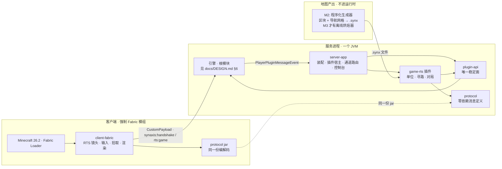
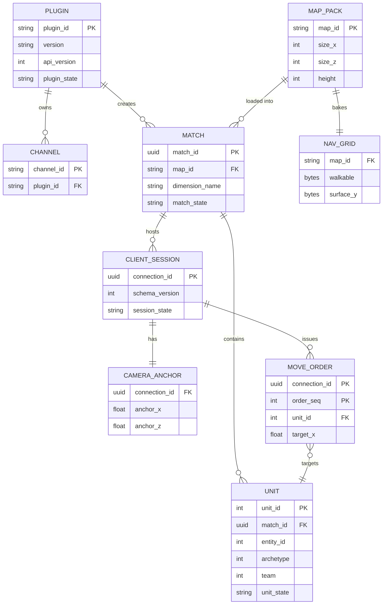
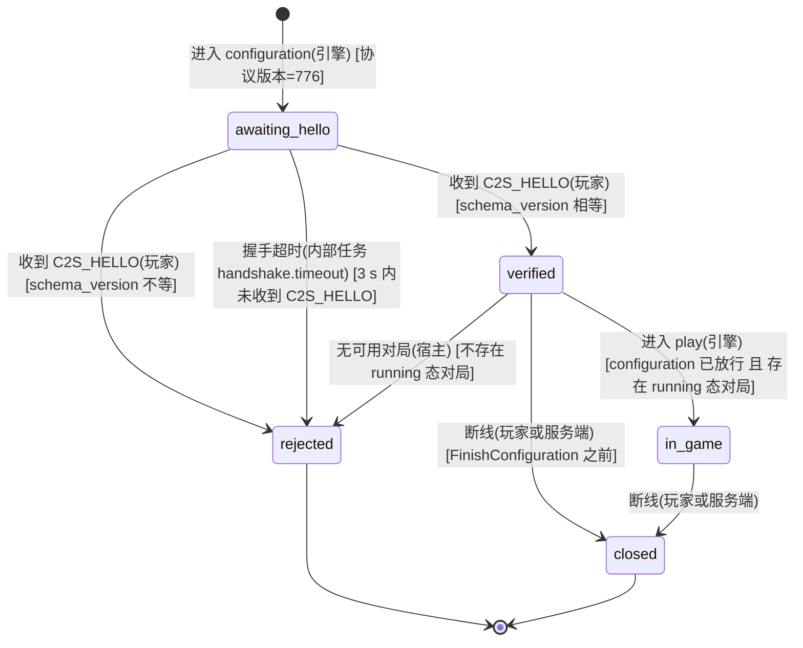
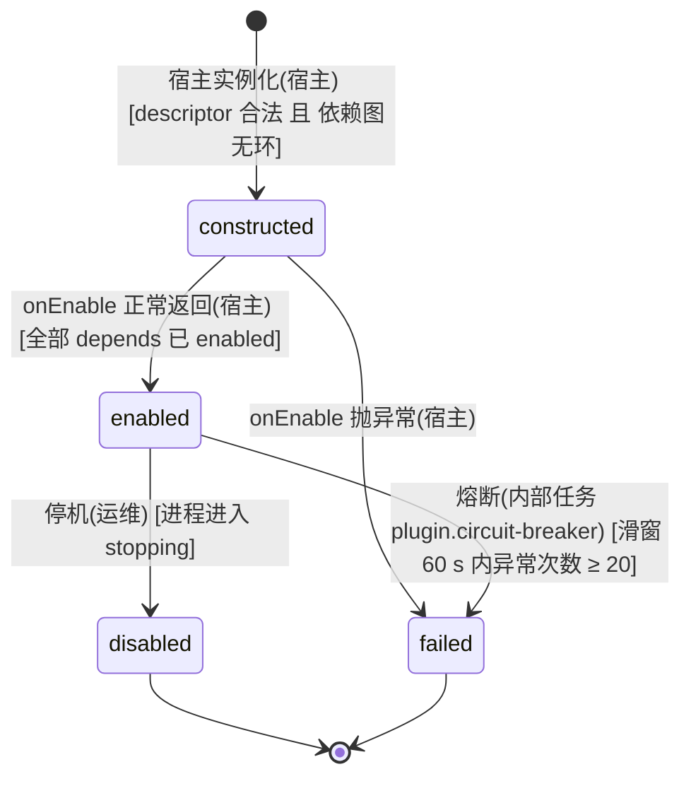
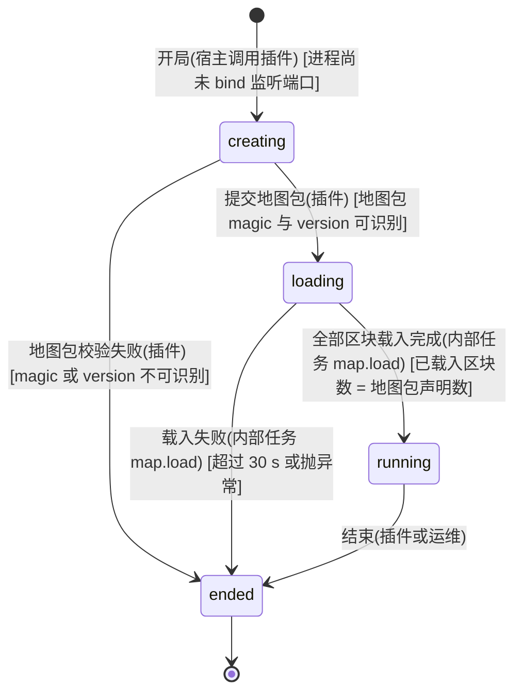
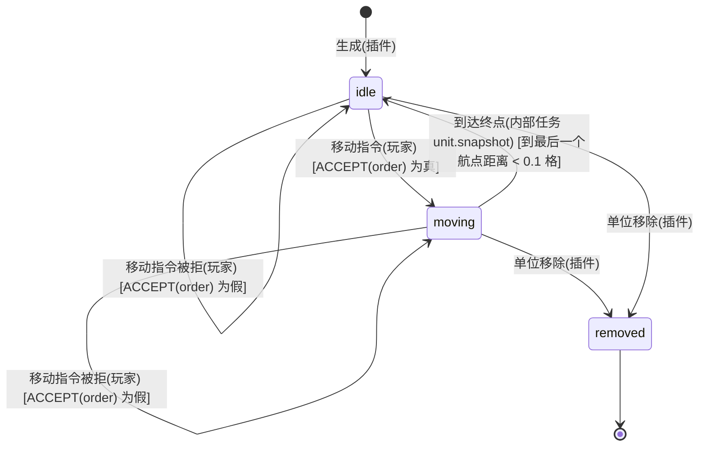
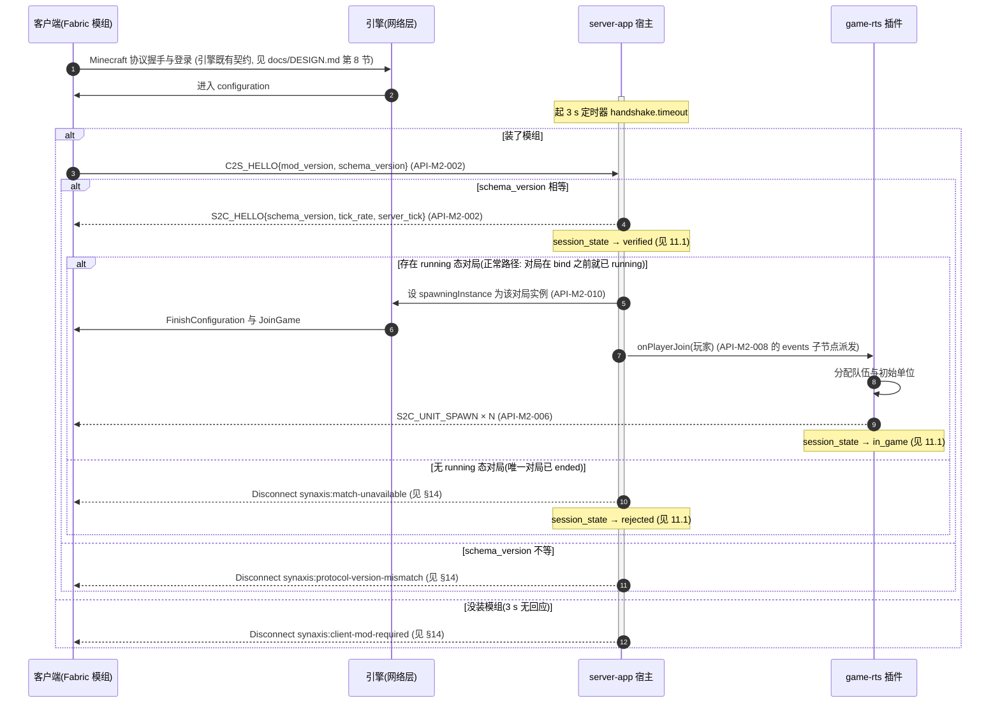
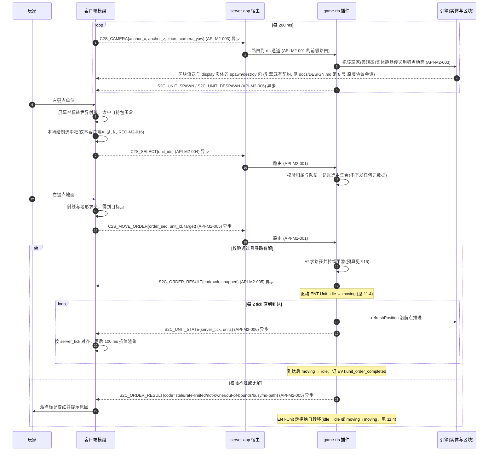
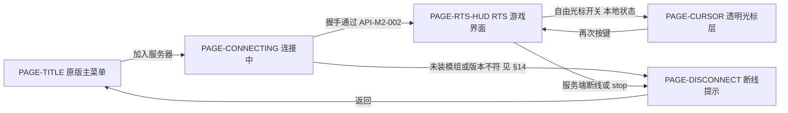

# Synaxis 设计文档 · 里程碑 M2「游戏工程骨架与 RTS 垂直切片」

## 1. 元信息 / 变更记录

| 字段 | 值 |
| --- | --- |
| 状态 | 草稿（待用户签字：§18 的 A1～A4 四条假设、§28 的不可逆决策签字清单共 6 项；未签字前不得进入 §26 阶段 1） |
| 项目画像 | 生产产品（引擎本体仍是内部系统，见 `docs/DESIGN.md` §1；**M2 交付的是面向真实玩家的游戏**，内测阶段单机单区 ≤ 50 人，因此本文档按生产产品填全部 `[核心]` 节。全部可观测性与埋点落在单进程本地文件，不接外部监控） |
| Owner | Bearisbug |
| 评审人 | Bearisbug |
| 最后更新 | 2026-09-16 |
| 关联 | 引擎单一事实源 `docs/DESIGN.md`（M1 / M1.5） · 测试文档 `docs/TEST.md` · 运行手册 `docs/ENGINE.md` · 审计与开发计划 `docs/research/minestom-audit/00-总结与开发计划.md` · 两轮审计 `docs/research/audit-2026-09-15/` · 仓库 `https://github.com/Bearisbug/synaxis` |

本文档只管 M2 新增的东西。引擎侧的背景、实体、协议状态机、错误码体系、线程模型、构建链一律以 `docs/DESIGN.md` 为准，本文档用「见 `docs/DESIGN.md` §N」引用，不复制。ID 独立编号：需求 `REQ-M2-*`、接口 `API-M2-*`、决策 `ADR-M2-*`、Runbook `RB-M2-*`；实体 `ENT-*`、页面 `PAGE-*`、事件 `EVT:*` 用语义命名，与 M1 天然不冲突。

变更记录：

| 日期 | 版本 | 改动 | 作者 |
| --- | --- | --- | --- |
| 2026-09-16 | v0.1 | 初稿：M2 范围、模块拆分、插件宿主、自定义协议、单位模型、寻路、世界管理与四条审计残留处置、垂直切片验收、阶段计划 | Bearisbug |
| 2026-09-16 | v0.2 | 评审第 1 轮修订（16 条必改）：§3 四条指标改为可由事件算出的分母并补 4 个埋点；§11.4 补 `moving → moving` 拒绝转移并把守卫统一成 `ACCEPT(order)`；`C2S_CAMERA` 的 `yaw` 更名 `camera_yaw`；对局改为 bind 之前创建、`DimensionType` 全进程只注册一次、§11.1 补 `verified → rejected`（match-unavailable）与 `verified → closed`；ArchUnit 禁止列表改完整前缀（`..plugin..` 会命中引擎 `network.plugin`）；快照改逐人编码（`CachedPacket` 前提不成立）；选中框改客户端本地绘制（发光元数据是实体全局的）；新增「可见范围」契约并把 `zoom` 上限压到 48；地图改由程序化生成器产出、真烘焙器推 M3；ABI 门加 baseline 引导规则；阶段 4／6 的向量验收拆开；F49 规则改无条件禁止；`probe.py` 同步握手列为阶段 4 交付物；移动指令改单单位。同轮在 `docs/DESIGN.md` §1／§26 与 `CLAUDE.md` 登记本分册 | Bearisbug |

## 2. 背景 / 目标 / 非目标

- 背景：M1 与 M1.5 交付了一个只含协议与世界底座、以我们的名字命名、构建链自控的引擎（见 `docs/DESIGN.md` §2、§26）。引擎里已经没有任何原版玩法：没有寻路、没有 AI、没有 Anvil 存档、没有自定义实体类型的同步通道。现在要在它上面长出**游戏**：玩法以插件形式加载，server-app 是插件宿主；客户端强制安装我们的 Fabric 模组，两端走自定义负载包，内容不注册成 MC 的方块 / 物品而是自有数据模型，客户端模组当渲染器。
- 目标：
  1. 把「引擎 / 插件 API / 协议 / 宿主 / 玩法插件」五者的边界一次性切开并用可执行门禁钉死，让引擎本体此后不再为玩法改动。
  2. 交付一个能被社区照着写插件的稳定面（`:plugin-api`），并给出最小示例插件。
  3. 打通**首个垂直切片**：RTS 镜头下选中一个单位、点地面让它走过去——镜头、输入、自定义协议、服务端寻路、客户端渲染五个环节端到端跑通。
  4. 把世界管理定型（一局一个世界实例、预烘焙地图、只读载入），并逐条处置 `docs/DESIGN.md` §28 里的四条审计残留。
- 非目标：
  - 不做插件热加载 / 热卸载（见 `ADR-M2-007`）。改插件 = 重启进程。
  - 不做每插件一个 `URLClassLoader` 的隔离加载器、不做注解处理器生成 descriptor、不做插件市场（形态已按 Paper 设计好，实现留到真有第三方插件时；见 `ADR-M2-006`）。
  - 不做分布式、多进程、跨区同步、代理层、大厅与对局分服。单机单进程。
  - 不做战斗、技能、经济、背包、存档、排行榜；切片只有「选中」与「移动」，且**一条移动指令只带一个单位**（多选下令留到 M3，见 `API-M2-005`）。
  - 不做从 MC 存档转换的离线地图烘焙器（要先复活一个 Anvil 读取器，`instance/anvil` 已在 `74592d8fdf` 删除）。M2 的 `.synx` 由 `REQ-M2-010` 的**程序化生成器**产出，真烘焙器推到 M3。
  - 不做自定义实体类型（协议上不可行，见 `ADR-M2-002`）。
  - 不把引擎下沉到 `engine/` 子目录（见 `ADR-M2-005`）。
  - 不升 Minecraft 版本（26.2 / 协议 776 继续钉死，但「是否提前跟到 26.3」是签字项，见 `ADR-M2-016`）。
  - 不做服务端资源包分发（资源打进模组 jar，见 `REQ-M2-020`）。

规模画像（下游 §15 / §17 / §21 全部数字的唯一来源）：

| 维度 | 估算 | 依据 / 假设（未知则写假设 + 重估阈值） |
| --- | --- | --- |
| 用户量 | 内测同时在线 ≤ 50 人，单进程单区；并行对局 ≤ 4 局，单局 ≤ 16 人 | 沿用 `docs/DESIGN.md` §2 的 ≤ 50 人；并行局数是**假设**，超过 4 局或单局 > 16 人需重估 §17 的 `ThreadProvider` 分配与 §15 的 tick 预算 |
| 请求量 | 每玩家入站游戏消息 ≤ 30 包/秒（镜头 5 Hz + 选中/下令各 ≤ 10 Hz），50 人峰值 1,500 包/秒；叠加引擎原有的 5,000 包/秒 | 引擎稳态上限是 50 包/tick = 1,000 包/秒/连接（`playerPacketPerTick`），本设计的游戏消息占其 3%；超过 100 包/秒/连接需重估 §15 限流 |
| 数据量 | 单张地图 ≤ 512×512 方块、世界高度 64 格，预烘焙常驻内存约 25～35 MB；4 局并行 ≤ 140 MB。全服单位数 ≤ 1,000，单玩家视野内 ≤ 200 | 地图尺寸与高度是**假设**（见 §28 签字项）；超过 1024×1024 或高度 > 128 时「整图常驻」前提不成立，要改流式载入 |
| 出站带宽 | 单位快照 10 Hz，单玩家视野 50 单位 ≈ 8 KB/s；50 人 ≈ 400 KB/s | 按 §8 `API-M2-006` 的消息布局算；单玩家视野 200 单位时升到 32 KB/s、50 人 1.6 MB/s，超过 2 MB/s 需改相对坐标定点压缩 |
| 分布与形态 | 单机单进程单区，无 CDN，无对象存储；客户端模组与资源由整合包分发 | 用户选定；对外发布另立文档 |

## 3. 成功指标 / 验收阈值

指标只用来判「切片是不是真的成立」，全部由 §20 的 `EVT:*` 事件计算，事件写进 server-app 的本地 JSONL 文件（`logs/events-YYYYMMDD.jsonl`），用一条离线脚本聚合。**每条指标的分子分母都必须是 §20 里实际存在的事件计数，不允许出现「需要人工判断」的排除项**——否则指标算不出来。接口可用性类 SLI 在 §21，不混入本表。

| 指标 | 定义（分子 ÷ 分母，全部是事件计数） | 当前 | 目标 | 由哪些事件算 |
| --- | --- | --- | --- | --- |
| 客户端接入成功率 | `EVT:client_verified` 计数 ÷ `EVT:session_entered_configuration` 计数（分母覆盖「进了 configuration 但自行断开」的会话，故分母 ≥ verified + rejected） | 无（M2 前无客户端） | ≥ 98% | 见 `EVT:session_entered_configuration`、`EVT:client_verified` |
| 移动指令达成率 | `EVT:unit_order_completed` 计数 ÷（`EVT:unit_order_issued` + `EVT:unit_order_rejected`）计数 | 无 | ≥ 95% | 见 `EVT:unit_order_issued`、`EVT:unit_order_rejected`、`EVT:unit_order_completed` |
| 首次上手完成率 | 一次会话内既出现过 `EVT:unit_selected` 又出现过 `EVT:unit_order_issued` 的 `connection_id` 数 ÷ `EVT:player_entered_play` 计数 | 无 | ≥ 90% | 见 `EVT:player_entered_play`、`EVT:unit_selected`、`EVT:unit_order_issued` |
| 对局完成率 | `EVT:match_ended`（reason=normal）计数 ÷ `EVT:match_created` 计数（分母覆盖 `creating → ended` 的 map-invalid 对局——它们从不发 `EVT:match_started`） | 无 | ≥ 95% | 见 `EVT:match_created`、`EVT:match_ended` |

「客户端接入成功率」同时作为 §21 的「握手成功率」SLI，两处是同一个数值口径（分母同为 `EVT:session_entered_configuration`），告警阈值见 §21。

## 4. 术语表 / 统一语言

引擎侧术语（服务进程、世界实例、区块、实体、自定义负载、线程归属等）见 `docs/DESIGN.md` §4，本表只登记 M2 新增的。

| 术语 | 定义 | 代码/字段标识 | 对应实体 |
| --- | --- | --- | --- |
| 插件 | 一份玩法实现，由宿主发现并加载；引擎与宿主都不知道它的内容 | `SynaxisPlugin` | `ENT-Plugin` |
| 插件宿主 | `server-app` 模块：装配服务进程、发现并驱动插件生命周期、路由自定义负载、承接冒烟职责 | 模块 `:server-app`，包 `io.github.bearisbug.synaxis.app` | — |
| 插件 API | `:plugin-api` 模块导出的包，唯一稳定面；引擎内部 API 不承诺兼容 | 模块 `:plugin-api`，包 `io.github.bearisbug.synaxis.plugin`（**与引擎既有的 `...network.plugin` 深度不同，ArchUnit 规则用完整前缀区分，见 §24**） | — |
| 通道命名空间 | 一个插件独占的自定义负载通道前缀，等于它的插件 id；宿主保留 `synaxis` 前缀 | `channel_namespace` | `ENT-Plugin` |
| 消息 id | 单个通道内的消息判别字节（VarInt），作用域只在该通道内 | `msg_id` | — |
| schema 版本 | 两端协议定义的整数版本，握手时必须严格相等 | `schema_version` | `ENT-ClientSession` |
| 单位 | 玩法里的可选中、可下令对象；不是 MC 实体，只是**用**一个 display 实体当它的可见物 | `Unit` | `ENT-Unit` |
| 原型 | 单位的静态模板（外观、速度、体积），自有数据模型，不注册进 MC 注册表 | `archetype` | `ENT-Unit` |
| 对局 | 一局游戏，一一对应一个 `InstanceContainer`；局末整实例丢弃 | `Match` | `ENT-Match` |
| 地图包 | 单文件只读二进制地图（工作名 `.synx`），含区块数据与导航网格，同一次烘焙产出 | `map_pack` | `ENT-MapPack` |
| 导航网格 | 启动时烘焙一次的不可变可行走格点数据（`walkable` 位集 + `surfaceY`） | `nav_grid` | `ENT-NavGrid` |
| 镜头锚点 | RTS 镜头看向的世界地面点；服务端据它驱动区块流送与单位可见性 | `camera_anchor` | `ENT-CameraAnchor` |
| 兴趣集 | 一个玩家当前应当收到其状态的单位集合 | — | `ENT-Unit` |
| 移动指令 | 玩家对一组单位下达的「去某点」命令，带单调递增序号 | `move_order` | `ENT-MoveOrder` |
| 快照 | 服务端周期性批量下发的单位状态包 | `unit_state` | `ENT-Unit` |
| 客户端模组 | 强制安装的 Fabric 模组，承担 RTS 镜头、输入、渲染 | `client-fabric` | `ENT-ClientSession` |

## 5. 功能清单与需求 ID

工程门禁类需求（`REQ-M2-002`、`REQ-M2-012`、`REQ-M2-013`、`REQ-M2-014`、`REQ-M2-015`、`REQ-M2-021`、`REQ-M2-022`）没有对外接口，按 §5 规则显式标注锚点为 §24 的可执行门禁、§26 的阶段退出条件或 §11 / §16 的具体条目，不悬空。`REQ-M2-001` 虽然也是工程性的，但它承载 `API-M2-007` / `API-M2-008` / `API-M2-010` 三个对外接口，不属此列。

| ID | 功能 | 对应目标 | 优先级 | 锚点 |
| --- | --- | --- | --- | --- |
| REQ-M2-001 | 模块拆分：新增 `:protocol`、`:plugin-api`、`:server-app`、`:game-rts` 四个子项目，删除 `:smoke`；根模块仍是引擎且一个文件不动 | 目标 1 | P0 | 承载 `API-M2-007`、`API-M2-008`、`API-M2-010`；门禁见 §24 |
| REQ-M2-002 | 引擎 `io.github.bearisbug.synaxis.game` 包改名为 `gameevent`；新增 ArchUnit 规则「引擎不得依赖 `io.github.bearisbug.synaxis.game..` / `.plugin..` / `.app..`」（**必须写完整前缀**，写 `..plugin..` 会命中引擎自己的 `network.plugin`，见 §24） | 目标 1 | P0 | 无对外 API，见 §24 ArchUnit 条目与 §26 阶段 1 退出条件 |
| REQ-M2-003 | 插件发现与生命周期：`ServiceLoader` 发现、descriptor 校验、`depends` 拓扑排序与环检测、construct / onEnable / onDisable 三段 | 目标 2 | P0 | `API-M2-007`；状态机见 §11.2 |
| REQ-M2-004 | 插件能力边界：`PluginContext` 六项能力全部组合包装，禁用时事件节点、任务、通道一次性摘干净 | 目标 2 | P0 | `API-M2-008` |
| REQ-M2-005 | 插件异常归因与熔断：三个包装层各打一次 `plugin_id`，滑窗内异常超阈值自动禁用该插件，进程继续 | 目标 2 | P0 | `API-M2-008`；状态机见 §11.2 `enabled → failed` |
| REQ-M2-006 | 通道命名空间：通道 id 强制 `<plugin_id>:<name>`，宿主单监听器前缀路由，未注册通道丢弃并记 WARN；`synaxis` 前缀为宿主保留 | 目标 2 | P0 | `API-M2-001` |
| REQ-M2-007 | `:protocol` 模块：零第三方依赖的手写编解码（`MsgBuf` + record 的静态 read/write），测试向量两端各跑一遍 | 目标 3 | P0 | `API-M2-001` |
| REQ-M2-008 | 握手与客户端模组校验：configuration 阶段等 `C2S_HELLO`，超时或 schema 不等即踢，新增两个 `synaxis:*` 原因键；**同一交付内让 `tools/protocol-probe/probe.py` 实现 `C2S_HELLO`**，否则依赖它的七条 TC 整块失效 | 目标 3 | P0 | `API-M2-002`；状态机见 §11.1 |
| REQ-M2-009 | 切片消息集：`rts:game` 通道 7 条消息（镜头 / 选中 / 下令 / 生成 / 快照 / 移除 / 指令结果）与每类消息的服务端权威校验与速率限制 | 目标 3 | P0 | `API-M2-003`、`API-M2-004`、`API-M2-005`、`API-M2-006` |
| REQ-M2-010 | 地图包 `.synx`：单文件只读二进制格式与 `ChunkLoader` 实现；`saveChunk` / `saveInstance` 空实现，地图不回写；**外加一个程序化测试地图生成器**（纯代码产出 `.synx`，含障碍与一块不可达区域，供 §26 阶段 3 与阶段 5 使用——M2 没有离线烘焙器，见 §2 非目标） | 目标 4 | P0 | `API-M2-009` |
| REQ-M2-011 | 对局生命周期：一局一个 `InstanceContainer`（唯一 dimensionName、浅 `DimensionType`）、整图预载后关闭自动区块加载、边界约束、局末整实例丢弃；修 `enableAutoChunkLoad(false)` 下 `chunkAdder` 的空 future NPE | 目标 4 | P0 | `API-M2-010`；状态机见 §11.3 |
| REQ-M2-012 | 删除 `SharedInstance`（含 `EntityTracker#viewable` 的多态参数、`Chunk` 的 shared 列表、`Player#setInstance` 的 areLinked 快路径、`InstanceManager` 的两个 shared 工厂）——处置 `docs/DESIGN.md` §28 的 F29 残留（a） | 目标 4 | P0 | 无对外 API，见 §11.3 `running → ended` 动作与 §24 |
| REQ-M2-013 | 断线幽灵修复：卸载区块时把「已下线但未 remove 的玩家」当普通实体走 `Acquirable.sync(Entity::remove)` 同步移除——处置 F29 残留（b） | 目标 4 | P0 | 无对外 API，见 §11.3 `running → ended` 动作与 §16 竞态表 |
| REQ-M2-014 | 视距收缩修复：`sendPendingChunks` 出队时按 `chunksLoadedByClient` + `effectiveViewDistance()` 惰性丢弃越界区块；`updateViewDistance` 的中心统一为 `chunksLoadedByClient`——处置 F11 残留 | 目标 4 | P1 | 无对外 API，见 §16 竞态表 |
| REQ-M2-015 | F49 残留处置（降级不修）：`Tag.Structure` / `Tag.View` 与 `TagHandler.fromCompound` 的 Javadoc 标明「不可用于不可信数据」，并加一条 ArchUnit 规则**无条件禁止游戏侧使用**这三者（不是「禁止用于客户端来源 compound」——「来源」是运行期污点属性，静态字节码分析判断不了，那样写等于一条形同虚设的规则） | 目标 4 | P1 | 无对外 API，见 §24 ArchUnit 条目 |
| REQ-M2-016 | 单位数据模型与表现：自有 `Unit` 模型 + 一个 `ITEM_DISPLAY` 实体做可见物；四条建模硬规则（关重力、关物理、spawn 时定死插值时长、把位置重同步周期调到 100 tick）；**选中框由客户端模组本地绘制**，服务端不下发任何选中相关的元数据 | 目标 3 | P0 | `API-M2-006`；状态机见 §11.4 |
| REQ-M2-017 | 服务端寻路：启动时烘焙的不可变网格 + 8 邻接 A* + 拉绳平滑，跑在实例 tick 线程内并带节点 / 次数 / 耗时三重预算，超预算排队或拒绝 | 目标 3 | P0 | `API-M2-005`（`ORDER_RESULT` 的 `no-path` / `busy` 分支） |
| REQ-M2-018 | RTS 镜头：客户端正交投影 + 固定俯角 + 缩放 + 自由光标；镜头锚点上报，服务端把玩家实体传送到锚点以驱动区块流送与单位可见性 | 目标 3 | P0 | `API-M2-003` |
| REQ-M2-019 | 客户端选中与下令：模组自持单位包围盒与自定义射线拾取，不用 `interaction` 实体；点地面产生移动指令，服务端做权威校验 | 目标 3 | P0 | `API-M2-004`、`API-M2-005` |
| REQ-M2-020 | 客户端模组工程：独立 Gradle 构建、`fabric.mod.json` 的 minecraft 依赖钉死 `26.2`、资源打进模组 jar、`:protocol` 以 jar 形式共享 | 目标 3 | P0 | `API-M2-001`（两端共享同一份编解码） |
| REQ-M2-021 | `server-app` 承接冒烟职责并删除 `smoke`：启动命令、就绪日志、端口属性、日志文件名同步改写，`docs/TEST.md` 受影响用例按其既有惯例更新 | 目标 1 | P1 | 无对外 API，见 §24 文档同步条目与 §26 阶段 2 退出条件 |
| REQ-M2-022 | CI 门禁扩展：jacoco 覆盖率与 diff-cover 覆盖新增四个模块；`:plugin-api` 与 `:protocol` 接 `checkBinaryCompatibility` 并按 §24 的**引导规则**处理 baseline（首个 tag 之前显式 `SKIPPED`、之后缺失即失败）；ArchUnit 依赖挪进版本目录 | 目标 1 | P1 | 无对外 API，见 §24 与 §26 阶段 1／2 退出条件 |
| REQ-M2-023 | 社区上手：一个最小示例插件（打印生命周期、注册一条通道消息、注册一个事件监听器）与一页插件开发说明 | 目标 2 | P2 | `API-M2-007`、`API-M2-008` |

## 6. 总体架构



依赖方向是单向的：`engine ← plugin-api ← game-rts`，`server-app` 只在最外层装配。**引擎不得依赖 `plugin-api` / `game-rts` / `server-app` / `protocol`**（`REQ-M2-002` 的 ArchUnit 规则），`protocol` 不得依赖任何第三方库（`ADR-M2-008`）。外部依赖与 SLA 见 §17，逐项与本图对应。

## 7. 数据模型 / 领域实体

引擎侧实体（`ENT-ServerProcess`、`ENT-Instance`、`ENT-Chunk`、`ENT-Entity`、`ENT-Player`、`ENT-Connection`）见 `docs/DESIGN.md` §7，本节只画 M2 新增的，字段的权威定义在 §9。



主键口径：`MOVE_ORDER` 的主键是 (`connection_id`, `order_seq`) 复合键——`order_seq` 只保证**每连接**单调递增，不是全局唯一；`UNIT.unit_id` 同理是**局内**唯一，跨对局可重号。M2 一条 `MOVE_ORDER` 只指向一个 `UNIT`（见 `API-M2-005`）。

## 8. 接口契约 (API-first)

M2 的对外契约有三类，都不是 HTTP：① 两端共享的**自定义负载消息**（载体见 `ADR-M2-001`）；② 给插件作者的 **Java 稳定面**；③ 给地图工具链的**文件格式**。机器可读的唯一事实源是 `:protocol` 模块的 record 定义与 `protocol/src/test/resources/vectors/*.bin` 测试向量（防漂移见 §24），本节给摘要。引擎侧的协议会话与 Java API 见 `docs/DESIGN.md` §8 的四条既有契约（原版协议会话、自定义负载通道、进程生命周期、注册表访问），本节不重复。

三条**载体层硬约束**（对全部通道生效，违者在编解码层直接抛）：

- 上行单包 ≤ 32,767 字节——引擎 `ClientPluginMessagePacket` 构造器自己就抛，与原版一致；
- 下行单包 SHOULD ≤ 8 KiB、MUST ≤ 1 MiB——引擎允许到 2 MiB，但原版 / Fabric 客户端只收 1 MiB，引擎不会替我们拦；
- 通道名 ≤ 256 字符；**禁止依赖 Fabric 的 `PayloadTypeRegistry.registerLarge` 分片**（那是走 `fabric:split` 的私有协议，服务端不实现就用不了）。需要发大块数据一律改走模组 jar 内的资源，不发大包。

---

- **`API-M2-001` 自定义负载通道与消息信封** — 实现 `REQ-M2-006`、`REQ-M2-007`、`REQ-M2-020`
  - 方法/路径：`CustomPayload` 包。通道 id 为 `<plugin_id>:<name>`；宿主保留 `synaxis` 命名空间。M2 存在两个通道：`synaxis:handshake`（宿主级握手）与 `rts:game`（RTS 插件的全部游戏消息）。
  - 信封：`msg_id`（VarInt，见 §9）+ 消息体；`msg_id` 的作用域**只在该通道内**，因此不需要全局消息号注册表——通道命名空间归插件，插件自己分配自己的号段。
  - 鉴权/权限：见 §10；入站消息在 `session_state=verified` 之前只接受 `synaxis:handshake` 通道，其它通道的入站包一律丢弃并计数。
  - 请求/响应：见 `API-M2-002`～`API-M2-006`；编解码由 `:protocol` 的 `MsgBuf`（VarInt / VarLong / f32 / UTF-8 / 定长数组 / 列表）与每条消息的静态 `read` / `write` 完成。
  - 幂等：除 `API-M2-005` 外全部消息幂等（状态上报与快照天然幂等）。
  - 缓存与超时：不缓存（每条消息都是当帧事实）；未注册通道的入站包直接丢弃，不回错。
  - 版本演进：解码器**只读自己认识的字段，尾部未知字节一律 skip 不报错**；新增字段一律追加在尾部；删字段或改字段语义 = 破坏性变更，必须升 `schema_version`（见「演进与弃用」）。

- **`API-M2-002` 客户端模组握手** — 实现 `REQ-M2-008`
  - 方法/路径：通道 `synaxis:handshake`。`C2S_HELLO{msg_id=0x01, mod_version:varint, schema_version:varint}`；`S2C_HELLO{msg_id=0x81, schema_version:varint, tick_rate:u8, server_tick:varint}`。
  - 阶段：**configuration**（不是 login）。理由见 `ADR-M2-010`。
  - 鉴权/权限：`ROLE-Player`；服务端在 `AsyncPlayerConfigurationEvent` 中等待，处理器只挂 `GlobalEventHandler`，**禁止挂实例作用域事件节点**（配置阶段玩家没有实例，`PlayerInstanceEvent#getInstance()` 的 `assert` 会在开 `-ea` 的测试里直接炸）。
  - 响应：`schema_version` 相等 → 回 `S2C_HELLO` 并放行；不等 → `synaxis:protocol-version-mismatch` 断线；3 s 超时未收到 → `synaxis:client-mod-required` 断线（见 §14）。
  - 幂等：一个连接只接受一次 `C2S_HELLO`，第二次视为协议错误断线。
  - 缓存与超时：握手超时 3 s（内部任务 `handshake.timeout`，见 §17）。
  - **连带影响（必须与本接口同一阶段交付）**：握手上线即对**所有**非模组客户端生效，包括 `tools/protocol-probe/probe.py`——它的 `login` / `echo` / `zero-frame` / `deep-recursion` / `premature-finish` / `record-registry` 六个子命令全部要进 play 态，`docs/TEST.md` 的 TC-004 / TC-014 / TC-018 / TC-019 / TC-020 / TC-026 / TC-027 都靠它，不改就会在 configuration 3 s 被踢、整块回归台账失效。处置是**让探针实现 `C2S_HELLO`**（它本来就是手写协议实现，加一条负载即可），**不开测试旁路开关**——旁路开关会变成一个能绕过准入的生产开关，代价远大于收益。

- **`API-M2-003` 镜头锚点上报** — 实现 `REQ-M2-018`
  - 方法/路径：通道 `rts:game`，`C2S_CAMERA{msg_id=0x01, anchor_x:f32, anchor_z:f32, zoom:f32, camera_yaw:f32}`，17 字节，5 Hz。字段名与 §9、§12.2 一致——**不要写成 `yaw`**，§9 里 `yaw` 是单位朝向（u8，256 分度），同名不同类型正是 §24 要防的两端漂移点。
  - 鉴权/权限：`ROLE-Player`，仅 `session_state=in_game`。
  - 服务端动作：夹取到地图边界内，把该玩家（旁观模式、不可见）的实体传送到锚点对应的地面点，从而让引擎原生的区块流送与 `EntityTracker` 自动跟上（见 `ADR-M2-013`）。
  - 幂等：幂等，后到覆盖先到；同 tick 内多条只取最后一条。
  - 缓存与超时：不缓存；超过 10 条/秒的部分丢弃并计入 flood 计数（见 §15）。

- **`API-M2-004` 单位选中** — 实现 `REQ-M2-019`
  - 方法/路径：通道 `rts:game`，`C2S_SELECT{msg_id=0x02, count:varint, unit_ids:varint[]}`，`count ≤ 64`。
  - 鉴权/权限：`ROLE-Player`，仅 `session_state=in_game`；服务端逐个校验单位存在、属于本局、归属该玩家，不通过的静默剔除（选中不回错，客户端已有本地高亮）。
  - 响应：无（选中是客户端本地态 + 服务端记账；服务端据它决定后续指令的默认目标集）。
  - 幂等：幂等，整集合替换语义。
  - 缓存与超时：不缓存；超过 10 条/秒的部分丢弃。

- **`API-M2-005` 移动指令与指令结果** — 实现 `REQ-M2-009`、`REQ-M2-017`、`REQ-M2-019`
  - 方法/路径：通道 `rts:game`。请求 `C2S_MOVE_ORDER{msg_id=0x03, order_seq:varint, unit_id:varint, target_x:f32, target_y:f32, target_z:f32, mods:u8}`；响应 `S2C_ORDER_RESULT{msg_id=0x84, order_seq:varint, code:u8, snapped_x:f32, snapped_y:f32, snapped_z:f32}`。
  - **M2 一条指令只带一个 `unit_id`**（不是列表）。理由：`S2C_ORDER_RESULT` 只有一个 `code` 和一组 `snapped_*`，多单位下「部分成功」没有任何表达方式，§11.4 的 `path ≠ ∅` 守卫也会变成「全部有解还是至少一个有解」的歧义，而 `EVT:unit_order_completed`（全部单位到达）在有一个单位卡住时永不触发，会让 §3 的「移动指令达成率」恒假。多选下令留到 M3，届时 `ORDER_RESULT` 改成按 `unit_id` 携带逐单位结果并同步改 §3 的口径。客户端选中多个单位时，按每个单位各发一条指令（各自的 `order_seq`）。
  - 鉴权/权限：`ROLE-Player`，仅 `session_state=in_game`。服务端权威校验见 §11.4 的 `ACCEPT(order)` 合取式（序号、令牌桶、归属、边界、可站立、队列、有解六类）。
  - 响应：`code` 取值见 §9 `order_result_code`；`ok` 时 `snapped_*` 是吸附后的实际终点，客户端据它画落点标记。**每条请求必回一条结果**，这是「点了地面但去不了」的唯一反馈路径；单位当前是 `idle` 还是 `moving` 都一样要回（§11.4 为此在两个态上各挂了一条拒绝转移）。
  - 幂等：**非幂等**。`order_seq` 每连接单调递增；服务端只接受严格大于已接受最大值的 seq，重复或回退的 seq 直接回 `code=stale`，不重复下令。
  - 缓存与超时：不缓存；超过 10 条/秒的部分回 `code=rate-limited`（不静默丢，否则客户端会一直等结果）。

- **`API-M2-006` 单位可见性与状态快照** — 实现 `REQ-M2-009`、`REQ-M2-016`
  - 方法/路径：通道 `rts:game`，三条下行消息：
    - `S2C_UNIT_SPAWN{msg_id=0x81, unit_id:varint, entity_id:varint, archetype:varint, team:u8, x:f32, y:f32, z:f32, yaw:u8, hp:varint, max_hp:varint, flags:u8}`——单位进入兴趣集时发一次，把 `unit_id` 与 `entity_id` 绑上，客户端据此挂包围盒、血条、选中框。
    - `S2C_UNIT_STATE{msg_id=0x82, server_tick:varint, count:varint, [unit_id:varint, x:f32, y:f32, z:f32, yaw:u8, unit_state:u8] × count}`——每 2 tick（10 Hz）一条批量快照，内容是该玩家兴趣集内**全部**单位的绝对坐标（不是增量），因此每一条都自带对账语义，不另设第二条对账路径；50 单位约 805 字节。
    - `S2C_UNIT_DESPAWN{msg_id=0x83, count:varint, unit_ids:varint[]}`——单位离开兴趣集或被移除时发。
  - 鉴权/权限：`ROLE-Player`；兴趣集按**镜头锚点**决定（锚点驱动玩家实体位置，见 `API-M2-003`），一个玩家只收到自己兴趣集内的单位。
  - 幂等：幂等，绝对坐标全量覆盖语义（不做增量编码——增量要两端维护状态机，一次错位就永久漂移）。
  - 缓存与超时：不缓存。**快照按兴趣集逐玩家编码**——兴趣集逐人不同，包内容就逐人不同，引擎的 `CachedPacket` / `sendGroupedPacket`「一次序列化多次发送」的前提（所有接收者收到同一串字节）在这里不成立，不能用。允许的优化只有一种：同一对局内兴趣集**完全相同**的玩家共用一个已编码的 `byte[]`（`PluginMessagePacket` 只持有引用，不复制）。编码预算见 §15 与 §17 的 `unit.snapshot`。`S2C_UNIT_SPAWN` / `S2C_UNIT_DESPAWN` 同样逐人，它们本来就只在单个玩家的兴趣集增删时触发。
  - 顺序：`S2C_UNIT_SPAWN`（插件发的自定义负载）与引擎 `EntityTracker` 自己发的实体 spawn 包由两条代码路径在不同时机触发，客户端**必须容忍两种到达顺序**（先收到 `unit_id → entity_id` 绑定、后收到实体，或反过来），按延迟绑定处理，收到未知 `unit_id` 的 `S2C_UNIT_STATE` 条目时静默忽略而不是报错。

- **`API-M2-007` 插件生命周期 Java API** — 实现 `REQ-M2-003`、`REQ-M2-023`
  - 方法：`interface SynaxisPlugin { PluginDescriptor descriptor(); void onEnable(PluginContext ctx); default void onDisable() {} }`；`record PluginDescriptor(String id, String version, int apiVersion, List<String> depends, List<String> softDepends)`。
  - 发现：`ServiceLoader.load(SynaxisPlugin.class)`（M2 阶段只有编译期插件，见 `ADR-M2-006`）。
  - 约束：`id` 必须匹配 `[a-z0-9][a-z0-9_-]{0,63}` 且不得为 `synaxis`；**无参构造器里禁止注册任何东西**（注册一律在 `onEnable`）；`api_version` 与宿主不匹配时拒绝加载并阻止启动（只写日志，不下发客户端）。
  - 顺序：按 `depends` 拓扑排序；有环整体拒绝启动；`onDisable` 逆序调用，且必须排在引擎 `scheduler.shutdown()` 之前。
  - 版本：`api_version` 是整数，破坏性变更时加 1，见「演进与弃用」。

- **`API-M2-008` 插件能力面 `PluginContext`** — 实现 `REQ-M2-004`、`REQ-M2-005`、`REQ-M2-023`
  - 方法（六项，全部是组合包装，不直给引擎内部对象）：`process()`、`events()`、`scheduler()`、`channels()`、`dataDirectory()`、`logger()`。
  - `events()`：返回宿主建的 `EventNode.all("plugin/" + id)` 子节点；禁用时宿主一次 `removeChild` 摘干净。插件**不得**自行往 `GlobalEventHandler` 挂节点。
  - `scheduler()`：包装层记录本插件提交的每个 `Task`，`onDisable` 时逐个 `cancel()`。
  - `channels()`：`register(String name, PayloadHandler)` 与 `send(Player, String name, byte[])`；实际通道 id 强制补 `<plugin_id>:` 前缀，注册时前缀不等于自身 id 直接抛 `IllegalArgumentException`。
  - `dataDirectory()`：`plugins/<plugin_id>/`，宿主保证存在。
  - 错误与熔断：三个包装层（事件、任务、通道）各 catch 一次并打上 `plugin_id`，喂给熔断器；触发后自动禁用该插件（见 §11.2）。引擎自身的两道隔离（`TickThread` 逐 `Tickable`、`EventNodeImpl.Handle.call` 逐监听器）已经够用，宿主**不再加第三层 catch**，只做归因与熔断。
  - 稳定性承诺：本接口与 `API-M2-007` 是唯一稳定面，由 `checkBinaryCompatibility` 门禁保证（见 §24）；`process()` 返回的引擎对象**不承诺兼容**，插件用它自担风险。

- **`API-M2-009` 地图包 `.synx` 文件格式** — 实现 `REQ-M2-010`
  - 形态：单文件、只读、整图一次性载入。结构借鉴 Polar 的 `FORMAT.md`（magic + version + 压缩位 + VarInt 长度前缀；world 头带 min/max section；每 chunk 带 sections 与 heightmaps 位掩码），但**不引入 `dev.hollowcube:polar` 依赖**（它 compileOnly 依赖 `net.minestom.server.*`，与我们的包名和 sealed `Palette` 不兼容）。
  - 段：`header`（magic `SYNX` + 版本 + 压缩标志 + 尺寸 + `dimension_name` 模板）、`chunks`（调色板 int[] 加打包 long[]，光照四态：缺席 / 全 0 / 全满 / 2048 字节 nibble）、`nav`（`walkable` 位集 + `surface_y` short[]）。**区块数据与导航网格必须同一次烘焙产出、同一个文件**，否则两者会不同步。
  - 消费方：`ChunkLoader` 实现——构造时把整个文件读进不可变内存快照，`loadChunk(instance,x,z)` 从快照现灌一个新 `Chunk`。**`loadChunk` 内禁止再对同一 instance 发起区块加载**（引擎接口明令禁止，会重入 `loadingChunks`）。
  - 写入：运行时不写。`saveChunk` 与 `saveInstance` 空实现并在 Javadoc 写明「地图只读，回写由离线工具链负责」。
  - 版本：`header.version` 整数，只增；读到更高版本直接拒绝载入（不做向前兼容）。

- **`API-M2-010` server-app 启动与运维契约** — 实现 `REQ-M2-001`、`REQ-M2-011`、`REQ-M2-021`
  - 方法：`./gradlew :server-app:run`，或 `java -jar server-app.jar`；配置沿用引擎的 `synaxis.*` 系统属性（见 `docs/DESIGN.md` §8 的进程生命周期契约与 `ServerConfig`），新增 `synaxis.app.port`、`synaxis.app.plugins`（启用的插件 id 列表，空为全部）、`synaxis.app.map`（地图包路径）。
  - **启动序列（顺序是契约的一部分，不可重排）**：① 读 `synaxis.*` 配置并设定 §15 的可见范围三项（`entity-view-distance` 在 `Instance` 构造时就固化进 `EntityTracker`，建实例之后再改无效）→ ② `ServerProcess.of(auth, config)` → ③ **注册唯一的浅 `DimensionType`**（M2 只有一个；`dimension_type` 是动态注册表，只在 configuration 阶段随 `RegistryDataPacket` 下发一次，**绝不允许在 bind 之后按局注册**，否则已在线玩家的维度下标会对不上，见 §11.3）→ ④ 拓扑序 `onEnable` 全部插件；插件在此创建对局并推进到 `running`（`API-M2-009` 载入地图包）→ ⑤ 断言至少有一个 `running` 对局，没有则以非零码退出（而不是 bind 之后让玩家撞 `spawningInstance` 的 NPE）→ ⑥ bind 监听端口并打印就绪日志。
  - 就绪判定：标准输出出现 `synaxis server-app listening on <host>:<port>`（承接 smoke 的就绪日志职责，日志文本变更会让 `docs/TEST.md` 按其惯例废旧 ID 换新 ID，见 §24）。
  - 停机：控制台 `stop` 或 SIGINT，逆序 `onDisable` 全部插件后 `ServerProcess.stop()`。
  - 鉴权/权限：`ROLE-Operator`，见 §10。
  - 缓存与超时：停机总预算 15 s（插件 5 s + 引擎 10 s，见 §17）；超时强制退出并记日志。

演进与弃用：

- 版本方案：两条独立版本轴。① **线协议** `schema_version`（整数，握手时必须严格相等）；② **插件 API** `api_version`（整数，SemVer 的 major 位）。当前均为 `1`。
- 破坏性变更定义：线协议——删字段 / 改字段类型 / 改 `msg_id` 语义 / 改枚举既有取值语义；插件 API——删方法 / 改签名 / 收紧约束。破坏性变更禁止原地改：新方法或新 `msg_id` 并行，旧项标 `@Deprecated` 并注明替代，观察期后移除。
- 弃用期：线协议**无弃用期**（两端由同一个整合包分发，升级是原子的，严格相等校验就是它的防漂移机制）；插件 API 弃用期不少于 1 个内测周期（约 30 天），兼容承诺对象是本仓库之外的社区插件作者。
- 兼容承诺对象：`:plugin-api` 与 `:protocol` 承诺；引擎内部 API 与 `server-app` 不承诺（`docs/DESIGN.md` §8 里「M2 起 platform-api 成为唯一稳定面」的表述，M2 改称 `plugin-api`，登记在 `ADR-M2-005`）。
- 当前 deprecated 清单：无。

## 9. 数据字典

引擎侧字段（`connection_id`、`protocol_state`、`entity_id`、`instance_id`、`disconnect_reason` 等）见 `docs/DESIGN.md` §9，本表只登记 M2 新增的。**坐标一律是世界绝对坐标、f32、单位为方块**；单位朝向一律 u8（256 分度）。

| 字段 | API 名 | DB 名 | 类型 | 必填 | 枚举/约束 | 单位/精度 | PII |
| --- | --- | --- | --- | --- | --- | --- | --- |
| 消息号 | `msg_id` | — | varint | 是 | 作用域为单个通道；C2S 用 `0x01`～`0x7F`，S2C 用 `0x81`～`0xFF`；未知值丢弃并 WARN | — | 否 |
| schema 版本 | `schema_version` | — | int | 是 | ≥ 1；两端必须严格相等 | — | 否 |
| 模组版本 | `mod_version` | — | int | 是 | ≥ 1；仅用于日志与遥测，不参与放行判定 | — | 否 |
| 会话状态 | `session_state` | — | enum | 是 | awaiting_hello / verified / in_game / rejected / closed（见 §11.1） | — | 否 |
| 插件 id | `plugin_id` | — | string | 是 | `[a-z0-9][a-z0-9_-]{0,63}`，不得为 `synaxis`；同时是通道命名空间 | — | 否 |
| 插件版本 | `version` | — | string | 是 | 插件自报的版本串，仅用于日志与 `EVT:plugin_enabled`，不参与任何判定 | — | 否 |
| 插件 API 版本 | `api_version` | — | int | 是 | ≥ 1；与宿主不等则拒绝加载并阻止启动 | — | 否 |
| 插件状态 | `plugin_state` | — | enum | 是 | constructed / enabled / disabled / failed（见 §11.2） | — | 否 |
| 通道 id | `channel_id` | — | string | 是 | `<plugin_id>:<name>`，≤ 256 字符；`synaxis:*` 为宿主保留 | — | 否 |
| 对局 id | `match_id` | — | uuid | 是 | 进程内唯一 | — | 否 |
| 对局状态 | `match_state` | — | enum | 是 | creating / loading / running / ended（见 §11.3） | — | 否 |
| 维度名 | `dimension_name` | — | string | 是 | 每局唯一（强制客户端走 dimensionChange，彻底重建世界）。它是 `Instance` 的 `Key`，**自由取值、不进任何注册表**——每局的唯一性只靠它，`DimensionType` 全进程只注册一个且在 bind 之前注册（见 §11.3） | — | 否 |
| 地图 id | `map_id` | — | string | 是 | 地图包文件名（不含扩展名） | — | 否 |
| 地图尺寸 | `size_x` / `size_z` | — | int | 是 | ≤ 512（§2 假设）；必须是 16 的倍数 | 方块 | 否 |
| 世界高度 | `height` | — | int | 是 | 必须是 16 的倍数且 ≥ 16；M2 取 64 | 方块 | 否 |
| 可行走位集 | `walkable` | — | bytes | 是 | 每个 (x,z) 列 1 位；烘焙后不可变 | — | 否 |
| 站立面高度 | `surface_y` | — | bytes | 是 | short[]，与 `walkable` 同索引 | 方块 | 否 |
| 单位 id | `unit_id` | — | int | 是 | 局内唯一，自 1 递增；与 `entity_id` 是两个号，不可混用 | — | 否 |
| 单位原型 | `archetype` | — | varint | 是 | 自有数据模型的原型号，不注册进任何 MC 注册表；客户端遇未知值按占位模型渲染并 WARN | — | 否 |
| 队伍 | `team` | — | u8 | 是 | 0 为中立，1..N 为队伍；M2 只用 0 与 1 | — | 否 |
| 目标点 | `target_x` / `target_y` / `target_z` | — | f32 | 是 | 世界绝对坐标；服务端夹取并吸附到最近可站立格 | 方块 | 否 |
| 吸附终点 | `snapped_x` / `snapped_y` / `snapped_z` | — | f32 | 是 | `code=ok` 时是吸附后的实际终点；其余 `code` 时回请求原值 | 方块 | 否 |
| tick 率 | `tick_rate` | — | u8 | 是 | 服务端每秒 tick 数；M2 固定 20 | tick/s | 否 |
| 单位状态 | `unit_state` | — | enum | 是 | idle / moving / removed（见 §11.4） | — | 否 |
| 生命值 | `hp` / `max_hp` | — | varint | 是 | ≥ 0；M2 只显示不消耗 | 点 | 否 |
| 单位标志位 | `flags` | — | u8 | 是 | bit0 可被本玩家选中；其余保留位必须写 0，读到非 0 忽略。**没有「当前选中」位**——选中是每连接的客户端本地态，不进线协议（见 `REQ-M2-016`） | — | 否 |
| 指令序号 | `order_seq` | — | varint | 是 | 每连接单调递增；服务端只接受严格大于已接受最大值的 | — | 否 |
| 指令结果码 | `order_result_code` | — | enum | 是 | ok / stale / rate-limited / not-owner / out-of-bounds / busy / no-path。**它是结果码不是生命周期状态**，是 §11.4 `ACCEPT(order)` 合取式逐项求值的投影（取值顺序 = 短路求值顺序），按 §11 三类出口中的「纯派生」显式免建机 | — | 否 |
| 指令修饰位 | `mods` | — | u8 | 是 | bit0 追加到队列（M2 忽略，必须写 0） | — | 否 |
| 单位状态位 | `unit_state`（`S2C_UNIT_STATE` 的逐条目字段） | — | u8 | 是 | 与本表「单位状态」同一枚举的线上编码：0=idle，1=moving（`removed` 不下发，走 `S2C_UNIT_DESPAWN`） | — | 否 |
| 镜头锚点 | `anchor_x` / `anchor_z` | — | f32 | 是 | 服务端夹取到地图边界内 | 方块 | 否 |
| 镜头缩放 | `zoom` | — | f32 | 是 | 客户端权威，服务端只记录用于遥测；取值 **[8, 48]**（上限由 §15 的可见范围契约反推：半高 48 格、16:9 时屏幕角落离锚点约 97 格，仍在 `entity-view-distance` 的 128 格内。放宽上限必须同步放宽视距，否则边缘单位与地形根本没被发送） | 方块（正交视口半高） | 否 |
| 镜头方位角 | `camera_yaw` | — | f32 | 是 | [0, 360) | 度 | 否 |
| 单位朝向 | `yaw` | — | u8 | 是 | 256 分度，`deg = yaw * 360 / 256` | 度 | 否 |
| 服务端 tick | `server_tick` | — | varint | 是 | 快照时间戳，客户端据此做插值对齐 | tick（50 ms） | 否 |
| 批量条目数 | `count` | — | varint | 是 | `S2C_UNIT_STATE` ≤ 512；`C2S_SELECT` ≤ 64，超限即协议错误。`C2S_MOVE_ORDER` **没有** `count` 字段——M2 一条指令只带一个 `unit_id`（见 `API-M2-005`） | — | 否 |

## 10. 权限与角色

引擎侧角色见 `docs/DESIGN.md` §10（`ROLE-Client` / `ROLE-GameApp` / `ROLE-Operator`）。M2 把 `ROLE-Client` 细化为下表的 `ROLE-Player`（必须装模组），并新增两个进程内角色。矩阵的列覆盖全部 10 个 `API-M2-*`。

| 角色 · 操作 | `API-M2-001` 通道 | `API-M2-002` 握手 | `API-M2-003` 镜头 | `API-M2-004` 选中 | `API-M2-005` 下令 | `API-M2-006` 快照 | `API-M2-007` 插件生命周期 | `API-M2-008` 能力面 | `API-M2-009` 地图包 | `API-M2-010` 启动运维 |
| --- | --- | --- | --- | --- | --- | --- | --- | --- | --- | --- |
| ROLE-Player（装了模组的玩家） | ✓（仅自己的连接） | ✓ | ✓ | ✓ | ✓ | ✓（只收） | ✗ | ✗ | ✗ | ✗ |
| ROLE-PluginAuthor（插件代码，进程内） | ✓（仅自己的命名空间） | ✗（宿主保留） | ✗ | ✗ | ✓（服务端侧回结果） | ✓（服务端侧发送） | ✓（被调用方） | ✓ | ✓（只读） | ✗ |
| ROLE-Host（server-app 宿主） | ✓ | ✓ | ✗ | ✗ | ✗ | ✗ | ✓（调用方） | ✓（提供方） | ✗ | ✓ |
| ROLE-Operator（运维，控制台） | ✗ | ✗ | ✗ | ✗ | ✗ | ✗ | ✗（只能看状态） | ✗ | ✗ | ✓ |

行级可见性（结构化登记，不散落进 §8 散文成第二出处）：

| 端点 | 行级规则 | 强制点 |
| --- | --- | --- |
| `API-M2-004` 选中 | 只能选中 `team` 等于本玩家队伍的单位，其余静默剔除 | 服务端通道 handler 内校验 |
| `API-M2-005` 下令 | 只能对自己拥有的单位下令；`unit_id` 不属于本玩家时回 `not-owner` | 服务端校验，见 §11.4 的 `ACCEPT(order)` |
| `API-M2-006` 快照 | 只下发本玩家兴趣集内的单位，兴趣集由镜头锚点决定 | 引擎 `EntityTracker` 加插件侧兴趣集计算 |
| `API-M2-001` 通道 | 插件只能注册与收发自己命名空间的通道 | `PluginContext#channels()` 包装层前缀校验 |

免列说明：本矩阵无免列端点。`API-M2-006` 是纯下行，`ROLE-Player` 一列标「只收」；`API-M2-009` 是文件契约，只有进程内角色参与。

## 11. 状态机

引擎侧的连接协议状态机与进程生命周期状态机见 `docs/DESIGN.md` §11.1、§11.2，M2 不改它们；本节的 `ENT-ClientSession` 是**叠在**引擎协议状态机之上的一层游戏侧会话状态，两者的对应关系在 §11.1 正文里写明。

建机前置核对（§9 中取值 ≥ 2 的枚举字段逐一核到）：`session_state` → §11.1；`plugin_state` → §11.2；`match_state` → §11.3；`unit_state` → §11.4；`order_result_code` → **显式免建**，理由是三类出口中的「纯派生/投影态」——它不是任何实体的生命周期，只是 §11.4 那一条接受守卫 `ACCEPT(order)` 求值后的投影：`ok` 由两条**接受**转移（`idle → moving`、`moving → moving` 接受分支）产生，其余六个取值由两条**拒绝**转移（`idle → idle`、`moving → moving` 拒绝分支）产生，不存在无转移可达的取值。

### 11.1 客户端会话 `ENT-ClientSession`



`awaiting_hello` 对应引擎协议状态 `configuration`，`in_game` 对应 `play`（见 `docs/DESIGN.md` §11.1）。**`rejected` 是显式的 error 终态**：它覆盖「没装模组」（超时）、「版本不对」（schema 不等）、「没有可用对局」三条失败路径，三者的断线原因键不同（见 §14）。

`verified → rejected` 这条边不是防御性冗余，它对着引擎的一条硬约束：`ConnectionManager` 在 configuration 阶段**必须**拿到一个 `spawningInstance`（`Objects.requireNonNull(spawningInstance, ...)`），拿不到就在虚拟线程里抛 NPE，玩家看到的会是 `synaxis:internal-error` 而不是设计好的文案。正常路径下这条边走不到——按 §11.3 与 `API-M2-010`，对局在**监听端口之前**就已进入 `running`；它只在「唯一的对局已 `ended`（正常结束或载入失败）而进程还在跑」时命中。

迁移表：

| 源 → 目标 | 事件 | 守卫（纯布尔） | 动作（副作用） | 谁触发 | 接口/事件 |
| --- | --- | --- | --- | --- | --- |
| [*] → awaiting_hello | 进入 configuration | `protocol_version = 776` | 起 3 s 握手定时器；记 `EVT:session_entered_configuration` | 引擎 | `API-M2-002` |
| awaiting_hello → verified | 收到 C2S_HELLO | `schema_version = 服务端值` | 撤销定时器；回 `S2C_HELLO`；记 `EVT:client_verified` | 玩家 | `API-M2-002`（收; msg_id=0x01） |
| awaiting_hello → rejected | 收到 C2S_HELLO | `schema_version ≠ 服务端值` | 断线 `synaxis:protocol-version-mismatch`；记 `EVT:client_rejected` | 玩家 | `API-M2-002`（收; msg_id=0x01） |
| awaiting_hello → rejected | 握手超时 | `now > hello_deadline` | 断线 `synaxis:client-mod-required`；记 `EVT:client_rejected` | 系统定时器 | 内部任务 `handshake.timeout`（无对外 API） |
| verified → in_game | 进入 play | `configuration 已 finish ∧ ∃ 对局 match_state = running` | 设 `spawningInstance` 为该对局实例、放进对局、发 `S2C_UNIT_SPAWN` 初始批；记 `EVT:player_entered_play` | 引擎 | `API-M2-006` |
| verified → rejected | 无可用对局 | `¬∃ 对局 match_state = running` | 断线 `synaxis:match-unavailable`；记 `EVT:client_rejected`（reason=match-unavailable） | 宿主 | `API-M2-010` |
| verified → closed | 断线 | `FinishConfiguration 尚未完成` | 撤销该连接的握手记账，不进对局 | 玩家或服务端 | 引擎断线（无对外 API） |
| in_game → closed | 断线 | — | 摘兴趣集、移除该玩家的选中记账 | 玩家或服务端 | `API-M2-010`（stop）或引擎断线 |

### 11.2 插件 `ENT-Plugin`



`failed` 是 error 终态：插件被摘干净但**进程继续跑**（这是熔断的全部意义）。M2 不支持从 `failed` 或 `disabled` 恢复到 `enabled`——重新启用 = 重启进程（`ADR-M2-007`）。

迁移表：

| 源 → 目标 | 事件 | 守卫（纯布尔） | 动作（副作用） | 谁触发 | 接口/事件 |
| --- | --- | --- | --- | --- | --- |
| [*] → constructed | 宿主实例化 | `id 匹配正则 ∧ api_version = 宿主值 ∧ 依赖图无环` | 建 `plugins/<id>/` 目录；建事件子节点 | 宿主 | `API-M2-007` |
| constructed → enabled | onEnable 正常返回 | `全部 depends 状态 = enabled` | 挂事件子节点、注册通道；记 `EVT:plugin_enabled` | 宿主 | `API-M2-007` |
| constructed → failed | onEnable 抛异常 | — | 摘节点、取消任务、注销通道；记 ERROR 与 `EVT:plugin_tripped` | 宿主 | `API-M2-007` |
| enabled → failed | 熔断 | `滑窗 60 s 内归因到本插件的异常数 ≥ 20` | 调 `onDisable`（异常再吞一次）、摘节点、取消任务、注销通道；记 `EVT:plugin_tripped` | 系统定时器 | 内部任务 `plugin.circuit-breaker`（无对外 API） |
| enabled → disabled | 停机 | `进程 lifecycle_state = stopping` | 逆序调 `onDisable`，5 s 预算 | 运维 | `API-M2-010` |

### 11.3 对局 `ENT-Match`



**对局在 server-app 启动序列里、`bind` 监听端口之前创建并推进到 `running`**（见 `API-M2-010` 的启动序列）。这一条同时解决两件事：① 引擎在 configuration 阶段硬性要求 `spawningInstance`，端口开之前就有 `running` 对局，玩家永远不会撞上「没有对局可进」的正常路径；② **`DimensionType` 绝不能按局在运行时注册**——`JoinGame` / `Respawn` 里维度是 `VarInt` 下标（`PlayerSpawnInfo.dimensionType`），而 `dimension_type` 这个动态注册表只在 configuration 阶段随 `RegistryDataPacket` 发一次，已经过了 configuration 的在线玩家不可能知道之后新注册的条目，运行时注册会直接打死他们。M2 只需要**一个**浅 `DimensionType`，在 bind 之前注册好；每局的唯一性只用 `dimension_name`（它是 `Instance` 的 `Key`，自由取值、不进注册表，本身就足以逼客户端走 dimensionChange）。

`ended` 兼作正常终态与 error 终态，靠 `EVT:match_ended` 的 `reason` 属性区分（`normal` / `map-invalid` / `load-failed`）。**局末 `ended` 的动作是本设计处置两条 F29 残留的落点**：`unregisterInstance` 逐块卸载是「断线幽灵」的最高频触发场景（`REQ-M2-013`），而 `SharedInstance` 的删除（`REQ-M2-012`）让「shared 实例玩家看不见」这条残留直接消失。

迁移表：

| 源 → 目标 | 事件 | 守卫（纯布尔） | 动作（副作用） | 谁触发 | 接口/事件 |
| --- | --- | --- | --- | --- | --- |
| [*] → creating | 开局 | `进程尚未 bind 监听端口` | 分配 `match_id` 与唯一 `dimension_name`（浅 `DimensionType` 已在 bind 之前一次性注册，**不按局注册**，见下方警告与 `API-M2-010`）；记 `EVT:match_created` | 宿主调用插件 | `API-M2-010` |
| creating → loading | 提交地图包 | `magic = SYNX ∧ header.version ≤ 当前支持版本` | 读整个 `.synx` 进不可变快照；建 `InstanceContainer` | 插件 | `API-M2-009` |
| creating → ended | 地图包校验失败 | `magic ≠ SYNX ∨ header.version > 当前支持版本` | 记 ERROR；记 `EVT:match_ended`（reason=map-invalid） | 插件 | `API-M2-009` |
| loading → running | 全部区块载入完成 | `已载入区块数 = 地图包声明数` | `enableAutoChunkLoad(false)`；注册进 `InstanceManager`；记 `EVT:match_started` | 系统任务 | 内部任务 `map.load`（无对外 API） |
| loading → ended | 载入失败 | `now > load_deadline ∨ 载入抛异常` | 丢弃半成品实例；记 `EVT:match_ended`（reason=load-failed） | 系统任务 | 内部任务 `map.load`（无对外 API） |
| running → ended | 结束 | — | 踢出或转移玩家；`unregisterInstance` 逐块卸载（已下线玩家按 `REQ-M2-013` 同步移除）；记 `EVT:match_ended`（reason=normal） | 插件或运维 | `API-M2-010` |

### 11.4 单位 `ENT-Unit`



两条自转移（`idle → idle` 与 `moving → moving` 的拒绝分支）都是**指令被拒**路径，它们存在的唯一理由是 `API-M2-005` 的「**每条请求必回一条结果**」：单位正在 `moving` 时同样可能收到 `stale` / `no-path` / `out-of-bounds` / `busy` / `rate-limited` / `not-owner`，服务端要回包，就必须有一条转移可走，否则客户端会无限等待落点反馈。

两条**接受**转移（`idle → moving`、`moving → moving`）与两条**拒绝**转移用同一个合取式判定，记作 `ACCEPT(order)`，逐项与 `order_result_code` 的取值一一对应（这保证了 §11 前置核对里「每个取值都可达」的断言）：

```
ACCEPT(order) ≡ order_seq > 该连接已接受最大值   -- 否则 stale
              ∧ 本秒下令令牌桶未耗尽              -- 否则 rate-limited
              ∧ owner(unit) = sender              -- 否则 not-owner
              ∧ inBounds(target) ∧ walkable(target) -- 否则 out-of-bounds
              ∧ queueDepth < 32                   -- 否则 busy
              ∧ path ≠ ∅                          -- 否则 no-path
```

求值按上表自上而下短路，第一个为假的项决定回哪个 `code`；全真则回 `ok`。`path ≠ ∅` 在 M2 是良定义的，因为一条 `C2S_MOVE_ORDER` 只带**一个** `unit_id`（多选下令留到 M3，见 `API-M2-005`），不存在「部分单位有解」这种没法用单个 `code` 表达的状态。

迁移表：

| 源 → 目标 | 事件 | 守卫（纯布尔） | 动作（副作用） | 谁触发 | 接口/事件 |
| --- | --- | --- | --- | --- | --- |
| [*] → idle | 生成 | — | 建 display 实体并按 `REQ-M2-016` 四条规则配置；发 `S2C_UNIT_SPAWN` | 插件 | `API-M2-006` |
| idle → moving | 移动指令 | `ACCEPT(order)` | 存路径与航点；回 `code=ok` 与吸附终点；记 `EVT:unit_order_issued` | 玩家 | `API-M2-005`（收; msg_id=0x03） |
| idle → idle | 移动指令被拒 | `¬ACCEPT(order)` | 回首个为假项对应的 `code` ∈ {stale, rate-limited, not-owner, out-of-bounds, busy, no-path}；不改单位；记 `EVT:unit_order_rejected` | 玩家 | `API-M2-005`（收; msg_id=0x03） |
| moving → moving | 新移动指令 | `ACCEPT(order)` | 整条替换旧路径；回 `code=ok`；记 `EVT:unit_order_issued` | 玩家 | `API-M2-005`（收; msg_id=0x03） |
| moving → moving | 移动指令被拒 | `¬ACCEPT(order)` | 回首个为假项对应的 `code`；**保留原路径继续移动**；记 `EVT:unit_order_rejected` | 玩家 | `API-M2-005`（收; msg_id=0x03） |
| moving → idle | 到达终点 | `distance(pos, 最后航点) < 0.1` | 清路径；下一条快照的 `unit_state` 改为 idle；记 `EVT:unit_order_completed` | 系统任务 | 内部任务 `unit.snapshot`（无对外 API） |
| moving → removed | 单位移除 | — | `entity.remove()`；发 `S2C_UNIT_DESPAWN`；从全部玩家选中集合里摘掉 | 插件 | `API-M2-006` |
| idle → removed | 单位移除 | — | `entity.remove()`；发 `S2C_UNIT_DESPAWN`；从全部玩家选中集合里摘掉 | 插件 | `API-M2-006` |

## 12. 关键流程时序

### 12.1 登录、握手与进入对局（含无模组与版本不符两条失败分支）



### 12.2 垂直切片：RTS 镜头选中单位并点地面移动



## 13. 页面与跳转地图

有前端：客户端 Fabric 模组的界面。M2 的界面极简——除断线提示外只有一个游戏内 HUD，以及一个**什么都不画、`isPauseScreen()` 返回 false** 的透明 Screen（用来释放鼠标光标，世界照常 tick）。



| 页面 | 可见角色 | 进出调用的接口 | 关键页态 |
| --- | --- | --- | --- |
| `PAGE-TITLE` | 全部 | — | 入口页，无入边 |
| `PAGE-CONNECTING` | `ROLE-Player` | `API-M2-002` | 等待态；3 s 内无响应即跳断线页 |
| `PAGE-RTS-HUD` | `ROLE-Player` | `API-M2-003`、`API-M2-004`、`API-M2-005`、`API-M2-006` | 空态（视野内无单位）、错误态（收到未知 `archetype` 时占位模型 + 角标）、加载态（等首批 `S2C_UNIT_SPAWN`） |
| `PAGE-CURSOR` | `ROLE-Player` | 同上（世界照常 tick，消息继续收发） | 与 HUD 同页不同态 |
| `PAGE-DISCONNECT` | 全部 | — | 文本末尾必须带 `connection_id`（见 §14） |

未授权重定向：本游戏没有登录后的二级授权，「未装模组 / 版本不符」就是唯一的准入守卫，其重定向边画在受保护页的入口 `PAGE-CONNECTING` 上，指向 `PAGE-DISCONNECT`。

## 14. 错误处理与错误码

无 HTTP，不用 RFC 9457。沿用 `docs/DESIGN.md` §14 的统一信封：断线走 Minecraft 协议的 `Disconnect` 包，原因文本是 Adventure `Component`，其 `translate` 键即稳定错误码；排障关联 ID 仍是 `connection_id`（见 `docs/DESIGN.md` §9），由网络层在 TCP 接入时生成，该连接的每一行日志与断线文本末尾都携带。M2 新增的错误分两层：**断线级**（沿用 `synaxis:*` 键体系）与**带内结果码**（不断线，走 `S2C_ORDER_RESULT` 的 `code`）。

断线级（新增，M1 的五个键继续有效）。**这四个键住在游戏侧**：`synaxis:` 只是引擎与游戏共用的 `translate` 前缀（与「`synaxis` 是宿主保留的**通道**命名空间」是两回事），键本身由 `plugin-api` 的常量类持有，**不得加进引擎的 `DisconnectReasons`**——否则引擎就知道了「模组」「对局」这些概念，违背 §6 的依赖方向：

| 错误码（type） | 协议动作 | 语义 | 客户端处理约定 |
| --- | --- | --- | --- |
| `synaxis:client-mod-required` | Disconnect（configuration 阶段） | 3 s 内未收到 `C2S_HELLO`，判定为未安装客户端模组 | 原版客户端只能看到原始文本，提示「请安装 Synaxis 客户端模组」并给整合包链接 |
| `synaxis:protocol-version-mismatch` | Disconnect（configuration 阶段） | `schema_version` 与服务端不等 | 模组解析该键并显示「模组版本与服务器不匹配，需要 vN」 |
| `synaxis:game-flood` | Disconnect | 单连接游戏消息连续 3 s 超过速率上限（见 §15） | 提示重连；重复出现提示报障并附 `connection_id` |
| `synaxis:match-unavailable` | Disconnect | 对局进入 `ended`（正常结束或载入失败）且无处可转移 | 提示对局已结束，返回主菜单 |

沿用 `docs/DESIGN.md` §14：`synaxis:protocol-error`（M2 扩展其语义覆盖「未知 `msg_id` 之外的畸形消息、`count` 超限、重复 `C2S_HELLO`」）、`synaxis:internal-error`、`synaxis:server-stopping`、`synaxis:unsupported-version`、`synaxis:login-timeout`。

带内结果码（不断线，取值定义见 §9 `order_result_code`）：

| `code` | 语义 | 客户端处理约定 |
| --- | --- | --- |
| `ok` | 指令被接受 | 在 `snapped_*` 处画绿色落点标记 |
| `no-path` | 目标可站立但无连通路径 | 红色标记 + 「到不了那里」 |
| `not-owner` | `unit_id` 不属于本玩家 | 红色标记 + 「不是你的单位」；客户端应同步修正本地选中集合 |
| `out-of-bounds` | 目标点在地图边界外或不可站立 | 红色标记，无文字（高频，避免刷屏） |
| `busy` | 寻路队列已满（深度 ≥ 32） | 黄色标记 + 「服务器忙，请重试」 |
| `rate-limited` | 该连接下令超过 10 条/秒 | 黄色标记，不提示（客户端自己该节流） |
| `stale` | `order_seq` 不大于已接受最大值 | 静默丢弃（正常重传或乱序） |

**服务端不因玩法校验失败断线**——只有协议层畸形与洪泛才断线。这条是刻意的：内测阶段误踢的代价远大于放过一条非法指令，而所有玩法校验都在服务端权威执行，非法指令不会产生状态变更。

## 15. 非功能需求

全部数字追溯 §2 规模画像；延迟目标由 §17 的每跳超时预算支撑。

| 维度 | 场景 | 目标 |
| --- | --- | --- |
| tick 预算 | 50 玩家、4 局并行、全服 1,000 单位 | 单 tick P99 < 50 ms（沿用 `docs/DESIGN.md` §15，M2 不放宽） |
| 寻路开销 | 同上 | 寻路在单 tick 内占用 P99 < 2 ms（tick 预算的 4%）；单次请求节点展开 ≤ 4,000；每 tick 处理请求 ≤ 4；队列深度 > 32 时回 `busy` |
| 单位快照 | 单玩家视野 50 单位 | 每条 `S2C_UNIT_STATE` ≤ 1 KiB，10 Hz，即 ≤ 8 KB/s/玩家；50 玩家出站 ≤ 400 KB/s（追溯 §2 出站带宽）。**这是逐人编码口径**（兴趣集逐人不同，`CachedPacket` 用不上，见 `API-M2-006`）：50 人 × 10 Hz = 500 次编码/秒、每次 ≤ 1 KiB，纯手写 `MsgBuf` 写入，编码 CPU 预算 ≤ 0.5 ms/tick（含在下方 `unit.snapshot` 的单批 5 ms 内） |
| 可见范围 | RTS 镜头推到 `zoom` 上限时屏幕边缘的地形与单位 | **三项必须显式设定，默认值撑不住 RTS 视口**：`synaxis.entity-view-distance = 8`（128 格；它在 `Instance` 构造时就固化进 `EntityTracker`，**建 `InstanceContainer` 之前必须设好**，之后改无效，见 `API-M2-010` 启动序列）、`synaxis.chunk-view-distance = 10`、`instance.viewDistance() = 10`；客户端模组把渲染距离强制 ≥ 12（服务端的 `effectiveViewDistance` 被 `min(clientViewDistance, instance.viewDistance())` 卡死，客户端报小了服务端补不上）。`zoom` 上限 48 是由这组值反推的（§9），两者必须一起改 |
| 端到端延迟 | 点地面到客户端看见单位起步 | P99 < 300 ms（= 上行 RTT + ≤ 1 tick 服务端处理 + 100 ms 客户端插值缓冲）；超过 500 ms 视为 SLO 违约（见 §21） |
| 地图载入 | 512×512、高度 64（1,024 个区块） | 冷启动载入 < 3 s，堆增量 < 50 MB（**待 §26 阶段 0 的 spike 实测确认**，达不到再谈并行载入或格式优化） |
| 内存 | 4 局并行常驻 | 地图数据 < 140 MB，进程堆 < 2 GB（沿用 `docs/DESIGN.md` §15） |
| 限流 | 单连接每类游戏消息 | 镜头 ≤ 10/s、选中 ≤ 10/s、下令 ≤ 10/s（令牌桶，**由插件自己实现**——引擎没有每秒包数限流器，只有每 tick 处理 50 包的上限与队列溢出踢人）。超限行为见 §14：镜头与选中丢弃，下令回 `rate-limited`；连续 3 s 超限断线 `synaxis:game-flood` |
| 负载上限 | 单条自定义负载 | 上行 ≤ 32,767 字节（引擎硬校验）；下行 SHOULD ≤ 8 KiB、MUST ≤ 1 MiB（见 §8 载体层硬约束） |
| 插件熔断 | 单插件 | 滑窗 60 s 内归因异常 ≥ 20 次自动禁用。**这两个数字是拍的**：依据是「正常路径下插件不应抛异常」，首轮内测后按实际抛出频率重估；阈值可用 `synaxis.app.plugin.trip-threshold` 覆盖 |
| 客户端帧率 | 同屏 200 单位、中端独显 | ≥ 60 FPS（**待 spike**，见 §28；display 实体 vs 全自绘的分界点没有我们场景的数据） |
| 数据增长 | 12 个月 | 地图包随仓库/整合包分发，只读不增长；事件 JSONL 按天切分，保留 30 天后删除（内测 50 人每天 < 10 MB） |
| 兼容 | 客户端 | 仅 Minecraft 26.2 + 指定版本客户端模组；`fabric.mod.json` 的 minecraft 依赖必须写死 `"26.2"` 而不是 `">=26.2"`，否则玩家装在 26.3 上会拿到一个连不上的模组 |

## 16. 并发与一致性

引擎侧竞态（停服、区块加载、事件树重建等）见 `docs/DESIGN.md` §16，本表只列 M2 新增或被 M2 改变的。

| 竞态场景 | 参与方 | 期望结果 | 依据（约束/守卫） |
| --- | --- | --- | --- |
| 玩家断线后同 tick 内其所在区块被卸载（局末 `unregisterInstance` 最易命中） | 网络线程 × tick 线程 | 该玩家被**同步**移除，tracker 里不留幽灵；`getEntityByUuid` 返回 null | `REQ-M2-013`：卸载时把「已下线但未 remove 的 Player」当普通实体走 `Acquirable.sync(Entity::remove)`；仅删分区不够，因为 `Entity#tick` 的 `isLoaded` 守卫会让排队的 remove 永不执行 |
| 视距收缩与同 tick 的待发区块队列 | tick 线程内两段代码 | 已判定卸载的区块不会再被发出；服务端与客户端的区块集合一致 | `REQ-M2-014`：`sendPendingChunks` 出队后按 `chunksLoadedByClient` 与 `effectiveViewDistance()` 惰性丢弃（优先队列无按值删除，惰性丢弃是正解） |
| 插件正在 `onDisable`（熔断或停机），tick 线程仍有回调进来 | 宿主线程 × tick 线程 | 回调被丢弃，不抛给引擎；禁用完成后该插件零回调 | `API-M2-008` 包装层在 `plugin_state ≠ enabled` 时直接 return；事件子节点 `removeChild` 与 `Task.cancel()` 各自幂等 |
| 同一连接连续两条 `C2S_MOVE_ORDER`，`order_seq` 乱序到达 | 客户端 × 网络线程 | 小于等于已接受最大值的一条回 `stale`，不产生第二条路径 | §11.4 守卫 `order_seq > 已接受最大值`；单调计数器只在该玩家的 tick 线程内改 |
| 寻路结果回填时单位已被移除 | 寻路（tick 线程内）× 插件移除逻辑 | 结果被丢弃，不复活已移除单位 | 回填前检查 `unit_state = removed` 与 `entity.isRemoved()` |
| 两个玩家同时选中同一个中立单位 | 两条连接 | 各自的本地选中集合与选中框互不影响；下令时按 §11.4 `ACCEPT(order)` 的 `owner` 项判定，中立单位对双方都是 `not-owner` | §10 行级可见性；选中是每连接独立记账，选中框由客户端本地绘制（`REQ-M2-016`）——这正是不能用发光元数据的原因：`HAS_GLOWING_EFFECT` 是实体全局元数据，一个玩家选中会让所有 viewer 都看见亮 |
| 握手定时器与 `C2S_HELLO` 同时到达 | 定时器线程 × 网络线程 | 只有一条生效（CAS 翻 `session_state`），不会既回 `S2C_HELLO` 又断线 | §11.1：`awaiting_hello` 出边互斥，用一次 `compareAndSet` 决出 |
| 玩家握手通过（`verified`）时没有 `running` 态的对局 | 网络线程 × 对局生命周期 | 玩家被拒 `synaxis:match-unavailable`，不会进入半载入世界，也不会撞上引擎的 `spawningInstance` NPE | §11.1 的 `verified → rejected` 边；正常路径下走不到——`API-M2-010` 的启动序列保证 bind 之前已有 `running` 对局 |

一致性承诺：

- **服务端是单位状态的唯一权威，客户端不做预测**。客户端权威的只有镜头（`zoom` / `camera_yaw` 服务端不校正）。点地面后客户端最多画一个落点标记，单位的实际移动一律等 `S2C_UNIT_STATE`。
- read-after-write：同一 tick 线程内写后立即可见；跨 tick 线程仍需 `Acquirable`（见 `docs/DESIGN.md` §16）。玩家看到自己下令的效果最迟在 ≤ 2 tick 后的下一条快照里。
- 客户端渲染故意落后一个快照间隔（100 ms）做插值缓冲；超时未收到快照时外推 ≤ 200 ms，然后冻结并淡出。底层是 TCP，不会真丢包，只会队头阻塞造成突发延迟——「丢包处理」的全部内容就是这个有界缓冲。
- 对账：不需要单独的对账通道——10 Hz 的 `S2C_UNIT_STATE` 本身就是兴趣集内的**绝对坐标全量覆盖**，每一条都是对账，再加一条 5 s 的第二路径只是多一份要维护的代码。
- 异步投递：自定义负载是 at-most-once（TCP 有序，断线即丢弃，不重传应用层消息）；所有消息按幂等设计，唯一例外 `C2S_MOVE_ORDER` 用 `order_seq` 去重。

## 17. 依赖与外部系统 / SLA

引擎自身的构建与运行依赖见 `docs/DESIGN.md` §17，本表只列 M2 新增的，与 §6 架构图一一对应。

| 依赖 | 用途 | SLA | 超时/重试 | 失败影响 | 降级 |
| --- | --- | --- | --- | --- | --- |
| Fabric Loader 0.19.5 + Fabric API 0.160.0+26.2 | 客户端模组运行时（Networking / Rendering / Key Mapping / Resource Loader 四个模块） | 社区维护，无 SLA；版本钉死在整合包 | — | 客户端起不来 | 版本钉死并随整合包分发；不做运行时下载 |
| Fabric Loom 1.17-SNAPSHOT + Gradle 9.5.1 | 客户端模组构建（**独立 Gradle 构建**，不进 `settings.gradle.kts`） | 快照版，可能变动 | Gradle 默认 3 次重试 | 客户端构建不了 | 把可用的一次解析结果记进 `gradle/verification-metadata`；Loom 要求 `configuration-cache=false`，与主仓库的 configuration-cache + isolated-projects 冲突，因此必须分开构建（见 `ADR-M2-015`） |
| Minecraft 26.2 客户端（不混淆） | 模组编译与运行 | Mojang 分发 | — | 无法开发客户端 | 26.1 起 MC 不再混淆，无 mappings 依赖；版本钉死 |
| 引擎（本仓库根模块） | 服务端一切 | 本团队维护，**不承诺 API 兼容** | — | 插件编译不过 | `plugin-api` 吸收变更，插件只依赖它 |
| 地图烘焙工具链（离线） | 产出 `.synx` | 本团队维护，不参与运行时 | — | 没有新地图 | 已烘焙的 `.synx` 随仓库；运行时不依赖工具链 |
| 参考实现源码（OrthoCamera / ShoulderSurfing / Free Cursor / Polar FORMAT.md） | 抄实现思路 | 无 | — | 无 | 只读源码，**不作为运行时依赖**；许可证逐个确认后才可复制代码片段（见 §28） |

本功能的 SLO 不高于依赖 SLA 能支撑的上限：所有运行时依赖都在同一个进程或同一个整合包内，无网络第三方，故 §21 的 SLO 只受本进程约束。

内部后台任务（任务名与 §11 迁移表一致）：

| 任务 | 触发 | 批量/互斥 | 超时 | 失败策略 | 对应告警 |
| --- | --- | --- | --- | --- | --- |
| `handshake.timeout` | 连接进入 configuration 后 3 s | 每连接一个定时器 | — | 断线 `synaxis:client-mod-required` | 见 `RB-M2-001` |
| `map.load` | 对局 `creating → loading` 时一次 | 每对局一次；同一 `.synx` 的内存快照全进程共享一份 | 30 s | 丢弃半成品实例，对局转 `ended`（reason=load-failed） | 见 `RB-M2-004` |
| `unit.snapshot` | 每 2 tick（10 Hz） | 每对局一批；**逐玩家按兴趣集编码**（`CachedPacket` 的前提不成立，见 `API-M2-006`），兴趣集完全相同的玩家共用同一个已编码 `byte[]` | 单批 < 5 ms（含该对局全部玩家的编码与入队） | 记 WARN 并跳过本批，下一批补齐（快照幂等） | 见 `RB-M2-003` |
| `pathfind.queue` | 每 tick | 每实例一个队列，单实例 tick 线程内串行；每 tick ≤ 4 个请求 | 单次 ≤ 4,000 节点展开 | 超预算即中止该次搜索并回 `no-path`；队列满回 `busy` | 见 `RB-M2-003` |
| `plugin.circuit-breaker` | 每秒滑窗结算 | 全进程一个 | — | 达阈值禁用插件（`enabled → failed`），进程继续 | 见 `RB-M2-002` |
| `match.teardown` | 对局转 `ended` 时一次 | 每对局一次，与 `map.load` 互斥 | 10 s | 超时记 ERROR 并强制 `unregisterInstance` | 见 `RB-M2-004` |

## 18. ADR 决策记录

`ADR-M2-001`～`ADR-M2-004` 就是用户给的四条假设 A1～A4，**状态一律是 Proposed · 待用户签字**，签字前不得进入 §26 阶段 1。其余 ADR 的状态是 Accepted，但其中涉及不可逆契约的另在 §28 单列签字清单。

- **`ADR-M2-001`（假设 A1）协议载体用 Fabric CustomPayload，不自开端口、不改 MC 协议** — Status: **Proposed · 待用户签字**
  - Context：两端要通信；引擎侧已具备 login / configuration / play 三阶段的自定义负载收发管道，`REQ-M2-*` 不需要给引擎新增任何协议能力。
  - Decision：全部游戏消息走 `CustomPayload`（服务端 `PluginMessagePacket` / `ClientPluginMessagePacket`，客户端 Fabric `PayloadTypeRegistry` + `ClientPlayNetworking`）。不开第二个 TCP 端口，不改 MC 协议本身。
  - Alternatives：① 自开 TCP/WebSocket 端口——要自己做鉴权、NAT、断线重连、与玩家会话的绑定，且防火墙与整合包分发都变复杂；② 改 MC 协议加自定义包 ID——客户端要 mixin 协议注册表，版本一升就崩，且与 Fabric 生态冲突。
  - Consequences：正——零新增协议能力，`play` 阶段的客户端 handler 直接跑在渲染线程可以无脑改相机与 HUD；负——上行单包被 32,767 字节硬墙限制、大块数据只能走模组内资源、Fabric 的 `registerLarge` 分片用不了（私有协议）。**若用户改主意换自开端口，受影响的是 §8 全部 `API-M2-001`～`API-M2-006`、§11.1 会话状态机、§14 的两个新断线码，以及客户端模组的整个网络层**——代价是 M2 阶段 4 全部重做。
- **`ADR-M2-002`（假设 A2）单位用 display 实体 + 模组内资源，不造自定义实体类型** — Status: **Proposed · 待用户签字**
  - Context：需要给单位一个客户端可见物。
  - Decision：每个单位配一个 `ITEM_DISPLAY` 实体作为可见物，模型由 `minecraft:item_model` 数据组件指向模组 jar 内 `assets/` 的自定义模型。
  - Alternatives：① **自定义实体类型——协议上不可行**：`entity_type` 在引擎里是静态注册表（`RegistryData.createStaticRegistry`），不在 `RegistryDataPacket` 的下发范围内（只有 `chatType` / `dimensionType` / `biome` / `damageType` 四个动态注册表会同步），没有任何协议通道能告诉客户端新类型；靠客户端模组自己注册一份会导致数值 id 漂移。这条比「display 更省事」硬得多，是本决策的真正论据。② 完全不发实体、由模组按自定义负载全自绘（走 `LevelRenderEvents`）——表现自由，但要自己实现剔除、排序、光照、性能预算，工作量把切片推后至少一个里程碑。
  - Consequences：正——两端编号天然一致，零协议风险，display 实体的 `teleport_duration` 插值让「平滑移动」在第一天就有可见效果、不需要客户端写任何插值代码；负——表现受 vanilla 渲染管线约束；**选中高亮不能用 display 的 `HAS_GLOWING_EFFECT` / `GLOW_COLOR_OVERRIDE`**（那是实体全局元数据，一个玩家选中全场都会亮，见 `REQ-M2-016`），选中框只能由客户端本地绘制；display 实体没有碰撞箱，点选必须靠客户端自持包围盒（见 `ADR-M2-012`）；规模代价在跟踪与包量而非 tick。**若用户改主意走全自绘，受影响的是 `REQ-M2-016`、§11.4 的动作列、`API-M2-006` 的 `entity_id` 字段（会变成无意义）与客户端渲染层**；反之本决策不阻挡将来把某些单位改成自绘——协议里单位与实体是两个号，天然解耦。
- **`ADR-M2-003`（假设 A3）server-app 取代 smoke** — Status: **Proposed · 待用户签字**
  - Context：`smoke` 是 M1 的最小启动器（平坦世界 + `synaxis:main` 的 echo），职责与「插件宿主 + 启动器」重叠。
  - Decision：新建 `:server-app` 承接冒烟职责，删除 `:smoke`；`docs/TEST.md` 里以 smoke 为环境前置的用例随之更新。
  - Alternatives：两个模块并存——冒烟入口有两个，`docs/TEST.md` 的环境段要维护两套，且 smoke 的 echo 与 M2 的通道命名空间规则冲突（`synaxis:main` 不属于任何插件）。
  - Consequences：正——只有一个启动入口；负——`docs/TEST.md` 的启动命令、就绪日志串、端口属性名、日志文件名全部要改，其中就绪日志串这类语义变更按该文档惯例要**废旧 ID 换新 ID**，历史 RUN 记录只增不改。**若用户改主意保留 smoke**，`REQ-M2-021` 作废，但 `server-app` 仍然要建。
- **`ADR-M2-004`（假设 A4）游戏侧包前缀 `io.github.bearisbug.synaxis.game`** — Status: **Proposed · 待用户签字**
  - Context：需要一个游戏侧命名空间，且要让「引擎不得依赖游戏」这条 ArchUnit 规则写得出来。
  - Decision：游戏侧一律在 `io.github.bearisbug.synaxis.game.*` 下（RTS 插件 `...game.rts`，协议 `...game.protocol`）。**前置动作：引擎现有的 `io.github.bearisbug.synaxis.game` 包（`GameEvent` 一族 6 个文件）必须先改名为 `gameevent`**，否则规则开箱就红。
  - Alternatives：① 游戏侧换前缀（`...gameplay` 或独立根 `io.github.bearisbug.rts`）——不用动引擎，但 A4 被推翻，且独立根让 ArchUnit 规则要写两条；② 把 `protocol` 放在 `...synaxis.protocol`（与 game 并列）——客户端引用的包名不带 game 字样更干净，但 ArchUnit 的禁止列表要多一项，且引擎引用 protocol 时绕不过规则的风险更高。
  - Consequences：改名影响面极小（6 个文件搬家 + `Registries.java` 与 `BuiltinRegistries.java` 两处 import + `module-info.java` 一行 export），但**必须作为 M2 的第 0 个提交单独做并登记 `.git-blame-ignore-revs`**。`tools/pkgdeps.py` 的顶层包折叠也会因此不再把引擎的 `game` 与插件的 `game.*` 混到同一个桶。
- **`ADR-M2-005` 最小模块拆法：根模块继续是引擎，只做加法** — Status: Accepted
  - Context：需要切开引擎 / 稳定面 / 协议 / 宿主 / 玩法。
  - Decision：`settings.gradle.kts` 改 5 行——新增 `:protocol`、`:plugin-api`、`:server-app`、`:game-rts`，删除 `:smoke`；根模块（引擎 1,109 个文件）一个不动。Gradle 落地：`:protocol` 与 `:plugin-api` 用 `synaxis.java-library` + `synaxis.publishing`；`:server-app` 用 `synaxis.java-library` + `application`（**不用 `synaxis.java-binary`**——它不带 JUnit 也不带 jacoco，而宿主的加载顺序 / 环检测 / 通道路由必须有单测并进覆盖率门）；`:game-rts` 用 `synaxis.java-library`。包名落地（ArchUnit 规则要逐个写完整前缀，见 §24）：`:protocol` → `io.github.bearisbug.synaxis.game.protocol`；`:plugin-api` → `io.github.bearisbug.synaxis.plugin`；`:server-app` → `io.github.bearisbug.synaxis.app`；`:game-rts` → `io.github.bearisbug.synaxis.game.rts`。`module-info` 落地：`:protocol` 零 `requires`（纯 JDK）只 `exports`；`:plugin-api` `requires transitive` 引擎与 protocol；**`:server-app` 与 `:game-rts` 不写 `module-info`、跑 classpath**（与 smoke 的 `mainModule` 相反）——将来若换成每插件一个 `URLClassLoader`，模块路径会和自定义加载器打架。同时把 `docs/DESIGN.md` §8 与 `ADR-007` 里的「`platform-api` 是唯一稳定面」改称为 **`plugin-api`**，这是一次显式的决策改名，不是悄悄换词。
  - Alternatives：① 审计 07 §8.6 的 `platform-api` / `platform-fake` / `platform-engine` 三件套——它的立论是「起真 `ServerProcess` 比假实现慢一到两个数量级」，但 M1.5 的门面实例化 + 测试并行已经把这笔削掉大半（串行 30.1 s → 并行 20 s）；等 game 侧真出现「测一条技能要起服务器」的痛点再补。② 引擎下沉到 `engine/` 子目录——要 `git mv` 1,109 个主源码与全部测试、改至少 14 处硬编码路径（`build.gradle.kts` 的 metadataCopy、`ci.yml` 的 `--src-roots`、`tools/pkgdeps.py`、`tools/protocol-probe/probe.py`、`docs/ENGINE.md` 目录地图、`docs/TEST.md` 十几条 TC 步骤），还要显式覆盖 `artifactId` 免得 Maven 坐标从 `synaxis` 变成 `engine`——在只有一个引擎模块时收益为零。
  - Consequences：正——零文件搬迁、可逆性好；负——`plugin-api` 是「引擎类型的受控再导出」而不是零引擎依赖的窄接口，稳定面实际等于引擎大部分 API，靠 `@ApiStatus` 与 ABI 门约束。**这是本次拆分里可逆性最差的一条**：选了受控再导出，以后再想收窄，所有已发布的插件都要改（见 §28 签字项）。
- **`ADR-M2-006` 插件宿主：形态照 Paper，实现先落编译期插件** — Status: Accepted
  - Context：要给社区一个能写插件的形态，又不想在切片阶段先写一套加载器。
  - Decision：**形态**选「descriptor + 声明式依赖 + 每插件独立命名空间」（Paper / Velocity 认知度最高）；**实现**第一段用 `ServiceLoader.load(SynaxisPlugin.class)` + `runtimeOnly(project(":game-rts"))`，零加载器代码，先把生命周期、能力边界、通道命名空间这三件真正难的事做对。第二段（真有第三方插件需求时，不在 M2 范围）再换成扫 `plugins/*.jar` + 每插件一个 `URLClassLoader`（parent = app loader），descriptor 改由注解处理器生成。
  - Alternatives：① 一上来就写每插件一个 `URLClassLoader`——隔离好、社区认知度高，但依赖解析、descriptor、拓扑排序、类可见性策略全要一次到位，会把切片推后；② 单个 `URLClassLoader` + 扫目录——隔离弱、两个插件各带一份 Gson 就冲突，收益不抵成本；③ 每插件一个 `ModuleLayer`——隔离最强、卸载粒度干净，但无版本解析、无 Maven 坐标，且要求插件作者写 `module-info`（Velocity 的实测教训是加了 `module-info` 反而让它的注解处理器不再生成 descriptor），这是一笔纯劝退税。
  - Consequences：正——M2 的插件代码与第二段实现完全兼容（`ServiceLoader` 只是「怎么找到入口类」，随时可换）；负——M2 期间第三方要用插件必须 fork 重编，社区可用性为零。
- **`ADR-M2-007` 不做插件热加载 / 热卸载** — Status: Accepted
  - Context：Spigot 生态的直觉是「插件应该能 reload」。
  - Decision：**插件不支持热加载与热卸载；改插件 = 重启进程。** 写进插件开发说明第一句。
  - Alternatives：做热卸载——JPMS 没有 destroy layer，`URLClassLoader` 也没有 unload，卸载完全靠「丢光所有引用后等 GC」；而引擎里能钉住插件对象的地方极多（`EventNode` 子节点、`Scheduler` 里的 `Task`、`Instance` / `EntityTracker`、注册的命令、通道 handler），任何一个残留引用就钉住整层。更要命的是 **JDK 24 起 SecurityManager 被 JEP 486 永久禁用**，既不能阻止插件 `System.exit`、也不能限制它起线程或读文件——真沙箱只能进程级。
  - Consequences：正——省掉一整条永远修不干净的引用泄漏战线；负——开发迭代要重启（单机单区冷启动 < 5 s，可接受）。
- **`ADR-M2-008` `:protocol` 零第三方依赖、手写编解码** — Status: Accepted
  - Context：同一份消息定义要在服务端与 Fabric 客户端两边跑。
  - Decision：`:protocol` 只用 JDK（`java.nio.ByteBuffer` + 手写 VarInt），约 120 行的 `MsgBuf` + 每条消息一个 record 与静态 `read` / `write`；测试向量 `protocol/src/test/resources/vectors/*.bin` 两端各跑一遍。
  - Alternatives：① 复用引擎的 `NetworkBufferTemplate`——服务端完全够用，但 `NetworkBuffer` 这个接口本身就 import 了 `Registries` / `EntityPose` / `KeyUtils` / Adventure 的 `Component` 与 `BinaryTag`，静态字段在类初始化时就把它们拉起来，把它带进 Fabric 模组等于把整个服务端引擎（Adventure 全家桶 + fastutil + flare + jctools + gson）塞进客户端；且它按位置寻址，加字段即破坏。② `StructCodec` + NBT——版本演进与调试可读性最好（同一份 codec 能 encode 成 JSON 直接打日志），但要往模组里塞 adventure-nbt，且批量快照里字符串键名的字节比数据还多。③ protobuf / flatbuffers——两端共享与演进都最好，但要重新引入一条代码生成链（`ADR-005` 刚把 `code-generators` 删干净），runtime 要 JiJ 进模组，对「十来条消息、几十人内测」是明显过度设计。
  - Consequences：正——唯一同时做到「一份定义两端复用」且「不把引擎塞进客户端」的方案；负——不能用 `StructCodec`，得自己写几十行编解码，且版本演进只能靠两条约定（信封带 `schema_version`、解码器 skip 尾部未知字节）而不是按名字寻址。
- **`ADR-M2-009` 单通道 + `msg_id` 信封，不做一消息一通道** — Status: Accepted
  - Context：引擎侧拿到的是 `(channel, byte[])`，Fabric 侧按 `Identifier` 注册。
  - Decision：每个插件一个游戏通道（RTS 是 `rts:game`），负载首字段是 VarInt `msg_id`，插件内部一张 `msg_id → handler` 表。
  - Alternatives：一消息一通道——引擎侧每条消息多一次字符串比较并各挂一个监听器，且通道名本身每包要占「长度前缀 + UTF-8 字节」（`rts:unit_state` 就是 15 字节），新增消息还要改两端注册。
  - Consequences：正——每条消息只多 1 字节，通道名开销一次性摊掉，新增消息不改注册，`schema_version` 对整条通道统一生效；负——一条通道内的消息共用一个速率与体积预算，某条高频消息会影响同通道的其它消息（M2 的解法是按 `msg_id` 分别计令牌桶，见 §15）。
- **`ADR-M2-010` 模组校验放 configuration 阶段，不放 login 阶段** — Status: Accepted
  - Context：两条路都能检测「装没装模组」：login 阶段的 `AsyncPlayerPreLoginEvent.sendPluginRequest`（无模组客户端回 `payload == null`，判据最干净、踢人最早），或 configuration 阶段等一条自定义负载。
  - Decision：走 **configuration 阶段**。
  - Alternatives：login 阶段——判据更干净，但引擎的 `ConnectionManager.transitionLoginToConfig` 在 `awaitReplies` 超时后**固定** `kick(LoginListener.INVALID_PROXY_RESPONSE)`，玩家看到的会是一条代理相关的错误文案而不是「请安装模组」。要改就得动引擎、给这个文案开配置点——那是**让引擎为游戏让步**，与本项目的硬约束相悖。
  - Consequences：正——引擎零改动，踢人文案完全由游戏侧控制，顺手把 `schema_version` 协商放在同一阶段；负——踢人比 login 阶段晚一步（玩家已经过了登录），且 configuration 阶段的 Fabric 客户端 handler 跑在 netty 线程，客户端侧必须自己 `submit` 回主线程（低频逻辑，付得起）。**服务端侧还有一个坑必须绕**：`PlayerPluginMessageEvent` 是 `PlayerInstanceEvent`，配置阶段玩家没有实例，握手监听器只能挂 `GlobalEventHandler`，挂实例作用域节点会在开 `-ea` 的测试里直接 AssertionError。
- **`ADR-M2-011` 删除 `SharedInstance`** — Status: Accepted
  - Context：`docs/DESIGN.md` §28 的 F29 残留（a）：`SharedInstance#unloadChunk` 委托容器，而 shared 实例的玩家在自己的 `EntityTracker` 里，容器的在线检查看不到它们。同一根因还有第二个更危险的入口：`InstanceManager.unregisterInstance` 的玩家计数同样只看容器 tracker。
  - Decision：本设计的世界模型是「一局一个 `InstanceContainer`、局间整体丢弃」，用不到 `SharedInstance`。直接删除它（12 个文件受影响，其中测试 4 个），残留（a）随之**消失**而不是被修补。
  - Alternatives：保留并修——容器的在线检查与 `unregisterInstance` 都连 `getSharedInstances()` 的 tracker 一起查。改动同样小，但留下一条我们不用、也不测的代码路径。
  - Consequences：正——顺带简化 `EntityTracker#viewable` 的签名与 `ChunkView.references()` 的跨 tracker 合并（现在每次 `getViewers()` 都要新建一个 map 并遍历所有 tracker）；负——**如果将来出现「同一张地图多队伍看到不同实体」这类需求（观战、幻影队伍），`SharedInstance` 正是为此设计的，届时要从 git 历史复活**。这条列入 §28 签字清单。
- **`ADR-M2-012` 点选不用 `interaction` 实体，由客户端自持包围盒** — Status: Accepted
  - Context：display 实体「no hitbox」，vanilla 的实体射线打不中它们（引擎自己也把三种 display 放进了 `NO_ENTITY_COLLISION_ENTITIES`）。
  - Decision：客户端模组自己保存单位的世界坐标与包围盒（由 `S2C_UNIT_SPAWN` / `S2C_UNIT_STATE` 维护），自己做射线命中，命中后用 `C2S_SELECT` 上报 `unit_id`；服务端做权威校验（归属、队伍、是否在本局）。
  - Alternatives：给每个单位配一个 `minecraft:interaction` 实体做命中盒——实体数直接翻倍，而且交互仍然走 vanilla 的交互距离检查（`UseEntityListener` 用 `ENTITY_INTERACTION_RANGE + 1` 做距离平方校验），RTS 的远距离点选会被它卡住。
  - Consequences：正——任意距离点选与将来的框选都自然成立，实体数不翻倍；负——客户端要自己维护一份单位空间索引，且「客户端说命中了谁」必须当作不可信输入校验。
- **`ADR-M2-013` RTS 镜头靠传送隐形玩家实体驱动兴趣集，不改引擎的区块中心概念** — Status: Accepted
  - Context：引擎的实体可见性（`EntityView` 的 `nearbyEntitiesByChunkRange`）与区块流送（`Player.updateViewDistance`）**都以玩家实体位置为中心**。RTS 镜头一旦脱离玩家实体，就会出现「镜头推过去了，但那边的单位和地形没发给你」。
  - Decision：玩家实体设为旁观态且不可见，服务端收到 `C2S_CAMERA` 后把它传送到镜头锚点对应的地面点；客户端模组在 RTS 模式下吃掉 WASD 与鼠标转身，不发移动包。
  - Alternatives：① 给引擎加「区块中心与实体位置解耦」的概念——要触及 `chunkAdder` / `chunkRemover` / `chunksLoadedByClient` / `ChunkView.collectPlayers` 全链，是引擎为游戏让步；② 完全不发实体、单位纯自定义负载渲染并自己算兴趣集——客户端工作量大得多，见 `ADR-M2-002` 的备选②。
  - Consequences：正——零引擎改动，区块流送与实体跟踪原生可用；负——玩家实体的移动包校验与落地判定要一并处理（客户端模组必须真的不发移动包，否则服务端会不断被拉回）；**客户端的渲染距离必须拉到足够大**——服务端的 `effectiveViewDistance` 被 `min(clientViewDistance, instance.viewDistance())` 卡死，客户端报小了服务端补不上；**服务端侧的三项可见范围也必须显式设定**（引擎默认的 `entityViewDistance=5` 只有 80 格，撑不住 RTS 视口；且它在实例构造时固化，建实例之后改无效），数值与 `zoom` 上限的对应关系见 §15「可见范围」行与 `API-M2-010` 的启动序列。另注意玩家实体的传送必须走**静默路径**（不确认、不派发 `EntityTeleportEvent` 的完整链路），5 Hz × 50 人是 250 次/秒，走 `Player` 的带 `teleportId` 确认流程会让服务端持续等确认。还有一条**必须实跑才能确定**的未知：MC 客户端是按玩家实体还是按渲染相机做实体剔除？若按玩家实体，本决策之外的所有路线里 display 实体都会被剔除掉（见 §28）。
- **`ADR-M2-014` 寻路：启动时烘焙的不可变网格 + 8 邻接 A*，跑在 tick 线程内** — Status: Accepted
  - Context：引擎里一点寻路都不剩（只有一个叫 `PathfinderMobMeta` 的元数据类），必须自研；但原料齐全（`blocksMotion` / `collisionShape` / `Heightmap` / `Palette.getAll`）。
  - Decision：地图烘焙时一次性产出 `walkable` 位集与 `surface_y`（与区块数据同文件，见 `API-M2-009`），运行时**只读不可变**；8 邻接网格 A* + octile 启发式 + 台阶高度 ≤ 1 约束，出路径后做视线拉绳平滑压成几个航点；跑在实例 tick 线程内，带 §15 的三重预算。
  - Alternatives：① 流场或导航网格三角化——几十个单位、单机单区、预烘焙地图的规模用不上；② 丢到独立线程池——引擎的 `ExecutionType` 只有 `TICK_START` / `TICK_END`，没有异步调度，跨线程碰实体还要走 `Acquirable`，为切片引入线程池是净负债。网格不可变这一点已经保证以后要挪线程时算法不用改（只需把结果用 `scheduleNextTick` 送回 tick 线程）。
  - Consequences：正——无锁、可跨线程共享、不用增量重算；负——地图不能在运行时改（改地形就要重烘焙），且单位之间不做局部避障（display 实体本来就不互相碰撞，切片阶段接受单位重叠）。
- **`ADR-M2-015` 客户端模组独立 Gradle 构建** — Status: Accepted
  - Context：Loom 官方模板要求 `org.gradle.configuration-cache=false`，而本仓库 `gradle.properties` 开着 configuration-cache + isolated-projects。
  - Decision：客户端模组放 `client-fabric/` 目录但**用自己的 Gradle 构建**，不进 `settings.gradle.kts`；两边共用 JDK 25。`:protocol` 以 jar 形式共享（默认路线：主构建 `publishToMavenLocal` 后客户端按坐标消费）。
  - Alternatives：① 并进同一个 Gradle build——两套构建参数互相掣肘；② 独立仓库——版本对齐与原子提交变难，协议改动要跨仓库两次提交。
  - Consequences：正——两边构建参数互不干扰；负——`:protocol` 的跨构建消费方式需要一次 spike 确认（`includeBuild` 复合构建 vs mavenLocal vs JitPack，以及带 `module-info` 的 jar 被 Fabric JiJ 吞下时有没有坑）——列入 §26 阶段 0。
- **`ADR-M2-016` Minecraft 版本：继续钉 26.2 还是提前跟到 26.3** — Status: **Proposed · 待用户签字**
  - Context：26.3 已经是 stable，Fabric 也已跟进（Fabric API 0.160.5+26.3），玩家启动器**默认下载 26.3**；而引擎把 `VERSION_NAME="26.2"` / `PROTOCOL_VERSION=776` 写死，`HandshakeListener` 对非 776 的连接直接拒绝。
  - Decision（待签字）：默认继续钉 26.2，`fabric.mod.json` 的 minecraft 依赖写死 `"26.2"`，并在上手文档里写明「必须选 26.2 的 Fabric profile」。
  - Alternatives：M2 开工前就跟到 26.3——越早跟代价越小，因为 M2 的所有客户端代码都会被 26.x 的渲染与输入 API 变更影响；但引擎的 `PROTOCOL_VERSION` 与包结构要重新核对一遍（属于一次有预算的升版本项目，见 `docs/ENGINE.md` checklist）。
  - Consequences：钉 26.2 → 玩家要手动装旧版本 profile，整合包必须处理；跟 26.3 → 阶段 0 多一段引擎升版本工作，但客户端代码只写一遍。

## 19. 验收 / 测试

测试策略：沿用 `docs/DESIGN.md` §19——JUnit 5 + `testing` 模块的 `@EnvTest`、jcstress 并发场景、ArchUnit 分层、真 socket 冒烟。M2 新增三类：① `:protocol` 的**双端向量测试**（同一批 `.bin` 服务端与客户端各跑一遍，客户端侧用 Fabric 的 `fabric-client-gametest-api-v1` 或纯 JVM 单测）；② 插件宿主的加载顺序 / 环检测 / 通道路由单测（必须进覆盖率门）；③ 垂直切片的端到端验收（阶段 6，优先做成自动化 client gametest，做不成就人工 + 录屏）。可执行用例与轮次台账仍在 `docs/TEST.md`。

```gherkin
功能: 模块边界与依赖方向

场景: 引擎里出现对游戏包的引用时 CI 必须红 (REQ-M2-001, REQ-M2-002)
  Given 引擎源码里已把 io.github.bearisbug.synaxis.game 改名为 gameevent
  And ArchitectureTest 已加入「引擎不得依赖 io.github.bearisbug.synaxis.game.. / .plugin.. / .app..」规则（完整前缀，不是 ..plugin..）
  And 该规则在引擎现状下是绿的（不会误命中引擎自己的 network.plugin 包）
  When 有人在引擎的任意类里 import io.github.bearisbug.synaxis.game.rts.Unit
  Then ./gradlew check 失败并指出违规的类与被引用的包
  And 删除该 import 后 check 恢复通过

场景: 新增模块的新增行受覆盖率门约束 (REQ-M2-022)
  Given CI 的 diff-cover 已聚合四个新模块的 jacoco 报告
  When 提交一个在 server-app 里新增 50 行、只覆盖 10 行的改动
  Then CI 因新增行覆盖率低于 80% 而失败

场景: 稳定面发生破坏性变更时 ABI 门必须红 (REQ-M2-022)
  Given 仓库已打出 M2 的第一个 tag 并把它的 jar 作为 :plugin-api 的 ABI baseline
  When 有人删除 PluginContext 的一个公开方法
  Then CI 报告 ABI 破坏并失败

场景: 首个 tag 之前 ABI 门显式跳过而不是静默假绿 (REQ-M2-022)
  Given 仓库尚未打出 M2 的第一个 tag，因此不存在 baseline jar
  When CI 执行 checkBinaryCompatibility
  Then 该步骤以 SKIPPED 结束并在日志里打印「无 baseline，ABI 门未生效」
  And 构建整体仍然是绿的
  And 打出第一个 tag 之后，同样的 baseline 缺失将使 CI 失败
```

```gherkin
功能: 插件宿主

场景: 依赖顺序正确时按拓扑序启用 (REQ-M2-003)
  Given 插件 a 声明 depends=[b]，插件 b 无依赖
  When server-app 启动
  Then b 的 onEnable 先于 a 被调用
  And 停机时 a 的 onDisable 先于 b 被调用

场景: 依赖成环时整体拒绝启动 (REQ-M2-003)
  Given 插件 a 声明 depends=[b]，插件 b 声明 depends=[a]
  When server-app 启动
  Then 进程以非零码退出并打印环路径
  And 不调用任何插件的 onEnable

场景: 非法插件 id 被拒绝 (REQ-M2-003)
  Given 一个插件的 descriptor 里 id 为 "Synaxis RTS"（含大写与空格）
  When server-app 启动
  Then 该插件被拒绝加载并打印正则约束
  And id 为 "synaxis" 时同样被拒绝（宿主保留）

场景: 插件禁用后不再有任何回调 (REQ-M2-004)
  Given 插件 a 已 enabled 且注册了一个事件监听器、一个每 tick 任务、一个通道
  When 宿主禁用插件 a
  Then 它的事件子节点已从事件树摘除
  And 它提交的全部 Task 已 cancel
  And 再向它的通道发消息时消息被丢弃并记一行 WARN

场景: 插件持续抛异常时被熔断而进程继续 (REQ-M2-005)
  Given 插件 a 的事件监听器每次调用都抛 RuntimeException
  When 60 秒内该监听器被调用 20 次
  Then 插件 a 的状态变为 failed 并被摘干净
  And 日志里每条异常都带 plugin_id=a
  And 服务进程仍然 isAlive 且其它插件不受影响

场景: 插件只能使用自己的通道命名空间 (REQ-M2-006)
  Given 插件 a 已 enabled
  When 它调用 channels().register("b:game", handler)
  Then 抛出 IllegalArgumentException
  And 它调用 channels().register("game", handler) 时实际注册的通道 id 是 "a:game"

场景: 未注册通道的入站负载被丢弃 (REQ-M2-006)
  Given 没有任何插件注册通道 "zz:game"
  When 客户端往 "zz:game" 发一条负载
  Then 服务端不抛异常、不断线，并按 connection_id 记一行 WARN

场景: 示例插件能被社区照着跑起来 (REQ-M2-023)
  Given 按插件开发说明创建一个只实现 SynaxisPlugin 的模块
  When 执行说明里给的构建与启动命令
  Then 日志里出现该插件的 onEnable 打印
  And 从客户端往它的通道发一条消息能收到回显
```

```gherkin
功能: 协议与握手

场景: 双端编解码向量一致 (REQ-M2-007)
  Given protocol/src/test/resources/vectors/ 下每条消息各有一个 .bin 向量
  When 服务端与客户端分别对同一份向量做 decode 后再 encode
  Then 两端得到的字节序列与原向量逐字节相同

场景: 解码器跳过尾部未知字节 (REQ-M2-007)
  Given 一条 C2S_CAMERA 消息尾部被追加了 8 个未知字节
  When 服务端解码
  Then 解码成功、字段值正确，且不报错不断线

场景: 未装模组的客户端在配置阶段被拒 (REQ-M2-008)
  Given 一个原版 26.2 客户端（没有我们的模组）
  When 它登录并进入 configuration 状态
  Then 3 秒后被断开，原因键为 synaxis:client-mod-required
  And 断线文本末尾带 connection_id

场景: 模组 schema 版本不匹配时被拒 (REQ-M2-008)
  Given 客户端模组的 schema_version 是 2，服务端是 1
  When 客户端发送 C2S_HELLO
  Then 立即被断开，原因键为 synaxis:protocol-version-mismatch

场景: 重复握手视为协议错误 (REQ-M2-008)
  Given 一个已经 verified 的会话
  When 它再次发送 C2S_HELLO
  Then 被断开，原因键为 synaxis:protocol-error

场景: 超出速率的下令得到明确结果而不是静默丢弃 (REQ-M2-009)
  Given 一个 in_game 的会话
  When 它在 1 秒内发送 20 条 C2S_MOVE_ORDER
  Then 前 10 条按正常路径处理
  And 其余每条都收到一条 S2C_ORDER_RESULT 且 code=rate-limited
  And 若连续 3 秒保持该速率则被断开，原因键为 synaxis:game-flood

场景: 超长与超量消息被拒 (REQ-M2-009)
  Given 一个 in_game 的会话
  When 它发送一条 count=1000 的 C2S_SELECT
  Then 被断开，原因键为 synaxis:protocol-error
  And 发送一条长度超过 32767 字节的负载时在引擎层即被拒绝

场景: 客户端模组只在 26.2 上可装 (REQ-M2-020)
  Given 客户端模组的 fabric.mod.json 把 minecraft 依赖写死为 "26.2"
  When 玩家把它装进 26.3 的 Fabric profile
  Then Fabric Loader 在启动时拒绝加载并提示版本不符
```

```gherkin
功能: 世界管理与审计残留

场景: 地图包整图载入并关闭自动加载 (REQ-M2-010, REQ-M2-011)
  Given 一个由程序化生成器产出的 512x512、高度 64 的 .synx 地图包（M2 没有离线烘焙器）
  When 新建对局并载入
  Then 1024 个区块全部载入完成后对局才进入 running
  And 载入耗时小于 3 秒、堆增量小于 50 MB
  And 载入完成后 autoChunkLoad 为 false

场景: 损坏的地图包不会产生半载入世界 (REQ-M2-010)
  Given 一个 magic 不是 SYNX 的文件
  When 插件提交它开局
  Then 对局直接进入 ended（reason=map-invalid）且不创建任何区块
  And header.version 高于当前支持版本时同样被拒绝

场景: 关闭自动加载后玩家走到地图外不再抛 NPE (REQ-M2-011)
  Given 一个 autoChunkLoad=false 的对局
  When 玩家实体被移动到地图边界外一列
  Then 不产生 NullPointerException
  And 该实体被边界约束挡在地图内

场景: 站在区块里的在线玩家挡住卸载 (REQ-M2-012)
  Given SharedInstance 已从代码库删除
  When 对一个有在线玩家的区块调用 unloadChunk
  Then 抛出 IllegalStateException 且区块状态零变更
  And 全库 grep SharedInstance 零命中

场景: 断线玩家不会变成 tracker 幽灵 (REQ-M2-013)
  Given 一个 PLAY 态玩家刚刚 disconnect（online=false 但实体尚未 remove）
  When 同一 tick 内其所在区块被卸载
  Then 该玩家实体被同步移除
  And instance.getEntityTracker().getEntityByUuid(该玩家) 返回 null

场景: 视距收缩后两端区块集合一致 (REQ-M2-014)
  Given 玩家把客户端视距从 12 调到 4
  When 同一 tick 内既发生卸载又有待发队列出队
  Then 已判定卸载的区块不会被发出
  And 客户端持有的区块集合与服务端记账的 chunksLoadedByClient 完全一致

场景: 游戏侧一律不得使用结构化 tag (REQ-M2-015)
  Given ArchUnit 已加入「io.github.bearisbug.synaxis.game.. 不得依赖 Tag.Structure / Tag.View / TagHandler.fromCompound」的无条件禁止规则
  When 游戏侧任意一个类使用 Tag.Structure 或 Tag.View
  Then ./gradlew check 失败并指向该调用点
  And 无论那个 compound 是不是客户端来源的，规则都一样失败（静态分析判断不了「来源」）
  And Tag.Structure / Tag.View / TagHandler.fromCompound 的 Javadoc 已写明「不可用于不可信数据」
```

```gherkin
功能: 单位、寻路与垂直切片

场景: 单位建模四条硬规则生效 (REQ-M2-016)
  Given 一个刚生成的单位
  Then 它的 display 实体 hasPhysics=false 且 noGravity=true
  And 它的 teleport_duration 在 spawn 时就被设为 2 tick 且之后不再改
  And 它的 synchronizationTicks 被设为 100 tick（调大而不是关掉——引擎的周期性重同步存在的理由是修正增量位置包的累积量化误差，display 实体没有别的纠正通道）
  When 服务端每 2 tick 推进它的位置
  Then 客户端看到的是连续插值而不是每 20 tick 一次的位置跳变

场景: 选中单位得到可见反馈且只有本人看得见 (REQ-M2-016, REQ-M2-019)
  Given 玩家 A 与玩家 B 都能看见同一个单位，该单位属于 A
  When A 点中它
  Then A 的客户端本地绘制出选中框
  And B 的客户端上该单位没有任何视觉变化
  And 服务端没有为此下发任何实体元数据包
  And 服务端为 A 记账的选中集合里只有该单位

场景: 点中不属于自己的单位时被服务端剔除 (REQ-M2-019)
  Given 玩家点中一个属于对手的单位
  When 客户端上报 C2S_SELECT
  Then 服务端静默剔除该 unit_id，不回错也不断线
  And 随后对它下令时收到 code=not-owner

场景: 点地面让单位走过去 (REQ-M2-017, REQ-M2-018)
  Given 玩家已选中一个单位，镜头锚点在单位附近
  When 玩家右键点击 20 格外一处可站立的地面
  Then 客户端在 300 ms 内收到 code=ok 与吸附后的终点
  And 单位在后续的 S2C_UNIT_STATE 里 unit_state 变为 moving 并沿路径前进
  And 到达后 unit_state 变回 idle 且距终点小于 0.1 格

场景: 目标点不可达时得到明确拒绝 (REQ-M2-017)
  Given 玩家点击一处被墙完全围住的可站立地面
  When 服务端寻路
  Then 返回 code=no-path，单位保持 idle
  And 点击地图外时返回 code=out-of-bounds

场景: 寻路请求积压时不拖垮 tick (REQ-M2-017)
  Given 同一 tick 内收到 64 条移动指令
  Then 本 tick 最多处理 4 条，其余排队
  And 队列深度超过 32 时新指令返回 code=busy
  And 单 tick 的寻路耗时 P99 小于 2 ms

场景: 镜头推远后那边的单位和地形也能看见 (REQ-M2-018)
  Given 玩家的镜头锚点从出生点移动到 200 格外
  When 客户端持续上报 C2S_CAMERA
  Then 目标区域的区块被发送给客户端
  And 该区域内的单位通过 S2C_UNIT_SPAWN 进入客户端

场景: 乱序或重复的指令序号被识别 (REQ-M2-009)
  Given 服务端已接受该连接的 order_seq=5
  When 客户端再发一条 order_seq=5 的指令
  Then 返回 code=stale 且不产生第二条路径
  And 该单位正在 moving 时同样返回 code=stale 并保持原路径继续移动

场景: 正在移动的单位收到被拒指令也必须收到结果 (REQ-M2-009, REQ-M2-017)
  Given 一个正在 moving 的单位
  When 玩家对它下达一条目标在地图外的移动指令
  Then 客户端收到一条 S2C_ORDER_RESULT 且 code=out-of-bounds
  And 单位保持原路径继续移动，不回到 idle

场景: 镜头上报超频与越界锚点被服务端处理 (REQ-M2-018)
  Given 一个 in_game 的会话
  When 它在 1 秒内发送 30 条 C2S_CAMERA
  Then 前 10 条被处理，其余被丢弃且不回错
  And 上报一个在地图边界外的锚点时，服务端把它夹取到边界内再传送玩家实体
  And 上报的 zoom 超出 [8, 48] 时被夹取到区间内后再记入遥测
```

```gherkin
功能: 启动器与文档

场景: server-app 承接冒烟职责 (REQ-M2-021)
  Given smoke 模块已删除
  When 执行 ./gradlew :server-app:run
  Then 标准输出出现 "synaxis server-app listening on 0.0.0.0:25565"
  And docs/TEST.md 里原先依赖 smoke 的环境前置已改写为 server-app
  And 就绪日志串这类语义变更已按该文档惯例废旧用例 ID 换新 ID

场景: 强制握手上线后协议探针仍能跑通全部回归 (REQ-M2-008, REQ-M2-021)
  Given 服务端已启用 configuration 阶段的强制模组握手
  And tools/protocol-probe/probe.py 已实现 C2S_HELLO
  When 执行 probe.py 的 login / echo / zero-frame / deep-recursion / premature-finish / record-registry 六个子命令
  Then 每个都能进入 play 态并完成原有断言
  And 没有为此引入任何可绕过准入的旁路开关
```

## 20. 埋点 / 分析事件

事件由 server-app 统一写入本地 `logs/events-YYYYMMDD.jsonl`（一行一个 JSON，字段名与 §9 一致），不接第三方分析服务——内测 50 人、单进程，一条离线聚合脚本就够，接 SaaS 是过度设计。每条事件必带 `ts`、`connection_id`（有连接上下文时）、`match_id`（有对局上下文时）。

| 事件（ID=事件名） | 触发时机 | 关键属性 | 对应指标 |
| --- | --- | --- | --- |
| `EVT:session_entered_configuration` | 连接进入 configuration（§11.1 `[*] → awaiting_hello`），无论后续是否握手 | `protocol_version` | 客户端接入成功率（分母）、§21 握手成功率 |
| `EVT:client_verified` | 握手通过、`session_state → verified` | `mod_version`, `schema_version` | 客户端接入成功率 |
| `EVT:client_rejected` | 会话以 `rejected` 终态结束（§11.1 的三条入边） | `reason`（mod-missing / version-mismatch / match-unavailable）, `schema_version` | 客户端接入成功率（分子的补集，不直接进分母） |
| `EVT:player_entered_play` | `session_state → in_game`（§11.1 `verified → in_game`） | `match_id` | 首次上手完成率（分母） |
| `EVT:unit_selected` | 服务端接受一条 `C2S_SELECT` 后 | `count`, `rejected_count` | 首次上手完成率 |
| `EVT:unit_order_issued` | 一条移动指令被接受（`code=ok`） | `order_seq`, `unit_id`, `path_nodes`, `path_ms` | 移动指令达成率、首次上手完成率 |
| `EVT:unit_order_rejected` | 一条移动指令被拒（§11.4 的两条拒绝转移，`code ≠ ok`） | `order_seq`, `code` | 移动指令达成率（分母） |
| `EVT:unit_order_completed` | 该指令的单位到达终点 | `order_seq`, `elapsed_ms` | 移动指令达成率 |
| `EVT:plugin_enabled` | 插件 `constructed → enabled` | `plugin_id`, `version`, `enable_ms` | 见 §21 插件可用性 SLI |
| `EVT:plugin_tripped` | 插件进入 `failed`（熔断或 onEnable 抛异常） | `plugin_id`, `cause`, `exception_count` | 见 §21 插件可用性 SLI |
| `EVT:match_created` | 对局 `[*] → creating`（§11.3），在监听端口之前 | `map_id`, `dimension_name` | 对局完成率（分母） |
| `EVT:match_started` | 对局 `loading → running` | `map_id`, `chunk_count`, `load_ms`, `heap_delta_mb` | 对局完成率 |
| `EVT:match_ended` | 对局进入 `ended` | `reason`（normal / map-invalid / load-failed）, `duration_s` | 对局完成率 |

## 21. 可观测性 (SLI/SLO/告警)

「告警」在内测阶段 = 控制台醒目日志行 + 每日聚合脚本的红字汇总（无 oncall 呼叫系统）。日志沿用 `docs/DESIGN.md` §21 的约定：每行带 `connection_id` 与 tick 计数，M2 再加 `plugin_id` 与 `match_id`。

| SLI | SLO | 告警阈值 | 对应 Runbook |
| --- | --- | --- | --- |
| 握手成功率（`EVT:client_verified` ÷ `EVT:session_entered_configuration`，与 §3「客户端接入成功率」同一数值口径，无排除项） | ≥ 98% | 10 分钟内 < 90% | 见 `RB-M2-001` |
| 插件可用性（`enabled` 状态时长 ÷ 进程运行时长，由 `EVT:plugin_enabled` / `EVT:plugin_tripped` 算） | ≥ 99.9%（即一轮内测最多熔断一次） | 任意一次熔断即告警 | 见 `RB-M2-002` |
| 下令端到端延迟 P99（服务端收到 `C2S_MOVE_ORDER` 到发出对应 `S2C_ORDER_RESULT`） | < 50 ms（客户端侧 300 ms 目标的服务端分段，见 §15） | 5 分钟 P99 > 100 ms | 见 `RB-M2-003` |
| 寻路 tick 占用 P99 | < 2 ms | 连续 60 s > 5 ms | 见 `RB-M2-003` |
| 对局载入成功率 | ≥ 99% | 任意一次 `load-failed` 即告警 | 见 `RB-M2-004` |
| 单位快照发送失败率（序列化异常或超长被拒） | < 0.1% | 5 分钟 > 1% | 见 `RB-M2-003` |

引擎侧的 tick P99、停服耗时、协议错误断线率三条 SLI 继续有效，见 `docs/DESIGN.md` §21 与其三条既有 Runbook（tick 超时、停服卡死、协议错误断线激增）。

## 22. 运维 Runbook

- **`RB-M2-001` 握手成功率骤降**：影响 玩家进不来 · owner Bearisbug · 诊断 按 `EVT:client_rejected` 的 `reason` 分组——`mod-missing` 占多说明整合包没铺开或模组没加载，`version-mismatch` 占多说明发布了不匹配的一端 · 处置 版本不符时把服务端 `schema_version` 回退到与已分发模组一致的值并重启 · 回滚 `git checkout` 上一个 tag 重启（`schema_version` 随代码走，没有独立开关） · 升级判据 10 分钟内成功率 < 50% 即暂停内测并广播 · 恢复验证 成功率回到 98% 以上持续 10 分钟
- **`RB-M2-002` 插件被熔断**：影响 该玩法整体不可用，进程仍在跑 · owner Bearisbug · 诊断 按 `plugin_id` 聚合日志，看熔断前 20 条异常的公共栈顶；`EVT:plugin_tripped` 的 `cause` 给出首因 · 处置 修掉异常后重启进程（不支持热加载，见 `ADR-M2-007`）；紧急时用 `synaxis.app.plugins` 排除该插件启动一个降级服 · 回滚 `git checkout` 上一个 tag 重启 · 升级判据 同一插件两轮内测内熔断 ≥ 2 次即视为 P0 回归、暂停该玩法 · 恢复验证 重启后该插件 `EVT:plugin_enabled` 且 30 分钟无新的 `EVT:plugin_tripped`
- **`RB-M2-003` 下令延迟或寻路开销超标**：影响 点地面后单位迟迟不动，全服卡顿 · owner Bearisbug · 诊断 先看 `EVT:unit_order_issued` 的 `path_nodes` 与 `path_ms` 分布，确认是「单次搜索过大」还是「队列积压」；再用 JFR 采样 tick 线程 · 处置 临时调小单次节点预算与每 tick 请求数（回 `busy` 比卡 tick 好）；地图有大面积绕远地形时重烘焙并加连通性检查 · 回滚 `git checkout` 上一个 tag 重启 · 升级判据 连续 5 分钟寻路 P99 > 5 ms 或 tick P99 > 50 ms 即停服排查 · 恢复验证 寻路 P99 回到 2 ms 以内且下令 P99 < 50 ms 持续 10 分钟
- **`RB-M2-004` 对局载入失败或关不掉**：影响 玩家进不去对局，或进程残留幽灵实体与区块 · owner Bearisbug · 诊断 看 `EVT:match_ended` 的 `reason`；`load-failed` 时对照 `.synx` 的 `header` 与文件大小；`match.teardown` 超时用 `jstack` 看卡在哪个 join · 处置 换一份已知可用的地图包重开对局；teardown 超时时强制 `unregisterInstance` 并在下次停机窗口重启 · 回滚 换回上一个可用的 `.synx` 文件（地图与代码分离，可单独回滚） · 升级判据 同一地图包连续两次 `load-failed` 即下线该地图 · 恢复验证 用同一地图连开 3 局全部进入 running，且 `getEntityTracker()` 在局末无残留

## 23. 发布: Feature Flag / 灰度 / 回滚

M2 的「发布」= 把内测服开给真实玩家。放量单位是**人**（白名单），不是流量比例——单机单区没有流量切分的概念，硬造一个百分比灰度是表演性设计。

Feature flag：只有一个，就是**插件开关** `synaxis.app.plugins`（owner Bearisbug，用途：出事时不带某个玩法启动；清理计划：不清理，它同时是运维手段）。玩法逻辑本身不再套第二层开关——玩法就住在插件里，禁用插件等价于关掉整个玩法。

| 环 | 放量 | 进入门槛（指标） | 回滚动作 |
| --- | --- | --- | --- |
| 本机自测 | 1 人（开发者） | §19 全部 Gherkin 场景通过；`./gradlew check` 绿 | `git checkout` 上一个阶段 tag |
| 白名单内测 | ≤ 10 人 | 握手成功率 ≥ 98%、下令端到端 P99 < 50 ms（口径见 §21），连续 1 小时无插件熔断 | 应用层：`synaxis.app.plugins` 去掉该插件重启；代码层：`git checkout` 上一个 tag |
| 内测全量 | ≤ 50 人 | 白名单环连续 3 天达标；对局完成率 ≥ 95%、移动指令达成率 ≥ 95%（口径见 §3） | 同上；地图问题单独回滚 `.synx` 文件 |

回滚分两层：**应用层** = 禁用插件或换回上一版 `.synx` 地图包（不重新部署）；**数据层** = N/A——M2 不落盘任何持久数据，没有 schema 迁移可回滚（见 §25）。

上线前检查单（进入「白名单内测」环前逐项填写）：

| 检查项 | 状态（过 / N-A + 证据） |
| --- | --- |
| §19 验收用例全量通过（含 `docs/TEST.md` 的对应 TC 轮次登记） | 待填 |
| A1～A4 与 §28 不可逆决策签字清单全部已签 | 待填：签字结果记入 §1 变更记录 |
| 告警 ↔ Runbook 双向就绪（`RB-M2-001`～`RB-M2-004` 逐条演练过诊断步骤） | 待填：内测阶段告警 = 日志 + 每日聚合脚本，无 oncall 系统 |
| 容量/负载按 §15 验证（50 连接 + 1,000 单位压测，tick P99 与出站带宽达标） | 待填 |
| 回滚演练：`synaxis.app.plugins` 去掉 rts 后能正常启动并接受连接 | 待填 |
| 客户端整合包已锁定 Minecraft 26.2 profile 与模组版本，且 `schema_version` 与服务端一致 | 待填 |
| 用户文档/帮助中心已同步（玩家侧：安装与操作说明；开发者侧：插件开发说明，见 `REQ-M2-023`） | 待填：功能对玩家可见，不得 N-A |

## 24. 契约同步与防漂移机制

- **线协议**：唯一事实源是 `:protocol` 的 record 定义。测试向量 `protocol/src/test/resources/vectors/*.bin`（每条消息一个 `.bin` + 一份期望值的文本描述），**服务端与客户端各跑一遍同一份向量**——这正是 `docs/DESIGN.md` §24 已经预告的「M2 的 protocol 模块同一份向量两端各跑一遍」，本文档把它落到具体路径。客户端侧的那一遍必须进客户端模组的 CI，否则只有单边保证——但客户端模组工程在 §26 阶段 6 才建，所以**阶段 4 的退出条件只到「服务端侧向量绿 + 向量文件冻结」，客户端侧同一份向量绿是阶段 6 的退出条件**，两个阶段分别验收，不允许把阶段 4 的验收挂在阶段 6 的产物上。
- **`schema_version` 严格相等**：这是线协议唯一的兼容机制，也是它不需要弃用期的原因（见 §8 演进与弃用）。改任何消息布局都必须同一个 PR 里把两端的 `schema_version` 一起加 1，向量一起更新。
- **ArchUnit 规则**（都写在引擎自己的 `ArchitectureTest` 里，不需要新建同时依赖两边的测试模块——ArchUnit 从字节码常量池读依赖，目标类不在 classpath 上也会建 stub）：① 沿用 M1 的「底层 9 包不得依赖集合之外的引擎包」；② 新增「引擎不得依赖游戏侧、稳定面与宿主」（`REQ-M2-002`），**禁止列表必须写完整前缀**：`io.github.bearisbug.synaxis.game..`、`io.github.bearisbug.synaxis.plugin..`、`io.github.bearisbug.synaxis.app..`、`io.github.bearisbug.synaxis.game.protocol..`（最后一项已被第一项覆盖，列出只为可读）。**绝不能写成 `..plugin..`**——ArchUnit 的 `..x..` 匹配任意名为 `x` 的包段，会直接命中引擎自己的 `io.github.bearisbug.synaxis.network.plugin`（`LoginPlugin` / `LoginPluginMessageProcessor`，被 `ConnectionManager` / `LoginListener` / `PlayerConnection` / `AsyncPlayerPreLoginEvent` 共 6 处 import），规则一写就红，而且红的是引擎自己。用完整前缀后 `network.plugin` 不在匹配范围内，`:plugin-api` 的包名可以照常用 `io.github.bearisbug.synaxis.plugin`（包名登记见 §4 术语表与 `ADR-M2-005`）；`network.plugin` 的命名歧义因此只剩可读性问题，处置见 §28 技术债。③ 新增「游戏侧（`io.github.bearisbug.synaxis.game..`）不得依赖 `Tag.Structure` / `Tag.View` / `TagHandler.fromCompound`」（`REQ-M2-015`）——**是无条件禁止，不是「禁止用于客户端来源的 compound」**：ArchUnit 是静态字节码依赖分析，能判断「谁引用了 `Tag.Structure`」，判断不了「传进去的 compound 是不是客户端来的」（那是运行期污点属性），按来源写等于一条形同虚设的规则。代价是游戏侧一律不能用这两类 tag——可接受，因为玩法本来就走自有数据模型 + 自定义负载，不该用 tag 系统读 compound。**两个盲区必须知道并写在规则的 javadoc 里**：反射与字符串拼出来的类名完全看不见（引擎里已有 4 处 `Class.forName`）；反方向规则（游戏不得依赖引擎内部包）在引擎模块里表达不了，需要一个把所有模块当 `testImplementation` 的聚合项目才能查——M2 不做，列入 §28。
- **ABI 门 = 稳定面的定义**：给 `:plugin-api` 与 `:protocol` 应用 `synaxis.publishing` 并把 `checkBinaryCompatibility` 接进 CI；**根模块（引擎）不接这道门**——用「谁接 ABI 门谁就是稳定面」把 §8 的承诺变成可执行门禁，而不是一句 javadoc。注意它**没有 baseline 时静默跳过**会给假绿。但 `:plugin-api` / `:protocol` 是 M2 全新模块，M2 期间一度**根本不存在任何 baseline**（`checkBinaryCompatibility` 需要 `-PbaselineJarDir` 指向上一个 tag 的 jar），「baseline 缺失即失败」与「门能跑」在第一个 tag 之前不可兼得。因此定一条**引导规则**（`REQ-M2-022`）：第一个 tag 之前，门禁以**显式 `SKIPPED`** 结束并打印「无 baseline，ABI 门未生效」——不静默、构建仍绿；§26 阶段 2 结束时打出 M2 的第一个 tag 并把它的 jar 归档为 baseline；**自阶段 3 起**，baseline 缺失即 CI 失败。
- **依赖矩阵**：`tools/pkgdeps.py` 加 `--root-package` 与 `--skip-lower-layer` 两个开关，按模块分别跑；`docs/ENGINE.md` 里「改动包结构后先跑它」那句补一句「按模块分别跑」。
- **工具链**：`tools/protocol-probe/probe.py` 是 `docs/TEST.md` 七条 TC（TC-004 / TC-014 / TC-018 / TC-019 / TC-020 / TC-026 / TC-027）的执行载体。`REQ-M2-008` 的强制握手一上线，探针会在 configuration 阶段 3 s 被踢、这七条整块失效，因此**探针实现 `C2S_HELLO` 与握手实现必须同一阶段交付**（§26 阶段 4），且不引入任何测试旁路开关。
- **文档**：本文档与 `docs/TEST.md` 按 `CLAUDE.md` 的功能开发纪律随代码同步。本文档是 `docs/DESIGN.md` 的**里程碑分册**：`docs/DESIGN.md` §1 的「关联」行与 §26 里程碑表均回指本文档，`CLAUDE.md` 的单一事实源表述写作「`docs/DESIGN.md` + 里程碑分册」——三处缺一，按纪律干活的人只会更新 `docs/DESIGN.md`，本文档必然腐坏。`REQ-M2-021` 的影响面按「面」处理而不是按用例：`docs/TEST.md` §3 的启动命令、就绪日志串、端口属性、日志文件名是**环境前置**，被多条 TC 共同依赖；语义未变的 TC 保留原 ID 只改环境段，语义变了的（如就绪日志串、依赖 smoke `/echo` 的往返用例、以「原版客户端」为前置的用例——强制模组后这个前置本身不再成立）按该文档惯例**废旧 ID 换新 ID**，历史 RUN 记录只增不改。

## 25. 迁移 / 数据回填

N/A — 无 schema 变更、无持久数据。M2 仍然不落盘任何运行时数据（地图包是只读输入，事件 JSONL 是只写输出且可随时删）。唯一的「迁移」是文档层面的：`docs/TEST.md` 里 smoke 相关用例迁到 server-app，规则见 §24 最后一条。

## 26. 里程碑

| 阶段 | 内容 | 退出条件（可验证） | 预估 |
| --- | --- | --- | --- |
| 0 签字与 spike | A1～A4 与 §28 不可逆决策签字；三个 spike：① `:protocol` 的 jar 被 Fabric JiJ / 跨构建消费（含带 `module-info` 时的坑）；② 客户端正交相机 + 自由光标出一张图给用户选「正交 vs 带俯角透视」，并实测「MC 客户端按玩家实体还是按渲染相机剔除实体」；③ 1,024 个区块从 `.synx` 载入的墙钟时间与堆增量 | 签字结果写进 §1 变更记录；三个 spike 各有一段结论（含截图或数字）并回写本文档相应条目；`ADR-M2-016` 的版本选择落定 | 3～5 天 |
| 1 模块骨架 | `REQ-M2-001`、`REQ-M2-002`、`REQ-M2-022` | 引擎 `game` 包改名单独成一个提交并登记 `.git-blame-ignore-revs`；`./gradlew check` 绿；故意加一条引擎→game 的 import 能让 CI 变红，且规则在改名后的引擎现状下不误命中 `network.plugin`；四个新模块的新增行进覆盖率门；`:plugin-api` 的 ABI 门以**显式 `SKIPPED`** 结束并打印「无 baseline」（按 §24 引导规则，此时还没有 tag） | 3 天 |
| 2 插件宿主 | `REQ-M2-003`～`REQ-M2-006`、`REQ-M2-021`、`REQ-M2-023` | server-app 起服并打印就绪日志；示例插件 enable / disable 全流程；环检测、非法 id、熔断、通道前缀四组单测绿；`smoke` 删除且 `docs/TEST.md` 同步完成并登记一轮 RUN；**打出 M2 的第一个 tag 并把 `:plugin-api` / `:protocol` 的 jar 归档为 ABI baseline**（自阶段 3 起 baseline 缺失即 CI 失败） | 5 天 |
| 3 世界与残留 | `REQ-M2-010`～`REQ-M2-015` | 由**程序化生成器**产出的 512×512 地图包载入达标（§15 数字，M2 没有离线烘焙器）；损坏地图包不产生半载入世界；`SharedInstance` 全库零命中；断线幽灵与视距收缩各有一条复现测试**先红后绿**；F49 的 Javadoc 与无条件禁止的 ArchUnit 规则就位；ABI 门在 baseline 缺失时失败 | 6 天 |
| 4 协议与握手 | `REQ-M2-007`～`REQ-M2-009` | **服务端侧**向量测试绿且向量 `.bin` 冻结进版本库（此后改布局必须同 PR 升 `schema_version`）；原版客户端被 `synaxis:client-mod-required` 拒；版本不符被 `synaxis:protocol-version-mismatch` 拒；速率与体积超限的四条边界用例绿；**`tools/protocol-probe/probe.py` 已实现 `C2S_HELLO`，依赖它的七条 TC 全部重新跑通并登记一轮 RUN** | 5 天 |
| 5 单位与寻路 | `REQ-M2-016`、`REQ-M2-017` | 用一条服务端脚本（无客户端）下令，单位按路径移动并在到达后转 idle；四条建模规则各有断言；寻路三重预算在 64 条并发指令下达标 | 5 天 |
| 6 客户端与切片验收 | `REQ-M2-018`～`REQ-M2-020` | 客户端模组工程与其 CI 就位，**客户端侧跑同一份阶段 4 冻结的向量全绿**（补齐 §24 的双端保证）；**端到端人工验收**：装模组的客户端登录 → RTS 镜头推到 200 格外能看见地形与单位 → 点中一个单位（客户端本地选中框，且他人看不见）→ 点地面 → 单位平滑走过去并停下；录屏 + 截图归档；`docs/TEST.md` 登记该轮 RUN；有余力则把这条链路做成 `fabric-client-gametest` 自动回归 | 8 天 |

阶段 0 的签字是硬门：未签字不得进入阶段 1（A4 决定包名、A1 决定协议载体、A2 决定单位表现，三者任何一条改变都会让阶段 1～6 的产物大面积作废）。阶段 3 必须在阶段 5 之前——寻路依赖地图包烘焙出的导航网格。阶段 4 与阶段 5 可并行（一个在协议侧、一个在玩法侧，接口已由 §8 冻结）。

## 27. 上线后度量与复盘

N/A — M2 尚未开工。内测全量放量后按 §3 的四条指标做一次实际度量（达标 / 未达标各列证据），并对任何一次「插件熔断」或「对局载入失败」做一次无指责 postmortem（时间线、影响、根因、行动项带 owner 与截止）。同时回填 §26 各阶段的实际人日与偏差。

## 28. 风险与开放问题

### 28.1 不可逆决策签字清单（必须逐项点名确认）

以下六项一旦落地，改回来的代价是「全部已发布的插件 / 客户端 / 地图要一起改」，不是一次重构能覆盖的。请逐项回「同意 / 改成 X」，结果记入 §1 变更记录。

| # | 决策 | 出处 | 不可逆在哪里 | 默认值 |
| --- | --- | --- | --- | --- |
| S1 | 协议载体用 CustomPayload（假设 A1） | `ADR-M2-001` | 换载体 = 客户端网络层与 §8 全部接口重做 | 同意 A1 |
| S2 | 单位用 display 实体（假设 A2） | `ADR-M2-002` | 换成全自绘 = 客户端渲染层重写、`API-M2-006` 的 `entity_id` 作废 | 同意 A2 |
| S3 | 游戏侧包前缀 `...synaxis.game`，且 `:protocol` 放在 `...game.protocol`（假设 A4，含引擎 `game` 包改名） | `ADR-M2-004` | 包名进了已发布的插件 jar 与客户端 jar，改名等于让所有第三方插件重编 | 同意 A4 |
| S4 | `plugin-api` 是「引擎类型的受控再导出」，不是零引擎依赖的窄接口 | `ADR-M2-005` | 以后想收窄，所有已发布插件都要改 | 受控再导出 |
| S5 | 地图格式自研 `.synx`、只读、区块与导航网格同文件 | `ADR-M2-014`、`API-M2-009` | 已烘焙的地图与烘焙工具链都绑在这个格式上 | 自研 `.synx` |
| S6 | 删除 `SharedInstance` | `ADR-M2-011` | 将来要「同一张地图多队伍看到不同实体」（观战、幻影队伍）时要从 git 历史复活 | 删除 |

A3（server-app 取代 smoke，`ADR-M2-003`）是可逆的，不进本表，但同样标「待用户签字」。

### 28.2 风险与开放问题

| 类型 | 描述 | 负责人 | 何时需拍板 |
| --- | --- | --- | --- |
| 待签字 | A1～A4 四条假设（`ADR-M2-001`～`ADR-M2-004`）与 §28.1 的 S1～S6 | Bearisbug | 阶段 1 开工前 |
| Open Question | **Minecraft 版本：继续钉 26.2 还是 M2 开工前就跟到 26.3**。26.3 已 stable、Fabric 已跟进，玩家启动器默认下载 26.3；越早跟代价越小，因为 M2 的所有客户端代码都会被 26.x 的渲染与输入 API 变更影响 | Bearisbug | 阶段 0（见 `ADR-M2-016`） |
| Open Question | **RTS 相机形态：正交（真 RTS 手感）还是带俯角的透视（更接近 MC 原生观感，剔除/阴影/雾效问题少）**。两者的 mixin 代价不同，需要 spike 出图给用户选 | Bearisbug | 阶段 0 spike ② |
| Open Question | **地图尺寸与世界高度**：本文档按 512×512、高度 64 假设。浅世界省内存、省包体、省 tick，但永久限制垂直维度（地下城、多层地图）。地图到 4096×4096 时「整图常驻」模型不成立，要换流式 | Bearisbug | 阶段 0（影响 §15 全部内存数字） |
| Open Question | **真地图从哪来（M3 议题，不阻塞 M2）**：从现有 MC 存档离线转换（要写一个离线 Anvil 读取器——引擎的 `instance/anvil` 已在 `74592d8fdf` 删除，只能从 git 历史复活或另写），还是用自研编辑器直接产出 `.synx`？M2 已用 `REQ-M2-010` 的程序化生成器把阶段 3 的退出条件解耦，本问题不再是阶段 3 的前置 | Bearisbug | M3 开工前 |
| Open Question | **光照要不要**：预烘焙光照能省掉整个光照引擎（默认 `DynamicChunk` 直接读 Section 的 nibble 数组就能发出去，不需要 `LightingChunk`），但需要离线烘焙器；第一版干脆全图 full-bright 就连烘焙器都不用写。取决于美术方向 | Bearisbug | 阶段 3 前 |
| Open Question | **同屏单位数上限**：只有「5 万级别明显拖累客户端」这种量级参考，没有我们场景的数据。display 实体与全自绘的性能分界点同样未知，需要一次压测 spike 才能给出单区单位数上限与 §15 帧率目标的依据 | Bearisbug | 阶段 5 前 |
| 风险 | **MC 客户端按玩家实体还是按渲染相机做实体剔除**——若按玩家实体，`ADR-M2-013` 之外的所有镜头路线里 display 实体都会被剔除掉。必须实跑确认，不能从文档推断 | Bearisbug | 阶段 0 spike ② |
| 风险 | **屏幕坐标→世界射线在正交投影 + 26.x 新渲染管线下的取矩阵位置**（从 `Camera` 取还是从 `RenderSystem` 侧取、`partialTick` 如何对齐）只确认了数学路径与参考实现，没有在 26.2 上跑过 | Bearisbug | 阶段 6 |
| 风险 | **框选与边缘推屏的输入路径**：释放光标用的透明 Screen 会接管鼠标事件，而 `Screen` 的事件签名在 26.x 已改成 `MouseButtonEvent` / `KeyEvent`；是否要改为直接 mixin `MouseHandler` 拿原始坐标与拖拽状态，需要 spike。M2 只做单选，框选是 M3 的事，但输入路径的选择会影响 M2 的代码结构 | Bearisbug | 阶段 6 |
| 风险 | **`:protocol` 在 Fabric 侧的打包形态**：带 `module-info.java` 的 jar 被 Fabric Loader / JiJ 吞下时是否有坑（Loader 不读 `module-info`，理论上没事，但 Loom 的 JiJ 嵌套可能有意外） | Bearisbug | 阶段 0 spike ① |
| 风险 | **参考实现的许可证**：OrthoCamera / ShoulderSurfing / Free Cursor / Polar 的代码只作为思路参考；任何**复制代码片段**前必须逐个确认许可证并在 `NOTICE` 登记，否则重演一次 Apache-2.0 §4(b) 的合规问题 | Bearisbug | 阶段 6 前 |
| 技术债 | **`ThreadProvider` 硬编码**：`ServerProcessImpl` 里写死 `ThreadProvider.counter()`（轮询），同一局的区块会被打散到不同 tick 线程。`dispatcherThreads` 默认 1 时看不出来，一旦为几十人开多线程就会变成到处 `Acquirable` 跨线程同步。多局并行的前置条件，M2 不做 | Bearisbug | 并行对局 > 1 局且 `dispatcherThreads` > 1 时 |
| 技术债 | **反方向 ArchUnit 规则缺失**：「游戏不得依赖引擎内部包（`@ApiStatus.Internal`）」在引擎模块里表达不了，需要一个把所有模块当 `testImplementation` 的聚合项目。M2 只靠 code review 与 `@ApiStatus` 注解约束 | Bearisbug | 有第三方插件时 |
| 技术债 | **引擎 `network.plugin` 包名歧义（纯可读性，不影响门禁）**：它装的是 login plugin message（代理转发），与「插件宿主」毫无关系。门禁侧已用完整前缀规避（§24 规则②），不会误命中；剩下的只是 `import ...synaxis.plugin.*` 与 `import ...synaxis.network.plugin.*` 并存会让人读错。`docs/DESIGN.md` §28 已把 `Auth.Velocity` / `Auth.Bungee` 标为技术债，清掉它们时顺带解决 | Bearisbug | 清理代理链路时 |
| 技术债 | **`docs/DESIGN.md` §8「自定义负载通道」条目的描述与实现不符**：它写「仅 play 状态的连接可用，其他状态收到即断线」，但引擎在 configuration 状态同样派发 `PlayerPluginMessageEvent`——而 `ADR-M2-010` 恰恰依赖这一点。该句要在 M2 阶段 4 随实现一起更正（本文档不改 M1 文档） | Bearisbug | 阶段 4 |
| 技术债 | **`docs/DESIGN.md` §15 的限流行是未实现的目标**：「单连接每秒 > 500 包断线」在代码里没有对应实现，实际只有 `playerPacketPerTick=50`（超出的延后而非拒绝）与 `playerPacketQueueSize=1000`（溢出才踢）。M2 的按消息类型限速因此必须由插件自己做令牌桶（已写进 §15） | Bearisbug | 阶段 4 |
| 技术债 | 引擎 `InstanceContainer#copy()` 会 `Section::clone` 全量复制调色板与光照，多局并行时是 N 倍内存。本设计用「不可变地图快照 + 每局由 loader 重新灌入」绕开它，但 `copy()` 本身仍在 API 里，容易被后来者误用——应在其 Javadoc 上加一句警告 | Bearisbug | 阶段 3 |
| Open Question | 插件熔断阈值（60 s / 20 次）与「熔断后是继续跑残缺服务还是整进程停机」——本文档选「继续跑」。内测几十人两种都说得通，属运维策略 | Bearisbug | 首轮内测后 |
| Open Question | 新仓库公开还是私有（沿用 `docs/DESIGN.md` §28 的同一条，当前私有）。M2 要给社区写插件，这条直接决定 `:plugin-api` 是否真的有外部消费者 | Bearisbug | 内测全量放量前 |
