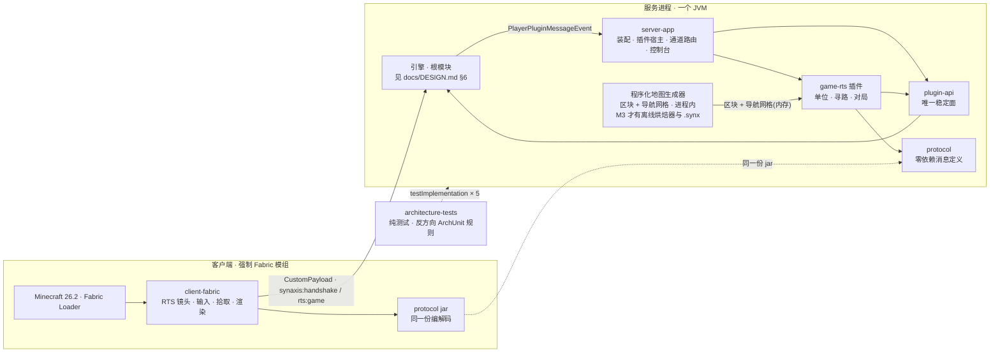
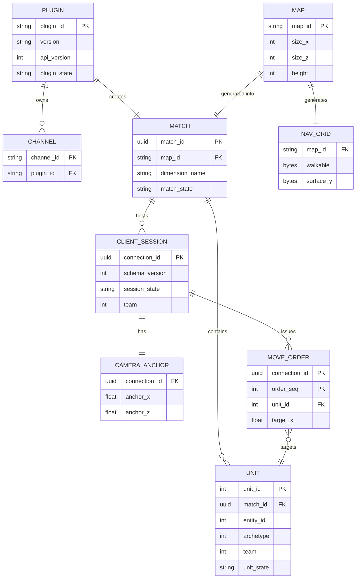
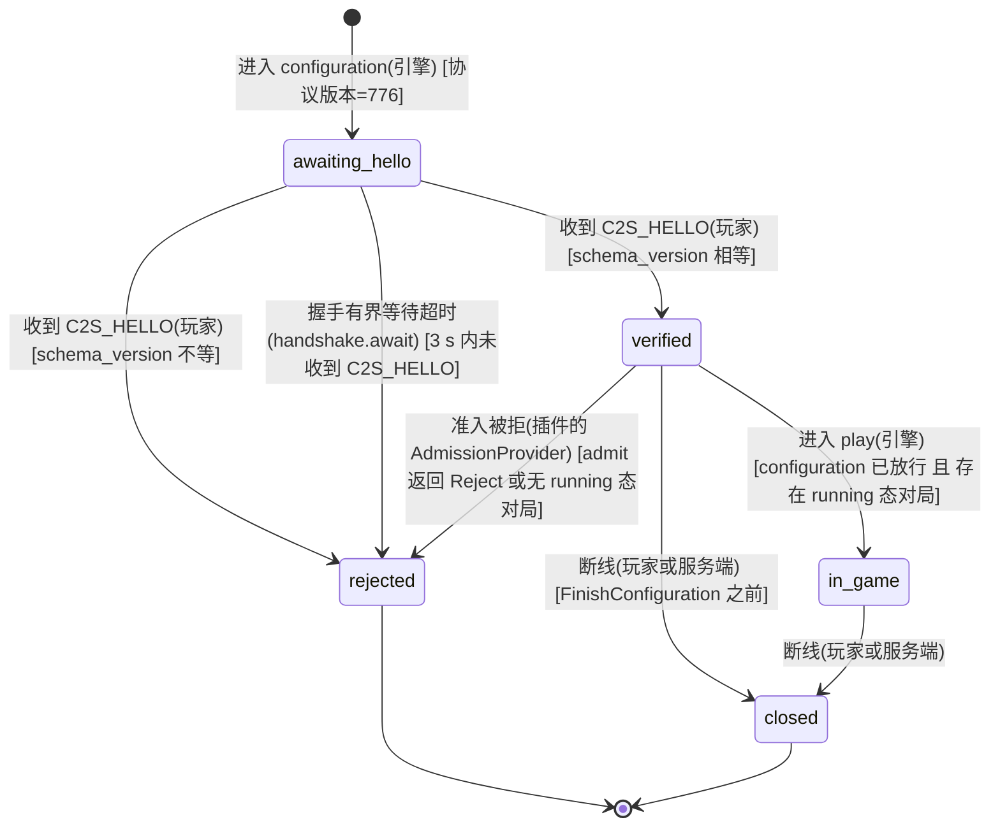
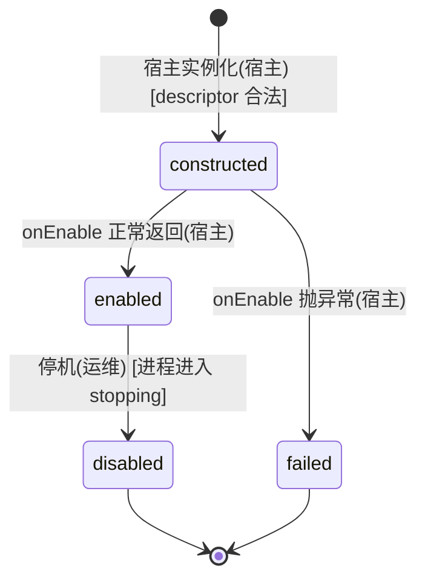
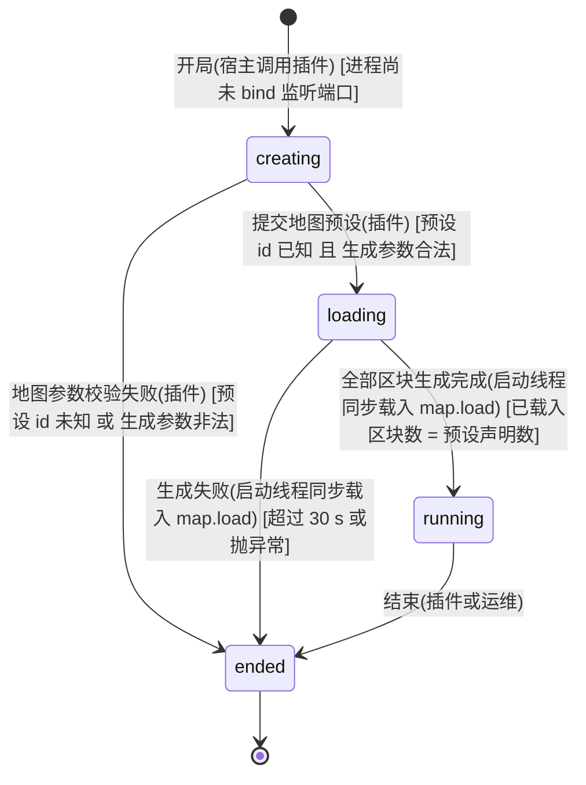
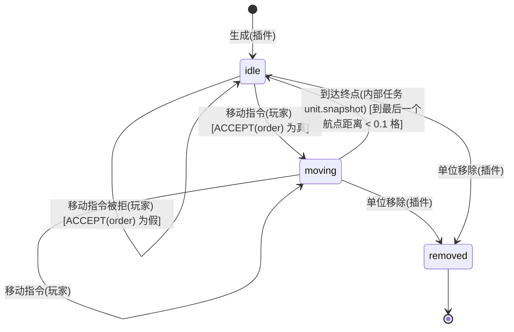
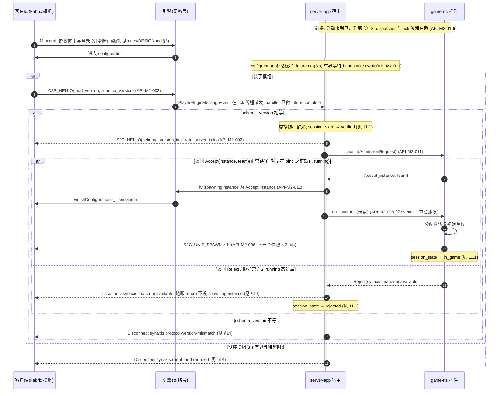
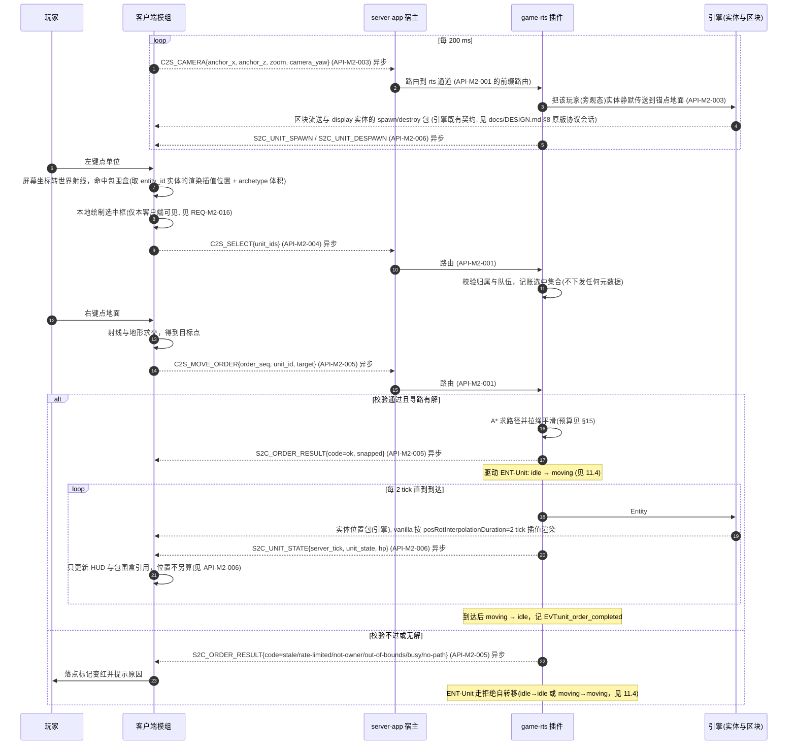
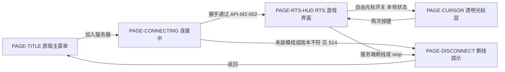

# Synaxis 设计文档 · 里程碑 M2「游戏工程骨架与 RTS 垂直切片」

## 1. 元信息 / 变更记录

| 字段 | 值 |
| --- | --- |
| 状态 | 已签字（2026-09-16：§18 的 A1～A4 四条假设与 §28.1 的 S1～S6 六条不可逆决策全部按默认值通过，可进入 §26 阶段 1；同批签字还定了三条范围裁剪与 Minecraft 版本，见 §1 变更记录 v0.6 与 §28.3） |
| 项目画像 | 生产产品（引擎本体仍是内部系统，见 `docs/DESIGN.md` §1；**M2 交付的是面向真实玩家的游戏**，内测阶段单机单区 ≤ 50 人，因此本文档按生产产品填全部 `[核心]` 节。全部可观测性与埋点落在单进程本地文件，不接外部监控） |
| Owner | Bearisbug |
| 评审人 | Bearisbug |
| 最后更新 | 2026-10-11 |
| 关联 | 引擎单一事实源 `docs/DESIGN.md`（M1 / M1.5） · 测试文档 `docs/TEST.md` · 运行手册 `docs/ENGINE.md` · 审计与开发计划 `docs/research/minestom-audit/00-总结与开发计划.md` · 两轮审计 `docs/research/audit-2026-09-15/` · 仓库 `https://github.com/Bearisbug/synaxis` |

本文档是 `docs/DESIGN.md` 的**里程碑分册**——这是对 design-doc 模板「同一份文档滚动收纳全部功能域」的一次显式偏离，理由与防腐坏机制（三处回指、ID 带 `M2` 域段、跨文档一律引用不复制）见 §24 最后一条。本文档只管 M2 新增的东西。引擎侧的背景、实体、协议状态机、错误码体系、线程模型、构建链一律以 `docs/DESIGN.md` 为准，本文档用「见 `docs/DESIGN.md` §N」引用，不复制。ID 独立编号：需求 `REQ-M2-*`、接口 `API-M2-*`、决策 `ADR-M2-*`、Runbook `RB-M2-*`；实体 `ENT-*`、页面 `PAGE-*`、事件 `EVT:*` 用语义命名，与 M1 天然不冲突。

变更记录：

| 日期 | 版本 | 改动 | 作者 |
| --- | --- | --- | --- |
| 2026-09-16 | v0.1 | 初稿：M2 范围、模块拆分、插件宿主、自定义协议、单位模型、寻路、世界管理与四条审计残留处置、垂直切片验收、阶段计划 | Bearisbug |
| 2026-10-11 | v0.65 | 跟进 `docs/DESIGN-PROD.md` v0.9.63（用户 2026-10-11 拍板的验收标准「服务端核心完全正常游玩」），**接口契约、消息布局与 `schema_version` 未改**，`game-rts` 一行不改。`API-M2-010` 第 ⑤ 步两处：核心模式一条写明平坦世界改用 `LightingChunk`、绑定端口之前预载并照亮出生点一圈区块，宿主在这条分支里另挂默认玩法层的全部七项（该分册 `REQ-PROD-046`）与玩家持久化段 `synaxis:player`（`REQ-PROD-047`），核心世界从「只供压测与冒烟」变为可完整游玩（可玩项 P1～P10）；玩法模式一条的「什么都不做」改为宿主只挂默认玩法层的聊天一项与持久化段（位置由 `RtsPlugin` 的出生点决定），`ADR-M2-013` 的旁观指挥官设计不变。§28.2 G3「核心模式下区块加载由对端驱动」已决行末尾加一句，指向 `docs/DESIGN-PROD.md` §28.2 v0.9.65 风险行：核心世界换成 `LightingChunk` 之后，本行的每块字节与占堆比例按有光照的世界重量 | Bearisbug |
| 2026-10-11 | v0.64 | M3-S 合入 `main`（用户 2026-10-11 批准）前的收口，本版只改文档：`docs/TEST.md` RUN-069 已登记轨道 G 的结果，§23 上线前检查单「容量/负载按 §15 验证」一行去掉「待 RUN-069 在 `docs/TEST.md` 登记」；§28.2「`TC-GAME-053`～`TC-GAME-059` 从未按 ID 登记执行」一行转已决（054、059 记失败，055、057 记跳过，其余三条通过，用例已改写） | Bearisbug |
| 2026-10-07 | v0.63 | 行号随代码改，本版只改文档：§28.2「原版聊天是一进 N 出的放大面」已决行引的 `server-app` 键表行号 `ConfigFile.java:86-87` 改为 `:83-84`（M3-S 把 `ConfigFile.KEYS` 上移了 3 行，`synaxis.chat-rate-per-second` 与 `synaxis.chat-burst` 现在在第 83、84 行） | Bearisbug |
| 2026-10-07 | v0.62 | M3-S 合并步骤的文档部分，**接口契约、消息布局与 `schema_version` 未改**。**§15 单位快照行**按 `docs/DESIGN-M3.md` §26 M3-S 轨道 G 的实测改画像档的阶段 6b 那一档：e = 10 时取 s = ⌊16(2e + 1) ÷ 7⌋ + 1 = 49、`-Dsynaxis.app.units=112`（原写 48、116 会让视野里有 50 个），并写明视野里至多 49 个只在开跑那一刻成立。**§28.2**「`TC-GAME-053`～`TC-GAME-059` 从未按 ID 登记」一行写上轨道 G 的执行结果与用例改写，结果由 `docs/TEST.md` RUN-069 登记 | Bearisbug |
| 2026-10-07 | v0.61 | 跟进 `docs/DESIGN-M3.md` v0.39（用户 2026-10-07 定地图分片有日夜，`REQ-M3-034`），**接口契约、消息布局与 `schema_version` 未改**。§28.2 加风险一行「地图分片的夜里与 RTS 视角」，归阶段 6b：每 20 分钟里 7.2 分钟天光降到 4/15，透视 RTS 相机在夜里的可读性没量过；6b 验收与 V6b 各加一档午夜，看不清时在单位亮度覆盖与 RTS 模式加夜视之间选。RTS 进程的 `synaxis:match` 不变，仍没有时钟 | Bearisbug |
| 2026-10-07 | v0.60 | 登记用户 2026-10-07 对 `TC-GAME-068` 的第二次处置（推荐项：每条快照设条目上限、视野里多出的单位轮流发），改 `:game-rts` 的快照编码，**消息布局与 `schema_version` 未改**（按 §8 判，理由写在 `API-M2-006`；v0.54 定的 1 → 2 仍随阶段 6b）。起因：v0.59 改播种后 RUN-069 两档仍未全部达标，1,000 个单位那一档每玩家 6,712.1 B/s，画像档单条最大 341 字节。**§15 单位快照行**：每条 `S2C_UNIT_STATE` 至多 60 条，兴趣集多于 60 个单位时按 `unit_id` 升序从上一条停下的位置往后取、取到末尾绕回（`game-rts` 的 `Units#turn`）；单条至多 248 字节，10 Hz 即每玩家 ≤ 2,480 B/s、50 人 ≤ 124,000 B/s；每个单位的刷新间隔平均 n ÷ 60 × 100 ms、上界 ⌈n ÷ 60⌉ × 100 ms（282 个单位 470 / 500 ms）；表后测量手段一段与对照表的 `max_entries` 判据随之改。**`API-M2-006`**：`S2C_UNIT_STATE` 由兴趣集全量覆盖改为逐条目覆盖、按单位有界对账，写明轮转规则、客户端不得从「快照里没有」推断任何事、`schema_version` 不升的判断；共用已编码 `byte[]` 的前提加「轮到同一段」。**§2 出站带宽**（写明 248 字节上界的前提 `unit_id` ≤ 16,383、`hp` ≤ 127）、**§9 `count`**（512 仍是解码上限，不收紧）、**§16** 对账与 HUD stale 两条（stale 按连接判，单个单位至多陈旧 ⌈n ÷ 60⌉ × 100 ms，n > 1,200 时超过 2 s 而不被标出）、**§17 `unit.snapshot`**（失败策略按实现写：异常由宿主调度器记一行 ERROR，本批还没发到的玩家跳过）、**`RB-M2-003`** 诊断段（看那行 ERROR 的堆栈；条目数与包长碰不到 512 与 8 KiB）同步改；**§19** 加场景「视野里多于 60 个单位时快照轮流发」（含上一条最后那个单位离开之后，下一条从 `unit_id` 比它大的第一个单位起）；**§28.2** 登记风险「兴趣集多于 1,200 个单位时单个单位的状态陈旧超过 2 s 而 HUD 不标 stale」，兴趣集大小在 v0.60 之后没有读数。**改后重跑 `TC-GAME-068`**（RUN-069）：1,000 个单位那一档单条最大 245 字节、2,367.8 B/s/玩家、50 人 118,330.5 B/s，走 §15 单位快照行的第一支，四项全过，读数写进该行；**§23** 上线前检查单的容量一行由「待填」改为过；**§26** 收尾项补上这次重跑 | Bearisbug |
| 2026-10-06 | v0.59 | 按 2026-10-06 的全项目盘点改过期标注，并登记用户同日对 `TC-GAME-068` 处置的选择（推荐项：先把播种改成均匀铺开再重跑），本版只改文档，**消息布局与 `schema_version` 未改**。**§15 单位快照行**写处置：`synaxis.app.units` 大于默认 67 时，全部己方单位在全图均匀铺开（`game-rts` 的 `Roster`），以 1,000 个单位重跑 `TC-GAME-068`，同一轮另跑画像档（`rts-512` 上 175 个单位，视野里至多 49 个）；推算 1,000 个单位那一档地图中部的玩家视野里约 282 个单位、约 11 KB/s/玩家，压缩后仍约 6,400 B/s；每玩家仍 > 2,560 B/s 时（用户定的「再改 §15 口径」）本行的四项判据改在画像档上判，1,000 个单位那一档按 §2 出站带宽行的每条目 4 字节与 50 人 2 MB/s 判；任一项不达标判失败、回到用户，三条选项写在本行。§23 容量一行同步。**§26**：阶段 0 行 spike ④ 与阶段 6a 行 `ADR-M2-010` 运行期那一半的「仍未跑」改为已于 2026-09-23 在无头容器与 GitHub Actions 上通过（§28.2 已决行）；6a 行写明需要屏幕的那截缺的是输入接线（主源码集里 `RtsClient#orderAt` 没有调用方）与验证，判据 `TC-GAME-047` 第 1 步要 RTS 俯视镜头，这一截随 6b 验收；表后加收尾项（`TC-GAME-068` 重跑、`TC-GAME-053`～`059` 按 ID 登记、`TC-GAME-004` 等批准），由 `docs/DESIGN-M3.md` §26 M3-S 轨道 G 执行。**§27** 按现状改写。**§28.2**：「真地图从哪来、`.synx` 格式怎么定」转已决（`docs/DESIGN-M3.md` `API-M3-001` 取代 `API-M2-009`，M3-B 已落地）；新增 `TC-GAME-053`～`059` 从未按 ID 登记、`TC-GAME-004` 等待推临时分支的批准两行；「公开还是私有」一行注明与 `docs/DESIGN.md` §28 对齐为同一时限 | Bearisbug |
| 2026-10-06 | v0.58 | 跟进 `docs/DESIGN-PROD.md` v0.9.53（核心模式的平坦世界设边长 4,096 格的世界边界），接口契约、消息布局与 `schema_version` 未改。§28.2 攻击面盘点的 G3 由风险转已决：区块总数的上界是 77,284 块（视距 10），约 0.70 GB；`API-M2-010` 第 ⑤ 步核心模式一条的「没有边界的平面」改为边界之内的平面 | Bearisbug |
| 2026-10-06 | v0.57 | 跟进 `docs/DESIGN-PROD.md` v0.9.52（`docs/DESIGN-M3.md` §28.2 交接行 M3 v0.38 ⑱），接口契约、消息布局与 `schema_version` 未改。§28.2「原版聊天是一进 N 出的放大面」由风险转已决：时点原写「`REQ-PROD-009` 落地时（生产就绪第 1 波）」，按 `main` `8b18922130` 逐项核对该需求的四项（引擎默认 0 收件人、每连接令牌桶的两个键、`JoinGame` 不强制安全聊天与系统消息转发、模组拦掉聊天验证 toast）都已落地，证据写进该行 | Bearisbug |
| 2026-10-06 | v0.56 | 跟进 `docs/DESIGN-PROD.md` v0.9.47（引擎对位置包与方块操作的服务端判定，`API-PROD-030`，修光照会话 M3 侧安全审查的 S1-V01、S1-02、S1-01），接口契约、消息布局与 `schema_version` 未改。§28.2 攻击面盘点的 G3、G4 两行按现状改写：G3 原先的处置前提「核心模式只服务压测与冒烟、不对玩家开放」已不成立（挂地图的分片就是核心模式），引擎判定现在覆盖核心模式与 RTS 进程，仍开着的只剩平坦核心世界的区块总数；G4 的位置一条多了单包 64 格的上界，方块一条多了 5.5 格的距离限制，挖掘时长仍不校验，两条照旧随 `REQ-M2-018` 消失 | Bearisbug |
| 2026-10-02 | v0.55 | 登记用户 2026-10-02 的两项拍板，**消息布局与 `schema_version` 未改**（v0.54 定的 1 → 2 仍随阶段 6b）。**一、`zoom` 上限放宽到 eye 100 格**：§28.2 第三条 Open Question 转已决，代价原样留作事实；§9 `zoom` 取值改 [8, 100]，按 100 格核对（上角 44.6 格起进雾，100 格时画面约 24% 是雾和天空；雾界以内的地面离锚点最远 147 格、离 eye 球面 189 格；eye y 140，与地面差 6 层），默认 24 不动（整屏无雾的最大高度是 44），宽屏判据改为「雾界以内离锚点最远的地面点 ≤ 160 格」（宽高比 ≤ 2 为 100，21:9 为 95，32:9 为 63）；§15「可见范围」① 改为 `entity-view-distance = 10`（160 格），④ 按 100 格重算，生效渲染距离 8 那档由 ⑤ 在 RTS 模式里持续覆盖排除，⑥ 写明不依赖 ⑤；`API-M2-010` 启动序列第 ① 步写明 `Main` 写 10、`ShardMain` 写 8、核心模式随 `Main`；`REQ-M2-018` 的区间与「被改回去就再覆盖」、§19 夹取区间、§28.2 S4 行（`zoom` 42～100 没测）、S5 行（eye y ≤ 140、出图界至多 57.7 格）、第一、二条 Open Question 的代价按 160 格重算；§28.2 已决行的 6b 待办改端点 100、补 `entity-view-distance` 的设值（`Main` 10、`ShardMain` 8）、`TC-GAME-044` / `TC-GAME-047` / `TC-GAME-052` 的新值与 ⑤ 的持续覆盖；§26 阶段 6b 的退出条件加「soak 在 160 格下重跑 tick P99 与 `S2C_UNIT_STATE` 带宽，与 128 格的 v0.41 读数对照」。**二、DH 近圈空洞**：§26 阶段 6b 行改为保持 DH 默认的 `overdrawPreventionRadius`、不打补丁、不切档，并写明 M2 几何下 eye 离玩家实体至多直线 115.5 格、水平 57.7 格，「相机离玩家 300 格」只出现在快速平移的瞬间；验收加一步按最快平移速度来回推、记下空洞的时长与面积，空洞可见再在两种做法里选；另写明现在的 RTS 进程不发远景宣告、DH 钉在空库，这一步在带远景之前量到的是原版区块跟不上平移的空白。同批改 `docs/DESIGN-M3.md`（M3 v0.36） | Bearisbug |
| 2026-10-02 | v0.54 | RTS 相机改为带俯角的透视，登记用户 2026-09-23 的拍板（eye 离地 ≤ 100 格、不用正交），理由与证据见 §28.2 已决行。**消息布局未改**；`zoom` 改了字段语义，按 §8 须把 `schema_version` 由 1 升到 2，随阶段 6b 改代码的同一个 PR 落地，本版只改文档，`schema_version` 仍是 1。改九处：**§28.2**「RTS 相机形态」由 Open Question 转已决，并列出 6b 要跟着改的代码与测试文档（`C2SCamera` javadoc、`edge/c2s_camera.bin`、`SCHEMA_VERSION`、`GameChannel#receiveCamera` 的夹取与遥测、`docs/TEST.md` `TC-GAME-044` / `TC-GAME-047`）；**§28.2 新增三条 Open Question**，各带默认值：`zoom` 取 eye 高度而不取视线距离、俯角 60°、上限不放宽到 eye 100 格；**`REQ-M2-018`** 与 **§26 阶段 6b** 改为透视、俯角固定 60°、竖直 fov 固定 70°，6b 行的 DH 近圈空洞一句不变；**§9 `zoom`** 由「正交视口半高，[8, 48]」改为「eye 比锚点处地面高出的格数，[8, 44]，默认 24」：俯角 60°、fov 70°、16:9 时画面上沿两角离锚点 2.877 × zoom 格，留在 `entity-view-distance` 的 128 格内得 44，比 16:9 宽的窗口按宽高比再压（21:9 为 36）；**§15「可见范围」第 ④ 项**的 rd 改为生效值——客户端取选项与服务端下发的 `chunkRadius`（10）中较小的一个（26.2 `Options#getEffectiveRenderDistance`），⑤ 把选项抬到 12 不改变剔除半径与雾界，原文「⑤ 生效的 rd 12 是 240 格」不成立；补上 `zoom` 上限处离 eye 149 格的覆盖，末句改为「上限 44 由 ① 反推」；**§19** 场景「镜头上报超频与越界锚点被服务端处理」的夹取区间改为 [8, 44]；**§28.2 S4 行**写明射线结论正交、透视都成立，三个前提里两个只属于正交；**§28.2 S5 行**写明 eye 钳位退路只适用于正交，`zoom` ≤ 44 时透视碰不到 S5 的 ② ③ 两档，地图最外一圈的死区仍待 6b。同批改 `docs/DESIGN-M3.md` §1 拍板表 R2 一行（M3 v0.35） | Bearisbug |
| 2026-10-02 | v0.53 | 按 `docs/DESIGN-M3.md` §28.2 两行交接（M3 v0.30 的 ①～④、M3 v0.32 的 ⑤～⑦）同步已合入 `main` 的 M3-G 远景（Distant Horizons 客户端本地烘焙），按 `main` `494605595a` 上的代码写。改五处：**`API-M2-001`** 通道清单加 `synaxis:farview`，挂地图的分片在 configuration 阶段下发的远景宣告，编解码是 `:protocol` 的 `FarViewAnnouncement`，不走 `msg_id` 信封、不计入 `schema_version`，布局引用该分册 `API-M3-015`；**§24 线协议**加 `farview-vectors/` 目录，自带 `manifest.txt`，不进 `vectors/` 的 digest；**§23** 加客户端整合包的 DH 一段（独立 jar 放 `mods/`、LGPL 显著声明与 GPL / LGPL 全文、版权界面列出 DH、关掉 DH 自动更新器的 `config/DistantHorizons.toml`）与上线前检查单一行；**§26 阶段 6b** 记 V6a 否定了「RTS 模式把 `overdrawPreventionRadius` 设 0」，6b 开工前在两种做法里选一个；**`REQ-M2-020`** 记 M3-G 在 `client-fabric/build.gradle.kts`、主 `fabric.mod.json` 与 `SynaxisClientMod` 上的追加（`verifyModJar` 五条断言、模组 jar 75 个条目）。M2 的消息布局、`schema_version`（仍是 1）与 `vectors/` 的向量和 digest 都没改 | Bearisbug |
| 2026-09-30 | v0.52 | 跟进 `docs/DESIGN-PROD.md` v0.9.35：引擎入站包速率闸（`REQ-PROD-013` / `API-PROD-012`，生产就绪第 5 波 5B 落地）的默认值由 7 s 窗口 582 包提到 750 包，它数全部 play 包、不分消息类型。本分册四处还写着 5B 之前的「引擎没有每秒包数限流器、稳态上限 1,000 包/秒/连接」，按现状改写；消息布局、`schema_version`、三条玩法预算与 `synaxis:game-flood` 的 300 包/秒都没改。**§2 请求量**：依据列写明两道引擎上限；95 包/秒的游戏消息 7 s 是 665 个，在 750 之下，加上客户端每 tick 一个 `ClientTickEnd`，连续 7 s 是 805 个，会被踢；M2 客户端只做单选，峰值合计 7 s 315 个；多选上线之前按 `API-PROD-012` 的规则用真客户端重定。**§14 `synaxis:game-flood`**：默认配置下速率闸先断，持续超速的连接收到 `synaxis:protocol-error`，本键只在 `synaxis.packet-limit.max-packets` 调到 903 以上时出现（连续 3 s > 300 包/秒至少 903 包）；§2 写明 903 只是下限，持续按 R 包/秒发时洪水闸触发那一刻已收到 R + 602 到 2R + 601 个。**§15 限流**：「引擎没有每秒包数限流器」改为引擎有速率闸但不分消息类型；「断线只由洪水闸门触发」限定为游戏侧；被拒指令的服务端上界补上默认配置下的 7 s 750 包。**§19「只有真正的洪水才断线」**：Then 分两种配置写断线原因，要看到 `synaxis:game-flood`，速率闸要抬到远高于洪水闸触发时窗口里的包数（§2）；95 条/秒不断线限定为只发游戏消息。**§28.2**：「`docs/DESIGN.md` §15 的限流行是未实现的目标」转已决。`docs/TEST.md` 的 `TC-GAME-064` 随之由 `TC-GAME-075` 取代 | Bearisbug |
| 2026-09-29 | v0.51 | **玩法模式下 `S2C_HELLO` 改由等待的 configuration 虚拟线程回**，消息布局、`schema_version` 与失败路径未改。缺陷：tick 线程先 `complete` 再回包，被唤醒的等待线程能抢在它下一句之前走完准入并把 `FinishConfiguration` 入队，写线程写出 `FinishConfiguration` 时连接转 `play`，排在后面的 `S2C_HELLO` 按 play 负载发出，模组没有 play 阶段的编解码器、原版把它当 `DiscardedPayload` 静默丢掉，客户端停在 `SENT`；服务端的 `client_verified` 在入队时就记下，台账看不出来。出处是 GitHub Actions run 36459937261 第 1 次尝试（`main` `6d14db9435`，生产启动器那份报告 `R2 FAIL state=SENT`，其余 7 条与台账全绿），run 36463626822 在 tick 线程 `complete` 之后停 300 ms 于 dev 启动器上复现。改动：`API-M2-011` 交接一条改写（tick 线程只 `complete`；回包与 `EVT:client_verified` 归随后把 `FinishConfiguration` 入队的等待线程，排在 `admit` 之前；login 形态不再回；核心模式仍由 tick 线程回），原文「回包只是入队，所以没有 kick 那样的竞态」一句随之删去；§11.1 迁移表 `awaiting_hello → verified` 一行的动作；§16 加一行「`complete` 之后谁先往写队列里排包」，写明核心模式那个接受的窗口；超时那一条写明抢不到 future 时的两种情形（正常完成的由那条 `C2S_HELLO` 作数，照常回包、记账、`admit`；异常完成的直接 return），§16「握手 3 s 有界等待超时与 `C2S_HELLO` 同时发生」一行的预期补「也不会两样都不做」；`API-M2-002` 核心模式一条补「可能晚于 `FinishConfiguration`」；§19 握手交接场景的 Then 改写并加一句写队列顺序。§1「最后更新」改为 2026-09-29 | Bearisbug |
| 2026-09-28 | v0.50 | 跟进 `docs/DESIGN-PROD.md` v0.9.27（第 6 波 6A 插件面）：`:plugin-api` 新增只由宿主实现的接口 `Transfers`（首次提交即标 `@ApiStatus.NonExtendable`），§24 ABI 门与 §28.2 已决一行里标注接口的个数 14 → 15。`PluginContext#transfers()` 是生产就绪分册加的默认方法，与 `playerData()` 等同属该分册 `API-PROD-*`，不进本文档 `API-M2-008` 的八项；`API-M2-007` 不变，`api_version` 仍为 `2`。§1「最后更新」改为 2026-09-28 | Bearisbug |
| 2026-09-26 | v0.49 | 按 `docs/DESIGN-PROD.md` §28.3 改三处，消息布局与 `schema_version` 未改。**§24 ABI 门**的判定口径改为该分册 §8（v0.7.2）已定的规则：只由宿主实现的接口标 `@ApiStatus.NonExtendable`（现有 14 个），加抽象方法不判破坏；插件实现的接口新方法只能带默认实现；给已有接口补标注本身判破坏，只能随 `api_version` 加 1 与新 baseline tag 走；baseline 现为 `gradle/abi-baseline.tag` 指的 `v0.3.0`；反证出处由 TC-PROD-234 第 3 步改为 TC-GAME-072 第 4、5 步（前者在标注之后已不再红在这一条）。**§28.2** 那条「只由宿主实现的接口加抽象方法算不算破坏」Open Question 转已决，并查清它的「另待核实」：RUN-030 的 ABI 门以各组合入前的提交为 baseline，已带着 3B 的两个抽象方法。**`API-M2-007`** 加生产就绪第 6 波 6F 的默认方法 `Set<String> translationKeys()`（默认空集合，宿主不调用，翻译键门禁读，该分册 `API-PROD-029`）。§1「最后更新」改为 2026-09-26 | Bearisbug |
| 2026-09-24 | v0.48 | 按 `docs/DESIGN-PROD.md` v0.7.1 §28.3 改两处，接口契约、消息布局与 `schema_version` 未改。§24 ABI 门补判定口径：`:plugin-api` 接口加方法写成默认方法才算兼容；门禁对未标 `@ApiStatus.NonExtendable` 的接口加抽象方法一律判破坏；只由宿主实现的接口加抽象方法算不算破坏登记为 §28.2 的 Open Question。§28.2「引擎 `network.plugin` 包名歧义」改写处置：`Auth.Velocity` / `Auth.Bungee` 已在生产就绪第 2 波删除，包里仍有服务 login 阶段握手的 `LoginPlugin` / `LoginPluginMessageProcessor`，歧义没有随之消失。§1「最后更新」改为 2026-09-24 | Bearisbug |
| 2026-09-24 | v0.47 | 按 `docs/DESIGN-PROD.md` `REQ-PROD-022`（`API-PROD-018`）的落地改 `API-M2-008` 的 `events()` 一条，其余章节、消息布局与 `schema_version` 未改：监听器由挂在单个 `plugin/<id>` 节点上改为按插件、按档位建节点，`forInstance` 的节点挂在实例的 `eventNode()` 下；禁用时由 `PluginEventsImpl#detach()` 逐个收回，之后再注册的监听器丢弃；`PlayerPluginMessageEvent` 映射节点那条硬约束补上插件侧经 `forInstance` 的拒绝清单成立 | Bearisbug |
| 2026-09-23 | v0.46 | 按 `docs/DESIGN-PROD.md` v0.3 §28.3 改三处引用，接口契约、消息布局与 `schema_version` 未改。§17 末段不再写「无网络第三方」：本表依赖仍在进程与整合包内，生产就绪起的 sessionserver、PostgreSQL、Valkey 引用该分册 §17；§21 末段加验证成功率与 `hasJoined` p99 两条 SLI 的出处（该分册 §21）；§28.2「原版聊天是一进 N 出的放大面」（攻击面 G5）改为由 `REQ-PROD-009` 承接 | Bearisbug |
| 2026-09-23 | v0.45 | 随 `docs/DESIGN-M3.md` v0.3 同步两处，正文其余章节、接口契约与 `schema_version` 未改。§28.2「光照：服务端用 `LightingChunk` 在载入阶段整图计算」一行的证据部分改写：M2 对局整图算一次光照已落地不变，`LightingChunk` 的 ④⑤ 两处缺陷已在 M3 修复并以 `LightParityIntegrationTest` 对拍为门禁，细节指向 `docs/DESIGN-M3.md` §5。§28.3 ② 的列头由「补回时的落点」改为「M3 的处置」，六行去向改指 DESIGN-M3：`API-M2-009` 被 `API-M3-001` 取代不复活，`ChunkLoader` 由 `API-M3-005` 承接，`map.load` 落盘语义、`RB-M2-004` 与对局载入成功率 SLI 不补回（MMO 侧分别对应 `API-M3-002`、`RB-M3-004`、DESIGN-M3 §21），S5 格式部分已由 `API-M3-001` 落地 | Bearisbug |
| 2026-09-23 | v0.44 | **§28.2「光照：M2 不算」翻案为「服务端用 `LightingChunk` 在载入阶段整图计算」**，同一节那条风险「对局世界没有光照数据，真客户端上地形是黑色剪影」转已决。对局实例改用 `LightingChunk`，`Match#load` 在整图生成之后、进 `running` 之前调一次 `LightingChunk.relight` 把全部区块的光照算完，玩家进场收到的第一批区块包就带天光。**接口契约、消息布局与 `schema_version` 一个字未改**。随之改动的位置：§5 `REQ-M2-011` 补「进 `running` 之前整图光照已算完」；§11.3 迁移表 `creating → loading` 与 `loading → running` 两行的动作；§15「地图生成」一行的实测换成新数字（`rts-512` 的 `load_ms` 126～167 → 771～968 ms，`heap_delta_kib` ≈ 6,030 → ≈ 9,290 KiB，仍在 3 s / 50 MB 内）；§19 场景「程序化生成的整图载入并关闭自动加载」补一条光照断言。引擎光照代码未改，本轮没有发现它的缺陷 | Bearisbug |
| 2026-09-23 | v0.43 | 按 spike ② S3 的结论改剔除半径公式与 `archetype_view_range`。**接口契约、消息布局与 `schema_version` 一个字未改**。公式由 `view_range × 64 × 倍率` 改为 `view_range × 64 × clamp(rd / 8, 1, 2.5) × 倍率`、从渲染相机量球面距离，改在 §9 原型模板行、§15「可见范围」行第 ④ 项与 `ADR-M2-013` 的必做项；第 ④ 项的推算改为「盖住渲染距离雾界」：50% 档要 `view_range ≥ √((16·rd)² + h²) / (64 × clamp(rd / 8, 1, 2.5) × 0.5)`，rd 10、眼高 84 时 4.52。`archetype_view_range` 由 4.0 改为 **5.0**（`Archetype.SOLDIER`）：50% 档下 rd 8 为 160 格、覆盖到眼高 96，rd 10 为 200 格、覆盖到眼高 120。`REQ-M2-016` 的默认值与 §19 那条 Gherkin 随之改，最后一步的判据从「离玩家约 97 格的角落」改为「雾界以内的四角」。§28.2 剔除那一行转已决，只剩四角「不闪」的补证 | Bearisbug |
| 2026-09-23 | v0.42 | 阶段 0 客户端 spike 的运行期结论回写。真 26.2 客户端第一次跑起来：在 Docker（Xvfb + Mesa llvmpipe）与 GitHub Actions（`.github/workflows/client-gametest.yml`）里由 `fabric-client-gametest-api` 驱动，跑法、截图与逐节结论在 `docs/research/client-spikes-2026-09/README.md`。**接口契约、消息布局与 `schema_version` 一个字未改**；spike 代码只在 `client-fabric/src/gametest/**`，不进模组 jar。**spike ④ 运行期通过**：configuration 阶段发出的 `C2S_HELLO` 被判 `client_verified`（`session_entered_configuration` 之后 42 ms / 53 ms），无 `client_rejected`、无 kick，login 对照同样进世界——`ADR-M2-010` 转 Accepted，§28.2 那条风险转已决；「握手两条阶段路径收敛成一条」的技术债原样保留。**spike ① 运行期通过**：Fabric Loader 把嵌套的 `protocol-dev.jar` 当作 `synaxis` 的 JiJ 子模组加载，`dev` 非 SemVer 只打一行 WARN，§28.2 那条风险转已决。**spike ②**：S2 两种相机形态的截图与观感记进 §28.2 的 Open Question，**选择留给用户**；S3 证实剔除按渲染相机算、半径公式多一项 `clamp(renderDistance/8, 1, 2.5)`、`archetype_view_range = 4.0` 在 50% 档不够（改值留给 6b）；S4 转已决（前一轮已写）；S5 输入路径转已决（mixin `MouseHandler`），section 可见性那条补上 eye 所在 section 与雾界两个限制。**新登记一条风险**：对局世界不发光照数据，真客户端上地形是黑色剪影。跑通之前修掉的两处：引擎 clientbound 包 id 因 REQ-005 删包整体前移（commit `cb44131ef1`，空位补 `ReservedPacket`；它属引擎，`docs/DESIGN.md` 与 `docs/TEST.md` 的登记不在本版）；`client-fabric` 的 `fabric-loader` 改走 `modImplementation`，否则运行 classpath 上没有 ASM 与 Mixin | Bearisbug |
| 2026-09-22 | v0.41 | §15 整表阈值的正式测量回写（报告 `docs/research/soak-2026-09-22/report.md`，三档的 `summary.json` 在同目录 `runs/`，报告表内的每个数字都能从那里复算；4,000 档两个超 50 ms tick 的时刻与前后的 GC 暂停几个数来自已删的 JFR，报告里标为不可复算）。**接口契约、消息布局、`schema_version` 与代码一行未动**，改的只有 §15 三行的「实测」数字、§28.2「同屏单位数上限」的服务端侧结论与 `docs/TEST.md` `TC-GAME-068` 的实测参考值。门禁档 50 连接 × 1,000 单位 × 600 s（head `9013cf76fd`，M4 Pro 12 核 24 GiB，机器上另有一个满核的无关进程）：tick P50 2.857 / P99 8.617 / max 32.178 ms、超 50 ms 的 0 个；强制 GC 后存活堆最大 43.0 MiB、RSS 最大 230.1 MiB；寻路 50 ms 桶 P99 1.0 ms（台账分辨率 1 ms）、单次最大展开 1,552；`S2C_UNIT_STATE` 相邻间隔 P50 97.3 ms、单条最大 2,023 字节（512 条目 × 3.951 字节）、负载 4,420 B/s/玩家、50 人 220,866 B/s——单位快照这一行按 v0.39 定的判据字段**未达标**（超 7.9 倍 / 1.73 倍 / 1.73 倍），差在布局不在编码：默认播种让每个玩家的兴趣集顶到 512 条上限，而这一行的场景是「视野 50 单位」；压缩后的线上字节是 2,547 B/s/玩家、50 人 127,292 B/s。规模曲线 50 × {1,000, 2,000, 4,000}：tick P99 8.617 → 9.698 → 11.096 ms，至 4,000 未见拐点；引擎实体包 14,457 → 20,429 → 32,541 B/s/玩家（设计里没有给它写上界）；存活堆 43.0 → 51.1 → 64.1 MiB。三档 0 掉线、0 ERROR、0 踢人，WARN 只有 `RB-M2-003` 那条「兴趣集超快照上限」的 10 s 预算行。客户端 ≥ 60 FPS 那一行仍留给验收人，需要屏幕 | Bearisbug |
| 2026-09-22 | v0.40 | 攻击面盘点（`docs/research/attack-surface-2026-09/README.md`，`docs/TEST.md` §2 那行「安全渗透——无归属」自此有归属）。**接口契约、消息布局、`schema_version` 一个字未改**；引擎侧修的两处（慢读对端的 socket 关闭、离线 UUID 由服务端派生）与登记的两条见 `docs/DESIGN.md` v0.32。本分册只在 §28.2 登记四条：① 核心模式的平坦世界自动加载区块，而客户端位置包被原样采信，对端每个位置包都能把自己挪到新区块、让服务端生成一圈区块，内存与生成 CPU 由对端定；② 玩法模式下玩家仍是可见的生存玩家（`ADR-M2-013` 的「旁观、不可见、位置由镜头锚点传送驱动」属未落地的 `REQ-M2-018`），位置包与挖方块都被采信——兴趣集由对端自己挪、地图方块可被删；③ 原版聊天包由引擎广播给全部在线玩家，一包进 N 包出；④ 选中与下令只判归属不判兴趣集，M2 没有战争迷雾所以无害，按现状确认。游戏侧的授权面（`not-owner` / `out-of-bounds` / 锚点夹取 / 未知 `msg_id` / 洪水 / 握手的四条出口 / 会话表的回收）逐条对上了既有测试，没有缺口 | Bearisbug |
| 2026-09-22 | v0.39 | §15「50 玩家、单局、全服 1,000 单位」这一档的四条预算（tick P99、`S2C_UNIT_STATE` 体积与频率、进程堆、寻路占用）第一次有测量手段——此前 `docs/TEST.md` §2 的不测表把它登记为「无归属——已知风险」。**接口契约、消息布局与 `schema_version` 一个字未改。** **改动一（播种旋钮）**：`API-M2-010` 新增系统属性 `synaxis.app.units`（对局播种的单位**总数**，默认 67 = 现状；非数字或 ≤ 3 时插件 `onEnable` 抛 `IllegalArgumentException`，宿主记 `Plugin failed to enable` 的 ERROR 并按第 ⑤ 步拒启、非零码退出；地图放不下时 `Roster` 在**一个单位都没播之前**就抛 `IllegalStateException`，同样拒启——站位先全部算出来再一次性播，不留半播种）。播种规则不变：前 `n − 3` 个是玩家队伍（`team=1`）、绕出生点一圈圈铺在可站立列上，随后中立、`team=2`、远哨各一个，编号顺序与默认阵容一致。归属沿用 §9 的 `(match_id, team)` 粒度——50 条连接都以 `team=1` 准入、每条连接都指挥全部本方单位，「每人 ≥ 1 个可下令单位」由此成立，不需要按人分配。**改动二（harness 玩法模式）**：`tools/loadtest/soak.py play`——N 条连接走真实的 `C2S_HELLO` 握手进 play，镜头 5 Hz 沿利萨如曲线游走全图（玩家实体跟着锚点走以驱动区块流送，因为 `REQ-M2-018` 服务端侧的「传送到锚点」尚未落地）、每秒一条对本方单位的下令、每 10 s 一次选中；入站字节按 `rts:game` 负载（再按 `msg_id` 细分，`S2C_UNIT_STATE` 另记单条体积上限、条目数上限与相邻两条的间隔）与其余引擎包两栏统计；tick 分布沿用 JFR `synaxis.ServerTickTime`，每 N 秒强制 GC 取存活堆并采 RSS，寻路 `path_ms` 从 §20 台账取并按 50 ms 分桶求和，服务端日志的 WARN / ERROR / 踢人行数一并计。§15 表后新增「四条预算的测量手段」把每条预算对到 `summary.json` 的字段；起服、门禁档与规模曲线（50 × {1,000, 2,000, 4,000}）的跑法在 `docs/research/soak-2026-09-22/README.md`。**本版只交付 harness 与一次 60 s 冒烟（机器不安静，数字不进文档），正式测量另起一轮**（`docs/TEST.md` `TC-GAME-068`，实测参考值待 v0.41 填）。**已知的布局后果**：环形铺法把 1,000 个单位挤在出生点 ±17 格内，锚点离出生点 128 格内的玩家兴趣集就是全部单位，快照顶到 `count ≤ 512` 的上限（按 §8 布局单条约 2 KB：512 个条目各 3～4 字节，加 `msg_id` / `server_tick` / `count` 的头），这是 §2「单玩家视野 ≤ 200」画像之外的最坏档；要按画像测得把播种改成均匀铺开，留给测量那一轮决定 | Bearisbug |
| 2026-09-22 | v0.38 | **§24 与 §28.2 反复预告的聚合项目落地：新增纯测试模块 `:architecture-tests`**（`settings.gradle.kts` 末行；把引擎、`:plugin-api`、`:protocol`、`:server-app`、`:game-rts` 全部当 `testImplementation`，没有主源码，谁也不能依赖它），住着 §24 规则 ⑥ 的两条反方向规则——游戏侧（`io.github.bearisbug.synaxis.game..`）不得依赖标 `@ApiStatus.Internal` 的引擎类型、不得访问标 `@ApiStatus.Internal` 的引擎成员（含经游戏侧子类继承来的：谓词按解析后的成员判 owner，不按调用点）——外加把 `Entity#moveTo(Pos)` 的签名钉死（存在、public、返回 void、不带 `@ApiStatus.Internal`；注解从 class 文件读，`ApiStatus.Internal` 只有 `CLASS` 保留级，反射看不见）。**第一次跑就抓到一处真违规**：`UnitEntity` 覆写并 `super` 调用了 `Entity#updateNewViewer` / `updateOldViewer`（都标 `@ApiStatus.Internal`，引擎没有公开的 viewer 增删回调）。处置是**改游戏侧走公开入口**、不加豁免：`Units` 的快照每 2 tick 读一次 `Entity#getViewers()`，与每个单位上次已通知的玩家集合做差，新进的发 `S2C_UNIT_SPAWN`、离开的发 `S2C_UNIT_DESPAWN`，都排在同一 tick 的 `S2C_UNIT_STATE` 之前；对局结束时对仍持有该单位的玩家先发 `S2C_UNIT_DESPAWN` 再移除实体。代价：通知最多滞后引擎的实体 spawn 包一个快照间隔（2 tick）；收益：兴趣集的全部读写回到 tick 线程。`API-M2-006`（§8）、§10 矩阵里它那一行、`ADR-M2-012` 回收纪律 ②、§6 模块图、§28.2「反方向 ArchUnit 规则缺失」（转已决）随之更新，并新开一条 Open Question——要不要让引擎把这两个 viewer hook 转公开（那是第二处为玩法新增的引擎公开入口，要走 S4 那样的签字）。规则 ⑥ 登记两处盲区：反射拼出的类名，与覆写内部方法却不调 `super`（实测给 `UnitEntity` 加空的 `updateNewViewer` 覆写 → 两条都绿；编译期的 `MissingOverride` error 与 `@Override` 兜住改名与删除）。三条反证都实跑过（`docs/TEST.md` `TC-GAME-067`）：`Unit#advance` 临时改回 `refreshPosition` → 成员规则红、点名 `UnitEntity.refreshPosition`；`Unit` 临时加一个 `TickSchedulerThread` 字段 → 类型规则红；`Entity#moveTo` 临时加 `@ApiStatus.Internal` → 签名测试与成员规则都红 | Bearisbug |
| 2026-09-22 | v0.37 | 两笔不等屏幕的账。**一、地图的堆预算能红了**（§15「地图生成」行、§20 `EVT:match_started`、§28.2 那条技术债转已决）：`Match#load` 在生成前后各取一次存活堆（每次两遍 `System.gc()`），差值记成 `heap_delta_kib`，读数触发的回收次数记成 `heap_gc_runs`；`load_ms` 改从第一次读数之后计时，不含那四次 full GC。实测 `rts-512` 6,600 KiB / `rts-128` 1,125 KiB，≈ 5.7 KiB/区块——比 spike ③ 的 9.4 KiB/区块小，因为量的不是同一段（spike 量两次起服后整进程存活堆之差）。两次反证：删掉 `System.gc()` → `heap_gc_runs=0` 红；地形多留 60 MiB → `heap_delta_kib=68847` 红。**二、本文档的 ID 进了 lint**（§24「lint 口径」）：design-doc 与 test-doc 两个技能的 `check.sh` 把 ID 域段放宽成 `[A-Z][A-Z0-9]*`，`REQ-M2-*` / `API-M2-*` / `RB-M2-*` 自此进入四项 ID 类检查与 REQ 双向联检；lint 同时按定义记法区分「本文档定义的 ID」与「只被引用的 ID」，后者（如回指 `docs/DESIGN.md` 的 `API-002`）单列提示、不计警告。两份设计文档与测试文档全部零警告；反证：把一条 gherkin 场景的 `REQ-M2-016` 去掉 → lint 红 | Bearisbug |
| 2026-09-22 | v0.36 | 客户端的下令节流与七个结果码的去向。**接口契约、消息布局、`schema_version` 与服务端一律未动**——§14 的带内结果码表与 §15 限流行本来就把这两件事写成客户端约定，本轮把它们落进 `RtsClient` 与新增的 `OrderFeedback`。**落地一（节流照服务端的口径，不自造一套）**：选中与下令各 10 次/秒，窗口是 `System.nanoTime()` 整除到秒的**固定 1 秒窗**（与 `GameSession` 的 `allowSelect` / `allowOrder` 同一算法，不是滑窗）。超额的选中**整条点击作废、本地选中不动**——`C2S_SELECT` 是整集合替换语义，丢包不丢本地态会让两端的选中集合一直分叉到下一条选中发出去为止，而服务端丢弃超额选中时不回任何东西；超额的下令不发包、**不占 `order_seq`**（§8 只要求发出去的严格递增），由客户端自己回一条 `rate-limited`。**两端的 1 秒窗起点不对齐（各自的 `nanoTime` 原点不同），所以这道节流是让 `rate-limited` 变少而不是消失**，客户端照样要处置该码。**落地二（七个码各有去向）**：新增 `OrderFeedback` 把 §14 那张表变成可读数据——`ok` 绿，`no-path` / `not-owner` / `out-of-bounds` 红，`busy` / `rate-limited` 黄，`stale` 既不画也不顶掉已经画着的那个；带文字的只有 `no-path` / `not-owner` / `busy` 三个码，`out-of-bounds`（高频，会刷屏）与 `rate-limited`（客户端自己造成的）不带字，三条文案进 `en_us.json` 与 `zh_cn.json`。`not-owner` 修正本地选中集合这条与 v0.33 一样，`order_seq` 没有对上单位仍是 §28.2 的技术债，留给阶段 6b。**画出来仍属阶段 6b**，本轮只维护「画什么、画在哪」。**落地三（拾取数学补齐边界与退化）**：擦边打中与擦边打不中、恰好落在底面所在平面里的平行射线（包含式判定，算命中）、身后的单位（射线是半直线）、零宽盒（`ArchetypeBox` 的构造器结构性禁止，所以拾取里没有这一分支）各一条测试；客户端测试由 75 条增至 92 条。**待真机的清单与 v0.33 相同，一项没减**，逐条列在 `docs/research/client-spikes-2026-09/stage6a-headless-vs-live.md` | Bearisbug |
| 2026-09-22 | v0.35 | 客户端绑定表的回收纪律，与两条「匹配不上任何单位」的消息的去向。**接口契约、消息布局、`schema_version` 与服务端一律未动**，改的是 `UnitBindings`。**落地一（回收的四个问题各有一个写死的答案，见 `ADR-M2-012` 落地形态的第二段）**：断开连接时谁都不清、下一条连接的 `ClientPlayConnectionEvents.INIT` 才清；切换世界与对局结束时客户端同样不清，靠服务端按 viewer 增删发的 `S2C_UNIT_DESPAWN` 解绑，而漏掉的绑定不构成危害——绑定里没有坐标，取不到渲染位置的单位本来就不可拾取；先 despawn 后 spawn 按「重新进入兴趣集」处理，**不留墓碑**（留了就是本仓库栽过三次的「插入晚于回收」换个方向再来一次）。**落地二（不再静默到无人知晓）**：`S2C_UNIT_STATE` 里未绑定的条目与 `S2C_UNIT_DESPAWN` 里未绑定的 `unit_id` 各有一个每连接计数器，并各允许**一条连接一行** WARN；按 §8 它们仍然不是协议错误，不回 `synaxis:protocol-error`、不断线。两者在一条有序通道上本不该出现，所以它们真出现时必须有人看得见，而日志量与服务端发什么无关。**落地三**：上面每条答案各有一条测试，且各自的反面实现都被验过会红（墓碑、缓存上一次渲染位置、清空时漏掉计数器、下令改成依赖单位在不在屏幕上）；客户端测试由 66 条增至 75 条。**待真机的清单与 v0.33 相同，一项没减** | Bearisbug |
| 2026-09-22 | v0.34 | 客户端绑定表的清空时机。**接口契约、消息布局、`schema_version` 与服务端一律未动**，改的是 `SynaxisClientMod` 接线里的一行：`RtsClient#reset` 由 `ClientPlayConnectionEvents.DISCONNECT` 改挂 `ClientPlayConnectionEvents.INIT`。原因写在 `ADR-M2-012` 的落地形态段：`DISCONNECT` 由 Fabric 注入在 `Connection#channelInactive` 的 HEAD 上、跑在 netty 线程，而 `rts:game` 的负载处理器跑在 `Minecraft.packetProcessor()` 的主线程队列上——挂 `DISCONNECT` 等于两个线程同写同一个 `LinkedHashMap`，且清空可能早于最后一批包的插入。同批把 `RtsClient` 与 `UnitBindings` 声明的单线程不变量改写成真话，删掉当前无人调用的 `SynaxisClientMod#rts()`，并把「`not-owner` 没有对上 `order_seq`」登记进 §28.2 技术债（阶段 6b 接输入层时修）。**待真机的清单与 v0.33 相同，一项没减** | Bearisbug |
| 2026-09-22 | v0.33 | 阶段 6a 里不需要启动游戏的那半：`API-M2-002` 的客户端侧与 `REQ-M2-019` 的拾取与下令。**接口契约、消息布局与 `schema_version` 一个字未改，服务端一行未动**。**落地一（握手，两种阶段都走）**：模组注册 `synaxis:handshake` 的 configuration 两个方向（负载类型的缓冲是 `FriendlyByteBuf` 而不是 play 那边的 `RegistryFriendlyByteBuf`——配置阶段的连接还没有注册表），在 `ClientConfigurationConnectionEvents.START` 发一次 `C2S_HELLO`，并在 `ClientLoginNetworking` 上应答 login 形态的那条 plugin request。**阶段由服务端的 `synaxis.app.handshake-phase` 选，客户端两条都答**，因为 `ADR-M2-010` 仍是 Proposed。两条路共用一个状态机，而这个状态**必须跨 login → configuration 边界存活**：login 形态下服务端在配置阶段照样路由该通道，那时再发一条就是这条连接的第二条 `C2S_HELLO`，按 §8 是协议错误、会被 `synaxis:protocol-error` 踢。清空因此挂在 `ClientLoginConnectionEvents.INIT`（一次连接尝试的开端），不挂任何一个阶段的开端。**落地二（`REQ-M2-019`）**：`unit_id ↔ entity_id` 绑定表的生命周期（spawn 绑、despawn 忘、快照只覆盖已绑的、未绑的条目静默忽略）、按 `archetype_box` 的宽高 + 实体**渲染插值位置**构造包围盒的射线拾取，以及选中与下令的收发编排（选中报的是拾到的 `unit_id`，归属由服务端判；`order_seq` 每连接递增、`order_group` 取同一个值；`not-owner` 回来时修正本地选中集合）。**落地三（薄接缝）**：碰 Minecraft 的只剩 `ClientWorldView` 的两个方法——取某实体的渲染插值位置、对地面投一条射线——生产实现 `MinecraftWorldView` 各四五行；拾取的数学、绑定表的生命周期、消息编排全在接缝这一侧，客户端测试由 25 条增至 66 条。**待真机（本轮一步也没跑）**：`ADR-M2-010` 的运行期一半、`MinecraftWorldView` 那两个方法体、以及 stage 6b 的输入层把哪条射线交给 `RtsClient` | Bearisbug |
| 2026-09-21 | v0.32 | 阶段 0 的两个 spike 收口，**一行实现代码未改**，接口契约、消息布局与 `schema_version` 一个字未改。**spike ③ 跑完（不需要客户端）**：它量的是服务端自己的东西，所以本轮直接跑掉——`rts-512`（1,024 区块）与 `rts-128`（64 区块）各起一次服，载入 147～166 ms，GC 后存活堆相减得 960 个区块差 9,035 KiB ≈ 9.4 KiB/区块、整图 ≈ 9.2 MiB，§15「地图生成」那一行的「待 spike 实测确认」据此填实。**同时查出一个量法上的坑**：事件台账里的 `heap_delta_mb` 是 `totalMemory - freeMemory` 的前后差再 `max(0, …)`，载入过程中发生一次 young GC 它就读 0（两个预设实测都是 0），也就是说 `TC-GAME-029` 第 2 步那半条判据实际只保证「≥ 0」、证不了 50 MB 预算——本轮只把这件事写进文档与用例备注，**没有动实现**，真要让它可证伪是一条独立的改动（登记在 §28.2）。**spike ④ 拿到源码级结论（桌面，非运行期）**：读 `fabric-networking-api-v1:6.3.4+2989c6a09e`（`fabric-api:0.161.0+26.2` 依赖的那一版）的源码与字节码，结论是 **Fabric 的发送路径根本不看对端的 `minecraft:register`** —— 那个集合（`sendableChannels`）只被 `getSendable()` / `canSend()` 读，`send()` 一路只有两个 `requireNonNull` 就到 `connection.send`，configuration 与 play 两阶段一致；`canSend()` 因此只是一句与 `send()` 无关的查询，对一个从不发 `minecraft:register` 的服务端它返回 `false` 而 `send()` 照发。**真正的约束不在 `send` 而在「什么时候能发」**：`ClientConfigurationConnectionEvents` 四个事件里只有 `START` 允许发包，`READY` 已 `@Deprecated` 且与 `COMPLETE` 同句触发（收到 `ClientboundFinishConfigurationPacket` 之后，3 s 早超时），而 `START` 由对端的 `minecraft:register` **或** `minecraft:brand` 点着——本引擎 `ConnectionManager#doConfiguration` 的第一句正是发 brand、之后才 `call(AsyncPlayerConfigurationEvent)`，握手的 3 s 等待挂在后者上，顺序刚好成立。**`ADR-M2-010` 的 Status 不变，仍是 Proposed**：这是读 jar 得出的桌面结论，没有在真实客户端上跑过，§28.2 那条风险行照旧开着，只把「还剩什么」收窄成运行期那一半。退路二（`synaxis.app.handshake-phase=login`）本轮复核过确实只值一个启动参数，切换步骤写进了新文档。**文档产物**：新增 `docs/research/client-spikes-2026-09/spike4-configuration-send.md`（带坐标、sha256、行号与代码片段的取证记录，含退路切换步骤）；同目录 `README.md` 开头补一张「四个 spike → 本文件哪一节 → 还剩什么」的对应表，S1 按上面的发现改写（把「挂 ready 事件」改成「挂 `START`」、补两个方向的负载注册、补一条「落 `client_rejected` 时先看 `reason` 是 `mod-missing` 还是 `version-mismatch`」的自查），新增 S6 记 spike ③ 的数字与复现步骤。`docs/TEST.md` 只动两处：`TC-GAME-029` 第 2 步补一句「这半条判据不可证伪」的备注（**判据本身未改**），以及 §2 不测表里四个 spike 那一行注明 spike ③ 已完成、spike ④ 只剩运行期 | Bearisbug |
| 2026-09-21 | v0.31 | 阶段 6a 的 `REQ-M2-020b` 落地回写（客户端工程完备），**接口契约、消息布局与 `schema_version` 一个字未改**。**落地一（§24 的双端向量补齐）**：客户端构建把 `synaxis.vectors.dir` 指向 `protocol/src/test/resources/vectors`，两端跑的是**同一批文件**而不是各自一份拷贝——拷贝本身就是要维护的第二处，正是向量要防的那种漂移。`FrozenVectorTest` 的 19 条把每个 `.bin` 经客户端的编解码路径解出来再写回去（`rts:game` 的 14 条经 `GamePayload.CODEC` 与 Minecraft 的 `RegistryFriendlyByteBuf`，四条握手向量经 `HandshakeMessages`（`c2s_hello.bin` / `s2c_hello.bin` 各有正规与 `edge/` 两份），`archetype_box.bin` 经 `ArchetypeBox.writeTable`，14 + 4 + 1 = 19），逐字节相同。**两端分工是刻意的**：解码再编码对任何字节都自洽，客户端那一遍判不出向量内容变没变，所以期望值的事实源仍只有服务端的 `ProtocolVectorTest` 一份，客户端这边改由第 20 条测试把整套向量绑在**它自己消费的那个 `:protocol` 工件**上（`manifest.txt` 的 `schema_version` 等于该工件的 `ProtocolSchema.SCHEMA_VERSION`、`digest` 等于 19 个 `.bin` 的实算摘要）——这恰好是服务端侧看不见的那一种漂移：跨构建消费下客户端可能抱着一个比向量旧的 jar，线上直到有玩家进来才会知道。**落地二（CI）**：新增 `.github/workflows/client-mod.yml`，三步——`:protocol:publishToMavenLocal` → `client-fabric` 的 `build` → 上传模组 jar 与测试报告。**独立工作流而不是 `CI` 里加一个 job**：这条链要下载 Minecraft，不该让引擎的 `check` 跟着等，也不该让 `maven.fabricmc.net` 的抖动把引擎门禁染红；缓存用 `gradle/actions/setup-gradle` 的默认 `caches` 包含项（Loom 的 `~/.gradle/caches/fabric-loom` 正在其中），于是只有缓存未命中的那一次付下载代价，与 `concurrency.yml` 同样按 `main` 之外只读缓存。**落地三（资源打进模组 jar，以及它的门禁）**：模组现在带 `assets/synaxis/lang/{en_us,zh_cn}.json`，内容是 §14 那十个 `synaxis:*` 断线原因键的文案——`TC-GAME-020` 早就写着「原版客户端没有我们的语言文件」，装了模组却还是看原始键就说不过去。**单位模型资源仍不在其中**：单位目前用原版物品当可见物，`ADR-M2-002` 说的 `minecraft:item_model` 指向模组内自定义模型要等渲染那一步，到那时资源与它的消费方一起进来。打包本身由构建期任务 `verifyModJar` 断言并挂在 `check` 上（四条：`fabric.mod.json` 的 minecraft 依赖**等于** `26.2` 而不是区间、`assets/` 下有资源、恰好 JiJ 一个 `:protocol`、客户端包之外没有服务端 `.class`）——这四件事坏掉时 jar 照样构建、照样加载，没有门禁就只能靠谁记得 unzip 一次。**落地四（跨构建消费在 CI 上的形态）**：仍是 `ADR-M2-015` 的默认路线，CI 上唯一要加的是 `env -u CI`——发布约定里 `CI` 一出现签名就是强制的，而这个 job 既没有也不该有 GPG 私钥（工件不出 runner）；`-x signMavenPublication` **不行**，发布件的 `.asc` 是在配置期就挂进去的，排掉签名任务只会让发布步骤去找一个不存在的文件。**范围**：本轮不含相机 / 输入 / 渲染，也不含 `synaxis:handshake` 的客户端侧（它压在 spike S1 与 `ADR-M2-010` 上，`TC-GAME-046` 第 3 步因此仍够不着） | Bearisbug |
| 2026-09-21 | v0.30 | 阶段 0 的 `REQ-M2-020a` 落地回写（客户端模组最小骨架），**接口契约、消息布局与 `schema_version` 一个字未改**。**落地一（工程形态）**：`client-fabric/` 按 `ADR-M2-015` 建成独立 Gradle 构建（Fabric Loom 1.17.21、自带与主构建同版本的 wrapper、`org.gradle.configuration-cache=false`），不在 `settings.gradle.kts` 里；`build` 出一个 32 KB 的模组 jar，`fabric.mod.json` 的 minecraft 依赖由构建脚本里的同一个常量展开成 `"26.2"`（`REQ-M2-020` 的判据），客户端入口点 `SynaxisClientMod` 只做一件事：注册 `rts:game` 通道。**落地二（不混淆之后 Loom 仍然要一条 `mappings`）**：§22 早就写着 26.1 起 MC 不再混淆，但 Loom 不会因此放过空的 `mappings` 配置——Mojang 的 26.2 version manifest 里没有 `client_mappings`、Fabric 也没有 26.2 的 yarn 构建（`meta` 返回空数组），于是 `loom.officialMojangMappings()` 抛 `Failed to find official mojang mappings for 26.2`、不声明 `mappings` 则抛 `Configuration 'mappings' has no dependencies`。落地形态是 `mappings("net.fabricmc:intermediary:0.0.0:v2")`——Fabric 为这个时代发布的**空** tiny 文件（只有一行表头、零条映射），于是客户端代码直接写 Minecraft 自己的名字（`net.minecraft.resources.Identifier`、`CustomPacketPayload.Type`、`RegistryFriendlyByteBuf`），也不存在重映射这一步。这条写进 `ADR-M2-015` 的 Consequences：它改变的不是决策，是决策的执行方式。**落地三（`:protocol` 的跨构建消费与 spike ① 的构建期那一半）**：按 `ADR-M2-015` 的默认路线——主构建 `publishToMavenLocal`、客户端从 `mavenLocal()` 按坐标消费，并用 Loom 的 `include` 把它 JiJ 进模组 jar。带 `module-info.java` 的 jar **能**被 `include` 吞下：嵌套 jar 在 `META-INF/jars/protocol-dev.jar`、`module-info.class` 原样保留、Loom 为它生成一份 `fabric.mod.json`（`id` 由坐标派生、`version` 取工件版本）。构建期唯一的杂音是工件版本 `dev` 不是 SemVer，Loom 打一行 warning；**运行期由 Fabric Loader 真加载这个嵌套 jar 仍未验**（本轮不启动客户端），仍记在 §28.2 spike ① 那一行。**落地四（客户端侧的未知消息按契约丢弃）**：客户端的解码器把 `UnknownMessageException` 收在 `GamePayload.decode` 里——记一行 WARN、把 `message` 置空、由接收方丢弃，与服务端 `GameChannel` 同一处置。让它逃出解码器等于断线，而 §8 写的是「未知 `msg_id` 丢弃并 WARN、不断线」；9 条消息冻结 + 握手判 `schema_version` 让它当前触发不到，但客户端不该是唯一一处行为与自己打包的契约相反的地方。**落地五（四个要肉眼看的 spike 变成可执行清单）**：阶段 0 spike ② 的四问，连同 spike ① 的运行期一半与 spike ④，写成 `docs/research/client-spikes-2026-09/README.md`——装模组的步骤、每个 spike 的判据与回写目标行、不通过时的退路，外加在本机 26.2 jar 上核对过的落点（`Camera` 自带 `Projection.setupOrtho`；`LevelExtractor#extractVisibleEntities` 的剔除原点静态读下来取自 `Camera.position()`，附复核命令，但按 §28.2 的要求仍以实跑为准）。**范围**：本轮不含 CI、资源与模型打包、双端向量夹具与任何相机 / 输入 / 渲染代码，那些是 `REQ-M2-020b` 与阶段 6a | Bearisbug |
| 2026-09-19 | v0.29 | 阶段 5 评审第 1 轮修订，一处缺陷修复 + 一处口径扩充 + 一处措辞更正，接口契约、消息布局与结果码一个字未改。**一、节点预算要买距离，不能买宽度**：`ADR-M2-014` 的 octile 启发式在本项目的地图上是**精确的**——地形是一片 1/64 稀疏柱子的平地，两列之间每一条单调折线代价完全相同，A* 没有理由先走哪一条，于是把 4,000 节点的预算花在把起点周围的等代价平台摊开上，目标还在前沿里面就没预算了，于是**空旷、可站立、真的连通的远处目标被答成 `no-path`**。实测（默认预设 `rts-512`，从地图中心按环取随机可站立目标）：100 格 4/200 答错、150 格 100/200、200 格 129/200；全图任取两列的口径下 2,000 对里 1,288 对答错，而整张图在连通性上只有两个连通分量（主区 257,743 列与被墙围住的口袋 196 列），答错的那些两端都在主区。答案还与方向相关（`(456,336)` 215 格找不到、`(510,2)` 359 格找得到），因为开放表把 `(f, 列号)` 打包进一个 `long`、同 f 按列号排序，+x/+z 方向的目标列号最大、要等整个平台摊完才轮到它。**修法是把启发式向目标偏置 `GOAL_BIAS = 1.15`，三重预算一个数都没动**；只按 h 做二次排序（等价于偏置 1.0005）**不够**——实测仍有 68/2,000 答错，平台被柱子扰动过，必须真的贪心才收得住。1.15 在两个预设、各 4 个随机种子、共 160,000 对列上一对都没答错，实服上默认预设四个地图角（离出生点约 356 格）全部回 `ok`；代价是路径代价上界成为最短路的 1.15 倍，实测拉绳之后平均多走 1.3%、最坏的一对多 8%，换来单次展开从平均 560 降到 245（215 格的成功搜索 201～206 节点、`path_ms=0`）。`no-path` 由此回到它在 §19 与 `TC-GAME-041` 里的语义（真的被墙围住），新增 `TC-GAME-065` 与 `PathfinderTest#aFarTargetOnOpenGroundIsRoutedToRatherThanGivenUpOn` 守住「远处空旷目标必须回 `ok`」。**二、超预算放弃在台账里可分辨**：§20 的 `no-path` 那档 `EVT:unit_order_rejected` 增记 `path_nodes` / `path_ms`——`path_nodes > 4,000` 是「搜索吃满预算才收手」、小于是「真的没有路」，`RB-M2-003` 诊断的第一句要分的正是这两件事，而此前这一档只记 `code`，最贵的那一次搜索在台账里是隐形的。当场判定的三档（`out-of-bounds` / `not-owner` / `busy`）不经搜索，照旧不带这两个字段。**三、拉绳平滑的保证按实测写准**：v0.28 那句「拉绳的每一段按 `archetype_radius` 采样校验，所以平滑后的路径对有体积的单位仍然可走」强于代码真正保证的——校验每 0.5 格取一个采样点、判该点处身体盒压住的四列，**两个采样点之间**的斜向扫掠没被覆盖。实测（`rts-128`，3,000 条路径）中心线一次都没进过不可站立的列，而 0.9 宽的身体盒有 1,334 条在某一段擦进过一列、最深 0.17 格。M2 的单位 `hasPhysics=false`，与地形和彼此都不碰撞，这是观感而不是可走性，因此不动采样步长，只把保证写准：**中心线一定可走，身体盒在拐角处最多擦进 0.17 格** | Bearisbug |
| 2026-09-19 | v0.28 | 阶段 5 的 `REQ-M2-016` / `REQ-M2-017` 落地回写（单位与寻路），**接口契约、消息布局与结果码一个字未改**，补的是落地登记。**落地一（单位）**：`Unit` 是自有模型，可见物是一个 `ITEM_DISPLAY`（`UnitEntity`），五条建模规则全在它的构造器里一次设死——`setHasPhysics(false)` / `setNoGravity(true)` / `setPosRotInterpolationDuration(2)` / `setSynchronizationTicks(100)` / `setViewRange(archetype_view_range)` 与按 `archetype_box` 的 `setWidth` / `setHeight`；兴趣集是引擎 viewer 集合的投影，`S2C_UNIT_SPAWN` / `S2C_UNIT_DESPAWN` 挂在 `Entity#updateNewViewer` / `updateOldViewer` 上，插件侧零半径计算；`flags.bit0` 逐连接按 `owner(unit, sender)` 求值，服务端不为选中下发任何实体元数据。**落地二（原型模板的具体取值）**：M2 只有一个原型（`archetype=0`），`archetype_speed=0.15`、`archetype_radius=0.45`、`archetype_view_range=4.0`、`archetype_box=0.9×0.9`；前三项是纯服务端数据住在 `:game-rts` 的 `Archetype`，`archetype_box` 按 §9 两端各持一份，因此它的表住在 `:protocol`（两端共用的那个 jar）并按 §24 冻进 `vectors/archetype_box.bin`，manifest 的 digest 同一个提交里更新——新增的是一份向量文件，没有任何消息布局变化，`schema_version` 保持 `1`。**落地三（寻路）**：8 邻接 A* + 拉绳平滑跑在烘焙好的不可变 `NavGrid` 上，三重预算按 §15 落成「单次 ≤ 4,000 节点展开、每 tick ≤ 4 次搜索、队列深度 32」；对角线不许切角，拉绳的每一段按 `archetype_radius` 采样校验，所以平滑后的路径对有体积的单位仍然可走。**登记一**：§11.4 `ACCEPT(order)` 的后两项落在寻路侧——`busy` 由入队操作本身判定（两条连接可能同时交指令，先读深度再插入的话 §15 的上界只是个建议），`no-path` 由搜索判定，因此**被接受的指令的 `ok` 与吸附终点由队列在随后的 tick 里回**，前五项不通过的仍然当场回。**这一条的代价按真实上界写进 §15 的端到端延迟行与 §21 的 SLO 行**：收包排在当 tick 的 scheduler 任务之后（payload handler 跑在 player tick 里），所以入队的那条最早也要到下一个 tick 才被抽取——队列空时正好 ≤ 1 tick，队列压满时排在第 32 位的那条要等 `32 ÷ 4 = 8` 次抽取、约 400 ms，**越过 §15 的 300 ms 端到端目标与 §21 的 50 ms 服务端分段**。两个数字都没有跟着改：每 tick 4 条与深度 32 是 §15 给 tick 预算立的上界，要把答复压回 1 个 tick 就得把深度砍到 ≤ 4（`busy` 会在远未积压时就开始回，`TC-GAME-042` 第 3 步的「至少 32 条 `ok`」也随之不成立）；而**持续的队列积压本来就是 `RB-M2-003` 那条事故**——§21 的「5 分钟 P99 > 100 ms」正是它的告警信号，处置写在那条 Runbook 的「队列积压」分支里。§2 的常态入站速率（≈ 95 包/秒）下队列深度接近 0，这一档只有在 50 人把 10 操作/秒的额度用满（500 条/秒对上抽取 80 条/秒）时才到得了。`order_seq` 在入队时推进：过了前五项就算这条连接的指令被接受，之后的 `no-path` 是地图的事、不是序号的事。**登记二**：§20 的 `unit_order_issued`（带 `path_nodes` / `path_ms`）、`unit_order_completed`、`unit_order_superseded`（replaced / session-closed / match-ended）与 `no-path` 那档 `unit_order_rejected` 随本阶段全部接通。**登记三**：一局的阵容是固定的 67 个单位（`Roster`：`unit_id=1..64` 本方、`65` 中立、`66` 对方、`67` 远哨），在 bind 之前铺开，`docs/TEST.md` §3 的单位种子照此填实；探针新增 `units` 子命令与 `order --watch`，把三条下行单位消息打印出来 | Bearisbug |
| 2026-09-19 | v0.27 | 阶段 4 评审第 3 轮修订，一处缺陷修复 + 一处口径更正，接口与行为均未改。**一、准入回调里建的表项必须判活**：`API-M2-011` 的 provider 只拿到 `connection_id`，而它的表项由 `PlayerDisconnectEvent` 回收——连接在握手完成之后、`admit` 之前断开时，断线回调先跑（那时表里还没有这一项）、准入回调随后把表项建出来，从此无人回收；客户端只要「发完 `C2S_HELLO` 立刻关 socket」就能无上界地撑大它（§15）。规则写进 `API-M2-011` 的「调用线程与时机」并在 §16 加一行竞态：**判活与建表同一临界区、断线回收进同一把锁**，判活用引擎的 `ConnectionManager#isConnected(connection_id)`（它在 `PlayerDisconnectEvent` 之前就翻假），与引擎 `ConnectionManager#trackPlayer` 同形。**二、`S2C_HELLO` 由谁回**：§11.1 迁移表 `awaiting_hello → verified` 那一行、§19 对应场景与 `API-M2-011` 的交接清单原先写「configuration 虚拟线程回 `S2C_HELLO`」，与实现不符——按实现改文档：核心模式下根本没有等待的线程而一条真握手照样要回，「谁判的谁回」是两种模式下唯一一致的写法，回包只是排进写队列、不与 `spawningInstance` 竞争（`schema` 不等那一脚 kick 仍归虚拟线程，理由见 v0.23） | Bearisbug |
| 2026-09-19 | v0.26 | 阶段 4 评审第 2 轮修订，两处口径更正，无接口与行为改动。**一、台账的上界改成经得起核的说法**：`docs/DESIGN.md` §28 那笔 `EventLedger` 技术债原先写「没有一个调用点的频率由客户端定」，对 §20 的 `session_entered_configuration` / `client_verified` / `client_rejected` 不成立——一次会话就是一条连接，开多少条连接由对端定、离线模式下不要任何凭据，这三条属 `docs/ENGINE.md` §8 的「由连接数决定」那一档且不满足它附带的「必须与一次断开在同一分支上」（前两条写在连接继续活着的分支上）。实测（`rts-128`）：顺序走完 100 次完整登录 8.59 s → 台账多 200 行 / 30,800 字节；50 条并发连接一条 `C2S_HELLO` 都不发、3.1 s 内全被 `synaxis:client-mod-required` 踢掉，同样写 100 行 / 15,750 字节。§15「数据增长」行据此写明「内测 50 人每天 < 10 MB」的前提是连接来源受控（按实测速率约 46 分钟写满），技术债的到期条件改为「端口对不受控的连接来源开放之前」。**二、§15 补窗口口径**：三条玩法预算与洪水闸门都是固定 1 秒窗口而非滑窗，跨边界最坏是表内数字的两倍。连带 `docs/TEST.md`：`TC-GAME-025` 第 1 步的速率实质变更（400 包/秒离 300 的阈值只有 33% 余量、实测 14 次挂 7 次），废弃并由 `TC-GAME-064` 取代 | Bearisbug |
| 2026-09-19 | v0.25 | 阶段 4 评审第 1 轮修订，一处实质改动：**§20 的 `EVT:unit_order_rejected` 只记 `code ∈ {no-path, out-of-bounds, not-owner, busy}` 这四档，`stale` 与 `rate-limited` 不写台账**——这两档本来就不进任何指标的分母（§3「指令被接受率」那一行早就把它们排除在外），而**客户端能按自己的节奏无限产生它们**：§11.4 的判定顺序把 `stale` 排在令牌之前、`rate-limited` 本身就是没抢到令牌，被拒的指令一个令牌也不扣，于是「10 操作/秒」这条玩法预算并不构成服务端工作量的上界，唯一的上界是洪水闸门的 300 包/秒（设计意图的 30 倍）。而台账是**每条事件一次 `open/append/close`、跑在 tick 线程上**：实测单次 append 26 µs、一秒内 1,000 条超频指令让 `logs/events-*.jsonl` 多出 1,002 行 / 215 KB 且连接不断，按 §15 的 50 连接口径就是约 19 ms/tick（预算 50 ms）与远超「内测 50 人每天 < 10 MB」的台账增长——「写多少盘由谁决定」与 §15 给日志立的上界是同一条规矩。§11.4 的两行拒绝分支、§15 的限流行与 §3 的指标行同步写明这一点；`docs/TEST.md` 的 `TC-GAME-023` 判据实质变更，废弃并由 `TC-GAME-063` 取代 | Bearisbug |
| 2026-09-19 | v0.24 | 阶段 4 的 `REQ-M2-009` 落地回写（消息到达之后的服务端权威校验与限流那一层），**接口契约与结果码一个字未改**，补的是落地登记与一条新门禁。**落地**：`rts:game` 由 `:game-rts` 的 `GameChannel` 接进宿主的通道能力，三条 C2S 消息各自判一遍——`C2S_CAMERA` 夹取锚点并按 10/s 丢弃超频的（把锚点变成区块流送仍是 `REQ-M2-018`）、`C2S_SELECT` 按 `owner(unit, sender)` 静默剔除非己方单位并记 `unit_selected`、`C2S_MOVE_ORDER` 按 §11.4 的 `ACCEPT(order)` 自上而下短路求值并**每条必回** `S2C_ORDER_RESULT`；令牌桶按 `order_group` 计（10 操作/秒、组内包数上限 8）、`synaxis:game-flood` 按「连续 3 秒 > 300 包/秒」判并只在这一条上断线。**`ACCEPT(order)` 的后两项（`busy` / `no-path`）与三条下行单位消息（`S2C_UNIT_SPAWN` / `S2C_UNIT_STATE` / `S2C_UNIT_DESPAWN`）不在本阶段**——它们要的是单位与寻路，随 `REQ-M2-016` / `REQ-M2-017` 在阶段 5 落；在那之前一条通过前四项的指令回 `ok` 与吸附终点，但没有东西走过去。**登记一**：§14 的第三个断线键 `synaxis:game-flood` 补进 `plugin-api` 的 `DisconnectKeys`（四个键至此齐全）。**登记二**：§24 新增 ArchUnit 规则⑤（客户端可驱动路径不得逐包写日志的第三份，住在 `:game-rts` 自己的测试源集里），`LogBudget` 随之从 `:server-app` 挪到 `:plugin-api` 并标 `@ApiStatus.Internal`——宿主与插件坐在同一条客户端可控路径上、要用同一个上界，而插件不能依赖宿主。`tools/protocol-probe/probe.py` 新增 `order` / `select` / `game-flood` 三个子命令，`docs/TEST.md` 探针表补三行、`TC-GAME-023` ～ `TC-GAME-026` 与 `TC-GAME-039` 的「用探针发送…」填成实际命令（判据未改） | Bearisbug |
| 2026-09-19 | v0.23 | 阶段 4 的 `REQ-M2-008` 与 `REQ-M2-024` 第 ② 半落地回写，两处设计改动 + 若干落地登记。**改动一：握手所处的阶段做成启动参数** `synaxis.app.handshake-phase`（`configuration` 默认 = `ADR-M2-010` 的决定，`login` 是它自己写的退路），理由是 `ADR-M2-010` 仍是 Proposed、压在阶段 0 spike ④ 上，而能判它的客户端模组要到阶段 6a 才有——两条路径同时可用、各有测试，spike ④ 出结论时改一个默认值即可，不必重做本阶段的产物；落地形态与两条路径的差异写进 `ADR-M2-010` 的「落地形态与退路」，状态仍是 Proposed，收尾动作登记进 §28.2。**改动二：核心模式豁免握手**——`API-M2-010` 第 ⑤ 步的核心模式本就是「不带玩法地验证核心」的形态，而客户端模组是玩法的渲染端，在没有玩法的进程上强制它等于「排除玩法插件 = 压测与冒烟也进不来」，与 v0.18 引入核心模式的理由直接相悖；豁免的**只有那 3 s 有界等待与 `synaxis:client-mod-required`**：核心模式照常注册 `synaxis:handshake`、照常回 `S2C_HELLO`、照常按 `synaxis:protocol-version-mismatch` 与 `synaxis:protocol-error` 判一条真发来的握手，所以「客户端主动声明了不兼容的协议」在两种模式下结论一致（§11.1、§14、§17 各加一句限定）。**落地登记**：`API-M2-011` 写明 schema 不等的 kick 必须由**等待的那条 configuration 虚拟线程**做——在 tick 线程上 kick 会与引擎在事件返回两句之后的 `requireNonNull(spawningInstance)` 竞争，实测让玩家拿到 `synaxis:internal-error`，§11.1 迁移表那一行的「谁触发」随之改写；`AdmissionRequest` 的 `mod_version` / `schema_version` 不再恒为 0；§20 的 `session_entered_configuration` / `client_verified` / `client_rejected` 三个事件已写进 `logs/events-*.jsonl`（`client_rejected` 的 `schema_version` 在 match-unavailable 那一档也照写）；`API-M2-011` 的交接清单补一条表项回收规则——表项要连 `PlayerConnection` 一起存、由每 tick 一次的扫描回收，只认断线回调会被客户端无上界撑大（login 形态下表项建在连接成为玩家之前）；`tools/protocol-probe/probe.py` 已实现 `C2S_HELLO`（§24 工具链那条随之了结）并新增 `handshake` / `no-hello` / `bad-schema` / `duplicate-hello` 四个子命令，全部存量子命令改为进 configuration 阶段就先发一次握手。`docs/TEST.md` 探针表补四行、`TC-GAME-019` / `TC-GAME-020` 前置补「玩法模式」、`TC-GAME-049` / `TC-GAME-050` 的占位填实，新增 `TC-GAME-060`（核心模式豁免）与 `TC-GAME-061`（login 阶段退路）；`docs/DESIGN.md` §8 `API-002` 那句「仅 play 状态的连接可用」按 §28 登记的技术债更正 | Bearisbug |
| 2026-09-19 | v0.22 | 阶段 4 的 `REQ-M2-007` 落地回写，接口契约未变，补的是原文没写死的解码行为与向量布局：§8 `API-M2-001` 写明 record 的 `read` / `write` 分工与解码器的三条硬性行为（未知 `msg_id` 与畸形输入分两类异常表达、`count` 按上限与剩余字节双重校验后才分配、非有限 f32 按畸形处理），字段越界判在紧凑构造器里因此收发同一套判据；§9 的 `order_result_code` 补上线上编码 0～6（顺序即原来写的短路求值顺序）；§24 的向量路径补上 `vectors/edge/` 边界向量与 `manifest.txt`，并把「改布局必须同 PR 升 `schema_version`」写成实际落地的门禁形态与它拦不住的那一种情形 | Bearisbug |
| 2026-09-18 | v0.21 | §24 的 ABI 门引导规则补上「怎么退出引导状态」，设计结论未变：门禁至今从未在有 baseline 的情况下跑过（仓内 50 个 tag 全部继承自上游，一个都不能当 baseline），绿灯只代表 `SKIPPED`。本版把切换点钉成一个文件——`gradle/abi-baseline.tag` 存在与否决定 CI 传不传 `-PbaselineJarDir`，存在时先从该 tag 的 release 取 `plugin-api.jar` / `protocol.jar`，因此「缺失即失败」在切换那一刻自动生效、不需要再改门禁代码；打 tag 与归档 baseline 的流程写进 `docs/ENGINE.md` §7.1。门禁的齿已用本地手工 baseline 实测：删 `PluginContext#dataDirectory()` 变红并点名该方法，只加 `default` 方法不误报，空 baseline 目录报 `Baseline JAR does not exist` 而非跳过；`docs/TEST.md` TC-GAME-005 / TC-GAME-006 随之改成「本地 baseline 就能执行」的形态，只剩 CI 侧真红一步仍等第一个 tag | Bearisbug |
| 2026-09-18 | v0.20 | §14 沿用清单补上引擎在 `docs/DESIGN.md` v0.26 新增的第六个断线键 `synaxis:duplicate-login`（离线模式下 UUID 由用户名派生，两个玩家取同名即命中，对 M2 客户端完全可达，`PAGE-DISCONNECT` 需要它的文案）；「M1 的五个键」随之改为六个。设计结论未变，只是清单与计数跟上引擎 | Bearisbug |
| 2026-09-18 | v0.19 | §28.2 两条技术债处置，设计结论未变：① **反方向 ArchUnit 规则缺失缩小到「查不到的那一半」**——`:server-app` 的测试源集新增 `StableSurfaceArchitectureTest`，禁止 `@ApiStatus.Internal` 的类型出现在 `:plugin-api` 公开签名的返回值或参数里（§24 规则④）。它不需要那个「把所有模块当 `testImplementation` 的聚合项目」：宿主本来就依赖稳定面，规则只看稳定面自己的签名，与插件数量无关；剩下的「插件主动去够引擎内部」那一半仍留给聚合项目。② **断线文本里没有 `connection_id`** 按「二选一」定为**改文档**：`docs/DESIGN.md` §14 已更正为「`connection_id` 只进服务端日志，不拼进断线文本」（该文档 v0.25），与本文档 §13、§14、§19 及 `docs/TEST.md` 的既有口径一致；把 id 拼进 `Component` 会改变每一次断线的可见文本，仍留到玩家自助报障成为痛点时 | Bearisbug |
| 2026-09-18 | v0.18 | **核心模式：`server-app` 在没有任何玩法插件时不再拒绝启动**。原 `API-M2-010` 启动序列第 ⑤ 步要求「恰有一个准入回调 + 恰有一个 `running` 对局」，否则两行 ERROR + 非零码退出、端口不 bind；`smoke` 随 `REQ-M2-021` 删除之后，这条让**服务端核心自己跑不起来**——排除玩法插件等于停机，核心无法独立起服、压测或冒烟。本版把第 ⑤ 步改成三分支（`API-M2-010` 与 §11.3 同步改）：**一个插件都没有参与启动** → 宿主自建一个平坦 `InstanceContainer`、自注册默认准入（任何连接都放行到该世界）、自注册 `synaxis:main` 诊断通道做 echo，打一行 `Core mode (…)` 后照常 bind；**两半齐全** → 玩法模式，行为与本版之前完全一致（玩法优先，核心模式不介入），打一行 `Gameplay mode: … plugin_ids=[…]`；**插件参与了却只留下一半、或什么都没留下**（`onEnable` 抛异常、地图预设非法）→ 仍是配置错误，两行 ERROR + 非零码退出，`TC-GAME-056` 那一档的判据不变——核心模式的条件按「没有插件参与」而不是「没有玩法」写，就是为了不让一个坏掉的插件被核心世界盖过去。新增系统属性 `synaxis.app.core-mode`（`auto` 默认 / `on` 强制核心模式且不发现任何插件 / `off` 强制维持旧的拒启行为），压测与冒烟据此稳定地要到核心模式。连带：§23 两处与 `docs/PLUGINS.md` 第 6 节那句「`synaxis.app.plugins` 去掉 `rts` = 非零码退出」按新行为改写（默认值下改成进核心模式，要拒启得同时配 `core-mode=off`）；`API-M2-011` 的唯一性条随之限定（槽位为空不再一律等于退出：没有插件参与时由宿主用保留 id `synaxis` 自占）；`API-M2-001` 的通道枚举补上核心模式下宿主自注册的 `synaxis:main`、§19「协议探针跑通全部回归」场景写明 `echo` 跑在核心模式的进程上（玩法模式的进程上没有这条通道）；第 ④ 步新增一行 WARN 点名 `synaxis.app.plugins` 里没有插件应答的 id——拼错一个 id 的后果从「启动失败」变成了「安静地进核心模式」，得有一行日志顶上；§5 `REQ-M2-021` 补上「核心模式承接 `smoke` 的平坦世界与 `synaxis:main` echo」这半职责——`docs/TEST.md` §7 那条「探针 `echo` 子命令归属未定」据此了结，按它自己列的两个候选里的第一个（宿主自带一条 `synaxis:*` 诊断通道）落地。`docs/TEST.md` 废 `TC-GAME-032` 换 `TC-GAME-057`（第 1 步判据实质变更）、新增 `TC-GAME-058`（核心模式冒烟），`docs/ENGINE.md` 运行手册补核心模式的起法 | Bearisbug |
| 2026-09-16 | v0.17 | 阶段 3 评审第 2 轮修订，设计结论未变，一处门禁加固、一处技术债登记、两处代码卫生：① **§24 规则③ 的写法被钉死成「按访问查」**——原实现用 `should().callMethodWhere(...)`，而 ArchUnit 把方法引用建模成 `JavaMethodReference`（不进 `getMethodCallsFromSelf()`），游戏侧只要写成 `TagHandler::fromCompound` 规则照样绿，这道「无条件禁止」的闸门就此漏过；改成 `accessTargetWhere(DescribedPredicate<JavaAccess<?>>)` 后两种写法都被捕获，规则自测相应拆成两个合成违规类（直接调用 / 方法引用），后者就是防止谓词被收窄回去的那道红。§24 同批补上规则③ javadoc 里缺的反射盲区说明（规则②早已写了）。② §28.2 新增技术债：`InstanceContainer#getSrcInstance()` / `#getLastBlockChangeTime()` 的唯一消费者 `SharedInstance.areLinked` 随 `REQ-M2-012` 删除后零调用点，但它们是 public、服务于 `copy()` 链路，**不是死代码**，登记以防下一轮被当死代码清掉。③ `Player#spawnPlayer` 的 `updateChunks` 参数在 `REQ-M2-012` 删掉 `areLinked` 快路径后恒为 `true`，参数与它门住的两段分支一并摘掉（行为不变，那条 `@param` 描述的还是随 `SharedInstance` 一起消失的概念）。④ `Match#state` 标 `volatile`：写它的是停机线程（`end()`），读它的是准入回调所在的 configuration 虚拟线程，停机窗口里读到过期的 `RUNNING` 会把已 `unregisterInstance` 的实例交出去 | Bearisbug |
| 2026-09-16 | v0.16 | 阶段 3 评审第 1 轮修订，设计结论未变，三处文档自洽与一处落地登记：① §5 `REQ-M2-004` 那行仍写「七项能力」，与 v0.15 已改成八项的 §8 `API-M2-008` 自相矛盾，按 `API-M2-008` 的措辞对齐（八项全部组合包装，其中事件节点 / 任务 / 通道 / 准入回调四项禁用时一次性摘干净，`analytics()` 无状态、无物可摘）；`docs/PLUGINS.md` §7 的能力表同批补上 `analytics()` 一行——它是 §20 事件唯一的上交通道，插件作者按那份指南写插件时必须看得到它。② `API-M2-010` 启动序列第 ① 步写明「进程级四项」里的第四项 `instance.viewDistance()` **不需要单独设**：`Instance` 构造器已把 `chunkViewDistance` 初始化成 `config.chunkViewDistance()`，与第二项同源，建完实例再调一次是空操作（`Match` 里那行随之删掉）；只有要让某一局的视距与进程级配置不同时才需要显式调。③ **`MapPreset#clamp` 已落地**（`REQ-M2-011` 点名的边界约束），但生产侧还没有调用点，真正的调用点是 `REQ-M2-018` 的镜头锚点上报——在那之前它只有测试在调，不是死代码，不要删 | Bearisbug |
| 2026-09-16 | v0.15 | 阶段 3（世界与审计残留，`REQ-M2-010`～`REQ-M2-015`）落地回写。**唯一的设计改动在 `API-M2-008`：能力面由七项加到八项，新增 `analytics()`**——§20 的事件产生在插件边界两侧且必须落进同一个 `logs/events-YYYYMMDD.jsonl`，而原来的七项没有任何一条能把插件那一半交给宿主，`REQ-M2-011` 的 `match_created` / `match_started` / `match_ended` 因此根本写不出去；该能力不持有状态（禁用时无物可摘），按 §8「演进与弃用」新增方法不属破坏性变更，`api_version` 仍为 `1`。其余为落地登记：`API-M2-010` 第 ③ 步点名浅 `DimensionType` 的 key 常量住在 `plugin-api`（`PluginApi.MATCH_DIMENSION_TYPE`，与 `DisconnectKeys` 同理）、世界高度取 §9 的 64，第 ⑤ 步写明宿主用「已注册实例数」代表「唯一对局已 `running`」（实例只在 `loading → running` 时才进 `InstanceManager`）且两条断言各报各的 ERROR；§28.2 两条转「已决」——**光照 M2 不算**（默认 `DynamicChunk`，实测 1,024 区块 137 ms，§15 的 3 s 预算据此成立）与 `InstanceContainer#copy()` 的内存警告已写进 Javadoc。`docs/DESIGN.md` §28 的四条审计残留同批转「已决」并注明处置它们的 REQ（F29 两条 → `REQ-M2-012` / `REQ-M2-013`，F11 → `REQ-M2-014`，F49 → `REQ-M2-015`）。**本阶段未落地、留给后续的**：`API-M2-010` 第 ① 步的进程级三项已由 `server-app` 设好，但 §15 可见范围的第 ⑤⑥ 项在客户端模组侧，随阶段 6 落；§26 阶段 3 的「ABI 门在 baseline 缺失时失败」仍只有代码路径可验（阶段 2 未打 tag、仓内没有 baseline jar，不带 `-PbaselineJarDir` 时该任务照常 `SKIPPED`） | Bearisbug |
| 2026-09-16 | v0.14 | 阶段 2 评审第 2 轮修订，设计结论未变，三处落地回写：① `API-M2-011` 的 **200 ms 事后软预算已在 `AdmissionGate` 落地**（`admit` 返回后测耗时，超出记一行带 `plugin_id`、`connection_id` 与 `admit_ms` 的 WARN，返回值照常生效），它因此从 v0.13 那份「文档已写、代码未落地」里划掉；同一条里**仍未落地的是 `AdmissionRequest` 的 `mod_version` / `schema_version`**——两者当前恒为 0，填它们的是 `REQ-M2-008` 的握手，随阶段 4 一起落。② §24「依赖矩阵」那条落地：`tools/pkgdeps.py` 加了 `--root-package` 与 `--skip-lower-layer`，四个新模块各跑一条，命令记进 `docs/ENGINE.md` §3.6（§26 阶段 2 的该条退出条件由此满足）。③ 插件停机只剩一条路：`onDisable` 一律由引擎 scheduler 的 shutdown task 驱动，控制台 `stop` 不再先自己调一次——此前控制台路径的 `onDisable` 跑在 tick 线程还活着的时候、SIGINT 路径跑在 tick 线程 join 之后，两条路语义不一致。§17 的 5 s 插件预算与 15 s 总预算不变 | Bearisbug |
| 2026-09-16 | v0.13 | 阶段 2 评审第 1 轮修订，设计结论未变，登记两处「文档已写、代码未落地」的范围（补齐 v0.12 那份清单）：① `API-M2-010` 启动序列第 ① 步的 §15「进程级四项」（`synaxis.entity-view-distance`、`synaxis.chunk-view-distance`、`synaxis.player.chunk-update-limiter-history-size=0` 与建实例时的 `instance.viewDistance()`）目前全靠运维在命令行手敲，`server-app` 一项都没设——四项里有三项要在建 `InstanceContainer` 之前生效，随 `REQ-M2-011` 在阶段 3 一起落；② §14 断线级四个键中 `plugin-api` 的 `DisconnectKeys` 当前只有 `synaxis:match-unavailable`（宿主准入链唯一用得上的那个），另外三个都由握手判定，随 `REQ-M2-008` 在阶段 4 补齐。`API-M2-010`「缓存与超时」的插件侧 5 s 停机预算此前只在文档里，本轮已在 `PluginHost#disableAll` 落地（超时记 ERROR、照常摘能力，不再能被插件卡住） | Bearisbug |
| 2026-09-16 | v0.12 | 阶段 2（插件宿主）落地回写。**唯一的设计改动在 `API-M2-008` 的 `events()`**：由「返回宿主建的 `EventNode.all("plugin/" + id)` 子节点」改为「返回宿主的 `PluginEvents` 包装，节点本身不交给插件」——`EventNode` 是 sealed 接口、`EventNodeImpl#handleException` 是包级私有，插件把监听器直接挂到引擎节点上时，抛出的异常只会在事件树**根部**被捕获，那里没有任何信息指向是哪个插件，本条自己要求的「三层各打一次 `plugin_id`」写不出来；包装同时让「不得对 `PlayerPluginMessageEvent` 建实例作用域映射节点」这条硬约束对插件侧结构性成立（拿不到节点就建不出映射）。其余为落地登记：§5 `REQ-M2-023` 锚点补示例插件（`example-plugin/`，独立 Gradle 构建）与说明（`docs/PLUGINS.md`）的落点；§14 点名这四个断线键的常量类是 `plugin-api` 的 `DisconnectKeys`；§20 的 `plugin_enabled` 已由 server-app 写入 `logs/events-YYYYMMDD.jsonl`。**本阶段未落地、留给阶段 3 的**：`API-M2-010` 启动序列第 ③ 步的浅 `DimensionType` 与第 ⑤ 步里「唯一对局已 `running`」那一半断言随 `REQ-M2-011` 一起做，当前第 ⑤ 步只断言恰有一个准入回调 | Bearisbug |
| 2026-09-16 | v0.11 | §26 阶段 2 的退出条件点名两条此前只挂在别处的待办：`:server-app` 应用 `application` 插件并能 `./gradlew :server-app:run`（阶段 1 没有 `mainClass` 可指，偏差此前只写在该模块的构建脚本注释里，而 `docs/TEST.md` §3 启动段与 `TC-GAME-048` 都依赖这条命令），以及 §24「依赖矩阵」那条 `tools/pkgdeps.py` 的开关——四个模块已经存在，这条不再是悬空待办 | Bearisbug |
| 2026-09-16 | v0.10 | §24 覆盖率门条目按 `ci.yml` 现状写明 `--src-roots` 的范围：`find` 喂给 diff-cover 的是全部模块的报告，src-roots 却只列了引擎与四个新模块，`testing` 模块（约定插件给它出报告，内含 `io/github/bearisbug/synaxis/testing` 的真实源文件）的新增行因此对门禁隐形；`ci.yml` 与 `docs/ENGINE.md` 的本地等价命令同批补上 `testing/src/main/java` | Bearisbug |
| 2026-09-16 | v0.9 | `ADR-M2-005` 要求的显式改名在 `docs/DESIGN.md` 侧执行完毕（该文档 §8 与 `ADR-007` 的「唯一稳定面」由 `platform-api` 改称 `plugin-api`，登记为其 v0.22）；§8 兼容承诺对象那行的回指随之改为陈述已完成的事实 | Bearisbug |
| 2026-09-16 | v0.8 | 阶段 1（模块骨架）落地回写，设计结论未变：§24 新增「模块边界一次性演练」条目，把演练与回滚的可复跑命令和实测输出（`Circular dependency between the following tasks`）记进文档（§26 阶段 1 退出条件要求「把命令记进文档」）；同节的 ABI 门与覆盖率门补上落地形态——不带 `-PbaselineJarDir` 时 `checkBinaryCompatibility` 以 Gradle 的 `SKIPPED` 结束并打印「无 baseline，ABI 门未生效」、带了但 baseline jar 缺失即失败，diff-cover 读全部模块的 jacoco 报告且没有测试的模块也照常出报告（否则该模块的新增行对门禁隐形） | Bearisbug |
| 2026-09-16 | v0.7 | 评审第 5 轮收尾（2 条必改）：**§23 的发布与回滚按「M2 只有一个插件」的事实重写**——feature flag 从插件开关改为地图预设 `synaxis.app.map`，应用层回滚 = 换预设重启、代码层回滚 = `git checkout` 上一个 tag；`synaxis.app.plugins` 去掉 `rts` 会让 `API-M2-010` 启动序列第 ⑤ 步的断言失败（非零码退出、端口不 bind），上线前检查单的回滚演练据此改成两条可验证行为（判据同 `TC-GAME-029` 第 1、4 步与 `TC-GAME-032` 第 1 步），「禁用某个插件」这条降级手段登记进 §28.3 第 ① 条的补回清单。同轮修正三处判据表述：§19 场景「生成与载入耗时小于 3 秒」、§21 结语「进程以非零码退出」、§11.3 末句「每局的唯一性只用 `dimension_name` 表达，不靠按局注册 `DimensionType`」 | Bearisbug |
| 2026-09-16 | v0.6 | **用户签字与三条范围裁剪**：§18 的 A1～A4 与 §28.1 的 S1～S6 全部按默认值通过（`ADR-M2-001`～`ADR-M2-004` 转 Accepted，§28.1 逐行记签字结果），`ADR-M2-016` 定为「M2 不跟 26.3」（理由：跟版本的代价集中在客户端渲染与输入接口，等阶段 0 的相机 spike 有结论后在 M3 开工前重估），版本问题从 §28.2 移出。同批签字砍掉三块范围，逐条登记在 §28.3：① **插件宿主砍半**——M2 只有一个编译期插件，去掉 `depends` 拓扑排序与环检测、滑窗熔断器、§11.2 因熔断而存在的转移、§21 的插件可用性 SLI、`RB-M2-002` 与 `EVT:plugin_tripped`，保留 `ServiceLoader` 发现、descriptor 校验、三段生命周期、能力边界与禁用摘干净、异常归因、通道命名空间；② **`.synx` 推 M3**——M2 的地图由 `REQ-M2-010` 的程序化生成器在进程内直接生成区块（引擎现成的 `Generator`），不落文件也不读回，删掉 `API-M2-009`、`ChunkLoader` 实现、`map.load` 的落盘语义与 `RB-M2-004`；③ **并行对局改单局**——M2 写死单局，§2 / §15 / §17 的预算按单局重算，`ThreadProvider` 硬编码那条技术债与「多局并行」一起挪到 M3。§26 阶段 2 与阶段 3 的内容与工期随之重估（6 → 5 天、6 → 4 天），阶段 0 与阶段 4～6 不动 | Bearisbug |
| 2026-09-16 | v0.5 | 评审第 4 轮收尾（4 处）：**区块更新限流器的判据按 `ChunkUpdateLimitChecker#addToHistory` 的真实语义重写**——它是按调用次数滑动的长度 5 窗口（每次调用都左移数组并把当前 `chunkIndex` 追加到末尾，追加前命中即返回 `false`），所以长距离平移只丢折返后头一两次更新、真正被吞的是相邻区块间的小幅来回推；§15「可见范围」③、`ADR-M2-013` 与 §19 场景统一改成「锚点在**相邻两个区块**之间来回推 5 个来回（共 10 次跨区块），把配置改回 5 后至多前两次还收得到、从第三次起再也收不到 `ChunkData`」；**`admit` 的 200 ms 定为事后测量的软预算**——同一条 configuration 虚拟线程上内联调用一个同步方法，中途中止不了它，超预算只记一行带 `plugin_id` 与实测耗时的 WARN 且返回值照常生效，只有 `admit` 抛异常才按 `Reject("synaxis:match-unavailable")` + ERROR 处理，§8、§11.1 `verified → rejected` 守卫、§12.1 时序图、§17 `handshake.await`（3 s 只覆盖等 `C2S_HELLO`）与 §19 场景同步；**单位／锚点推进到未载入区块时抛的是 `NullPointerException`**（`Check.notNull` 的两个重载都是 `throw new NullPointerException`），`ADR-M2-005` S4 与 `ADR-M2-013` 的异常类型改正；**`REQ-M2-025` 改称「M2 唯一一处为玩法新增的引擎公开入口」**，与 §2 目标 1 的限定对齐（`REQ-M2-002` / `REQ-M2-012` / `REQ-M2-013` / `REQ-M2-014` / `REQ-M2-015` 同样改引擎代码，但不为玩法） | Bearisbug |
| 2026-09-16 | v0.4 | 评审第 3 轮收口（9 条必改）：**启动序列重写**——`MinecraftServer#start(addr)` 内部依次做 bind → `dispatcher().start()` → 起 `TickSchedulerThread`，而 `TickSchedulerThread` 的循环条件是 `process.isAlive()`（`start` 里才翻真），所以 tick 不可能早于 bind；据此把对局载入改成**启动线程上的同步载入**（区块载入跑在虚拟线程、不需要 tick），并同步 §11.3、§17（`map.load` 不再是 Scheduler 任务）；**关掉每玩家区块更新限流器**（`chunk-update-limiter-history-size=0`）——`sendChunkUpdates` 整段被它门住且默认记住最近 5 个区块，RTS 来回推镜头必然丢区块，而 `ADR-M2-013` 选的四参 `teleport` 重载不清历史，只能从配置关，验收判据改成可观察的「来回推 5 个来回每次都收到新区块」；**新增 `API-M2-011` / `REQ-M2-024`**：插件注册唯一 `AdmissionProvider`，握手结果用 `CompletableFuture` 从 tick 线程交回 configuration 虚拟线程做 3 s 有界等待（含超时 / 重复握手 / 等待中断线三条失败路径），`handshake.timeout` 定时器与 §16 那条 CAS 一并退役（原「握手两套机制并存」技术债关闭）；**`REQ-M2-020` 拆 20a / 20b**，最小骨架前移到阶段 0（spike ② / ④ 必须在能启动的模组里做），阶段 0 重估 4～6 → 7～9 天、6a 4 → 3 天，`ADR-M2-010` 改标 Proposed（结论压在 spike ④ 上）；**新增 `REQ-M2-025`**：引擎新增公开的 `Entity#moveTo(Pos)`，切片不再调 `@ApiStatus.Internal` 的 `refreshPosition`（`ADR-M2-005` 的 S4 段二选一并记录），稳定面承诺在 §24 显式登记；**`view_range` 改由 `archetype_view_range` 配置且取 4.0**（剔除半径还要乘客户端「实体距离」倍率 0.5×～5×，50% 时 1.6 远不够），客户端模组进 RTS 模式覆盖该倍率，spike ②(a′) 补 50% 档验证；§14 首段改为「日志行携带 `connection_id`、断线文本不携带」，§28.2 对应技术债只指 `docs/DESIGN.md` §14 | Bearisbug |
| 2026-09-16 | v0.3 | 评审第 2 轮修订（12 条必改）：§11.4 两条 `moving` 自转移合成一条（Mermaid 会把平行自环合并、只留最后一条标签，渲染出的图会与迁移表不符）；单位位置改为**只有一条通道**——屏幕位置与拾取包围盒统一取引擎实体的渲染插值位置，`S2C_UNIT_STATE` / `S2C_UNIT_SPAWN` 去掉坐标与朝向，§16 插值段随之重写；补第五条建模硬规则 `view_range` 与剔除盒（否则镜头推远时单位在 64 格外被客户端剔除）；兴趣集**定义**为引擎 viewer 集合的投影，禁止插件自算半径；补 `owner(unit)` 定义（归属粒度 = `(match_id, team)`）并统一 §7／§9／§10／§11.4；下令令牌桶改按**操作**计（新增 `order_group`）、`C2S_SELECT` 上限压到 8、`synaxis:game-flood` 阈值提到 300 包/秒，消除「正常多选下令把自己踢下线」；F49 的 ArchUnit 规则搬到 `:game-rts` 自己的测试（引擎测试的 classpath 上没有游戏类，写在那里永远绿）；阶段 6 拆成 6a／6b 并把三条客户端未知提前到阶段 0 spike ②；「移动指令达成率」拆成**指令被接受率**与**指令到达率**并新增 `EVT:unit_order_superseded`；阶段 0 新增 spike ④（Fabric 在 configuration 阶段能否向未声明通道的服务端发包）；阶段 1 退出条件改成可执行的一次性演练 + 规则自身单测，并写明第一强制点是模块依赖图 | Bearisbug |
| 2026-09-16 | v0.2 | 评审第 1 轮修订（16 条必改）：§3 四条指标改为可由事件算出的分母并补 4 个埋点；§11.4 补 `moving → moving` 拒绝转移并把守卫统一成 `ACCEPT(order)`；`C2S_CAMERA` 的 `yaw` 更名 `camera_yaw`；对局改为 bind 之前创建、`DimensionType` 全进程只注册一次、§11.1 补 `verified → rejected`（match-unavailable）与 `verified → closed`；ArchUnit 禁止列表改完整前缀（`..plugin..` 会命中引擎 `network.plugin`）；快照改逐人编码（`CachedPacket` 前提不成立）；选中框改客户端本地绘制（发光元数据是实体全局的）；新增「可见范围」契约并把 `zoom` 上限压到 48；地图改由程序化生成器产出、真烘焙器推 M3；ABI 门加 baseline 引导规则；阶段 4／6 的向量验收拆开；F49 规则改无条件禁止；`probe.py` 同步握手列为阶段 4 交付物；移动指令改单单位。同轮在 `docs/DESIGN.md` §1／§26 与 `CLAUDE.md` 登记本分册 | Bearisbug |

## 2. 背景 / 目标 / 非目标

- 背景：M1 与 M1.5 交付了一个只含协议与世界底座、以我们的名字命名、构建链自控的引擎（见 `docs/DESIGN.md` §2、§26）。引擎里已经没有任何原版玩法：没有寻路、没有 AI、没有 Anvil 存档、没有自定义实体类型的同步通道。现在要在它上面长出**游戏**：玩法以插件形式加载，server-app 是插件宿主；客户端强制安装我们的 Fabric 模组，两端走自定义负载包，内容不注册成 MC 的方块 / 物品而是自有数据模型，客户端模组当渲染器。
- 目标：
  1. 把「引擎 / 插件 API / 协议 / 宿主 / 玩法插件」五者的边界一次性切开并用可执行门禁钉死，让引擎本体此后不再为玩法改动。**M2 对引擎只有一处例外**：`REQ-M2-025` 把一个已经存在的内部原语（按航点推进实体位置）提升为公开入口——零行为变更、不引入任何玩法概念，理由与边界见 `ADR-M2-005` 的 S4 段。
  2. 交付一个能被社区照着写插件的稳定面（`:plugin-api`），并给出最小示例插件。
  3. 打通**首个垂直切片**：RTS 镜头下选中一个单位、点地面让它走过去——镜头、输入、自定义协议、服务端寻路、客户端渲染五个环节端到端跑通。
  4. 把世界管理定型（一局一个世界实例、整图预载、局末丢弃），并逐条处置 `docs/DESIGN.md` §28 里的四条审计残留。
- 非目标：
  - 不做插件热加载 / 热卸载（见 `ADR-M2-007`）。改插件 = 重启进程。
  - **不做插件依赖解析与异常熔断**：M2 只有一个编译期插件，`depends` 拓扑排序、环检测与滑窗熔断器都推到第二个插件出现时（范围裁剪，逐条登记在 §28.3）。
  - **不做地图文件格式与落盘**：M2 的地图由 `REQ-M2-010` 的程序化生成器在进程内直接生成区块，不写文件也不读文件；自研格式 `.synx` 推到 M3（范围裁剪，见 §28.3）。
  - **不做并行对局**：M2 全进程**只有一局**，§15 / §17 的预算按单局算；多局并行推到 M3（范围裁剪，见 §28.3）。
  - 不做每插件一个 `URLClassLoader` 的隔离加载器、不做注解处理器生成 descriptor、不做插件市场（形态已按 Paper 设计好，实现留到真有第三方插件时；见 `ADR-M2-006`）。
  - 不做分布式、多进程、跨区同步、代理层、大厅与对局分服。单机单进程。
  - 不做战斗、技能、经济、背包、存档、排行榜；切片只有「选中」与「移动」，且**一条移动指令只带一个单位**（多选下令留到 M3，见 `API-M2-005`）。
  - 不做从 MC 存档转换的离线地图烘焙器（要先复活一个 Anvil 读取器，`instance/anvil` 已在 `74592d8fdf` 删除），也不做地图编辑器；真地图的来源是 M3 议题（见 §28.2）。
  - 不做自定义实体类型（协议上不可行，见 `ADR-M2-002`）。
  - 不把引擎下沉到 `engine/` 子目录（见 `ADR-M2-005`）。
  - 不升 Minecraft 版本（26.2 / 协议 776 继续钉死；**2026-09-16 已签字定为「M2 不跟 26.3」**，重估留到 M3 开工前，见 `ADR-M2-016`）。
  - 不做服务端资源包分发（资源打进模组 jar，见 `REQ-M2-020`）。

规模画像（下游 §15 / §17 / §21 全部数字的唯一来源）：

| 维度 | 估算 | 依据 / 假设（未知则写假设 + 重估阈值） |
| --- | --- | --- |
| 用户量 | 内测同时在线 ≤ 50 人，单进程单区；**全进程只有一局**，在线玩家全部在这一局内 | 沿用 `docs/DESIGN.md` §2 的 ≤ 50 人；单局是 2026-09-16 签字定下的 M2 范围（见 §28.3），出现第二局时要重估 §17 的 `ThreadProvider` 分配与 §15 的 tick 预算 |
| 请求量 | 每玩家入站游戏消息正常峰值 ≤ 95 包/秒（镜头 5 Hz + 选中 ≤ 10/s + 下令 ≤ 10 **操作**/s × 每操作 ≤ 8 包），50 人峰值 ≈ 4,750 包/秒 | 引擎对每条连接有两道上限：入站包速率闸 7 s 窗口 750 包（约 107 包/秒，数全部 play 包，超了以 `synaxis:protocol-error` 断线，`docs/DESIGN-PROD.md` `API-PROD-012`）与排空能力 50 包/tick = 1,000 包/秒（`playerPacketPerTick`）。95 包/秒的游戏消息 7 s 是 665 个，在 750 之下；但客户端每 tick 还发一个 `ClientTickEnd`（7 s 140 个），连续 7 s 停在这个峰值合计 805 个，会被速率闸踢。M2 客户端只做单选（下令每操作 1 包），游戏消息峰值 25 包/秒，加上 `ClientTickEnd` 是 7 s 315 个；客户端多选（每操作 ≤ 8 包）上线之前按 `API-PROD-012` 的规则用真客户端重定速率闸（该分册 §28.2 G11 行）。`synaxis:game-flood` 的 300 包/秒阈值是按「远高于 95、远低于 1,000」定的（见 §15）；默认速率闸下它到不了：连续 3 s > 300 包/秒至少 903 包，先越过 750，所以它只在 `synaxis.packet-limit.max-packets` 调到 903 以上时起作用。903 只是下限：洪水闸在连续第 3 个超 300 的整秒里数到第 301 个时才断线，开头不满一秒的那段超过 300 才算进连续段，所以持续按 R 包/秒（R > 300）发时，触发那一刻已经收到 R + 602 到 2R + 601 个游戏消息（400 包/秒是 1,002～1,401，800 包/秒是 1,402～2,201）；速率闸在读线程入队时就数，同一批包它先数到，窗口里还有其他 play 包。要看到 `synaxis:game-flood`，速率闸得高过这个数，测试里直接抬到 100,000（`docs/TEST.md` `TC-GAME-075`）。超过 300 包/秒/连接需重估 §15 限流 |
| 数据量 | 单张地图 ≤ 512×512 方块、世界高度 64 格，整图常驻内存约 25～35 MB（**单局，故这就是全部**）。全服单位数 ≤ 1,000，单玩家视野内 ≤ 200 | 地图尺寸与高度是**假设**（见 §28.2）；超过 1024×1024 或高度 > 128 时「整图常驻」前提不成立，要改流式载入 |
| 出站带宽 | 单位快照 10 Hz，单玩家视野 50 单位 ≈ 2 KB/s；50 人 ≈ 100 KB/s。**单位位置不在这条预算里**——它由引擎的实体位置包承担（见 `docs/DESIGN.md` §15），快照只带 `unit_state` 与 `hp` | 按 §8 `API-M2-006` 的消息布局算（每条目 ≈ 4 字节）；单玩家视野 200 单位时升到 8 KB/s、50 人 400 KB/s，超过 2 MB/s 需改按变更下发（只发状态变化的条目）。这两个数是不设条目上限的口径：v0.60 起每条快照至多 60 条、视野里多出的单位轮流发（§15 单位快照行），每玩家至多 2,480 B/s、50 人至多 124,000 B/s（前提是 `unit_id` ≤ 16,383、`hp` ≤ 127，每条目至多 4 字节），与视野里有多少单位无关，代价是每个单位的刷新间隔拉长到至多 ⌈n ÷ 60⌉ × 100 ms |
| 分布与形态 | 单机单进程单区，无 CDN，无对象存储；客户端模组与资源由整合包分发 | 用户选定；对外发布另立文档 |

## 3. 成功指标 / 验收阈值

指标只用来判「切片是不是真的成立」，全部由 §20 的 `EVT:*` 事件计算，事件写进 server-app 的本地 JSONL 文件（`logs/events-YYYYMMDD.jsonl`），用一条离线脚本聚合。**每条指标的分子分母都必须是 §20 里实际存在的事件计数，不允许出现「需要人工判断」的排除项**——否则指标算不出来。接口可用性类 SLI 在 §21，不混入本表。

| 指标 | 定义（分子 ÷ 分母，全部是事件计数） | 当前 | 目标 | 由哪些事件算 |
| --- | --- | --- | --- | --- |
| 客户端接入成功率 | `EVT:client_verified` 计数 ÷ `EVT:session_entered_configuration` 计数（分母覆盖「进了 configuration 但自行断开」的会话，故分母 ≥ verified + rejected） | 无（M2 前无客户端） | ≥ 98% | 见 `EVT:session_entered_configuration`、`EVT:client_verified` |
| 指令被接受率 | `EVT:unit_order_issued` 计数 ÷（`EVT:unit_order_issued` + `EVT:unit_order_rejected` 中 `code ∈ {no-path, out-of-bounds, not-owner, busy}` 的计数）。分母**不含** `stale` 与 `rate-limited`——它们是客户端重传与超频的产物，不反映「服务端能不能满足这条指令」，因此按 §20 根本不写进台账 | 无 | ≥ 95% | 见 `EVT:unit_order_issued`、`EVT:unit_order_rejected` |
| 指令到达率 | `EVT:unit_order_completed` 计数 ÷（`EVT:unit_order_issued` − `EVT:unit_order_superseded`）计数。减去 `superseded` 是因为被接受的指令有四条结构性的「永不 completed」出口：被新指令整条替换（RTS 里改道是最常见操作）、单位被移除、玩家断线、对局结束——四者统一记一条 `EVT:unit_order_superseded`（带 `reason`），不减掉这条指标恒不可达 | 无 | ≥ 95% | 见 `EVT:unit_order_issued`、`EVT:unit_order_superseded`、`EVT:unit_order_completed` |
| 首次上手完成率 | 一次会话内既出现过 `EVT:unit_selected` 又出现过 `EVT:unit_order_issued` 的 `connection_id` 数 ÷ `EVT:player_entered_play` 计数 | 无 | ≥ 90% | 见 `EVT:player_entered_play`、`EVT:unit_selected`、`EVT:unit_order_issued` |
| 对局完成率 | `EVT:match_ended`（reason=normal）计数 ÷ `EVT:match_created` 计数（分母覆盖 `creating → ended` 的 map-invalid 对局——它们从不发 `EVT:match_started`） | 无 | ≥ 95% | 见 `EVT:match_created`、`EVT:match_ended` |

「客户端接入成功率」同时作为 §21 的「握手成功率」SLI，两处是同一个数值口径（分母同为 `EVT:session_entered_configuration`），告警阈值见 §21。

## 4. 术语表 / 统一语言

引擎侧术语（服务进程、世界实例、区块、实体、自定义负载、线程归属等）见 `docs/DESIGN.md` §4，本表只登记 M2 新增的。

| 术语 | 定义 | 代码/字段标识 | 对应实体 |
| --- | --- | --- | --- |
| 插件 | 一份玩法实现，由宿主发现并加载；引擎与宿主都不知道它的内容 | `SynaxisPlugin` | `ENT-Plugin` |
| 插件宿主 | `server-app` 模块：装配服务进程、发现并驱动插件生命周期、路由自定义负载、承接冒烟职责 | 模块 `:server-app`，包 `io.github.bearisbug.synaxis.app` | — |
| 插件 API | `:plugin-api` 模块导出的包，唯一稳定面；引擎内部 API 不承诺兼容 | 模块 `:plugin-api`，包 `io.github.bearisbug.synaxis.plugin`（**与引擎既有的 `...network.plugin` 深度不同，ArchUnit 规则用完整前缀区分，见 §24**） | — |
| 通道命名空间 | 一个插件独占的自定义负载通道前缀，等于它的插件 id；宿主保留 `synaxis` 前缀 | `channel_namespace` | `ENT-Plugin` |
| 通道 | 该命名空间下的一条具体自定义负载通道，`<plugin_id>:<name>` | `channel_id` | `ENT-Channel` |
| 消息 id | 单个通道内的消息判别字节（VarInt），作用域只在该通道内 | `msg_id` | — |
| schema 版本 | 两端协议定义的整数版本，握手时必须严格相等 | `schema_version` | `ENT-ClientSession` |
| 单位 | 玩法里的可选中、可下令对象；不是 MC 实体，只是**用**一个 display 实体当它的可见物 | `Unit` | `ENT-Unit` |
| 原型 | 单位的静态模板（外观、速度、体积），自有数据模型，不注册进 MC 注册表 | `archetype` | `ENT-Unit` |
| 对局 | 一局游戏，一一对应一个 `InstanceContainer`；局末整实例丢弃。**M2 全进程只有一局** | `Match` | `ENT-Match` |
| 地图 | 一张由程序化生成器在**进程内**一次产出的地图（区块数据 + 导航网格），只存在于内存，不落文件（`.synx` 文件格式推到 M3，见 §28.3） | `map` | `ENT-Map` |
| 导航网格 | 生成地图时一并产出、此后不可变的可行走格点数据（`walkable` 位集 + `surfaceY`） | `nav_grid` | `ENT-NavGrid` |
| 镜头锚点 | RTS 镜头看向的世界地面点；服务端据它驱动区块流送与单位可见性 | `camera_anchor` | `ENT-CameraAnchor` |
| 兴趣集 | 一个玩家当前应当收到其状态的单位集合。**定义为引擎 viewer 集合的投影**：单位 `u` ∈ 玩家 `p` 的兴趣集 ⟺ `u` 的 display 实体的 viewer 集合包含 `p`。插件不自算半径（见 `API-M2-006`） | — | `ENT-Unit` |
| 移动指令 | 玩家对一组单位下达的「去某点」命令，带单调递增序号 | `move_order` | `ENT-MoveOrder` |
| 快照 | 服务端周期性批量下发的单位状态包 | `unit_state` | `ENT-Unit` |
| 客户端模组 | 强制安装的 Fabric 模组，承担 RTS 镜头、输入、渲染 | `client-fabric` | `ENT-ClientSession` |
| 准入回调 | 插件注册给宿主的一个函数：在 configuration 阶段决定「这条连接进哪个对局实例、属哪个队伍」，或拒绝它。宿主全进程只接受一个 | `AdmissionProvider` | `ENT-ClientSession` |

## 5. 功能清单与需求 ID

工程门禁类需求（`REQ-M2-002`、`REQ-M2-012`、`REQ-M2-013`、`REQ-M2-014`、`REQ-M2-015`、`REQ-M2-021`、`REQ-M2-022`、`REQ-M2-025`）与纯进程内的 `REQ-M2-010` 没有对外接口，按 §5 规则显式标注锚点为 §24 的可执行门禁、§26 的阶段退出条件或 §11 / §16 的具体条目，不悬空。`REQ-M2-001` 虽然也是工程性的，但它承载 `API-M2-007` / `API-M2-008` / `API-M2-010` 三个对外接口，不属此列。

| ID | 功能 | 对应目标 | 优先级 | 锚点 |
| --- | --- | --- | --- | --- |
| REQ-M2-001 | 模块拆分：新增 `:protocol`、`:plugin-api`、`:server-app`、`:game-rts` 四个子项目，删除 `:smoke`；根模块仍是引擎且一个文件不动 | 目标 1 | P0 | 承载 `API-M2-007`、`API-M2-008`、`API-M2-010`；门禁见 §24 |
| REQ-M2-002 | 引擎 `io.github.bearisbug.synaxis.game` 包改名为 `gameevent`；新增 ArchUnit 规则「引擎不得依赖 `io.github.bearisbug.synaxis.game..` / `.plugin..` / `.app..`」（**必须写完整前缀**，写 `..plugin..` 会命中引擎自己的 `network.plugin`，见 §24） | 目标 1 | P0 | 无对外 API，见 §24 ArchUnit 条目与 §26 阶段 1 退出条件 |
| REQ-M2-003 | 插件发现与生命周期：`ServiceLoader` 发现、descriptor 校验（含非法 / 保留 id 与 `api_version`）、construct / onEnable / onDisable 三段。**不做依赖解析**——M2 只有一个编译期插件，`depends` 拓扑排序与环检测推到第二个插件出现时（见 §28.3） | 目标 2 | P0 | `API-M2-007`；状态机见 §11.2 |
| REQ-M2-004 | 插件能力边界：`PluginContext` 八项能力全部组合包装，其中事件节点 / 任务 / 通道 / 准入回调四项在禁用时一次性摘干净（`analytics()` 无状态，无物可摘） | 目标 2 | P0 | `API-M2-008` |
| REQ-M2-005 | 插件异常归因：事件、任务、通道三个包装层各 catch 一次并各打一次 `plugin_id`，异常不外溢、进程继续。**不做熔断器**——滑窗统计与自动禁用推到第二个插件出现时（见 §28.3） | 目标 2 | P0 | `API-M2-008`；状态机见 §11.2 |
| REQ-M2-006 | 通道命名空间：通道 id 强制 `<plugin_id>:<name>`，宿主单监听器前缀路由，未注册通道丢弃并记 WARN；`synaxis` 前缀为宿主保留 | 目标 2 | P0 | `API-M2-001` |
| REQ-M2-007 | `:protocol` 模块：零第三方依赖的手写编解码（`MsgBuf` + record 的静态 read/write），测试向量两端各跑一遍 | 目标 3 | P0 | `API-M2-001` |
| REQ-M2-008 | 握手与客户端模组校验：configuration 阶段等 `C2S_HELLO`，超时或 schema 不等即踢，新增两个 `synaxis:*` 原因键；**同一交付内让 `tools/protocol-probe/probe.py` 实现 `C2S_HELLO`**，否则依赖它的七条 TC 整块失效 | 目标 3 | P0 | `API-M2-002`；状态机见 §11.1 |
| REQ-M2-009 | 切片消息集：`rts:game` 通道 7 条消息（镜头 / 选中 / 下令 / 生成 / 快照 / 移除 / 指令结果）与每类消息的服务端权威校验与速率限制 | 目标 3 | P0 | `API-M2-003`、`API-M2-004`、`API-M2-005`、`API-M2-006` |
| REQ-M2-010 | 程序化地图生成器：按一个固定的地图预设 id + seed，用引擎现成的 `Generator` 在**进程内**直接生成全部区块，并同一次产出导航网格（`walkable` 位集 + `surface_y`）；地图含障碍与一块不可达区域（供 §26 阶段 3 与阶段 5 使用）。**不落文件也不读回**——没有文件格式、没有 `ChunkLoader`、运行时不写盘（`.synx` 推 M3，见 §28.3） | 目标 4 | P0 | 无对外契约条目（进程内生成），见 §11.3 `creating → loading → running` 与 §17 的 `map.load` |
| REQ-M2-011 | 对局生命周期：一局一个 `InstanceContainer`（唯一 dimensionName、浅 `DimensionType`、区块类型 `LightingChunk`）、整图预载并算完光照后关闭自动区块加载、边界约束、局末整实例丢弃；修 `enableAutoChunkLoad(false)` 下 `chunkAdder` 的空 future NPE | 目标 4 | P0 | `API-M2-010`；状态机见 §11.3 |
| REQ-M2-012 | 删除 `SharedInstance`（含 `EntityTracker#viewable` 的多态参数、`Chunk` 的 shared 列表、`Player#setInstance` 的 areLinked 快路径、`InstanceManager` 的两个 shared 工厂）——处置 `docs/DESIGN.md` §28 的 F29 残留（a） | 目标 4 | P0 | 无对外 API，见 §11.3 `running → ended` 动作与 §24 |
| REQ-M2-013 | 断线幽灵修复：卸载区块时把「已下线但未 remove 的玩家」当普通实体走 `Acquirable.sync(Entity::remove)` 同步移除——处置 F29 残留（b） | 目标 4 | P0 | 无对外 API，见 §11.3 `running → ended` 动作与 §16 竞态表 |
| REQ-M2-014 | 视距收缩修复：`sendPendingChunks` 出队时按 `chunksLoadedByClient` + `effectiveViewDistance()` 惰性丢弃越界区块；`updateViewDistance` 的中心统一为 `chunksLoadedByClient`——处置 F11 残留 | 目标 4 | P1 | 无对外 API，见 §16 竞态表 |
| REQ-M2-015 | F49 残留处置（降级不修）：`Tag.Structure` / `Tag.View` 与 `TagHandler.fromCompound` 的 Javadoc 标明「不可用于不可信数据」，并加一条 ArchUnit 规则**无条件禁止游戏侧使用**这三者（不是「禁止用于客户端来源 compound」——「来源」是运行期污点属性，静态字节码分析判断不了，那样写等于一条形同虚设的规则）。**该规则住在 `:game-rts` 自己的测试源集里**，不在引擎的 `ArchitectureTest` 里——引擎测试的 classpath 上没有游戏类，写在那边规则永远绿（见 §24 规则③） | 目标 4 | P1 | 无对外 API，见 §24 ArchUnit 条目 |
| REQ-M2-016 | 单位数据模型与表现：自有 `Unit` 模型 + 一个 `ITEM_DISPLAY` 实体做可见物；**五条**建模硬规则（关重力、关物理、spawn 时定死 `setPosRotInterpolationDuration`、把位置重同步周期调到 100 tick、按 `archetype_view_range`（默认 5.0，**不写死临界值**）显式设 `setViewRange` 与剔除盒 `setWidth`/`setHeight`）；**选中框由客户端模组本地绘制**，服务端不下发任何选中相关的元数据 | 目标 3 | P0 | `API-M2-006`；状态机见 §11.4 |
| REQ-M2-017 | 服务端寻路：启动时烘焙的不可变网格 + 8 邻接 A* + 拉绳平滑，跑在实例 tick 线程内并带节点 / 次数 / 耗时三重预算，超预算排队或拒绝 | 目标 3 | P0 | `API-M2-005`（`ORDER_RESULT` 的 `no-path` / `busy` 分支） |
| REQ-M2-018 | RTS 镜头：客户端**带俯角的透视投影**（俯角固定 60°、竖直 fov 固定 70°，不随玩家的 FOV 选项变）+ 缩放（`zoom` 是 eye 比锚点处地面高出的格数，取值 [8, 100]，核对见 §9）+ 自由光标 + **进入 RTS 模式时覆盖客户端的渲染距离与实体距离倍率**（RTS 模式期间被改回去就再覆盖，退出时还原）；镜头锚点上报，服务端把玩家实体传送到锚点以驱动区块流送与单位可见性，并**关闭引擎的每玩家区块更新限流器**（否则来回推镜头时新区块发不出去，见 §15「可见范围」行与 `ADR-M2-013`） | 目标 3 | P0 | `API-M2-003` |
| REQ-M2-019 | 客户端选中与下令：模组按 `unit_id ↔ entity_id` 绑定，取该实体的**渲染插值位置** + `archetype` 体积构造包围盒做自定义射线拾取（不用 `interaction` 实体，也不用快照坐标——渲染位置与拾取盒必须同源）；点地面产生移动指令，服务端做权威校验 | 目标 3 | P0 | `API-M2-004`、`API-M2-005` |
| REQ-M2-020 | 客户端模组工程：独立 Gradle 构建、`fabric.mod.json` 的 minecraft 依赖钉死 `26.2`、资源打进模组 jar、`:protocol` 以 jar 形式共享。**分两段交付**：`20a` 最小骨架（Loom 构建 + `fabric.mod.json` + 能启动的空模组 + 一条能收发的自定义负载）在 §26 **阶段 0** 就要有——阶段 0 的 spike ② 与 spike ④ 都只能在一个真能启动的 Fabric 模组里做；`20b` 工程完备（CI、双端向量、资源与模型打包、跨构建消费定型）在阶段 6a。**M3-G 远景在这套工程上只追加、不改已有断言与入口**，三个文件仍归本分册：`client-fabric/build.gradle.kts` 加任务 `fetchDistantHorizons`（把钉死的 DH 3.3.2 jar 取到 `build/dh/`）、DH jar 的 `compileOnly` 与 `testRuntimeOnly`（单元测试运行期要它）、测试系统属性 `synaxis.farview-vectors.dir`（§24），`verifyModJar` 由四条断言变五条（加「没有 `com/seibel/` 的类」；内嵌 DH 已被「恰好 JiJ 一个 `:protocol`」挡住），合入 `main` 后报 75 个条目（`docs/TEST.md` RUN-064）；主 `fabric.mod.json` 加 `suggests` `"distanthorizons": "3.3.2"`，不写 `depends`；`SynaxisClientMod` 多登记一个 clientbound configuration 负载 `synaxis:farview`（`API-M2-001`），并调 `FarViewClient.init(…)`，参数是「握手是否已通过」（`ClientHandshake` 的状态为 `VERIFIED`）。M3-G 改动的全部文件见 `docs/DESIGN-M3.md` §26 M3-G 文件表 | 目标 3 | P0 | `API-M2-001`（两端共享同一份编解码） |
| REQ-M2-021 | `server-app` 承接冒烟职责并删除 `smoke`：启动命令、就绪日志、端口属性、日志文件名同步改写，`docs/TEST.md` 受影响用例按其既有惯例更新。**冒烟职责的另一半是核心模式**（`API-M2-010` 第 ⑤ 步）：没有玩法插件时由宿主自建平坦世界、默认准入与 `synaxis:main` echo 通道，把 `smoke` 原来的能力接回来，使服务端核心能脱离玩法独立起服、压测与冒烟 | 目标 1 | P1 | `API-M2-010`；见 §24 文档同步条目与 §26 阶段 2 退出条件 |
| REQ-M2-022 | CI 门禁扩展：jacoco 覆盖率与 diff-cover 覆盖新增四个模块；`:plugin-api` 与 `:protocol` 接 `checkBinaryCompatibility` 并按 §24 的**引导规则**处理 baseline（首个 tag 之前显式 `SKIPPED`、之后缺失即失败）；ArchUnit 依赖挪进版本目录 | 目标 1 | P1 | 无对外 API，见 §24 与 §26 阶段 1／2 退出条件 |
| REQ-M2-023 | 社区上手：一个最小示例插件（打印生命周期、注册一条通道消息、注册一个事件监听器）与一页插件开发说明。落点：示例插件 `example-plugin/`（**独立 Gradle 构建，不进 `settings.gradle.kts`**——插件作者手里就是这个形态，进了就不是了；编译期 classpath 取自 `:server-app:installDist` 的 `lib/`），说明 `docs/PLUGINS.md` | 目标 2 | P2 | `API-M2-007`、`API-M2-008` |
| REQ-M2-024 | 宿主准入链：① 插件通过 `PluginContext#admission()` 注册**唯一**的对局提供者 / 准入回调，决定「连接进哪个对局实例、属哪个队伍」或拒绝；② 握手结果从 **tick 线程**（`C2S_HELLO` 的派发线程）安全交回 **configuration 虚拟线程**（`setSpawningInstance` 的唯一合法调用点）的有界等待机制，含超时、重复握手、等待中断线三条失败路径 | 目标 2、目标 3 | P0 | `API-M2-011`；状态机见 §11.1 |
| REQ-M2-025 | 引擎新增公开的「按航点推进位置」入口 `Entity#moveTo(Pos)`：语义等同现有 `refreshPosition(pos, false, true)`（同步、确定性、不派发事件、不做跨区块异步加载），三个 `refreshPosition` 重载保持 `@ApiStatus.Internal` 不变。**这是 M2 唯一一处为玩法新增的引擎公开入口**（即 §2 目标 1 说的那一处例外；`REQ-M2-002` / `REQ-M2-012` / `REQ-M2-013` / `REQ-M2-014` / `REQ-M2-015` 同样改引擎代码，但都是边界切分与 `docs/DESIGN.md` §28 审计残留的处置，不是为玩法让步），理由是切片里频率最高的那次调用不能落在 `@ApiStatus.Internal` 上，而唯一公开的 `Entity#teleport(...)` 每次派发 `EntityTeleportEvent`、跨区块还走异步路径 | 目标 1、目标 3 | P0 | 无对外契约条目（引擎侧 Java 入口），见 `ADR-M2-005` 的 S4 段、§12.2 时序图与 §24 的稳定面登记 |

## 6. 总体架构



依赖方向是单向的：`engine ← plugin-api ← game-rts`，`server-app` 只在最外层装配。**引擎不得依赖 `plugin-api` / `game-rts` / `server-app` / `protocol`**（`REQ-M2-002` 的 ArchUnit 规则），`protocol` 不得依赖任何第三方库（`ADR-M2-008`）。`architecture-tests` 是图里唯一不在运行时出现的模块：纯测试、没有主源码，把服务进程里的五个模块全部当 `testImplementation` 收到同一个 classpath 上，只住 §24 规则 ⑥ 那两条任何单个模块都表达不了的反方向规则；它依赖所有人，所以谁也不能依赖它（`settings.gradle.kts` 末行）。外部依赖与 SLA 见 §17，逐项与本图对应。

## 7. 数据模型 / 领域实体

引擎侧实体（`ENT-ServerProcess`、`ENT-Instance`、`ENT-Chunk`、`ENT-Entity`、`ENT-Player`、`ENT-Connection`）见 `docs/DESIGN.md` §7，本节只画 M2 新增的，字段的权威定义在 §9。



主键口径：`MOVE_ORDER` 的主键是 (`connection_id`, `order_seq`) 复合键——`order_seq` 只保证**每连接**单调递增，不是全局唯一；`UNIT.unit_id` 同理是**局内**唯一，跨对局可重号（M2 只有一局，重号不会发生）。M2 一条 `MOVE_ORDER` 只指向一个 `UNIT`（见 `API-M2-005`）。

## 8. 接口契约 (API-first)

M2 的对外契约有两类，都不是 HTTP：① 两端共享的**自定义负载消息**（载体见 `ADR-M2-001`）；② 给插件作者的 **Java 稳定面**。**没有第三类文件格式契约**——地图在进程内生成、不落盘（见 `REQ-M2-010`；`.synx` 推 M3，见 §28.3）。机器可读的唯一事实源是 `:protocol` 模块的 record 定义与 `protocol/src/test/resources/vectors/*.bin` 测试向量（防漂移见 §24），本节给摘要。引擎侧的协议会话与 Java API 见 `docs/DESIGN.md` §8 的四条既有契约（原版协议会话、自定义负载通道、进程生命周期、注册表访问），本节不重复。

三条**载体层硬约束**（对全部通道生效，违者在编解码层直接抛）：

- 上行单包 ≤ 32,767 字节——引擎 `ClientPluginMessagePacket` 构造器自己就抛，与原版一致；
- 下行单包 SHOULD ≤ 8 KiB、MUST ≤ 1 MiB——引擎允许到 2 MiB，但原版 / Fabric 客户端只收 1 MiB，引擎不会替我们拦；
- 通道名 ≤ 256 字符；**禁止依赖 Fabric 的 `PayloadTypeRegistry.registerLarge` 分片**（那是走 `fabric:split` 的私有协议，服务端不实现就用不了）。需要发大块数据一律改走模组 jar 内的资源，不发大包。

---

- **`API-M2-001` 自定义负载通道与消息信封** — 实现 `REQ-M2-006`、`REQ-M2-007`、`REQ-M2-020`
  - 方法/路径：`CustomPayload` 包。通道 id 为 `<plugin_id>:<name>`；宿主保留 `synaxis` 命名空间。M2 存在两个通道：`synaxis:handshake`（宿主级握手）与 `rts:game`（RTS 插件的全部游戏消息）；核心模式下另有宿主自注册的 `synaxis:main` 诊断通道（见 `API-M2-010` 第 ⑤ 步）；挂地图的分片另有宿主下行的 `synaxis:farview`（见本条末项）。
  - 信封：`msg_id`（VarInt，见 §9）+ 消息体；`msg_id` 的作用域**只在该通道内**，因此不需要全局消息号注册表——通道命名空间归插件，插件自己分配自己的号段。
  - 鉴权/权限：见 §10；入站消息在 `session_state=verified` 之前只接受 `synaxis:handshake` 通道，其它通道的入站包一律丢弃并计数。
  - 请求/响应：见 `API-M2-002`～`API-M2-006`；编解码由 `:protocol` 的 `MsgBuf`（VarInt / VarLong / f32 / UTF-8 / 定长数组 / 列表）与每条消息 record 的 `read`（静态，读消息体）/ `write`（写 `msg_id` 与消息体）完成。**解码器对入站字节有三条硬性行为**：① 未知 `msg_id` 与畸形输入是两类结果——前者丢弃并 WARN（§9）、后者 `synaxis:protocol-error`（§14），因此编解码层用两个不同的异常表达，宿主不必靠解析消息文本区分；② 任何 `count` 先按自身上限与**剩余字节数**双重校验再分配，发送方不能让解码器替它分配内存；③ 非有限的 f32（NaN / ±Inf）按畸形处理——线上没有任何字段承认这三个值，放过去就会变成一个 NaN 坐标。字段取值越界（`hp < 0`、`team` 不是 u8、`unit_id < 1` 等）在 record 的紧凑构造器里判，因此收发两侧同一套判据。
  - 幂等：除 `API-M2-005` 外全部消息幂等（状态上报与快照天然幂等）。
  - 缓存与超时：不缓存（每条消息都是当帧事实）；未注册通道的入站包直接丢弃，不回错。
  - 版本演进：解码器**只读自己认识的字段，尾部未知字节一律 skip 不报错**；新增字段一律追加在尾部；删字段或改字段语义 = 破坏性变更，必须升 `schema_version`（见「演进与弃用」）。
  - **`synaxis:farview` 远景宣告（M3-G）**：宿主保留命名空间下的通道，只由挂地图的分片在 configuration 阶段发给客户端，每条连接至多一条，客户端不发。编解码是 `:protocol` 的 `FarViewAnnouncement`：用 `MsgBuf` 的原语，但不走本条的 `msg_id` 信封、不计入 `schema_version`，有自己的 `format_version`（当前 1），向量单独冻结（§24）。内容列出与本分片边界（目录模式下是本大区边界）相交的整包瓦片和边界四周 4,096 格以内的粗层瓦片，每项带 `layer`（0 整包、1 只有粗层）。布局、上限与解码规则以 `docs/DESIGN-M3.md` `API-M3-015` 为准，本分册不复述；客户端侧的登记见 `REQ-M2-020`。

- **`API-M2-002` 客户端模组握手** — 实现 `REQ-M2-008`
  - 方法/路径：通道 `synaxis:handshake`。`C2S_HELLO{msg_id=0x01, mod_version:varint, schema_version:varint}`；`S2C_HELLO{msg_id=0x81, schema_version:varint, tick_rate:u8, server_tick:varint}`。
  - 阶段：**configuration**（不是 login）。理由见 `ADR-M2-010`。**由启动参数 `synaxis.app.handshake-phase` 选**，默认 `configuration`；`login` 是同一次协商的 login 阶段形态（服务端先问、客户端答，`S2C_HELLO` 是请求负载、`C2S_HELLO` 是应答负载），它存在的唯一理由是 `ADR-M2-010` 尚未被 spike ④ 判定，见该 ADR 的「落地形态与退路」。
  - 鉴权/权限：`ROLE-Player`；服务端在 `AsyncPlayerConfigurationEvent` 中等待，处理器只挂 `GlobalEventHandler`，**禁止挂实例作用域事件节点**（配置阶段玩家没有实例，`PlayerInstanceEvent#getInstance()` 的 `assert` 会在开 `-ea` 的测试里直接炸）。**收包与放行分属两条线程**，交接机制是 `API-M2-011` 的有界等待，不是本条的实现细节。
  - 响应：`schema_version` 相等 → 回 `S2C_HELLO` 并放行；不等 → `synaxis:protocol-version-mismatch` 断线；3 s 超时未收到 → `synaxis:client-mod-required` 断线（见 §14）。
  - **核心模式豁免的只有超时那一条**（`API-M2-010` 第 ⑤ 步）：没有玩法插件的进程里，客户端模组无物可渲染，强制它等于「排除玩法插件 = 压测与冒烟也进不来」——那正是 v0.18 引入核心模式要消除的停机。所以核心模式**不等** `C2S_HELLO`、**不发** `synaxis:client-mod-required`，但通道照常注册、`S2C_HELLO` 照常回（由 tick 线程回，可能排在 `FinishConfiguration` 之后而被模组丢掉，见 §16）、`schema_version` 不等与重复握手照常断线：不要求握手不等于不判一条真发来的握手。玩法模式一律强制。
  - 幂等：一个连接只接受一次 `C2S_HELLO`，第二次视为协议错误断线。
  - 缓存与超时：握手 3 s 预算，由 `API-M2-011` 的有界等待 `handshake.await` 计时（不是 `Scheduler` 定时器，见 §17）。
  - **客户端侧（阶段 6a 落地，v0.33）**：模组两种阶段都答，不自己挑——负载类型注册进 `PayloadTypeRegistry.serverboundConfiguration()` 与 `clientboundConfiguration()`（那两个注册表发的是 `FriendlyByteBuf`，配置阶段的连接还没有注册表），`C2S_HELLO` 在 `ClientConfigurationConnectionEvents.START` 发一次（四个 configuration 事件里只有它允许发包，且由引擎 `doConfiguration` 的第一句 `minecraft:brand` 点着，早于 3 s 等待，见 `ADR-M2-010` 的源码级结论），login 形态则由 `ClientLoginNetworking` 上的应答回一条同样的 `C2S_HELLO`。两条路共用一个状态机，且**状态跨 login → configuration 边界存活**：login 形态下服务端在配置阶段照样路由本通道，那时再发一条就是本连接的第二条 `C2S_HELLO`，即本条「幂等」那一行说的协议错误。三条失败路径在客户端这边只做一件事——**把断线原因呈现出来，不重连**（M2 无自动重连）：`synaxis:client-mod-required` / `synaxis:protocol-version-mismatch` / `synaxis:protocol-error` 三个键的文案随 `REQ-M2-020b` 打进模组 jar 的 `assets/synaxis/lang/`，原版断线界面直接显示它们。login 形态下服务端报的 `schema_version` 与本端不等时**仍然应答**：不答等于装作没有模组，玩家会拿到 `synaxis:client-mod-required` 而不是真正的原因。**待真机**：能不能在 configuration 阶段发出去仍压在 `ADR-M2-010` 的运行期结论上；不成立时的退路是给服务端加一个启动参数 `-Dsynaxis.app.handshake-phase=login`，客户端一行不改。
  - **连带影响（必须与本接口同一阶段交付）**：握手上线即对**所有**非模组客户端生效，包括 `tools/protocol-probe/probe.py`——它的 `login` / `echo` / `zero-frame` / `deep-recursion` / `premature-finish` / `record-registry` 六个子命令全部要进 play 态，`docs/TEST.md` 的 TC-004 / TC-014 / TC-018 / TC-019 / TC-020 / TC-026 / TC-027 都靠它，不改就会在 configuration 3 s 被踢、整块回归台账失效。处置是**让探针实现 `C2S_HELLO`**（它本来就是手写协议实现，加一条负载即可），**不开测试旁路开关**——旁路开关会变成一个能绕过准入的生产开关，代价远大于收益。**已落地**：探针的 `configuration()` 进入该阶段就先发一次 `C2S_HELLO`（login 阶段形态下则应答那条 login plugin request，两者互斥不重发），另新增 `handshake` / `no-hello` / `bad-schema` / `duplicate-hello` 四个子命令覆盖本接口的四条出口；`schema_version` 与包 ID 同理从仓库里读（`ProtocolSchema.java`），不写死。

- **`API-M2-003` 镜头锚点上报** — 实现 `REQ-M2-018`
  - 方法/路径：通道 `rts:game`，`C2S_CAMERA{msg_id=0x01, anchor_x:f32, anchor_z:f32, zoom:f32, camera_yaw:f32}`，17 字节，5 Hz。字段名与 §9、§12.2 一致——**不要写成 `yaw`**，§9 里 `yaw` 是单位朝向（u8，256 分度），同名不同类型正是 §24 要防的两端漂移点。
  - 鉴权/权限：`ROLE-Player`，仅 `session_state=in_game`。
  - 服务端动作：夹取到地图边界内，把该玩家（旁观模式、不可见）的实体传送到锚点对应的地面点，从而让引擎原生的区块流送与 `EntityTracker` 自动跟上（见 `ADR-M2-013`）。
  - 幂等：幂等，后到覆盖先到；同 tick 内多条只取最后一条。
  - 缓存与超时：不缓存；超过 10 条/秒的部分丢弃并计入 flood 计数（见 §15）。

- **`API-M2-004` 单位选中** — 实现 `REQ-M2-019`
  - 方法/路径：通道 `rts:game`，`C2S_SELECT{msg_id=0x02, count:varint, unit_ids:varint[]}`，**`count ≤ 8`**（M2 客户端只做单选，上限 8 是给 M3 框选留的余量；它同时把「一次操作产生的包突发」钉在 8 以内，见 `API-M2-005` 与 §15 限流）。
  - 鉴权/权限：`ROLE-Player`，仅 `session_state=in_game`；服务端逐个校验单位存在、属于本局、`owner(unit, sender)` 为真（定义见 §9），不通过的静默剔除（选中不回错，客户端已有本地高亮）。
  - 响应：无（选中是客户端本地态 + 服务端记账；服务端据它决定后续指令的默认目标集）。
  - 幂等：幂等，整集合替换语义。
  - 缓存与超时：不缓存；超过 10 条/秒的部分丢弃。

- **`API-M2-005` 移动指令与指令结果** — 实现 `REQ-M2-009`、`REQ-M2-017`、`REQ-M2-019`
  - 方法/路径：通道 `rts:game`。请求 `C2S_MOVE_ORDER{msg_id=0x03, order_seq:varint, order_group:varint, unit_id:varint, target_x:f32, target_y:f32, target_z:f32, mods:u8}`；响应 `S2C_ORDER_RESULT{msg_id=0x84, order_seq:varint, code:u8, snapped_x:f32, snapped_y:f32, snapped_z:f32}`。
  - **M2 一条指令只带一个 `unit_id`**（不是列表）。理由：`S2C_ORDER_RESULT` 只有一个 `code` 和一组 `snapped_*`，多单位下「部分成功」没有任何表达方式，§11.4 的 `path ≠ ∅` 守卫也会变成「全部有解还是至少一个有解」的歧义，而 `EVT:unit_order_completed`（全部单位到达）在有一个单位卡住时永不触发。多选下令留到 M3，届时 `ORDER_RESULT` 改成按 `unit_id` 携带逐单位结果并同步改 §3 的口径。客户端选中多个单位时，按每个单位各发一条指令（各自的 `order_seq`）。
  - **`order_group`：令牌桶按「操作」计而不是按「包」计。** 同一次点击产生的全部指令包共用一个 `order_group`，服务端的下令令牌桶消耗的是**不同 `order_group` 的个数**（10 操作/秒），不是包数。不这样做就会出现一条自相矛盾的规则：选 8 个单位点一次地面 = 8 个包，按包计直接超掉 10/s 的一大半，玩家看到「一半单位不动」，连点几次还会撞上 `synaxis:game-flood` 断线——而 §14 刚说过「服务端不因玩法校验失败断线」。M2 的客户端只做单选，`order_group` 恒等于该次指令自身；字段现在就占位，免得 M3 上多选时要做一次破坏性的 `schema_version` 升级。同一 `order_group` 内的包数上限 = `C2S_SELECT` 的 `count` 上限（8），超出部分按超频处理。
  - 鉴权/权限：`ROLE-Player`，仅 `session_state=in_game`。服务端权威校验见 §11.4 的 `ACCEPT(order)` 合取式（序号、令牌桶、归属、边界、可站立、队列、有解六类）。
  - 响应：`code` 取值见 §9 `order_result_code`；`ok` 时 `snapped_*` 是吸附后的实际终点，客户端据它画落点标记。**每条请求必回一条结果**，这是「点了地面但去不了」的唯一反馈路径；单位当前是 `idle` 还是 `moving` 都一样要回（§11.4 为此在两个态上各挂了一条拒绝转移）。
  - 幂等：**非幂等**。`order_seq` 每连接单调递增；服务端只接受严格大于已接受最大值的 seq，重复或回退的 seq 直接回 `code=stale`，不重复下令。
  - 缓存与超时：不缓存；超过 **10 操作/秒**（按 `order_group` 计）的操作，其全部包都回 `code=rate-limited`（不静默丢，否则客户端会一直等结果）。

- **`API-M2-006` 单位可见性与状态快照** — 实现 `REQ-M2-009`、`REQ-M2-016`
  - 方法/路径：通道 `rts:game`，三条下行消息：
    - `S2C_UNIT_SPAWN{msg_id=0x81, unit_id:varint, entity_id:varint, archetype:varint, team:u8, hp:varint, max_hp:varint, flags:u8}`——单位进入兴趣集时发一次，把 `unit_id` 与 `entity_id` 绑上，客户端据此挂包围盒、血条、选中框。**不带坐标与朝向**：见下方「单位位置只有一条通道」。
    - `S2C_UNIT_STATE{msg_id=0x82, server_tick:varint, count:varint, [unit_id:varint, unit_state:u8, hp:varint] × count}`——每 2 tick（10 Hz）一条批量快照，逐条目覆盖该玩家兴趣集内单位的状态与血量（不是增量）。**每条至多 60 条**（自 v0.60，§15 单位快照行）：兴趣集 ≤ 60 个单位时一条带全部单位，是全量覆盖；多于 60 个时轮流发，服务端给每个玩家记下上一条快照最后一条的 `unit_id`，下一条从兴趣集里比它大的第一个单位起按 `unit_id` 升序取 60 个，取到末尾绕回最小的。所以对账语义按单位成立：兴趣集里 n 个单位、n > 60 时，每个单位在 ⌈n ÷ 60⌉ 条快照之内至少被覆盖一次，不另设第二条对账路径；50 单位约 205 字节。**客户端不得从「某单位不在这条快照里」推断任何事**：单位离开兴趣集只由 `S2C_UNIT_DESPAWN` 表达，快照里的条目只逐条覆盖（模组 `UnitBindings#apply`）。**`schema_version` 不因轮转升级**：msg_id、字段、类型与 §9 `count` 的解码上限 512 都没变，条目字段的语义也没变，不属于 §8「演进与弃用」列的四类破坏性变更；客户端本来就只覆盖收到的条目，收到轮转快照的行为与收到整份快照时相同，向量与 `manifest.txt` 的 digest 不动。
    - `S2C_UNIT_DESPAWN{msg_id=0x83, count:varint, unit_ids:varint[]}`——单位离开兴趣集或被移除时发。
  - **单位位置只有一条通道（这是本接口最硬的一条约束）**：`ADR-M2-002` 选了真 MC 实体做可见物，引擎的 `EntityTracker` 本来就在向 viewer 发实体位置包，客户端由 vanilla 渲染器按 `setPosRotInterpolationDuration` 插值出屏幕位置。如果快照里再带一份绝对坐标、客户端又拿它维护拾取包围盒，就会有**两个时间基准**（vanilla 插值 vs 快照缓冲），单位移动时「看到的模型」与「点得中的盒子」必然错开半个身位以上，越快越离谱——切片的第一个动作「点中单位」当场不成立。因此：**位置与朝向一律只走引擎实体包；快照只带 `unit_state` 与 `hp`；客户端的包围盒取 `entity_id` 对应实体的当前渲染插值位置 + `archetype` 的体积**（见 `ADR-M2-012`、§16）。副作用是出站带宽从 8 KB/s 降到 2 KB/s（§2、§15）。
  - 鉴权/权限：`ROLE-Player`；**兴趣集 ≡ 引擎 viewer 集合的投影**——`S2C_UNIT_SPAWN` / `S2C_UNIT_DESPAWN` 由快照发出：每 2 tick 读一次该单位 display 实体的公开 `Entity#getViewers()`，与上次已通知的玩家集合做差，新进的发 spawn、离开的发 despawn，都排在同一 tick 的 `S2C_UNIT_STATE` 之前（自 v0.38；引擎的 viewer 增删 hook `Entity#updateNewViewer` / `updateOldViewer` 标 `@ApiStatus.Internal`，§24 规则 ⑥ 禁止游戏侧碰它们），快照只遍历「该实体的 viewers 包含本玩家」的单位。通知因此最多滞后引擎的实体 spawn 包 2 tick，客户端在这个窗口里看得见模型但点不中它（绑定表还没有这条 `unit_id ↔ entity_id`）。**禁止插件自己按镜头锚点算半径**：引擎侧按 `entityViewDistance` 的 chunk 环算，插件侧按锚点算，半径口径、取整方式、更新时机任何一处不同，就会出现「实体已被 `DestroyEntities` 掉、快照还在发它」（客户端有包围盒、能点中、屏幕上没东西）或反过来。镜头锚点仍然是兴趣集的**间接**驱动力——它通过传送玩家实体改变引擎 viewer 集合（见 `API-M2-003`、`ADR-M2-013`），但计算权在引擎，不在插件。
  - 幂等：幂等，逐条目覆盖语义（不做增量编码——增量要两端维护状态机，一次错位就永久漂移）。
  - 缓存与超时：不缓存。**快照按兴趣集逐玩家编码**——兴趣集逐人不同，包内容就逐人不同，引擎的 `CachedPacket` / `sendGroupedPacket`「一次序列化多次发送」的前提（所有接收者收到同一串字节）在这里不成立，不能用。允许的优化只有一种：同一对局内兴趣集**完全相同**、且轮到同一段的玩家共用一个已编码的 `byte[]`（`PluginMessagePacket` 只持有引用，不复制）。编码预算见 §15 与 §17 的 `unit.snapshot`。`S2C_UNIT_SPAWN` / `S2C_UNIT_DESPAWN` 同样逐人，它们本来就只在单个玩家的兴趣集增删时触发。
  - 顺序：`S2C_UNIT_SPAWN`（插件发的自定义负载）与引擎 `EntityTracker` 自己发的实体 spawn 包由两条代码路径在不同时机触发，客户端**必须容忍两种到达顺序**（先收到 `unit_id → entity_id` 绑定、后收到实体，或反过来），按延迟绑定处理：绑定到位之前该单位不可拾取、不画 HUD；收到未知 `unit_id` 的 `S2C_UNIT_STATE` 条目时忽略而不是报错——**不回 `synaxis:protocol-error`、不断线、不为它造任何本地状态**。**「不报错」不等于「没人知道」**：三条下行消息都走 `rts:game` 这一条有序通道，绑定必然排在提到它的快照之前，所以一条匹配不上的快照条目（以及一个匹配不上的 `S2C_UNIT_DESPAWN` 里的 `unit_id`）在线上根本不该出现，真出现就说明上游有问题。客户端因此各记一个**每连接**计数器、各允许**一条连接一行** WARN，日志量与服务端发什么无关（落地见 `ADR-M2-012`）。这条只约束客户端的可观测性，线上字节与两端的判据都不受影响。

- **`API-M2-007` 插件生命周期 Java API** — 实现 `REQ-M2-003`、`REQ-M2-023`
  - 方法：`interface SynaxisPlugin { PluginDescriptor descriptor(); default Set<String> translationKeys() { return Set.of(); } void onEnable(PluginContext ctx); default void onDisable() {} }`；`record PluginDescriptor(String id, String version, int apiVersion)`。**M2 的 descriptor 里没有 `depends` / `softDepends`**——只有一个编译期插件，声明式依赖与它的解析一起推到第二个插件出现时（那时按「新增字段 + `api_version` 加 1」补回，见 §28.3 与「演进与弃用」）。
  - 发现：`ServiceLoader.load(SynaxisPlugin.class)`（M2 阶段只有编译期插件，见 `ADR-M2-006`）。
  - 翻译键（生产就绪第 6 波 6F 加，`docs/DESIGN-PROD.md` `API-PROD-029`）：`translationKeys()` 列出插件发给玩家、又不是 `DisconnectKeys` 常量的翻译键（自己的断线原因、准入拒绝与系统消息），命名空间不限，默认空集合。宿主不调用它；`:architecture-tests` 的翻译键门禁在按宿主的做法（`ServiceLoader`、无参构造器）建出的实例上调用，逐个核对客户端模组的 `en_us.json` 与 `zh_cn.json` 都有译文，缺一处报一行、来源写插件 id。`SynaxisPlugin` 由插件实现，按 §24 的判定口径只能加默认方法；它对 `v0.3.0` 的 ABI 门 0 违例，写成抽象方法即报 `New abstract method added to interface`（`docs/TEST.md` TC-PROD-434），`api_version` 仍为 `2`。
  - 约束：`id` 必须匹配 `[a-z0-9][a-z0-9_-]{0,63}` 且不得为 `synaxis`；**无参构造器里禁止注册任何东西**（注册一律在 `onEnable`）；`api_version` 与宿主不匹配时拒绝加载并阻止启动（只写日志，不下发客户端）。
  - 顺序：M2 不做依赖解析——`ServiceLoader` 给出的顺序即启用顺序，`onDisable` 按启用逆序调用，由引擎的 `scheduler.shutdown()` 驱动（宿主把逆序禁用注册成 shutdown task），所以控制台 `stop` 与 SIGINT 两条停机路径的时序一致。
  - 版本：`api_version` 是整数，破坏性变更时加 1，见「演进与弃用」。

- **`API-M2-008` 插件能力面 `PluginContext`** — 实现 `REQ-M2-004`、`REQ-M2-005`、`REQ-M2-023`、`REQ-M2-024`
  - 方法（**八项**，全部是组合包装，不直给引擎内部对象）：`process()`、`events()`、`scheduler()`、`channels()`、`admission()`、`dataDirectory()`、`analytics()`、`logger()`。`admission()` 的语义单列在 `API-M2-011`。
  - `events()`：返回宿主的 `PluginEvents` 包装（`addListener(事件类, 监听器)`；生产就绪起另有带优先级与 `ignoreCancelled` 的四参形式和 `forInstance(实例)`，见 `docs/DESIGN-PROD.md` `API-PROD-018`）；监听器挂在宿主按插件、按档位首次用到时建的子节点上，全局作用域的挂在宿主节点下，`forInstance` 的挂在该实例的 `eventNode()` 下，**这些节点本身不交给插件**，禁用时宿主由 `PluginEventsImpl#detach()` 逐个 `removeChild` 收回，之后再注册的监听器直接丢弃。插件**不得**自行往 `GlobalEventHandler` 挂节点。**为什么是包装而不是直接返回那个 `EventNode`**：`EventNode` 是 sealed 接口、`EventNodeImpl#handleException` 是包级私有，插件把监听器直接挂上去时抛出的异常只会在事件树**根部**被捕获，那里没有任何信息指向是哪个插件，下方「错误与归因」要求的「三层各打一次 `plugin_id`」就无从实现；包装还顺带让下面这条硬约束对插件侧结构性成立——拿不到节点就建不出映射节点，`forInstance` 则拒绝 `PlayerPluginMessageEvent` 等玩家没有实例时也可能派发的事件类型。**该硬约束对宿主与引擎仍然有效：事件树上任何一处都不得对 `PlayerPluginMessageEvent` 建实例作用域映射节点（`node.map(instance, EventFilter.INSTANCE)`）**——configuration 阶段派发时 `EventNodeImpl.Handle` 的 mapped 分支会调 `EntityInstanceEvent#getInstance()`，而此时玩家没有实例，开 `-ea` 的测试里直接 AssertionError、不开 `-ea` 则静默丢弃该分支。作用域比「握手监听器别挂实例节点」大：只要树上**任何**代码建了这个映射，全局派发就会踩到。
  - `scheduler()`：包装层记录本插件提交的每个 `Task`，`onDisable` 时逐个 `cancel()`。
  - `channels()`：`register(String name, PayloadHandler)` 与 `send(Player, String name, byte[])`；实际通道 id 强制补 `<plugin_id>:` 前缀，注册时前缀不等于自身 id 直接抛 `IllegalArgumentException`。
  - `admission()`：见 `API-M2-011`。禁用插件时宿主一并摘掉它注册的准入回调——此后新连接一律 `synaxis:match-unavailable`（没有回调 = 没人能说玩家该进哪儿）。
  - `dataDirectory()`：`plugins/<plugin_id>/`，宿主保证存在。
  - `analytics()`：`record(事件名, 属性)`，把 §20 的事件交给宿主写进 `logs/events-YYYYMMDD.jsonl`。**它是本阶段唯一的设计改动**（v0.15 登记）：§20 的事件产生在插件边界两侧（会话与插件侧由宿主写，对局 / 单位 / 指令侧由插件产生），而它们必须落进同一个文件；原来的七项里没有任何一条能把插件那一半交过来，`REQ-M2-011` 的 `match_created` / `match_started` / `match_ended` 因此写不出去。该能力**不持有状态**，所以禁用插件时没有东西要摘（与事件节点 / 任务 / 通道 / 准入回调四项不同）；它也不是破坏性变更——按「演进与弃用」，插件 API 的破坏性变更是删方法 / 改签名 / 收紧约束，新增方法不在其中（`PluginContext` 由宿主实现，插件只调用），`api_version` 保持 `1`。
  - 错误与归因：三个包装层（事件、任务、通道）各 catch 一次并各打一行带 `plugin_id` 的 ERROR，异常不外溢、进程继续。引擎自身的两道隔离（`TickThread` 逐 `Tickable`、`EventNodeImpl.Handle.call` 逐监听器）已经够用，宿主**不再加第三层 catch**，只做归因。**M2 不做熔断**：滑窗统计与「异常超阈值自动禁用」推到第二个插件出现时（见 §28.3）——只有一个插件时，禁用它等于关掉唯一的玩法，与直接停机没有区别。
  - 稳定性承诺：本接口与 `API-M2-007` 是唯一稳定面，由 `checkBinaryCompatibility` 门禁保证（见 §24）；`process()` 返回的引擎对象**不承诺兼容**，插件用它自担风险。

- **`API-M2-010` server-app 启动与运维契约** — 实现 `REQ-M2-001`、`REQ-M2-011`、`REQ-M2-021`
  - 方法：`./gradlew :server-app:run`，或 `java -jar server-app.jar`；配置沿用引擎的 `synaxis.*` 系统属性（见 `docs/DESIGN.md` §8 的进程生命周期契约与 `ServerConfig`），新增 `synaxis.app.port`、`synaxis.app.plugins`（启用的插件 id 列表，空为全部）、`synaxis.app.map`（**地图预设 id**，不是文件路径——地图在进程内生成，见 `REQ-M2-010`）、`synaxis.app.core-mode`（`auto` / `on` / `off`，默认 `auto`，见第 ⑤ 步的核心模式；不是这三个值之一即拒启）、`synaxis.app.units`（对局播种的单位**总数**，默认 67，即 `docs/TEST.md` §3 的验收阵容；`:game-rts` 在第 ④ 步读它——非数字或 ≤ 3 在建图之前就拒绝，地图放不下时在一个单位都没播之前拒绝，两者都让插件 `onEnable` 抛出、宿主记 ERROR 并按第 ⑤ 步拒启。它是 §15「四条预算的测量手段」把全服单位数推到 1,000 的唯一旋钮，播种规则与默认阵容相同）。
  - **启动序列（顺序是契约的一部分，不可重排）**：
    - ① 读 `synaxis.*` / `synaxis.app.*` 配置并设定 §15「可见范围」的**进程级四项**（`synaxis.entity-view-distance`、`synaxis.chunk-view-distance`、`synaxis.player.chunk-update-limiter-history-size=0`，以及建实例时的 `instance.viewDistance()`）。前三项命令行与 `synaxis.properties` 都没给时由 `Main#applyViewRangeDefaults` 补上：`entity-view-distance` 写 10、`chunk-view-distance` 写 10、限流器写 0。分片宿主 `ShardMain` 在进入 `Main` 之前先写 `entity-view-distance` 8，MMO 分片维持原值（`docs/DESIGN-M3.md` `API-M3-006`）；核心模式走 `Main`，跟着取 10。代码现在两条路径都是 8，由阶段 6b 改（§28.2「RTS 相机形态」已决行待办 ⑥）。前三项由 `ServerConfig.fromSystemProperties()` 在**创建进程时**读一次，`entity-view-distance` 还会在 `Instance` 构造时固化进 `EntityTracker`——两者都是「之后再改无效」。第四项**不需要单独设**：`Instance` 构造器把 `chunkViewDistance` 初始化成 `config.chunkViewDistance()`，与第二项同源；建完实例再调一次 `instance.viewDistance(config.chunkViewDistance())` 是空操作（setter 新旧值相等时直接返回），只有要让某一局的视距与进程级配置**不同**时才需要显式调它。
    - ② `MinecraftServer.init(auth)`。**用引擎的门面，不要自己持一个裸 `ServerProcess`**：`MinecraftServer#start(addr)` 是唯一按正确顺序做完「bind → `process.dispatcher().start()` → 起 `TickSchedulerThread`」三步的公开入口，而 `TickSchedulerThread` 标着 `@ApiStatus.Internal`；自己拼这三步等于把引擎内部顺序复制一份到游戏侧。
    - ③ **注册唯一的浅 `DimensionType`**（M2 只有一个；`dimension_type` 是动态注册表，只在 configuration 阶段随 `RegistryDataPacket` 下发一次，**绝不允许在 bind 之后按局注册**，否则已在线玩家的维度下标会对不上，见 §11.3）。**必须在第 ⑥ 步之前**：`ServerProcess#start` 内部会 `Registries.freeze(...)`，bind 之后注册表就写不动了。宿主注册、插件按 key 取用，这个 key 是宿主与插件之间的契约，因此常量住在 `plugin-api`（`PluginApi.MATCH_DIMENSION_TYPE = "synaxis:match"`，与 §14 四个断线键住在 `DisconnectKeys` 同理）；世界高度取 §9 的 64。
    - ④ 依次 `onEnable` 全部插件（M2 只有一个）。**`synaxis.app.core-mode=on` 时这一步整步跳过**——一个插件都不发现、不启用，这是「强制核心模式」在有玩法插件躺在 classpath 上时仍然确定的唯一做法。`synaxis.app.plugins` 里**一个 classpath 上的插件都对不上的 id**（拼错、或是刻意用来排除全部插件的占位值）只记一行点名这些 id 与实际发现到的 id 的 WARN，不影响本步的选择结果——它存在的理由是第 ⑤ 步：拼错一个 id 的后果不再是启动失败，而是安安静静地进核心模式。插件在此创建对局、注册准入回调（`API-M2-011`），并**在启动线程上同步**把对局推进到 `running`：区块由 `REQ-M2-010` 的程序化 `Generator` 现算，`InstanceContainer#loadChunk` 的生成与回调跑在**虚拟线程**上、既不占 tick 线程也不经 `SchedulerManager`，所以 `CompletableFuture.allOf(...).get(30, SECONDS)` 在还没有任何 tick 的情况下照样能完成。**这一步绝不能写成 `Scheduler` 任务**——`SchedulerManager#processTick` 只在 tick 里推进，而 tick 线程要到第 ⑥ 步才起，排在这里的调度任务永远不会被执行，进程会停在「等对局 ready」上死等。
    - ⑤ 看插件留下了什么，据此决定这个进程**以哪种模式服务**。玩法需要两半——一个准入回调说「连接进哪儿」，一个 `running` 对局作为「进哪儿」的那个地方；宿主并不知道「对局」是什么，它读的是**已注册实例的个数**：按 §11.3，实例只有在整图生成完成、对局转 `running` 时才进 `InstanceManager`，所以「恰有一个已注册实例」就是宿主侧的「唯一对局已 running」。三条分支：
      - **玩法模式**（恰有一个准入回调 + 恰有一个已注册实例）：打一行 `Gameplay mode: … plugin_ids=[…]`，照常往下走。宿主在这里只挂默认玩法层的聊天一项（同一实例的玩家互相收到聊天，插件可改）与玩家持久化段的位置规则（位置由插件设的出生点决定，背包、选中格与生命值照存档应用），见 `docs/DESIGN-PROD.md` v0.9.63 的 `REQ-PROD-046`、`REQ-PROD-047`（本分册 v0.65 记入）；`ADR-M2-013` 的旁观指挥官设计不变，插件一行不改。
      - **核心模式**（**一个插件都没有参与这次启动**——发现并选中的插件数为 0，因而既没有准入回调也没有已注册实例，且 `synaxis.app.core-mode` 不是 `off`）：**服务端核心服务它自己**。宿主建一个平坦 `InstanceContainer`（用第 ③ 步那个浅 `DimensionType`，地面以下石头、以上空气，自动区块加载保持开启——以原点为中心、边长 4,096 格的世界边界之内是一张平面，不是对局那种整图预载的世界；边界由 `docs/DESIGN-PROD.md` v0.9.53 加，见 §28.2 G3；区块用 `LightingChunk`，绑定端口之前预载并照亮出生点周围半径「区块视距 + 1」的区块，`docs/DESIGN-PROD.md` v0.9.63）、注册**宿主自己的**准入回调（任何连接一律 `Accept` 到该世界、`team=0`）、注册 `synaxis:main` 诊断通道做 echo（收到什么原样发回），打一行 `Core mode (synaxis.app.core-mode=…)` 后照常 bind。生产就绪分册 v0.9.63 起（本分册 v0.65 记入），宿主在这条分支里另挂默认玩法层的全部七项（同实例聊天、丢弃生成物品实体、拾取进背包、近战、虚空伤害、首次出生的初始物品、出生点旁的训练假人，`docs/DESIGN-PROD.md` `REQ-PROD-046`）与玩家持久化段 `synaxis:player`（退出重进位置、背包、选中格与生命值都还在，`REQ-PROD-047`），核心世界可以完整游玩（该分册 §19 可玩项 P1～P10）；挂地图的分片走的也是这条分支（`docs/DESIGN-M3.md` `API-M3-006`），它不挂默认玩法层。这条分支的存在理由是**核心必须能脱离玩法独立运行**：`smoke` 随 `REQ-M2-021` 删除之后，「没有玩法就不 bind」等于「排除玩法插件 = 停机」，核心自己没法起服、压测或冒烟。`synaxis` 是宿主保留的通道命名空间（`REQ-M2-006`），所以这条通道由宿主提供不与「通道归插件所有」冲突；它也是唯一一处宿主自己占准入槽与通道的地方，插件侧的唯一性约束（`API-M2-011`）不受影响——核心模式下本来就没有插件在争。
      - **拒启**（上面两条都不成立）：以非零码退出（而不是 bind 之后让玩家撞 `spawningInstance` 的 NPE）。缺的那一半各报各的 ERROR 再退出——哪一条不成立说明插件出了哪种问题。落在这条上的有四种：只有准入回调没有对局、只有对局没有准入回调、对局多于一个，以及**插件参与了启动却什么都没留下**（`onEnable` 抛异常、地图预设非法……）。最后这种是本分支里最要紧的一条：核心模式的条件写成「没有插件参与」而不是「没有玩法」，就是为了不让一个坏掉的插件被核心世界盖过去——否则地图读不出来的那次启动会从「两行 ERROR + 退出码 1」变成「起来了但没人能玩」，运维要过很久才发现（判据见 `docs/TEST.md` `TC-GAME-056`）。
      - `synaxis.app.core-mode` 三个值的含义：`auto`（默认）= 上面三分支；`on` = 无条件核心模式（连带第 ④ 步不发现插件）；`off` = 永不进核心模式，没有玩法就按拒启处理，即本条改动之前的行为。压测与冒烟用 `on` 稳定地要到核心模式，回归「没有玩法必须拒启」这条判据用 `off`。
    - ⑥ `MinecraftServer#start(addr)`，它在引擎内部依次做：bind（`server.init`）→ 冻结注册表 → accept（`server.start`）→ `process.dispatcher().start()` → 起 `TickSchedulerThread`。**tick 线程不可能早于 bind 启动**：`TickSchedulerThread#run` 的循环条件是 `process.isAlive()`，而 `isAlive` 正是在 `start` 里才翻真——这是引擎的硬顺序，不是可选项，第 ④ 步的同步载入就是为它让路的。
    - ⑦ 打印就绪日志。
    - **accept 与第一次 tick 之间有一个窗口**（引擎在同一个 `start()` 里连着做，中间只隔两条语句）：窗口内到达的连接，其 configuration 阶段入站包要等第一个 tick 才被 `interpretPacketQueue` 解释，表现为握手晚 ≤ 50 ms 完成，不会失败（`API-M2-011` 的 3 s 预算远大于它）。就绪日志排在全部三步之后，因此「打印了就绪日志」= 进程已经在 tick。
    - **必须等 tick 起来才会发生的事**（全部排在第 ⑥ 步之后，不要指望它们在启动阶段生效）：`C2S_HELLO` 的派发（configuration 阶段的入站包由 `ConnectionManager#tick` 里的 `configurationPlayers.forEach(Player::interpretPacketQueue)` 解释）、`unit.snapshot`、`pathfind.queue`（见 §17）。
  - 就绪判定：标准输出出现 `synaxis server-app listening on <host>:<port>`（承接 smoke 的就绪日志职责，日志文本变更会让 `docs/TEST.md` 按其惯例废旧 ID 换新 ID，见 §24）。
  - 停机：控制台 `stop` 或 SIGINT，逆序 `onDisable` 全部插件后 `ServerProcess.stop()`。
  - 鉴权/权限：`ROLE-Operator`，见 §10。
  - 缓存与超时：停机总预算 15 s（插件 5 s + 引擎 10 s，见 §17）；超时强制退出并记日志。

- **`API-M2-011` 对局提供者与准入回调 `PluginContext#admission()`** — 实现 `REQ-M2-024`
  - 方法：`admission().register(AdmissionProvider provider)`。`interface AdmissionProvider { Admission admit(AdmissionRequest request); }`；`record AdmissionRequest(UUID connectionId, String username, int modVersion, int schemaVersion)`；`sealed interface Admission permits Admission.Accept, Admission.Reject`，`record Accept(Instance instance, int team)`、`record Reject(String reasonKey)`（`reasonKey` 必须是 §14 的某个 `synaxis:*` 键）。
  - **为什么需要它**：`§11.1` 要求宿主在 configuration 阶段决定「玩家落到哪个对局实例」并在没有可用对局时踢人，而「插件的内容引擎与宿主都不知道」——对局是插件造的，宿主无从得知。本接口就是把这个决定权交回插件的入口，同时让宿主保留唯一的 `setSpawningInstance` 调用点。
  - 唯一性：**全进程只接受一个 provider**。第二次 `register` 抛 `IllegalStateException`；宿主在全部 `onEnable` 之后检查这个槽（`API-M2-010` 启动序列第 ⑤ 步），**有插件参与了启动却没人注册 → 以非零码退出**；**一个插件都没有参与启动 → 核心模式，宿主用保留 id `synaxis` 自己占这个槽**（任何连接一律 `Accept` 到核心世界、`team=0`），槽位仍然只有一个占用者，插件侧的这条约束不因此松动——核心模式下本来就没有插件在争。多插件同时想提供对局是 M3 的问题（见 §28）。
  - 调用线程与时机：宿主在 `AsyncPlayerConfigurationEvent` 处理器所在的 **configuration 虚拟线程**上、拿到握手结果之后、`setSpawningInstance` 之前**内联**调用一次。provider 内**禁止阻塞、禁止碰实体与区块**（此时既没有该实体的 tick 线程所有权，玩家也还不在任何实例里）——它只做「取自己那个 `running` 对局的实例并定队伍」这种纯查表工作（M2 只有一局；接口按「一张对局表」设计，多局时 provider 内部改选路即可，不动签名）。`admit` **抛异常**按 `Reject("synaxis:match-unavailable")` 处理并记一行带 `plugin_id` 的 ERROR。**200 ms 是事后测量的软预算，不是硬超时**：同一条线程内联调用一个同步方法，中途没有任何地方能把它中止，宿主只能在 `admit` 返回后测耗时——超过 200 ms 记一行带 `plugin_id` 与实测耗时的 WARN，**返回值照常生效**（此时结果已经拿到，再改判成 `Reject` 只是凭空多踢一个本可放行的玩家）。要做硬超时就得把 `admit` 丢到另一条虚拟线程上 `get(200, MILLISECONDS)`，代价是被弃的那条线程仍在跑、事后返回的 `Accept` 还要有人处置（玩家早已放行或断线），为一次纯查表引入这套机制不划算，**本设计不做**。真卡住的 provider 占的是这条连接自己的 configuration 虚拟线程：只拖慢这一条握手，不占 tick 线程、不影响其他连接；它落在 3 s 有界等待之外（那 3 s 只覆盖等 `C2S_HELLO`），所以对「慢」的兜底只有那行 WARN，不是断线。
  - **provider 在回调里按 `connection_id` 建的表项，判活与建表必须在同一个临界区里**，而且它自己的断线回收要进同一把锁：这条回调跑在 configuration 虚拟线程上，而回收它的 `PlayerDisconnectEvent` 跑在别的线程上，连接在握手完成之后、`admit` 之前断开时断线回调先跑、那时表里还没有这一项，于是回收什么也没删、随后建出来的表项永不回收——客户端「发完 `C2S_HELLO` 立刻关 socket」一轮留一项，§15 的堆上界就成了只与对端连多少次有关的数。判活问引擎的 `ConnectionManager#isConnected(connection_id)`（`PlayerConnection#disconnect` 先丢连接、后发事件，所以它在断线回调之前就翻假）；同锁使得两个顺序都收敛：断线在前则建表被跳过，建表在前则断线照常收走。引擎的 `ConnectionManager#trackPlayer` 是同一形状。
  - **握手结果的跨线程交接（本接口的另一半，`REQ-M2-024` 的第 ② 项）**：
    - 连接进入 configuration 时（§11.1 `[*] → awaiting_hello`），宿主按 `connection_id` 建一个 `CompletableFuture<HelloResult>`；
    - `C2S_HELLO` 由 `PlayerPluginMessageEvent` 在 **tick 线程**派发（configuration 阶段的入站包由 `ConnectionManager#tick` 的 `interpretPacketQueue` 解释）。玩法模式下该 handler 只做一件事：`complete(result)`。**回 `S2C_HELLO` 与记 `EVT:client_verified` 归等待的那条 configuration 虚拟线程**，因为 `S2C_HELLO` 必须排在这条连接的 `FinishConfiguration` 之前：出站包在一条 MPSC 写队列里按入队顺序编码，写线程写出 `FinishConfiguration` 的同时把服务端状态切到 `play`，排在它后面的 `S2C_HELLO` 就按 play 阶段的自定义负载发出；模组只在 configuration 阶段注册了 `synaxis:handshake` 的负载类型，Fabric 在 play 阶段找不到编解码器，退回原版的 `DiscardedPayload`，原版处理器对它直接 return、不打日志，客户端握手状态停在 `SENT`，服务端却已记下 `client_verified` 并放行。`complete` 会唤醒等待线程，而它从醒来到把 `FinishConfiguration` 入队之间不等客户端的任何回包（`SelectKnownPacks` 的应答由读线程当场处理，通常早已到了），所以它可以赶在 tick 线程的下一句之前入队；GitHub Actions run 36459937261 第 1 次尝试的生产启动器那次连接就是这样丢的（R2 `state=SENT`，R3～R8 与台账全部通过）。能把 `S2C_HELLO` 排在 `FinishConfiguration` 前面的只有随后亲手把 `FinishConfiguration` 入队的这条线程：同一生产者的入队顺序就是编码顺序，tick 线程在 `complete` 之后停多久都不影响。重复握手仍然只可能被回答一次：等待线程只读这个 future 一次，第二条 `C2S_HELLO` 的 `complete` 返回 false、按协议错误断线。login 形态下 `S2C_HELLO` 是 login plugin request 的负载，在 login 阶段已经送达，configuration 阶段不再回。**核心模式下没有等待的线程**（不要求握手），那里的一条真握手照样要被回答，于是仍由 tick 线程在 `complete` 之后回包并记 `EVT:client_verified`，它可能排在 `FinishConfiguration` 之后，见 §16。**它不得去碰 `AsyncPlayerConfigurationEvent`**——那个事件对象只活在虚拟线程的栈上，`setSpawningInstance` 也只在那条线程上才有意义；
    - configuration 虚拟线程上的处理器做一次有界等待 `future.get(3, SECONDS)`（内部任务名 `handshake.await`，见 §17）：
      - 拿到结果且 `schema_version` 相等 → 先回 `S2C_HELLO`、记 `EVT:client_verified`（login 形态两样都已在 login 阶段做过，这里跳过）→ 再调 `admit(...)` → `Accept` 则 `setSpawningInstance(accept.instance())`，`Reject` 则 `kick(reject.reasonKey())`；
      - 拿到结果但 `schema_version` 不等 → `kick(synaxis:protocol-version-mismatch)`。**这一脚必须由这条线程踢，不能由读到包的 tick 线程代劳**：引擎在 `call(event)` 之后两句就是 `Objects.requireNonNull(spawningInstance, ...)`，tick 线程上的 kick 与它是竞态，实测会让玩家拿到 `synaxis:internal-error`；tick 线程只负责把结论交出来（`complete`），动作归醒来的这条线程。**核心模式下没有这条等待线程**（不要求握手），那里由 tick 线程直接踢——它就是那时唯一的决定方；
      - `TimeoutException` → **先 `completeExceptionally` 抢下这个 future，抢到才** `kick(synaxis:client-mod-required)`——抢不到时看这个 future 怎么完成的：正常完成说明同一瞬间到了一条 `C2S_HELLO`，由它作数，照上一条先回 `S2C_HELLO`、记 `EVT:client_verified` 再 `admit`（玩法模式下 tick 线程 `complete` 之后不回包，这条线程不回就没人回）；异常完成说明断线回调先到了，直接 return；抢到之后那条迟到的 `C2S_HELLO` 会看到 future 已决而丢弃，这就是 §16 那条竞态的实现形态；
      - **失败路径一律 kick 之后立即 `return`，不要再设 `spawningInstance`**：引擎在 `call(event)` 之后紧接着就是 `if (!player.isOnline()) return;`，被踢掉的玩家根本走不到那句 `Objects.requireNonNull(spawningInstance, ...)`；
      - 等待期间连接断开 → 宿主在断线回调里 `completeExceptionally`，虚拟线程立刻醒来并 return，不必等满 3 s。
      - **交接表里的表项必须能在没有 `Player` 的情况下回收**：`PlayerDisconnectEvent` 只对已经成为 `Player` 的连接发（`PlayerConnection#disconnect` 取不到 player 就不发事件），而 login 形态（见 `API-M2-002`「阶段」）在连接还不是玩家时就建好了表项——只认断线回调这一条删除路径，客户端就能用「连上 → 应答 → 关 socket」这样无需鉴权的一轮把这张表无上界地撑大——每轮留一项、永不回收，§15 的「进程堆 < 2 GB」就成了只与对端发多少次连接有关的数。因此每个表项连它的 `PlayerConnection` 一起存，宿主每 tick 扫一遍（`ServerTickMonitorEvent`，表长与在线连接数同阶）把连接已断的表项 `completeExceptionally` 并移除；断线回调保留，它负责让等待的那条虚拟线程**立刻**醒来，而不是等到下一个 tick。
    - 重复 `C2S_HELLO`：`complete` 返回 `false` **且 future 不是异常完成的**即判重复 → `synaxis:protocol-error` 断线（§14）；异常完成意味着这条连接已经被超时或断线判掉了，那条迟到的包只丢弃、不再追加一次断线。
    - **整条链要求 tick 线程已在运行**：`C2S_HELLO` 只在 tick 里被解释。因此它在 `API-M2-010` 启动序列第 ⑥ 步之后才成立，这也是「对局必须在 bind 之前就绪、而握手必须在 bind 之后才谈得上」的分界。
  - 鉴权/权限：见 §10。`ROLE-PluginAuthor` 是提供方，`ROLE-Host` 是调用方；玩家侧不可见（它不是线协议消息）。
  - 幂等：`register` **非幂等**（第二次抛）；`admit` 每连接恰调用一次；`CompletableFuture#complete` 天然只成功一次，这就是 §16 那条竞态的裁决机制。
  - 缓存与超时：不缓存。等 `C2S_HELLO` 的有界等待 3 s 是**硬超时**；`admit` 无硬超时，200 ms 是事后测量的**软预算**（超出记 WARN，结果仍然生效）。
  - 版本演进：`AdmissionProvider` / `Admission` 属 `:plugin-api`，走 `api_version` 与 `checkBinaryCompatibility`（见 §24）。

演进与弃用：

- 版本方案：两条独立版本轴。① **线协议** `schema_version`（整数，握手时必须严格相等）；② **插件 API** `api_version`（整数，SemVer 的 major 位）。当前 `schema_version` 为 `1`、`api_version` 为 `2`。
- 破坏性变更定义：线协议——删字段 / 改字段类型 / 改 `msg_id` 语义 / 改枚举既有取值语义；插件 API——删方法 / 改签名 / 收紧约束。破坏性变更禁止原地改：新方法或新 `msg_id` 并行，旧项标 `@Deprecated` 并注明替代，观察期后移除。
- 弃用期：线协议**无弃用期**（两端由同一个整合包分发，升级是原子的，严格相等校验就是它的防漂移机制）；插件 API 弃用期不少于 1 个内测周期（约 30 天），兼容承诺对象是本仓库之外的社区插件作者。
- 兼容承诺对象：`:plugin-api` 与 `:protocol` 承诺；引擎内部 API 与 `server-app` 不承诺（`docs/DESIGN.md` §8 与 `ADR-007` 里的「唯一稳定面」已按 `ADR-M2-005` 由 `platform-api` 改称 `plugin-api`，见该文档变更记录 v0.22）。
- 当前 deprecated 清单：无。

## 9. 数据字典

引擎侧字段（`connection_id`、`protocol_state`、`entity_id`、`instance_id`、`disconnect_reason` 等）见 `docs/DESIGN.md` §9，本表只登记 M2 新增的。**坐标一律是世界绝对坐标、f32、单位为方块**；单位朝向一律 u8（256 分度）。

| 字段 | API 名 | DB 名 | 类型 | 必填 | 枚举/约束 | 单位/精度 | PII |
| --- | --- | --- | --- | --- | --- | --- | --- |
| 消息号 | `msg_id` | — | varint | 是 | 作用域为单个通道；C2S 用 `0x01`～`0x7F`，S2C 用 `0x81`～`0xFF`；未知值丢弃并 WARN | — | 否 |
| schema 版本 | `schema_version` | — | int | 是 | ≥ 1；两端必须严格相等 | — | 否 |
| 模组版本 | `mod_version` | — | int | 是 | ≥ 1；仅用于日志与遥测，不参与放行判定 | — | 否 |
| 会话状态 | `session_state` | — | enum | 是 | awaiting_hello / verified / in_game / rejected / closed（见 §11.1） | — | 否 |
| 插件 id | `plugin_id` | — | string | 是 | `[a-z0-9][a-z0-9_-]{0,63}`，不得为 `synaxis`；同时是通道命名空间 | — | 否 |
| 插件版本 | `version` | — | string | 是 | 插件自报的版本串，仅用于日志与 `EVT:plugin_enabled`，不参与任何判定 | — | 否 |
| 插件 API 版本 | `api_version` | — | int | 是 | ≥ 1；与宿主不等则拒绝加载并阻止启动 | — | 否 |
| 插件状态 | `plugin_state` | — | enum | 是 | constructed / enabled / disabled / failed（见 §11.2） | — | 否 |
| 通道 id | `channel_id` | — | string | 是 | `<plugin_id>:<name>`，≤ 256 字符；`synaxis:*` 为宿主保留 | — | 否 |
| 对局 id | `match_id` | — | uuid | 是 | 进程内唯一 | — | 否 |
| 对局状态 | `match_state` | — | enum | 是 | creating / loading / running / ended（见 §11.3） | — | 否 |
| 维度名 | `dimension_name` | — | string | 是 | 每局唯一（强制客户端走 dimensionChange，彻底重建世界）。它是 `Instance` 的 `Key`，**自由取值、不进任何注册表**——每局的唯一性只靠它，`DimensionType` 全进程只注册一个且在 bind 之前注册（见 §11.3） | — | 否 |
| 地图 id | `map_id` | — | string | 是 | 程序化生成器的地图预设 id（由 `synaxis.app.map` 指定；未知 id 即生成参数非法，见 §11.3） | — | 否 |
| 地图尺寸 | `size_x` / `size_z` | — | int | 是 | ≤ 512（§2 假设）；必须是 16 的倍数 | 方块 | 否 |
| 世界高度 | `height` | — | int | 是 | 必须是 16 的倍数且 ≥ 16；M2 取 64 | 方块 | 否 |
| 可行走位集 | `walkable` | — | bytes | 是 | 每个 (x,z) 列 1 位；生成后不可变 | — | 否 |
| 站立面高度 | `surface_y` | — | bytes | 是 | short[]，与 `walkable` 同索引 | 方块 | 否 |
| 单位 id | `unit_id` | — | int | 是 | 局内唯一，自 1 递增；与 `entity_id` 是两个号，不可混用 | — | 否 |
| 单位原型 | `archetype` | — | varint | 是 | 自有数据模型的原型号，不注册进任何 MC 注册表；客户端遇未知值按占位模型渲染并 WARN | — | 否 |
| 原型模板（服务端侧） | `archetype_speed` / `archetype_radius` / `archetype_box` / `archetype_view_range` | — | f32 / f32 / f32×2 / f32 | 是 | 原型号背后的静态模板：移动速度（M2 全部原型取 0.15）、寻路与吸附用的半径、客户端拾取包围盒的宽高、display 实体的 `view_range`（客户端剔除半径 = `view_range × 64 × clamp(渲染距离 / 8, 1, 2.5) × 玩家的实体距离倍率`，从渲染相机量球面距离；**M2 全部原型默认 5.0**，推算见 §15「可见范围」行第 ④ 项；它是**配置项而不是写死的临界值**，改 `zoom` 上限、相机高度或原型体型时只调这一处）。**速度、半径与 `view_range` 是纯服务端数据不上线**；`archetype_box` 两端各持一份、由 `archetype` 号索引（客户端拿它 + 实体渲染插值位置构造包围盒，见 `API-M2-006`），因此它也落在 §24 的两端漂移防护范围内 | 格/tick · 方块 | 否 |
| 队伍 | `team` | — | u8 | 是 | 0 为中立，1..N 为队伍；M2 只用 0 与 1。**同一个字段既标在单位上（`UNIT.team`）也标在连接上（`CLIENT_SESSION.team`）**，`owner(unit, sender)` 由两者相等判定（见下一行） | — | 否 |
| 单位归属 | `owner`（派生，不单独上线） | — | 派生布尔 | 是 | `owner(unit, sender) ≡ unit.team ≠ 0 ∧ unit.team = sender.team`。**归属粒度是 `(match_id, team)` 而不是个人**：同队两个玩家可以对同一单位下令（M2 单局单队伍，不会真的发生）；中立单位（`team = 0`）对**任何人**都是 `not-owner`，因此也不可被选中。它同时是 §10 选中规则、§11.4 `ACCEPT(order)` 的 `not-owner` 项、以及 `flags.bit0` 三处的**唯一**判据 | — | 否 |
| 目标点 | `target_x` / `target_y` / `target_z` | — | f32 | 是 | 世界绝对坐标；服务端夹取并吸附到最近可站立格 | 方块 | 否 |
| 吸附终点 | `snapped_x` / `snapped_y` / `snapped_z` | — | f32 | 是 | `code=ok` 时是吸附后的实际终点；其余 `code` 时回请求原值 | 方块 | 否 |
| tick 率 | `tick_rate` | — | u8 | 是 | 服务端每秒 tick 数；M2 固定 20 | tick/s | 否 |
| 单位状态 | `unit_state` | — | enum | 是 | idle / moving / removed（见 §11.4） | — | 否 |
| 生命值 | `hp` / `max_hp` | — | varint | 是 | ≥ 0；M2 只显示不消耗 | 点 | 否 |
| 单位标志位 | `flags` | — | u8 | 是 | bit0 = **本玩家对该单位有指挥权**（即服务端对本连接求得的 `owner(unit, sender)`，可选中亦可下令，两者同一判据，不是两个能力）；其余保留位必须写 0，读到非 0 忽略。**没有「当前选中」位**——选中是每连接的客户端本地态，不进线协议（见 `REQ-M2-016`）。因为它逐连接求值，`S2C_UNIT_SPAWN` 本来就是逐人发的（见 `API-M2-006`） | — | 否 |
| 指令序号 | `order_seq` | — | varint | 是 | 每连接单调递增；服务端只接受严格大于已接受最大值的 | — | 否 |
| 指令操作号 | `order_group` | — | varint | 是 | 同一次点击产生的全部指令包共用一个值；每连接单调不减。**下令令牌桶按不同 `order_group` 的个数计（10 操作/秒），不按包计**（见 `API-M2-005`）。M2 恒等于该次指令自身的 `order_seq` | — | 否 |
| 指令结果码 | `order_result_code` | — | enum | 是 | ok / stale / rate-limited / not-owner / out-of-bounds / busy / no-path，线上按这个顺序编成 u8 的 0～6。**它是结果码不是生命周期状态**，是 §11.4 `ACCEPT(order)` 合取式逐项求值的投影（取值顺序 = 短路求值顺序），按 §11 三类出口中的「纯派生」显式免建机 | — | 否 |
| 指令修饰位 | `mods` | — | u8 | 是 | bit0 追加到队列（M2 忽略，必须写 0） | — | 否 |
| 单位状态位 | `unit_state`（`S2C_UNIT_STATE` 的逐条目字段） | — | u8 | 是 | 与本表「单位状态」同一枚举的线上编码：0=idle，1=moving（`removed` 不下发，走 `S2C_UNIT_DESPAWN`） | — | 否 |
| 镜头锚点 | `anchor_x` / `anchor_z` | — | f32 | 是 | 服务端夹取到地图边界内 | 方块 | 否 |
| 镜头缩放 | `zoom` | — | f32 | 是 | 客户端权威，服务端只记录用于遥测；**透视相机的 eye 比锚点处地面高出的格数**（M2 地图除 3 格高的柱子外是 y = 40 的平地，eye y = 40 + zoom），取值 **[8, 100]**（上限由用户 2026-10-02 拍板，§28.2），进入 RTS 模式时默认 24。上限按 §15 的可见范围契约核对，前提是 `REQ-M2-018` 的俯角 60°、竖直 fov 70° 与 16:9 画面，以及生效渲染距离 10（雾从离 eye 水平 144 格起淡入、160 格收满，§15 ④⑤）：画面上沿两角离 eye 水平 3.228 × zoom 格，zoom 超过 44.6 时开始进雾，zoom = 100 时画面约 24% 是雾和天空；雾界以内的地面离锚点最远 147 格，在 `entity-view-distance = 10` 与区块视距 10 的 160 格内（§15 ①②）；雾界处的单位离 eye 球面 189 格，生效渲染距离 10 时 50% 档的剔除半径 200 格盖得住（生效渲染距离 8 由 §15 ⑤ 排除，见 ④）；eye y = 140，所在 section 与地面差 6 层（S5 的界是 10 层）；100 格正是阴影远平面给的界（§28.2 已决行）。窗口比 16:9 宽时雾界两侧离锚点更远，客户端按窗口宽高比求「雾界以内离锚点最远的地面点 ≤ 160 格」的最大 zoom：宽高比 ≤ 2 时为 100，21:9 为 95，32:9 为 63。下限 8：eye 高出柱顶 5 格。**默认 24 不动**：整屏无雾的最大高度是 44，24 在其内，锚点那一行横跨 69 格，0.9 格宽的单位在 1080p 上约 25 px；拉到 100 时锚点那一行横跨 288 格，同一单位约 6 px，只够看全局。再放宽上限要同步放宽 `entity-view-distance` 与区块视距；改俯角或 fov 要按同一判据重算 | 方块（eye 离锚点处地面的高度） | 否 |
| 镜头方位角 | `camera_yaw` | — | f32 | 是 | [0, 360) | 度 | 否 |
| 单位朝向 | `yaw` | — | u8 | 是 | 256 分度，`deg = yaw * 360 / 256`。**仅服务端内部与引擎的实体旋转包使用，不出现在任何 `API-M2-*` 消息里**（单位朝向与位置同源，都走实体包，见 `API-M2-006`）；此处仍登记它，是因为 `API-M2-003` 的 `camera_yaw` 必须与它区分——同名不同类型正是 §24 要防的两端漂移点 | 度 | 否 |
| 服务端 tick | `server_tick` | — | varint | 是 | 快照时间戳，客户端据此做插值对齐 | tick（50 ms） | 否 |
| 批量条目数 | `count` | — | varint | 是 | `S2C_UNIT_STATE` ≤ 512（解码上限；服务端每条至多发 60 条、多出的轮流发，见 `API-M2-006` 与 §15 单位快照行。解码上限不跟着收紧到 60：`vectors/edge/s2c_unit_state.bin` 冻结的就是 `count` = 512，收紧要按 §24 在同一个 PR 里升 `schema_version`、重冻向量，服务端少发用不着这些）；`C2S_SELECT` ≤ 8，超限即协议错误（上限从 64 压到 8 是为了把一次操作的包突发钉住，见 `API-M2-005`）。`C2S_MOVE_ORDER` **没有** `count` 字段——M2 一条指令只带一个 `unit_id` | — | 否 |

## 10. 权限与角色

引擎侧角色见 `docs/DESIGN.md` §10（`ROLE-Client` / `ROLE-GameApp` / `ROLE-Operator`）。M2 把 `ROLE-Client` 细化为下表的 `ROLE-Player`（必须装模组），并新增两个进程内角色。矩阵的列覆盖全部 10 个 `API-M2-*`。

| 角色 · 操作 | `API-M2-001` 通道 | `API-M2-002` 握手 | `API-M2-003` 镜头 | `API-M2-004` 选中 | `API-M2-005` 下令 | `API-M2-006` 快照 | `API-M2-007` 插件生命周期 | `API-M2-008` 能力面 | `API-M2-010` 启动运维 | `API-M2-011` 准入 |
| --- | --- | --- | --- | --- | --- | --- | --- | --- | --- | --- |
| ROLE-Player（装了模组的玩家） | ✓（仅自己的连接） | ✓ | ✓ | ✓ | ✓ | ✓（只收） | ✗ | ✗ | ✗ | ✗（被判定方，不可调用也不可见） |
| ROLE-PluginAuthor（插件代码，进程内） | ✓（仅自己的命名空间） | ✗（宿主保留） | ✗ | ✗ | ✓（服务端侧回结果） | ✓（服务端侧发送） | ✓（被调用方） | ✓ | ✗ | ✓（提供方，全进程唯一） |
| ROLE-Host（server-app 宿主） | ✓ | ✓ | ✗ | ✗ | ✗ | ✗ | ✓（调用方） | ✓（提供方） | ✓ | ✓（调用方） |
| ROLE-Operator（运维，控制台） | ✗ | ✗ | ✗ | ✗ | ✗ | ✗ | ✗（只能看状态） | ✗ | ✓ | ✗ |

行级可见性（结构化登记，不散落进 §8 散文成第二出处）：

| 端点 | 行级规则 | 强制点 |
| --- | --- | --- |
| `API-M2-004` 选中 | 只能选中 `owner(unit, sender)` 为真的单位（§9：`team ≠ 0 ∧ team = 本连接队伍`），其余静默剔除 | 服务端通道 handler 内校验，与下一行同一判据 |
| `API-M2-005` 下令 | 只能对 `owner(unit, sender)` 为真的单位下令，否则回 `not-owner` | 服务端校验，见 §11.4 的 `ACCEPT(order)` |
| `API-M2-006` 快照 | 只下发本玩家兴趣集内的单位；**兴趣集 ≡ 该单位 display 实体的 viewer 集合包含本玩家**，不是插件按锚点另算的半径 | 引擎的公开 `Entity#getViewers()`，快照每 2 tick 读一次并与上次已通知的集合做差（插件侧零半径计算，见 `API-M2-006`） |
| `API-M2-001` 通道 | 插件只能注册与收发自己命名空间的通道 | `PluginContext#channels()` 包装层前缀校验 |
| `API-M2-011` 准入 | 一个进程只认一个 `AdmissionProvider`；`Accept` 里的实例必须是 `match_state = running` 的对局实例，否则宿主按 `Reject` 处理 | 宿主在 `setSpawningInstance` 之前复核实例状态（见 §16） |

免列说明：本矩阵无免列端点。`API-M2-006` 是纯下行，`ROLE-Player` 一列标「只收」；`API-M2-011` 是进程内回调，只有进程内角色参与。

## 11. 状态机

引擎侧的连接协议状态机与进程生命周期状态机见 `docs/DESIGN.md` §11.1、§11.2，M2 不改它们；本节的 `ENT-ClientSession` 是**叠在**引擎协议状态机之上的一层游戏侧会话状态，两者的对应关系在 §11.1 正文里写明。

建机前置核对（§9 中取值 ≥ 2 的枚举字段逐一核到）：`session_state` → §11.1；`plugin_state` → §11.2；`match_state` → §11.3；`unit_state` → §11.4；`order_result_code` → **显式免建**，理由是三类出口中的「纯派生/投影态」——它不是任何实体的生命周期，只是 §11.4 那一条接受守卫 `ACCEPT(order)` 求值后的投影：`ok` 由 `idle → moving` 与 `moving` 自转移的接受分支产生，其余六个取值由 `idle → idle` 与 `moving` 自转移的拒绝分支产生，不存在无转移可达的取值。

### 11.1 客户端会话 `ENT-ClientSession`



`awaiting_hello` 对应引擎协议状态 `configuration`，`in_game` 对应 `play`（见 `docs/DESIGN.md` §11.1）。**`rejected` 是显式的 error 终态**：它覆盖「没装模组」（超时）、「版本不对」（schema 不等）、「没有可用对局」三条失败路径，三者的断线原因键不同（见 §14）。**核心模式下只有「超时」那条入边不存在**（`API-M2-010` 第 ⑤ 步豁免了 3 s 有界等待）：`awaiting_hello → verified` 变成无条件通过，其余出边一条不少——一条真发来的 `C2S_HELLO` 仍按 `schema_version` 判，重复的仍判协议错误。

`verified → rejected` 这条边不是防御性冗余，它对着引擎的一条硬约束：`ConnectionManager` 在 configuration 阶段**必须**拿到一个 `spawningInstance`（`Objects.requireNonNull(spawningInstance, ...)`），拿不到就在虚拟线程里抛 NPE，玩家看到的会是 `synaxis:internal-error` 而不是设计好的文案。谁来给这个实例、给不出时怎么踢，由插件注册的准入回调回答（`API-M2-011`）——宿主与引擎都不知道有哪些对局；**核心模式下这个回调由宿主自己提供**（`API-M2-010` 第 ⑤ 步），它一律 `Accept` 到核心世界，所以那种进程里这条边走不到。正常路径下这条边走不到——按 §11.3 与 `API-M2-010`，对局在**监听端口之前**就已进入 `running`；它只在「唯一的对局已 `ended`（正常结束或载入失败）」或「准入回调主动 `Reject`」时命中。

**本机的三条边横跨两条线程，交接点写在 `API-M2-011`**：`awaiting_hello → verified` / `→ rejected`（schema 不等）由 **tick 线程**上的 `C2S_HELLO` 触发，但放行动作（`setSpawningInstance`）只能在 **configuration 虚拟线程**上做；两者靠一个 `CompletableFuture<HelloResult>` 交接，虚拟线程侧做 3 s 有界等待。因此这三条边**都要等 tick 线程起来之后才可能发生**（`API-M2-010` 启动序列第 ⑥ 步）。

迁移表：

| 源 → 目标 | 事件 | 守卫（纯布尔） | 动作（副作用） | 谁触发 | 接口/事件 |
| --- | --- | --- | --- | --- | --- |
| [*] → awaiting_hello | 进入 configuration | `protocol_version = 776` | 按 `connection_id` 建 `CompletableFuture<HelloResult>` 并在 configuration 虚拟线程上起 3 s 有界等待；记 `EVT:session_entered_configuration` | 引擎 | `API-M2-011` |
| awaiting_hello → verified | 收到 C2S_HELLO | `schema_version = 服务端值` | tick 线程侧：`future.complete(...)`；configuration 虚拟线程侧：先回 `S2C_HELLO`、记 `EVT:client_verified`（回包归随后把 `FinishConfiguration` 入队的这条线程，`S2C_HELLO` 才一定在 configuration 阶段送达；login 形态已在 login 阶段做过这两样；核心模式下没有等待的线程，由 tick 线程在 `complete` 之后回包并记账，见 §16），再调一次 `AdmissionProvider#admit`、**把 `Accept.instance` 设为 `spawningInstance`**（必须在这条线程的这个时刻做：引擎在 `doConfiguration` 内、`FinishConfiguration` 之前就要拿到它，那时会话还在 `verified`，放到 `in_game` 的动作里已经来不及） | 玩家（收包）+ 宿主（放行） | `API-M2-002`（收; msg_id=0x01）、`API-M2-011` |
| awaiting_hello → rejected | 收到 C2S_HELLO | `schema_version ≠ 服务端值` | tick 线程侧：`future.complete(...)`；**断线 `synaxis:protocol-version-mismatch` 由 configuration 虚拟线程做**（它是随后要在不设 `spawningInstance` 的情况下返回的那条线程；tick 线程上踢会与引擎的 `requireNonNull` 竞态，见 `API-M2-011`）；记 `EVT:client_rejected` | 玩家（收包）+ configuration 虚拟线程（断线） | `API-M2-002`（收; msg_id=0x01） |
| awaiting_hello → rejected | 握手有界等待超时 | `future.get(3, SECONDS) 抛 TimeoutException` | 断线 `synaxis:client-mod-required` 后**立即 return，不设 `spawningInstance`**；记 `EVT:client_rejected` | configuration 虚拟线程 | 内部任务 `handshake.await`（`API-M2-011`） |
| verified → in_game | 进入 play | `configuration 已 finish ∧ ∃ 对局 match_state = running` | 放进对局；下一个单位快照（≤ 2 tick）对其发 `S2C_UNIT_SPAWN` 初始批；记 `EVT:player_entered_play` | 引擎 | `API-M2-006` |
| verified → rejected | 准入被拒 | `admit(...) 返回 Reject ∨ admit(...) 抛异常 ∨ ¬∃ 对局 match_state = running` | 断线 `Reject.reasonKey`（无回调或无对局时为 `synaxis:match-unavailable`）后立即 return；记 `EVT:client_rejected`（reason=match-unavailable） | 插件的 `AdmissionProvider`（由宿主在虚拟线程上调用） | `API-M2-011` |
| verified → closed | 断线 | `FinishConfiguration 尚未完成` | 撤销该连接的握手记账，不进对局 | 玩家或服务端 | 引擎断线（无对外 API） |
| in_game → closed | 断线 | — | 摘兴趣集、移除该玩家的选中记账；该连接每条在途（已 `ok` 未 completed）的指令各记一条 `EVT:unit_order_superseded`（reason=session-closed） | 玩家或服务端 | `API-M2-010`（stop）或引擎断线 |

### 11.2 插件 `ENT-Plugin`



`failed` 是 error 终态，M2 只有一条入边（`onEnable` 抛异常）：宿主把它的事件节点、任务与通道一次性摘干净、**进程继续走启动序列**（宿主本身不因为某个插件 failed 就停）。M2 交付物里只有 `:game-rts` 一个插件，所以实际后果是 `API-M2-010` 第 ⑤ 步的断言不成立、进程随即以非零码退出；只有在测试里另加一个探测插件时，才看得到「一个 failed、其余照常」这条路径。运行期的 `enabled → failed`（熔断）入边随熔断器一起推到第二个插件出现时（范围裁剪，见 §28.3）。M2 不支持从 `failed` 或 `disabled` 恢复到 `enabled`——重新启用 = 重启进程（`ADR-M2-007`）。

迁移表：

| 源 → 目标 | 事件 | 守卫（纯布尔） | 动作（副作用） | 谁触发 | 接口/事件 |
| --- | --- | --- | --- | --- | --- |
| [*] → constructed | 宿主实例化 | `id 匹配正则 ∧ id ≠ synaxis ∧ api_version = 宿主值` | 建 `plugins/<id>/` 目录；建事件子节点 | 宿主 | `API-M2-007` |
| constructed → enabled | onEnable 正常返回 | — | 挂事件子节点、注册通道；记 `EVT:plugin_enabled` | 宿主 | `API-M2-007` |
| constructed → failed | onEnable 抛异常 | — | 摘节点、取消任务、注销通道；记一行带 `plugin_id` 的 ERROR | 宿主 | `API-M2-007` |
| enabled → disabled | 停机 | `进程 lifecycle_state = stopping` | 逆序调 `onDisable`，5 s 预算 | 运维 | `API-M2-010` |

### 11.3 对局 `ENT-Match`



**M2 全进程只有一局**（范围裁剪，见 §28.3），它**在 server-app 启动序列里、`bind` 监听端口之前创建并推进到 `running`**（见 `API-M2-010` 的启动序列）。**核心模式的进程里一局都没有**：宿主自建的那个核心世界不是对局——它没有 `match_id`、不进本状态机、不记 `EVT:match_*`，只是一个注册进 `InstanceManager` 的实例（见 `API-M2-010` 第 ⑤ 步）；本节整节只描述玩法模式。**`creating → loading → running` 三态的推进必须是启动线程上的同步过程，不能是 `Scheduler` 任务**：`SchedulerManager` 只在 tick 里推进，而 tick 线程要等 `bind` 之后才起（`TickSchedulerThread` 的循环条件是 `process.isAlive()`），排在 bind 之前的调度任务永远不会被执行。可行的原因是区块生成本身不需要 tick——`InstanceContainer#loadChunk` 的生成与回调跑在虚拟线程上，`CompletableFuture.allOf(...).get(30, SECONDS)` 在零 tick 的进程里照样能完成。这一条同时解决两件事：① 引擎在 configuration 阶段硬性要求 `spawningInstance`，端口开之前就有 `running` 对局，玩家永远不会撞上「没有对局可进」的正常路径；② **`DimensionType` 绝不能按局在运行时注册**——`JoinGame` / `Respawn` 里维度是 `VarInt` 下标（`PlayerSpawnInfo.dimensionType`），而 `dimension_type` 这个动态注册表只在 configuration 阶段随 `RegistryDataPacket` 发一次，已经过了 configuration 的在线玩家不可能知道之后新注册的条目，运行时注册会直接打死他们。M2 只需要**一个**浅 `DimensionType`，在 bind 之前注册好；每局的唯一性只用 `dimension_name` 表达（它是 `Instance` 的 `Key`，自由取值、不进注册表，本身就足以逼客户端走 dimensionChange），不靠按局注册 `DimensionType`。

`ended` 兼作正常终态与 error 终态，靠 `EVT:match_ended` 的 `reason` 属性区分（`normal` / `map-invalid` / `load-failed`）。**局末 `ended` 的动作是本设计处置两条 F29 残留的落点**：`unregisterInstance` 逐块卸载是「断线幽灵」的最高频触发场景（`REQ-M2-013`），而 `SharedInstance` 的删除（`REQ-M2-012`）让「shared 实例玩家看不见」这条残留直接消失。

迁移表：

| 源 → 目标 | 事件 | 守卫（纯布尔） | 动作（副作用） | 谁触发 | 接口/事件 |
| --- | --- | --- | --- | --- | --- |
| [*] → creating | 开局 | `进程尚未 bind 监听端口` | 分配 `match_id` 与唯一 `dimension_name`（浅 `DimensionType` 已在 bind 之前一次性注册，**不按局注册**，见下方警告与 `API-M2-010`）；记 `EVT:match_created` | 宿主调用插件 | `API-M2-010` |
| creating → loading | 提交地图预设 | `预设 id 已知 ∧ size_x/size_z/height 合法（16 的倍数且在 §9 上限内）` | 按预设 + seed 建生成器与 `InstanceContainer`（区块类型 `LightingChunk`，见 §28.2） | 插件 | 内部步骤 `map.load`（`REQ-M2-010`，无对外 API） |
| creating → ended | 地图参数校验失败 | `预设 id 未知 ∨ 生成参数非法` | 记 ERROR（打印预设 id 与非法参数）；记 `EVT:match_ended`（reason=map-invalid）；不建任何区块 | 插件 | 内部步骤 `map.load`（`REQ-M2-010`，无对外 API） |
| loading → running | 全部区块生成完成 | `已载入区块数 = 预设声明数` | `LightingChunk.relight` 算完整图光照；`enableAutoChunkLoad(false)`；注册进 `InstanceManager`；记 `EVT:match_started` | 启动线程（插件 `onEnable` 内） | 内部步骤 `map.load`（`API-M2-010` 启动序列第 ④ 步，无对外 API） |
| loading → ended | 生成失败 | `now > load_deadline ∨ 生成抛异常` | 丢弃半成品实例；记 `EVT:match_ended`（reason=load-failed）；启动序列第 ⑤ 步随即以非零码退出 | 启动线程（插件 `onEnable` 内） | 内部步骤 `map.load`（`API-M2-010` 启动序列第 ④ 步，无对外 API） |
| running → ended | 结束 | — | 踢出或转移玩家；`unregisterInstance` 逐块卸载（已下线玩家按 `REQ-M2-013` 同步移除）；局内每条在途指令各记一条 `EVT:unit_order_superseded`（reason=match-ended）；记 `EVT:match_ended`（reason=normal） | 插件或运维 | `API-M2-010` |

### 11.4 单位 `ENT-Unit`



`moving` 上的自转移**在图上是一条边、在语义上有两个分支**（接受 → 整条替换旧路径；拒绝 → 保留原路径），两个分支都必须存在，因为 `API-M2-005` 要求「**每条请求必回一条结果**」：单位正在 `moving` 时同样可能收到 `stale` / `no-path` / `out-of-bounds` / `busy` / `rate-limited` / `not-owner`，服务端要回包，就必须有一条转移可走，否则客户端会无限等待落点反馈。`idle → idle` 同理是拒绝路径。**两个分支写成一条边而不是两条平行自转移，是因为 Mermaid 会把同一状态上的多条平行自环合并成一条、只保留最后一条标签**——写两条的话渲染出来的图只剩「被拒」那一条，读图的人会得出「moving 的单位不能接受新指令」这个与迁移表、§12.2、`API-M2-005` 全都矛盾的结论。

`idle → moving` 与 `moving` 自转移用同一个合取式判定，记作 `ACCEPT(order)`，逐项与 `order_result_code` 的取值一一对应（这保证了 §11 前置核对里「每个取值都可达」的断言）：

```
ACCEPT(order) ≡ order_seq > 该连接已接受最大值   -- 否则 stale
              ∧ 本秒下令令牌桶未耗尽              -- 否则 rate-limited
                （令牌按 order_group 计，见 §9）
              ∧ owner(unit, sender) 为真          -- 否则 not-owner
                （定义见 §9：unit.team ≠ 0 ∧ unit.team = sender.team）
              ∧ inBounds(target) ∧ walkable(target) -- 否则 out-of-bounds
              ∧ queueDepth < 32                   -- 否则 busy
              ∧ path ≠ ∅                          -- 否则 no-path
```

求值按上表自上而下短路，第一个为假的项决定回哪个 `code`；全真则回 `ok`。`path ≠ ∅` 在 M2 是良定义的，因为一条 `C2S_MOVE_ORDER` 只带**一个** `unit_id`（多选下令留到 M3，见 `API-M2-005`），不存在「部分单位有解」这种没法用单个 `code` 表达的状态。

迁移表：

| 源 → 目标 | 事件 | 守卫（纯布尔） | 动作（副作用） | 谁触发 | 接口/事件 |
| --- | --- | --- | --- | --- | --- |
| [*] → idle | 生成 | — | 建 display 实体并按 `REQ-M2-016` 五条规则配置；`S2C_UNIT_SPAWN` 由下一个快照按 viewer 做差发出（≤ 2 tick） | 插件 | `API-M2-006` |
| idle → moving | 移动指令 | `ACCEPT(order)` | 存路径与航点；回 `code=ok` 与吸附终点；记 `EVT:unit_order_issued` | 玩家 | `API-M2-005`（收; msg_id=0x03） |
| idle → idle | 移动指令被拒 | `¬ACCEPT(order)` | 回首个为假项对应的 `code` ∈ {stale, rate-limited, not-owner, out-of-bounds, busy, no-path}；不改单位；记 `EVT:unit_order_rejected`（只有 §20 点名的那四档记，`stale` 与 `rate-limited` 不记） | 玩家 | `API-M2-005`（收; msg_id=0x03） |
| moving → moving | 移动指令 | — | `ACCEPT(order)` 为真 → 整条替换旧路径、回 `code=ok`、记 `EVT:unit_order_issued`，并对被替换掉的旧指令记一条 `EVT:unit_order_superseded`（reason=replaced）；为假 → 回首个为假项对应的 `code`、**保留原路径继续移动**、记 `EVT:unit_order_rejected`（同上，两档客户端可无限刷的不记） | 玩家 | `API-M2-005`（收; msg_id=0x03） |
| moving → idle | 到达终点 | `distance(pos, 最后航点) < 0.1` | 清路径；下一条快照的 `unit_state` 改为 idle；记 `EVT:unit_order_completed` | 系统任务 | 内部任务 `unit.snapshot`（无对外 API） |
| moving → removed | 单位移除 | — | `entity.remove()`；发 `S2C_UNIT_DESPAWN`；从全部玩家选中集合里摘掉；在途指令记 `EVT:unit_order_superseded`（reason=unit-removed） | 插件 | `API-M2-006` |
| idle → removed | 单位移除 | — | `entity.remove()`；发 `S2C_UNIT_DESPAWN`；从全部玩家选中集合里摘掉 | 插件 | `API-M2-006` |

## 12. 关键流程时序

### 12.1 登录、握手与进入对局（含无模组与版本不符两条失败分支）



### 12.2 垂直切片：RTS 镜头选中单位并点地面移动



## 13. 页面与跳转地图

有前端：客户端 Fabric 模组的界面。M2 的界面极简——除断线提示外只有一个游戏内 HUD，以及一个**什么都不画、`isPauseScreen()` 返回 false** 的透明 Screen（用来释放鼠标光标，世界照常 tick）。



| 页面 | 可见角色 | 进出调用的接口 | 关键页态 |
| --- | --- | --- | --- |
| `PAGE-TITLE` | 全部 | — | 入口页，无入边 |
| `PAGE-CONNECTING` | `ROLE-Player` | `API-M2-002` | 等待态；3 s 内无响应即跳断线页 |
| `PAGE-RTS-HUD` | `ROLE-Player` | `API-M2-003`、`API-M2-004`、`API-M2-005`、`API-M2-006` | 空态（视野内无单位）、错误态（收到未知 `archetype` 时占位模型 + 角标）、加载态（等首批 `S2C_UNIT_SPAWN`） |
| `PAGE-CURSOR` | `ROLE-Player` | 同上（世界照常 tick，消息继续收发） | 与 HUD 同页不同态 |
| `PAGE-DISCONNECT` | 全部 | — | 显示 §14 的原因键文案。**验收判据是「服务端该次 kick 的日志行带 `connection_id`」而不是「断线文本末尾带 `connection_id`」**——引擎的 `PlayerConnection#kick` 只把 `connection_id` 写进日志，`DisconnectReasons` 是纯 `TranslatableComponent`，没有任何地方往 `Component` 里拼连接 id；要改成文本里带，是一条独立的引擎改动，M2 不做（见 §28） |

未授权重定向：本游戏没有登录后的二级授权，「未装模组 / 版本不符」就是唯一的准入守卫，其重定向边画在受保护页的入口 `PAGE-CONNECTING` 上，指向 `PAGE-DISCONNECT`。

## 14. 错误处理与错误码

无 HTTP，不用 RFC 9457。沿用 `docs/DESIGN.md` §14 的统一信封：断线走 Minecraft 协议的 `Disconnect` 包，原因文本是 Adventure `Component`，其 `translate` 键即稳定错误码；排障关联 ID 仍是 `connection_id`（见 `docs/DESIGN.md` §9），由网络层在 TCP 接入时生成，**该连接的每一行日志都携带；断线文本不携带**——引擎的 `PlayerConnection#kick` 只把它写进日志，`DisconnectReasons` 是纯 `TranslatableComponent`。因此凡涉及断线的验收判据一律写成「服务端该次 kick 的**日志行**带 `connection_id`」，原因与判据见 §13 的 `PAGE-DISCONNECT` 行，§19 的 gherkin 按此断言。M2 新增的错误分两层：**断线级**（沿用 `synaxis:*` 键体系）与**带内结果码**（不断线，走 `S2C_ORDER_RESULT` 的 `code`）。

断线级（新增，M1 的六个键继续有效）。**这四个键住在游戏侧**：`synaxis:` 只是引擎与游戏共用的 `translate` 前缀（与「`synaxis` 是宿主保留的**通道**命名空间」是两回事），键本身由 `plugin-api` 的常量类 `DisconnectKeys` 持有，**不得加进引擎的 `DisconnectReasons`**——否则引擎就知道了「模组」「对局」这些概念，违背 §6 的依赖方向：

| 错误码（type） | 协议动作 | 语义 | 客户端处理约定 |
| --- | --- | --- | --- |
| `synaxis:client-mod-required` | Disconnect（configuration 阶段；`synaxis.app.handshake-phase=login` 时为 LoginDisconnect） | 3 s 内未收到 `C2S_HELLO`，判定为未安装客户端模组。**只有玩法模式发这个键**——核心模式没有玩法要渲染，不要求握手（`API-M2-010` 第 ⑤ 步） | 原版客户端只能看到原始文本，提示「请安装 Synaxis 客户端模组」并给整合包链接 |
| `synaxis:protocol-version-mismatch` | Disconnect（configuration 阶段；`synaxis.app.handshake-phase=login` 时为 LoginDisconnect） | `schema_version` 与服务端不等。**两种模式都发**：不要求握手（核心模式）与不判一条真发来的握手是两回事 | 模组解析该键并显示「模组版本与服务器不匹配，需要 vN」 |
| `synaxis:game-flood` | Disconnect | 单连接入站游戏消息连续 3 s 超过 **300 包/秒**（见 §15）。阈值**远高于任何正常操作**（§2 算出的正常峰值 ≈ 95 包/秒），也远低于引擎的 1,000 包/秒/连接排空能力：它是防脚本洪水的闸门，**不是玩法限流**——玩法超频只回 `rate-limited`，不断线。引擎的入站包速率闸（7 s 窗口 750 包，`docs/DESIGN-PROD.md` `API-PROD-012`）比它先断：默认配置下持续超速的连接收到的是 `synaxis:protocol-error`，本键只在速率闸调到 903 包 / 7 s 以上时出现（见 §2） | 提示重连；重复出现提示报障并附 `connection_id` |
| `synaxis:match-unavailable` | Disconnect | 对局进入 `ended`（正常结束或载入失败）且无处可转移 | 提示对局已结束，返回主菜单 |

沿用 `docs/DESIGN.md` §14：`synaxis:protocol-error`（M2 扩展其语义覆盖「未知 `msg_id` 之外的畸形消息、`count` 超限、重复 `C2S_HELLO`」）、`synaxis:internal-error`、`synaxis:server-stopping`、`synaxis:unsupported-version`、`synaxis:login-timeout`、`synaxis:duplicate-login`（离线模式下 UUID 由用户名派生，两个玩家取同名就会命中，`PAGE-DISCONNECT` 需要它的文案）。

带内结果码（不断线，取值定义见 §9 `order_result_code`）：

| `code` | 语义 | 客户端处理约定 |
| --- | --- | --- |
| `ok` | 指令被接受 | 在 `snapped_*` 处画绿色落点标记 |
| `no-path` | 目标可站立但无连通路径 | 红色标记 + 「到不了那里」 |
| `not-owner` | `unit_id` 不属于本玩家 | 红色标记 + 「不是你的单位」；客户端应同步修正本地选中集合 |
| `out-of-bounds` | 目标点在地图边界外或不可站立 | 红色标记，无文字（高频，避免刷屏） |
| `busy` | 寻路队列已满（深度 ≥ 32） | 黄色标记 + 「服务器忙，请重试」 |
| `rate-limited` | 该连接下令超过 10 条/秒 | 黄色标记，不提示（客户端自己该节流） |
| `stale` | `order_seq` 不大于已接受最大值 | 静默丢弃（正常重传或乱序） |

**服务端不因玩法校验失败断线**——只有协议层畸形与洪泛才断线。这条是刻意的：内测阶段误踢的代价远大于放过一条非法指令，而所有玩法校验都在服务端权威执行，非法指令不会产生状态变更。

## 15. 非功能需求

全部数字追溯 §2 规模画像；延迟目标由 §17 的每跳超时预算支撑。

| 维度 | 场景 | 目标 |
| --- | --- | --- |
| tick 预算 | 50 玩家、**单局**、全服 1,000 单位 | 单 tick P99 < 50 ms（沿用 `docs/DESIGN.md` §15，M2 不放宽）。**实测**（v0.41，`docs/research/soak-2026-09-22/runs/gate-1000/summary.json` 的 `ticks.overall`）：50 连接 × 1,000 单位 × 600 s，12,311 个 tick，P50 2.857 / P99 8.617 / max 32.178 ms，超 50 ms 的 0 个；2,000 与 4,000 单位档 P99 9.698 / 11.096 ms（`runs/scale-2000`、`runs/scale-4000`），至 4,000 未见拐点 |
| 寻路开销 | 同上 | 寻路在单 tick 内占用 P99 < 2 ms（tick 预算的 4%）；单次请求节点展开 ≤ 4,000；每 tick 处理请求 ≤ 4；队列深度 > 32 时回 `busy`。**这份预算要买的是距离**：启发式按 `ADR-M2-014` 向目标偏置 1.15，两个预设上 160,000 对可站立列一对都没有被错答成 `no-path`，默认预设的四个地图角（离出生点约 356 格）也都回 `ok`；实测 215 格的成功搜索展开 201～206 节点、`path_ms=0`，最贵的一档（打进口袋、吃满 4,000 节点才收手）连发 4 轮 36 批、每批 4 次，批内跨度（含 4 次台账落盘与 4 次回包）中位数 0.77 ms、P95 1.15 ms、最大 1.76 ms |
| 单位快照 | 单玩家视野 50 单位 | 每条 `S2C_UNIT_STATE` ≤ 256 字节，10 Hz，即 ≤ 2.5 KB/s/玩家；50 玩家出站 ≤ 125 KB/s（追溯 §2 出站带宽）。**快照只带 `unit_state` / `hp`，位置走引擎实体包**（见 `API-M2-006`），单位位置的出站量计在引擎侧、不在本行。**这是逐人编码口径**（兴趣集逐人不同，`CachedPacket` 用不上）：50 人 × 10 Hz = 500 次编码/秒、每次 ≤ 256 字节，纯手写 `MsgBuf` 写入，编码 CPU 预算 ≤ 0.2 ms/tick（含在下方 `unit.snapshot` 的单批 5 ms 内）。**实测**（v0.41，`docs/research/soak-2026-09-22/runs/gate-1000/summary.json` 的 `inbound.rts_game_by_msg.S2C_UNIT_STATE`）：相邻间隔 P50 97.277 ms（10 Hz 成立）；单条最大 2,023 字节 = 512 条目 × 3.951 字节，负载 4,420.0 B/s/玩家、50 人 220,866.3 B/s，按本表后「测量手段」定的判据字段**未达标**（超 7.9 倍 / 1.73 倍 / 1.73 倍）。差在布局不在编码：默认播种把每个玩家的兴趣集顶到 512 条上限（`max_entries=512`），本行「视野 50 单位」的画像没有测到，每条目 3.951 字节与 §2 的估算一致，按它折算 50 条目约 198 字节加头（折算，非实测）；压缩后的线上字节是 2,547.3 B/s/玩家、50 人 127,292.1 B/s。要拿到画像值得先把播种改成均匀铺开，单位的密度也要对上画像（下面的推算）。**处置**（用户 2026-10-06 按推荐项：先改播种再重跑）：`synaxis.app.units` 大于默认 67 时，全部己方单位（总数减 3 个固定单位）在全图均匀铺开（在等间距网格的每个格点上取离它最近的、可站立且没有单位的列，间距 ⌊√(地图面积 ÷ 己方单位数)⌋ 格），3 个固定单位照旧；默认 67 时布局不变，验收用例不受影响（`game-rts` 的 `Roster`）。以 `-Dsynaxis.app.units=1000` 重跑 `TC-GAME-068`，同一轮另跑一档画像档（`docs/DESIGN-M3.md` §26 M3-S 轨道 G）。推算：`rts-512` 是 32×32 = 1,024 个区块，实体视距 8 时一名玩家的视野是 17×17 = 289 个区块，997 个己方单位均匀铺开之后，地图中部的玩家视野里约 282 个，每条 `S2C_UNIT_STATE` 约 282 × 3.951 ≈ 1.1 KB，10 Hz 约 11 KB/s/玩家，是 2,560 B/s 的 4 倍多；按 RUN-023 的压缩比（2,547.3 ÷ 4,420.0 ≈ 0.58）压缩后仍约 6,400 B/s/玩家。画像档让视野里至多 49 个单位：网格间距 s = ⌈16(2e + 1) ÷ 7⌉ 格时视野每边至多 7 列，己方单位取 ⌊262,144 ÷ s²⌋ 个（e 是 RTS 进程当时的实体视距；e = 8 时 s = 39、172 个，即 `-Dsynaxis.app.units=175`；阶段 6b 改成 10 时 16 × 21 ÷ 7 恰好是 48、没有余量，`docs/DESIGN-M3.md` §26 M3-S 轨道 G 实测一列柱子让单位挪进第 21 个区块、视野里 50 个，改取 s = ⌊16(2e + 1) ÷ 7⌋ + 1 = 49、109 个，即 `-Dsynaxis.app.units=112`），推算单条约 49 × 3.951 ≈ 194 字节。视野里至多 49 个只在开跑那一刻成立：harness 的每条下令都把单位派到本连接的镜头锚点，跑起来之后单位向玩家聚拢（RUN-069 画像档不设上限时 `max_entries` 读到 104）。判定按 1,000 个单位那一档的每玩家未压缩字节（`bytes_per_s_per_connection`）分两支：≤ 2,560 B/s 时本行与 §23 容量一行照原判据判这一档，画像档只登记；> 2,560 B/s 时（推算走这一支）改口径（用户定的「仍超再改 §15 口径」，改法是 `docs/DESIGN-M3.md` §28.1 M3-S 默认值一行 ⑤）：本行的四项判据改在画像档上判，它的布局就是本行的场景，1,000 个单位那一档改按 §2 出站带宽行判：每条目 ≤ 4 字节（`max_payload_bytes ÷ max_entries`）、50 人合计 `bytes_per_s_total` < 2,097,152 B/s（§2 定的改按变更下发的那条 2 MB/s 线；推算 282 × 3.951 × 10 × 50 ≈ 557,000 B/s）。任一项不达标时 `TC-GAME-068` 判失败、读数登记，回到用户在三条里选：每条快照设条目上限、视野里多出的单位轮流发（推荐：只改 `:game-rts` 的快照编码，上限 60 条时单条约 237 字节，视野里 282 个单位时每个单位约 470 ms 刷新一次）；按 §2 已写的退路改按变更下发（升 `schema_version`）；按 1,000 个单位的密度改 §2 出站带宽行与本行的数。**RUN-069 读数与第二次处置**（v0.60，用户 2026-10-07 选上面第一条，即推荐项）：均匀播种之后 1,000 个单位那一档每玩家 6,712.1 B/s（> 2,560，走改口径那一支；每条目 3.81 字节、50 人合计 335,424.9 B/s 都过 §2），画像档单条最大 341 字节（`max_entries=104`，> 256），`TC-GAME-068` 判失败。处置：**每条 `S2C_UNIT_STATE` 至多 60 条**，兴趣集多于 60 个单位时轮流发，≤ 60 个时照旧整份发（轮转规则与 `schema_version` 不升的理由见 `API-M2-006`；`game-rts` 的 `Units#turn`）。单条至多 2（`msg_id`）+ 5（`server_tick` 的 VarInt 取满）+ 1（`count`）+ 60 × 4 = 248 字节（`unit_id` ≤ 16,383、`hp` ≤ 127 时每条目至多 4 字节，切片的 `hp` 上限是 100），10 Hz 即每玩家 ≤ 2,480 B/s、50 人 ≤ 124,000 B/s：本行三项字节判据由上限本身保证，与视野里有多少单位无关；按 RUN-069 画像档的 3.28 字节/条目推算，60 条约 202 字节。**每个单位的刷新间隔**：视野里 n 个单位（n > 60）时平均每 n ÷ 60 条快照轮到一次，即 n ÷ 60 × 100 ms（282 个单位 470 ms）；上界 ⌈n ÷ 60⌉ 条快照，即 ⌈n ÷ 60⌉ × 100 ms（282 个单位 500 ms，画像档读到的 104 个是 200 ms）。上界在兴趣集不变时成立；轮转按 `unit_id` 记位置，等待期间每有一个单位新进兴趣集、且排在轮转位置与它之间，它就多等一个条目位（1/60 条快照），离开的反之。代价：视野里多于 60 个单位时，客户端看到的 `unit_state` 与 `hp` 至多滞后上界那么久，新进兴趣集的单位在轮到它之前只有 `S2C_UNIT_SPAWN` 带的 `hp` 与模组默认的 idle；单位位置走引擎实体包，不受影响。改后重跑 `TC-GAME-068` 两档，仍按本行上面的两支判。**重跑读数**（RUN-069，2026-10-07，`m3s/g-tests` `ab62fd4107`，50 连接 × 600 s）：1,000 个单位那一档 `max_payload_bytes=245`、`max_entries=60`、间隔 P50 104.537 ms（均值 99.999 ms）、`bytes_per_s_per_connection` 2,367.8 B/s、`bytes_per_s_total` 118,330.5 B/s；每玩家 ≤ 2,560 B/s，走第一支，按原判据判这一档，四项全过，同一轮 tick P99 8.788 ms、存活堆最大 67.8 MiB、寻路分桶 P99 0、单次展开上限 2,503 也过，`TC-GAME-068` 第 2 步通过。画像档只登记：单条最大 226 字节、`max_entries=60`、984.5 B/s/玩家、50 人 49,200.6 B/s。两档的服务端日志都没有 WARN |
| 可见范围 | RTS 镜头推到 `zoom` 上限时屏幕边缘的地形与单位 | **六项必须显式设定，默认值撑不住 RTS 视口；前四项在服务端、后两项在客户端，少任何一项现象都是「地形或单位在屏幕边缘消失」**。① `synaxis.entity-view-distance = 10`（160 格：`zoom` 100 时雾界以内的地面离锚点最远 147 格，§9；128 格只够到 `zoom` 44。分片宿主写 8，见 `API-M2-010` 启动序列第 ①。它在 `Instance` 构造时就固化进 `EntityTracker`，**建 `InstanceContainer` 之前必须设好**，之后改无效，见 `API-M2-010` 启动序列第 ①）。② `synaxis.chunk-view-distance = 10` 与 `instance.viewDistance() = 10`。③ **`synaxis.player.chunk-update-limiter-history-size = 0`（关掉引擎的每玩家区块更新限流器）**——这是 `ADR-M2-013`「传送玩家实体驱动区块流送」的**前置条件**，不是调优：`Player#sendChunkUpdates(newChunk)` 整段被 `chunkUpdateLimitChecker.addToHistory(newChunk)` 门住，返回 `false` 时既不发 `UpdateViewPositionPacket`、也不跑 `chunksInRangeDiffering`、更不更新 `chunksLoadedByClient`；`addToHistory` 是一条**按调用次数滑动的长度 5 窗口**：每次调用都把数组左移、把当前 `chunkIndex` 追加到末尾（命中与否都追加），追加前窗口里已有该 `chunkIndex` 就返回 `false`。因此长距离平移只会丢掉折返后头一两次更新，真正致命的是 RTS 里最常见的**小幅来回推**：锚点在相邻的两个区块 A、B 之间往返时，两个 `chunkIndex` 都常驻窗口，从第三次跨区块起 `addToHistory` 恒为 `false`；而最后一次成功的 diff 已经把折返侧那一列区块 `UnloadChunk` 掉了，现象是「往回推镜头那边永久空着，再也不发区块」。全仓只有 `Player#teleport(Pos, long[], int)` 这个三参重载会 `clearHistory()`，而 `ADR-M2-013` 选的四参 `shouldConfirm=false` 重载定义在 `Entity` 上、不清历史——所以只能从配置关掉。它是 `ServerConfig` 的**每进程**配置，由 `ServerConfig.fromSystemProperties()` 在创建进程时读一次，必须排在 `MinecraftServer.init` 之前。代价是每次跨区块的镜头传送都要跑一遍 `chunksInRangeDiffering` 全量 diff，而镜头上报已被 `API-M2-003` 限到 ≤ 10/s/玩家，上界明确。④ display 实体的 `view_range`：**客户端剔除半径 `r = view_range × 64 × clamp(rd / 8, 1, 2.5) × 玩家「实体距离」视频选项的倍率（0.5×～5×，默认 1.0×）`，rd 是客户端生效的渲染距离，r 从渲染相机量球面距离**（spike ② S3 实跑确认，见 §28.2），是 display 专属、与 `entity-view-distance` 无关的一道门；中间一项在 rd ≤ 8 时为 1。它要盖住的是渲染距离雾：雾在离相机水平 `16 × rd` 格处收满，剔除却按球面距离算，相机眼高 h 时雾界处的单位离相机 `√((16·rd)² + h²)` 格。按实体距离 50% 的最坏情况反推 `view_range ≥ √((16·rd)² + h²) / (64 × clamp(rd / 8, 1, 2.5) × 0.5)`：rd 10、h 84 时是 4.52，S3 实测 4.0 在这个机位丢掉了画面上部离眼水平 136～160 格的单位。因此取 **`archetype_view_range = 5.0` 并做成 archetype 配置项，不写死临界值**（§9）：50% 档下 rd 8 是 5.0 × 64 × 1 × 0.5 = 160 格，覆盖到眼高 96（√(128² + 96²) = 160）；rd 10 是 200 格，覆盖到眼高 120（俯角 60° 时相机沿视线退后 ≤ 138 格）。生效的 rd 取客户端选项与服务端在 `JoinGamePacket` 里下发的 `chunkRadius` 中较小的一个（26.2 `Options#getEffectiveRenderDistance`，javap），服务端下发的是 ② 的 10，所以 ⑤ 把选项抬到 12 之后剔除半径与雾界仍按 10 算。透视相机推到 `zoom` 上限 100（§9）时雾界处的单位离 eye 球面 189 格：生效 rd 10 时 200 格盖得住；生效 rd 8 时雾界退到 128 格、球面 162 格，160 格盖不住离 eye 水平 125～128 格那一圈（rd 8 雾带 115～128 格的末端）。生效 rd 8 只在 ⑤ 失效时出现，⑤ 在 RTS 模式里持续覆盖就排除了它，所以 ④ 这道保险以 ⑤ 为前提。100% 档是这些数的两倍，雾先到。相机推得比这更高时由 ⑥ 兜住；剔除盒 `setWidth` / `setHeight` 按 `archetype_box` 显式设为非 0（0 有「不剔除」的特殊语义，不要靠它）。⑤ 客户端模组进入 RTS 模式时把**渲染距离强制 ≥ 12**（服务端的 `effectiveViewDistance` 被 `min(clientViewDistance, instance.viewDistance())` 卡死，客户端报小了服务端补不上）；RTS 模式期间玩家在视频设置里把它改到 12 以下时模组再覆盖一次，退出 RTS 模式才还原：选项一旦低于 10，服务端的区块环与客户端的生效 rd 都跟着缩，`zoom` 100 时雾界以内的地形与单位都会缺（②④）。⑥ 客户端模组进入 RTS 模式时把**「实体距离」倍率覆盖为 ≥ 1.0**、退出 RTS 模式时还原——④ 的 5.0（在 ⑤ 保住生效 rd 10 时）是给「覆盖失败或被玩家改回去」留的兜底，两者是并列的双保险，不是二选一；⑥ 不依赖 ⑤，生效 rd 8 时 100% 档的剔除半径仍有 320 格。`zoom` 上限 100 由用户定（§28.2），①② 的 160 格与 ④⑤ 按它核对（§9），六者必须一起改 |
| 端到端延迟 | 点地面到客户端看见单位起步 | P99 < 300 ms（= 上行 RTT + ≤ 1 tick 服务端处理 + display 实体 2 tick（100 ms）的 vanilla 插值起步）；超过 500 ms 视为 SLO 违约（见 §21）。**「≤ 1 tick 服务端处理」只在寻路队列没被压满时成立**：过了 `ACCEPT(order)` 前五项的指令要等队列抽取，而收包排在当 tick 的 scheduler 任务之后，空队列时下一个 tick 就抽到、正好落在 1 tick 以内；队列压满时排在第 32 位的那条要等 `32 ÷ 4 = 8` 次抽取（约 400 ms），端到端因此会越过 500 ms 的违约线。**这一档是背压本身的代价**（`busy` 与它是同一道闸门的两侧：队列满了回 `busy`，没满就得排队），不靠本行的目标兜住——它由 §21 的「5 分钟 P99 > 100 ms」告警与 `RB-M2-003` 的「队列积压」分支接手 |
| 地图生成 | 512×512、高度 64（1,024 个区块），程序化生成 | 冷启动生成 + 载入 < 3 s，堆增量 < 50 MB。**两项都由 `EVT:match_started` 自证**：`load_ms` 圈的是生成加整图光照（§28.2），`heap_delta_kib` 是生成前后各强制两次回收后取存活堆之差。2026-09-23 本机（macOS / Apple Silicon / JDK 25 / G1）各起服两次实测：`rts-512` 的 `load_ms` 771 / 968 ms、`heap_delta_kib` 9,320 / 9,251 KiB，`rts-128` 为 228 / 189 ms、850 / 850 KiB；960 个区块之差 ≈ 8,436 KiB ≈ **8.8 KiB/区块**，整图 ≈ **9.1 MiB**。同机同日不算光照的对照是 `rts-512` 167 / 126 ms、6,026 / 6,040 KiB，`rts-128` 62 / 99 ms、797 / 796 KiB（≈ 5.5 KiB/区块），光照的代价即 ≈ 0.7 s 与 ≈ 3.3 KiB/区块。同一条事件带 `heap_gc_runs`，即那两次读数一共触发了多少次回收：**读数必须和数字一起判**，`heap_gc_runs` 为 0 时 `heap_delta_kib` 量的是分配量而不是留存量（跑在 `-XX:+DisableExplicitGC` 下，或有人删掉了 `Match#sampleLiveHeap` 里那两句 `System.gc()`），这种读数能落在预算内而毫无意义。判据见 `docs/TEST.md` `TC-GAME-029` 第 2 步。**这个数不能与 §26 阶段 0 spike ③ 的 9.4 KiB/区块比大小**，两者量的不是同一段：spike 在对局还不算光照时量两次起服、就绪之后整进程存活堆之差，连插件启用与实例注册之后才留下的东西一起算；进程内这一对读数只圈地形、导航网格、区块与光照本身。两个口径都远在预算内，能在自动化里变红的是进程内这个 |
| 内存 | 单局常驻 | 地图数据 < 50 MB，进程堆 < 2 GB（沿用 `docs/DESIGN.md` §15）。**实测**（v0.41，`docs/research/soak-2026-09-22/runs/<档名>/summary.json` 的 `heap`）：50 连接下 1,000 / 2,000 / 4,000 单位档强制 GC 后存活堆最大 43.0 / 51.1 / 64.1 MiB，RSS 最大 230.1 / 362.6 / 335.0 MiB，断开后存活堆 39.2 / 44.7 / 57.6 MiB |
| 限流 | 单连接每类游戏消息 | 镜头 ≤ 10/s、选中 ≤ 10/s、下令 ≤ 10 **操作**/s（令牌按 `order_group` 计而非按包计，见 `API-M2-005`；**由插件自己实现**——引擎不分消息类型，只有入站包速率闸（全部 play 包 7 s 窗口 750 个，超了以 `synaxis:protocol-error` 断线，`docs/DESIGN-PROD.md` `API-PROD-012`）、每 tick 处理 50 包的上限与队列溢出踢人）。超限行为：镜头与选中丢弃，下令回 `rate-limited`，**都不断线**。游戏侧的断线只由一条独立的洪水闸门触发：入站游戏消息连续 3 s > 300 包/秒 → `synaxis:game-flood`（见 §14；正常峰值 ≈ 95 包/秒，见 §2；默认配置下引擎的速率闸先断）。**这三条预算限的是玩法动作，不是服务端工作量**：被拒的指令一个令牌也不扣（`stale` 判在令牌之前，`rate-limited` 本身就是没抢到），所以一条连接可以一直以洪水闸门允许的 300 包/秒发被拒的指令，每包照样要解码并回一条 `S2C_ORDER_RESULT`——服务端侧的上界只有那 300 包/秒（默认配置下是引擎速率闸的 7 s 750 包，约 107 包/秒），凡是比「回一个包」更贵的副作用都不能挂在这条路径上（台账因此只记 §20 点名的四档拒绝）。**这三条预算与洪水闸门都按固定 1 秒窗口计数**（`System.nanoTime()` 整除到秒，不是滑窗）：跨窗口边界的那一瞬可以挤进两个窗口的额度，所以拿这几个数当硬上界时最坏要按两倍算（20 个操作、160 个下令包），表内的每秒数字都是按对齐的整秒说的 |
| 负载上限 | 单条自定义负载 | 上行 ≤ 32,767 字节（引擎硬校验）；下行 SHOULD ≤ 8 KiB、MUST ≤ 1 MiB（见 §8 载体层硬约束） |
| 客户端帧率 | 同屏 200 单位、中端独显 | ≥ 60 FPS（**待 spike**，见 §28；display 实体 vs 全自绘的分界点没有我们场景的数据） |
| 数据增长 | 12 个月 | 地图每次启动现生成、不落盘不增长；事件 JSONL 按天切分，保留 30 天后删除（内测 50 人每天 < 10 MB）。**这条上界是按内测的连接来源受控算的，不是台账自己有界**：§20 的会话三条事件每条连接就是 2～3 行、约 315 字节，而开多少条连接由对端定（离线模式下不要任何凭据），实测 11.6 连接/秒（顺序完整登录）约 46 分钟就写满一天的额度。端口对不受控的来源开放之前要先把台账改成带缓冲的写入，登记在 `docs/DESIGN.md` §28 |
| 兼容 | 客户端 | 仅 Minecraft 26.2 + 指定版本客户端模组；`fabric.mod.json` 的 minecraft 依赖必须写死 `"26.2"` 而不是 `">=26.2"`，否则玩家装在 26.3 上会拿到一个连不上的模组 |

**「50 玩家、单局、全服 1,000 单位」这一档的四条预算的测量手段**（v0.39）：服务端以玩法模式起在 `-Dsynaxis.app.units=1000`（`API-M2-010`）上，`tools/loadtest/soak.py play` 用 50 条走真实握手的连接驱动切片（镜头 5 Hz 游走全图并让玩家实体跟着锚点走、每秒一条下令、每 10 s 一次选中），产物 `summary.json` 的字段与本表各行的对应如下；跑法、门禁档与规模曲线在 `docs/research/soak-2026-09-22/README.md`，验收用例是 `docs/TEST.md` `TC-GAME-068`。**v0.41 那一轮量的是最坏档**：当时的播种把全部单位铺在出生点周围，锚点离出生点 128 格内的玩家兴趣集就是全部单位，`S2C_UNIT_STATE` 顶到 `count ≤ 512` 的上限，因此「单玩家视野 50 单位」那一行的字节数在那套布局下读到的是上限而不是画像值。v0.59 起大于 67 个单位时在全图均匀铺开，v0.60 起每条快照至多 60 条、多出的轮流发（本表单位快照行），`max_entries` 至多读到 60。正式测量的三档结果与逐行对照在 `docs/research/soak-2026-09-22/report.md`（v0.41）。

| §15 的行 | `summary.json` 字段 | 来源 | 判据 |
| --- | --- | --- | --- |
| tick 预算 | `ticks.overall.p99_ms`（另有 `ticks.per_minute` 逐分钟分桶） | JFR 事件 `synaxis.ServerTickTime`，与 `docs/research/soak-2026-09-18/` 同口径 | < 50 |
| 单位快照 | `inbound.rts_game_by_msg.S2C_UNIT_STATE` 的 `max_payload_bytes` / `interval_ms.p50_ms` / `bytes_per_s_per_connection` / `bytes_per_s_total`，以及 `max_entries` | harness 逐帧解出 `PluginMessagePacket` 里 `rts:game` 的负载，按 `msg_id` 记条数、负载字节、单条上限与条目数上限；间隔只统计相邻两条 ≤ 1 s 的（兴趣集为空时服务端不发快照，那段空档是镜头的事） | ≤ 256 字节 / ≈ 100 ms / ≤ 2,560 B/s / 50 人 ≤ 128,000 B/s；`max_entries` ≤ 60，读到 60 说明有玩家视野里多于 60 个单位、快照在轮转（v0.60 之前的读数里 512 是碰上了 §9 的解码上限） |
| 内存 | `heap.live_mib_max`（强制 GC 后的存活堆最大值，`heap.gc_probes` 是逐次序列）与 `heap.rss_mib_max` | `jcmd GC.run` + `GC.heap_info`、`ps -o rss` | 存活堆 < 2,048 MiB |
| 寻路开销 | `pathfinding.tick_bucket_ms.p99_ms`（台账 `path_ms` 按 `ts` 的 50 ms 分桶求和，近似「一个 tick 花在搜索上的毫秒」）、`pathfinding.path_ms`、`pathfinding.path_nodes_max_issued` 与 `path_nodes_max_rejected`（单次展开数的上限，按事件种类分开记：`no-path` 档吃满预算收手时台账按设计记 4,001，混进一栏就会读成超预算） | §20 台账的 `unit_order_issued` 与 `no-path` 档 `unit_order_rejected`；`path_ms` 的分辨率是 1 ms，所以 P99 < 2 ms 在台账里读到的是 ≤ 1 | < 2 / `path_nodes_max_issued` ≤ 4,000（`path_nodes_max_rejected` 只会是 0 或 4,001） |

同一份 `summary.json` 还带 `inbound.engine_by_packet`（实体位置包、区块包等引擎侧下行按包名分栏，位置的出站量按本表「单位快照」行的口径计在这里）、`orders.codes`（下令结果码直方图）、`units.check`（`--units` 给的预期单位数与任一连接见过的最大兴趣集是否相等）与 `server_log`（运行期间新增的 WARN / ERROR / `Kicking connection_id=` 行数与去重样例）。

## 16. 并发与一致性

引擎侧竞态（停服、区块加载、事件树重建等）见 `docs/DESIGN.md` §16，本表只列 M2 新增或被 M2 改变的。

| 竞态场景 | 参与方 | 期望结果 | 依据（约束/守卫） |
| --- | --- | --- | --- |
| 玩家断线后同 tick 内其所在区块被卸载（局末 `unregisterInstance` 最易命中） | 网络线程 × tick 线程 | 该玩家被**同步**移除，tracker 里不留幽灵；`getEntityByUuid` 返回 null | `REQ-M2-013`：卸载时把「已下线但未 remove 的 Player」当普通实体走 `Acquirable.sync(Entity::remove)`；仅删分区不够，因为 `Entity#tick` 的 `isLoaded` 守卫会让排队的 remove 永不执行 |
| 视距收缩与同 tick 的待发区块队列 | tick 线程内两段代码 | 已判定卸载的区块不会再被发出；服务端与客户端的区块集合一致 | `REQ-M2-014`：`sendPendingChunks` 出队后按 `chunksLoadedByClient` 与 `effectiveViewDistance()` 惰性丢弃（优先队列无按值删除，惰性丢弃是正解） |
| 插件正在 `onDisable`（停机），tick 线程仍有回调进来 | 宿主线程 × tick 线程 | 回调被丢弃，不抛给引擎；禁用完成后该插件零回调 | `API-M2-008` 包装层在 `plugin_state ≠ enabled` 时直接 return；事件子节点 `removeChild` 与 `Task.cancel()` 各自幂等 |
| 同一连接连续两条 `C2S_MOVE_ORDER`，`order_seq` 乱序到达 | 客户端 × 网络线程 | 小于等于已接受最大值的一条回 `stale`，不产生第二条路径 | §11.4 守卫 `order_seq > 已接受最大值`；单调计数器只在该玩家的 tick 线程内改 |
| 寻路结果回填时单位已被移除 | 寻路（tick 线程内）× 插件移除逻辑 | 结果被丢弃，不复活已移除单位 | 回填前检查 `unit_state = removed` 与 `entity.isRemoved()` |
| 两个玩家同时选中同一个中立单位 | 两条连接 | 中立单位（`team = 0`）对**任何人**都是 `owner = 假`，双方的 `C2S_SELECT` 都被静默剔除、下令都回 `not-owner`（§9 `owner` 定义）；两边的本地选中框互不影响 | §10 行级可见性；选中是每连接独立记账，选中框由客户端本地绘制（`REQ-M2-016`）——这正是不能用发光元数据的原因：`HAS_GLOWING_EFFECT` 是实体全局元数据，一个玩家选中会让所有 viewer 都看见亮 |
| 握手 3 s 有界等待超时与 `C2S_HELLO` 同时发生 | configuration 虚拟线程 × tick 线程 | 恰好一条生效：不会既回 `S2C_HELLO` 又断线，也不会两样都不做（那样连接没有 `spawningInstance`，引擎以 `synaxis:internal-error` 踢掉它） | `API-M2-011`：唯一裁决点是那个 `CompletableFuture` ——`complete` 只可能成功一次，虚拟线程侧要么拿到结果要么 `TimeoutException`，`awaiting_hello` 的出边天然互斥，不需要另设 CAS |
| `complete` 唤醒等待线程之后，tick 线程与它谁先往写队列里排包 | tick 线程 × configuration 虚拟线程 × 写线程 | 玩法模式：`S2C_HELLO` 恒在 `FinishConfiguration` 之前入队，客户端在 configuration 阶段收到并进 `VERIFIED`，tick 线程在 `complete` 之后停多久都一样。核心模式：`S2C_HELLO` 可能排在 `FinishConfiguration` 之后，按 play 阶段的负载发出，模组丢掉它、握手状态停在 `SENT`；接受这个窗口，因为核心模式不服务对局，模组里没有任何行为以 `VERIFIED` 为前提，而要关掉它只能让 configuration 线程等 `C2S_HELLO`，那正是核心模式豁免掉的等待 | `API-M2-011`：玩法模式下 tick 线程只 `complete`，回包由等待线程在调 `admit` 之前做，它也是随后把 `FinishConfiguration` 入队的线程，同一生产者在 MPSC 写队列里的顺序就是编码顺序，服务端状态在写出 `FinishConfiguration` 时才切到 `play`。确定性复现：`HandshakeIntegrationTest#theAnswerIsQueuedBeforeFinishConfigurationHoweverLateTheTickThreadIs` 让 tick 线程写的包一律等到 `FinishConfiguration` 入队之后 |
| 等待握手期间连接断开 | 网络线程 × configuration 虚拟线程 | 虚拟线程立刻醒来并 return，不占满 3 s，也不给已断开的连接设 `spawningInstance` | `API-M2-011`：断线回调 `completeExceptionally`；`doConfiguration` 在事件返回后自己还有一道 `if (!player.isOnline()) return;` |
| `AdmissionProvider` 返回的实例在同一时刻被推进到 `ended` | configuration 虚拟线程 × tick 线程（对局生命周期） | 玩家被 `synaxis:match-unavailable` 拒，不会被塞进一个正在拆的实例 | §10 行级可见性：宿主在 `setSpawningInstance` 之前复核 `match_state = running`，不成立按 `Reject` 处理 |
| 准入回调正在为一条连接建表项，同一条连接的断线回收先跑完 | configuration 虚拟线程 × 断线所在线程 | 表项建不出来，按 `connection_id` 记账的那张表回到基线，没有「插入晚于回收」的孤儿项 | `API-M2-011`：判活（`ConnectionManager#isConnected`，它在 `PlayerDisconnectEvent` 之前就翻假）与建表同一临界区，断线回收进同一把锁；与引擎 `ConnectionManager#trackPlayer` 同形 |
| 玩家握手通过（`verified`）时没有 `running` 态的对局 | 网络线程 × 对局生命周期 | 玩家被拒 `synaxis:match-unavailable`，不会进入半载入世界，也不会撞上引擎的 `spawningInstance` NPE | §11.1 的 `verified → rejected` 边；正常路径下走不到——`API-M2-010` 的启动序列保证 bind 之前已有 `running` 对局 |

一致性承诺：

- **服务端是单位状态的唯一权威，客户端不做预测**。客户端权威的只有镜头（`zoom` / `camera_yaw` 服务端不校正）。点地面后客户端最多画一个落点标记，单位的实际移动一律等服务端把实体位置推过来。
- read-after-write：同一 tick 线程内写后立即可见；跨 tick 线程仍需 `Acquirable`（见 `docs/DESIGN.md` §16）。玩家看到自己下令的效果最迟在 ≤ 2 tick 后。
- **单位位置在客户端只有一条渲染路径**：引擎的实体位置包 + vanilla 按 `posRotInterpolationDuration`（spawn 时定死 2 tick = 100 ms）做的线性插值。客户端模组**不自己插值单位位置、不做外推、不维护快照缓冲**——它只在拾取时读取该 `entity_id` 实体的**当前渲染插值位置**构造包围盒。这样「屏幕上看到的」与「射线点得中的」按定义同源，不存在两个时间基准。位置包中断时，vanilla 自己的行为（停在最后一个位置）就是全部的「丢包处理」；底层是 TCP，不会真丢包，只会队头阻塞造成突发延迟。
- 快照（`S2C_UNIT_STATE`）只承载 `unit_state` 与 `hp`，用于 HUD 与「单位是否还在动」的显示；连续 2 s 未收到快照时客户端把 HUD 标为 stale（不影响单位的位置渲染）。stale 按连接判：兴趣集多于 60 个单位时快照轮流发（§15 单位快照行），每条连接仍每 100 ms 收到一条，单个单位的 `unit_state` 与 `hp` 却至多陈旧 ⌈n ÷ 60⌉ × 100 ms 而不被标出——单局 1,000 个单位全在视野里时（v0.41 的扎堆布局下视野里 999 个）是 1.7 s，在 2 s 以内；n > 1,200 才超过 2 s（§28.2 的风险行）。
- 对账：不需要单独的对账通道——10 Hz 的 `S2C_UNIT_STATE` 本身就是对账：兴趣集 ≤ 60 个单位时每一条都是**全量覆盖**，多于 60 个时轮流发，每个单位在 ⌈n ÷ 60⌉ 条快照之内对账一次（`API-M2-006`、§15 单位快照行）；位置侧的对账由引擎既有的周期性位置重同步承担（`REQ-M2-016` 把它调到 100 tick 而不是关掉，正是为了保留这条纠正通道）。
- 异步投递：自定义负载是 at-most-once（TCP 有序，断线即丢弃，不重传应用层消息）；所有消息按幂等设计，唯一例外 `C2S_MOVE_ORDER` 用 `order_seq` 去重。

## 17. 依赖与外部系统 / SLA

引擎自身的构建与运行依赖见 `docs/DESIGN.md` §17，本表只列 M2 新增的，与 §6 架构图一一对应。

| 依赖 | 用途 | SLA | 超时/重试 | 失败影响 | 降级 |
| --- | --- | --- | --- | --- | --- |
| Fabric Loader 0.19.5 + Fabric API 0.161.0+26.2 | 客户端模组运行时（Networking / Rendering / Key Mapping / Resource Loader 四个模块） | 社区维护，无 SLA；版本钉死在整合包 | — | 客户端起不来 | 版本钉死并随整合包分发；不做运行时下载 |
| Fabric Loom 1.17.21 + Gradle 9.7.1 | 客户端模组构建（**独立 Gradle 构建**，不进 `settings.gradle.kts`） | 社区维护，无 SLA；版本钉死在构建脚本 | Gradle 默认 3 次重试 | 客户端构建不了 | 把可用的一次解析结果记进 `gradle/verification-metadata`；Loom 要求 `configuration-cache=false`，与主仓库的 configuration-cache + isolated-projects 冲突，因此必须分开构建（见 `ADR-M2-015`） |
| Minecraft 26.2 客户端（不混淆） | 模组编译与运行 | Mojang 分发 | — | 无法开发客户端 | 26.1 起 MC 不再混淆，无 mappings 依赖；版本钉死 |
| 引擎（本仓库根模块） | 服务端一切 | 本团队维护，**不承诺 API 兼容** | — | 插件编译不过 | `plugin-api` 吸收变更，插件只依赖它 |
| 参考实现源码（OrthoCamera / ShoulderSurfing / Free Cursor） | 抄实现思路 | 无 | — | 无 | 只读源码，**不作为运行时依赖**；许可证逐个确认后才可复制代码片段（见 §28） |

本功能的 SLO 不高于依赖 SLA 能支撑的上限：本表的依赖都在同一个进程或同一个整合包内，故 §21 的 M2 SLO 只受本进程约束。生产就绪起 `server-app` 默认在线模式，登录依赖 Mojang sessionserver，玩家数据依赖 PostgreSQL 与 Valkey；这些网络第三方的 SLA、超时与降级见 `docs/DESIGN-PROD.md` §17。

内部后台任务（任务名与 §11 迁移表一致）：

| 任务 | 触发 | 批量/互斥 | 超时 | 失败策略 | 对应告警 |
| --- | --- | --- | --- | --- | --- |
| `handshake.await` | 连接进入 configuration 时（**玩法模式才有**：核心模式不等，见 `API-M2-010` 第 ⑤ 步；`synaxis.app.handshake-phase=login` 时这次等待前移到 login 阶段的 plugin request 应答上，预算相同） | 每连接一次；**跑在该连接的 configuration 虚拟线程上的有界等待**（`future.get(3, SECONDS)`），不是 `Scheduler` 任务——`setSpawningInstance` 只在这条线程上才有意义，见 `API-M2-011`；**这 3 s 只覆盖等 `C2S_HELLO`**，其后在同一条线程上内联调用的 `admit` 不在该预算内（`admit` 只有 200 ms 的事后软预算） | 3 s | 断线 `synaxis:client-mod-required` | 见 `RB-M2-001` |
| `map.load` | 启动序列第 ④ 步（对局 `creating → loading`） | **跑在启动线程上的同步载入**，不经 `SchedulerManager`——bind 之前没有 tick（见 `API-M2-010`）；全进程一次（单局）；区块由程序化 `Generator` 现算，不读盘 | 30 s（`CompletableFuture#get` 的有界等待） | 丢弃半成品实例，对局转 `ended`（reason=load-failed），启动序列随即非零码退出 | 无（失败在 bind 之前，进程直接非零码退出，见 `API-M2-010`） |
| `unit.snapshot` | 每 2 tick（10 Hz） | 单局一批；**逐玩家按兴趣集编码**（兴趣集 = 引擎 viewer 集合的投影，`CachedPacket` 的前提不成立，见 `API-M2-006`），每条至多 60 条、多出的轮流发（§15 单位快照行），兴趣集完全相同且轮到同一段的玩家共用同一个已编码 `byte[]` | 单批 < 5 ms（含该对局全部玩家的编码与入队） | 编码抛的异常冒出 `Units#tick`，由宿主调度器记一行 ERROR（`Plugin task failed: plugin_id=rts`，带堆栈）；本批里还没发到的玩家这一批不发，下一批补齐（快照幂等） | 见 `RB-M2-003` |
| `pathfind.queue` | 每 tick | 每实例一个队列，单实例 tick 线程内串行；每 tick ≤ 4 个请求 | 单次 ≤ 4,000 节点展开 | 超预算即中止该次搜索并回 `no-path`，台账记下展开数（> 4,000 即此档）；队列满回 `busy` | 见 `RB-M2-003` |
| `match.teardown` | 对局转 `ended` 时一次 | 全进程一次（单局），与 `map.load` 互斥 | 10 s | 超时记 ERROR 并强制 `unregisterInstance` | 无（单局，局末即停机；停服卡死沿用 `docs/DESIGN.md` §22 的既有 Runbook） |

上表**只有 `handshake.await` 与 `map.load` 不由 tick 驱动**（一个在 configuration 虚拟线程、一个在启动线程）；其余三项都靠 `SchedulerManager` 或 tick 循环推进，因此**只在 `API-M2-010` 启动序列第 ⑥ 步启动 dispatcher 与 `TickSchedulerThread` 之后才会运行**。这正是 `map.load` 不能写成 `Scheduler` 任务的原因：它要在 bind 之前完成，那时一个 tick 都还没发生。

## 18. ADR 决策记录

`ADR-M2-001`～`ADR-M2-004` 就是用户给的四条假设 A1～A4，**已于 2026-09-16 按默认值签字通过，状态转 Accepted**（签字结果见 §1 变更记录 v0.6 与 §28.1）；`ADR-M2-016`（Minecraft 版本）同批定为「M2 不跟 26.3」。**`ADR-M2-010` 曾是唯一一条 Proposed**，它不待签字而是待实测（压在阶段 0 spike ④ 上），2026-09-23 实跑通过后转 Accepted（v0.42）。其余 ADR 的状态是 Accepted，但其中涉及不可逆契约的另在 §28.1 单列签字清单。**判据是统一的：结论未知的决策不标 Accepted。**

- **`ADR-M2-001`（假设 A1）协议载体用 Fabric CustomPayload，不自开端口、不改 MC 协议** — Status: **Accepted**（2026-09-16 用户签字，按默认值通过）
  - Context：两端要通信；引擎侧已具备 login / configuration / play 三阶段的自定义负载收发管道，`REQ-M2-*` 不需要给引擎新增任何协议能力。
  - Decision：全部游戏消息走 `CustomPayload`（服务端 `PluginMessagePacket` / `ClientPluginMessagePacket`，客户端 Fabric `PayloadTypeRegistry` + `ClientPlayNetworking`）。不开第二个 TCP 端口，不改 MC 协议本身。
  - Alternatives：① 自开 TCP/WebSocket 端口——要自己做鉴权、NAT、断线重连、与玩家会话的绑定，且防火墙与整合包分发都变复杂；② 改 MC 协议加自定义包 ID——客户端要 mixin 协议注册表，版本一升就崩，且与 Fabric 生态冲突。
  - Consequences：正——零新增协议能力，`play` 阶段的客户端 handler 直接跑在渲染线程可以无脑改相机与 HUD；负——上行单包被 32,767 字节硬墙限制、大块数据只能走模组内资源、Fabric 的 `registerLarge` 分片用不了（私有协议）。**若用户改主意换自开端口，受影响的是 §8 全部 `API-M2-001`～`API-M2-006`、§11.1 会话状态机、§14 的两个新断线码，以及客户端模组的整个网络层**——代价是 M2 阶段 4 全部重做。
- **`ADR-M2-002`（假设 A2）单位用 display 实体 + 模组内资源，不造自定义实体类型** — Status: **Accepted**（2026-09-16 用户签字，按默认值通过）
  - Context：需要给单位一个客户端可见物。
  - Decision：每个单位配一个 `ITEM_DISPLAY` 实体作为可见物，模型由 `minecraft:item_model` 数据组件指向模组 jar 内 `assets/` 的自定义模型。
  - Alternatives：① **自定义实体类型——协议上不可行**：`entity_type` 在引擎里是静态注册表（`RegistryData.createStaticRegistry`），不在 `RegistryDataPacket` 的下发范围内（引擎的 `RegistriesImpl.configurationRegistries()` 有 28 项动态注册表，`entity_type` **不在**其中——它是静态注册表），没有任何协议通道能告诉客户端新类型；靠客户端模组自己注册一份会导致数值 id 漂移。这条比「display 更省事」硬得多，是本决策的真正论据。② 完全不发实体、由模组按自定义负载全自绘（走 `LevelRenderEvents`）——表现自由，但要自己实现剔除、排序、光照、性能预算，工作量把切片推后至少一个里程碑。
  - Consequences：正——两端编号天然一致，零协议风险，display 实体的 `setPosRotInterpolationDuration`（vanilla 的 `teleport_duration`）插值让「平滑移动」在第一天就有可见效果、不需要客户端写任何插值代码；负——表现受 vanilla 渲染管线约束；**选中高亮不能用 display 的 `HAS_GLOWING_EFFECT` / `GLOW_COLOR_OVERRIDE`**（那是实体全局元数据，一个玩家选中全场都会亮，见 `REQ-M2-016`），选中框只能由客户端本地绘制；display 实体没有碰撞箱，点选必须靠客户端自持包围盒（见 `ADR-M2-012`）；规模代价在跟踪与包量而非 tick。**若用户改主意走全自绘，受影响的是 `REQ-M2-016`、§11.4 的动作列、`API-M2-006` 的 `entity_id` 字段（会变成无意义）与客户端渲染层**；反之本决策不阻挡将来把某些单位改成自绘——协议里单位与实体是两个号，天然解耦。
- **`ADR-M2-003`（假设 A3）server-app 取代 smoke** — Status: **Accepted**（2026-09-16 用户签字，按默认值通过）
  - Context：`smoke` 是 M1 的最小启动器（平坦世界 + `synaxis:main` 的 echo），职责与「插件宿主 + 启动器」重叠。
  - Decision：新建 `:server-app` 承接冒烟职责，删除 `:smoke`；`docs/TEST.md` 里以 smoke 为环境前置的用例随之更新。
  - Alternatives：两个模块并存——冒烟入口有两个，`docs/TEST.md` 的环境段要维护两套，且 smoke 的 echo 与 M2 的通道命名空间规则冲突（`synaxis:main` 不属于任何插件）。
  - Consequences：正——只有一个启动入口；负——`docs/TEST.md` 的启动命令、就绪日志串、端口属性名、日志文件名全部要改，其中就绪日志串这类语义变更按该文档惯例要**废旧 ID 换新 ID**，历史 RUN 记录只增不改。**若用户改主意保留 smoke**，`REQ-M2-021` 作废，但 `server-app` 仍然要建。
- **`ADR-M2-004`（假设 A4）游戏侧包前缀 `io.github.bearisbug.synaxis.game`** — Status: **Accepted**（2026-09-16 用户签字，按默认值通过）
  - Context：需要一个游戏侧命名空间，且要让「引擎不得依赖游戏」这条 ArchUnit 规则写得出来。
  - Decision：游戏侧一律在 `io.github.bearisbug.synaxis.game.*` 下（RTS 插件 `...game.rts`，协议 `...game.protocol`）。**前置动作：引擎现有的 `io.github.bearisbug.synaxis.game` 包（`GameEvent` 一族 6 个文件）必须先改名为 `gameevent`**，否则规则开箱就红。
  - Alternatives：① 游戏侧换前缀（`...gameplay` 或独立根 `io.github.bearisbug.rts`）——不用动引擎，但 A4 被推翻，且独立根让 ArchUnit 规则要写两条；② 把 `protocol` 放在 `...synaxis.protocol`（与 game 并列）——客户端引用的包名不带 game 字样更干净，但 ArchUnit 的禁止列表要多一项，且引擎引用 protocol 时绕不过规则的风险更高。
  - Consequences：改名影响面极小（6 个文件搬家 + `Registries.java` 与 `BuiltinRegistries.java` 两处 import + `module-info.java` 一行 export），但**必须作为 M2 的第 0 个提交单独做并登记 `.git-blame-ignore-revs`**。`tools/pkgdeps.py` 的顶层包折叠也会因此不再把引擎的 `game` 与插件的 `game.*` 混到同一个桶。
- **`ADR-M2-005` 最小模块拆法：根模块继续是引擎，只做加法** — Status: Accepted
  - Context：需要切开引擎 / 稳定面 / 协议 / 宿主 / 玩法。
  - Decision：`settings.gradle.kts` 改 5 行——新增 `:protocol`、`:plugin-api`、`:server-app`、`:game-rts`，删除 `:smoke`；根模块（引擎 1,109 个文件）一个不动。Gradle 落地：`:protocol` 与 `:plugin-api` 用 `synaxis.java-library` + `synaxis.publishing`；`:server-app` 用 `synaxis.java-library` + `application`（**不用 `synaxis.java-binary`**——它不带 JUnit 也不带 jacoco，而宿主的加载顺序 / 环检测 / 通道路由必须有单测并进覆盖率门）；`:game-rts` 用 `synaxis.java-library`。包名落地（ArchUnit 规则要逐个写完整前缀，见 §24）：`:protocol` → `io.github.bearisbug.synaxis.game.protocol`；`:plugin-api` → `io.github.bearisbug.synaxis.plugin`；`:server-app` → `io.github.bearisbug.synaxis.app`；`:game-rts` → `io.github.bearisbug.synaxis.game.rts`。`module-info` 落地：`:protocol` 零 `requires`（纯 JDK）只 `exports`；`:plugin-api` `requires transitive` 引擎与 protocol；**`:server-app` 与 `:game-rts` 不写 `module-info`、跑 classpath**（与 smoke 的 `mainModule` 相反）——将来若换成每插件一个 `URLClassLoader`，模块路径会和自定义加载器打架。同时把 `docs/DESIGN.md` §8 与 `docs/DESIGN.md` 的 `ADR-007` 里的「`platform-api` 是唯一稳定面」改称为 **`plugin-api`**，这是一次显式的决策改名，不是悄悄换词。
  - Alternatives：① 审计 07 §8.6 的 `platform-api` / `platform-fake` / `platform-engine` 三件套——它的立论是「起真 `ServerProcess` 比假实现慢一到两个数量级」，但 M1.5 的门面实例化 + 测试并行已经把这笔削掉大半（串行 30.1 s → 并行 20 s）；等 game 侧真出现「测一条技能要起服务器」的痛点再补。② 引擎下沉到 `engine/` 子目录——要 `git mv` 1,109 个主源码与全部测试、改至少 14 处硬编码路径（`build.gradle.kts` 的 metadataCopy、`ci.yml` 的 `--src-roots`、`tools/pkgdeps.py`、`tools/protocol-probe/probe.py`、`docs/ENGINE.md` 目录地图、`docs/TEST.md` 十几条 TC 步骤），还要显式覆盖 `artifactId` 免得 Maven 坐标从 `synaxis` 变成 `engine`——在只有一个引擎模块时收益为零。
  - Consequences：正——零文件搬迁、可逆性好；负——`plugin-api` 是「引擎类型的受控再导出」而不是零引擎依赖的窄接口，稳定面实际等于引擎大部分 API，靠 `@ApiStatus` 与 ABI 门约束。**这是本次拆分里可逆性最差的一条**：选了受控再导出，以后再想收窄，所有已发布的插件都要改（见 §28 签字项）。
  - **S4 的一个直接后果必须在这里决断：垂直切片里频率最高的那次引擎调用落在了 `@ApiStatus.Internal` 上。** §12.2 每 2 tick 要把单位沿航点推一格，唯一语义正确的入口是 `Entity#refreshPosition`——它的三个重载**全部**标着 `@ApiStatus.Internal`。而唯一公开的替代 `Entity#teleport(...)` 每次都派发一条 `EntityTeleportEvent`，跨区块时还走 `loadOptionalChunk(...).thenRun(...)` 的异步路径：按 1,000 单位 × 20 tps 就是每秒两万次事件派发，并且把一个本该确定性的操作变成跨 tick 竞态。两条路都不能走，所以必须二选一：
    - **选项 ①（本设计采用）：引擎新增一个公开入口 `Entity#moveTo(Pos)`，落成 `REQ-M2-025`。** 语义等同 `refreshPosition(pos, false, true)`：同步、确定性、不派发事件、不做跨区块异步加载，要求调用方持有该实体的 tick 线程所有权且目标区块已加载（越界时 `refreshCoordinate` 的 `Check.notNull(newChunk, ...)` 会抛 `NullPointerException`（`Check.notNull` 的两个重载都是 `throw new NullPointerException(...)`），这是刻意保留的，见 `ADR-M2-013`）。三个 `refreshPosition` 重载保持 `@ApiStatus.Internal` 不变，新入口只是把这一条原语提升到稳定面，**零行为变更、不引入任何玩法概念**——它是「引擎缺一个公开的位置推进入口」这个引擎自身的缺口，不是引擎为玩法让步（§2 目标 1 的那一处例外就是它）。因为它长在引擎根模块上而根模块不接 ABI 门，它的稳定承诺由 §24 单独登记一条。
    - 选项 ②（未采用）：明确允许游戏侧调用 `refreshPosition` 这一个内部 API。省掉引擎改动，但与「`plugin-api` 是唯一稳定面」「游戏不得依赖引擎内部包」两条自我声明直接冲突，而 §28 又正好想要那条反方向 ArchUnit 规则——留着它等于给规则预置一个永久豁免，且引擎任何一次内部重构都可能把切片打断。
- **`ADR-M2-006` 插件宿主：形态照 Paper，实现先落编译期插件** — Status: Accepted
  - Context：要给社区一个能写插件的形态，又不想在切片阶段先写一套加载器。
  - Decision：**形态**选「descriptor + 每插件独立命名空间」（Paper / Velocity 认知度最高）；**实现**第一段用 `ServiceLoader.load(SynaxisPlugin.class)` + `runtimeOnly(project(":game-rts"))`，零加载器代码，先把生命周期、能力边界、通道命名空间这三件真正难的事做对。**M2 只有一个编译期插件，因此 descriptor 里连 `depends` 都不写**——声明式依赖与它的拓扑排序 / 环检测，和熔断器一起推到第二个插件出现时（范围裁剪，见 §28.3）。第二段（真有第三方插件需求时，不在 M2 范围）再换成扫 `plugins/*.jar` + 每插件一个 `URLClassLoader`（parent = app loader），descriptor 改由注解处理器生成。
  - Alternatives：① 一上来就写每插件一个 `URLClassLoader`——隔离好、社区认知度高，但依赖解析、descriptor、拓扑排序、类可见性策略全要一次到位，会把切片推后；② 单个 `URLClassLoader` + 扫目录——隔离弱、两个插件各带一份 Gson 就冲突，收益不抵成本；③ 每插件一个 `ModuleLayer`——隔离最强、卸载粒度干净，但无版本解析、无 Maven 坐标，且要求插件作者写 `module-info`（Velocity 的实测教训是加了 `module-info` 反而让它的注解处理器不再生成 descriptor），这是一笔纯劝退税。
  - Consequences：正——M2 的插件代码与第二段实现完全兼容（`ServiceLoader` 只是「怎么找到入口类」，随时可换）；负——M2 期间第三方要用插件必须 fork 重编，社区可用性为零。
- **`ADR-M2-007` 不做插件热加载 / 热卸载** — Status: Accepted
  - Context：Spigot 生态的直觉是「插件应该能 reload」。
  - Decision：**插件不支持热加载与热卸载；改插件 = 重启进程。** 写进插件开发说明第一句。
  - Alternatives：做热卸载——JPMS 没有 destroy layer，`URLClassLoader` 也没有 unload，卸载完全靠「丢光所有引用后等 GC」；而引擎里能钉住插件对象的地方极多（`EventNode` 子节点、`Scheduler` 里的 `Task`、`Instance` / `EntityTracker`、注册的命令、通道 handler），任何一个残留引用就钉住整层。更要命的是 **JDK 24 起 SecurityManager 被 JEP 486 永久禁用**，既不能阻止插件 `System.exit`、也不能限制它起线程或读文件——真沙箱只能进程级。
  - Consequences：正——省掉一整条永远修不干净的引用泄漏战线；负——开发迭代要重启（单机单区冷启动 < 5 s，可接受）。
- **`ADR-M2-008` `:protocol` 零第三方依赖、手写编解码** — Status: Accepted
  - Context：同一份消息定义要在服务端与 Fabric 客户端两边跑。
  - Decision：`:protocol` 只用 JDK（`java.nio.ByteBuffer` + 手写 VarInt），约 120 行的 `MsgBuf` + 每条消息一个 record 与静态 `read` / `write`；测试向量 `protocol/src/test/resources/vectors/*.bin` 两端各跑一遍。
  - Alternatives：① 复用引擎的 `NetworkBufferTemplate`——服务端完全够用，但 `NetworkBuffer` 这个接口本身就 import 了 `Registries` / `EntityPose` / `KeyUtils` / Adventure 的 `Component` 与 `BinaryTag`，静态字段在类初始化时就把它们拉起来，把它带进 Fabric 模组等于把整个服务端引擎（Adventure 全家桶 + fastutil + flare + jctools + gson）塞进客户端；且它按位置寻址，加字段即破坏。② `StructCodec` + NBT——版本演进与调试可读性最好（同一份 codec 能 encode 成 JSON 直接打日志），但要往模组里塞 adventure-nbt，且批量快照里字符串键名的字节比数据还多。③ protobuf / flatbuffers——两端共享与演进都最好，但要重新引入一条代码生成链（`docs/DESIGN.md` 的 `ADR-005` 刚把 `code-generators` 删干净），runtime 要 JiJ 进模组，对「十来条消息、几十人内测」是明显过度设计。
  - Consequences：正——唯一同时做到「一份定义两端复用」且「不把引擎塞进客户端」的方案；负——不能用 `StructCodec`，得自己写几十行编解码，且版本演进只能靠两条约定（信封带 `schema_version`、解码器 skip 尾部未知字节）而不是按名字寻址。
- **`ADR-M2-009` 单通道 + `msg_id` 信封，不做一消息一通道** — Status: Accepted
  - Context：引擎侧拿到的是 `(channel, byte[])`，Fabric 侧按 `Identifier` 注册。
  - Decision：每个插件一个游戏通道（RTS 是 `rts:game`），负载首字段是 VarInt `msg_id`，插件内部一张 `msg_id → handler` 表。
  - Alternatives：一消息一通道——引擎侧每条消息多一次字符串比较并各挂一个监听器，且通道名本身每包要占「长度前缀 + UTF-8 字节」（`rts:unit_state` 就是 15 字节），新增消息还要改两端注册。
  - Consequences：正——每条消息只多 1 字节，通道名开销一次性摊掉，新增消息不改注册，`schema_version` 对整条通道统一生效；负——一条通道内的消息共用一个速率与体积预算，某条高频消息会影响同通道的其它消息（M2 的解法是按 `msg_id` 分别计令牌桶，见 §15）。
- **`ADR-M2-010` 模组校验放 configuration 阶段，不放 login 阶段** — Status: **Accepted**（2026-09-23，v0.42：阶段 0 spike ④ 的运行期一半通过，见下方「运行期结论」。本决策成立与否压在「Fabric 客户端能否在 configuration 阶段向一个从不发 `minecraft:register` 的服务端发包」上，2026-09-21 先有源码级结论「能发」，2026-09-23 真客户端实跑证实）
  - Context：两条路都能检测「装没装模组」：login 阶段的 `AsyncPlayerPreLoginEvent.sendPluginRequest`（无模组客户端回 `payload == null`，判据最干净、踢人最早），或 configuration 阶段等一条自定义负载。
  - Decision：走 **configuration 阶段**。
  - Alternatives：login 阶段——判据更干净，但引擎的 `ConnectionManager.transitionLoginToConfig` 在 `awaitReplies` 超时后**固定** `kick(LoginListener.INVALID_PROXY_RESPONSE)`，玩家看到的会是一条代理相关的错误文案而不是「请安装模组」。要改就得动引擎、给这个文案开配置点——那是**让引擎为游戏让步**，与本项目的硬约束相悖。
  - Consequences：正——引擎零改动，踢人文案完全由游戏侧控制，顺手把 `schema_version` 协商放在同一阶段；负——踢人比 login 阶段晚一步（玩家已经过了登录），且 configuration 阶段的 Fabric 客户端 handler 跑在 netty 线程，客户端侧必须自己 `submit` 回主线程（低频逻辑，付得起）。**服务端侧还有一个坑必须绕**：`PlayerPluginMessageEvent` 是 `PlayerInstanceEvent`，配置阶段玩家没有实例，握手监听器只能挂 `GlobalEventHandler`，挂实例作用域节点会在开 `-ea` 的测试里直接 AssertionError。
  - **落地形态与退路（阶段 4 已实现）**：本决策压在一个**客户端侧**的未知上，而能判它的客户端模组要到 §26 阶段 6a 才有——把服务端实现单绑在一条未验证的路径上，spike ④ 一旦为否就要重做整个阶段 4 的产物。因此**握手所处的阶段做成启动参数** `synaxis.app.handshake-phase`：`configuration`（默认，即本决策）与 `login`（即下方 Alternatives）**两条路径同时可用、各有测试**，服务端在两边完成的是同一次协商、用的是同一对 `C2S_HELLO` / `S2C_HELLO` record。两者的差异只有三处：① 谁先开口——configuration 阶段客户端主动发，login 阶段服务端用 `AsyncPlayerPreLoginEvent#sendPluginRequest` 先问、`S2C_HELLO` 当请求负载、`C2S_HELLO` 当应答负载；② 「没装模组」的判据——configuration 阶段是 3 s 静默，login 阶段是一条**空负载应答**（原版客户端对不认识的通道就是这么答的），判据更干净；③ 断线包类型——login 阶段发的是 `LoginDisconnect`。**Alternatives 里那条「引擎会固定 kick 成 `INVALID_PROXY_RESPONSE`」的顾虑在这个形态下不成立**：我们的监听器自己做有界等待、自己踢，而 `transitionLoginToConfig` 在事件返回后紧接着就是 `if (!connection.isOnline()) return;`，踢掉的连接根本走不到 `awaitReplies`——**引擎仍然零改动**。spike ④ 出结论后要回来把默认值定死并删掉不用的那条路径（登记在 §28.2），在那之前不要把任何一条当成最终形态。
  - **客户端侧已按两条路都实现（2026-09-22，阶段 6a）**：模组在 `ClientConfigurationConnectionEvents.START` 发 `C2S_HELLO`，同时在 `ClientLoginNetworking` 上应答 login 形态的 plugin request，两条路共用一个状态机（细节见 `API-M2-002` 的「客户端侧」条）。它把「spike ④ 的运行期一半需要的那几行」从临时代码变成交付物，判决由 `docs/research/client-spikes-2026-09/README.md` 的 S1 给出（见下方「运行期结论」）。判下来若是「发不出去」，退路是给服务端加 `-Dsynaxis.app.handshake-phase=login`，客户端一行不改——这条退路现在是可执行的一句话，不再是一段待写的代码。
  - **源码级结论（2026-09-21，桌面，非运行期）**：读的是 `net.fabricmc.fabric-api:fabric-networking-api-v1:6.3.4+2989c6a09e`（`fabric-api:0.161.0+26.2` 依赖的那一版）的源码与字节码，全文与复核命令在 `docs/research/client-spikes-2026-09/spike4-configuration-send.md`。三点：① **发送路径上没有任何基于对端 `minecraft:register` 的检查**——对端声明的通道集合 `sendableChannels` 只被 `getSendable()` / `canSend()` 读，`ClientConfigurationNetworking.send()` → `PacketSender.sendPacket(payload)` → `AbstractChanneledNetworkAddon.sendPacket(packet, cb)` → `connection.send(...)` 一路只有两个 `requireNonNull`；② **`canSend()` 与 `send()` 无关**，对一个从不发 `minecraft:register` 的服务端，`canSend()` 返回 `false` 而 `send()` 照样把包写出去，既不抛也不静默丢弃（唯一能抛的是「不在 configuration 阶段」）；③ **两个阶段一致**，play 阶段的 `send()` 更直白，直接 `Minecraft.getInstance().getConnection().send(...)`。**真正的约束不在 `send` 而在「什么时候能发」**：四个 `ClientConfigurationConnectionEvents` 里只有 `START` 写着可以发包，`READY` 已 `@Deprecated` 且与 `COMPLETE` 同句触发（收到 `ClientboundFinishConfigurationPacket` 之后，那时 3 s 早超时了）；而 `START` 由对端的 `minecraft:register` **或** `minecraft:brand` 点着，本引擎 `ConnectionManager#doConfiguration` 的第一句正是发 brand、之后才 `call(AsyncPlayerConfigurationEvent)`（`HandshakeGate.await` 就挂在那上面），顺序刚好成立。**这一条不改本决策的 Status**，它只是把「实跑之前的预期」从未知变成「预期能发」，并给运行期那一半定下了要挂哪个事件。
  - **运行期结论（2026-09-23，真 26.2 客户端，无头）**：在 Docker（Xvfb + Mesa llvmpipe）与 GitHub Actions 上由 `fabric-client-gametest-api` 驱动客户端登录玩法模式 server-app（默认 `synaxis.app.handshake-phase=configuration`）。事件台账里连接 `42f4dde6-…` 先记 `session_entered_configuration`（`protocol_version` 776），42 ms 后记 `client_verified`（`mod_version` 1、`schema_version` 1），另一轮相隔 53 ms；CI run 35815252028 的 dev 与生产两次连接同样依次记下这两条；没有 `client_rejected`、没有 kick，客户端日志 `(synaxis) Handshake accepted: schema_version=1 tick_rate=20` 并进入世界。login 对照（`-Dsynaxis.app.handshake-phase=login`）也通过：`client_verified` 早于 `session_entered_configuration`，客户端 `START` 钩子因状态已是 `VERIFIED` 不再发第二条 `C2S_HELLO`。证据与复现命令在 `docs/research/client-spikes-2026-09/README.md` S1 节。默认值因此定为 `configuration`；删掉 login 路径与 `synaxis.app.handshake-phase` 登记在 §28.2 的技术债，另做
- **`ADR-M2-011` 删除 `SharedInstance`** — Status: Accepted
  - Context：`docs/DESIGN.md` §28 的 F29 残留（a）：`SharedInstance#unloadChunk` 委托容器，而 shared 实例的玩家在自己的 `EntityTracker` 里，容器的在线检查看不到它们。同一根因还有第二个更危险的入口：`InstanceManager.unregisterInstance` 的玩家计数同样只看容器 tracker。
  - Decision：本设计的世界模型是「一局一个 `InstanceContainer`、局间整体丢弃」，用不到 `SharedInstance`。直接删除它（12 个文件受影响，其中测试 4 个），残留（a）随之**消失**而不是被修补。
  - Alternatives：保留并修——容器的在线检查与 `unregisterInstance` 都连 `getSharedInstances()` 的 tracker 一起查。改动同样小，但留下一条我们不用、也不测的代码路径。
  - Consequences：正——顺带简化 `EntityTracker#viewable` 的签名与 `ChunkView.references()` 的跨 tracker 合并（现在每次 `getViewers()` 都要新建一个 map 并遍历所有 tracker）；负——**如果将来出现「同一张地图多队伍看到不同实体」这类需求（观战、幻影队伍），`SharedInstance` 正是为此设计的，届时要从 git 历史复活**。这条列入 §28 签字清单。
- **`ADR-M2-012` 点选不用 `interaction` 实体，由客户端自持包围盒** — Status: Accepted
  - Context：display 实体「no hitbox」，vanilla 的实体射线打不中它们（引擎自己也把三种 display 放进了 `NO_ENTITY_COLLISION_ENTITIES`）。
  - Decision：客户端模组按 `S2C_UNIT_SPAWN` 给的 `unit_id ↔ entity_id` 绑定，**包围盒 = 该实体的当前渲染插值位置 + `archetype_box` 的宽高**，自己做射线命中，命中后用 `C2S_SELECT` 上报 `unit_id`；服务端做权威校验（`owner`、是否在本局，见 §9）。**包围盒的位置来源必须是实体的渲染位置，不是 `S2C_UNIT_STATE` 里的坐标**——所以 `API-M2-006` 干脆把坐标从快照里删掉了，让「两个时间基准」在协议层就不可能出现。
  - Alternatives：给每个单位配一个 `minecraft:interaction` 实体做命中盒——实体数直接翻倍，而且交互仍然走 vanilla 的交互距离检查（`UseEntityListener` 用 `ENTITY_INTERACTION_RANGE + 1` 做距离平方校验），RTS 的远距离点选会被它卡住。
  - Consequences：正——任意距离点选与将来的框选都自然成立，实体数不翻倍；渲染位置与拾取盒同源，不会出现「看着在这儿、点不中」；负——客户端要自己维护一份 `unit_id → entity_id` 索引，且「客户端说命中了谁」必须当作不可信输入校验。
  - **落地形态（阶段 6a，v0.33）**：射线与包围盒的全部数学、绑定表的生命周期、以及一次点击产生哪些包，都落在一条两方法的接缝 `ClientWorldView`（取某实体的渲染插值位置、对地面投一条射线）的**上方**，因此在不启动游戏的前提下被单测覆盖；接缝下方的生产实现 `MinecraftWorldView` 只有两个各四五行的方法体，**它们是本需求里唯一要等真机才能验的部分**（判据是 `docs/TEST.md` 的 `TC-GAME-047`，人工 + 录屏）。拾取盒按 MC 自己的实体盒惯例建——水平以位置为心、竖直自位置向上取 `archetype_box.height`——与服务端 `setWidth` / `setHeight` 同一套口径。`archetype` 是本 build 不认识的号时该单位**不可拾取**：§9 说未知原型按占位模型渲染，而占位模型的体积不是它真正的体积，拿它做命中盒就是另一种「看着在这儿、点不中」。绑定表是一个普通 `LinkedHashMap`，靠「只有收包那个线程碰它」成立，因此**清空挂在 `ClientPlayConnectionEvents.INIT`（play 阶段的开端）而不是 `DISCONNECT`**：Fabric 把 `DISCONNECT` 注入在 `Connection#channelInactive` 的 HEAD 上、跑在 netty 线程，而 `rts:game` 的负载处理器被 `RunningOnDifferentThreadException` 顶回 `Minecraft.packetProcessor()` 的主线程队列，挂 `DISCONNECT` 就是两个线程同写同一张表、且清空可能早于最后一批包的插入（上一局的绑定会活到下一次连接）。`INIT` 由 `ClientPacketListener` 的构造器点着，构造器跑在 `handleConfigurationFinished` 里（开头就是 `PacketUtils.ensureRunningOnSameThread`），与收包同线程、同队列，上一条连接的包必然排在它前面。判据是 `docs/TEST.md` `TC-GAME-066` 第 6 步。
  - **回收纪律：四个问题各有一个写死的答案（v0.35）**。本仓库已经三次栽在「插入晚于回收」上（配置阶段的等待泄漏、重复登录的僵尸玩家、游戏会话表的永久残留），所以这张表也逐条问一遍，答案连同反面实现一起钉进测试（`docs/TEST.md` `TC-GAME-066` 第 7、8 步）：① **断开连接时谁清**——谁都不清，下一条连接的 `ClientPlayConnectionEvents.INIT` 才清（理由见上一段）；没人重连时残留的是一张只装 `int` 与一个 enum 的表，占的是字节，既不吊住 `ClientLevel` 也不吊住实体。② **切换世界、对局结束时谁清**——客户端同样不清。两件事都会把玩家从单位 display 实体的 viewer 集合里摘掉，服务端的快照每 2 tick 读一次公开的 `Entity#getViewers()` 与上次已通知的集合做差，离开的玩家逐个收到 `S2C_UNIT_DESPAWN`（最多晚一个快照间隔，即 2 tick；对局结束不等快照，`Units#end` 对仍持有该单位的玩家先发 `S2C_UNIT_DESPAWN` 再 `entity.remove()`），解绑的权威在服务端。真漏了一条也不构成危害：绑定里**没有坐标**，`ClientWorldView#renderPosition` 对一个已卸载的实体返回 `null`，该单位就此不可拾取——与「绑定先到、实体还没到」是同一条代码路径、同一个结果。③ **收到一条属于已解绑单位的 state 怎么办**——按 `API-M2-006` 忽略、计数、每连接至多一行 WARN。④ **先 despawn 后 spawn 怎么办**——按「单位重新进入兴趣集」处理，照常绑定。**不留墓碑**：一个记住「这个 `unit_id` 已经死了」的集合会让后到的 spawn 被吞掉，那正是「插入晚于回收」换个方向再来一次，而且它自己还得有人回收。真正会乱序的是绑定与引擎实体包（§8 的「顺序」），不是同一条通道上的两条下行消息。
- **`ADR-M2-013` RTS 镜头靠传送隐形玩家实体驱动兴趣集，不改引擎的区块中心概念** — Status: Accepted
  - Context：引擎的实体可见性（`EntityView` 的 `nearbyEntitiesByChunkRange`）与区块流送（`Player.updateViewDistance`）**都以玩家实体位置为中心**。RTS 镜头一旦脱离玩家实体，就会出现「镜头推过去了，但那边的单位和地形没发给你」。
  - Decision：玩家实体设为旁观态且不可见，服务端收到 `C2S_CAMERA` 后把它传送到镜头锚点对应的地面点；客户端模组在 RTS 模式下吃掉 WASD 与鼠标转身，不发移动包。
  - Alternatives：① 给引擎加「区块中心与实体位置解耦」的概念——要触及 `chunkAdder` / `chunkRemover` / `chunksLoadedByClient` / `ChunkView.collectPlayers` 全链，是引擎为游戏让步；② 完全不发实体、单位纯自定义负载渲染并自己算兴趣集——客户端工作量大得多，见 `ADR-M2-002` 的备选②。
  - Consequences：正——零引擎改动，区块流送与实体跟踪原生可用；负——玩家实体的移动包校验与落地判定要一并处理（客户端模组必须真的不发移动包，否则服务端会不断被拉回）；**客户端的渲染距离必须拉到足够大**——服务端的 `effectiveViewDistance` 被 `min(clientViewDistance, instance.viewDistance())` 卡死，客户端报小了服务端补不上；**服务端侧的三项可见范围也必须显式设定**（引擎默认的 `entityViewDistance=5` 只有 80 格，撑不住 RTS 视口；且它在实例构造时固化，建实例之后改无效），数值与 `zoom` 上限的对应关系见 §15「可见范围」行与 `API-M2-010` 的启动序列。另注意玩家实体的传送必须走**静默路径**：游戏侧可用的公开入口是 `Entity#teleport(Pos, long[] chunks, int flags, boolean shouldConfirm=false)`（`Player#synchronizePositionAfterTeleport` 是包私有，插件碰不到）。它仍会派发 `EntityTeleportEvent` 并给客户端发一条 `PlayerPositionAndLookPacket`（`teleportId = -1`），5 Hz × 50 人 = **250 包/秒 + 250 次事件派发/秒**，这笔开销要显式计进 §15 的出站与 tick 预算；走带 `teleportId` 确认的流程则会让服务端持续等确认，不可用。锚点夹取必须保证落点在**已载入**区块内——`Entity#refreshCoordinate` 跨区块时有 `Check.notNull(newChunk, ...)`，越界抛的是 `NullPointerException`（`Check.notNull` 的两个重载都 `throw new NullPointerException(...)`）而不是静默失败。
  - **本决策有一个会让它整条失效的前置条件，必须和它写在一起：引擎的每玩家区块更新限流器要关掉。** `Player#sendChunkUpdates(newChunk)` 整段被 `chunkUpdateLimitChecker.addToHistory(newChunk)` 门住，返回 `false` 时 `UpdateViewPositionPacket`、`chunksInRangeDiffering`、`chunksLoadedByClient` 三件事一件都不做；默认历史长度 5（`ServerConfig` 的 `playerChunkUpdateLimiterHistorySize`）是一条**按调用次数滑动的窗口**——`addToHistory` 每次调用都左移数组并把当前 `chunkIndex` 追加到末尾，追加前窗口里已有该 `chunkIndex` 就返回 `false`。RTS 里最常见的小幅来回推正好踩在它上面：锚点在相邻两个区块之间往返时两个 `chunkIndex` 常驻窗口，从第三次跨区块起恒被吞掉，且折返侧那一列区块已经被上一次 diff 卸载，再也补不回来。可选的三条路里：改用会 `clearHistory()` 的重载不可行——全仓只有 `Player#teleport(Pos, long[], int)` 这个**三参**重载清历史，而它走的是带确认的同步流程（`shouldConfirm` 默认真），服务端会持续等客户端回 `teleportId`，正是上一段说过的不可用路径；换一种驱动区块流送的机制就是 Alternatives ① 的「给引擎加区块中心解耦」，属引擎为游戏让步。因此本决策选第三条：**把限流器从配置关掉**（`synaxis.player.chunk-update-limiter-history-size = 0`，`isEnabled()` 为假时 `addToHistory` 恒真）。它是 `ServerConfig` 的每进程配置，必须排在 `MinecraftServer.init` 之前设定（见 `API-M2-010` 启动序列第 ①）。代价是每次跨区块的镜头传送都要跑一遍 `chunksInRangeDiffering` 全量 diff，而镜头上报已被 `API-M2-003` 限到 ≤ 10/s/玩家，上界明确；验收判据写成可观察、且**反证真能落地**的一组：锚点在**相邻的两个区块**之间来回推 5 个来回（共 10 次跨区块），限流器关闭时每一次跨区块后 2 秒内都收到新的 `ChunkData`；把配置改回默认 5 重跑同一路径，至多前两次跨区块还收得到，从第三次起再也收不到任何 `ChunkData`（§19 与 `docs/TEST.md` 的 TC-GAME-043）。
  - **还有一项属于本决策但落在实体元数据上的必做项**：display 实体的 `view_range` 决定客户端剔除半径，完整的公式是 `view_range × 64 × clamp(渲染距离 / 8, 1, 2.5) × 玩家「实体距离」视频选项的倍率（0.5×～5×，默认 1.0×）`，从渲染相机量球面距离——最后那个倍率是**全局乘数**，最容易被漏掉。按 50% 的最坏情况、要盖住渲染距离雾界（离相机水平 `16 × 渲染距离` 格）反推 `view_range ≥ √((16·rd)² + h²) / (64 × clamp(rd / 8, 1, 2.5) × 0.5)`，渲染距离 10、眼高 84 时是 4.52，因此取 `archetype_view_range = 5.0`（渲染距离 10 下覆盖到眼高 120、渲染距离 8 下到 96，推算见 §15「可见范围」行第 ④ 项）并做成 archetype 配置项；同时客户端模组进入 RTS 模式时把该倍率覆盖为 ≥ 1.0、退出时还原，两者是并列的双保险，相机比上述眼高更高时只剩后者（见 §15「可见范围」行与 `REQ-M2-016` 第五条规则、`REQ-M2-018`）。剔除按渲染相机而不是按玩家实体算，已由 spike ② S3 实跑确认（§28.2）；若按玩家实体，本决策之外的所有路线里 display 实体都会被剔除掉。
- **`ADR-M2-014` 寻路：随地图生成一次的不可变网格 + 8 邻接 A*，跑在 tick 线程内** — Status: Accepted
  - Context：引擎里一点寻路都不剩（只有一个叫 `PathfinderMobMeta` 的元数据类），必须自研；但原料齐全（`blocksMotion` / `collisionShape` / `Heightmap` / `Palette.getAll`）。
  - Decision：地图生成时一次性产出 `walkable` 位集与 `surface_y`（与区块数据同一次生成，见 `REQ-M2-010`），生成完即**只读不可变**；8 邻接网格 A* + **向目标偏置 1.15 的 octile 启发式** + 台阶高度 ≤ 1 约束，出路径后做视线拉绳平滑压成几个航点；跑在实例 tick 线程内，带 §15 的三重预算。**偏置不是调优，是让三重预算成立的前提**：本项目的地图是空旷平地，精确的 octile 启发式在上面让每条单调折线代价相同，4,000 节点的预算会被等代价平台吃光而不是用在推进上（实测 150 格外一半的可达目标被答成 `no-path`，见 §1 v0.29）。
  - Alternatives：① 流场或导航网格三角化——几十个单位、单机单区、启动时一次生成好的地图，这个规模用不上；② 丢到独立线程池——引擎的 `ExecutionType` 只有 `TICK_START` / `TICK_END`，没有异步调度，跨线程碰实体还要走 `Acquirable`，为切片引入线程池是净负债。网格不可变这一点已经保证以后要挪线程时算法不用改（只需把结果用 `scheduleNextTick` 送回 tick 线程）。
  - Consequences：正——无锁、可跨线程共享、不用增量重算；负——地图不能在运行时改（改地形就要重启重新生成），单位之间不做局部避障（display 实体本来就不互相碰撞，切片阶段接受单位重叠），且启发式带偏置之后**路径不再保证最短**，上界是最短路代价的 1.15 倍（实测拉绳后平均多走 1.3%、最坏 8%）。
- **`ADR-M2-015` 客户端模组独立 Gradle 构建** — Status: Accepted
  - Context：Loom 官方模板要求 `org.gradle.configuration-cache=false`，而本仓库 `gradle.properties` 开着 configuration-cache + isolated-projects。
  - Decision：客户端模组放 `client-fabric/` 目录但**用自己的 Gradle 构建**，不进 `settings.gradle.kts`；两边共用 JDK 25。`:protocol` 以 jar 形式共享（默认路线：主构建 `publishToMavenLocal` 后客户端按坐标消费）。
  - Alternatives：① 并进同一个 Gradle build——两套构建参数互相掣肘；② 独立仓库——版本对齐与原子提交变难，协议改动要跨仓库两次提交。
  - Consequences：正——两边构建参数互不干扰；负——`:protocol` 的跨构建消费方式需要一次 spike 确认（`includeBuild` 复合构建 vs mavenLocal vs JitPack，以及带 `module-info` 的 jar 被 Fabric JiJ 吞下时有没有坑）——列入 §26 阶段 0。
  - **执行方式（`REQ-M2-020a` 落地，v0.30）**：默认路线照做——主构建 `publishToMavenLocal` 出 `io.github.bearisbug.synaxis:protocol`，客户端 `mavenLocal()` 按坐标消费并用 Loom 的 `include` JiJ 进模组 jar。另有一条只有真跑一次才知道的：**两边共用 JDK 25 之外，两边共用的还有 `mappings` 这一步的缺席**——26.2 不混淆，但 Loom 的 `mappings` 配置不能为空，写 `mappings("net.fabricmc:intermediary:0.0.0:v2")`（Fabric 为不混淆时代发布的空 tiny 文件）即可，客户端代码直接写 Minecraft 自己的名字、不经重映射。
  - **CI 上的同一条路线（`REQ-M2-020b` 落地，v0.31）**：`.github/workflows/client-mod.yml` 先 `:protocol:publishToMavenLocal`、再在 `client-fabric` 里 `build`，与开发者本机同一形态——CI 不另开第二种消费方式，否则「本机绿、CI 红」就会变成一类没人愿意查的故障。唯一的差别是那条 `env -u CI`：`synaxis.publishing` 约定里 `CI` 一出现签名即强制，而这个 job 没有也不该有 GPG 私钥（工件不出 runner）。**`-x signMavenPublication` 解决不了**——签名件是在配置期就挂进发布的，排掉任务只会让 `publishMavenPublicationToMavenLocal` 去找一个不存在的 `module.json.asc`。构建时间的取舍写在工作流注释里：它是独立工作流而不是 `CI` 的一个 job，因为这条链要下载 Minecraft，缓存由 `gradle/actions/setup-gradle` 的默认 `caches` 包含项覆盖（Loom 的 `~/.gradle/caches/fabric-loom` 在其中）。
- **`ADR-M2-016` Minecraft 版本：M2 继续钉 26.2，不跟 26.3** — Status: **Accepted**（2026-09-16 用户签字）
  - Context：26.3 已经是 stable，Fabric 也已跟进（Fabric API 0.160.5+26.3），玩家启动器**默认下载 26.3**；而引擎把 `VERSION_NAME="26.2"` / `PROTOCOL_VERSION=776` 写死，`HandshakeListener` 对非 776 的连接直接拒绝。
  - Decision：**M2 不跟 26.3**，继续钉 26.2 / 协议 776，`fabric.mod.json` 的 minecraft 依赖写死 `"26.2"`，并在上手文档里写明「必须选 26.2 的 Fabric profile」。**理由**：跟版本的代价并不落在引擎的协议常量上，而是集中在**客户端的渲染与输入接口**——而那一块的形态要等阶段 0 的相机 spike（spike ②）出结论才谈得上估工作量。因此把版本重估推到 **M3 开工前**：那时既有 spike ② 的结论，又不会让 M2 的客户端代码在形态未定的情况下先被一次版本迁移打断。
  - Alternatives：M2 开工前就跟到 26.3——越早跟单看引擎侧代价越小，但会在相机形态未定时先付一次客户端 API 迁移，而这次迁移要改的正是还没写的那部分代码，收益落空；引擎的 `PROTOCOL_VERSION` 与包结构也要重新核对一遍（属于一次有预算的升版本项目，见 `docs/ENGINE.md` checklist）。
  - Consequences：正——M2 全程只有一个目标版本，客户端 spike 与实现不被版本迁移打断；负——玩家要手动装 26.2 的 profile，整合包必须处理这一步；M3 开工前要专门排一次升版本（届时客户端代码已成形，迁移面比现在清楚）。

## 19. 验收 / 测试

测试策略：沿用 `docs/DESIGN.md` §19——JUnit 5 + `testing` 模块的 `@EnvTest`、jcstress 并发场景、ArchUnit 分层、真 socket 冒烟。M2 新增三类：① `:protocol` 的**双端向量测试**（同一批 `.bin` 服务端与客户端各跑一遍，客户端侧用 Fabric 的 `fabric-client-gametest-api-v1` 或纯 JVM 单测）；② 插件宿主的 descriptor 校验 / 生命周期 / 通道路由单测（必须进覆盖率门）；③ 垂直切片的端到端验收（阶段 6b，优先做成自动化 client gametest，做不成就人工 + 录屏）。可执行用例与轮次台账仍在 `docs/TEST.md`。

```gherkin
功能: 模块边界与依赖方向

场景: 引擎依赖游戏时构建必须失败 (REQ-M2-001, REQ-M2-002)
  Given 引擎源码里已把 io.github.bearisbug.synaxis.game 改名为 gameevent
  And ArchitectureTest 已加入「引擎不得依赖 io.github.bearisbug.synaxis.game.. / .plugin.. / .app..」规则（完整前缀，不是 ..plugin..）
  And 该规则在引擎现状下是绿的（不会误命中引擎自己的 network.plugin 包）
  When 做一次性演练：临时在根项目 build.gradle.kts 加 implementation(project(":game-rts"))，并在引擎某个类里 import io.github.bearisbug.synaxis.game.rts.Unit
  Then 构建失败——第一强制点是 Gradle 的主源集循环依赖，ArchUnit 规则是第二道闸
  And 回滚该演练后 ./gradlew check 恢复通过，且演练命令已记进文档

场景: ArchUnit 规则本身有效 (REQ-M2-002)
  Given 一组合成的 JavaClasses：一个包名在 io.github.bearisbug.synaxis 下的类引用了 io.github.bearisbug.synaxis.game.rts 下的类
  When 对它执行「引擎不得依赖游戏侧」规则
  Then 规则判定为违规
  And 把被引用类换成 io.github.bearisbug.synaxis.network.plugin 下的类时规则通过（完整前缀不误伤）

场景: 新增模块的新增行受覆盖率门约束 (REQ-M2-022)
  Given CI 的 diff-cover 已聚合四个新模块的 jacoco 报告
  When 提交一个在 server-app 里新增 50 行、只覆盖 10 行的改动
  Then CI 因新增行覆盖率低于 80% 而失败

场景: 稳定面发生破坏性变更时 ABI 门必须红 (REQ-M2-022)
  Given 仓库已打出 M2 的第一个 tag 并把它的 jar 作为 :plugin-api 的 ABI baseline
  When 有人删除 PluginContext 的一个公开方法
  Then CI 报告 ABI 破坏并失败

场景: 首个 tag 之前 ABI 门显式跳过而不是静默假绿 (REQ-M2-022)
  Given 仓库尚未打出 M2 的第一个 tag，因此不存在 baseline jar
  When CI 执行 checkBinaryCompatibility
  Then 该步骤以 SKIPPED 结束并在日志里打印「无 baseline，ABI 门未生效」
  And 构建整体仍然是绿的
  And 打出第一个 tag 之后，同样的 baseline 缺失将使 CI 失败
```

```gherkin
功能: 插件宿主

场景: 唯一插件的三段生命周期按序走完 (REQ-M2-003)
  Given 一个由 ServiceLoader 发现的编译期插件 a（M2 只有一个插件，descriptor 里没有 depends 字段）
  When server-app 启动并随后停机
  Then 日志里 a 的 onEnable 行出现在就绪日志之前
  And 宿主已为它建好数据目录 plugins/a/
  And 停机时 a 的 onDisable 被调用，由引擎 scheduler.shutdown() 驱动，两条停机路径（控制台 stop 与 SIGINT）时序一致

场景: 非法插件 id 被拒绝 (REQ-M2-003)
  Given 一个插件的 descriptor 里 id 为 "Synaxis RTS"（含大写与空格）
  When server-app 启动
  Then 该插件被拒绝加载并打印正则约束
  And id 为 "synaxis" 时同样被拒绝（宿主保留）

场景: 插件禁用后不再有任何回调 (REQ-M2-004)
  Given 插件 a 已 enabled 且注册了一个事件监听器、一个每 tick 任务、一个通道、一个准入回调
  When 宿主禁用插件 a（M2 的唯一触发路径是停机，没有熔断）
  Then 它的事件子节点已从事件树摘除
  And 它提交的全部 Task 已 cancel
  And 它注册的准入回调已摘掉
  And 再向它的通道发消息时消息被丢弃并记一行 WARN

场景: 插件抛的异常被逐层归因且不外溢 (REQ-M2-005)
  Given 插件 a 的事件监听器、定时任务与通道 handler 各自都抛 RuntimeException
  When 三条路径各被触发一次
  Then 日志里三条异常各有一行，且每行都带 plugin_id=a
  And 异常都没有外溢到引擎（tick 未中断，其它连接不受影响）
  And 服务进程仍然 isAlive，a 的状态仍是 enabled（M2 没有熔断，见 §28.3）

场景: 插件只能使用自己的通道命名空间 (REQ-M2-006)
  Given 插件 a 已 enabled
  When 它调用 channels().register("b:game", handler)
  Then 抛出 IllegalArgumentException
  And 它调用 channels().register("game", handler) 时实际注册的通道 id 是 "a:game"

场景: 未注册通道的入站负载被丢弃 (REQ-M2-006)
  Given 没有任何插件注册通道 "zz:game"
  When 客户端往 "zz:game" 发一条负载
  Then 服务端不抛异常、不断线，并按 connection_id 记一行 WARN

场景: 示例插件能被社区照着跑起来 (REQ-M2-023)
  Given 按插件开发说明创建一个只实现 SynaxisPlugin 的模块
  When 执行说明里给的构建与启动命令
  Then 日志里出现该插件的 onEnable 打印
  And 从客户端往它的通道发一条消息能收到回显
```

```gherkin
功能: 协议与握手

场景: 双端编解码向量一致 (REQ-M2-007)
  Given protocol/src/test/resources/vectors/ 下每条消息各有一个 .bin 向量
  When 服务端与客户端分别对同一份向量做 decode 后再 encode
  Then 两端得到的字节序列与原向量逐字节相同

场景: 解码器跳过尾部未知字节 (REQ-M2-007)
  Given 一条 C2S_CAMERA 消息尾部被追加了 8 个未知字节
  When 服务端解码
  Then 解码成功、字段值正确，且不报错不断线

场景: 未装模组的客户端在配置阶段被拒 (REQ-M2-008)
  Given 一个原版 26.2 客户端（没有我们的模组）
  And 服务端以玩法模式运行（有插件提供对局与准入回调）
  When 它登录并进入 configuration 状态
  Then 3 秒后被断开，原因键为 synaxis:client-mod-required
  And 服务端该次 kick 的日志行带 connection_id（引擎只把 connection_id 写进日志，不拼进断线文本，见 §13）
  And 同一客户端连到核心模式的进程时不被断开——那里没有玩法要渲染，握手不是准入条件（API-M2-010 第 ⑤ 步），但它若主动发一条 schema 不符的 C2S_HELLO 仍会被 synaxis:protocol-version-mismatch 拒
  And 握手跑在 synaxis.app.handshake-phase=login 下时判据改为「应答了一条空负载」而不是 3 秒静默，原因键不变、断线包变成 LoginDisconnect（ADR-M2-010 的退路）

场景: 模组 schema 版本不匹配时被拒 (REQ-M2-008)
  Given 客户端模组的 schema_version 是 2，服务端是 1
  When 客户端发送 C2S_HELLO
  Then 立即被断开，原因键为 synaxis:protocol-version-mismatch
  And 这一脚由等待中的 configuration 虚拟线程踢，不由派发该包的 tick 线程踢——后者与引擎在事件返回两句之后的 requireNonNull(spawningInstance) 是竞态，会让玩家拿到 synaxis:internal-error
  And schema_version 取 0 这种越界值不是「不等」而是畸形输入，回 synaxis:protocol-error（§8、§9 的取值域是 ≥ 1）

场景: 重复握手视为协议错误 (REQ-M2-008)
  Given 一个已经 verified 的会话
  When 它再次发送 C2S_HELLO
  Then 被断开，原因键为 synaxis:protocol-error

场景: 超出速率的下令得到明确结果而不是静默丢弃 (REQ-M2-009)
  Given 一个 in_game 的会话
  When 它在 1 秒内发送 20 条 order_group 互不相同的 C2S_MOVE_ORDER
  Then 前 10 条按正常路径处理
  And 其余每条都收到一条 S2C_ORDER_RESULT 且 code=rate-limited
  And 该会话不会因此被断开（玩法超频不断线，见 §14）

场景: 一次多选下令不会把自己限流掉 (REQ-M2-009)
  Given 一个 in_game 的会话，客户端一次点击对 8 个单位下令
  When 它发出 8 条 order_group 相同的 C2S_MOVE_ORDER
  Then 令牌桶只扣 1 个令牌（按操作计，不按包计）
  And 8 条全部按正常路径处理，各自回一条 S2C_ORDER_RESULT

场景: 只有真正的洪水才断线 (REQ-M2-009)
  Given 一个 in_game 的会话
  When 它连续 3 秒以每秒 400 条的速率发送任意游戏消息
  Then 被断开：默认配置下由引擎入站包速率闸（7 s 窗口 750 包）以 synaxis:protocol-error 断开；速率闸抬到远高于洪水闸触发时窗口里的包数（见 §2，如 100,000）时原因键为 synaxis:game-flood
  And 只发游戏消息、以每秒 95 条（正常操作峰值）持续 60 秒时不被断开（真客户端每 tick 另发一个 ClientTickEnd，合计 7 s 805 个，会被速率闸断开，见 §2）

场景: 超长与超量消息被拒 (REQ-M2-009)
  Given 一个 in_game 的会话
  When 它发送一条 count=1000 的 C2S_SELECT（上限是 8）
  Then 被断开，原因键为 synaxis:protocol-error
  And 发送一条长度超过 32767 字节的负载时在引擎层即被拒绝

场景: 视野里多于 60 个单位时快照轮流发 (REQ-M2-009)
  Given 一名玩家的兴趣集里有 282 个单位
  When 快照连发 50 条
  Then 每条 S2C_UNIT_STATE 恰好 60 条
  And 每个单位在头 5 条之内出现，此后相邻两次出现至多隔 5 条（500 ms），50 条里出现 10 或 11 次（平均 470 ms 一次）
  And 兴趣集有 600 个单位（多于 count 的解码上限 512）、上一条快照最后那个单位离开兴趣集时，下一条快照的第一条是 unit_id 比它大的第一个单位（不从最小的 unit_id 重新开始），接下来的 10 条快照覆盖其余 599 个单位，不再带离开的那个

场景: 客户端模组只在 26.2 上可装 (REQ-M2-020)
  Given 客户端模组的 fabric.mod.json 把 minecraft 依赖写死为 "26.2"
  When 玩家把它装进 26.3 的 Fabric profile
  Then Fabric Loader 在启动时拒绝加载并提示版本不符
```

```gherkin
功能: 世界管理与审计残留

场景: 程序化生成的整图载入并关闭自动加载 (REQ-M2-010, REQ-M2-011)
  Given 一个 512x512、高度 64 的地图预设（由程序化生成器在进程内生成，不读也不写任何地图文件）
  When 新建对局并生成
  Then 1024 个区块全部生成完成后对局才进入 running
  And 进入 running 时整图光照已算完：地表以上的空气天光为 15，地表以下的石头为 0
  And 生成与载入耗时小于 3 秒、堆增量小于 50 MB
  And 载入完成后 autoChunkLoad 为 false
  And 全程没有任何地图文件被读或被写

场景: 非法地图参数不会产生半载入世界 (REQ-M2-010)
  Given synaxis.app.map 指向一个未知的地图预设 id
  When 插件提交它开局
  Then 对局直接进入 ended（reason=map-invalid）且不创建任何区块
  And 生成参数非法（尺寸不是 16 的倍数、或高度超出 §9 约束）时同样被拒绝
  And 两种情况都打印该预设 id 与非法参数，随后进程按启动序列第 ⑤ 步以非零码退出

场景: 关闭自动加载后玩家走到地图外不再静默丢区块 (REQ-M2-011)
  Given 一个 autoChunkLoad=false 的对局
  When 玩家实体被移动到地图边界外一列
  Then 该实体被边界约束挡在地图内，请求根本不发生
  And chunkAdder 对越界列不入 chunkQueue、不写任何 ERROR 日志
  And 该修复用可观测判据验收而不是断言异常——现状是 Player.chunkAdder 写成 var _ = loadOptionalChunk(x,z).thenAccept(this::sendChunk)，autoChunkLoad=false 时 loadOptionalChunk 返回 completed-with-null，sendChunk(null) 抛出的 NPE 落进那个被丢弃的 future 里，外部看不到任何异常，现象只是「这块区块永远不会被发出」；修复要在 thenAccept 里加 null 守卫

场景: 站在区块里的在线玩家挡住卸载 (REQ-M2-012)
  Given SharedInstance 已从代码库删除
  When 对一个有在线玩家的区块调用 unloadChunk
  Then 抛出 IllegalStateException 且区块状态零变更
  And 全库 grep SharedInstance 零命中

场景: 断线玩家不会变成 tracker 幽灵 (REQ-M2-013)
  Given 一个 PLAY 态玩家刚刚 disconnect（online=false 但实体尚未 remove）
  When 同一 tick 内其所在区块被卸载
  Then 该玩家实体被同步移除
  And instance.getEntityTracker().getEntityByUuid(该玩家) 返回 null

场景: 视距收缩后两端区块集合一致 (REQ-M2-014)
  Given 玩家把客户端视距从 12 调到 4
  When 同一 tick 内既发生卸载又有待发队列出队
  Then 已判定卸载的区块不会被发出
  And 客户端持有的区块集合与服务端记账的 chunksLoadedByClient 完全一致

场景: 游戏侧一律不得使用结构化 tag (REQ-M2-015)
  Given :game-rts 自己的测试源集里有一条 ArchUnit 规则「io.github.bearisbug.synaxis.game.. 不得依赖 Tag.Structure / Tag.View / TagHandler.fromCompound」的无条件禁止规则
  And 该规则不在引擎的 ArchitectureTest 里（引擎测试的 classpath 上没有游戏类，写在那边规则恒绿）
  When 游戏侧任意一个类使用 Tag.Structure 或 Tag.View
  Then ./gradlew check 失败并指向该调用点
  And 无论那个 compound 是不是客户端来源的，规则都一样失败（静态分析判断不了「来源」）
  And Tag.Structure / Tag.View / TagHandler.fromCompound 的 Javadoc 已写明「不可用于不可信数据」
```

```gherkin
功能: 单位、寻路与垂直切片

场景: 单位建模五条硬规则生效 (REQ-M2-016)
  Given 一个刚生成的单位
  Then 它的 display 实体 hasPhysics=false 且 noGravity=true
  And 它在 spawn 时就调过 setPosRotInterpolationDuration(2) 且之后不再改（引擎 API 名；不要设成同一个类上的 setTransformationInterpolationDuration，那一个改的是变换插值，位置照样跳变）
  And 它的 synchronizationTicks 被设为 100 tick（调大而不是关掉——引擎的周期性重同步存在的理由是修正增量位置包的累积量化误差，display 实体没有别的纠正通道）
  And 它调过 setViewRange(archetype_view_range)，该原型的配置值是 5.0（不是写死的临界值；50% 档下渲染距离 8 的剔除半径 5.0 × 64 × clamp(8/8, 1, 2.5) × 0.5 = 160 格），且 setWidth / setHeight 按 archetype_box 设为非 0
  When 服务端每 2 tick 用 Entity#moveTo(Pos) 推进它的位置
  Then 客户端看到的是连续插值而不是每 20 tick 一次的位置跳变
  And 把客户端的「实体距离」视频选项调到 50%、镜头推到 zoom 上限、相机眼高不超过 §15「可见范围」行第 ④ 项的上限时，画面四角直到渲染距离雾界（离渲染相机水平 16 × 渲染距离格）以内的单位仍然被渲染

场景: 选中单位得到可见反馈且只有本人看得见 (REQ-M2-016, REQ-M2-019)
  Given 玩家 A 与玩家 B 都能看见同一个单位，该单位属于 A
  When A 点中它
  Then A 的客户端本地绘制出选中框
  And B 的客户端上该单位没有任何视觉变化
  And 服务端没有为此下发任何实体元数据包
  And 服务端为 A 记账的选中集合里只有该单位

场景: 点中不属于自己的单位时被服务端剔除 (REQ-M2-019)
  Given 玩家点中一个属于对手的单位
  When 客户端上报 C2S_SELECT
  Then 服务端静默剔除该 unit_id，不回错也不断线
  And 随后对它下令时收到 code=not-owner

场景: 点地面让单位走过去 (REQ-M2-017, REQ-M2-018)
  Given 玩家已选中一个单位，镜头锚点在单位附近
  When 玩家右键点击 20 格外一处可站立的地面
  Then 客户端在 300 ms 内收到 code=ok 与吸附后的终点
  And 单位在后续的 S2C_UNIT_STATE 里 unit_state 变为 moving
  And 它在屏幕上的移动由引擎的实体位置包 + vanilla 插值渲染，客户端模组不参与位置计算
  And 移动过程中任意时刻点中该单位所用的包围盒取自同一个实体的渲染插值位置（看到的与点得中的同源）
  And 到达后 unit_state 变回 idle 且距终点小于 0.1 格

场景: 目标点不可达时得到明确拒绝 (REQ-M2-017)
  Given 玩家点击一处被墙完全围住的可站立地面
  When 服务端寻路
  Then 返回 code=no-path，单位保持 idle
  And 点击地图外时返回 code=out-of-bounds
  And 点击 200 格外一处空旷可站立地面时返回 code=ok——no-path 只用来说「围住了」，不用来说「搜不动」

场景: 寻路请求积压时不拖垮 tick (REQ-M2-017)
  Given 同一 tick 内收到 64 条移动指令
  Then 本 tick 最多处理 4 条，其余排队
  And 队列深度超过 32 时新指令返回 code=busy
  And 单 tick 的寻路耗时 P99 小于 2 ms

场景: 镜头推远后那边的单位和地形也能看见 (REQ-M2-018)
  Given 服务端已设 synaxis.player.chunk-update-limiter-history-size=0（区块更新限流器已关闭）
  And 玩家的镜头锚点从出生点移动到 200 格外
  When 客户端持续上报 C2S_CAMERA
  Then 目标区域的区块被发送给客户端
  And 该区域内的单位通过 S2C_UNIT_SPAWN 进入客户端

场景: 镜头在相邻区块间来回推时区块不会被限流器吞掉 (REQ-M2-018)
  Given 服务端已设 synaxis.player.chunk-update-limiter-history-size=0
  And 出生点所在区块 A 与紧邻它的区块 B，两个锚点相距 16 格（一次移动只跨一条区块边界）
  When 玩家把镜头锚点在 A 与 B 之间来回推 5 个来回（共 10 次跨区块），每次跨越后停 2 秒
  Then 每一次跨区块后 2 秒内都至少收到一批新的 ChunkData
  And 把该配置改回默认 5 后重跑同一路径时，至多前两次跨区块还收得到，从第三次起再也收不到任何 ChunkData（addToHistory 每次调用都把 chunkIndex 追加进长度 5 的窗口，A 与 B 各进过一次之后恒命中；这证明这条配置是必需项而不是调优）

场景: 乱序或重复的指令序号被识别 (REQ-M2-009)
  Given 服务端已接受该连接的 order_seq=5
  When 客户端再发一条 order_seq=5 的指令
  Then 返回 code=stale 且不产生第二条路径
  And 该单位正在 moving 时同样返回 code=stale 并保持原路径继续移动

场景: 正在移动的单位收到被拒指令也必须收到结果 (REQ-M2-009, REQ-M2-017)
  Given 一个正在 moving 的单位
  When 玩家对它下达一条目标在地图外的移动指令
  Then 客户端收到一条 S2C_ORDER_RESULT 且 code=out-of-bounds
  And 单位保持原路径继续移动，不回到 idle

场景: 镜头上报超频与越界锚点被服务端处理 (REQ-M2-018)
  Given 一个 in_game 的会话
  When 它在 1 秒内发送 30 条 C2S_CAMERA
  Then 前 10 条被处理，其余被丢弃且不回错
  And 上报一个在地图边界外的锚点时，服务端把它夹取到边界内再传送玩家实体
  And 上报的 zoom 超出 [8, 100] 时被夹取到区间内后再记入遥测
```

```gherkin
功能: 启动器与文档

场景: server-app 承接冒烟职责 (REQ-M2-021)
  Given smoke 模块已删除
  When 执行 ./gradlew :server-app:run
  Then 标准输出出现 "synaxis server-app listening on 0.0.0.0:25565"
  And docs/TEST.md 里原先依赖 smoke 的环境前置已改写为 server-app
  And 就绪日志串这类语义变更已按该文档惯例废旧用例 ID 换新 ID

场景: 启动序列在 bind 之前不依赖任何 tick，bind 之后立刻能 tick (REQ-M2-011, REQ-M2-001)
  Given server-app 按 API-M2-010 的启动序列启动
  When 进程走到打印就绪日志
  Then 事件台账里 match_created 与 match_started 的时间戳都早于就绪日志（对局在 bind 之前已 running）
  And 对局的载入不经过 SchedulerManager（可观察判据：整个载入期间没有任何 tick 发生，tick 计数仍为 0）
  And 就绪日志之后进程里同时存在 dispatcher 的 tick 线程与 TickSchedulerThread
  And 就绪日志之后立刻连接的客户端能在 3 秒内收到 S2C_HELLO（configuration 阶段的入站包由 tick 解释，tick 没起来这一条必然超时）

场景: 玩法只配了一半时进程拒绝启动 (REQ-M2-024)
  Given 全部插件 onEnable 完成后有准入回调但没有 running 对局（或反之）
  When 启动序列走到第 ⑤ 步
  Then 进程以非零码退出并打印缺的那一半
  And 端口从未被 bind（不是 bind 之后让玩家撞 spawningInstance 的 NPE）
  And 第二个插件重复注册 AdmissionProvider 时抛出 IllegalStateException
  And synaxis.app.core-mode=off 时「两半都没有」同样以非零码退出

场景: 没有任何玩法插件时进程以核心模式服务 (REQ-M2-021, REQ-M2-024)
  Given 这次启动一个插件都没有参与（发现并选中的插件数为 0），因而既没有 AdmissionProvider 也没有已注册实例
  And synaxis.app.core-mode 为默认值 auto
  When 启动序列走到第 ⑤ 步
  Then 日志出现 "Core mode (synaxis.app.core-mode=auto)" 而不是两行 ERROR
  And 端口照常 bind，任意用户名都能登录进宿主自建的那个平坦世界
  And 往 synaxis:main 发一条自定义负载会收到一模一样的负载回来
  And 控制台 stop 后进程以退出码 0 结束
  And synaxis.app.core-mode=on 时即使 classpath 上有玩法插件也不发现、不启用它，仍以核心模式服务
  And 玩法插件正常提供了对局与准入回调时日志出现 "Gameplay mode"，核心模式不介入
  And 玩法插件参与了启动却什么都没留下（onEnable 抛异常或地图预设非法）时仍以非零码退出，不落进核心模式

场景: 握手结果从 tick 线程安全交回配置阶段的虚拟线程 (REQ-M2-024, REQ-M2-008)
  Given 一个连接已进入 configuration 并在虚拟线程上开始 3 秒有界等待
  When 客户端发来 C2S_HELLO，它由 PlayerPluginMessageEvent 在 tick 线程派发
  Then tick 线程侧的 handler 只做 future.complete，不回包、不触碰 AsyncPlayerConfigurationEvent
  And 虚拟线程醒来后先回 S2C_HELLO 并记 client_verified，再调用一次 AdmissionProvider#admit、把 Accept.instance 设为 spawningInstance
  And 该连接的写队列里 S2C_HELLO 排在 FinishConfiguration 之前，tick 线程在 complete 之后停到 FinishConfiguration 入队为止也一样
  And 3 秒内没有 C2S_HELLO 时虚拟线程以 TimeoutException 醒来，kick synaxis:client-mod-required 后直接 return 且不设 spawningInstance
  And 等待期间连接断开时虚拟线程立刻醒来并 return，不占满 3 秒
  And 同一连接第二次 C2S_HELLO 使 complete 返回 false，判为 synaxis:protocol-error 断线

场景: 准入回调拒绝时玩家拿到设计好的文案而不是内部错误 (REQ-M2-024)
  Given AdmissionProvider 返回 Reject("synaxis:match-unavailable")
  When 玩家握手通过
  Then 玩家被断开且原因键是 synaxis:match-unavailable
  And 服务端日志里没有 spawningInstance 相关的 NullPointerException，也没有 synaxis:internal-error
  And AdmissionProvider 抛异常时走同样的 Reject 路径，并记一行带 plugin_id 的 ERROR
  And AdmissionProvider 慢于 200 ms 返回时它的返回值照常生效（内联调用中止不了它），只多一行带 plugin_id 与实测耗时的 WARN，该连接的握手被拖慢，而并发的其他连接各自独立承担这段耗时、不被它串行阻塞

场景: 单位位置推进走公开入口而不是引擎内部 API (REQ-M2-025)
  Given 引擎已提供公开的 Entity#moveTo(Pos)，语义等同 refreshPosition(pos, false, true)
  When :game-rts 每 2 tick 沿航点推进一个单位
  Then 该调用点用的是 moveTo，而不是任何 @ApiStatus.Internal 的 refreshPosition 重载
  And 推进一次不派发 EntityTeleportEvent（可观察判据：全程 EntityTeleportEvent 计数为 0）
  And 推进在调用线程上同步完成，不产生跨 tick 的异步回调
  And 三个 refreshPosition 重载仍然标着 @ApiStatus.Internal（新入口是提升原语，不是放宽既有 API）

场景: 强制握手上线后协议探针仍能跑通全部回归 (REQ-M2-008, REQ-M2-021)
  Given 服务端已启用 configuration 阶段的强制模组握手
  And tools/protocol-probe/probe.py 已实现 C2S_HELLO
  When 执行 probe.py 的 login / zero-frame / deep-recursion / premature-finish / record-registry 五个子命令，并在核心模式的进程上执行 echo
  Then 每个都能进入 play 态并完成原有断言
  And 没有为此引入任何可绕过准入的旁路开关
  And 探针另有 handshake / no-hello / bad-schema / duplicate-hello 四个子命令，分别覆盖本接口的成功、超时、版本不符与重复握手四条出口
  And 不实现握手的 tools/loadtest/PacketFlood.java 仍能跑核心模式的 5,000 包/秒压测——靠的是核心模式的豁免，不是旁路开关
```

## 20. 埋点 / 分析事件

事件由 server-app 统一写入本地 `logs/events-YYYYMMDD.jsonl`（一行一个 JSON，字段名与 §9 一致），不接第三方分析服务——内测 50 人、单进程，一条离线聚合脚本就够，接 SaaS 是过度设计。每条事件必带 `ts`、`connection_id`（有连接上下文时）、`match_id`（有对局上下文时）。**下半张表的事件产生在插件里**（对局、单位、指令），它们经 `PluginContext#analytics()` 交给宿主写同一个文件（见 `API-M2-008`）；上半张表的会话与插件事件由宿主自己写。

| 事件（ID=事件名） | 触发时机 | 关键属性 | 对应指标 |
| --- | --- | --- | --- |
| `EVT:session_entered_configuration` | 连接进入 configuration（§11.1 `[*] → awaiting_hello`），无论后续是否握手 | `protocol_version` | 客户端接入成功率（分母）、§21 握手成功率 |
| `EVT:client_verified` | 握手通过、`session_state → verified` | `mod_version`, `schema_version` | 客户端接入成功率 |
| `EVT:client_rejected` | 会话以 `rejected` 终态结束（§11.1 的三条入边） | `reason`（mod-missing / version-mismatch / match-unavailable）, `schema_version` | 客户端接入成功率（分子的补集，不直接进分母） |
| `EVT:player_entered_play` | `session_state → in_game`（§11.1 `verified → in_game`） | `match_id` | 首次上手完成率（分母） |
| `EVT:unit_selected` | 服务端接受一条 `C2S_SELECT` 后 | `count`, `rejected_count` | 首次上手完成率 |
| `EVT:unit_order_issued` | 一条移动指令被接受（`code=ok`） | `order_seq`, `order_group`, `unit_id`, `path_nodes`, `path_ms` | 指令被接受率、指令到达率、首次上手完成率 |
| `EVT:unit_order_rejected` | 一条移动指令被拒且 `code ∈ {no-path, out-of-bounds, not-owner, busy}`（§11.4 `idle → idle` 与 `moving` 自转移的拒绝分支）。**`stale` 与 `rate-limited` 这两档不记**：它们不进任何指标的分母，而客户端能一直产生它们（被拒的指令不扣令牌，见 §15），台账又是每条事件一次 `open/append/close` 且写在 tick 线程上——记它们等于把「写多少盘」交给客户端，与 §15 给日志立的上界是同一条规矩；这两档的可见性由每条必回的 `S2C_ORDER_RESULT` 承担。记下来的四档由令牌桶压住（≤ 10 操作/s × ≤ 8 包/操作/连接）。**`no-path` 那一档另记 `path_nodes` / `path_ms`**：它是唯一花了一次搜索的拒绝，而 `path_nodes > 4,000` （预算见 §15）说明这次搜索是吃满预算才收手、不是真的没有路，`RB-M2-003` 靠它分辨这两件事；当场判定的另外三档不经搜索，不带这两个字段 | `order_seq`, `code`（`no-path` 另带 `path_nodes`, `path_ms`） | 指令被接受率（分母，即这四档） |
| `EVT:unit_order_superseded` | 一条已被接受的指令结构性地不可能再 completed：被新指令整条替换（§11.4 `moving` 自转移的接受分支）、单位被移除、玩家断线（§11.1 `in_game → closed`）、对局结束（§11.3 `running → ended`） | `order_seq`, `reason`（replaced / unit-removed / session-closed / match-ended） | 指令到达率（从分母里减掉） |
| `EVT:unit_order_completed` | 该指令的单位到达终点 | `order_seq`, `elapsed_ms` | 指令到达率 |
| `EVT:plugin_enabled` | 插件 `constructed → enabled` | `plugin_id`, `version`, `enable_ms` | 无（诊断型：M2 单插件，启用与否由启动成败直接体现） |
| `EVT:match_created` | 对局 `[*] → creating`（§11.3），在监听端口之前 | `map_id`, `dimension_name` | 对局完成率（分母） |
| `EVT:match_started` | 对局 `loading → running` | `map_id`, `chunk_count`, `load_ms`, `heap_delta_kib`, `heap_gc_runs` | 对局完成率 |
| `EVT:match_ended` | 对局进入 `ended` | `reason`（normal / map-invalid / load-failed）, `duration_s` | 对局完成率 |

## 21. 可观测性 (SLI/SLO/告警)

「告警」在内测阶段 = 控制台醒目日志行 + 每日聚合脚本的红字汇总（无 oncall 呼叫系统）。日志沿用 `docs/DESIGN.md` §21 的约定：每行带 `connection_id` 与 tick 计数，M2 再加 `plugin_id` 与 `match_id`。

| SLI | SLO | 告警阈值 | 对应 Runbook |
| --- | --- | --- | --- |
| 握手成功率（`EVT:client_verified` ÷ `EVT:session_entered_configuration`，与 §3「客户端接入成功率」同一数值口径，无排除项） | ≥ 98% | 10 分钟内 < 90% | 见 `RB-M2-001` |
| 下令端到端延迟 P99（服务端收到 `C2S_MOVE_ORDER` 到发出对应 `S2C_ORDER_RESULT`） | < 50 ms（客户端侧 300 ms 目标的服务端分段，见 §15；**成立的前提是寻路队列没被压满**——当场判定的五项在收包那一刻就回，要寻路的那条在下一个 tick 被抽取时回，两者都在 1 个 tick 以内） | 5 分钟 P99 > 100 ms（**这条线是「队列积压」的信号，不是可以调宽的阈值**：队列一深，答复最多要等 `32 ÷ 4 = 8` 次抽取、约 400 ms，必然越线） | 见 `RB-M2-003` |
| 寻路 tick 占用 P99 | < 2 ms | 连续 60 s > 5 ms | 见 `RB-M2-003` |
| 单位快照发送失败率（序列化异常或超长被拒） | < 0.1% | 5 分钟 > 1% | 见 `RB-M2-003` |

引擎侧的 tick P99、停服耗时、协议错误断线率三条 SLI 继续有效，见 `docs/DESIGN.md` §21 与其三条既有 Runbook（tick 超时、停服卡死、协议错误断线激增）。登录侧的验证成功率与 `hasJoined` p99 两条 SLI 见 `docs/DESIGN-PROD.md` §21（验证失败的连接到不了 configuration，不进 §3「客户端接入成功率」的分母）。

**M2 没有「插件可用性」与「对局载入成功率」两条 SLI**：单插件 + 单局 + 对局在 bind 之前创建，意味着这两件事只有「进程起来了」与「进程以非零码退出」两种结果，比率型 SLI 恒等于 0 或 1，算不出有用的东西；它们随熔断器与多局一起补回（见 §28.3）。

## 22. 运维 Runbook

- **`RB-M2-001` 握手成功率骤降**：影响 玩家进不来 · owner Bearisbug · 诊断 按 `EVT:client_rejected` 的 `reason` 分组——`mod-missing` 占多说明整合包没铺开或模组没加载，`version-mismatch` 占多说明发布了不匹配的一端 · 处置 版本不符时把服务端 `schema_version` 回退到与已分发模组一致的值并重启 · 回滚 `git checkout` 上一个 tag 重启（`schema_version` 随代码走，没有独立开关） · 升级判据 10 分钟内成功率 < 50% 即暂停内测并广播 · 恢复验证 成功率回到 98% 以上持续 10 分钟
- **`RB-M2-003` 下令延迟或寻路开销超标**：影响 点地面后单位迟迟不动，全服卡顿 · owner Bearisbug · 诊断 先看 `EVT:unit_order_issued` 与 `no-path` 那档 `EVT:unit_order_rejected` 的 `path_nodes` 与 `path_ms` 分布，确认是「单次搜索过大」还是「队列积压」——`path_nodes > 4,000` 的那些是吃满预算才收手的搜索，最贵且答的是 `no-path`；再用 JFR 采样 tick 线程。**快照发送失败率告警走同一条 Runbook**，诊断另起一段：看服务端日志里 `Plugin task failed: plugin_id=rts` 的 ERROR 行，堆栈里有 `Units#snapshot` 的就是快照编码抛了异常（§17 `unit.snapshot` 的失败策略；`Units` 自己不捕获，异常冒出 `Units#tick`，由宿主的 `PluginSchedulerImpl` 记这一行）——每条快照至多 60 条、248 字节（§15 单位快照行），条目数与包长都碰不到 §9 的 `count ≤ 512` 与 §8 的 SHOULD ≤ 8 KiB，堆栈就是全部线索 · 处置 寻路侧临时调小单次节点预算与每 tick 请求数（回 `busy` 比卡 tick 好），地图有大面积绕远地形时换一个地图预设并加连通性检查；快照侧收缩三项可见范围（§15）让兴趣集变小，或把快照频率从 10 Hz 降到 5 Hz（`unit_state` / `hp` 都不是位置，降频不影响移动观感） · 回滚 `git checkout` 上一个 tag 重启 · 升级判据 连续 5 分钟寻路 P99 > 5 ms 或 tick P99 > 50 ms 即停服排查；快照失败率连续 5 分钟 > 5% 即停服排查 · 恢复验证 寻路 P99 回到 2 ms 以内且下令 P99 < 50 ms 持续 10 分钟；快照发送失败率 < 0.1% 持续 10 分钟

## 23. 发布: Feature Flag / 灰度 / 回滚

M2 的「发布」= 把内测服开给真实玩家。放量单位是**人**（白名单），不是流量比例——单机单区没有流量切分的概念，硬造一个百分比灰度是表演性设计。

Feature flag：只有一个，就是**地图预设** `synaxis.app.map`（owner Bearisbug，用途：地图本身出问题时换回上一个可用预设重启；清理计划：不清理，它同时是运维手段）。玩法逻辑本身不套第二层开关——玩法就住在那个唯一的插件里。**别把 `synaxis.app.plugins` 当降级开关用**：去掉 `rts` 就是去掉唯一创建对局并注册准入回调的插件，进程会按 `API-M2-010` 启动序列第 ⑤ 步落进**核心模式**——端口照常 bind，但服务的是宿主自建的空平坦世界，没有任何玩法，玩家进去只是站在一张空地上，和停机一样不能玩（再加上 `synaxis.app.core-mode=off` 就退化成非零码退出、端口不 bind）。核心模式是给「核心自己起服 / 压测 / 冒烟」用的，不是玩法的降级档；插件开关要当降级手段用，得等第二个插件（见 §28.3 第 ① 条）。

| 环 | 放量 | 进入门槛（指标） | 回滚动作 |
| --- | --- | --- | --- |
| 本机自测 | 1 人（开发者） | §19 全部 Gherkin 场景通过；`./gradlew check` 绿 | `git checkout` 上一个阶段 tag |
| 白名单内测 | ≤ 10 人 | 握手成功率 ≥ 98%、下令端到端 P99 < 50 ms（口径见 §21），连续 1 小时无带 `plugin_id` 的 ERROR | 应用层：`synaxis.app.map` 换回上一个可用的地图预设重启；代码层：`git checkout` 上一个 tag |
| 内测全量 | ≤ 50 人 | 白名单环连续 3 天达标；对局完成率 ≥ 95%、指令被接受率 ≥ 95%、指令到达率 ≥ 95%（口径见 §3） | 同上 |

回滚分两层：**应用层** = 把 `synaxis.app.map` 换回上一个可用的地图预设并重启（不重新部署，M2 唯一一个不动代码就能改变行为的旋钮）；**代码层** = `git checkout` 上一个 tag 重新部署，玩法代码出问题只有这一条路。**数据层 N/A**——M2 不落盘任何持久数据，没有 schema 迁移可回滚（见 §25）。

客户端整合包带 Distant Horizons 3.3.2（M3-G 远景，`docs/DESIGN-M3.md` `API-M3-015` 许可段；随整合包分发由用户 2026-09-23 确认，见该分册 §28.1 DH 分发一行）。DH 是 LGPL-3.0-only：整合包必须把它作独立 jar 放进 `mods/`，附 LGPL 显著声明与 GPL、LGPL 两份全文，并在显示版权的界面列出 DH；玩家可以替换这个 jar。模组 jar 不内嵌 DH（`verifyModJar` 断言，`REQ-M2-020`），主 `fabric.mod.json` 只在 `suggests` 里写 DH，没装 DH 的客户端照常进服、没有远景。整合包另附一份 `config/DistantHorizons.toml`，把 `Config.Client.Advanced.AutoUpdater.enableAutoUpdater` 设为 false，关掉 DH 自带的更新器：DH 3.3.3-26.2 已发布，玩家照更新器的提示升级后，版本锁会关掉远景。DH 是否接受只写这一个键的 toml 未核实，整合包定稿之前在容器里验一次（该分册 §28.2 DH 3.3.3 一行）。

上线前检查单（进入「白名单内测」环前逐项填写）：

| 检查项 | 状态（过 / N-A + 证据） |
| --- | --- |
| §19 验收用例全量通过（含 `docs/TEST.md` 的对应 TC 轮次登记） | 待填 |
| A1～A4 与 §28.1 不可逆决策签字清单全部已签 | 过：2026-09-16 全部按默认值签字，结果记在 §1 变更记录 v0.6 与 §28.1 |
| 告警 ↔ Runbook 双向就绪（`RB-M2-001` 与 `RB-M2-003` 逐条演练过诊断步骤） | 待填：内测阶段告警 = 日志 + 每日聚合脚本，无 oncall 系统 |
| 容量/负载按 §15 验证（50 连接 + 单局 1,000 单位压测，tick P99 与出站带宽达标） | 过（v0.60，`docs/TEST.md` RUN-069 已登记）：测量手段是 §15 表后的「四条预算的测量手段」、`docs/TEST.md` `TC-GAME-068` 与 `docs/research/soak-2026-09-22/README.md`。RUN-023 的单位快照三项未达标；按 §15 单位快照行的两次处置改播种、加每条 60 条的上限之后重跑（`docs/DESIGN-M3.md` §26 M3-S 轨道 G），1,000 个单位那一档四条预算全过：tick P99 8.788 ms，`S2C_UNIT_STATE` 单条最大 245 字节、2,367.8 B/s/玩家、50 人 118,330.5 B/s，存活堆 67.8 MiB，寻路分桶 P99 0。规模曲线（`TC-GAME-068` 第 3 步）没有随之重跑 |
| 回滚演练：① `synaxis.app.map` 换成另一个可用预设重启后能起服并接受连接（判据同 `TC-GAME-029` 第 1、4 步）；② `synaxis.app.plugins` 去掉 `rts` 且 `synaxis.app.core-mode=off` 后进程以非零码退出、`nc -z` 探测端口未 bind、日志点名「没有准入回调」（`API-M2-010` 第 ⑤ 步的拒启分支，判据同 `TC-GAME-057` 第 1 步） | 待填 |
| 客户端整合包已锁定 Minecraft 26.2 profile 与模组版本，且 `schema_version` 与服务端一致 | 待填 |
| 客户端整合包的 DH 一套按上文：独立 jar 放 `mods/`、LGPL 显著声明与 GPL / LGPL 全文、版权界面列出 DH、关掉更新器的 `config/DistantHorizons.toml` | 待填：模组 jar 不内嵌 DH 已由 `verifyModJar` 断言（`docs/TEST.md` RUN-064）；其余随整合包定稿 |
| 用户文档/帮助中心已同步（玩家侧：安装与操作说明；开发者侧：插件开发说明，见 `REQ-M2-023`） | 待填：功能对玩家可见，不得 N-A |

## 24. 契约同步与防漂移机制

- **线协议**：唯一事实源是 `:protocol` 的 record 定义。测试向量在 `protocol/src/test/resources/vectors/`：每条消息一个常规 `.bin`，同名的边界向量（计数取到上限 / 取零、VarInt 取满五字节、`zoom` 取区间端点这一类）在 `vectors/edge/` 下，期望值的文本描述与冻结摘要在同目录的 `manifest.txt`。**服务端与客户端各跑一遍同一份向量**——这正是 `docs/DESIGN.md` §24 已经预告的「M2 的 protocol 模块同一份向量两端各跑一遍」，本文档把它落到具体路径。客户端侧的那一遍必须进客户端模组的 CI，否则只有单边保证——阶段 0 只出一个**能启动的最小骨架**（`REQ-M2-020a`，为的是 spike ② / ④ 有地方跑），没有 CI 也没有向量夹具，撑不起双端保证；工程完备（`REQ-M2-020b`）在 §26 阶段 6a。所以**阶段 4 的退出条件只到「服务端侧向量绿 + 向量文件冻结」，客户端侧同一份向量绿是阶段 6a 的退出条件**，两个阶段分别验收，不允许把阶段 4 的验收挂在阶段 6a 的产物上。**客户端侧的落地形态（`REQ-M2-020b`，v0.31）**：客户端构建把 `synaxis.vectors.dir` 指向上面那个目录，两端读同一批文件；`FrozenVectorTest` 把每个 `.bin` 经客户端的编解码路径解出来再写回去并逐字节对拍（自 v0.33 起两条通道各走各的真实路径：`rts:game` 的向量过 `GamePayload.CODEC` 与 `RegistryFriendlyByteBuf`，`synaxis:handshake` 的过 `HandshakePayload.CODEC` 与配置阶段的 `FriendlyByteBuf`），另用 `manifest.txt` 的 `schema_version` 与 `digest` 把整套向量绑在客户端消费的那个 `:protocol` 工件上。**期望值只写一遍**：解码再编码对任何字节都自洽，客户端那一遍判不出向量内容变没变，所以每条向量应当解成哪个 record 仍只由服务端的 `ProtocolVectorTest` 说了算；客户端补上的是它独有的那一维——跨构建消费下**工件比向量旧**，服务端侧看不见，线上要等有玩家进来才知道。除线上消息外，`archetype_box`（客户端拾取包围盒的宽高，见 §9）也是两端各持一份的数据，同样纳入向量冻结范围。`:protocol` 另有一个向量目录 `protocol/src/test/resources/farview-vectors/`，放 `synaxis:farview` 宣告（`API-M2-001` 末项）与高度场包的向量，自带 `manifest.txt`，不进 `vectors/` 的 digest，改它们不升 `schema_version`；客户端构建经系统属性 `synaxis.farview-vectors.dir` 读同一目录。它的冻结与重新生成规则见 `docs/DESIGN-M3.md` §24 远景向量条。
- **`schema_version` 严格相等**：这是线协议唯一的兼容机制，也是它不需要弃用期的原因（见 §8 演进与弃用）。改任何消息布局都必须同一个 PR 里把两端的 `schema_version` 一起加 1，向量一起更新。**这条已经是可执行门禁**：`manifest.txt` 里冻结着 `schema_version` 与全部 `.bin` 的 SHA-256 摘要，`ProtocolVectorTest` 既逐字节对拍每条向量，也校验该摘要与 `ProtocolSchema.SCHEMA_VERSION` 同时对得上，失败消息直接写明「升版本 + 重新冻结向量」是同一个改动里的两件事（实测：把 `C2S_CAMERA` 的两个 f32 换个顺序 → 两条 `c2s_camera` 向量红；只改一个 `.bin` 的一个字节 → 摘要那条红）。它拦不住的只有一种情形：有人刻意把版本号以外的那两行一起改成新值——那是评审要看的一行 diff，不是门禁能判的。
- **ArchUnit 规则**（规则 ① ② 写在引擎自己的 `ArchitectureTest` 里，不需要同时依赖两边的测试模块——ArchUnit 从字节码常量池读依赖，目标类不在 classpath 上也会建 stub；③～⑤ 各住在能看见被检查方的那个模块，⑥ 住在聚合项目 `:architecture-tests`）：① 沿用 M1 的「底层 9 包不得依赖集合之外的引擎包」；② 新增「引擎不得依赖游戏侧、稳定面与宿主」（`REQ-M2-002`）。**先说清它在整条防线里的位置：第一强制点是 Gradle 的模块依赖图**——引擎是根项目，`:game-rts` / `:plugin-api` / `:server-app` 都依赖它，要让引擎 main 源集里的 `import ...game.rts.X` 编译得过，就得在根项目加 `implementation(project(":game-rts"))`，那是主源集循环依赖，Gradle 自己先报错。ArchUnit 规则是**第二道闸**（防有人真的去加那条依赖），不是主力；`DoNotIncludeTests` 也让「在引擎测试里加 import」演示不出来。因此它的有效性用一条对合成 `JavaClasses` 的单测来证明（见 §19），而不是靠「故意写一行 import」。**禁止列表必须写完整前缀**：`io.github.bearisbug.synaxis.game..`、`io.github.bearisbug.synaxis.plugin..`、`io.github.bearisbug.synaxis.app..`、`io.github.bearisbug.synaxis.game.protocol..`（最后一项已被第一项覆盖，列出只为可读）。**绝不能写成 `..plugin..`**——ArchUnit 的 `..x..` 匹配任意名为 `x` 的包段，会直接命中引擎自己的 `io.github.bearisbug.synaxis.network.plugin`（`LoginPlugin` / `LoginPluginMessageProcessor`，被 `ConnectionManager` / `LoginListener` / `PlayerConnection` / `AsyncPlayerPreLoginEvent` 共 6 处 import），规则一写就红，而且红的是引擎自己。用完整前缀后 `network.plugin` 不在匹配范围内，`:plugin-api` 的包名可以照常用 `io.github.bearisbug.synaxis.plugin`（包名登记见 §4 术语表与 `ADR-M2-005`）；`network.plugin` 的命名歧义因此只剩可读性问题，处置见 §28 技术债。③ 新增「游戏侧（`io.github.bearisbug.synaxis.game..`）不得依赖 `Tag.Structure` / `Tag.View` / `TagHandler.fromCompound`」（`REQ-M2-015`）。**它是唯一一条不住在引擎 `ArchitectureTest` 里的规则**：引擎测试用 `new ClassFileImporter().importPackages("io.github.bearisbug.synaxis")` 导入的是**引擎自己 classpath 上的类**，`:game-rts` 的类根本不在那上面（放上去就是循环依赖），而 ArchUnit「目标类不在 classpath 也会建 stub」只解决**被依赖方**缺失、不解决**被检查方**缺失——写在引擎测试里这条规则永远绿。所以它住在 `:game-rts` 自己的测试源集里（将来每个插件各带一份）。**它不搬进规则 ⑥ 的聚合项目**：一个模块能对自己表达的规则就留在模块里，那份测试源集也是第三方插件照抄的模板，搬走等于让插件作者拿不到样板。规则本身**是无条件禁止，不是「禁止用于客户端来源的 compound」**：ArchUnit 是静态字节码依赖分析，能判断「谁引用了 `Tag.Structure`」，判断不了「传进去的 compound 是不是客户端来的」（那是运行期污点属性），按来源写等于一条形同虚设的规则。代价是游戏侧一律不能用这两类 tag——可接受，因为玩法本来就走自有数据模型 + 自定义负载，不该用 tag 系统读 compound。**规则必须按「访问」而不是「方法调用」表达**：ArchUnit 把方法引用单独建模成 `JavaMethodReference`，它不在 `getMethodCallsFromSelf()` 里，所以 `should().callMethodWhere(...)` 看不见 `TagHandler::fromCompound` 这种写法，一条「无条件禁止」的闸门就此漏过；用 `should().accessTargetWhere(...)` + `DescribedPredicate<JavaAccess<?>>`，直接调用与方法引用都落进同一个谓词（判断逻辑不变，`getTargetOwner()` / `getTarget().getName()` 在 `JavaAccess` 上都有）。规则自测因此有两个合成违规类，一个直接调用、一个写成方法引用——后者就是防止有人把谓词收窄回去的那道红。**两个盲区必须知道并写在规则的 javadoc 里**：反射与字符串拼出来的类名完全看不见（引擎里已有 4 处 `Class.forName`）；反方向规则（游戏不得依赖引擎内部包）在引擎模块里表达不了，住在规则 ⑥ 的聚合项目里。④ 新增「`@ApiStatus.Internal` 的类型不得出现在 `:plugin-api` 公开签名的返回值或参数里」，写在 `:server-app` 的测试源集（`StableSurfaceArchitectureTest`）——**它是反方向规则里不需要聚合项目的那一半**：宿主已经依赖 `:plugin-api`，规则只看稳定面自己的签名，不看任何插件。它同样有两个合成违规类（一个漏在返回值、一个漏在参数）证明规则真会红。`PluginContext#process()` 返回的 `ServerProcess` 本身没有该注解，仍是签过字的逃生口（§28.1 S4），不在规则范围内。 ⑤ 新增「客户端可驱动的路径不得逐包写日志」的**第三份**，写在 `:game-rts` 自己的测试源集里（`ArchitectureTest#gameSidePathsDoNotWriteALinePerPacket`），与规则③ 同一个理由：一条规则只守得住自己模块 classpath 上的类，引擎那条（`docs/DESIGN.md` §15、`docs/ENGINE.md` §8）与宿主那条（`ClientDrivenLogArchitectureTest`）都扫不到 `:game-rts`，而 `REQ-M2-009` 的消息层是纯客户端驱动的——通道归插件、发多少包归客户端。豁免名单只有 `Match`（一局至多两行，且发生在 bind 之前），**`GameChannel` 故意不在其中**：它的三条线（未知 `msg_id`、协议错误、洪水）一律经 `LogBudget` 输出，所以在它旁边加一行直写的 WARN 会让规则变红（实测：在 `GameChannel#receive` 插一行 `LOGGER.warn` → `gameSidePathsDoNotWriteALinePerPacket` 红，撤销后复绿），常驻反证是测试源集里的 `UnboundedGameLogFixture`。**预算类 `LogBudget` 因此住在 `:plugin-api` 而不是 `:server-app`**（标 `@ApiStatus.Internal`，因而不进 ABI 门、不承诺兼容）：宿主与插件坐在同一条客户端可控路径上、要用同一个上界，而 `:game-rts` 不能依赖 `:server-app`。代价点名登记：它自己所在的 `:plugin-api` 没有这道门禁——该模块只有这一个写日志的类，而它就是那个上界。 ⑥ **聚合项目 `:architecture-tests`（v0.38）**：纯测试模块，把引擎、`:plugin-api`、`:protocol`、`:server-app`、`:game-rts` 全部当 `testImplementation` 收到同一个 classpath 上，没有主源码，谁也不能依赖它——依赖所有人的模块被任何人依赖都是环。它只住任何单个模块都表达不了的规则，两条都是反方向的（`EngineInternalsArchitectureTest`）：**游戏侧（`io.github.bearisbug.synaxis.game..`）不得依赖标 `@ApiStatus.Internal` 的引擎类型**，与**不得访问标 `@ApiStatus.Internal` 的引擎成员**。「引擎」按包段判——根包之下、除去 `game` / `plugin` / `app` 三棵树，引擎自己的 `network.plugin` 因此仍算引擎；`:plugin-api` 是故意排除的，`LogBudget` 住在那里、标 `@ApiStatus.Internal` 只为躲 ABI 门，而规则 ⑤ 恰恰要 `:game-rts` 用它。**成员规则按解析后的成员判 owner，不按调用点**：游戏侧的 `Entity` 子类调 `refreshPosition`，字节码里调用点的 owner 是那个子类（`Unit#advance` 经 `UnitEntity` 调，owner 是 `UnitEntity`），按调用点判会把所有继承来的内部方法整块放过。两条各有一个合成违规夹具——`GameClassDeclaringAnEngineInternal` 在签名里用 `TickSchedulerThread`，`GameClassMovingEntitiesTheInternalWay` 经自己的 `Entity` 子类调 `refreshPosition(Pos, boolean, boolean)`，后者就是防止谓词退回按调用点判的那道红；主扫描靠 `DoNotIncludeTests` 排除它们，jar 必须留在扫描范围内（五个模块都以 jar 进测试运行时 classpath，排除 jar 一个类都扫不到）。同一个测试类还把 **`Entity#moveTo(Pos)` 的签名钉死**——存在、public、返回 void、不带 `@ApiStatus.Internal`——就是下一条「ABI 门」说的那个机械门禁；注解从 class 文件读，`ApiStatus.Internal` 只有 `CLASS` 保留级，反射的 `isAnnotationPresent` 永远答 false。**规则 ③ 与 ⑤ 仍留在 `:game-rts` 自己的测试源集**：一个模块能对自己表达的规则留在模块里，那份源集也是第三方插件照抄的模板。**两处盲区**：一处与别的字节码规则相同——反射与字符串拼出来的类名看不见；另一处是这两条规则独有的——游戏侧**覆写**标 `@ApiStatus.Internal` 的引擎方法却不调 `super`，类型规则只看依赖的类型（`updateNewViewer(Player)` 的参数是公开类型），成员规则只看访问（没有 `super` 调用就没有访问），实测给 `UnitEntity` 加一个空的 `updateNewViewer` 覆写 → 两条都绿。兜底的是编译器：`MissingOverride` 在本仓库是 error，`@Override` 让引擎改名或删掉该方法的那天游戏侧编译就红；兜不住的只剩引擎改变何时调它。**它第一次跑就抓到一处真违规**：`UnitEntity` 覆写并 `super` 调用了 `Entity#updateNewViewer` / `updateOldViewer`，处置见 `API-M2-006`（游戏侧改走公开的 `getViewers()`）与 §28.2。
- **模块边界的一次性演练**（`REQ-M2-001` / `REQ-M2-002` 的可执行判据，命令记在这里以便随时复跑；2026-09-16 实测）：在根 `build.gradle.kts` 的 `dependencies` 块加一行 `implementation(project(":game-rts"))`，再在引擎任一类里加 `import io.github.bearisbug.synaxis.game.rts.Unit;` 并引用它，然后跑 `./gradlew :compileJava --no-daemon --init-script gradle/init/aliyun-mirror.init.gradle.kts`。构建必须失败，且**失败发生在编译之前**——输出是 `Circular dependency between the following tasks:` 加一张 `:classes → :compileJava → :game-rts:jar → :game-rts:classes → :game-rts:compileJava → :compileJava` 的环，那行 `import` 根本没有被编译到，这就是「第一强制点是 Gradle 模块依赖图、ArchUnit 是第二道闸」的实证。回滚：`git checkout -- build.gradle.kts <被改的引擎类>`，再跑一次 `./gradlew check --no-daemon --init-script gradle/init/aliyun-mirror.init.gradle.kts` 必须回到 `BUILD SUCCESSFUL`。
- **ABI 门 = 稳定面的定义**：给 `:plugin-api` 与 `:protocol` 应用 `synaxis.publishing` 并把 `checkBinaryCompatibility` 接进 CI；**根模块（引擎）不接这道门**——用「谁接 ABI 门谁就是稳定面」把 §8 的承诺变成可执行门禁，而不是一句 javadoc。**这条规则有一个已知的口子，必须点名登记**：`REQ-M2-025` 新增的 `Entity#moveTo(Pos)` 长在引擎根模块上，享受不到 ABI 门。处置是显式登记——**被 `REQ-M2-025` 点名的引擎入口属于稳定面的一部分，改它的签名或语义等同破坏 `plugin-api`**，必须走 §8「演进与弃用」的破坏性变更流程（新方法并行 + 旧方法 `@Deprecated`）。机械门禁自 v0.38 起在聚合项目 `:architecture-tests` 里（规则 ⑥ 的 `theEnginePositionEntryPointStillHasTheSignaturePluginsWereGiven`：方法存在、public、返回 void、不带 `@ApiStatus.Internal`；实测给 `moveTo` 加 `@ApiStatus.Internal` 即红）；再多一个这样的引擎入口，签字的同一个改动里把它加进这条测试。注意它**没有 baseline 时静默跳过**会给假绿。但 `:plugin-api` / `:protocol` 是 M2 全新模块，M2 期间一度**根本不存在任何 baseline**（`checkBinaryCompatibility` 需要 `-PbaselineJarDir` 指向上一个 tag 的 jar），「baseline 缺失即失败」与「门能跑」在第一个 tag 之前不可兼得。因此定一条**引导规则**（`REQ-M2-022`）：第一个 tag 之前，门禁以**显式 `SKIPPED`** 结束并打印「无 baseline，ABI 门未生效」——不静默、构建仍绿；§26 阶段 2 结束时打出 M2 的第一个 tag 并把它的 jar 归档为 baseline；**自阶段 3 起**，baseline 缺失即 CI 失败。**落地形态**（阶段 1 已实现）：不传 `-PbaselineJarDir` 时任务以 Gradle 的 `SKIPPED` 结束并打印那行「无 baseline」，传了但目录下没有 `<module>.jar` 时任务**失败**——CI 打出第一个 tag 后开始传这个参数，「缺失即失败」就自动生效，不需要再改门禁代码。**CI 里那个「开始传参」由一个文件控制**：`gradle/abi-baseline.tag`（内容是 baseline 所在 tag 名）不存在就不传参、门禁 `SKIPPED`；存在则先从该 tag 的 release 取 `plugin-api.jar` / `protocol.jar`，再带参跑——打 tag、归档 jar、本地不靠 tag 造 baseline 跑同一道门的完整口径见 `docs/ENGINE.md` §7.1。**兼容与破坏的判定口径**（`docs/DESIGN-PROD.md` §8，该分册 v0.7.2 定）：`:plugin-api` 的接口按谁实现分两类。**只由宿主实现、插件拿来调用**的标 `@ApiStatus.NonExtendable`（现有 15 个，清单见该分册 §8），门禁跳过它们的新增抽象方法检查，给它们加方法（抽象或默认）是兼容变更；代价是插件自写的测试替身升级时编译失败，要补实现或改用宿主提供的测试实现（仓内的替身随宿主一起补）。**由插件实现**的 `SynaxisPlugin`、`AdmissionProvider`、`PayloadHandler`、`DataSection<T>` 不标，新方法只能带默认实现、插件按需覆盖（如 `SynaxisPlugin#translationKeys()`，`API-M2-007`），写成抽象方法门禁报 `New abstract method added to interface`——门禁对未标注的接口与可继承类新增抽象方法一律判破坏（`build-src/src/main/kotlin/CheckAbiTask.kt:144`，`docs/TEST.md` TC-GAME-072 第 4、5 步反证）。新接口在第一次提交时就定好标不标：给已有接口补标注本身报 `Class made non-extendable (sealed or @NonExtendable)`，判破坏，只能随 `PluginApi.API_VERSION` 加 1 与新 baseline tag 一起走（`v0.1.0` → `v0.2.0` 就是这样，`API_VERSION` 由 1 升到 2，流程见 `docs/ENGINE.md` §7.1）。baseline 现为 `gradle/abi-baseline.tag` 指的 `v0.3.0`（该分册 v0.8.6），`API_VERSION` 仍为 2。
- **覆盖率门**（`REQ-M2-022`）：CI 的 diff-cover 读**全部模块**的 `jacocoTestReport.xml`，`--src-roots` 必须逐个列全这些模块的主源码目录（引擎根模块、`testing` 与四个新模块）——报告里的源文件路径解析不到任何 src-root 时 diff-cover 不报错，只是那个模块的新增行对门禁隐形。jacoco 默认会在「模块没有任何执行数据」时跳过报告，那样该模块的新增行对门禁是隐形的（假绿），因此约定插件里把这条跳过去掉：没有测试的模块照常出报告，它的新增行一律按未覆盖计。
- **依赖矩阵**：`tools/pkgdeps.py` 加 `--root-package` 与 `--skip-lower-layer` 两个开关，按模块分别跑；`docs/ENGINE.md` 里「改动包结构后先跑它」那句补一句「按模块分别跑」。**已落地**：五条命令（引擎一条、四个新模块各一条）记在 `docs/ENGINE.md` §3.6，判据在 `docs/TEST.md` TC-GAME-001 第 7 步。不按模块分别跑就没有意义——五个模块的包名同在 `io.github.bearisbug.synaxis` 之下，一次扫全仓会把四个新模块折叠进引擎的两三个桶里。
- **工具链**：`tools/protocol-probe/probe.py` 是 `docs/TEST.md` 七条 TC（TC-004 / TC-014 / TC-018 / TC-019 / TC-020 / TC-026 / TC-027）的执行载体。`REQ-M2-008` 的强制握手一上线，探针会在 configuration 阶段 3 s 被踢、这七条整块失效，因此**探针实现 `C2S_HELLO` 与握手实现必须同一阶段交付**（§26 阶段 4），且不引入任何测试旁路开关。**已于阶段 4 落地**：探针在 configuration 阶段先发一次握手（login 阶段形态下改为应答那条 plugin request），七条 TC 与压测 harness（`tools/loadtest/soak.py` 复用同一个 `Session`）都不必改判据；`tools/loadtest/PacketFlood.java` 是另一套手写实现、不发握手，它只跑核心模式，靠的是 `API-M2-010` 第 ⑤ 步的豁免而不是旁路开关。
- **lint 口径**：`bash ~/.claude/skills/design-doc/check.sh docs/DESIGN-M2.md` 的四项 ID 类机械检查（ID 定义与引用一一对应、每条 REQ 有 Gherkin、API 是否只出现 2 次、权限矩阵覆盖提示）对本文档的 `REQ-M2-*` / `API-M2-*` / `RB-M2-*` 全部生效。两件事不能动：① ID 正则的域段是 `[A-Z][A-Z0-9]*`，收窄成纯字母就匹配不上带数字的 `M2`，这四项会在本文档上整块空转却仍然打绿灯；② 本文档的 ID 必须按定义记法写——需求与 Runbook 是表格首格（`| REQ-M2-001 | …`），接口是条目（`- **`API-M2-001`** …`），lint 只把这两种形态认作「本文档定义的 ID」。只被正文引用、未在此定义的 ID（如回指 `docs/DESIGN.md` 的 `API-002`）由 lint 单列一行 ℹ️ 提示、不计警告——里程碑分册互指是常态，把它算成悬空只会逼人养成忽略警告的习惯。**`API-M2-009` 与 `RB-M2-002` / `RB-M2-004` 是已随范围裁剪退役的 ID**，只出现在 §28.3 的补回清单里，不得被复用。
- **文档**：本文档与 `docs/TEST.md` 按 `CLAUDE.md` 的功能开发纪律随代码同步。本文档是 `docs/DESIGN.md` 的**里程碑分册**：`docs/DESIGN.md` §1 的「关联」行与 §26 里程碑表均回指本文档，`CLAUDE.md` 的单一事实源表述写作「`docs/DESIGN.md` + 里程碑分册」——三处缺一，按纪律干活的人只会更新 `docs/DESIGN.md`，本文档必然腐坏。`REQ-M2-021` 的影响面按「面」处理而不是按用例：`docs/TEST.md` §3 的启动命令、就绪日志串、端口属性、日志文件名是**环境前置**，被多条 TC 共同依赖；语义未变的 TC 保留原 ID 只改环境段，语义变了的（如就绪日志串、依赖 smoke `/echo` 的往返用例、以「原版客户端」为前置的用例——强制模组后这个前置本身不再成立）按该文档惯例**废旧 ID 换新 ID**，历史 RUN 记录只增不改。

## 25. 迁移 / 数据回填

N/A — 无 schema 变更、无持久数据。M2 仍然不落盘任何运行时数据（地图每次启动现生成、只在内存里，事件 JSONL 是只写输出且可随时删）。唯一的「迁移」是文档层面的：`docs/TEST.md` 里 smoke 相关用例迁到 server-app，规则见 §24 最后一条。

## 26. 里程碑

| 阶段 | 内容 | 退出条件（可验证） | 预估 |
| --- | --- | --- | --- |
| 0 签字、客户端骨架与 spike | A1～A4 与 §28.1 不可逆决策签字（**2026-09-16 已完成**，见 §1 变更记录 v0.6）；**先交 `REQ-M2-020a`——客户端模组最小骨架**（Loom 独立构建 + `fabric.mod.json` 钉 26.2 + 能启动的空模组 + 一条能收发的自定义负载）：spike ② 与 spike ④ 都只能在一个真能启动的 Fabric 模组里做，把它排在阶段 6a 会让本阶段的两个 spike 无处落脚；骨架不含 CI、资源打包与向量夹具，那些是阶段 6a 的 `REQ-M2-020b`。然后做**四个 spike**：① `:protocol` 的 jar 被 Fabric JiJ / 跨构建消费（含带 `module-info` 时的坑）；② **一次完整的相机 spike**——正交相机 + 自由光标出一张图给用户选「正交 vs 带俯角透视」，同一次实验里把四条「必须实跑才能确定」的事一并测掉：（a）MC 客户端按玩家实体还是按渲染相机剔除实体、且 display 的 `view_range` 取 `archetype_view_range=4.0` 后 97 格外的单位是否仍渲染；（a′）**把客户端「实体距离」视频选项调到 50%（剔除半径的全局倍率下限）后重测 (a)**——这是 §15 那条公式里最容易漏的乘数，也是「地形看得见、单位一半没了」的第二个成因；（b）正交投影下屏幕坐标→世界射线的取矩阵位置与 `partialTick` 对齐；（c）相机 eye 抬高/后退后落到空气或已加载区块之外时，MC 从相机所在 section 出发的可见性图遍历会不会导致大面积地形不渲染，以及输入路径选透明 `Screen` 还是直接 mixin `MouseHandler`；③ 1,024 个区块由程序化生成器生成并载入的墙钟时间与堆增量（**不需要客户端，2026-09-21 已在服务端跑完**：147～166 ms、整图堆增量 ≈ 9.2 MiB，回写在 §15「地图生成」那一行）；④ **Fabric 客户端能否在 configuration 阶段向一个从不发 `minecraft:register` 的服务端发自定义负载**——整条准入链（`ADR-M2-010`）压在这一点上：服务端侧已核实成立（`ClientPluginMessagePacket` 同时实现 Configuration 与 Play，两阶段都注册了监听器，`doConfiguration` 跑在虚拟线程所以有界等待可行），但 Fabric 的 `canSend()` 建立在 `minecraft:register` 声明握手上，而本引擎全局 grep 没有任何发送该通道的代码；若 Fabric 在发送路径上做了声明检查，`C2S_HELLO` 根本发不出去，3 s 后每个装了模组的玩家都会被自己的 `synaxis:client-mod-required` 踢掉。退路两条：服务端在 configuration 阶段主动发一次 `minecraft:register`，或按 `ADR-M2-010` 的备选回到 login 阶段 | 签字结果写进 §1 变更记录（**已完成**）；`client-fabric/` 的最小骨架能 `build` 并在 26.2 profile 里启动到主菜单；四个 spike 各有一段结论（含截图或数字）并回写本文档相应条目（**逐步执行清单在 `docs/research/client-spikes-2026-09/README.md`**：开头有一张「四个 spike → 本文件哪一节 → 还剩什么」的对应表，然后是装模组、每个 spike 的判据与回写目标、不通过时的退路。**spike ③ 已完成**（S6）；**spike ④ 已有源码级结论**「能发」，全文在同目录 `spike4-configuration-send.md`；运行期那一半已于 2026-09-23 在无头容器与 GitHub Actions 上用真 26.2 客户端跑过，S1 在进入 configuration 之后 42 ms / 53 ms 记 `client_verified`，§28.2 已决行）；`ADR-M2-010` 已按 spike ④ 运行期的结论转 Accepted（v0.42）；`ADR-M2-016` 的版本选择落定（**已定：M2 不跟 26.3**） | 7～9 天（含骨架 3 天） |
| 1 模块骨架 | `REQ-M2-001`、`REQ-M2-002`、`REQ-M2-022` | 引擎 `game` 包改名单独成一个提交并登记 `.git-blame-ignore-revs`；`./gradlew check` 绿；一次性演练（临时在根项目加 `implementation(project(":game-rts"))` + 引擎某类加 import）能让构建变红并把命令记进文档，且 ArchUnit 规则本身有一条对合成 `JavaClasses` 的单测证明有效（见 §24 规则② 与 §19：第一强制点是 Gradle 模块依赖图，规则是第二道闸）；规则在改名后的引擎现状下不误命中 `network.plugin`；四个新模块的新增行进覆盖率门；`:plugin-api` 的 ABI 门以**显式 `SKIPPED`** 结束并打印「无 baseline」（按 §24 引导规则，此时还没有 tag） | 3 天 |
| 2 插件宿主 | `REQ-M2-003`～`REQ-M2-006`、`REQ-M2-021`、`REQ-M2-023`、`REQ-M2-024`（**只做第 ① 半**：`PluginContext#admission()` 的接口、唯一性约束与启动序列第 ⑤ 步的断言——没有它 `API-M2-010` 的启动序列断言无从写起） | server-app 起服并打印就绪日志，且就绪之后 dispatcher 与 `TickSchedulerThread` 都在跑；没有准入回调时进程非零码退出且端口未 bind；示例插件 enable / disable 全流程；非法 id、`api_version` 不匹配、异常归因、通道前缀四组单测绿（**不含依赖解析与熔断，见 §28.3**）；`smoke` 删除且 `docs/TEST.md` 同步完成并登记一轮 RUN；`:server-app` 应用 `application` 插件并能 `./gradlew :server-app:run`（`ADR-M2-005` 要的插件在阶段 1 缺 `mainClass` 可指，被推到本阶段，见该模块构建脚本的注释；`docs/TEST.md` §3 的启动段与 `TC-GAME-048` 都依赖这条命令）；本节「依赖矩阵」那条落地——`tools/pkgdeps.py` 加 `--root-package` / `--skip-lower-layer` 并按模块分别跑；**打出 M2 的第一个 tag 并把 `:plugin-api` / `:protocol` 的 jar 归档为 ABI baseline**（自阶段 3 起 baseline 缺失即 CI 失败） | 5 天（范围裁剪后由 6 天重估：去掉拓扑排序 / 环检测与滑窗熔断器两块实现与其单测） |
| 3 世界与残留 | `REQ-M2-010`～`REQ-M2-015` | **程序化生成器**在进程内生成的 512×512 地图达标（§15 数字；不读也不写任何地图文件）；**生成与载入全程在启动线程上同步完成、零 tick 发生，且 `match_started` 早于就绪日志**（`API-M2-010` 启动序列第 ④/⑥ 步）；非法地图参数不产生半载入世界；`SharedInstance` 全库零命中；断线幽灵与视距收缩各有一条复现测试**先红后绿**；F49 的 Javadoc 与无条件禁止的 ArchUnit 规则就位；ABI 门在 baseline 缺失时失败 | 4 天（范围裁剪后由 6 天重估：去掉 `.synx` 的二进制格式、`ChunkLoader` 与损坏文件的容错分支，只留生成器与对局生命周期） |
| 4 协议与握手 | `REQ-M2-007`～`REQ-M2-009`、`REQ-M2-024`（**第 ② 半**：`C2S_HELLO` 从 tick 线程到 configuration 虚拟线程的有界等待交接，含超时 / 重复握手 / 等待中断线三条失败路径） | **服务端侧**向量测试绿且向量 `.bin` 冻结进版本库（此后改布局必须同 PR 升 `schema_version`）；原版客户端被 `synaxis:client-mod-required` 拒；版本不符被 `synaxis:protocol-version-mismatch` 拒；准入回调 `Reject` 时玩家拿到 `synaxis:match-unavailable` 而不是 `synaxis:internal-error`，日志里没有 `spawningInstance` 的 NPE；速率与体积超限的四条边界用例绿；**`tools/protocol-probe/probe.py` 已实现 `C2S_HELLO`，依赖它的七条 TC 全部重新跑通并登记一轮 RUN** | 6 天 |
| 5 单位与寻路 | `REQ-M2-016`、`REQ-M2-017`、`REQ-M2-025` | **引擎新增公开的 `Entity#moveTo(Pos)` 单独成一个提交**（零行为变更：等价性用一组对照测试证明 `moveTo` 与 `refreshPosition(pos, false, true)` 产出同样的包序列），`:game-rts` 的推进调用点全部走它、全库 grep 游戏侧零命中 `refreshPosition`，且推进一次的 `EntityTeleportEvent` 计数为 0；用一条服务端脚本（无客户端）下令，单位按路径移动并在到达后转 idle；五条建模规则各有断言（`view_range` 取 `archetype_view_range` 配置值而不是写死常量）；寻路三重预算在 64 条并发指令下达标 | 6 天 |
| 6a 客户端接通（原版相机） | `REQ-M2-020b`、`REQ-M2-019` 的拾取与下令部分 | 在阶段 0 的骨架上补齐工程完备：CI、资源与模型打包、跨构建消费定型，**客户端侧跑同一份阶段 4 冻结的向量全绿**（补齐 §24 的双端保证）；握手通过并进入对局；**用原版相机**就能看见 display 单位、用模组自持包围盒（取实体渲染插值位置）点中一个单位、下一条移动指令并看着它走——这一步独立证明「协议 / 渲染 / 拾取 / 下令」四环通，不依赖任何 mixin 相机代码。**本阶段分两截验收**：不需要屏幕的那截（`REQ-M2-020b`、客户端侧握手、拾取数学与绑定表、收发编排）已于 v0.31 / v0.33 / v0.36 交付，判据是 `docs/TEST.md` 的 `TC-GAME-017` 第 4 步、`TC-GAME-045` 与 `TC-GAME-066`；需要屏幕的那截：`ADR-M2-010` 的运行期一半已由无头的 S1 满足（2026-09-23，§28.2 已决行，`TC-GAME-046` 第 3 步）；`MinecraftWorldView` 的两个方法体已写好、在 `SynaxisClientMod` 接进 `RtsClient`，没有验证；把一次真实点击接到 `RtsClient` 的输入接线没写（主源码集里 `RtsClient#orderAt` 没有调用方）。判据 `TC-GAME-047` 第 1 步就要 RTS 俯视镜头，原版相机下没有单独的验收用例，所以这一截随阶段 6b 一起验收 | 3 天（骨架已在阶段 0 交付） |
| 6b RTS 镜头与切片验收 | `REQ-M2-018` | 透视相机（俯角固定 60°、竖直 fov 固定 70°）+ 缩放（`zoom` [8, 100]，§9）+ 自由光标 + 镜头锚点上报 + **渲染距离与「实体距离」倍率的进入 / 退出覆盖**（渲染距离在 RTS 模式里持续覆盖，§15 ⑤）按阶段 0 spike ② 的结论落地；`zoom` 改语义与放宽上限连带的代码与测试文档改动（含 `schema_version` 1 → 2 与 `entity-view-distance` 10）放在本阶段同一个 PR，清单在 §28.2「RTS 相机形态」已决行。**DH 远景在 RTS 相机下的近圈空洞**：V6a（`docs/TEST.md` RUN-064）否定了「RTS 模式把 DH 的 `overdrawPreventionRadius` 设 0」，0 档补上相机离开玩家时的空洞，但相机在原版视距之内时 LOD 盖住原版地形。M2 的几何下相机不离开玩家：玩家实体被传送到锚点（`ADR-M2-013`），`zoom` 100 时 eye 离它直线 115.5 格、水平 57.7 格，都在原版视距 160 格内，V6a 那种「相机离玩家 300 格」的构图只在快速平移、玩家实体与区块还没跟上的瞬间出现。用户 2026-10-02 拍板：保持 DH 默认的 `overdrawPreventionRadius`，不打补丁、不切档，验收加一步量平移时的空洞（见下）；空洞可见再回到「给 DH 的投影打补丁」与「相机离玩家超过原版视距才设 0」两条里选，读数与代价见 `docs/DESIGN-M3.md` §28.2 RTS 空洞一行。现在的 RTS 进程不发远景宣告，DH 的库钉在只读空库 `dh/off/`、原版视距外什么都不画（`docs/DESIGN-M3.md` `API-M3-015` 钉目录条），所以 RTS 对局带上远景之前，这一步量到的只是原版区块跟不上平移的空白；**端到端人工验收**：装模组的客户端登录 → RTS 镜头推到 200 格外能看见地形与单位 → **镜头来回推 5 个来回，每次都能收到那一侧的新区块**（区块更新限流器已关，见 §15）→ **按模组的最快平移速度来回推 5 个来回并录屏，逐帧记下每次空洞（没有地形、露出天空色的区域）从出现到填满的时长与最大面积占比**（面积口径同 V6a 的天空色像素占比）→ **把「实体距离」调到 50%、`zoom` 推到 100 后雾界以内的单位仍可见** → 点中一个单位（客户端本地选中框，且他人看不见）→ 点地面 → 单位平滑走过去并停下；录屏 + 截图归档；`docs/TEST.md` 登记该轮 RUN；有余力则把这条链路做成 `fabric-client-gametest` 自动回归。**soak 在 160 格下重跑**：`entity-view-distance = 10` 落地后按 `docs/TEST.md` `TC-GAME-068` 重跑 1,000 单位门禁档，tick P99 与 `S2C_UNIT_STATE` 带宽（`bytes_per_s_per_connection` / `bytes_per_s_total`）与 128 格的旧读数（v0.41：P99 8.617 ms，4,420.0 B/s/玩家，50 人 220,866.3 B/s）并列写进 §15，tick P99 仍须 < 50 ms；默认播种把单位挤在出生点 ±17 格内，锚点离出生点 128 格（改后 160 格）以内时兴趣集就是全部单位、顶到 512 条，所以 `max_entries` 两档都是 512，带宽的差别来自锚点落在这个范围里的时间变长，对照时一并写明 | 5 天 |

**收尾项**（2026-10-06 排进 `docs/DESIGN-M3.md` §26 M3-S 的轨道 G，不改上表的阶段划分）：`TC-GAME-068` 按 §15 单位快照行的处置改播种后重跑（1,000 个单位一档，另加画像档，按那一行的两支判定）；RUN-069 判失败之后，按用户 2026-10-07 的选择给每条快照加 60 条的上限再重跑，第 2 步通过（v0.60）；`TC-GAME-053`～`TC-GAME-059` 各按 ID 跑一次并登记（§28.2）；`TC-GAME-004` 等用户批准推临时分支、开草稿 PR（§28.2）。

阶段 0 的签字是硬门：未签字不得进入阶段 1（A4 决定包名、A1 决定协议载体、A2 决定单位表现，三者任何一条改变都会让阶段 1～6 的产物大面积作废）。阶段 3 必须在阶段 5 之前——寻路依赖生成地图时一并产出的导航网格。阶段 4 与阶段 5 可并行（一个在协议侧、一个在玩法侧，接口已由 §8 冻结）。**阶段 6 拆成 6a / 6b 是为了不让它变成大爆炸**：原来的单一阶段要在 8 天里一次交付模组工程 + 构建 + CI + 跨构建消费 + mixin 相机 + 输入层 + 拾取 + HUD + 双端向量 + 端到端验收，而且把三条最高风险的未知全压在最后、任何一条不成立就没有中间可交付物。拆开之后 6a 有独立且可验收的产物（原版相机下四环通），6b 的三条未知已提前到阶段 0 spike ② 一次测完。**`REQ-M2-020` 随之拆成 20a / 20b**：spike 需要的是「能启动的模组」，不是「完备的模组工程」，把 20a 前移到阶段 0（+3 天）、20b 留在 6a（−1 天），里程碑顺序才自洽——否则阶段 0 的两个 spike 依赖一个要到阶段 6a 才存在的产物。`REQ-M2-024` 同样跨两个阶段：第 ① 半（准入回调接口与启动断言）在阶段 2 才能让启动序列成立，第 ② 半（握手交接）必须和握手同一阶段落地。

## 27. 上线后度量与复盘

N/A — M2 还没有对玩家上线：阶段 1～5 已合入 `main`（RUN-016～RUN-024、RUN-036、RUN-037、RUN-055、RUN-059），阶段 0 与 6a 各留尾项（§26），6b 没有开工。内测全量放量后按 §3 的五条指标做一次实际度量（达标 / 未达标各列证据），并对任何一次「插件进入 `failed`」或「对局载入失败」做一次无指责 postmortem（时间线、影响、根因、行动项带 owner 与截止）。同时回填 §26 各阶段的实际人日与偏差。

## 28. 风险与开放问题

### 28.1 不可逆决策签字清单（必须逐项点名确认）

以下六项一旦落地，改回来的代价是「全部已发布的插件 / 客户端 / 地图要一起改」，不是一次重构能覆盖的。**2026-09-16 已逐项签字，全部按默认值通过**，结果见最后一列与 §1 变更记录 v0.6。

| # | 决策 | 出处 | 不可逆在哪里 | 默认值 | 签字结果（2026-09-16） |
| --- | --- | --- | --- | --- | --- |
| S1 | 协议载体用 CustomPayload（假设 A1） | `ADR-M2-001` | 换载体 = 客户端网络层与 §8 全部接口重做 | 同意 A1 | **通过（按默认值）**：`ADR-M2-001` 转 Accepted |
| S2 | 单位用 display 实体（假设 A2） | `ADR-M2-002` | 换成全自绘 = 客户端渲染层重写、`API-M2-006` 的 `entity_id` 作废 | 同意 A2 | **通过（按默认值）**：`ADR-M2-002` 转 Accepted |
| S3 | 游戏侧包前缀 `...synaxis.game`，且 `:protocol` 放在 `...game.protocol`（假设 A4，含引擎 `game` 包改名为 `gameevent`） | `ADR-M2-004` | 包名进了已发布的插件 jar 与客户端 jar，改名等于让所有第三方插件重编 | 同意 A4 | **通过（按默认值）**：`ADR-M2-004` 转 Accepted，引擎 `game` 包改名 `gameevent` 一并确认 |
| S4 | `plugin-api` 是「引擎类型的受控再导出」，不是零引擎依赖的窄接口；**并据此选了「引擎新增公开的 `Entity#moveTo(Pos)`」（`REQ-M2-025`）而不是「允许游戏侧调用 `@ApiStatus.Internal` 的 `refreshPosition`」** | `ADR-M2-005` | 以后想收窄，所有已发布插件都要改；`moveTo` 一旦进了已发布的 `plugin-api` 契约，改签名或语义等同破坏稳定面（它在引擎根模块上，享受不到 ABI 门，只靠 §24 的显式登记约束） | 受控再导出 + 新增 `Entity#moveTo` | **通过（按默认值）** |
| S5 | 地图格式自研 `.synx`、只读、区块与导航网格同文件 | `ADR-M2-014` | 已生成的地图与地图工具链都绑在这个格式上 | 自研 `.synx` | **通过，但 M2 不定格式**：同批签字把 `.synx` 推到 M3（M2 在进程内直接生成区块，不落文件，见 §28.3 第 ② 条）；「自研而不是借用 Anvil / Polar」这条方向仍然成立，格式本身到 M3 再定 |
| S6 | 删除 `SharedInstance` | `ADR-M2-011` | 将来要「同一张地图多队伍看到不同实体」（观战、幻影队伍）时要从 git 历史复活 | 删除 | **通过（按默认值）**：`REQ-M2-012` 照做 |

A3（server-app 取代 smoke，`ADR-M2-003`）是可逆的，不进本表，同批签字**一并通过**（`ADR-M2-003` 转 Accepted，`REQ-M2-021` 照做）。

### 28.2 风险与开放问题

| 类型 | 描述 | 负责人 | 何时需拍板 |
| --- | --- | --- | --- |
| 已决 | **RTS 相机形态：带俯角的透视，eye 离地 ≤ 100 格，不用正交**（用户 2026-09-23 拍板，v0.54 登记）。理由两条：① 正交与远景、光影包冲突——DH 在正交投影下一个 LOD 都不画（DH spike 实拍注入区上空正交 h96 / h480 全空，`docs/research/client-spikes-2026-09/dh-iris/README.md` ③；原因按反汇编推断是 `RenderUtil#setDhProjectionMatrix` 按透视矩阵改写 `m22`/`m23`），Complementary 与 Photon 的线性深度公式写死透视，正交下雾、SSAO、水面、体积光的距离全算错（源码结论，未截图）；② 100 格是阴影的界：光影包的阴影贴图沿光方向只覆盖 −100.05～156 格，太阳高度角 ≥ 40° 时 100 / sin 40° ≈ 156，地面仍在远平面内。证据：`docs/research/large-world-2026-09/far-view-vs-iris.md` 第 2 节「RTS 相机必须改透视」「阴影绕相机」两行与第 7 节 R2；同目录 `README.md` 第 7 节 Q2（光影）与 Q6（远景由 RTS 俯视与 MMO 平视共用），用户的答案记在 `docs/DESIGN-M3.md` §1 拍板表 Q2、R2 两行。S2 对比图（`docs/research/client-spikes-2026-09/screenshots/` 下的 `s2-*.png` 与重拍的 `s2r-*.png`，俯角 60°、渲染距离 10、无头 llvmpipe）记下的观感：同样露出雾界时透视下的单位是正交的 3～4 倍大，透视里石柱的高低一眼可读，正交整体偏灰蓝（原因没查）；阴影与雾的真显卡复核是 `docs/DESIGN-M3.md` §17 的 V6b。**落到本文档**：`REQ-M2-018` 与 §26 阶段 6b 改透视（俯角 60°、竖直 fov 70°）；§9 `zoom` 改为 eye 离锚点处地面的高度、取值 [8, 100]、默认 24；§15「可见范围」① 改为 160 格，④⑤ 按透视重算。上限 100 的拍板与代价见下方「`zoom` 上限放宽到 eye 100 格」已决行。S4 的射线结论两种投影都成立，S5 的 eye 钳位退路只属于正交（本节对应两行）。**阶段 6b 同一个 PR 要跟着改的代码与测试文档**（本版只改文档）：① `protocol` 的 `C2SCamera` javadoc 把 `zoom` 写成「the orthographic half height in blocks, [8, 48]」，改成 §9 的语义与区间；② 边界向量 `vectors/edge/c2s_camera.bin` 的 `zoom` 取区间端点 48，改 100，`ProtocolVectorTest` 的同名期望值与 `manifest.txt` 的可读副本跟着改；③ 改字段语义按 §8 是破坏性变更，`ProtocolSchema.SCHEMA_VERSION` 由 1 升到 2，全部向量重新生成，`manifest.txt` 的 `schema_version` 与 `digest` 重新冻结，§8 演进段的「当前 `schema_version` 为 `1`」、§19 场景「模组 schema 版本不匹配时被拒」的「客户端 2、服务端 1」与 `docs/TEST.md` 里拿 2 当「不等」用的步骤（`--schema 2`、`C2S_HELLO{schema_version=2}`）一起改；④ `game-rts` 的 `GameChannel#receiveCamera` 只取锚点，§19 场景要求的「`zoom` 夹进区间后记入遥测」没有实现，§20 也没有带 `zoom` 的事件，6b 补上夹取（[8, 100]）并定遥测落点；⑤ `docs/TEST.md` `TC-GAME-044` 第 4 步的 [8, 48] 改 [8, 100]；`TC-GAME-047` 第 3 步的「`zoom=48`，屏幕角落（离锚点约 97 格）的单位仍然可见」改为「`zoom=100`，画面上部约 24% 是雾和天空，雾界以内的单位都可见，离锚点最远的在约 147 格处」，第 4 步「屏幕角落」改为「雾界以内」；`TC-GAME-052` 第 6 步的「`synaxis.entity-view-distance=8` 即 128 格」改为 10 与 160 格；⑥ `server-app` 的 `Main#VIEW_RANGE_PROPERTIES` 把 `synaxis.entity-view-distance` 由 `"8"` 改 `"10"`（`applyViewRangeDefaults()` 对 RTS 进程、核心模式与分片宿主都生效），同一个 PR 在 `ShardMain#viewDefaults` 加 `synaxis.entity-view-distance` = 8，分片宿主维持原值（`docs/DESIGN-M3.md` `API-M3-006`）；`docs/DESIGN-PROD.md` `API-PROD-023` 键表那一行由生产就绪会话改，交接写在 `docs/DESIGN-M3.md` §28.2；⑦ 客户端模组的渲染距离覆盖在 RTS 模式里持续生效（§15 ⑤），soak 在 160 格下重跑（判据在 §26 阶段 6b 的退出条件） | Bearisbug | 已于 2026-09-23 由用户拍板（v0.54 登记）；代码随阶段 6b |
| Open Question | **`zoom` 取 eye 离地高度还是相机到锚点的视线距离**（§9 默认前者）。俯角固定时两者只差一个常数（60° 下视线距离 = 1.155 × 高度），分歧只在俯角可调或地面有起伏时出现。**默认 eye 高度**：§9 的上限、§15 ④ 的眼高、S5 的 section 层差与阴影的 100 格都按高度量，取高度时这些界直接读出，不随俯角换算。**切换条件**：俯角改为玩家可调（下一行），且要求调俯角时锚点处的画面比例不变——那个比例只由视线距离与 fov 决定。**代价**：上面每条界都要除以 sin(俯角) 重写，上限变成随俯角变的 100 / sin(俯角)（60° 时 115.5）；放进 6b 升 `schema_version` 的同一个 PR 就不用再升一次 | Bearisbug | 阶段 6b 开工前 |
| Open Question | **俯角固定在多少度**（`REQ-M2-018` 已定固定，默认 60°）。S2～S5 的实测全在 60°。实体视距 160 格、16:9、fov 70° 时，俯角在 45°～90° 之间都不压低 `zoom` 上限：拉到 100 时雾界以内的地面离锚点最远 143～150 格；俯角决定的是拉到 100 时画面里雾和天空的占比：45° 44%、55° 31%、60° 24%、70° 8%、正俯视 0%。**切换条件**：6b 验收时用户判定 60° 下单位或地形不好读（S2r：45° 下单位更像「站着」，60° 近档最近一行压成一条线；`ITEM_DISPLAY` 贴图被压扁是单位模型的事，换俯角治不了）。**代价**：俯角越低，高处雾和天空占得越多，45° 时 21:9 窗口拉到 100 会越过 160 格、要按 §9 的宽屏判据再压；改成玩家可调则客户端按当前俯角与宽高比实时算上限；fov 同样固定在 70°，放开给玩家会让上限跟着变（60° 下 fov 90 只到 88） | Bearisbug | 阶段 6b 验收 |
| 已决 | **`zoom` 上限放宽到 eye 100 格**（用户 2026-10-02 拍板），即相机形态拍板时允许的上限。实体视距 128 格只够到 eye 44 格，所以 `synaxis.entity-view-distance` 随之改 10（160 格，§15 ①），分片宿主维持 8（`API-M2-010` 启动序列第 ①）。**代价**：每个玩家跟踪的区块从 17 × 17 = 289 增到 21 × 21 = 441（+53%），§15 用 soak 量的 tick P99 与 `S2C_UNIT_STATE` 带宽都是在 128 格下测的，要在 160 格下重跑（§26 阶段 6b 退出条件）；eye 超过 45 格画面上角开始进雾，到 100 格时画面上部约 24% 是渲染距离雾和天空，雾以内的地面离锚点最远 147 格（在 160 格内），离 eye 球面最远 189 格，50% 档要生效 rd 10 的 200 格才盖得住；生效 rd 8 那档（160 格）由 §15 ⑤ 在 RTS 模式里持续覆盖排除，⑤ 也失效时只剩 ⑥ 一道保险 | Bearisbug | 已于 2026-10-02 由用户拍板；代码随阶段 6b |
| Open Question | **地图尺寸与世界高度**：本文档按 512×512、高度 64 假设。浅世界省内存、省包体、省 tick，但永久限制垂直维度（地下城、多层地图）。地图到 4096×4096 时「整图常驻」模型不成立，要换流式 | Bearisbug | 阶段 0（影响 §15 全部内存数字） |
| 已决 | **真地图从哪来，以及 `.synx` 的格式怎么定（M3 议题，不阻塞 M2）**：从现有 MC 存档离线转换（要写一个离线 Anvil 读取器——引擎的 `instance/anvil` 已在 `74592d8fdf` 删除，只能从 git 历史复活或另写），还是用自研编辑器直接产出地图文件？M2 已按 §28.3 第 ② 条把地图文件整块推到 M3，阶段 3 只依赖进程内的程序化生成器。由 `docs/DESIGN-M3.md` 定：编辑源是原版 26.2 Anvil 存档，离线烘焙器 `:baker`（Anvil 读取器从 `74592d8fdf^` 复活）产出 `.synx`；`API-M3-001` 取代本分册的 `API-M2-009`（§28.3 ②）；M3-B 已落地（`docs/TEST.md` RUN-033）。M2 的 RTS 对局仍在进程内生成地图 | Bearisbug | 已于 2026-09-25 由 M3-B 处置 |
| 已决 | **光照：服务端用 `LightingChunk` 在载入阶段整图计算**（v0.44）。对局实例 `setChunkSupplier(LightingChunk::new)`，`Match#load` 在整图生成之后、`enableAutoChunkLoad(false)` 与注册之前调一次 `LightingChunk.relight(instance, 全部区块)`，所以 `match_started` 时每个 section 的天光与方块光都已算好，玩家进场收到的第一批区块包就带天光。**只换 chunk supplier 不够**：`LightingChunk` 自己只在构建区块包（`createLightData`）时补算过期的 section，那会落在第一个进场玩家的发包路径上。**代价**：`rts-512` 的 `load_ms` 从 126～167 ms 升到 771～968 ms，载入留存从 ≈ 5.5 升到 ≈ 8.8 KiB/区块，都仍在 §15 的 3 s / 50 MB 内（数字见 §15「地图生成」）；M2 的地形在对局中不改方块，光照只在载入时算这一次，不进 tick 预算。**正确性证据**：`MatchIntegrationTest#theMapIsLitBeforeTheMatchRuns`（地表以上空气天光 15、地表下石头 0，直接读 section、不经会顺手补算的 `Instance#getSkyLight`）、真客户端截图 `docs/research/client-spikes-2026-09/screenshots/light-s1-in-world.png`，以及引擎光照与原版 26.2 的逐值对拍。`LightingChunk` 的 ④ 天光手写表 `DIFFUSE_SKY_LIGHT` 与 ⑤ BFS 每步固定减 1 两处缺陷已在 M3 修复，`LightParityIntegrationTest` 7 个场景与原版 0 差异是门禁；缺陷编号、对拍中另外发现的三处修复与仍未修的项（`flushQueue` 竞争、实例锁、懒算、延迟重发）见 `docs/DESIGN-M3.md` §5 末表与 `REQ-M3-005`～`REQ-M3-007`、`REQ-M3-027`。修复改变了本对局的光照值，上面那条测试的两条断言仍须成立 | Bearisbug | 已于 2026-09-23 决定（v0.44） |
| 已决 | **对局世界没有光照数据，真客户端上地形是黑色剪影**（2026-09-23，v0.42 登记）：默认设置下地形是对着深蓝天空的全黑剪影，gamma 1.0 也不亮（CI run 35815252028 的 `s1-in-world.png`），spike 截图靠 gametest 给玩家加客户端夜视绕过。按上一行的处置（`LightingChunk` + 载入阶段整图 `relight`）关闭：gametest 的夜视改由 `SYNAXIS_GAMETEST_NIGHT_VISION=true` 才开、默认关，同一机位不开夜视重拍的 `screenshots/light-s1-in-world.png` 地形有正常明暗（v0.44）。预烘焙光照那条路没有走 | Bearisbug | 已于 2026-09-23 处置（v0.44） |
| Open Question | **同屏单位数上限**：只有「5 万级别明显拖累客户端」这种量级参考，没有我们场景的数据。display 实体与全自绘的性能分界点同样未知，需要一次压测 spike 才能给出单区单位数上限与 §15 帧率目标的依据。**服务端侧已于 2026-09-22 量到 4,000（v0.41，`docs/research/soak-2026-09-22/report.md`）**：50 连接下 tick P99 8.617 → 9.698 → 11.096 ms（1,000 → 2,000 → 4,000 单位），存活堆 43.0 → 51.1 → 64.1 MiB，至 4,000 未见拐点、上界待更大规模；随单位数涨得最快的是引擎实体包（14,457 → 20,429 → 32,541 B/s/玩家），设计里没有给它写上界。**客户端 FPS 那一半留给验收人，需要屏幕** | Bearisbug | 阶段 5 前 |
| 已决 | **MC 客户端按玩家实体还是按渲染相机做实体剔除**，以及 display 的剔除半径在屏幕边缘够不够。立项时按 `view_range × 64 格 × 实体距离倍率` 估算、取 `archetype_view_range = 4.0`，并注明两者都必须实跑确认。**S3 已实跑（2026-09-23，v0.42，`docs/research/client-spikes-2026-09/README.md` S3 节）**：① **按渲染相机算，已证实**——玩家全程离单位 ≤ 5.7 格，渲染数只随相机距离变（同机位的 `s3-s100-d97-h140-crop.png` / `s3-s50-d97-h140-crop.png`）；② **公式多一项**：`r = view_range × 64 × clamp(rd/8, 1, 2.5) × 倍率`，`view_range = 4.0` 在渲染距离 10 下是 320 / 160 格（100% / 50%），渲染距离 ≤ 8 退回 256 / 128（后者只读字节码）；③ **4.0 在 50% 档不够**：眼高 84 时离眼水平 136～160 格处的地形还在画面里，单位全被剔掉（渲染距离雾在水平 160 格才收满，实体半径却按球面距离算），覆盖到雾界要 4.52。**v0.43 处置**：§9、§15「可见范围」行第 ④ 项与 `ADR-M2-013` 改用 ② 的公式并写明推算，`archetype_view_range` 改为 5.0（50% 档下 rd 10 覆盖到眼高 120、rd 8 到 96），更高的相机靠第 ⑥ 项把倍率钳到 ≥ 1.0。**仍欠一项证据**：四角「可见且不闪」——当轮的 `report.txt` 与上角截图没留下，要按 S3 节的复现命令重跑补证 | Bearisbug | 已于 2026-09-23 随 spike ②(a)(a′) 处置（v0.43 改值）；四角补证留到阶段 6b 重跑 S3 |
| 风险 | **关掉每玩家区块更新限流器（`chunk-update-limiter-history-size=0`）之后的开销**：此后每一次跨区块的镜头传送都会跑一遍 `chunksInRangeDiffering` 全量 diff 并重发差集。上界是明确的（镜头 ≤ 10/s/玩家 × 50 人），但没有实测数字；50 人同时快速平移镜头时的 tick 占用要在阶段 6b 一并量出来，超标就把镜头上报从 5 Hz 降到 2 Hz（`API-M2-003` 的幂等语义允许降频） | Bearisbug | 阶段 6b |
| 已决 | **屏幕坐标→世界射线在 26.x 新渲染管线下的取矩阵位置**（正交与透视都测过，结论两种投影都成立）：从 `Camera` 取。2026-09-23 在无头容器里用真 26.2 客户端跑完（`docs/research/client-spikes-2026-09/s4-screen-ray.md`）：在 `GameRenderer#extract` 开头（本帧 `Camera#update` 之后）用 `Camera#getViewRotationProjectionMatrix` 的逆矩阵 + `Camera#position()` 反投影，正交 4 种、透视 3 种相机的四角与中心共 35 个点，命中点与光标的像素误差 33 个 0.0 px、2 个 0.1 px；相机按 1 格/tick 平移时 12 帧全是 0.0 px，按 tick 时刻的相机求则偏 6～25 px，所以 `partialTick` 取 `Camera#getCameraEntityPartialTicks` 且只经相机位置进入射线即对齐。阶段 6b 的透视相机照做的前提只有一条：26.2 是反向深度，近平面在 NDC z = 1。另两条只在正交下出现：正交的 `Projection` 与反投影要用同一个居中的矩阵（spike 相机只在渲染状态里居中时每个点差 1101.5 px）；vanilla 线条着色器的 `VIEW_SHRINK` 在正交下把选中描边往画面中心拉 1/256（1920 宽的边缘 3.7～4.7 px），在透视下只沿视线缩近、屏幕位置不变。没覆盖到的：只拿方块测过拾取、没测单位包围盒；只测了 yaw 0 与俯角 60°，透视只测了视线距离 16 与 48 格（fov 70，eye 高 14 与 42 格），`zoom` 42～100 那一段没测；光标来自 `TestInput` 而不是 GLFW，HiDPI / Retina 的缩放要在真机上复核 | Bearisbug | 已于 2026-09-23 随 spike ②(b) 处置 |
| 风险 | **相机 eye 位置与 section 可见性图**：MC 从相机所在 section 出发做可见性遍历，RTS 相机为了拿俯视范围要把 eye 抬高/后退，一旦落到地图上方空气里或已加载区块之外，会出现大面积地形不渲染（RTS 相机 mod 的经典坑）。**S5 已实跑（2026-09-23，`docs/research/client-spikes-2026-09/README.md` S5 节）**：eye 在地面上 20 格完整；上 200 格时 `visibleSections` 为 0（`SectionOcclusionGraph#getRelativeFrom` 丢弃与 eye 的 section y 差超过渲染距离 10 的邻居，地面 y=40 时 eye 须低于 y=208）；地图边界外 50 格时透视只剩以 eye 为心约 160 格的圆盘（`ViewArea` 以 eye 为中心）。S5 写给 6b 照抄的退路（eye 沿视线钳到世界顶以下、已加载区块之上，近平面推到 eye 后面，画幅不变）只适用于正交，透视下保持画幅要把 fov 放到约 161°，用不上。**透视相机在 `zoom` 上限内碰不到这两档**：`zoom` ≤ 100 时 eye y ≤ 140，所在 section 8 与地面 section 2 差 6 层（界是 10 层；S3 在 eye 离地 147 格、差 9 层时地面与单位仍清楚）；eye 在锚点后方至多 57.7 格，锚点夹在地图内，所以 eye 出地图边界至多 57.7 格，比 S5 的 50 格那一档略远，那一档剩下的「以 eye 为心约 160 格的圆盘」就是雾界，雾界以内的地面本来全在圆盘里（§9）。另测出一条与相机无关的：客户端只给四邻区块都已加载的 section 出网格（`SectionUpdateTracker.hasAllNeighbors`），地图最外一圈区块（每边 16 格）永远不渲染（只测了东缘，另三边按同一段代码推断），待 6b 决定补发一圈空区块还是接受死区。画面上两条限制与渲染距离雾（按 max(水平距离, 垂直差) 在 160 格收满）几乎同时生效：eye 高 200 格时即使可见性图不丢也会被雾盖满，边界外透视那个圆盘的边也与雾界重合 | Bearisbug | 阶段 6b（死区的处置） |
| 风险 | **地图分片的夜里与 RTS 视角**（`docs/DESIGN-M3.md` `REQ-M3-034`：用户 2026-10-07 定地图分片有日夜，按挂钟原版 20 分钟一天，同一地图的各分片同一时刻同一时间）。每 20 分钟里有 7.2 分钟（tick 13,670～22,330）`minecraft:day` 时间线把天光降到 4/15、天空色乘到黑（`gameplay/sky_light_level`、`visual/sky_color` 两条轨道），晨昏各约 1.5 分钟。透视 RTS 相机 eye 离地 64～100 格俯视时，夜里地形只剩方块光与 4 级天光，开光影包更暗；单位与地形能否看清没有量过，现有的 RTS 画面没有一张是夜里拍的：RTS 进程的 `synaxis:match` 没有时钟，客户端永远画正午，阶段 0 的部分 spike 还开着客户端夜视（`SYNAXIS_GAMETEST_NIGHT_VISION`）；地图分片在 M3 v0.39 之前也永远正午。处置：6b 验收与 `docs/DESIGN-M3.md` V6b 各加一档午夜（`FarViewShardFixture` 的 `dayTime` 给 18000），eye 64 与 100 各一张，开、关光影包各一次；看不清时二选一：单位的 display 实体设亮度覆盖（引擎 `AbstractDisplayMeta#setBrightness`，只照亮单位、不动地形，服务端改元数据即可），或 RTS 模式里给玩家加夜视效果（原版效果，服务端发，照亮整个画面含地形；光影包下的效果要另核） | Bearisbug | 阶段 6b |
| 已决 | **框选与边缘推屏的输入路径**：释放光标用的透明 Screen 会接管鼠标事件，而 `Screen` 的事件签名在 26.x 已改成 `MouseButtonEvent` / `KeyEvent`；是否要改为直接 mixin `MouseHandler` 拿原始坐标与拖拽状态。M2 只做单选，框选是 M3 的事，但输入路径的选择会影响 M2 的代码结构。**S5 已实跑（2026-09-23）：选 mixin `MouseHandler`**。两条路径拿到的点击与 10 帧拖拽坐标逐点相同、玩家朝向不动、不触发攻击；透明 Screen 开着时原版按键绑定不生效（聊天键打不开聊天），且任何一次 `setScreen(null)` 都会被原版 `grabMouse` 抢回光标并拉到窗口中心，只能整局常开再逐一拦截；mixin 的代价是 `grabMouse`、私有 `onButton`、`onMove` 三处注入（两处私有方法名随 MC 版本重核），选框要挂 HUD 层画。未覆盖：测试框架关掉了 GLFW 抓鼠标，系统光标是否可见只能按 `MouseHandler.isMouseGrabbed()` 判，要在真机上看；mixin 路径下原版移动键照常生效是按源码推断 | Bearisbug | 已于 2026-09-23 随 spike ②(c) 处置 |
| 已决 | **Fabric 客户端在 configuration 阶段能否向未声明 `minecraft:register` 的服务端发包**——整条准入链（`ADR-M2-010` 的 configuration 握手）建立在这一点上，而本引擎从不发 `minecraft:register`，Fabric 的 `canSend()` 又依据它。若发不出去，每个装了模组的玩家都会被自己的 `synaxis:client-mod-required` 踢掉。退路：服务端补发一次 `minecraft:register`，或回到 login 阶段。**2026-09-21 补了源码级结论：`send()` 根本不看那个集合，`canSend()` 与它无关，所以预期能发**（`fabric-networking-api-v1:6.3.4+2989c6a09e`，全文与复核命令见 `docs/research/client-spikes-2026-09/spike4-configuration-send.md`，摘要在 `ADR-M2-010` 的「源码级结论」）。**这不算实跑，本行仍然开着**：同一次读源码还查出模组必须把握手挂 `ClientConfigurationConnectionEvents.START` 而不是已废弃的 `READY`（`READY` 与 `COMPLETE` 同句触发，那时 3 s 早超时），执行清单的 S1 已按此改写。**2026-09-22 起 S1 不再需要临时代码**：模组的握手按两条阶段路径一起交付（v0.33），跑 S1 就是起一次玩法模式服务端再登录一次。**2026-09-23 运行期通过（v0.42）**：真 26.2 客户端在无头容器与 GitHub Actions 上登录，`session_entered_configuration` 之后 42 ms / 53 ms 记 `client_verified`，无 `client_rejected`、无 kick，并进入世界；login 对照同样通过。`ADR-M2-010` 转 Accepted，证据在其「运行期结论」与 `docs/research/client-spikes-2026-09/README.md` S1 节 | Bearisbug | 已于 2026-09-23 随 spike ④ 运行期处置 |
| 技术债 | **握手的两条阶段路径必须收敛成一条**：阶段 4 按 `ADR-M2-010` 的「落地形态与退路」把 `synaxis.app.handshake-phase` 做成了启动参数，`configuration` 与 `login` 两条实现都在库里、都有测试。这是为了让 spike ④ 的结论只值一个默认值，不是为了长期保留两条路。spike ④ 一出结论就要：把 `ADR-M2-010` 转 Accepted 或改走 login、把默认值定死、**删掉不用的那一条路径与它的测试**（自 v0.33 起客户端侧同样有两条——configuration 的 `START` 发包与 login 的 query 应答，同批删），并把 `synaxis.app.handshake-phase` 这个参数一并去掉（留着它就是留一个能改变准入形态的生产开关）；同批更新 §8 `API-M2-002` 的「阶段」行、§14 的两处括注、§17 的 `handshake.await` 行与 `docs/TEST.md` 的 `TC-GAME-061` | Bearisbug | 阶段 0 spike ④ 出结论后 |
| 技术债 | **`not-owner` 的处理没有对上 `order_seq`**：`RtsClient` 收到 `code=not-owner` 就清空本地选中（§14 要求的纠偏），但 `S2C_ORDER_RESULT` 带的是 `order_seq` 而不是 `unit_id`，客户端也没记下哪条 `order_seq` 指向哪个单位。现在不会出事——只有测试在调 `orderAt`，一次只有一条指令在飞；阶段 6b 把真实点击接上去后就会：玩家对别人的单位下令、在一个 RTT 内改选自己的单位，迟到的 `not-owner` 把刚选中的那个清掉，下一条指令静默不发。修法是发单时记下 `order_seq → unit_id`，收到结果时只在该 `unit_id` 仍被选中时才清 | Bearisbug | 阶段 6b 接上输入层时 |
| 已决 | **地图的堆预算现在能在自动化里变红**：`Match#load` 用 `sampleLiveHeap()` 在生成前后各取一次存活堆（每次两遍 `System.gc()`），差值记成 `heap_delta_kib`，同时把这两次读数触发的回收次数记成 `heap_gc_runs`。代价是起服时多四次 full GC，都发生在 bind 之前，`load_ms` 的计时从第一次读数之后才开始、不含它们。`MatchIntegrationTest#theFullSizeMapGenerates` 把三条一起断言：`heap_gc_runs ≥ 2`、`heap_delta_kib > 0`、`heap_delta_kib < 50 MiB`。**两次反证都做过**（2026-09-22）：删掉那两句 `System.gc()` → `heap_gc_runs=0` 红；让地形多留 60 MiB → `heap_delta_kib=68847` 红在预算那条。同批把字段从 `heap_delta_mb` 改成 `heap_delta_kib`——MB 粒度下整图那 6.4 MiB 会截断成 `6`，1 MiB 以内的回归一律显示为 0 | Bearisbug | 已于 2026-09-22 处置 |
| 已决 | **`:protocol` 在 Fabric 侧的打包形态**：带 `module-info.java` 的 jar 被 Fabric Loader / JiJ 吞下时是否有坑（Loader 不读 `module-info`，理论上没事，但 Loom 的 JiJ 嵌套可能有意外）。**构建期那一半已随 `REQ-M2-020a` 验掉**（v0.30）：Loom 的 `include` 吞得下它，`module-info.class` 原样进 `META-INF/jars/protocol-<版本>.jar`，Loom 为它生成的 `fabric.mod.json` 只在工件版本不是 SemVer 时打一行 warning。**运行期那一半于 2026-09-23 验掉（v0.42）**：Fabric Loader 把嵌套的 `protocol-dev.jar` 当作 `synaxis` 的 JiJ 子模组加载（CI run 35815252028 生产启动的 `latest.log`：`Loading 54 mods: … - synaxis 0.1.0` 下挂 `\-- io_github_bearisbug_synaxis_protocol dev`），`NoClassDefFoundError` / `ModResolutionException` 0 次；`dev` 不是 SemVer，Loader 只打一行 WARN，不需要改版本号 | Bearisbug | 已于 2026-09-23 随 spike ① 运行期处置 |
| 风险 | **参考实现的许可证**：OrthoCamera / ShoulderSurfing / Free Cursor 的代码只作为思路参考；任何**复制代码片段**前必须逐个确认许可证并在 `NOTICE` 登记，否则重演一次 Apache-2.0 §4(b) 的合规问题 | Bearisbug | 阶段 6a 前 |
| 技术债 | **`ThreadProvider` 硬编码**：`ServerProcessImpl` 里写死 `ThreadProvider.counter()`（轮询），同一局的区块会被打散到不同 tick 线程。`dispatcherThreads` 默认 1 时看不出来，一旦为几十人开多线程就会变成到处 `Acquirable` 跨线程同步。它是多局并行的前置条件，**与「多局并行」一起挪到 M3**（M2 写死单局，见 §28.3 第 ③ 条） | Bearisbug | M3 做多局并行时 |
| 已决 | **反方向 ArchUnit 规则缺失**：「游戏不得依赖引擎内部包（`@ApiStatus.Internal`）」在引擎模块里表达不了。2026-09-18 先在 `:server-app` 的测试源集补了不需要聚合项目的那一半——`StableSurfaceArchitectureTest`：`@ApiStatus.Internal` 的类型不得出现在 `:plugin-api` 公开签名的返回值或参数里（`PluginContext#process()` 是签过字的逃生口，`ServerProcess` 本身没有该注解，不在规则范围内）。**2026-09-22 建了聚合项目 `:architecture-tests`（v0.38），补上另一半**：游戏侧不得依赖标 `@ApiStatus.Internal` 的引擎类型、不得访问标 `@ApiStatus.Internal` 的引擎成员，连同 §24「`Entity#moveTo` 属稳定面」的机械化，都在 §24 规则 ⑥。规则 ③（F49）留在 `:game-rts` 自己的测试源集、将来每个插件各带一份，理由见规则 ⑥。第一次跑抓到的那处真违规（`UnitEntity` 经 `super` 调 `updateNewViewer` / `updateOldViewer`）按「改游戏侧走公开入口」处置、没有加豁免，见 `API-M2-006` 与下一行 | Bearisbug | 已于 2026-09-22 处置 |
| Open Question | **display 实体的 viewer 增删要不要一个公开 hook**：引擎的 `Entity#updateNewViewer` / `updateOldViewer` 标 `@ApiStatus.Internal`，v0.38 起游戏侧改为每个快照（2 tick）读公开的 `Entity#getViewers()` 做差，兴趣集的通知因此最多滞后实体 spawn 包 2 tick——这个窗口里客户端看得见模型但点不中它。另一条路是引擎把这两个 hook 转公开（去掉注解，或另开一个公开回调），那是**第二处为玩法新增的引擎公开入口**（§2 目标 1 只允许 `REQ-M2-025` 一处），要走 §28.1 S4 那样的签字，不能顺手做。默认保持做差；阶段 6b 端到端验收里若 2 tick 的绑定延迟可感知（点到刚进视野的单位没反应）再拍板 | Bearisbug | 阶段 6b 端到端验收 |
| 已决 | **只由宿主实现的 `:plugin-api` 接口加抽象方法算不算破坏**：`PluginEvents` 这类接口插件只调用、不实现，加抽象方法对插件二进制兼容，只打破插件自写的测试替身（`RtsPluginIntegrationTest` 已补实现）；按 `CheckAbiTask` 的规则（§24），未标 `@ApiStatus.NonExtendable` 的接口加抽象方法判破坏。按默认做法定（`docs/DESIGN-PROD.md` §8，v0.7.2）：只由宿主实现的接口标 `@ApiStatus.NonExtendable`（现有 15 个），门禁跳过它们的新增抽象方法检查，加方法是兼容变更；插件实现的接口新方法只能带默认实现。与默认做法不同的一处：给已有接口补标注本身报 `Class made non-extendable`，所以 `PluginApi.API_VERSION` 没能不动，随标注由 1 升到 2，ABI baseline 由 `v0.1.0` 换成 `v0.2.0`，现为 `v0.3.0`（该分册 v0.8.6）。规则写进 §24「ABI 门」的判定口径。「另待核实」一条查清：3B 的两个抽象方法（`926f4cd1e6`）随第 3 波进了 `main`，RUN-030 的 ABI 门拿各组合入前的提交当 baseline，这些提交都是 `3914650305` 或更晚的，已经带着那两个方法，所以 0 违例；`main` 上对 `v0.1.0` 的门自 `3914650305` 起一直红，到 `v0.2.0` 才绿（`docs/ENGINE.md` §7.1 末段） | Bearisbug | 已于 2026-09-24 决定（`docs/DESIGN-PROD.md` v0.7.2），本文档 v0.49 登记 |
| 已决 | **断线文本里没有 `connection_id`**：`docs/DESIGN.md` §14 原先写着「断线文本末尾带 `connection_id`」，但引擎的 `PlayerConnection#kick` 只把它写进日志，`DisconnectReasons` 是纯 `TranslatableComponent`。二选一的结果是**改文档**：本文档 §13、§14、§19 与 `docs/TEST.md` 早已统一按「服务端 kick 的日志行带 `connection_id`」写，而把 id 拼进 `Component` 会改变每一次断线的可见文本，代价远大于一句话。`docs/DESIGN.md` §14 已于 2026-09-18 更正（v0.25）。要让玩家能直接报出这串 id 仍是一条独立的引擎改动，触发条件不变 | Bearisbug | 已于 2026-09-18 按「改文档」处置；「kick 时追加到文本」留到玩家自助报障成为痛点时 |
| 技术债 | **引擎 `network.plugin` 包名歧义（纯可读性，不影响门禁）**：它装的是 login plugin message（`LoginPlugin` / `LoginPluginMessageProcessor`），与「插件宿主」毫无关系。门禁侧已用完整前缀规避（§24 规则②），不会误命中；剩下的只是 `import ...synaxis.plugin.*` 与 `import ...synaxis.network.plugin.*` 并存会让人读错。`Auth.Velocity` / `Auth.Bungee` 已在生产就绪第 2 波 2B 删除（`docs/DESIGN-PROD.md` `REQ-PROD-036`），但这个包还服务 login 阶段的登录插件消息：`synaxis.app.handshake-phase=login` 的握手走它（`HandshakeGate`），所以包不会随代理链路一起消失，歧义要靠改包名解决 | Bearisbug | 下一次动 `network.plugin` 包时 |
| 已决 | **`docs/DESIGN.md` §8「自定义负载通道」条目的描述与实现不符**：它写「仅 play 状态的连接可用，其他状态收到即断线」，但引擎在 configuration 状态同样派发 `PlayerPluginMessageEvent`——而 `ADR-M2-010` 恰恰依赖这一点。已于 2026-09-19 随阶段 4 的握手实现更正（`docs/DESIGN.md` v0.31） | Bearisbug | 已于 2026-09-19 处置 |
| 已决 | **`docs/DESIGN.md` §15 的限流行是未实现的目标**：「单连接每秒 > 500 包断线」在代码里没有对应实现，实际只有 `playerPacketPerTick=50`（超出的延后而非拒绝）与 `playerPacketQueueSize=1000`（溢出才踢）。M2 的按消息类型限速因此必须由插件自己做令牌桶（已写进 §15）。生产就绪第 5 波 5B 实现了引擎的入站包速率闸（`docs/DESIGN-PROD.md` `REQ-PROD-013`，现为 7 s 窗口 750 包断线 `synaxis:protocol-error`，不分消息类型），按消息类型限速仍由插件做 | Bearisbug | 已于 2026-09-24 由 `REQ-PROD-013` 处置 |
| 技术债 | **`InstanceContainer#getSrcInstance()` 与 `#getLastBlockChangeTime()` 目前零内部调用点**：它们原来的唯一消费者是 `SharedInstance.areLinked`，随 `REQ-M2-012` 一起删了。两者是 public 的、服务于 `copy()` 链路（`copy()` 的 `@see` 仍指着 `getSrcInstance()`），**不是死代码，不要顺手删** —— 删它们是移除公开方法，要走 §8「演进与弃用」。等 `copy()` 真有使用者时一并重估 | Bearisbug | `copy()` 出现使用者时 |
| 已决 | 引擎 `InstanceContainer#copy()` 会 `Section::clone` 全量复制调色板与光照，多局并行时是 N 倍内存。M2 只有一局、且区块由生成器现算，碰不到它；处置是在其 Javadoc 上写明这笔开销与「重新生成通常比复制便宜」，行为不变 | Bearisbug | 已于 2026-09-16 随阶段 3 处置 |
| Open Question | **多插件时谁提供对局**：`API-M2-011` 规定全进程只接受一个 `AdmissionProvider`，M2 只有一个玩法插件所以不冲突。真出现两个玩法插件时要么加一层选路（按端口 / 按玩家偏好 / 按大厅），要么把准入拆成「链式责任」，两者都会改 `API-M2-011` 的签名 | Bearisbug | 第二个玩法插件出现时 |
| Open Question | 新仓库公开还是私有（沿用 `docs/DESIGN.md` §28 的同一条，当前私有）。M2 要给社区写插件，这条直接决定 `:plugin-api` 是否真的有外部消费者。时限与 `docs/DESIGN.md` §28 那一条相同 | Bearisbug | 内测全量放量前 |
| 已决 | **核心模式下区块加载由对端驱动**（攻击面盘点 2026-09-22，`docs/research/attack-surface-2026-09/README.md`；2026-10-06 按现状改写，同日由 `docs/DESIGN-PROD.md` v0.9.53 处置）：原先只登记不修的前提「核心模式只服务压测与冒烟、不对玩家开放」已不成立——挂地图的分片就是核心模式（`core-mode=on`，`docs/DESIGN-M3.md` `API-M3-006`），对玩家开放，光照会话 M3 侧安全审查（S1-V01）在它上面实测 200 次跳跃让实例持有的区块 729 → 45,073。引擎判定现在覆盖核心模式与 RTS 进程（`docs/DESIGN-PROD.md` v0.9.47 `API-PROD-030`）：单包位移超过 64 格、越过世界边界（由内向外，或在边界外离边界更远）的位置包，都与目标区块未载入一样拉回原位，不载入、不生成区块。挂地图的分片边界取大区 `bounds`、空闲区块按宽限卸载，玩家走不出边界，持有的区块有上界。`CoreMode` 自己建的平坦世界（没有插件也没挂地图时才起，服务压测与冒烟）原先用默认边界（半径 29,999,984）、区块从不卸载：按 `Main` 写的视距 10（区块环 23 × 23）折算，沿一个轴走 64 格跨 4 个区块、新载入 92 个，斜着走一包至多 149 个，总数由一条连接决定。`docs/DESIGN-PROD.md` v0.9.53 给它设以原点为中心、边长 4,096 格的世界边界，区块总数的上界是 (256 + 22)² = 77,284 块（视距 10），实测每块 9,013 B，约 0.70 GB、默认堆 4 GiB 的 16.2%；压测机器人离出生点至多 1,536 格，碰不到边界。不开空闲卸载：卸载每 tick 至多 256 块，追不上一条连接每 tick 约 493 块的载入。理由与实测见该分册 §28.2「核心模式的平坦世界的区块总数」已决行。`docs/DESIGN-PROD.md` v0.9.65 起核心世界换成 `LightingChunk`，本行的每块 9,013 B、约 0.70 GB 与 16.2% 只对没有光照的世界成立，重量的结果（每块 14,629 B，连同区块环伸出的部分 1.13 GB、默认堆的 26.3%）见该分册 §28.2 v0.9.65 的风险行 | Bearisbug | 已于 2026-10-06 由 `docs/DESIGN-PROD.md` v0.9.53 处置 |
| 风险 | **玩法模式下玩家是可见的生存玩家，位置与方块由客户端发起**（攻击面盘点 2026-09-22；2026-10-06 按现状改写）：`RtsPlugin` 的准入仍只 `Accept(instance, team)`，`ADR-M2-013` 写的「旁观模式、不可见、位置由镜头锚点传送驱动」是 `REQ-M2-018` 的内容、尚未落地。引擎判定现在覆盖 RTS 进程（`docs/DESIGN-PROD.md` v0.9.47 `API-PROD-030`）。① 位置：一个位置包至多走 64 格；对局实例整图预载、关自动加载，目标区块未载入照旧拉回；RTS 不设世界边界，越界那条不起作用。玩家仍能一包一包把自己的实体挪到地图任何位置、自己决定兴趣集——M2 没有战争迷雾，全图单位本来对所有人可见，没有信息泄露，只有「兴趣集不由锚点驱动」这一条与设计不符。② 方块：挖掘与使用方块只够得着眼睛 5.5 格以内（方块交互距离 4.5 + 1），但挖掘时长不校验，玩家走到哪就能在哪一包 `FINISHED_DIGGING` 删掉地图方块；导航网格是烘一次的、不跟着变，单位照旧沿旧网格走，每个方块变更都广播给全部 viewer。两条都在 `REQ-M2-018` 落地（旁观模式 + 服务端传送）时一并消失，不单独修 | Bearisbug | `REQ-M2-018` 落地时 |
| 已决 | **原版聊天是一进 N 出的放大面**：生产就绪第 1 波之前，引擎的 `ChatMessageListener#chatMessageListener` 把 `ClientChatMessagePacket` 经 `PlayerChatEvent` 广播给 `getOnlinePlayers()` 的全部玩家，客户端模组不用聊天，宿主也没有取消这个事件。上界是 `playerPacketPerTick` 折算的 1,000 包/秒 × 在线人数 × 256 字符：50 人时 12.8 MB/s 出站，全由一条连接决定。处置是宿主在 `PlayerChatEvent` 上取消或限频，属玩法决定（要不要聊天）；`ClientCommandChatPacket` 不在此列——命令只回给发送者，且宿主与插件一条命令都没注册。**由 `docs/DESIGN-PROD.md` `REQ-PROD-009` 承接**（攻击面 G5：引擎默认 0 收件人、由插件定，每连接 1 条/秒令牌桶，聊天一律以系统消息转发）。该需求的四项都已落地（生产就绪第 1 波 1B，`bbe68d191b`；2026-10-06 逐项核对，行号按合入 RUN-071 四组之后的代码）：① 引擎默认 0 收件人：`PlayerChatEvent` 以空收件人建（`ChatMessageListener.java:50`），没有监听器加人就不发（`:56`）；② 每连接令牌桶：`synaxis.chat-rate-per-second` 默认 1、`synaxis.chat-burst` 默认 3（`ServerConfig.java:262-263`、`:433-434`，`server-app` 的键表 `ConfigFile.java:83-84`），超限的消息丢弃、不断线（`ChatMessageListener.java:40`）；③ `JoinGame` 的 `enforcesSecureChat` 为 false（`Player.java:398`），转发的聊天是 `SystemChatPacket`（`Messenger.java:46`）；④ 客户端模组的 `ClientPacketListenerMixin` 拦掉进服时「Chat messages can't be verified」的 toast。用例 `docs/TEST.md` `TC-PROD-080`～`TC-PROD-083`（RUN-028 通过） | Bearisbug | 已于 2026-09-23 由 `REQ-PROD-009` 处置（2026-10-06 核对，v0.57） |
| 已决 | **选中与下令不判兴趣集**（攻击面盘点 2026-09-22 复核）：`GameChannel#commands` 只判 `owner(unit, sender)`，本方单位在地图任何位置都能被选中与下令，与 `API-M2-004` 写的判据一致（存在、属于本局、归属）。M2 没有战争迷雾、全图单位对所有人可见，所以「兴趣集之外」不构成信息或权限缺口；将来加战争迷雾时这里要补一条「只能对自己看得见的单位下令」 | Bearisbug | 已于 2026-09-22 按现状确认；战争迷雾立项时重开 |
| 风险 | **兴趣集多于 1,200 个单位时，单个单位的状态陈旧超过 2 s 而 HUD 不标 stale**（v0.60）：HUD 的 stale 按连接判（连续 2 s 收不到快照，§16），快照轮流发之后每条连接仍每 100 ms 收到一条，单个单位的 `unit_state` 与 `hp` 却至多陈旧 ⌈n ÷ 60⌉ × 100 ms（§15 单位快照行）。单局 1,000 个单位全挤在一名玩家视野里时是 1.7 s，在 2 s 以内；n > 1,200 才越线，上面「同屏单位数上限」一行服务端量到的 4,000 个单位全在视野里时是 6.7 s。兴趣集实际多大现在没有读数：`max_entries` 自 v0.60 封顶 60，兴趣集超过 512 的那条 WARN 随之删掉，harness 的 `units.seen_max` 是一条连接累计见过的单位数，不是同一时刻的兴趣集。处置：默认改客户端，按单位记最后一次被覆盖的时间，超过 2 s 的单位在 HUD 上单独标 stale（只改模组，不动协议）；要求这么多单位的状态也不陈旧时，才改按变更下发（§2，升 `schema_version`）。同时给 harness 加一个按 `S2C_UNIT_SPAWN` / `S2C_UNIT_DESPAWN` 维护的兴趣集峰值读数 | Bearisbug | 单局单位数上限定到 1,200 以上之前 |
| 已决 | **`TC-GAME-053`～`TC-GAME-059` 从未按 ID 登记执行**：七条服务端用例（单插件生命周期、异常归因、停机摘净、非法地图参数、无对局拒启、核心模式冒烟、稳定面不递内部类型），执行者都是 AI、都没有废弃，但在 `docs/TEST.md` §6 的 RUN 行、明细与 `docs/test-runs/` 里都没被点名。`docs/DESIGN-M3.md` §26 M3-S 轨道 G 于 2026-10-07 各按 ID 跑了一次（分支 `m3s/g-tests`）：053、056、058 通过；054 第 5 步、059 第 4 步失败，055 第 3 步执行不了，057 第 2～4 步按用例自己的说明执行不了，原因都是用例文字过时或前置自相矛盾，产品代码没有问题（054 的 ERROR 按 `REQ-PROD-022` 每 10 s 汇报一次；055 的前置让第二个插件注册准入回调，进程只收一个；059 的 grep 命中了合法使用 `DoNotIncludeJars` 的宿主日志门禁）；这几条已按查出的问题改写（`docs/TEST.md` 2026-10-07），结果已由 RUN-069 登记（054、059 记失败，055、057 记跳过，其余三条通过）。其中 `TC-GAME-053`、`TC-GAME-058` 是冒烟级，复测轮按 `docs/TEST.md` §5 要带上 | M3 会话（`docs/DESIGN-M3.md` §26 M3-S 轨道 G 执行） | 已于 2026-10-11 处置（RUN-069 已登记，M3-S 合入 `main`） |
| 待办 | **`TC-GAME-004`（覆盖率门变红，`REQ-M2-022` 唯一的反证）只在 RUN-016 登记过一次阻塞**：要推一个临时分支、开草稿 PR 才看得到 diff-cover 变红，之后 51 轮都没有列进范围。推分支与开 PR 要用户批准 | 用户批准之后由执行会话跑 | 用户批准推临时分支、开草稿 PR 时 |

### 28.3 M2 范围裁剪清单（第二个插件 / M3 时补回）

2026-09-16 签字时砍掉的三块范围。**这些不是「不要了」，是「M2 不做」**：下表逐条登记被删掉的条目、它当初解决的问题、以及补回来的触发条件与落点。补回时按原设计做，不要重新论证。

**① 插件宿主砍半（触发条件：出现第二个插件）** —— 理由：M2 只有一个编译期插件，依赖解析与「禁用一个插件、进程继续跑」这两件事此刻都没有第二个对象，写出来的代码没有任何一条真实路径会走到。

| 被删条目 | 原设计的位置与内容 | 补回时的落点 |
| --- | --- | --- |
| `depends` / `softDepends` 字段 | `API-M2-007` 的 `PluginDescriptor` record | 加回两个字段并把 `api_version` 加 1（新增字段属破坏性变更，见 §8 演进与弃用） |
| 依赖拓扑排序与环检测 | `REQ-M2-003`、`API-M2-007` 的「顺序」、§11.2 `[*] → constructed` 的「依赖图无环」守卫与 `constructed → enabled` 的「全部 depends 已 enabled」守卫 | 恢复两条守卫；启用顺序改拓扑序、`onDisable` 改拓扑逆序；有环整体拒绝启动 |
| 滑窗熔断器 | `REQ-M2-005` 的「滑窗内异常超阈值自动禁用」、`API-M2-008` 的「喂给熔断器」、§15 的「插件熔断 60 s / 20 次」与 `synaxis.app.plugin.trip-threshold` | 恢复阈值行与配置项；异常归因的三个包装层改为「记 ERROR 并计数」 |
| §11.2 的 `enabled → failed` 转移 | 状态图与迁移表各一条（事件「熔断」，守卫「滑窗 60 s 内异常数 ≥ 20」，动作「调 `onDisable`、摘节点、取消任务、注销通道」），触发者 `plugin.circuit-breaker` | 状态图与迁移表同时加回这一条（`failed` 状态本身 M2 保留，只是入边只剩 `onEnable` 抛异常） |
| 内部任务 `plugin.circuit-breaker` | §17 的内部后台任务表一行（每秒滑窗结算，全进程一个） | 加回该行并把「对应告警」指回 `RB-M2-002` |
| `EVT:plugin_tripped` | §20 一行（属性 `plugin_id` / `cause` / `exception_count`） | 加回该行 |
| 插件可用性 SLI | §21 一行（`enabled` 时长 ÷ 进程运行时长 ≥ 99.9%，任意一次熔断即告警） | 加回该行 |
| `RB-M2-002` 插件被熔断 | §22 整条 Runbook（诊断按 `plugin_id` 聚合、处置用 `synaxis.app.plugins` 起降级服） | 整条加回，ID 仍用 `RB-M2-002`（未被复用） |
| 「禁用某个插件」这条应用层降级手段 | §23 的 feature flag、灰度表「回滚动作」列与上线前检查单的回滚演练行（M2 只有一个插件，去掉它等于停机，见 §23） | §23 的应用层回滚加回「`synaxis.app.plugins` 去掉出问题的插件重启」，检查单的回滚演练改成「去掉一个插件后其余玩法仍能起服并接受连接」 |
| 「熔断后继续跑还是停机」这条待拍板 | 原 §28.2 的一条 Open Question | 补回熔断时一并重开 |

**② `.synx` 推到 M3（触发条件：M3 要做真地图 / 离线烘焙器或地图编辑器）** —— 理由：M2 的地图只有一张、内容由代码决定，「写出去再读回来」这一圈对切片没有任何贡献，却要付一套二进制格式 + 版本号 + 容错分支的代价。

| 被删条目 | 原设计的位置与内容 | M3 的处置 |
| --- | --- | --- |
| `API-M2-009` 地图包 `.synx` 文件格式 | §8 整条契约（magic `SYNX` + version + 压缩位；`header` / `chunks` / `nav` 三段；`header.version` 只增、读到更高版本即拒绝） | 不加回：被 `docs/DESIGN-M3.md` `API-M3-001` 取代（M3 是 32×32 区块一个区域文件、四段内容、存已成帧的原版包体，语义不同，按 ID 规则用新 ID），`API-M2-009` 不复活 |
| `ChunkLoader` 实现与只读语义 | `REQ-M2-010`（构造时整文件读进不可变快照、`loadChunk` 现灌新 `Chunk`、`loadChunk` 内禁止再发起区块加载、`saveChunk` / `saveInstance` 空实现） | MMO 分片由 `docs/DESIGN-M3.md` `API-M3-005`（`SynxChunkLoader`，mmap 只读、句柄区块）承接；RTS 对局仍在进程内生成，不补回。`REQ-M2-010` 的生成器经 `BakeSource` 适配器成为烘焙器的一种输入（`docs/DESIGN-M3.md` `REQ-M3-003`） |
| `map.load` 的落盘语义 | §11.3 `creating → loading` 的 `magic = SYNX ∧ header.version ≤ 当前支持版本` 守卫、§17 `map.load` 的「同一 `.synx` 的内存快照全进程共享一份」 | 不补回：RTS 地图不走 `.synx` 管线；MMO 分片的起服校验见 `docs/DESIGN-M3.md` `API-M3-002`，同机频道进程共享地图靠 mmap 页缓存（该分册 §2「分布与形态」） |
| `RB-M2-004` 对局载入失败或关不掉 | §22 整条 Runbook（对照 `.synx` 的 `header` 与文件大小、换一份已知可用的地图包、地图与代码分离可单独回滚） | 不补回：MMO 分片的起服失败由 `docs/DESIGN-M3.md` `RB-M3-004` 承接，RTS 对局不补回 |
| 对局载入成功率 SLI | §21 一行（≥ 99%，任意一次 `load-failed` 即告警） | 不补回：MMO 侧对应的是 `docs/DESIGN-M3.md` §21「起服成功」 |
| S5 签字项的格式部分 | §28.1 S5「区块与导航网格同文件」 | 已由 `docs/DESIGN-M3.md` `API-M3-001` 按 S5 的方向落地（自研、只读、区块与导航同文件，导航在段②），不需要重新签字 |

**③ 并行对局改单局（触发条件：M3 做多局并行）** —— 理由：单机单区 50 人，一局装得下；多局带来的 `ThreadProvider`、实例内存、跨局隔离三笔成本，在切片阶段换不到任何验证价值。

| 被删条目 | 原设计的位置与内容 | 补回时的落点 |
| --- | --- | --- |
| 并行对局 ≤ 4 局、单局 ≤ 16 人 | §2 规模画像「用户量」行 | 恢复并行局数假设与重估阈值 |
| 4 局并行的内存与 tick 预算 | §2「数据量」的 ≤ 140 MB、§15「tick 预算」的「4 局并行」、§15「内存」的「4 局并行常驻 < 140 MB」 | 按届时的局数重算三处数字 |
| 多局相关的任务口径 | §17 `map.load` / `unit.snapshot` / `match.teardown` 的「每对局一次 / 每对局一批」 | 由「全进程一次」改回「每对局一次」 |
| `ThreadProvider` 硬编码这笔技术债 | 原登记在 §28.2，触发条件写的是「并行对局 > 1 局」 | 与多局并行同一批处理（仍留在 §28.2，触发条件已改写为「M3 做多局并行时」） |
