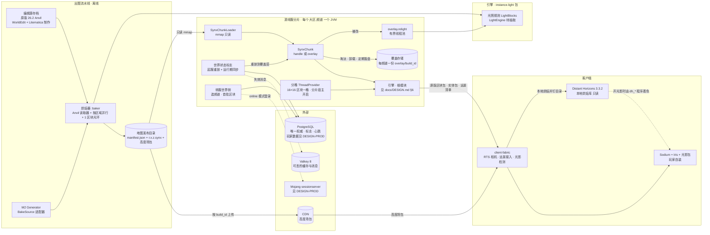
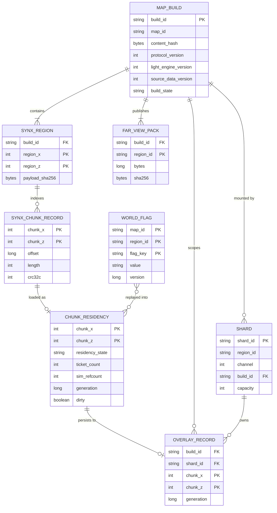
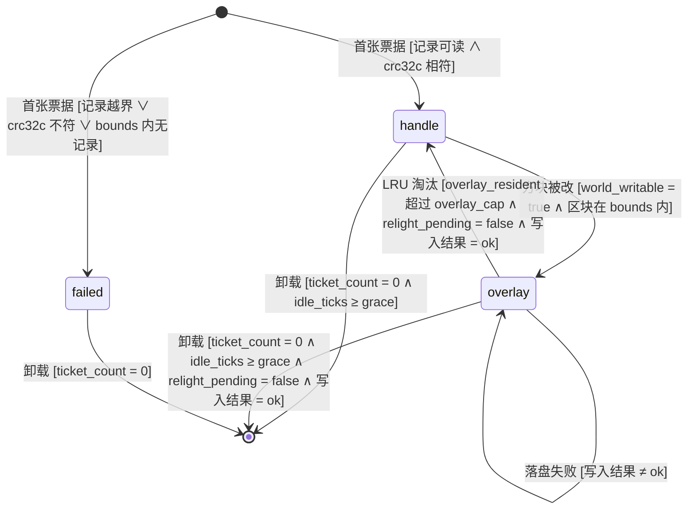
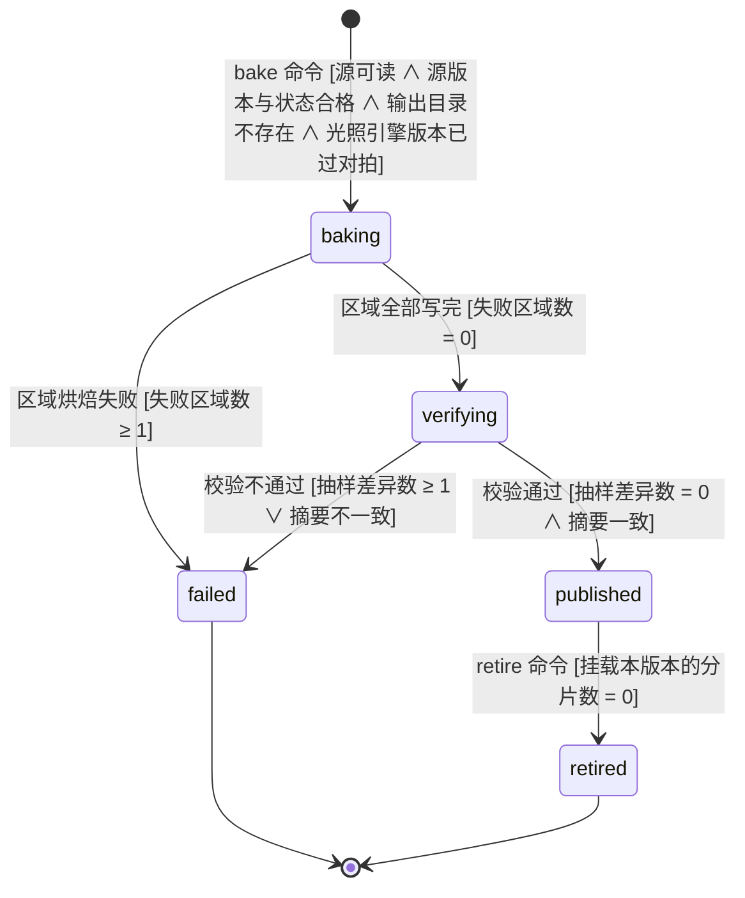
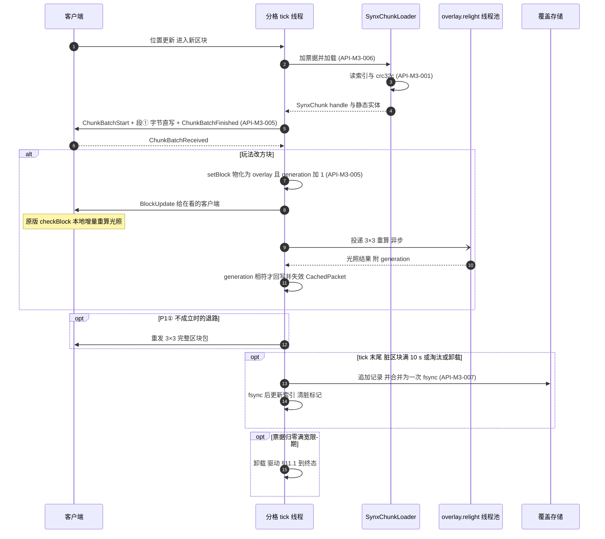
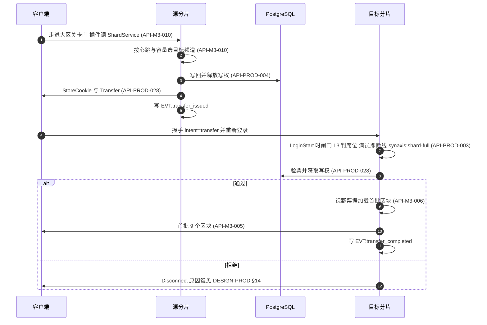
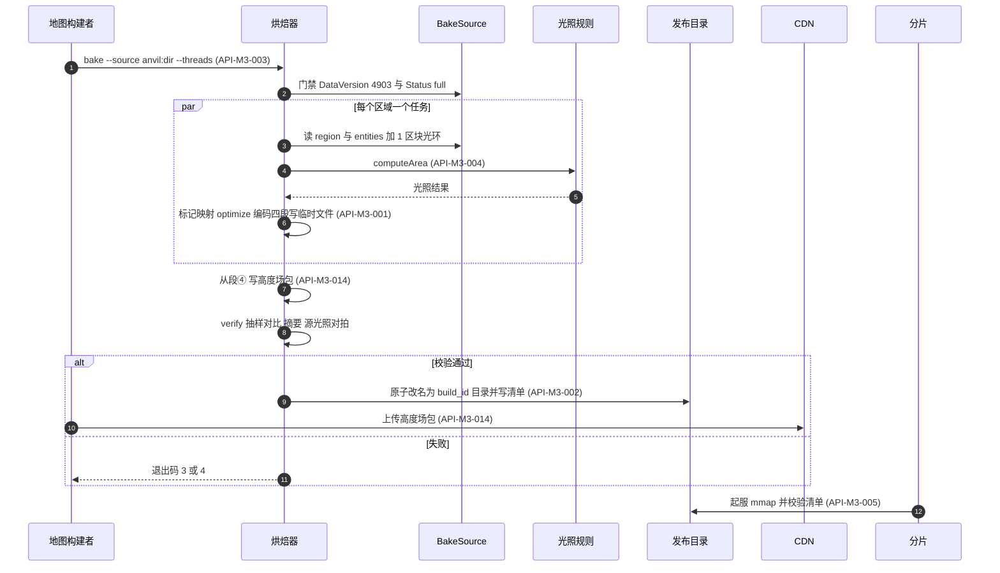
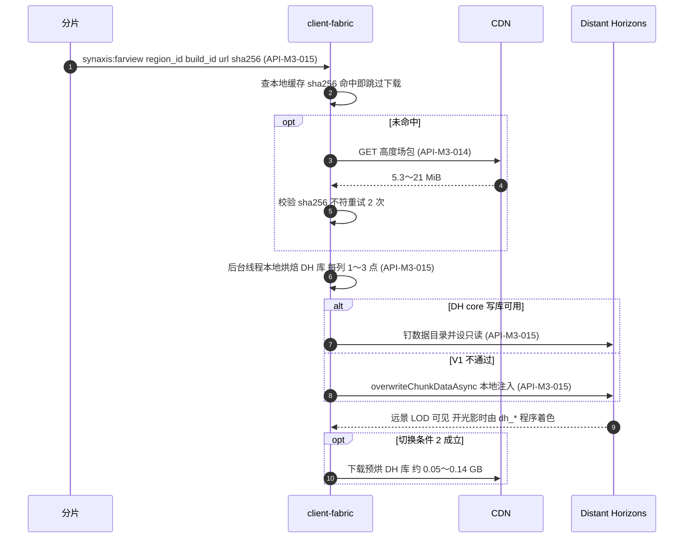
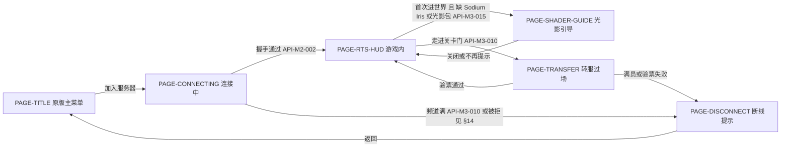

# Synaxis 设计文档 · 里程碑 M3「大世界地图管线与分片」

## 1. 元信息 / 变更记录

| 字段 | 值 |
| --- | --- |
| 状态 | 草稿（未评审；远景、光影、存储与分工已由用户 2026-09-23 拍板，见下方拍板表） |
| 项目画像 | 生产产品（与 `docs/DESIGN-M2.md` §1 相同：交付的是面向真实玩家的 MMO 服务端；按生产产品填全部 `[核心]` 节。可观测性与埋点仍落本地文件，外部依赖是 PostgreSQL、Valkey 8（Redis 兼容，只放可丢数据）与分发高度场包的 CDN） |
| Owner | Bearisbug |
| 评审人 | Bearisbug |
| 最后更新 | 2026-09-24 |
| 关联 | 引擎单一事实源 `docs/DESIGN.md` · M2 分册 `docs/DESIGN-M2.md`（§15、§28.2、§28.3） · 技术路线报告 `docs/research/large-world-2026-09/README.md`（下称「路线报告」，第 4 节与第 8.1 节的数字已被基准重测取代） · 远景与光影备忘录 `docs/research/large-world-2026-09/far-view-vs-iris.md`（下称「远景备忘录」） · 存储对比 `docs/research/large-world-2026-09/storage-options.md`（下称「存储对比」） · 基准重测 `docs/research/large-world-2026-09/bench-2026-09.md`（下称「基准重测」） · DH spike `docs/research/client-spikes-2026-09/dh-iris/README.md` · 生产就绪分册 `docs/DESIGN-PROD.md`（v0.7.1；其输入草案在 `docs/research/production-readiness-2026-09/`，本文档不再引用草案） · 测试文档 `docs/TEST.md` · 仓库 `https://github.com/Bearisbug/synaxis` |

本文档是 `docs/DESIGN.md` 的第二个里程碑分册，写法与防腐坏机制沿用 `docs/DESIGN-M2.md` §24 最后一条：只管 M3 新增的东西，引擎侧与 M2 侧的事实一律用「见 `docs/DESIGN.md` §N」「见 `docs/DESIGN-M2.md` §N」引用。ID 独立编号：需求 `REQ-M3-*`、接口 `API-M3-*`、决策 `ADR-M3-*`、Runbook `RB-M3-*`；实体 `ENT-*`、页面 `PAGE-*`、事件 `EVT:*` 用语义命名，名字与 M1、M2 已有的不重复（已核对 `ENT-Map`、`ENT-NavGrid`、`ENT-Match` 等 M2 名字未被复用）。

**`.synx` 的 ID 处置**：`docs/DESIGN-M2.md` §28.3 ② 原写「M3 整条加回 `API-M2-009`」。M3 的格式与 M2 当初的设计不是同一个东西（M2 是单文件 `header` / `chunks` / `nav` 三段；M3 是 32×32 区块一个区域文件、偏移索引、四段内容、存已成帧的原版包体），按 ID「语义实质变更 = 新 ID」的规则，M3 用 `API-M3-001` 取代 `API-M2-009`，`API-M2-009` 不复活；M2 分册 §28.3 ② 已同步改写（`docs/DESIGN-M2.md` v0.45）。

**与生产就绪轨道的分工**（用户 2026-09-23 拍板）：PostgreSQL 是唯一权威存储，Redis 只放可丢的缓存和消息；玩家数据、写权租约（每个分片一个会话租约）、转服 Cookie 的签名与验票、正版验证、连接闸门、压测 harness、空间分格线程的引擎侧细节、PostgreSQL 迁移与回退，一律以生产就绪分册 `docs/DESIGN-PROD.md` 为准。本文档只写这些能力的区块与世界侧需求，引用而不复述。

用户 2026-09-23 的拍板（本文档所有设计的前提）：

| 问题 | 拍板 | 本文档据此做的事 |
| --- | --- | --- |
| Q1 远景画什么 | 接受「高度场地形 + 颜色」 | 远景按 Q1 只烘地表与水面，见 R3 行与 `ADR-M3-012` |
| Q2 光影 | 社区光影包（Iris + Complementary / Photon 一类）作主画面，不自研画风 | `ADR-M3-010`、`REQ-M3-019`、`REQ-M3-026`；删掉路线报告的 P5（自研 L1/L2）与 64 点光源 UBO |
| Q3 地图 | 人工制作、静态、按版本发布 | `.synx` 只读烘焙 + 覆盖层；地图升版 = 重新烘焙 |
| Q4 在线规模 | 每分片 200～500 人，按大区分服 + 频道，不做无缝跨服 | `REQ-M3-015`～`REQ-M3-017` |
| Q5 硬件 | 必须支持 Apple Silicon（GL 4.1）；低配档 GTX 1650 / M1、1080p、r=8 | §15 兼容行与 §17 外部依赖 |
| Q6 远景半径 | 4,096 格（低配档 2,048 格） | `REQ-M3-025` |
| Q7 世界高度 | 256 格 | `.synx` 头部按 256 定；§2 默认档用高 256 的基准值 |
| Q8 服务端读光照 | 不读 | 服务端光照只为给新观察者发包，不进玩法查询 |
| Q9 Sodium | 不捆绑，只声明兼容 | Iris 硬依赖 Sodium，Sodium、Iris、光影包都由玩家自装（R1 行） |
| 远景方案 | 方案 B：Distant Horizons。客户端首次进大区下载 5.3～21 MiB 高度场包，本地烘焙 DH 库（每列 1～3 点）；切换条件与退路（CDN 预烘库、方案 C 经 Iris `assignPipeline`）照远景备忘录 §6。自写 clipmap + 自研着色器（方案 A）排除 | `ADR-M3-012`、`REQ-M3-024`、`REQ-M3-025` |
| R1 光影组件谁装 | Iris、Sodium、光影包由玩家自装；客户端检测并引导，没装时用原版画面兜底。DH 随客户端整合分发（用户 2026-09-23 确认：LGPL-3.0，附许可、允许玩家替换 jar，版本锁定与本地烘焙代码一起升级） | `REQ-M3-026`、`PAGE-SHADER-GUIDE`；DH 分发见 `API-M3-015` 许可段 |
| R2 RTS 相机 | 带俯角的透视，eye 离地 ≤ 100 格，不用正交。相机实现归 `docs/DESIGN-M2.md` 阶段 6b（另一会话负责），本文档只引用；M2 §28.2「RTS 相机形态」那条 Open Question 仍写「待用户选」，由 6b 关闭 | §6.1 共同约束；DH 在正交下不画 LOD 是选透视的依据之一 |
| R3 远景烘焙粒度 | 只烘高度场（每列 1～3 点，不保留建筑轮廓），客户端本地生成 DH 库 | `REQ-M3-025` |
| 存储路线 | 原版 26.2 Anvil 存档作编辑器交换格式 → `:baker` 烘焙 → `.synx` mmap；覆盖层存本地只追加分段文件，每频道一份 | `ADR-M3-014`、`ADR-M3-015` |
| F1 地图新版本与覆盖层 | 地图发新版本（新 `build_id`，含只升协议）时清空覆盖层；要跨版本保留的东西建模成世界状态标志 | `API-M3-007`、`REQ-M3-023` |
| F2 频道之间 | 同一大区不同频道的地形改动互相不可见 | `ADR-M3-015` |
| F3 美术工具 | **默认** WorldEdit + Litematica，不买 Axiom（用户可改） | `REQ-M3-022`、§28.1 |
| F3′ 服务端数据标记 | **默认**用 DATA 模式结构方块的 metadata 标记 handler 与服务端 NBT（用户可改） | `REQ-M3-022`、§28.1 |
| F4 覆盖层崩溃丢失窗口 | 10 s：定期写脏区块 + 每 tick 一次 group commit `fsync` | `API-M3-007` |
| F5 地图里的实体 | 允许美术放实体，烘焙器读 `entities/` | `REQ-M3-020`、段③ 静态实体表 |

变更记录：

| 日期 | 版本 | 改动 | 作者 |
| --- | --- | --- | --- |
| 2026-09-24 | v0.6 | 按 `docs/DESIGN-PROD.md` v0.7.1 §28.3 改写对转服票据与迁移版本号的引用。**票据**：§1 末段、§3 首批区块耗时行、§4 转服术语、`REQ-M3-017`、`ADR-M3-008`、§12.2 两步（`StoreCookie` 与 `Transfer`、验票并获取写权）改指该分册 `REQ-PROD-045`、`API-PROD-028`（Cookie 布局含 `character_id`，检查 ④ 加票据 `player_uuid` 与本次验证 UUID 的一致校验）；`API-M3-010` 插件面写明 `ShardService#transfer` 选好频道后调宿主接口 `TransferTickets#transfer(player, targetShardId, host, port)`，三种失败结果交还插件；§14 两个键改为由该分册 §14 定义，`synaxis:state-unavailable` 补齐转入验票的两种来源；§20 注明 `EVT:transfer_rejected` 由该分册 §20 定义；§28.2 冒名风险行补检查 ④。**清理**：删去 §17 `nonce.gc` 行，`transfer_nonce` 过期行由该分册 §17 `transfer_nonce.gc` 清理，§15 数据增长行同步。**排期**：§26 M3-E 的转服只依赖该分册第 3 波 3D 组（`TransferTickets` 已在 `main`），不再依赖 6A。**迁移**：§25 与 `API-M3-013` 写明 `world_flag` 版本号在合并时取下一个空号、不开 `outOfOrder`（`main` 已有 V1～V4，当前预计 `shard_heartbeat` = V5、`world_flag` = V6，以该分册 §25 为准）。§1 关联行改指该分册 v0.7.1；§28.2 两条技术债（生产就绪分册按 v0.2 引用、`world_flag` 未分版本号）转已决 | Bearisbug |
| 2026-09-23 | v0.5 | 区块包字节确定性：引擎 `ChunkData` 修复前用 `Map.copyOf` / `toUnmodifiableMap` 复制高度图与方块实体，同一区块在不同 JVM 里编出长度相同、字节不同的包（`5fba33a398` 修复）。`REQ-M3-003` 补「区块包逐字节确定」；`API-M3-001` 段① 加「字节可复现」（编码集合的固定顺序、禁止直接决定编码顺序的集合、编码前 `optimize(SIZE)`、验收门 `ChunkPacketDeterminismTest`）；`API-M3-003` 确定性条目改为解压后包体跨 JDK 相同、成帧字节同一 JDK 构建相同；`API-M3-008` 输出加 `packet` 作业的四个 SHA-256 摘要；§19 新增「区块包跨 JVM 逐字节确定」「基准的区块包字节两次运行逐字节相同」两条场景，「基准程序复跑」的字节判据改为与 `bench-2026-09-packet-canonical-1.json` 的摘要相同；§28.2 加跨区块写入未覆盖的风险 | Bearisbug |
| 2026-09-23 | v0.4 | 按 `docs/DESIGN-PROD.md` v0.3 §28.3 改写对生产就绪的全部引用：原先指向 `docs/research/production-readiness-2026-09/` 三份草案的位置一律改指该分册的 ID 与节号。**频道满**：只用 `synaxis:shard-full` 一个键，住引擎 `DisconnectReasons`，由连接闸门 L3 在 `LoginStart` 按已占席位判定，早于加密请求与读 Cookie，不消耗票据 nonce，不写台账（`REQ-M3-016`、`REQ-M3-017`、`API-M3-010` 容量段、§12.2、§13、§14、§19 两条场景与 `RB-M3-001` 改为断言 `synaxis_gate_rejections_total{reason="full"}`），取代 v0.3 的 `synaxis:server-full`。**分格线程**：`REQ-M3-015`、`API-M3-009` 只提世界侧要求，引擎侧设计引用 `API-PROD-016`，`ADR-M3-006` 引用 `ADR-PROD-006`。**持久化与租约**：§1 末段写明 `REQ-M3-018`、`API-M3-012`、v0.2 §11.4、`RB-M3-005`、`API-M3-011` 的去向；§7、§11、§16、§17、§20（`EVT:lease_takeover` 属性为 `character_id`、`previous_session_id`、`gap_ms`）、§21、`ADR-M3-009`（引用 `ADR-PROD-003`、`ADR-PROD-004`）改为引用该分册；§14 写明 `synaxis:state-unavailable` 的来源按该分册 §14（在线模式下先顶号，5 s 内拿不到租约才回这个键）；§15 数据增长行加 `transfer_nonce` 与玩家数据的出处；外部依赖写明 Valkey 8（可丢）。**迁移**：§25 改为引用该分册 §25 版本表（`shard_heartbeat` = V5，脚本内容由本分册提供；`transfer_nonce` = 该分册 V1；`player_state` 不建），回退策略两层；§17 新增 `nonce.gc`（每 10 min，`transfer_nonce` 唯一的清理任务）。**区块发送**：`API-M3-006` 写明引擎兜底限速每玩家每 tick 64 区块（`synaxis.chunk-queue.max-per-tick`，1,280 区块/s）保持不变，并与分片宿主每玩家 4 区块/tick（`REQ-PROD-026`）对照。**停机**：`API-M3-007` 停机段挂到该分册 §11.4 `saving` 阶段，§28.2「停机预算已占满」改为挂载方式的开放问题。**DH 分发**：用户确认随客户端分发（LGPL-3.0，附许可、允许玩家替换 jar，版本锁定与本地烘焙代码一起升级），§1 R1 行、`API-M3-015` 许可段、§17、§23 检查单同步，§28.1 该行关闭。§28.2 新增两条交给生产就绪会话：该分册仍按 v0.2 引用 `API-M3-011` 与本文档 §14 的两个键；`world_flag` 不在该分册 §25 版本表 | Bearisbug |
| 2026-09-23 | v0.3 | 合入用户对远景、光影、存储与分工的拍板及五份证据。**远景与光影**：§6.1 与 `ADR-M3-012` 定为方案 B（DH + 客户端本地烘焙高度场包），新增 `REQ-M3-024`～`REQ-M3-026`、`API-M3-014`、`API-M3-015`、§12.4 时序与 `PAGE-SHADER-GUIDE`；DH spike 的结论（本地注入在 llvmpipe 下可用、正交不画 LOD、透视下相机周围约一个原版视距不画、与 Iris 同开固定 OpenGL、光影包在 LOD 上的效果无有效数据）写进 §6.1 与 §28.2。**存储**：`API-M3-001` 段② 删碰撞位集、段③ 改为全部方块实体完整 NBT + handler + 静态实体表，`region_content_hash` 改按段① 解压后包体算；烘焙器读 `region/` 与 `entities/`、DataVersion 门禁、「升级 → 预生成 → 校验 `isLightOn` 覆盖率」固定顺序；覆盖存储用 `Arena.ofAuto` 映射、活动段预分配、10 s 定期落盘 + group commit；新增 `REQ-M3-020`～`REQ-M3-023`、`API-M3-013`、`ADR-M3-014`、`ADR-M3-015`；关闭「编辑源格式」「覆盖存储重启是否保留」两个开放问题。**光照**：④⑤ 两处缺陷与对拍中发现的 `fullyLit`、面遮挡、`ShapeImpl` 三处已修，`LightParityIntegrationTest` 7 个场景 0 差异是验收门；真值改为原版 26.2 `LevelLightEngine` 隔离运行（`ADR-M3-013` 取代 `ADR-M3-005`）；新增 `REQ-M3-027`（面遮挡）与 `REQ-M3-028`（`fullyLit`）；`flushQueue` 竞争改为 M3-D 前必须处理；§15 删去对拍例外表（测试直接断言 0 差异）。**基准**：§2、§15 的带宽、磁盘、堆、耗时换成基准重测值，P2 验收补调色板形态与「不产生 `ChunkDataPacket`」两条。**分工**：`REQ-M3-018`、`API-M3-011`、`API-M3-012`、`RB-M3-005` 与 §11.3、§11.4 两台状态机移交生产就绪轨道；`ADR-M3-009` 改为「PostgreSQL 唯一权威、Redis 只放可丢的缓存和消息」；分片宿主 `dispatcherThreads` 改为核数 − 2；频道满员改用连接闸门的 `synaxis:server-full`；原 `API-M3-011` 里的 `synaxis.accept-transfers=true` 并入 `API-M3-010`；覆盖存储补停机落盘（`overlay.shutdown-flush`，§11.1 加一条迁移）；转服首批区块耗时的起点定为票据 `issued_at`，`EVT:transfer_issued` 加该属性；§28.2 列全生产就绪文档对 v0.2 的引用。**自定默认**：DH 随客户端分发登记进 §28.1。另同批改了 `docs/DESIGN-M2.md` 两处（v0.45）、`docs/DESIGN.md` §28 parity 技术债转已决（v0.36）、`CLAUDE.md` 一句与路线报告开头一行 | Bearisbug |
| 2026-09-23 | v0.2 | 评审第 1 轮修订：M3 的线程模型、模拟距离、自动卸载改为分片宿主显式开启，引擎默认值不变（`API-M3-006`、`API-M3-009`，§19 加一条 M2 行为不变的场景）；§6.1 按远景备忘录改为 A / B / C 三条路；§5 光照处置表 ⑥ 改为 `flushQueue` 保留给 `relightSection`；`REQ-M3-006` 注册表计数更正为 727 / 85 / 384；覆盖存储改为只追加分段 + 内存索引；§6 登记 `:synx` 用到的引擎内部面；§11.2 光照版本守卫前移到 `[*] → baking`；Flyway 回退改为手工回退 SQL；§15 / §19 火把、光影同装、对拍例外表的判据改为可判定；`docs/DESIGN.md` 同批登记 §26 与变更记录 | Bearisbug |
| 2026-09-23 | v0.1 | 初稿：`.synx` 格式与测试向量、离线烘焙器、光照引擎抽取与两处修复、原版光照对拍、`SynxChunkLoader` 与区块驻留、覆盖层、运行时光照、基准程序、空间分格线程、大区分服与频道、转服票据、外部状态存储；远景占位；光影按 Q2 定为社区光影包 | Bearisbug |

已废弃、移交生产就绪分册的 ID（编号不回收）与去向：`REQ-M3-018` 外部状态存储 → `docs/DESIGN-PROD.md` `REQ-PROD-005`～`REQ-PROD-007`；`API-M3-012` 玩家状态存储与 v0.2 的 §11.4 `ENT-StateLease` → `API-PROD-004`、`API-PROD-005` 与该分册 §11.3 `ENT-CharacterLease`；`RB-M3-005` 外部状态存储不可用 → `RB-PROD-002`；`API-M3-011` 转服票据 Cookie → `REQ-PROD-045`、`API-PROD-028`（Cookie 布局含 `character_id`、`SYNAXIS_TRANSFER_HMAC_KEYS`、检查 ①～⑥ 且 ④ 校验票据 `player_uuid` 等于本次验证 UUID、`transfer_nonce` 表与清理任务 `transfer_nonce.gc`），插件面的 `transfer` 与 Cookie 见 `REQ-PROD-031`、`API-PROD-021`。区块与世界侧的剩余需求见 `REQ-M3-017`、`REQ-M3-023`、`API-M3-013`、`RB-M3-006`。

## 2. 背景 / 目标 / 非目标

- 背景：M2 的地图是进程内程序化生成、整图常驻、无文件格式（见 `docs/DESIGN-M2.md` §2 非目标与 §28.3 ②）。路线报告第 2.2 节列出这套做法撑不起 MMO 大世界的五个硬限制：整图常驻在 10k×10k 格时要 7.9 GiB 堆（高 256 自然地形，基准重测 §6.3）；没有按视距或无人观察的自动卸载（`InstanceManager.java:93` 只在注销整个实例时卸载）；只有 `NoopChunkLoaderImpl`；`ServerProcessImpl.java:104` 写死 `ThreadProvider.counter()`；`LightingChunk` 的六处问题（§5 末表）。每发一个未缓存的区块，服务端要付 0.52 ms（不带光照）或 3.95 ms（懒算光照）CPU（高 256 自然地形，基准重测 §3.1）。
- 目标：
  1. 地图成为离线烘焙的只读产物：`.synx` 区域文件存已成帧已压缩的原版区块包体与烘焙光照，服务端对未改区块只做「mmap 读 + 写 socket」。
  2. 光照与原版一致且有可执行的证据：光照缺陷已修，逐值对拍是门禁，错误不会被烘焙进全部 `.synx`。
  3. 运行时内存有界：视距与模拟距离分开、按观察者引用计数自动卸载、被改区块进覆盖层且覆盖层有 LRU 硬上限，崩溃最多丢 10 s 改动。
  4. 规模数字可复现：带宽、磁盘、堆、耗时都来自入库的基准程序（基准重测），美术地图出来后按同一程序补测。
  5. 每分片 200～500 人：空间分格线程、大区分服 + 频道、跨大区转服；玩家数据与写权由生产就绪分册 `docs/DESIGN-PROD.md` 负责。
  6. 远景 4,096 格：客户端用 DH 画高度场 LOD，开光影时由光影包统一着色。
- 非目标：
  - 不自写远景 clipmap 与着色器（方案 A 排除）；方案 C（clipmap 经 Iris `assignPipeline` 登记）只作 `ADR-M3-012` 的退路，不排期。
  - 不做自研光影（路线报告的 L1 调色、L2 阴影与体积光）与 64 点光源 UBO、`synaxis:lights` 通道（Q2，`ADR-M3-010`）。动态光只有原版方块光。
  - 不捆绑 Sodium、Iris 与光影包（Q9、R1）。
  - 远景不保留建筑轮廓（R3），不做体素 LOD。
  - 不做无缝跨服、边界幽灵实体、区块所有权迁移，不做「千人同屏」（Q4）。
  - 不做地图编辑器；美术用原版客户端 + 外部工具出 Anvil 存档（`ADR-M3-014`）。
  - 不做运行时地形生成；M2 的 `Generator` 只作为烘焙器的一种输入。M2 的 RTS 对局地图仍在进程内生成，不走本文档的管线。
  - 不支持大规模改地形的玩法（Q3）。覆盖层按「局部、少量改动」设计，上限触顶即降级（见 `RB-M3-002`）。
  - 覆盖层不跨地图版本保留、不跨频道共享（F1、F2）；要跨版本或跨频道一致的东西走世界状态标志（`REQ-M3-023`）。
  - 静态实体（展示框、盔甲架等）的运行期改动不持久化（§28.2）。
  - 服务端玩法不读光照值（Q8）。
  - 不做客户端本地区块缓存、不换 zstd 压缩（路线报告 §3.5、§3.6 都放到实测之后）。
  - 不修 `LightingChunk` 的运行期路径（懒算、`relightSection` 的实例锁、延迟重发），MMO 实例不使用它（§5 末表）；`flushQueue` 竞争例外，M3-D 前必须处理。
  - 不做 `docs/DESIGN-M2.md` §28.3 ③ 的多局并行；M2 RTS 进程的运行行为不变：M3 新增的线程模型、模拟距离、自动卸载都由 MMO 分片宿主显式开启，引擎默认值不改（`API-M3-006`、`API-M3-009`）。
  - 不设计玩家数据、写权租约、转服票据的签名与验票、正版验证、连接闸门与压测 harness 本身（生产就绪分册 `docs/DESIGN-PROD.md`，见 §1 分工）。
  - 不升 Minecraft 版本（26.2 / 协议 776 继续钉死，重估见 `docs/DESIGN-M2.md` `ADR-M2-016`）。

规模画像（下游 §15 / §17 / §21 全部数字的唯一来源）。**数字口径**：区块包体、堆、序列化与 relight 耗时出自基准重测（Apple M4 Pro 12 核，`bench-2026-09-results.json`）。三条限制对本表每一行都成立：地形是合成的，美术地图未测；墙钟耗时在负载均值 26～82 的机器上测得，只当上界；CPU 时间比墙钟稳，估算成本时用 CPU。默认档取「高 256 自然地形」（Q7 高度，地下有矿有洞），另列「高 256 实心地下」（人工地图地下不做内容）与「高 384 自然地形」两档作区间。

| 维度 | 估算 | 依据 / 假设（未知则写假设 + 重估阈值） |
| --- | --- | --- |
| 用户量 | 内测档：单分片 50～200 人。正式档：每分片 200～500 人，64 个大区，每个大区 1～N 个频道 | Q4 拍板。500 人的数字从 50 连接 soak（`docs/research/soak-2026-09-22/`）与基准重测线性外推；实测 500 机器人不达标时频道上限降到 200～300 人（`REQ-M3-016` 验收） |
| 地图尺寸 | 内测档：4,096×4,096 格 = 65,536 区块（1 个大区）。正式档：32,768×32,768 格 = 4,194,304 区块，切成 64 个 4k×4k 大区 | 路线报告 §4.2、§4.3。正式档尺寸是技术上限，内容产能未评估（§28.2） |
| 世界高度 | 256 格（16 个 section） | Q7 |
| 区块包体 B（压缩后含光照，均值） | 默认 1,502 B/区块；区间 583 B（实心地下）～2,582 B（高 384） | 基准重测 §3.1、§6。块光为 0（地形没有光源方块），美术地图的火把、岩浆、方块实体会让包体变大，幅度未测。第一张美术地图实测（存储对比 T1）与 1,502 B 偏差超过 ±20% 时重算本表 |
| 视距 / 模拟距离 | 视距 12（上限 16），视野 (2·12+1)² = 625 区块；模拟距离 4，81 区块 | 路线报告 §3.3 |
| 每玩家近圈下行 | 进场 625 × B ≈ 0.94 MB；步行 4.317 格/s → 6.75 区块/s ≈ 10.1 KB/s；坐骑 10 格/s → 15.6 区块/s ≈ 23.5 KB/s；飞行 30 格/s → 46.9 区块/s ≈ 70.4 KB/s | 新进视野区块数 (2r+1)·v/16（`ChunkRange.java:14-17`，视野是正方形）× B；基准重测 §6.1 |
| 实体下行 | 14.5～32.5 KB/s/人 | soak-2026-09-22，50 人 × 1,000～4,000 单位（RTS 口径）。**不是 MMO 主城上界**：主城可见对数按 n² 增长，没有模型（§28.2）。包体变小后实体流量是出站的大头：默认档步行时近圈只占 24% |
| 分片出站 | 200 人：步行 8.5 MB/s（68 Mbit/s），全员骑乘 11.2 MB/s（90 Mbit/s）；500 人：步行 21.3 MB/s（171 Mbit/s），骑乘 28.0 MB/s（224 Mbit/s） | (近圈 + 32.5 KB/s 实体) × 人数，基准重测 §6.1、§6.2。千兆网卡够用；超过 800 Mbit/s 需重估网卡与频道上限 |
| 区块吞吐 | 500 人 3.4k～7.8k 区块/s，全部是 mmap 读 + 内存拷贝（5.1～11.7 MB/s） | 500 × 6.75～15.6 区块/s × 1,502 B |
| 引擎兜底限速 | 64 区块/tick = 1,280 区块/s（`ServerConfig.maxChunksPerTick`，属性 `synaxis.chunk-queue.max-per-tick`） | 存储对比 §4 口径更正；正常速率由客户端 `ChunkBatchReceived` 回报决定，流控不改 |
| 区块 CPU 对照 | 未改区块改走 `.synx` 之前：每区块 0.52 ms（不带光照）/ 3.95 ms（懒算光照）CPU；走 `.synx` 之后只剩读页与拷贝 | 基准重测 §3.1 整遍 CPU，高 256 自然地形 |
| 加密 CPU（online 模式） | AES-CFB8 出站 11.2～11.6 ms/MiB；500 人步行 21.3 MB/s ≈ 0.23 核，骑乘 28.0 MB/s ≈ 0.30 核 | 本机实测（M4 Pro），出处见 `docs/DESIGN-PROD.md` `ADR-PROD-011`；核数按 11.29 ms/MiB × 本表「分片出站」推算。该分册 §2 的 0.21 核用同一速率、按 RTS 4,000 单位档 18.30 MiB/s 算，口径不同、不矛盾。`.synx` 的预压缩包体可以复用，但加密是每连接一次，不能跨连接复用 |
| 磁盘 | 每大区 `.synx` ≈ 219 MB + 段③：段① 65,536 × 1,502 B ≈ 98 MB；段② 544 B/区块 ≈ 36 MB；段③ 只存方块实体与静态实体，合成地形为 0，美术地图未测；段④ 1.25 KiB/区块 ≈ 84 MB；索引与头部约 1 MB。正式档全世界 ≈ 14 GB + 段③ | `API-M3-001` 各段布局；段① 按包体区间为 38～169 MB/大区；段③ 由存储对比 T1 量 |
| 远景高度场包 | 每大区 5.3～21 MiB（未压缩，从第 2 层或第 1 层起的金字塔）；正式档全部大区 0.33～1.3 GiB | 路线报告 §4.2 算式 1,024² 或 2,048² × 4 B × 4/3；压缩率未测 |
| 服务端堆 | 覆盖层 LRU 上限：内测档 16,384 区块 × 21.1 KiB ≈ 0.33 GiB（含 SoftReference 包缓存的上界 0.56 GiB）；正式档 24,576 区块 ≈ 0.49 GiB（0.84 GiB）。堆外成帧包体 24,576 × 1,502 B ≈ 37 MB。区块解码缓存上限 256 MiB。句柄区块常驻字节未测 | 基准重测 §3.1 存活堆（光照已算、间接调色板）；句柄区块由存储对比 T3 量。进程目标 RSS < 4 GiB |
| 烘焙 | 一个 4k×4k 大区：光照 52～92 CPU·s + 编码约 31 CPU·s（0.47 ms/区块）；正式档全图光照 0.9～1.6 CPU·h，按区域并行摊到核上 | 基准重测 §6.3（整图 relight 的 CPU 线性外推，高 256）与 §3.1「光照已知」整遍 CPU |
| 世界状态标志 | 假设每大区 ≤ 1,000 个标志，写入 ≤ 1 次/秒 | 假设值；超过 10,000 个标志或 10 次/秒时重估 `API-M3-013` 的重放与同步方式 |
| 分布与形态 | 每个大区一个进程，满员开频道；同一大区的频道进程部署在同一台机器并挂同一只读卷，映射同一 inode，页缓存只占一份（各容器各拷一份则不共享）。地图发布目录按 `build_id` 分发到分片机；高度场包经 CDN 分发给客户端；外部依赖 PostgreSQL（唯一权威）与 Valkey 8（Redis 兼容，可丢） | Q3、Q4、存储对比 §2 |

## 3. 成功指标 / 验收阈值

指标全部由 §20 的 `EVT:*` 事件计数算，事件写本地 JSONL（沿用 `docs/DESIGN-M2.md` §20 的落盘方式，文件按分片分开）。接口可用性类 SLI 在 §21。

| 指标 | 定义（分子 ÷ 分母，全部是事件计数或事件属性） | 当前 | 目标 | 由哪些事件算 |
| --- | --- | --- | --- | --- |
| 转服成功率 | `EVT:transfer_completed` 计数 ÷ `EVT:transfer_issued` 计数 | 无（M3 前无转服） | ≥ 99% | 见 `EVT:transfer_issued`、`EVT:transfer_completed` |
| 转服首批区块耗时 P95 | `EVT:transfer_completed` 的 `first_batch_ms`（票据的 `issued_at` 到目标分片发完首批 9 个区块的 `ChunkBatchFinished`。`issued_at` 由源分片签票时写进 Cookie，同一个值记为 `EVT:transfer_issued` 的 `issued_at` 属性；`issued_at` 是 Cookie 布局里的字段，布局见 `docs/DESIGN-PROD.md` `API-PROD-028`。两个时间戳来自两台机器，前提是分片机跑 NTP 且时钟偏差 ≤ 50 ms，即 5 s 目标的 1%） | 无 | < 5 s | 见 `EVT:transfer_completed` |
| 零编码发送占比 | 各分片 `EVT:chunk_stream_stats` 的 Σ`handle_sent` ÷ Σ(`handle_sent` + `overlay_sent`) | 无 | ≥ 95%（监控阈值，不是容量假设：堆由覆盖层上限兜住） | 见 `EVT:chunk_stream_stats` |
| 地图版本一次发布成功率 | `EVT:map_build_finished`（`outcome=published`）计数 ÷ `EVT:map_build_started` 计数 | 无 | ≥ 90% | 见 `EVT:map_build_started`、`EVT:map_build_finished` |

「转服成功率」同时作为 §21 的同名 SLI，两处是同一个数值口径。

## 4. 术语表 / 统一语言

引擎侧术语见 `docs/DESIGN.md` §4，M2 术语见 `docs/DESIGN-M2.md` §4，本表只登记 M3 新增的。

| 术语 | 定义 | 代码/字段标识 | 对应实体 |
| --- | --- | --- | --- |
| 区域文件 | 一个 `.synx` 文件，装 32×32 个区块的记录，头部带偏移索引，只读 mmap | `r.<rx>.<rz>.synx` | `ENT-SynxRegion` |
| 区块记录 | 区域文件里一个区块的四段内容 | `chunk_record` | `ENT-SynxChunkRecord` |
| 段① 包体 | 已成帧、已压缩的原版 `ChunkDataPacket` 字节（含高度图、调色板与烘焙光照），与服务端写进 socket 的字节相同；也是服务端读方块状态的来源 | `seg_packet` | `ENT-SynxChunkRecord` |
| 段② 导航 | M2 导航层的 walkable 位集与 surface_y | `seg_nav` | `ENT-SynxChunkRecord` |
| 段③ 方块实体与静态实体表 | 区块内全部方块实体的完整 NBT 与 handler 命名空间，加源存档 `entities/` 里的静态实体 | `seg_entities` | `ENT-SynxChunkRecord` |
| 段④ 列摘要 | 每列的表面高度、表面方块、天光，是远景高度场包的来源 | `seg_columns` | `ENT-SynxChunkRecord` |
| 地图版本 | 一次烘焙的全部产物（区域文件 + 高度场包 + 清单），不可变，用 `build_id` 区分 | `map_build` | `ENT-MapBuild` |
| 地图内容哈希 | 对地图未压缩规范内容算的 SHA-256；同一输入、同一烘焙器与光照引擎版本产出同一哈希 | `content_hash` | `ENT-MapBuild` |
| 编辑源存档 | 美术交付的原版 26.2 Anvil 存档（DataVersion 4903），烘焙器的主输入 | `anvil:<dir>` | — |
| 烘焙器 | 离线命令行工具，把编辑源存档或生成器输出烘焙成地图版本 | 模块 `:baker` | `ENT-MapBuild` |
| 烘焙源 | 烘焙器的输入适配接口；M3 有「Anvil 存档」与「M2 生成器」两种实现 | `BakeSource` | — |
| 数据标记 | 美术在编辑源里放的 DATA 模式结构方块，metadata 写 handler 命名空间与服务端 NBT，作用于它正下方一格 | `metadata` | — |
| 光照规则 | 原版 26.2 的三条光照语义：衰减 `max(1, lightBlock)`、天光边规则、只对 `useShapeForLightOcclusion` 的状态做面遮挡 | `LightBlocks` | — |
| 光照形状表 | 使用面遮挡的 6,762 个方块状态 ID 清单，由原版服务端生成 | `light_shape_states.txt` | — |
| 光照引擎 | 从 `LightingChunk` 抽出、跑在 `WorldView` 上的纯函数式光照计算，不需要 `Instance`、不加锁（待抽取，`REQ-M3-004`） | `LightEngine` | — |
| 世界视图 | 只读的方块访问接口（坐标 → 方块），光照引擎的唯一输入 | `WorldView` | — |
| 句柄区块 | 堆里没有 section、发包直接写已成帧字节的区块；字节来源是区域文件（未被改过的区块）或覆盖存储（改过后被淘汰的区块） | `SynxChunk`（handle 模式） | `ENT-ChunkResidency` |
| 覆盖层区块 | 被玩法改过、已物化为 `DynamicChunk` 的区块 | `SynxChunk`（overlay 模式） | `ENT-ChunkResidency` |
| 覆盖存储 | 覆盖层区块落盘用的只追加分段文件，索引在内存；每频道一份，与地图版本绑定 | `overlay/<build_id>/seg.<n>.synx` | `ENT-OverlayRecord` |
| 定期落盘 | 覆盖层脏区块每 `flush_interval_s` 秒重编码追加一次，同一 tick 的全部追加合并成一次 `fsync`（group commit） | `overlay.flush` | `ENT-OverlayRecord` |
| 票据 | 让区块保持加载的引用；玩家视野与插件显式持有各算一张 | `chunk_ticket` | `ENT-ChunkResidency` |
| 视距 | 服务端给玩家发区块的半径（区块数） | `synaxis.chunk-view-distance` | — |
| 模拟距离 | 区块内实体与方块 tick 的半径；超出的区块只发包、不 tick。按实例设置，默认不限 | `Instance#setSimulationDistance` | — |
| 分片宿主 | MMO 分片的启动入口，与 M2 的 `Main` 分开；M3 的线程模型、模拟距离、自动卸载都只在这里开启 | `server-app` 的 `ShardMain` | `ENT-Shard` |
| 分格 | 16×16 区块的空间格，同一格内的区块归同一 tick 线程 | `grid_cell` | — |
| 大区 | 按地理切出的一块地图（正式档 4k×4k 格） | `region_id` | `ENT-Shard` |
| 频道 | 同一大区的一个进程副本；人数超上限时同一大区开多个频道 | `channel` | `ENT-Shard` |
| 分片 | 一个游戏服进程 = 一个（大区, 频道） | `shard_id` | `ENT-Shard` |
| 转服 | 用原版 `Transfer` 包把玩家送到另一个分片；票据签发、验票与写权交接见 `docs/DESIGN-PROD.md` `API-PROD-028`、§11.3 与 §12.3 | `transfer` | — |
| 世界状态标志 | 需要跨频道、跨地图版本保持一致的世界状态（开过的门、修好的桥），存 PostgreSQL；频道进程按标志重放到自己的覆盖层 | `world_flag` | `ENT-WorldFlag` |
| 高度场包 | 一个大区的远景数据：按层的高度 + 材质 + 色调采样金字塔，客户端下载后本地烘焙成 DH 库 | `farview/<region_id>.hfp` | `ENT-FarViewPack` |
| DH 库 | Distant Horizons 的 SQLite LOD 库；客户端从高度场包生成，经 DH API 钉住目录并设为只读 | — | — |
| 光影包 | Iris 加载的社区着色器包（Complementary、Photon 一类），玩家自装 | — | — |

## 5. 功能清单与需求 ID

无对外契约的需求（`REQ-M3-005`、`REQ-M3-006`、`REQ-M3-007`、`REQ-M3-012`、`REQ-M3-014`、`REQ-M3-019`、`REQ-M3-021`、`REQ-M3-022`、`REQ-M3-026`、`REQ-M3-027`、`REQ-M3-028`）按规则标注锚点为状态机迁移行、时序消息或 §24 门禁。

| ID | 功能 | 对应目标 | 优先级 | 锚点 |
| --- | --- | --- | --- | --- |
| REQ-M3-001 | `.synx` 区域文件格式：32×32 区块、定长头部 + 偏移索引、可 mmap、四段内容（段① 包体、段② 导航、段③ 方块实体与静态实体表、段④ 列摘要）、地图内容哈希 + 协议版本 + 注册表摘要；读写两侧共用一套测试向量 | 目标 1 | P0 | `API-M3-001` |
| REQ-M3-002 | 地图发布目录与清单：`manifest.json` 记内容哈希、协议版本、光照引擎版本、源存档 DataVersion 与光照覆盖率、逐文件摘要；分片起服时全量校验，任一项不符拒绝起服；升 MC 版本要按协议版本批量重烘，重烘耗时写进升版清单 | 目标 1 | P0 | `API-M3-002`；状态机见 §11.2 |
| REQ-M3-003 | 离线烘焙器：输入为编辑源存档或 M2 `Generator`；按区域并行（每个区域带 1 区块光环读取邻居）；产出区域文件、高度场包与清单；烘焙末尾自动校验（抽样逐字节对比 + 摘要）；同输入同版本产出同一内容哈希；产出的 section 只能是单值或间接调色板；「同一内容哈希」要求区块包逐字节确定：同一区块状态在任何 JVM、任何线程调度下编出的未压缩 `ChunkDataPacket` 字节相同（编码顺序与调色板规范化见 `API-M3-001` 段①） | 目标 1 | P0 | `API-M3-003`；状态机见 §11.2 |
| REQ-M3-004 | 光照引擎抽取：`LightEngine` 跑在 `WorldView` 上，不依赖 `Instance`、不进 `synchronized(instance)`；复用 `LightBlocks` 的光照规则；`LightingChunk.relight` 改为委托给它（M2 对局同时受益）；`LightParityIntegrationTest` 的全部场景同时对 `LightEngine` 跑 | 目标 2 | P0 | `API-M3-004` |
| REQ-M3-005 | 光照修复 ④（**已落地**，commit `32e1923e47`）：天光整列从世界顶部向下，停在第一条满足「下方方块 `lightBlock ≠ 0`，或上下两格之间的面相互遮挡」的边；删除手写的 23 种 `DIFFUSE_SKY_LIGHT`（注册表里默认状态 `lightBlock == 1` 的有 85 种方块，按任一状态计有 459 种） | 目标 2 | P0 | 无对外 API，见 §19 与 §24 光照门禁 |
| REQ-M3-006 | 光照修复 ⑤（**已落地**，commit `32e1923e47`）：BFS 每步衰减由固定 1 改为 `max(1, lightBlock(光进入的方块))`。按 `src/main/resources/data/block.json`，`lightBlock` 只有 0 / 1 / 15 三种取值：按默认状态是 727 / 85 / 384 个方块（共 1,196），按全部 32,366 个状态是 17,476 / 12,106 / 2,784；`tinted_glass`（`lightBlock` 15、遮挡形状为空）修复前让光像空气一样通过 | 目标 2 | P0 | 无对外 API，见 §19 与 §24 光照门禁 |
| REQ-M3-007 | 与原版 26.2 光照逐值对拍（**已落地**，commit `4ce6285d95`、`8d765c4acf`）：`LightParityIntegrationTest` 对 `parity/` 下每个 `*.scene` 建场景、跑光照，与原版 26.2 `LevelLightEngine` 隔离运行的结果（`tools/light-oracle/gen.sh` 生成的 `*.light.gz`）逐 nibble 比较 sky 与 block 两层；当前 7 个场景（surface、overhang、cave、transparent、emitters、deep、shaft），区块 −1..1、section −4..3，差异 0 是验收门 | 目标 2 | P0 | 无对外 API，见 §24 光照门禁与 §11.2 `[*] → baking` 守卫 |
| REQ-M3-008 | `SynxChunkLoader` 与 `SynxChunk`：未改区块以句柄形式加载，发包直接把段① 写进 socket，不建调色板、不算光照、不产生 `ChunkDataPacket` 对象；`getBlock` 从段① 整块解码进全局有界缓存；方块实体只从段③ 取；载入区块时按段③ 静态实体表生成实体；被改时物化为覆盖层 | 目标 1、目标 3 | P0 | `API-M3-005`；状态机见 §11.1 |
| REQ-M3-009 | 视距与模拟距离分离：分片宿主把视距设为 12（上限 16）、模拟距离设为 4，只有模拟距离内的区块 tick 实体与方块。模拟距离按实例设置，引擎默认「不限」，M2 对局行为不变 | 目标 3 | P0 | `API-M3-006` |
| REQ-M3-010 | 按观察者引用计数自动卸载：开启了自动卸载的实例上，票据数归零且空闲满 100 tick 的区块卸载；插件可显式持票。按实例开启，引擎默认关闭，M2 对局整图预载的区块不受影响 | 目标 3 | P0 | `API-M3-006`；状态机见 §11.1 |
| REQ-M3-011 | 覆盖层：被改区块物化为 `DynamicChunk`；改动写每频道一份的覆盖存储，不改 `.synx`；覆盖层常驻数有 LRU 硬上限（内测档 16,384、正式档 24,576），淘汰时写覆盖存储并退回句柄；脏区块每 10 s 定期落盘，同一 tick 的追加合并为一次 `fsync`，进程崩溃最多丢最近 10 s 的改动（F4），正常停机时全部脏区块落盘；地图换 `build_id` 时清空（F1） | 目标 3 | P0 | `API-M3-007`；状态机见 §11.1 |
| REQ-M3-012 | 运行时光照：未改区块的光照随段① 下发，服务端 0 CPU；被改区块在 tick 线程外的有界线程池做 3×3 局部重算，结果只进之后发给新观察者的包；不向已在看的客户端发 `UpdateLightPacket`（前提待 P1① 验证，退路见 `ADR-M3-002`）；开工前 `flushQueue` 竞争必须已消除（§5 末表 ⑥） | 目标 2、目标 3 | P0 | 无对外 API，见 §12.1 时序与 §17 内部任务 `overlay.relight` |
| REQ-M3-013 | 可提交的基准程序：已完成（基准重测，`LargeWorldBench`，两轮），§2 / §15 已换成重测值；剩余三项：空闲机器复跑墙钟列、加「从 `.synx` 或 Anvil 读入」的真地图档（存储对比 T1）、补句柄区块常驻字节（T3）与段① 解码耗时（T2） | 目标 4 | P0 | `API-M3-008` |
| REQ-M3-014 | 压测量出真实区块下行：机器人回 `ChunkBatchReceived`、按步行与坐骑两档移动，产物带 `inbound.chunks`。harness 本身（Java `:loadtest` 模块、分机、加密档）按 `docs/DESIGN-PROD.md` `API-PROD-025` 实现，本需求只定区块侧的字段与判据 | 目标 4 | P0 | 无对外 API，见 §15 测量手段与 §26 M3-C 退出条件 |
| REQ-M3-015 | 空间分格 `ThreadProvider`：16×16 区块一格，同一格的区块归同一 tick 线程；分片宿主选用它并把 `dispatcherThreads` 设为核数 − 2。引擎默认仍是 `counter` + 1 线程。本需求只提世界侧要求，引擎侧设计（`ThreadProvider.grid`、取模、多线程测试矩阵、线程契约、`acquire_ms` 指标）归 `docs/DESIGN-PROD.md` `REQ-PROD-020` 与 `API-PROD-016` | 目标 5 | P1 | `API-M3-009` |
| REQ-M3-016 | 大区分服 + 频道：分片目录描述大区边界与频道地址；分片心跳上报在线人数；频道满员时由连接闸门 L3 在 `LoginStart` 拒绝，键只有 `synaxis:shard-full` 一个（`docs/DESIGN-PROD.md` `API-PROD-003`，`capacity` 取自分片目录） | 目标 5 | P1 | `API-M3-010` |
| REQ-M3-017 | 跨大区转服的世界侧：源分片按心跳与容量选目标频道；目标分片的容量由连接闸门 L3 在 `LoginStart` 判定，早于加密请求与读 Cookie；验票通过后首批 9 个区块 P95 < 5 s 发完；写转服事件。票据签发、验票与写权交接见 `docs/DESIGN-PROD.md` `REQ-PROD-045`、`API-PROD-028`，正版验证与插件面见该分册 `REQ-PROD-031`，时序见该分册 §12.3 | 目标 5 | P1 | `API-M3-010`；时序见 §12.2 |
| REQ-M3-019 | 光影兼容：`client-fabric` 不覆盖原版核心着色器、不在 `fabric.mod.json` 声明与 Sodium / Iris / DH 冲突；与 Sodium 0.9.2 + Iris 1.11.4 + DH 3.3.2 同装时 RTS 相机 mixin 照常应用 | 目标 6 | P1 | 无对外 API，见 `ADR-M3-010` 与 §17 外部依赖 |
| REQ-M3-020 | 离线 Anvil 读取器：从 `74592d8fdf^` 复活 `RegionFile` 读路径与 `AnvilLoader` 的 section / 调色板 / 生物群系 / 方块实体解码，放 `:baker`，不回引擎；只读打开；`Status` 与 `status` 两种大小写都接受且只接受 full；版本只靠 `DataVersion == 4903` 门禁；只保留 `dimensions/<ns>/<path>/` 构造器；方块实体按坐标保存完整 NBT，不经 `Block.fromKey`；另读 `entities/r.<x>.<z>.mca` | 目标 1 | P0 | `API-M3-003` |
| REQ-M3-021 | 烘焙器用源存档的原版光照做第二道对拍：源区块 `isLightOn = true` 时，光照输出与源 `SkyLight` / `BlockLight` 逐 nibble 比较，差异数写进清单；只报告，是否升为门禁待存储对比 T6 定 | 目标 2 | P1 | 无对外 API，见 §11.2 `verifying → published` 动作与 §12.3 |
| REQ-M3-022 | 编辑源交付规范（给美术，写进 `docs/`）：26.2 存档；处理顺序固定为「需要时原版服务端 `--forceUpgrade --eraseCache` → 原版 26.2 专用服务端 + Chunky 预生成到 full 且 `isLightOn` → 校验覆盖率 100%」，升级后必须重跑预生成；默认工具 WorldEdit + Litematica（F3）；服务端专用数据用 DATA 模式结构方块标记（F3′）；隐藏区域用同类标记圈出 | 目标 1 | P1 | 无对外 API，见 §12.3 与 `API-M3-003` 的标记规则 |
| REQ-M3-023 | 世界状态标志：跨频道、跨地图版本一致的世界状态存 PostgreSQL；频道进程起服与切换 `build_id` 时全量重放，运行期变化经 Redis 消息通知、每 60 s 增量拉取兜底；重放幂等；与覆盖层冲突时以标志为准并记 WARN | 目标 3、目标 5 | P1 | `API-M3-013` |
| REQ-M3-024 | 远景高度场包：烘焙器从段④ 同源数据为每个大区产出高度场包（5.3～21 MiB）与 SHA-256，随地图版本发布并上传 CDN；隐藏区域排除在包外 | 目标 6 | P1 | `API-M3-014` |
| REQ-M3-025 | 客户端远景：`client-fabric` 首次进大区按清单下载高度场包并校验，后台线程本地烘焙 DH 库（每列 1～3 点），经 DH API 钉住数据目录并设为只读；远景半径 4,096 格（低配档 2,048）；DH 不可用时只有原版视距，不影响进服 | 目标 6 | P1 | `API-M3-015`；时序见 §12.4 |
| REQ-M3-026 | 光影检测与引导：客户端检测 Sodium、Iris、光影包是否装好并启用，缺任一项时进世界后弹一次 `PAGE-SHADER-GUIDE` 引导，可关闭、不阻塞；没装或被 Iris 自动关闭时用原版画面兜底 | 目标 6 | P1 | 无对外 API，见 §13 `PAGE-SHADER-GUIDE` 与 `API-M3-015` |
| REQ-M3-027 | 光照面遮挡按原版（**已落地**，commit `32e1923e47`、`7b1a16c20a`）：只有 `light_shape_states.txt` 列出的 6,762 个状态（158 个方块：台阶、楼梯、雪层、耕地、土径、活塞等）用遮挡形状判定面遮挡，其余状态对光没有面；发光方块不忽略自己的面；该表由 `tools/light-oracle/gen.sh` 从原版 26.2 服务端生成，不手改。`ShapeImpl#getRemaining` 的覆盖矩形错切修复后 38 个状态补上满面（4 个 `piston_head[facing=up]` 的遮挡形状，外加 32 个脚手架与 2 个杜鹃花丛的碰撞形状） | 目标 2 | P0 | 无对外 API，见 §19 与 §24 光照门禁 |
| REQ-M3-028 | 光照修复 ⑦ `fullyLit`（**已落地**，commit `dcfe387a8e`）：曾经全亮的 sky section 在其上方放方块、section 被标记失效后必须重新走源队列，不得保留 15；`LightingChunk.relight` 与懒读路径 `Instance#getSkyLight` 都按此执行 | 目标 2 | P0 | 无对外 API，见 §19 与 §24 光照门禁 |

`LightingChunk` 的问题（路线报告 §2.2 的六处，加原版对拍中发现的三处）与 M3 处置：

| # | 问题 | M3 处置 | 理由 |
| --- | --- | --- | --- |
| ① | 光照在发包路径与 `Instance.getBlockLight/getSkyLight` 里懒算 | **不修**。MMO 实例不用 `LightingChunk`（§24 ArchUnit 规则禁止），光照在烘焙期全量算、运行期由 `overlay.relight` 主动算 | M2 对局在载入期整图 `relight`（`docs/DESIGN-M2.md` §28.2 已决行），懒算路径碰不到；Q8 定了服务端不读光照；基准重测 §7：整图 relight 的 CPU（1.4 ms/区块）只有懒算的 29% |
| ② | `relight` 与 `relightSection` 在 `synchronized(instance)` 里（`LightingChunk.java:428`、`:544`） | **未修**。`REQ-M3-004` 抽取后 `relight` 委托 `LightEngine`、不再持实例锁；`relightSection` 保留原样，只在 M2 的懒算路径 `Instance#getBlockLight/getSkyLight`（`Instance.java:1066-1100`）上可达 | 光照引擎在 `WorldView` 快照上算，不需要实例锁，也就不与空间分格多线程（`REQ-M3-015`）冲突 |
| ③ | 方块变化后按全局 `sendLightAfterBlockPlacementDelay`（默认 100 tick）延迟重发 3×3 光照；`onGenerate` 对邻居写死 `resendTimer.set(20)`（`LightingChunk.java:166`） | **不修**，MMO 路径不发 `UpdateLightPacket`（`ADR-M3-002`） | 该字段是全进程配置，改它影响 M2；MMO 路径整条换掉 |
| ④ | `DIFFUSE_SKY_LIGHT` 手写 23 种，天光整列只看这张表与上下满面 | **已修**（`REQ-M3-005`） | 错误会被烘焙进全部 `.synx`，是烘焙器的前置 |
| ⑤ | BFS 每步固定减 1，不读 `lightBlock` | **已修**（`REQ-M3-006`） | 同上 |
| ⑥ | `flushQueue` 并行任务间读写非 volatile 字段 | **未修，M3-D 开工前必须处理**。`relight` 现在仍经 `flushQueue` 并行（`LightingChunk.java:407`），M2 整图光照、对拍测试与抽取前的烘焙都走这条路径。处置二选一：`REQ-M3-004` 抽取完成且 MMO 路径与烘焙器不再经过它，或把它改成任务间无共享写 | 竞争在代码上成立，是否算错过光照没有复现（路线报告 §8.2）；M3-D 的运行时重算是它第一次在多线程 tick 下被频繁触发 |
| ⑦ | `SkyLight#fullyLit` 让曾经全亮的 section 之后跳过源队列，上方放方块后仍是 15 | **已修**（`REQ-M3-028`，commit `dcfe387a8e`，`relight` 与懒算路径都修） | 对拍中发现 |
| ⑧ | 所有遮挡方块都用遮挡形状挡光（地毯、箱子、栅栏也挡）；发光形状忽略自己的面 | **已修**（`REQ-M3-027`） | 对拍中发现；原版只对 `useShapeForLightOcclusion` 的状态用形状 |
| ⑨ | `ShapeImpl#getRemaining` 在覆盖矩形与待覆盖部分不相交时切出反向矩形，多盒拼成的满面被判为不满 | **已修**（commit `7b1a16c20a`，`REQ-M3-027`） | 对拍中发现；同时影响碰撞形状，38 个状态只增面、不丢面 |

## 6. 总体架构



模块：新增 `:synx`（格式编解码、`SynxChunkLoader`、`SynxChunk`、覆盖存储；依赖引擎）、`:baker`（烘焙器命令行、离线 Anvil 读取器、高度场包写出；依赖 `:synx` 与引擎的光照；M2 生成器的适配器放在 `:game-rts`，烘焙器按 `ServiceLoader` 发现，不编译期依赖玩法模块）。引擎内改动：抽出 `LightEngine` / `WorldView`、区块票据与按实例开启的自动卸载、按实例设置的模拟距离、`ThreadProvider.grid` 与 `synaxis.thread-provider` 开关；**引擎的全部既有默认值不变**，M3 的行为由分片宿主显式开启（`API-M3-006`、`API-M3-009`）。依赖方向沿用 `docs/DESIGN-M2.md` §6：引擎不得依赖 `:synx` / `:baker`。世界状态标志的存储与同步在 `server-app`（宿主），插件经 `:plugin-api` 使用。客户端远景与光影检测在 `client-fabric`，DH 与 Iris 全部经反射或 API jar 的 `compileOnly` 调用，缺席时模组照常加载。

`:synx` 与 `:baker` 是**引擎侧模块**：包名 `io.github.bearisbug.synaxis.synx` / `…baker`，落在 `docs/DESIGN-M2.md` §24 规则 ⑥ 对「引擎」的包段定义内（根包之下除去 `game` / `plugin` / `app`），因此可以使用引擎的 `@ApiStatus.Internal` 成员，引擎不为它们放宽注解。`:synx` 用到的内部面逐项登记如下，引擎改动其中任何一项必须在同一个 PR 里跑 `:synx` 的测试（§24）：

| 内部成员 | 位置 | `:synx` 怎么用 |
| --- | --- | --- |
| `Chunk#getFullDataPacket()` | `Chunk.java:137`，`@ApiStatus.Internal` | `SynxChunk` 覆写：handle 模式返回包住段① 的 `BufferedPacket` |
| `BufferedPacket` | `network/packet/server/BufferedPacket.java`，`@ApiStatus.Internal` | 包住 mmap 段① 直写 socket |
| `CachedPacket` | `network/packet/server/CachedPacket.java:43`，`@ApiStatus.Internal` | overlay 模式沿用 `DynamicChunk` 的包缓存 |
| `LightBlocks` | `instance/light/LightBlocks.java`，`@ApiStatus.Internal` | 烘焙器在 `LightEngine` 抽出前经它取光照规则；抽出后只由 `LightEngine` 使用 |

段① 解码与段③ 编解码只用公开的 `ChunkDataPacket.SERIALIZER`、`Palette.BLOCK_SERIALIZER` 与 `Palette.biomeSerializer(int)`，不碰 `Palette` 上 5 个标 `@ApiStatus.Internal` 的成员（`Palette.java:44`、`:191-206`）；实现时若需要其中之一，先在本表加行。M2 分册 §24 规则 ⑥ 的游戏侧禁令不变：`:game-rts` 里的 `BakeSource` 适配器只能用公开面。外部依赖逐项见 §17。

### 6.1 远景与光影

**光影**：社区光影包作主画面（Q2，`ADR-M3-010`）；Sodium、Iris、光影包由玩家自装，客户端检测并引导，没装时用原版画面兜底（R1，`REQ-M3-026`）。光影包默认推荐 Complementary Reimagined r5.9.3（有 26.2 发布、Mac 上降配能加载）；Photon 没有 26.2 发布、Mac 默认跑不起来，只作 Windows 玩家的可选项（远景备忘录 §6）。

**远景：方案 B，Distant Horizons**（`ADR-M3-012`）。烘焙器为每个大区产出高度场包（`REQ-M3-024`、`API-M3-014`）；客户端首次进大区下载 5.3～21 MiB，后台线程按 Q1 只烘地表与水面、每列 1～3 点，生成 DH 的 SQLite 库，再经 `IDhApiSaveStructure` 钉住数据目录并 `IDhApiWorldProxy.setReadOnly(true)`（`REQ-M3-025`、`API-M3-015`）。开光影时 Iris 用光影包的 `dh_terrain` / `dh_water` 程序给 LOD 着色，雾与远近 dither 过渡由包的 DH 分支处理。

写库路径有两条，按先后尝试：① DH core 直接写 SQLite（`FullDataSourceV2Repo`，DH core 不依赖 Minecraft），远景备忘录 V1 未验证；② 客户端造 `LevelChunk` 调 `IDhApiTerrainDataRepo#overwriteChunkDataAsync` 本地注入，DH spike 在 llvmpipe 下已验证：576 个区块造块加调用 148～219 ms，注入后 40～60 tick 可查到列数据并在截图里出现（`docs/research/client-spikes-2026-09/dh-iris/README.md` ①）。按这个速率，一个大区 65,536 区块的注入调用约 17～25 s（推算，未含 DH 建 LOD 的时间）。

切换条件（远景备忘录 §6，按先后判定）：

1. V1 不通过且本地注入在真显卡上也不通过 → 转方案 C（clipmap 经 Iris `assignPipeline` 登记）。
2. V2 里任一台机的本地烘焙耗时 > 同一库在 50 Mbit/s 下的下载时间 → 改为 CDN 分发预烘库（每大区约 0.05～0.14 GB，推算），方案仍是 B。
3. V8 里开 DH 的帧时间增量在 2,048 格半径下仍 > 2 ms → 回到用户，在「远景 4,096 格」与「光影包主画面」之间取舍。
4. V3 截图里远近衔接不如 V5 → 转 C（两组截图一起给美术评审）。
5. V4 与 V1 都不通过 → 回到用户，在「开光影」与「远景 4,096 格」之间二选一。

B 的已知约束（DH spike 与远景备忘录 §2 实测或读源码所得）：

| 约束 | 事实 | 对本设计的影响 |
| --- | --- | --- |
| RTS 相机必须是透视 | DH 在正交投影下一个 LOD 都不画（`RenderUtil#setDhProjectionMatrix` 按透视矩阵改写 `m22`/`m23`，正交矩阵经此后深度范围错位，反汇编推断）；两个光影包的线性深度公式也写死透视 | R2 已选透视，eye 离地 ≤ 100 格；相机实现归 `docs/DESIGN-M2.md` 阶段 6b |
| 透视下相机周围有空洞 | DH 近平面 = `overdrawPrevention` × 原版渲染距离，按**相机**位置算，假设相机附近由原版区块填满；RTS 相机离开玩家飞到没有原版区块的地方时，相机周围约一个原版视距内什么都没画（spike：d64 有洞、d400 完整） | 要在 DH 的投影改写或 `overdrawPrevention` 上打补丁，工作量未估（§28.2） |
| 与 Iris 同开固定 OpenGL | DH 3.3.2 检测到 Iris 时把渲染引擎从 `AUTO` 退回 `OPEN_GL`，不走 Blaze3D，Minecraft 切 Vulkan 后这条路径不可用 | 开光影的玩家只有 OpenGL；与 Iris 本身不支持 Vulkan 一致 |
| 光影包在 LOD 上的效果没有有效数据 | llvmpipe 下 LOD 确实进了光影管线（LOD 机位光影开关像素 100% 改变），但整片被一层浅蓝雾盖住，改三个雾参数只变 0.2%，来源未查清（怀疑对局世界只有 64 格高、或 llvmpipe 深度合成） | 阴影、色调、雾要在真显卡、正常高度的世界上复核（§17 V3） |
| 远景没有阴影贴图阴影 | 两包都写 `dhShadow.enabled = false`；阴影贴图以相机为原点，沿光方向覆盖 −100.05～156 格 | eye 离地 100 格时太阳高度角 ≥ 40° 地面仍有阴影（R2 取 100 格的依据） |
| DH 会自己收集近圈区块 | 多人客户端上 DH 把服务端发来的区块也存成 LOD（spike 日志 `Loaded [673] waiting chunk wrappers`） | 钉住目录并只读后 DH 是否仍写入未验证（§28.2）；隐藏区域的剧透问题对 B 同样成立 |
| 查询接口有线程约束 | `getColumnDataAtBlockPos` 在渲染线程上同步等结果会卡死客户端；不传 `IDhApiTerrainDataCache` 直接失败 | `API-M3-015`：注入与查询都在独立线程，不在渲染线程上等 |
| 入参形状不是稳定 API | DH 3.3.x 的 `overwriteChunkDataAsync` 只收 `[ChunkAccess, Level]`（`WrapperFactory#createChunkWrapper` 反汇编），不收 `DhApiChunk` | DH 每次升版重核；DH 与 Iris 锁版本同升 |

本文档里与远景无关的部分（`.synx` 段①～③、烘焙器、区块流送、光照、分片）不依赖远景结果；远景只消费段④ 与高度场包。

## 7. 数据模型 / 领域实体

引擎侧实体见 `docs/DESIGN.md` §7，M2 实体见 `docs/DESIGN-M2.md` §7，本节只画 M3 新增的；字段权威定义在 §9。玩家数据、角色写权（`ENT-CharacterLease`）、分片会话与转服 nonce 的实体见 `docs/DESIGN-PROD.md` §7，字段见该分册 §9。



`CHUNK_RESIDENCY` 只存在于分片进程内存；`OVERLAY_RECORD` 在分片本地磁盘（每频道一份）；`WORLD_FLAG` 与 `shard_heartbeat` 在 PostgreSQL；`FAR_VIEW_PACK` 是发布目录里的文件，经 CDN 分发。

## 8. 接口契约 (API-first)

M3 的契约有四类：① 文件格式（`.synx`、清单、覆盖存储、高度场包）；② Java 稳定面（光照引擎、区块加载与票据、线程、世界状态标志）；③ 客户端接入（远景与光影检测）；④ 运维命令行。都不是 HTTP（高度场包下载是 CDN 上的静态文件 GET）。机器可读的事实源是 `:synx` 的编解码类与 `synx/src/test/resources/vectors/` 测试向量、`:baker` 的高度场包写出类与其向量、光照的 `parity/` 场景与真值（防漂移见 §24）。

---

- **`API-M3-001` `.synx` 区域文件格式** — 实现 `REQ-M3-001`
  - 文件名 `r.<rx>.<rz>.synx`，`rx = chunk_x >> 5`。全部多字节整数小端（mmap 后按本机序直读，x86 与 Apple Silicon 都是小端）。尚未发布过任何文件，本版布局仍是 `format_version = 1`。
  - 头部（定长 256 B）：

    | 偏移 | 字段 | 类型 | 说明 |
    | --- | --- | --- | --- |
    | 0 | `magic` | 4 B | `SYNX` |
    | 4 | `format_version` | u16 | 当前 1；读到更高版本即拒绝 |
    | 6 | `flags` | u16 | bit0 `overlay`（覆盖段文件：没有偏移索引，记录区从 256 起，布局见 `API-M3-007`），bit1 `has_columns`（段④ 非空，烘焙器产出的区域文件恒为 1）；未知位置 1 即拒绝 |
    | 8 | `protocol_version` | i32 | 776 |
    | 12 | `compression_threshold` | i32 | 烘焙段① 时用的阈值，256 |
    | 16 | `compression_level` | i8 | Deflater 级别，-1（默认） |
    | 18 | `min_y` | i16 | 世界最低 y |
    | 20 | `height` | u16 | 256 |
    | 24 | `region_x` / `region_z` | i32 × 2 | 与文件名一致 |
    | 32 | `registry_digest` | 32 B | 生物群系注册表顺序与方块状态总数的 SHA-256（段① 里的生物群系 id 依赖配置阶段下发的注册表顺序） |
    | 64 | `content_hash` | 32 B | 整个地图版本的内容哈希，同一版本所有文件相同 |
    | 96 | `region_content_hash` | 32 B | 本文件未压缩规范内容的 SHA-256：按索引顺序拼接每条记录的「段① 帧内 zlib 流解压后的包体」+ 段②、段③ 解压后字节、段④；换 JDK 自带 zlib 不改变内容哈希 |
    | 128 | `payload_sha256` | 32 B | 索引之后全部字节的 SHA-256，起服校验用 |
    | 160 | `light_engine_version` | u16 | 烘焙时的 `LightEngine.VERSION` |
    | 162 | `baker_version` | u16 | 烘焙器版本 |
    | 164 | 保留 | 92 B | 全 0 |

  - 偏移索引（256 起，1,024 项 × 16 B = 16,384 B）：第 `i = (chunk_z & 31) × 32 + (chunk_x & 31)` 项为 `{offset: u64, length: u32, crc32c: u32}`；`offset = 0` 表示无该区块，只允许出现在清单 `bounds` 之外（烘焙器保证 `bounds` 内每个区块都有记录，`verify` 逐项检查）。记录区从 16,640 起，每条记录 8 B 对齐。
  - 区块记录：16 B 段长表（四个 u32）后接四段：
    - 段①：`ChunkDataPacket` 在 `compression_threshold` 下成帧、压缩后的完整字节（帧长 VarInt + 未压缩长度 VarInt + zlib 数据），包 id 按协议 776。光照按烘焙结果逐 section 填 sky / block 两组 mask，**不得对有天光的 section 置 `emptySkyMask`**（M2 的全黑剪影即由此而来，见 `docs/DESIGN-M2.md` §28.2）。每个 section 的方块调色板必须是单值或间接调色板（`REQ-M3-003`）。方块实体只带客户端需要的标签（有 `BlockHandler` 的按 `getBlockEntityTags()`），服务端不从段① 读方块实体。
      - 字节可复现：同一烘焙输入与版本，在不同进程中产出的段① 未压缩包体必须逐字节相同（`region_content_hash` 按它计算），同一 JDK 构建下成帧压缩后的字节也相同（zlib 在同级别、同输入下是确定的）。为此编码中的集合一律按固定顺序写出：高度图按 `Heightmap.Type` 序号，方块实体按区块内方块索引升序（引擎 `ChunkData` 构造器，`5fba33a398`）。迭代顺序随 JVM 启动种子变化的集合（`Map.of`、`Map.copyOf`、`Set.of`、`Collectors.toUnmodifiableMap`、以身份哈希为键的 `HashMap`）不得直接决定编码顺序：修复前 `ChunkData` 用 `Map.copyOf` 与 `toUnmodifiableMap`，同一区块在两个 JVM 里编出长度相同、字节不同的包（高度图两项互换），压缩后长度随之变化（`docs/research/large-world-2026-09/bench-2026-09.md` §3.5）。烘焙器编码前对每个 section 执行 `optimize(SIZE)`，使间接调色板的顺序只取决于 section 内容，与写入顺序无关。验收门是 `ChunkPacketDeterminismTest`（6 个子 JVM 逐字节比对，§19）。
    - 段②：定长 544 B：walkable 位集 32 B + surface_y 256 × i16（沿用 M2 导航层，见 `docs/DESIGN-M2.md` §9）。实体物理走 `BlockCollision` 取 `Block` 对象，不需要碰撞位集；将来自研寻路或服务端射线要它时，以新 `format_version` 加回。
    - 段③：方块实体与静态实体表，整段 deflate。方块实体子表 `count u32` + 每项 `{index u16（section 内 ((y&15)×16+z)×16+x）, section_y i8, handler_len u8, handler UTF-8（无 handler 时长度 0）, nbt_len u32, nbt（未压缩二进制 NBT，完整，含客户端标签）}`，覆盖区块内**全部**方块实体（26.2 有 7 种方块实体类型没有同名方块：`sign`、`hanging_sign`、`mob_spawner`、`skull`、`banner`、`shelf`、`brushable_block`，经 `ChunkData.readBlockEntities` 会被静默丢掉，所以不能从段① 重建）；静态实体子表 `count u32` + 每项 `{nbt_len u32, nbt（源 entities/ 里该实体的完整 NBT，含 id 与 Pos）}`。区块内两者都没有时长度 0。
    - 段④：256 列 × 5 B（表面高度 u16、表面方块状态 id u16、天光 u8），是高度场包（`API-M3-014`）的来源。
  - 读取规则：`magic` / `format_version` / 未知 `flags` 位不符 → 拒绝起服；`protocol_version`、`registry_digest`、`compression_threshold`、`min_y`、`height` 与运行进程不符 → 拒绝起服；`offset + length` 越过文件末尾、`crc32c` 不符、或 `bounds` 内的 `offset = 0` → 该区块进 `failed`（§11.1），发空气区块占位，不影响同文件其他区块；`view_bounds` 外 → `loadChunk` 返回 `null`（`API-M3-005`）。
  - 演进：新增字段只占保留区并升 `format_version`；改段布局 = 破坏性变更，升 `format_version` 且全部重烘。
  - 缓存与超时：文件只读、不可变，按地图版本目录隔离，永不原地覆盖。

- **`API-M3-002` 地图发布目录与清单** — 实现 `REQ-M3-002`
  - 目录：`<maps_root>/<map_id>/<build_id>/`，内含 `manifest.json`、`regions/r.<rx>.<rz>.synx` 与 `farview/<region_id>.hfp`。一个 `build_id` 覆盖整张地图的全部大区。`build_id` = `<map_id>-<content_hash 前 12 位 hex>-p<protocol_version>`，所以只升协议也会得到新 `build_id`（F1：覆盖层随之清空）。
  - `manifest.json` 字段：`map_id`、`build_id`、`content_hash`、`mc_version`（`"26.2"`）、`protocol_version`、`registry_digest`、`light_engine_version`、`baker_version`、`world.min_y`、`world.height`、`bounds`（区块坐标 min/max）、`regions[]`（`rx`、`rz`、`bytes`、`payload_sha256`、`chunks`）、`farview[]`（`region_id`、`bytes`、`sha256`、`levels`，见 `API-M3-014`）、`source`（`kind` = `anvil` / `generator`、`data_version`（Anvil 源必须 = 4903）、`light_coverage`（源区块 `isLightOn = true` 的比例））、`bake`（`started_at`、`wall_ms`、`cpu_ms`、`threads`、`jdk`）、`verify`（抽样数、差异数、`source_light_diff`）。
  - 分片起服：`-Dsynaxis.map.root` + `-Dsynaxis.map.build=<build_id>`；按清单核本大区与 `view_bounds` 涉及的每个文件的 `payload_sha256` 与头部字段，任一不符以非零码退出、端口不 bind（错误码见 §14）。
  - 升版重烘：`baker rebake --from <旧 build_id> --protocol <新协议>` 产出新 `build_id`；升版清单记录每个大区的重烘墙钟与 CPU 时间。

- **`API-M3-003` 烘焙器命令行** — 实现 `REQ-M3-003`、`REQ-M3-020`、`REQ-M3-021`、`REQ-M3-022`、`REQ-M3-024`
  - `./gradlew :baker:run --args="bake --map-id <id> --source <anvil:<dir> 或 generator:<preset>:<seed>> --out <maps_root> --threads <N>"`；另有 `verify --build <build_id>`、`rebake`、`retire --build <build_id>`。
  - Anvil 源：读 `<dir>/dimensions/<ns>/<path>/{region,entities}/*.mca`，只读打开。任一 `bounds` 内区块 `DataVersion ≠ 4903` → 退出码 2，错误信息给出区块坐标并提示「先用原版 26.2 专用服务端 `--forceUpgrade --eraseCache` 升级，再重跑预生成」；`Status`（或 `status`）≠ `minecraft:full` 的区块视为源缺失，同样退出码 2。
  - 数据标记：DATA 模式结构方块的 `metadata` 写 `<handler 命名空间> <SNBT>`，作用于结构方块正下方一格；烘焙器把结构方块替换为空气，把 handler 与 NBT 合进该格方块实体的段③ 记录；命名空间不在 `BlockManager` 已注册的 handler 里 → 退出码 2。隐藏区域用 metadata `synaxis:hidden <x1> <z1> <x2> <z2>` 圈出，从高度场包里排除（地表改为该区域外沿的最低高度与中性材质）。
  - `bake` 的步骤：枚举区域 → 每个区域一个任务，读本区域 + 四周 1 区块光环的方块进 `WorldView` → 按光照规则算光照 → 逐 section `optimize(SIZE)`，编码四段 → 写临时目录 → 全部区域完成后从段④ 汇总每个大区的高度场包 → 跑 `verify` → 通过则原子改名为发布目录。
  - `verify`：抽样逐字节对比 + 摘要；Anvil 源里 `isLightOn = true` 的区块把光照输出与源 `SkyLight` / `BlockLight` 逐 nibble 比较，差异数写 `verify.source_light_diff`（只报告，不影响退出码，`REQ-M3-021`）。
  - 退出码：0 发布成功；2 源不可读、DataVersion 不符、区块未到 full 或标记命名空间未登记；3 某区域烘焙失败；4 校验不通过；5 输出目录已存在；6 当前 `LightEngine.VERSION` 不在已过对拍版本集（§11.2）。每次运行写 `EVT:map_build_started` / `EVT:map_build_finished`。
  - 确定性：同一 `--source`、同一 `baker_version` 与 `light_engine_version`，`content_hash` 必须相同；段① 解压后的包体在任何 JDK 上都相同（`API-M3-001` 段①「字节可复现」），成帧压缩后的字节只在同一 JDK 构建上保证相同（zlib 实现随 JDK 构建变化）。

- **`API-M3-004` 光照引擎 Java API** — 实现 `REQ-M3-004`
  - `interface WorldView { int minY(); int height(); boolean hasChunk(int cx, int cz); Block getBlock(int x, int y, int z); }`（引擎 `instance.light` 包，`@ApiStatus.Experimental`）。
  - `LightEngine.computeArea(WorldView view, int cxMin, int czMin, int cxMax, int czMax) → LightResult`：给目标区块矩形算完整 sky 与 block 光照；调用方保证 `view` 覆盖目标矩形外扩 1 区块。`LightEngine.relightArea(view, cx, cz)`：以 (cx, cz) 为中心的 3×3 重算。
  - 语义：纯函数，只读 `view`、只写返回值；线程封闭，不加任何锁；不依赖 `Instance`。光照规则全部来自 `LightBlocks`（已落地，`LightCompute` 与 `LightingChunk` 在用）：进入方块时衰减 `LightBlocks.opacity = max(1, lightBlock)`；天光从世界顶部向下，停在 `LightBlocks.skyEdgeOccluded(上, 下)` 为真的第一条边（下方 `lightBlock ≠ 0`，或两格之间的面相互遮挡）；面遮挡只用 `LightBlocks.shape`，即 `light_shape_states.txt` 列出的状态用遮挡形状（发光不豁免自身面），其余状态没有面。
  - 版本：`LightEngine.VERSION` 在任何改变输出的提交里加 1；清单记录它，分片起服时不等于当前值即拒绝（强制重烘，§14）。

- **`API-M3-005` `SynxChunkLoader` 与 `SynxChunk`** — 实现 `REQ-M3-008`、`REQ-M3-011`
  - `new SynxChunkLoader(Path buildDir, String regionId, SynxOptions)` 实现引擎 `ChunkLoader`：构造时做 `API-M3-002` 的起服校验，用 `FileChannel.map(READ_ONLY, …, Arena.ofShared())` 映射本大区的区域文件与 `view_bounds` 涉及的邻区文件；这些映射进程内常驻、不关闭。mmap 是惰性的，多出来的只是虚拟地址与 fd。
  - 范围：`bounds` = 本大区；`view_bounds` = `bounds` 外扩 16 区块（视距上限）。`loadChunk(instance, cx, cz)`：`bounds` 内返回可写的 handle 模式 `SynxChunk`；`view_bounds` 内、`bounds` 外返回只读 handle（`setBlock` 抛 `IllegalStateException`，不进 tick 分区）；`view_bounds` 外返回 `null`。覆盖存储内存索引里有该区块时指向覆盖存储记录，否则指向区域文件。玩家由引擎世界边界挡在本大区内：分片宿主起服时按清单 `bounds` 调 `Instance#setWorldBorder`（`Instance.java:589`）。邻区边缘只读加载是存储对比 D8 的选项 1；选项 2 是规定大区边界由地形屏障保证视距内看不到邻区、`bounds` 外一律返回 `null`，省掉邻区映射与只读 handle，代价是把一条美术约束写死进 `API-M3-010` 与交付规范。默认选 1，因为它不约束地图设计；美术确认每条大区边界都有 ≥ 16 区块宽的屏障时可改为 2。
  - `getFullDataPacket()`：handle 模式返回包住 mmap 段① 的 `BufferedPacket`（`NetworkBuffer.wrap(MemorySegment, …)`），发送路径不调用 `createChunkPacket`、不产生 `ChunkDataPacket` 对象，只持有压缩字节；overlay 模式走 `DynamicChunk` 的 `CachedPacket`。`BufferedPacket` 不触发 `PlayerPacketOutEvent`（`PlayerSocketConnection.java:430` 的既有语义）。覆写的是引擎内部方法，登记见 §6 内部面表。online 模式下这份字节仍按连接各加密一次（§2 加密 CPU 行）。
  - `getBlock` / `getSection`（handle 模式）：先整块 inflate 段①，按 `ChunkDataPacket.SERIALIZER` 读回各 section 的方块调色板，整块解码结果进全进程共享的 LRU 缓存（`synaxis.synx.section-cache-bytes`，默认 256 MiB，计量对象是缓存里解码后的调色板字节），不解码光照：返回的 `Section` 的 `skyLight` / `blockLight` 是全 0 的空光照，所以 `Instance#getSkyLight` / `getBlockLight`（`Instance.java:1066-1100`）对句柄区块返回 0，其中的 `relightSection` 对非 `LightingChunk` 返回空集、无副作用。Q8 定了服务端玩法不读光照，这个返回值不进任何玩法路径。方块实体只从段③ 取，不经 `ChunkData.readBlockEntities`，按 handler 命名空间经 `BlockManager` 挂回 handler。段① 解码若比独立存调色板慢一个数量级以上且模拟距离内缓存命中率低（存储对比 T2），改回在段③ 保存完整调色板，升 `format_version`。
  - 载入与卸载：区块载入时按段③ 静态实体表生成实体，卸载时移除；这些实体的运行期改动不写覆盖存储。
  - 堆占用：handle 模式的 `SynxChunk` 带 `Chunk` 基类字段（`UUID`、`ReentrantReadWriteLock`、`TagHandler`、`Viewable`）与一个 `ThreadDispatcher` 分区（`Chunk.java:45-71`、`InstanceContainer.java:789-798`），实测值由 `REQ-M3-013` 量（存储对比 T3）；只有实测超出 §2 进程预算才改成按需创建。
  - `setBlock`（handle 模式、`bounds` 内）：`world_writable = true` 时物化为 overlay 模式：从段① 解码全部 section 的方块与光照数组并灌回 `Section.skyLight/blockLight`（漏灌会让 `DynamicChunk.createLightData` 对该 section 置 `emptySkyMask`，新观察者看到全黑），方块实体从段③ 挂回；否则抛 `IllegalStateException`。物化后投递 `overlay.relight`，区块标记为脏。
  - `saveChunk`：handle 模式空实现；overlay 模式写覆盖存储（`API-M3-007`）。

- **`API-M3-006` 视距、模拟距离与区块票据** — 实现 `REQ-M3-009`、`REQ-M3-010`
  - 引擎默认值不变：`synaxis.chunk-view-distance` 仍默认 8（M2 的 `Main.java:68` 设 10），模拟距离默认「不限」（全部已加载区块照常 tick），自动卸载默认关闭（`InstanceManager.java:93` 的「注销实例时卸载」是唯一卸载路径，与现状相同）。M2 对局的 `Match` 不调用下列任何方法，行为不变。
  - Java（按实例）：`Instance#setSimulationDistance(int chunks)`（`-1` = 不限，默认 `-1`）；`Instance#setChunkUnloadGraceTicks(int ticks)`（`-1` = 不自动卸载，默认 `-1`）；`Instance#addChunkTicket(int cx, int cz, Object owner)` / `removeChunkTicket(...)`。玩家视野进出由引擎自动加减票据；开启了自动卸载的实例上，票据数归零并空闲满宽限期的区块在 tick 末尾卸载（内部任务 `chunk.unload`）。
  - 分片宿主的设置：`synaxis.chunk-view-distance=12`（宿主校验大于 16 即起服报错）、`setSimulationDistance(4)`（必须 ≤ 视距）、`setChunkUnloadGraceTicks(100)`。三个值从宿主配置 `shard.view-distance` / `shard.simulation-distance` / `shard.unload-grace-ticks` 读。
  - 模拟距离外的区块不进 `ThreadDispatcher` 的 tick 分区：区块内实体与方块不 tick，但照常发包、照常可见。
  - 下发速率：由客户端 `ChunkBatchReceived` 回报决定。**引擎兜底限速保持不变**：`synaxis.chunk-queue.max-per-tick`（`ServerConfig.maxChunksPerTick`）默认每玩家每 tick 最多 64 区块，即 1,280 区块/s；M3 不改这个默认值，分片宿主也不覆盖它。分片宿主另设每玩家 4 区块/tick 的发送上限（`docs/DESIGN-PROD.md` `REQ-PROD-026`、`API-PROD-020`，与客户端回报取小）：首批 9 个区块 3 个 tick 内发完，与 §15 转服行「首批 9 块 P95 < 5 s」不冲突；填满视距 12 的 625 个区块约 156 tick ≈ 7.8 s，M3 对填满时间没有目标，要不要设在 M3-C 实测 P1③（§17）之后定。

- **`API-M3-007` 覆盖存储** — 实现 `REQ-M3-011`
  - 目录 `<work_dir>/overlay/<build_id>/`，每个频道进程一份（`work_dir` 按 `shard_id` 分开，F2），内含只追加的分段文件 `seg.<n>.synx`（`n` 递增）。段文件头部同 `API-M3-001` 的 256 B，`flags.overlay = 1`，没有偏移索引；其后逐条追加 `{chunk_x i32, chunk_z i32, generation u64, length u32, crc32c u32}` 24 B 记录头 + 一条区块记录（段①～③ 按覆盖层当前内容重新编码，段④ 长度 0）。
  - 映射：活动段创建时预分配 256 MiB 稀疏文件，一次映射到封口上限，读者按内存索引里的 offset 读；段文件用 `FileChannel.map(…, Arena.ofAuto())` 映射，解除映射交给 GC 可达性——出站队列（无界 `mpscUnboundedArrayQueue`）里排队的 `BufferedPacket` 持有段就不会被回收。
  - 写入：三个来源在同一个 tick 末尾单线程阶段追加——`overlay.evict`（每 tick ≤ 64 条）、`chunk.unload`（≤ 256 条）、`overlay.flush`（脏区块距上次落盘 ≥ `synaxis.overlay.flush-interval-s`，默认 10，每 tick ≤ 64 条）。该阶段的全部追加合并为一次 `fsync`（group commit，每秒最多 20 次），`fsync` 成功后才更新内存索引 `(cx, cz) → (段号, offset, length, generation)` 并清脏标记。活动段超过 1,024 条记录或 256 MiB 即封口、开新段。**任何段文件都不截断、不原地改写**。
  - 崩溃丢失窗口：最近 ≤ `flush-interval-s` 秒的改动（F4）。脏区块多于 64 × 20 × 10 = 12,800 个时窗口按比例拉长，实际最大值记在 `EVT:chunk_stream_stats.flush_lag_s_max`。真正要求不丢的改动建模成世界状态标志（`API-M3-013`）。
  - 停机：`overlay.shutdown-flush` 排在玩家停机保存之后、停 tick 之前，挂在 `docs/DESIGN-PROD.md` §11.4 的 `saving` 阶段（该分册 §17 世界存储约束 ①「保存玩家 → 保存覆盖层 → 停 tick」），计入该阶段 30 s 预算。下列步骤以「停机线程是覆盖层唯一的读写者」为前提：现行关闭序列先 join tick 线程再跑 shutdown 任务（`ServerProcessImpl#shutdownProcess`），前提成立；该分册 §11.4 的新序里 `saving` 阶段 tick 仍在运行，挂载点与单写者前提要在 M3-C 前按新序重定（§28.2）。步骤：等 `overlay.relight` 的在途任务结束（单次上限 200 ms），结果由停机线程直接回写；全部脏区块重编码追加（编码在 `overlay.relight` 线程池上并行，追加单线程），合并为一次 `fsync`，成功后更新索引。预算 2 s：按编码 0.47 ms/区块 CPU（§2 烘焙行）与 `max(1, 核数 / 4)` 个线程，12 核机 2 s 约编完 12,700 个区块，与定期落盘最多积下的 12,800 个脏区块同量级（推算，未测，T10 一并量）。超出预算时停止编码，已追加的部分照常 `fsync`，剩余脏区块数记 ERROR，这些区块的丢失量退化为崩溃窗口（≤ 10 s）。
  - 整理：已封口段里被新记录覆盖的比例超过 50% 时，把其中仍有效的记录复制进活动段（计入同一 tick 的追加与 `fsync`），更新内存索引，再 unlink 旧段文件；不显式解除映射，每 tick 最多复制 64 条。
  - 启动：按段号升序扫描全部段文件重建内存索引，同一区块取 `generation` 最大的一条；某条记录的 `crc32c` 不符则丢弃这一条及同段之后的全部记录（写到一半崩溃的尾部），记 ERROR。进程重启保留同一 `build_id` 的记录。
  - 生命周期：与 `build_id` 绑定；分片以新 `build_id` 起服时旧目录整体丢弃（F1，含只升协议）。起服重放世界状态标志在索引重建之后（`API-M3-013`）。

- **`API-M3-008` 基准程序** — 实现 `REQ-M3-013`
  - `./gradlew :jmh-benchmarks:worldBench -PworldBenchArgs="--out <json>"`（`jmh-benchmarks/src/worldbench/…/LargeWorldBench.java` 与 `SyntheticTerrain.java`；`--quick`、`--heap`、`--jobs <作业表>` 见 `jmh-benchmarks/README.md`）。每个作业一个子 JVM（`-Xms/-Xmx` 同值、G1、`AlwaysPreTouch`）。
  - 作业：`packet`（压缩与未压缩包体、首次序列化 ms 的墙钟与 CPU，带 / 不带 / 懒算光照）、`relight`（整图 relight 墙钟、CPU 与堆增量）、`local`（单处改动后 3×3 懒重算与整块重算）；地形 natural / solid / flat40 三种、高 64 / 256 / 384 三档、调色板 `opt`（间接）与 `setall`（生成器原样）两种。
  - 输出 JSON：`machine`（CPU、核数、JDK、`gitCommit`）、每作业的 `loadAverageBefore/After` 与各指标分布，`packet` 作业另有 `plainFramedSha256`、`litFramedSha256`、`plainUncompressedSha256`、`litUncompressedSha256` 四个字节摘要（字节复现以摘要为判据，长度分布分不出「长度相同、字节不同」）；`tools/worldbench/summarize_worldbench.py <json>` 重新生成表格。默认作业表的结果：`docs/research/large-world-2026-09/bench-2026-09-results.json`（基准重测的第 2 轮，第 1 轮是同目录的 `bench-2026-09-run1.json`）。
  - 口径：存活堆用「两次强制回收后取差」（同 `Match#sampleLiveHeap`），**报堆数字必须同时写明三项：是否含包缓存、调色板形态、是否预热**；墙钟只在 `loadAverageBefore/After` 低于核数一半时算有效。
  - 待补作业：从 `.synx` 或 Anvil 读入的真地图地形（存储对比 T1）、句柄区块常驻字节（T3）、段① 解码耗时（T2）、覆盖层每 tick 定期落盘的开销与单次 `fsync`（T10）。AES-CFB8 的 CPU 已由生产就绪侧量过（11.2～11.6 ms/MiB，`docs/DESIGN-PROD.md` `ADR-PROD-011`），并入 JMH 的事归该分册。

- **`API-M3-009` 空间分格 `ThreadProvider`** — 实现 `REQ-M3-015`
  - 需求：同一 16×16 区块格的区块归同一 tick 线程；MMO 分片宿主选用分格并把 tick 线程数设为核数 − 2（留 2 个核给调度线程、网络读写与 `overlay.relight`），命令行显式给的值优先；引擎默认仍是 `counter` + 1 线程，M2 的 `Main` 与 RTS 进程不设。
  - 接口与引擎侧设计以 `docs/DESIGN-PROD.md` `API-PROD-016` 为准，本节不复述：`ThreadProvider.grid(int exponent)` 与三个配置键、线程号取模（`Math.floorMod`）、`Acquirable` 未分配态与线程契约、4 线程严格模式测试、`acquire_ms` 指标。

- **`API-M3-010` 分片目录与频道** — 实现 `REQ-M3-016`、`REQ-M3-017`
  - `shards.json`（与地图版本一起放在发布目录，但**不进 `content_hash`**：它含机器地址，加频道或换机器只改这个文件，不需要重烘）：`regions[]`（`region_id`、区块边界、`build_id`）与 `channels[]`（`shard_id`、`region_id`、`channel`、`host`、`port`、`capacity`，`capacity` ∈ [200, 500]）。
  - 心跳：每分片每 5 s 写 `shard_heartbeat(shard_id, online, updated_at)`；超过 15 s 未更新视为下线。表结构随 `server-app` 的迁移脚本管理，版本号 V5 与回退策略见 `docs/DESIGN-PROD.md` §25，脚本内容由本分册提供（本分册 §25）。
  - 接收转入：分片宿主起服时设 `synaxis.accept-transfers=true`（引擎既有属性，默认 false，`ServerConfig.java:190`；写法同 `API-M3-009` 的宿主默认值，命令行显式给的值优先）。M2 的 `Main` 不设，仍拒绝 intent=transfer 的握手。
  - 容量：分片宿主把 `capacity` 写进 `synaxis.max-players`，由连接闸门 L3 在处理 `LoginStart` 时按已占席位判定，满员以 `LoginDisconnect` 断线 `synaxis:shard-full`（`docs/DESIGN-PROD.md` `API-PROD-003` 与 §14）。频道满只有这一个键，login 与 transfer 意图同一判定：转服进来的连接在发加密请求、读 Cookie 之前就被拒，票据 nonce 不消耗；L3 拒绝不写台账，只计 `synaxis_gate_rejections_total{reason="full"}`。
  - 插件面：`PluginContext#shards()` 返回 `ShardService`，`transfer(Player, String regionId)` 选该大区 `online / capacity` 最低且在线的频道，再调宿主接口 `TransferTickets#transfer(player, targetShardId, host, port)`（`docs/DESIGN-PROD.md` `API-PROD-028`，`server-app` 包 `io.github.bearisbug.synaxis.app.transfer`，`ShardService` 的实现在同一模块内经构造器拿到它）。写回并释放写权、签票、先 `StoreCookie` 再 `Transfer`、每玩家转服冷却 5 s 都在该接口里完成；它回的 `COOLDOWN`、`NOT_ONLINE`、`SAVE_FAILED` 由 `ShardService` 交还插件（`TransferOutcome` 在 `server-app` 里，`:plugin-api` 侧的对应类型随 M3-E 定）。属 `:plugin-api` 新增方法，兼容变更，`api_version` 不变。
  - 首批区块：目标分片验票通过、玩家进世界后，按普通进场路径发区块；发完首批 9 个区块的 `ChunkBatchFinished` 时写 `EVT:transfer_completed`。

- **`API-M3-013` 世界状态标志** — 实现 `REQ-M3-023`
  - 存储：PostgreSQL 表 `world_flag(map_id text, region_id text, flag_key text, value jsonb, version bigint, updated_at timestamptz, PRIMARY KEY (map_id, region_id, flag_key))`，属 `server-app`；迁移版本号与回退策略按 `docs/DESIGN-PROD.md` §25（合并时取下一个空号，当前预计 V6，以该分册 §25 为准），本地测试容器同该分册 §19 的 `dbTest`。写入按 `version` 条件更新。
  - 插件面：`PluginContext#worldFlags()` 返回 `WorldFlags`：`register(String key, FlagApplier applier)`（`FlagApplier` 给出某个取值对应的一组 `(坐标, 方块状态, NBT)`）、`get(key)`、`set(key, value)`。属 `:plugin-api` 新增方法，兼容变更。
  - 重放：频道进程起服、覆盖存储索引重建之后、bind 端口之前，读本大区全部标志，逐个调 `applier` 并把目标格设成规定的状态；重放幂等（目标格已是该状态就不改，不产生脏区块）。覆盖层与标志冲突时以标志为准并记 WARN。读失败重试 3 次（退避 1 / 2 / 4 s），仍失败以 `synx-world-flags-unavailable` 非零退出。这使 PostgreSQL 成为每个分片的起服硬依赖；`ADR-M3-015` 不让覆盖层进数据库，防的是运行期卸载与淘汰依赖数据库，两者不冲突：分片起服本来就要连 PostgreSQL（`docs/DESIGN-PROD.md` §11.2 起服与 `API-PROD-004`：新建 `shard_session` 行、比对 `store_meta.auth_mode`、Flyway `validate`，任一失败拒绝起服），标志重放没有新增故障点。替代做法是用上次成功读到的标志快照（存本地）起服、运行期再追平，代价是起服后最长一个同步周期内门、桥状态与其他频道不一致，玩法依赖标志做进度判定时会出错，所以不取。
  - 运行期同步：`set` 成功后向 Redis 频道 `worldflag:<map_id>:<region_id>` 发一条 `{flag_key, version}`；同大区各频道收到后读 PostgreSQL 取值并应用。消息可丢：每个频道每 60 s 按 `updated_at` 增量拉一次兜底，所以 Redis 不可用时最长 60 s 后收敛。
  - 应用到的区块按普通 `setBlock` 物化为覆盖层并计入 `overlay_cap`。

- **`API-M3-014` 高度场包** — 实现 `REQ-M3-024`
  - 文件 `farview/<region_id>.hfp`，一个大区一个。头部：`magic` `SHFP`、`format_version u16`（当前 1）、`build_id`、`region_id`、大区原点与边长（格）、`levels u8`、`base_level u8`（1 或 2，第 1 层每采样覆盖 2 格）；其后按层从细到粗存采样，第 L 层每采样覆盖 2^L 格。每采样 4 B：高度 12 bit、材质 id 12 bit、色调或烘焙天光 8 bit（路线报告 §3.7）。同时携带水面与水底两个高度的编码随 V2 定稿（§28.2），定稿后冻结测试向量。
  - 大小：`base_level = 2` 时 1,024² × 4 B × 4/3 ≈ 5.3 MiB，`base_level = 1` 时 ≈ 21 MiB（未压缩，压缩率未测）。
  - 来源：烘焙器从段④ 汇总；隐藏区域按 `API-M3-003` 的标记排除。
  - 分发：随 `build_id` 上传 CDN，路径 `<cdn_root>/<map_id>/<build_id>/farview/<region_id>.hfp`，不可变、可永久缓存；清单 `farview[]` 记 `bytes` 与 `sha256`。
  - 演进：改采样布局升 `format_version`，客户端读到不认识的版本即不画远景。

- **`API-M3-015` 客户端远景与光影检测** — 实现 `REQ-M3-025`、`REQ-M3-026`
  - 清单下发：玩家进入某大区的分片后，服务端经自定义负载 `synaxis:farview` 发一次 `{region_id, build_id, url, bytes, sha256}`；该负载登记进 `docs/DESIGN-M2.md` §8 的协议消息表属于跨分册改动，在客户端远景开工时（M3-G）做。
  - 缓存：`<gameDir>/synaxis/farview/<build_id>/<region_id>/`；`sha256` 相同即跳过下载。下载失败或校验不符重试 2 次，仍失败则本次不画远景，下次进大区再试。
  - 本地烘焙：后台平台线程读高度场包，每列写 1～3 个 DH 数据点（地表或水面；水面列另写水底；V2 ③ 发暗时每列加一个带天光的空气点），必须在 DH 打开该库之前写完。写库先走 DH core 的 `FullDataSourceV2Repo`；V1 不通过时改为造 `LevelChunk` 调 `IDhApiTerrainDataRepo#overwriteChunkDataAsync`（入参 `[ChunkAccess, Level]`），并先 `createSoftCache()` 拿 `IDhApiTerrainDataCache`。注入与查询都不在渲染线程上同步等待结果。
  - 钉目录：`IDhApiSaveStructure` 指向上面的缓存目录，`IDhApiWorldProxy.setReadOnly(true)`；远景半径 4,096 格，低配档 2,048 格。
  - 版本锁：只在 DH 3.3.2（API 7）+ Iris 1.11.4 + Sodium 0.9.2（均为 26.2 版）的组合上启用远景；DH 缺席或版本不符时不画远景、不报错。
  - 光影检测：`FabricLoader#isModLoaded("sodium")`、`isModLoaded("iris")`，Iris 在时读 `IrisApi#isShaderPackInUse()`；三者缺任一项且玩家没勾「不再提示」时，进世界后打开一次 `PAGE-SHADER-GUIDE`。检测结果不上报服务端。
  - 许可：DH 是 LGPL-3.0-only，随客户端整合分发（用户 2026-09-23 确认，§28.1）：以独立 jar 放 `mods/`，附显著声明与 GPL / LGPL 全文，在显示版权的界面列出 DH（远景备忘录 §3.6）；玩家可以替换这个 jar；DH 升版时上一条版本锁与本地烘焙代码（写库路径依赖 DH core 内部类）一起改、一起验证。

演进与弃用：

- 版本方案：文件格式用 `format_version` 整数（`.synx` 与高度场包各一套）、光照用 `LightEngine.VERSION` 整数、数据库用迁移版本号（`docs/DESIGN-PROD.md` §25）；Java 稳定面（`WorldView`、`LightEngine`、`ShardService`、`WorldFlags`）随 `:plugin-api` 的 SemVer。
- 弃用期：文件格式与光照版本不设弃用期——不符即拒绝起服、重烘即可（地图按版本发布，Q3）；高度场包版本不符时客户端不画远景。
- 当前 deprecated 清单：`API-M2-009`（被 `API-M3-001` 取代，见 §1）；`API-M3-011`、`API-M3-012`（移交生产就绪分册 `docs/DESIGN-PROD.md`，去向见 §1 末段）。

## 9. 数据字典

| 字段 | API 名 | 存储名 | 类型 | 必填 | 枚举/约束 | 单位/精度 | PII |
| --- | --- | --- | --- | --- | --- | --- | --- |
| 区块驻留状态 | `residency_state` | 仅内存 | enum | 是 | `handle` / `overlay` / `failed`；未知值不存在（进程内） | — | 否 |
| 票据数 | `ticket_count` | 仅内存 | int | 是 | ≥ 0 | 张 | 否 |
| 模拟引用数 | `sim_refcount` | 仅内存 | int | 是 | ≥ 0；> 0 时区块 tick | 个玩家 | 否 |
| 区块代次 | `generation` | 覆盖存储记录头 | long | 是 | 每次 `setBlock` 加 1；光照结果按它判是否过期 | — | 否 |
| 脏标记 | `dirty` | 仅内存 | bool | 是 | overlay 区块自上次成功落盘后被改过为真 | — | 否 |
| 允许改地形 | `world_writable` | 配置 `synaxis.world-writable` | bool | 是 | 默认 `true` | — | 否 |
| 覆盖层上限 | `overlay_cap` | 配置 `synaxis.overlay-cap` | int | 是 | 内测档 16,384，正式档 24,576 | 区块 | 否 |
| 定期落盘间隔 | `flush_interval_s` | 配置 `synaxis.overlay.flush-interval-s` | int | 是 | 默认 10；1～60 | 秒 | 否 |
| 解码缓存上限 | `section_cache_bytes` | 配置 `synaxis.synx.section-cache-bytes` | long | 是 | 默认 268,435,456 | 字节 | 否 |
| 光照重算线程数 | `relight_threads` | 配置 `synaxis.relight-threads` | int | 是 | 默认 `max(1, 核数 / 4)`；≥ 1 | 个 | 否 |
| 模拟距离 | `simulation_distance` | `Instance#setSimulationDistance` | int | 是 | `-1`（不限，引擎默认）或 1～视距；分片宿主设 4 | 区块 | 否 |
| 卸载宽限期 | `chunk_unload_grace_ticks` | `Instance#setChunkUnloadGraceTicks` | int | 是 | `-1`（不自动卸载，引擎默认）或 ≥ 1；分片宿主设 100 | tick | 否 |
| 地图版本状态 | `build_state` | `EVT:map_build_finished.outcome` 与发布目录位置 | enum | 是 | `baking` / `verifying` / `published` / `retired` / `failed`；读到未知值的工具按 `failed` 处理 | — | 否 |
| 地图版本 id | `build_id` | 目录名 | string | 是 | `<map_id>-<12 位 hex>-p<协议号>` | — | 否 |
| 内容哈希 | `content_hash` | 清单、区域文件头 | bytes(32) | 是 | SHA-256 | — | 否 |
| 光照引擎版本 | `light_engine_version` | 清单、区域文件头 | u16 | 是 | 等于 `LightEngine.VERSION` 才可挂载 | — | 否 |
| 源 DataVersion | `source.data_version` | 清单 | int | Anvil 源必填 | = 4903（26.2） | — | 否 |
| 源光照覆盖率 | `source.light_coverage` | 清单 | float | Anvil 源必填 | 0～1；交付规范要求 1 | 比例 | 否 |
| 源光照差异 | `verify.source_light_diff` | 清单 | long | 否 | ≥ 0；只报告 | nibble | 否 |
| 高度场包摘要 | `farview[].sha256` | 清单、`synaxis:farview` 负载 | bytes(32) | 是 | SHA-256 | — | 否 |
| 分片 id | `shard_id` | `shards.json`、`shard_heartbeat` | string | 是 | `<region_id>-c<channel>` | — | 否 |
| 频道容量 | `capacity` | `shards.json` | int | 是 | 200～500 | 人 | 否 |
| 标志键 | `flag_key` | `world_flag.flag_key` | text | 是 | `<插件命名空间>:<名字>`；未注册的键在重放时跳过并记 WARN | — | 否 |
| 标志值 | `value` | `world_flag.value` | jsonb | 是 | 由注册该键的插件定义 | — | 否 |
| 标志版本 | `version` | `world_flag.version` | bigint | 是 | 每次写入加 1 | — | 否 |

## 10. 权限与角色

M1 / M2 角色见 `docs/DESIGN.md` §10 与 `docs/DESIGN-M2.md` §10。M3 新增 `ROLE-MapBuilder`（运行烘焙器的人或 CI）与 `ROLE-Shard`（对等分片进程，持有数据库与 Redis 账号）。矩阵覆盖全部 13 个在用的 `API-M3-*`。

| 角色 · 操作 | `001` 区域文件 | `002` 发布目录 | `003` 烘焙器 | `004` 光照 | `005` 区块加载 | `006` 票据 | `007` 覆盖存储 | `008` 基准 | `009` 线程 | `010` 分片目录 | `013` 世界标志 | `014` 高度场包 | `015` 客户端远景 |
| --- | --- | --- | --- | --- | --- | --- | --- | --- | --- | --- | --- | --- | --- |
| ROLE-Player | ✗ | ✗ | ✗ | ✗ | ✗（只收区块包） | ✗（视野票据由引擎代持） | ✗ | ✗ | ✗ | ✗ | ✗ | ✓（只读下载） | ✓（本机） |
| ROLE-PluginAuthor | ✗ | ✗ | ✗ | ✗ | ✓（`getBlock` / `setBlock`） | ✓（插件票据） | ✗ | ✗ | ✗ | ✓（`ShardService#transfer`） | ✓（注册与读写本大区标志） | ✗ | ✗ |
| ROLE-Host | ✓（只读） | ✓（只读） | ✗ | ✓ | ✓ | ✓ | ✓（读写） | ✗ | ✓ | ✓ | ✓（重放与同步） | ✗ | ✓（发清单） |
| ROLE-MapBuilder | ✓（写） | ✓（写） | ✓ | ✓ | ✗ | ✗ | ✗ | ✓ | ✗ | ✓（编辑） | ✗ | ✓（写与上传） | ✗ |
| ROLE-Shard | ✗ | ✗ | ✗ | ✗ | ✗ | ✗ | ✗ | ✗ | ✗ | ✓（心跳） | ✓（跨频道同步） | ✗ | ✗ |
| ROLE-Operator | ✗ | ✓（选择挂载哪个 `build_id`） | ✓（`retire`） | ✗ | ✗ | ✗ | ✓（清空） | ✓ | ✓（配置） | ✓（配置） | ✓（只读排障，紧急时手工改） | ✓（CDN 上线与下线） | ✗ |

列名为 `API-M3-` 后的编号。行级可见性：

| 端点 | 行级规则 | 强制点 |
| --- | --- | --- |
| `API-M3-013` 世界标志 | 分片只读写 `region_id = 本大区` 的行；插件只能读写自己命名空间的键 | 宿主包装层按分片配置带 `region_id` 条件，`register` 时校验命名空间前缀 |
| `API-M3-014` 高度场包 | CDN 上全部大区的包对所有持有 URL 的人可读，隐藏区域在烘焙时已排除 | 烘焙器 `verify` 检查隐藏标记区域内的采样已替换 |

## 11. 状态机

数据字典里取值 ≥ 2 的生命周期枚举共两个：`residency_state`、`build_state`，各建一台机。转服票据与玩家写权的生命周期归生产就绪分册（`docs/DESIGN-PROD.md` §11.3 `ENT-CharacterLease`，含 `in_transit`）。

### 11.1 区块驻留 `ENT-ChunkResidency`



迁移表：

| 源 → 目标 | 事件 | 守卫（纯布尔） | 动作（副作用） | 谁触发 | 接口/事件 |
| --- | --- | --- | --- | --- | --- |
| [*] → handle | 首张票据 | 记录可读（`offset ≠ 0` ∧ 未越界）∧ crc32c 相符 | 建 handle 模式 `SynxChunk`，源为区域文件或覆盖存储（覆盖存储记录优先）；按段③ 生成静态实体 | 引擎（玩家视野或插件票据） | `API-M3-006`、`API-M3-005` |
| [*] → failed | 首张票据 | 记录越界 ∨ crc32c 不符 ∨（区块在 `bounds` 内 ∧ `offset = 0`） | 记 ERROR（带区块坐标）；发空气区块占位；计入 `EVT:chunk_stream_stats.failed` | 引擎 | `API-M3-005` |
| handle → overlay | 方块被改 | `world_writable = true` ∧ 区块在 `bounds` 内 | 从段① 解码方块与光照、从段③ 挂回方块实体，物化为 `DynamicChunk`；`generation` 加 1；`dirty = true`；向在看的客户端发方块更新；投递 `overlay.relight` | 插件 `setBlock` 或世界状态标志重放 | `API-M3-005`、`API-M3-013` |
| overlay → handle | LRU 淘汰 | `overlay_resident > overlay_cap` ∧ `relight_pending = false` ∧ 写入结果 = ok | 重编码三段追加到覆盖存储活动段，随本 tick 的 group commit `fsync`；丢弃 section；改指向该条覆盖记录 | 内部任务 `overlay.evict` | `API-M3-007` |
| overlay → overlay | 定期落盘 | `dirty` ∧ 距上次落盘 ≥ `flush_interval_s` ∧ 写入结果 = ok | 重编码三段追加，随本 tick 的 group commit `fsync`；`fsync` 后更新索引、`dirty = false` | 内部任务 `overlay.flush` | `API-M3-007` |
| overlay → overlay | 停机落盘 | `dirty` ∧ 进程停机中 ∧ 写入结果 = ok | 重编码三段追加，与其他脏区块合并为一次 `fsync`；`fsync` 后更新索引、`dirty = false` | 内部任务 `overlay.shutdown-flush` | `API-M3-007` |
| overlay → overlay | 落盘失败 | 写入结果 ≠ ok | 保留常驻与 `dirty`；记 ERROR；`evict_failed` 计数加 1；下一轮重试（停机时不重试，计入剩余脏区块数） | 内部任务 `overlay.evict`、`overlay.flush`、`overlay.shutdown-flush` 或 `chunk.unload` | `API-M3-007` |
| handle → [*] | 卸载 | `ticket_count = 0` ∧ `idle_ticks ≥ grace` | 移除静态实体；释放句柄；清该区块在解码缓存里的条目 | 内部任务 `chunk.unload` | `API-M3-006` |
| overlay → [*] | 卸载 | `ticket_count = 0` ∧ `idle_ticks ≥ grace` ∧ `relight_pending = false` ∧ 写入结果 = ok | 写覆盖存储（group commit）后移除静态实体并释放 | 内部任务 `chunk.unload` | `API-M3-007` |
| failed → [*] | 卸载 | `ticket_count = 0` | 释放占位 | 内部任务 `chunk.unload` | `API-M3-006` |

`view_bounds` 外的区块 `loadChunk` 返回 `null`，不建驻留对象，不进本状态机；`view_bounds` 内、`bounds` 外的只读 handle 没有 `handle → overlay` 出边。`sim_refcount` 是属性不是状态：它只决定区块是否进 tick 分区，与驻留形态正交，任何状态下都可增减。

### 11.2 地图版本 `ENT-MapBuild`



迁移表：

| 源 → 目标 | 事件 | 守卫（纯布尔） | 动作（副作用） | 谁触发 | 接口/事件 |
| --- | --- | --- | --- | --- | --- |
| [*] → baking | bake 命令 | 源可读 ∧（Anvil 源：`bounds` 内全部区块 `DataVersion = 4903` ∧ 全部为 full ∧ 标记命名空间都已登记）∧ 输出目录不存在 ∧ `LightEngine.VERSION` ∈ 已过对拍版本集 | 建临时目录；写 `EVT:map_build_started` | ROLE-MapBuilder | `API-M3-003` |
| baking → verifying | 区域全部写完 | 失败区域数 = 0 | 汇总 `content_hash`；从段④ 写每个大区的高度场包；写清单草稿 | 烘焙器 | `API-M3-003`、`API-M3-014` |
| baking → failed | 区域烘焙失败 | 失败区域数 ≥ 1 | 保留临时目录供排查；写 `EVT:map_build_finished`（`outcome=failed`）；退出码 3 | 烘焙器 | `API-M3-003` |
| verifying → published | 校验通过 | 抽样差异数 = 0 ∧ 摘要一致 | 源光照对拍差异写 `verify.source_light_diff`（只报告）；原子改名为发布目录；写 `EVT:map_build_finished`（`outcome=published`） | 烘焙器 | `API-M3-002` |
| verifying → failed | 校验不通过 | 抽样差异数 ≥ 1 ∨ 摘要不一致 | 同 `baking → failed`；退出码 4 | 烘焙器 | `API-M3-003` |
| published → retired | retire 命令 | 挂载本版本的在线分片数 = 0（按 `shard_heartbeat` 与 `shards.json` 判） | 目录移入 `retired/`，保留 30 天；CDN 上的高度场包同期下线 | ROLE-Operator | `API-M3-003` |

`[*] → baking` 的守卫任一项不成立时不进入状态机、不产生任何目录：源不可读、源版本或状态不合格、标记命名空间未登记退出码 2，输出目录已存在退出码 5，光照引擎版本未过对拍退出码 6（在烘焙 65,536 个区块之前就拒绝）。「已过对拍版本集」由 CI 维护：光照对拍测试（`REQ-M3-007`）绿的提交，其 `LightEngine.VERSION` 写进 `baker` 的资源文件 `verified-light-versions.txt`（§24）。

## 12. 关键流程时序

### 12.1 区块流送、改动与运行时光照



驱动的状态机迁移：§11.1 `[*] → handle`、`handle → overlay`、`overlay → overlay`（定期落盘）、`overlay → [*]`。光照结果跨分格回写（3×3 可能跨两个格）时经 `Acquirable` 交给目标区块所属线程执行，不在线程池里直接写。

### 12.2 跨大区转服（世界侧）

写回与释放、Cookie 的签名与验票、正版验证、写权获取的细节不在本图展开，见 `docs/DESIGN-PROD.md` §12.3（跨大区转服与目标分片重新验证）。



驱动的状态机迁移：§11.1 `[*] → handle`（第 9～10 步，目标分片首批区块）。票据与写权的状态迁移见 `docs/DESIGN-PROD.md` §11.3 的迁移表（`in_transit → loading`、`in_transit → offline`）。

### 12.3 烘焙与发布



驱动的状态机迁移：§11.2 `[*] → baking → verifying → published`，失败分支 `→ failed`。

### 12.4 客户端远景准备



驱动的状态机迁移：无（客户端流程，不改服务端状态）。

## 13. 页面与跳转地图

有前端：客户端模组。M3 新增的客户端可见界面是转服过场（原版 `Transfer` 时的连接屏）、新增的断线原因与光影引导屏；远景准备只在 HUD 上显示一条可忽略的进度提示，不是页面。游戏内界面沿用 M2 的 `PAGE-RTS-HUD`（MMO 的 HUD 不在 M3 范围）。



| 页面 | 可见角色 | 调用的接口 | 关键页态 |
| --- | --- | --- | --- |
| `PAGE-TRANSFER` | ROLE-Player | `API-M3-010`（选频道，服务端侧） | 原版连接屏，无自定义界面；超过 30 s 未完成即票据过期（`docs/DESIGN-PROD.md` §11.3 `in_transit → offline`），落到断线页 |
| `PAGE-DISCONNECT` | ROLE-Player | — | 断线原因键的文案：频道满 `synaxis:shard-full`（模组可自动换频道）、转服与写权相关的键，都见 `docs/DESIGN-PROD.md` §14 |
| `PAGE-SHADER-GUIDE` | ROLE-Player | `API-M3-015`（本机检测） | 三态：缺 Sodium / Iris（给安装说明与版本号：Sodium 0.9.2、Iris 1.11.4，26.2）；已装 Iris 未启用光影包（推荐 Complementary Reimagined，给启用路径）；Mac 上光影包被 Iris 自动关闭（说明原版画面是正常兜底）。按钮「知道了」「不再提示」；关闭后画面照常，不影响进服 |

## 14. 错误处理与错误码

无 HTTP，不用 RFC 9457。沿用 `docs/DESIGN.md` §14 与 `docs/DESIGN-M2.md` §14：断线原因是 `translate` 键，排障关联 ID 是 `connection_id`，每行日志携带、断线文本不携带。M3 不新增断线键。频道满只有 `synaxis:shard-full` 一个键：住引擎 `DisconnectReasons`，由连接闸门 L3 在 `LoginStart` 判定（`API-M3-010` 容量段，定义见 `docs/DESIGN-PROD.md` §14）。转服验票与写权失败的两个键 `synaxis:transfer-rejected`、`synaxis:state-unavailable` 由该分册 §14 这两行定义，拒绝原因与检查顺序见该分册 `API-PROD-028`；`synaxis:state-unavailable` 共五种来源，除载入失败、会话隔离、顶号拿不到租约外，还有转入验票时写权被别处持有（`lease-held`）与数据库错误（`store-unavailable`）。转服日志带票据 nonce 的前 8 位 hex（`transfer_ref`），源、目标两侧日志用它串起来。

起服拒绝（进程非零码退出、端口不 bind，错误写进启动日志）：

| 错误码 | 条件 | 处置 |
| --- | --- | --- |
| `synx-magic` | 文件头 `magic` 或 `format_version` 不认识，或 `flags` 有未知位 | 换正确的发布目录 |
| `synx-protocol-mismatch` | `protocol_version` ≠ 776 | 用 `rebake` 按当前协议重烘 |
| `synx-registry-mismatch` | `registry_digest` 与进程的生物群系注册表不符 | 重烘 |
| `synx-compression-mismatch` | `compression_threshold` 与进程不符 | 改回清单里的阈值或重烘 |
| `synx-payload-hash` | `payload_sha256` 与清单或文件内容不符 | 重新分发该文件 |
| `synx-light-engine-mismatch` | 清单 `light_engine_version` ≠ 当前 `LightEngine.VERSION` | 重烘（光照输出已变） |
| `synx-world-flags-unavailable` | 起服重放世界状态标志时 PostgreSQL 读失败，重试 3 次仍失败 | 见 `RB-M3-006` |

运行期区块记录损坏（越界或 crc32c 不符）不拒绝起服：该区块进 §11.1 `failed`，发空气区块占位并记 ERROR，由 §21 的告警接手。客户端远景的下载与校验失败不报错给玩家，只写客户端日志并在下次进大区重试。

## 15. 非功能需求

全部数字追溯 §2 规模画像；基准数字的三条限制（合成地形、美术地图未测、墙钟在高负载下测只当上界）见 §2 表头。

| 维度 | 场景 | 目标 |
| --- | --- | --- |
| tick 预算 | 单分片 200 机器人、视距 12、步行与坐骑两档、600 s | tick P99 < 50 ms，超 50 ms 的 tick 为 0（路线报告 P2 ⑥）；30 min 档 TPS 20、RSS < 4 GiB（P6） |
| tick 预算（正式档） | 500 机器人；另压「500 人挤在 1 个分格」一档 | 两档分别记 tick P99 与每人出口；不达标则频道 `capacity` 降到 200～300（P6） |
| 零编码 | 未改区块的发送路径 | JFR 采样里句柄区块的发送栈不出现 `createChunkPacket`（P2 ④）；测试断言发送未改区块期间新建的 `ChunkDataPacket` 对象数为 0，发送路径只持有压缩字节；每区块服务端 CPU 只剩读页与拷贝，对照值见 §2「区块 CPU 对照」行 |
| 调色板形态 | 烘焙产物与覆盖层物化结果 | 每个 section 的方块调色板只能是单值或间接调色板（P2 验收）。依据：生成器用 `setAll` 会转成直接调色板，高 384 自然地形堆从 27.0 涨到 81.1 KiB/区块、包体 +47%（基准重测 §1 第 4 条） |
| 包体一致 | 抽 1,000 个区块 | 段① 字节与「段① 解码成 `DynamicChunk`（方块实体取自段③）再 `createChunkPacket`」逐字节一致（P2 ②） |
| 带宽 | 200 机器人步行 / 坐骑 | 区块下行 KB/s/人与模型（步行 10.1、坐骑 23.5）偏差 ≤ ±20%（P2 ⑥）；分片出站实测与 §2 估算偏差 ≤ ±20%（P6）；每人收到的区块数 > 首批 9 块。下发速率由客户端回报决定，引擎兜底 64 区块/tick |
| 加密 | online 模式 500 人 | 服务端加密 CPU 与 §2 推算（0.23～0.30 核）偏差记录在案；判据与原生实现的切换条件归 `docs/DESIGN-PROD.md` §15 加密 CPU 行与 `ADR-PROD-011` |
| 烘焙 | 4k×4k 测试图（65,536 区块，高 256） | 烘焙成功，记墙钟、CPU 与磁盘（P2 ①）。规划值见 §2「烘焙」行，16 线程墙钟按其 CPU 时间除以 16 估 < 10 s（推算） |
| 起服 | 挂载一个大区（≈ 219 MB + 段③ + 邻区边缘文件） | 全量 `payload_sha256` 校验 < 5 s（按 SHA-256 硬件加速约 1 GB/s 推算，未测） |
| 覆盖层内存 | 覆盖层满载 | 堆（光照已算、间接调色板、不含包缓存）、含 SoftReference 包缓存的上界、堆外成帧包体与解码缓存各不超过 §2「服务端堆」行对应档的值；进程堆 < 2 GB 沿用 `docs/DESIGN.md` §15，正式档堆上限 3 GiB、RSS < 4 GiB。监控按堆与堆外两项（NMT 或 `BufferPoolMXBean`） |
| 覆盖层落盘 | 进程 `kill -9`；正常 `stop` | `kill -9`：丢失的改动 ≤ 最近 10 s（F4）。`stop`：脏区块 ≤ 12,800 时 `overlay.shutdown-flush` 在 2 s 内完成、丢失 0。每 tick 末尾阶段最多 1 次 `fsync`（每秒 ≤ 20 次）；定期落盘每 tick 的开销待 T10 量，超过 5 ms 时把每 tick 上限从 64 条下调 |
| 运行时光照 | 放一支火把 | 不闪的判定：gametest 在两个在看的客户端上每 tick 读客户端 `LevelLightEngine` 的方块光，采样点是火把所在格与它东西南北上下六个方向各 1、4、8 格处（共 19 点），从放置那一 tick 起连读 200 tick，每个采样点的序列单调不减、≤ 2 tick 到达终值，终值等于服务端 `overlay.relight` 回写的值；服务端不发 `UpdateLightPacket`；JFR 验证 tick 线程上光照耗时为 0（路线报告 P4）；`overlay.relight` 从投递到回写 P99 < 250 ms（单次 3×3 懒重算的实测分布见基准重测 §3.3，负载依赖） |
| 卸载 | 无人观察的区块 | 票据归零 100 tick 后卸载，有可证伪的测试（P2 ⑤） |
| 转服 | 从点击关卡门到新大区首批 9 块可见 | P95 < 5 s（P6；「首批」是原版首批 9 块，不是填满 625 块） |
| 世界状态标志 | 起服重放 1,000 个标志 | 重放 < 5 s；运行期变化在同大区其他频道 P99 < 1 s 可见（Redis 可用时），Redis 不可用时 ≤ 60 s |
| 光照正确性 | 对拍 | `LightParityIntegrationTest` 全部场景与原版 26.2 逐值差异为 0（当前 7 个场景）；测试直接断言差异数为 0，没有例外表，任何差异都让测试失败 |
| 兼容 | 客户端 | Minecraft 26.2；Apple Silicon（GL 4.1）必须能进服并正常渲染近景（Q5）；光影只在 OpenGL 后端（Iris 不支持 Vulkan；DH 与 Iris 同开固定 OpenGL）。帧率判据（远景备忘录 V7、V8）：RTX 3060、1080p、rd=12、远景 4,096 格、Complementary 默认档 P1% ≥ 60 FPS，开 DH 比关 DH 的平均帧时间多 ≤ 2 ms；Mac 1080p、LOW 档 P1% ≥ 45 FPS；低配档 GTX 1650 / M1、1080p、r=8、远景 2,048 格 P1% ≥ 45 FPS。全部由用户提供的真机测（§17） |
| 远景准备 | 首次进一个大区 | 下载 5.3～21 MiB（50 Mbit/s 下 1～4 s）+ 本地烘焙；本地烘焙耗时 ≤ 同一库在 50 Mbit/s 下的下载时间（切换条件 2，V2 在 Windows 与 Mac 各测一次）；进服不等远景 |
| 数据增长 | 12 个月 | 地图版本目录按版本增长，`retired/` 保留 30 天后删；覆盖存储随 `build_id` 丢弃；CDN 上的高度场包随 `retire` 下线；`world_flag` 行数 = 标志数，每大区 ≤ 1,000 行；`transfer_nonce` 的过期行由 `docs/DESIGN-PROD.md` §17 `transfer_nonce.gc` 每 10 min 删除；玩家数据（`character` + `character_section`）的增长见 `docs/DESIGN-PROD.md` §15 数据增长行 |

**测量手段**：tick 与堆沿用 `docs/DESIGN-M2.md` §15 的 soak `summary.json` 字段口径，压测工具按 `docs/DESIGN-PROD.md` `API-PROD-025`；区块下行由 `REQ-M3-014` 的 `inbound.chunks`（区块包条数、字节、按移动档分栏）；零编码由 JFR `jdk.ExecutionSample` 栈过滤 `createChunkPacket` 加对象计数断言；包体一致与光照对拍是单元测试；基准数字按 `API-M3-008` 的口径，报堆必须写明是否含包缓存、调色板形态、是否预热三项。

## 16. 并发与一致性

引擎侧竞态见 `docs/DESIGN.md` §16，M2 竞态见 `docs/DESIGN-M2.md` §16，玩家数据与写权的竞态（两分片同时获取同一角色、首次建档、僵尸分片写入、票据重放等）见 `docs/DESIGN-PROD.md` §16，本表只列 M3 新增的。

| 竞态场景 | 参与方 | 期望结果 | 依据（约束/守卫） |
| --- | --- | --- | --- |
| 光照重算进行中方块又被改 | `overlay.relight` × 同区块 `setBlock` | 旧结果丢弃并重新投递；不回写过期光照 | 回写前比对 `generation`（§9） |
| 3×3 重算结果跨分格 | 线程池 × 两个 tick 线程 | 结果经 `Acquirable` 交给各区块所属线程写 | `API-M3-009`；线程池不直接写区块 |
| 淘汰与新观察者同时到达 | `overlay.evict` × 玩家视野加票据 | 淘汰在 tick 末尾的单线程阶段做；新票据只增加计数，不阻塞淘汰；淘汰后的区块以 handle 形式继续服务，字节来自覆盖存储 | §11.1 `overlay → handle` 不看 `ticket_count` |
| 覆盖存储追加或整理时有句柄区块正在读 | tick 末尾写入阶段 × 发包线程 | 读者只读索引指向的、已 `fsync` 的区间，读到的永远是完整记录 | `API-M3-007`：`fsync` 之后才更新索引；段文件只追加、不截断、不原地改写 |
| 排队中的句柄包引用已被整理的段 | 出站队列 × 整理 | 包照常发出，字节与整理前一致；段映射在不可达后由 GC 释放 | `API-M3-007`：`Arena.ofAuto()`，整理只 unlink 不解除映射 |
| 定期落盘与再次改动 | `overlay.flush` × 同 tick 的 `setBlock` | 落盘写的是本 tick 末尾的快照；落盘后又被改则 `dirty` 重新置真，下一轮再写 | 写入阶段在 tick 末尾单线程执行，与该区块的 tick 不并发 |
| 进程崩溃在 `fsync` 前 | 覆盖存储 × `kill -9` | 最后一批追加可能半截；重启时按 crc32c 截掉，回到上一条完整记录 | `API-M3-007` 启动规则；丢失 ≤ `flush_interval_s` |
| 卸载与光照未完成 | `chunk.unload` × `overlay.relight` | 等光照回写后再卸载 | §11.1 守卫 `relight_pending = false` |
| 世界标志变化与覆盖层改动冲突 | 标志同步 × 插件 `setBlock` | 以标志为准，冲突格被改回标志规定的状态并记 WARN | `API-M3-013` |
| 两个频道同时改同一个标志 | `WorldFlags#set` × 2 | 恰一个成功，另一个因 `version` 不符失败并返回当前值 | `world_flag` 按 `version` 条件更新 |
| 世界标志消息丢失 | Redis × 频道进程 | 最长 60 s 后由增量拉取收敛 | `API-M3-013` 兜底拉取 |
| 地图版本目录被替换 | 运维 × 已 mmap 的分片 | 不可能发生：发布目录不可变，新版本是新 `build_id` 目录 | `API-M3-002`；原地覆盖会让 mmap 读到 SIGBUS，所以只允许 `retire` 已无分片挂载的版本 |
| 并行烘焙两个相邻区域 | 烘焙任务 × 2 | 结果与串行烘焙逐字节相同 | 每个任务只写自己区域；光环只读（`ADR-M3-004`） |
| 客户端本地烘焙与 DH 打开库 | 烘焙线程 × DH | 烘焙写完之前 DH 不打开该目录 | `API-M3-015`：写完后才调 `IDhApiSaveStructure` 指向该目录（DH 的打开时机未验证，§28.2） |

一致性承诺：

- 覆盖层：客户端看到的方块以 `BlockUpdate` 为准；新观察者收到的区块包在 `overlay.relight` 回写前可能带旧光照（P99 < 250 ms 窗口），客户端会用原版 `checkBlock` 自行修正。进程崩溃丢失最近 ≤ 10 s 的覆盖层改动；正常停机（`stop` 或 SIGTERM）在 2 s 预算内写完全部脏区块则丢失 0，超出预算的剩余区块按崩溃窗口计（`API-M3-007` 停机段）。
- 频道之间：地形改动互不可见（F2）；世界状态标志跨频道最终一致，上界 60 s。
- 地图版本之间：覆盖层不保留（F1）；世界状态标志保留并在新版本上重放。
- 事件投递：本地 JSONL，单进程追加，进程崩溃丢失最后一次未刷盘的行。

## 17. 依赖与外部系统 / SLA

| 依赖 | 用途 | SLA | 超时/重试 | 失败影响 | 降级 |
| --- | --- | --- | --- | --- | --- |
| PostgreSQL 16（自托管，单主） | 唯一权威存储：世界状态标志、分片心跳；玩家数据、写权与转服 nonce 见 `docs/DESIGN-PROD.md` §17 | 按该分册 §17（99.9% 规划） | 语句超时 2 s；标志重放重试 3 次，退避 1 / 2 / 4 s | 起服时读不到标志则拒绝起服；运行期标志写入失败 | 运行期写入失败时玩法插件收到失败结果、不改世界；起服失败见 `RB-M3-006` |
| Valkey 8（Redis 兼容；版本与客户端 Jedis 8.0.1 见 `docs/DESIGN-PROD.md` §17） | 可丢的消息：世界状态标志变化通知；玩家侧用途（在线名单、顶号与封禁通知）见该分册 `API-PROD-006` | 可丢，不承诺 | 发布失败不重试 | 其他频道最长 60 s 后才看到标志变化 | 每频道每 60 s 从 PostgreSQL 增量拉取 |
| CDN（对象存储 + 静态分发） | 高度场包下载 | 按所选服务商 | 客户端重试 2 次 | 该玩家这次进大区没有远景 | 原版视距；下次进大区再试 |
| Mojang sessionserver | online 模式登录鉴权（每次转服都重新登录） | 见 `docs/DESIGN-PROD.md` §17 | 同左 | online 模式下转服整体失败 | 同左 |
| 原版 26.2 专用服务端 `server.jar`（SHA-1 `823e2250d24b3ddac457a60c92a6a941943fcd6a`） | `tools/light-oracle/gen.sh` 生成光照形状表与对拍真值；美术侧的 `--forceUpgrade` 与 Chunky 预生成。不进运行时 | — | — | 形状表与真值无法再生；源存档无法升级 | 生成物入库，平时不需要 |
| Distant Horizons 3.3.2（26.2，LGPL-3.0-only） | 客户端远景，随客户端整合分发（用户已确认，§28.1；玩家可替换 jar） | 第三方，无 SLA | — | 远景不可用 | 原版视距 |
| Sodium 0.9.2 + Iris 1.11.4 + 光影包（Complementary Reimagined r5.9.3） | 玩家自装的光影路径（`ADR-M3-010`） | 第三方，无 SLA | — | 光影不可用或性能回归（Iris 26.2 有 #3241：同配置 138 → 84 FPS，原因未定） | 原版画面兜底，`PAGE-SHADER-GUIDE` 引导 |

外部依赖（需要真显卡或真机，本机与无头容器做不了）。**机器由用户提供**：一台 RTX 3060 级 Windows、一台 Apple Silicon Mac、一台 GTX 1650 级 Windows；组合固定为 MC 26.2 + Sodium 0.9.2 + Iris 1.11.4+26.2 + Complementary r5.9.3 + DH 3.3.2-26.2。结论回写 §15 与 §28.2。

| 编号 | 内容 | 需要的机器 | 阻塞谁 |
| --- | --- | --- | --- |
| P1① 帧时间一半 | 客户端自算光照在 625 块同时到达时 `runLightUpdates` 的最坏单帧增量（1,024 与 4,225 区块两档） | RTX 3060 级机 + Apple Silicon Mac | `ADR-M3-002` 的「不发 `UpdateLightPacket`」在真机上的帧预算；逐 nibble 对拍那一半在无头容器做 |
| P1③ | 3060 机与 150 ms RTT 下填满 625 块的实际耗时 | RTX 3060 级机 | §15 转服与进场体验 |
| V2 | 实烘一张 4k×4k 测试图的 DH 库：库大小（含 `-wal`/`-shm`）、从高度场包本地烘焙的耗时、不写空气点时 LOD 地表亮度 | RTX 3060 级机 + Apple Silicon Mac | 切换条件 2；`API-M3-015` 每列点数 |
| V3 | 开 Complementary 后 LOD 的光照、雾、水面、阴影与 dither 过渡带（录屏 10 s）；同时查清 llvmpipe 下的浅蓝雾 | RTX 3060 级机 | 切换条件 4 |
| V6 | 透视 RTS 相机、eye 离地 ≤ 100 格时光影包的雾、水面、阴影；相机离开玩家时 DH 的近圈空洞 | RTX 3060 级机 | R2 的效果确认；DH 补丁的必要性 |
| V7 | Mac 上 Iris + Complementary 能否加载，加 DH 后是否崩溃，1080p、LOW 档 P1% | Apple Silicon Mac | §15 兼容行 |
| V8 | 1080p、rd=12、远景 4,096 格、Complementary 默认档的 P1%；开 / 关 DH 各测一次，记 DH 的堆内存、显存、首次载入耗时 | RTX 3060 级机 | 切换条件 3；§15 兼容行 |
| P1⑦ | 低配档 GTX 1650 或 Apple M1、1080p、r=8、远景 2,048 格的 P1% 帧率 | GTX 1650 机、M1 Mac | §15 兼容行 |
| P1⑧ | Complementary 与 Photon 在 26.2 + Iris 1.11.4 + 我们的模组下的帧时间；RTS 相机 mixin 与 Sodium 异步遮挡剔除、Iris 阴影剔除能否共存（无头容器已证实 mixin 能应用、不崩溃） | RTX 3060 级机 + Apple Silicon Mac | `REQ-M3-019` 验收 |
| Vulkan | 不开光影时 DH 的 BLAZE_3D 引擎在 Vulkan 后端下的远景 | RTX 3060 级机 | 仅影响不开光影的 Vulkan 玩家 |

本机或无头容器可做、不需要用户机器的：远景备忘录 V1（DH core 写的库在连 Synaxis 的多人客户端上能否画出，DH spike 同一套容器）；P1④（harness 回 ack）归 `REQ-M3-014`；AES-CFB8 CPU 已由生产就绪侧测过（`docs/DESIGN-PROD.md` `ADR-PROD-011`）。方案 C 的 V4、V5 与 P1②（Blaze3D 画高度场）只在切换到 C 时才做。

内部后台任务：

| 任务 | 触发 | 批量/互斥 | 超时 | 失败策略 | 对应告警 |
| --- | --- | --- | --- | --- | --- |
| `overlay.relight` | `setBlock` 物化或再次改动后投递 | 有界线程池（线程数 = `synaxis.relight-threads`，默认 `max(1, 核数 / 4)`；队列上限 4,096，满则同区块合并） | 单次 200 ms | 超时或抛异常：记 ERROR，区块保留旧光照，下一次改动再投递 | 见 `RB-M3-003` |
| `overlay.evict` | 每 tick 末尾，`overlay_resident > overlay_cap` 时 | 单线程阶段；每 tick 最多淘汰 64 个 | 单个 50 ms | 写入失败留常驻、下一 tick 重试（§11.1） | 见 `RB-M3-002` |
| `overlay.flush` | 每 tick 末尾，有脏区块距上次落盘 ≥ `flush_interval_s` 时 | 单线程阶段；每 tick 最多 64 个；与淘汰、卸载的追加合并为一次 `fsync` | 整个写入阶段 20 ms | 写入失败保留 `dirty`，下一 tick 重试 | 见 `RB-M3-002` |
| `overlay.shutdown-flush` | 进程停机，排在玩家停机保存之后、停 tick 之前，属 `docs/DESIGN-PROD.md` §11.4 `saving` 阶段（新序下的挂载方式见 §28.2） | 每分片一次；编码在 `overlay.relight` 线程池并行，追加单线程，一次 `fsync` | 2 s | 超时停止编码、`fsync` 已追加部分，剩余脏区块数记 ERROR | 见 `RB-M3-002` |
| `chunk.unload` | 每 tick 末尾 | 单线程阶段；每 tick 最多 256 个 | — | 覆盖区块写入失败则不卸载 | 见 `RB-M3-002` |
| `flags.replay` | 起服、覆盖存储索引重建之后 | 每分片一次，逐标志应用 | 30 s | 读失败重试 3 次后非零退出 | 见 `RB-M3-006` |
| `flags.sync` | 收到 Redis 消息；每 60 s 兜底 | 每分片一个 | 2 s | 下一轮补；连续 5 次失败记 WARN | 见 `RB-M3-006` |
| `shard.heartbeat` | 每 5 s | 每分片一个 | 2 s | 下一轮补；连续 3 次失败记 WARN | 见 `RB-M3-004` |

## 18. ADR 决策记录

- **`ADR-M3-001` `.synx` 存已成帧已压缩的原版包体** — Status: Accepted（2026-09-23，随用户拍板路线报告 Q3）
  - Context：MMO 地图基本静态（Q3），服务端每发一个区块要付 0.52 ms（不带光照）到 3.95 ms（懒算光照）CPU（基准重测，高 256 自然地形）。
  - Decision：段① 存 socket 上的原字节，未改区块发送 = mmap 读 + 拷贝；包裹用引擎既有的 `BufferedPacket`。`:synx` 按引擎侧模块使用它与 `Chunk#getFullDataPacket()` 这两个内部成员，不放宽注解（§6 内部面表）。
  - Alternatives：Anvil / Polar / Slime 存调色板、运行时编码（每区块仍要编码与压缩，不解决 CPU；Polar 与 Slime 还是整世界一个压缩流、无区块索引，存储对比 §1）；数据库存区块字节（库客户端缓存在进程私有堆里，同机多频道各一份；库抖动变成全部分片的区块加载失败）。
  - Consequences：包体绑定协议版本、压缩阈值与生物群系注册表顺序，任一变化都要重烘（`API-M3-002` 的 `rebake`），新 `build_id` 连带清空覆盖层（F1）；`BufferedPacket` 不触发 `PlayerPacketOutEvent`，插件看不到句柄区块的发包；online 模式下每连接仍要单独加密（§2）。取代 `API-M2-009` 的设计。
- **`ADR-M3-002` 运行时不向在看的客户端发 `UpdateLightPacket`** — Status: Accepted，前提待 P1① 验证
  - Context：`LightingChunk` 的延迟重发会与客户端自算光照互相覆盖闪烁（上游 Minestom issue #3158）；Q8 定了服务端不读光照。
  - Decision：服务端只发方块更新，客户端用原版 `checkBlock` 自算；服务端的 3×3 重算结果只用于之后发给新观察者的区块包。
  - Alternatives：沿用延迟重发（有闪烁、全局配置、持实例锁）；方块变化后重发 3×3 完整区块包（每次改动每个观察者 9 × 1,502 B）。
  - Consequences：成立的前提是 P1①——客户端在两组 mask 都不置位时的行为、`skyLightSources` 是否已填充、自算结果与服务端逐 nibble 一致，都还没验证。**退路**：P1① 不成立时，被改区块在 `overlay.relight` 回写后向在看的客户端重发 3×3 完整区块包（§12.1 的 opt 分支），带宽按每次改动 9 × B × 观察者数计入 §15。服务端值与客户端自算值可能有细微差别，登记在 §28.2。
- **`ADR-M3-003` 光照引擎从 `LightingChunk` 抽出，跑在 `WorldView` 上** — Status: Accepted
  - Context：烘焙器没有 `Instance`；`LightingChunk.relight` 持 `synchronized(instance)`，`flushQueue` 有数据竞争。
  - Decision：抽出 `LightEngine`（思路同上游 Minestom PR #3295），光照规则复用已落地的 `LightBlocks`，`LightingChunk.relight` 改为委托；`LightingChunk` 的运行期路径保留给 M2，MMO 实例禁用它。
  - Alternatives：在烘焙器里造一个假 `Instance` 跑 `LightingChunk`（继承锁与竞争）；移植 Starlight（体量大，与引擎数据结构不同）。
  - Consequences：`relightSection` 留在 `LightingChunk` 里，只在 M2 的懒算路径上可达；`flushQueue` 在抽取完成前仍被 `relight` 使用，M3-D 前必须处理（§5 末表 ⑥）。光照修复已改变 M2 的光照值，`MatchIntegrationTest#theMapIsLitBeforeTheMatchRuns` 的两条断言（地表以上空气天光 15、地表下石头 0）仍须成立。
- **`ADR-M3-004` 按区域 + 1 区块光环并行烘焙** — Status: Accepted
  - Context：65,536 区块的大区烘焙光照要 52～92 CPU·s，全世界 64 个大区（基准重测 §6.3）。
  - Decision：每个区域（32×32 区块）一个任务，读入外扩 1 区块的光环。光照最多传播 15 格，小于一个区块宽 16 格，所以光环外的方块影响不到本区域任何一格，并行结果与整图串行结果相同。
  - Alternatives：整图一次算（内存随地图线性增长）；区域间做边界修正遍（多一遍、代码更复杂）。
  - Consequences：每个区域多读 (34² − 32²) / 32² ≈ 13% 的方块；「并行等于串行」由 §19 的一条测试守住。区域正好对齐一个 `.mca`，Anvil 源按文件读。
- **`ADR-M3-005` 光照对拍的真值用原版 26.2 专用服务端的存档** — Status: Superseded，被 `ADR-M3-013` 取代（2026-09-23）
  - Context：删 `instance/anvil` 时连带删了 `LightParityIntegrationTest`，其真值是一个版本不明的原版存档。
  - Decision（已废弃）：用原版服务端在固定 seed 上放测试结构、存档后提取 `SkyLight` / `BlockLight` 作真值。
  - Alternatives：见 `ADR-M3-013`。
  - Consequences：实现时改为直接隔离运行原版 `LevelLightEngine`，存档路线不再使用。
- **`ADR-M3-006` 空间分格 `ThreadProvider`，16×16 区块一格** — Status: Accepted
  - Context：`counter()` 把同一片区域的区块打散到不同线程，相邻实体交互全变成跨线程 `Acquirable`；跨线程访问经全进程唯一的 `GLOBAL_LOCK` 串行化（`docs/DESIGN-PROD.md` `ADR-PROD-006`）。
  - Decision：格边长 2^4 区块（参照 Folia 的 grid-exponent=4）；由分片宿主选用并把 `dispatcherThreads` 设为核数 − 2，引擎默认仍是 `counter` + 1 线程，M2 进程不变。引擎侧的实现决策（每 tick 屏障、线程契约）见 `docs/DESIGN-PROD.md` `ADR-PROD-006`，接口见 `API-PROD-016`。
  - Alternatives：Folia 式动态区域合并（复杂度高、上游不可用）；单线程（500 人下 tick 预算不够，未测）；`dispatcherThreads` = 核数（调度线程、网络读写虚拟线程的载体与 `overlay.relight` 会与 tick 线程抢核）。
  - Consequences：主城或世界 Boss 聚在一格时这一格仍是单线程，Folia 也一样；「500 人挤在 1 个分格」是 P6 单列的测试档。
- **`ADR-M3-007` 按大区分服 + 频道，不做无缝跨服** — Status: Accepted（用户 2026-09-23 拍板 Q4）
  - Context：先例（Wynncraft、Hypixel SkyBlock）都是整图复制成频道加副本，没有一家做一个无缝世界横跨多台服务器（路线报告 §2.4）。
  - Decision：每个大区一个进程，满员开频道；大区之间用地形屏障或关卡门分隔。
  - Alternatives：MultiPaper 式单世界跨服（停在 1.20.1，无 MMO 上线案例）；自研边界幽灵实体（工作量未估）。
  - Consequences：大区边界看不见对面的玩家；同大区不同频道的玩家互相不可见，地形改动也互相不可见（F2，`ADR-M3-015`）。
- **`ADR-M3-008` 转服用原版 `Transfer` + 签名 Cookie + 写权交接** — Status: Accepted；实现细节移交生产就绪分册
  - Context：26.2 客户端原生支持 `Transfer` 与 Cookie（引擎已有 `TransferPacket`、`CookieStorePacket`、`fetchCookie`、`synaxis.accept-transfers`）。
  - Decision：票据签名防伪造、有过期、一次性；状态本体不放 Cookie，真状态走 PostgreSQL 并由写权保证单写者。票据布局、验票顺序与写权交接以 `docs/DESIGN-PROD.md` `REQ-PROD-045`、`API-PROD-028`、§11.3 与 §12.3 为准。
  - Alternatives：Velocity 一类代理（多一跳；用户已定不用 Velocity）；把背包写进 Cookie（5,120 B 上限，且客户端可篡改）。
  - Consequences：每次转服都重新走登录，online 模式下 Mojang sessionserver 是转服的外部故障点；世界侧只剩选频道与首批区块（`REQ-M3-017`）；容量判定前移到连接闸门 L3（`docs/DESIGN-PROD.md` `API-PROD-003`）。
- **`ADR-M3-009` PostgreSQL 是唯一权威存储，Redis 只放可丢的缓存和消息** — Status: Accepted（用户 2026-09-23 拍板）
  - Context：玩家数据、写权租约、世界状态标志、分片心跳都要持久且有条件更新语义；跨分片通知、在线表、限流这类数据丢了能重建。
  - Decision：PostgreSQL 16 存全部权威数据，写权与版本号用单行条件 `UPDATE`；Redis（Valkey 8）只放可丢的缓存和消息，本文档里只有世界状态标志的变化通知。玩家数据侧的同一决策见 `docs/DESIGN-PROD.md` `ADR-PROD-003`，写权粒度（每分片一个会话租约）见 `ADR-PROD-004`。
  - Alternatives：Redis 当写回缓冲（出现两个权威副本，AOF `everysec` 本身有 1 s 丢失窗口，`docs/DESIGN-PROD.md` §28.1 D6）；只用 PostgreSQL 不用 Redis（标志变化只能轮询，同大区频道之间最长延迟等于轮询间隔）；每分片本地文件（转服时目标读不到）。
  - Consequences：多两个要运维的有状态服务；Redis 整体不可用时标志同步退化为 60 s 轮询，不影响正确性；PostgreSQL 的容量规划归 `docs/DESIGN-PROD.md`（§15 数据增长行与 `API-PROD-004` 连接段）。
- **`ADR-M3-010` 光影用社区光影包，不自研画风** — Status: Accepted（用户 2026-09-23 拍板 Q2、R1）
  - Context：路线报告推荐自研 L1/L2，用户选了社区光影包。
  - Decision：主画面由玩家自装的 Iris + Complementary / Photon 一类光影包提供；`client-fabric` 不覆盖原版核心着色器，不声明与 Sodium / Iris 冲突；不做 `synaxis:lights` 与 64 点光源 UBO。Sodium、Iris、光影包都由玩家自装，客户端检测并引导（`REQ-M3-026`），没装时原版画面兜底。
  - Alternatives：自研 L1/L2（路线报告的默认，用户否决）；一键安装（走 Modrinth / CurseForge 整合包时 Complementary 按许可 §1.2 可引用原包但不能改任何默认值；自建启动器直传要作者书面许可；两种都要法务对 Sodium 的 PolyForm Shield 与 Iris 内嵌的 AGPL glsl-transformer 出意见）。
  - Consequences：光影只能在 OpenGL 后端，Vulkan 玩家没有光影；每次升 MC 要等 Iris 跟进；Iris 在 26.2 有 #3241 性能回归（RTX 3060 Laptop、1080p、Complementary、渲染距离 25 时 138 → 84 FPS，原因未定）；Iris 硬依赖 Sodium 0.9.x，所以「Sodium 不捆绑」（Q9）只剩「玩家自装」一种含义；RTS 相机必须是透视（R2）；Apple Silicon 上 Photon 默认配置跑不起来，Complementary 降配能加载（源码结论），不能运行时 Mac 玩家只有原版画面，不违反 Q5。
- **`ADR-M3-011` 覆盖层用 LRU 硬上限兜住堆，淘汰落覆盖存储** — Status: Accepted
  - Context：路线报告 §3.3 指出不能依赖「改动率 5%」这类没有出处的假设。
  - Decision：覆盖层常驻数上限 `overlay_cap`，超出淘汰最久未用的区块：重编码写覆盖存储后退回 handle 模式，继续以零编码方式服务。内存预算分堆（21.1 KiB/区块，另有 SoftReference 包缓存的上界）与堆外（成帧包体）两项。
  - Alternatives：无上限（堆随改动线性增长）；淘汰即丢弃改动（玩法不可接受）。
  - Consequences：淘汰要付一次编码与落盘；覆盖存储随 `build_id` 丢弃。
- **`ADR-M3-012` 远景用 Distant Horizons，客户端本地烘焙高度场包** — Status: Accepted（用户 2026-09-23 拍板方案 B、R3）
  - Context：Q1 定了画面是「高度场地形 + 颜色」，Q2 定了光影走社区光影包。Iris 开光影时，没有经 `IrisApi.assignPipeline` 登记的自定义 RenderPipeline 整体不可见（malilib #165；Iris 26.2 分支有同一段代码），自写 clipmap + 自研着色器（A）在开光影时看不到远景。
  - Decision：方案 B。烘焙器产出每大区 5.3～21 MiB 的高度场包（`API-M3-014`），客户端下载后本地按 Q1 只烘地表与水面（每列 1～3 点）生成 DH 库，经 DH API 钉住目录并设为只读（`API-M3-015`）；开光影时由光影包的 `dh_*` 程序统一着色。切换条件与退路照远景备忘录 §6（本文档 §6.1 列出五条）：本地烘焙慢于下载时改 CDN 分发预烘库；DH 写库与本地注入都不通过时转方案 C（clipmap 经 `assignPipeline` 登记）。
  - Alternatives：A 自写 clipmap + 自研着色器（开光影时远景不可见，排除）；C clipmap 经 Iris API 登记（只依赖 Iris 一个上游，但雾走光影包的非 DH 分支，边界雾要玩家手动关，Complementary 大气雾给远景混 50～70% 雾色，接缝是硬边；作退路）；B 的体素烘焙（保留建筑轮廓，每大区 0.19～0.55 GB、只能走 CDN，R3 否决）。
  - Consequences：DH 与 Iris 两个上游要锁版本同升，每次升 MC 自估 2～4 人日（不含等待）；本地写库依赖 DH core 内部类（`FullDataSourceV2Repo`），不在 DH API 的兼容承诺内；客户端附 LGPL 声明；DH 在正交相机下不画 LOD、透视下相机周围约一个原版视距不画、与 Iris 同开固定 OpenGL（§6.1 约束表）；远景没有阴影贴图阴影；光影包在 LOD 上的效果与 DH 在 4,096 格下的运行时开销都没有有效数据，由用户提供的真机测（§17 V3、V8）。`.synx` 段④ 恒写入，作为高度场包的来源。
- **`ADR-M3-013` 光照对拍的真值用原版 26.2 `LevelLightEngine` 隔离运行** — Status: Accepted（2026-09-23，取代 `ADR-M3-005`，commit `4ce6285d95`）
  - Context：原版存档里的光照「可选且有条件」——只在 `isLightOn = true` 且区块状态 ≥ light 时有效，26.1 重存的夹具 1,024 个区块里 0 个带光照（存储对比 §2）；存档路线还要跑整套世界生成与 `forceload`。
  - Decision：`tools/light-oracle/LightOracle.java` 在原版 26.2 服务端的类路径上（`gen.sh` 核对 `server.jar` 的 SHA-1 后解包库文件）隔离运行 `LevelLightEngine`：读手写的 `*.scene`（`fill` / `set` 方块），算出区块 −1..1、section −4..3 的 sky 与 block 数组写成 `*.light.gz`；同一工具生成 `light_shape_states.txt`。测试用同一个 `*.scene` 建引擎场景，逐 nibble 比较。
  - Alternatives：原版存档（上述两条问题）；真值取客户端 `propagateLightSources`（要起客户端，且与服务端共用同一套 `LightEngine`，不是独立真值）；Starlight 或 Moonrise（第三方实现，与原版的一致性本身需要证明）。
  - Consequences：真值可逐字节再生，换 MC 版本时改 `gen.sh` 的 SHA-1 重跑（`docs/ENGINE.md` 升版 checklist 已写）；`server.jar` 不入库；场景是手写的，覆盖面随场景数增长，真实美术地图上的方块组合由 `REQ-M3-021` 的源存档对拍补充。
- **`ADR-M3-014` 编辑源格式用原版 26.2 Anvil 存档** — Status: Accepted（用户 2026-09-23 拍板存储路线）
  - Context：美术工具（WorldEdit、Axiom、Litematica、Amulet、WorldPainter）全部读写 Anvil，没有一个写得出 `.synx`；`.synx` 绑协议，不能当源。
  - Decision：美术交付原版 26.2 Anvil 存档（DataVersion 4903）；`:baker` 内置复活的只读 Anvil 读取器（`REQ-M3-020`）；版本只靠 DataVersion 门禁，升级交给原版服务端 `--forceUpgrade --eraseCache`，之后必须重跑预生成（`--eraseCache` 会删 `Heightmaps` 与 `isLightOn`），顺序固定为「升级 → 预生成 → 校验 `isLightOn` 覆盖率」（`REQ-M3-022`）。
  - Alternatives：Polar 或 Slime 作中间格式（多一次转换无收益；Slime 参考实现 GPL-3.0）；自研编辑器（工作量未估，M2 已明确不做）。
  - Consequences：Mojang 的 DataFixer 在专有 jar 里，不随烘焙器分发，只让运维本地跑原版服务端；26.4 起区块根标签与生物群系存储会变（minecraft.wiki），下次升版时读取器要跟着改；复活读取器自估 4～5 人日。
- **`ADR-M3-015` 覆盖层存本地只追加分段，每频道一份，不进数据库** — Status: Accepted（用户 2026-09-23 拍板 F1、F2、F4）
  - Context：同大区不同频道互相不可见（`ADR-M3-007`），地形改动若跨频道同步，玩家会看到门被看不见的人打开；覆盖层进 PostgreSQL 会把数据库的故障半径扩大到每个分片的卸载与淘汰。
  - Decision：每频道一份本地只追加分段文件（`API-M3-007`），与 `build_id` 绑定，换版本清空；10 s 定期落盘 + group commit；跨频道或跨版本要一致的东西建模成世界状态标志（`API-M3-013`）。
  - Alternatives：覆盖层进 PostgreSQL 做单写者 + 失效通知（F2 改为可见时才需要，自估 2～3 人周，数据库成为每个分片的运行时硬依赖）；覆盖层存方块级逻辑差分以跨版本保留（F1 改为保留时才需要，自估 1～2 人周）；LMDB（lmdbjava，省掉手写整理与崩溃恢复）。
  - Consequences：只升协议也会清空覆盖层；崩溃最多丢 10 s。切换条件：分段文件的整理、引用与崩溃截断在测试里反复出问题，或实现超过 2 人周 → 换 LMDB（wrapper 自估 3～5 人日）；玩法要求玩家造的地形跨版本保留，或一年升协议 2 次以上 → 改逻辑差分；玩法把地形改动与物品产出挂钩 → 窗口降到 1～2 s，先按 T10 实测每 tick 开销。

## 19. 验收 / 测试

测试策略：格式、光照、区块驻留、覆盖存储、世界状态标志是单元与集成测试（JUnit，进 `./gradlew check`）；带宽、tick、堆是压测（工具按 `docs/DESIGN-PROD.md` `API-PROD-025`，结果入 `docs/research/`）；客户端相关的用例在无头容器跑（沿用 `docs/research/client-spikes-2026-09/README.md` 与 `dh-iris/README.md` 的方式），需要真显卡的列在 §17 外部依赖。可执行用例按 `CLAUDE.md` 的纪律派生进 `docs/TEST.md`。

```gherkin
场景: 区域文件读写与测试向量一致 (REQ-M3-001)
  Given synx/src/test/resources/vectors/ 下的 empty、one-chunk-flat、two-by-two-lit、block-entities 四个向量与 manifest.txt
  When 读取器解出每条记录，写入器用同一输入重新编码
  Then 解出的记录与期望值一致，段② 恒为 544 B，重新编码的文件与向量逐字节相同，manifest.txt 的摘要全部对得上

场景: 损坏与不兼容的区域文件 (REQ-M3-001)
  Given 向量 edge/crc-mismatch、edge/offset-out-of-range、edge/protocol-775、edge/unknown-flag
  When 分别交给读取器
  Then 前两个只让对应区块进 failed、同文件其他区块正常读出；后两个在起服校验阶段抛出 synx-protocol-mismatch 与 synx-magic

场景: 内容哈希不随 zlib 实现变化 (REQ-M3-001)
  Given 同一区块记录，段① 分别用两种 Deflater 级别压缩
  When 计算 region_content_hash
  Then 两者相同，因为哈希取的是段① 解压后的包体

场景: 清单不符时拒绝起服 (REQ-M3-002)
  Given 一个已发布的地图版本，把其中一个区域文件改动 1 个字节
  When 分片以该 build_id 起服
  Then 进程以非零码退出，启动日志含 synx-payload-hash 与文件名，端口未 bind

场景: 光照引擎版本变化强制重烘 (REQ-M3-002)
  Given 清单 light_engine_version 比当前 LightEngine.VERSION 小 1
  When 分片起服
  Then 进程以非零码退出并打印 synx-light-engine-mismatch

场景: 烘焙测试图并记录耗时与磁盘 (REQ-M3-003)
  Given 4k×4k、高 256 的合成测试图，烘焙器 16 线程
  When 执行 bake
  Then 退出码 0，发布目录含 64 个区域文件、高度场包与清单，清单记录墙钟、CPU 与字节数，EVT:map_build_finished 的 outcome=published

场景: 烘焙产物只有单值或间接调色板 (REQ-M3-003)
  Given 用 setAll 生成的测试图（生成器原样是直接调色板）
  When 执行 bake 后把每个区块的段① 解码
  Then 每个 section 的方块调色板都是单值或间接调色板，直接调色板数为 0

场景: 并行烘焙等于串行烘焙 (REQ-M3-003)
  Given 同一张 3×3 区域的测试图
  When 分别用 1 线程与 9 线程烘焙
  Then 两次的 content_hash 相同，每个区域文件的段②③④ 逐字节相同

场景: 区块包跨 JVM 逐字节确定 (REQ-M3-003)
  Given 同一生成器生成的 3×3 区块（含高度图与 4 个方块实体，每个 section 经 optimize(SIZE)），DynamicChunk 与 LightingChunk 各一遍
  When 依次在 6 个子 JVM 里编码每个区块的未压缩 ChunkDataPacket
  Then 6 个 JVM 的字节逐字节相同；不同时失败信息给出区块坐标、字段名（head、heightmaps、sections、blockEntities、light）与字段内偏移

场景: 烘焙源不可读 (REQ-M3-003)
  Given --source 指向不存在的目录
  When 执行 bake
  Then 退出码 2，不产生任何发布目录

场景: 光照引擎不依赖实例且不加锁 (REQ-M3-004)
  Given 一个只实现 WorldView 的内存方块数组，没有任何 Instance
  When 在两个线程上对不相交的两块区域同时调用 LightEngine.computeArea
  Then 两次结果与各自单线程结果逐 nibble 相同；ArchUnit 规则确认 LightEngine 不引用 Instance 与 synchronized 块

场景: 对拍场景同时覆盖抽取后的引擎 (REQ-M3-004)
  Given parity/ 下的全部场景
  When 把场景方块灌进 WorldView 并跑 LightEngine.computeArea
  Then 与 *.light.gz 逐 nibble 差异为 0，与 LightingChunk 路径的结果相同

场景: M2 对局在修复后的光照下仍然有光 (REQ-M3-004)
  Given M2 的 rts-512 地图
  When Match#load 调 LightingChunk.relight
  Then MatchIntegrationTest#theMapIsLitBeforeTheMatchRuns 通过，EVT:match_started 的 load_ms < 3000

场景: lightBlock 为 1 的顶棚逐格衰减天光 (REQ-M3-005)
  Given 露天平地上方 y=50 铺满一层 mangrove_leaves、pale_oak_leaves、powder_snow、white_shulker_box 或 kelp_plant（都不在旧的手写表里）
  When 跑光照
  Then 顶棚格天光为 14，下方一格为 13，下方五格为 9；源码里不再存在 DIFFUSE_SKY_LIGHT 常量

场景: tinted_glass 挡住天光 (REQ-M3-005)
  Given 露天平地上方 y=50 铺满一层 tinted_glass
  When 跑光照
  Then y=50 与 y=45 的天光都为 0（修复前天光整列直通）

场景: 低矮方块让天光整列进入 (REQ-M3-005)
  Given 地面上放一块 white_carpet、oak_slab、enchanting_table 或 snow
  When 跑光照
  Then 该方块所在格天光为 15

场景: 光进入 tinted_glass 损失 15 (REQ-M3-006)
  Given 一块 glowstone 在 (8, 45, 8)，东侧 (9, 45, 8) 是 tinted_glass
  When 跑方块光
  Then glowstone 格为 15，西侧空气为 14，tinted_glass 格为 0

场景: 与原版 26.2 逐值对拍 (REQ-M3-007)
  Given parity/ 下 surface、overhang、cave、transparent、emitters、deep、shaft 七个场景与 tools/light-oracle/gen.sh 生成的真值
  When 运行 LightParityIntegrationTest
  Then 每个场景区块 -1..1、section -4..3 的 sky 与 block 光照逐 nibble 差异为 0

场景: 真值被篡改时测试失败 (REQ-M3-007)
  Given 把某个场景 *.light.gz 里一个 section 的 SkyLight 改掉一个 nibble
  When 跑对拍测试
  Then 测试失败，失败信息给出场景名、层、方块坐标、方块状态、原版值与引擎值

场景: 新场景自动纳入对拍 (REQ-M3-007)
  Given 在 parity/ 下新增一个 *.scene 并用 gen.sh 生成真值
  When 跑对拍测试
  Then 该场景被执行，无需改测试代码

场景: 未改区块零编码发送 (REQ-M3-008)
  Given 一个挂载测试图的分片，JFR 开启执行采样与对象分配计数
  When 200 个机器人步行 600 s
  Then 句柄区块的发送栈中 createChunkPacket 出现 0 次，新建 ChunkDataPacket 对象 0 个，EVT:chunk_stream_stats 的 handle_sent > 0

场景: 段① 与重新编码逐字节一致 (REQ-M3-008)
  Given 测试图中随机抽的 1,000 个区块
  When 把段① 解码为 DynamicChunk（方块实体取自段③）再调用 createChunkPacket 并按同一阈值成帧压缩
  Then 1,000 个结果都与段① 逐字节相同

场景: 物化后新观察者不变黑 (REQ-M3-008)
  Given 一个句柄区块，段① 中地表以上 section 的 sky mask 全部置位
  When 在该区块 setBlock 一次，随后一个新玩家进入视野
  Then 新玩家收到的区块包中地表以上 section 的 sky mask 与段① 相同，且 empty sky mask 不含这些 section

场景: 告示牌文字在物化后不丢 (REQ-M3-008)
  Given 源存档一个区块含 1 块 oak_sign，正面第 1 行文字为 "Synaxis"
  When 烘焙后以 handle 模式加载并在同区块另一格 setBlock 物化为 overlay
  Then 物化后该告示牌的 NBT 与源存档逐项相等，正面第 1 行仍为 "Synaxis"

场景: 世界不可写时拒绝改方块 (REQ-M3-008)
  Given synaxis.world-writable=false
  When 插件对一个 handle 区块调用 setBlock
  Then 抛 IllegalStateException，区块仍是 handle，客户端没有收到方块更新

场景: 邻区边缘区块只读 (REQ-M3-008)
  Given 分片挂载大区 R1，区块 A 在 R1 的 bounds 外 10 个区块、在 view_bounds 内
  When 玩家站在 R1 边缘，插件对 A 调用 setBlock
  Then A 以 handle 形式发给玩家；setBlock 抛 IllegalStateException；A 不进 tick 分区

场景: 模拟距离外的区块不 tick (REQ-M3-009)
  Given 视距 12、模拟距离 4，一个实体放在离玩家 6 个区块处
  When 服务端运行 100 tick
  Then 该实体的 tick 计数为 0，玩家客户端仍收到该区块与实体

场景: 引擎默认值下 M2 对局行为不变 (REQ-M3-009)
  Given 不设 synaxis.thread-provider 与 synaxis.dispatcher-threads，实例不调 setSimulationDistance 与 setChunkUnloadGraceTicks（M2 Main 与 Match 的现状）
  When 起一局 rts-512，单位放在离所有玩家实体 20 个区块处并下令移动，运行 200 tick
  Then 线程提供者是 counter、dispatcher 线程数为 1；该单位每 tick 都被 tick；预载的全部区块在 200 tick 后仍在实例区块表里；MatchIntegrationTest 全绿

场景: 视距越界配置被拒 (REQ-M3-009)
  Given synaxis.chunk-view-distance=17
  When 起服
  Then 进程以非零码退出并说明上限 16

场景: 无人观察的区块被卸载 (REQ-M3-010)
  Given 一个玩家站在区块 A，插件没有持票
  When 玩家传送到 40 个区块外并等待 100 tick
  Then 区块 A 不再在实例的区块表里；若插件对 A 持票，则 A 保持加载

场景: 覆盖层达到上限时淘汰 (REQ-M3-011)
  Given overlay_cap=16 的分片
  When 插件依次改 17 个不同区块的方块
  Then 常驻覆盖层区块数回到 16，最久未用的那个区块以 handle 形式继续服务，新观察者收到的包含改动后的方块

场景: 覆盖层崩溃丢失窗口有上界 (REQ-M3-011)
  Given flush-interval-s = 10，一个 overlay 区块在 t = 0 s 被 setBlock
  When 进程在 t = 12 s 被 kill -9，随后以同一 build_id 重启
  Then 该区块从覆盖存储载入后含 t = 0 s 的改动

场景: 正常停机不丢覆盖层改动 (REQ-M3-011)
  Given flush-interval-s = 10，100 个 overlay 区块在停机前 1 s 内被 setBlock
  When 分片执行 stop，随后以同一 build_id 重启
  Then overlay.shutdown-flush 在 2 s 内完成且 fsync 调用计数加 1；重启后 100 个区块都含停机前的改动

场景: 一个 tick 的覆盖追加只 fsync 一次 (REQ-M3-011)
  Given 同一 tick 内 overlay.evict 淘汰 64 个区块、chunk.unload 卸载 256 个 overlay 区块
  When 该 tick 末尾阶段完成
  Then 覆盖存储新增 320 条记录，fsync 调用计数加 1，fsync 之后内存索引才指向这些记录

场景: 覆盖存储重启后重建索引并丢弃半截尾部 (REQ-M3-011)
  Given 一个活动段文件，最后一条记录只写了一半（crc32c 不符）
  When 分片以同一 build_id 重启
  Then 该区块回到上一条完整记录的内容，其他区块的改动都在，ERROR 日志给出段号与偏移

场景: 排队中的句柄包在覆盖段整理后仍可发出 (REQ-M3-011)
  Given 一个玩家出站队列中有 64 个引用覆盖段 seg.3 的 BufferedPacket，且 seg.3 被整理标记为待删
  When 整理完成、seg.3 被 unlink，随后出站队列排空
  Then 64 个包全部发出且字节与整理前一致，进程无 IllegalStateException 与崩溃

场景: 覆盖存储写失败时不丢改动 (REQ-M3-011)
  Given 覆盖存储目录不可写
  When 触发淘汰、定期落盘与卸载
  Then 区块保留在 overlay 且 dirty 仍为真，evict_failed 计数增加，告警日志出现，改动未丢失

场景: 换地图版本清空覆盖层 (REQ-M3-011)
  Given 一个分片在 build_id B1 上有 10 个覆盖记录
  When 以只升协议得到的 B2 起服
  Then overlay/B1 目录被丢弃，全部区块从 B2 的区域文件加载

场景: 放火把时在看的客户端不闪 (REQ-M3-012)
  Given 两个装模组的客户端在看同一区块（无头容器，fabric-client-gametest-api）
  When 其中一人放一支火把，两个客户端从放置那一 tick 起每 tick 读 LevelLightEngine 在 19 个采样点（§15 运行时光照行）的方块光，连读 200 tick
  Then 每个采样点的序列单调不减且 ≤ 2 tick 到达终值，终值等于服务端 overlay.relight 回写的值；服务端没有发出 UpdateLightPacket；JFR 显示 tick 线程上光照耗时为 0

场景: 光照重算期间再次改动 (REQ-M3-012)
  Given overlay.relight 正在算区块 B 的 3×3
  When 同一 tick 内 B 又被改一次
  Then 第一次的结果因 generation 不符被丢弃，第二次投递的结果被回写

场景: 基准程序复跑 (REQ-M3-013)
  Given 空闲机器（loadAverageBefore 低于核数一半）
  When 运行 ./gradlew :jmh-benchmarks:worldBench 默认作业表
  Then 输出 JSON 含每个作业的 machine、loadAverageBefore/After 与指标分布；7 个 packet 作业的 28 个字节摘要与 bench-2026-09-packet-canonical-1.json 相同；墙钟列替换基准重测 §3.2、§3.3

场景: 基准的区块包字节两次运行逐字节相同 (REQ-M3-013)
  Given 同一 commit、同一 JDK 构建
  When 连续两次运行 worldBench 的 7 个 packet 作业
  Then 每个作业的 plainFramedSha256、litFramedSha256、plainUncompressedSha256、litUncompressedSha256 两次相同，28 个摘要全部相等

场景: 真地图档补测 (REQ-M3-013)
  Given 第一张美术地图的至少 1 个 32×32 区域
  When worldBench 以该区域为地形运行
  Then 结果给出段① 字节/区块、方块实体数/区块与存活堆（写明是否含包缓存、调色板形态、是否预热），与 1,502 B 偏差超过 ±20% 时 §2 已重算

场景: 压测量出真实区块下行 (REQ-M3-014)
  Given 机器人对每个 ChunkBatchFinished 回 ChunkBatchReceived，按步行 4.317 与坐骑 10 格/s 移动
  When 200 个机器人各跑 600 s
  Then summary.json 的 inbound.chunks 给出两档的区块包条数与 KB/s/人，每人收到的区块数超过首批 9 块

场景: 同一分格的区块归同一线程 (REQ-M3-015)
  Given thread-grid-exponent=4、dispatcher-threads=8
  When 加载区块 (0,0)、(15,15)、(16,0)
  Then 前两个的线程号相同，第三个按 (1,0) 格的 hash 取模分配

场景: 分片宿主的线程数 (REQ-M3-015)
  Given 12 核机器，命令行未给 synaxis.dispatcher-threads
  When 分片宿主启动
  Then 线程提供者是 grid，dispatcher 线程数为 10

场景: 500 人压在一个分格 (REQ-M3-015)
  Given 500 个机器人全部站在同一 16×16 区块格内
  When 跑 600 s
  Then 记录 tick P99、acquire_ms 与每人出口；tick P99 ≥ 50 ms 时把频道 capacity 降到 300 并在 §15 登记

场景: 频道满员 (REQ-M3-016)
  Given 某频道 capacity=200 且已占席位 200
  When 第 201 个玩家连接并发出 LoginStart
  Then 该连接收到 LoginDisconnect synaxis:shard-full，服务端没有发加密请求，synaxis_gate_rejections_total{reason="full"} 加 1；ShardService#transfer 不会选这个频道

场景: 心跳过期的频道不被选中 (REQ-M3-016)
  Given 目标大区有两个频道，其中一个 shard_heartbeat 已 20 s 未更新
  When 插件调用 ShardService#transfer
  Then 选中的是另一个在线频道

场景: 正常转服的世界侧 (REQ-M3-017)
  Given 玩家在大区 R1 的分片，外部存储可用
  When 玩家走进通往 R2 的关卡门
  Then 目标分片发完首批 9 个区块，EVT:transfer_completed 的 first_batch_ms < 5000，EVT:transfer_issued 与 EVT:transfer_completed 的 transfer_ref 相同

场景: 满员频道在读 Cookie 之前拒绝转入 (REQ-M3-017)
  Given 目标频道 capacity=200 且已占席位 200，玩家持有一张有效票据
  When 玩家经 Transfer 连入该频道并发出 LoginStart
  Then 该连接收到 LoginDisconnect synaxis:shard-full，目标分片没有发加密请求与 CookieRequest，票据 nonce 未写入 transfer_nonce，synaxis_gate_rejections_total{reason="full"} 加 1，台账没有这条连接的事件

场景: 与 Sodium、Iris 和 DH 同装 (REQ-M3-019)
  Given 客户端装 client-fabric、Sodium 0.9.2、Iris 1.11.4、DH 3.3.2，光影包开与关两轮（无头容器）
  When 进入对局并切换 RTS 相机的透视形态
  Then 模组正常加载无 breaks 冲突，四个 mixin 全部应用、没有 MixinApplyError 与崩溃报告；RTS 相机、选中与下令可用

场景: 启用光影包时的画面与帧时间 (REQ-M3-019)
  Given 同上并启用 Complementary（用户提供的 RTX 3060 级机与 Apple Silicon Mac，外部依赖 P1⑧、V7）
  When 在 1080p、r=12 下跑 60 s
  Then 记录两台机器的 P1% 帧时间与截图，对照 §15 兼容行；Mac 上不能运行时记录错误，并确认关掉光影后仍能正常进服（这一半是通过条件）

场景: Anvil 源的 DataVersion 门禁 (REQ-M3-020)
  Given 一个源存档，其中 1 个区块 DataVersion = 4790
  When 运行 baker bake --source anvil:<dir>
  Then 退出码为 2，不产生任何输出目录，错误信息含该区块坐标与 "--forceUpgrade"

场景: 原型区块不被当成完整区块 (REQ-M3-020)
  Given 一个源存档，其中 1 个区块 Status = minecraft:carvers
  When 运行 baker bake
  Then 退出码为 2，错误信息含该区块坐标

场景: 源存档的实体随区块生成 (REQ-M3-020)
  Given 源存档 entities/ 里一个区块含 1 个 item_frame 与 1 个 text_display
  When 烘焙后分片载入该区块
  Then 区块内生成这 2 个实体，类型、坐标与 NBT 与源一致

场景: 源存档光照对拍只报告 (REQ-M3-021)
  Given 一个源存档，其中一个 isLightOn=true 的区块把某格 SkyLight 手工改掉 1
  When 运行 baker bake
  Then 退出码 0，清单 verify.source_light_diff = 1，EVT:map_build_finished 的 outcome=published

场景: 源里的结构方块标记映射成段③ 记录 (REQ-M3-022)
  Given 源存档 (10, 64, 10) 是 DATA 模式结构方块，metadata = "synaxis:door {locked:1b}"，(10, 63, 10) 是 oak_door
  When 运行 baker bake，随后以 handle 模式加载该区块并 setBlock 物化为 overlay
  Then (10, 64, 10) 为 air；(10, 63, 10) 的 handler 命名空间为 synaxis:door，NBT 含 locked:1b
  And 段① 包体里该方块实体只含 handler 声明的客户端标签

场景: 未登记的标记命名空间 (REQ-M3-022)
  Given 源存档一个 DATA 结构方块 metadata = "nosuch:thing {}"
  When 运行 baker bake
  Then 退出码 2，错误信息含坐标与命名空间

场景: 世界状态标志起服重放 (REQ-M3-023)
  Given world_flag 里本大区有标志 quest:bridge = "repaired"，对应 20 个方块
  When 频道进程以新 build_id 起服
  Then bind 端口之前这 20 格已是修好的状态；再次重放不产生脏区块

场景: 标志与覆盖层冲突以标志为准 (REQ-M3-023)
  Given 覆盖层里桥上一格被玩家挖成空气，标志 quest:bridge = "repaired"
  When 该频道收到标志变化消息或 60 s 兜底拉取
  Then 该格恢复为标志规定的方块，日志出现一条 WARN

场景: Redis 不可用时标志仍收敛 (REQ-M3-023)
  Given 同大区两个频道，Redis 已停
  When 频道 1 把 quest:gate 改为 "open"
  Then 频道 2 在 60 s 内看到门打开

场景: 起服读不到标志即拒绝 (REQ-M3-023)
  Given PostgreSQL 不可达
  When 分片起服
  Then 重试 3 次后以非零码退出，日志含 synx-world-flags-unavailable，端口未 bind

场景: 高度场包随地图版本产出 (REQ-M3-024)
  Given 4k×4k 测试图，其中一块 64×64 格用 synaxis:hidden 标记圈出
  When 执行 bake
  Then farview/ 下每个大区一个 .hfp，大小在 5.3～21 MiB 之间，清单 farview[] 的 sha256 与文件一致；隐藏区域内的采样全部是替换后的高度与中性材质

场景: 客户端本地烘焙远景 (REQ-M3-025)
  Given 无头容器里的客户端装 DH 3.3.2，连上挂载测试图的分片
  When 进入大区，收到 synaxis:farview 并完成下载与本地烘焙
  Then 缓存目录里有该 build_id 的高度场包与 DH 库；远处一点的 DH 列数据非空；FAR_VIEW 机位截图在地平线一带出现 LOD；再次进入同一大区不重新下载

场景: 高度场包校验失败 (REQ-M3-025)
  Given CDN 返回的文件被改掉 1 个字节
  When 客户端下载
  Then 重试 2 次后放弃，本次不画远景，玩家照常进世界，没有错误弹窗

场景: 没装光影组件时引导一次 (REQ-M3-026)
  Given 客户端只装 client-fabric 与 DH，没有 Sodium 与 Iris
  When 首次进世界
  Then 打开 PAGE-SHADER-GUIDE 且显示「缺 Sodium / Iris」态；点「不再提示」后重进世界不再打开；画面是原版

场景: 光影已开时不打扰 (REQ-M3-026)
  Given 客户端装 Sodium、Iris 并启用 Complementary
  When 进世界
  Then 不打开 PAGE-SHADER-GUIDE

场景: 面遮挡只对原版列出的状态生效 (REQ-M3-027)
  Given 露天平地，y=50 铺满一层 type=top 的 oak_slab
  When 跑光照
  Then y=50 与 y=49 的天光都为 0；同位置换成 white_carpet 时地毯格天光为 15

场景: 光照形状表与注册表一致 (REQ-M3-027)
  Given light_shape_states.txt
  When 运行 LightBlocksTest
  Then 表里每行的状态 ID 在注册表里存在且方块名一致，共 6,762 行

场景: 曾经全亮的 section 被盖住后重算 (REQ-M3-028)
  Given 一块平地整图 relight 后 (8, 60, 8) 天光为 15
  When 在 y=63 整片铺石头并再次 relight
  Then (8, 60, 8) 天光为 0；只在 (8, 63, 8) 放一块石头并走懒读路径时为 14
```

## 20. 埋点 / 分析事件

事件写本地 `logs/events-YYYYMMDD.jsonl`（沿用 `docs/DESIGN-M2.md` §20），每条带 `ts` 与 `shard_id`；烘焙器的事件写在它自己的 `logs/` 下。玩家数据与写权的事件见 `docs/DESIGN-PROD.md` §20；其中 `EVT:lease_takeover` 的属性是 `character_id`、`previous_session_id`、`gap_ms`；目标分片验票不通过的 `EVT:transfer_rejected` 也由该分册 §20 定义，是 §3 转服成功率失败侧的明细。

| 事件（ID=事件名） | 触发时机 | 关键属性 | 对应指标 |
| --- | --- | --- | --- |
| `EVT:map_build_started` | §11.2 `[*] → baking` | `map_id`, `source`, `source_data_version`, `threads`, `baker_version`, `light_engine_version` | 地图版本一次发布成功率（分母） |
| `EVT:map_build_finished` | §11.2 进入 `published` 或 `failed` | `build_id`, `outcome`（published / failed）, `wall_ms`, `cpu_ms`, `bytes`, `farview_bytes`, `failed_regions`, `verify_diffs`, `source_light_diff` | 地图版本一次发布成功率 |
| `EVT:shard_started` | 分片通过起服校验、重放标志并 bind 端口 | `build_id`, `verify_ms`, `regions`, `bytes_mapped`, `flags_replayed`, `flags_ms` | 无（诊断型：起服失败时进程不写事件，由退出码与 `RB-M3-004`、`RB-M3-006` 接手） |
| `EVT:chunk_stream_stats` | 每 60 s 一次 | `handle_sent`, `overlay_sent`, `bytes_sent`, `failed`, `overlay_resident`, `overlay_evicted`, `evict_failed`, `flush_appended`, `flush_fsyncs`, `flush_lag_s_max`, `relight_queue_p99_ms`, `relight_ms_p99`, `unloaded`, `section_cache_bytes`, `flag_conflicts` | 零编码发送占比；§21 覆盖层与光照 SLI |
| `EVT:transfer_issued` | 源分片发出 `TransferPacket` | `transfer_ref`, `player_uuid`, `source_shard`, `target_shard`, `issued_at`（票据签发时刻，ms，与 Cookie 里的值相同） | 转服成功率（分母） |
| `EVT:transfer_completed` | 目标分片发完首批 9 个区块的 `ChunkBatchFinished` | `transfer_ref`, `first_batch_ms` | 转服成功率、转服首批区块耗时 P95 |

## 21. 可观测性 (SLI/SLO/告警)

「告警」沿用 M2：控制台醒目日志行 + 每日聚合脚本红字汇总，无 oncall 呼叫系统（`docs/DESIGN-M2.md` §21）。日志每行带 `shard_id`，转服相关行带 `transfer_ref`。

| SLI | SLO | 告警阈值 | 对应 Runbook |
| --- | --- | --- | --- |
| 转服成功率（`EVT:transfer_completed` ÷ `EVT:transfer_issued`，与 §3 同口径） | ≥ 99% | 10 分钟内 < 95% | 见 `RB-M3-001` |
| 覆盖层健康（`EVT:chunk_stream_stats` 的 `evict_failed` 与 `failed`） | 两者恒为 0 | 任一 > 0 即告警 | 见 `RB-M3-002` |
| 覆盖层占用（`overlay_resident ÷ overlay_cap`） | < 80% | 连续 10 分钟 ≥ 95% | 见 `RB-M3-002` |
| 覆盖层落盘滞后（`flush_lag_s_max`） | ≤ 10 s | 连续 5 分钟 > 20 s | 见 `RB-M3-002` |
| 光照重算延迟（`relight_queue_p99_ms`） | < 250 ms | 连续 5 分钟 > 1,000 ms | 见 `RB-M3-003` |
| 起服成功（分片进程退出码） | 0 | 任一次非零退出 | 见 `RB-M3-004`；`synx-world-flags-unavailable` 见 `RB-M3-006` |
| 世界标志同步（`flags.sync` 连续失败次数与 `flag_conflicts`） | 失败 0；冲突每小时 ≤ 10 | 连续 5 次失败，或 1 小时冲突 > 100 | 见 `RB-M3-006` |

引擎的 tick P99、停服耗时、协议错误断线率三条 SLI 继续有效（`docs/DESIGN.md` §21）；停服耗时的 SLO 由 `docs/DESIGN-PROD.md` §11.4 的停机预算取代（`docs/DESIGN.md` §21 已改写）。玩家数据与写权的 SLI（分片会话状态、保存 fenced 数、数据库语句 p99）见 `docs/DESIGN-PROD.md` §21。

## 22. 运维 Runbook

- **`RB-M3-001` 转服成功率骤降**：影响 玩家切不了大区 · owner Bearisbug · 诊断 用 `transfer_ref` 串起源、目标两侧日志；目标分片 `synaxis_gate_rejections_total{reason="full"}` 上升（频道满 `synaxis:shard-full` 不写台账，只进这个计数）说明目标大区频道不够，按 `API-M3-010` 加频道（只改 `shards.json`）；验票、写权、正版验证类原因按 `docs/DESIGN-PROD.md` §14 与 `RB-PROD-001`、`RB-PROD-002` 排查；`first_batch_ms` 高但成功率正常说明首批区块慢，查目标分片 tick 与 `EVT:chunk_stream_stats` · 处置 频道不够时加频道；其余按上述 Runbook 处置 · 回滚 关闭关卡门（`gates.enabled=false`）让玩家留在当前大区，`git checkout` 上一个 tag 重启分片 · 升级判据 10 分钟内成功率 < 50% 即暂停跨大区玩法并广播 · 恢复验证 成功率回到 99% 以上持续 10 分钟
- **`RB-M3-002` 覆盖层触顶或落盘失败**：影响 堆逼近上限，或崩溃时丢失超过 10 s 的改动 · owner Bearisbug · 诊断 看 `EVT:chunk_stream_stats` 的 `overlay_resident`、`overlay_evicted`、`evict_failed`、`flush_lag_s_max`、`failed`；`evict_failed > 0` 查覆盖存储目录的磁盘空间与权限；`flush_lag_s_max` 持续 > 20 s 说明脏区块多于每 tick 64 条能消化的量；`failed > 0` 查 ERROR 日志里的区块坐标并用 `baker verify` 核对区域文件；占用长期 ≥ 95% 说明玩法改动量超出 Q3 的「基本静态」前提 · 处置 磁盘问题修复后淘汰与落盘自动重试；改动量过大时临时设 `synaxis.world-writable=false` 并重启 · 回滚 切回上一个 `build_id`（覆盖层随之清空，已知代价） · 升级判据 `evict_failed` 持续 10 分钟或堆超过 90% 即停服 · 恢复验证 `evict_failed` 与 `failed` 连续 30 分钟为 0，占用 < 80%，`flush_lag_s_max` ≤ 10 s
- **`RB-M3-003` 光照重算积压**：影响 新观察者看到旧光照，客户端自行修正前短暂不一致 · owner Bearisbug · 诊断 看 `relight_queue_p99_ms` 与 `relight_ms_p99`；单次耗时高说明改动集中在复杂区域，排队高说明线程池不够 · 处置 调大线程池（`synaxis.relight-threads`），或定位高频改方块的插件逻辑 · 回滚 N/A（不影响玩法正确性，服务端不读光照） · 升级判据 连续 30 分钟 > 1,000 ms 即排查插件并限制其改方块频率 · 恢复验证 `relight_queue_p99_ms` < 250 ms 持续 10 分钟
- **`RB-M3-004` 分片起服拒绝地图**：影响 该大区或频道不可用 · owner Bearisbug · 诊断 启动日志里的 `synx-*` 错误码（§14）逐条对应处置；`synx-payload-hash` 看是哪个文件、与发布源比对大小与摘要；`shard_heartbeat` 连续失败说明数据库连接问题 · 处置 按 §14 表处置：重新分发文件、按当前协议 `rebake`、或改挂载的 `build_id` · 回滚 `-Dsynaxis.map.build` 指回上一个 `published` 版本重启 · 升级判据 同一大区全部频道都起不来即对外公告维护 · 恢复验证 `EVT:shard_started` 出现且 `verify_ms` 在 §15 目标内
- **`RB-M3-006` 世界状态标志不可用或冲突激增**：影响 分片起不来（起服读不到标志），或同大区频道之间的门、桥状态不一致 · owner Bearisbug · 诊断 起服失败看 `synx-world-flags-unavailable` 与 PostgreSQL 连接错误；运行期看 `flags.sync` 的失败日志与 Redis 连通性（Redis 不可用只会让收敛慢到 60 s，不是故障）；`flag_conflicts` 激增说明某个插件在改标志管辖的方块，按 WARN 日志里的坐标找插件 · 处置 恢复数据库连接后重启分片；插件冲突时修插件，或临时注销该标志 · 回滚 分片回到上一个 tag；标志表的回退按 `docs/DESIGN-PROD.md` §25 的回退策略（手工执行 `db/rollback/V<n>__*.down.sql`） · 升级判据 同一大区全部频道都起不来即对外公告维护 · 恢复验证 `EVT:shard_started` 的 `flags_replayed` 等于标志数，`flags.sync` 30 分钟无失败，`flag_conflicts` 回到每小时 ≤ 10

## 23. 发布: Feature Flag / 灰度 / 回滚

放量单位是分片与人（白名单），沿用 `docs/DESIGN-M2.md` §23 的理由：没有流量比例可切。

Feature flag：

| 名 | owner | 用途 | 清理计划 |
| --- | --- | --- | --- |
| `synaxis.map.build` | Bearisbug | 选挂载的地图版本；地图出问题时切回上一个 `published` 版本 | 不清理，它是运维手段 |
| `synaxis.world-writable` | Bearisbug | 覆盖层出问题时临时禁止改地形 | 不清理 |
| `synaxis.thread-provider` | Bearisbug | 引擎默认 `counter`；分片宿主设 `grid`，出问题时在分片命令行显式传 `counter` 退回 | 不删：M2 进程靠它的默认值保持 `counter` |
| 插件配置 `gates.enabled` | Bearisbug | 关闭全部关卡门，停掉跨大区转服 | 不清理 |
| 分片配置 `farview.enabled` | Bearisbug | 不下发 `synaxis:farview`，客户端全体退回原版视距（高度场包有问题或 CDN 故障时） | 远景稳定运行 30 天后评估是否保留 |

| 环 | 放量 | 进入门槛（指标） | 回滚动作 |
| --- | --- | --- | --- |
| 内部 | 1 个分片，机器人 | §15 的 P2 与 P6 判据全部达标 | 改代码 |
| 内测 A | 1 个大区 1 个频道，白名单 50 人 | 内部环达标；§3 零编码发送占比 ≥ 95% | `synaxis.map.build` 切回上一版 |
| 内测 B | 1 个大区 1 个频道，白名单 200 人；开远景 | 内测 A 连续 7 天无 `RB-M3-002` / `RB-M3-004` 告警；V2、V8 结论已回写 §15 | 同上；远景问题 `farview.enabled=false` |
| 多大区 | 2 个以上大区，开启关卡门 | 内测 B 达标；转服成功率 ≥ 99%、首批区块 P95 < 5 s | `gates.enabled=false` |

回滚分两层：应用层是上表的开关与 `build_id` 切换；数据层是 `world_flag` 与 `shard_heartbeat` 两张表随迁移入库的回退办法（§25），覆盖存储随 `build_id` 丢弃不需要回滚。

上线前检查单：

| 检查项 | 状态（过 / N-A + 证据） |
| --- | --- |
| 验收用例全量通过（§19） | 待 M3-A～M3-G 各阶段完成；光照五条（`REQ-M3-005`、`REQ-M3-006`、`REQ-M3-007`、`REQ-M3-027`、`REQ-M3-028`）已过 |
| 光照对拍测试绿，`verified-light-versions.txt` 含当前版本 | 对拍已绿（7 个场景 0 差异）；版本文件待 `REQ-M3-004` |
| 告警 ↔ Runbook 双向就绪（§21 ↔ §22） | 过：§21 七条 SLI 各指向 `RB-M3-001`～`RB-M3-004`、`RB-M3-006` 之一，五条在用 Runbook 均被引用 |
| 容量/负载按 §15 验证（200 与 500 机器人） | 待 M3-C（200）、M3-E（500） |
| 基准重测完成，§2 数字已替换 | 过：基准重测（`bench-2026-09.md`，数字取第 2 轮 `bench-2026-09-results.json`）；空闲机器复跑与真地图档待补 |
| 回滚演练：`synaxis.map.build` 切回上一版实测过 | 待 M3-C |
| 远景与光影在用户提供的真机上达标（V2、V3、V7、V8） | 待外部依赖 |
| DH 的 LGPL 声明与许可全文随客户端分发，玩家可替换 DH jar | 待 M3-G |
| 用户文档/帮助中心已同步 | N-A：M3 对玩家可见的是转服过场、断线文案与光影引导屏，内测阶段无帮助中心；对外发布时补 |

## 24. 契约同步与防漂移机制

- **`.synx` 测试向量**：唯一事实源是 `:synx` 的编解码类；向量在 `synx/src/test/resources/vectors/`（常规）与 `vectors/edge/`（损坏与不兼容），`manifest.txt` 冻结 `format_version` 与全部向量的 SHA-256。改布局必须同一个 PR 里升 `format_version` 并重新冻结，门禁写法照搬 `docs/DESIGN-M2.md` §24 的 `ProtocolVectorTest`。写入器的逐字节向量只在 CI 钉死的 JDK 构建上断言（zlib 输出随 JDK 自带 zlib 变化），读取器与内容哈希向量在所有 JDK 上断言。
- **高度场包向量**：`baker/src/test/resources/vectors/farview/` 放一个小区域的 `.hfp` 与期望采样，写入器与 `client-fabric` 的读取器跑同一批；布局定稿时（§28.2 水面与水底）冻结。
- **光照门禁**：`LightParityIntegrationTest`（`parity/*.scene` 全部场景）、`LightDampeningIntegrationTest`、`LightBlocksTest` 进 `./gradlew check`。真值 `*.light.gz` 与 `light_shape_states.txt` 只由 `tools/light-oracle/gen.sh` 生成（核对 `server.jar` 的 SHA-1），不手改；`LightBlocksTest` 拦下状态 ID 已错位的旧表。`REQ-M3-004` 落地后，`LightEngine.VERSION` 与 `baker/src/main/resources/verified-light-versions.txt` 由一条测试互相绑定——改光照代码而不升版本，或升版本而对拍没绿，CI 都红。烘焙器只接受该文件里列出的版本（§11.2 守卫）。
- **数据库**：`world_flag` 与 `shard_heartbeat` 的迁移脚本是表结构的唯一事实源；版本号由 `docs/DESIGN-PROD.md` §25 的版本表统一分配，回退脚本与 CI 往返（migrate → 回退 SQL → migrate）按该分册 §24、§25。
- **ArchUnit**：新增两条——MMO 路径的模块（`:synx`、`:baker` 与 `server-app` 的分片包）不得引用 `LightingChunk`；`LightEngine` 不得引用 `Instance`。
- **引擎内部面**：§6 内部面表是 `:synx` 与 `:baker` 可用的 `@ApiStatus.Internal` 成员的全集。聚合项目 `:architecture-tests` 加一条规则：`io.github.bearisbug.synaxis.synx..` 与 `…baker..` 访问的 `@ApiStatus.Internal` 引擎成员必须在该表的名单里（名单写成测试里的常量），名单外的访问即红；引擎改动名单内成员的 PR 必须跑 `:synx:check`。
- **基准结果**：`docs/research/large-world-2026-09/bench-2026-09-results.json` 与后续轮次入库；§2 与 §15 引用基准重测文档的节号，不抄数字到第三处。报堆数字必须写明是否含包缓存、调色板形态、是否预热。
- **跨轨道引用**：玩家数据、写权、转服验票、正版验证、连接闸门、停机顺序、分格线程的引擎侧、压测 harness 的契约只在 `docs/DESIGN-PROD.md` 里写，本文档只引用它的 ID 与节号，不复述。
- **lint 口径**：`bash ~/.claude/skills/design-doc/check.sh docs/DESIGN-M3.md` 必须零警告；ID 按定义记法写（需求与 Runbook 是表格首格或 Runbook 条目，接口是 `- **`API-M3-…`**` 条目）。
- **分册回指**：`docs/DESIGN.md` §1 的「关联」行与 §26 里程碑表登记本分册（`docs/DESIGN.md` v0.35；v0.36 关闭该文档 §28 的光照 parity 技术债）；`CLAUDE.md`「功能开发纪律」同时列出 `docs/DESIGN-M2.md`、本分册与 `docs/DESIGN-PROD.md`（`docs/DESIGN.md` v0.37 同批登记该分册）。

## 25. 迁移 / 数据回填

- PostgreSQL：本文档新增 `world_flag` 与 `shard_heartbeat` 两张表，属 `server-app`。版本号由 `docs/DESIGN-PROD.md` §25 的版本表统一分配（它是 `db/migration` 目录唯一的版本号分配表）：`shard_heartbeat` 归 V5，结构以 `API-M3-010` 为准，脚本内容由本分册提供，随 M3-E 入库；`world_flag` 结构以 `API-M3-013` 为准，脚本与回退 SQL 由本分册提供，同随 M3-E 入库。两者的版本号按该分册 §25 的规则在合并时取下一个空号、不开 `outOfOrder`：`main` 上已有 V1～V4（`server-app/src/main/resources/db/migration/`），`shard_heartbeat` 预计 V5、`world_flag` 预计 V6，以该分册 §25 为准。`transfer_nonce` 归该分册 V1，本分册不建；v0.2 规划的 `player_state` 不建，由该分册的 `character` + `character_section` 取代。回退策略与该分册统一为两层：发布「先扩后缩」，同一次发布只加列加表，回退分片版本不需要回退表结构；每个版本配 `db/rollback/V<n>__*.down.sql`（最后一句删掉 `flyway_schema_history` 里该版本的行），只在迁移本身有误时手工执行，CI 在 `dbTest` 里对每个版本做一次 migrate → 回退 SQL → migrate 往返。执行者是发布流程 `server-app --migrate-only`，分片只 `validate`（该分册 §28.1 D11）。上线次序：先迁移数据库，再起分片，最后打开 `gates.enabled`。
- 地图：无存量数据迁移。M2 的 RTS 对局地图仍在进程内生成，不受影响。
- 覆盖存储：随 `build_id` 丢弃，不做跨版本迁移（F1）。
- 光照值变化：`REQ-M3-005`、`REQ-M3-006`、`REQ-M3-027`、`REQ-M3-028` 已改变 M2 对局的光照值，M2 无存档，不需要回填。
- 客户端远景缓存：按 `build_id` 分目录，新版本另建目录；旧目录由客户端在进入新版本大区时删除。

## 26. 里程碑

排期从 M2 阶段 6b 完成后开始；「外部依赖」一栏的项由用户提供的真机执行，不阻塞服务端阶段。

| 阶段 | 内容 | 退出条件（可验证） | 预估 |
| --- | --- | --- | --- |
| M3-A 数字与光照 | `REQ-M3-013`、`REQ-M3-004`～`REQ-M3-007`、`REQ-M3-027`、`REQ-M3-028` | **已完成**：基准重测入库、§2 / §15 已替换；光照 ④⑤⑦⑧⑨ 修复与 7 场景对拍 0 差异。**剩余**：`LightEngine` 抽取且对拍同样对它全绿、`verified-light-versions.txt` 与版本绑定测试；M2 对局光照测试仍绿且 `load_ms` < 3000；空闲机器复跑墙钟 | 剩余 4 天（自估） |
| M3-B 格式与烘焙 | `REQ-M3-001`～`REQ-M3-003`、`REQ-M3-020`～`REQ-M3-022` | 向量冻结；4k×4k 测试图烘焙成功并记墙钟、CPU 与磁盘；并行等于串行；调色板形态断言；损坏与不兼容向量各有断言；Anvil 门禁、标记映射、实体读取三组用例绿；交付规范文档入 `docs/` | 12 天（自估，含复活 Anvil 读取器 4～5 天） |
| M3-C 流送与内存 | `REQ-M3-008`～`REQ-M3-011`、`REQ-M3-014` | 路线报告 P2 ②④⑤⑥：1,000 区块逐字节一致、JFR 无 `createChunkPacket` 且 `ChunkDataPacket` 对象数为 0、卸载可证伪、200 机器人 600 s tick P99 < 50 ms 且下行与模型偏差 ≤ ±20%；覆盖层崩溃窗口与 group commit 用例绿 | 12 天（自估） |
| M3-D 运行时光照 | `REQ-M3-012` | 开工前 `flushQueue` 竞争已消除（§5 末表 ⑥）；路线报告 P4 的火把判据（无头容器）；P1① 逐 nibble 一半的结论；不成立时退路已实现并计入 §15 带宽 | 5 天（自估），依赖 P1① |
| M3-E 分片 | `REQ-M3-015`～`REQ-M3-017`、`REQ-M3-023` | 路线报告 P6：200 机器人 30 min 达标、500 机器人与单分格档记录在案、转服 P95 < 5 s；世界标志四组用例绿。依赖 `docs/DESIGN-PROD.md` 第 1 波连接闸门、第 2 波正版验证、第 3 波持久化先落地；转服票据与冷却只依赖该分册第 3 波 3D 组（`REQ-PROD-045`，`TransferTickets` 在 `server-app/.../app/transfer/`，已在 `main`），不依赖第 6 波；该分册 6A（插件面与两分片来回转服）排在 M3-E 之后 | 10 天（自估） |
| M3-F 光影兼容 | `REQ-M3-019`、`REQ-M3-026` | 无头容器里 Sodium + Iris + DH 同装用例绿；引导屏两组用例绿；P1⑧、V7 结论回写 §15 与 §28.2 | 4 天（自估），真机部分依赖外部 |
| M3-G 远景 | `REQ-M3-024`、`REQ-M3-025` | V1 在无头容器里有结论；高度场包向量冻结；客户端远景两组用例绿；V2、V3、V6、V8 结论回写 §15，按 §6.1 切换条件判定是否换路 | 2.5～4 人周（远景备忘录 §3.2 自估） |

M3-A 必须在 M3-B 之前：烘焙器只接受过了对拍的光照引擎版本（§11.2），修复前烘焙的产物全部要重烘。M3-C 依赖 M3-B 的产物；M3-G 依赖 M3-B 的段④。M3-E 与 M3-C / M3-D 可并行。

## 27. 上线后度量与复盘

N/A — M3 的服务端阶段尚未开工（M3-A 的光照与基准部分已完成）。内测 B 环稳定运行 7 天后按 §3 四条指标做一次实际度量，并回填 §26 各阶段的实际人日与偏差；对任何一次「分片起服拒绝地图」「覆盖层落盘失败」或「世界状态标志不可用」做无指责 postmortem。

## 28. 风险与开放问题

### 28.1 待用户拍板

前两项已按默认值写进设计，用户可改，改动时只影响交付规范与烘焙器的标记解析；第三项已由用户确认。

| 类型 | 描述 | 负责人 | 何时需拍板 |
| --- | --- | --- | --- |
| Open Question | **美术工具（F3）**。默认 WorldEdit 7.4.5（GPL-3.0-only）+ Litematica 0.28.8（LGPL-3.0-only），地形底稿可用 WorldPainter（26.2 支持未核实），不买 Axiom。切换条件：美术需要多人协作建图或 Axiom 专属笔刷。代价：购买 Axiom Commercial License（价格与「commercial purposes」定义未读原文） | Bearisbug | M3-B 交付规范定稿前 |
| Open Question | **服务端数据标记约定（F3′）**。默认 DATA 模式结构方块，`metadata` 写 `<handler 命名空间> <SNBT>`，作用于正下方一格，烘焙时替换为空气；隐藏区域用 `synaxis:hidden` 同类标记。切换条件：美术工具链里有更顺手的标记方式（如 Litematica 的元数据或独立的 JSON 旁注文件）。代价：改烘焙器的标记解析与交付规范，格式不变 | Bearisbug | M3-B 交付规范定稿前 |
| 已决 | **DH 随客户端整合分发**（用户 2026-09-23 确认）。DH 是 LGPL-3.0-only：独立 jar 放 `mods/`，承担 LGPL-3.0 §4a 显著声明、§4b 附 GPL 与 LGPL 全文、§4c 在显示版权的界面列出 DH（远景备忘录 §3.6）；允许玩家替换这个 jar；DH 的版本锁定（`API-M3-015` 版本锁）与客户端本地烘焙代码一起升级。落点：`API-M3-015` 许可段、§17 DH 行、§23 检查单 | Bearisbug | 已于 2026-09-23 决定 |

### 28.2 风险与技术债

| 类型 | 描述 | 负责人 | 何时需拍板 |
| --- | --- | --- | --- |
| 风险 | **基准只覆盖合成地形**：美术地图的方块实体、群系混排、火把与岩浆（块光数组）都会让包体与堆变大，幅度未测；段③ 大小完全未知。墙钟在负载均值 26～82 的机器上测得，只当上界 | Bearisbug | 第一张美术地图出来时跑 T1；空闲机器复跑（`REQ-M3-013`） |
| 风险 | **跨区块写入与调色板顺序未覆盖**：`ChunkPacketDeterminismTest` 与基准的生成器都不跨区块写方块。生成器或烘焙器若跨区块写入（`fork`），而编码前没做 `optimize(SIZE)`，间接调色板会保留写入顺序，段① 字节仍可能随线程调度变化；`API-M3-001` 段① 已把 `optimize(SIZE)` 定为必须，但没有测试守住 | Bearisbug | M3-B 烘焙器开工时，把「并行烘焙等于串行烘焙」的比较扩到段① 解压后的包体 |
| 风险 | 存储对比 T2～T10 未测：段① 解码耗时（决定段③ 是否要回存调色板）、句柄区块常驻字节、mmap 冷页对虚拟线程载体的阻塞、`refreshThreads` 轮询 65,536 分区的耗时、源存档光照对拍能否设为门禁、`--forceUpgrade` 后预生成的 `isLightOn` 覆盖率、覆盖层稳态写入率、单次 `fsync` 延迟与定期落盘的 tick 开销 | Bearisbug | 各项在对应阶段（M3-B、M3-C）开工时测 |
| 风险 | **实体流量才是出站大头**：包体变小后默认档步行时区块只占出站的 24%，而实体下行 14.5～32.5 KB/s/人来自 RTS 口径，MMO 主城可见对数按 n² 增长，没有模型 | Bearisbug | M3-E 的 500 机器人档之前补一个主城实体流量模型 |
| 风险 | **P1① 不成立**：客户端不能正确自算光照时，`ADR-M3-002` 走退路，每次改动每个观察者多 9 × B 下行；服务端重算值与客户端自算值可能有细微差别 | Bearisbug | M3-D |
| 风险 | 500 人每分片的全部数字从 50 连接 soak 与基准线性外推 | Bearisbug | M3-E 的 500 机器人档 |
| 风险 | **DH 在 RTS 相机下的近圈空洞**：透视相机离开玩家时，相机周围约一个原版视距内没有 LOD，要在 DH 的投影改写或 `overdrawPrevention` 上打补丁（mixin 进 DH 或在渲染事件里改矩阵），工作量未估；DH 升版要重打。eye 离地 ≤ 100 格且相机不远离玩家时影响多大，由 V6 在真机上看 | Bearisbug | M3-G 开工时估工作量；V6 之后定是否必须修 |
| 风险 | **光影包在 LOD 上的效果没有有效数据**：llvmpipe 下 LOD 被一层来源不明的浅蓝雾盖住；DH 在 4,096 格下的堆、显存、帧时间没有数字；Iris 26.2 #3241 性能回归原因未定；光影包在 Apple Silicon 上能否运行只有源码结论 | Bearisbug | 用户提供真机后跑 V3、V7、V8、P1⑧ |
| 风险 | DH 钉住目录并设为只读后是否仍把服务端发来的近圈区块写进 LOD 库，客户端本地烘焙与 DH 打开同一 SQLite 库的先后与并发，DH 自带的 V1 → V2 迁移是否覆盖我们写出的库，都未验证 | Bearisbug | M3-G（V1 同一套容器） |
| 风险 | 光照正确性依赖修过的光照规则，错一次会写进全部 `.synx`；对拍场景是手写的 7 个，没有逐状态枚举全部 `lightBlock ≥ 1` 与 `lightEmission > 0` 的状态，真实地图上的方块组合由 `REQ-M3-021` 补充 | Bearisbug | 持续；源存档对拍能否升为门禁待 T6 |
| 风险 | 离线模式下转服票据只防伪造状态，不防冒名；`server-app` 默认在线模式、转入连接照常走加密与 `hasJoined`、票据 `player_uuid` 须等于本次验证出的 UUID（`API-PROD-028` 检查 ④，不符回 `uuid-mismatch`），都由 `docs/DESIGN-PROD.md` `REQ-PROD-002`、`REQ-PROD-031`、`REQ-PROD-045` 负责，届时 Mojang sessionserver 是转服的外部故障点 | Bearisbug | 对外发布前 |
| 风险 | 段① 依赖生物群系注册表顺序；注册表内容或顺序一变就要重烘（`registry_digest` 会拦住，不会静默出错）；只升协议也会清空全部覆盖层（F1），一年升协议 2 次以上即触发 `ADR-M3-015` 的切换条件 | Bearisbug | 每次改注册表或升版时 |
| 风险 | 32k×32k 手工地图需要内容生产线，M3 不做编辑器；没有生产线时正式档尺寸只是技术上限 | Bearisbug | 正式档立项时 |
| 风险 | 大量世界状态标志会把区块物化进覆盖层并占 `overlay_cap`；标志数超过 §2 假设（每大区 1,000）时要重估 | Bearisbug | 玩法首次批量使用标志时 |
| Open Question | **覆盖层停机落盘在新关闭顺序下怎么挂**：停机预算已按 `docs/DESIGN-PROD.md` §11.4 改为倒计时之后保存 30 s（判死路径 15 s）+ 踢人 5 s + 台账 2 s，`docs/DESIGN.md` §17、§21 与 `RB-002` 同批改写（v0.37）；`overlay.shutdown-flush` 的 2 s 与玩家保存同在 30 s 的 `saving` 阶段内，预算不再冲突。剩下的是挂载方式：`API-M3-007` 停机段的步骤假定 tick 线程已 join、停机线程是覆盖层唯一读写者，而该分册 §11.4 新序里 `saving` 阶段 tick 仍在运行。可选做法有两种：在 `saving` 内先禁止改地形再由停机线程落盘；或把最后一次落盘放进 tick 末尾写入阶段，与 `overlay.flush` 同一单线程阶段 | Bearisbug | M3-C 开工前，且早于生产就绪第 3 波（停机重排）合入 |
| 技术债 | `LightingChunk` 的 `flushQueue` 竞争（§5 末表 ⑥）在 M3-D 开工前必须消除；懒算、`relightSection` 的实例锁、全局重发延迟与 `onGenerate` 写死 20 tick（①②③）保留给 M2，M2 若出现运行期改地形就会碰到它们 | Bearisbug | M3-D 开工前（⑥）；M2 出现可破坏地形时（①②③） |
| 技术债 | 高度场包的采样布局还没定：路线报告的 4 B 采样只有一个高度，远景备忘录要求水面列另写水底，需要多一个 12 bit 高度或单独的水深层 | Bearisbug | M3-G 开工时，随 V2 定稿 |
| 技术债 | `synaxis:farview` 负载要登记进 `docs/DESIGN-M2.md` §8 的协议消息表（跨分册改动） | Bearisbug | M3-G 开工时 |
| 技术债 | 静态实体（展示框、盔甲架、`*_display`）的运行期改动不持久化：玩家打掉的展示框在区块重新载入后复原；需要持久时建模成世界状态标志 | Bearisbug | 玩法首次允许玩家改静态实体时 |
| 已决 | **生产就绪分册按本文档 v0.2 引用转服票据**：`docs/DESIGN-PROD.md` v0.5 起把票据布局（加 `character_id`）、密钥、检查 ①～⑥（④ 加 UUID 一致校验）、`transfer_nonce` 表与清理、两个断线键写进自身（`REQ-PROD-045`、`API-PROD-028`、§14、§17 `transfer_nonce.gc`），本文档 v0.6 把 §1、§3、§4、`REQ-M3-017`、`API-M3-010`、§12.2、§14、§15、`ADR-M3-008` 改指这些 ID，删去本分册的 `nonce.gc` | Bearisbug | 已于 2026-09-24 处置 |
| 已决 | `world_flag` 的迁移版本号：`docs/DESIGN-PROD.md` §25 版本表已列入，与 `shard_heartbeat` 同随 M3-E，合并时取下一个空号（当前预计 V6），见 §25 | Bearisbug | 已于 2026-09-24 处置 |
| 说明 | **M2 soak 判据不需要因 M3 重跑**：M3 不改引擎任何既有默认值（视距 8、`counter`、1 线程），模拟距离与自动卸载是按实例开启、默认关闭的新能力，M2 的 `Main` 与 `Match` 都不调用；由 §19「引擎默认值下 M2 对局行为不变」守住。例外是光照：光照修复改了 M2 整图 relight 的结果，M2 的 `load_ms` 与光照断言在 M3-A 退出条件里重跑 | Bearisbug | M3-A |
