# Synaxis 设计文档 · 里程碑 M3「大世界地图管线与分片」

## 1. 元信息 / 变更记录

| 字段 | 值 |
| --- | --- |
| 状态 | 草稿（未评审；远景、光影、存储与分工已由用户 2026-09-23 拍板，见下方拍板表） |
| 项目画像 | 生产产品（与 `docs/DESIGN-M2.md` §1 相同：交付的是面向真实玩家的 MMO 服务端；按生产产品填全部 `[核心]` 节。可观测性与埋点仍落本地文件，外部依赖是 PostgreSQL、Valkey 8（Redis 兼容，只放可丢数据）与分发高度场包的 CDN） |
| Owner | Bearisbug |
| 评审人 | Bearisbug |
| 最后更新 | 2026-10-12 |
| 关联 | 引擎单一事实源 `docs/DESIGN.md` · M2 分册 `docs/DESIGN-M2.md`（§15、§28.2、§28.3） · 技术路线报告 `docs/research/large-world-2026-09/README.md`（下称「路线报告」，第 4 节与第 8.1 节的数字已被基准重测取代） · 远景与光影备忘录 `docs/research/large-world-2026-09/far-view-vs-iris.md`（下称「远景备忘录」） · 存储对比 `docs/research/large-world-2026-09/storage-options.md`（下称「存储对比」） · 基准重测 `docs/research/large-world-2026-09/bench-2026-09.md`（下称「基准重测」） · DH spike `docs/research/client-spikes-2026-09/dh-iris/README.md` · 生产就绪分册 `docs/DESIGN-PROD.md`（v0.9.83；其输入草案在 `docs/research/production-readiness-2026-09/`，本文档不再引用草案） · 玩法架构分册 `docs/DESIGN-PLAY.md`（v0.11；地图分片上的 MMO 规则见该分册 §6.5、`REQ-PLAY-013`） · 测试文档 `docs/TEST.md` · 仓库 `https://github.com/Bearisbug/synaxis` |

本文档是 `docs/DESIGN.md` 的第二个里程碑分册，写法与防腐坏机制沿用 `docs/DESIGN-M2.md` §24 最后一条：只管 M3 新增的东西，引擎侧与 M2 侧的事实一律用「见 `docs/DESIGN.md` §N」「见 `docs/DESIGN-M2.md` §N」引用。ID 独立编号：需求 `REQ-M3-*`、接口 `API-M3-*`、决策 `ADR-M3-*`、Runbook `RB-M3-*`；实体 `ENT-*`、页面 `PAGE-*`、事件 `EVT:*` 用语义命名，名字与 M1、M2 已有的不重复（已核对 `ENT-Map`、`ENT-NavGrid`、`ENT-Match` 等 M2 名字未被复用）。

**`.synx` 的 ID 处置**：`docs/DESIGN-M2.md` §28.3 ② 原写「M3 整条加回 `API-M2-009`」。M3 的格式与 M2 当初的设计不是同一个东西（M2 是单文件 `header` / `chunks` / `nav` 三段；M3 是 32×32 区块一个区域文件、偏移索引、四段内容、存已成帧的原版包体），按 ID「语义实质变更 = 新 ID」的规则，M3 用 `API-M3-001` 取代 `API-M2-009`，`API-M2-009` 不复活；M2 分册 §28.3 ② 已同步改写（`docs/DESIGN-M2.md` v0.45）。

**与生产就绪轨道的分工**（用户 2026-09-23 拍板）：PostgreSQL 是唯一权威存储，Redis 只放可丢的缓存和消息；玩家数据、写权租约（每个分片一个会话租约）、转服 Cookie 的签名与验票、正版验证、连接闸门、压测 harness、空间分格线程的引擎侧细节、PostgreSQL 迁移与回退，一律以生产就绪分册 `docs/DESIGN-PROD.md` 为准。本文档只写这些能力的区块与世界侧需求，引用而不复述。

用户 2026-09-23 的拍板（本文档所有设计的前提）：

| 问题 | 拍板 | 本文档据此做的事 |
| --- | --- | --- |
| Q1 远景画什么 | 接受「高度场地形 + 颜色」 | 远景按 Q1 只烘地表与水面，见 R3 行与 `ADR-M3-012` |
| Q2 光影 | 社区光影包（Iris + Complementary / Photon 一类）作主画面，不自研画风 | `ADR-M3-010`、`REQ-M3-019`、`REQ-M3-026`；删掉路线报告的 P5（自研 L1/L2）与 64 点光源 UBO |
| Q3 地图 | 人工制作、静态、按版本发布 | `.synx` 只读烘焙 + 覆盖层；地图升版 = 重新烘焙 |
| Q4 在线规模 | 每分片 200～500 人，按大区分服 + 频道，不做无缝跨服 | `REQ-M3-015`～`REQ-M3-017` |
| Q5 硬件 | 必须支持 Apple Silicon（GL 4.1）；低配档 GTX 1650 / M1、1080p、r=8 | §15 兼容行与 §17 外部依赖 |
| Q6 远景半径 | 4,096 格（低配档 2,048 格） | `REQ-M3-025`；大区边界之外画相邻瓦片的 16 格粗层，半径不在边界截断（`ADR-M3-022`，用户 2026-10-01） |
| Q7 世界高度 | 256 格 | `.synx` 头部按 256 定；§2 默认档用高 256 的基准值；Anvil 源由烘焙器按 256 格窗口读取，窗口外有内容即拒绝（`API-M3-003`，用户 2026-09-25 拍板） |
| Q8 服务端读光照 | 不读 | 服务端光照只为给新观察者发包，不进玩法查询 |
| Q9 Sodium | 不捆绑，只声明兼容 | Iris 硬依赖 Sodium，Sodium、Iris、光影包都由玩家自装（R1 行） |
| 远景方案 | 方案 B：Distant Horizons。客户端首次进大区下载 5.3～21 MiB 高度场包，本地烘焙 DH 库（每列 1～3 点）；切换条件与退路（CDN 预烘库、方案 C 经 Iris `assignPipeline`）照远景备忘录 §6。自写 clipmap + 自研着色器（方案 A）排除 | `ADR-M3-012`、`REQ-M3-024`、`REQ-M3-025`；v0.30 起包按 4,096 格瓦片切（`ADR-M3-020`，大区对齐时每大区一个整包）、写库走 DH 运行中的层级（`ADR-M3-021`）、相邻瓦片只下粗层（`ADR-M3-022`）；切换条件 2 的判据是进大区到远景完整可见 ≤ 30 s（§6.1，用户 2026-10-01） |
| R1 光影组件谁装 | Iris、Sodium、光影包由玩家自装；客户端检测并引导，没装时用原版画面兜底。DH 随客户端整合分发（用户 2026-09-23 确认：LGPL-3.0，附许可、允许玩家替换 jar，版本锁定与本地烘焙代码一起升级） | `REQ-M3-026`、`PAGE-SHADER-GUIDE`；DH 分发见 `API-M3-015` 许可段 |
| R2 RTS 相机 | 带俯角的透视，eye 离地 ≤ 100 格，不用正交。相机实现归 `docs/DESIGN-M2.md` 阶段 6b（另一会话负责），本文档只引用；M2 §28.2「RTS 相机形态」已于 M2 v0.54 转已决；M2 的 `zoom` 上限是 eye 100 格（用户 2026-10-02 拍板，M2 §9），RTS 进程的 `entity-view-distance` 随之改 10，分片宿主维持 8（`API-M3-006`） | §6.1 共同约束；DH 在正交下不画 LOD 是选透视的依据之一 |
| R3 远景烘焙粒度 | 只烘高度场（每列 1～3 点，不保留建筑轮廓），客户端本地生成 DH 库 | `REQ-M3-025` |
| 存储路线 | 原版 26.2 Anvil 存档作编辑器交换格式 → `:baker` 烘焙 → `.synx` mmap；覆盖层存本地只追加分段文件，每频道一份 | `ADR-M3-014`、`ADR-M3-015` |
| F1 地图新版本与覆盖层 | 地图发新版本（新 `build_id`，含只升协议）时清空覆盖层；要跨版本保留的东西建模成世界状态标志 | `API-M3-007`、`REQ-M3-023` |
| F2 频道之间 | 同一大区不同频道的地形改动互相不可见 | `ADR-M3-015` |
| F3 美术工具 | **默认** WorldEdit + Litematica，不买 Axiom（用户可改） | `REQ-M3-022`、§28.1 |
| F3′ 服务端数据标记 | **默认**用 DATA 模式结构方块的 metadata 标记 handler 与服务端 NBT（用户可改） | `REQ-M3-022`、§28.1 |
| F4 覆盖层崩溃丢失窗口 | 10 s：定期写脏区块 + 每 tick 一次 group commit `fsync` | `API-M3-007` |
| F5 地图里的实体 | 允许美术放实体，烘焙器读 `entities/` | `REQ-M3-020`、段③ 静态实体表 |

变更记录：

| 日期 | 版本 | 改动 | 作者 |
| --- | --- | --- | --- |
| 2026-10-12 | v0.49 | RUN-077（信标速攻 S1）合入 `main` `62ae65f89c` 之后，按 `docs/DESIGN-PROD.md` §28.3 交给光照会话的行改，本版只改文档，需求、接口契约与 ADR 不变。**§1 关联**：生产就绪分册 v0.9.72 → v0.9.83，玩法架构分册 v0.1 → v0.11。**§28.2** 交接行「交给生产就绪会话的改动（M3 v0.38）」⑯ 引的 P10 烘图一步由 `client-gametest.yml:300-307` 改为 `:515-522`（RUN-077 在它之前加了 job `rush`，在 `62ae65f89c` 上核过）。同轮 `docs/TEST.md` 改了 `TC-WORLD-032`、`TC-WORLD-041`、`TC-WORLD-098` 的门禁读数；`Main.java:547`、`:320`、`:885` 三处不变 | Bearisbug |
| 2026-10-12 | v0.48 | 登记玩法架构分册 `docs/DESIGN-PLAY.md`（v0.1，用户 2026-10-12 签字），照该分册 §28.3 交给光照会话的行改，本版只改文档，需求、接口契约与 ADR 不变。**§1 关联**：加该分册。**§28.1**「挂地图的分片是否挂宿主默认玩法层」：切换条件由「暂名 DESIGN-PLAY，`main` 上还没有」改为指向该分册 §6.5 的分阶段规则与 §28.1 D3（W5 开工前拍板），默认仍不挂，「何时需拍板」随之改；表前说明段同一项跟着改 | Bearisbug |
| 2026-10-11 | v0.47 | 按 `docs/DESIGN-PROD.md` §28.3 交给光照会话的两行（RUN-075 合入后）：§28.1「按 `current_region` 把登录的玩家送回上次所在的大区」一行改为同大区记位置已做（RUN-075，挂地图的分片已接上），跨大区送回仍待做；§28.1「挂地图的分片是否挂宿主默认玩法层」一行引的 `Main.java:887` 改为 `:885`（RUN-075 组 X 提出 `positionRule` 后 `Main#defaultPlay` 里挂地图返回空集的那一行） | Bearisbug |
| 2026-10-11 | v0.46 | 按 `docs/DESIGN-PROD.md` §28.3 交给光照会话的行同步生产就绪会话的 RUN-073（合入 `main` `940ebcbced`），本版只改文档，需求、接口契约与 ADR 不变；本版写进的代码行号，`main` 上的在 `940ebcbced` 上核过，交接行 M3 v0.20 补的该分册 v0.9.43 时的行号在该版的提交 `45f4133080` 上核过。**§1 关联**：该分册版本 v0.9.62 → v0.9.72。**§5 `LightingChunk` 问题表**：该分册 v0.9.65（RUN-073 C 组，`API-PROD-031`）起核心模式的平坦实例用 `LightingChunk`，①、② 与 ⑥ 写上核心模式也走懒算路径，③ 补上核心模式走全局重发延迟与 `onGenerate` 的 20 tick；② 更正 `relightSection` 的入口（建包的 `LightingChunk#createLightData` 也调它，`LightingChunk.java:273`、`:280`），补上持实例锁时 tick 停下（`InstanceContainer.java:783-785`）与一次持锁的范围（`collectRequiredNearby`，`LightingChunk.java:603-622`、`:587`）。**§28.1**：「按 `current_region` 把登录的玩家送回上次所在的大区」一行写明访问器已在 `main`（`52ab98dc40`），挂地图的分片那一支由该分册接上，并删去该行之后把表格断成两段的空行；加 Open Question「挂地图的分片是否挂宿主默认玩法层」：默认不挂（该分册 `ADR-PROD-017`，v0.9.63），切换条件是玩法架构分册定 MMO 规则时，导语跟着改。**§28.2**：「`LightingChunk` 的 `flushQueue` 竞争」技术债行写明核心模式已碰到、原触发条件已满足，改走 `LightEngine.relightArea` 的条件引该分册 §28.2 v0.9.65 懒算路径一行；交接行 M3 v0.44 转已决（该分册 v0.9.63 按 (b) 改了 §15、§19、§26 与 §28.1 Q13）；交接行 M3 v0.38 ⑯ 的 `client-gametest.yml:243-249` 改为 `:300-307`（该分册 v0.9.66 在 job `gametest` 加了四步，job `p10` 那一步随之下移）；交接行 M3 v0.20 的末栏补上该分册 v0.9.43 时另五处行号（该分册 §28.3 `docs/TEST.md` 一行，`TC-PROD-521`、`TC-PROD-528`、`TC-PROD-533`）。该分册 §28.3 指向本文档的其余几项（发现表 S1-V01、S1-02、S1-01、S3-V01、S3-01 的时点，`API-M3-010` 的 `Player.java:985`、`:990`，§2 视距行、§4 区块环、§16 交包窗口、`API-M3-006` 连接闸门两项）与现文一致 | Bearisbug |
| 2026-10-11 | v0.45 | 应生产就绪会话请求（该分册 v0.9.63 `API-PROD-032` 的位置规则）：`API-M3-006` 加只读访问器条，`ShardWorld` 公开 `mapId()`、`buildId()`、`bounds()`，`bounds()` 就是步骤 (3) 设世界边界用的值；§28.1「按大区的最后位置」一行改写为「按 `current_region` 把登录的玩家送回上次所在的大区」：同大区记位置已由该分册设计，挂地图的分片那一支等访问器进 `main` 后由该分册接上，跨大区送回仍待做。执行记录 RUN-074 | Bearisbug |
| 2026-10-11 | v0.44 | M3-S 合入 `main` 前的收口，按用户 2026-10-11 的三项拍板改，需求与接口契约不变。**M3-S 合入**（用户批准）：§5 `REQ-M3-029`～`REQ-M3-034` 由「合入 `main` 待用户批准」改为已合入；§26 M3-S 行写成已合入 `main`（RUN-069），退出条件 ⑦ 的合入前知会由协调者在合入前做；§27 的阶段状态跟着改；§28.2 发现表里归 M3 会话的 S1-V01（计数与扫图）、S1-01（默认值）、S1-03、S1-04、S2-01～S2-V02、S3-02 的时点转为已修或已测（RUN-069）。**正式档内存判据**（用户选 (b)）：§28.1「正式档的 RSS 判据与分片默认堆」由 Open Question 转已决，导语的条数跟着改：堆维持 4 GiB；RSS ≤ 堆上限 + 1 GiB；另加 GC 判据「压测末段老年代回收后的占用 ≤ 堆上限的 50%」，末段取最后 5 min、读 `-Xlog:gc` 的日志（M3 会话定的读法）；切换条件按单机份额：份额 < 5 GiB 改 (a) 堆 3 GiB、RSS < 4 GiB，< 4 GiB 只能减分片数，1 GiB 系统预留只在这台机器不跑 PostgreSQL、Valkey 或机器人时成立。§2 服务端堆行、§15 tick 预算两行与覆盖层内存行、§19「目录模式 200 机器人 30 min 达标」改成新判据；§28.2 加交接行 M3 v0.44，`docs/DESIGN-PROD.md` 里 RSS < 4 GiB 的三处由该会话改。**复现提交**：§26 M3-S 第 0 步与三条轨道一节写明三条本机分支不推远端（用户定：留在本机） | Bearisbug |
| 2026-10-11 | v0.43 | M3-S 合并验收（`docs/TEST.md` RUN-069）在 GitHub Actions 恢复之后跑完的回写，需求与接口契约不变。2026-10-10 仓库改为 Public、job 恢复，集成分支 `m3s/integrate` 的头 `6f3ffa9c79`（已含 `main` `8220ef9d0f`）上四个工作流全绿，三道门禁各 638 个类 4,389 条，与合并 `main` 时按两边 XML 推算的数相同；远景容器一轮四组全绿，`walk` 反证 F5 FAIL。**§5**：`REQ-M3-029`～`REQ-M3-034` 由「未实现」改为「已落地（RUN-069）」，注明合入 `main` 待用户批准。**§26 M3-S 行**：写明 ①～⑦ 的实际达成情况与读数（重算吞吐只登记，`TC-WORLD-139` 阻塞），`walk` 反证的跑法（单独的临时分支、只对它生效的 `push` 触发，跑完即删）；退出条件 ④ 中带 url-root 的 `server-shard` 按轨道 C 的 CI 判据判，是上一提交 `6f3ffa9c79` 改的写法，本版补登 | Bearisbug |
| 2026-10-07 | v0.42 | M3-S 合并验收复核（`docs/TEST.md` RUN-069）的回写：集成分支 `m3s/integrate` 合入 `main` `8220ef9d0f`（生产就绪会话的 RUN-072），按 `docs/DESIGN-PROD.md` §28.3 交给光照会话的行与复核意见改，需求与接口契约不变。**§1 关联**：该分册版本 v0.9.56 → v0.9.62。**`API-M3-010`** 首批区块一条的 `Player.java:974`、`:979` 改为 `:985`、`:990`（该分册 v0.9.58 在取包处加了取包抛异常时推后区块的 11 行），补一句取包抛异常的区块同样推到下一批。**`API-M3-006` 日夜条影响面**：容器第 4 项连的真 `bin/server-shard` 时钟照挂钟走，F6、F7 比的两张图最多隔一整天，天色变化本身就能让远景没画出来也判 PASS；`FarViewClientGameTest` 的 `v1` 从进世界起把客户端的默认时钟定在正午 6000、流速 0，F6 另判两组截图时客户端的日间时间都是 6000，F7 另判重连后最后一张时是 6000；§26 M3-S 行退出条件 ④ 与轨道 C 容器规格第 4 项随之注明。**测试夹具**：M3-D 节 `LightShardFixture` 一条与 M3-S 轨道 S「跟着改的用例」一条按该分册 §28.3 夹具一行改：两个夹具补写 `synaxis.max-joins-per-tick=5`，不写 `synaxis.max-connections`（按容量的 3 倍，夹具不设容量）与 `synaxis.app.core-mode`；`FarViewShardFixture` 照写 `synaxis.world-writable=false`，`LightShardFixture` 不写（通道的 `place`、`break` 与 L7 要改地形）。**行号**：M3-S 文件表里不是正方形那行 WARN 的 `ShardWorld.java:463-466` 改为 `:625-626`；§28.2 交给生产就绪会话的改动（M3 v0.38）⑱ 的 `ConfigFile.java:86` 改为 `:83` | Bearisbug |
| 2026-10-07 | v0.41 | M3-S 合并验收（`docs/TEST.md` RUN-069，集成分支 `m3s/integrate`，被测代码与 `49bee23cc1` 相同）的两处回写，需求与接口不变。**§2 服务端堆行、§15 资源上限行**：扫图测量（§19「单个客户端在 bounds 内扫图的常驻上界」，`TEST.md` `TC-WORLD-128`）在含 RUN-070 引擎判定的集成树上重测，每区块常驻 6,577 B，84,100 × 6,577 B ≈ 553 MB，是 1 GiB 的 52%，判通过，「暂定」去掉；轨道 S 那组读数是在不含引擎判定的树上测的，留作对照。**光照测试通道一条**：`farview-gametest.yml` 加 `light` 组，在运行器上跑 `LightClientGameTest` 的 `default` 模式（`TC-WORLD-095` 第 5～11 步，含交接 ③ 之后改了站位的 L7），与远景三组同一个标签触发 | Bearisbug |
| 2026-10-07 | v0.40 | M3-S 合并步骤的文档部分（集成分支 `m3s/integrate`，基于 `main` `f7a9756f7b`，已含生产就绪会话的 RUN-070 与 RUN-071；§1 关联行的该分册版本改为 v0.9.56），按 `docs/DESIGN-PROD.md` §28.3 交给光照会话的行与各轨道的交付说明改，本版只改文档，**需求、接口契约与 ADR 不变**。**审查记录**（§28.2 发现表）：S1-V01、S1-02、S1-01 记该分册 v0.9.47 已修（RUN-070），挖掘时长没修，S1-V01 里平坦实例的边界与载具两判记 v0.9.53 已修（RUN-071），S1-01、S1-02 补上该分册 `API-PROD-030` 的复现代价；S3-V01、S3-01 记 v0.9.48 已修（含冻结在派发中途落地的情形），写上各自的回归测试，不写触发条件。**`API-M3-010`** 首批区块一条的 `Player.java:950`、`:955` 改为 `:974`、`:979`，补一句：取包在区块写锁里做之后首批可能不足 9 块，第 9 次 `PlayerChunkLoadEvent` 与它那一批的 `ChunkBatchFinished` 仍在同一次 `sendPendingChunks` 里。**分片的连接闸门两项**（该分册 v0.9.53）：`API-M3-006` 设置表加 `synaxis.max-connections` = 3 × 容量与 `synaxis.max-joins-per-tick` = 5 两行，§4 分片宿主一行与 §28.2「`ShardMain` 的分片设置没写全」已决行同补。**区块观察者与交包**（该分册 v0.9.54）：§2 视距行、§4 区块环（环心是 `chunksLoadedByClient`，可落后玩家所在区块几格）、`API-M3-005` 能自算的判定一条与 §28.2 能自算判定一行（「手里有中心区块就在它的观察者里」由区块观察者按区块环判保证）；§16「取包到入队之间有别的线程改方块」一行改为已保证，`API-M3-005` 发包条的交包窗口写上等锁预算，§28.2 交包窗口一行转已决。**§28.2 交接行 M3 v0.38** 末栏按该会话的完成情况写：①～⑧、⑨、⑪、⑫⑬⑮⑯⑱ 已完成，⑩⑭⑰ 等 M3-S 合并验收之后交数字；⑫ 的方法名按该分册更正。**截断的映射**（轨道 S 的 `SynxTruncatedMappingTest` 与 CI run `37592308915`）：拷截断后的段① 在新起的 JVM 里是 `InternalError`（Linux、macOS），在 macOS 的共用测试 JVM 里有一次拷贝桩收到 SIGBUS、JVM 崩溃；`API-M3-002` 挡不住的一条去掉「进程不退出」，`API-M3-005` 映射读取条、§16 地图版本目录一行与 §28.2 截断一行写读数，§28.2 那一行的处置照原定条件交生产就绪会话（写线程接住 `InternalError`）。**§28.1**：RSS 判据那条 Open Question 补前提「1 GiB 系统预留只在这台机器不跑 PostgreSQL、Valkey 或机器人时成立」与该会话同意的份额判法；M3-S 默认值一行的行号改为 `ShardWorld.java:623`。**§19**：轨道 C 报的「同样的 /expect.json」改为「同样的三个隐藏点」（§26 第 3 项同改）；按实跑改四处反证的写法：40 MiB 宣告（翻转后的测试红在第一次超限构造）、连续越界跳跃（红在第一条断言）、覆盖层上限的写法（属性解析与记录构造器两处检查都去掉才会起服）、装满成书的箱子（写入侧读回先红，到不了载入）；带 url-root 的 `server-shard` 写明 CI 上用 runner 的地址。**§24** 远景边界向量加 `announce-object-over-40mib.bin`。**§26**：轨道 C 的四项容器规格写明在 GitHub Actions 两核 runner 上哪些读数只登记，V6b 的反证改为夹具开关 `clock-runs`、40° 那一档是 10137；轨道 G 的画像档按轨道 G 的实测改：阶段 6b 的 e = 10 时取 s = 49、`-Dsynaxis.app.units=112`（原写 48、116 会让视野里有 50 个），网格居中、「多出的格点落在最后几行」，视野里至多 49 个只在开跑那一刻成立；合并步骤里 `client-fabric` 的条数按 CI 实跑改为 17 个类 199 条、`FrozenVectorTest` 41 条；文件表补轨道 S 改的 `SynxRegion`、`SynxChunkRecord`、`SynxRelight` 与新文件 `BoundedRead`。**§15** 光照重算吞吐与资源上限两行、§2 服务端堆行写上轨道 S 的读数，标明暂定：重算是在 load1 12.45 的本机测的，扫图跑在不含 RUN-070 引擎判定的树上，合并验收重测之后再定。**行号**：`API-M3-006` 玩家位置条与改地形一段、`API-M3-007` 默认值依据、`API-M3-002` 文件信任条里指向轨道 S 改过的文件的现行引用按合并树改（`ShardWorld.java:623`、`:832-837`，`SynxChunkLoader.java:100-127`，`OverlayStore.java:651-652`，`FileTrust.java:43-56`，`ShardMain.java:138-144`）；写「此前」的修复前引用照旧。**§23** 验收用例一行写明 M3-S 的用例号 `TC-WORLD-125`～`TC-WORLD-150` 在 RUN-069 验收中 | Bearisbug |
| 2026-10-07 | v0.39 | 登记用户 2026-10-07 的拍板「地图分片有日夜循环」（没选推荐项「默认停在正午」），在 M3-S 集成分支 `m3s/integrate` 上补，合入的五个分支都没做。起因：`ShardWorld` 登记 `synaxis:map` 时没带时间线与默认时钟，26.2 客户端在地图分片上永远画正午（M3-S 轨道 C 查出；夹具的 `withOverworldClock` 是同一件事的测试版）。**新需求** `REQ-M3-034`。**接口**：`API-M3-006` 步骤 (3)、(5) 各补一句，加日夜条：维度类型取 `minecraft:overworld` 的时间线与默认时钟；同一地图各分片、各频道的时钟按挂钟对齐，值为 (epoch 毫秒 ÷ 50) mod 192,000、流速 1，不持久化；取模用 192,000 是 M3 会话核对时间线后定的（`minecraft:moon` 的周期；按 24,000 取模月相停在满月，日间时间与按 24,000 取模相同）；实例每 20 tick 比一次，差 ≥ 20 tick 时设回挂钟，补回 tick 循环落后时丢掉的 tick；暂停的时钟不动。**测试夹具**：`FarViewShardFixture` 去掉 `withOverworldClock`，`dayTime` −1 改为停在正午（§26 M3-S 轨道 C 第 1 项随之改）。**§19** 加四条场景，「夹具定住日间时间」的反证改写；§26 M3-S 行写进 `REQ-M3-034`，退出条件 ③ 的条数随之改为 46、45、39，合并步骤加一条，文件表加一行。**§28.1** 加已决一行，引导段改为十六条。夜里的可读性与 RTS 视角登记为 `docs/DESIGN-M2.md` §28.2 阶段 6b 的风险（该分册 v0.61） | Bearisbug |
| 2026-10-06 | v0.38 | 把 M3 侧安全审查（2026-10-02：三个面各一个审查者与一个对抗复核者，结论以复核为准；复现测试在本机分支 `m3/sec-r1` `de82c5720a`、`m3/sec-r2` `a61412e212`、`m3/sec-r3` `7219ce342d` 与 `7062cfecd2`）的 15 条发现全部写成修复设计（M3-S），设计再经安全与文档一致性两路评审（2026-10-06）后定稿；安全评审另查出一处 M3-B 起就有的缺陷：段③ 的 NBT 按 adventure-nbt 默认的 131,082 计量上限读，装满成书的箱子在运行期读不出，一并修。用户 2026-10-06 的回复是「全部都修复」，几处分叉按推荐项（§28.1 新增三条已决）：挂地图分片默认不能改地形；S1-V01 定 high；引擎监听器、`PlayerStore`、`ItemEntity` 的修复交生产就绪会话；地图制作者与运维同等可信，起服查属主与权限，不钉清单 sha256；实例作用域撤销冻结取消写明不支持。M3 会话自己定的六处默认值列进 §28.1 新增的一条 Open Question，等用户确认；盘点查出的正式档 RSS 判据与分片默认 4 GiB 堆的矛盾另列一条。代码本版不动。**新需求**：`REQ-M3-029`（地图分片的玩家权威：`ShardMain` 挂地图时写 `synaxis.world-writable=false`，与 `core-mode` 给没给无关，生效为 true 时记 WARN；位置判定靠交给生产就绪会话的引擎判定（交接 ①②，对所有实例生效：由界内走到界外、人在界外时离边界更远与单包超过 64 格的位置包拉回，拉回不派发 `PlayerMoveEvent`），挖掘与放置的距离靠交接 ③；`view_bounds` 外的区块请求由 `ShardInstance` 计数，首次出现记一行带请求线程调用栈的 WARN；引擎判定之后单个客户端仍能让常驻区块涨满 `view_bounds`，对玩家开放的分片要这个区块数乘每区块常驻字节不超过堆的 25%，4k 大区由扫图测量判）、`REQ-M3-030`（覆盖层磁盘上限，新键 `synaxis.overlay.max-bytes`，默认 4 GiB，按「2 × 存活上界 + 256 MiB」推算）、`REQ-M3-031`（地图文件信任：起服按真实路径查属主与权限位，覆盖目录以 0700 建并查同一条权限规则，烘焙器发布 0755 / 0644；清单在同一通道上只读一次；校验、载入与出生点用同一份映射；解析器先核长度再分配，段① 帧长 ≤ 2,097,151 B，段③ 每条 NBT 按 16 MiB 计量读、写入时读回；已映射的文件被截断时载入转 failed）、`REQ-M3-032`（客户端远景下载上限：单个对象 ≤ 40 MiB、一条宣告合计 ≤ 1 GiB、边写边算摘要、坏 URL 与 3xx 当场失败、不跟随重定向、一次下载总时限 10 min、宣告各项 URL 同主机且本地地址只在服务器也在本地时下载、收到宣告与启动时清理 `.part`）、`REQ-M3-033`（关卡门读心跳每目标大区每秒至多一次，超时只挂一次）。**接口**：`API-M3-001` 加长度上限条；`API-M3-002` 加文件信任条（权限规则从 `ConfigFile` 提成共用的 `public` 类 `FileTrust`，生产就绪会话 2026-10-06 同意；`MapFileTrust` 在它之外解符号链接、查属主）与次序、覆盖层两条；`API-M3-005` 构造条、只读条、发包条（交包窗口改为持区块写锁取包并入队，引擎侧的改动交生产就绪会话）、映射读取条与 handle 模式内存形态条；`API-M3-006` 设置表加改地形一行，加玩家位置与 `view_bounds` 外的区块请求两条，步骤 (3)、(5) 跟着改；`API-M3-007` 加磁盘上限条，目录与段文件的权限；`API-M3-010` 读取、选频道、关卡门三条；`API-M3-015` 宣告、宣告布局、缓存、下载四条。§2 非目标、改光照的改方块行与服务端堆行、§4 一个术语、§9（加三个字段，改三个）、§11 引言与 §11.1 三条守卫与加载的两条迁移、§12.2 两条消息的文字、§14、§15（新增「光照重算吞吐」「资源上限」两行，改数据增长行）、§16（新增两行，改两行）、§17（P1① 两档按引擎环口径改为 729 与 1,225 区块；V6b、CDN 与 `farview.download` 三行）、§19（末尾新增 42 条场景：`REQ-M3-029`～`REQ-M3-033` 32 条，交包窗口、重算池满速、轨道 C 的四项容器与真机六项 10 条；除真机四条与测量模式两条外各写了反证，派生范围见 §26 M3-S 行 ③；M3-G 的「只读挡住近圈区块」加上走到了没有的判据与反证）、§20（`EVT:chunk_stream_stats` 加三个属性）、§21（新增地图边界与覆盖层磁盘两条 SLI）、§22（新增 `RB-M3-008`，改 `RB-M3-002`、`RB-M3-004`）、§23（开关一行，内测 A 环的进入门槛加 M3-S 与交接 ①②③⑥ 两条，检查单加三行）、§24 同步。**里程碑**：§26 新增 M3-S 一行：第 0 步（远景对象上限）与 S、C、G 三条轨道，各自的文件、接口边界、自测与验收，轨道 C 的四项容器规格（V6b 设时间、`TC-WORLD-119`/`120` 的反证、隐藏替换的端到端核对、带 url-root 的 `server-shard`）与真机六项（P1① 帧时间、P1③、P1⑦、P1⑧、V7、Vulkan）的测法，轨道 S 的扫图测量（引擎判定之后单个客户端的常驻上界，兼作存储对比 T3）与重算测量模式的属性转发，轨道 C 把远景 gametest 的走动改成每 tick 至多 16 格；轨道说明按与生产就绪会话 2026-10-06 的约定写：它在改的引擎文件与 `PlayerStore` 三条轨道不碰，关卡门竞态与覆盖层跨格写者两个探针归轨道 S、改成回归测试，轨道 S 加键的提交同时改它的键表，测试判断玩家已进世界要等实体追踪器（RUN-068 查明）；合并前提是该会话的 RUN-070（含交接 ①②③）已合入 `main`，合并步骤另排 RUN-070 合入之后才能改的文档（`docs/DESIGN.md` §15、`docs/MAP-SOURCE.md`、`docs/TEST.md` 两步、发现表的已修标注、审查报告的类名）；本轮的执行记录登记 RUN-069。**§28.2**：新增发现表（15 行）、段③ NBT 上限与截断后写线程两行，以及交接行「交给生产就绪会话的改动（M3 v0.38）」①～⑱（①②③ 按该会话评审后的口径写，② 含每日运行的 spike S5：该会话改成每包至多 32 格）；按 2026-10-06 的全项目盘点改过期标注：存储对比 T2～T10 与实体流量两行的时点（T3 改由 M3-S 的扫图测量量）、500 人外推一行转已决、v0.16 交接行末栏写上 ⑬⑯～⑲ 已由该分册 v0.9.29 完成、v0.20 交接行转已决（该分册 v0.9.31）、失败的进门没有冷却一行改由 `REQ-M3-033` 处置、交包窗口一行的修法交生产就绪会话（交接 ⑥）、隐藏替换与 V6b 两行排进轨道 C；§28.1「按大区的最后位置」一行的括注改指该分册现行写法，代价里加上载入位置先判在不在 `bounds` 内；§1 关联的生产就绪分册版本改为 v0.9.45；§27 按现状改写 | Bearisbug |
| 2026-10-02 | v0.37 | 按生产就绪会话的回执回写 §28.2 三行「交给生产就绪会话的改动」，依据 `docs/DESIGN-PROD.md` v0.9.45 与 `docs/TEST.md` RUN-067（合入 `main` 的头是 `b9bf3be86a`）。**M3 v0.30**：①②④ 已做完；③ CDN 运维由用户 2026-10-02 定为等部署目标定了一起定，该分册 §28.2 已登待办，时点是内测 B 开远景之前，本行仍是待办；② 补上远景宣告的 `event.isFirstConfig()` 条件，改正 `ConfigFile.java`（该分册 §26 表里记在 `ServerConfig.java` 一行）与 `TranslationKeyGateTest.java`（表里新加一行）的落点；④ 按 `run.sh` 改写：DH 放在 `/dh/mods`，拷进容器的是 `protocol` 测试资源的 `farview-vectors/`。**M3 v0.31**：全部做完，转已决。**M3 v0.32**：①～⑥ 做完，转已决；③ 补上翻译键门禁断言 `TranslationKeyGateTest.java:90` → `:91` 与随之改的反证红行；④ 把 `:268`～`:269`、`:284` 改记在 `docs/TEST.md` 6A 其余部分节首，补上漏列的 `TC-PROD-573` 第 3 步 518 → 526 与 `API-PROD-007` 的 `ShardWorld.java:302-303` → `:437-438`。另在 §15 正式档行 RUN-063 的 `ticks.acquire_ms` 读数后注明 0 的含义：每个 tick 在获取上的等待都 < 0.5 µs（`sample` 按 0.001 ms 四舍五入），计法见该分册 `API-PROD-015`。本文档其余内容未改 | Bearisbug |
| 2026-10-02 | v0.36 | 跟进 `docs/DESIGN-M2.md` v0.55 的两项用户拍板（2026-10-02）。**`zoom` 上限放宽到 eye 100 格**：§1 拍板表 R2 一行改写上限；RTS 进程的 `entity-view-distance` 由 `Main` 改写 10，`API-M3-006` 分片宿主设置表加「实体视距」一行，`ShardMain#viewDefaults` 写 8，维持分片现值，表后那句「沿用 `Main` 设的 8」随之改写；§28.2 加一行交给生产就绪会话的改动（M3 v0.36：`API-PROD-023` 键表、`ShardMain` 默认值已决行、核心模式压测的前置、§26 文件表）。**DH 近圈空洞**：§6.1 约束表与 §28.2「DH 在 RTS 相机下的近圈空洞」一行保留 V6a 读数，写明 M2 几何下 eye 离玩家至多直线 115.5 格、水平 57.7 格，「相机离玩家 300 格」只出现在平移瞬间；用户定为保持 DH 默认档，M2 阶段 6b 验收量平移时空洞的时长与面积，可见再在两种做法里选 | Bearisbug |
| 2026-10-02 | v0.35 | §1 拍板表 R2 一行跟进 `docs/DESIGN-M2.md` v0.54：M2 §28.2「RTS 相机形态」已转已决，M2 的 `zoom` 上限受 `entity-view-distance` 的 128 格约束，eye 只到 44 格。本文档其余内容未改 | Bearisbug |
| 2026-10-02 | v0.34 | 500 人两档按原文重跑（分支 `m3/run-063`，代码同 `main` `928ebec453`，同机档；`docs/TEST.md` RUN-063）：`ticks.acquire_ms` 有值，五项读数都有。§15 正式档行写入两档读数并与 RUN-057 的四项对照，分片用 `bin/server-shard` 的默认参数（4 GiB 堆；RUN-057 是 512 MiB）；§23 容量行、§26 M3-E 行与 §28.2 压测机一行改为两档已由 RUN-063 重跑。tick 与 RSS 仍只在分机档判定。本文档其余内容未改 | Bearisbug |
| 2026-10-02 | v0.33 | §28.2 两行「交给 `docs/DESIGN-M2.md` 的改动」（M3 v0.30 的 ①～④、M3 v0.32 的 ⑤～⑦）转已决：由 `docs/DESIGN-M2.md` v0.53 按 `main` `494605595a` 的代码完成，各项在该分册的落点写在两行里。本文档其余内容未改 | Bearisbug |
| 2026-10-02 | v0.32 | M3-G 合并验收后按实现同步（集成分支 `m3g/integrate`：第 0 步 `094b52530e`，合入轨道 S `a5fa501868`（`2ed53735ec`）与轨道 C `be4f62eabb`（`1d8e8ba97b`），复核后的 gametest `c8a403032d`；合入 `main` `4bb76eec7f` 后是 `24d3b318a9`，只有 `Main#serveMap` 冲突；`docs/TEST.md` RUN-064）。**状态**：`REQ-M3-024` 标已落地，`REQ-M3-025` 标已落地、真机部分待外部依赖；§26 M3-G 行改为代码已合、①～③ 达成、④ 的容器读数已登记，加「M3-G 实际执行与偏离」；真机验收补检出、取 jar、`-Dfabric.addMods`、`--args="--width 1920 --height 1080"` 与 `framebuffer` 核对、`bench-2048`，登记 V6b 的定时缺口。**门禁**：合并树上根项目 `check`（冻结 zlib）与两种严格模式各 4,237 个、跳过 15、0 失败（`server-app` 577），`client-fabric` 184 个 0 失败；配置键门禁 116 个键，翻译键门禁 60 个键、15 个标识；JUnit 反证在合并树上按 `docs/TEST.md` 的字面重跑，容器回归（baked 夹具与 `bin/server-shard`）F1～F16、F29 全过。**被实测推翻的设计**：没有远景的 Synaxis 连接不再设 `renderingEnabled = false`（DH 3.3.2 会把它写进玩家的 `DistantHorizons.toml`、清掉覆盖也不还原，F27），改为把库钉到只读的空库 `dh/off/`；「Synaxis 连接」扩成握手、收到宣告、`synaxis` 维度类型三选一（`API-M3-015` 可用性条、钉目录条、只读与渲染参数条、DH 接入面表、§9 远景档位、§11.3、§12.4、§19 两条场景）。**轨道交来的更正**：`API-M3-003`（`verify --build` 不核对 `baker_version` < 2 的版本的高度场包、≥ 2 的必须恰好列出与 `bounds` 相交的瓦片；`farview-export` 先核对全部包再写；隐藏标记只从 `--bounds` 以内收；发布行带远景包与装配毫秒，不进事件；远景抽样核对按瓦片释放，至多 272 块约 47 MiB）；`API-M3-014`（读写两侧多查 y 下标 < `height` 与生物群系表；隐藏替换只作用于 `bounds` 以内；压缩后的大小）；`API-M3-015`（不宣告的 WARN 情形加层级不一致与构不成宣告两种；解码器多拒的五种字段；客户端负载拒多余字节；下载只按空闲时钟计时、放弃的交换要取消、多核对层与瓦片坐标；写库条第 1、2 步用 `getMaxHeight()` 与四参数 `setApiDataPointColumn`，第 6 步按包装对象认「本层级」、取消与进入 `baking` 同锁，第 8 步取消后查询返回 null 不删标记、载入核对只做第一次；接入面表加 gametest 专用一行，配置行改写）；§11.3 两条进入 `baking` 的守卫加「取消标志未置」、载入核对的守卫加取消条件，迁移数仍是 13；§16 加三行竞态（旧层级迟到的卸载事件、取消与进入 `baking`、载入核对时断开）；§19 改五条、加三条场景（`REQ-M3-025` 现在二十条）；§23 检查单两行、§24 远景向量与两道门禁写实；§26 第 0 步夹具写实 baked 模式的点与机位、`/access.log` 与两种坏模式，轨道文件与文件表补实现时加的文件。**读数**：§2 远景高度场包行、§15 远景准备、包与库大小、远景只读、兼容四行、§6.1 两条约束与切换条件 1、2 填容器实测（V2a `visible_ms` 中位数 70,065 ms，瓶颈是父层传播 55.9～65.1 s；包压缩后约 0.6 MB、粗层前缀约 66 KB；库 20.9～29.3 MB；V3a 雾仍在；V6a 0 档在原版视距内盖住原版地形；V8a 首次载入 101,990 / 48,300 ms，堆的测法无效）；容器验收第 4、5、7、8 条按实跑改写（V2a 用三个新起容器的 `bake-timing`，V6a 加原版视距内的机位，V8a 只留首次载入一项）。**§28.2**：RTS 空洞、光影雾、30 s 写库预算三行写结论，DH 钉目录一行转实跑确认；新增 DH 3.3.3 与更新器、本连接层级卸载后不再画远景、隐藏替换没有端到端核对、V6b 定时缺口、`verify` 抽样内存、重新 configuration 不重发没有测试、`PAGE-SHADER-GUIDE` 写明关 DH 七行；交给生产就绪会话与 `docs/DESIGN-M2.md` 的 M3 v0.32 两行（`TC-PROD-550`、条数 553 → 577、两道门禁 116 与 15、`Main.java` 行号、gametest 文件表；整合包关更新器、6b 收 V6a 结论、`REQ-M2-020` 的文件归属），v0.30 两行写明现状。`docs/MAP-SOURCE.md` 第 5 节：隐藏标记要放在烘焙范围以内 | Bearisbug |
| 2026-10-01 | v0.31 | 分支 `m3/sec-followup`（基于 `main` `c69548be70`；代码 `072d45b790`，`docs/TEST.md` RUN-065），安全审查交给本会话的两项。**`ShardGates#moved` 加固**（安全审查 B-01，`docs/research/security-review-2026-10/README.md` §7）：构造器加第四个参数 `Predicate<Player> online`，`Main#serveMap` 传 `PlayerStore#isOnline`；走进门框时玩家不在 `docs/DESIGN-PROD.md` §11.3 `online` 就直接返回，不读心跳、不调 `ShardService`、不写 `EVT:transfer_refused`。修前新测试 `ShardGatesOnlineTest`（不在线的玩家出框再进框 100 次）得 `100 transfers, 100 refusals`，修后 0 与 0。`API-M3-010` 关卡门条写明判定的位置、不触发时什么都不做、门框状态照记、判定之后才离开的那种窗口，构造器改为四参；§16 新增一行「不在本分片 `online` 的玩家走进门框」。**`ADR-PROD-015` 同步**（`docs/DESIGN-PROD.md` v0.9.39，用户 2026-10-01 拍板席位挪到认证之后；该分册 §28.3 交给本会话的一行，对照 `main` 的 `ConnectionGate`、`LoginListener`、`ConnectionManager#transitionLoginToConfig` 与 `ShardHeartbeat#beat` 核过）：`API-M3-010`「选频道」条改写目标 L3 的两处（`LoginStart` 只判满，`ConnectionGate#seatFree`，`ConnectionGate.java:187`；认证之后占席位，`takeSeat`，`:201`；原写的 `:185` 现在落在 `seatFree` 的 Javadoc 里），写明心跳 `online` = `gate.seats()`、不含还在认证的连接，目标 L3 仍是权威；「转入与到达」的顺序一条拆成判满与占席位两步；`REQ-M3-016`、`REQ-M3-017`、§9 `shard_heartbeat.online`、§12.2 时序里目标分片判席位那一步（步号不变）、§14 首段、§16「两个源分片……最后一个席位」一行同步。`API-M3-010`「签发 ④ 的线程」一条补该分册 v0.9.40 的「发出 `Transfer` 10 s 后仍连着就断开」。§28.2 新增一行交给生产就绪会话的改动（该分册 §28.3 那一行可标已完成、`ShardGates.java` 行号、文件表、`TC-PROD-570` 第 2 步与 `:server-app:test` 条数）。`docs/DESIGN-PROD.md` §28.2 `transfer_refused` 风险行里「由光照会话在 v0.9.40 合入后做」改为已做（该会话授权，只动这一行） | Bearisbug |
| 2026-10-01 | v0.30 | 把 M3-G「远景」修订到可以直接照着实现，并写实用户 2026-10-01 对 M3-G 的两项拍板（分支 `m3g/design`，基于 `main` `15ac990547`），逐项对照了 `:baker` 的 `ChunkEncoder`、`Baker`、`AnvilSource`，`:synx` 的 `SynxManifest`，`server-app` 的 `Main#serveMap` 与引擎 `ConnectionManager` 的 configuration 次序，`client-fabric` 的负载登记，以及 DH 3.3.2-26.2 jar（Modrinth `9NoftEde`，SHA-1 `51cdbdd9d25b1f27c3825bfc405ca6c49b864889`）的 `javap`；代码本版不动。**用户拍板**（§28.1 两行已决）：① 远景画到相邻大区：每个瓦片的高度场包多存一层 16 格一采样的粗层，分片把本大区四周 4,096 格以内的瓦片按粗层宣告，远景半径达到 Q6 的 4,096 格（低配档 2,048），在大区边界之外画得粗、不截断（`ADR-M3-022`）；② 切换条件 2 的判据是 V2b 两台真机上进大区到远景完整可见 ≤ 30 s（夹具按 50 Mbit/s 限速，含下载与烘焙），CDN 预烘库只作 30 s 也达不到时的退路，达不到即回到用户。**DH 核实**：`IDhApiSaveStructure` 在建客户端层级时对每个层级问一次目录；`setReadOnly` 只在 `SharedApi#applyChunkUpdate`、世界生成与网络请求队列上检查，世界卸载时复位为假，所以 `overwriteChunkDataAsync` 在只读时被静默丢掉；公开的世界生成覆盖在连 Synaxis 时 DH 从不调用（`DhClientLevel#shouldDoWorldGen`）；离线写 SQLite 要已载入的层级才建得出包装对象。写库定为 W2：按 64×64 采样块建 `FullDataSourceV2`、设 `applyToParent`，交给 `IDhLevel#updateDataSourcesAsync`，用到的 8 个 DH core 内部成员与 `FullData` 表的两列列进 `API-M3-015` DH 接入面表（`ADR-M3-021`）；数据点的 y 是相对层级最低格的下标、光照是点顶面之上一格的光照，b ≥ 1 的层 DH 不补烘天光，每列写到世界顶的空气点；DH 的写库 future 在库关闭后也正常完成，所以完成标记只在 DH 自己的库连接上数行核对写全、父层传播做完之后才写，层级载入时再核对一次；`IDhApiTerrainDataRepo` 的查询只读数据细节级 0（DH spike 用的就是它），V1 用数行与按数据源位置取样核对；DH 的最细渲染分辨率由 `maxHorizontalResolution` 定；四叉树按距离要细节级（默认 MEDIUM 档 1,536 格以内要最细一级），库里没有的位置照样建出空的渲染缓冲、父节点随即停画，DH 的子层传播（`ApplyToChildren`）会一路填到一格一列，所以粗层由客户端展开到 `base_level` 再写、不设 `applyToChildren`。**高度场包**：按 4,096 格瓦片切（`ADR-M3-020`），`API-M3-014` 定稿头部、生物群系表、两层块索引、8 B 采样（地面、液体底与顶、生物群系）、采样与降采样规则、粗层（每个区块取顶最高的细采样，排在文件开头，前缀本身是只有粗层的包）、两层各按自己网格的隐藏区域替换、与地图版本的绑定（清单 `farview[]` 记整包与粗层前缀各自的 SHA-256，不进 `content_hash`）、按内容摘要的 CDN 分发（每个瓦片整包与粗层前缀两个对象）与 `farview-export` 子命令；采样在编码段②、段④ 的同一遍里算，不读段④；清单 `farview[]` 的字段改为 `tile_x`、`tile_z`、`base_level`、`coarse_level`、`bytes`、`sha256`、`coarse_bytes`、`coarse_sha256`；`baker_version` 升 2。**远景宣告**：`synaxis:farview` 改在 configuration 阶段发（DH 建层级之前就要定目录），只在第一次 configuration 发，与本大区相交的瓦片按整包、四周 4,096 格以内的按粗层，布局写进 `API-M3-015`；新配置键 `synaxis.farview.url-root`，§23 的远景开关换成它；`EVT:shard_started` 加 `farview_tiles`。**客户端**：可用性只看 DH 3.3.2 与接入面，不再绑 Iris、Sodium 的版本；缓存按内容摘要与 `view_key`（每个瓦片一行，带 `layer`），上限 1 GiB；下载续传与重试；每次 DH 世界载入设只读与渲染参数覆盖；写库线程（先写本大区瓦片的细层，再把相邻瓦片的粗层展开到同一细节级写）、三个取消信号、写完核对与载入核对、点规则、进度与日志（烘焙行带 `visible_ms`）；新增 §11.3 `ENT-FarViewLibrary` 状态机（13 条迁移）与 §7 实体、§9 字段、§16 八行竞态，§12.4 时序重画。**验证**：V1、V2、V3、V6、V8 拆成无头容器能做的（V1、V2a、V3a、V6a、V8a）与要真显卡的（V2b、V3b、V6b、V8b），步骤写进 §26 M3-G；容器夹具的图取 `min_y` −64，宣告 1 个整包瓦片与 8 个粗层瓦片，V1 加「粗层只写 16 格一级」的反证；V2 量进大区到远景完整可见，用 3×3 瓦片测试图的中心大区，§17 外部依赖表改写；§19 换成 `REQ-M3-024` 十一条、`REQ-M3-025` 十七条场景。**§26**：M3-G 拆成第 0 步契约骨架（远景向量含粗层）与轨道 S（烘焙器）、轨道 C（客户端），写明文件、接口边界、自测与验收命令，跨会话与跨分册的文件单列，加本机重活的锁 `/tmp/synaxis-heavy.lock` 与容器门槛（`memory_pressure` 空闲 ≥ 30%，容器验收在起夹具之前查）。**§22** 加 `RB-M3-007`（已发布版本的远景画错或剧透）。**§28.1** 加 M3-G 四行：上面两项已决，`base_level` 与已发布版本的远景包出错怎么修两项是 Open Question；**§28.2** 三行转已决或改写，加 DH 内部成员风险、段④ 没有读者、30 s 判据下的写库预算，以及交给 `docs/DESIGN-M2.md` 与生产就绪分册的两行待办。**M3-D 状态**：`REQ-M3-012`、§23 检查单与 §26 M3-D 行改为已合入 `main`（`28a6e1bcf6`）。`docs/MAP-SOURCE.md` 第 3 节加大区按 256 区块对齐的建议与相邻大区的粗层，第 5 节写实隐藏区域在远景里的样子 | Bearisbug |
| 2026-10-01 | v0.29 | 分支 `m3/refused-and-500`（基于 `main` `c46578d24f`；`docs/TEST.md` RUN-060）。**`EVT:transfer_refused` 扩到六种**（`docs/DESIGN-PROD.md` v0.9.37，用户 2026-09-30 拍板，代码随 `c46578d24f` 合入：关卡门收到签发端的 `COOLDOWN`、`NOT_ONLINE`、`SAVE_FAILED` 也写一条），同步本分册写着只有选不到频道那三种的七处：`API-M3-010` 关卡门条（六种都写，`NOT_ONLINE` 时玩家已离开照写；`COOLDOWN`、`NOT_ONLINE` 不发消息，`SAVE_FAILED` 的消息由签发端发）；§12.2 时序在「选到频道」一支里加签发端没发出票据的分支（第 6 步），其后的自动编号后移一位，正文「第 12～13 步」改为「第 13～14 步」，并补一段三种结果各停在签发的哪一步；§15 转服行（六种在机器人一侧都记成 `no-transfer`，源分片台账按 `result` 分开计数）；§19 关卡门场景（六种各写一条，只有 `SENT`、`UNKNOWN_TARGET`、`SAME_TARGET` 与异常完成不写）；§20（按 `result` 分出六种原因）；`RB-M3-001` 诊断段（`save_failed`、`not_online`、`cooldown` 各查什么）；§28.1「选频道失败是否留痕」已决行补 2026-09-30 的扩大与实现。§16「关卡门与 GM 同时送同一个玩家」一行补：关卡门拿到的 `NOT_ONLINE` 也写一行台账。`docs/TEST.md` 的 `TC-WORLD-089` 按此废弃、由 `TC-WORLD-100` 取代，`TC-WORLD-064` 保留 ID，两条的每一步与反证都在 `c46578d24f` 上实跑。**500 人两档**：审计 P3-3 随 `c46578d24f` 合入后，`:loadtest` 的 `sample` 写真实的 `ticks.acquire_ms`；RUN-060 按 `TC-WORLD-082`、`TC-WORLD-083` 原文重跑，起跑门槛在一个 90 min 窗口（00:14:05～01:39:10）的 18 次读数里都不满足：空闲比例 17 次达到 35%，但每次都有别的项目闲置的 Gradle 守护进程，两档登记为阻塞。§15 正式档行与「压测的机器前提与登记」、§23 容量行、§26 M3-E 行、§28.2 压测机一行随之更新：`ticks.acquire_ms` 已能导出，两档待重跑。**§15 同机档起跑门槛的进程一项**由「没有别的 java 或 Gradle 进程」改为「没有别的 java/Gradle 进程在消耗 CPU：非本轮 java 进程每个在 30 s 内平均 CPU ≤ 5%（`ps -o %cpu` 采 3 次取均值），并且 `/tmp/synaxis-heavy.lock` 由本轮持有」，空闲的守护进程不算违反；依据是 RUN-060 那 18 次读数有 17 次只差这一项，差在 0% CPU 的空闲守护进程。`docs/TEST.md` `TC-WORLD-081`、`TC-WORLD-099` 的前置随改 | Bearisbug |
| 2026-09-30 | v0.28 | M3-C 的 tick 判据改为只在分机档判定（用户 2026-09-30 拍板，与 M3-E 同一规定），依据是按 `bin/server-shard` 的默认参数重跑的 200 机器人两档（分支 `m3/load-tests`，代码同 `main` `5c7874ed5c`；`docs/TEST.md` RUN-058）。**实测**：分片用启动脚本的默认参数（G1、4 GiB 堆、`+AlwaysPreTouch`、`MaxGCPauseMillis=50`）并开 GC 日志，机器人与采样进程只用 `:loadtest` 的 `-Xmx2G`。步行超 50 ms 的 tick 5 个（最长 71.2 ms），4 个与 G1 年轻代暂停重叠；坐骑前 8 分钟 6 个、都与 G1 暂停重叠，之后别的会话把本机 `load1` 推到 47，又有 110 个，101 个没有暂停。堆从 1 GiB 加到 4 GiB 不缩短暂停：G1 按暂停目标调年轻代，步行每次回收前堆只有 207～604 MB，暂停最长 68.5 ms（1 GiB 堆 88.8 ms）。零编码、区块下行（−1.6%、−2.9%）、登录与每人区块数与 RUN-057 一样达标。**§28.1** 新增已决一行：M3-C 的 tick 两项只在分机档判定，同机档只登记，分机档到位前 M3-C 不算完成；引导段的已决条数改为十条。**§15** tick 预算行写明 tick 两项只在分机档判定并补 RUN-058 读数（坐骑那一轮写入阶段最长 33.34 ms，出在负载最高、没有写入的一分钟）；「压测的机器前提与登记」把 M3-C 的 `TC-WORLD-054` 纳入 tick 只在分机档判定的规定，补 RUN-058 的起跑读数与坐骑档再起一次时的阻塞。**§19**「压测量出真实区块下行」的 tick 一句限定分机档。**§26** M3-C 行改为「除 tick 两项外已完成，tick 两项待分机档」，阶段依赖一段与 §27 同步。**§28.2** M3-C 慢 tick 一行补 RUN-058 与已定的处置，仍开着的是分机档上的 G1 暂停。§23 检查单的容量行同步。`docs/TEST.md` 的 `TC-WORLD-054` 按此废弃、由 `TC-WORLD-099` 取代，§15「压测的机器前提与登记」、§28.1、§28.2 里的用例引用改指 `TC-WORLD-099`；§15 门槛表里 M3-C 的 200 机器人两档单列一行，分片用 `bin/server-shard` 的默认参数、预触 4 GiB 堆，空闲比例门槛 ≥ 35%（与 RUN-058 起跑时一致），200 机器人 30 min 仍是 ≥ 30% | Bearisbug |
| 2026-09-30 | v0.27 | 压测起跑门槛换口径，同机档跑完 M3-C 的 200 机器人两档与 M3-E 四档（分支 `m3/load-tests`，代码同 `main` `5c7874ed5c`；`docs/TEST.md` RUN-057）。**§15 门槛**：同机档每档起跑前查 `memory_pressure` 的空闲比例（200 机器人档与转服档 ≥ 30%，500 机器人两档 ≥ 35%，用户 2026-09-30 定），加没有别的 java 或 Gradle（本轮自己起的按 pid 排除）与数据盘可用 ≥ 5,120 MB，`sysctl vm.swapusage` 只记录；原先的 swap free 门槛（3,072 / 4,096 / 5,120 MB）让 RUN-041、RUN-045、RUN-046 一次都没起跑，macOS 的 swap 按需扩容，free 常年 0.5～1.7 GB，不反映内存压力（M3-D 的容器门槛在 v0.25 已这样改）；`TC-WORLD-054` 改用同一门槛。**§15 实测**：零编码两个方法在 200 机器人两档都是 0 次；区块下行步行 13.679 KB/s（−1.6%）、坐骑 31.353 KB/s（−2.9%）；M3-C 的 tick P99 6.4、12.8 ms，超 50 ms 的 tick 4 与 7 个（11 个里 9 个与 G1 暂停重叠，1 GiB 堆），不达标；M3-E 30 min 档除 tick 与 RSS 外达标（tick P99 15.8 ms、超 50 ms 的 44 个、RSS 545.9 MiB 只登记）；500 人两档记下四项读数，`ticks.acquire_ms` 导不出；转服档 2,240 趟全部完成，P95 445.7 ms，台账成功率 100%，`first_batch_ms` P95 309 ms。**§26**：M3-C 行改为只差 200 机器人两档的慢 tick，写明当时留在 §28.2 的另两项已由 M3-D 关闭；M3-E 行 ③ 达成，①② 仍待分机档，② 另缺 `ticks.acquire_ms`。**§28.2**：M3-C 的压测一行改写为慢 tick 的风险，给出默认处置（M3-C 的 tick 判据也只在分机档判）待用户定；M3-E 的压测机一行补 RUN-057；交给生产就绪会话的 v0.21、v0.22 / v0.23、v0.24 三行转已决，由 `docs/DESIGN-PROD.md` v0.9.34（`c6f5cd7ae3`，同日 `5c7874ed5c` 补排空装回的第二个停点与超时记 WARN）完成，⑥ 作废。§23 容量行同步 | Bearisbug |
| 2026-09-30 | v0.26 | 停机排空的装回上限（分支 `m3d/runtime-light`，`f65c9445fc`；`docs/TEST.md` RUN-056）。独立核验在 `f678c9fbfe` 上发现：tick 活着时停机排空靠 tick 末尾的装回，而装回每 tick 至多 64 个目标条目、累计 1 ms 即停，500 ms 的预算约 10 个 tick，只装得下约 640 个；`ShardWorldAssemblyTest` 停机前改 100 处（约 900 个）每次都在 500 ms 时还剩约 260 个（核验与 RUN-056 的读数）、以旧光照落盘，§28.2 崩溃窗口一行却写「正常停机不受影响」。**设计更正**：排空期间（`drain` 已开始、还没完成）装回不受这两个上限约束，一次处理当时已算完的全部结果，只在排空的截止时刻停；这时处在停机的保存阶段，玩家已冻结，tick 变长可以接受；这几个 tick 的耗时照样计入 `relight_install_ms_max`，§15 与 §21 的 5 ms 判据不含它们（`API-M3-005` 装回与停机两条、§16 停机一行、§17 `overlay.relight-install` 与 `overlay.relight-drain` 两行、`ADR-M3-019` 的 Decision）。§19 新增「停机排空不受装回上限约束」（带反证），M3-D 的 JUnit 场景十八条变为十九条。**§28.2**：崩溃窗口一行改为与实现一致：已经算完的 900 个目标条目 2～21 ms 装完；排空里还要现算的中心受重算吞吐限制，登记 `ShardWorldAssemblyTest` 的量级（1 个重算线程 8 次里 2 次剩 63 与 126 个，临时改成 3 个线程 3 次剩 72～143 个，上限不放开时 260 个），剩下的照旧以旧光照落盘并记 WARN；交给生产就绪会话的 v0.24 一行 ⑦ 改为 516 → 520。§26 M3-D 行与「M3-D 实际执行与偏离」同步（RUN-056 三道门禁各 4,091 个、跳过 15、0 失败，`:server-app` 519 → 520） | Bearisbug |
| 2026-09-30 | v0.25 | M3-D 收尾（分支 `m3d/runtime-light`：`4a3ff9e29c` 加测试提交 `6d8e77157e`，合入 `main` `a7bc18b2ad` 后是 `17e6198742`；`docs/TEST.md` RUN-054）。本机磁盘空间恢复后，容器三轮与真进程按新门槛跑通，合入 `main` 前后各三道门禁全绿（合入前 4,088 个，合入后 4,090 个，`:server-app` 517 → 519）。**状态**：§26 M3-D 行标「已完成，待合入 `main`」，①～⑦ 逐条写实测；`REQ-M3-012` 标已落地（待合入 `main`）；§23 检查单、§27 同步。**P1①**：逐 nibble 一半成立（`TC-WORLD-095`：未改区块 8,388,608 个 nibble、16 次改动 16,515,072 个 nibble，差异 0），写进 `ADR-M3-002` 的 Status 与 §17 该行，帧时间一半待真显卡；退路不开，`ShardMain` 不改（§26 文件表）。**§15 光照下行**：填入 RUN-054 的退路字节（四个放火把点每包 105.8～424.0 B，完整光照包 114.6 B，容器里每次改动 1～4 个退路包），折算每人附加下行 0.3～0.9 KB/s；按四个实测点的最大值 424 B 折的上界 3.8 KB/s 超过 20% 阈值，而 424 B 不是证明过的上界。所以 `ADR-M3-002` 的后果、`RB-M3-003` 的处置与 §23 `synaxis.relight.resend-light` 一行都改为开退路之前先回到用户（原先 `RB-M3-003` 让运维在复现不一致时直接开）。**设计更正**：§19「脏区块卸载前先落盘」改为第 100 个 tick 请求卸载前落盘、100 个 tick 内写完、写完后的下一个 tick 卸载：写入阶段只等编码 20 ms，没编完的留给后面的 tick（`API-M3-007` 第 4 步），每个编码多 25 ms 时原写法「第 101 个 tick 卸载」在测试里红（`6d8e77157e` 改测试，产品代码不改）；场景写明它抓不到「卸载要求的写被推迟、但在 5 s 内完成」这类回归。§26 第 5 步：开头写进起 Gradle 的磁盘门槛（可用 ≥ 1,500 MB，10 s 看门狗、低于 1,000 MB 停）；5.2 的容器门槛由 swap 空余 ≥ 2,048 MB 改为 `memory_pressure` 空闲比例 ≥ 25%（swap 只记录），加镜像不在本机时的重建命令；5.4 的服务端属性由 `JAVA_OPTS` 移到 `SERVER_APP_OPTS`（与 `docs/TEST.md` `TC-WORLD-097` 一致，补 `metrics.bind` 与 `app.log`），查门槛时按 pid 排除自己的分片；「M3-D 实际执行与偏离」加 RUN-054 的六条。**§28.2**：「P1① 不成立」「M3-D 的容器验收受本机内存限制」「本机磁盘写满时门禁中断」「真 `ShardMain` 进程的最终落盘只验到 `chunks=0`」四行转已决；`OverlayShardProcessTest` 一行补 RUN-054 的 11 次复跑，仍是技术债；交给生产就绪会话的 v0.24 一行：⑥ 作废，⑦ 改为 516 → 519。§28.1「大区边界附近的改方块」仍待用户拍板，本版不动 | Bearisbug |
| 2026-09-29 | v0.24 | M3-D 按实现同步（分支 `m3d/runtime-light`，代码到 `6027ac8079`；`git fetch` 后 `origin/main` 仍是本分支已合入的 `6d14db9435`，没有新提交可合；`docs/TEST.md` RUN-052、RUN-053）。RUN-053 整轮阻塞：90 分钟窗口里磁盘可用最高 2,324 MB（起 Gradle 要 5,120 MB）、swap 空余最高 1,740 MB（起容器要 2,048 MB），没起 Gradle 与容器，所以严格模式二与容器三轮仍没跑。**状态**：`REQ-M3-012` 由「未实现」改为「代码已写完，未合入 `main`，验收未完成」；§26 M3-D 行写明 ① 成立、② 差严格模式二、③④⑤⑦ 没跑、⑥ 只有不带客户端的补充读数，P1① 逐 nibble 没有结论、帧时间一半待真显卡；§27 同步。**设计更正**：`API-M3-005` 装回条加「在写锁内与区块手里的光照逐 section 比较，只换仍然不同的，都相同按光照没变处理」（同一 tick 相邻两个中心的任务都在装回之前算完时，重叠的目标会被装两次、退路发两个同样的包；`21696b2a57`），退路包只含实际换掉的 section；任务算完即丢掉复制的调色板；世界的最低 y 与 section 数取自清单，不读 `InstanceContainer#getCachedDimensionType`（`8186a77b5e`）。§19 新增「同一 tick 相邻两处改动，每个目标只装一次」（带反证），JUnit 场景十七条变为十八条；「只读世界里标志照常重放与应用」的 Given 写明重算用不执行任务的执行器（重算的快照会载入 `bounds` 外的 (−1,0)），断言「标志应用不载入 `bounds` 外的区块」保留。§26 第 4 步：光照测试图 33×33 区块（`bounds` 0,0,32,32，出生区块才落在 (16,16)），测试通道加 `age`、`stats`（夹具记各窗口两个 P99 与装回耗时的最大值）与 drive 模式，客户端报告的 L0～L11 编号、`# stats` 行与退路轮 L2～L7 的两条附加判据；第 5 步 JFR 参数去掉数字与单位之间的空格（`jcmd` 按空格切参数，`period=1 ms` 录不到样本），③④ 的读数取 `# stats` 行，`client-fabric` 用自己的镜像脚本；文件表按实际改动补全；新增「M3-D 实际执行与偏离」。§15 光照下行行没填：退路没开，JUnit 打印的字节数没有留存。`ADR-M3-002` 不变（P1① 逐 nibble 没有结论）。**§28.2**：「A、C 合并后」六条真组合测试一行转已决（`9e883386f0`）；真 `ShardMain` 最终落盘一行注明用例已写、没跑；新增 M3-D 容器验收受本机内存限制、本机磁盘写满时门禁中断两行风险与严格模式一红过一次 `OverlayShardProcessTest` 一行技术债；新增交给生产就绪会话的一行（M3 v0.24） | Bearisbug |
| 2026-09-28 | v0.23 | M3-D 设计评审后修订（评审对照 `main` `702169831f` 的代码与 26.2 客户端 jar），代码与 `docs/TEST.md` 本版不动。**能自算的判定**：改为对每个目标 T 按它自己的 3×3 判：手里有中心区块，T 的 3×3 九个区块都是交付满 100 tick 的 `SynxChunk`、都不在他的光照待补里。v0.22 只看中心与目标两个区块，而 26.2 客户端对没存的 section 不传光、不取光，目标 3×3 里客户端缺的区块会让自算结果比服务端暗，这名玩家又收不到补发。谁手里有中心区块改查已交付表，不调 `Chunk#getViewers`（每次调用遍历实例里的全部玩家），每次改动 O(25 × 已交付玩家数)。**光照包刷新交付时刻**：客户端在 `runLightUpdates` 最后才把排队的光照数据换进 section，光照包会盖掉同一帧或排队期间方块更新的自算结果，v0.22「线上排在方块更新之前就够」不成立；给玩家发某个区块的光照包（补发或退路）时，该区块对他的交付时刻刷新为当时的 tick。**光照待补分两种**：收到方块更新而不能自算的必补，不论光照变没变；其余光照有变才补。v0.22「光照没变不发」对自己算过、输入不全的玩家不成立；`light_stale` 改为玩家 → 必补位。**排队期间的卸载**：v0.22 的票据要到任务开始才加，排队时 5×5 没有保护；改为 `readyToUnload()` 在 `relight_pending > 0` 时返回假（三种模式都查），任务仍从快照起给 5×5 持票；§11.1 三条自动卸载迁移的守卫同步，`relight_pending` 改为计数。没选「投递时就给 5×5 加票」：换 `build_id` 后起服重放约 1,000 个中心会同时持票。**起服尖峰**：重算线程在等装回的目标 ≥ 256 个时不取新任务；§2 改光照的改方块行与 §15 起服行写明换 `build_id` 后的那一批。**快照口径**：不是 `SynxChunk` 的坐标按缺失（`Instance#loadChunk` 对加载器返回 `null` 的坐标补一个空气区块，不返回 `null`），夹具 `truth` 同口径。**装回**：按目标自己的 3×3 判有效；每次至多 64 个目标条目（装回、光照没变、跳过都算），`installPhase` 返回处理的条目数；判据由「≤ 1 ms 加一个目标的耗时」改为 `relight_install_ms_max` ≤ 5 ms（§15、§17、§21、`RB-M3-003`、`ADR-M3-019`）。**线程前提**：`ADR-M3-019` 写明挂地图分片上改方块只在 tick 线程与 tick 调度线程上；夹具的 `place` 在区块未加载时经 `scheduleNextTick` 执行。**测试钩子**：`startRelight(instance, Executor)` 公开重载与 `ShardWorld` 包内的测试重载，`server-app` 的停机测试能把重算停住；预算为 0 的一半挪到 `:synx`。**§19**：JUnit 由十三条改为十七条，新增空气区块按缺失、排空预算为 0、目标的 3×3 缺区块、光照包刷新交付时刻四条（除预算为 0 外都带反证），改写淘汰与卸载、装回上限（8×8 小图上布不出 30 个互不相邻的中心，改为 8 个重叠中心共 72 个条目）、合并次数、箱子的 Given、停机；容器场景把视野边缘与刚进场拆成两条，新增目标 3×3 缺区块一条，刚进场的点由 (1,1) 挪到 (5,5)、先传送到 (28,27) 让周围区块卸掉，视野边缘改正方位与收包区块，执行顺序写死；真进程场景加 `flush-interval-s=60`、`chunk-unload-grace-ticks=-1` 与客户端就绪标记（v0.22 的写法里定期落盘先于 SIGTERM，最终落盘为 0）。**其余**：§4 改四个术语；§5 末表 ② 行号更正为 `LightingChunk.java:439`、`:635` 与 `Instance.java:1302-1334`；§9 改三行；§11.1「为光照物化」守卫加「取到写锁」，说明段写明装回被跳过的干净 overlay 区块淘汰时多编码一次；§12.1 两条消息；`RB-M3-002` 只读世界一句补上为光照物化的邻区块；§16 改四行、加两行；§26 M3-D 行、第 2～6 步与文件表（`ShardMain.java` 有条件的一行，`run.sh` 三个环境变量），预估 7 天改为 8 天；§28.1 新增「大区边界附近的改方块」（从 §28.2 光照接缝行挪来），「容器里几个真客户端」补上一个客户端加 `:loadtest` 机器人的替代做法；§28.2 新增能自算判定的三个前提、改方块的线程前提两条风险，交给生产就绪会话的一行加 v0.23 的三处 | Bearisbug |
| 2026-09-28 | v0.22 | 把 M3-D「运行时光照」修订到可以直接照着实现（分支 `m3d/runtime-light`，基于 `main` `702169831f`），逐项对照了 `:synx` 的 `SynxChunk`、`SynxChunkLoader`、`OverlayStore`，`server-app` 的 `ShardWorld`、`OverlayShardFixture`，引擎的 `LightingChunk`、`DynamicChunk`、`Instance`、`InstanceContainer`、`Player#sendPendingChunks`、`LightEngine`，`client-fabric` 的 gametest 源码集，以及 26.2 客户端 jar 与 `fabric-client-gametest-api-v1` 6.0.2 的反编译。**核实**：M3-C 没有运行时光照的代码（`ShardWorld` 的两个 `relight_*` 统计写死 0，`readyToUnload()` 不看 `relight_pending`），`overlay.relight` 全部在 M3-D 写；MMO 路径不发 `UpdateLightPacket`、不经 `flushQueue`，逐处行号记在 §5 末表 ③⑥（③ 里 `onGenerate` 的 `LightingChunk.java:166` 更正为 `:177`）；原版客户端不为收到的区块自算光照，只在方块更新时 `checkBlock`，`skyLightSources` 在收区块时已填好，每帧应用的排队光照有上限。§16 一致性承诺里「客户端会用原版 `checkBlock` 自行修正」一句因此不成立，改写。**设计**：`API-M3-005` 新增「运行时光照」条（`SynxRelight` 与 `RelightStats`、`startRelight`、投递与合并、5×5 加票与快照、`snapshot` / `compute` 两个方法、为光照物化、tick 末尾装回与每 tick 上限、按 `block_changes` 判有效、已交付表与光照待补、100 tick 的来历、退路、停机排空、计数）；`OverlayChunk` 加 `relightPending()`；光照重算用自己的线程池，不与覆盖层编码池共用（`API-M3-007` 第 4 步、§9）；`ADR-M3-002` 的决策改为「能自算的客户端不发、不能自算的补发一次」，退路改为「向全部已交付的客户端发变了的 section」并写明不选重发完整区块包的理由；新增 `ADR-M3-019`（装回在 tick 末尾由 tick 调度线程做）。**各节**：§2 加「改光照的改方块」假设行；§4 加五个术语；§5 `REQ-M3-012` 改写并移出「无对外契约」名单；§6 图与模块段；§9 改 `generation`、`relight_pending`、`relight_threads` 三行，加 `block_changes`、`delivered`、`light_stale`、`resend_light` 四行；§11.1 加「为光照物化」「光照装回」两条迁移（图与表同步）；§12.1 重画；§15 运行时光照行改写（P4 判据的采样、JFR 口径与阳性对照），新增「客户端光照一致（P1① 逐 nibble 一半）」「光照下行」两行；§16 改三行、加四行；§17 `overlay.relight` 改写，加 `overlay.relight-install`、`overlay.relight-drain` 两行，P1① 外部依赖行写明逐 nibble 一半归 M3-D；§19 写明 M3-D 的六种入口，原来两条场景换成二十条（十三条 JUnit、六条容器与 JFR、一条真进程）；§20 统计事件加七个属性；§21 加光照装回耗时一条 SLI，§23 检查单随之改为八条；`RB-M3-003` 改写；§23 开关表加 `synaxis.relight.resend-light`；§24 配置键一条改为 115 个键，新增光照测试通道一条；§26 M3-D 行写全退出条件，新增「M3-D 的步骤」（五步、光照测试图与夹具、测试通道、命令、文件与归属）；§28.1 新增三条 Open Question；§28.2 改 P1① 风险行与两行技术债的时点，新增崩溃窗口里的旧光照、大区边上的光照接缝两条风险，以及交给生产就绪会话的一行（M3 v0.22）。代码与 `docs/TEST.md` 本版不动 | Bearisbug |
| 2026-09-28 | v0.21 | M3-D 开工前的小项（分支 `m3d/runtime-light`，基于 `main` `702169831f`，代码 `cf1a359794`）：§28.2 交接行 ㉑ 由 M3 会话代做。`TicketIssuer.TRANSFER_FAILED` 改为 public，`ShardGates` 选不到频道时发它，自己那份同值常量删掉，`synaxis:transfer-failed` 在 `server-app` 里只剩一处定义。`ShardGatesTest` 的 `onlyAChoiceThatFailedIsToldToThePlayer` 期望改取 `TicketIssuer.TRANSFER_FAILED`：改之前两份常量并存，把 `TicketIssuer` 那份临时改成 `synaxis:transfer-failed-probe`，红在 `ShardGatesTest.java:195`（`FULL ==> expected: <[synaxis:transfer-failed-probe]> but was: <[synaxis:transfer-failed]>`）；改之后同样改值仍是 7 个全绿。`docs/TEST.md` `TC-WORLD-064` 加一步反证（关卡门发自己的键，红在同一行）。`:server-app:test` 带数据库变量、两种严格模式各跑一次，都是 502 个、0 失败、0 跳过。§28.2「转服失败的系统消息键定义了两份」一行转已决，交接行 ㉑ 标完成，新增一行交给生产就绪会话的改动（M3 v0.21） | Bearisbug |
| 2026-09-28 | v0.20 | M3-E 合入 `main` 之后的下一轮（分支 `m3e/follow-ups`，基于 `main` `21aae99eca`），两项跟进都已实现（`docs/TEST.md` `TC-WORLD-089`、`TC-WORLD-090`，RUN-048）。**选频道失败留痕**（§28.1「选频道失败是否留痕」已决行，事件定义在 `docs/DESIGN-PROD.md` §20）：`ShardGates` 的构造器加台账回调 `BiConsumer<String, Map<String, ?>> events`，`Main#serveMap` 传 `ledger::record`；`FULL`、`OFFLINE`、`DIRECTORY_UNAVAILABLE` 时在发 `synaxis:transfer-failed` 的同时写一条 `EVT:transfer_refused`（`player_uuid`、`source_shard`、`target_region`、`result` 取小写名），其余六个结果与异常完成不写。`API-M3-010` 关卡门条写明已实现与构造器；§12.2 时序在系统消息之后加一步 `ShardGates 写 EVT:transfer_refused`，其后步号加一（首批区块由第 11～12 步变为第 12～13 步，不碰写权的那一支是第 3、4 步）；§19 关卡门场景加一句；§20 开头引用该分册 §20 的这一行，写明它不进转服成功率；`RB-M3-001` 诊断段按 `result` 的三个值各给查法；§28.1 开头一段与已决行改为已实现。**签发 ④ 的线程**（`docs/DESIGN-PROD.md` §28.2「签发 ④ 的 `OutgoingTransferEvent` 不在玩家所属 tick 线程上」待办行，交给本轮）：`TicketIssuer` 在写回完成后把签票、记冷却、`storeCookie`、`transfer`（它派发 `OutgoingTransferEvent`）与写 `EVT:transfer_issued` 排到玩家的下一个 tick，按原顺序在玩家所属 tick 线程上做，future 也在那里完成；排到下一个 tick 的做法照 6A 插件面 `Transfers#transfer`（`f947ded016`），计时不照搬：每 5 s（沿用 `PluginTransfers.TICK_TIMEOUT_MILLIS`）看一次连接，断开才以 `NOT_ONLINE` 完成，连接还开着就一直等 tick（写权已交还，放弃会让在线的玩家停在 `in_transit`），tick 与这次查看以一次 CAS 抢判定。行为变化一处：玩家在写回完成之后、那个 tick 之前离开（tick 上连接已断开，或连接已断开、玩家不再 tick）时回 `NOT_ONLINE`，不签票、不发包、不记冷却、不写 `EVT:transfer_issued`；`main` 上这种情况签一张发不出去的票据、记冷却、写事件并回 `SENT`（该分册 `API-PROD-028` 签发段「写回途中登出而写回成功」一句），改后离开的玩家不再计入转服成功率的分母。`API-M3-010` 结果映射表的 `NOT_ONLINE` 一行与其后新增的「签发 ④ 的线程」一条同步，异常完成一条的「在 `thenApply` 里」改为「在玩家的 tick 上」。§28.2 新增一行交给生产就绪会话的改动（该分册要跟着改的措辞、行号与条数） | Bearisbug |
| 2026-09-28 | v0.19 | 用户 2026-09-28 拍板 §28.1 两条 M3-E 的 Open Question，都选默认，转为已决。**转服失败后机器人怎么算**：一趟在进行中失败时按原因记这一趟失败、以 intent=login 重连、不算掉线，转服档按完成数判定；轨道 D 已按此实现（RUN-045、RUN-046），代码不动。**选频道失败是否留痕**：加事件 `EVT:transfer_refused`（`ShardGates` 在 `FULL`、`OFFLINE`、`DIRECTORY_UNAVAILABLE` 时写，属性 `player_uuid`、`source_shard`、`target_region`、`result`）；决定于 2026-09-28，代码随 M3-E 合入后的下一轮实现，届时同改 §20、`RB-M3-001` 诊断段、`API-M3-010` 关卡门条与 `docs/TEST.md` 关卡门用例，本版代码仍不留痕。§28.1 开头一段与这两行改写，两行移到「已决」；`API-M3-010` 关卡门条末句改指已决的一行。同批合入 `main` `3fe5c5cc5d`（`docs/DESIGN-PROD.md` v0.9.27 的 6A 插件面，`docs/TEST.md` RUN-047）：`Main#openStore` 的冲突两边都留，`TicketIssuer` 带台账、`TicketVerifier` 带 `onClaimed`，`StoreRuntime` 带 `cooldowns`，签发端、验票端与插件面共用一张 `TransferCooldowns` 表（该分册 `REQ-PROD-045`、`API-PROD-021`）；合并后三道门禁与 `TC-PROD-521`、`TC-PROD-528`、`TC-PROD-533` 记在 `docs/TEST.md` RUN-046 证据段的补记（`docs/test-runs/RUN-046/90-post-merge-6a.txt`） | Bearisbug |
| 2026-09-28 | v0.18 | M3-E 合并验收后按实现同步（集成分支 `m3e/integrate`，代码 `f1c39684f8`；`docs/TEST.md` RUN-045、RUN-046），四条轨道与合并验收交来的设计更正逐条回写；合入时 `origin/main` 已前进到 `d2a0844ada`（只改 `docs/DESIGN-PROD.md`，v0.9.26 完成 §28.2 交接行 ①～⑫），合并不冲突、代码不变。**状态**：§26 M3-E 行标「代码已合，①② 待分机档；③ 阻塞；④⑤ 已达成」，写明实际用时；`REQ-M3-016`、`REQ-M3-017` 的世界侧、`REQ-M3-023` 标已落地，`REQ-M3-015` 与各压测档标未完成；`API-M3-009`、§15 两条 tick 行、§23 检查单、§27 同步；§26 新增「M3-E 实际执行与偏离」（第 0 步先合再分叉、四次合并无冲突、合并验收加的两条测试、两进程夹具换 32×16 区块小图、标志的真进程只验到装配、四档共用一个等待窗口、离线模式分不出「没发加密请求」、第 0 步的一次 `AcquirableTest` 偶发红）。**轨道 A**：`API-M3-010` 补目录的写法（键全部必填、`gates` 可以是空数组、整数按 `BigDecimal` 精确取值、`channel` 1～999、`host` 1～253 字符、门框与到达点按向下取整的方块坐标判、到达点 y 上限 `minY + height − 1`）、`started_at` 取 JVM 启动时刻、心跳失败第 3、6、9…次记 WARN、`close()` 最多等 2 s 而一次写最坏约 6 s、起服日志打印的是清单 `bounds`；§24 新增「宿主日志门禁」一条登记 `ShardHeartbeat` 的豁免与上界；§19 入口与 §26 轨道 A 的「不带库」改为不设变量、不停容器（空密码被 SCRAM 拒绝），第 0 步里同一处推断一并改正；非方形 WARN 与大区外只读的测试所在类改为 `ShardWorldAssemblyTest`。**轨道 B**：关卡门与 `ShardService` 的 ERROR 经 `LogBudget`、记拆掉 `CompletionException` 之后的原异常，`attach` 另挂 `PlayerDisconnectEvent`，到达记录的 60 s 从 `claimed` 起按本机时钟算、configuration 阶段断线的记录按同一规则清；§19 关卡门场景的「走出到 2050」改为 2030（r0 走不到 2050），补 ERROR 一句。**轨道 C**：新增 `SynxChunk.sameBlock`（`API-M3-005` 方块是否相同条，§24 方块比较一条，§16 加一行），应用、管辖格与重放按它比较；应用改为整次排进下一 tick、复查不过整次丢弃；failed 区块里的管辖格跳过；日志全部经 `LogBudget`，重放的未登记键与应用方式异常各合成一行；冲突 WARN 带前后两个方块；`close()` 不真正退订；`Failed` 的 2 s 是每条语句；两种情形不应用也不记 WARN；`FlagCell` 注释补比较规则；§19 标志场景按测试入口改三处，新增「方块实体从覆盖记录读回不算冲突」「冲突日志写出前后两个方块」「关掉之后不再应用」三条。**轨道 D**：§26 轨道 D 与 §15、§19 转服行改为按完成数判定（`transfers_completed`、`transfer_ms_p95`）、起算点是第一个真发出去的门框内位置、`--dwell` 与 `--gates` 只给 `gate` 画像、`connections` 数组、转服失败后重连不算掉线、`no-transfer` 的口径。**§15**：转服、起服、标志三行补读数，压测前提一段写明四档共用等待窗口与两轮读数。**§16**：「登录门关了、心跳还没写上」拆成 drain（≤ 5 s）与停机（≤ 15 s）两行。**§28.1**：新增 Open Question「转服失败后机器人怎么算」（已按默认实现，待签字）与「选频道失败是否留痕」（默认加 `EVT:transfer_refused`，未实现）。**§28.2**：新增停机时心跳停在 `accepting = true`、生产上没有登记应用方式、失败的进门没有冷却、引擎重配置在 tick 线程归属检查下失效、标志的测试缺口、失败消息键定义两份六行；压测机一行登记两轮阻塞读数；交给生产就绪会话的一行加 ⑯～㉑（三份跨会话测试、宿主豁免名单、`API-PROD-025` 的轨道 D 口径与 `LoadTest.java` 注释、随 M3-E 过时的 `TC-PROD-*` 清单、引擎重配置、失败消息键），⑭ 的时点改为不再卡 M3-E；`world_flag` 迁移号一行与 §25、`API-M3-010`、`API-M3-013` 写明 V5、V6 已核定 | Bearisbug |
| 2026-09-28 | v0.17 | M3-E 第 0 步（分支 `m3e/base`）审查后回写，四条轨道分叉之前定稿。迁移版本号不变：`main`（`12d3839493`）上只有 V1～V4，V5、V6 照 §25。**§26 第 0 步**：写明第 0 步自定的做法：`ShardDirectory` 的 `FILE_NAME` 常量、`ownChannel()` 与 `ownRegion()` 找不到时抛 `IllegalStateException`、`regionOfShard` 没有 `-c` 时为 null、记录不带文件路径也不能加字段；`checkAgainst` 的信息只写细节，`the shard directory <路径> is not valid: ` 前缀由 `ShardWorld#checkDirectory` 补；`ShardHeartbeat` 先 `close()` 再 `start()` 什么都不做；`publishWorldFlag` 返回 `boolean`；步骤 (1) 的目录逻辑（`Main.shardDirectory` 与 `Main.applyDirectory`）、`EVT:shard_started` 四个新属性与 `flag_conflicts` 已在第 0 步写完；`openStore` 留一个旧签名重载。**轨道 A**：目录模式判定、容量与接收转入两处拒启改为只测不实现，新增 `app` 包的 `MainDirectoryModeTest`，自测加三处口径；`EVT:shard_started` 的读数只剩随大区 `bounds` 变的三项。**`API-M3-010`**：`synaxis.max-players` 按整数与 `capacity` 比较（`0200` 等于 200），不是整数的值交给步骤 (2) 的 `ServerConfig` 拒启；心跳 `close()` 之后的 `start()` 不起线程。**§28.2** 交给生产就绪会话的一行加 ⑭（台账把 null 写成字符串 `"null"`，默认改为 JSON 的 null）与 ⑮（`MainStoreIntegrationTest` 改 7 参后删掉 `openStore` 的旧签名重载） | Bearisbug |
| 2026-09-28 | v0.16 | 把 M3-E「分片」修订到可以直接照着实现，逐项对照了 `server-app` 的 `Main`、`ShardMain`、`ShardWorld`、`ShardSettings`、`transfer` 包、`PlayerStore`、`AdmissionGate`、`RedisLink`、`MigrationsDbTest` 与 `TestDatabase`，引擎的 `ConnectionGate`、`ThreadProvider.grid`、`Player` 发区块与事件节点的调用顺序，`:synx` 的 `SynxChunk#isReadOnly`，`:loadtest`、`db/migration` 与 `:plugin-api` 的 `PluginContext`（`main` `8e1ea850e5`）。**目录模式**：挂地图且 PostgreSQL 存储的分片读分片目录、写心跳、有 `ShardService`、关卡门与标志，内存存储的挂地图分片保持 M3-C 做法；§4 新增目录模式、分片目录、分片心跳、关卡门、到达点五个术语。**`API-M3-006`**：`prepare` 加 `@Nullable ShardDirectory`、`start` 加 `@Nullable WorldFlagsImpl`；出生点所在的列落在门框里改在步骤 (3) 拒启；标志在 `OverlayStore.open` 之前读（读不到即拒启）、建实例后重放，「全部拒启点都在第一次写盘之前」仍成立；停机任务在 `store::close` 之前关心跳与标志。**`API-M3-010` 重写**：`shards.json` 放在 `<maps_root>/<map_id>/`（不放进不可变的 `build_id` 目录，`build_id` 改由心跳上报），格式、示例与全部校验；容量写进既有的 `synaxis.max-players`，与命令行不符即拒启；`shard_heartbeat` 的 DDL、5 s 写、按数据库时钟 15 s 过期、`accepting` 跟登录门；读心跳的接口 `HeartbeatReader` 与 `HeartbeatRow`，两条语句都带 `map_id`；源分片在 `ShardServiceImpl` 里按心跳选频道（建议性，读心跳 2 s 超时由它自己判），权威的席位判断仍是目标 L3；`ShardService` 的签名与九值枚举 `ShardTransferResult`，与 `TransferOutcome` 的映射表与检查顺序；关卡门由宿主 `ShardGates` 发起、只在进框时触发一次；到达点经 `TicketVerifier` 的新回调由 `ShardArrivals` 设，`EVT:transfer_completed` 在第 9 个区块入队时写，`EVT:transfer_issued` 改由 `TicketIssuer` 写；6A 的 P10 与 `gm.transfer` 要跑在目录模式分片上；插件面建议合并成 6A 的 `transfers()` 一个入口，M3-E 不加 `shards()`、不改 `:plugin-api`。**`API-M3-013` 重写**：`world_flag` DDL、宿主内部接口 `WorldFlags` 与实现类 `WorldFlagsImpl` 的方法、条件写、应用排到 tick 调度阶段并先加票、执行时在 tick 调度线程上复查版本（同一个键的应用乱序时不回退）、经 `SynxChunk.asWorldFlag` 绕过 `synaxis.world-writable=false`（只受大区边界约束）、管辖格保护与冲突计数、读与重放两步、Redis 通知加 60 s 全量兜底、与覆盖层和 `build_id` 的次序。**其余各节**：§2 分布行与新增心跳行；§5 四条 REQ；§6 图与模块段；§7 ER 加 `REGION`、`GATE`、`SHARD_HEARTBEAT`；§8 `API-M3-005` 只读条与 `bounds` 来源，`API-M3-006` 步骤 (1)、(3)、(4)、(5)、(7)，`API-M3-007` 起服次序，`API-M3-009` 核对与单分格的摆法（离两侧格边界 120.5 与 135.5 格）；§9 新增十二行、改六行；§10 矩阵与行级表；§11 免建说明、§11.1 `handle → overlay` 守卫加「标志应用中」（图与表同步）、§11.2 `retire` 守卫；§12.2 重画、新增 §12.6；§13；§14 六类拒启与 `synx-world-flags-unavailable` 的时点；§15 tick、转服、标志三行与「压测的机器前提与登记」；§16 新增九行、改两行；§17 三个任务与 PostgreSQL、Valkey 两行；§19 M3-E 入口说明（数据库测试按 `TestDatabase` 的跳过规则），改写与新增共二十四条场景（M3-E 共二十六条，`ShardService` 九种结果改为输入到结果的表）；§20 三个事件；§22 两条 Runbook，`RB-M3-001`、`RB-M3-002` 写明关卡门只能滚动重启与只读世界下标志照常应用；§23 开关、放量环与检查单；§24 三条，配置键两条合为一条；§25 迁移脚本；§26 M3-E 行，第 0 步写全数据类型、签名与三份要同改的测试（`MigrationsDbTest`、`TransferTicketsIntegrationTest`、`TransferAdmissionIntegrationTest`），四条并行轨道按 D → A → B → C 合并；§28.1 新增到达点、按大区位置、关卡门的运行期开关三行待拍板；关卡门由谁发起、挂地图的分片是否加载插件、不挂地图的进程是否有 `ShardService`、同机档读数能否关闭 tick 与 RSS 判据四行由用户 2026-09-28 拍板，记为已决（宿主 `ShardGates` 发起关卡门、地图分片不加载插件、只有目录模式分片有 `ShardService`、tick 与 RSS 只在分机档判定，分机档到位前 §26 M3-E 行标「代码已合，①② 待分机档」）；§28.2 新增交给生产就绪会话的一行（①～⑬）与四条风险。`docs/MAP-SOURCE.md` 第 3 节加「大区、出生点与关卡门」小节（不改一级标题数） | Bearisbug |
| 2026-09-27 | v0.15 | 修覆盖存储每 tick 上限不含在途编码的缺陷（分支 `m3/overlay-flaky`，`docs/TEST.md` RUN-044）。main `dd64fe412c` 的 CI（run 36306032742，Check job）偶发红 `OverlayStoreTest > aPhaseOverItsBudgetLeavesTheRestToTheNextTicks`：某个 tick 追加超过 64 条。`OverlayStore` 的三个挑选步骤只数本阶段新提交的编码，前面写入阶段留下的在途编码不占额度；编码池积压时每 tick 再提交 64 个，tick 线程卡顿之后的那一批把卡顿期间编完的全部收进来，超出第 3 步与 §17 的每 tick 上限。**`API-M3-007`** 第 4 步写明三类上限（淘汰 64、卸载前落盘 256、定期落盘 64）含在途编码、本阶段只补差额；§17 `overlay.evict`、`overlay.flush` 两行同步；§19「写入阶段超预算时留到下一 tick」的 Then 补「之后每个 tick 也 ≤ 64 条」，新增场景「前一 tick 留下的在途编码占下一 tick 的额度」 | Bearisbug |
| 2026-09-27 | v0.14 | §28.2「交给生产就绪会话的改动」一行转已决：①～⑪ 由 `docs/DESIGN-PROD.md` v0.9.24 与 `docs/TEST.md` 完成（RUN-043）；`API-M3-006` 与该行的「≈ 9.1 s」改为 9.15 s（183 tick × 50 ms） | Bearisbug |
| 2026-09-27 | v0.13 | 修 M3-C 合并验收留下的两个缺陷（分支 `m3c/fixes`，`docs/TEST.md` RUN-042）。**段① 方块实体 NBT 键序**：引擎 `ChunkData` 经新增的 `NetworkBuffer.SORTED_NBT` 把方块实体 NBT 的每个复合标签按键升序写出，§28.2 该行转已决；`REQ-M3-003`、`API-M3-001` 段①「字节可复现」、`API-M3-003` 确定性条、§3 验收行、§19「同一输入重烘」与「区块包跨 JVM 逐字节确定」两条场景（后者的输入改为 4 个箱子加 1 块告示牌）、§26 M3-B 行去掉「未实现」「遗留缺陷」的标注；`:synx` 向量字节不变，不重冻、不升 `format_version`（理由见 §28.2）。**`:testing` 出站包追踪**：`TestConnectionImpl` 追踪下行包时遇到 `BufferedPacket` 抛空指针，改为跳过它，§28.2 新增一行已决 | Bearisbug |
| 2026-09-27 | v0.12 | M3-C 合并验收后按实现同步（集成分支 `m3c/integrate` 的 `cd47d36c89`，`docs/TEST.md` RUN-041），四条轨道与合并验收交来的设计更正逐条回写。**落地标注**：`REQ-M3-008`～`REQ-M3-011` 标已落地、`REQ-M3-014` 标部分落地（20 机器人已测，200 机器人待跑），`REQ-M3-002` 的分片起服接线与 `REQ-M3-022` 的处理器登记标已落地；`REQ-M3-003` 注明 M3-B 遗留缺陷（段① 方块实体 NBT 的复合标签按库的迭代顺序写出，含告示牌的 Anvil 源新起进程重烘得到另一个 `build_id`），`API-M3-001` 段①「字节可复现」加上复合标签按键升序这一条并注明未实现，`API-M3-003` 确定性条、§19「同一输入重烘」「区块包跨 JVM 逐字节确定」与 §28.2 同步。**`API-M3-005`**：overlay 模式在写锁内取快照交给连接（按 `generation` 与 `invalidate()` 次数软缓存，`encodeOverlay` 用同一份），淘汰清空 section 碰不到已交出的包；快照把各 section 的非空方块数改写成客户端与烘焙器的口径（`cave_air`、`void_air` 不计，`SynxChunk#counted`）；解码缓存的读路径经区块自己的弱引用、不取缓存锁，淘汰为 LRU 加一次放过；方块实体的 NBT 与 handler 按记录各取一次；`written` 改为返回 `boolean`，取锁最多等 50 ms，拿不到返回 false；failed 模式的发送计入 `overlaySent`；§6 内部面表 `CachedPacket` 一行写明用构造器，三处行号更新。**`API-M3-006`**：模拟距离取值为 `-1` 或 1～32（分片宿主仍是 1～视距）；卸载候选按批读（256 起、每批翻倍，跳过的不挡后面的），`readyToUnload()` 抛异常按跳过处理；分区删除写成已落地并给出实测比较次数；写入阶段任务兜异常、60 s 统计任务不兜；出生点中心区块无记录时取世界顶部；覆盖存储打不开的拒启信息；八个键的拒启文案。**`API-M3-007`**：定期落盘在距首个未落盘改动满 `flush-interval-s` 减 250 ms 时到期（为守住 F4 的 10 s，按整间隔到期时 `kill -9` 实测丢 10.02～10.04 s），崩溃窗口写入实测 9.706～9.753 s；待写表先放占位再编码、`find` 等占位、编码失败放回旧项；新增常驻集合条（按区块对象作键）；`written` 返回 false 时留作常驻；最终落盘先收写入阶段留下的在途编码；启动时删除没有头部的段；`stats()` 的两个最大值被 `ShardWorld` 多读两次的影响。**其余各节**：§2 近圈下行与包体两行、§15 零编码（改用 JFR `jdk.MethodTiming` 方法计数加阳性对照，删去按类过滤分配样本那一项）、包体一致、带宽（1 KB = 1,000 B）、烘焙、覆盖层落盘五行与测量手段；§9 模拟距离与落盘间隔两行；§11.1 定期落盘守卫（图与表同步）、LRU 淘汰、显式卸载与停机落盘三行的动作；§14 拒启信息与冒号笔误；§16 加五行（发包与淘汰、`written` 拿不到锁、同坐标新旧两个对象、交包窗口、显式卸载与同坐标加载），改一行；§17 `overlay.flush` 与 `chunk.unload`；`ADR-M3-017` 加投射物的卡住判定；§19 新增三条（淘汰后已交出的包不变空、脏区块提前一个写入阶段到期、真进程停机不丢覆盖层改动），改十条：「覆盖层崩溃丢失窗口有上界」按子 JVM 夹具重写，「压测中没有区块编码」改用方法计数与阳性对照，「段① 与重新编码逐字节一致」按快照与块数口径改写，「正常停机不丢覆盖层改动」「脏区块卸载前先落盘」写明落盘间隔 60 s 与入口，「出站积压超限时只丢实体移动包」「压测量出真实区块下行」「分片与烘焙器登记同一份处理器清单」改写判据细节，「同一输入重烘」「区块包跨 JVM 逐字节确定」各加一句 NBT 键序；§20 计数口径；`RB-M3-002` 诊断；§23 两行；§24 门禁输出；§26 M3-B、M3-C 两行的状态，新增「实际执行与偏离」（`m3c/base` 没有建成、合并顺序 A → B → C → D、`written` 契约的改动与 `:synx` 测试 classpath 排除 `:game-rts`），轨道 C 一句依赖说明更正；§27 状态。**§28**：§28.1 注明后五项已按默认值实现；§28.2 两条技术债（游戏模块未登记处理器、`ShardMain` 设置没写全）转已决，新增方块实体 NBT 键序缺陷、交包窗口、显式卸载与同坐标加载的窗口、判死路径的 `fsync`、引擎块数口径、真 `ShardMain` 只验到 `chunks=0`、60 s 统计任务不兜异常、200 机器人压测没跑、标「A、C 合并后」的六条场景只有两侧替身测试九行；交给生产就绪会话的一行写明哪些已做、哪些没做，另加 `API-PROD-029` 名单数与合并 `main` 后 `:server-app:test` 计数两项 | Bearisbug |
| 2026-09-27 | v0.11 | 把 M3-C「流送与内存」修订到可以直接照着实现，逐项对照了引擎、`:synx`、`:baker`、`server-app` 的现有代码。**停机**：`API-M3-007` 停机段按 `docs/DESIGN-PROD.md` v0.9.14 `API-PROD-007` 重写：分片宿主路径在创建覆盖存储处（`Main` 步骤 (5) 的 `ShardWorld#start`）调 `ShutdownSequence#addAfterPlayers("overlay", overlay::finalFlush)`，RTS 路径不注册；与玩家共用 `saving` 预算，自身上限 min(2 s, 剩余预算)；`tickAlive=true` 只把最终落盘请求投给 tick 末尾写入阶段、不阻塞，`false` 由停机线程直接执行；写入权 CAS 保证最终落盘恰一方执行；截止之后不再发起新编码；判死时每个区块取锁最多等 50 ms（新引擎方法 `Chunk#tryLockWriteLock`），卡住的区块不拖住编码池；落盘之后的改方块不保证落盘。§28.2 那条 Open Question 转已决，§11.1、§16、§17 同步，新增 §12.5 时序。**接口**：`API-M3-005`～`API-M3-007` 重写：类在 `:synx` 的 `io.github.bearisbug.synaxis.synx` 包，`SynxChunk` 继承 `DynamicChunk`、模式原地切换（`ADR-M3-016`）；`OverlayIndex#find` 返回带 `generation` 与记录位置的 `OverlayHit`，加载时 `generation` 接着来源的值，解码缓存按不可变内容的位置作键；`OverlayChunk`、`OverlayTracker` 契约，`encodeOverlay` 取写锁；计数快照 `SynxStreamStats`、`OverlayStats` 与 `EVT:chunk_stream_stats` 的出处；`view_bounds` 改为外扩 17；只读由 `SynxChunk` 在 `setBlock` / `setBiome` 覆写里自判；failed 占位满天光；没登记的 handler 命名空间用 `getHandlerOrDummy`（§6 内部面表加一行）；运行期解码不构造 `ChunkDataPacket`；物化只依赖区块写锁；静态实体在 `onLoad` 生成；`BufferedPacket` 加 `sheddable`，区块包不被出站积压丢掉（`ADR-M3-018`）；模拟距离外只跳过 tick 体（`ADR-M3-017`）；票据跟随区块环、先加票再加载，卸载判定在票据锁内复查；分区删除改为 O(1)；显式卸载的脏区块同步编码进待写表；干净区块淘汰不重新编码；LRU 上限写明是软上限；分片宿主的挂地图模式：八个键在 `Main` 步骤 (1) 读完，清单校验与维度类型在步骤 (3)，覆盖存储在步骤 (5) 打开（其余拒启点之后），宿主准入与台账留在 `app` 包的 `Main`；活动段在第一次追加时才建；覆盖段头部 `has_columns = 0`。**配置键**：八个 `synaxis.*` 键与读取处（`ShardSettings`、`SynxOptions`、`OverlayOptions`），键名 `synaxis.simulation-distance`、`synaxis.chunk-unload-grace-ticks`、`synaxis.overlay.cap`（配置文件只收键表里的键）；§9 补 `idle_ticks`、`simulated`（取代 `sim_refcount`）、`relight_pending`、`overlay_resident`、`map_root`。**数字**：引擎的区块环半径是视距 + 1，§2 视野由 625 改为 729 区块，近圈下行、分片出站、区块吞吐、加密 CPU 与 §15 带宽行按新环重算，压测模型按机器人绕圆走修正（步行 13.9、坐骑 32.3 KB/s）；§15 最终落盘目标绑定 12 核机并给出每线程推算值。**门禁**：§24 加配置键门禁与翻译键门禁两条（后者是该分册 §28.3 登记给本分册的一行），`synaxis:map`、`synaxis:door`、`synaxis:loot` 照 `synaxis:match` 进 `NOT_TEXT`；处理器清单由烘焙器与分片共用 `SynxHandlers.registerAll`，烘焙器退出码 1 加「处理器同键」。**验收**：§19 写明 M3-C 场景的六种入口，为 `REQ-M3-008`～`REQ-M3-011`、`REQ-M3-014` 重写并新增场景，覆盖 §26 M3-C 的退出条件，另加出站积压、没登记的命名空间、从覆盖记录重载再改、显式卸载、真停机序列、两个写者 1,000 轮、卡住的区块锁七条；`REQ-M3-002` 两条改为进程拒启口径；`REQ-M3-022` 加四条。**排期**：§26 M3-C 行写全退出条件，新增第 0 步契约骨架（含 `SynxSlot.parse`、`SynxChunkRecord#encode` 两处抽取与两个门禁名单）、四条并行轨道（逐条写明文件、实现、接口边界、自测与验收）、跨会话冲突与合并验收。**§28.1** 新增数据标记处理器、静态实体还原范围、出生点、只读区块反应、挂地图分片是否加载插件五项并给默认值；**§28.2** 新增 `view_bounds` 外空气区块画暗的风险与交给生产就绪会话的改动两行 | Bearisbug |
| 2026-09-25 | v0.10 | 按用户 2026-09-25 拍板收尾 M3-B（`docs/TEST.md` RUN-034）。**世界高度**：§28.1「编辑源世界高度」转已决（选 ①）：烘焙器按 256 格窗口读 Anvil 源，新增命令行 `--min-y`（默认 −64、16 的倍数，与生成器源同给或不是 16 的倍数退出码 1），窗口外有非空气方块、方块实体或静态实体即退出码 2，信息带区块坐标、越界 y 与窗口范围；默认值的理由写进 `API-M3-003` Anvil 源条。§1 Q7 行、`REQ-M3-020`、`API-M3-001` 头部 `height` 行、`API-M3-003`（命令行、Anvil 源条、退出码 2）同步，§19 新增「Anvil 源按 256 格窗口烘焙」「高度窗口外有内容即拒绝」两条场景；§26 与 §28.2 的真实 Anvil 地形改按 256 格窗口。**超过 256 种状态**：§28.1 转已决，维持拒绝（退出码 3，信息带区块与 section 坐标，已有断言）。**`fullyLit`**：`LightingChunk.relight` 改走 `LightEngine` 后不再设全亮标记，`REQ-M3-028` 与 §5 末表 ⑦ 写明修复只在懒读路径（`Instance#getSkyLight` → `relightSection` → `SkyLight`）生效；§19 该场景改为先经懒读路径把 section 标为全亮，再放石头。**ArchUnit**：§24 加 `:architecture-tests` 的 `LightEngineArchitectureTest`（烘焙侧用到的 `instance.light` 类型不得引用 `Instance`）。§28.2「`docs/ENGINE.md` 目录地图」转已决；「CI 还没跑过冻结 zlib 开关」按 `5be385bd54` 的 CI 结果转已决，§26 M3-B 行删去该遗留项 | Bearisbug |
| 2026-09-25 | v0.9 | M3-A 剩余项与 M3-B 落地后按实现同步（`docs/TEST.md` RUN-033）。**光照引擎**：`REQ-M3-004` 标已落地；`API-M3-004` 写明缺失区块不传光、`MAX_SECTIONS = 2^19` 上限、`LightResult` 共享常量不得写、规则只取自 `LightBlocks`（含天光边）、`relight` 的快照与分块做法及「调用期间不改方块」前置条件、版本文件在引擎资源里；§5 末表 ② 改为 `relight` 已不持实例锁，⑥ 改为 M3-D 前置已满足（`flushQueue` 只剩 `relightSection` 可达），§2 非目标、`REQ-M3-012`、§26 M3-D 同步；§16 加 `relight` 与 `setBlock` 并发一行。**格式**：`REQ-M3-001`、`REQ-M3-002` 标已落地（校验函数在 `:synx`，起服接线随 M3-C）；`API-M3-001` 补 `registry_digest` 文本、`crc32c` 覆盖段长表、对齐填充与 `payload_sha256` 范围、段① 规范形为 `setAll` 后 `optimize(SIZE)`、最短 VarInt 与包 id 常量、段③ 为带头 zlib 流且 NBT 键排序、`compression_threshold ≥ 1`、暂存文件加硬链接的写入语义、`open` 不核对文件名；`API-M3-002` 补 `content_hash` 算法、`bounds` 键、小写 hex、整数不许带小数与起服校验顺序；§14 新增 `synx-truncated`、`synx-world-mismatch`、`synx-manifest`。**烘焙器**：`REQ-M3-003`、`REQ-M3-020`～`REQ-M3-022` 标已落地；`API-M3-003` 按实际命令行（`--bounds`、`--dimension`、`--logs`、`--samples`，退出码 1）、Anvil 源的拒绝清单、生成器预设与 `fork` 拒绝、标记规则与 handler 来自 `ServiceLoader`、工作目录与发布步骤、`verify` 的摘要与抽样重烘、源光照对拍不计标记格、每线程 256 MB、整文件确定性重写；§11.2 把「输出目录已存在」守卫从 `[*] → baking` 移到 `verifying → published`，新增 `verifying → failed`（同名版本已发布，退出码 5）；§6 模块段写明已落地部分与 `:baker` 依赖，内部面表加 `GeneratorImpl`（只给 `:baker`）；§4 烘焙源改写、新增「已过对拍版本文件」。**数字**：§2 烘焙与磁盘行、§15 烘焙行写入 4k×4k 合成图实测。**§19**：损坏向量改为 8 个；清单不符、源实体、标记映射三条写明 M3-B 验到哪一半；并行等于串行改为整文件相同；新增 `fork`、超过 256 种状态、光照版本未过对拍、同一输入重烘、缺失区块不传光、源光照对拍不计标记六条。**§24**：向量门改为 zlib 指纹门加 CI 开关；光照门禁写明版本文件路径、指纹覆盖的四部分与只增不改；ArchUnit 与内部面名单写明落地位置；覆盖率门含 `:synx`、`:baker`。**§26**：M3-A、M3-B 标已完成并列出留给后续阶段的项。**§28**：§28.1 新增世界高度 384 对 256 与超过 256 种状态两项待拍板；§28.2 新增 CI 冻结 zlib、游戏侧 handler 未登记、烘焙器缺三个子命令、`docs/ENGINE.md` 目录地图四项，「跨区块写入与调色板顺序」转已决 | Bearisbug |
| 2026-09-24 | v0.8 | `ShardMain` 写入 `API-M3-006` 分片宿主设置表里可直接设的四项，都在 `Main` 读取之前写、命令行显式给的值优先，线程两项不变：`ShardMain#viewDefaults` 写 `synaxis.chunk-view-distance=12`、`synaxis.chunk-queue.max-per-tick=4`、`synaxis.max-visible-entities-per-player=100`；`ShardMain#transferDefaults` 只在 `synaxis.app.store=postgres` 时写 `synaxis.accept-transfers=true`，内存存储不写（无条件写会让 `docs/DESIGN-PROD.md` 第 5 波那种内存存储、无票据密钥的压测分片起不了服；PostgreSQL 存储缺密钥时仍由 `Main` 拒启）。§4 分片宿主术语、`API-M3-006`（设置段、接收转入行与表后说明）、`API-M3-009` 现状段、`API-M3-010` 接收转入段同步。视距行的「大于 16 拒启」校验与模拟距离一起随 M3-C 加。§28.2「`ShardMain` 只写了线程两项」技术债改为「分片设置没写全」，记下四项已落地、模拟距离与卸载宽限待 M3-C，并写明 `docs/DESIGN-PROD.md` §28.2 那条待办由此完成、该分册的改写交给生产就绪会话 | Bearisbug |
| 2026-09-24 | v0.7 | 按 `docs/DESIGN-PROD.md` v0.8.2 §28.3 核对指向本文档的各行。**分片宿主**：§4、`API-M3-006`、`API-M3-009`、`API-M3-010` 写明 `ShardMain` 已由该分册第 5 波 5D 建在 `server-app`（启动脚本 `bin/server-shard`，经 `Main` 起服），目前只写线程两项；`API-M3-006` 新增分片宿主设置表，列出 M3 往里加的视距 12、模拟距离 4、卸载宽限 100、`accept-transfers`，与该分册 §28.2 待办要求的区块上限 4、可见上限 100；视距改为直接写引擎属性 `synaxis.chunk-view-distance`，不再另设 `shard.view-distance`。**区块上限**：原文写「分片宿主不覆盖兜底 64、另设 4」，与该分册 `API-PROD-020` 不符，改为同一个键 `synaxis.chunk-queue.max-per-tick` 引擎默认 64、分片宿主写 4，§2 限速行与 §15 带宽行同步。**线程号**：`API-M3-009` 与 §19「同一分格的区块归同一线程」引用 `API-PROD-016` 的 `3x + z`。`API-M3-010` 写明接收转入要求 PostgreSQL 存储与票据密钥。**补引用**：§10 指向该分册 §10 行级规则与 `API-PROD-004` 写入条件，§17 指向该分册的 `shard_session.renew`、`store.autosave`、`transfer_nonce.gc`，§19 指向 `REQ-PROD-004`、`005`、`007` 的场景。§28.2 新增「`ShardMain` 只写了线程两项」技术债；§1 关联行改指该分册 v0.8.2 | Bearisbug |
| 2026-09-24 | v0.6 | 按 `docs/DESIGN-PROD.md` v0.7.1 §28.3 改写对转服票据与迁移版本号的引用。**票据**：§1 末段、§3 首批区块耗时行、§4 转服术语、`REQ-M3-017`、`ADR-M3-008`、§12.2 两步（`StoreCookie` 与 `Transfer`、验票并获取写权）改指该分册 `REQ-PROD-045`、`API-PROD-028`（Cookie 布局含 `character_id`，检查 ④ 加票据 `player_uuid` 与本次验证 UUID 的一致校验）；`API-M3-010` 插件面写明 `ShardService#transfer` 选好频道后调宿主接口 `TransferTickets#transfer(player, targetShardId, host, port)`，三种失败结果交还插件；§14 两个键改为由该分册 §14 定义，`synaxis:state-unavailable` 补齐转入验票的两种来源；§20 注明 `EVT:transfer_rejected` 由该分册 §20 定义；§28.2 冒名风险行补检查 ④。**清理**：删去 §17 `nonce.gc` 行，`transfer_nonce` 过期行由该分册 §17 `transfer_nonce.gc` 清理，§15 数据增长行同步。**排期**：§26 M3-E 的转服只依赖该分册第 3 波 3D 组（`TransferTickets` 已在 `main`），不再依赖 6A。**迁移**：§25 与 `API-M3-013` 写明 `world_flag` 版本号在合并时取下一个空号、不开 `outOfOrder`（`main` 已有 V1～V4，当前预计 `shard_heartbeat` = V5、`world_flag` = V6，以该分册 §25 为准）。§1 关联行改指该分册 v0.7.1；§28.2 两条技术债（生产就绪分册按 v0.2 引用、`world_flag` 未分版本号）转已决 | Bearisbug |
| 2026-09-23 | v0.5 | 区块包字节确定性：引擎 `ChunkData` 修复前用 `Map.copyOf` / `toUnmodifiableMap` 复制高度图与方块实体，同一区块在不同 JVM 里编出长度相同、字节不同的包（`5fba33a398` 修复）。`REQ-M3-003` 补「区块包逐字节确定」；`API-M3-001` 段① 加「字节可复现」（编码集合的固定顺序、禁止直接决定编码顺序的集合、编码前 `optimize(SIZE)`、验收门 `ChunkPacketDeterminismTest`）；`API-M3-003` 确定性条目改为解压后包体跨 JDK 相同、成帧字节同一 JDK 构建相同；`API-M3-008` 输出加 `packet` 作业的四个 SHA-256 摘要；§19 新增「区块包跨 JVM 逐字节确定」「基准的区块包字节两次运行逐字节相同」两条场景，「基准程序复跑」的字节判据改为与 `bench-2026-09-packet-canonical-1.json` 的摘要相同；§28.2 加跨区块写入未覆盖的风险 | Bearisbug |
| 2026-09-23 | v0.4 | 按 `docs/DESIGN-PROD.md` v0.3 §28.3 改写对生产就绪的全部引用：原先指向 `docs/research/production-readiness-2026-09/` 三份草案的位置一律改指该分册的 ID 与节号。**频道满**：只用 `synaxis:shard-full` 一个键，住引擎 `DisconnectReasons`，由连接闸门 L3 在 `LoginStart` 按已占席位判定，早于加密请求与读 Cookie，不消耗票据 nonce，不写台账（`REQ-M3-016`、`REQ-M3-017`、`API-M3-010` 容量段、§12.2、§13、§14、§19 两条场景与 `RB-M3-001` 改为断言 `synaxis_gate_rejections_total{reason="full"}`），取代 v0.3 的 `synaxis:server-full`。**分格线程**：`REQ-M3-015`、`API-M3-009` 只提世界侧要求，引擎侧设计引用 `API-PROD-016`，`ADR-M3-006` 引用 `ADR-PROD-006`。**持久化与租约**：§1 末段写明 `REQ-M3-018`、`API-M3-012`、v0.2 §11.4、`RB-M3-005`、`API-M3-011` 的去向；§7、§11、§16、§17、§20（`EVT:lease_takeover` 属性为 `character_id`、`previous_session_id`、`gap_ms`）、§21、`ADR-M3-009`（引用 `ADR-PROD-003`、`ADR-PROD-004`）改为引用该分册；§14 写明 `synaxis:state-unavailable` 的来源按该分册 §14（在线模式下先顶号，5 s 内拿不到租约才回这个键）；§15 数据增长行加 `transfer_nonce` 与玩家数据的出处；外部依赖写明 Valkey 8（可丢）。**迁移**：§25 改为引用该分册 §25 版本表（`shard_heartbeat` = V5，脚本内容由本分册提供；`transfer_nonce` = 该分册 V1；`player_state` 不建），回退策略两层；§17 新增 `nonce.gc`（每 10 min，`transfer_nonce` 唯一的清理任务）。**区块发送**：`API-M3-006` 写明引擎兜底限速每玩家每 tick 64 区块（`synaxis.chunk-queue.max-per-tick`，1,280 区块/s）保持不变，并与分片宿主每玩家 4 区块/tick（`REQ-PROD-026`）对照。**停机**：`API-M3-007` 停机段挂到该分册 §11.4 `saving` 阶段，§28.2「停机预算已占满」改为挂载方式的开放问题。**DH 分发**：用户确认随客户端分发（LGPL-3.0，附许可、允许玩家替换 jar，版本锁定与本地烘焙代码一起升级），§1 R1 行、`API-M3-015` 许可段、§17、§23 检查单同步，§28.1 该行关闭。§28.2 新增两条交给生产就绪会话：该分册仍按 v0.2 引用 `API-M3-011` 与本文档 §14 的两个键；`world_flag` 不在该分册 §25 版本表 | Bearisbug |
| 2026-09-23 | v0.3 | 合入用户对远景、光影、存储与分工的拍板及五份证据。**远景与光影**：§6.1 与 `ADR-M3-012` 定为方案 B（DH + 客户端本地烘焙高度场包），新增 `REQ-M3-024`～`REQ-M3-026`、`API-M3-014`、`API-M3-015`、§12.4 时序与 `PAGE-SHADER-GUIDE`；DH spike 的结论（本地注入在 llvmpipe 下可用、正交不画 LOD、透视下相机周围约一个原版视距不画、与 Iris 同开固定 OpenGL、光影包在 LOD 上的效果无有效数据）写进 §6.1 与 §28.2。**存储**：`API-M3-001` 段② 删碰撞位集、段③ 改为全部方块实体完整 NBT + handler + 静态实体表，`region_content_hash` 改按段① 解压后包体算；烘焙器读 `region/` 与 `entities/`、DataVersion 门禁、「升级 → 预生成 → 校验 `isLightOn` 覆盖率」固定顺序；覆盖存储用 `Arena.ofAuto` 映射、活动段预分配、10 s 定期落盘 + group commit；新增 `REQ-M3-020`～`REQ-M3-023`、`API-M3-013`、`ADR-M3-014`、`ADR-M3-015`；关闭「编辑源格式」「覆盖存储重启是否保留」两个开放问题。**光照**：④⑤ 两处缺陷与对拍中发现的 `fullyLit`、面遮挡、`ShapeImpl` 三处已修，`LightParityIntegrationTest` 7 个场景 0 差异是验收门；真值改为原版 26.2 `LevelLightEngine` 隔离运行（`ADR-M3-013` 取代 `ADR-M3-005`）；新增 `REQ-M3-027`（面遮挡）与 `REQ-M3-028`（`fullyLit`）；`flushQueue` 竞争改为 M3-D 前必须处理；§15 删去对拍例外表（测试直接断言 0 差异）。**基准**：§2、§15 的带宽、磁盘、堆、耗时换成基准重测值，P2 验收补调色板形态与「不产生 `ChunkDataPacket`」两条。**分工**：`REQ-M3-018`、`API-M3-011`、`API-M3-012`、`RB-M3-005` 与 §11.3、§11.4 两台状态机移交生产就绪轨道；`ADR-M3-009` 改为「PostgreSQL 唯一权威、Redis 只放可丢的缓存和消息」；分片宿主 `dispatcherThreads` 改为核数 − 2；频道满员改用连接闸门的 `synaxis:server-full`；原 `API-M3-011` 里的 `synaxis.accept-transfers=true` 并入 `API-M3-010`；覆盖存储补停机落盘（`overlay.shutdown-flush`，§11.1 加一条迁移）；转服首批区块耗时的起点定为票据 `issued_at`，`EVT:transfer_issued` 加该属性；§28.2 列全生产就绪文档对 v0.2 的引用。**自定默认**：DH 随客户端分发登记进 §28.1。另同批改了 `docs/DESIGN-M2.md` 两处（v0.45）、`docs/DESIGN.md` §28 parity 技术债转已决（v0.36）、`CLAUDE.md` 一句与路线报告开头一行 | Bearisbug |
| 2026-09-23 | v0.2 | 评审第 1 轮修订：M3 的线程模型、模拟距离、自动卸载改为分片宿主显式开启，引擎默认值不变（`API-M3-006`、`API-M3-009`，§19 加一条 M2 行为不变的场景）；§6.1 按远景备忘录改为 A / B / C 三条路；§5 光照处置表 ⑥ 改为 `flushQueue` 保留给 `relightSection`；`REQ-M3-006` 注册表计数更正为 727 / 85 / 384；覆盖存储改为只追加分段 + 内存索引；§6 登记 `:synx` 用到的引擎内部面；§11.2 光照版本守卫前移到 `[*] → baking`；Flyway 回退改为手工回退 SQL；§15 / §19 火把、光影同装、对拍例外表的判据改为可判定；`docs/DESIGN.md` 同批登记 §26 与变更记录 | Bearisbug |
| 2026-09-23 | v0.1 | 初稿：`.synx` 格式与测试向量、离线烘焙器、光照引擎抽取与两处修复、原版光照对拍、`SynxChunkLoader` 与区块驻留、覆盖层、运行时光照、基准程序、空间分格线程、大区分服与频道、转服票据、外部状态存储；远景占位；光影按 Q2 定为社区光影包 | Bearisbug |

已废弃、移交生产就绪分册的 ID（编号不回收）与去向：`REQ-M3-018` 外部状态存储 → `docs/DESIGN-PROD.md` `REQ-PROD-005`～`REQ-PROD-007`；`API-M3-012` 玩家状态存储与 v0.2 的 §11.4 `ENT-StateLease` → `API-PROD-004`、`API-PROD-005` 与该分册 §11.3 `ENT-CharacterLease`；`RB-M3-005` 外部状态存储不可用 → `RB-PROD-002`；`API-M3-011` 转服票据 Cookie → `REQ-PROD-045`、`API-PROD-028`（Cookie 布局含 `character_id`、`SYNAXIS_TRANSFER_HMAC_KEYS`、检查 ①～⑥ 且 ④ 校验票据 `player_uuid` 等于本次验证 UUID、`transfer_nonce` 表与清理任务 `transfer_nonce.gc`），插件面的 `transfer` 与 Cookie 见 `REQ-PROD-031`、`API-PROD-021`。区块与世界侧的剩余需求见 `REQ-M3-017`、`REQ-M3-023`、`API-M3-013`、`RB-M3-006`。

## 2. 背景 / 目标 / 非目标

- 背景：M2 的地图是进程内程序化生成、整图常驻、无文件格式（见 `docs/DESIGN-M2.md` §2 非目标与 §28.3 ②）。路线报告第 2.2 节列出这套做法撑不起 MMO 大世界的五个硬限制：整图常驻在 10k×10k 格时要 7.9 GiB 堆（高 256 自然地形，基准重测 §6.3）；没有按视距或无人观察的自动卸载（`InstanceManager.java:93` 只在注销整个实例时卸载）；只有 `NoopChunkLoaderImpl`；`ServerProcessImpl.java:104` 写死 `ThreadProvider.counter()`；`LightingChunk` 的六处问题（§5 末表）。每发一个未缓存的区块，服务端要付 0.52 ms（不带光照）或 3.95 ms（懒算光照）CPU（高 256 自然地形，基准重测 §3.1）。
- 目标：
  1. 地图成为离线烘焙的只读产物：`.synx` 区域文件存已成帧已压缩的原版区块包体与烘焙光照，服务端对未改区块只做「mmap 读 + 写 socket」。
  2. 光照与原版一致且有可执行的证据：光照缺陷已修，逐值对拍是门禁，错误不会被烘焙进全部 `.synx`。
  3. 运行时内存有界：视距与模拟距离分开、按观察者引用计数自动卸载、被改区块进覆盖层且覆盖层有 LRU 上限，崩溃最多丢 10 s 改动。
  4. 规模数字可复现：带宽、磁盘、堆、耗时都来自入库的基准程序（基准重测），美术地图出来后按同一程序补测。
  5. 每分片 200～500 人：空间分格线程、大区分服 + 频道、跨大区转服；玩家数据与写权由生产就绪分册 `docs/DESIGN-PROD.md` 负责。
  6. 远景 4,096 格：客户端用 DH 画高度场 LOD，开光影时由光影包统一着色。
- 非目标：
  - 不自写远景 clipmap 与着色器（方案 A 排除）；方案 C（clipmap 经 Iris `assignPipeline` 登记）只作 `ADR-M3-012` 的退路，不排期。
  - 不做自研光影（路线报告的 L1 调色、L2 阴影与体积光）与 64 点光源 UBO、`synaxis:lights` 通道（Q2，`ADR-M3-010`）。动态光只有原版方块光。
  - 不捆绑 Sodium、Iris 与光影包（Q9、R1）。
  - 远景不保留建筑轮廓（R3），不做体素 LOD。
  - 不做无缝跨服、边界幽灵实体、区块所有权迁移，不做「千人同屏」（Q4）。
  - 不做地图编辑器；美术用原版客户端 + 外部工具出 Anvil 存档（`ADR-M3-014`）。
  - 不做运行时地形生成；M2 的 `Generator` 只作为烘焙器的一种输入。M2 的 RTS 对局地图仍在进程内生成，不走本文档的管线。
  - 不支持大规模改地形的玩法（Q3）。覆盖层按「局部、少量改动」设计，上限触顶即降级（见 `RB-M3-002`）。
  - 地图分片不做反作弊：引擎只判越过世界边界、单包位移与挖掘放置的距离（`REQ-M3-029`），不判速度、碰撞与挖掘时长。挂地图分片默认不能改地形，玩法要改地形时的前提见 §28.1「挂地图分片的玩家能否改地形」一行。
  - 覆盖层不跨地图版本保留、不跨频道共享（F1、F2）；要跨版本或跨频道一致的东西走世界状态标志（`REQ-M3-023`）。
  - 静态实体（展示框、盔甲架等）的运行期改动不持久化（§28.2）。
  - 服务端玩法不读光照值（Q8）。
  - 不做客户端本地区块缓存、不换 zstd 压缩（路线报告 §3.5、§3.6 都放到实测之后）。
  - 不修 `LightingChunk` 的运行期路径（懒算、`relightSection` 的实例锁、延迟重发），MMO 实例不使用它（§5 末表）。`flushQueue` 竞争在 `REQ-M3-004` 落地后只剩 `relightSection` 一条路径可达，整图 `relight`、对拍与烘焙器都不再经过它（§5 末表 ⑥）。
  - 不做 `docs/DESIGN-M2.md` §28.3 ③ 的多局并行；M2 RTS 进程的运行行为不变：M3 新增的线程模型、模拟距离、自动卸载都由 MMO 分片宿主显式开启，引擎默认值不改（`API-M3-006`、`API-M3-009`）。
  - 不设计玩家数据、写权租约、转服票据的签名与验票、正版验证、连接闸门与压测 harness 本身（生产就绪分册 `docs/DESIGN-PROD.md`，见 §1 分工）。
  - 不升 Minecraft 版本（26.2 / 协议 776 继续钉死，重估见 `docs/DESIGN-M2.md` `ADR-M2-016`）。

规模画像（下游 §15 / §17 / §21 全部数字的唯一来源）。**数字口径**：区块包体、堆、序列化与 relight 耗时出自基准重测（Apple M4 Pro 12 核，`bench-2026-09-results.json`）。三条限制对本表每一行都成立：地形是合成的，美术地图未测；墙钟耗时在负载均值 26～82 的机器上测得，只当上界；CPU 时间比墙钟稳，估算成本时用 CPU。默认档取「高 256 自然地形」（Q7 高度，地下有矿有洞），另列「高 256 实心地下」（人工地图地下不做内容）与「高 384 自然地形」两档作区间。

| 维度 | 估算 | 依据 / 假设（未知则写假设 + 重估阈值） |
| --- | --- | --- |
| 用户量 | 内测档：单分片 50～200 人。正式档：每分片 200～500 人，64 个大区，每个大区 1～N 个频道 | Q4 拍板。500 人的数字从 50 连接 soak（`docs/research/soak-2026-09-22/`）与基准重测线性外推；实测 500 机器人不达标时频道上限降到 200～300 人（`REQ-M3-016` 验收） |
| 地图尺寸 | 内测档：4,096×4,096 格 = 65,536 区块（1 个大区）。正式档：32,768×32,768 格 = 4,194,304 区块，切成 64 个 4k×4k 大区 | 路线报告 §4.2、§4.3。正式档尺寸是技术上限，内容产能未评估（§28.2） |
| 世界高度 | 256 格（16 个 section） | Q7 |
| 区块包体 B（压缩后含光照，均值） | 默认 1,502 B/区块；区间 583 B（实心地下）～2,582 B（高 384） | 基准重测 §3.1、§6。块光为 0（地形没有光源方块），美术地图的火把、岩浆、方块实体会让包体变大，幅度未测。第一张美术地图实测（存储对比 T1）与 1,502 B 偏差超过 ±20% 时重算本表。M3-C 压测里合成测试图的实测是步行 1,482.4 B、坐骑 1,463.2 B（稳态段每区块线上字节，−1.3%、−2.6%，RUN-041） |
| 视距 / 模拟距离 | 视距 12（上限 16）；引擎发区块的环半径是视距 + 1 = 13，视野 (2·13+1)² = 729 区块；模拟距离 4，81 区块 | 路线报告 §3.3。环多一圈是引擎行为：`Player#effectiveViewDistance` = min(客户端, 实例, 玩家上限) + 1；区块的观察者是区块环里有它的玩家（`Player#isChunkInRing`，`docs/DESIGN-PROD.md` v0.9.54），与区块环同半径、同环心。基准重测 §6.1 的进场行与 `docs/DESIGN-PROD.md` §28.2 区块上限一行按 625 区块算，比实际少 14% |
| 每玩家近圈下行 | 进场 729 × B ≈ 1.09 MB。沿坐标轴直线移动：步行 4.317 格/s → 7.28 区块/s ≈ 10.9 KB/s；坐骑 10 格/s → 16.9 区块/s ≈ 25.3 KB/s；飞行 30 格/s → 50.6 区块/s ≈ 76.0 KB/s。压测机器人绕圆走（`:loadtest` 的 `Profile`），每秒跨区块边界的次数是直线的 4/π 倍：步行 ≈ 13.9 KB/s，坐骑 ≈ 32.3 KB/s | 每跨一次区块边界新进视野 2r+1 = 27 个区块（`ChunkRange#chunksInRangeDiffering`，视野是正方形），直线每秒跨 v/16 次，绕圆每秒跨 (\|vx\|+\|vz\|)/16 次、平均 4v/(16π) 次；× B；基准重测 §6.1。M3-C 在挂 4k 合成测试图的分片上以 20 机器人各跑 180 s 实测：步行 13.573、坐骑 31.248 KB/s，与模型差 −2.3%、−3.3%（`docs/TEST.md` RUN-041，§15 带宽行；§15 判据要的 200 机器人 600 s 未跑） |
| 实体下行 | 14.5～32.5 KB/s/人 | soak-2026-09-22，50 人 × 1,000～4,000 单位（RTS 口径）。**不是 MMO 主城上界**：主城可见对数按 n² 增长，没有模型（§28.2）。包体变小后实体流量是出站的大头：默认档直线步行时近圈只占 25% |
| 分片出站 | 200 人：步行 8.7 MB/s（70 Mbit/s），全员骑乘 11.6 MB/s（93 Mbit/s）；500 人：步行 21.7 MB/s（174 Mbit/s），骑乘 28.9 MB/s（231 Mbit/s） | (直线近圈 + 32.5 KB/s 实体) × 人数，基准重测 §6.1、§6.2。千兆网卡够用；超过 800 Mbit/s 需重估网卡与频道上限 |
| 区块吞吐 | 500 人 3.6k～8.4k 区块/s，全部是 mmap 读 + 内存拷贝（5.5～12.7 MB/s） | 500 × 7.28～16.9 区块/s × 1,502 B |
| 区块发送上限 | 引擎默认 64 区块/tick = 1,280 区块/s（`ServerConfig.maxChunksPerTick`，属性 `synaxis.chunk-queue.max-per-tick`）；分片宿主把同一属性写成 4，即 80 区块/s，高于飞行档的 50.6 区块/s（绕圆 64.5 区块/s） | 存储对比 §4 口径更正；`docs/DESIGN-PROD.md` `API-PROD-020`。正常速率由客户端 `ChunkBatchReceived` 回报决定，回报被夹到这个上限，流控不改 |
| 区块 CPU 对照 | 未改区块改走 `.synx` 之前：每区块 0.52 ms（不带光照）/ 3.95 ms（懒算光照）CPU；走 `.synx` 之后只剩读页与拷贝 | 基准重测 §3.1 整遍 CPU，高 256 自然地形 |
| 加密 CPU（online 模式） | AES-CFB8 出站 11.2～11.6 ms/MiB；500 人步行 21.7 MB/s ≈ 0.23 核，骑乘 28.9 MB/s ≈ 0.31 核 | 本机实测（M4 Pro），出处见 `docs/DESIGN-PROD.md` `ADR-PROD-011`；核数按 11.29 ms/MiB × 本表「分片出站」推算。该分册 §2 的 0.21 核用同一速率、按 RTS 4,000 单位档 18.30 MiB/s 算，口径不同、不矛盾。`.synx` 的预压缩包体可以复用，但加密是每连接一次，不能跨连接复用 |
| 磁盘 | 每大区 `.synx` ≈ 219 MB + 段③：段① 65,536 × 1,502 B ≈ 98 MB；段② 544 B/区块 ≈ 36 MB；段③ 只存方块实体与静态实体，合成地形为 0，美术地图未测；段④ 1.25 KiB/区块 ≈ 84 MB；索引与头部约 1 MB。正式档全世界 ≈ 14 GB + 段③。合成 4k×4k 图（种子 7，高 256、没有方块实体）实测 64 个区域文件共 213,319,659 B | `API-M3-001` 各段布局；段① 按包体区间为 38～169 MB/大区；段③ 由存储对比 T1 量；实测值出自 `docs/TEST.md` RUN-033（`TC-WORLD-023`） |
| 远景高度场包 | 每个 4,096 格瓦片一个包（`API-M3-014`，大区按 256 区块对齐时一个大区恰好一个瓦片），包里两层：细层按 `base_level` 采样，2（默认）未压缩 8 MiB、1 为 32 MiB；粗层 16 格一采样，未压缩 0.5 MiB，排在文件开头，单独作为一个对象分发。首次进一个四周都有大区的对齐大区，下 1 个整包加 8 个相邻瓦片的粗层：未压缩约 12.5 MiB（b = 1 时 36.5 MiB），50 Mbit/s 下约 2.1 s（6.1 s）；地图角上的大区只有 3 个相邻瓦片，约 10 MiB。按块 zlib 压缩后（合成地形实测，`docs/TEST.md` RUN-064）：4k 合成图（种子 7）整包 596,465 B、粗层前缀 65,521 B；3×3 瓦片测试图（种子 0）9 个整包 585,131～603,204 B、粗层前缀 65,807～68,823 B，首次进中心大区共下 1,126,018 B（整包 586,706 B 加 8 个粗层前缀 539,312 B），50 Mbit/s 下理论 0.18 s，容器里 15 次下载实测 219～286 ms；真实 Anvil 地形的压缩比没测。正式档 64 个瓦片的整包未压缩 0.53 GiB，CDN 上另有 64 个粗层对象共 32 MiB（`base_level` 2）。客户端把 9 个瓦片都按 b 级写进同一个 DH 库（粗层每个采样展开成 4×4 列）：2,304 个数据源，库推算 26～78 MB；3×3 瓦片测试图在容器里 13 次完整烘焙实测 20.9～29.3 MB（合并验收 12 次，合入 `main` 后 V1 首烘 1 次；`db_bytes` 含 `-wal` 与 `-shm`，同一库目录里重烘时随检查点浮动，低到 11.4 MB 的那几次不算库大小），synthetic 夹具图 9.6～11.0 MB | 包：64 B 头部 + 生物群系表 + 两层块索引 + ((4,096 / 2^b)² + 256²) 个采样 × 8 B，b = 2 时细层 1,024² × 8 B、粗层 256² × 8 B；下载时间 = 未压缩字节 × 8 ÷ 50,000,000 s。DH 库：每个瓦片 1,024² 列 × 每列 1～3 点 × 8 B × 4/3（DH 自己往上层降采样）× zstd 压缩比 0.2606 ≈ 2.9～8.7 MB（远景备忘录 §3.5 的每点字节与压缩比，DH 3.3.2 `FullDataPointUtil` 的 32 + 12 + 12 + 4 + 4 bit 已用 javap 核对）；粗层瓦片展开后每 4×4 列相同，压缩后多半更小，这里按同一区间 × 9。压缩后的包与库由 M3-G 的 V2a 实测（左栏）：库的实测落在推算下限 26 MB 的 −20%～+13%，没超 ±50%，推算式保留；下次用真实 Anvil 地形测到偏差超过 ±50% 时重算本行 |
| 服务端堆 | 覆盖层 LRU 上限：内测档 16,384 区块 × 21.1 KiB ≈ 0.33 GiB（含 SoftReference 包缓存的上界 0.56 GiB）；正式档 24,576 区块 ≈ 0.49 GiB（0.84 GiB）。堆外成帧包体 24,576 × 1,502 B ≈ 37 MB。区块解码缓存上限 256 MiB。句柄区块常驻字节：M3-S 合并验收在集成树上扫 4k 合成测试图测得每区块 6,577 B（`docs/TEST.md` RUN-069，§15 资源上限行；轨道 S 在不含引擎判定的树上测得 6,570 B）；引擎的位置判定之后单个客户端仍能让常驻区块涨满 `view_bounds`（4k 大区 84,100 个，`API-M3-006` 玩家位置条），按 `bin/server-shard` 默认 4 GiB 堆的 25% 算，每区块至多 12,767 B | 基准重测 §3.1 存活堆（光照已算、间接调色板）；句柄区块由存储对比 T3 量，M3-S 的扫图测量（§19「单个客户端在 bounds 内扫图的常驻上界」）量出它。分片堆用 `bin/server-shard` 默认的 4 GiB（`-Xms4G -Xmx4G -XX:+AlwaysPreTouch`）；进程 RSS ≤ 堆上限 + 1 GiB（4 GiB 堆时 5 GiB），压测末段老年代回收后的占用 ≤ 堆上限的 50%（读法见 §15 tick 预算（M3-E）行；用户 2026-10-11，§28.1「正式档的 RSS 判据与分片默认堆」，那一行有一台机器放几个分片时改用 3 GiB 堆的切换条件） |
| 烘焙 | 一个 4k×4k 大区：光照 52～92 CPU·s + 编码约 31 CPU·s（0.47 ms/区块）；正式档全图光照 0.9～1.6 CPU·h，按区域并行摊到核上。实测（`:baker`，合成 4k×4k、高 256、65,536 区块，M4 Pro 12 核）：12 线程墙钟 16.4～24.4 s、1 线程 89.4～93.4 s（实现者、审查者与 RUN-033 三次测量；RUN-033 的进程 CPU 是 12 线程 123.8 s、1 线程 98.7 s），每线程堆约 150～190 MB | 规划值出自基准重测 §6.3（整图 relight 的 CPU 线性外推，高 256）与 §3.1「光照已知」整遍 CPU；实测值出自 `docs/TEST.md` RUN-033（`TC-WORLD-023`），机器不空闲，墙钟只当上界；每线程堆是 384 格高、y < 0 全为基岩（单值调色板）的临时配置下测的，真实 Anvil 地形未测（§28.2） |
| 改光照的改方块 | 假设每名玩家视野里 ≤ 1 次/s 改变方块状态（放、拆、标志应用），全分片 ≤ 50 次/s。例外是换 `build_id` 后的第一次起服：覆盖层已清空，标志重放把全部标志格改一遍，按下面「世界状态标志」行的上限约 1,000 个中心在 bind 之前一次投递；tick 开始后由重算池按装回队列上限（等装回的目标 ≥ 256 个时不取新任务，`API-M3-005`）分批消化，3 个重算线程按单次 3～51 ms 算约 1～17 s（推算：单次取基准重测 §3.3 3×3 懒重算的中位到 P95，5×5 快照上的 `relightArea` 未测） | 假设值（Q3「基本静态」）；超过时重估 §15 光照下行与重算线程数（`synaxis.relight-threads`），并用 `EVT:chunk_stream_stats` 的 `relights` 实测替换本行。挂地图分片默认不能改地形（`REQ-M3-029`），不打开 `synaxis.world-writable` 时改方块只来自标志的应用；打开之后单个客户端在包闸上限下能改 107 次/s（M3 侧安全审查 S1-01），按 §15「光照重算吞吐」行的读数重核 |
| 世界状态标志 | 假设每大区 ≤ 1,000 个标志，写入 ≤ 1 次/秒 | 假设值；超过 10,000 个标志或 10 次/秒时重估 `API-M3-013` 的重放与同步方式（60 s 兜底改为按 `updated_at` 水位增量读） |
| 分片心跳与选频道 | 每个目录模式分片每 5 s 写一行 `shard_heartbeat`：正式档 64 个大区各 1～3 个频道时 12.8～38.4 次写/秒；每次跨大区转服读一次目标大区的心跳行（≤ 3 行） | 假设每大区 ≤ 3 个频道（Q4「满员开频道」，每频道 200～500 人）；读走 `(map_id, region_id)` 索引，单大区超过 20 个频道时重估 |
| 分布与形态 | 每个大区一个进程，满员开频道；同一大区的频道进程部署在同一台机器并挂同一只读卷，映射同一 inode，页缓存只占一份（各容器各拷一份则不共享）。地图发布目录按 `build_id` 分发到分片机，分片目录 `shards.json` 放在各 `build_id` 目录旁边（`API-M3-010`），同一大区的频道读同一份；高度场包经 CDN 分发给客户端；外部依赖 PostgreSQL（唯一权威）与 Valkey 8（Redis 兼容，可丢） | Q3、Q4、存储对比 §2 |

## 3. 成功指标 / 验收阈值

指标全部由 §20 的 `EVT:*` 事件计数算，事件写本地 JSONL（沿用 `docs/DESIGN-M2.md` §20 的落盘方式，文件按分片分开）。接口可用性类 SLI 在 §21。

| 指标 | 定义（分子 ÷ 分母，全部是事件计数或事件属性） | 当前 | 目标 | 由哪些事件算 |
| --- | --- | --- | --- | --- |
| 转服成功率 | `EVT:transfer_completed` 计数 ÷ `EVT:transfer_issued` 计数 | 无（M3 前无转服） | ≥ 99% | 见 `EVT:transfer_issued`、`EVT:transfer_completed` |
| 转服首批区块耗时 P95 | `EVT:transfer_completed` 的 `first_batch_ms`（票据的 `issued_at` 到目标分片发完首批 9 个区块的 `ChunkBatchFinished`，实现取第 9 个区块包入队的时刻，两者相差不到一个 tick（`API-M3-010` 转入与到达条）。`issued_at` 由源分片签票时写进 Cookie，同一个值记为 `EVT:transfer_issued` 的 `issued_at` 属性；`issued_at` 是 Cookie 布局里的字段，布局见 `docs/DESIGN-PROD.md` `API-PROD-028`。两个时间戳来自两台机器，前提是分片机跑 NTP 且时钟偏差 ≤ 50 ms，即 5 s 目标的 1%） | 无 | < 5 s | 见 `EVT:transfer_completed` |
| 零编码发送占比 | 各分片 `EVT:chunk_stream_stats` 的 Σ`handle_sent` ÷ Σ(`handle_sent` + `overlay_sent`) | 无 | ≥ 95%（监控阈值，不是容量假设：堆由覆盖层上限兜住） | 见 `EVT:chunk_stream_stats` |
| 地图版本一次发布成功率 | `EVT:map_build_finished`（`outcome=published`）计数 ÷ `EVT:map_build_started` 计数 | 无 | ≥ 90% | 见 `EVT:map_build_started`、`EVT:map_build_finished` |

「转服成功率」同时作为 §21 的同名 SLI，两处是同一个数值口径。

## 4. 术语表 / 统一语言

引擎侧术语见 `docs/DESIGN.md` §4，M2 术语见 `docs/DESIGN-M2.md` §4，本表只登记 M3 新增的。

| 术语 | 定义 | 代码/字段标识 | 对应实体 |
| --- | --- | --- | --- |
| 区域文件 | 一个 `.synx` 文件，装 32×32 个区块的记录，头部带偏移索引，只读 mmap | `r.<rx>.<rz>.synx` | `ENT-SynxRegion` |
| 区块记录 | 区域文件里一个区块的四段内容 | `chunk_record` | `ENT-SynxChunkRecord` |
| 段① 包体 | 已成帧、已压缩的原版 `ChunkDataPacket` 字节（含高度图、调色板与烘焙光照），与服务端写进 socket 的字节相同；也是服务端读方块状态的来源 | `seg_packet` | `ENT-SynxChunkRecord` |
| 段② 导航 | M2 导航层的 walkable 位集与 surface_y | `seg_nav` | `ENT-SynxChunkRecord` |
| 段③ 方块实体与静态实体表 | 区块内全部方块实体的完整 NBT 与 handler 命名空间，加源存档 `entities/` 里的静态实体 | `seg_entities` | `ENT-SynxChunkRecord` |
| 段④ 列摘要 | 每列的表面高度、表面方块、天光。高度场包不读它：烘焙器在写段④ 的同一遍列扫描里、从同一份方块数组另算远景采样，因为远景要的水底高度、植物与雪层下的地面方块、生物群系段④ 都没有（`API-M3-014` 来源条） | `seg_columns` | `ENT-SynxChunkRecord` |
| 地图版本 | 一次烘焙的全部产物（区域文件 + 高度场包 + 清单），不可变，用 `build_id` 区分 | `map_build` | `ENT-MapBuild` |
| 地图内容哈希 | 对地图未压缩规范内容算的 SHA-256；同一输入、同一烘焙器与光照引擎版本产出同一哈希 | `content_hash` | `ENT-MapBuild` |
| 编辑源存档 | 美术交付的原版 26.2 Anvil 存档（DataVersion 4903），烘焙器的主输入 | `anvil:<dir>` | — |
| 烘焙器 | 离线命令行工具，把编辑源存档或生成器输出烘焙成地图版本 | 模块 `:baker` | `ENT-MapBuild` |
| 烘焙源 | 烘焙器的输入适配接口，有 Anvil 存档（`AnvilSource`）与生成器（`GeneratorSource`）两种实现；生成器预设经 `ServiceLoader` 找 `BakeGeneratorProvider`，现有烘焙器自带的 `synthetic`（4k×4k 合成测试图）与 `:game-rts` 的 M2 预设 `rts-*` | `BakeSource`；命令行 `anvil:<dir>` 或 `generator:<preset>:<seed>` | — |
| 数据标记 | 美术在编辑源里放的 DATA 模式结构方块，metadata 写 handler 命名空间与服务端 NBT，作用于它正下方一格 | `metadata` | — |
| 光照规则 | 原版 26.2 的三条光照语义：衰减 `max(1, lightBlock)`、天光边规则、只对 `canOcclude` 且 `useShapeForLightOcclusion` 的状态做面遮挡 | `LightBlocks` | — |
| 光照形状表 | 使用面遮挡的 6,762 个方块状态 ID 清单，由原版服务端生成 | `light_shape_states.txt` | — |
| 光照引擎 | 从 `LightingChunk` 抽出、跑在 `WorldView` 上的纯函数式光照计算，不需要 `Instance`、不加锁（已落地，`REQ-M3-004`） | `LightEngine` | — |
| 已过对拍版本文件 | 光照对拍绿时的 `LightEngine.VERSION` 与该版本的输出指纹，一行一个版本，只追加不改；烘焙器只接受其中列出的版本 | 引擎资源 `verified-light-versions.txt` | `ENT-MapBuild` |
| 世界视图 | 只读的方块访问接口（坐标 → 方块），光照引擎的唯一输入 | `WorldView` | — |
| 光照重算 | 被改区块以它为中心的 3×3 局部重算：重算线程池在 5×5 的方块快照上跑 `LightEngine.relightArea`，比出变了的 section，结果等 tick 末尾装回 | `overlay.relight`、`SynxRelight` | `ENT-ChunkResidency` |
| 光照装回 | tick 末尾由 tick 调度线程把重算结果换进区块：只装自己的 3×3 方块自快照以来没变的目标，换光照数组、失效发包快照、`generation` 加 1、置脏，并向光照待补的玩家补发 | `SynxRelight#installPhase`，任务 `overlay.relight-install` | `ENT-ChunkResidency` |
| 已交付表 | 区块上记的「哪些玩家的客户端手里有这个区块、在哪个 tick 交付的」，由 `PlayerChunkLoadEvent` 与 `PlayerChunkUnloadEvent` 维护；给这名玩家发这个区块的 `UpdateLightPacket` 时，交付时刻刷新为那一 tick | `delivered` | `ENT-ChunkResidency` |
| 能自算的客户端 | 对一次改方块的一个目标区块 T 分别判：改方块时手里有中心区块（收得到这次方块更新），且 T 的 3×3 九个区块都是交付给它满 100 tick 的 `SynxChunk`、没有一个的光照待补里有它。它收到方块更新后用原版 `checkBlock` 自己算出这次改动在 T 里的光照，服务端不给它发 T 的光照。例：环是 3..29，中心 (29,15)、目标 (29,16) 都在环里，(30,16) 不在，目标的 3×3 缺 (30,16)，所以这名玩家对 (29,16) 不能自算 | — | — |
| 光照待补 | 区块上记的一组玩家，每人带一个「必补」位。必补的是收到了这次方块更新却不能自算的玩家（他自己算过，输入不全，结果不定），下一次有效装回时不论光照变没变都补发；不必补的是没收到方块更新的玩家与在重算排队时才收到这个区块的玩家（手里是服务端装回之前的光照），光照有变才补。补的是一个完整光照的 `UpdateLightPacket`，补完清空 | `light_stale` | `ENT-ChunkResidency` |
| 句柄区块 | section 里没有方块与光照数据、发包直接写已成帧字节的区块；字节来源是区域文件（未被改过的区块）或覆盖存储（改过后被淘汰的区块） | `SynxChunk`（handle 模式） | `ENT-ChunkResidency` |
| 覆盖层区块 | 被玩法改过、section 已从段① 解码填满、按 `DynamicChunk` 的方式读写与发包的区块；与句柄区块是同一个对象，模式原地切换（`ADR-M3-016`） | `SynxChunk`（overlay 模式） | `ENT-ChunkResidency` |
| 覆盖存储 | 覆盖层区块落盘用的只追加分段文件，索引在内存；每频道一份，与地图版本绑定 | `overlay/<build_id>/seg.<n>.synx` | `ENT-OverlayRecord` |
| 定期落盘 | 覆盖层脏区块每 `flush_interval_s` 秒重编码追加一次，同一 tick 的全部追加合并成一次 `fsync`（group commit） | `overlay.flush` | `ENT-OverlayRecord` |
| tick 末尾写入阶段 | 覆盖存储每 tick 一次的单线程写入：挑本批（待写表、淘汰、卸载前落盘、定期落盘、整理）、编码池并行编码、按顺序追加、一次 `fsync`、更新索引。跑在 tick 调度线程的 `TICK_END` 任务里，此时全部 tick 线程已结束本 tick | `OverlayStore#tickEnd` | `ENT-OverlayRecord` |
| 最终落盘 | 停机保存阶段把全部脏区块写一次，之后覆盖存储不再写；由 tick 末尾写入阶段或停机线程之一执行，写入权 CAS 决定是哪一方 | `OverlayStore#finalFlush`，任务 `overlay.shutdown-flush` | `ENT-OverlayRecord` |
| 写入权 | 覆盖存储追加记录与 `fsync` 的独占权：一个 `AtomicInteger`，取值空闲、tick、停机、已关闭；tick 末尾写入阶段与停机线程都要先 CAS 拿到它才写，所以任何时刻只有一个写者 | `OverlayStore` 内部 | `ENT-OverlayRecord` |
| 待写表 | 被显式卸载（绕过卸载判定的 `Instance#unloadChunk`）时还有未落盘改动的区块，在卸载那一刻同步编码，编码放进这张表等下一个写入阶段追加；落盘之前 `OverlayIndex#find` 先查它，所以区块马上被重新加载也不丢改动 | `OverlayStore` 内部 | `ENT-OverlayRecord` |
| 票据 | 让区块不被自动卸载的引用：玩家的区块环覆盖到它算一张，插件显式持有按 owner 各算一张；持票不触发加载 | `chunk_ticket` | `ENT-ChunkResidency` |
| 视距 | 服务端给玩家发区块的半径（区块数）；引擎实际发的环再多一圈 | `synaxis.chunk-view-distance` | — |
| 区块环 | 引擎给一名玩家发区块、并按它登记视野票据的正方形范围：环心是客户端最后被告知的区块（`chunksLoadedByClient`），区块更新限流器（默认记最近 5 个区块）可让它落后玩家所在区块几格（`docs/DESIGN-PROD.md` v0.9.54），半径 = min(客户端视距, 实例视距, 玩家上限) + 1；视距 12 时半径 13、729 个区块 | `Player#chunksLoadedByClient`、`Player#effectiveViewDistance()` | `ENT-ChunkResidency` |
| 模拟距离 | 区块内实体与方块跑 tick 体的半径；超出的区块照常加载、发包、可见，方块 handler 不 tick，实体只跑调度器。按实例设置，默认不限 | `Instance#setSimulationDistance` | — |
| 分片宿主 | MMO 分片的启动入口，与 M2 的 `Main` 分开：先写分片的默认属性（命令行与配置文件给的值优先），再交给 `Main` 起服。已由生产就绪分册第 5 波 5D 建出（`docs/DESIGN-PROD.md` `API-PROD-016`），写线程两项、区块视距 12、区块上限 4、可见上限 100，PostgreSQL 存储时另写 `accept-transfers=true`，连接闸门写全局套接字上限 3 × 容量与每 tick 入场上限 5（该分册 v0.9.53）；M3-C 加挂地图模式，模拟距离与卸载宽限在这个模式里读（`API-M3-006`）。M3 的线程模型、模拟距离、自动卸载都只在这里开启 | `server-app` 的 `ShardMain`，启动脚本 `bin/server-shard` | `ENT-Shard` |
| 挂地图模式 | 分片宿主给了 `synaxis.map.root` 与 `synaxis.map.build` 时的起服方式：校验地图版本、打开覆盖存储、建挂 `SynxChunkLoader` 的实例，代替核心模式的平地世界 | `server-app` 的 `ShardWorld` | `ENT-Shard` |
| 分格 | 16×16 区块的空间格，同一格内的区块归同一 tick 线程 | `grid_cell` | — |
| 大区 | 按地理切出的一块地图（正式档 4k×4k 格），边界写在分片目录里；目录模式分片的 `bounds` 就是本大区的边界 | `region_id` | `ENT-Region` |
| 频道 | 同一大区的一个进程副本；人数超上限时同一大区开多个频道 | `channel` | `ENT-Shard` |
| 分片 | 一个游戏服进程 = 一个（大区, 频道） | `shard_id` | `ENT-Shard` |
| 转服 | 用原版 `Transfer` 包把玩家送到另一个分片；票据签发、验票与写权交接见 `docs/DESIGN-PROD.md` `API-PROD-028`、§11.3 与 §12.3；世界侧（选频道、发起、到达）经宿主内部接口 `ShardService`（`API-M3-010`） | `transfer` | — |
| 目录模式 | 挂地图且 `synaxis.app.store=postgres` 的分片：读分片目录、写心跳、有 `ShardService`、关卡门与世界状态标志。内存存储的挂地图分片不进目录模式，保持 M3-C 的单大区做法 | `server-app` 的 `ShardDirectory` | `ENT-Shard` |
| 分片目录 | 一张地图全部大区的边界、关卡门与频道地址、容量，一个 JSON 文件，放在地图目录下、各 `build_id` 目录旁边；起服时读一次 | `<maps_root>/<map_id>/shards.json` | `ENT-Region`、`ENT-Gate`、`ENT-Shard` |
| 分片心跳 | 目录模式分片每 5 s 写进 PostgreSQL 的一行：在线席位、容量、是否接收新连接、挂的 `build_id` 与对外地址；`updated_at` 距数据库当前时刻 ≤ 15 s 算在线。源分片选频道只看它 | `shard_heartbeat` | `ENT-ShardHeartbeat` |
| 关卡门 | 分片目录里一个大区内的方块坐标框，带目标大区；玩家从框外走进框内时宿主发起跨大区转服 | `gates[]`、`ShardGates` | `ENT-Gate` |
| 到达点 | 关卡门上登记的一个位置：从该门的目标大区转进本大区的玩家出生在这里 | `gates[].arrival` | `ENT-Gate` |
| 世界状态标志 | 需要跨频道、跨地图版本保持一致的世界状态（开过的门、修好的桥），存 PostgreSQL；频道进程按标志重放到自己的覆盖层 | `world_flag` | `ENT-WorldFlag` |
| 远景瓦片 | 地图上按区块坐标 256 对齐的 256×256 区块（4,096×4,096 格）方块，高度场包的切分单位；瓦片 (tx, tz) 覆盖区块 x ∈ [256·tx, 256·tx + 255]、z 同理，`tx = chunk_x >> 8`。与大区无关：大区边界按 256 区块对齐时一个大区恰好一个瓦片 | `tile_x`、`tile_z` | `ENT-FarViewPack` |
| 高度场包 | 一个远景瓦片的远景数据，分细层与粗层两层，每个采样是一列的地表、液面与生物群系，按 64×64 采样分块压缩；客户端下载后本地烘焙成 DH 库 | `farview/t.<tx>.<tz>.hfp` | `ENT-FarViewPack` |
| 细层 | 高度场包里按 `base_level` 降采样的那一层（b = 2 时 4×4 格一个采样）；本大区自己的瓦片按它画 | `base_level`、`fine_offset` | `ENT-FarViewPack` |
| 粗层 | 高度场包里 16×16 格（一个区块）一个采样的那一层，排在文件开头；包的前 `coarse_bytes` 字节（粗层前缀）本身就是一个只有粗层的包，按自己的摘要分发。分片把本大区四周 4,096 格以内的瓦片按粗层宣告，客户端只下这些瓦片的粗层前缀，展开到 `base_level` 写进 DH 库，远景因此在大区边界之外照样画、只是粗 | `coarse_level`、`coarse_bytes`、`coarse_sha256`，宣告里 `layer` = 1 | `ENT-FarViewPack` |
| 远景宣告 | 分片在 configuration 阶段发给客户端的一条负载：本大区用到的瓦片（与本大区相交的按整包，四周 4,096 格以内的按粗层）、各自的 URL、字节数与 SHA-256 | `synaxis:farview` | — |
| DH 库 | Distant Horizons 的 SQLite LOD 库（`DistantHorizons.sqlite` 与 `-wal`、`-shm`）；客户端经 DH 运行中的层级从高度场包写入，经 `IDhApiSaveStructure` 钉在按宣告内容算出的目录，并设为只读 | `<gameDir>/synaxis/farview/dh/<view_key>/` | `ENT-FarViewLibrary` |
| 光影包 | Iris 加载的社区着色器包（Complementary、Photon 一类），玩家自装 | — | — |
| 覆盖层已满 | 覆盖存储的已写字节达到 `synaxis.overlay.max-bytes`；这时全部区块对玩家与插件只读，世界状态标志的应用照常（`REQ-M3-030`） | `overlay_full` | `ENT-ChunkResidency` |

## 5. 功能清单与需求 ID

无对外契约的需求（`REQ-M3-005`、`REQ-M3-006`、`REQ-M3-007`、`REQ-M3-014`、`REQ-M3-019`、`REQ-M3-021`、`REQ-M3-022`、`REQ-M3-026`、`REQ-M3-027`、`REQ-M3-028`）按规则标注锚点为状态机迁移行、时序消息或 §24 门禁。

| ID | 功能 | 对应目标 | 优先级 | 锚点 |
| --- | --- | --- | --- | --- |
| REQ-M3-001 | `.synx` 区域文件格式：32×32 区块、定长头部 + 偏移索引、可 mmap、四段内容（段① 包体、段② 导航、段③ 方块实体与静态实体表、段④ 列摘要）、地图内容哈希 + 协议版本 + 注册表摘要；读写两侧共用一套测试向量（**已落地**，commit `0d04044e2f`、`bfa700d04b`：`:synx` 的 `SynxRegion`、`SynxRegionWriter`，向量 4 个常规 + 8 个损坏与不兼容） | 目标 1 | P0 | `API-M3-001` |
| REQ-M3-002 | 地图发布目录与清单：`manifest.json` 记内容哈希、协议版本、光照引擎版本、源存档 DataVersion 与光照覆盖率、逐文件摘要；分片起服时全量校验，任一项不符拒绝起服；升 MC 版本要按协议版本批量重烘，重烘耗时写进升版清单（**格式与校验函数已落地**，commit `0d04044e2f`、`bfa700d04b`：`SynxManifest`、`SynxBuildVerifier`；**分片进程的起服接线已落地**（M3-C，commit `39d71098a4`、`31937b051c`：`ShardWorld.prepare` 在端口 bind 之前调校验函数，不符即 `Refusing to start: <synx 码>…`、退出码 1）；`rebake` 未实现） | 目标 1 | P0 | `API-M3-002`；状态机见 §11.2 |
| REQ-M3-003 | 离线烘焙器：输入为编辑源存档或 M2 `Generator`；按区域并行（每个区域带 1 区块光环读取邻居）；产出区域文件、高度场包与清单；烘焙末尾自动校验（抽样逐字节对比 + 摘要）；同输入同版本产出同一内容哈希；产出的 section 只能是单值或间接调色板；「同一内容哈希」要求区块包逐字节确定：同一区块状态在任何 JVM、任何线程调度下编出的未压缩 `ChunkDataPacket` 字节相同（编码顺序与调色板规范化见 `API-M3-001` 段①）（**`bake` 与摘要校验已落地**，commit `5a95ca534b`、`2fc66a5c34`、`5d1db64ff7`：`:baker` 的 `Baker`、`BakerMain`；高度场包已随 M3-G 落地（`baker_version` 2，`REQ-M3-024`），`rebake`、`retire` 与带重新抽样的独立 `verify` 未实现。方块实体 NBT 的键序缺陷已修（v0.13），含多键方块实体（告示牌）的 Anvil 源新起进程重烘得到同一个 `content_hash`，见 §28.2） | 目标 1 | P0 | `API-M3-003`；状态机见 §11.2 |
| REQ-M3-004 | 光照引擎抽取：`LightEngine` 跑在 `WorldView` 上，不依赖 `Instance`、不进 `synchronized(instance)`；复用 `LightBlocks` 的光照规则；`LightingChunk.relight` 改为委托给它（M2 对局同时受益）；`LightParityIntegrationTest` 的全部场景同时对 `LightEngine` 跑（**已落地**，commit `4d04f13e04`、`2b714d683a`、`e19109be23`、`569a607856`；`LightEngine.VERSION = 1`） | 目标 2 | P0 | `API-M3-004` |
| REQ-M3-005 | 光照修复 ④（**已落地**，commit `32e1923e47`）：天光整列从世界顶部向下，停在第一条满足「下方方块 `lightBlock ≠ 0`，或上下两格之间的面相互遮挡」的边；删除手写的 23 种 `DIFFUSE_SKY_LIGHT`（注册表里默认状态 `lightBlock == 1` 的有 85 种方块，按任一状态计有 459 种） | 目标 2 | P0 | 无对外 API，见 §19 与 §24 光照门禁 |
| REQ-M3-006 | 光照修复 ⑤（**已落地**，commit `32e1923e47`）：BFS 每步衰减由固定 1 改为 `max(1, lightBlock(光进入的方块))`。按 `src/main/resources/data/block.json`，`lightBlock` 只有 0 / 1 / 15 三种取值：按默认状态是 727 / 85 / 384 个方块（共 1,196），按全部 32,366 个状态是 17,476 / 12,106 / 2,784；`tinted_glass`（`lightBlock` 15、遮挡形状为空）修复前让光像空气一样通过 | 目标 2 | P0 | 无对外 API，见 §19 与 §24 光照门禁 |
| REQ-M3-007 | 与原版 26.2 光照逐值对拍（**已落地**，commit `4ce6285d95`、`8d765c4acf`）：`LightParityIntegrationTest` 对 `parity/` 下每个 `*.scene` 建场景、跑光照，与原版 26.2 `LevelLightEngine` 隔离运行的结果（`tools/light-oracle/gen.sh` 生成的 `*.light.gz`）逐 nibble 比较 sky 与 block 两层；当前 7 个场景（surface、overhang、cave、transparent、emitters、deep、shaft），区块 −1..1、section −4..3，差异 0 是验收门 | 目标 2 | P0 | 无对外 API，见 §24 光照门禁与 §11.2 `[*] → baking` 守卫 |
| REQ-M3-008 | `SynxChunkLoader` 与 `SynxChunk`：未改区块以句柄形式加载，发包直接把段① 写进 socket，不建调色板、不算光照、不产生 `ChunkDataPacket` 对象，积压超限时也不被丢；`getBlock` 从段① 整块解码进有界缓存，解码同样不构造 `ChunkDataPacket`；方块实体只从段③ 取；载入区块时按段③ 静态实体表生成实体；被改时原地物化为覆盖层；本大区外与记录损坏的区块只读；分片以挂地图模式从清单起服，校验不过即拒启、端口不 bind（**已落地**，M3-C 轨道 A 与 B，commit `80d8dbdd04`、`d420117f4c`、`bf4ac71349`、`39d71098a4`，`docs/TEST.md` RUN-041；零编码的压测判据只在 20 机器人 180 s 上验过，200 机器人 600 s 待跑，见 §26） | 目标 1、目标 3 | P0 | `API-M3-005`、`API-M3-006` 分片宿主段；状态机见 §11.1 |
| REQ-M3-009 | 视距与模拟距离分离：分片宿主把视距设为 12（上限 16）、模拟距离设为 4，只有模拟距离内的区块跑方块 handler 与实体的 tick 体，模拟距离外的实体只跑调度器。模拟距离按实例设置，引擎默认「不限」，M2 对局行为不变（**已落地**，M3-C 轨道 B，commit `b3aaf7c9e5`、`2cf2021dbd`、`39d71098a4`，RUN-041） | 目标 3 | P0 | `API-M3-006` |
| REQ-M3-010 | 按观察者引用计数自动卸载：票据跟随玩家的区块环，插件可显式持票；开启了自动卸载的实例上，票据数归零且空闲满 100 tick、区块里没有在线玩家、覆盖层已落盘的区块在 tick 末尾卸载。按实例开启，引擎默认关闭，M2 对局整图预载的区块不受影响（**已落地**，M3-C 轨道 B，commit `b3aaf7c9e5`、`d540dabb44`，RUN-041） | 目标 3 | P0 | `API-M3-006`；状态机见 §11.1 |
| REQ-M3-011 | 覆盖层：被改区块原地物化为 overlay 模式；改动写每频道一份的覆盖存储，不改 `.synx`；覆盖层常驻数有 LRU 上限（内测档 16,384、正式档 24,576），淘汰时写覆盖存储并退回句柄；这是软上限：每 tick 最多淘汰 64 个，待重算光照与写失败的区块暂不淘汰，超出的量由 `overlay_resident` 监控（§21）；被显式卸载时仍有未落盘改动的区块当场编码、下一 tick 落盘，不丢；脏区块每 10 s 定期落盘，同一 tick 的追加合并为一次 `fsync`，进程崩溃最多丢最近 10 s 的改动（F4）；正常停机经生产就绪分册的停机序列做一次最终落盘，由 tick 末尾写入阶段或停机线程恰一方执行，落盘之后的改动不保证落盘；地图换 `build_id` 时清空（F1）（**已落地**，M3-C 轨道 C 与合并验收，commit `4969e23b73`～`08b4952012`、`b9969e07ba`、`529f4a0834`，RUN-041；为守住 10 s 窗口，定期落盘的到期判定提前 250 ms，见 `API-M3-007`） | 目标 3 | P0 | `API-M3-007`；状态机见 §11.1；时序见 §12.5 |
| REQ-M3-012 | 运行时光照：未改区块的光照随段① 下发，服务端 0 CPU；方块状态被改的区块以它为中心的 3×3 由 tick 线程外的有界线程池在 5×5 方块快照上重算，tick 末尾由 tick 调度线程装回（目标的 3×3 方块自快照以来没变才装），结果进之后交付的区块包与覆盖存储；能自算的客户端（改动时手里有中心区块，目标的 3×3 都交付满 100 tick、都不在它的光照待补里）不收 `UpdateLightPacket`，不能自算的在装回时补发一次完整光照（收到了方块更新的不论光照变没变都补），收过光照包的区块按刚交付算（`ADR-M3-002`、`ADR-M3-019`）；P1① 逐 nibble 不成立时开退路 `synaxis.relight.resend-light`，向全部已交付的玩家发变了的 section。前置已核实（v0.22）：MMO 路径不经 `flushQueue`、不发 `UpdateLightPacket`（§5 末表 ③⑥）。**已落地，已合入 `main`（`28a6e1bcf6`）**（分支 `m3d/runtime-light`：`:synx` 与 `server-app` 的实现 `fb6a38acde`、`f986a36663`、`8186a77b5e`、`21696b2a57`，光照夹具与客户端用例 `5fcfc4bff6`、`6f68dc306d`、`0d4d593d84`、`6027ac8079`；`docs/TEST.md` RUN-052～RUN-054）：§19 的十八条 JUnit 场景在两种严格模式下绿；无头容器里路线报告 P4 的火把判据、P1① 逐 nibble 一半（差异 0）、退路模式与真进程停机落盘都通过（RUN-054，`TC-WORLD-095`～`TC-WORLD-097`）；P1① 帧时间一半要真显卡（§17）。状态见 §26 M3-D 行 | 目标 2、目标 3 | P0 | `API-M3-005` 运行时光照条；时序见 §12.1；§17 内部任务 `overlay.relight` |
| REQ-M3-013 | 可提交的基准程序：已完成（基准重测，`LargeWorldBench`，两轮），§2 / §15 已换成重测值；剩余三项：空闲机器复跑墙钟列、加「从 `.synx` 或 Anvil 读入」的真地图档（存储对比 T1）、补句柄区块常驻字节（T3）与段① 解码耗时（T2） | 目标 4 | P0 | `API-M3-008` |
| REQ-M3-014 | 压测量出真实区块下行：机器人回 `ChunkBatchReceived`、按步行与坐骑两档移动，产物带 `inbound.chunks`。harness 本身（Java `:loadtest` 模块、分机、加密档）按 `docs/DESIGN-PROD.md` `API-PROD-025` 实现，本需求只定区块侧的字段与判据。harness 这一侧已随该分册第 5 波落地（回 ack、`walk` / `ride` / `fly` 三档、`inbound.chunks` 的 `steady_*` 字段）；M3-C 只剩在挂地图的分片上跑，并按机器人实际走法修正的模型判定（§2 近圈下行行、§15 带宽行）（**部分落地**：挂 4k 测试图的分片上 20 机器人 walk 与 ride 各 180 s 已测，偏差 −2.3% 与 −3.3%，RUN-041；§15 判据要的 200 机器人各 600 s 阻塞在压测机内存，见 §26） | 目标 4 | P0 | 无对外 API，见 §15 测量手段与 §26 M3-C 退出条件 |
| REQ-M3-015 | 空间分格 `ThreadProvider`：16×16 区块一格，同一格的区块归同一 tick 线程；分片宿主选用它并把 `dispatcherThreads` 设为核数 − 2。引擎默认仍是 `counter` + 1 线程。本需求只提世界侧要求，引擎侧设计（`ThreadProvider.grid`、取模、多线程测试矩阵、线程契约、`acquire_ms` 指标）归 `docs/DESIGN-PROD.md` `REQ-PROD-020` 与 `API-PROD-016`（**线程两项已落地**，该分册第 5 波 5D 的 `ShardMain#threadDefaults`；目录模式分片沿用它们，M3-E 代码已合（集成分支 `m3e/integrate`，`docs/TEST.md` RUN-045、RUN-046）。**未完成**：目录模式下的 200 人 30 min、500 人分散与 500 人单分格三档压测，同机档起跑门槛两轮都不满足、登记为阻塞，tick 与 RSS 只在分机档判定，见 §26） | 目标 5 | P1 | `API-M3-009` |
| REQ-M3-016 | 大区分服 + 频道：分片目录（`shards.json`）描述大区边界、关卡门与频道地址、容量；目录模式分片每 5 s 写心跳（在线席位、容量、是否接收新连接；在线席位只数认证之后占到的席位）；频道满员时由连接闸门 L3 拒绝：`LoginStart` 时只判满，认证之后才占席位，两处满员都回 `synaxis:shard-full`，键只有这一个（`docs/DESIGN-PROD.md` `API-PROD-003`、`ADR-PROD-015`；宿主按本分片在目录里的 `capacity` 写 `synaxis.max-players`）（**已落地**，M3-E 第 0 步与轨道 A，commit `9640ad567d`、`4b1708f69b`、`7c1d26e1cc`、`8e57f4a440`，合并验收 `edded4cf65`：`ShardDirectory`、`ShardHeartbeat`、`ShardWorld` 的大区装配与 `Main` 的目录模式，`docs/TEST.md` RUN-045、RUN-046；两进程场景在 32×16 区块的小图上跑，`API-M3-010` 示例目录的 4k 图没有原样跑。**未完成**：目录模式 200 人 30 min 压测，见 `REQ-M3-015`） | 目标 5 | P1 | `API-M3-010` |
| REQ-M3-017 | 跨大区转服的世界侧：由宿主的关卡门（用户 2026-09-28 拍板，§28.1）或 GM、管理接口经宿主内部接口 `ShardService` 发起；源分片按心跳选目标频道（在线、接收新连接、未满、`online / capacity` 最低）；目标分片的容量由连接闸门 L3 判定：`LoginStart` 时判满，早于加密请求；认证之后占席位，仍早于读 Cookie（`docs/DESIGN-PROD.md` `ADR-PROD-015`）；验票通过的玩家出生在本大区通往来源大区那扇门的到达点；首批 9 个区块 P95 < 5 s 发完；写转服事件。票据签发、验票与写权交接见 `docs/DESIGN-PROD.md` `REQ-PROD-045`、`API-PROD-028`，正版验证与插件面见该分册 `REQ-PROD-031`，时序见该分册 §12.3（**世界侧已落地**，M3-E 轨道 B 与 D，commit `e3eea9d0fc`、`3dacc0310e`、`e87d3ea74c`、`74bc08fd3f`，合并验收 `f1c39684f8`：`ShardServiceImpl`、`ShardGates`、`ShardArrivals`、签发端写 `EVT:transfer_issued`、`:loadtest` 的 `gate` 画像，`docs/TEST.md` RUN-045、RUN-046；两进程 32 次转服全部完成，是补充读数。**未完成**：两大区转服档（机器人侧 P95 与 1,000 个样本），同机档门槛不满足、阻塞，见 §26） | 目标 5 | P1 | `API-M3-010`；时序见 §12.2 |
| REQ-M3-019 | 光影兼容：`client-fabric` 不覆盖原版核心着色器、不在 `fabric.mod.json` 声明与 Sodium / Iris / DH 冲突；与 Sodium 0.9.2 + Iris 1.11.4 + DH 3.3.2 同装时 RTS 相机 mixin 照常应用 | 目标 6 | P1 | 无对外 API，见 `ADR-M3-010` 与 §17 外部依赖 |
| REQ-M3-020 | 离线 Anvil 读取器：从 `74592d8fdf^` 复活 `RegionFile` 读路径与 `AnvilLoader` 的 section / 调色板 / 生物群系 / 方块实体解码，放 `:baker`，不回引擎；只读打开；`Status` 与 `status` 两种大小写都接受且只接受 full；版本只靠 `DataVersion == 4903` 门禁；只保留 `dimensions/<ns>/<path>/` 构造器；方块实体按坐标保存完整 NBT，不经 `Block.fromKey`；另读 `entities/r.<x>.<z>.mca`；只读 256 格高度窗口，窗口外有方块、方块实体或静态实体即拒绝（`API-M3-003` Anvil 源条）（**已落地**，commit `4707714b84`、`c40d20edbd`：`io.github.bearisbug.synaxis.baker.anvil.AnvilWorld`；源错误一律退出码 2、不回退 plains，清单见 `API-M3-003` Anvil 源条） | 目标 1 | P0 | `API-M3-003` |
| REQ-M3-021 | 烘焙器用源存档的原版光照做第二道对拍：源区块 `isLightOn = true` 时，光照输出与源 `SkyLight` / `BlockLight` 逐 nibble 比较，差异数写进清单；数据标记所在格与它正下方一格不计；只报告，是否升为门禁待存储对比 T6 定（**已落地**，commit `5a95ca534b`、`2fc66a5c34`） | 目标 2 | P1 | 无对外 API，见 §11.2 `verifying → published` 动作与 §12.3 |
| REQ-M3-022 | 编辑源交付规范（给美术，写进 `docs/`）：26.2 存档；处理顺序固定为「需要时原版服务端 `--forceUpgrade --eraseCache` → 原版 26.2 专用服务端 + Chunky 预生成到 full 且 `isLightOn` → 校验覆盖率 100%」，升级后必须重跑预生成；默认工具 WorldEdit + Litematica（F3）；服务端专用数据用 DATA 模式结构方块标记（F3′）；隐藏区域用同类标记圈出；`server.properties` 的 `region-file-compression` 保持默认 `deflate`（**已落地**，commit `0281d9bfdd`、`7d4c5867bd`：`docs/MAP-SOURCE.md`；标记命名空间的处理器由 M3-C 轨道 D 在 `:game-rts` 登记，烘焙器与分片都经 `SynxHandlers.registerAll`，commit `98b6100174`、`c2fdec118c`、`004fd37457`、`2416a87566`、`cd47d36c89`，RUN-041） | 目标 1 | P1 | 无对外 API，见 §12.3 与 `API-M3-003` 的标记规则 |
| REQ-M3-023 | 世界状态标志：跨频道、跨地图版本一致的世界状态存 PostgreSQL；目录模式分片起服与切换 `build_id` 时全量重放，运行期变化经 Redis 消息通知、每 60 s 读一次本大区全部标志并只应用 `version` 变大的兜底；重放幂等；玩家不能破坏或放置标志管辖的格子，别的途径改掉的格子在应用或 60 s 核对时改回、记 WARN 与冲突数。只有宿主内部的 Java 接口：挂地图的分片不加载插件（用户 2026-09-28 拍板，§28.1），该项改判时才加插件面（**已落地**，M3-E 轨道 C，commit `3dd6477a3d`、`23a99a84a2`：`WorldFlagsImpl`、`WorldFlagStore`、`RedisLink` 的标志频道、`SynxChunk.asWorldFlag` 与 `SynxChunk.sameBlock`，`docs/TEST.md` RUN-045、RUN-046。生产上还没有代码登记应用方式，真进程里只验到装配（起服重放、订阅与坏消息的日志），应用、保护与核对由集成测试登记的应用方式验证，见 §28.2） | 目标 3、目标 5 | P1 | `API-M3-013`；时序见 §12.6 |
| REQ-M3-024 | 远景高度场包：烘焙器在编码段②、段④ 的同一遍列扫描里、从同一份方块数组为地图覆盖到的每个 4,096 格瓦片产出一个高度场包（细层 `base_level` 2 时未压缩 8 MiB，另有 16 格一采样的粗层 0.5 MiB，粗层前缀可单独下载），清单 `farview[]` 记整包与粗层前缀各自的字节数与 SHA-256，随地图版本发布，经 `farview-export` 按内容摘要导出到 CDN（每个瓦片两个对象）；隐藏区域在两层里各按自己的网格换成外沿最低高度与中性材质；同一输入在同一 JDK 构建上逐字节相同；分片在 configuration 阶段向客户端宣告与本大区相交的瓦片（整包）与四周 4,096 格以内的瓦片（粗层）（**已落地**，M3-G 第 0 步 `0c16b1c3ff`、`094b52530e`，轨道 S `915f377322`、`2ed53735ec`，合入集成分支 `m3g/integrate` 的 `a5fa501868`：`:protocol` 的 `FarViewPack`、`FarViewAnnouncement` 与远景向量，`:baker` 的 `ChunkEncoder` 采样、`FarViewAssembler`、`Baker` 的清单与校验、`farview-export`，`ShardWorld` 算宣告、`Main#serveMap` 发宣告；`docs/TEST.md` RUN-064 的 `TC-WORLD-102`～`TC-WORLD-109`。压缩后的包大小只在合成地形上测过，见 §2） | 目标 6 | P1 | `API-M3-014`；状态机见 §11.2，时序见 §12.3、§12.4 |
| REQ-M3-025 | 客户端远景：`client-fabric` 收到远景宣告后下载缺的整包与粗层包（断点续传，失败重试 2 次）并按 SHA-256 校验，在后台平台线程上经 DH 运行中的层级把每列 1～3 点写进 DH 库（本大区的瓦片写细层，相邻瓦片的粗层展开到同一细节级），DH 库经 `IDhApiSaveStructure` 钉在按宣告内容算出的目录并设为只读，在库里数行核对写全、父层传播做完才落完成标记，下次载入核对通过即直接用；远景半径 4,096 格（低配档 2,048），在大区边界之外不截断；首次进大区到远景完整可见 ≤ 30 s（50 Mbit/s，含下载与烘焙，§15 远景准备行）；DH 缺席、版本不是 3.3.2 或服务端没宣告时只有原版视距，不影响进服（**已落地，真机部分待外部依赖**，M3-G 轨道 C `705af4ef08`～`1d8e8ba97b`，合入 `m3g/integrate` 的 `be4f62eabb`，复核后的 gametest `c8a403032d`：`client-fabric` 的 `game/client/farview/` 与 `farview/dh/`；`docs/TEST.md` RUN-064 的 `TC-WORLD-110`～`TC-WORLD-122`，无头容器里 V1 在 synthetic 与 baked 两种夹具上都成立，写库是 W2。30 s 判据只在真机上判（V2b），容器里 `visible_ms` 中位数 70,065 ms 只登记；V3b、V6b、V8b 同样待真机，见 §26 M3-G 行） | 目标 6 | P1 | `API-M3-015`；状态机见 §11.3，时序见 §12.4 |
| REQ-M3-026 | 光影检测与引导：客户端检测 Sodium、Iris、光影包是否装好并启用，缺任一项时进世界后弹一次 `PAGE-SHADER-GUIDE` 引导，可关闭、不阻塞；没装或被 Iris 自动关闭时用原版画面兜底 | 目标 6 | P1 | 无对外 API，见 §13 `PAGE-SHADER-GUIDE` 与 `API-M3-015` |
| REQ-M3-027 | 光照面遮挡按原版（**已落地**，commit `32e1923e47`、`7b1a16c20a`）：只有 `light_shape_states.txt` 列出的 6,762 个状态（158 个方块：台阶、楼梯、雪层、耕地、土径、活塞等）用遮挡形状判定面遮挡，其余状态对光没有面；发光方块不忽略自己的面；该表由 `tools/light-oracle/gen.sh` 从原版 26.2 服务端生成，不手改。`ShapeImpl#getRemaining` 的覆盖矩形错切修复后 38 个状态补上满面（4 个 `piston_head[facing=up]` 的遮挡形状，外加 32 个脚手架与 2 个杜鹃花丛的碰撞形状） | 目标 2 | P0 | 无对外 API，见 §19 与 §24 光照门禁 |
| REQ-M3-028 | 光照修复 ⑦ `fullyLit`（**已落地**，commit `dcfe387a8e`）：曾经全亮的 sky section 在其上方放方块、section 被标记失效后必须重新走源队列，不得保留 15。`REQ-M3-004` 落地后 `LightingChunk.relight` 改由 `LightEngine` 计算、写回（`Light#set`）清掉全亮标记，这个标记只剩懒读路径（`Instance#getSkyLight` 经 `relightSection` 进 `SkyLight#calculateInternal`）会设，修复在那条路径上生效 | 目标 2 | P0 | 无对外 API，见 §19 与 §24 光照门禁 |
| REQ-M3-029 | 地图分片的玩家权威（M3 侧安全审查 S1-V01、S1-02、S1-01）：分片宿主 `ShardMain` 挂地图时写 `synaxis.world-writable=false`（与 `synaxis.app.core-mode` 给没给无关；用户 2026-10-06 按推荐项），生效值为 true 时起服记 WARN；玩家的挖掘与放置由引擎回正、插件 `setBlock` 静默不生效，世界状态标志照常。位置判定靠引擎（§28.2 交接行 M3 v0.38 ①②，生产就绪会话做，随它的 RUN-070 进 `main`），口径以该会话 2026-10-06 评审后的定稿为准（该分册 v0.9.47）：由世界边界内走到界外的包，与人在界外时 x 或 z 轴上离边界更远的包，都拉回（转头、沿边界走、走回界内照常），边沿按原版客户端碰撞墙取整（`floor(min)`、`ceil(max)`）；目标与当前位置的三维直线距离 > 64 格拉回、恰好 64 格放行；拉回派发 `EntityTeleportEvent`、不派发 `PlayerMoveEvent`，所以关卡门只看放行的移动。判定对所有实例生效，地图分片按 `bounds` 设世界边界，由它覆盖；挖掘与放置的距离靠交接 ③。`view_bounds` 外的区块被请求载入时计进 `EVT:chunk_stream_stats.void_chunks`，每个进程第一次记一行带请求线程调用栈的 WARN，之后限频。引擎判定之后单个客户端仍能在 `bounds` 内把常驻区块推到 `view_bounds` 的区块数，对玩家开放的分片要满足这个区块数 × 每区块常驻字节 ≤ 堆的 25%（4k 大区由 M3-S 的扫图测量判，§15 资源上限行）。地图分片上的回归测试（`MapShardPlayerAuthorityTest` 翻转的三条）在交接 ①②③ 合入之后才全绿，所以 M3-S 在 RUN-070 合入 `main` 之后合并（§26 M3-S 行）（**已落地（RUN-069）**，M3-S 轨道 S；集成分支 `m3s/integrate`（PR #12）的门禁与远景容器对 `6f3ffa9c79` 全绿，已合入 `main`（用户 2026-10-11 批准）） | 目标 3、目标 5 | P0 | `API-M3-006`、`API-M3-010` |
| REQ-M3-030 | 覆盖层磁盘上限（S1-03）：每频道覆盖存储的已写字节到 `synaxis.overlay.max-bytes`（默认 4 GiB）即全部区块对玩家与插件只读，世界状态标志的应用照常，告警并按 `RB-M3-002` 处置（**已落地（RUN-069）**，M3-S 轨道 S；集成分支 `m3s/integrate`（PR #12）的门禁与远景容器对 `6f3ffa9c79` 全绿，已合入 `main`（用户 2026-10-11 批准）） | 目标 3 | P1 | `API-M3-007` |
| REQ-M3-031 | 地图文件信任（S2-01、S2-03、S2-V02）：起服按真实路径对 `synaxis.map.root`、`shards.json`、发布目录与要映射、要宣告的文件查属主与权限位，组或他人可写、或属主既不是 root 也不是 `synaxis.map.root` 的属主即拒启；覆盖层目录以 0700 建，起服对已有的覆盖目录与段文件查同一条权限规则；烘焙器发布的目录 0755、文件 0644；清单只读一次，严格 JSON、拒同名键；区域文件在同一份映射上校验与载入，出生点也从这份映射读；解析器先核长度再分配（段① 帧长 ≤ 2,097,151 B、未压缩 ≤ 8,388,608 B，段③ 解压 ≤ 16 MiB、其中每条 NBT 先核结构（列表与数组声明的元素都在字节里，嵌套 ≤ 512 层）再按 16 MiB 的计量上限读，写入时读回一遍，清单 ≤ 16 MiB、`shards.json` ≤ 1 MiB 都在同一个通道上先比大小，起服核对的远景包先比大小）；已映射的文件被截断时，载入那个区块转 failed（**已落地（RUN-069）**，M3-S 轨道 S，烘焙器的读回与发布权限同属轨道 S；集成分支 `m3s/integrate`（PR #12）的门禁与远景容器对 `6f3ffa9c79` 全绿，已合入 `main`（用户 2026-10-11 批准）） | 目标 1 | P1 | `API-M3-001`、`API-M3-002`、`API-M3-010` |
| REQ-M3-032 | 客户端远景下载的资源上限（S2-02、S2-V01、S2-04）：宣告的单个对象 ≤ 40 MiB（两端共用 `:protocol`）、一条宣告合计 ≤ 1 GiB；边写边算摘要；各项 URL 同协议、同主机、同端口，各项摘要互不相同，主机解析出回环、私网、共享（100.64.0.0/10）或链路本地地址时只在服务器地址也属这几类时下载；URL 解析不了或不是 http(s) 当场失败、不重试；3xx 当场失败、不重试，不跟随重定向；一次下载总时限 10 min；收到宣告时删掉宣告没点名的与存在超过 24 h 的 `.part`，客户端启动时删掉存在超过 24 h 的，删不掉的记 WARN 跳过；`url-root` 是非回环的明文 http 时起服记 WARN（**已落地（RUN-069）**，M3-S 轨道 C；对象上限在第 0 步，WARN 那一句在轨道 S；集成分支 `m3s/integrate`（PR #12）的门禁与远景容器对 `6f3ffa9c79` 全绿，已合入 `main`（用户 2026-10-11 批准）） | 目标 6 | P1 | `API-M3-015` |
| REQ-M3-033 | 关卡门读心跳的节流（S3-02）：源分片对同一目标大区的心跳读在途、或完成不满 1 s 时复用它的结果，每个分片对每个目标大区至多每秒一次读，与走门框的人数无关；台账写法照旧（六种拒绝都写），复用使拒绝结果当场完成，每人的拒绝台账至多 53 行/s（入站闸上限，`docs/DESIGN-PROD.md` §28.2 `cooldown` 一行的上界）（**已落地（RUN-069）**，M3-S 轨道 S；集成分支 `m3s/integrate`（PR #12）的门禁与远景容器对 `6f3ffa9c79` 全绿，已合入 `main`（用户 2026-10-11 批准）） | 目标 5 | P2 | `API-M3-010` |
| REQ-M3-034 | 地图分片的日夜（用户 2026-10-07，§28.1）：`synaxis:map` 带主世界的时间线与默认时钟，太阳、月相、天色随时间走，原版 20 分钟一天；同一地图的各分片、各频道在同一时刻显示同一时间（按挂钟对齐，不持久化），转服、重启前后天色不跳（**已落地（RUN-069）**，M3-S 合并步骤；集成分支 `m3s/integrate`（PR #12）的门禁与远景容器对 `6f3ffa9c79` 全绿，已合入 `main`（用户 2026-10-11 批准）） | 目标 5 | P1 | `API-M3-006` |

`LightingChunk` 的问题（路线报告 §2.2 的六处，加原版对拍中发现的三处、M3 审查优化中发现的一处）与 M3 处置：

| # | 问题 | M3 处置 | 理由 |
| --- | --- | --- | --- |
| ① | 光照在发包路径与 `Instance.getBlockLight/getSkyLight` 里懒算 | **不修**。MMO 实例不用 `LightingChunk`（§24 ArchUnit 规则禁止），光照在烘焙期全量算、运行期由 `overlay.relight` 主动算 | M2 对局在载入期整图 `relight`（`docs/DESIGN-M2.md` §28.2 已决行），懒算路径碰不到；核心模式的平坦实例碰得到（`docs/DESIGN-PROD.md` v0.9.65，RUN-073 C 组，`API-PROD-031`）：绑定端口之前只对出生点一圈调一次 `relight`，环外新区块第一次建包时在建包的那条线程上懒算（socket 连接上是写线程），玩家挖与放之后的重算同样懒算，读数与改走 `LightEngine.relightArea` 的条件见该分册 §28.2 v0.9.65 懒算路径一行；Q8 定了服务端不读光照；基准重测 §7：整图 relight 的 CPU（1.4 ms/区块）只有懒算的 29% |
| ② | `relight` 与 `relightSection` 在 `synchronized(instance)` 里（路线报告写的是 `LightingChunk.java:428`、`:544`；v0.23 在 `main` `702169831f` 上核对：`relight` 现在 `:439`、不持锁，`relightSection` 的锁在 `:635`） | **`relight` 已修，`relightSection` 未修**。`REQ-M3-004` 落地后 `relight` 在每个区块的读锁下把方块调色板拷进以区块索引为键的快照，按 8×8 区块分块并行交给 `LightEngine`，再写回 section，不再持实例锁；已加载的相邻区块一起重算。前置条件：调用期间这些区块及其周围区块不得 `setBlock`（例如在实例注册前调用，M2 的 `Match` 就是这样），否则在快照与写回之间改的方块会留下旧光照，直到该 section 下一次变动。`relightSection` 保留原样，仍在 `synchronized(instance)` 里，有两个入口：`Instance#getBlockLight/getSkyLight`（`Instance.java:1302-1334`）与建包的 `LightingChunk#createLightData`（`LightingChunk.java:273`、`:280`），M2 的懒算路径与核心模式的平坦实例（`docs/DESIGN-PROD.md` v0.9.65 起用 `LightingChunk`）都可达，核心模式走的是建包那一个。持实例锁期间 tick 停下：`InstanceContainer#tick` 每个 tick 都进同一个监视器（`InstanceContainer.java:783-785`），写线程算光期间整个服务端 tick 等它；一次持锁按 `collectRequiredNearby`（`LightingChunk.java:603-622`）覆盖全部相连的待算 section，块光不按高度筛（`:587` 只筛天空光）。它可能与 `relight` 同时写同一个 section：M2 只在注册前调 `relight`，核心模式只在绑定端口之前调一次（没有玩家、还没 tick），都碰不到 | 光照引擎在 `WorldView` 快照上算，不需要实例锁，也就不与空间分格多线程（`REQ-M3-015`）冲突 |
| ③ | 方块变化后按全局 `sendLightAfterBlockPlacementDelay`（默认 100 tick）延迟重发 3×3 光照；`onGenerate` 对邻居写死 `resendTimer.set(20)`（`LightingChunk.java:177`） | **不修**，MMO 路径不走它；核心模式的平坦实例走它（`docs/DESIGN-PROD.md` v0.9.65）：新区块生成时相邻区块按 `onGenerate` 的 20 tick 重发光照，挖与放之后按 `sendLightAfterBlockPlacementDelay` 重发周围 3×3 区块的光照，客户端自己算的结果会被重发的懒算结果盖掉。核实（v0.22，`main` `702169831f`）：`UpdateLightPacket` 只由包内可见的 `DynamicChunk#createLightPacket`（`DynamicChunk.java:327`）构造，唯一调用方是 `LightingChunk` 的 `partialLightCache`（`LightingChunk.java:55`）；重发计时由 `invalidateResendDelay`（`:128`）与 `onGenerate`（`:177`）设、在 `LightingChunk#tick`（`:333-335`）到点发，`sendLightAfterBlockPlacementDelay` 只在 `:128` 读。M3-D 起 MMO 路径只在光照装回时向不能自算的客户端发（`ADR-M3-002`） | 该字段是全进程配置，改它影响 M2；MMO 路径整条换掉 |
| ④ | `DIFFUSE_SKY_LIGHT` 手写 23 种，天光整列只看这张表与上下满面 | **已修**（`REQ-M3-005`） | 错误会被烘焙进全部 `.synx`，是烘焙器的前置 |
| ⑤ | BFS 每步固定减 1，不读 `lightBlock` | **已修**（`REQ-M3-006`） | 同上 |
| ⑥ | `flushQueue` 并行任务间读写非 volatile 字段 | **未修，M3-D 的前置已满足**。处置二选一的第一条已成立：`REQ-M3-004` 落地后 `relight`（M2 整图光照与对拍测试）与烘焙器都走 `LightEngine`，不再经过 `flushQueue`；它只剩 `relightSection` 这一个调用方（M2 懒算路径与核心模式的平坦实例：`docs/DESIGN-PROD.md` v0.9.65 起环外新区块的第一次建包与挖放之后的重算都经 `relightSection` → `flushQueue`）。MMO 路径的运行时重算（M3-D）按 `REQ-M3-012` 走 `LightEngine.relightArea`，也不经过它。核实（v0.22，`main` `702169831f`）：`flushQueue`（`LightingChunk.java:340`）的调用方只有 `relightSection`（`:630`）与它自己的递归（`:418`）；`relightSection` 对不是 `LightingChunk` 的区块在进 `synchronized (instance)`（`:635`）之前就返回（`:633`），所以 `Instance#getBlockLight` / `getSkyLight`（`Instance.java:1315`、`:1332`）对 `SynxChunk` 什么都不做；分片实例用引擎默认的 `DynamicChunk::new`（`InstanceContainer.java:122`），`SynxInternalSurfaceArchitectureTest` 与 `ShardArchitectureTest` 禁止 `:synx` 与 `app.shard` 引用 `LightingChunk`。写外来光（`contentPropagation`）的除了 `flushQueue` 的并行任务，还有不进实例监视器的 `onGenerate`：它在载入区块的虚拟线程上经 `Light#invalidate` 把相邻区块全部 section 的外来光置空。`SkyLight`、`BlockLight` 的 `getLevel` 只读一次这个字段，竞争只会读到新旧混合的值，不会在两次读之间读到 null 而抛 `NullPointerException` | 竞争在代码上成立，是否算错过光照没有复现（路线报告 §8.2）；M3-D 的运行时重算是它第一次在多线程 tick 下被频繁触发 |
| ⑦ | `SkyLight#fullyLit` 让曾经全亮的 section 之后跳过源队列，上方放方块后仍是 15 | **已修**（`REQ-M3-028`，commit `dcfe387a8e`）；`relight` 改走 `LightEngine`，写回（`Light#set`）清掉全亮标记，修复只在懒算路径上生效 | 对拍中发现 |
| ⑧ | 所有遮挡方块都用遮挡形状挡光（地毯、箱子、栅栏也挡）；发光形状忽略自己的面 | **已修**（`REQ-M3-027`） | 对拍中发现；原版只对 `canOcclude` 且 `useShapeForLightOcclusion` 的状态用形状 |
| ⑨ | `ShapeImpl#getRemaining` 在覆盖矩形与待覆盖部分不相交时切出反向矩形，多盒拼成的满面被判为不满 | **已修**（commit `7b1a16c20a`，`REQ-M3-027`） | 对拍中发现；同时影响碰撞形状，38 个状态只增面、不丢面 |
| ⑩ | 懒算路径的块光丢掉外圈 section 的外来光：`BlockLight#calculateInternal` 把周围 3×3×3 个 section 的外来光（`contentPropagation`）置空，却只把自己交给外部传播。改方块只作废以它为中心的 3×3×3，离改动两格的 section 既没被作废、也不进外部传播，从别的 section 传进来的块光就此丢失，直到它自己被作废。例：(15, 64, 8) 放一支火把，再在区块 (3, 0) 的 y 64 放一块石头，懒算之后 (20, 64, 8) 的块光从 9 变成 0 | **已修**（M3 审查优化，用户拍板在 M3 修）：照 `SkyLight#calculateInternal` 的写法，置空的邻居与自己一起交给外部传播。代价是每次改方块的块光外部传播从被作废的 27 个 section 扩到它们周围的并集（至多 125 个），都在 `relightSection` 的实例锁内，天光一直是这样算的。`docs/TEST.md` `TC-PROD-720` 第 5 步的探针（新生成区块第一次建包时的懒算）在同一台 12 核机器上修前、修后各跑一次：529 块的三批，最长一次 tick 修后 44.9～46.8 ms，修前 36.7～48.0 ms，差别在两次运行的波动之内；改方块之后的懒算没有量 | 沿自上游；天光不受影响（`SkyLight` 一直把置空的邻居交回）。核心模式的平坦实例与 M2 的懒算路径都会碰到：玩家在火把旁两个区块外挖放之后，火把旁的相邻区块变黑 |

## 6. 总体架构

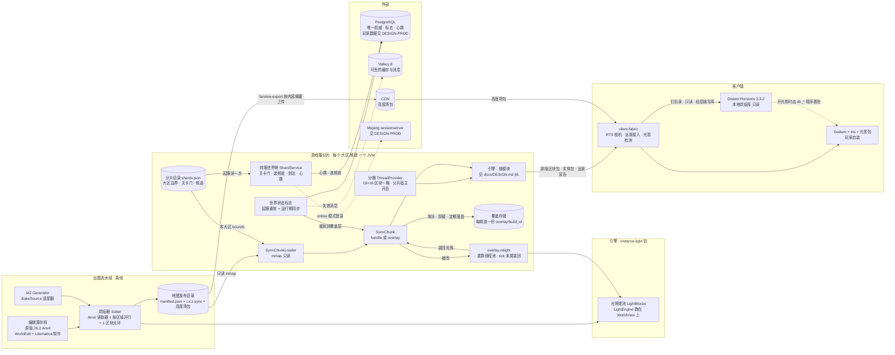

模块：新增 `:synx`（格式编解码、`SynxChunkLoader`、`SynxChunk`、覆盖存储；依赖引擎）、`:baker`（烘焙器命令行、离线 Anvil 读取器、高度场包写出；依赖 `:synx` 与引擎的光照；M2 生成器的适配器放在 `:game-rts`，烘焙器按 `ServiceLoader` 发现，不编译期依赖玩法模块）。M3-B 落地的部分：`:synx` 有区域文件的读写（`SynxRegion`、`SynxRegionWriter`）、清单（`SynxManifest`）与起服校验函数（`SynxBuildVerifier`）；M3-C 加上 `SynxChunkLoader`、`SynxChunk`、覆盖存储（`OverlayStore`）与 `SynxHandlers`。`:synx` 的测试依赖 `:testing` 与 `:baker`（集成测试在烘焙器烘出的测试图上跑），但排除 `:baker` 运行期带来的 `:game-rts`：它的数据标记服务会与 `SynxHandlersTest` 自己的同键替身相撞。`:baker` 有 `bake` 与摘要版 `verify` 两个子命令和 Anvil 读取器（`baker.anvil` 包），高度场包写出与 `farview-export` 子命令随 M3-G。`:baker` 在编译期依赖引擎、`:synx` 与 fastutil，运行期依赖 `:game-rts`（`runtimeOnly`，为 `ServiceLoader` 找到 `RtsBakeGenerators` 与数据标记处理器）。M3-C 起 `server-app` 编译期依赖 `:synx`：挂地图模式的装配在新包 `io.github.bearisbug.synaxis.app.shard`（`ShardWorld`、`ShardSettings`），`SynxChunkLoader`、`SynxChunk`、`OverlayStore` 与两组选项在 `:synx` 的 `io.github.bearisbug.synaxis.synx` 包（与 `SynxEntities` 等包内类同包）。`server-app` 运行期已依赖 `:game-rts`，所以分片与烘焙器从同一个 classpath 找到同一份数据标记处理器。引擎内改动：抽出 `LightEngine` / `WorldView`、区块票据与按实例开启的自动卸载、按实例设置的模拟距离、`Chunk#readyToUnload()` 与 `Chunk#tryLockWriteLock(Duration)`、`BufferedPacket` 的 `sheddable` 分量（`ADR-M3-018`）、分区删除由 O(n) 改为 O(1)（`API-M3-006` 卸载判定条）、`ThreadProvider.grid` 与 `synaxis.thread-provider` 开关；**引擎的全部既有默认值不变**，M3 的行为由分片宿主显式开启（`API-M3-006`、`API-M3-009`）。依赖方向沿用 `docs/DESIGN-M2.md` §6：引擎不得依赖 `:synx` / `:baker`，`:synx` 不得依赖 `server-app`（停机步骤的签名按 `ShutdownSequence.Step` 的形状写成 `OverlayStore#finalFlush`，由宿主以方法引用注册）。M3-E 全部落在 `server-app` 的 `app.shard` 包（`ShardDirectory`、`ShardHeartbeat`、`ShardService` 与实现、`ShardGates`、`ShardArrivals`、`WorldFlags` 与实现）与 `:loadtest`，另在生产就绪分册维护的 `Main`、`TicketIssuer`、`TicketVerifier`、`RedisLink` 上各加一处接线（§26 M3-E 轨道），在 `:synx` 的 `SynxChunk` 上加两个静态方法 `asWorldFlag` 与 `sameBlock`（`API-M3-005`）；引擎与 `:plugin-api` 都不改：`ShardService` 与 `WorldFlags` 是宿主内部接口，挂地图的分片不加载插件（用户 2026-09-28 拍板，§28.1），插件面只有 6A 的 `transfers()`，该项改判时再加。M3-D 落在 `:synx`（新类 `SynxRelight`、`RelightStats`，`SynxChunk`、`SynxChunkLoader`、`SynxOptions`、`OverlayChunk`、`OverlayStore` 各改一处）、`server-app` 的 `ShardWorld`（装配、tick 末尾装回、停机步骤）与 `ConfigFile.KEYS`（两个键）；引擎不改，用到的 `LightEngine`、`UpdateLightPacket`、`LightData`、`DynamicChunk#createLightData`、`PlayerChunkLoadEvent` 与 `PlayerChunkUnloadEvent` 都不是 `@ApiStatus.Internal`，§6 内部面表不加行。光照夹具在 `server-app` 的测试源码集，真客户端用例在 `client-fabric` 的 gametest 源码集（`API-M3-005` 运行时光照条、§26 M3-D）。客户端远景与光影检测在 `client-fabric`：Iris 经反射调用；DH 按 `compileOnly` 编译在钉死 SHA-1 的 DH 3.3.2 jar 上，只有 `io.github.bearisbug.synaxis.game.client.farview.dh` 一个包引用 DH 的类，DH 缺席或版本不是 3.3.2 时这个包不加载，模组照常加载（`API-M3-015`）。M3-G 在 `:protocol` 加两个零依赖的编解码类 `FarViewPack`（高度场包）与 `FarViewAnnouncement`（远景宣告），烘焙器、分片与客户端模组共用一份（`API-M3-014`、`API-M3-015`）；`:baker` 因此在编译期依赖 `:protocol`。

`:synx` 与 `:baker` 是**引擎侧模块**：包名 `io.github.bearisbug.synaxis.synx` / `…baker`，落在 `docs/DESIGN-M2.md` §24 规则 ⑥ 对「引擎」的包段定义内（根包之下除去 `game` / `plugin` / `app`），因此可以使用引擎的 `@ApiStatus.Internal` 成员，引擎不为它们放宽注解。`:synx` 与 `:baker` 用到的内部面逐项登记如下，引擎改动其中任何一项必须在同一个 PR 里跑这两个模块的测试（§24）。前四行两个模块都可以用（M3-C 的 `SynxChunk` 用了前三行），`GeneratorImpl` 一行只给 `:baker`，`BlockManager#getHandlerOrDummy` 一行只给 `:synx`：

| 内部成员 | 位置 | `:synx` / `:baker` 怎么用 |
| --- | --- | --- |
| `Chunk#getFullDataPacket()` | `Chunk.java:140`，`@ApiStatus.Internal` | `SynxChunk` 覆写：handle 模式返回包住段① 的 `BufferedPacket`，overlay 模式返回自己的快照（下一行） |
| `BufferedPacket` | `network/packet/server/BufferedPacket.java`，`@ApiStatus.Internal` | 包住 mmap 段① 直写 socket，构造时 `sheddable = false`；这个分量由 M3-C 加，只有视野广播的实体移动包是 `true`（`ADR-M3-018`） |
| `CachedPacket` | `network/packet/server/CachedPacket.java:44`，`@ApiStatus.Internal` | 用到构造器与 `packet()`：overlay 模式在写锁内从父类 `CachedPacket#packet()` 取 `createChunkPacket` 的结果，改写各 section 的方块计数后包成新的 `CachedPacket` 作快照交给连接；`SynxChunk#encodeOverlay` 取同一份快照按 `.synx` 规范成帧（`API-M3-005`）；failed 模式照用父类的包 |
| `LightBlocks` | `instance/light/LightBlocks.java`，`@ApiStatus.Internal` | 保留在名单里；`LightEngine` 落地后烘焙器只调 `LightEngine`，不直接用它 |
| `GeneratorImpl` | `instance/generator/GeneratorImpl.java`，`@ApiStatus.Internal` | 只给 `:baker`：`GeneratorSource` 按实例生成区块的方式对单个区块跑引擎 `Generator`，生成器跨区块 `fork` 时该区域失败（`API-M3-003`） |
| `BlockManager#getHandlerOrDummy` | `instance/block/BlockManager.java:41`，`@ApiStatus.Internal` | 只给 `:synx`：段③ 里的 handler 命名空间在分片上没登记时，`SynxChunk` 拿到它返回的 `BlockHandler.Dummy`，键仍是原命名空间，所以覆盖记录重新编码时段③ 的 handler 键不丢；`Dummy` 不声明客户端标签，服务端 NBT 不会发给客户端。只用公开的 `getHandler` 时取不到就只能不挂 handler，重新编码后段③ 丢掉命名空间，且没有 handler 的方块实体按引擎规则把整份 NBT 发给客户端（`BlockUtils#extractClientNbt`）。引擎对每个命名空间自记一行 WARN。M3-C 已把它加进 `SynxInternalSurfaceArchitectureTest` 的 `ALLOWED_MEMBERS`（§26 第 0 步） |

段① 解码与段③ 编解码只用公开面：运行期（`getBlock`、物化）按包体字段顺序流式读，用 `ChunkData` 与 `LightData` 的公开网络类型、`ChunkData.Section.networkType(int)`、`Palette.BLOCK_SERIALIZER`、`Palette.biomeSerializer(int)` 与 `Palette#copyFrom`，不构造 `ChunkDataPacket`；`ChunkDataPacket.SERIALIZER`（`SynxChunkPacket.decode`）只给测试与烘焙器的校验用。不碰 `Palette` 上 5 个标 `@ApiStatus.Internal` 的成员（`Palette.java:44`、`:191-206`）与 `Light#array()`；`Chunk#assertWriteLock` / `assertReadLock` 也是名单外的内部成员，`SynxChunk` 断言锁用公开的 `holdsWriteLock()` / `holdsReadLock()`；实现时若需要名单外的内部成员，先在本表加行并同步 `SynxInternalSurfaceArchitectureTest` 的常量（§24）。M2 分册 §24 规则 ⑥ 的游戏侧禁令不变：`:game-rts` 里的 `BakeSource` 适配器只能用公开面。外部依赖逐项见 §17。

### 6.1 远景与光影

**光影**：社区光影包作主画面（Q2，`ADR-M3-010`）；Sodium、Iris、光影包由玩家自装，客户端检测并引导，没装时用原版画面兜底（R1，`REQ-M3-026`）。光影包默认推荐 Complementary Reimagined r5.9.3（有 26.2 发布、Mac 上降配能加载）；Photon 没有 26.2 发布、Mac 默认跑不起来，只作 Windows 玩家的可选项（远景备忘录 §6）。

**远景：方案 B，Distant Horizons**（`ADR-M3-012`）。烘焙器为地图覆盖到的每个 4,096 格瓦片产出高度场包（`REQ-M3-024`、`API-M3-014`，按瓦片而不按大区切的理由见 `ADR-M3-020`）；分片在 configuration 阶段宣告与本大区相交的瓦片（整包）和四周 4,096 格以内的瓦片（只有粗层，`ADR-M3-022`），客户端下载缺的包，在后台平台线程上按 Q1 只写地表、液面与其上的空气，每列 1～3 点，经 DH 运行中的层级写进 DH 库（`ADR-M3-021`；相邻瓦片的粗层展开到与细层同一细节级再写）；DH 库经 `IDhApiSaveStructure` 钉在按宣告内容算出的目录，每次 DH 世界载入都 `IDhApiWorldProxy.setReadOnly(true)`（`REQ-M3-025`、`API-M3-015`）。开光影时 Iris 用光影包的 `dh_terrain` / `dh_water` 程序给 LOD 着色，雾与远近 dither 过渡由包的 DH 分支处理。

写库路径（v0.30 对 DH 3.3.2 jar 逐项 `javap` 核对后定，类与方法清单见 `API-M3-015` DH 接入面表）：

| 路径 | 做法 | 核对结果 | 处置 |
| --- | --- | --- | --- |
| W2 经 DH 运行中的层级写（默认） | DH 世界载入后，按高度场包的每个 64×64 采样块建一个 `FullDataSourceV2`，用公开接口 `IDhApiFullDataSource#setApiDataPointColumn` 填列、把 `applyToParent` 设为真，交给 `IDhLevel#updateDataSourcesAsync` | `FullDataUpdaterV2#updateDataSource` 从库里取出同位置的数据合并、`FullDataSourceV2Repo#save`、通知渲染；天光只在 section 细节级 6（一格一列）时由 DH 烘（`DhLightingEngine#bakeDataSourceSkyLight` 前的判断），W2 写的 6 + b 级不烘；往上层降采样只由 DH 的父层传播做，它只取 `ApplyToParent = 1` 的行，而 `createEmpty` 把这个字段置为 null；只读标志不拦写库（只读只在 `SharedApi#applyChunkUpdate`、世界生成队列、网络请求队列与服务端事件上检查）。写库与写完核对用到 8 个 DH core 内部成员 | 默认；V1 在无头容器里成立，synthetic 与 baked 两种夹具都是 F1～F10 全过（`docs/TEST.md` RUN-064） |
| W3 本地注入 `overwriteChunkDataAsync` | 客户端造 `LevelChunk` 调 `IDhApiTerrainDataRepo#overwriteChunkDataAsync`，入参 `[ChunkAccess, Level]` | DH spike 在 llvmpipe 下验过：576 个区块造块加调用 148～219 ms，注入后 40～60 tick 可查到列数据（`docs/research/client-spikes-2026-09/dh-iris/README.md` ①）。但它走 `SharedApi#applyChunkUpdate`，只读时整次调用被静默丢掉（仍返回成功），只能在关着只读时注入；只能按方块全分辨率写，4,096 格瓦片要造 65,536 个区块（按 spike 速率注入调用约 17～25 s，推算，不含 DH 建 LOD） | V1 里 W2 不成立时的退路 |
| W1 离线写 SQLite | DH 打开库之前用 `FullDataSourceV2Repo` 与 `FullDataSourceV2DTO#CreateFromDataSource` 直接写库 | 映射表按名字存方块与生物群系，建包装对象要一个已载入的层级（`FullDataPointIdMap` 的反序列化与包装工厂都要 `ILevelWrapper`）；要在 DH 打开目录之前写完，而目录在建层级时就被打开 | 不用 |
| 世界生成覆盖 `IDhApiWorldGenerator`（`API_DATA_SOURCES`） | 经 `DhApi.worldGenOverrides` 登记，由 DH 来要数据 | 全是公开 API，但 `DhClientLevel#shouldDoWorldGen` 要求 `ClientNetworkState#isReady()`（服务端装了 DH 插件）且服务端的生成计划开着，连 Synaxis 时恒为假，DH 从不调它 | 不用 |

切换条件（远景备忘录 §6，按先后判定；V 项的验收步骤见 §26 M3-G）：

1. V1 里 W2 不成立，且 W3 在无头容器里也不成立 → 转方案 C（clipmap 经 Iris `assignPipeline` 登记）。W3 成立时写库路径改为 W3，方案仍是 B。RUN-064：W2 成立，不切换。
2. V2b 里任一台机首次进大区到远景完整可见 > 30 s（用户 2026-10-01 拍板，§28.1）→ 回到用户，附两台机三次的读数与四段拆分（下载、等 DH 建层级、写库、等父层传播）。「完整可见」是客户端收到远景宣告到写完核对通过、父层传播做完的墙钟（烘焙日志行的 `visible_ms`），夹具按 50 Mbit/s 限速，三次取中位数（§15 远景准备行）。退路是 CDN 分发预烘库（方案仍是 B，`API-M3-015` 退路条），由用户在「改走预烘库」与「放宽 30 s」之间选。首次进一个四周都有大区的对齐大区要写 2,304 个数据源（b = 2），下载 12.5 MiB（未压缩）约 2.1 s 且与登录并行，留给写库与父层传播的不到 28 s，平均每个数据源约 12 ms。容器里的读数（V2a，llvmpipe，只登记）：不设父层传播时写入这 2,304 个数据源 4.6～7.6 s，瓶颈是父层传播（含与写入的争用）55.9～65.1 s，`visible_ms` 中位数 70,065 ms（§15 远景准备行）。
3. V8b 里开远景的帧时间增量在 2,048 格半径下仍 > 2 ms → 回到用户，在「远景 4,096 格」与「光影包主画面」之间取舍。
4. V3b 截图里远近衔接被美术判为不可接受时补做 V4、V5；不如 V5 → 转 C（两组截图一起给美术评审）。
5. V4 与 V1 都不通过 → 回到用户，在「开光影」与「远景 4,096 格」之间二选一。

B 的已知约束（DH spike 与远景备忘录 §2 实测或读源码所得）：

| 约束 | 事实 | 对本设计的影响 |
| --- | --- | --- |
| RTS 相机必须是透视 | DH 在正交投影下一个 LOD 都不画（`RenderUtil#setDhProjectionMatrix` 按透视矩阵改写 `m22`/`m23`，正交矩阵经此后深度范围错位，反汇编推断）；两个光影包的线性深度公式也写死透视 | R2 已选透视，eye 离地 ≤ 100 格；相机实现归 `docs/DESIGN-M2.md` 阶段 6b |
| 透视下相机周围有空洞 | DH 近平面 = `overdrawPrevention` × 原版渲染距离，按**相机**位置算，假设相机附近由原版区块填满；RTS 相机离开玩家飞到没有原版区块的地方时，相机周围约一个原版视距内什么都没画（spike：d64 有洞、d400 完整） | `overdrawPreventionRadius` 是公开配置（`IDhApiGraphicsConfig#overdrawPreventionRadius`）。V6a（RUN-064）：相机离玩家 300 格、eye 离地 64 格时，画面下半部的空洞默认档 41.13%、0 档 0.00%；但相机进了原版视距（玩家北 60 格、面向玩家、俯角 55°）时 0 档相对默认档变了 13.00%（eye 64）与 3.17%（eye 100），LOD 的 4 格台阶与树冠盖住原版地形，所以「RTS 设 0」不成立。用户 2026-10-02 定为保持默认档，M2 阶段 6b 验收量快速平移时空洞的时长与面积，空洞可见再在「DH 投影补丁」与「相机离玩家超过原版视距才设 0」里选（§28.2） |
| 与 Iris 同开固定 OpenGL | DH 3.3.2 检测到 Iris 时把渲染引擎从 `AUTO` 退回 `OPEN_GL`，不走 Blaze3D，Minecraft 切 Vulkan 后这条路径不可用 | 开光影的玩家只有 OpenGL；与 Iris 本身不支持 Vulkan 一致 |
| 光影包在 LOD 上的效果没有有效数据 | llvmpipe 下 LOD 确实进了光影管线（LOD 机位光影开关像素 100% 改变），但整片被一层浅蓝雾盖住，改三个雾参数只变 0.2%，来源未查清（怀疑对局世界只有 64 格高、或 llvmpipe 深度合成） | V3a（RUN-064）在高 256 的 3×3 瓦片测试图上雾仍在：`LOD_VIEW` 下半部 82.88% 的像素贴近该帧天空色（关光影时 0.00%），亮度标准差 46.7 → 7.4，所以「64 格高的对局世界」这个成因排除，记为 llvmpipe 所致（未证实）；阴影、色调、雾的判定在真显卡上做（V3b，§17） |
| 远景没有阴影贴图阴影 | 两包都写 `dhShadow.enabled = false`；阴影贴图以相机为原点，沿光方向覆盖 −100.05～156 格 | eye 离地 100 格时太阳高度角 ≥ 40° 地面仍有阴影（R2 取 100 格的依据） |
| DH 会自己收集近圈区块 | 多人客户端上 DH 把服务端发来的区块也存成 LOD（spike 日志 `Loaded [673] waiting chunk wrappers`）。只读时 `SharedApi#applyChunkUpdate` 在入口处直接返回，这些区块不进库；DH 卸载世界时（`SharedApi#setDhWorld`）把只读复位为假（javap） | 每次 DH 世界载入都重设只读（`API-M3-015`）；DH 自己收的区块写在数据细节级 0，W2 只写 b ≥ 1，V1 ⑤ 核对库里数据细节级 0 的行数恒为 0 |
| 公开查询接口读不到 W2 写的层 | `IDhApiTerrainDataRepo#getColumnDataAtBlockPos` 与 `#getAllTerrainDataAtDetailLevelAndPos` 都按方块列换算到 section 细节级 6、只读数据细节级 0（`DhApiTerrainDataRepo#getTerrainDataColumnArray`，javap）；在渲染线程上同步等结果会卡死客户端，不传 `IDhApiTerrainDataCache` 直接失败（DH spike） | 本设计不用它们：写完核对与 V1 走 DH 自己的库连接数 `FullData` 表的行，取样核对按数据源位置取（`API-M3-015` 写库条、接入面表），都在烘焙线程或测试线程上 |
| 入参形状不是稳定 API | DH 3.3.x 的 `overwriteChunkDataAsync` 只收 `[ChunkAccess, Level]`（`WrapperFactory#createChunkWrapper` 反汇编），不收 `DhApiChunk`；`IDhApiWrapperFactory#getBlockStateWrapper` 只收 `[BlockState]`（`WrapperFactory#getBlockStateWrapper` 反汇编） | W2 用后者；DH 版本锁在 3.3.2，升版时 `DhSurfaceTest` 与运行期探测先红（`API-M3-015`、§24） |
| API 数据点的形状 | `setApiDataPointColumn` 只收细节级 0 的点，相邻点之间有空隙或重叠即抛（`LodDataBuilder#validateOrThrowApiDataColumn` 与 `#convertApiDataPointListToPackedLongArray` 的报错原文：「Empty areas should be filled with air datapoints so light propagates correctly」），不要求列连到世界顶；它自己按从上到下排序 | 点规则见 `API-M3-015`；每列 1～3 点 |
| 点的 y 是相对层级最低格的下标 | `setApiDataPointColumn` 以偏移 0 调 `convertApiDataPointListToPackedLongArray`，底 y 原样存进 12 位的 `MIN_Y` 字段；DH 自己从区块建列时存 `y + 1 − getInclusiveMinBuildHeight()`（`LodDataBuilder#createFromChunk`），渲染（`FullDataToRenderDataTransformer`）与 `DhApiTerrainDataRepo` 读出时再加层级的 `getMinHeight()`（javap）。`min_y` 为 −64 的层级上写绝对坐标，−64 被截成 4032 | 点的 y 一律写下标（绝对 y − 层级的 `getMinHeight()`，等于包里的下标；分片按清单 `world.min_y` 注册维度，`ShardWorld`）；容器夹具的图取 `min_y` −64，`min_y` 为 0 的图测不出两者混用；baked 模式的 3×3 瓦片测试图 `min_y` 为 0，这一项只由 synthetic 模式那一轮覆盖（RUN-064） |
| 点上的光照是顶面之上一格的光照 | DH 自己建列时每个点存 (x, 顶 + 1, z) 的块光与天光（`LodDataBuilder#createFromChunk` 调 `getDhBlockLight`、`getDhSkyLight`）；渲染时顶面用本点的天光、底面用下方点的天光、侧面用相邻列同一高度的点（`ColumnBox#addBoxQuadsToBuilder`、`#makeAdjVerticalQuad`，javap 读控制流）；天光烘焙只在 section 细节级 6 跑，6 + b 级不烘（`FullDataUpdaterV2#updateDataSource`） | W2 写进去的光照就是画出来的光照：露天的地面与液面点写天光 15，水下地面按液体深度减；每列写到世界顶的空气点（天光 15），相邻列的侧面从它取光，列形状也与 DH 自己建的列相同；远景备忘录 V2 ③「要不要写空气点」不再是开放项 |
| 最细渲染分辨率由配置定 | `LodQuadTree` 的最细叶节点取 `maxHorizontalResolution` 的 `detailLevel`（javap），DH 不会去要比它更细的数据 | 连 Synaxis 时经配置 API 把它设成与包的 `base_level` 相同（`FOUR_BLOCKS`），库里只写这一层；更粗的层由 DH 的父层传播从这一层降采样，前提是交出的数据源 `applyToParent` 为真（上表 W2 行） |
| 离玩家多远要哪一级由距离定，库里缺的那一级画成空 | 四叉树按玩家到节点的距离取细节级：⌊ln(距离 ÷ (16 × 单位)) ÷ ln 底数⌋，下限是 `maxHorizontalResolution`（`LodQuadTree#calcDetailLevelFromDistance`、`#updateDetailLevelVariables`）；画质档 `horizontalQuality` 默认 MEDIUM（单位 12、底数 2），1,536 格以内要 4 格一列、3,072 格以内 8 格一列，HIGH、EXTREME 档（单位 16、20，底数 2.2）4 格一列分别到 2,726 与 3,407 格（`EDhApiHorizontalQuality` 的常量，javap）。库里没有某个位置时 `FullDataSourceProviderV2#get` 返回 `createEmpty` 的空数据源，`LodRenderSection#getAndBuildRenderData` 照样建出空的渲染缓冲，`canRender()` 为真，`LodQuadTree#onDetailLevelTooLow` 随即停画父节点（javap 读控制流，推断）。DH 的子层传播（`FullDataUpdatePropagatorV2#runChildUpdates`，只处理 `ApplyToChildren = 1` 且 section 细节级 < 12 的行）用 `downsampleFromOneAboveDetailLevel` 把父层的列填进子层的空列，子层的 section 细节级 > 6 就接着往下（`sqlScripts/0080` 的注释写明它是为了不画出空的 LOD），一个 16 格一列的数据源会展开成 10、9、8、7、6 五级共 341 个 | 相邻瓦片离玩家可以只有一个原版视距（玩家站在大区边上），粗层只写 16 格那一级时这一圈是空的；粗层由客户端展开成 b 级的列、与细层写在同一级，`applyToParent` 为真、不设 `applyToChildren`（`ADR-M3-022`、`API-M3-015` 写库条）。V1 的反证 `v1-coarse-only` 实跑核对「缺一级画成空」 |

本文档里与远景无关的部分（`.synx` 段①～④、烘焙器、区块流送、光照、分片）不依赖远景结果；远景只消费高度场包，`.synx` 的格式不因 M3-G 改动。

## 7. 数据模型 / 领域实体

引擎侧实体见 `docs/DESIGN.md` §7，M2 实体见 `docs/DESIGN-M2.md` §7，本节只画 M3 新增的；字段权威定义在 §9。玩家数据、角色写权（`ENT-CharacterLease`）、分片会话与转服 nonce 的实体见 `docs/DESIGN-PROD.md` §7，字段见该分册 §9。

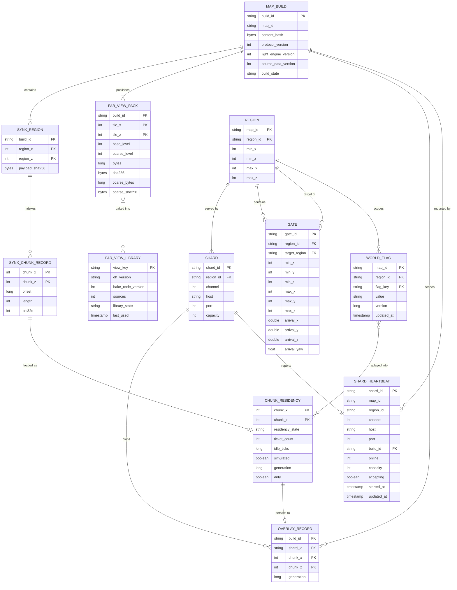

`CHUNK_RESIDENCY` 只存在于分片进程内存；`OVERLAY_RECORD` 在分片本地磁盘（每频道一份）；`REGION`、`GATE`、`SHARD` 是分片目录 `shards.json` 里的条目（`API-M3-010`），起服读一次；`WORLD_FLAG` 与 `SHARD_HEARTBEAT` 在 PostgreSQL；`FAR_VIEW_PACK` 是发布目录里的文件，经 CDN 按内容摘要分发，整包与它的粗层前缀各是一个对象，同一份包可以被多个地图版本共用（内容没变的瓦片摘要相同）；`FAR_VIEW_LIBRARY` 在玩家机器上（`<gameDir>/synaxis/farview/dh/<view_key>/`），由一次宣告里的全部瓦片烘成，`view_key` 由 DH 版本、烘焙代码版本与这些包的摘要算出（`API-M3-015`），所以换了任一个包、DH 或烘焙代码就是另一个库。心跳行里的 `region_id`、`channel`、`host`、`port`、`capacity` 是写心跳的分片从自己那份目录条目抄来的，源分片选频道只读心跳，所以加一个频道只要新分片那台机器上的目录有它。

## 8. 接口契约 (API-first)

M3 的契约有四类：① 文件格式（`.synx`、清单、覆盖存储、高度场包）；② Java 稳定面（光照引擎、区块加载与票据、线程、世界状态标志）；③ 客户端接入（远景宣告、远景与光影检测）；④ 运维命令行。都不是 HTTP（高度场包下载是 CDN 上的静态文件 GET）。机器可读的事实源是 `:synx` 的编解码类与 `synx/src/test/resources/vectors/` 测试向量、`:protocol` 的 `FarViewPack`、`FarViewAnnouncement` 与 `protocol/src/test/resources/farview-vectors/` 测试向量、光照的 `parity/` 场景与真值（防漂移见 §24）。

---

- **`API-M3-001` `.synx` 区域文件格式** — 实现 `REQ-M3-001`
  - 文件名 `r.<rx>.<rz>.synx`，`rx = chunk_x >> 5`。容器的多字节整数一律小端（头部、偏移索引、段长表、段②、段④ 与段③ 的表头字段；mmap 后按本机序直读，x86 与 Apple Silicon 都是小端）；段① 原样是协议的编码（大端整数加 VarInt），段③ 里的 NBT 也是大端。尚未发布过任何文件，本版布局仍是 `format_version = 1`。
  - 头部（定长 256 B）：

    | 偏移 | 字段 | 类型 | 说明 |
    | --- | --- | --- | --- |
    | 0 | `magic` | 4 B | `SYNX` |
    | 4 | `format_version` | u16 | 当前 1；读到更高版本即拒绝 |
    | 6 | `flags` | u16 | bit0 `overlay`（覆盖段文件：没有偏移索引，记录区从 256 起，布局见 `API-M3-007`），bit1 `has_columns`（段④ 非空，烘焙器产出的区域文件恒为 1）；未知位置 1 即拒绝 |
    | 8 | `protocol_version` | i32 | 776 |
    | 12 | `compression_threshold` | i32 | 烘焙段① 时用的阈值，256；必须 ≥ 1 |
    | 16 | `compression_level` | i8 | Deflater 级别，-1（默认） |
    | 17 | 填充 | 1 B | 全 0 |
    | 18 | `min_y` | i16 | 世界最低 y |
    | 20 | `height` | u16 | 世界高度：Q7 定 256。Anvil 源恒写 256，按 256 格窗口读取，`min_y` 写窗口起始 y（默认 −64，`API-M3-003` Anvil 源条）；生成器源写预设自带的 `min_y` 与高度（`synthetic` 为 0 / 256，M2 的 `rts-*` 随预设） |
    | 22 | 填充 | 2 B | 全 0 |
    | 24 | `region_x` / `region_z` | i32 × 2 | 与文件名一致 |
    | 32 | `registry_digest` | 32 B | 生物群系注册表顺序与方块状态总数的 SHA-256（段① 里的生物群系 id 依赖配置阶段下发的注册表顺序）。被哈希的是 UTF-8 文本：首行 `"biome <n>\n"`，随后按注册表 id 顺序每个生物群系键一行，末行 `"block_states <Block.statesCount()>\n"` |
    | 64 | `content_hash` | 32 B | 整个地图版本的内容哈希，同一版本所有文件相同 |
    | 96 | `region_content_hash` | 32 B | 本文件未压缩规范内容的 SHA-256：按索引顺序拼接每条记录的「段① 帧内 zlib 流解压后的包体」+ 段②、段③ 解压后字节、段④；换 JDK 自带 zlib 不改变内容哈希 |
    | 128 | `payload_sha256` | 32 B | 索引之后全部字节（含记录间的对齐填充）的 SHA-256，起服校验用；索引本身不在覆盖范围内，篡改索引靠逐条越界检查与 `crc32c` 发现 |
    | 160 | `light_engine_version` | u16 | 烘焙时的 `LightEngine.VERSION` |
    | 162 | `baker_version` | u16 | 烘焙器版本 |
    | 164 | 保留 | 92 B | 全 0 |

  - 偏移索引（256 起，1,024 项 × 16 B = 16,384 B）：第 `i = (chunk_z & 31) × 32 + (chunk_x & 31)` 项为 `{offset: u64, length: u32, crc32c: u32}`；`offset = 0` 表示无该区块，只允许出现在清单 `bounds` 之外（烘焙器保证 `bounds` 内每个区块都有记录，`verify` 逐项检查）。记录区从 16,640 起，每条记录 8 B 对齐，对齐填充为 0，文件在最后一条记录处结束。`crc32c` 覆盖 `[offset, offset + length)`，含记录开头的段长表。
  - 区块记录：16 B 段长表（四个 u32）后接四段；段长表与记录长度或段② 定长不符时该区块进 `failed`：
    - 段①：`ChunkDataPacket` 在 `compression_threshold` 下成帧、压缩后的完整字节（帧长 VarInt + 未压缩长度 VarInt + zlib 数据；包体短于 `compression_threshold` 时按协议不压缩，未压缩长度写 0，后接原样包体），包 id 按协议 776（常量 `0x2D`，由测试与引擎 `PacketVanilla` 对拍，不进 §6 内部面表）。两个 VarInt 都用最短编码，与引擎 `PacketWriting` 固定 3 字节的帧长不同，所以 M3-C 做「1,000 区块逐字节一致」时比较的是解压后的包体。「有天光的 section 不置 `emptySkyMask`」由烘焙器保证，`:synx` 不检查。光照按烘焙结果逐 section 填 sky / block 两组 mask，**不得对有天光的 section 置 `emptySkyMask`**（M2 的全黑剪影即由此而来，见 `docs/DESIGN-M2.md` §28.2）。每个 section 的方块调色板必须是单值或间接调色板（`REQ-M3-003`）。方块实体只带客户端需要的标签（有 `BlockHandler` 的按 `getBlockEntityTags()`），服务端不从段① 读方块实体。
      - 字节可复现：同一烘焙输入与版本，在不同进程中产出的段① 未压缩包体必须逐字节相同（`region_content_hash` 按它计算），同一 JDK 构建下成帧压缩后的字节也相同（zlib 在同级别、同输入下是确定的）。为此编码中的集合一律按固定顺序写出：高度图按 `Heightmap.Type` 序号，方块实体按区块内方块索引升序（引擎 `ChunkData` 构造器，`5fba33a398`），方块实体 NBT 的每个复合标签按键升序（`String#compareTo`，与段③ 相同）写出、嵌套的复合标签同样（引擎 `ChunkData` 经 `NetworkBuffer.SORTED_NBT`，v0.13，§28.2）：adventure-nbt 5.2.0 的 `CompoundBinaryTagImpl.create` 经 `Map.copyOf` 建表，按复合标签自己的迭代顺序写出时，多键的方块实体（告示牌的 `front_text`、`back_text` 各三个键）在两个 JVM 里编出不同字节。迭代顺序随 JVM 启动种子变化的集合（`Map.of`、`Map.copyOf`、`Set.of`、`Collectors.toUnmodifiableMap`、以身份哈希为键的 `HashMap`、adventure-nbt 的 `CompoundBinaryTag`）不得直接决定编码顺序：修复前 `ChunkData` 用 `Map.copyOf` 与 `toUnmodifiableMap`，同一区块在两个 JVM 里编出长度相同、字节不同的包（高度图两项互换），压缩后长度随之变化（`docs/research/large-world-2026-09/bench-2026-09.md` §3.5）。调色板的规范形 = 先把 section 的内容 `setAll` 进一个空调色板，再 `optimize(SIZE)`：单用 `optimize(SIZE)` 时间接调色板仍保留写入顺序，同内容不同写入顺序会编出不同字节（`SynxChunkPacketTest`）。这个规范形绑定引擎 `PaletteImpl` 与 fastutil 的版本，两者升版视同改格式，要重冻向量并重烘；不能写成「按内容排序」。验收门是 `ChunkPacketDeterminismTest`（6 个子 JVM 逐字节比对）与 `SynxChunkPacketTest`（§19）。
    - 段②：定长 544 B：walkable 位集 32 B + surface_y 256 × i16（沿用 M2 导航层，见 `docs/DESIGN-M2.md` §9）。实体物理走 `BlockCollision` 取 `Block` 对象，不需要碰撞位集；将来自研寻路或服务端射线要它时，以新 `format_version` 加回。
    - 段③：方块实体与静态实体表，整段是一条 zlib 流（带 zlib 头，不是裸 deflate）。方块实体按 `(section_y, index)` 升序写出；NBT 是未压缩二进制格式，根名为空串，每一层 compound 的键按 `String#compareTo` 排序后写出（adventure 按哈希表顺序写，同内容可能不同字节），异构列表按 wrap 形式写出；静态实体表按烘焙器给定的顺序写出，确定性由烘焙器保证（按 `Pos` 排序会改变生成顺序，不做）。解码时先按剩余字节检查表长与 NBT 长度再分配内存，损坏一律抛 `IllegalArgumentException`，M3-C 的加载器据此把该区块转入 `failed`。handler 非空时必须是合法的命名空间键（`SynxBlockEntity` 构造时核，读写两侧共用），方块实体的 `section_y` 必须落在清单 `world` 的 section 范围内（加载器核，`world` 只有它知道），否则同样按损坏处理。方块实体子表 `count u32` + 每项 `{index u16（section 内 ((y&15)×16+z)×16+x）, section_y i8, handler_len u8, handler UTF-8（无 handler 时长度 0）, nbt_len u32, nbt（未压缩二进制 NBT，完整，含客户端标签）}`，覆盖区块内**全部**方块实体（26.2 有 7 种方块实体类型没有同名方块：`sign`、`hanging_sign`、`mob_spawner`、`skull`、`banner`、`shelf`、`brushable_block`，经 `ChunkData.readBlockEntities` 会被静默丢掉，所以不能从段① 重建）；静态实体子表 `count u32` + 每项 `{nbt_len u32, nbt（源 entities/ 里该实体的完整 NBT，含 id、三个有限 double 的 Pos 与两个 float 的 Rotation，由烘焙器的源门禁保证，`API-M3-003`）}`。区块内两者都没有时长度 0。
    - 段④：256 列 × 5 B（表面高度 u16、表面方块状态 id u16、天光 u8）。表面按「最高的非空气方块」取，花草、雪层、水面都会成为表面，也不带水底高度与生物群系，所以高度场包不读它，而是烘焙器在写它的同一遍列扫描里另算远景采样（`API-M3-014` 来源条）；段④ 本身不因 M3-G 改动，去留见 §28.2。
  - 读取规则：`magic` / `format_version` / 未知 `flags` 位不符 → 拒绝起服（`synx-magic`）；文件在头部或索引内就结束 → 拒绝起服（`synx-truncated`）；`protocol_version`、`registry_digest`、`compression_threshold` 与运行进程不符 → 拒绝起服（各自的错误码），`min_y`、`height` 不符 → `synx-world-mismatch`；`offset + length` 越过文件末尾、`crc32c` 不符、段长表不符、或 `bounds` 内的 `offset = 0` → 该区块进 `failed`（§11.1），发空气区块占位，不影响同文件其他区块；`view_bounds` 外 → `loadChunk` 返回 `null`（`API-M3-005`）。`SynxRegion.open` 不核对文件名里的坐标（测试用任意文件名打开它；覆盖段文件 `seg.N.synx` 由 `OverlaySegment` 映射，`SynxRegion.open` 见 overlay 位按 `synx-magic` 拒绝）：头部坐标、清单条目与文件名三者的绑定由起服校验逐区域检查，加载器只读 `SynxBuildVerifier.open` 核过并映射的区域文件（`VerifiedBuild`，`API-M3-002` 只读一次条）。
  - 长度上限（M3-S，`REQ-M3-031`）：读者先核长度再分配，越界一律抛 `IllegalArgumentException`：段① 的帧长必须等于余下字节数（原有）且 ≤ 2,097,151 B（段① 原样写进 socket，原版客户端的 `Varint21FrameDecoder` 只收 3 字节 VarInt 写得下的帧长，再长就断开连接），未压缩长度必须在 0～8,388,608 B（原版客户端 `CompressionDecoder` 的上限，再大的区块包客户端也不收）；段③ 整段解压后 ≤ 16,777,216 B（16 MiB），其中每条 NBT 先做一遍不分配内存的结构核对，再用 `BinaryTagIO.reader(16,777,216)` 读（adventure-nbt 按计量在分配之前核对：字符串每字符 2 B 加 2、数组按元素宽度、列表每项另记 8 B）。结构核对要求每个列表与数组声明的元素都真在字节里（声明长度不超过剩余字节，负长度即拒），元素类型为 END 的列表长度为 0，嵌套不超过 512 层（adventure-nbt 的深度上限也是 512）；过了它，adventure-nbt 分配的内存与这条 NBT 的字节数成正比。只靠计量挡不住嵌套列表：计量核对只比较、不预留额度（adventure-nbt 5.2.0 的 `TrackingDataInput`，javap 核对），每层列表各自通过、各自先按声明长度分配，一条约 2.6 KB 的 NBT 嵌 512 层、每层声明 2,000,000 项，外层数组都还活着时就分配到约 4.29 × 10⁹ B，按 `-Xmx4G` 与 `-XX:+ExitOnOutOfMemoryError` 让分片退出。读不出时信息带 adventure-nbt 给的原因与实体位置：方块实体是 `unreadable NBT in segment ③: <原因> (block entity at x <x>, y <y>, z <z> of the chunk)`（区块内坐标），静态实体是 `… (static entity <i> of <n>)`。此前 `SynxEntities.java:141` 用 `BinaryTagIO.reader()`，adventure-nbt 5.2.0 的默认计量上限是 131,082（`BinaryTagReaderImpl.DEFAULT_LIMIT`，javap 核对）：一个装 27 本成书、每本 10 页 × 256 字符的箱子，NBT 71,076 B 就超限，那个区块在运行期进 failed；烘焙器读 Anvil 的上限比它宽得多（每个区块 64 MiB，`API-M3-003`），写段③ 不逐条检查，烘焙照常成功（M3-S 设计的安全审查，2026-10-06）。`SynxChunkLoader` 加载区块时先解析段① 的两个 VarInt，不合法即进 failed 模式（§11.1），之后读方块与物化时的解码不会再遇到越界长度；段③ 照旧在加载时解码，超出上限同样进 failed。写入侧：`SynxEntities.encode` 编完段③ 用同一个读者读回一遍，段③ 超过 16 MiB、读不回或段① 帧长超过 2,097,151 B 时 `SynxChunkRecord#encode` 与 `SynxRegionWriter` 抛 `IllegalArgumentException`；段① 的包体未压缩超过 8,388,608 B 时，烘焙器与覆盖层共用的 `SynxChunkPacket#encode` 在成帧之前就抛 `IllegalArgumentException`（`chunk <x>,<z>: the packet is <n> bytes uncompressed, over 8388608`）。此前写入侧不核这一项：覆盖层能写下载入时被 `checkFrame` 拒收的记录，烘焙器要到算 `region_content_hash` 时才拦下，信息不带区块坐标；没有 handler 的方块实体在段① 里带整份 NBT（`BlockUtils.extractClientNbt`），一个区块里放约 120 个装满成书的箱子（单箱 NBT 71,076 B，见上）就能走到这里。烘焙器按区域失败处理（退出码 3，信息带区块坐标），覆盖层按编码失败处理（`API-M3-007`），所以烘得出、写得进的记录在运行期都读得回。没有上限时，14 B 的帧声明 64 MiB 会先分配 67,241,640 B 才被拒，声明 2^31 − 1 时抛 `OutOfMemoryError`，分片按 `-XX:+ExitOnOutOfMemoryError` 退出；段③ 16,316 B 能解出 16,777,216 B（`m3/sec-r2` 的 `SynxParserBoundaryPocTest`，M3 侧安全审查 S2-03）。影响面：只有被改过的文件或烘焙器出错的记录才会越界；那个区块进 failed（空气占位、天光全 15、只读），客户端看到空气区块；世界状态标志在 failed 区块里照旧跳过。
  - 写入语义：区域先经同一文件系统上的暂存文件逐条写出、边写边算两个摘要，回填头部与索引并 `fsync` 后用硬链接挂到 `r.<rx>.<rz>.synx`；目标已存在时失败，不覆盖，已发布的文件不可变。成功与失败都删掉暂存文件。写入器只在内存里持有调用方加进来的记录，不再整区复制。
  - 演进：新增字段只占保留区并升 `format_version`；改段布局 = 破坏性变更，升 `format_version` 且全部重烘。
  - 缓存与超时：文件只读、不可变，按地图版本目录隔离，永不原地覆盖。

- **`API-M3-002` 地图发布目录与清单** — 实现 `REQ-M3-002`
  - 目录：`<maps_root>/<map_id>/<build_id>/`，内含 `manifest.json`、`regions/r.<rx>.<rz>.synx` 与 `farview/t.<tx>.<tz>.hfp`（每个与 `bounds` 相交的远景瓦片一个，`API-M3-014`）。一个 `build_id` 覆盖整张地图的全部大区。`build_id` = `<map_id>-<content_hash 前 12 位 hex>-p<protocol_version>`，所以只升协议也会得到新 `build_id`（F1：覆盖层随之清空）。
  - `manifest.json` 字段：`map_id`、`build_id`、`content_hash`、`mc_version`（`"26.2"`）、`protocol_version`、`registry_digest`、`light_engine_version`、`baker_version`、`world.min_y`、`world.height`、`bounds`（区块坐标 min/max）、`regions[]`（`rx`、`rz`、`bytes`、`payload_sha256`、`chunks`）、`farview[]`（`tile_x`、`tile_z`、`base_level`、`coarse_level`、`bytes`、`sha256`、`coarse_bytes`、`coarse_sha256`，按 (`tile_x`, `tile_z`) 升序，见 `API-M3-014`；`bytes` 与 `sha256` 是整个文件的，`coarse_*` 两项是粗层前缀的）、`source`（`kind` = `anvil` / `generator`、`data_version`（Anvil 源必须 = 4903）、`light_coverage`（源区块 `isLightOn = true` 的比例））、`bake`（`started_at`、`wall_ms`、`cpu_ms`、`threads`、`jdk`）、`verify`（`samples` 抽样数、`diffs` 差异数、`source_light_diff`）。
  - 字段口径：`content_hash` = 各区域按 `(rx, rz)` 排序，每个区域依次写 `rx`（i32 LE）、`rz`（i32 LE）、`region_content_hash`，对整串求 SHA-256；`bounds` 的键是 `min_x`、`min_z`、`max_x`、`max_z`，单位是区块坐标，含边界；摘要一律小写 hex；`data_version`、`light_coverage`、`source_light_diff` 为空时不写；字段按固定顺序写出，文件以换行结尾。整数字段带小数（如 `chunks: 4.5`）按 `synx-manifest` 拒绝，不截断，信息点名字段（`chunks is not an integer: 4.5`；摘要不是 hex 时 `<字段> is not hex: <值>`）。M3-B～M3-F 烘出的版本 `farview[]` 为空；M3-G 起每个与 `bounds` 相交的瓦片一项。`farview[]` 为空或与文件不符不拒启，只让分片不宣告远景（`API-M3-015` 宣告条）。
  - 分片起服：`bin/server-shard` 带 `-Dsynaxis.map.root=<maps_root>/<map_id>` 与 `-Dsynaxis.map.build=<build_id>`（也可写进 `synaxis.properties`）进入挂地图模式（`API-M3-006` 分片宿主段），发布目录是两者拼成的 `<maps_root>/<map_id>/<build_id>/`。在登记维度类型之前、端口 bind 之前跑 `SynxBuildVerifier.open(buildDir, 清单, 期望, scope)`（清单由分片读一次，见下方只读一次条）：期望取进程的注册表摘要、`ServerProcess#compressionThreshold()`、清单的 `world` 与当前 `LightEngine.VERSION`，scope 取 `view_bounds`；按清单核本大区与 `view_bounds` 涉及的每个文件的 `payload_sha256` 与头部字段，任一不符即拒启：日志一行 `Refusing to start: <synx 码> <文件名>: <细节>`，退出码 1，端口不 bind（§14）。校验顺序：① 清单：`build_id` 等于目录名，且等于由 `map_id`、`content_hash`、`protocol_version` 推导出的值；② 协议版本与 `mc_version`，再依次是注册表摘要、`world`、光照引擎版本；③ 对「scope ∩ `bounds`」覆盖到的每个区域，依次检查清单有该项、文件存在、大小相等（不等即 `synx-payload-hash`）、头部与进程一致、头部与清单一致、实际 `payload_sha256`、区块数。起服日志一行 `Map release <build_id> verified in <n> ms: bounds=… world=…`。烘焙器的 `verify` 与发布前自检调 M3-B 落地的 `SynxBuildVerifier.verify`，核对项与顺序相同，只是自己从目录读清单、每个区域核完即解除映射。分片的世界高度取清单 `world`（维度类型按它登记），所以 `synx-world-mismatch` 只会来自区域文件头部与清单不符。
  - 文件信任（M3-S，`REQ-M3-031`；用户 2026-10-06 按推荐项：地图制作者与运维同等可信，起服查属主与权限，不钉清单的 sha256，§28.1）：
    - 权限与属主：配置文件与地图文件共用一条权限规则。`server-app` 的 `app` 包新类 `FileTrust`（`public final`，`app.shard` 要调它），把 `ConfigFile#writableByOthers` 与它用的两个常量（`GROUP_OR_OTHERS_WRITE`、`STICKY`）原样搬过去（`docs/DESIGN-PROD.md` `API-PROD-023`，安全审查 D-03；生产就绪会话 2026-10-06 同意）：路径自己有组或他人写位即拒；它所在的那一层目录组或他人可写而没有 sticky 位即拒；不看更上层的目录。只改一处：文件那一句的结尾改为参数，`ConfigFile` 传原来的 `only the service user may write it`，它的输出逐字不变。地图这边是 `app.shard` 包的新类 `MapFileTrust`，在 `FileTrust` 之外加两条，`FileTrust` 的规则不动：① 先 `toRealPath()`，对真实路径与它真实的上一层目录判（`FileTrust` 读权限位会跟随符号链接，「所在目录」取的却是链接本身的父目录，指向他人可写目录的链接原样能过，`FileTrust.java:43-56`，搬家之前是 `ConfigFile.java:300-312`）；路径是符号链接时，链接本身所在的目录按同一条规则再判一次（能改这层目录的人能把链接改指别处，或在查完之后、`open` 之前把它换掉；目标的权限位已经判过，这一次只多看链接所在的目录，没有链接时不多查）；② 查属主：真实路径的 `unix:uid` 必须是 0（root）或等于 `synaxis.map.root` 真实路径的 uid。查的范围：目录模式且文件存在时的 `shards.json`、`<build_id>/`、`manifest.json`、要映射的每个区域文件与要宣告的每个远景包（`synaxis.farview.url-root` 非空时），连同它们所在的目录（路径是符号链接时，链接所在的目录与目标真实所在的目录都查），覆盖到 `synaxis.map.root`、`<build_id>/`、`regions/` 与 `farview/` 四层；`synaxis.map.root` 的上级目录由 §23 地图文件一行保证。文件系统没有 `unix` 属性视图时两条都跳过（与 `ConfigFile` 相同），起服行 `Map release <build_id> verified …` 末尾加 ` permissions=unchecked (the file system has no POSIX permissions)`。信息里的路径都是真实路径：路径自己可写时 `Refusing to start: <路径>: writable by group or others (<权限位>); a map release is written by its owner alone`；所在目录可写时 `Refusing to start: <路径>: its directory <目录> is writable by group or others without the sticky bit (<权限位>); they may replace the file`（链接所在的目录可写时同一句，`<目录>` 是链接所在目录的真实路径）；属主不对时 `Refusing to start: <路径>: owned by uid <n>, neither root nor uid <m> that owns synaxis.map.root <路径>`；退出码 1，端口不 bind。
    - 次序（都在步骤 (3)，`API-M3-006`）：先查 `synaxis.map.root`、`shards.json`、`<build_id>/` 与 `manifest.json`，再读清单；由清单算出要映射的区域文件（`SynxBuildVerifier.regionFiles(buildDir, manifest, scope)`，纯函数，与 `open` 同一个范围）与要宣告的远景包，查过它们与 `regions/`、`farview/`（是符号链接的，连同链接所在的目录）之后才 `open`。`shards.json` 在步骤 (1) 已按 1 MiB 上限读过（`API-M3-010` 读取条；调 `ShardDirectory.load` 的 `Main#shardDirectory` 归生产就绪会话），到步骤 (3) 才查：两步之间进程不 bind、不连库、不写盘，被改的目录产生不了外部效果。`ShardDirectory.load` 因此只管读与大小，`ShardDirectoryTest`、`MainDirectoryModeTest` 从测试资源读的文件不经这道检查，权限随检出时的 umask 也不影响它们。
    - 覆盖层：覆盖存储由分片自己写，起服时逐条解析、发给玩家；`crc32c` 不是 MAC，段头字段从清单抄得到，它与地图文件是同一个信任面。`OverlayStore.open` 在文件系统支持 POSIX 时以 0700 建 `overlay/` 与 `overlay/<build_id>/`、以 0600 建段文件（此前按 umask 建，`OverlayStore.java:233`、`:247`，`OverlaySegment.java:80`）；`ShardWorld` 在调它之前对已有的 `overlay/`、`overlay/<build_id>/` 与其中的 `seg.*.synx` 按真实路径过一遍 `FileTrust`（结尾传 `only the service user may write it`），任一不过即拒启。覆盖层不查属主：它在分片的工作目录里，工作目录只归服务用户（`docs/DESIGN-PROD.md` §23）。`:synx` 不依赖 `server-app`，所以检查在 `ShardWorld`、建目录的权限在 `OverlayStore`。
    - 只读一次：清单只读一次：在同一个 `FileChannel` 上取 `size()`，超过 16,777,216 B 即 `synx-manifest`，否则至多读 16,777,217 字节，读到更多同样 `synx-manifest`（按路径先 `Files.size` 再整读时，两次打开之间换掉文件就能绕过上限）。清单、`shards.json`（`API-M3-010` 读取条）与起服核对的远景包（`API-M3-015` 宣告条）这三处「同一通道上先比大小」各写成收 `SeekableByteChannel` 的包内函数，生产传 `FileChannel.open(路径, READ)`，测试传一个数读出字节的包装（§19「读文件之前先比大小」）。清单按 Gson `Strictness.STRICT` 解析，同一对象里重复的名字即 `synx-manifest`（与 `ShardDirectory` 同一读法，此前宽松模式取后一个）。解析出的 `SynxManifest` 交给新入口 `SynxBuildVerifier.open(buildDir, manifest, 期望, scope)`，它不再按路径重读清单：把 scope 覆盖到的每个区域文件在 `Arena.ofShared()` 里映射一次，拿映射的 `byteSize()` 比清单的 `bytes`（此前按路径 `Files.size`，`SynxBuildVerifier.java:92`），在这份映射上核头部、清单与 `payload_sha256`，返回 `VerifiedBuild`（清单加这些已映射的 `SynxRegion`）。`SynxChunkLoader` 只收 `VerifiedBuild`、不再按路径打开文件（`API-M3-005` 构造条），步骤 (5) 取出生点（`ShardWorld#spawn`）也从 `VerifiedBuild` 里已映射的区域读段②（此前按路径再开一次，`ShardWorld.java:636-650`），所以步骤 (3) 与 (5) 之间把文件整体换掉（写到旁边再 rename 覆盖）也绕不过校验；此前校验在受限 arena 里映射、核完即关，加载器再按路径映射一次（`SynxBuildVerifier.java:96-97`、`SynxChunkLoader.java:111-116`，M3 侧安全审查 S2-01）。烘焙器的 `verify` 照旧调 `SynxBuildVerifier.verify`（读清单、映射、核完即关），行为不变。
    - 挡不住的：已映射的文件被原地改写（同一个 inode，`cp` 或 `rsync --inplace`）时分片读到改写后的字节；被截断时读映射区的线程收到 `java.lang.InternalError: a fault occurred in an unsafe memory access operation`（macOS 上 Homebrew OpenJDK 25 实测：`Arena.ofShared()` 映射 1 MiB 的文件再截断为 0，`MemorySegment.get` 与 `MemorySegment.copy` 都这样；Linux 由 CI 上的 `SynxTruncatedMappingTest` 实测，拷贝同样是 `InternalError`），各读取点的处置见 `API-M3-005` 映射读取条。进程不一定不退出：M3-S 轨道 S 在 macOS 的共用测试 JVM 里拷截断后的映射时，拷贝桩收到 SIGBUS（`BUS_ADRALN`，`StubRoutines::copy_byte_f`），JVM 直接崩溃，所以那条测试把拷贝挪进了子 JVM（§28.2 截断一行）。这两种情形只靠属主与权限（只有属主能写）与 §23「已挂载的版本目录不原地覆盖」挡。`payload_sha256` 从 16,640 起算，不覆盖 16,384 B 的偏移索引，索引靠逐条越界检查与 `crc32c`（头部表 `payload_sha256` 行）；`SynxBuildVerifier` 类注释里的「byte for byte」（`SynxBuildVerifier.java:15`）改为写明这一点（S2-V02）。改为钉清单 sha256 时，清单要为每个区域加 `index_sha256`，与钉清单同一提交（§28.1 地图信任一行的切换条件）。
    - 影响面：只在起服；对客户端、转服、世界状态标志与插件都没有运行期影响。拒启的频道不写心跳，源分片选频道时把它当下线（`OFFLINE`）。
  - 升版重烘：`baker rebake --from <旧 build_id> --protocol <新协议>` 产出新 `build_id`；升版清单记录每个大区的重烘墙钟与 CPU 时间（未实现，§28.2）。

- **`API-M3-003` 烘焙器命令行** — 实现 `REQ-M3-003`、`REQ-M3-020`、`REQ-M3-021`、`REQ-M3-022`、`REQ-M3-024`
  - `./gradlew :baker:run --args="bake --map-id <id> --source <anvil:<dir> 或 generator:<preset>:<seed>> --out <maps_root> [--threads <N>] [--bounds <minX,minZ,maxX,maxZ>] [--dimension minecraft:overworld] [--min-y -64] [--logs logs] [--samples 4]"`：`--threads` 默认等于核数；`--bounds` 是区块坐标、含边界，写成空范围（min 大于 max）按命令行错误退出码 1，信息 `bounds <minX>,<minZ>,<maxX>,<maxZ> are empty`，Anvil 源不给时取存档里全部区块的外接矩形，生成器源不给时取预设自带的范围；`--logs` 是事件目录；`--samples` 是每个区域的抽样数；`--min-y` 只用于 Anvil 源，是 256 格窗口的起始 y（默认 −64，必须是 16 的倍数，见下方 Anvil 源条），不是 16 的倍数或与生成器源同给时按命令行错误退出码 1；`--dimension` 同样只用于 Anvil 源，与生成器源同给、或写成不是键的值（如 `Minecraft:Overworld`）时也是退出码 1。`--map-id` 的写法见 §9（`[a-z0-9][a-z0-9_-]{0,31}`），不合写法按命令行错误退出码 1，任何目录都不建。每个命令只收自己的选项：`bake` 收上面九个，`verify` 只收 `--build`，`farview-export` 收 `--build` 与 `--out`；不认识的选项（含拼错的，如 `--bound`）、不属于该命令的选项（如 `verify --samples`）、同一选项给两次，都按命令行错误退出码 1，信息点名该选项；数值（`--threads`、`--samples`、`--min-y`、`--bounds` 的四个数、生成器种子）写的不是整数时同样退出码 1，信息点名该选项。退出码 1 时 stderr 在出错的那一行之后打印用法，用法里写着各选项的默认值与约束。`verify --build <maps_root>/<map_id>/<build_id>` 只做摘要校验（`SynxBuildVerifier.verify`，M3-G 起加上高度场包的摘要与头部，见下方 `verify` 条），通过退 0、不通过退 4；清单 `baker_version` < 2 的版本（M3-B～M3-F 烘的）不核对高度场包，`farview[]` 为空照常通过，分片照样能挂、远景关（`API-M3-002`）；`baker_version` ≥ 2 的版本 `farview[]` 必须恰好列出与 `bounds` 相交的全部瓦片；带重新抽样的独立 `verify`、`rebake`、`retire --build <build_id>` 未实现（§28.2）。`farview-export --build <maps_root>/<map_id>/<build_id> --out <dir>`（M3-G）把清单 `farview[]` 的每个包按内容摘要导出成两个对象：整个文件复制成 `<dir>/<map_id>/farview/<sha256>.hfp`，它的前 `coarse_bytes` 字节（粗层前缀）写成 `<dir>/<map_id>/farview/<coarse_sha256>.hfp`；已存在且字节相同的跳过；先把全部包的大小与 SHA-256、粗层前缀的大小与 SHA-256 与清单核对完，任一不符退 4、什么都不写，全部相符才开始写；目标已存在而内容不同（摘要撞车或目标被改过）退 4；每个对象先写进同目录的暂存文件，设成 0644（与发布目录同一条规则，`REQ-M3-031`），`fsync` 之后原子改名成对象名，断电不会留下以摘要命名的残缺对象；成功退 0，每个对象打一行 `exported <文件名>[ coarse] -> <相对路径> (<bytes> B)` 或 `kept …`。清单 `farview[]` 为空（`baker_version` < 2 的版本）时 stdout 只打一行 `baker: <版本目录> lists no far view packs (baker_version <n>), nothing to export`，退 0，导出目录里什么都不建。它只写本地目录，上传 CDN 由运维用对象存储的同步工具做（`API-M3-014` 分发条）。`verify` 与 `farview-export` 读写文件出错时信息带 JDK 异常的类名（`NoSuchFileException`、`AccessDeniedException` 这类异常自己的信息只有一个路径），校验不过的信息照旧以 `synx-*` 码开头。命令行解析不了退出码 1。`:baker:run` 在 `baker/` 目录里运行，路径参数写绝对路径。
  - Anvil 源：读 `<dir>/dimensions/<ns>/<path>/{region,entities}/*.mca`，只读打开，不创建缺失的区域文件，不认 26.1 之前的目录布局；只含光照、没有 `block_states` 的 section 不读。任一 `bounds` 内区块 `DataVersion ≠ 4903` → 退出码 2，错误信息给出区块坐标；比 4903 旧时提示「先用原版 26.2 专用服务端 `--forceUpgrade --eraseCache` 升级，再重跑预生成」，比 4903 新时提示改用最后一次由 26.2 打开的备份（存档被更新版本的 Minecraft 打开过，原版只升级不降级，`--forceUpgrade` 改不回 4903）；`Status`（或 `status`）的值必须恰好等于 `minecraft:full`，缺失视同非 full，非 full 的区块视为源缺失，同样退出码 2；`bounds` 内缺区块也是退出码 2。以下同样按源错误拒绝（退出码 2），不回退到 plains 之类的默认值：未知方块、非法方块名、未知生物群系；LZ4（压缩类型 4）与外置 `.mcc` 区块；调色板打包的 long 数不等于按位宽 `max(minBits, ⌈log2 n⌉)` 算出的值，或解包下标超出调色板；区域区块的 `xPos` / `zPos` 或实体区块的 `Position` 与所在位置不符；区块数据解压或 NBT 解析失败（信息带区块坐标与区域文件）；区块 NBT 按 adventure-nbt 的计量超过 64 MiB（`BinaryTagIO.reader(64 MiB)` 在分配之前按声明长度核对，损坏的长度字段不会让读取线程 `OutOfMemoryError`，门禁照样报 (x, z) 顺序上的第一处）；静态实体缺 `Pos`、`Pos` 不是三个有限的 double，或 `Rotation` 不是两个 float（分片按这两项摆放实体，信息带区块坐标与实体 id）。世界高度窗口（用户 2026-09-25 拍板）：烘焙器只读 `[--min-y, --min-y + 256)` 这 256 格（16 个 section），清单 `world` 写 `--min-y` / 256，段①～④ 都只含这 16 个 section。窗口外只要有一个非空气方块（`Block#air` 为假，`air`、`cave_air`、`void_air` 算空气）、一个方块实体或一个静态实体（按 `Pos` 的 y）就拒绝烘焙，退出码 2（与其他源错误同属门禁，任何目录都不建），错误信息给出区块坐标、越界的东西与它的 y，以及窗口范围；同一存档总是报同一处（区块按 (x, z) 顺序检查，区块内取 y 最低的一处）；门禁按这个顺序提交读取，在途的至多 4 × `--threads` 个，按序收结果，内存不随 `bounds` 的面积增长，第一个失败一出现就停止提交。`--min-y` 默认 −64，理由：原版主世界与超平坦世界都从 y −64 起铺基岩与地形，默认窗口 y −64～191 保住基岩底、深板岩层和海平面 63，美术只需清掉 y 192 以上的山顶；取 0 起则每个原版存档都因 y < 0 的深板岩与基岩被拒，要先整层清掉 64 格。整座图都做在高处时（如浮空岛）用 `--min-y` 平移窗口。窗口与源维度范围不必重合，源里没有的 section 按空气读。
  - 生成器源：`generator:<preset>:<seed>`，预设经 `ServiceLoader` 找 `BakeGeneratorProvider`；烘焙器自带 `synthetic`（4,096×4,096 格、y 0 起 256 格的合成地形，同基准程序的 natural 地形），`:game-rts` 提供 M2 的 `rts-*` 预设（y 0 起、高度随预设）。每个区块像实例那样单独生成进新 section；生成器跨区块 `fork` 时该区域失败（退出码 3），因为区块按任意顺序独立读取，`fork` 会让区块内容取决于哪个邻居先生成。
  - 数据标记：DATA 模式结构方块的 `metadata` 写 `<handler 命名空间> <SNBT>`，作用于结构方块正下方一格；烘焙器把结构方块替换为空气，把 handler 与 NBT 合进该格方块实体的段③ 记录：目标格原本已有方块实体时，SNBT 覆盖合并到原 NBT 上，原版 `id` 保留；没有时记录的 NBT 只有 SNBT 的内容，不含 `id` 与坐标，位置以段③ 的 `section_y` / `index` 为准。以下按源错误拒绝（退出码 2，信息带标记坐标）：命名空间未登记；`metadata` 为空（按「命名空间未登记」处理）；SNBT 格式错误；SNBT 含 `id`、`x`、`y`、`z` 任一键；标记正下方一格也是 DATA 标记。命名空间清单来自运行时 classpath 上的 `BlockHandler` 服务（`ServiceLoader`）：游戏模块把处理器写进 `META-INF/services`，处理器要有 public 无参构造。这份清单必须与分片注册的 handler 一致，因为段① 只带该 handler `getBlockEntityTags()` 声明的标签，所以两边只经同一个函数登记：`SynxHandlers.registerAll(BlockManager)`（`:synx`）签名 `public static Set<Key> registerAll(BlockManager blocks)`：对 `ServiceLoader.load(BlockHandler.class)` 找到的每个处理器以 `getKey()` 登记 `() -> handler`（同一个实例），返回登记的键；两个处理器同键即抛 `IllegalArgumentException`，信息为 `two block handlers have the key <键>: <先找到的类名> and <后找到的类名>`，这时一个都不登记；服务加载失败（处理器类没有 public 无参构造、构造器抛异常、服务文件列了类路径上没有的类，`ServiceLoader` 迭代到它时抛 `ServiceConfigurationError`）同样抛 `IllegalArgumentException`，信息为 `a block handler service does not load: <原因>`，也一个都不登记；两种情况烘焙器都按退出码 1、分片都按拒启处理。烘焙器 `BakerMain` 与分片宿主 `ShardWorld` 都调它，且 `:baker` 与 `server-app` 都在运行期依赖同一个游戏模块。游戏模块 `:game-rts` 在包 `io.github.bearisbug.synaxis.game.rts.marker` 里登记 `synaxis:door`（`DoorMarker`，无客户端标签）与 `synaxis:loot`（`LootMarker`，客户端标签 `table`），与已冻结的 Anvil 夹具一致（M3-C 轨道 D，§28.1 数据标记处理器一行），所以夹具这类带标记的存档命令行烘焙退出码 0（`docs/MAP-SOURCE.md` 第 6 节）。隐藏区域用 metadata `synaxis:hidden <x1> <z1> <x2> <z2>` 圈出，两个角都是包含边界的方块坐标，结构方块同样换成空气；源门禁逐区块读的时候把全部隐藏区域收齐（`BakeSource#hiddenAreas()`，按 (`x1`, `z1`, `x2`, `z2`) 升序、两角先规范成 min/max；接口的默认实现返回空表，生成器源用它）；门禁只读 `--bounds` 以内的区块，所以隐藏标记要放在烘焙范围以内的区块里，范围外的标记不生效（`docs/MAP-SOURCE.md` 第 5 节），高度场包里按 `API-M3-014` 隐藏区域条替换。区域文件里的隐藏区域照原样保留，走到近处的玩家照常看得到。
  - `bake` 的步骤：`LightEngine.VERSION` 不在已过对拍版本集 → 退出码 6，任何目录都不建；源门禁（上两条）不过 → 退出码 2，同样不留目录。之后在 `<maps_root>/<map_id>/.baking-*` 建工作目录（与发布目录同一文件系统）→ 每个区域一个任务，读本区域在 `bounds` 内的区块加四周 1 区块光环进 `WorldView`（光环在 `bounds` 外的区块按缺失处理，不传光）→ `LightEngine.computeArea` → 逐 section 规范化调色板（`API-M3-001` 段①），编码四段，经暂存文件写出；同一遍列扫描里算出每个区块的远景采样（`API-M3-014` 采样条），整个区域的采样写成工作目录下的 `farview-parts/r.<rx>.<rz>.part`（格式是烘焙器内部的，不是契约）；一个 section 超过 256 种方块状态、放不进间接调色板时该区域失败（退出码 3，信息带区块与 section 坐标）→ 汇总 `content_hash`、推导 `build_id`，写区域文件 → 装配高度场包：由细采样取粗采样（`FarViewPack.coarsen`），两层各按隐藏区域替换，再逐个与 `bounds` 相交的瓦片从部件文件取采样、建生物群系表、两层分块压缩（粗层在前），经暂存文件写出、`fsync` 后硬链接成 `farview/t.<tx>.<tz>.hfp`，删掉 `farview-parts/`（装配出错按区域烘焙失败，退出码 3）→ 写清单（`SynxBuildVerifier` 从目录里读清单，所以校验之前先写一份草稿，校验之后带上校验结果重写；两次都 `fsync`，与区域文件、高度场包一样，断电后不会出现清单为空的发布目录）→ 跑 `verify` → 通过后若 `<maps_root>/<map_id>/<build_id>` 已存在则删掉工作目录、退出码 5，否则原子改名为发布目录，stdout 一行 `baker: published <发布目录>, <区域字节数> bytes; <n> far view pack(s), <包字节数> bytes, assembled in <装配毫秒> ms`（装配耗时只在这一行，不进事件）。部件文件的读写与装配都在 `FarViewAssembler`。区域烘焙失败时每个区域任务照样跑完，信息列出全部失败的区域：首行 `<n> region(s) failed:`，其后每个区域一行 `region <rx>, <rz>: <原因>`，美术一轮就能看到每一处。退出码 3、4 保留工作目录供排查（工作目录建不出来时除外），stderr 在结果之后另打一行 `baker: kept <工作目录的绝对路径> for inspection; delete it when done`：它是 `<maps_root>/<map_id>/` 下的隐藏目录，大小接近整张图，烘焙器不会自己删。
  - `verify`（发布前自检）：摘要部分先跑 `SynxBuildVerifier.verify`，再对每个区域从记录重算 `region_content_hash` 与头部比对，并检查 `bounds` 内每个区块都有可读记录；抽样部分按 `region_content_hash` 定种子，每个区域抽 `--samples` 个区块（默认 4），只带 3×3 邻居重新烘焙，与已写的整条记录逐字节比较，差异数写 `verify.diffs`，不为 0 退出码 4，信息 `<差异数> of <抽样数> sampled chunks differ; first chunk <x>, <z> (record)` 或 `(far view samples)`：点名比对顺序（按瓦片）里第一个有差异的区块，括号里写差在整条记录还是远景采样（记录不同时不再比远景采样）。Anvil 源里 `isLightOn = true` 的区块把光照输出与源 `SkyLight` / `BlockLight` 逐 nibble 比较，差异数写 `verify.source_light_diff`（只报告，不影响退出码，`REQ-M3-021`）；数据标记所在格与它正下方一格不计入，因为结构方块烘焙时换成了空气，这两格的光照必然不同。已知局限：标记下面是两格高、不遮光的方块（如门）时，更下面一格的差异仍会计入。高度场包（M3-G）：摘要部分核对 `farview[]` 恰好列出与 `bounds` 相交的全部瓦片、每个文件的大小与 SHA-256 等于清单、`coarse_bytes` 等于头部的 `fine_offset` 且文件前这么多字节的 SHA-256 等于 `coarse_sha256`、头部各字段与清单和进程一致（`API-M3-014` 头部表）、两层的全部块都能解压且采样满足不变式；抽样部分对每个被抽中的区块，用重烘时的同一份方块数组重算它的远景采样（`base_level` 2 时每区块 4×4 个细采样，外加由它们取出的 1 个粗采样），与包里两层对应位置逐个比较，受隐藏区域影响的采样改为核对替换值（按同一层里的外沿采样重算替换高度），有差异的区块计入 `verify.diffs`。
  - 退出码：0 发布成功，`verify`、`farview-export` 通过也是 0；1 命令行解析失败（含 `--map-id` 不合写法，选项不认识、重复或不属于该命令），或处理器清单有同键、有加载不了的服务；2 源不可读、DataVersion 不符、区块未到 full、`bounds` 内缺区块、标记不合规或高度窗口外有内容；3 某区域烘焙失败（含超过 256 种状态的 section、生成器跨区块写入、段① 包体未压缩超过 8,388,608 B、`OutOfMemoryError`），以及建工作目录、写区域文件、装配远景包或写清单草稿失败（信息以 `cannot` 开头，是输出目录的问题：权限或空间）；4 校验不通过，以及校验之后重写清单或改名成发布目录失败（同样以 `cannot` 开头），`verify`、`farview-export` 不通过也是 4；5 同一 `build_id` 已在输出目录里（发布前判定）；6 当前 `LightEngine.VERSION` 不在已过对拍版本集（§11.2）。退出码 0、3、4、5 写 `EVT:map_build_started` / `EVT:map_build_finished`（事件在 `--logs` 目录），1、2、6 不写。
  - 资源：每个烘焙线程约需 256 MB 堆（实测 150～190 MB，见 §2 烘焙行）；`:baker:run` 默认最大堆是物理内存的 1/4，OOM 时退出码 3，把 `--threads` 减半重跑。发布前的远景抽样核对按瓦片逐个读包，被抽中的区块按瓦片顺序比对，同一时刻只持有一个包和该瓦片解压过的块（`base_level` 2 时至多 272 块，约 47 MiB），与瓦片数无关；区块的抽样记录与重烘结果仍留到比较结束，随地图线性增长（正式档 16,384 个抽样区块按合成地形约 0.1 GB，推算，§28.2）。
  - 确定性：同一 `--source`、同一 `baker_version`（M3-B～M3-F 为 1；M3-G 起为 2，因为清单多了 `farview[]`、发布目录多了高度场包）与 `light_engine_version`，`content_hash` 必须相同，含多键方块实体（告示牌）的 Anvil 源靠段① 方块实体 NBT 的键排序做到（`API-M3-001` 段①「字节可复现」，§28.2）；段① 解压后的包体在任何 JDK 上都相同（`API-M3-001` 段①「字节可复现」），成帧压缩后的字节只在同一 JDK 构建上保证相同（zlib 实现随 JDK 构建变化）。同一 JDK 上 1 线程与 N 线程的区域文件逐字节相同；只比 `content_hash` 不够，因为它按解压后的段① 算，压缩级别随线程变化时它不变。高度场包同理：解压后的采样在任何 JDK 上相同，文件字节（按块 zlib）在同一 JDK 构建上相同，1 线程与 N 线程相同。高度场包不进 `content_hash`，它与地图版本的绑定靠清单 `farview[]` 的 SHA-256（`API-M3-014` 绑定条）。

- **`API-M3-004` 光照引擎 Java API** — 实现 `REQ-M3-004`
  - `interface WorldView { int minY(); int height(); boolean hasChunk(int cx, int cz); Block getBlock(int x, int y, int z); }`（引擎 `instance.light` 包，`@ApiStatus.Experimental`）。`minY` 与 `height` 都是 16 的倍数：引擎按 `minY + 16 × sectionY` 切 section，`LightResult` 按 `floorDiv(minY, 16)` 与 `y >> 4` 定位，`minY` 不对齐时全部结果错位且不报错。
  - `LightEngine.computeArea(WorldView view, int cxMin, int czMin, int cxMax, int czMax) → LightResult`：给目标区块矩形算完整 sky 与 block 光照；调用方保证 `view` 覆盖目标矩形外扩 1 区块，`view.hasChunk` 为假的区块按缺失处理，从任何一面都不传光。目标矩形加外圈后的 section 数上限 `LightEngine.MAX_SECTIONS = 2^19`（超过即抛 `IllegalArgumentException`，按 long 计算防溢出）：高度 384 时约 147×147 区块，高度 4,064 时约 45×45；烘焙器一个区域加光环是 34×34，在上限内。`LightEngine.relightArea(view, cx, cz)`：以 (cx, cz) 为中心的 3×3 重算。`LightResult` 按 `(chunkX, sectionY, chunkZ)` 给 sky / block 数组，`sectionY` 是 section 自己的 y（`blockY >> 4`），不是从最低一层起数的下标；`skyLevel` / `blockLevel` 取世界方块坐标；矩形外或高度外抛 `IndexOutOfBoundsException`，信息带出错的坐标、结果覆盖的区块矩形与 section y 范围。返回的全暗与全亮数组是全进程共享的常量，调用方不得写入，要改先拷贝（与 `LightCompute`、`SkyLight`、`BlockLight` 的既有约定相同）；全亮数组只给整段都是天光源的天光 section，其余 section 即使全是 15（整段岩浆的块光）也是新数组，判全亮要比内容，不能比引用。三个类型都在引擎 `instance.light` 包，`@ApiStatus.Experimental`。
  - 语义：纯函数，只读 `view`、只写返回值；线程封闭，不加任何锁；不依赖 `Instance`（`LightEngineIsolationTest` 用 ArchUnit 与字节码各守一条）。光照规则全部来自 `LightBlocks`，引擎不另写判定：进入方块时衰减 `LightBlocks.opacity = max(1, lightBlock)`；发光取 `LightBlocks` 的发光值；天光从世界顶部向下，停在 `LightBlocks.skyEdgeOccluded(上, 下)` 为真的第一条边（下方 `lightBlock ≠ 0`，或两格之间的面相互遮挡；上方是空气的情况查一张由它预先算出的表）；面遮挡只用 `LightBlocks.shape`，即 `light_shape_states.txt` 列出的状态用遮挡形状（发光不豁免自身面），其余状态没有面。
  - `LightingChunk.relight(instance, chunks)` 委托给它：在每个区块的读锁下拷贝方块，按 8×8 区块分块并行计算后写回，不持实例锁，相邻的已加载区块一起重算；调用期间这些区块及周围区块不得变动方块（§5 末表 ②）。
  - 版本：`LightEngine.VERSION`（当前 1）在任何改变输出的提交里加 1；清单记录它，分片起服时不等于当前值即拒绝（强制重烘，§14）。已过对拍的版本登记在引擎资源 `src/main/resources/io/github/bearisbug/synaxis/instance/light/verified-light-versions.txt`，每行 `<版本> <指纹>`，版本号从 1 起连续递增、最后一行等于 `LightEngine.VERSION`；烘焙器经 `LightVersions` 按引擎路径读它（§11.2、§24）。

- **`API-M3-005` `SynxChunkLoader` 与 `SynxChunk`** — 实现 `REQ-M3-008`、`REQ-M3-011`、`REQ-M3-012`
  - 位置：`:synx`，包 `io.github.bearisbug.synaxis.synx`。`SynxChunkLoader implements ChunkLoader`；`SynxChunk extends DynamicChunk implements OverlayChunk`，handle、overlay、failed 三种模式是同一个对象上的字段，模式原地切换（`ADR-M3-016`）。分片进程里只有一个 `SynxChunkLoader`，解码缓存归它。
  - 构造：`new SynxChunkLoader(Path buildDir, SynxManifest manifest, SynxManifest.Bounds bounds, SynxOptions options, OverlayIndex overlay, OverlayTracker tracker)`。调用方（`ShardWorld`）先跑完 `API-M3-002` 的起服校验，把它返回的清单传进来，构造器不再校验：经 `SynxRegion.open(path, Arena.ofShared())` 映射「`view_bounds` ∩ 清单 `bounds`」覆盖到的区域文件，映射进程内常驻、不关闭；mmap 是惰性的，多出来的只是虚拟地址与 fd。`bounds` 是本大区：内存存储的挂地图分片取清单 `bounds`（内测档一张图一个大区），目录模式分片取 `shards.json` 里本大区的边界（`API-M3-010`）。`supportsParallelLoading()` 为 true：映射只读、`SynxRegion#slot` 无状态、`OverlayIndex#find` 线程安全（`API-M3-007` 索引条），引擎在虚拟线程上并行加载。M3-S 起构造器的前两个参数（`Path buildDir, SynxManifest manifest`）换成 `VerifiedBuild verified`（`API-M3-002` 文件信任条）：区域文件直接用它里面已映射、已校验的 `SynxRegion`，不再经 `SynxRegion.open(path, …)` 按路径映射。
  - 范围与加载结果：`view_bounds` = `bounds` 外扩 17 区块，即视距上限 16 加引擎区块环多出的一圈（§2 视距行）。`loadChunk(instance, cx, cz)`：

    | 区块位置 | 查什么 | 结果 | 返回 |
    | --- | --- | --- | --- |
    | `bounds` 内 | 先查 `OverlayIndex#find` | 命中 | handle 模式，当前来源是返回的 `OverlayHit`（覆盖记录，或待写表里的编码），`generation` 从 `OverlayHit#generation` 接着加 |
    | `bounds` 内 | 再查区域文件槽位 | `Present` | handle 模式，当前来源是区域文件的记录，`generation` 从 0 起 |
    | `bounds` 内 | 同上 | `Failed` 或 `Absent` | failed 模式（§11.1 `[*] → failed`） |
    | `view_bounds` 内、`bounds` 外 | 只查区域文件，不查覆盖存储 | `Present` | 只读的 handle 模式 |
    | `view_bounds` 内、`bounds` 外 | 同上 | `Failed` | 只读的 failed 模式 |
    | `view_bounds` 内、`bounds` 外 | 同上 | `Absent` 或没有该区域文件 | `null` |
    | `view_bounds` 外 | — | — | `null` |

    返回 `null` 时引擎用实例的 `ChunkSupplier`（`DynamicChunk::new`）建空气区块，分片实例不设生成器（`InstanceContainer#retrieveChunk`）。插件在运行期把实例视距调到 16 以上时，边缘多出的环就是这种空气区块，不报错；它没有光照数组，客户端按零天光画（§28.2）。

    `generation` 必须从来源的值接着加，不能每次加载都从 0 起：区块从覆盖记录重载、再改、再落盘时，新记录的 `generation` 要大于旧记录，重启时「同一区块取 `generation` 最大的一条」（`API-M3-007` 启动条）才会选中新内容。
  - 只读：`SynxChunk` 覆写 `isReadOnly()`，在四种情形返回 true：区块在 `bounds` 外、failed 模式、`world_writable = false`（`SynxOptions`；分片宿主挂地图时默认写 false，`API-M3-006` 设置表）、覆盖层已满（`OverlayTracker#full()`，`API-M3-007` 磁盘上限条；M3-S）。沿用引擎对只读区块的既有语义：`InstanceContainer` 的 `setBlock` / `placeBlock` 直接返回、不发方块更新，`breakBlock` 第一步见只读就返回 false、同样不发方块更新（`InstanceContainer.java:234`）；玩家挖掘时监听器只回该 sequence 的 `AcknowledgeBlockChangePacket`（`PlayerActionListener.java:59`），原版客户端收到它就撤回预测、显示原方块，放置被拒时另发该格的 `BlockChangePacket`（`BlockPlacementListener.java:154-156`、`:203-207`）；插件收不到异常，要判断先读 `Chunk#isReadOnly()`（§28.1 只读区块一行）。引擎的只读检查只在 `InstanceContainer` 里：`Instance#setBiome`（`Instance.java:233`）只持区块写锁、不看只读，插件直接调 `Chunk#setBlock` 也绕过它，所以 `SynxChunk` 在自己的 `setBlock`（6 参）与 `setBiome` 覆写开头再判一次，为真即静默返回。唯一的例外是世界状态标志的应用（M3-E）：`SynxChunk.asWorldFlag(Runnable)` 在一个 `ScopedValue`（JDK 25 正式 API）绑定下执行传入的动作，绑定期间本线程上的 `isReadOnly()` 不看 `world_writable` 与覆盖层已满，`bounds` 外与 failed 模式照旧只读；只有 `WorldFlagsImpl` 调它（`API-M3-013` 应用条）。
  - 方块是否相同（M3-E）：`public static boolean SynxChunk.sameBlock(Block block, Block target)` 按覆盖记录与段③ 能保存下来的部分比较：state 相同；handler 同命名空间，或两边都没有；NBT 去掉记录键 `id`、`x`、`y`、`z`、`keepPacked` 之后相同，没有 NBT 按空 compound 算。去记录键的规则只写一处（`SynxBlockEntity.withoutRecordKeys`），从覆盖记录读回方块实体（`BlockEntity.of`）、`sameBlock` 与烘焙器给段① 取方块实体 NBT 的 `ChunkEncoder` 共用，改一处三处跟着变。原因：方块实体经覆盖记录读回后，NULL 的 NBT 变成空 compound，记录键被剥掉，handler 按命名空间从 `BlockManager` 重新取、是另一个对象，用 `Block.equals` 比较时每次重新载入都不相等。调用方只有 `WorldFlagsImpl`（`API-M3-013` 应用、管辖格与重放三条）。已知限制：同命名空间而内部状态不同的两个 handler 算相同，覆盖记录本来也存不下 handler 的状态。
  - handle 模式的内存形态：父类 `DynamicChunk` 构造时照常建 16 个空 section（单值空气调色板、空光照数组）与两个高度图对象，handle 模式下它们一直是空的，不参与读与发包。`SynxChunk` 另持有当前来源：段① 所在记录的切片（`SynxSlot.Present`，来自区域文件、覆盖段或待写表）、它的 `generation`（区域文件为 0）与解码缓存键（读方块条），以及包住段① 的 `BufferedPacket`（加载时建一次）、段③ 解码出的方块实体表（按区块内方块索引）与静态实体表。常驻字节由 `REQ-M3-013` 的 T3 量，M3-S 的扫图测量先量一次（§19「单个客户端在 bounds 内扫图的常驻上界」）；超出 §2 进程预算、或 4k 大区 `view_bounds` 的 84,100 个区块超过堆的 25% 时改成 handle 模式不建 section，那要让引擎 `DynamicChunk` 的 `sections` 可替换，另起 ADR。
  - failed 模式：父类那 16 个空 section 就是空气占位，构造时给每个 section 设满 15 的天光数组（`Section#setSkyLight`，2,048 字节全 `0xFF`），方块光留空，发包走父类 `CachedPacket`。不设天光时 `createLightData` 对全部 section 置 `emptySkyMask`，客户端把占位区块、以及相邻区块朝向它的面画成全黑。
  - 发包：handle 模式的 `getFullDataPacket()` 返回那个 `BufferedPacket`（`NetworkBuffer.wrap(段① 切片, 0, 长度)`，`sheddable = false`），发送路径不调 `createChunkPacket`、不产生 `ChunkDataPacket` 对象，写线程把字节从映射直接拷进连接的写缓冲（`PlayerSocketConnection#writeSendable`）。overlay 模式在本区块写锁内取一份快照交出：父类 `CachedPacket#packet()` 给出的 `createChunkPacket` 结果，各 section 开头的非空方块数按原版口径改写（见物化条），包成一个新的 `CachedPacket`；快照按 (`generation`, `invalidate()` 次数) 软引用缓存，同一代的多个连接共用一次成帧，`encodeOverlay` 也用它。快照有自己的一份 section 数据，所以之后的淘汰清空 section、再改方块都碰不到已交出的包；只交父类那个惰性 `CachedPacket` 时，包在写线程成帧前被淘汰清空，客户端收到的是全空区块（§16 发包与淘汰一行）。failed 模式的内容不变，照走父类的 `CachedPacket`。`BufferedPacket` 不触发 `PlayerPacketOutEvent`（`SendablePacket.java:18` 对它取不到 `ServerPacket`）。出站积压超限时引擎只丢 `sheddable = true` 的包（视野广播的实体移动），区块包照常发出（`ADR-M3-018`）。online 模式下这份字节仍按连接各加密一次（§2 加密 CPU 行）。覆写的是引擎内部方法，登记见 §6 内部面表。交包窗口（§28.2 交包窗口一行，已决；引擎侧由生产就绪会话实现，`docs/DESIGN-PROD.md` v0.9.54，随 RUN-071，§28.2 交接行 M3 v0.38 ⑥）：引擎 `Player#sendPendingChunks` 在该区块的写锁内调 `getFullDataPacket()` 并把包入队（写锁可重入，overlay 模式取快照时再取一次照样成立），放锁之后才派发 `PlayerChunkLoadEvent`；`UNSAFE_setBlock` 在同一把写锁内改方块并广播 `BlockChange`，所以别的线程的改方块要么在取包之前（包里已是改后的内容），要么在入队之后（`BlockChange` 排在区块包后面），客户端不会先丢掉一个 `BlockChange`、再收到改动之前的区块。代价是每发一个区块取一次写锁；实现给等锁加了上限：一批合计至多 1 ms（`Chunk#tryLockWriteLock`），等不到的区块推到下一个 tick、不挡同批后面的区块，编码池持写锁时这个区块晚一个 tick 发（该分册 `API-PROD-020`）。加锁次序是 `chunkQueueLock` 在外、区块写锁在内；引擎里没有持区块写锁再取 `chunkQueueLock` 的路径（实现时把 `Player#sendChunk` 的调用方核一遍）。影响面：对原版客户端只是包序有了保证；转服到达时的首批区块同样经这条路径，每块多一次取锁；世界状态标志的应用与插件 `setBlock` 都经 `UNSAFE_setBlock`，与发区块按这把锁排序。这一处是引擎 `Player.java`（生产就绪会话的文件），RTS 进程与核心模式也走它：那里的 `DynamicChunk` 交的是惰性 `CachedPacket`，写线程成帧时才取内容（重建时 `createChunkPacket` 取写锁，`DynamicChunk.java:281`），本来就没有这个窗口，加锁只是每发一个区块多一次可重入的取锁。窗口只出在交出时内容就已定下的包上：handle 模式的段① 与 overlay 模式的快照。
  - 映射与包的生命周期：区域文件映射在 `Arena.ofShared()`，进程内不关闭。覆盖段映射在 `Arena.ofAuto()`（`API-M3-007`）：`SynxChunk` 与它的 `BufferedPacket` 持有段切片，切片持有映射，二者都不可达之后映射才由 GC 解除，所以出站队列里排队的包、整理后被 unlink 的段都照常可读。
  - 映射读取出错（M3-S，`REQ-M3-031`；已映射的区域文件在运行中被截断，`API-M3-002` 挡不住的那条）：会读映射区、因而可能收到 `InternalError` 的线程有六类。载入（加载区块的虚拟线程，`SynxChunkLoader#loadChunk` 读索引、记录与段③；区块有要 tick 的 handler 时还经 `SectionCache` 解段①，接的是下面解码那一类改抛的 `IllegalStateException`）接住它，该区块进 failed，ERROR `Chunk <cx>,<cz> of <build_id> does not read, it loads as read only air: the region file <文件名> faulted on read`；解码（tick 线程经 `SectionCache` 解段①，改方块的线程物化时整块解段①）接住它改抛 `IllegalStateException`（信息同一句），交给调用方既有的异常处理；运行时光照的重算线程（`SynxChunk#currentLight` 解 handle 目标段① 的光照，为光照物化时整块解段①）同样改抛这句 `IllegalStateException`，按任务失败处理：记 ERROR、撤票、中心出队（下面运行时光照的任务条）；tick 调度线程上的装回（`installLight`、`lightForResend` 解段① 的光照，`installLight` 还可能为光照物化）同样改抛，按单个目标失败处理：记 ERROR、出队、保留旧光照（装回条）；覆盖存储的编码（`SynxChunk#encodeOverlay` 拷记录的段②，handle 模式另拷段①、解段③）不接：区块从区域文件的记录物化之后、第一次写进覆盖存储之前，来源仍是那条记录，读的是区域文件的映射；在编码池上 `InternalError` 由任务的 `Future` 接住，写入阶段收结果时按编码抛异常处理（`API-M3-007` 写入阶段第 4 步：记 ERROR，区块保持脏，之后的写入阶段再编）；在显式卸载的线程上，`OverlayStore#unloaded` 只接 `RuntimeException`，不记待写表条的那行 ERROR，`InternalError` 照原样抛给调 `Instance#unloadChunk` 的一方，这次改动丢失；写线程（引擎 `PlayerSocketConnection#writeSendable` 拷 `BufferedPacket` 的字节）不在 M3 的文件里，不接。拷整块字节的读取点（覆盖存储的编码拷段② 与段①，写线程拷段①）收到的也可能不是 `InternalError`，而是拷贝桩收到 SIGBUS、进程退出（`API-M3-002` 挡不住的一条，§28.2 截断一行）。`InternalError` 是 `Error`，越过 `catch (Exception)`，不接时后果取决于收到它的线程：重算线程不接时中心永远在算，3×3 的 `relight_pending` 不归零、九个区块不再卸载；装回不接时调度器停掉整个 `TICK_END` 任务，覆盖层写入阶段随之停摆；显式卸载的线程不接，引擎的卸载停在半途：区块已移出实例，它的 `ThreadDispatcher` 分区与区块视野没删，区块里的非玩家实体不移除。各类的实际结果由 `:synx` 的 `SynxTruncatedMappingTest` 记录：映射一个区域文件、截断之后依次载入一个区块、对已载入的区块读方块、在子 JVM 里拷它段① 切片的字节（在共用的测试 JVM 里拷会让 JVM 崩溃，见 `API-M3-002` 挡不住的一条）；另一个用例在截断之后装回一个计算时还是 handle 的目标、再对 handle 目标重算（§19「已映射的区域文件被截断之后运行时光照照常」）；写线程那一类的读数登记在 §28.2；覆盖存储的编码那一类没有用例，上面的处置按代码推出。
  - 读方块：handle 模式的 `getBlock` / `getBiome` 取解码缓存。缓存键按来源分三种：区域文件的记录用区块坐标（区域文件在进程内不变）；覆盖记录用 `(segment, offset)`（段号进程内不复用，整理出的新段号更大）；待写表里的编码用 `segment = −1` 加进程内递增的序号。三种键指向的内容都不可变，不需要失效；不能用映射地址作键，覆盖段被 GC 解除映射后地址可能被新映射复用。未命中时整块 inflate 段①，按包体字段顺序流式读出各 section 的方块与生物群系调色板，跳过高度图、方块实体与光照，不构造 `ChunkDataPacket`（§6）。缓存按解码后调色板的字节计量（值数组；间接调色板另计该位宽允许的最长值列表，与值到下标的反查表），上限 `synaxis.synx.section-cache-bytes`（默认 256 MiB），线程安全；两个线程同时未命中同一个键时可能各解码一次，先完成的留下。区块对自己最后一次取到的缓存条目持弱引用，之后的读直接经这个条目、不取缓存的锁（tick 线程每读一格都排一次锁时，2～8 个线程合计只有约 7 M 次/s，单线程是 24 M 次/s，轨道 A 实测）；这样读过的条目只打标记，不调整 LRU 顺序，所以淘汰按最近最少使用、带一次放过（second chance）：第一遍放过有标记的条目并清掉标记，第二遍照顺序淘汰。弱引用不保活：条目被淘汰后区块仍经它读，直到 GC 收掉，再回缓存取。`condition ≠ TYPE` 且该格在段③ 方块实体表里时，返回的 `Block` 带段③ 的 NBT（去掉 `id`、`x`、`y`、`z`、`keepPacked`，即烘焙器给客户端取标签的那个形态）与该命名空间的 handler，没登记的命名空间走引擎 `getHandlerOrDummy`（§6 内部面表，每个命名空间一行 WARN）。NBT 与 handler 在建来源时按记录各取一次，读方块、tick 与物化后的 `entries` 共用同一个 handler 实例，登记成每次调用都新建实例的处理器也一样。handle 模式的 `getSection` / `getSections` 返回父类那组空 section：`Instance#getSkyLight` / `getBlockLight` 对句柄区块返回 0（`relightSection` 对非 `LightingChunk` 无副作用），Q8 定了玩法不读光照；引擎里读 section 调色板的另两处（高度图、生成器 fork）只在 overlay 模式或有生成器的实例上跑，碰不到句柄区块。段① 解码比独立存调色板慢一个数量级以上、且模拟距离内缓存命中率低（存储对比 T2）时，改回在段③ 保存完整调色板，升 `format_version`。
  - 方块 handler：清单由分片宿主经 `SynxHandlers.registerAll(process.block())` 登记（`API-M3-003` 数据标记条），与烘焙器同一个函数、同一份清单。加载时段③ 里有 handler 且 `isTickable()` 的方块实体，按该格状态（经解码缓存取）登记进父类的 `tickableMap`，在模拟距离内照常 tick；`bounds` 外的只读区块不登记，那一格由它自己大区的分片 tick。其余方块实体不预解码。
  - 静态实体：在 `Chunk#onLoad()` 生成（引擎把区块放进实例之后、在加载它的虚拟线程上调；生成的实体 `Pos` 都在本区块里，所以 `setInstance` 不会重入加载同一区块，也不去载入别的区块）；`bounds` 外的只读区块不生成。`Pos` 不在本区块里的实体记一行 WARN（`Static entity <id> at <pos> lies outside chunk <cx>,<cz> that holds it, skipped`）并跳过：生成进别的区块的实体不随本区块卸载，本区块每重载一次就多一份。按 NBT 的 `id` 取 `EntityType`，建无 AI 的 `Entity`，位置取 `Pos`、朝向取 `Rotation`，只映射 §28.1「静态实体还原范围」一行列出的元数据，源 NBT 整份挂在 `Tag.NBT("synx_source")` 上供插件读；`id` 不在名单里的类型每种记一行 WARN 并跳过，不让区块失败，这行 WARN 带第一次遇到时的位置，同类后面的不再记。`Pos` 不足 3 项或 `Rotation` 不足 2 项的实体记一行 WARN（`Static entity <id> has no Pos of 3 or Rotation of 2 numbers, skipped`）并跳过，区块照常载入；烘焙器的源门禁拒这种实体（`API-M3-003`），能到分片的只有改过的文件。带乘客（`Passengers` 非空）的实体照常处理，乘客不生成，每种类型第一次遇到时记一行 WARN（§28.1）。静态实体不做周期位置同步：同步间隔设为 `Integer.MAX_VALUE`，因为它们在服务端从不移动，引擎默认每 20 tick 给每个观察者重发一次的位置与速度包内容不变、只占下行带宽；生成时的 spawn 与元数据包照发，生成后第 20 tick 照常同步一次，回到模拟距离时也照常补发一次。卸载时引擎 `InstanceContainer#unloadChunk` 移除区块内全部非玩家实体，静态实体随之消失；它们的运行期改动不写覆盖存储。
  - 物化（`handle → overlay`）：发生在 `setBlock` / `setBiome` 进入 `SynxChunk`、过了只读判定的那一刻，线程是改方块的线程（tick 线程、插件的虚拟线程都可能），此时持本区块写锁；经 `InstanceContainer#setBlock` 来的另持实例监视器（`UNSAFE_setBlock`），经 `Instance#setBiome` 或直接调 `Chunk#setBlock` 来的不持，物化只依赖区块写锁。步骤：流式解码段① 全部 section 的方块、生物群系调色板与 sky / block 光照数组，用 `Palette#copyFrom` 与 `Section#setSkyLight` / `setBlockLight` 灌进父类的 section（`copyFrom` 保留调色板顺序，§19「段① 与重新编码逐字节一致」靠它；漏灌光照会让 `createLightData` 对该 section 置 `emptySkyMask`，新观察者看到全黑）；段③ 方块实体按 `(section_y, index)` 放进父类的 `entries`，要 tick 的放进 `tickableMap`，不调 `onPlace`；两个高度图换成新对象（handle 模式下若算过一次，旧对象按空 section 算的结果不会再重算），调 `invalidate()` 让它们下次全量重算；模式切到 overlay，调 `OverlayTracker#materialized`。然后才执行本次改动。块数口径：引擎 `DynamicChunk#createChunkPacket` 写的每个 section 非空方块数来自 `Palette#count`，只排除状态 0，`cave_air`、`void_air` 也算；客户端与烘焙器（`ChunkEncoder`）把三种空气都不算。overlay 模式发出的包与覆盖记录因此在快照里改写这个计数（`SynxChunk#counted`），物化后重新编码的包体才与段① 逐字节一致；引擎 `DynamicChunk` 的口径不变，RTS 与核心模式的区块照旧（§28.2）。overlay 模式下每次改方块或生物群系（含物化那次）`generation` 加 1、`dirty = true`、调 `OverlayTracker#modified`。M3-C 不做运行时光照：物化后沿用段① 的烘焙光照，改动处的光照服务端不重算，由客户端自算；M3-D 起方块状态变了的改动投递光照重算（本节「运行时光照」条）。
  - 与覆盖存储的接口（M3-C 第 0 步契约，§26）：

    ```java
    public interface OverlayIndex {                 // OverlayStore 实现，SynxChunkLoader 在加载的虚拟线程上调；须线程安全
        @Nullable OverlayHit find(int chunkX, int chunkZ);  // 先查待写表，再查已 fsync 的索引；都没有返回 null
    }
    public record OverlayHit(SynxSlot.Present record, long generation, int segment, long offset) {
    }                                               // segment = −1：待写表里的编码，offset 是进程内序号
    public interface OverlayChunk {                 // SynxChunk 实现，OverlayStore 调
        int chunkX();
        int chunkZ();
        long generation();
        boolean dirty();
        @Nullable OverlayEncoding encodeOverlay(SynxSettings settings, long deadlineNanos); // 任意线程；取不到写锁返回 null
        boolean written(long generation, OverlayHit hit, boolean demote); // 写入阶段在 fsync 并更新索引之后调；没拿到写锁返回 false
        boolean relightPending();                   // M3-D：本区块在某个排队或在算的光照重算的 3×3 里；LRU 淘汰跳过它，readyToUnload() 返回假
    }
    public record OverlayEncoding(long generation, SynxChunkRecord record) {
    }
    public interface OverlayTracker {               // OverlayStore 实现，SynxChunk 调；实现须线程安全
        void materialized(OverlayChunk chunk);      // handle → overlay，持本区块写锁
        void modified(OverlayChunk chunk);          // overlay 模式下每次改动之后，持本区块写锁
        void unloadRequested(OverlayChunk chunk);   // readyToUnload() 因 dirty 返回 false 时，tick 调度线程
        void unloaded(OverlayChunk chunk);          // 区块离开实例（ChunkLoader#unloadChunk），持实例监视器，任意线程
    }
    public record SynxStreamStats(long handleSent, long overlaySent, long bytesSent, long failed, long loaded,
                                  long unloaded, long sectionCacheBytes, int regionsMapped, long bytesMapped) {
    }                                               // SynxChunkLoader#stats()
    public record OverlayStats(int resident, long evicted, long evictFailed, long flushAppended, long flushFsyncs,
                               double flushLagSMax, double writePhaseMsMax, long records) {
    }                                               // OverlayStore#stats()
    ```

    `encodeOverlay` 取本区块**写锁**，最多等到 min(`deadlineNanos`, 现在 + 50 ms)（`Chunk#tryLockWriteLock`，第 0 步加的引擎方法），拿不到返回 null，该区块不进本批。不能取读锁：`createChunkPacket` 内部先 `lockWriteLock()`（`DynamicChunk.java:281`），而 `Chunk#lockWriteLock` 断言调用方不持读锁（`Chunk.java:342`）；写锁可重入，持写锁时它再取写锁与读锁都成立。锁内先读 `generation`，再取与发包同一份快照（发包条，含块数改写），交给 `SynxChunkPacket.encode` 成帧压缩成段①；段② 沿用当前来源（运行期不读段②，不重算）；段③ 由 `entries` 里的方块实体（完整 NBT 与 handler 键）加当前来源的静态实体表组成；段④ 长度 0；然后放锁。handle 模式（没改过）的区块直接交出当前来源那条记录。`written` 取本区块写锁，同样最多等 50 ms：拿不到就不改区块、记一行 WARN（带区块坐标）、返回 false，覆盖存储把它留作常驻，下一轮再处理（脏的重写，干净的重新退回）；判死时停在这把锁里的 tick 线程因此拖不住写入阶段。拿到锁就先把当前来源换成 `hit`，再看 `generation`：仍等于编码时的值才清 `dirty`；`demote = true`（淘汰）且相符时退回 handle：section 的调色板 `fill(0)`、光照设回空数组，清 `entries` 与 `tickableMap` 后按新来源的段③ 重登要 tick 的 handler，丢掉快照；不相符（编码之后又被改）时区块仍是 overlay 且 `dirty`。这两种情况都返回 true。干净的 overlay 区块（`dirty = false`，索引里已有同 `generation` 的记录）被淘汰时，覆盖存储不重新编码，直接以索引里那条调 `written(generation, 那条, true)`。
  - 计数：`SynxChunkLoader#stats()` 返回累计值，`getFullDataPacket()` 每被调一次按模式计一次发送（handle 模式计 `handleSent`，overlay 与 failed 模式都计 `overlaySent`，failed 占位不是零编码发送），`bytesSent` 只计句柄区块发出的段① 字节，`unloaded` 在 `ChunkLoader#unloadChunk` 里计；`sectionCacheBytes`、`regionsMapped`、`bytesMapped` 是当前值。`EVT:chunk_stream_stats` 与 `EVT:shard_started` 由 `ShardWorld` 从它与 `OverlayStore#stats()` 取数（`API-M3-006`、§20）。
  - 卸载前检查：覆写引擎 `Chunk#readyToUnload()`（`API-M3-006`）：先看 `relightPending()`，为真时返回 false（三种模式都查，M3-D；§11.1 三条自动卸载迁移的守卫 `relight_pending = 0`）；其余情形 handle 与 failed 模式返回 true；overlay 模式在 `dirty = false` 时返回 true；`dirty` 时调 `OverlayTracker#unloadRequested` 后返回 false，写入阶段先把它落盘，下一轮判定再卸载（§11.1 `overlay → [*]`）。绕过卸载判定的显式卸载（公开的 `Instance#unloadChunk`，`InstanceManager#unregisterInstance` 也走它）不看 `readyToUnload()`：脏区块由 `OverlayTracker#unloaded` 当场编码进待写表（`API-M3-007` 待写表条）。`ChunkLoader#saveChunk` 是空实现：覆盖层只经写入阶段落盘。
  - 零编码的证明分两层（§19）：确定性的一层是集成测试让真实 `Player` 的发送路径发句柄区块，断言连接收到的每个区块包都是 `sheddable = false` 的 `BufferedPacket`、字节与段① 相同（测试连接，不经真 socket；「映射段 → 真 socket」那一段由出站积压的引擎测试覆盖）；统计的一层是挂地图分片压测的 JFR 方法计数，配不挂地图的阳性对照（§15 零编码行）。
  - 运行时光照（M3-D，`REQ-M3-012`；决策见 `ADR-M3-002`、`ADR-M3-019`）：
    - 入口与线程：`:synx` 新增 `public final class SynxRelight` 与计数快照 `public record RelightStats`。`SynxChunkLoader#startRelight(InstanceContainer instance)` 建它并绑定这个实例，只能调一次（第二次抛 `IllegalStateException`）；`ShardWorld#start` 在建实例之后、重放标志之前调。世界的最低 y 与 section 数取自发布版本清单的 `world`（`SynxChunkLoader` 载入的区块都按它），不读 `InstanceContainer#getCachedDimensionType`（`@ApiStatus.Internal`，不在 §6 内部面名单里，`SynxInternalSurfaceArchitectureTest` 会拦）。没调过时改方块不投递，行为同 M3-C（给与光照无关的测试用）。计算在自己的线程池：`SynxOptions#relightThreads`（键 `synaxis.relight-threads`，默认 `max(1, 核数 / 4)`，≥ 1）个平台守护线程，名字 `synaxis-relight-<n>`，与覆盖层编码池分开（编码有 20 ms 截止，单次重算在负载高时可达几十 ms，同池会让写入阶段超时）。另有重载 `startRelight(InstanceContainer instance, @Nullable Executor computeExecutor)`：`snapshot` 与 `compute` 交给传入的执行器，不建线程池；`computeExecutor` 为 null 时与单参重载相同、自建线程池，所以调用方不必按执行器是否为 null 挑重载。`:synx` 的测试用它换手动执行器，好停在快照之后；`server-app` 的停机测试经 `ShardWorld` 包内可见的重载 `start(…, Path overlayRoot, @Nullable Executor relightExecutor)`（同既有的 `overlayRoot` 重载，只给测试）传一个放行前一直挡住任务的执行器。
    - 线程前提（`ADR-M3-019`）：挂地图分片上改方块只发生在 tick 线程（玩家的放置与挖掘）与 tick 调度线程的调度阶段（世界状态标志的应用，`API-M3-013`）上；起服重放在启动线程上，那时 tick 还没开始，装回也还没跑。地图分片不加载插件（§28.1 已决），没有别的线程改方块。光照夹具的 `place` 同样经调度阶段执行（§26 M3-D 第 4 步）。
    - 投递（改方块的线程，持本区块写锁）：`SynxChunk#setBlock` 在 `super.setBlock` 之前读出旧状态；新旧状态 ID 相同（只改 NBT 或 handler）不投递，`setBiome` 不投递。状态变了时按这个次序做四件事：本区块 `block_changes` 加 1；以本区块为中心排一个重算，同一中心已排队、还没开始的合并成一次，正在算或结果还没装完的记「再算一次」，所以每个中心至多一项，队列长度以改过的区块数为界，不另设上限；新建的一项把 3×3 九个坐标的 `relight_pending` 各加 1（合并与记「再算一次」都不加）；最后按「已交付表与光照待补」一条对 3×3 的每个目标判能自算，给不能自算的已交付玩家记光照待补。先加 `relight_pending`、后读已交付表，次序不能反（§16）。
    - 任务（重算线程，分 `snapshot` 与 `compute` 两个方法，JFR 按名字追踪，§15）：重算线程取下一个任务之前先看装回队列：已算完、等装回的目标 ≥ 256 个（4 个 tick 的装回量）时等它降到 256 以下再取，所以同一时刻持 5×5 票据的任务至多是线程数加 29 个（起服重放在 tick 开始之前投递的一批也受它约束，§2 改光照的改方块行）。`snapshot`：① 给中心 5×5 的坐标各加一张票（owner 是这个任务；中心一定在 `bounds` 内，因为只有过了只读判定的 `setBlock` 投递、`bounds` 外的区块只读，所以 5×5 一定在 `view_bounds` 内），没加载的经 `Instance#loadChunk` 载入并等完成；票据让它们在任务的目标处理完之前不被自动卸载（排队期间只有 3×3 由 `readyToUnload()` 挡住，5×5 外圈可以卸载，卸载前已落盘，这里重新载入的内容相同）；② 逐区块在它的读锁下取方块并记下（区块对象，`block_changes`）：overlay 模式克隆各 section 的方块调色板（同 `LightingChunk.relight` 的 `BlockSnapshot`），handle 模式取解码缓存里的调色板（不可变，不克隆），failed 模式按空气；不是 `SynxChunk` 的坐标按缺失（与烘焙器一致，缺失区块不传光）：加载器返回 `null` 的坐标，`Instance#loadChunk` 在那里不返回 `null`，而是用实例的 `ChunkSupplier`（`DynamicChunk::new`）补一个空气区块，把它当成存在的全空气区块会让天光横着灌进边上区块的地下。`compute`：③ `LightEngine.relightArea(快照, cx, cz)`；④ 对 3×3 每个目标取当前光照（overlay 模式在它的写锁下取发包快照里的 `LightData`，handle 模式解码段① 的光照；不读 `Light#array()`，它在 §6 内部面名单外；全 0 数组与空数组算相同），逐 section、逐层比较，记下变了的 section；⑤ 光照有变、在 `bounds` 内的 handle 目标在这条线程上取它的写锁（最多等 50 ms）为光照物化：内容照当前来源原样灌进 section（方块、生物群系、光照、方块实体，同物化条），`generation` 不加、不置脏，调 `OverlayTracker#materialized`；拿不到锁的留给装回做；装回被跳过、之后也没再装回的，留作干净的 overlay 区块（淘汰代价见 §11.1 说明段）；⑥ 结果放进装回队列，同时丢掉快照里复制的方块调色板，任务之后只留各坐标的区块对象与 `block_changes`（装回只比这两样）。`bounds` 外（只读的邻区区块）、缺失与 failed 的目标不写光照，计入 `skipped`。任务抛异常时记 ERROR（带中心坐标）、撤票，按下面「装回」条里「目标都处理完之后」的做法处理「再算一次」与 `relight_pending`，目标上的光照待补标记留到下一次成功装回。
    - 装回（`public int SynxRelight#installPhase()`，tick 调度线程，`TICK_END`；`ShardWorld` 把它与覆盖存储的写入阶段放进同一个 `TICK_END` 任务，先装回后写入，两段各自兜异常；`:synx` 的测试每 tick 自己调它）：按结果到达的次序逐个目标处理，返回本次处理的目标条目数。目标 T 自己的 3×3 九个坐标上现在的区块对象与 `block_changes` 都与快照里的相同才装（这九个都在中心的 5×5 快照里），否则跳过（`skipped` 加 1）：`block_changes` 不同，说明那次改方块投递了以改动区块为中心的重算，它的 3×3 覆盖 T；区块对象不同，只会是显式卸载后重载（自动卸载被票据与 `readyToUnload()` 挡住），不再投递，T 留着卸载时落下的旧光照（§16 卸载与光照一行）。光照有变时 `tryLockWriteLock(Duration.ZERO)`，拿不到（编码池正持这把锁）就留到下一 tick；拿到锁先把标了变化的 section 逐个、逐层与区块手里的光照比较（handle 模式解码段① 的光照，不为比较物化；全 0 数组与空数组算相同），只换仍然不同的，一个都不用换时按光照没变处理：不物化、不 `invalidate()`、`generation` 不加、不置脏，补发只发给必补的玩家，退路不发。要比较是因为同一 tick 相邻两个中心的任务可能都在任一装回之前算完，两份结果都以装回前的光照为基准，重叠的目标两次都标「光照有变」，不比较就装两次：`generation` 加两次，退路给每名观察者发两个同样的包（§19「同一 tick 相邻两处改动，每个目标只装一次」）。还是 handle 模式的在这里为光照物化；把要换的 section 用 `Section#setSkyLight` / `setBlockLight` 换成新数组（新对象，已交出的发包快照不受影响，发包条）、`invalidate()`、`generation` 加 1、`dirty = true`、调 `OverlayTracker#modified`；放锁后补发（下两条）。装回一个目标时抛异常（如映射读取出错，见映射读取条）：记 ERROR `The light install of <x>,<z> failed, it keeps its old light`（带异常），按已处理出队，区块保留旧光照，光照待补标记留到下一次成功装回，不计入 `skipped`；不出队的话这个目标每 tick 在队头重抛，排在它后面的目标、它们的任务与 `relight_pending` 都停住。每次至多处理 64 个目标条目（装回、光照没变、跳过、抛异常都算），每处理完一个看一次累计耗时，满 1 ms 即停，余下的下一 tick 接着处理；所以单个 tick 的装回耗时不超过 1 ms 加一个目标的耗时，最坏的一个目标要在这里为光照物化一次（inflate 段①），判据取 `relight_install_ms_max` ≤ 5 ms（§15）。停机排空期间（`drain` 已开始、还没完成）这两个上限都不看：一次装回把当时已经算完的结果全部处理完，只在排空的截止时刻停（下面停机一条）。这时分片处在停机的保存阶段（`docs/DESIGN-PROD.md` §11.4 `saving`），玩家已冻结、保存完即被踢出，tick 变长可以接受；这几个 tick 的装回耗时照样计入 `relight_install_ms_max`，§15 与 §21 的 5 ms 判据不含它们。一个任务的目标都处理完之后撤票；记了「再算一次」的中心接着重新排队（队列项还是这一项，`relight_pending` 不动，下次快照重新加票），否则把 3×3 的 `relight_pending` 各减 1。
    - 已交付表与光照待补：`SynxChunk` 记 `delivered`（玩家 → 交付时实例的 `worldAge`）与 `light_stale`（玩家 → 必补位），两者都是并发容器。`startRelight` 在实例的事件节点上挂两个监听：`PlayerChunkLoadEvent`（引擎在把区块包放进这名玩家的连接之后、同一线程上派发，`Player#sendPendingChunks`）先写 `delivered`、再看这个坐标的 `relight_pending`，大于 0 就把玩家记进 `light_stale`（不必补：他拿到的是服务端装回之前的光照）；`PlayerChunkUnloadEvent` 从两张表删掉这名玩家；区块卸载时两张表随对象丢弃，补发前另查玩家在线。
    - 能自算的判定（投递时，对 3×3 里每个已加载的目标 T、T 的 `delivered` 里每名玩家 p）：p 能自算 T，当且仅当 T 的 3×3 九个坐标上都是已加载的 `SynxChunk`，每个的 `delivered[p]` 都早于当前 `worldAge` 100 tick 以上，而且 p 不在其中任何一个的 `light_stale` 里。中心区块在 T 的 3×3 里，所以能自算蕴含 p 手里有中心区块；手里有中心区块就在它的观察者里、收得到这次方块更新（区块的观察者按区块环判，同半径、同环心，§2 视距行）；这一句自 `docs/DESIGN-PROD.md` v0.9.54 起由这条判据保证，此前观察者按玩家所在区块算，限流器留住环心时不成立（`docs/TEST.md` `TC-PROD-677` 修前红）。只看中心与 T 两个区块不够：26.2 客户端对自己没存的 section 既不向里传光、也不从里取光（`LayerLightSectionStorage#storingLightForSection`），区块到达时也不补算，T 的 3×3 里缺一个区块，T 里靠它那一侧就可能比服务端暗；邻区块的光照还在排队（刚交付），或手里的值本身就旧（在它的光照待补里），算出来同样不定。不能自算的 p 记进 T 的 `light_stale`：p 手里有中心区块（收到了方块更新、自己算过）时置必补，否则不必补；已有的条目按「或」合并。每名玩家对 5×5 各查一次，每次改动 O(25 × 已交付玩家数)。不调 `Chunk#getViewers`：它每次调用都遍历实例里的全部玩家（`EntityTrackerImpl.ChunkView#references`），`contains` 也是 O(玩家数)。100 tick 的来历（26.2 反编译）：客户端把区块包里的光照排进队列，每帧在 `ClientLevel#update` 里先处理一批（队长 < 1,000 时 max(10, 队长 / 10) 个，否则全部，`ClientLevel#pollLightUpdates`），再 `runLightUpdates` 跑方块更新排下的 `checkBlock`；区块的光照还在排队时本地算出的值，会被随后应用的包内光照盖掉。一次进场 729 个区块约 29 帧排空，客户端 ≥ 6 FPS 时不超过 100 tick（前提与失效情形见 §28.2 能自算判定一行）。
    - 补发：T 的一次有效装回（T 的 3×3 同快照）之后，向 T 的 `light_stale` 里仍在线、仍在 `delivered` 里的玩家各发一个 `UpdateLightPacket`（T 全部 section 的光照，`createLightData(false)`）：光照有变时发给全部这些玩家；光照没变时只发给必补的（不必补的手里就是服务端当前的光照）。两种情形都清空 `light_stale`，之前记下的原因都已被这次装回覆盖。
    - 光照包刷新交付时刻：给 p 发 T 的任何 `UpdateLightPacket`（补发或下一条的退路）时，把 T 的 `delivered[p]` 改成当前 `worldAge`。客户端对光照包也是先排队，再在 `LightEngine#runLightUpdates` 的最后（`LayerLightSectionStorage#markNewInconsistencies`）整段换进 section，排在同一帧方块更新的 `checkNode` 与两轮传播之后，所以这个包会盖掉同一帧或它排队期间收到的方块更新的自算结果；刷新之后 100 tick 里、3×3 含 T 的改动对 p 都判为不能自算，被盖掉的结果由那次装回补上。
    - 退路（`synaxis.relight.resend-light=true`，`SynxOptions#resendLight`，默认 false）：装回 T 且光照有变时，另向 T 的 `delivered` 里其余玩家各发一个只含这次装回实际换掉的 section 的 `UpdateLightPacket`：两组 mask 只置这些 section 的位（位 i 是 section `minSection − 1 + i`），客户端对没置位的 section 不动（`ClientPacketListener#readSectionList`）。
    - 停机：`SynxRelight#drain(Duration, boolean)`，形状同 `ShutdownSequence.Step` 与 `OverlayStore#finalFlush`。`ShardWorld#start` 在 `OverlayStore.open` 之后先登记 `relight` 步骤、再登记 `overlay` 步骤（步骤按登记次序执行；`SynxRelight` 建在实例之后，`relight` 步骤经一个持有者转给它，建之前被调即刻完成）。`tickAlive = true`：等 tick 末尾的装回把 `relight_pending` 清到 0，最多 min(500 ms, 剩余预算 − 2 s)，这期间的装回不受每 tick 64 个与 1 ms 的上限约束（上一条）；`false`：停机线程自己跑装回。2 s 是紧接着的覆盖层最终落盘自己的上限（`API-M3-007` 停机段的 min(2 s, 剩余预算)），差不足 0 时按 0 算、不等：`ShutdownSequence` 在剩余预算用完之后不再调后面的步骤，光照只影响显示，最终落盘是世界数据，排空不能把预算用光。预算内做不做得完取决于排空开始时还有多少中心没算完：已经算完、只等装回的 900 个目标条目（100 个中心）2～21 ms 装完；还要在排空里现算的中心受重算线程的吞吐限制，读数见 §28.2「崩溃窗口里落盘的旧光照」一行。到时没装完的目标以旧光照落盘，记一行 WARN（带剩余目标数）；排空开始之后的改方块照常投递，不保证在最终落盘之前装回。
    - 计数：`SynxRelight#stats()` 返回 `RelightStats(long relights, long skipped, long lightMaterialized, long lightPackets, long lightSections, double queueMsP99, double relightMsP99, double installMsMax, int pending)`：算完的任务数、跳过的目标数、为光照物化的目标数、发出的 `UpdateLightPacket` 数与其中的 section 数（待补与退路合计）、从第一次投递到任务全部装回的 P99、任务在重算线程上的耗时 P99（从快照开始计，含载入 5×5 里没载入的区块、解段① 与为光照物化；单次超过 200 ms 的 WARN 另写其中快照的耗时）、单个 tick 装回耗时的最大值、当前在排队或在算的中心数。前五项累计，两个 P99 与最大值是自上次调用以来的窗口值；每个窗口的两个 P99 至多取前 65,536 个样本，之后的样本不计。`ShardWorld` 的 60 s 统计任务写进 `EVT:chunk_stream_stats`（§20）。
    - 不在范围：不经 `Instance#setBlock`、直接调 `Chunk#setBlock` 的改动不广播方块更新，客户端连方块都看不到，光照同样不补；`bounds` 外的只读邻居与 failed 区块不写光照（大区边上的接缝，§28.2 风险行，分叉见 §28.1「大区边界附近的改方块」）。

- **`API-M3-006` 视距、模拟距离与区块票据** — 实现 `REQ-M3-009`、`REQ-M3-010`
  - 引擎默认值不变：`synaxis.chunk-view-distance` 仍默认 8（M2 的 `Main` 设 10），模拟距离默认「不限」（全部已加载区块照常 tick），自动卸载默认关闭（注销整个实例时卸载是唯一卸载路径，`InstanceManager#unregisterInstance`，与现状相同）。M2 对局的 `Match` 不调用下列任何方法，行为不变。
  - 引擎 Java 面（`Instance` 上，`@ApiStatus.Experimental`）：

    | 方法 | 语义 | 线程 |
    | --- | --- | --- |
    | `setSimulationDistance(int chunks)`、`simulationDistance()` | `-1` 不限（默认）；1～32 只有与某名玩家所在区块的切比雪夫距离 ≤ 该值的区块参与模拟（32 是 `Player` 的视距上限，每名玩家每 tick 要算 (2d + 1)² 个区块，接近 `Integer.MAX_VALUE` 的值会让 tick 调度线程上的循环停不下来）；其他值抛 `IllegalArgumentException`。分片宿主另有自己的校验：1～区块视距（≤ 16） | 任意线程设，下一个 tick 生效 |
    | `isChunkSimulated(int chunkX, int chunkZ)` | 不限时恒 true，否则查本 tick 的模拟集合 | 任意线程 |
    | `setChunkUnloadGraceTicks(int ticks)`、`chunkUnloadGraceTicks()` | `-1` 不自动卸载（默认）；`≥ 1` 票据数为 0 满这么多 tick 的区块在 tick 末尾卸载；其他值抛 `IllegalArgumentException` | 任意线程设，下一轮卸载判定生效 |
    | `addChunkTicket(int chunkX, int chunkZ, Object owner)`、`removeChunkTicket(int chunkX, int chunkZ, Object owner)` | 插件票据，按 (区块, owner) 去重，返回是否真的加上或去掉；持票只阻止卸载，不触发加载；区块未加载时也可以持票；插件禁用时引擎不代收 | 任意线程 |
    | `chunkTicketCount(int chunkX, int chunkZ)` | 玩家视野票据数 + 插件票据数 | 任意线程 |

    `Chunk` 新增 `protected boolean readyToUnload()`，默认 true，卸载判定时由引擎在 tick 调度线程上调，子类据此推迟卸载（`SynxChunk` 的用法见 `API-M3-005`）。
  - 模拟集合：`Instance#tick` 最后一步（tick 调度线程上、交给各 tick 线程之前，与第 6 波 6E 拍 `PlayerPositions` 快照同一处）在模拟距离 ≥ 1 时按本实例全体玩家此刻所在的区块算出；玩家所在区块与模拟距离都没变时沿用上一份。结果是不可变集合，volatile 发布，本 tick 的所有 tick 线程读同一份。
  - 模拟距离外：区块与其中实体照常加载、照常有 `ThreadDispatcher` 分区、照常发包与可见，只是 tick 体不跑（`ADR-M3-017`）。`DynamicChunk#tick`（方块 handler）开头判 `isChunkSimulated` 为假即返回。`Entity#tick` 照跑实体调度器（`processTick` 与 `processTickEnd`，所以 `runOn`、`scheduleNextTick`、`setInstance` / `teleport` 的续延不被推迟，与 6E 休眠相同），跳过移动与物理、方块接触、`update`、`EntityTickEvent`、药水效果与定时位置同步。与 6E 休眠的次序：先判模拟再问休眠策略，模拟距离外不问策略、休眠时钟不走；回到模拟距离内的第一个 tick 补发一次位置同步（与 6E 醒来那次同一做法），客户端按最后速度外推的偏差在这时拉回。玩家所在区块与自己的距离是 0，玩家永远在模拟集合里。
  - 玩家视野票据：跟随玩家区块环这个状态（环心 `chunksLoadedByClient`、半径 `effectiveViewDistance()`、所在实例），不跟随 `chunkAdder` / `chunkRemover` 的调用次数。三者任一变化时引擎按新旧两个环的差给区块加减票据；`Player#respawn` 对同一个环再调一遍 `chunkAdder`，票据不变；玩家离开实例（换实例、断线、`remove`）时整环退票。6E 的玩家上限（`Player#setMaxViewDistance`）与实例视距（`Instance#viewDistance(int)`）改变区块环时走同一路径，两者按 6E 在下一个 tick 生效，票据随之在那个 tick 变。次序：区块环变大时先加票、再调 `chunkAdder` 加载与发送；变小时先调 `chunkRemover`、再退票。这样玩家发起的加载在它完成之前就有票，卸载判定（在全部 tick 线程结束之后跑）不会挑中它。票据表每个实例一张，由实例自己的一把锁保护（不是实例监视器）：玩家在自己的 tick 线程上改，插件在任意线程上改，卸载判定在 tick 调度线程上读。
  - 卸载判定（内部任务 `chunk.unload`）：每个 tick 在 tick 调度线程上、`ThreadDispatcher#updateAndAwait` 之后（全部 tick 线程已结束本 tick），对每个宽限期 ≥ 1 的实例挑候选：已加载 ∧ 票据数 = 0 ∧ 空闲 tick 数 ≥ 宽限期 ∧ 区块里没有在线玩家 ∧ `readyToUnload()` 为真。空闲 tick 数 = 本次判定时实例的 `worldAge` − 票据数最后一次降到 0 那个 tick 的 `worldAge`（以 0 张票据加载的从加载那个 tick 算起），所以降到 0 的那个 tick 记为第 0 个，宽限期 100 时第 99 个 tick 末尾的判定不卸、第 100 个 tick 末尾卸载；空闲最久的先，每实例每 tick 至多 256 个。候选按批从票据表读：第一批 256 个，之后每批翻倍，下一批从已跳过的个数之后接着读，所以跳过的区块（没就绪、里面有在线玩家）不挡后面的，没有跳过时每 tick 只读 256 条，不按空闲区块总数拷贝；`readyToUnload()` 或在线玩家检查抛异常时报给进程的异常处理器、按跳过处理，后面的区块照常卸载。对每个候选在票据锁内复查票据数仍为 0，再调既有的 `InstanceContainer#unloadChunk`（发 `UnloadChunk`、移除区块内非玩家实体、删分区、通知 `ChunkLoader#unloadChunk`）；复查之后才到的插件票据不撤销这次卸载，票据照常记在坐标上，区块再次加载后受它保护。插件要保住某区块及其中的实体：先 `addChunkTicket`，再 `loadChunk`。
  - 分区删除：每卸载一个区块要删它的 `ThreadDispatcher` 分区。M3-C 之前两处删除都是线性扫描：`partitionUpdateQueue` 是 `ArrayDeque`，`TickThread#entries` 是 `ArrayList`，每 tick 卸 256 个时要比较 256 × 分区数次。grid 与 counter 的 `refreshType` 都是 `NEVER`（`ThreadProvider.java:59`），`refreshThreads` 不读这个队列，它只增不用。所以 `ThreadDispatcherImpl` 只在 `refreshType = ALWAYS` 时维护 `partitionUpdateQueue`，`TickThread#entries` 是保持插入顺序的 `LinkedHashSet`（`TickThread.java:37`，tick 顺序不变），两处删除都是 O(1)：2 万个分区里删 256 个，键比较由 505 万次降到 ≤ 512 次（`ThreadDispatcherTest#deletingAPartitionComparesItWithNoOtherPartition`，反证实测，`docs/TEST.md` RUN-041）。
  - 分片宿主（`server-app`）：`ShardMain`（启动脚本 `bin/server-shard`）已由 `docs/DESIGN-PROD.md` 第 5 波 5D 建出，写线程两项（`API-M3-009`）与视野三项，之后调 `Main` 起服；写法是进程属性在 `Main` 读取之前写入、命令行与配置文件给的值优先（`Main#applyViewRangeDefaults` 同样只补没设的键）。M3-C 加挂地图模式，下表是分片宿主的全部设置（连接闸门两项随 `docs/DESIGN-PROD.md` v0.9.53，RUN-071）：

    | 设置 | 写法 | 分片宿主的值 | 引擎 / `Main` 的值 | 出处 |
    | --- | --- | --- | --- | --- |
    | 区块视距 | 属性 `synaxis.chunk-view-distance`，`ShardMain#viewDefaults` 写 | 12；挂地图时大于 16 拒启 | 引擎 8，`Main` 设 10 | 本接口 |
    | 模拟距离 | 属性 `synaxis.simulation-distance`，`ShardSettings` 读，`ShardWorld` 建实例时调 `setSimulationDistance` | 4；只在挂地图时读，取值 1～区块视距 | `-1`（不限） | 本接口 |
    | 卸载宽限 | 属性 `synaxis.chunk-unload-grace-ticks`，同上，调 `setChunkUnloadGraceTicks` | 100；只在挂地图时读，取值 `-1` 或 ≥ 1 | `-1`（不自动卸载） | 本接口 |
    | 核心模式 | 属性 `synaxis.app.core-mode`，`ShardMain` 在挂地图时写 | `on`（不发现插件，宿主准入）；挂地图而给了别的值拒启 | `auto` | 本接口，§28.1 挂地图分片与插件一行 |
    | 接收转入 | 属性 `synaxis.accept-transfers`，`ShardMain#transferDefaults` 写 | `synaxis.app.store=postgres` 时写 `true`；内存存储（`Main` 的默认）不写，取引擎的 `false` | `false` | `API-M3-010` |
    | 区块发送上限 | 属性 `synaxis.chunk-queue.max-per-tick`，`ShardMain#viewDefaults` 写 | 4 | 64 | `docs/DESIGN-PROD.md` `REQ-PROD-026`、`API-PROD-020` |
    | 每玩家可见实体上限 | 属性 `synaxis.max-visible-entities-per-player`，`ShardMain#viewDefaults` 写 | 100 | 0（不限） | `docs/DESIGN-PROD.md` `REQ-PROD-024`、`API-PROD-019` |
    | 实体视距 | 属性 `synaxis.entity-view-distance`，`ShardMain#viewDefaults` 写 | 8 | 引擎 5，`Main` 设 10 | `docs/DESIGN-M2.md` §15 ① |
| 全局套接字上限（连接闸门 L0） | 属性 `synaxis.max-connections`，`ShardMain#gateDefaults` 写，`Main` 步骤 (1) 读完分片目录（目录模式在那里把 `capacity` 写进 `synaxis.max-players`）之后只对分片宿主调 | 3 × `synaxis.max-players`；没有容量、为 0 或不是整数时不写 | 1,024 | `docs/DESIGN-PROD.md` `API-PROD-003`（v0.9.53） |
| 每 tick 入场上限（连接闸门 L4） | 属性 `synaxis.max-joins-per-tick`，同上 | 5 | 0（不限） | 同上 |
    | 改地形 | 属性 `synaxis.world-writable`，`ShardMain#mapDefaults` 在两个地图键都给了、这个键没给时写，与 `synaxis.app.core-mode` 给没给无关（M3-S） | `false`；命令行或配置文件给了 `true` 就以它为准，生效值为 true 时起服记 WARN | `:synx` 的 `SynxOptions` 默认 `true` | `REQ-M3-029`，§28.1 改地形一行 |
    | 压缩阈值 | 属性 `synaxis.compression-threshold`（`ServerConfig`，进程级） | 不写，取引擎的 256；挂地图时只能是 256，别的值按 `synx-compression-mismatch` 拒启：段① 是烘焙器按 256 成帧压缩的（`Baker.COMPRESSION_THRESHOLD`，没有命令行参数），分片原样写进 socket | 256 | `docs/DESIGN-PROD.md` `API-PROD-020`，§14 |

    实体视距 8 是分片一直在用的值：M2 为 RTS 相机把 `Main` 的默认值改成 10（`docs/DESIGN-M2.md` v0.55），分片宿主不跟，MMO 的实体预算没有按 160 格量过。代码随 M2 阶段 6b 落，在那之前 `Main` 两条路径都写 8，分片上的效果相同。追踪范围归该分册 `API-PROD-019`。接收转入只在 PostgreSQL 存储时写，因为设了它的进程必须配好 PostgreSQL 与票据密钥（`API-M3-010`）：无条件写 `true` 会让内存存储的分片起不了服（`docs/DESIGN-PROD.md` 第 5 波压测就是 `bin/server-shard` 加内存存储，没有 PostgreSQL 与 `SYNAXIS_TRANSFER_HMAC_KEYS`）；PostgreSQL 存储而缺密钥时仍由 `Main` 拒绝起服。改地形写在 `mapDefaults`（与 `synaxis.app.core-mode=on` 同一个方法），不进 `viewDefaults`：`LightShardFixture`、`FarViewShardFixture` 用 `setIfAbsent` 照抄的是线程两项与视野三项，它们挂的地图仍可写，M3-D 的容器场景照旧由真客户端放拆方块；经真 `ShardMain` 进程改方块的用例要在命令行显式给 `-Dsynaxis.world-writable=true`（`docs/TEST.md` `TC-WORLD-097`，§26 M3-S 轨道 S）。两个默认值各判各的（M3-S）：`mapDefaults` 只在两个地图键都给了时写，`core-mode` 与 `world-writable` 各自在命令行没给时补（`ShardMain.java:138-144`）。M3-S 之前它在 `core-mode` 已给时整个方法返回空，照那个结构在返回之后补一行，运维在命令行或 `synaxis.properties` 里写了 `core-mode=on` 的分片就仍可写；`ShardMainTest` 的 `mapDefaults` 四组断言这一点（`docs/TEST.md` `TC-WORLD-126`）。挂地图而 `SynxOptions` 的生效值为 true 时，`ShardWorld#start` 记一行 WARN `Map <build_id> is writable (synaxis.world-writable=true): players' digging and placing go into the overlay`（`ShardWorld` 在宿主日志门禁的豁免名单里，每次起服固定几行，§24）。改地形默认关的影响面：原版客户端挖掘或放置时，方块当场被引擎回正（客户端先看到方块消失或出现、随即复原）；转服不受影响；世界状态标志照常应用与核对；插件 `setBlock` 静默不生效（挂地图分片不加载插件，今天没有调用方）。
  - 玩家位置（M3-S，`REQ-M3-029`）：位置包由引擎判（§28.2 交接行 M3 v0.38 ①②，口径见 `REQ-M3-029`）。世界边界由步骤 (5) 按 `bounds` 设，不按 `view_bounds`（`ShardWorld.java:623` 调 `worldBorder(bounds)`：中心是 `bounds` 的中心，直径取长边，`:832-837`；§28.1 M3-S 默认值一行 ①）：`bounds` 是正方形时世界边界与它重合，玩家走不出去，他的区块环（半径 = 视距 + 1，挂地图时视距至多 16，半径至多 17，§2 视距行）落在 `view_bounds`（`bounds` 外扩 17）之内，引擎不会为他新建空气区块；不是正方形时玩家走得出短边：短边外先是至多 17 个区块的只读邻区（`bounds` 外 `SynxChunkLoader` 只给 `view_bounds` 内、发布里有记录的区块，`SynxChunkLoader.java:100-127`；非目录模式下 `bounds` 就是清单的范围，短边外没有记录），再往外到世界边界都是引擎建的空气区块，区块环越出 `view_bounds` 的部分由下一条计数（步骤 (5) 那行 WARN）。64 格是一个位置包里任何正常移动都到不了的距离（步行 4.317 格/s、坐骑 10 格/s、下落末速约 3.92 格/tick）。引擎不判速度、碰撞与挖掘时长（§2 非目标），留下两条残余，都登记在 §28.2 发现表：每包 64 格的连续小跳仍能快速移动、越过同一大区里的地形屏障（S1-02 一行）；`bounds` 内每包 64 格仍合法（S1-V01 一行）：沿坐标轴一包至多跨 4 条区块边界、新进 4 × 27 = 108 个区块，斜着走至多 177 个（x 向跨 4 条、z 向跨 3 条，位移 57.7 格）；入站闸约 107 包/s 下单个客户端每秒能让实例请求载入 11,556～18,939 个区块（推算；S1-V01 的测试一 tick 一包时实测载入约 7,100 个/s），都高于卸载的每 tick 256 个（5,120 个/s），常驻区块因此能涨满 `view_bounds`：4k 大区 (256 + 34)² = 84,100 个，正常玩家约 729 个；非目录模式挂正式档 64 个大区的整张图时是 (2,048 + 34)² = 4,334,724 个。对玩家开放的分片要满足 `view_bounds` 的区块数 × 每区块常驻字节 ≤ 堆的 25%（交接 ① 给核心模式平坦实例定直径用的是同一条）：4k 大区由 M3-S 的扫图测量判（§15 资源上限行，§19「单个客户端在 bounds 内扫图的常驻上界」）；非目录模式挂多个大区的整张图按 S1-V01 夹具的每区块约 3.2 KB（4 个 section 的空气区块，句柄区块只会更大）算也要约 13 GiB，只用于测试与压测、不对玩家开放。载具：`PlayerVehicleListener` 直接改载具位置、不经位置包的判定，引擎侧对它加同样的两判（交接 ①）；地图分片没有让玩家骑乘的代码（不加载插件，静态实体只有展示框、三种展示实体与盔甲架）。影响面：原版客户端与模组客户端照常连，越界或瞬移的包被拉回；转服的到达点与大区出生点都在 `bounds` 内（目录校验与步骤 (5) 的出生点规则），出生、到达与服务端 `teleport` 不经位置包；世界状态标志与插件 `setBlock` 不受影响。测试里直接改客户端坐标的写法也算瞬移：`FarViewClientGameTest#walk` 第一包把玩家从出生点的 y 64 升到 y 180（116 格，`docs/test-runs/RUN-064/track-c/03-a1-v1-report.txt:27`），这一包被拉回之后每包离服务端位置仍超过 64 格，玩家一步也走不动：F5、F16 不走动也照样 PASS，F9 与 §15 远景只读行的反证读数（走动后 36 → 54 行）复现不了；M3-S 轨道 C 把 `walk` 改成每 tick 至多 16 格，并让这三行判走到了没有。RTS 进程上的同类写法（每日运行的 spike S5）写在交接 ②，其余受影响的 M3 测试写在 §26 M3-S 的轨道 S、C 与合并步骤。
  - `view_bounds` 外的区块请求（M3-S，`REQ-M3-029`）：地图实例改用 `app.shard` 包的新类 `ShardInstance extends InstanceContainer`（`ShardWorld#start` 用与 `createInstanceContainer` 相同的五参构造器建，再 `process.instance().registerInstance`），覆写 `retrieveChunk(int, int)`：坐标在 `view_bounds` 外时计数，照旧交给父类（`SynxChunkLoader` 返回 null，引擎建空气区块）。计数进已有的统计事件 `EVT:chunk_stream_stats` 的 `void_chunks`；每个进程第一次出现时记一行带调用栈的 WARN `Void chunk requested at <cx> <cz>: outside the view bounds <…>`，之后同一行经 `LogBudget` 限频、不带栈。栈在 `retrieveChunk` 里取：它由 `loadChunk` 与 `loadOptionalChunk` 在请求线程上调（`InstanceContainer.java:264-281`），这里的栈就是请求方的；建空气区块的 `ChunkSupplier` 已在载入的虚拟线程上（`supportsParallelLoading()` 为 true，`InstanceContainer.java:441`），那里的栈只有异步链。同一坐标的两次并发请求记 2。`bounds` 是正方形时正常玩家碰不到它；不为 0 说明有代码路径在 `view_bounds` 外载入区块，或有玩家走出了非正方形 `bounds` 的短边（`RB-M3-008`）。
  - 日夜（`REQ-M3-034`，用户 2026-10-07 拍板地图分片有日夜，§28.1）：
    - 维度类型：步骤 (3) 登记 `synaxis:map` 时，时间线与默认时钟照抄引擎注册表里 `minecraft:overworld` 维度类型的（26.2 是标签 `#minecraft:in_overworld` 的 `villager_schedule`、`day`、`moon`、`early_game` 四条，默认时钟 `minecraft:overworld`），不写死键名，升 MC 版本时跟着原版走。维度类型没有 `minecraft:day` 时间线时，26.2 客户端把太阳画在默认角 0°，即永远正午；M3-S 轨道 C 在容器里核过，带上之后 F25 读到 6000 → 太阳高度角 90.000°、10137 → 39.995°。
    - 时间：同一地图的各分片、各频道按挂钟对齐，时钟值 = (epoch 毫秒 ÷ 50) mod 192,000，流速 1（每 tick 走 1，24,000 tick 一天，即原版的 20 分钟）。`ShardWorld#start` 建好实例后设一次，不持久化：重启、换 `build_id`、转服前后都是同一刻。取模用 192,000 而不是 24,000：主世界的 `minecraft:moon` 时间线周期是 192,000（8 天，`visual/moon_phase` 每 24,000 tick 换一相），按 24,000 取模月相永远停在第 0 相满月；日间时间（时钟值 mod 24,000）与按 24,000 取模的结果相同。
    - 对齐：实例调度器每 20 tick 在 tick 末尾比一次时钟与挂钟（按 192,000 取环形差），差 ≥ 20 tick（1 s，太阳 0.3°）时把时钟设回挂钟值，`Clock#time` 随即给实例里的玩家发一个 `SetTimePacket`；差不到 20 tick 时不发包，稳定运行时出站字节不变。时钟按 tick 走，不对齐就会漂：tick 循环落后超过 `synaxis.max-tick-catch-up`（默认 5）个 tick 时 `TickSchedulerThread` 重设基准、不补落下的 tick（`TickSchedulerThread.java:49`），一次超过约 300 ms 的停顿就让这个分片的时钟永久慢下去，各分片慢得不一样。暂停的时钟不对齐：挂地图分片不加载插件、没有调时间的命令，只有测试夹具停住时钟（V6b）。各分片机系统时钟的偏差直接成为天色偏差（1 s 偏差 = 20 tick），分片机按 NTP 对时即可。世界年龄（`SetTimePacket` 的 game time）不对齐，各进程从 0 起；转服时客户端重建世界，看不出差别。
    - 不在范围：两次时间包之间客户端按流速自己走，引擎不定期补发（只在进实例、换维度与时钟被改时发），客户端自己丢 tick 时会落后到下一次对齐或转服为止，只影响画面。RTS 进程的 `synaxis:match` 不变（没有时钟，客户端画正午），归 `docs/DESIGN-M2.md`。
    - 切换条件与代价：默认按挂钟对齐。玩法要给不同大区不同的时间（例如永夜的大区），或要 GM 调时间时，改为每大区一个时间偏移（写进 `shards.json` 或世界状态标志，`API-M3-013`）：跨偏移不同的大区转服时天色跳变，GM 调时间要经 Redis 通知同大区的全部频道。退回推荐项「停在正午」只要去掉时间线与默认时钟，维度类型回到 v0.38 的样子。
    - 影响面：玩家进实例时照旧收一个时间包（引擎既有行为），包长不变（时间包本来就带全部时钟）。夜里的可读性与 RTS 视角登记在 `docs/DESIGN-M2.md` §28.2（阶段 6b）。测试夹具 `FarViewShardFixture` 不给 `dayTime`（−1）时把时钟停在正午 6000：容器用例的截图比对都是在固定的正午天空下标定的（改之前地图分片永远画正午）；给了就停在给的值（V6b）；`farview.fixture.clock-runs=true` 只设不停，随后被对齐拨到挂钟。容器第 4 项连的是真 `bin/server-shard`，时间照挂钟走，而 v1 的 F6（烘焙前后各拍三张比像素）与 F7（重连后与烘焙前那张比像素）比的两张图最多隔 20 分钟，即一整天：天色与地形亮度的变化本身就能过阈值，远景没画出来也会判 PASS，夜里又可能判 FAIL。所以 `FarViewClientGameTest` 的 `v1` 从进世界起把客户端的默认时钟定在正午 6000、流速 0（`ClientClockManager#handleUpdates`，每个客户端 tick 末尾核一次，进世界与对齐发来的时间包改动了就定回去），到这个模式结束为止；服务端的时钟照走，只有这个客户端画的天不动。F6 另判烘焙前三张拍完与烘焙后三张拍完时客户端的日间时间都是 6000，两个读数写在行尾；F7 另判重连后最后一张拍完时是 6000，读数记在 `#` 行。夹具的用例天空本来就停在 6000，定不定住结果相同。每天最暗的一段是 tick 13,670～22,330（20 分钟里的 7.2 分钟，`minecraft:day` 时间线的 `gameplay/sky_light_level` 降到 4/15），读服务端日志时可按上面的式子由时间戳算出某次运行落在哪一段。
  - 只读访问器（`docs/DESIGN-PROD.md` v0.9.63 `API-PROD-032` 的位置规则用）：`ShardWorld#mapId()`、`#buildId()` 返回清单的 `map_id` 与 `build_id`；`#bounds()` 返回本分片的 `bounds`，即步骤 (3) 设世界边界用的那个值（区块坐标、闭区间；目录模式下是本大区的 `bounds`，否则是清单的范围）。三个都在 `prepare` 之后就能调，不依赖 `start`。位置规则用它们判「同一 `map_id`、存档位置所在的区块落在 `bounds` 里、同一 `build_id`」，判定本身归该分册。
  - 挂地图模式的进入：`synaxis.map.root` 与 `synaxis.map.build` 都给了才进入；都没给时 `ShardMain` 的行为与现状相同（第 5 波压测的内存存储分片照旧起服）；只给一个拒启。经 `bin/server-app`（直接起 `Main`）给了这两个键也拒启：线程、视野与区块上限的分片默认值只有 `ShardMain` 写，挂地图只走分片宿主。`ShardMain` 调包内可见的 `Main.main(String[] args, boolean shard)`，公开的 `Main.main(String[])` 传 false。
  - 挂地图模式的装配：`server-app` 新包 `io.github.bearisbug.synaxis.app.shard` 里有 `ShardSettings`（读键）与 `ShardWorld`（校验、建实例、覆盖存储与统计）。宿主的 `PluginHost`、`CoreMode`、`EventLedger` 都是 `app` 包的包私有类，`app.shard` 里连类型名都引用不到，所以宿主准入、出生点监听与写台账留在 `Main`，`ShardWorld` 只收公开类型（`ServerProcess`、`ShutdownSequence`、事件回调 `BiConsumer<String, Map<String, ?>>`，`Main` 传 `ledger::record`）。拒启一律抛 `IllegalArgumentException`，由 `Main#main` 既有的 catch 打 `Refusing to start: …` 并退出码 1；`SynxException` 由 `ShardWorld` 转成消息以 synx 码开头的 `IllegalArgumentException`。全部拒启点都在第一次写盘之前：
    1. 步骤 (1) 进程级配置：`ShardSettings`、`SynxOptions`、`OverlayOptions` 的 `fromSystemProperties()` 读齐八个键并校验写法；挂地图而 `synaxis.app.core-mode` 不是 `on` 拒启；经公开的 `Main.main(String[])`（`bin/server-app`）给了地图键拒启。内存存储时只读属性，另外只看 `<map_root>/shards.json` 在不在（在即拒启，`API-M3-010`）；M3-E 起目录模式（`synaxis.app.store=postgres`）在这一步另读分片目录 `<map_root>/shards.json`（只读、不写盘）：文件内的校验、按 `synaxis.app.shard-id` 找本分片条目、核 `synaxis.accept-transfers`，并按本分片的 `capacity` 写 `synaxis.max-players`（必须赶在步骤 (2) 引擎读配置之前，`API-M3-010` 目录条）。
    2. 步骤 (3) 登记比赛维度类型之后：`ShardWorld.prepare` 校验区块视距 ≤ 16、模拟距离在 1～区块视距（视距取 `process.config()`）；按 `API-M3-002` 文件信任条的次序查属主与权限、读清单、查要映射与要宣告的文件，再经 `SynxBuildVerifier.open` 映射并跑起服校验（映射抛 `IOException` 时报 `the map release <build_id> cannot be opened: …`）；按清单 `world` 登记维度类型 `synaxis:map`（整串常量，与 `synaxis:match` 同样进翻译键门禁的 `NOT_TEXT`，§24），时间线与默认时钟取注册表里 `minecraft:overworld` 的（下面日夜条）；`SynxHandlers.registerAll(process.block())`。这些都早于注册表冻结，也都不写盘。M3-E 起签名是 `ShardWorld.prepare(process, settings, synxOptions, overlayOptions, @Nullable ShardDirectory directory)`，不在目录模式时 `Main` 传 null、一切照旧。目录模式下 `prepare` 另核：目录的 `map_id` 与清单相同、各大区 `bounds` 在清单 `bounds` 之内、门框与到达点在世界高度之内；出生点所在的列在本大区任一门框的 x、z 范围内即拒启（`the spawn column <x>, <z> of <region_id> is inside the gate <gate_id>: a player would be sent away on joining`）。出生点的 x、z 只由大区 `bounds` 定（中心区块中心那一列），这里就能判；y 要到步骤 (5) 读段② 才知道，所以按列判、不看 y。按列判比按点判严；门框通常贯通整个高度，这时两者结果相同。起服校验的 scope 改为本大区 `bounds` 的 `view_bounds`（不再是整张图的）。步骤 (4) 建好台账之后、`openStore` 之前建 `ShardArrivals`（`API-M3-010` 到达条；它写台账，所以不能更早），把 `ShardArrivals::claimed` 作回调交给 `openStore` 建 `TicketVerifier`；`openStore` 之后用它的连接池与 `RedisLink` 建 `ShardHeartbeat`、`ShardServiceImpl` 与 `WorldFlagsImpl`（只建对象，不读库、不起线程）。
    3. 步骤 (5) 选模式：挂地图时 `CoreMode.decide` 恒为核心模式（`core-mode=on`），`Main` 不调 `CoreMode.start`，改调 `ShardWorld#start(shutdown, ledger::record, flags)`（`flags` 是 `@Nullable WorldFlagsImpl`，不在目录模式时为 null）。它依次：目录模式先 `flags.load()` 读本大区的全部标志（`API-M3-013` 重放条，重试 3 次后仍读不到即以 `synx-world-flags-unavailable` 拒启），这个拒启点在第一次写盘之前；接着按 `API-M3-002` 覆盖层条查已有的覆盖目录与段文件（拒启点，同样在第一次写盘之前）；`OverlayStore.open(Path.of("overlay"), manifest, settings, overlayOptions)` 重建索引（`API-M3-007`，第一次写盘；目录建不了或读不了即拒启，信息 `the overlay store overlay/<build_id> cannot be opened: …`），随即 `shutdown.addAfterPlayers("overlay", overlay::finalFlush)`；建 `SynxChunkLoader`（收步骤 (3) 的 `VerifiedBuild`，不再映射文件；覆盖存储同时作 `OverlayIndex` 与 `OverlayTracker`；`bounds` 在目录模式取本大区的，否则取清单的）与实例（`ShardInstance`，见上面「`view_bounds` 外的区块请求」条），调 `setSimulationDistance`、`setChunkUnloadGraceTicks`；目录模式在这里把 `load` 读到的标志重放进实例（`WorldFlagsImpl#replay(instance)`，`API-M3-013` 重放条；不读库，不拒启），重放在世界边界与出生点之前、端口 bind 之前；按 `bounds` 设世界边界（中心是 `bounds` 的中心，直径是长边的格数；`bounds` 不是正方形时记一行 WARN `The bounds <bounds> of <build_id> are not square: the world border covers the long side, players walk past the short one until the border turns them back`：短边外先是至多 17 个区块的只读邻区，再往外是空气区块，玩家走得进去，到世界边界才被引擎拉回，见上面「玩家位置」条）；出生点取 `bounds` 中心区块中心那一列的段② `surface_y`（从 `VerifiedBuild` 的映射读；§28.1 出生点一行），中心区块没有可读记录时取世界顶部并记一行 WARN；按挂钟设地图实例的时钟，在实例调度器上登记每 20 tick 一次的对齐任务（下面日夜条）；`world_writable` 生效为 true 时记设置表后一段那行 WARN；登记每 tick 一次的 `TICK_END` 任务调 `OverlayStore#tickEnd()`（`API-M3-007`；`ShardWorld#scheduleWritePhase` 把它抛的 `RuntimeException` 交给进程的异常处理器、任务照常重复，因为调度器会停掉抛过异常的重复任务，那之后脏区块不再落盘，活着的 tick 也接不到最终落盘请求），与每 60 s 一次的任务把 `SynxChunkLoader#stats()`、`OverlayStore#stats()` 的差值写成 `EVT:chunk_stream_stats`（§20；这个任务不兜异常，抛一次就停，只丢统计，§28.2）；记一行 INFO `Map mounted: build_id=… simulation_distance=… chunk_unload_grace_ticks=… spawn=… overlay=…`，返回实例与出生点。`Main` 接着做 `CoreMode.start` 里宿主的那两件：`host.registerHostAdmission` 把全部连接放进地图实例、`AsyncPlayerConfigurationEvent` 监听设出生点；目录模式再在地图实例的事件节点上挂 `ShardGates`（关卡门）、`ShardArrivals`（首批区块计数）与 `WorldFlagsImpl` 的管辖格保护，并启动标志的 Redis 订阅与兜底任务（订阅后的第一个 tick 先跑一轮，之后每 60 s 一轮；`API-M3-010`、`API-M3-013`）；`Main` 登记停机任务时，在 `ledger::close` 之后、`store::close` 之前加 `buildShutdownTask(flags::close)` 与 `buildShutdownTask(heartbeat::close)`，两者都用 `store` 的连接池与 `RedisLink`，排在后面会在池关掉之后继续报错。覆盖存储放在步骤 (5) 而不是 (4)，是因为步骤 (4) 的指标端口与管理接口还会拒启，覆盖存储要等它们都过了才打开；挂地图时没有插件，不存在插件 `onEnable` 先于覆盖存储改方块的问题。RTS 路径（`Main` 不挂地图）不建覆盖存储、不注册这一步。
    4. 步骤 (7) 端口 bind 成功之后：目录模式先 `ShardHeartbeat#start()`（第一次写心跳就在这里，端口没 bind 之前不写，免得源分片把玩家送到还没在听的分片），再由 `Main` 按 `ShardWorld` 给的读数写 `EVT:shard_started`（`verify_ms`、`regions`、`bytes_mapped`、`overlay_records`、`flags_replayed`、`flags_ms`、`region_id`、`capacity`；不在目录模式时后四项写 0、0、null、null）。
  - M3 的八个配置键：`synaxis.map.root`、`synaxis.map.build`、`synaxis.simulation-distance`、`synaxis.chunk-unload-grace-ticks` 由 `ShardSettings` 读；`synaxis.world-writable`、`synaxis.synx.section-cache-bytes` 由 `:synx` 的 `SynxOptions` 读；`synaxis.overlay.cap`、`synaxis.overlay.flush-interval-s` 由 `:synx` 的 `OverlayOptions` 读（取值与默认值见 §9）。三组都在步骤 (1) 读完；除挂地图的两个键外，不挂地图时写了也不读、不校验；写的不是整数或越界、布尔不是小写的 `true` / `false`（与 `ServerConfig` 布尔键同一规则）即拒启，报 `Refusing to start: Property '<键>' …`：不是整数报 `is not an integer: <值>`（缓存键是 `is not a number of bytes: <值>`），越界报 `is not from 1 to 60: <值>`、`is not from 1 up: <值>`、`is below 1: <值>` 或 `is neither -1 nor at least 1: <值>`，布尔报 `is not true or false: "<值>"`。八个键同一提交进 `ConfigFile.KEYS` 与 `docs/DESIGN-PROD.md` `API-PROD-023` 键表（§24）。M3-E 不加 `synaxis.*` 键：目录位置固定、心跳与同步周期是常量，容量写进既有的 `synaxis.max-players`，分片 id 用既有的 `synaxis.app.shard-id`；这两个既有键在目录模式下多出的约束由 `API-PROD-023` 键表对应两行登记（§28.2 交给生产就绪会话的一行）。M3-S 加一个键 `synaxis.overlay.max-bytes`（`OverlayOptions` 读，进程级，整数字节，默认 4,294,967,296，≥ 1；不是整数报 `is not a number of bytes: <值>`，小于 1 报 `is below 1: <值>`，§9），与读它的代码同一提交进 `ConfigFile.KEYS` 与 `API-PROD-023` 键表（§28.2 交接行 M3 v0.38 ⑨）；既有键 `synaxis.world-writable` 多了分片宿主写的默认值（上面设置表）。
  - 下发速率：由客户端 `ChunkBatchReceived` 回报决定，回报被夹到 `synaxis.chunk-queue.max-per-tick`（`ServerConfig.maxChunksPerTick`，`Player#onChunkBatchReceived`），每次发送前的待发额度也不超过它（`Player#sendPendingChunks`）。引擎默认值 64（1,280 区块/s）不变，M2 的 `Main` 与 RTS 进程用它兜底；分片宿主把同一个属性写成 4（80 区块/s），所以分片上的实际速率 = min(客户端回报, 4) 区块/tick。「兜底 64」与「分片 4」是同一个键在两类进程里的值，分片里不存在第二道限速。4 区块/tick 下首批 9 个区块 3 个 tick 内发完，与 §15 转服行「首批 9 块 P95 < 5 s」不冲突；飞行档新进视野 50.6 区块/s（绕圆 64.5 区块/s），低于 80 区块/s；填满视距 12 的 729 个区块约 183 tick ≈ 9.15 s，M3 对填满时间没有目标，要不要设在 M3-C 实测 P1③（§17）之后定。

- **`API-M3-007` 覆盖存储** — 实现 `REQ-M3-011`
  - 位置：`:synx` 包 `io.github.bearisbug.synaxis.synx`，类 `OverlayStore`（实现 `OverlayIndex` 与 `OverlayTracker`，接口见 `API-M3-005`）与 `OverlayOptions`。`OverlayStore.open(Path overlayRoot, SynxManifest manifest, SynxSettings settings, OverlayOptions options)`；公开方法另有 `tickEnd()`（写入阶段）、`finalFlush(Duration remaining, boolean tickAlive)` 与 `stats()`（`OverlayStats`，`API-M3-005`；`*Max` 两项取值后清零，按设计只有 `ShardWorld` 的 60 s 任务读；`ShardWorld` 在 `start` 取基线、在 `startedAttributes` 写 `EVT:shard_started` 时各多读一次，丢的只是起服到端口 bind 之间那几个 tick 的最大值）。`finalFlush` 返回 `CompletableFuture<?>`，形状与 `ShutdownSequence.Step#run` 相同，宿主以方法引用注册，`:synx` 不依赖 `server-app`。
  - 目录与段文件：`<工作目录>/overlay/<build_id>/`，每个频道进程一份（工作目录按 `shard_id` 分开，F2），内含只追加的分段文件 `seg.<n>.synx`（`n` 从 0 递增）；文件系统支持 POSIX 时两级目录以 0700、段文件以 0600 建（M3-S，`API-M3-002` 覆盖层条）。段文件头部同 `API-M3-001` 的 256 B，`flags` 写 bit0 `overlay` = 1、bit1 `has_columns` = 0（段④ 恒为空；照抄区域文件的 `has_columns = 1` 会让段长表检查把每条覆盖记录判成 `MALFORMED`），`content_hash` 是本地图版本的，没有偏移索引；其后逐条追加 24 B 记录头 `{chunk_x i32, chunk_z i32, generation u64, length u32, crc32c u32}` 加一条区块记录（段①～③ 按覆盖层当前内容重新编码，段④ 长度 0），每条 8 B 对齐、填充为 0。`crc32c` 覆盖记录头前 20 B 与记录本体。记录本体的写法与区域文件相同，编码用 `SynxChunkRecord#encode(SynxSettings)`、解析用 `SynxSlot.parse(chunkX, chunkZ, 记录切片, hasColumns = false)`，两者由第 0 步从 `SynxRegionWriter`、`SynxRegion#slot` 里抽出（§26）。
  - 读写方式：活动段在第一次追加时创建，建 256 MiB 稀疏文件，整段一次映射（`FileChannel.map(READ_ONLY, …, Arena.ofAuto())`），读者按内存索引里的 offset 取切片；起服之后一次都没写过的进程不留空段。写入用 `FileChannel#write(ByteBuffer, long)` 按位置顺序写，`fsync` 是 `FileChannel#force(false)`。映射解除交给 GC 可达性：出站队列（无界 `mpscUnboundedArrayQueue`）里排队的 `BufferedPacket` 与句柄区块持有段切片，段就不会被回收（`API-M3-005`）。**任何段文件都不截断、不原地改写**。
  - 索引：并发表 `(cx, cz) → OverlayHit`，只由写入阶段在 `fsync` 之后整条替换，`find` 在加载区块的虚拟线程上无锁读，读到替换前或替换后的一条，两条都是已 `fsync` 的完整记录。
  - 待写表：`unloaded(chunk)` 在 `ChunkLoader#unloadChunk` 里被调（持实例监视器，任意线程）。区块不脏时只从常驻集合里移出。区块脏时只可能来自显式卸载（自动卸载判定对脏区块不卸，`API-M3-006`），这时先在待写表 `(cx, cz)` 放一个占位（未完成的 future），替换同坐标的旧项，再在调用线程上同步 `encodeOverlay`（截止时刻取现在 + 1 s），编好后连同进程内递增的序号完成占位。编码失败（拿不到写锁或抛异常）记 ERROR 带坐标、放弃这次改动，并把被替换的旧项放回，表里仍是已有的最新内容。`find` 先查待写表：遇到占位就在加载的虚拟线程上等它完成，最长是 50 ms 取锁加一次编码的时间（`encodeOverlay` 等写锁至多 50 ms，`API-M3-005`，1 s 的截止时刻用不满）；命中时返回指向堆内字节的 `OverlayHit`（`MemorySegment.ofArray`，`segment = −1`），再查索引。先放占位再编码，是为了封住「编码进行中又来加载」的窗口：否则加载读到索引里的旧记录，改动就被旧内容盖掉。写入阶段只收已编完的待写项，排在本批最前面追加（已编好，不进编码池），`fsync` 之后先更新索引、再把仍是同一项的条目移出待写表，所以 `find` 任何时刻都能在两处之一找到最新内容。写失败时条目留在表里，下一 tick 重试。已关闭之后到达的 `unloaded` 不编码，按语义边界记 WARN；最终落盘开始时仍在编码的项不等，计入它的剩余数，编完时存储已关闭同样记 WARN。同步编码每区块约 0.5 ms，只在显式卸载脏区块时发生；持实例监视器再取区块写锁，与 `UNSAFE_setBlock` 的加锁顺序相同。
  - 常驻集合：`materialized` 与 `modified` 把区块对象记进常驻集合，按对象作键、不按坐标。同一坐标的旧对象还没调 `unloaded`、新对象已经加载并被改动的情形下，按坐标作键只能在「替换」与「忽略」之间选，各在一个场景下丢改动；按对象存则新旧两个对象同时常驻、各自落盘。`overlay_resident` 数的是常驻对象。
  - tick 末尾写入阶段：`ShardWorld` 登记的 `TICK_END` 任务每 tick 调一次 `tickEnd()`，跑在 tick 调度线程上；这时全部 tick 线程已结束本 tick，引擎的卸载判定也已跑完。步骤：
    1. 取写入权（CAS `空闲 → tick`）；取不到（停机线程持有或已关闭）本 tick 跳过。
    2. 已请求最终落盘，则改做最终落盘（见停机段），做完即结束。
    3. 挑本批，按这个顺序：待写表里的编码（已编好）；LRU 淘汰（内部任务 `overlay.evict`：`overlay_resident − overlay_cap` 个，每 tick ≤ 64，最久没改的先，跳过 `OverlayChunk#relightPending()` 为真的；其中干净的区块不编码、不追加，直接按索引里同 `generation` 的那条调 `written(…, demote = true)` 退回 handle）；卸载前落盘（`overlay.flush`：调过 `unloadRequested` 的脏区块，≤ 256）；定期落盘（`overlay.flush`：`dirty` 且距它第一个未落盘的改动已 ≥ `synaxis.overlay.flush-interval-s`（默认 10）减 250 ms，≤ 64，最久的先；提前 250 ms 是因为到期的区块还要等本 tick 末尾的写入阶段（最多晚一个 tick，50 ms），编码超出该阶段 20 ms 预算时再等一个 tick，最后还有一次 `fsync`；按整间隔到期时 `kill -9` 丢的最老改动实测是 10.02～10.04 s，超出 F4）；整理（≤ 64 条，只拷贝已有记录的字节，不编码）。
    4. 编码在编码池并行（`max(1, 核数 / 4)` 个平台线程，固定；光照重算用自己的池，不与它共用，`API-M3-005` 运行时光照条），截止时刻是阶段开始后 20 ms，本线程最多等到那时；编码池任务调 `encodeOverlay(settings, 截止时刻)` 后用 `SynxChunkRecord#encode` 把结果写成记录本体，都在池线程上。到时还没编完的区块不进本批，仍然脏；已提交的任务照常跑完，结果留给下一 tick 的本批（`generation` 仍等于区块当前值才用），同一区块在上一个任务完成前不重复提交。第 3 步三类的每 tick 上限（淘汰 64、卸载前落盘 256、定期落盘 64）把该类在途的编码算在内：之前的写入阶段提交、还没收进本批的任务占着额度，本阶段只补差额，干净区块的淘汰不编码、同样从差额里扣。所以两次写入阶段之间编码池编完多少个（tick 线程卡顿或 `fsync` 慢时会攒下几十上百个），一批里每类都不超过它的上限，写入阶段提交、还没收进批的编码任务也不超过 64 + 256 + 64 个；不把在途的算进额度时，编码池积压期间每 tick 再加 64 个任务，卡顿之后的那一批把卡顿期间编完的全部追加。编码抛异常的区块（段③ 超过 16 MiB 或读不回、段① 帧超长，内容不变就每次都抛）仍是脏的，照旧在之后的写入阶段再编；同一区块连续抛异常只在第一次记 ERROR（带坐标与异常），之后编出结果时记一行 INFO `Chunk <x>,<z> encodes into an overlay record again after <n> failed encodings`。
    5. 按挑选顺序追加本批，合并为一次 `fsync`（group commit，每 tick 至多 1 次、每秒至多 20 次）；`fsync` 成功后才更新内存索引，再把已写的待写表条目移出，再对本批里的区块调 `OverlayChunk#written`（淘汰那几条 `demote = true`，这时 `relightPending()` 已为真的除外：它只清脏、留作常驻，下次淘汰按干净区块直接退回，不再编码。第 3 步只在选中时查过 `relightPending()`，编码跨 tick 收割期间邻区块的改动可能给它排上重算，§11.1 的淘汰守卫要迁移那一刻 `relight_pending = 0`；待写表条目没有区块对象，不调）。`written` 返回 false（区块没在 50 ms 内让出写锁）时覆盖存储不把它移出常驻、不计入 `evicted`，下一 tick 重新淘汰或重写。
    6. 活动段超过 1,024 条记录或 256 MiB 即封口、开新段；释放写入权（`tick → 空闲`）。

    `fsync` 失败或写入抛 `IOException`：本批不进索引、不调 `written`，`evict_failed` 加 1；区块保持 overlay 与 `dirty`，下一 tick 重试（§11.1 落盘失败）。ERROR 按一串连续失败记：第一次记一行 ERROR（带目录、本批条数与异常），之后的失败只加 `evict_failed`，恢复后第一次写成时记一行 INFO `Overlay writes succeed again in <目录> after <n> failed write phases`。卷写满或持续 EIO 时每个写入阶段都失败，逐次记带堆栈的 ERROR 是每秒 20 条，而第一条已有目录与异常，持续多久由 `evict_failed` 给出（60 s 一次的 `EVT:chunk_stream_stats`，§21 覆盖层健康大于 0 即告警）。最终落盘不重试，它的写失败不论是否在一串失败当中都记 ERROR，文案写明存储随即关闭、这些改动随进程退出丢失。已写进段里但没确认的字节，重启扫描时 `crc32c` 相符照样收下（内容是真实的某一代），不相符按启动规则截掉。
  - 崩溃丢失窗口：最近 ≤ `flush-interval-s` 秒的改动（F4），由上面的到期判定提前 250 ms 保证。实测 `flush-interval-s = 10`、每 100 ms 改一个区块、20 s 时 SIGKILL：丢失的改动里最老的在 kill 前 9.706～9.753 s，保住的改动里最新的在 9.814～9.858 s（`OverlayShardProcessTest`，`docs/TEST.md` RUN-041 共 4 次：三道门禁（起止 load1 3.2～10.1）与收尾重跑；合并验收阶段另测 7 次，9.66～9.72 s）。脏区块多于 64 × 20 × 10 = 12,800 个、20 ms 编码预算不够或 tick 超时时窗口按比例拉长，实际最大值记在 `EVT:chunk_stream_stats.flush_lag_s_max`，写入阶段每 tick 的最长耗时记在同一事件的 `write_phase_ms_max`。真正要求不丢的改动建模成世界状态标志（`API-M3-013`）。
  - 停机（最终落盘，内部任务 `overlay.shutdown-flush`，时序见 §12.5）：
    - 挂法：分片宿主路径（`ShardMain` → `Main` → `ShardWorld`）在创建覆盖存储处调 `ShutdownSequence#addAfterPlayers("overlay", overlay::finalFlush)`（`docs/DESIGN-PROD.md` `API-PROD-007`），排在玩家保存之后、踢人之前；RTS 路径不注册。步骤与玩家存储共用 `saving` 阶段 30 s（判死路径 15 s）的预算，自身上限 min(2 s, `remaining`)：截止时刻 = 调用时刻 + min(2 s, `remaining`)，第二次调用时取两次里更早的那个。
    - 写入权：一个 `AtomicInteger`，四个值 `空闲`、`tick`、`停机`、`已关闭`。tick 末尾写入阶段做 `空闲 → tick` 与 `tick → 空闲`；停机线程做 `空闲 → 停机`；做完最终落盘的一方置 `已关闭`，之后谁都不再写。另有一个「已请求最终落盘」标志与一个 `finalDone` future。
    - `finalFlush(remaining, true)`（tick 还活着）：置「已请求」、记截止时刻，立即返回 `finalDone`，不阻塞（这一调用在上一段 future 完成的线程上、持 `ShutdownSequence` 的锁进行）。下一个 tick 末尾写入阶段拿到写入权后做最终落盘：待写表里已编完的编码加全部脏区块（不设每 tick 上限）。先等之前写入阶段留下的在途编码，最多等到截止时刻；它们是按那一阶段的截止编的，`generation` 仍等于区块当前值的直接收进本批，不符或为 null 的与其余脏区块一起在截止前重新交编码池（已收进本批的不再提交），第二轮收结果时接受编码之后又被改的结果（区块照旧脏，计入剩余数）；最终落盘自己发起的编码拿不到锁时不重试。到截止时刻不再发起新编码，已编完的按顺序追加，一次 `fsync`，更新索引并调 `written`，置 `已关闭`，完成 `finalDone`。那一个 tick 最长多出 2 s。
    - `finalFlush(remaining, false)`（看门狗已判 tick 死，停机线程直接执行）：先置「已请求」，再在调用线程上循环：CAS `空闲 → 停机` 成功，就由这个线程做最终落盘（编码仍交编码池，追加与 `fsync` 在本线程），置 `已关闭`，完成 `finalDone`；读到 `tick`（tick 末尾阶段正在跑，判死不等于 tick 真停）就等它释放或完成，最多等到截止时刻，自己不写；读到 `已关闭` 直接返回。所以最终落盘只有一方执行：false 调用赶在 tick 末尾阶段开始之前，由停机线程写；tick 末尾阶段已开始，停机线程等它完成。判死时 tick 线程可能停在持有某个区块写锁的地方，而编码池只有 max(1, 核数 / 4) 个线程（核数 < 8 时只有 1 个）；`encodeOverlay` 对每个区块取锁最多等 50 ms（`API-M3-005`），拿不到的计入剩余数，后面的区块照常编，一个卡住的区块不会拖住整个编码池。不另写无锁读法。
    - 截止：到截止时刻 `finalDone` 还没完成时，步骤自己记 ERROR `Overlay final flush did not finish within <预算>: <n> dirty chunks left` 并完成 `finalDone`（定时完成，不依赖写者），让 `ShutdownSequence` 不再等这一步。截止之后拿到写入权的一方（在做最终落盘的写者，或截止后才轮到的 tick 末尾阶段）只追加已经编完的部分、`fsync`、置 `已关闭`，不再发起新编码。正常完成记一行 INFO `Overlay final flush: chunks=<n> bytes=<b> fsync_ms=<t> left=<m> by=<tick|shutdown>`，`left > 0` 时这一行是 ERROR。
    - 预算推算：编码 0.47 ms/区块 CPU（§2 烘焙行），每个编码线程 2 s 约编 4,250 个区块；编码池 `max(1, 核数 / 4)` 个线程，12 核机（3 个线程）约 12,700 个，与定期落盘最多积下的 12,800 个脏区块同量级，4 核机（1 个线程）约 4,250 个（推算，未测，T10 一并量）。
    - 语义边界：`已关闭` 之后覆盖存储不再写任何记录。之后的改方块（`kicking` 阶段 tick 仍在跑时的玩法、`plugins_disabled` 阶段插件 `onDisable` 里的 `setBlock`）照样改内存里的区块，但不落盘，进程退出即丢；每次停机的第一处这种改动记一行 WARN（带区块坐标）。要保证不丢的状态走世界状态标志：`WorldFlags#set` 返回前已写进 PostgreSQL，下次起服在覆盖存储索引重建之后重放（`API-M3-013`）。
  - 整理：已封口段里被新记录覆盖的比例超过 50% 时，在写入阶段第 3 步把其中仍有效的记录原样复制进活动段（计入同一 tick 的追加与 `fsync`，`generation` 不变），更新内存索引；一个段的有效记录全部搬完并 `fsync` 之后 unlink 该段文件，不显式解除映射；每 tick 最多复制 64 条。
  - 磁盘上限（M3-S，`REQ-M3-030`，M3 侧安全审查 S1-03）：上限是 `synaxis.overlay.max-bytes`（`OverlayOptions` 读，默认 4,294,967,296 B，≥ 1，§9）。
    - 计量：`overlay_bytes` = 本 `build_id` 目录里各段文件已写到的位置之和：已封口段取最后一条记录的末尾（含 8 B 对齐），活动段取当前追加位置；启动扫描按扫到的有效记录末尾算，整理 unlink 一个段之后减去它的量。段文件是 256 MiB 的稀疏文件，名义长度不计，所以覆盖目录必须在支持稀疏文件的卷上（§23）。
    - 判定：每次写入阶段 `fsync` 成功并更新索引之后、整理 unlink 之后、启动扫描之后求 `overlay_full = overlay_bytes ≥ overlay_max_bytes`（纯派生，volatile 发布，§9）。`OverlayTracker` 加默认方法 `default boolean full() { return false; }`，`OverlayStore` 返回这个值，`:synx` 测试里的替身不用改。
    - 已满时：`SynxChunk#isReadOnly()` 为真（`API-M3-005` 只读条），玩家的挖掘与放置被引擎回正，插件 `setBlock` 静默不生效，已是 overlay 的区块也改不了（否则每次落盘追加的新记录还会让字节数涨）；世界状态标志的应用照常（`asWorldFlag` 绑定内不看它），为光照物化与光照装回照常；已脏的区块照常落盘。所以转满之后已写字节还会涨，来源有三：转满那一刻的脏区块各落盘一次；之后标志的应用与它们引起的光照（每次应用至多中心加 8 个邻区各一条记录，为光照物化而内容没变的区块在淘汰时也编一条，§11.1 末段），按 §2 每大区 ≤ 1,000 个标志、单条 4,512 B 算（4 个 section 的区块打掉 10,000 格时的读数，`m3/sec-r1`；16 个 section 的真实区块会更大），全部重写一遍约 1,000 × 9 × 4,512 B ≈ 41 MB；整理先把有效记录复制进活动段、再 unlink 旧段，复制期间多出至多一个封口段里有效记录的量，unlink 之后净值下降。
    - 日志与事件：由未满转满时用 `OverlayStore` 自己的 SLF4J 日志记一行 ERROR `Overlay store full: <overlay_bytes> of <max> bytes written for <build_id>, changes to the map are refused`，降回时记一行 INFO，只在状态翻转时各一行，所以不用 `LogBudget`（它在 `:plugin-api`，`:synx` 只依赖根项目、fastutil 与 slf4j）；`EVT:chunk_stream_stats` 带 `overlay_bytes` 与 `overlay_full`（§20）。
    - 降回：只靠整理（某个封口段被覆盖过半、搬完后 unlink），另有启动扫描之后 unlink 没有存活记录的段（启动条）；没有可整理的段时一直满，直到运维调大上限重启，或换 `build_id` 清空覆盖层（F1，`RB-M3-002`）。启动时已满不拒启，按已满运行并记那一行 ERROR。
    - 影响面：已满时原版客户端的挖掘与放置被回正（同改地形关着）；转服、世界状态标志不受影响；插件 `setBlock` 静默不生效。
    - 默认值的依据：上限比的是已写字节，不是存活记录。整理要等封口段里被覆盖的条数过半才触发（`OverlayStore.java:651-652`），所以已写字节至多约为存活记录的 2 倍，再加一个 256 MiB 的活动段。挂地图分片默认不能改地形（`REQ-M3-029`），覆盖层只由标志的应用与它们的光照邻区驱动：存活约 41 MB（上一条的算法），已写约 2 × 41 MB + 256 MiB ≈ 0.35 GB，4 GiB 有 10 倍以上的余量。打开改地形时按「2 × 存活上界 + 256 MiB」重算并设这个键（§28.1 改地形一行的前提 ③）：4k 大区（65,536 区块）每个区块改一次约 0.27 GB；改到饱和的存活记录按 Q7 的 16 个 section 约 2.4 GB、按 24 个 section（384 格）线性外推约 3.5 GB（推算，未测），对应的上限约 5.1 GB 与 7.3 GB，默认的 4 GiB 会先到。非目录模式的 `bounds` 取整张图的清单，挂整张正式档地图（约 4.2M 区块）时每区块改一次约 17.6 GB，由这个上限挡住。
  - 启动（`OverlayStore.open`，`Main` 步骤 (5)、端口 bind 之前，这时其余拒启点都已过去）：先删 `overlay/` 下名字不是本 `build_id` 的目录（F1，含只升协议），建本 `build_id` 目录（建不了拒启）；再按段号升序扫描本目录的全部段文件。没有头部的段（文件不足 256 B 或头部全 0，建段时崩溃所致）记一行 WARN（`Overlay segment <名> has no header, a crash while it was made: deleted`）并删除，删不掉只记 WARN、不拒启，它的段号仍计入「最大段号 + 1」；其余段的头部按 `SynxExpectations` 与本版本 `content_hash` 核对，不符按 §14 同名错误码拒启；逐条读记录，记录头全 0（预分配的空洞）或 `length < 16` 视为段尾；`crc32c` 不符则丢弃这一条及同段之后的全部记录（写到一半崩溃的尾部），记 ERROR（带段号与偏移）；同一区块取 `generation` 最大的一条进索引。扫描完先 unlink 没有存活记录的段，再判 `overlay_full`：最终落盘的新记录盖掉某个封口段剩下的全部记录时，最终落盘之后不再 unlink，这个段留在盘上；整理选中它也搬不出记录，批次为空就走不到写入之后的 unlink，不在启动时删就一直计入 `overlay_bytes`。之后第一次追加时开新的活动段（段号 = 最大段号 + 1），从不接着旧段写。进程重启保留同一 `build_id` 的记录。
  - 生命周期与次序：与 `build_id` 绑定；分片以新 `build_id` 起服时旧目录整体丢弃（F1）。起服次序：读世界状态标志（M3-E，读不到即拒启，这时还没写盘）→ 覆盖存储索引重建 → 建实例 → 标志重放（与覆盖层冲突时以标志为准，`API-M3-013`）→ bind。

- **`API-M3-008` 基准程序** — 实现 `REQ-M3-013`
  - `./gradlew :jmh-benchmarks:worldBench -PworldBenchArgs="--out <json>"`（`jmh-benchmarks/src/worldbench/…/LargeWorldBench.java` 与 `SyntheticTerrain.java`；`--quick`、`--heap`、`--jobs <作业表>` 见 `jmh-benchmarks/README.md`）。每个作业一个子 JVM（`-Xms/-Xmx` 同值、G1、`AlwaysPreTouch`）。
  - 作业：`packet`（压缩与未压缩包体、首次序列化 ms 的墙钟与 CPU，带 / 不带 / 懒算光照）、`relight`（整图 relight 墙钟、CPU 与堆增量）、`local`（单处改动后 3×3 懒重算与整块重算）；地形 natural / solid / flat40 三种、高 64 / 256 / 384 三档、调色板 `opt`（间接）与 `setall`（生成器原样）两种。
  - 输出 JSON：`machine`（CPU、核数、JDK、`gitCommit`）、每作业的 `loadAverageBefore/After` 与各指标分布，`packet` 作业另有 `plainFramedSha256`、`litFramedSha256`、`plainUncompressedSha256`、`litUncompressedSha256` 四个字节摘要（字节复现以摘要为判据，长度分布分不出「长度相同、字节不同」）；`tools/worldbench/summarize_worldbench.py <json>` 重新生成表格。默认作业表的结果：`docs/research/large-world-2026-09/bench-2026-09-results.json`（基准重测的第 2 轮，第 1 轮是同目录的 `bench-2026-09-run1.json`）。
  - 口径：存活堆用「两次强制回收后取差」（同 `Match#sampleLiveHeap`），**报堆数字必须同时写明三项：是否含包缓存、调色板形态、是否预热**；墙钟只在 `loadAverageBefore/After` 低于核数一半时算有效。
  - 待补作业：从 `.synx` 或 Anvil 读入的真地图地形（存储对比 T1）、句柄区块常驻字节（T3）、段① 解码耗时（T2）、覆盖层每 tick 定期落盘的开销与单次 `fsync`（T10）。AES-CFB8 的 CPU 已由生产就绪侧量过（11.2～11.6 ms/MiB，`docs/DESIGN-PROD.md` `ADR-PROD-011`），并入 JMH 的事归该分册。

- **`API-M3-009` 空间分格 `ThreadProvider`** — 实现 `REQ-M3-015`
  - 需求：同一 16×16 区块格的区块归同一 tick 线程；MMO 分片宿主选用分格并把 tick 线程数设为核数 − 2（留 2 个核给调度线程、网络读写与 `overlay.relight`），命令行显式给的值优先；引擎默认仍是 `counter` + 1 线程，M2 的 `Main` 与 RTS 进程不设。
  - 现状：这两项已由 `docs/DESIGN-PROD.md` 第 5 波 5D 写进 `ShardMain#threadDefaults`（`synaxis.thread-provider=grid`、`synaxis.dispatcher-threads = max(1, 核数 − 2)`），M3 不重写，`API-M3-006` 表里的各项写在同一个类的 `viewDefaults` 与建实例处。
  - 接口与引擎侧设计以 `docs/DESIGN-PROD.md` `API-PROD-016` 为准，本节不复述：`ThreadProvider.grid(exponent, chunkX, chunkZ)` 与三个配置键、线程号公式（格 (x, z) 的线程号 = `3x + z`，下标取 `Math.floorMod(线程号, 线程数)`）、各实例共用一张格网、`Acquirable` 未分配态与线程契约、4 线程严格模式测试、`acquire_ms` 指标。
  - 已核对（`8e1ea850e5`）：`ThreadProvider.java:41-44` 按 `3 * (chunkX >> exponent) + (chunkZ >> exponent)` 分格，`ShardMain.java:58-63` 写 `grid` 与 `max(1, 核数 − 2)`。M3-E 不改这部分代码，只在目录模式的分片上跑三档压测（§15 tick 两行、§26 M3-E）；三档到 RUN-046 都阻塞在同机档的起跑门槛，待分机档。
  - 单分格档的摆法：玩家全挤在一格要求出生点离格边 ≥ 64 格（`:loadtest` 的 `town` 画像让机器人留在出生点 64 格内）。出生点是本大区 `bounds` 中心区块的中心列（`API-M3-006`），所以单分格档用一份只有一个大区的目录，`bounds` 取 `0,0,239,239`：中心区块 119，出生点 x、z = 1,912.5，落在格 (7, 7)（区块 112～127，方块 1,792～2,047，两侧格边界在 x = 1,792 与 2,048），离两侧格边界 120.5 与 135.5 格。整张 4k 图（`bounds` `0,0,255,255`）的中心区块 127 在格 7 的最后一列，出生点离格边只有 7.5 格，不能用来测单分格。

- **`API-M3-010` 分片目录、心跳、选频道与跨大区转服** — 实现 `REQ-M3-016`、`REQ-M3-017`
  - 目录模式：挂地图（`API-M3-006`）且 `synaxis.app.store=postgres` 的分片进入目录模式，读分片目录、写心跳，装配 `ShardService`、关卡门、到达与世界状态标志（`API-M3-013`）。内存存储的挂地图分片保持 M3-C 的做法：`bounds` 取清单、不读目录、不写心跳、没有 `ShardService`、不接收转入，`TC-WORLD-054` 那类单分片压测照旧。模式只由存储决定，目录文件的有无只用来核对：PostgreSQL 存储而没有 `<map_root>/shards.json` 拒启（`a map shard storing in PostgreSQL needs its shard directory <路径>: no such file`），内存存储而文件存在也拒启（`the shard directory <路径> is only read by a shard storing in PostgreSQL (synaxis.app.store=postgres)`），不静默退回单大区。
  - 分片目录 `shards.json`：
    - 位置：`<maps_root>/<map_id>/shards.json`，即 `synaxis.map.root` 下、各 `build_id` 目录旁边，不进 `content_hash`。不放进 `build_id` 目录：发布目录不可变（`API-M3-002`），而目录文件含机器地址，加频道、换机器只改它，与地图版本无关。同一大区的频道部署在同一台机器、读同一份（§2 分布行）；各机器上的副本不必同时更新，原因见下面「选频道」条。
    - 格式：UTF-8 JSON，按 Gson `Strictness.STRICT` 读，同一对象里重复的名字与未知字段都拒启，拼错的键不会被静默忽略。所有键都必填，没有默认值；没有门的大区写 `"gates": []`（`docs/DESIGN-PROD.md` 6A 的 P10 夹具就是这样，§28.2 交接行 ⑧）。整数字段按 `BigDecimal` 精确取值：`200` 与 `200.0` 都是 200，`200.5` 与超出 int 的数拒启（`… is not an integer: <值>`）。示例（§19 两大区转服档用的就是这份，4k 测试图 `synthetic` 的世界是 y 0～255）：

      ```json
      {
        "format_version": 1,
        "map_id": "synth",
        "regions": [
          {"region_id": "r0", "bounds": {"min_x": 0, "min_z": 0, "max_x": 127, "max_z": 127},
           "gates": [{"gate_id": "r0-east", "min": [2032, 0, 1016], "max": [2047, 255, 1031],
                      "target_region": "r1", "arrival": [2024.5, 200.0, 1024.5, 90.0]}]},
          {"region_id": "r1", "bounds": {"min_x": 128, "min_z": 0, "max_x": 255, "max_z": 127},
           "gates": [{"gate_id": "r1-west", "min": [2048, 0, 1016], "max": [2063, 255, 1031],
                      "target_region": "r0", "arrival": [2071.5, 200.0, 1024.5, -90.0]}]}
        ],
        "channels": [
          {"shard_id": "r0-c1", "region_id": "r0", "channel": 1, "host": "127.0.0.1", "port": 25601, "capacity": 200},
          {"shard_id": "r1-c1", "region_id": "r1", "channel": 1, "host": "127.0.0.1", "port": 25602, "capacity": 200}
        ]
      }
      ```

    - 字段与取值见 §9（`region_id`、大区边界、`gate_id`、门框、`target_region`、`arrival`、`shard_id`、`channel`、`host`、`port`、`capacity`）。门框 `min` / `max` 是含边界的方块坐标；`arrival` 是 `[x, y, z, yaw]`，意思是「从这扇门的目标大区转进本大区的玩家出生在这里」，所以 r0 那扇通往 r1 的门登记的是 r1 的玩家回到 r0 时的落点。
    - 校验（任一不过即拒启，信息 `the shard directory <绝对路径> is not valid: <细节>`，细节写出出错的数组下标或 id）：`format_version` = 1；`region_id`、`gate_id`、`shard_id` 各自唯一且合乎 §9 的写法；两个大区的边界不重叠；门框 `min` 的各分量 ≤ `max`，整框在本大区边界覆盖的方块范围内，同一大区的门框互不重叠（关卡门取含该方块的那扇门，重叠处分不清玩家走进的是哪一扇）；`target_region` 是目录里的另一个大区；同一对（本大区，目标大区）至多一扇门（到达点按来源大区找门，两扇就分不出，§28.1 到达点一行）；到达点在本大区边界内、不在本大区任何门框里；`channels[]` 的 `region_id` 在 `regions[]` 里，`shard_id` 等于 `<region_id>-c<channel>`，同一大区的 `channel` 不重复；`capacity` 1～500（正式档按 §15 取 200～500，更小的值给测试用）；`channel` 1～999；`port` 1～65535；`host` 1～253 个字符（与 `shard_heartbeat` 的 CHECK 相同）。门框与到达点都按向下取整之后的方块坐标判：到达点 z 为 2,047.99 算方块 2,047，−0.5 算方块 −1。步骤 (3) 对清单再核三项，拒启信息同一个前缀：`map_id` 与清单相同；每个大区的边界在清单 `bounds` 之内；门框与到达点的 y 在清单 `world` 的高度之内（方块 y 在 `minY`～`minY + height − 1`）。
    - 读取：起服读一次（步骤 (1) 与 (3)，`API-M3-006`），改了要重启，与 `docs/DESIGN-PROD.md` `API-PROD-023` 同样不热重载。解析与校验只在 `ShardDirectory` 一处。M3-S（`REQ-M3-031`）：在同一个 `FileChannel` 上取 `size()`，> 1,048,576 B 即拒启（`the shard directory <路径> is not valid: <n> bytes, over 1048576`），不读进内存；否则至多读 1,048,577 字节，读到更多按同一句拒启；正式档 64 个大区、每大区 3 个频道的目录约 50 KB。属主与权限在步骤 (3) 查（`API-M3-002` 文件信任条的次序一条）。
    - 本分片：按 `synaxis.app.shard-id` 在 `channels[]` 里找条目，找不到拒启（`synaxis.app.shard-id=<id> is not a channel of the shard directory <路径>`；默认值 `local` 同样拒启）。本分片所在大区的边界就是 `API-M3-005` 的 `bounds`：起服校验范围、世界边界、出生点、只读判定都按它；大区外、`view_bounds` 内的区块只读。起服日志 `Map release <build_id> verified in <n> ms: bounds=…` 一行打印的是清单的 `bounds`，不是本大区的；本大区看同一步骤之后 `Map mounted` 一行的 `spawn`（大区中心列）。
    - 容量：宿主在步骤 (1) 把本分片的 `capacity` 写进 `synaxis.max-players`（引擎在步骤 (2) 读它，连接闸门 L3 按它判席位）。命令行或 `synaxis.properties` 已给了这个键且值不同即拒启（`synaxis.max-players=<n> disagrees with the capacity <c> of <shard_id> in the shard directory`），容量只有目录一个出处。给定值按整数比较，读法与引擎读这个键的 `Integer.parseInt` 相同（`0200` 等于 200）；不是整数的值这里不判，由步骤 (2) 的 `ServerConfig` 以 `Property 'synaxis.max-players' is not an integer: <值>` 拒启。
    - 接收转入：目录模式要求 `synaxis.accept-transfers=true`（`ShardMain#transferDefaults` 在 PostgreSQL 存储时已写），显式给了 `false` 拒启（`a shard in the shard directory takes transfers, synaxis.accept-transfers must not be false`）；设了它的进程必须配好 `SYNAXIS_TRANSFER_HMAC_KEYS`，缺了由 `Main` 拒启（`docs/DESIGN-PROD.md` `API-PROD-028` 密钥段）。所以目录模式分片的签发端 `TransferTickets` 与验票端 `TicketVerifier` 都不为 null。M2 的 `Main` 不设，仍拒绝 intent=transfer 的握手。
  - 心跳 `shard_heartbeat`（迁移版本号按 `docs/DESIGN-PROD.md` §25，是 V5（`main` 上原有 V1～V4）；脚本与回退 SQL 由本分册提供，§25）：

    ```sql
    CREATE TABLE shard_heartbeat (
        shard_id   text        PRIMARY KEY,
        map_id     text        NOT NULL,
        region_id  text        NOT NULL,
        channel    int         NOT NULL CHECK (channel BETWEEN 1 AND 999),
        host       text        NOT NULL CHECK (char_length(host) BETWEEN 1 AND 253),
        port       int         NOT NULL CHECK (port BETWEEN 1 AND 65535),
        build_id   text        NOT NULL,
        online     int         NOT NULL CHECK (online >= 0),
        capacity   int         NOT NULL CHECK (capacity BETWEEN 1 AND 500),
        accepting  boolean     NOT NULL,
        started_at timestamptz NOT NULL,
        updated_at timestamptz NOT NULL
    );
    CREATE INDEX shard_heartbeat_region ON shard_heartbeat (map_id, region_id);
    ```

    - 写（内部任务 `shard.heartbeat`，类 `ShardHeartbeat`）：端口 bind 之后立即写第一次（步骤 (7)），之后每 5 s 一次，跑在一条平台守护线程上、不在 tick 线程上，语句超时 2 s。语句是 `INSERT … ON CONFLICT (shard_id) DO UPDATE SET <除 shard_id 外各列> = EXCLUDED.<列>`，`updated_at` 一律取数据库的 `now()`；`started_at` 取本 JVM 的启动时刻（`RuntimeMXBean#getStartTime`），同一进程每次写的值相同。`online` = 连接闸门此刻已占的席位（`process.connection().gate().seats()`，与 L3 判满用的是同一个数），`capacity` = 本分片的目录容量，`accepting` = 登录门还开着（`!gate.isClosed()`；停机的 `gate_closed` 阶段与管理接口 `synaxis:shard/drain` 关的是同一扇门），`build_id` = `synaxis.map.build`，其余列抄本分片的目录条目。
    - 过期判定：`updated_at > now() - interval '15 seconds'` 算在线，在数据库里按数据库时钟判，分片机之间的时钟偏差不进来。连续 3 次没写上，15 s 后别的分片就当它下线；写失败不影响本分片服务玩家，下一轮照常写。日志：连续失败的第 1、2 次记 DEBUG，第 3、6、9…次各记一行 WARN（`Shard heartbeat not written <n> times in a row`，见 `RB-M3-004`），写成一次计数清零；按 5 s 一次算，WARN 至多 15 s 一行，这是 `ShardHeartbeat` 进宿主日志豁免名单的上界（§24）。进程第一次写成、以及记过 WARN 的连续失败之后第一次写成，各记一行 INFO（`Shard heartbeat written: shard_id=<id> region_id=<id> address=<host>:<port> capacity=<n>; other shards send players to this address`）：`host`、`port` 是别的分片发给客户端的地址，可以不同于 bind 地址，起服日志里只有这一行打印它；这一行出现在 WARN 之后说明故障已恢复。
    - 生命周期：行按 `shard_id` 覆盖，进程重启沿用同一行；停机与崩溃都不删行，靠过期退出选择。管理接口 `synaxis:shard/drain` 关登录门之后进程还在，下一次心跳写 `accepting = false`，最多 5 s。停机时登录门同样先关，但 SIGTERM 到进程退出实测 1～2 s（`docs/TEST.md` RUN-045），短于 5 s 的心跳间隔，`close()` 又不补写，所以最后一行多半停在 `accepting = true`，要等 `updated_at` 按数据库时钟过了 15 s 才退出选择；这段时间里被选中的玩家在进程还在时收 `synaxis:server-stopping`，进程退出后连接被拒（§16，风险见 §28.2）。`ShardHeartbeat#close()` 停掉写心跳的线程，最多等 2 s，超时记一行 WARN，不另写最后一行；一次写最坏约 6 s（取连接 2 s 加 socket 超时 4 s），等不完的那一次在连接池关闭后失败，只记失败日志，不影响停机。它由 `Main` 在 `store::close` 之前登记（`API-M3-006` 步骤 (5)）。`close()` 之后再调 `start()` 什么都不做：端口 bind 之后、步骤 (7) 起心跳之前开始的停机会先跑 `close()`。撤掉的频道留下的过期行不清理，行数等于出现过的频道数。
    - 读：`ShardHeartbeat` 实现下面的 `HeartbeatReader`，`ShardServiceImpl` 只依赖这个接口（测试用替身）。两个方法都在虚拟线程上执行、语句超时 2 s，失败时 future 异常完成：

      ```java
      public interface HeartbeatReader {
          /** 本地图 regionId 大区的全部行，含已过期的（live 为 false）。 */
          CompletableFuture<List<HeartbeatRow>> region(String mapId, String regionId);

          /** 本地图的这一个分片；没有行（或行属于别的地图）时以 null 完成。 */
          CompletableFuture<@Nullable HeartbeatRow> shard(String mapId, String shardId);
      }

      public record HeartbeatRow(String shardId, String regionId, int channel, String host, int port,
                                 int online, int capacity, boolean accepting, boolean live) {}
      ```

      语句：`SELECT shard_id, region_id, channel, host, port, online, capacity, accepting, updated_at > now() - interval '15 seconds' AS live FROM shard_heartbeat WHERE map_id = ? AND region_id = ?`；`shard` 把条件换成 `WHERE map_id = ? AND shard_id = ?`。带 `map_id` 是因为两张地图可以共用一个库，只按 `shard_id` 找会把玩家送到别的地图的分片。
  - 选频道（在**源分片**判，类 `ShardServiceImpl`）：`transfer(player, regionId)` 在目标大区的心跳行里取 `live ∧ accepting` 的；一行都没有 → `OFFLINE`；有但全部 `online ≥ capacity` → `FULL`；否则取 `online / capacity` 最小的，并列取 `shard_id` 字典序最小的，用该行的 `host`、`port` 调 `TransferTickets#transfer(player, shard_id, host, port)`。地址取自心跳行、不取本机的目录副本：新加的频道只要它自己那台机器的目录里有条目，写上心跳就能被选中，其余分片不用改目录、不用重启；目录副本只决定本分片自己的大区、门与容量。源分片的判断是**建议性**的：心跳最多滞后 5 s，玩家到达时目标可能已满或已关登录门。**权威的席位判断在目标分片**：连接闸门 L3 按 `synaxis.max-players` 分两处判（`docs/DESIGN-PROD.md` `API-PROD-003`、`ADR-PROD-015`，该分册 v0.9.39）。处理 `LoginStart` 时只判满、不占席位（引擎 `ConnectionGate#seatFree`，`ConnectionGate.java:187`），已占席位达到上限即回 `LoginDisconnect synaxis:shard-full`，早于加密请求；认证通过之后才占席位（`ConnectionGate#takeSeat`，`:201`，在 `transitionLoginToConfig` 开头、`AsyncPlayerPreLoginEvent` 之前，判定与 +1 是同一次 CAS），占不到同样回 `synaxis:shard-full`。两处都早于准入闸门里读 Cookie，不消耗票据 nonce、不写台账，只计 `synaxis_gate_rejections_total{reason="full"}`。心跳的 `online` 是 `gate.seats()`，只数认证之后占到席位的连接，不含还在认证的，所以源分片选频道看到的人数可能比目标此刻的连接少，至多少「目标分片正在认证的连接数」；多出来的那些由目标 L3 在占席位时拒绝。登录门已关的连接收 `synaxis:server-stopping`（该分册 §11.1）。这两种情形下玩家已离开源分片（写权已释放，票据 30 s 后过期），客户端停在断线页，重连即可（§16、§28.2）。心跳读的复用（M3-S，`REQ-M3-033`，M3 侧安全审查 S3-02）：`ShardServiceImpl#transfer` 对同一目标大区只在两种情形都成立时才发新的 `HeartbeatReader#region`：没有在途的读，且上一次读完成（正常、异常或 2 s 超时都算）已满 1,000 ms；否则复用在途的或上一次的 future，结果与异常都复用（失败也复用，§28.1 M3-S 默认值一行 ③）。复用表是并发表，每个目标大区一个条目，换新读用一次 CAS，所以每个分片对每个目标大区至多每秒一次读，与走门框的人数无关。2 s 超时在建读请求时挂一次（`orTimeout`），`send` 不再对传进来的 future 各调一次：future 共享之后，每个调用者都会在上面挂一个计时器与一个依赖（`ShardServiceImpl.java:97`）。此前每走进一次门框读一次：每人至多 53 次/s（750 包 / 7 s ÷ 2，进一次门框要两个位置包），约 75 个账号来回走门框就能占满存储的 4 连接池（`Database.java:21`，单次读按 1 ms 推算），载入与存档在池上排队。复用让选频道多带至多 1 s 的滞后，心跳本身就滞后至多 5 s，这一步仍是建议性的，权威在目标的 L3。`transferTo`（GM 与管理接口）不复用。台账的写法不变：六种拒绝照旧各写一条 `EVT:transfer_refused`，`TransferTickets` 不改；频率变了：复用到已完成的 future 时，`FULL`、`OFFLINE`、`DIRECTORY_UNAVAILABLE` 与 `COOLDOWN` 在调用线程上当场完成，`ShardGates` 的结果处理在 `moved` 里同步执行（`ShardGates.java:92-93`），`underWay` 挡不住同一批包里的下一次进门，每人每秒的拒绝台账与系统消息由约 20 次升到入站闸允许的 53 次。这仍在 `docs/DESIGN-PROD.md` §28.2 `cooldown` 一行写的上界之内，那一行「多为每 tick 一次、约 20 次 / s」的估算交该会话改（§28.2 交接行 M3 v0.38 ⑭）。不按玩家去重：用户 2026-09-30 定六种都写、默认不限，同一玩家只写第一条是那一行的切换做法，由它自己的切换条件触发。影响面：`ShardTransferResult` 的语义不变，玩家看到的结果与系统消息不变；原版客户端、世界状态标志与插件都不经这条路径。
  - `ShardService`（宿主内部接口，`server-app` 包 `io.github.bearisbug.synaxis.app.shard`，不进 `:plugin-api`；插件面见下面「插件面」条）：

    ```java
    public interface ShardService {
        /** 本分片的 shard_id（synaxis.app.shard-id）。 */
        String shardId();

        /** 本分片所在的大区。 */
        String regionId();

        /**
         * 把玩家送到 regionId 大区里选中的频道（API-M3-010「选频道」条）。任意线程可调，不阻塞调用线程；
         * 返回的 future 在 Transfer 包发出或确定失败后以 ShardTransferResult 的一个值完成。
         */
        CompletableFuture<ShardTransferResult> transfer(Player player, String regionId);

        /**
         * 把玩家送到指定频道：换频道（同大区的另一个频道）或 GM 调度。目标可以与本分片同大区，不能是本分片；
         * 目标须 live ∧ accepting ∧ online < capacity。其余同 transfer。
         */
        CompletableFuture<ShardTransferResult> transferTo(Player player, String shardId);
    }

    public enum ShardTransferResult {
        /** 票据已存进客户端，客户端已被告知去向（TransferOutcome.SENT）。 */
        SENT,
        /** 距该玩家上一次转服不足 synaxis.app.transfer-cooldown-ms（TransferOutcome.COOLDOWN），没碰数据库。 */
        COOLDOWN,
        /** 玩家不在本分片的 online 状态：已在转服、已登出或还在载入（TransferOutcome.NOT_ONLINE）。 */
        NOT_ONLINE,
        /** 角色写回失败，玩家留在本分片并已收到 synaxis:transfer-failed（TransferOutcome.SAVE_FAILED）。 */
        SAVE_FAILED,
        /** transfer 的大区不在本分片的目录里；transferTo 的 shard_id 在心跳表里没有本地图的行。 */
        UNKNOWN_TARGET,
        /** transfer 的目标是本大区；transferTo 的目标是本分片。 */
        SAME_TARGET,
        /** 目标大区在线且接收新连接的频道全部满员；transferTo 的目标 online ≥ capacity。 */
        FULL,
        /** 目标大区没有在线且接收新连接的频道；transferTo 的目标心跳已过期或登录门已关。 */
        OFFLINE,
        /** 读 shard_heartbeat 失败或超过 2 s。 */
        DIRECTORY_UNAVAILABLE
    }
    ```

    - 检查顺序，第一个不过的决定结果：① 目标写法，只看内存里的目录与本分片 id（`transfer` 的 `UNKNOWN_TARGET`、`SAME_TARGET`；`transferTo` 的 `SAME_TARGET`）；② 经 `HeartbeatReader` 读心跳，future 异常完成或 2 s 内没完成（`ShardServiceImpl` 自己 `orTimeout`，不只靠语句超时）都是 `DIRECTORY_UNAVAILABLE`；每次真正发出的读失败或超时，`ShardServiceImpl` 经 `LogBudget` 记一行 WARN（`Reading the heartbeats of region <region_id> failed …` 或 `Reading the heartbeat of shard <shard_id> failed …`，带原异常的栈，超时是 `TimeoutException`；每 10 s 至多一行，带压掉的次数），复用到同一次读的调用不再记；③ `transferTo` 读不到行是 `UNKNOWN_TARGET`，然后是 `OFFLINE`、`FULL`；④ 调 `TransferTickets#transfer`，把它的 `TransferOutcome` 按下表换成同名值。①～③ 不碰玩家、不写库、不记冷却，玩家留在原地。

      | `TransferTickets#transfer` 的结果（`docs/DESIGN-PROD.md` `API-PROD-028`） | `ShardService` 的结果 | 已经发生了什么 |
      | --- | --- | --- |
      | `SENT` | `SENT` | 写回并释放写权、签票、先 `StoreCookie` 再 `Transfer`、记冷却、写 `EVT:transfer_issued` |
      | `COOLDOWN` | `COOLDOWN` | 什么都没写 |
      | `NOT_ONLINE` | `NOT_ONLINE` | 玩家不在 `online` 时什么都没写；玩家在写回完成之后、签发 ④ 的那个 tick 之前离开时，角色已写回并释放写权，但不签票、不发包、不记冷却、不写 `EVT:transfer_issued`（下一条） |
      | `SAVE_FAILED` | `SAVE_FAILED` | 写回失败，玩家回到 `online`（该分册 §11.3 `saving → online`），签发端已发系统消息 |

    - 签发 ④ 的线程（`docs/DESIGN-PROD.md` §28.2「签发 ④ 的 `OutgoingTransferEvent` 不在玩家所属 tick 线程上」一行，本分册 v0.20 实现，做法照该分册 `API-PROD-021` 插件面 `transfer` 的线程一条）：写回在 `Syn-Store-Write` 线程上完成后，`TicketIssuer` 把签票、记冷却、`storeCookie`、`transfer`（它同步派发 `OutgoingTransferEvent`）与写 `EVT:transfer_issued` 排到玩家的下一个 tick，按这个顺序在玩家所属 tick 线程上做，future 也在那条线程上完成。那个 tick 上连接已断开时 future 以 `NOT_ONLINE` 完成。被移除的玩家不再 tick，排上的任务不会再跑，所以计时线程每 5 s（沿用 `PluginTransfers.TICK_TIMEOUT_MILLIS`）看一次连接，已断开就以 `NOT_ONLINE` 完成；tick 与这次查看以一次 CAS 抢判定。连接还开着就一直等 tick，不能照插件面那样 5 s 没有 tick 就放弃：插件面那时还什么都没做，这里写权已经交还，放弃会让在线的玩家拿不到票据、停在 `in_transit`（冻结、不自动存档、登出时不再写库）。所以写回途中登出、写回成功的玩家（该分册 §11.3 `saving → offline`）拿不到票据，签发端也不再为发不出去的票据记冷却、写事件。票据发出之后不再无限期等客户端（`docs/DESIGN-PROD.md` v0.9.40，安全审查 B-01）：`transfer` 之后紧接着在玩家的调度器上排一个 10 s 的延时任务（`TicketIssuer.LEAVE_WITHIN`，该分册 §17 `transfer.leave-within`），发出 `Transfer` 10 s 后连接仍开着就以 `synaxis:transfer-rejected` 断开，断开走登出的 `in_transit` 分支、移除源分片的记录。不照 `Transfer` 走的客户端、`OutgoingTransferEvent` 被取消而 `Transfer` 没发出的玩家，都不会一直停在源分片的 `in_transit`；原版客户端收到 `Transfer` 当场断开，任务什么都不做；票据在 30 s 寿命内照样能用。
    - `TransferTickets` 的 future 正常完成时只取上面四个值之一；它异常完成（例如 `TicketIssuer` 在玩家的 tick 上编码票据或 `storeCookie` 抛异常）时 `ShardService` 的 future 原样异常完成，调用方经 `LogBudget` 记 ERROR（每 10 s 至多一行，带压掉的次数）；future 的组合会把异常包进 `CompletionException`，调用方先拆掉这一层，日志记的是 `TransferTickets` 抛出的原异常。
    - 装配：只有目录模式分片有 `ShardServiceImpl`（构造器 `ShardServiceImpl(ShardDirectory directory, HeartbeatReader heartbeats, TransferTickets tickets)`），由 `Main` 在步骤 (4) `openStore` 之后用签发端、`ShardDirectory` 与 `ShardHeartbeat` 建出，交给步骤 (5) 的 `ShardGates` 与 6A 的 `gm.transfer`、管理接口 `synaxis:transfer`；其余进程拿到 null，调用方自己回「本分片不能转服」。
  - 谁发起、在什么条件下发起：
    - 关卡门（宿主内置，用户 2026-09-28 拍板，§28.1）：`ShardGates` 监听地图实例上的 `PlayerMoveEvent`，按新位置向下取整的方块坐标判它落在本大区哪扇门框里；只在「上一次在框外或在另一扇门的框里，这一次在门 G 的框里」时触发一次 `ShardService#transfer(player, G.target_region)`；在框内继续移动不再触发，走出再走进才再触发；同一玩家有一次转服还没完成时不再触发。玩家在本分片不是 `online`（`docs/DESIGN-PROD.md` §11.3：载入中、保存中、转服在途、已登出，或停机保存已开始）时走进门框同样不触发：`ShardGates` 记下门框状态之后、占在途名额之前先问构造器传入的在线判定（`Main#serveMap` 传 `PlayerStore#isOnline`），不在线就直接返回，不读心跳、不调 `ShardService`、不写 `EVT:transfer_refused`。这是安全审查 B-01 的加固：此前签票后还连着源分片的客户端（`in_transit`，至多 10 s，见「签发 ④ 的线程」一条）每走进一次门框就读一次心跳、写一行 `not_online` 台账。门框状态照记，回到 `online` 时人还在框里不触发，走出再走进才触发；判定时在线、读心跳期间才离开的玩家照旧拿到 `NOT_ONLINE`（§16）。结果处理：`SENT` 什么都不做（客户端自己断开去目标）；`COOLDOWN`、`NOT_ONLINE` 不给玩家发消息；`SAVE_FAILED` 已由签发端发过 `synaxis:transfer-failed`，关卡门不再发；`FULL`、`OFFLINE`、`DIRECTORY_UNAVAILABLE` 向玩家发同一条系统消息 `synaxis:transfer-failed`（沿用已有译文，不新增翻译键）；`UNKNOWN_TARGET`、`SAME_TARGET` 已被起服校验排除，出现即经 `LogBudget` 记 ERROR；future 异常完成时同一个预算记原异常（上一条）。这三种失败之后，玩家出框再进框照常能再触发。失败的进门不记冷却，同一玩家同一时刻至多一次读心跳在途（风险见 §28.2）。`attach` 另在地图实例上挂 `PlayerDisconnectEvent`，清掉断线玩家的门框状态。关掉跨大区转服的办法是把本大区的 `gates` 置空并滚动重启（§23），不另设开关键；滚动重启会踢掉该大区全部玩家，要不要加一个运行期开关（管理接口方法）是 §28.1「关卡门的运行期开关」一条分叉，默认不加。六种拒绝结果都写一条 `EVT:transfer_refused`（`player_uuid`、`source_shard` = 本分片、`target_region` = 门的目标大区、`result` = 枚举名的小写；事件定义在 `docs/DESIGN-PROD.md` §20）：选不到频道的 `FULL`、`OFFLINE`、`DIRECTORY_UNAVAILABLE` 与那条系统消息一起写（用户 2026-09-28 拍板，§28.1「选频道失败是否留痕」），签发端没发出票据的 `COOLDOWN`、`NOT_ONLINE`、`SAVE_FAILED` 也写（用户 2026-09-30 拍板，`docs/DESIGN-PROD.md` v0.9.37），`NOT_ONLINE` 时玩家已离开照样写；`SENT`、`UNKNOWN_TARGET`、`SAME_TARGET` 与异常完成都不写。台账回调与在线判定由构造器传入：`ShardGates(ShardDirectory directory, ShardService service, BiConsumer<String, Map<String, ?>> events, Predicate<Player> online)`，`Main#serveMap` 传 `ledger::record` 与 `store::isOnline`（`PlayerStore#isOnline`）。门框判定本身不检查玩家是怎么到门口的，只看引擎放行的移动（`REQ-M3-029`，交接 ②）：引擎拉回单包超过 64 格的位置包时不派发 `PlayerMoveEvent`，所以不能一包从远处跨进门框；此前一个位置包能把玩家挪 208 格（13 个区块）直接落进门框并发起转服（`m3/sec-r1`，M3 侧安全审查 S1-02）。
    - GM 与运维（`docs/DESIGN-PROD.md` 6A）：`gm.transfer` 命令与管理接口 `synaxis:transfer` 调同一个 `ShardService`，参数给大区（`transfer`）或分片（`transferTo`），地址由心跳解析、调用方不给 `host` / `port`，返回 `ShardTransferResult` 的小写名。所以 6A 的 P10（两分片来回 100 次）与 `gm.transfer` 的测试必须跑在两个目录模式分片上：挂地图、PostgreSQL 存储、`shards.json`、`SYNAXIS_TRANSFER_HMAC_KEYS` 缺一不可，夹具写法见 §28.2 交给生产就绪会话的一行 ⑧；不挂地图的进程没有 `ShardService`（用户 2026-09-28 拍板，§28.1）。
    - 插件：挂地图的分片不加载插件（用户 2026-09-28 拍板，§28.1），插件发起不了跨大区转服。
  - 插件面（给 6A 的建议，改法见 §28.2 交给生产就绪会话的一行）：插件只有一个入口 `PluginContext#transfers()`（6A 加），M3-E 不加 `shards()`，`PluginContext.java` 那条跨会话冲突随之消失。6A 的 `Transfers` 只含 `docs/DESIGN-PROD.md` `API-PROD-021` 的四个方法（不带票据的 `transfer(Player, host, port)`、`wasTransferred`、两个 Cookie 方法）；§28.1 与插件相关的两条已决项（关卡门由谁发起、挂地图的分片是否加载插件）改判时再给 `Transfers` 加两个默认方法 `CompletableFuture<ShardTransferResult> toRegion(Player, String regionId)` 与 `toShard(Player, String shardId)`，委托给宿主的 `ShardService`，届时 `ShardTransferResult` 从 `app.shard` 移进 `:plugin-api`，枚举值不变，管理接口的返回值不受影响。推荐合并成一个入口的理由有三条：① 插件只跑在不挂地图的进程上，那里没有分片目录，M3-E 现在加 `shards()` 既没有调用方、也没有能跑它的分片，而 `:plugin-api` 的方法一旦加上就要按 SemVer 长期保留；② 带票据的转服与原版转服放在同一个接口里，文档能直接写明「送往本服的另一个分片必须用 `toRegion` / `toShard`；原版 `transfer` 送来的连接没有票据，目标按 `bad-signature` 拒绝」，分成两个入口时插件作者更容易拿错；③ 6A 的 P10、`gm.transfer` 与管理接口都是宿主代码，直接用 `ShardService`，不经插件面。不选「`transfers()` 包一层 `shards()`」：两个入口做同一件事，插件面要多维护一套签名。
  - 转入与到达（目标分片）：
    - 顺序：L3 判满（`LoginStart` 时，「选频道」条）→ 加密与 `hasJoined` → L3 占席位（认证之后、`AsyncPlayerPreLoginEvent` 之前）→ configuration 阶段 `AdmissionGate` 里 `TicketVerifier#read`（检查 ②～④）→ `PlayerStore#load` 里 `TicketVerifier#claim`（检查 ⑤⑥，`docs/DESIGN-PROD.md` `API-PROD-028`）→ `claim` 在记冷却之后、返回 true 之前调构造器传入的 `BiConsumer<Player, TransferTicket> onClaimed`。目录模式传 `ShardArrivals::claimed`，其余进程传空操作。
    - `ShardArrivals#claimed(player, ticket)` 在 configuration 虚拟线程上、同账号的载入占位之内执行，只做内存操作：① 按票据的 `source_shard` 求来源大区（`shard_id` 的写法是 `<region_id>-c<channel>`，取最后一个 `-c` 之前的部分，目录校验保证了这个写法）；本大区有一扇 `target_region` = 来源大区的门时 `player.setRespawnPoint(该门的 arrival)`，没有这样的门就留着 `serveMap` 监听器设的大区出生点。`serveMap` 的监听器挂在根事件节点上，先于宿主节点里的 `AdmissionGate` 执行（`EventNodeImpl` 先调本节点的监听器再调子节点），所以这里设的会盖掉它。② 记下 `(玩家 → transfer_ref, issued_at, source_shard)`；每次 `claimed` 先清掉已满 60 s（从那条记录的 `claimed` 时刻起、按本机时钟算）还没数到第 9 个区块的记录，不写事件，每条记一行 INFO（`A transfer did not complete: transfer_ref=<ref> source_shard=<id> chunks=<已发区块数> reason=expired`）。玩家在 configuration 阶段断线时，地图实例的节点收不到 `PlayerDisconnectEvent`，他的记录也按这条规则清，所以记录数的上界是最近 60 s 内的认领数。
    - 首批区块：`ShardArrivals` 在地图实例上监听 `PlayerChunkLoadEvent`（引擎在 `Player#sendPendingChunks` 里每把一个区块包放进连接就发一次，`Player.java:985`），给有记录的玩家计数；第 9 个时写 `EVT:transfer_completed`（`transfer_ref`、`first_batch_ms` = 此刻 − `issued_at`、`source_shard`、`target_shard`）并删记录。同一次 `sendPendingChunks` 在这一批之后紧接着写 `ChunkBatchFinished`（`Player.java:990`），两者之间没有 tick 边界，所以「第 9 个区块入队」与 §3「发完首批 9 个区块的 `ChunkBatchFinished`」相差不到一个 tick。`docs/DESIGN-PROD.md` v0.9.54 起取包在区块写锁里做、一批共用 1 ms 的等锁预算，被别的线程持锁的区块推到下一批，v0.9.58 起取包抛异常的区块同样推后，首批可能不足 9 块；第 9 次 `PlayerChunkLoadEvent` 与它所在那一批的 `ChunkBatchFinished` 仍在同一次 `sendPendingChunks` 里，上面的论证照旧成立（行号按 `main` `8220ef9d0f`，RUN-072 合入之后）。玩家在第 9 个区块之前断线（`PlayerDisconnectEvent`）就删记录、不写事件，记同一行 INFO（`reason=left`），这次转服计入 §3 转服成功率的失败侧。这两行让目标分片也留下带 `transfer_ref` 的记录（§21「转服相关行带 `transfer_ref`」）：每行对应一张验票通过的票据，条数以转服数为上界，日志门禁只限 WARN 与 ERROR（§24）。
  - 签发端写事件：`TicketIssuer` 在 `transfer(host, port)` 之后写 `EVT:transfer_issued`（`transfer_ref` = 票据的 `reference()`，`issued_at` 与 Cookie 里的值相同），为此它的构造器加一个台账回调（`Main#openStore` 传 `ledger::record`）。事件只能在签发端写：`transfer_ref` 与 `issued_at` 只在那里有，`TransferTickets#transfer` 的返回值不带它们。`TicketIssuer` 与 `TicketVerifier` 是生产就绪分册维护的类，两处改法见 §28.2 交给生产就绪会话的一行。

- **`API-M3-013` 世界状态标志** — 实现 `REQ-M3-023`
  - 范围：生产上只有目录模式分片建 `WorldFlagsImpl`（`API-M3-010`），键按（`map_id` = 清单的 `map_id`，`region_id` = 本分片所在大区）分区；内存存储的挂地图分片与不挂地图的进程没有标志。`ShardWorld#start` 的标志参数与 `prepare` 的目录参数分开、都可为 null，`Main` 两个都传或都不传；测试可以只传标志，这时本大区的范围取清单 `bounds`（§26 轨道 C 的集成测试就这样不经目录测重放）。
  - 存储（迁移版本号按 `docs/DESIGN-PROD.md` §25，是 V6；脚本与回退 SQL 由本分册提供，§25；本地测试用该分册 §19 `dbTest` 的共用容器）：

    ```sql
    CREATE TABLE world_flag (
        map_id     text        NOT NULL,
        region_id  text        NOT NULL,
        flag_key   text        NOT NULL CHECK (flag_key ~ '^[a-z0-9_.-]+:[a-z0-9_./-]+$' AND char_length(flag_key) <= 64),
        value      jsonb       NOT NULL CHECK (octet_length(value::text) <= 4096),
        version    bigint      NOT NULL CHECK (version >= 1),
        updated_at timestamptz NOT NULL DEFAULT now(),
        PRIMARY KEY (map_id, region_id, flag_key)
    );
    ```

  - 宿主接口（`server-app` 包 `io.github.bearisbug.synaxis.app.shard`，不进 `:plugin-api`；挂地图的分片不加载插件（§28.1 已决），没有插件能调它，该项改判时整组移进 `:plugin-api` 并加 `PluginContext#worldFlags()` 默认方法，签名不变）：

    ```java
    public interface WorldFlags {
        /** 登记一个键怎么落到方块上。只能在起服重放之前调（Main 步骤 (5) 之前），之后抛 IllegalStateException。 */
        void register(String key, FlagApplier applier);

        /** 本进程最后应用的值与版本，交出的是副本；没有这个键时为 null。 */
        @Nullable FlagValue get(String key);

        /**
         * 条件写：库里的 version 等于 expectedVersion（新键给 0）才写，写成 version + 1。任意线程可调，value 先深拷一份再用。
         * Written 只说明已进库：区块载入之后，由之后的某个 tick 改方块，从那个 tick 起 get 才返回新值。
         * 本进程没登记应用方式的键照样写库、发消息，本进程却不应用，get 一直为 null。
         */
        CompletableFuture<FlagWrite> set(String key, JsonElement value, long expectedVersion);
    }

    @FunctionalInterface
    public interface FlagApplier {
        /**
         * 这个取值要求的全部格子。任意线程都可能调它，同一个取值可能调不止一次（包括之后被复查丢掉的版本），所以只做计算、不带副作用。
         * 同一个键的各个取值应给出同一组坐标：只有旧值给过的格子保持原样、不再受保护，新值才有的格子不计冲突。
         * 两个键不能给出同一格（管辖格条）。
         */
        List<FlagCell> cells(JsonElement value);
    }

    public record FlagCell(int x, int y, int z, Block block) {}   // block 不能为 null，否则构造时抛 NullPointerException，按应用方式抛异常处理；Block 带方块实体 NBT 与 handler；比较规则见 SynxChunk.sameBlock，NBT 里的 id、x、y、z、keepPacked 不会保留，handler 按命名空间比
    public record FlagValue(JsonElement value, long version) {}

    public sealed interface FlagWrite {
        record Written(long version) implements FlagWrite {}
        record Conflict(@Nullable FlagValue current) implements FlagWrite {}   // 库里不在 expectedVersion：中间有人写过（本频道也算），或给不存在的键传了非 0 版本；带库里的当前值，键不存在时为 null
        record Failed(String cause) implements FlagWrite {}                   // 数据库错误、某条语句超过 2 s，或键、值不合表约束（这一种重试无用）
    }
    ```

  - 实现类 `WorldFlagsImpl implements WorldFlags`（同包，宿主装配用）：构造器 `WorldFlagsImpl(DataSource dataSource, RedisLink redis, String mapId, String regionId, SynxManifest.Bounds regionBounds)`，只建对象；`load()` 读本大区全部行（重放条）；`replay(InstanceContainer)` 把读到的行应用进实例；`start(InstanceContainer)` 挂管辖格保护、订阅 Redis、起 60 s 任务；`close()` 停 60 s 任务，之后收到的消息、`syncNow()` 与已排队的应用一律丢弃，也不再核对管辖格，由 `Main` 在 `store::close` 之前登记（`API-M3-006` 步骤 (5)）；它不真正退订，订阅线程随之后的 `RedisLink#close` 结束（要真退订，得把 `listenWorldFlags` 改成返回 `AutoCloseable`）；`stats()` 返回 `record Stats(int replayed, long replayMillis, long conflicts)`（`conflicts` 是累计值，`ShardWorld` 按两次读数取差写进 `EVT:chunk_stream_stats`）；包内可见的 `syncNow()`（立即跑一轮 60 s 兜底）、`schedule(String key, JsonElement value, long version)`（跳过载入顺序、直接把一次应用排进调度器）与 `syncScheduled()`（兜底任务是否还排在调度器里）给测试用。SQL 在同包的 `WorldFlagStore`。
  - 写：新键 `INSERT INTO world_flag (map_id, region_id, flag_key, value, version) VALUES (?, ?, ?, ?, 1) ON CONFLICT DO NOTHING`；已有键 `UPDATE world_flag SET value = ?, version = version + 1, updated_at = now() WHERE map_id = ? AND region_id = ? AND flag_key = ? AND version = ?`。影响 0 行即读回当前行、完成为 `Conflict`；语句超时 2 s（玩家存储连接池给每条连接设的 `statement_timeout`，`docs/DESIGN-PROD.md` `API-PROD-004`），失败完成为 `Failed`，只连 1 次、不重试（调用方决定）；键不是 `<namespace>:<name>`、值超过 §9 的长度时表约束拒收，同样完成为 `Failed`，这两种重试无用。2 s 是每条语句的超时：一次写最多两条语句（写与读回），外加取连接的等待，所以整体可能超过 2 s 才得到 `Failed`。写成之后依次：在本频道安排应用（下面「应用」条）；向 Redis 频道 `synaxis:worldflag:<map_id>:<region_id>` 发一条 `{"flag_key": …, "version": …}`（`RedisLink#publishWorldFlag`，失败不重试，靠 60 s 兜底）；完成为 `Written`。`set` 先把值深拷一份再交给写线程，`get` 交出已应用值的副本：`JsonObject`、`JsonArray` 可变，调用方读出来改、或写完接着改同一个对象，都改不到库里的值和本进程已应用的值。
  - 应用（本频道写成、收到消息、60 s 兜底读到 `version` 大于本进程已应用版本时）：对 `applier(新值)` 的每个格子，丢掉本大区边界外与世界高度外的（运行期每次应用记一次 WARN，带丢掉的格数；重放时全部键合成一行，列出键与格数），其余涉及的每个区块先 `addChunkTicket`（owner 是这次应用）并在虚拟线程上载入；全部载入之后，整次应用排到下一个 tick 的 tick 调度线程上执行（`scheduler().scheduleNextTick`；这时各 tick 线程还没开始本 tick，`ServerProcessImpl` 先跑调度器再 `updateAndAwait`）。执行时先复查：这次应用的 `version` 大于该键此刻的已应用版本才往下做，否则整次丢弃、只退票。整次排而不按区块分组各排一次：分组排时第一组执行完就更新了已应用版本，同一次应用的后几组复查时会被整组丢掉。同一个键的两次应用各自在虚拟线程上载入区块，完成先后不定（v2 的载入比 v3 慢时 v3 先排进调度器），收消息时的比较挡不住这种乱序；所有应用都在 tick 调度这一条线程上执行，复查与更新已应用版本在同一处，不用另加锁。通过复查的：在 `SynxChunk.asWorldFlag` 下逐格 `getBlock`，按 `SynxChunk.sameBlock` 判与目标不同的才 `setBlock`（所以 `synaxis.world-writable=false` 挡不住标志，只有大区边界外与 failed 区块改不了，`API-M3-005` 只读条；failed 区块里的格子跳过，不改也不计冲突），做完 `removeChunkTicket`，再更新该键的已应用版本与管辖格表。与目标相同的格子不动，所以重放与重复应用不产生脏区块；用 `sameBlock` 而不用 `Block.equals`，是因为方块实体从覆盖记录读回后形态变了（`API-M3-005` 方块是否相同条），用 `equals` 时同一 `build_id` 重启的重放会把箱子这类方块实体重写一遍、把区块写脏。应用改动的区块照常物化进覆盖层（§11.1 `handle → overlay`）并计入 `overlay_cap`。`FlagApplier#cells` 抛异常时（包括构造 `FlagCell` 时给了 null 方块）经 `LogBudget` 记 ERROR（带键与版本）、跳过这一次应用，已应用版本不变；区块载入失败时记 WARN，下一轮读再试。
  - 管辖格表与以标志为准：本进程为每个已登记且已应用的键记下「格子 → 目标方块」。两个键不能管辖同一格：记管辖格时发现一格已归另一个键，这一格改归后应用的键，并记一行 WARN `World flags give the same cells, the one applied last holds them: […]`，每项写「后应用的键 over 先应用的键 格数」（重放时全部键合成一行，运行期每次应用一行）；重放读表按 `flag_key` 升序，各频道重放后同一格归同一个键。不报出来时，先应用的键再应用新值，会把后应用的键写进去的方块算成冲突；后应用的键的新取值不再给这一格时，这一格被移出管辖表，先应用的键虽然仍给这一格，玩家也挖得动。① 地图实例上 `PlayerBlockBreakEvent`、`PlayerBlockPlaceEvent` 的目标格在表里时取消事件，玩家改不了管辖格；② 应用新值时，某个格子此刻的方块按 `sameBlock` 既不同于新目标、也不同于上次应用的目标，说明有别的途径改过它（插件 `setBlock`、玩家保护没拦住的途径），照样改成新目标并计 1 次冲突；③ 60 s 兜底任务读完标志后核对表里落在已加载区块里的格子，按 `sameBlock` 与目标不同的改回并计冲突（在 tick 调度线程上、`SynxChunk.asWorldFlag` 下），每 tick 至多核对 1,024 格，按区块排好序再取，同一区块的格子在同一 tick 里核对（句柄模式区块解码缓存冷时读方块要解一次段①，按管辖表的迭代序取格会让一轮的第一个 tick 落在几百个区块上）；failed 区块里的管辖格跳过，不改也不计冲突，否则每 60 s 误报一次。冲突记 WARN（经 `LogBudget`，10 s 至多一行），带键、坐标与前后两个方块：`state()` 字符串（含全部属性），NBT 非空时附 SNBT（`EngineAdventure.tagStringIO()`；空 compound 与没有 NBT 按 `sameBlock` 同样看待，不附），有 handler 时附命名空间，例如 `the cell 5 45 4 held minecraft:iron_bars[…,waterlogged=true,…], changed another way, set to minecraft:iron_bars[…,waterlogged=false,…]`；冲突数计入 `EVT:chunk_stream_stats.flag_conflicts`。不用 `Block#toString()`：它把属性打成 fastutil 的 `{east=>false, …}` 写法、键序不定，handler 打成对象哈希。起服重放不计冲突：进程刚起、没有「上次应用」，差异一律当作正常重放。
  - 重放（内部任务 `flags.replay`）分读与用两步，读在第一次写盘之前，所以 `API-M3-006`「全部拒启点都在第一次写盘之前」仍成立：
    - 读（`WorldFlagsImpl#load()`）：`Main` 步骤 (5) 的 `ShardWorld#start` 开头、`OverlayStore.open` 之前，在启动线程上读本大区全部行（`SELECT flag_key, value, version FROM world_flag WHERE map_id = ? AND region_id = ? ORDER BY flag_key`，语句超时 2 s）。某一行的值解析不了（例如嵌套超过 Gson 的 255 层上限，PostgreSQL 照收）也算读失败，信息带这一行的键。读失败重试 3 次，退避 1、2、4 s，仍失败即拒启：`Refusing to start: synx-world-flags-unavailable: …`，退出码 1，端口不 bind，覆盖目录一个字节都没动（§14）。
    - 用（`WorldFlagsImpl#replay(instance)`）：同一步骤里覆盖存储索引重建、建好实例之后，世界边界、出生点与端口 bind 之前；在启动线程上执行，这时进程还没开始 tick，直接 `loadChunk(…).join()` 与 `setBlock`（同样在 `SynxChunk.asWorldFlag` 下），不经调度器，也不再读库，所以这一步不拒启。登记过的键按上面的「应用」逐格处理，没登记的键合成一行 WARN（列出全部这样的键）并跳过，它们的方块保持地图或覆盖层里的样子；应用方式、方块 handler 抛异常或区块载入失败的键合成一行 ERROR（列出这些键，只带第一个异常的栈）并跳过：这些键的格子可能已改了一部分，已应用版本不记，订阅后第一个 tick 的那轮兜底按版本再应用一次。
    - 日志：标志的 WARN 与 ERROR 全部经 `LogBudget`，每个预算 10 s 至多一行：重放、越界的格子、管辖格重叠、冲突、应用方式抛异常、同步失败（读表失败、消息格式不对、区块载入失败）各一个。读表连续失败到第 5 次起每次都进同步失败的预算。两种情形不应用、本地也不记 WARN：运行期收到一个本进程没登记应用方式的键（别的频道写的，本频道不管这个键）；重放之前就调了 `set`（写照样进库，由订阅后第一个 tick 的那轮兜底补上应用）。
    - 两步合计的用时与应用的键数写进 `EVT:shard_started` 的 `flags_ms`、`flags_replayed`。PostgreSQL 本来就是目录模式分片的起服硬依赖（存储在步骤 (4) 已连上并做过 Flyway `validate`，`docs/DESIGN-PROD.md` §11.2），标志重放没有新增故障点；`ADR-M3-015` 不让覆盖层进数据库，防的是运行期卸载与淘汰依赖数据库，两者不冲突。替代做法是用上次读到的标志快照（存本地）起服、运行期再追平，代价是起服后最长一个同步周期内门、桥状态与其他频道不一致，玩法按标志判进度时会出错，所以不取。
  - 运行期同步（内部任务 `flags.sync`）：步骤 (5) 订阅 `synaxis:worldflag:<map_id>:<region_id>`（`RedisLink#listenWorldFlags`，断线每秒重订，与该类其余频道同一做法；频道名由前缀常量 `synaxis:worldflag:` 拼出，写法同 `synaxis:kick:`，末尾带冒号，不是翻译键门禁认的 `synaxis:<路径>` 整串，不用进 `NOT_TEXT`）；收到消息就在虚拟线程上读这一个键，`version` 大于已应用版本才应用。另有兜底：订阅后的第一个 tick 先跑一轮，之后每 60 s 一轮；每轮读本大区全部行（≤ 1,000 行，§2），只应用 `version` 变大的，再做上面 ③ 的核对。所以 Redis 不可用时最长 60 s 收敛。第一轮不等 60 s：从起服读表到订阅之间（覆盖存储重建索引、建实例、重放），别的频道写入的新版本不在读到的行里，消息也因为还没订阅而丢了，要靠这一轮补上；订阅在订阅线程上异步生效，第一轮读表可能比它早几毫秒，这个窗口缩到毫秒级而不是零。代价是每次起服多读一次表、多核对一轮管辖格（刚重放过，核对不改方块）。自己发出的消息回到自己这里时，本频道那次应用已执行的，收消息时按版本丢掉；还没执行的，会再排一次应用，由 tick 调度线程上的复查丢掉。两种情形都不重复改方块。
  - 与覆盖层、`build_id` 的次序：起服是「读标志（读不到即拒启，这时还没写盘）→ 删掉其他 `build_id` 的覆盖目录并重建本版本索引（F1，第一次写盘）→ 建实例 → 重放标志 → 世界边界与出生点 → bind」。同一 `build_id` 重启时，覆盖层里已有上次应用的结果，重放逐格比较后不改；换 `build_id` 时覆盖层清空，重放把全部标志重新落到新版本的地图上，标志因此跨版本保留（F1）。应用方式是代码、坐标写死在应用方式里，新版本挪了桥或门时要同时改应用方式（§28.2）。
  - 行级：分片只读写 `map_id` = 清单、`region_id` = 本大区的行（§10）。

- **`API-M3-014` 高度场包** — 实现 `REQ-M3-024`
  - 切分与文件：一个远景瓦片一个文件 `farview/t.<tx>.<tz>.hfp`（`tx = chunk_x >> 8`，可为负；按瓦片而不按大区切的理由见 `ADR-M3-020`），只为与清单 `bounds` 相交的瓦片产出。全部多字节整数小端（同 `.synx`）。尚未发布过任何包，布局是 `format_version = 1`。
  - 两层与粗层前缀：文件里有两层采样。细层每个采样覆盖 2^b × 2^b 格（b = `base_level`），本大区自己的瓦片按它画；粗层每个采样覆盖 2^c × 2^c 格（c = `coarse_level` = 4，正好一个区块），给相邻大区远望用（`ADR-M3-022`）。文件顺序是头部、生物群系表、粗层块索引、粗层块，从 `fine_offset` 起是细层块索引、细层块。前 `fine_offset` 字节叫粗层前缀，它本身就是一个合法的、只有粗层的包（文件长度等于 `fine_offset`）；清单记它的字节数 `coarse_bytes`（= `fine_offset`）与 SHA-256 `coarse_sha256`，分发时是单独的对象。
  - 头部（定长 64 B）：

    | 偏移 | 字段 | 类型 | 说明 |
    | --- | --- | --- | --- |
    | 0 | `magic` | 4 B | `SHFP` |
    | 4 | `format_version` | u16 | 当前 1；读到其他值即不认这个包 |
    | 6 | `flags` | u16 | 当前恒 0；有任何位即不认 |
    | 8 | `base_level` | u8 | b：细层一个采样覆盖 2^b × 2^b 格；只允许 1 或 2，烘焙器当前写 2（§28.1） |
    | 9 | `biome_count` | u8 | 生物群系表的项数，1～255 |
    | 10 | `coarse_level` | u8 | c：粗层一个采样覆盖 2^c × 2^c 格；只允许 4 |
    | 11 | 保留 | 1 B | 0 |
    | 12 | `tile_x` / `tile_z` | i32 × 2 | 与文件名一致 |
    | 20 | `min_y` | i16 | 等于清单 `world.min_y` |
    | 22 | `height` | u16 | 等于清单 `world.height`（256） |
    | 24 | `block_states` | u32 | 烘焙时的 `Block.statesCount()`。采样里的方块状态是 26.2 的全局调色板 id，协议 776 的区块包用的是同一套，客户端的 `Block.BLOCK_STATE_REGISTRY.size()` 与它不等即不认 |
    | 28 | `protocol_version` | i32 | 776 |
    | 32 | `fine_offset` | u32 | 细层块索引的起始偏移，也是粗层前缀的字节数；文件长度等于它时这是只有粗层的包 |
    | 36 | 保留 | 28 B | 全 0 |

  - 生物群系表（紧跟头部）：`biome_count` 项，每项 `u8 长度 + UTF-8 名字`（如 `minecraft:plains`），按名字的 `String#compareTo` 升序，列出本瓦片两层用到的全部生物群系（在粗层前缀之内，只有粗层的包也带全表）。客户端按名字取包装对象（`API-M3-015` 写库条），不依赖注册表顺序。
  - 块索引：每层的采样按 64×64 分块，每边 `4096 >> (层级 + 6)` 块：粗层（c = 4）每边 4 块、共 16 块；细层 b = 2 时每边 16 块、共 256 块，b = 1 时每边 32 块、共 1,024 块。粗层块索引紧跟生物群系表，细层块索引从 `fine_offset` 起；第 `bz × 每边块数 + bx` 项为 `{offset u32, length u32}`，`offset` 从文件开头算，粗层的块全在 `fine_offset` 之前，细层的全在之后；整块都在清单 `bounds` 外时两项都为 0。细层的一块对应一个 DH 数据源（DH 数据源每边 64 列，`FullDataSourceV2.WIDTH = 64`，javap）；粗层的一块覆盖 1,024 格见方，客户端展开成 2^(c−b) × 2^(c−b) 个与细层同级的数据源（`API-M3-015` 写库条）。
  - 块内容：两层相同，一条 zlib 流（带 zlib 头，`Deflater` 级别 9），解压后恰好 64 × 64 × 8 B = 32,768 B，第 `sz × 64 + sx` 个是块内 (sx, sz) 的采样。
  - 采样（8 B）：

    | 偏移 | 字段 | 类型 | 说明 |
    | --- | --- | --- | --- |
    | 0 | `ground_state` | u16 | 地面顶块的方块状态 id；0 表示这一列没有地面 |
    | 2 | `fluid_state` | u16 | 液体段顶块的方块状态 id；0 表示没有液体 |
    | 4 | `ground_y` | u8 | 地面顶块的 y 下标（y − `min_y`）；没有地面时为 0 |
    | 5 | `fluid_bottom` | u8 | 液体段最低一格的 y 下标；没有液体时为 0 |
    | 6 | `fluid_top` | u8 | 液体段最高一格的 y 下标；没有液体时为 0 |
    | 7 | `biome` | u8 | 生物群系表下标 |

    不变式（读者逐块检查，不符即整个包不认）：地面与液体都有时 `fluid_bottom = ground_y + 1 ≤ fluid_top`；只有液体时 `fluid_bottom ≤ fluid_top`；只有地面时两个液体高度为 0；都没有（空列，或在 `bounds` 外）时三个高度都为 0；`biome < biome_count`；两个方块状态 id 都 < `block_states`；三个 y 下标都 < `height`（u8 下标加点规则要它）。写者在同样的情况下抛 `IllegalArgumentException`，另外只收 `height` 1～256、`min_y` 在 i16 范围内的包。
  - 来源与采样规则：烘焙器在编码段②、段④ 的同一遍列扫描里、从同一份方块数组算（`ChunkEncoder`），不读已写出的段④（段④ 取「最高的非空气方块」，花草、1 层雪、水面都会成为表面，也没有水底与生物群系）：
    1. 每列从世界顶往下找第一个「挡运动或是液体」的方块作「顶」，判据与段② 和 `MOTION_BLOCKING` 高度图相同（`blocksMotion() ∨ fluid()`）；找不到是空列。不挡运动的花、草、1 层雪、火把不算，远景画的是它们下面的地面。
    2. 顶是液体：`fluid_state` 取顶的状态、`fluid_top` = 顶；往下走过连续的液体，再往下找第一个挡运动的非液体方块作地面。找到则 `ground_*` 取它、`fluid_bottom = ground_y + 1`（中间的海草、气穴并进液体段）；找不到则没有地面，`fluid_bottom` 取连续液体的最低一格。
    3. 顶不是液体：顶就是地面。
    4. 生物群系取该列 y = 顶（空列取世界最高一格）所在的生物群系格。
    5. 降采样：每个 2^b × 2^b 的方格取顶最高的一列（顶 = max(`ground_y`, `fluid_top`)，空列按 −1），并列时取方格内按 z 再按 x 排第一个，整列原样作为采样。取最高是为了远处的山脊与塔尖不被削平。
    6. 方格在清单 `bounds` 外的采样写成空列，`biome` 取 0。
    7. 粗采样：每个区块一个，取该区块 (16 / 2^b)² 个细采样（隐藏替换之前）里顶最高的一个，并列时按细采样的 z 再 x 取第一个，四个字段原样作为粗采样；区块在 `bounds` 外时它的细采样都是空列，粗采样也就是空列、`biome` 为 0。粗采样只从细采样取、不回头读列，它的顶等于同一区块里最高的细采样的顶。取法只在 `FarViewPack.coarsen` 一处，烘焙器与测试夹具共用。
  - 隐藏区域：两层各在自己的网格上套同一条规则，粗层的输入是隐藏替换之前的粗采样。受影响的采样 = 方格（细层 2^b 格、粗层 2^c 格见方）与任一隐藏矩形（`API-M3-003` 数据标记条，方块坐标，含边界）相交的采样。对每个矩形，外沿采样 = 同一层里与它的受影响采样八邻接、自己不受任何矩形影响、方格在 `bounds` 以内的采样，替换高度 H = 外沿采样的顶的最小值（空列按 0；没有外沿采样时 H = 0）。`bounds` 外的采样不算外沿：贴着地图边的区域只按 `bounds` 以内那一圈取高度，不会因为 `bounds` 外的空列被压到 `min_y`（§28.1 已决行）；`bounds` 以内一个外沿采样都没有（区域盖住了整个 `bounds`）时 H = 0。装配与发布前的抽样核对经同一个函数（`FarViewAssembler#replacements`）判外沿。受影响的采样一律改成：`ground_state` = `minecraft:stone` 的默认状态，`ground_y` = H，没有液体，`biome` = `minecraft:plains`（不在表里就加进去）；同一采样受几个矩形影响时取各自 H 的最小值。外沿采样可能在相邻瓦片，装配步按坐标从部件文件取。细方格嵌在粗方格里，一个细采样受影响，它所在区块的粗采样必然受影响，所以粗层里没被替换的采样只来自没被替换的细采样，隐藏区域里的地形不会经粗层漏出；粗层被抹平的范围按区块对齐，每边最多比矩形宽 15 格（细层是 2^b − 1 格）。替换只作用于 `bounds` 以内的采样：先按规则 6 把 `bounds` 外的采样写成空列，隐藏矩形压到 `bounds` 外的那部分仍是空列（`FarViewAssembler`）。
  - 大小：未压缩 = 64 B + 生物群系表 + 两层块索引 + (256² + (4,096 / 2^b)²) × 8 B：b = 2 时约 8.5 MiB、b = 1 时约 32.5 MiB，其中粗层前缀约 0.5 MiB（256² × 8 B 加头部、生物群系表与 128 B 粗层索引）。按块压缩后（b = 2，合成地形，`docs/TEST.md` RUN-064）：整包 585,131～603,204 B，粗层前缀 65,521～68,823 B，约为未压缩的 7% 与 13%；真实 Anvil 地形没测（§2）。
  - 与地图版本的绑定：包不进 `content_hash`，头部也不带 `build_id`，内容没变的瓦片在新地图版本里摘要不变、玩家不必重下；细层变了而粗采样与生物群系表都没变的瓦片，粗层前缀的摘要也不变。绑定链是：分片挂的 `build_id` 目录 → 过了起服校验的清单 → `farview[]` 的 `sha256`（整包）或 `coarse_sha256`（粗层前缀）→ 远景宣告 → 客户端按它校验下载的字节。发布目录不可变、同一 `build_id` 已发布时烘焙器退出码 5，所以一个已发布的 `build_id` 只对应一组包；`retire` 之后用新版烘焙器重烘同一输入会得到同一 `build_id`、可能不同的包，CDN 按内容摘要命名，两组包互不覆盖。
  - 分发：`baker farview-export`（`API-M3-003`）把每个包导出成整包 `<dir>/<map_id>/farview/<sha256>.hfp` 与粗层前缀 `<dir>/<map_id>/farview/<coarse_sha256>.hfp` 两个对象，运维把 `<dir>` 同步到对象存储；客户端的 URL = `<url_root>/<map_id>/farview/<宣告里那个对象的 sha256 小写 hex>.hfp`，`url_root` 是分片配置 `synaxis.farview.url-root`（§9），不带结尾的 `/`，能解析成有主机、不带查询与片段的 http(s) URL（分片起服时查，不满足即拒启，§9）。对象不可变，响应头应当是 `Cache-Control: public, max-age=31536000, immutable`，必须支持 `Range`（断点续传）。地图版本 `retire` 之后，不再被任何已发布版本的清单引用的对象保留 30 天再删，与 `retired/` 目录同期。
  - 读取：`FarViewPack.Reader` 先读头部、生物群系表与粗层块索引并检查（`magic`、`format_version`、`flags`、`base_level ∈ {1, 2}`、`coarse_level = 4`、`fine_offset` 不越过文件末尾、粗层索引项都落在 `fine_offset` 之前且互不重叠；生物群系表的名字非空、是合法的 UTF-8、按 `String#compareTo` 严格升序）；文件长度等于 `fine_offset` 时是只有粗层的包，否则再读细层块索引（索引项落在 `fine_offset` 与文件末尾之间且互不重叠）；再逐块解压并查不变式。任一项不符抛 `FarViewPack.Invalid`，客户端按「这个包不认」处理（`API-M3-015` 下载条）。宣告要整包的瓦片，读到的却只有粗层，同样算不认。
  - 实现：编解码只有 `:protocol` 的 `io.github.bearisbug.synaxis.game.protocol.FarViewPack` 一份（零依赖，只用 JDK 的 `Deflater`、`Inflater`），含粗采样的取法 `coarsen`；烘焙器写、客户端读；测试向量见 §24。
  - 演进：改头部或采样布局升 `format_version`，客户端读到不认识的版本即不画远景；`coarse_level` 只允许 4，换粗层粒度也升 `format_version`；`base_level` 在布局之内，改烘焙器的默认值只升 `baker_version`（§28.1）。

- **`API-M3-015` 客户端远景与光影检测** — 实现 `REQ-M3-025`、`REQ-M3-026`
  - 远景宣告（服务端）：通道 `synaxis:farview`，只在 configuration 阶段、由分片发给客户端，每条连接至多一条：只在 `event.isFirstConfig()` 为真的那次发，连接重新进入 configuration（`Player#startConfigurationPhase`）时不再发。客户端按网络连接保存宣告：断开时停掉它的下载与烘焙，到下一次登录开始（`ClientLoginConnectionEvents.INIT`）才清掉；同一连接上再收到的宣告丢弃，记 WARN `Far view announcement repeated on one connection: ignored`，第一条的下载与烘焙照常，所以服务器重发宣告不会让客户端一遍遍起下载线程、重下同一批包，同一个 `.part` 也不会有两个写者。挂地图的分片在 `Main#serveMap` 已有的 `AsyncPlayerConfigurationEvent` 监听里（与设出生点同一个监听）同步入队：这时 `FinishConfiguration` 还没入队，宣告必然排在它前面，客户端在处理 play 阶段的 `Login`、建客户端层级之前就已收到（§16）。内容由 `ShardWorld#start` 在起服时算一次，`Started#farView()` 返回编好的字节，不宣告时为 null。选瓦片：本分片 `bounds`（目录模式是本大区边界，否则是清单 `bounds`）记为 B；清单 `farview[]` 里与 B 相交的瓦片按整包宣告（`layer` 0），与 B 每边外扩 256 区块（4,096 格，Q6 的半径）的矩形相交、又不与 B 相交的瓦片按粗层宣告（`layer` 1），其余不宣告。对齐的 4k 大区四周都有大区时是 1 个整包、8 个粗层，地图角上是 1 个与 3 个；不对齐的 4k 大区最多 4 个整包、12 个粗层。逐个核对发布目录里 `farview/t.<tx>.<tz>.hfp` 的大小与 SHA-256 等于清单，粗层瓦片另核对 `coarse_bytes` 等于头部的 `fine_offset`、文件前 `coarse_bytes` 字节的 SHA-256 等于 `coarse_sha256`。核对在同一个 `FileChannel` 上先比 `size()`、不读内容：不等于清单的 `bytes`，或超过 41,943,040 B（`FarViewAnnouncement.MAX_OBJECT_BYTES`），即按「任一文件不符」不宣告；相符才在这个通道上按 1 MiB 一块流式算摘要，粗层前缀只读前 `coarse_bytes` 字节；属主与权限已在步骤 (3) 查过（M3-S，`REQ-M3-031`，`API-M3-002` 文件信任条；此前 `ShardWorld.java:216` 先整读再比大小，超过 2 GiB 的包在 Java 代码里抛 `OutOfMemoryError` 离开 `start()`，M3 侧安全审查 S2-03）。`url_root` 以 `http://` 开头、主机不是回环地址（`localhost`、127.0.0.0/8、`::1`）时宣告照发，起服另记一行 WARN `Far view packs go over plain http to <主机>: which tiles a player loads can be seen on the way, use https`（M3-S，`REQ-M3-032`；只记 WARN、不拒启，§28.1 M3-S 默认值一行 ②；§23 要求生产用 https）。以下情形整条不宣告，起服日志一行 `Far view off: <原因>`：`synaxis.farview.url-root` 为空、没有与 B 相交的瓦片（这两种记 INFO）；任一文件不符（WARN `Far view off: farview/t.<tx>.<tz>.hfp of <build_id> <原因>`）；清单里要宣告的瓦片 `base_level` 或 `coarse_level` 不一致（同一行 WARN，原因是 `has the levels <b>/<c> in the manifest, another tile <b>/<c>`）；这些瓦片构不成一条宣告：超过 64 项、某项 `url` 超过 1,024 字节、`bytes` 为 0 或超过 40 MiB（WARN `Far view off: the far view tiles of <build_id> make no announcement: <原因>`，宣告项在构造它的那个 `try` 里建，所以这类错不会让起服失败）。宣告时一行 `Far view: <n> tile(s), <m> coarse, from <url_root>`。`EVT:shard_started` 的 `farview_tiles` 记宣告的瓦片数（两种合计）。都不拒启：远景是可选的。
  - 宣告布局（`:protocol` 的 `FarViewAnnouncement`，用 `MsgBuf` 的原语，不走 M2 的 `msg_id` 信封、不计入 `schema_version`）：`format_version` VarInt（当前 1）；`build_id` 字符串（≤ 96 字节）；`base_level` u8；`coarse_level` u8；`min_y` VarInt；`height` VarInt；`tiles` 计数（1～64）后接每项 `tile_x` VarInt、`tile_z` VarInt、`layer` u8（0 整包、1 只有粗层）、`bytes` VarLong、`sha256` 32 B、`url` 字符串（≤ 1,024 字节），`bytes`、`sha256`、`url` 都是这一项要下的那个对象的（`layer` 1 时是粗层前缀）。按 (`tile_x`, `tile_z`) 严格升序，同一瓦片出现两次、`layer` 不是 0 或 1、没有一项是 0 都算解码失败；`base_level` 不是 1 或 2、`coarse_level` 不是 4、某项 `bytes` < 1、`sha256` 不是 32 B、`build_id` 超过 96 字节也算（`FarViewAnnouncement.read` 与写者同一套检查，违规一律 `MalformedMessageException`）。计数与长度先按上限与剩余字节检查再分配（同 `API-M2-001` 解码器的规则）。解码器不拒最后一项之后的多余字节（与 M2 的解码器相同）；客户端的负载要求恰好是一条宣告，有多余字节同样按解码失败处理（`FarViewPayload`）。客户端读到不认识的 `format_version` 或解码失败时，这条连接按「没有宣告」处理并记一行 WARN。该通道登记进 `docs/DESIGN-M2.md` §8 属于跨分册改动（§28.2）。对象上限（M3-S，`REQ-M3-032`，M3 侧安全审查 S2-02）：每项 `bytes` ≤ 41,943,040（40 MiB，`FarViewAnnouncement.MAX_OBJECT_BYTES`），写者与读者同一检查，超过即 `MalformedMessageException`。合法的包最大 34,176,304 B（b = 1：头部 64 + 生物群系表至多 65,280 + 粗层索引 128 + 细层索引 8,192 + 1,040 块 × 每块压缩后至多 32,791 B），任何版本的烘焙器都写不出超过上限的对象，所以不升 `format_version`；边界向量加 `edge/announce-object-over-40mib.bin`，`manifest.txt` 加一行，其余向量字节不变（§24）。客户端另判一条：宣告里各项 `bytes` 之和超过缓存上限 1,073,741,824 B（`FarViewCache.LIMIT_BYTES`）时整条按「没有宣告」处理（库钉到 `dh/off/`），记 WARN `Far view announcement of <n> bytes is over the cache limit of 1073741824 bytes: ignored`；合法宣告至多 4 个整包加 12 个粗层（不对齐的 4k 大区），b = 1 时合计约 144 MB。此前 `FarViewAnnouncement.java:68` 只要求 `bytes ≥ 1`，`Long.MAX_VALUE` 照常编解码，任何服务器都能在配置阶段让客户端往缓存目录写到它宣告的字节数。
  - 可用性（客户端，收到宣告时判一次）：远景可用 = DH 已加载（`FabricLoader#isModLoaded("distanthorizons")`）∧ `DhApi.getModVersion()` 等于 `"3.3.2"` ∧ `DhApi.getApiMajorVersion()` 等于 7 ∧ 下面 DH 接入面表里的内部成员经反射逐个取到且签名相符 ∧ `farview.radius ≠ 0` ∧ 收到了能解码的宣告。Iris 与 Sodium 的有无与版本不参与判定：没装光影时 DH 自己画远景；别的 Iris 版本能否与 DH 3.3.2 同开由 `PAGE-SHADER-GUIDE` 给推荐版本（`REQ-M3-026`）。DH 缺席：模组什么都不做，只有原版视距。DH 在而版本或接入面不符：模组除查版本号外不调用 DH 的任何方法，DH 按玩家自己的设置运行，记一次 WARN `Far view off: Distant Horizons <版本> is not the supported 3.3.2`。Synaxis 连接指三者满足其一：本连接走完了 `synaxis:handshake`、收到了宣告（能否解码都算）、当前客户端层级的维度类型在 `synaxis` 命名空间（`synaxis:map`、`synaxis:match`）。只看握手不够：挂地图的分片跑在 core 模式，握手的应答由 tick 线程发出，可能排在 `FinishConfiguration` 之后被客户端丢掉。Synaxis 连接而远景不可用的其余情形（没宣告、档位为 0、宣告解码失败）：DH 的库钉到从不写入的 `dh/off/`（钉目录条），世界载入时照样设只读，这个库恒为空，DH 照常渲染、原版视距之外什么都不画；不设任何配置覆盖。这里不用 `renderingEnabled`：DH 3.3.2 收到这项覆盖时由 `QuickRenderToggleConfigEventHandler` 把 `rendererMode = "DISABLED"` 写进玩家自己的 `DistantHorizons.toml`，`clearValue()` 不还原，此后连哪台服务器 DH 都不渲染（RUN-064 的 F27 实测）。低配玩家想彻底不要 DH，只能自己在 DH 设置里关（M3-F 做 `PAGE-SHADER-GUIDE` 时写进引导文案，§28.2）。连别的服务器时一律不碰 DH。集成服务端（单人、局域网）的 DH 世界与服务端层级也不算 Synaxis 连接：集成服务端启动时 DH 就在服务端线程上建世界、建服务端层级，早于客户端登录，这时上一条 Synaxis 连接的握手状态与宣告还没清（宣告条），按上面三条判会误认。所以世界载入只认客户端线程上的（Synaxis 连接的 DH 世界在客户端线程处理 `ClientPacketListener#handleLogin` 时建），层级载入与钉目录跳过 `IDhApiLevelWrapper#getLevelType()` 为 `SERVER_LEVEL` 的层级；断开 Synaxis 之后在同一进程里开的单人或局域网世界因此不设只读、不钉 `dh/off/`、不套远景参数。
  - 客户端配置：`<gameDir>/config/synaxis-client.properties` 的 `farview.radius`，取 4096（默认）、2048（低配档）或 0（关）；其他值按 4096 并记 WARN。客户端启动时（`FarViewClient.init()`）文件不存在即写出带注释的默认文件，玩家第一次进服之前就找得到这个开关；每收到一条宣告重读一次，改了下一条连接生效。文件按 `Properties` 的字节流规则读（ISO-8859-1）：键与三个合法值都是 ASCII，注释里不是 UTF-8 的字节（例如编辑器按 GBK 存下的中文注释）不让整份设置作废。
  - 缓存（`<gameDir>/synaxis/farview/`）：`packs/<sha256>.hfp` 是下载完并校验过的对象（整包或粗层包，文件名是宣告里它自己的摘要），按内容摘要命名，跨地图版本、跨大区共用，下载中是 `packs/<sha256>.hfp.part`。`dh/<view_key>/` 是一个 DH 库目录（`ENT-FarViewLibrary`，状态机见 §11.3）：`view_key` = SHA-256（UTF-8 文本 `"synaxis-farview 1\n" + DH 版本 + "\n" + BAKE_CODE_VERSION + "\n"`，再按 (`tile_x`, `tile_z`) 升序每个瓦片一行 `"<tile_x> <tile_z> <layer> <sha256 小写 hex>\n"`）的前 16 个 hex；`BAKE_CODE_VERSION` 是 `client-fabric` 里的整数常量（当前 1），改写库代码、点规则或粗层的展开就加 1。`view_key` 不含 `build_id`：瓦片、`layer` 与摘要都相同的两个地图版本共用一个库；相邻大区的内容变了，它的粗层摘要跟着变，本大区的 `view_key` 就变，库整个重烘，旧库只由缓存清理删除。目录里是 DH 自己的 `DistantHorizons.sqlite`、`-wal`、`-shm`（WAL 模式，DH `sqlScripts/0031`），外加完成标记 `synaxis-library.json`（`format` = 1、`view_key`、`dh_version`、`bake_code_version`、`tiles[]`（`tile_x`、`tile_z`、`layer`、`sha256`）、`sources`、`bake_ms`、`baked_at`、`last_used`），先写 `.tmp` 再原子改名；完成标记存在且字段与本次一致才算 `ready`，DH 层级载入后还要过一次库核对（写库条「载入核对」），不过就删掉标记重烘。`dh/off/` 是没有远景的 Synaxis 连接共用的库目录（可用性条），只读之下 DH 从不往里写，恒为空，没有完成标记。整个 `synaxis/farview/` 上限 1 GiB：每次烘焙结束且没被取消就检查，成功与失败都算（只在成功之后检查时，烘焙一直不成功的客户端每进一个新大区就多一个库目录与一组包，上限不生效），超了按完成标记的 `last_used` 从旧到新删库目录（没有完成标记的库目录同样可删），不删本连接在用的库，再删不被任何剩余完成标记引用的包。`last_used` 在库被本连接选中时更新。`.part` 的清理（M3-S，`REQ-M3-032`，S2-V01）：收到宣告时（不论要不要下载，`FarViewCache#dropStaleParts`）删掉名字不在本次宣告里的 `.part`，以及修改时间早于 24 h 的 `.part`（在本次宣告里的也删、从头下）；客户端启动时（`FarViewClient.init()`）删掉修改时间早于 24 h 的；`clean()` 另删全部 `.part`（它只在一次烘焙结束之后跑，这时本连接没有下载在途）。删不掉的（Windows 上文件被别的进程占着）记一行 WARN `Far view cache <文件名> cannot be deleted: <原因>`、跳过，下一次清理再试。残留因此至多是最近一条宣告点名的那些，合计 ≤ 1 GiB。此前取消或中断特意留下的 `.part`（`FarViewDownloader.java:113` 的约定）跨连接累积，`clean()` 只删 `*.hfp`（`FarViewCache.java:349`）；残留超过 1 GiB 之后 `clean()` 永远降不到上限以下，每次烘焙成功都删掉当前视图之外的全部库，换大区就要重下重烘。
  - 下载（`FarViewDownloader`，JDK `HttpClient`，进程里只建一个、各条连接共用，代理取 JVM 默认的 `ProxySelector`，M3-S 起不跟随重定向、即 `HttpClient.Redirect.NEVER`，此前是 `Redirect.NORMAL`）：从收到宣告起与登录并行，本地没有的包逐个下，并发 2。连接超时 10 s，30 s 收不到新字节算本次失败，等响应头的时间也算在这 30 s 里；不设请求级超时（等响应头已由这 30 s 管住）。放弃的尝试在 `finally` 里取消自己的 HTTP 交换，`.part` 的写入端关闭后拒绝再打开，所以晚到的响应不会把已删的 `.part` 重新建出来。每个包至多 3 次尝试（第一次加 2 次重试，重试前等 1 s、4 s）：`.part` 已有 n 字节时带 `Range: bytes=n-`，响应 206 就接着写，200 就截断从头写；收到的字节超过宣告的 `bytes` 即失败；下完核对大小与 SHA-256，并用 `FarViewPack.Reader` 读一遍头部与索引，再核对包是宣告的那一层（`layer` 0 要整包、`layer` 1 要只有粗层的包）、包头的 `tile_x`、`tile_z` 等于宣告，任一不符删掉 `.part`：大小或摘要不符算一次失败；摘要相符而读不成包、层或瓦片不符时当场失败、不重试，摘要定死了字节，重下的结果一样。全部相符时先对 `.part` 做 `force`，再原子改名进 `packs/`：`packs/` 里的对象此后不再核对摘要，断电时不能留下名字已落盘、内容没落盘的文件（烘焙读不出的包照样删掉、下一条连接重下，写库条第 1 步）。3 次都失败或当场失败：这条连接不画远景，不弹窗，记一行 WARN `Far view pack <sha256 前 12 位> failed after <n> attempts: <最后一次的原因>`（n 是实际尝试次数，当场失败时为 1）；下次连到宣告它的分片再试。M3-S（`REQ-M3-032`，M3 侧安全审查 S2-02、S2-04）另加六条：① URL 的解析（`URI.create`）、协议检查（只认 `http` 与 `https`）与建请求都在一次尝试的 `try` 里，失败即本对象当场失败、不重试，原因 `the url cannot be requested: <细节>`；此前 `URI.create` 在 `try` 之外（`FarViewDownloader.java:237`），异常走到 `download` 的 `ExecutionException` 分支，`failed` 为 null，日志是 INFO `download stopped` 而不是这行 WARN。② 3xx 响应当场失败、不重试（原因 `HTTP <状态码>`）：对象按内容摘要命名、不可变，CDN 直接回对象（§23），重定向的结果重试几次都一样。拒收的响应（3xx、416、其余不是 200 或 206 的状态、起点不是 `.part` 末尾的 206）不等响应体收完，下一次 200 ms 轮询就结束这次交换：响应体很慢或一直不结束的 3xx 同样只尝试 1 次、原因 `HTTP <状态码>`，错误响应体至多读一个轮询间隔。③ `PartWriter` 边写边更新 SHA-256，续传时先把已有的 `.part` 按 64 KiB 一块读一遍喂进摘要；下完比大小与摘要，摘要相符之后才用 `FarViewPack.Reader` 读一遍头部与索引（文件 ≤ 40 MiB）。此前下完用 `Files.readAllBytes(part)` 整读求摘要（`:193`），超过 2 GiB 的 `.part` 在这里抛 `OutOfMemoryError`，绕过 `catch (Failed)`，`.part` 留下、`failed` 为 null。④ `object()` 除 `Failed` 外再接 `RuntimeException`（删 `.part`）与 `IOException`（留 `.part`，下一次尝试按已有字节续传或重算摘要），都按一次失败处理：改名进 `packs/` 或读 `.part` 时的文件错误（例如 Windows 上刚关闭的 `.part` 被杀毒软件占着）落在这个对象上，照常等 1 s、4 s 重试；`Error` 不接：有了 40 MiB 的上限，没有哪处分配随宣告的大小增长。⑤ 一次下载（一条宣告的全部对象）总时限 10 min：只有 30 s 空闲超时时，每 20 s 发一个字节的对端能让下载一直挂到断开；到时与取消一样停下、`.part` 留着，结果 `success = false`、原因 `the download took over 600 s`，这条连接不画远景并记 WARN。⑥ 主机（§28.1 M3-S 默认值一行 ⑥）：收到宣告时核对各项 `url` 都是 http(s) 的绝对 URI，协议、主机与端口都与第一项相同，不同即整条按解码失败处理（这条连接按「没有宣告」处理，库钉到 `dh/off/`，WARN `Far view announcement names more than one host: ignored`）；两项的摘要相同同样整条不认，WARN `Far view announcement names object <sha256 前 12 位> for two tiles: ignored`：每个包的头部带自己的 `tile_x`、`tile_z`，合法宣告里不会有两项同摘要，而 `.part` 只按摘要命名，两项同摘要时两个下载写同一个 `.part`，一个下载的截断能让另一个把拼出来的字节以宣告的摘要改名进 `packs/`；下载开始前把主机解析一次（`InetAddress.getAllByName`），解析出的任一地址是回环（127.0.0.0/8、::1）、私网（10/8、172.16/12、192.168/16、fc00::/7）、共享地址（100.64.0.0/10，RFC 6598 的运营商 NAT 段，Tailscale 的 tailnet 也用这一段）、链路本地（169.254/16、fe80::/10）或未指定地址，而本连接的服务器地址（`Connection#getRemoteAddress`）不属这几类时，这条连接不下载、不画远景，WARN `Far view off: <主机> resolves to the local address <地址>, the server <地址> is not local`；服务器自己在本机或局域网时照常下载（本机夹具的 127.0.0.1、容器夹具的 `host.docker.internal`）。原版的服务器资源包默认先问玩家，远景包不问，所以由这一条限定任一服务器能让客户端向哪些主机发请求；解析与 `HttpClient` 建连接各解析一次，DNS 在两次之间换答案能绕过它，剩下的是一次带 `Range` 的 GET。这六条与对象上限、`.part` 清理的影响面：只在装了 DH 3.3.2、远景打开的模组客户端上；原版客户端与没装 DH 的客户端不下载；合法的宣告碰不到上限（单个对象至多 34,176,304 B、一条宣告至多约 144 MB）；与转服、世界状态标志、插件无关。
  - 钉目录：模组在 `DhApiAfterDhInitEvent` 里经 `DhApi.overrides.bind(IDhApiSaveStructure.class, …)` 登记一次。DH 建客户端层级时调 `overrideFilePath(默认目录, 层级)`：本连接远景可用时返回 `dh/<view_key>/`，Synaxis 连接而远景不可用时返回 `dh/off/`，别的服务器与集成服务端的层级（`getLevelType()` 为 `SERVER_LEVEL`，可用性条）返回 null（DH 用它的默认目录）。宣告在 configuration 阶段就到了，这时一定已知（§16）。
  - 只读与渲染参数：Synaxis 连接的每次 DH 世界载入（`DhApiWorldLoadEvent`，只认客户端线程上的，集成服务端的世界不算，可用性条）都在事件回调里同步调 `IDhApiWorldProxy#setReadOnly(true)`：DH 在 `ClientPacketListener#handleLogin` 返回处（DH 的 mixin）调 `ClientApi#onClientOnlyConnected` 建世界，`SharedApi#setDhWorld` 先换好世界再在同一段同步块里发这个事件（javap），这时客户端层级还没建，积压的近圈区块要到层级载入时才处理（DH spike 日志 `Loaded [673] waiting chunk wrappers`），由 V1 ⑤ 核对它们没进库；DH 卸载世界时把只读复位为假，所以每次都要设。远景可用时经配置 API 设两项：`chunkRenderDistance` = `farview.radius / 16`（256 或 128），`maxHorizontalResolution` = 与 `base_level` 相同（b = 2 为 `FOUR_BLOCKS`，b = 1 为 `TWO_BLOCKS`），写法是 `setValue(值, "Synaxis")`（单参数的 `setValue` 在 3.3.2 已弃用）；不可用时不设任何覆盖（可用性条）。都是 API 覆盖值，`DhApiWorldUnloadEvent` 时逐项 `clearValue()`，玩家自己在 DH 设置里的值不被改写。配置覆盖的设与清经 `Minecraft#execute` 放到客户端主线程（只读例外，见上）。`overdrawPreventionRadius` 不设：V6a 里 0 档在原版视距内盖住原版地形（§6.1 约束表、§28.2），由阶段 6b 另定。
  - 写库（§11.3 的 `baking`）：包齐、且 DH 层级已载入（`DhApiLevelLoadEvent` 给出 `IDhApiLevelWrapper`）之后，以后到的为准，起一条平台线程 `synaxis-farview-bake`（优先级 `Thread.NORM_PRIORITY - 1`）：
    1. 核对每个包的 `min_y`、`height` 等于层级的 `getMinHeight()`、`getMaxHeight()`（`getHeight()` 在 DH 3.3.2 已弃用，客户端层级上两者都是 `ClientLevel#getHeight`），`block_states` 等于 `Block.BLOCK_STATE_REGISTRY.size()`；不等则不烘，库留在或回到 `absent`，记 WARN `Far view off: pack <sha256 前 12 位> does not match the level`。这一步只读每个包的头部与块索引、数块数，不留包；第 2 步按瓦片逐个重读，同一时刻至多一个包（≤ 40 MiB）在堆上，一条宣告合计可到 1 GiB（缓存条），烘焙的堆占用不随它增长（下载条 ④ 不接 `Error` 的前提）。缓存里的包读不出或解析失败（这一步读包，或第 2 步解压某块）时删掉这个包，不烘，库留在或回到 `absent`，记 WARN `Far view off: pack <sha256 前 12 位> in the cache cannot be read, removed: <原因>`，下一条连接把它当缺包重下：`packs/` 只按文件名认对象，不删的话宣告它的视图每次进服都烘焙失败。
    2. 先按宣告顺序写整包瓦片的细层，再按宣告顺序写粗层瓦片（逐包重读，第 1 步），块内按 `bz` 再 `bx` 升序逐块，跳过两项都为 0 的块。全部数据源都在 section 细节级 6 + b（DH 的 section 细节级 6 是一格一列，6 + b 级每列 2^b 格，一个数据源覆盖 64 × 2^b 格），用 `FullDataSourceV2.createEmpty(DhSectionPos.encode((byte) (6 + b), sx, sz))` 建，把它的公开字段 `applyToParent` 设为 `Boolean.TRUE`（`createEmpty` 置 null；DH 合并时只在两边有一方为真时才置真，父层传播只取 `ApplyToParent = 1` 的行，不设就没有比 b 更粗的层，`FOUR_BLOCKS` 那一圈以外什么都不画，javap）；`applyToChildren` 不设，保持 null（理由见 `ADR-M3-022`）。每列按下面的点规则建 `DhApiTerrainDataPoint` 列表，调 `setApiDataPointColumn(块内 x, 块内 z, EDhApiWorldGenerationStep.SURFACE, 列表)`（三参数的写法在 DH 3.3.2 已弃用，内部传的就是 `SURFACE`）。
       - 细层块：解压出 4,096 个采样，一块一个数据源，`sx = tile_x × (4096 >> (b + 6)) + bx`，z 同理；列 (x, z) 取采样 `z × 64 + x`。
       - 粗层块：解压出 4,096 个粗采样，一块覆盖 1,024 格见方，展开成 k × k 个数据源（k = 2^(c − b)，b = 2 时 4 × 4 = 16 个）：第 (ex, ez) 个的 `sx = tile_x × (4096 >> (b + 6)) + bx × k + ex`，z 同理；列 (x, z) 取粗采样 `((ez × 64 + z) >> (c − b)) × 64 + ((ex × 64 + x) >> (c − b))`，每 2^(c − b) × 2^(c − b) 列相同。展开只在 `client-fabric` 的 `FarViewColumns` 一处，是纯函数。
       整包瓦片与粗层瓦片在宣告里互斥，瓦片按 4,096 格对齐、数据源 64 × 2^b 格见方，所以两种数据源的位置不重叠，本大区的细层不会被粗层盖掉；更粗的层由 DH 的父层传播合并，一个数据源跨两种瓦片时各列取自各自的子层。
    3. 交出：交每个数据源之前查取消标志，已置即停。把 `IDhApiLevelWrapper` 强转成 DH core 的 `ILevelWrapper`，经 `getDhLevel().updateDataSourcesAsync(数据源)` 交给 DH；在途至多 16 个，满了等最早的一个完成再交，每交出一个更新一次进度。等 future 时每 250 ms 醒一次查取消标志：DH 关世界时对任务选择器调 `shutdownNow`（`ThreadPoolUtil#shutdownThreadPools`，javap），排队中的写库任务被丢掉，它们的 future 不再完成（推断）。future 完成后由烘焙线程关闭这个数据源（`close()`）：DH 在 `FullDataUpdaterV2#updateDataSource` 里关的是它从库里取出的那一份，传入的这份在任何分支都不关（javap）。
    4. 写完核对：全部 future 完成不说明写进了库。DH 3.3.2 的这个 future 总是正常完成，更新器已关、执行器为 null 或已终止、提交被拒时直接返回已完成的 future、不写库，任务里的异常只进 DH 日志（`FullDataUpdaterV2#updateDataSourceAsync` 与它的异步体，javap）。所以全部 future 完成后，烘焙线程经 `getDhLevel().getFullDataProvider().repo.queryDictionaryFirst(…)` 在 DH 自己的库连接上查 `SELECT COUNT(*) AS n FROM FullData WHERE DetailLevel = <b>`（`DetailLevel` 是数据细节级，DH `sqlScripts/0020`），n 等于交出的数据源数（细层的块数加粗层的块数 × k²）才算写全；返回 null（库连接已关）或不等即不通过，库回到 `absent`，记 WARN `view <view_key> incomplete: <n> of <sources> sources in the library`。写全之后每 250 ms 查一次 `SELECT COUNT(*) AS n FROM FullData WHERE ApplyToParent = 1`，等 DH 的父层传播做完（n = 0），最多 120 s；超时或返回 null 同样回到 `absent`，记 WARN `view <view_key> parents pending: <n>`。两处查询返回 null 或不相符、而取消标志已置时直接停、不记 WARN（同第 8 步）：DH 在连接或层级结束时关库连接，这时的结果说明不了库，断开或转服落在等传播的那段时间里也不留一行假的 `incomplete` 或 `parents pending`；完成标记照样不写，库回到 `absent`（第 6 步）。
    5. 完成：传播做完且取消标志未置时写完成标记，库进入 `ready`，再按上限清理缓存（没写完成标记的烘焙结束时同样清理，只有取消的不清，缓存条）。这一刻就是「远景完整可见」：宣告里全部瓦片的数据都在库里、各层都已降采样。日志一行 `view <view_key> baked in <ms> ms: <sources> sources, <db_bytes> B; written <write_ms> ms, visible <visible_ms> ms after the announcement`：`ms` 从烘焙线程起跑算到这一刻，`write_ms` 从起跑算到第 4 步行数核对通过，`visible_ms` 从这条连接收到远景宣告（处理 configuration 负载那一刻，单调时钟）算到这一刻，`db_bytes` 是这一刻目录里三个 SQLite 文件的大小之和；§15 远景准备行的 30 s 判据读 `visible_ms`，V2、V8a 都按这一刻取数。
    6. 取消：取消标志由三个信号里最早到的一个置位：Fabric `ClientPlayConnectionEvents.DISCONNECT`（另有下一次登录开始的 `ClientLoginConnectionEvents.INIT`，盖住 play 阶段之前就断掉的连接）、本层级的 `DhApiLevelUnloadEvent`、`DhApiWorldUnloadEvent`。「本层级」按包装对象判定：事件里的 `IDhApiLevelWrapper` 与本连接 `DhApiLevelLoadEvent` 给的是同一个对象才算。DH 3.3.2 在旧层级最后一次使用约 30 s 后，会带旧层级的包装对象发 `DhApiLevelUnloadEvent`（`ClientLevelWrapper#tickCleanup` → `DhClientWorld#unloadLevel`），而所有分片层级在 DH 里的 id 相同（`0000000000000@synaxis:map`），DH 找到的是新连接的层级、并不关它；不比包装对象时，转服或 30 s 内重连会把新连接的烘焙停掉（RUN-064 的 F29 与它的反证）。进入 `baking` 与置取消标志在同一把锁下判定（`FarViewConnection#baking()` 与 `#cancel`），取消先到就不再进 `baking`，后到就把 `baking` 改回 `absent`，状态不会在取消之后停在 `baking`。它们与 DH 关库的先后不全一致：断开时 DH 在 `ClientPacketListener#close` 开头关世界（DH 的 mixin），`DhClientWorld#close` 先发 `DhApiLevelUnloadEvent` 再关层级；换维度时 `DhClientWorld#unloadLevel` 先关层级再发它；`SharedApi#setDhWorld(null)` 关世界、关线程池、关全部库连接之后才发 `DhApiWorldUnloadEvent`（javap）。`IDhApiWorldProxy#worldLoaded()` 在 DH 关世界的过程中仍为真（`ClientApi#onClientOnlyDisconnected` 先 `close()` 再 `setDhWorld(null)`，javap），不能当取消信号。所以取消标志只用来尽早停手，库写没写全只由第 4 步判。取消后不写完成标记，库目录留着，下次按 `absent` 从头重写（DH 按位置合并，重写同一块结果相同）。
    7. 同步调用抛异常（`setApiDataPointColumn` 的 `IllegalArgumentException`、包装工厂、`updateDataSourcesAsync` 本身）：停下，不写完成标记，记 WARN 带异常，库回到 `absent`；这条连接剩下的时间里 LOD 只有已写进去的那部分。
    8. 载入核对：完成标记命中的库，在 DH 层级载入后由同一条烘焙线程按第 4 步的写法查一次 `DetailLevel = <b>` 的行数。等于标记的 `sources` 才留在 `ready`（更新 `last_used`；完成标记重写不了时只记 WARN `view <view_key> last_used not updated: <原因>`，库照样留在 `ready`：`last_used` 只决定缓存清理的先后，库已经核对过）；查询返回 null 而取消标志已置时（连接或层级正在结束，DH 关了库连接），不删完成标记、直接停，这个结果说明不了库的好坏；其余不等或返回 null 即删掉完成标记，记 WARN `view <view_key> library does not match its marker: <n> of <sources>`，包全在缓存就从第 1 步起烘，否则先下载（§11.3）。载入核对只在本连接第一次层级载入时做：本连接自己的层级在连接内被卸载（换维度、`Player#startConfigurationPhase`）之后，这条连接不再画远景（已知限制，§28.2）。
  - 点规则（区间左闭右开；y 一律是下标 = 绝对 y − 层级的 `getMinHeight()`，也就是包里存的值，理由见 §6.1 约束表；光照是点的顶面之上一格的光照，b ≥ 1 时 DH 不再补烘，写进去的就是画出来的：天光按下面各点给出，块光 = max(0, 该方块状态的 `getLightEmission()` − 1)（上一格从这个方块得到的块光），空气点的块光为 0；n = 液体段格数 = `fluid_top − fluid_bottom + 1`）：有地面时地面点 [0, `ground_y` + 1)，上面有液体时天光 max(0, 15 − n)，否则 15；只有液体而 `fluid_bottom > 0` 时底下一个空气点 [0, `fluid_bottom`)，天光 max(0, 15 − n)；有液体时液体点 [`fluid_bottom`, `fluid_top` + 1)，天光 15；顶 + 1 < `height` 时顶上一个空气点 [顶 + 1, `height`)，天光 15（空列只有这一个点 [0, `height`)）。所以每列 1～3 点：空列 1 点；只有地面时 1～2 点；有液体时 2～3 点。方块状态经 `DhApi.Delayed.wrapperFactory.getBlockStateWrapper(new Object[]{Block.BLOCK_STATE_REGISTRY.byId(id)}, 层级)`，生物群系经 `getBiomeWrapper(名字, 层级)`，空气经 `getAirBlockStateWrapper()`，包装对象按 id 与名字缓存。
  - 进度与日志：下载期间 HUD 左下一行 `synaxis.farview.downloading`（参数：已下字节占总字节的百分比），烘焙期间 `synaxis.farview.preparing`（参数：已交出数据源数占 `sources` 的百分比，进入 `baking` 时从 0 起算，不沿用下载的字节进度），交完全部数据源之后到 `ready` 之前 `synaxis.farview.finishing`（不带参数：剩下的写完核对与父层传播是 DH 自己在做，没有可数的进度；RUN-064 里这一段 13～100 s，一直停在「100%」会被玩家当成卡死去重连，而重连取消烘焙、下次从头重写），`ready`、失败或取消即消失；三个键进 `client-fabric` 的 `en_us.json` 与 `zh_cn.json`。客户端 `latest.log` 的远景行都带前缀 `[synaxis/farview]`：`view <view_key> ready (<n> tiles)`、上面的烘焙行、写完核对与载入核对不过的两行、下载与失败各一行；下载行带对象的来源 `scheme://host:port`（`view <view_key> downloading <n> object(s), <bytes> B from <scheme://host:port>`，不带 URL 里的用户信息），值班从玩家日志就看得出请求发往哪台主机；V2 与真机测法读这几行。
  - DH 接入面（DH 3.3.2 jar，Modrinth 版本 `9NoftEde`，SHA-1 `51cdbdd9d25b1f27c3825bfc405ca6c49b864889`，与 `docs/research/client-spikes-2026-09/dh-iris/Fetch.java` 相同；v0.30 用 `javap` 逐项核对）：

    | 成员 | 公开 API | 用途 | 核对结果 | 风险 |
    | --- | --- | --- | --- | --- |
    | `DhApi.getModVersion()`、`DhApi.getApiMajorVersion()` | 是 | 版本锁 | 返回 `"3.3.2"`、7 | — |
    | `DhApi.events.bind(…)`；`DhApiAfterDhInitEvent`、`DhApiWorldLoadEvent`、`DhApiWorldUnloadEvent`、`DhApiLevelLoadEvent`、`DhApiLevelUnloadEvent` | 是 | 登记覆盖、设只读与配置、拿层级、取消烘焙 | `DhApiLevelLoadEvent.EventParam#levelWrapper` 是 `IDhApiLevelWrapper`；`SharedApi#setDhWorld` 先换世界再发 `DhApiWorldLoadEvent`，卸载时关完库连接才发 `DhApiWorldUnloadEvent`；`DhApiLevelUnloadEvent` 在断开时早于、换维度时晚于关层级（写库条第 6 步）；它也会在旧层级最后一次使用约 30 s 后带旧层级的包装对象发出，「本层级」要和 `DhApiLevelLoadEvent` 给的包装对象比较（写库条第 6 步） | 所有分片层级在 DH 里的 id 相同，只认 id 会停掉新连接的烘焙 |
    | `DhApi.overrides.bind(IDhApiSaveStructure.class, …)`；`IDhApiSaveStructure#overrideFilePath(File, IDhApiLevelWrapper)` | 是 | 钉目录 | `ClientOnlySaveStructure#getSaveFolder` 对每个层级包装对象只问一次（缓存在 `levelWrapperToFileMap`），返回非 null 即替换并打日志 `Save folder overridden from [...] -> [...]` | 目录在建层级时就定死，宣告必须更早到（§16） |
    | `IDhApiWorldProxy#setReadOnly(boolean)`、`getReadOnly()` | 是 | 只读 | 只读在 `SharedApi#applyChunkUpdate`（因而也拦 `overwriteChunkDataAsync`）、`WorldGenerationQueue`、`AbstractFullDataNetworkRequestQueue`、`LodRequestModule` 与服务端事件处检查，不拦 `updateDataSourcesAsync`；`SharedApi#setDhWorld` 卸载世界时复位为假 | 每次世界载入都要重设 |
    | `DhApi.Delayed.configs.graphics()` 的 `chunkRenderDistance`、`maxHorizontalResolution` | 是 | 远景半径、最细分辨率 | `IDhApiConfigValue#setValue(T, String)`（第二个参数是显示给玩家的调用方名，写 `"Synaxis"`；单参数的 `setValue(T)` 已弃用）/ `clearValue`；不用 `renderingEnabled`：设了它 DH 会把关渲染写进玩家的 `DistantHorizons.toml`、清掉覆盖也不还原（可用性条）；`overdrawPreventionRadius` 不设（只读与渲染参数条）；`LodQuadTree` 的最细叶节点取 `maxHorizontalResolution.detailLevel` | `getCanBeOverrodeByApi()` 为假的项设不上，V1 核对 |
    | `DhApi.Delayed.wrapperFactory` 的 `getBlockStateWrapper(Object[], IDhApiLevelWrapper)`、`getBiomeWrapper(String, IDhApiLevelWrapper)`、`getAirBlockStateWrapper()` | 是（`Object[]` 的内容是包装层约定） | 方块、生物群系、空气的包装对象 | `WrapperFactory#getBlockStateWrapper` 只认 `[BlockState]` | 入参形状随 DH 升版可能变 |
    | `DhApiTerrainDataPoint.create(byte, int, int, int, int, IDhApiBlockStateWrapper, IDhApiBiomeWrapper)` | 是 | 数据点 | 参数依次是细节级（必须 0）、块光、天光、底 y、顶 y（都是下标，点规则条）、方块、生物群系 | — |
    | `IDhApiFullDataSource#setApiDataPointColumn(int, int, EDhApiWorldGenerationStep, List)`（传 `SURFACE`；三参数版已弃用）、`#getApiDataPointColumn(int, int)` | 是（接口公开，实现类是内部的 `FullDataSourceV2`） | 填列；后者只给 V1 取样 | 前者自己排成从上到下，相邻点之间有空隙、重叠或细节级不是 0 即抛，y 以偏移 0 原样存；后者同样以偏移 0 读回 | — |
    | `IDhApiLevelWrapper#getDhSaveFolder()` | 是 | 只给 V1 核对目录 | 返回层级的库目录 | — |
    | `IDhApiLevelWrapper#getLevelType()`、`EDhApiLevelType.SERVER_LEVEL`（`api.enums.worldGeneration`） | 是 | 认出集成服务端的层级（可用性条、钉目录条） | 枚举值 `SERVER_LEVEL`、`CLIENT_LEVEL`、`UNKNOWN`（javap）；集成服务端的层级是 `SERVER_LEVEL` | — |
    | `FullDataSourceV2.createEmpty(long)` 与继承来的 `close()`（`core.dataObjects.fullData.sources`） | **否** | 建数据源、用完关闭 | 静态工厂；`WIDTH = 64`；`close()` 在 `AbstractPhantomArrayList` 上，归还池化数组 | DH 升版可能改名、改签名或改语义 |
    | `FullDataSourceV2#applyToParent`（公开字段 `Boolean`） | **否** | 让 DH 往上层降采样 | `createEmpty` 置 null；`updateFromDataSource` 在两边有一方为真且 section 细节级 < 14 时置真；DTO 原样写进 `ApplyToParent` 列 | 同上 |
    | `DhSectionPos.encode(byte, int, int)`（`core.pos`） | **否** | 数据源位置 | 细节级占低 8 位，x、z 各 28 位；`SECTION_BLOCK_DETAIL_LEVEL = 6` | 同上 |
    | `ILevelWrapper#getDhLevel()`（`core.wrapperInterfaces.world`，把 `IDhApiLevelWrapper` 强转过去） | **否** | 拿 DH 层级 | `ILevelWrapper extends IDhApiLevelWrapper` | 同上 |
    | `IDhLevel#updateDataSourcesAsync(FullDataSourceV2)`（`core.level`） | **否** | 写库 | 返回 `CompletableFuture<Void>`，总是正常完成；`FullDataUpdaterV2#updateDataSource` 取出库里同位置的数据合并、只在 section 细节级 6 时烘天光、`FullDataSourceV2Repo#save`、通知渲染，关的是取出的那一份，不关传入的；更新器已关或执行器不可用时不写库、直接返回已完成的 future | 同上；在途数由调用方限；完成不等于写进库（写库条第 4 步） |
    | `IDhLevel#getFullDataProvider()`（`core.level`）与 `FullDataSourceProviderV2#repo`（公开 final 字段，`core.file.fullDatafile.V2`） | **否** | 拿 DH 自己的库连接 | `DhClientLevel` 返回 `RemoteFullDataSourceProvider`（`FullDataSourceProviderV2` 的子类），`repo` 是 `FullData` 表的 `FullDataSourceV2Repo` | 同上 |
    | `AbstractDhRepo#queryDictionaryFirst(String)`（`core.sql.repo`） | **否** | 写完核对、载入核对、V1 计数 | 在调用线程自己的连接上执行一条 SQL，返回第一行的列名到值；连接已关或没有结果时返回 null | 同上；SQL 依赖 DH 的表结构（下一行） |
    | DH 库表结构：`FullData` 表的 `DetailLevel`（数据细节级）与 `ApplyToParent` 列（`sqlScripts/0020`、`0050`） | **否** | 同上 | 主键 `(DetailLevel, PosX, PosZ)`；`ApplyToParent = 1` 上有部分索引 | DH 改表结构时计数失效 |
    | `FullDataSourceProviderV2#get(long)` | **否** | 只给 V1 按数据源位置取样 | 库里没有这一位置时返回空的数据源；调用方负责 `close()` | 同上 |
    | gametest 专用：`DhUpdaterOff` 经反射关 DH 的自动更新器（`Config.Client.Advanced.AutoUpdater.enableAutoUpdater`）；`DhTestHook` 为 F29 用的 `SharedApi#getAbstractDhWorld`、`IDhWorld#unloadLevel` | **否** | 只在 gametest 与 `DhTestHook` 的测试钩子里用 | 更新器不关时 DH 3.3.3 的更新提示屏会把每次 gametest 停在标题屏之外；F29 由测试自己卸载旧层级 | 不进运行期探测、不进 `DhSurfaceTest` 的名单；DH 升版时这几处先在容器里坏 |

    远景备忘录说的「本地烘焙依赖 DH core 内部类」落到上表「否」的九行（末行 gametest 专用的不算，它不随模组运行）：运行期用前八行（`createEmpty` 与 `close()`、`applyToParent`、`DhSectionPos.encode`、`getDhLevel`、`updateDataSourcesAsync`、`getFullDataProvider`、`repo`、`queryDictionaryFirst`，外加它查的表结构），`FullDataSourceProviderV2#get` 只在 V1 里用；全在 `…client.farview.dh` 包里。名单由 `client-fabric` 的 `DhSurfaceTest` 在编译用的 DH jar 上逐个反射核对（类名、方法名或字段名、参数与返回类型），并读 jar 里的 `sqlScripts/0020-sqlite-createFullDataSourceV2Tables.sql` 断言 `FullData` 表有这两列；运行期的可用性探测用同一份名单；升 DH 时任一项不符先红这个测试（§24）。不用 `FullDataSourceV2Repo` 写库、不建 `FullDataSourceV2DTO`、不用 `IDhApiWorldGenerator`、`overwriteChunkDataAsync` 与 `IDhApiTerrainDataRepo` 的查询，也不设 `FullDataSourceV2#applyToChildren`（DH 的子层传播），理由见 §6.1 写库路径表与约束表、`ADR-M3-022`。
  - 退路（V2b 超过 30 s、回到用户后用户选它时才做，v0.30 不排期；§6.1 切换条件 2）：CDN 预烘库。库由无头容器里同一份写库代码烘出（`FarViewClientGameTest` 加一个只烘不测的模式，对每个大区的宣告各烘一次，粗层瓦片照样展开），在 DH 关闭之后（WAL 已检查点）把 `dh/<view_key>/` 打包上传，宣告加一个可选字段指向它；客户端下载、校验、解到 `dh/<view_key>/` 并写完成标记。每个大区一个库，约 26～78 MB（推算，§2），50 Mbit/s 下 4～13 s；正式档 64 个大区约 1.7～5 GB/地图版本。`view_key` 含 DH 版本，升 DH 时要在容器里重烘全部库。约 3～5 人日（自估）。
  - 光影检测：`FabricLoader#isModLoaded("sodium")`、`isModLoaded("iris")`，Iris 在时读 `IrisApi#isShaderPackInUse()`；三者缺任一项且玩家没勾「不再提示」时，进世界后打开一次 `PAGE-SHADER-GUIDE`。检测结果不上报服务端。
  - 许可：DH 是 LGPL-3.0-only，随客户端整合分发（用户 2026-09-23 确认，§28.1）：以独立 jar 放 `mods/`，附显著声明与 GPL / LGPL 全文，在显示版权的界面列出 DH（远景备忘录 §3.6）；玩家可以替换这个 jar，换成别的版本时远景关、DH 按它自己的设置运行（可用性条）；模组 jar 不内嵌 DH（`verifyModJar` 断言）。DH 升版时版本锁、上面的接入面表与 `DhSurfaceTest`、写库代码与 `BAKE_CODE_VERSION` 一起改，§26 M3-G 的 V1 在容器里整套重跑。

演进与弃用：

- 版本方案：文件格式用 `format_version` 整数（`.synx`、高度场包与远景宣告各一套）、光照用 `LightEngine.VERSION` 整数、数据库用迁移版本号（`docs/DESIGN-PROD.md` §25）；Java 稳定面（`WorldView`、`LightEngine`）随 `:plugin-api` 的 SemVer；`ShardService`、`WorldFlags` 是 `server-app` 的宿主内部接口，不受 SemVer 约束，§28.1 插件一项改判、它们进 `:plugin-api` 之后才受约束；分片目录用 `format_version` 整数，改字段升版本、分片读到不认识的版本即拒启。
- 弃用期：文件格式与光照版本不设弃用期——不符即拒绝起服、重烘即可（地图按版本发布，Q3）；高度场包或远景宣告的版本不符时客户端不画远景，客户端整合包锁定模组版本、与服务端一致（`docs/DESIGN-M2.md` §23 上线前检查单），不并行两个版本。
- 当前 deprecated 清单：`API-M2-009`（被 `API-M3-001` 取代，见 §1）；`API-M3-011`、`API-M3-012`（移交生产就绪分册 `docs/DESIGN-PROD.md`，去向见 §1 末段）。

## 9. 数据字典

| 字段 | API 名 | 存储名 | 类型 | 必填 | 枚举/约束 | 单位/精度 | PII |
| --- | --- | --- | --- | --- | --- | --- | --- |
| 区块驻留状态 | `residency_state` | 仅内存 | enum | 是 | `handle` / `overlay` / `failed`；未知值不存在（进程内） | — | 否 |
| 票据数 | `ticket_count` | 仅内存（每实例一张票据表） | int | 是 | ≥ 0；玩家视野票据（区块在该玩家的区块环里算 1 张）+ 插件票据（按 owner 去重） | 张 | 否 |
| 空闲 tick 数 | `idle_ticks` | 仅内存 | long | 是 | 卸载判定时实例 `worldAge` − 票据数最后一次降到 0（或以 0 张票据加载）那个 tick 的 `worldAge`，降到 0 的那个 tick 为 0；票据数 > 0 时不计 | tick | 否 |
| 是否模拟 | `simulated` | 仅内存（每 tick 的模拟集合） | bool | 是 | 模拟距离 `-1` 时恒真；否则区块与某名玩家所在区块的切比雪夫距离 ≤ 模拟距离为真 | — | 否 |
| 区块代次 | `generation` | 覆盖存储记录头 | long | 是 | overlay 模式下每次改方块或生物群系加 1（物化那次也加）；从覆盖记录或待写表加载时接着那条的值（`OverlayHit#generation`），从区域文件加载时为 0；同一区块的记录按它取最新，落盘与淘汰按它判编码之后是否又被改；光照装回也加 1（光照是记录内容的一部分，编码之后才装回的光照要让写入阶段判为又被改过）；光照结果是否还有效不按它判，按 `block_changes` | — | 否 |
| 方块改动数 | `block_changes` | 仅内存 | long | 是 | ≥ 0；区块对象载入时为 0，每次改方块且状态 ID 变了加 1（光照装回、只改 NBT 或 handler、改生物群系都不加）；装回时按快照里 3×3 的这个值判结果是否还有效（`API-M3-005` 运行时光照条） | 次 | 否 |
| 脏标记 | `dirty` | 仅内存 | bool | 是 | overlay 区块自上次成功落盘后被改过为真 | — | 否 |
| 待重算光照 | `relight_pending` | 仅内存（`SynxRelight` 按坐标计数，区块没加载也记） | int | 是 | ≥ 0：以本坐标为 3×3 一员的、排队或在算（含结果还没装完）的中心数；> 0 时 LRU 淘汰跳过它（`OverlayChunk#relightPending`）、`readyToUnload()` 返回假（三种模式都查，不被自动卸载），交付给玩家时把玩家记进光照待补（不必补）。`EVT:chunk_stream_stats` 的同名字段是全实例排队或在算的中心总数，不是这个按坐标的量（§20） | 个 | 否 |
| 已交付表 | `delivered` | 仅内存（每区块一张并发表） | map | 是 | 玩家 → 交付时实例的 `worldAge`；`PlayerChunkLoadEvent` 加、`PlayerChunkUnloadEvent` 删，给这名玩家发本区块的 `UpdateLightPacket` 时改为当时的 `worldAge`，区块卸载时丢弃；判能自算按它 | tick | 否 |
| 光照待补 | `light_stale` | 仅内存（每区块一张并发表） | map | 是 | 玩家 → 必补（bool）：手里可能不是本区块服务端光照的玩家（`API-M3-005` 运行时光照条）；有效装回时，光照有变向其中全部、光照没变只向必补的、仍在线且仍在 `delivered` 里的玩家补发完整光照，然后清空 | — | 否 |
| 覆盖层常驻数 | `overlay_resident` | 仅内存 | int | 是 | overlay 模式的区块数 | 区块 | 否 |
| 允许改地形 | `world_writable` | 配置 `synaxis.world-writable`（`SynxOptions`） | bool | 是 | `:synx` 默认 `true`；分片宿主 `ShardMain` 挂地图时写 `false`，命令行或配置文件给的值优先（`REQ-M3-029`，M3-S）；只认小写 `true` / `false`；为假时全部区块只读，世界状态标志的应用除外（`API-M3-013`）；生效的值记在 `EVT:shard_started.world_writable` | — | 否 |
| 覆盖层磁盘上限 | `overlay_max_bytes` | 配置 `synaxis.overlay.max-bytes`（`OverlayOptions`） | long | 是 | 默认 4,294,967,296；≥ 1，不是整数或小于 1 拒启；按已写字节比，不按稀疏段文件的名义长度（`API-M3-007` 磁盘上限条，M3-S） | 字节 | 否 |
| 覆盖层已写字节 | `overlay_bytes` | 仅内存（`OverlayStats.writtenBytes`） | long | 是 | ≥ 0；各段文件已写到的位置之和，写入阶段 `fsync` 之后、整理 unlink 之后、启动扫描之后更新 | 字节 | 否 |
| 覆盖层已满 | `overlay_full` | 仅内存（`OverlayStats.full`、`OverlayTracker#full()`） | bool | 是 | `overlay_bytes ≥ overlay_max_bytes`，纯派生，在上一行写的三个时刻求值；为真时全部区块对玩家与插件只读，标志的应用除外（`REQ-M3-030`） | — | 否 |
| 覆盖层上限 | `overlay_cap` | 配置 `synaxis.overlay.cap`（`OverlayOptions`） | int | 是 | 默认 16,384（内测档）；正式档由运维设 24,576；≥ 1。软上限：每 tick 最多淘汰 64 个，`overlay_resident` 可以暂时超过它 | 区块 | 否 |
| 定期落盘间隔 | `flush_interval_s` | 配置 `synaxis.overlay.flush-interval-s`（`OverlayOptions`） | int | 是 | 默认 10；1～60；脏区块在距首个未落盘改动满本值减 250 ms 时到期（`API-M3-007`） | 秒 | 否 |
| 解码缓存上限 | `section_cache_bytes` | 配置 `synaxis.synx.section-cache-bytes`（`SynxOptions`） | long | 是 | 默认 268,435,456；≥ 1 | 字节 | 否 |
| 光照重算线程数 | `relight_threads` | 配置 `synaxis.relight-threads`（`SynxOptions`） | int | 是 | 默认 `max(1, 核数 / 4)`；≥ 1，其他值拒启；光照重算线程池的线程数，与覆盖层编码池（固定 `max(1, 核数 / 4)`）分开 | 个 | 否 |
| 光照退路 | `resend_light` | 配置 `synaxis.relight.resend-light`（`SynxOptions`） | bool | 是 | 默认 `false`；只认小写 `true` / `false`（同 `synaxis.world-writable`）；为真时装回后向全部已交付的玩家发变了的 section（`ADR-M3-002` 退路） | — | 否 |
| 模拟距离 | `simulation_distance` | `Instance#setSimulationDistance`；分片宿主取配置 `synaxis.simulation-distance`（`ShardSettings`） | int | 是 | `-1`（不限，引擎默认）或 1～32；分片宿主默认 4，须在 1～区块视距 | 区块 | 否 |
| 卸载宽限期 | `chunk_unload_grace_ticks` | `Instance#setChunkUnloadGraceTicks`；分片宿主取配置 `synaxis.chunk-unload-grace-ticks`（`ShardSettings`） | int | 是 | `-1`（不自动卸载，引擎默认）或 ≥ 1；分片宿主默认 100 | tick | 否 |
| 地图 id | `map_id` | 烘焙器 `--map-id`、清单 `map_id`、发布目录 `<maps_root>/<map_id>`、`build_id` 的前缀、远景对象路径 `<map_id>/farview/`、`shard_heartbeat.map_id`、`world_flag.map_id` | string | 是 | `[a-z0-9][a-z0-9_-]{0,31}`，与 `region_id` 同一写法：它是目录名、URL 路径的一段（不转义）与 `build_id` 的前缀，32 字符时 `build_id` 50 字节，在宣告的 96 字节上限以内（`API-M3-015`）；`bake` 读到不合写法的值按命令行错误退出码 1，任何目录都不建（`API-M3-003`） | — | 否 |
| 地图目录 | `map_root` | 配置 `synaxis.map.root`（`ShardSettings`） | path | 挂地图时是 | `<maps_root>/<map_id>`；与 `synaxis.map.build` 同给或同不给 | — | 否 |
| 地图版本状态 | `build_state` | `EVT:map_build_finished.outcome` 与发布目录位置 | enum | 是 | `baking` / `verifying` / `published` / `retired` / `failed`；读到未知值的工具按 `failed` 处理 | — | 否 |
| 地图版本 id | `build_id` | 目录名；分片挂载取配置 `synaxis.map.build`（`ShardSettings`） | string | 是 | `<map_id>-<12 位 hex>-p<协议号>` | — | 否 |
| 内容哈希 | `content_hash` | 清单、区域文件头 | bytes(32) | 是 | SHA-256 | — | 否 |
| 光照引擎版本 | `light_engine_version` | 清单、区域文件头 | u16 | 是 | 等于 `LightEngine.VERSION` 才可挂载 | — | 否 |
| 源 DataVersion | `source.data_version` | 清单 | int | Anvil 源必填 | = 4903（26.2） | — | 否 |
| 源光照覆盖率 | `source.light_coverage` | 清单 | float | Anvil 源必填 | 0～1；交付规范要求 1 | 比例 | 否 |
| 源光照差异 | `verify.source_light_diff` | 清单 | long | 否 | ≥ 0；只报告 | nibble | 否 |
| 高度场包摘要 | `farview[].sha256` | 清单、`synaxis:farview` 负载（`layer` 0 的项）、CDN 对象名、客户端包缓存文件名 | bytes(32) | 是 | 整个 `.hfp` 文件的 SHA-256，小写 hex | — | 否 |
| 远景瓦片坐标 | `farview[].tile_x` / `tile_z` | 清单、包头、`synaxis:farview` 负载 | int | 是 | `tile = chunk >> 8`，可为负；清单里只有与 `bounds` 相交的瓦片 | 瓦片（256 区块） | 否 |
| 采样粒度 | `farview[].base_level` | 清单、包头、`synaxis:farview` 负载 | u8 | 是 | 1 或 2；烘焙器当前写 2（§28.1），客户端据此设 DH 的 `maxHorizontalResolution` | 一个采样 2^b 格见方 | 否 |
| 远景地址根 | `url_root` | 配置 `synaxis.farview.url-root`（`ShardSettings`） | string | 否 | 默认空，空即不宣告远景；读到的值先去掉首尾空白（`synaxis.properties` 的值原样取，行尾空白会留在值里）；非空时必须以 `http://` 或 `https://` 开头、不以 `/` 结尾，并且按 `java.net.URI` 解析得了、有主机、不带查询（`?`）与片段（`#`），否则拒启（`synaxis.farview.url-root must be an http(s) URL without a trailing slash: <值>`，`<值>` 是去掉首尾空白之后的）。解析得了、有主机两项是客户端收宣告的规则（`REQ-M3-032`：URL 解析不了或没有主机，整条宣告不认，全体玩家没有远景）；带查询或片段时客户端照收，对象路径却落进查询串或片段，取到的是别的对象；主机名带下划线（如 Docker Compose 的服务名 `farview_cdn`）时 `java.net.URI` 解析不出主机，同样拒启；`http://` 且主机不是回环地址时起服记 WARN，生产用 https（§23，`REQ-M3-032`） | — | 否 |
| 远景档位 | `farview.radius` | 客户端 `<gameDir>/config/synaxis-client.properties` | int | 否 | 4096（默认）、2048（低配档）、0（关：不下载、不烘焙，DH 的库钉到只读的空库 `dh/off/`，DH 照常渲染，原版视距外不画）；其他值按 4096 并记 WARN | 格 | 否 |
| 高度场包字节数 | `farview[].bytes` | 清单、`synaxis:farview` 负载（`layer` 0 的项） | long | 是 | 整个 `.hfp` 文件的字节数；1～41,943,040（40 MiB，`FarViewAnnouncement.MAX_OBJECT_BYTES`，宣告的两端同一检查，`REQ-M3-032`）；客户端收到的字节超过宣告里这一项的 `bytes` 即算一次下载失败 | 字节 | 否 |
| 粗层粒度 | `farview[].coarse_level` | 清单、包头、`synaxis:farview` 负载 | u8 | 是 | 只能是 4；客户端据它与 `base_level` 算展开倍数 2^(c − b) | 一个粗采样 2^c 格见方 | 否 |
| 粗层前缀字节数 | `farview[].coarse_bytes` | 清单、`synaxis:farview` 负载（`layer` 1 的项的 `bytes`） | long | 是 | 等于包头的 `fine_offset`；> 64 且 < `bytes` | 字节 | 否 |
| 粗层前缀摘要 | `farview[].coarse_sha256` | 清单、`synaxis:farview` 负载（`layer` 1 的项的 `sha256`）、CDN 对象名、客户端包缓存文件名 | bytes(32) | 是 | `.hfp` 文件前 `coarse_bytes` 字节的 SHA-256，小写 hex | — | 否 |
| 宣告项的层 | `tiles[].layer` | `synaxis:farview` 负载、完成标记 `tiles[]`、`view_key` 的输入 | u8 | 是 | 0 整包（与本大区相交的瓦片）、1 只有粗层（四周 4,096 格以内的其余瓦片）；其他值即宣告解码失败 | — | 否 |
| DH 库键 | `view_key` | 客户端目录名与完成标记 | string | 是 | 16 个小写 hex，算法见 `API-M3-015` 缓存条 | — | 否 |
| DH 版本 | `dh_version` | 完成标记 | string | 是 | 烘焙时 `DhApi.getModVersion()`，当前只能是 `3.3.2` | — | 否 |
| 烘焙代码版本 | `bake_code_version` | 完成标记 | int | 是 | `client-fabric` 的 `BAKE_CODE_VERSION`，当前 1 | — | 否 |
| 数据源数 | `sources` | 完成标记 | int | 是 | 烘焙时交给 DH 的数据源个数（包里两项不都为 0 的块数之和）；写完核对与层级载入时的库核对都要求库里数据细节级 b 的行数等于它（`API-M3-015` 写库条） | 个 | 否 |
| 最后使用 | `last_used` | 完成标记 | timestamp | 是 | ISO-8601（UTC）；库被一条连接选中时更新，缓存清理按它从旧到新删 | — | 否 |
| DH 库状态 | `library_state` | 客户端（完成标记的有无 + 本连接的内存状态） | enum | 是 | `absent` / `downloading` / `baking` / `ready`（§11.3）；只有 `ready` 落盘，其余是本连接的内存状态 | — | 否 |
| 大区 id | `region_id` | `shards.json` `regions[].region_id`、`shard_heartbeat.region_id`、`world_flag.region_id` | string | 是 | `[a-z0-9][a-z0-9_-]{0,31}`；目录内唯一 | — | 否 |
| 大区边界 | `bounds` | `shards.json` `regions[].bounds` | object | 是 | `min_x`、`min_z`、`max_x`、`max_z`，区块坐标、含边界，min ≤ max；在清单 `bounds` 之内；两个大区不重叠；建议正方形（不是正方形时世界边界按长边，`API-M3-006`） | 区块 | 否 |
| 关卡门 id | `gate_id` | `shards.json` `regions[].gates[].gate_id` | string | 是 | `[a-z0-9][a-z0-9_-]{0,31}`；目录内唯一；同一对（本大区，目标大区）至多一扇 | — | 否 |
| 门框 | `min` / `max` | `shards.json` `regions[].gates[].min`、`.max` | int[3] | 是 | 含边界的方块坐标 `[x, y, z]`，各分量 min ≤ max；整框在本大区边界内、y 在世界高度内；同一大区的门框互不重叠 | 格 | 否 |
| 目标大区 | `target_region` | `shards.json` `regions[].gates[].target_region` | string | 是 | 目录里的另一个大区 | — | 否 |
| 到达点 | `arrival` | `shards.json` `regions[].gates[].arrival` | number[4] | 是 | `[x, y, z, yaw]`，有限值（yaw 按 float 判：超出 float 范围的数转成 float 是无穷）；在本大区边界内、不在本大区任何门框里；从 `target_region` 转来的玩家出生在这里 | 格 / 度 | 否 |
| 分片 id | `shard_id` | `shards.json` `channels[].shard_id`、`shard_heartbeat.shard_id`、配置 `synaxis.app.shard-id` | string | 是 | `<region_id>-c<channel>`；目录内唯一；≤ 64 字节（票据里是 u8 长度前缀的 UTF-8，`docs/DESIGN-PROD.md` `API-PROD-028`） | — | 否 |
| 频道号 | `channel` | `shards.json` `channels[].channel`、`shard_heartbeat.channel` | int | 是 | 1～999；同一大区内唯一 | — | 否 |
| 频道地址 | `host` / `port` | `shards.json` `channels[].host`、`.port`，抄进 `shard_heartbeat` | string / int | 是 | 客户端连的地址（可以是公网地址，不必是分片 bind 的地址）；`host` 1～253 字符，`port` 1～65535 | — | 否 |
| 频道容量 | `capacity` | `shards.json` `channels[].capacity`，抄进 `shard_heartbeat.capacity` 与 `synaxis.max-players` | int | 是 | 1～500；正式档 200～500（§15），更小的值给测试用 | 人 | 否 |
| 在线席位 | `online` | `shard_heartbeat.online` | int | 是 | ≥ 0；写心跳那一刻连接闸门已占的席位（`gate.seats()`：认证之后占到席位、还没断开的连接，含 configuration 中的，不含还在认证的；`docs/DESIGN-PROD.md` `ADR-PROD-015`），与 L3 判满用同一个数 | 人 | 否 |
| 接收新连接 | `accepting` | `shard_heartbeat.accepting` | bool | 是 | 登录门还开着；`synaxis:shard/drain` 关门后下一次心跳写 false（最多 5 s）；停机时进程多半在下一次心跳之前退出，最后一行停在 true，靠 `updated_at` 过期 15 s 退出选择（`API-M3-010` 心跳生命周期条） | — | 否 |
| 心跳时刻 | `updated_at` | `shard_heartbeat.updated_at` | timestamptz | 是 | 数据库 `now()`；`updated_at > now() − 15 s` 算在线（按数据库时钟判） | — | 否 |
| 转服结果 | `ShardTransferResult` | 宿主内部接口的返回值；管理接口用小写名 | enum | 是 | `SENT` / `COOLDOWN` / `NOT_ONLINE` / `SAVE_FAILED` / `UNKNOWN_TARGET` / `SAME_TARGET` / `FULL` / `OFFLINE` / `DIRECTORY_UNAVAILABLE`（语义见 `API-M3-010`）；读到未知名的调用方按失败处理 | — | 否 |
| 标志键 | `flag_key` | `world_flag.flag_key` | text | 是 | `<命名空间>:<名字>`，`[a-z0-9_.-]+:[a-z0-9_./-]+`，≤ 64 字符；没登记应用方式的键在重放时跳过并记 WARN | — | 否 |
| 标志值 | `value` | `world_flag.value` | jsonb | 是 | 由登记该键的代码定义；按 PostgreSQL 打印 jsonb 的文本计 ≤ 4,096 B（`octet_length(value::text)`：每个 `:`、`,` 后多一个空格，比 Gson 的紧凑写法长） | — | 否 |
| 标志版本 | `version` | `world_flag.version` | bigint | 是 | 新键写成 1，之后每次写入加 1；按它做条件更新（`API-M3-013`） | — | 否 |

## 10. 权限与角色

M1 / M2 角色见 `docs/DESIGN.md` §10 与 `docs/DESIGN-M2.md` §10。M3 新增 `ROLE-MapBuilder`（运行烘焙器的人或 CI）与 `ROLE-Shard`（对等分片进程，持有数据库与 Redis 账号）。矩阵覆盖全部 13 个在用的 `API-M3-*`。

| 角色 · 操作 | `001` 区域文件 | `002` 发布目录 | `003` 烘焙器 | `004` 光照 | `005` 区块加载 | `006` 票据 | `007` 覆盖存储 | `008` 基准 | `009` 线程 | `010` 分片目录 | `013` 世界标志 | `014` 高度场包 | `015` 客户端远景 |
| --- | --- | --- | --- | --- | --- | --- | --- | --- | --- | --- | --- | --- | --- |
| ROLE-Player | ✗ | ✗ | ✗ | ✗ | ✗（只收区块包） | ✗（视野票据由引擎代持） | ✗ | ✗ | ✗ | ✗ | ✗ | ✓（只读下载） | ✓（本机） |
| ROLE-PluginAuthor | ✗ | ✗ | ✗ | ✗ | ✓（`getBlock` / `setBlock`） | ✓（插件票据） | ✗ | ✗ | ✗ | ✗（地图分片不加载插件，§28.1 已决；改判后经 6A 的 `Transfers#toRegion` / `toShard`） | ✗（同左；改判后经 `PluginContext#worldFlags()` 读写本大区、本命名空间的标志） | ✗ | ✗ |
| ROLE-Host | ✓（只读） | ✓（只读） | ✗ | ✓ | ✓ | ✓ | ✓（读写） | ✗ | ✓ | ✓（读目录、关卡门、`ShardService`；6A 的 `gm.transfer` 与管理接口 `synaxis:transfer` 按 `docs/DESIGN-PROD.md` §10 的权限节点与令牌放行） | ✓（重放、同步、保护管辖格） | ✓（读清单与包文件、核对摘要） | ✓（发远景宣告） |
| ROLE-MapBuilder | ✓（写） | ✓（写） | ✓ | ✓ | ✗ | ✗ | ✗ | ✓ | ✗ | ✓（编辑 `shards.json` 的大区边界、关卡门与到达点） | ✗ | ✓（烘焙写出、`farview-export` 导出） | ✗ |
| ROLE-Shard | ✗ | ✗ | ✗ | ✗ | ✗ | ✗ | ✗ | ✗ | ✗ | ✓（写本分片心跳、读全部心跳） | ✓（跨频道同步） | ✗ | ✗ |
| ROLE-Operator | ✗ | ✓（选择挂载哪个 `build_id`） | ✓（`retire`） | ✗ | ✗ | ✗ | ✓（清空） | ✓ | ✓（配置） | ✓（编辑 `shards.json` 的频道与地址、容量） | ✓（只读排障，紧急时手工改） | ✓（同步到 CDN、按引用清理；`synaxis.farview.url-root` 开关远景） | ✗ |

列名为 `API-M3-` 后的编号。玩家数据与转服票据的行级规则见 `docs/DESIGN-PROD.md` §10 行级可见性表（`API-PROD-005`、`API-PROD-028` 行）；角色行的写入条件 `lease_session_id = 本会话 ∧ version = 期望值` 见该分册 `API-PROD-004`。本分册的行级可见性：

| 端点 | 行级规则 | 强制点 |
| --- | --- | --- |
| `API-M3-010` 分片心跳 | 分片只写 `shard_id = 本分片` 的一行，可以读全部行 | `ShardHeartbeat` 的写语句只带本分片的 `shard_id`；数据库账号与玩家存储共用（`docs/DESIGN-PROD.md` `API-PROD-004`），不另分权限 |
| `API-M3-013` 世界标志 | 分片只读写 `map_id = 清单`、`region_id = 本大区` 的行；插件面启用后（§28.1）插件只能读写自己命名空间的键 | `WorldFlagsImpl` 的每条语句都带这两个条件；插件面启用时由宿主包装层在 `register` 与 `set` 时校验命名空间前缀 |
| `API-M3-014` 高度场包 | CDN 上全部瓦片的包对所有持有 URL 的人可读（对象名是内容摘要，不保密），隐藏区域在烘焙时已替换 | 烘焙器 `verify` 核对受隐藏区域影响的采样都已替换（`API-M3-003` verify 条） |

## 11. 状态机

数据字典里取值 ≥ 2 的生命周期枚举共三个：`residency_state`、`build_state`、`library_state`（M3-G，客户端的 DH 库），各建一台机。M3-E 的三个多值字段不建机：`ShardTransferResult` 是一次调用的返回值，不是实体的生命周期；频道「在线」是 `updated_at` 的派生量（纯派生），`accepting` 由登录门翻转（状态由引擎的停机状态机与管理接口驱动，见 `docs/DESIGN-PROD.md` §11.1、§11.4）。转服票据与玩家写权的生命周期归生产就绪分册（`docs/DESIGN-PROD.md` §11.3 `ENT-CharacterLease`，含 `in_transit`）。M3-S 的 `overlay_full` 不建机：它是 `overlay_bytes ≥ overlay_max_bytes` 在写入阶段的派生量（纯派生），只作为 §11.1「方块被改」的守卫项出现。

### 11.1 区块驻留 `ENT-ChunkResidency`

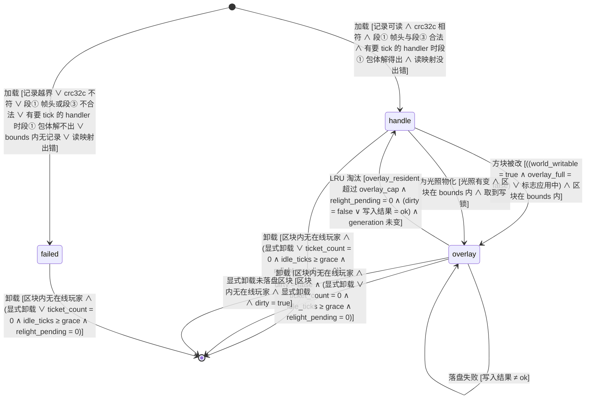

迁移表：

| 源 → 目标 | 事件 | 守卫（纯布尔） | 动作（副作用） | 谁触发 | 接口/事件 |
| --- | --- | --- | --- | --- | --- |
| [*] → handle | 加载 | 记录可读（`offset ≠ 0` ∧ 未越界）∧ crc32c 相符 ∧ 段① 帧头合法（帧长等于余下字节数且 ≤ 2,097,151、未压缩长度在 0～8,388,608，M3-S）∧ 段③ 解得出（解压后 ≤ 16 MiB，每条 NBT 结构核对通过、计量 ≤ 16 MiB，handler 是合法键，方块实体的 `section_y` 在 `world` 内）∧ 有要 tick 的 handler 时段① 包体解得出（登记 `tickableMap` 要读它所在格的方块）∧ 读映射没出错（M3-S，`API-M3-005` 映射读取条） | 建 handle 模式 `SynxChunk`，来源依次查待写表、覆盖存储索引、区域文件（前两者只查 `bounds` 内），`generation` 接着来源的值；解码段③ 表，要 tick 的 handler 登记进 `tickableMap`；`onLoad` 时按段③ 生成静态实体（`bounds` 外不生成） | 引擎（玩家区块环的 `loadOptionalChunk` 或插件 `loadChunk`） | `API-M3-005` |
| [*] → failed | 加载 | 记录越界 ∨ crc32c 不符 ∨ 段① 帧头不合法 ∨ 段③ 解不出（含 handler 不是合法键、方块实体的 `section_y` 超出 `world`）∨ 有要 tick 的 handler 时段① 包体解不出 ∨（区块在 `bounds` 内 ∧ `offset = 0`）∨ 读映射出错（文件在运行中被截断） | 记 ERROR（带区块坐标与来源文件：区域文件或覆盖段）；建只读的空气占位，天光全 15；计入 `EVT:chunk_stream_stats.failed` | 引擎 | `API-M3-005` |
| handle → overlay | 方块被改 | （（`world_writable = true` ∧ `overlay_full = false`）∨ 标志应用中，即本线程在 `SynxChunk.asWorldFlag` 绑定内）∧ 区块在 `bounds` 内 | 在改方块的线程上、持区块写锁：从段① 解码方块、生物群系与光照灌进 section，从段③ 挂回方块实体；`generation` 加 1；`dirty = true`；调 `OverlayTracker#materialized`；向在看的客户端发方块更新；状态 ID 变了时 `block_changes` 加 1、投递光照重算并给不能自算的已交付玩家记光照待补（M3-D） | 插件 `setBlock` / `setBiome`、玩家放置或破坏方块、世界状态标志重放 | `API-M3-005`、`API-M3-013` |
| handle → overlay | 为光照物化 | 光照有变 ∧ 区块在 `bounds` 内 ∧ 取到写锁 | 持区块写锁，照当前来源原样灌进 section（方块、生物群系、光照、方块实体）；`generation` 不加、不置脏；调 `OverlayTracker#materialized`。不看 `world_writable`：光照不是对世界的改动 | 内部任务 `overlay.relight`（重算线程；50 ms 内拿不到写锁时由 `overlay.relight-install` 做） | `API-M3-005` 运行时光照条 |
| overlay → overlay | 光照装回 | 本区块的 3×3 九个坐标上的区块对象与 `block_changes` 同快照 ∧ 光照有变 ∧ 取到写锁 | 在 tick 调度线程上把变了的 section 换成新光照数组；`invalidate()`；`generation` 加 1；`dirty = true`；调 `OverlayTracker#modified`；放锁后向 `light_stale` 里的玩家补发完整光照并清空（退路开着时另向其余已交付玩家发变了的 section），收包玩家的 `delivered` 刷新为当前 tick。光照没变的有效装回不走这条迁移，只向必补的玩家补发并清空 `light_stale` | 内部任务 `overlay.relight-install` | `API-M3-005` 运行时光照条 |
| overlay → handle | LRU 淘汰 | `overlay_resident > overlay_cap` ∧ `relight_pending = 0` ∧（`dirty = false` ∨ 写入结果 = ok）∧ `generation` 未变 | 脏区块：编码池编码三段，tick 末尾写入阶段追加并随本 tick 的 group commit `fsync`，`fsync` 后更新索引，`written(…, demote = true)` 清空 section、改指向该条覆盖记录；干净区块：不编码、不追加，按索引里同 `generation` 的那条直接 `written(…, demote = true)`；`written` 在 50 ms 内拿不到区块写锁时返回 false，区块不动、仍是常驻，下一 tick 再淘汰 | 内部任务 `overlay.evict` | `API-M3-007` |
| overlay → overlay | 定期落盘 | `dirty` ∧（距首个未落盘改动 ≥ `flush_interval_s` − 250 ms ∨ 待卸载）∧ 写入结果 = ok | 编码三段追加，随本 tick 的 group commit `fsync`；`fsync` 后更新索引；编码后 `generation` 未变才 `dirty = false` | 内部任务 `overlay.flush` | `API-M3-007` |
| overlay → overlay | 停机落盘 | `dirty` ∧ 已请求最终落盘 ∧ 持有写入权 ∧ 写入结果 = ok | 由持有写入权的一方（tick 末尾写入阶段或停机线程）先收之前写入阶段留下的在途编码（`generation` 仍相符的直接用），再在截止前编码其余脏区块、追加，合并为一次 `fsync`；`fsync` 后更新索引、`dirty = false`；覆盖存储置已关闭 | 内部任务 `overlay.shutdown-flush` | `API-M3-007` |
| overlay → overlay | 落盘失败 | 写入结果 ≠ ok | 保留常驻与 `dirty`；`evict_failed` 计数加 1；一串连续失败只在第一次记 ERROR，恢复后第一次写成时记一行 INFO（带这一串的失败次数）；下一轮重试（最终落盘不重试，失败必记 ERROR，计入剩余脏区块数） | 内部任务 `overlay.evict`、`overlay.flush` 或 `overlay.shutdown-flush` | `API-M3-007` |
| handle → [*] | 卸载 | 区块内无在线玩家 ∧（显式卸载 ∨（`ticket_count = 0` ∧ `idle_ticks ≥ grace` ∧ `relight_pending = 0`）） | 发 `UnloadChunk`；移除区块内非玩家实体（含静态实体）；释放句柄（解码缓存的键指向不可变内容，不必清） | 内部任务 `chunk.unload`，或调用方直接 `Instance#unloadChunk` | `API-M3-006` |
| overlay → [*] | 卸载 | 区块内无在线玩家 ∧ `dirty = false` ∧（显式卸载 ∨（`ticket_count = 0` ∧ `idle_ticks ≥ grace` ∧ `relight_pending = 0`）） | 同 `handle → [*]`；调 `OverlayTracker#unloaded`，覆盖存储把它移出常驻集合。自动卸载遇到 `dirty` 时 `readyToUnload()` 返回假并请求卸载前落盘，本轮不卸载 | 内部任务 `chunk.unload`，或调用方直接 `Instance#unloadChunk` | `API-M3-006`、`API-M3-007` |
| overlay → [*] | 显式卸载未落盘区块 | 区块内无在线玩家 ∧ 显式卸载 ∧ `dirty = true` | 同 `handle → [*]`；`OverlayTracker#unloaded` 先在待写表放占位，再在调用线程上同步编码并完成占位（编码失败记 ERROR、放回被替换的旧项）；下一个 tick 末尾写入阶段收已编完的项、追加、`fsync`、更新索引后移出待写表；在这之前重新加载同一区块时 `find` 从待写表取，遇到占位就等它编完 | 调用方直接 `Instance#unloadChunk`（`InstanceManager#unregisterInstance` 也走它） | `API-M3-006`、`API-M3-007` |
| failed → [*] | 卸载 | 区块内无在线玩家 ∧（显式卸载 ∨（`ticket_count = 0` ∧ `idle_ticks ≥ grace` ∧ `relight_pending = 0`）） | 释放占位 | 内部任务 `chunk.unload`，或调用方直接 `Instance#unloadChunk` | `API-M3-006` |

「显式卸载」指调用方直接调公开的 `Instance#unloadChunk`（`InstanceManager#unregisterInstance` 对每个区块也调它），不看票据、宽限期与 `readyToUnload()`；引擎仍拒绝卸载站着在线玩家的区块（`InstanceContainer.java:294`）。`view_bounds` 外的区块与 `bounds` 外没有记录的区块 `loadChunk` 返回 `null`，引擎建普通空气区块，不进本状态机；`view_bounds` 内、`bounds` 外的只读 handle 没有 `handle → overlay` 出边；`world_writable = false` 时「方块被改」这条边只有世界状态标志的应用能走，「为光照物化」不受它限制；`overlay_full` 为真时同样（M3-S，`API-M3-007` 磁盘上限条），已是 overlay 的区块也不接受玩家与插件的改动。挂地图分片默认 `world_writable = false`（`REQ-M3-029`），所以默认配置下这条边只由标志的应用驱动。光照装回之后区块是脏的，按定期落盘、淘汰与卸载的既有迁移写进覆盖存储。三条自动卸载迁移守卫里的 `relight_pending = 0` 由 `readyToUnload()` 执行（`relight_pending > 0` 时三种模式都返回假，M3-D）；在算的任务另从快照起给中心的 5×5 持票，所以排队期间只有 3×3 留着，5×5 外圈照常可以卸载，快照时重新载入。为光照物化之后装回被跳过、之后的装回也没再改它的区块是干净的 overlay：来源是区域文件时索引里没有它的记录，淘汰照脏区块的路径编码一条内容与来源相同、`generation` 也相同的记录（`OverlayStore#selectEvictions` 只对索引里有同 `generation` 记录的干净区块免编码），多一次编码与一条记录；只在前后两次改动的光照互相抵消时出现，不另处理。`simulated` 是属性不是状态：它只决定区块与其中实体是否跑 tick 体，与驻留形态正交，任何状态下都可变。

### 11.2 地图版本 `ENT-MapBuild`

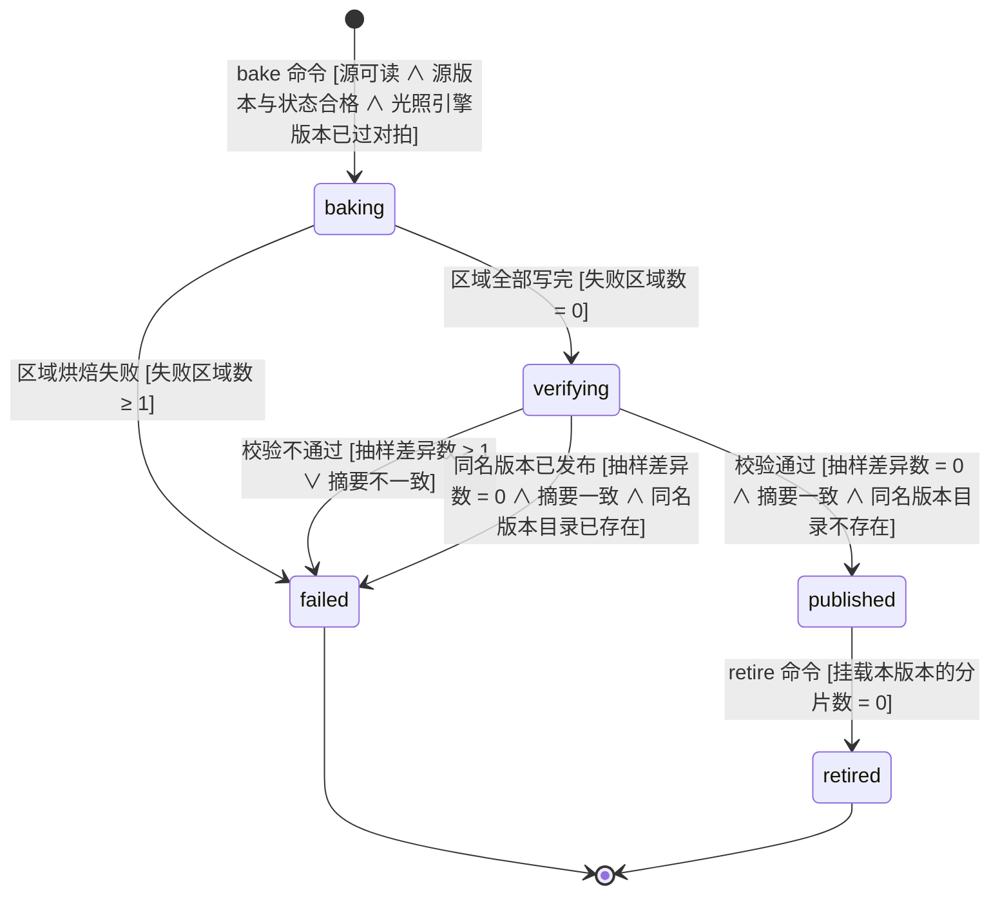

迁移表：

| 源 → 目标 | 事件 | 守卫（纯布尔） | 动作（副作用） | 谁触发 | 接口/事件 |
| --- | --- | --- | --- | --- | --- |
| [*] → baking | bake 命令 | `LightEngine.VERSION` ∈ 已过对拍版本集 ∧ 源可读 ∧（Anvil 源：`bounds` 内全部区块存在 ∧ `DataVersion = 4903` ∧ 全部为 full ∧ 标记都合规且命名空间已登记） | 写 `EVT:map_build_started`；建工作目录 `<maps_root>/<map_id>/.baking-*` | ROLE-MapBuilder | `API-M3-003` |
| baking → verifying | 区域全部写完 | 失败区域数 = 0 | 汇总 `content_hash`、推导 `build_id`；写区域文件；按隐藏区域替换采样、装配并写出与 `bounds` 相交的每个瓦片的高度场包（M3-G）；写清单草稿 | 烘焙器 | `API-M3-003`、`API-M3-014` |
| baking → failed | 区域烘焙失败 | 失败区域数 ≥ 1 | 保留工作目录供排查，stderr 报出它的路径；写 `EVT:map_build_finished`（`outcome=failed`）；退出码 3 | 烘焙器 | `API-M3-003` |
| verifying → published | 校验通过 | 抽样差异数 = 0 ∧ 摘要一致 ∧ `<map_id>/<build_id>` 不存在 | 源光照对拍差异写 `verify.source_light_diff`（只报告）；原子改名为发布目录；写 `EVT:map_build_finished`（`outcome=published`） | 烘焙器 | `API-M3-002` |
| verifying → failed | 校验不通过 | 抽样差异数 ≥ 1 ∨ 摘要不一致 | 同 `baking → failed`；退出码 4 | 烘焙器 | `API-M3-003` |
| verifying → failed | 同名版本已发布 | 抽样差异数 = 0 ∧ 摘要一致 ∧ `<map_id>/<build_id>` 已存在 | 删掉工作目录，已发布的那份不动；写 `EVT:map_build_finished`（`outcome=failed`）；退出码 5 | 烘焙器 | `API-M3-003` |
| published → retired | retire 命令 | 挂载本版本的在线分片数 = 0（`shard_heartbeat` 里 `build_id` = 本版本且 `updated_at > now() − 15 s` 的行数；内存存储的挂地图分片不写心跳，由运维确认） | 目录移入 `retired/`，保留 30 天；CDN 上不再被任何已发布版本引用的高度场包对象同期删除（`API-M3-014` 分发条） | ROLE-Operator | `API-M3-003` |

`[*] → baking` 的守卫任一项不成立时不进入状态机、不产生任何目录与事件：光照引擎版本未过对拍退出码 6（在读任何区块之前就拒绝），源不可读、源版本或状态不合格、`bounds` 内缺区块、标记不合规退出码 2。「同名版本已发布」放在校验之后判定，因为 `build_id` 由 `content_hash` 推导，烘焙完才知道；同一输入重烘一次得到的是同一 `build_id`，退出码 5 表示不用重烘。「已过对拍版本集」是引擎资源 `verified-light-versions.txt`（路径见 `API-M3-004` 版本条），光照对拍（`REQ-M3-007`）绿时由改光照的同一个提交追加一行，`LightEngineVersionTest` 把它与引擎输出绑定（§24）。

### 11.3 客户端 DH 库 `ENT-FarViewLibrary`

一个 `view_key` 一个库（`API-M3-015` 缓存条），库里是一次宣告的全部瓦片：整包瓦片的细层与粗层瓦片展开后的列。下面的「包」指宣告里的每个对象，整包与粗层包一样算，下载、校验与世界参数核对的守卫对两种都成立。`ready` 由完成标记落盘，跨连接、跨重启保留，本连接第一次 DH 层级载入后再过一次库核对（载入核对只做这一次，本连接自己的层级在连接内被卸载之后不再画远景，§28.2）；`downloading` 与 `baking` 只存在于一条连接的内存里，连接断开或层级卸载（断开、转服、换维度）时回到 `absent`。远景不可用（DH 缺席、版本或接入面不符、档位为 0、没有能解码的宣告）时不选库，不进本状态机；这时 Synaxis 连接的 DH 钉到只读的空库 `dh/off/`（`API-M3-015` 可用性条）。库在 `absent` 时 DH 照样打开这个目录（目录在建层级时就钉了），上次中断留下的部分数据照样画出来，直到重写覆盖。包全在本地缓存而层级载入时世界参数不符的，不迁移、留在 `absent`，记与 `downloading → absent` 同一行 WARN（写库条第 1 步）。「连接断开或层级卸载」指 Fabric `ClientPlayConnectionEvents.DISCONNECT`、本层级的 `DhApiLevelUnloadEvent`（按包装对象判定，旧层级迟到的卸载事件不算）、`DhApiWorldUnloadEvent` 三者里最早到的一个（写库条第 6 步）。进入 `baking` 的两条迁移与这个事件在同一把锁下判定：取消先到，守卫里的「取消标志未置」不成立、不迁移；`baking` 之后才到，就走 `baking → absent`。

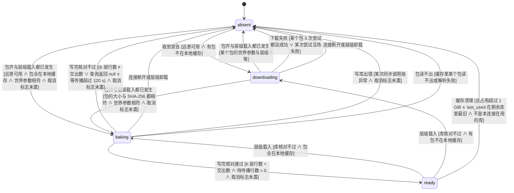

迁移表：

| 源 → 目标 | 事件 | 守卫（纯布尔） | 动作（副作用） | 谁触发 | 接口/事件 |
| --- | --- | --- | --- | --- | --- |
| absent → downloading | 收到宣告 | 远景可用 ∧ 宣告里至少一个包不在 `packs/` | 起内部任务 `farview.download` 下载缺的包（并发 2，`.part` 续传）；HUD 显示下载进度 | 客户端，处理 configuration 阶段负载的线程 | `API-M3-015`（`synaxis:farview`）、`API-M3-014`（HTTP GET） |
| absent → baking | 包齐与层级载入都已发生 | 远景可用 ∧ 宣告里的包全在 `packs/` ∧ 每个包的 `min_y`、`height`、`block_states` 与层级相符 ∧ 取消标志未置（与置取消标志同一把锁，`FarViewConnection#baking()`） | 起内部任务 `farview.bake`（线程 `synaxis-farview-bake`），先整包瓦片的细层、再粗层瓦片展开后的数据源，逐个交给 DH（在途 ≤ 16）；HUD 显示烘焙进度 | 客户端（`DhApiLevelLoadEvent`） | `API-M3-015` 写库条 |
| downloading → baking | 包齐与层级载入都已发生 | 每个包的大小与 SHA-256 等于宣告 ∧ 世界参数与层级相符 ∧ 取消标志未置（同上一把锁） | 同上 | 客户端（最后一个包下完的下载线程或 `DhApiLevelLoadEvent`，以后到者为准） | `API-M3-015` 写库条 |
| downloading → absent | 包齐与层级载入都已发生 | 某个包的 `min_y`、`height` 或 `block_states` 与层级不等 | 不烘，记 WARN；本连接不画远景；起内部任务 `farview.cache-clean` | 客户端 | `API-M3-015` 写库条第 1 步 |
| downloading → absent | 下载失败 | 某个包 3 次尝试都没成功 ∨ 某次尝试当场失败（URL 请求不了、3xx、摘要相符而包、层或瓦片不对） | 停掉其余下载，删掉失败包的 `.part`，记 WARN；本连接不画远景，不弹窗 | 内部任务 `farview.download` | `API-M3-014`、`API-M3-015` 下载条 |
| downloading → absent | 连接断开或层级卸载 | — | 停下载，已下的 `.part` 留着供下次续传 | 客户端（三个信号里最早到的一个） | `API-M3-015` 写库条第 6 步 |
| baking → ready | 写完核对通过 | 全部 future 已完成 ∧ 库里 `DetailLevel = b` 的行数 = 交出的数据源数 ∧ `ApplyToParent = 1` 的行数 = 0 ∧ 取消标志未置 | 写完成标记（先 `.tmp` 再改名，`sources` = 交出数），记烘焙日志行，HUD 行消失；起内部任务 `farview.cache-clean` | 内部任务 `farview.bake` | `API-M3-015` 写库条第 4、5 步 |
| baking → absent | 写完核对不过 | 全部 future 已完成 ∧（`DetailLevel = b` 的行数 ≠ 交出数 ∨ 查询返回 null ∨ 等 `ApplyToParent = 1` 归零超过 120 s）∧ 取消标志未置（已置时直接停、不记 WARN，走「连接断开或层级卸载」那一行） | 不写完成标记，记 WARN（`incomplete` 或 `parents pending`）；库目录留着，下次按 `absent` 重写；起内部任务 `farview.cache-clean` | 内部任务 `farview.bake` | `API-M3-015` 写库条第 4 步 |
| baking → absent | 连接断开或层级卸载 | — | 置取消标志；线程在交下一块之前、或等 future 的下一次醒来时停，不写完成标记；库目录留着 | 客户端（三个信号里最早到的一个） | `API-M3-015` 写库条第 6 步 |
| baking → absent | 写库出错 | 某次同步调用（`setApiDataPointColumn`、包装工厂、`updateDataSourcesAsync`）抛异常 ∧ 取消标志未置 | 停下，不写完成标记，记 WARN 带异常；已写进去的部分本连接照样画；起内部任务 `farview.cache-clean` | 内部任务 `farview.bake` | `API-M3-015` 写库条第 7 步 |
| baking → absent | 包读不出 | 缓存里某个包读不出或解析失败（第 1 步读包，或第 2 步解压某块） | 删掉这个包，不写完成标记，记 WARN `Far view off: pack <sha256 前 12 位> in the cache cannot be read, removed: <原因>`；下一条连接按缺包重下；起内部任务 `farview.cache-clean` | 内部任务 `farview.bake` | `API-M3-015` 写库条第 1 步 |
| ready → baking | 层级载入 | 库里 `DetailLevel = b` 的行数 ≠ 完成标记的 `sources`（或查询返回 null 而取消标志未置；取消标志已置时查询返回 null 不删标记、直接停）∧ 宣告里的包全在 `packs/` ∧ 世界参数与层级相符 | 删掉完成标记，记 WARN `library does not match its marker`；起内部任务 `farview.bake` | 内部任务 `farview.bake`（载入核对） | `API-M3-015` 写库条第 8 步 |
| ready → downloading | 层级载入 | 库核对不过（同上）∧ 宣告里至少一个包不在 `packs/` | 删掉完成标记，记同一行 WARN；起内部任务 `farview.download` | 内部任务 `farview.bake`（载入核对） | `API-M3-015` 写库条第 8 步、下载条 |
| ready → absent | 缓存清理 | `synaxis/farview/` 总占用 > 1 GiB ∧ 本库的 `last_used` 在剩余库里最旧 ∧ 不是本连接在用的库 | 删库目录，再删不被剩余完成标记引用的包 | 内部任务 `farview.cache-clean`（另一个库的烘焙结束且没被取消之后，成功与失败都算） | `API-M3-015` 缓存条 |

`ready` 的库在下一次宣告同一 `view_key` 时不下载：DH 直接从钉住的目录载入，层级载入后库核对通过即留在 `ready`、只更新 `last_used`，不通过走上面两行。换了任一个包（含相邻瓦片的粗层包）、DH 版本或 `BAKE_CODE_VERSION`，`view_key` 就变了，是另一个库，旧库只由缓存清理删除。

## 12. 关键流程时序

### 12.1 区块流送、改动与运行时光照

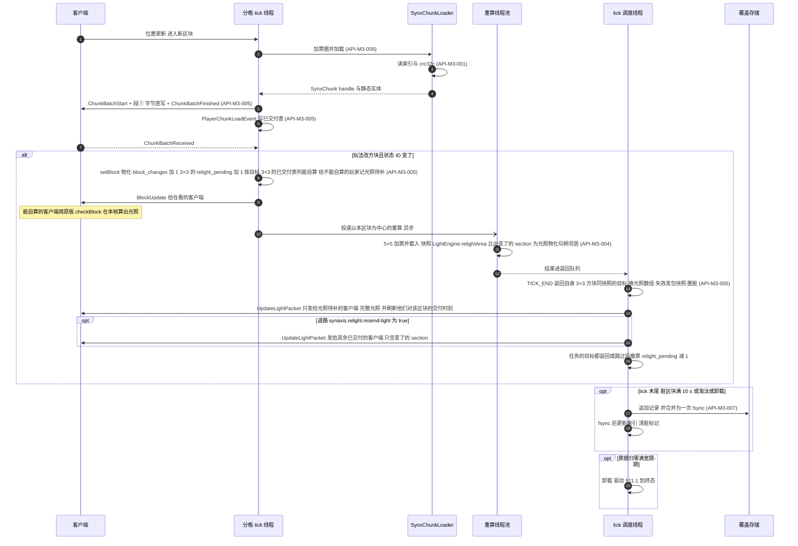

驱动的状态机迁移：§11.1 `[*] → handle`、`handle → overlay`（方块被改、为光照物化）、`overlay → overlay`（光照装回、定期落盘）、`overlay → [*]`。重算线程只读快照、只做内容不变的物化；光照写进区块在 tick 末尾由 tick 调度线程做，这时全部 tick 线程已结束本 tick，改方块与交付区块都停着（`ADR-M3-019`）。区块没有 `Acquirable`（它只挂在实体上），所以不交给区块所属的 tick 线程去写。覆盖存储的写入阶段与卸载判定同在 tick 调度线程上（`API-M3-007`、`API-M3-006`）。

### 12.2 跨大区转服（世界侧）

写回与释放、Cookie 的签名与验票、正版验证、写权获取的细节不在本图展开，见 `docs/DESIGN-PROD.md` §12.3（跨大区转服与目标分片重新验证）。发起方是宿主的关卡门（§28.1 已决）；GM 命令与管理接口（该分册 6A）从第 2 步开始，与关卡门走同一条路。

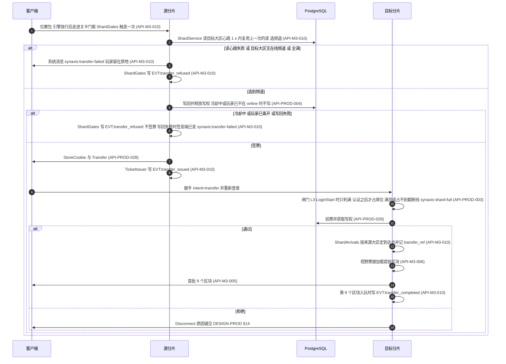

驱动的状态机迁移：§11.1 `[*] → handle`（第 13～14 步，目标分片首批区块）。票据与写权的状态迁移见 `docs/DESIGN-PROD.md` §11.3 的迁移表（`online → saving`、`saving → in_transit`、`saving → online`，目标侧 `in_transit → loading`、`in_transit → offline`）。第 3、4 步那一支不碰写权，玩家的 §11.3 状态停在 `online`。第 6 步那一支是签发端回了 `COOLDOWN`、`NOT_ONLINE` 或 `SAVE_FAILED`：`COOLDOWN` 不写库；`NOT_ONLINE` 多数在写回之前回、不写库，写回之后、签票之前离开的那种已写回并释放写权；`SAVE_FAILED` 多数是写库失败（玩家回 `online`）或被 fenced（玩家被踢）；三种都不签票、不记冷却，各停在签发的哪一步见 `docs/DESIGN-PROD.md` §20 `EVT:transfer_refused` 一行。

### 12.3 烘焙与发布

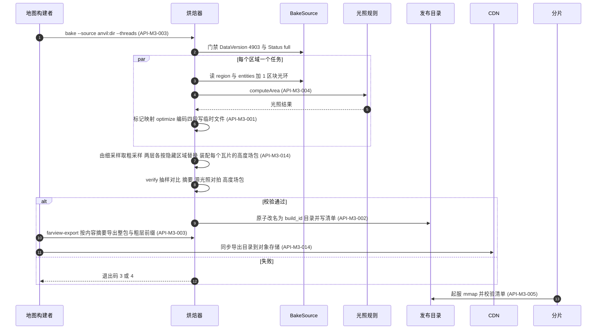

驱动的状态机迁移：§11.2 `[*] → baking → verifying → published`，失败分支 `→ failed`。M3-B 落地的是第 1～6、8、9、12 步（门禁、按区域烘焙、`verify`、原子改名、失败退出码）；第 7、10、11 步（装配高度场包、按内容摘要导出、同步到 CDN）与第 8 步里高度场包那部分随 M3-G，第 13 步（分片起服挂载）随 M3-C。第 6 步同时把每个区块的远景采样写进工作目录的 `farview-parts/`；第 7 步在第 8 步之前、写清单之前。图里「写临时文件」指 `.baking-*` 工作目录与区域暂存文件，清单在校验前后各写一次（校验结果写进 `verify`）。第 11 步由运维用对象存储自己的同步工具做，不在仓库里。

### 12.4 客户端远景准备

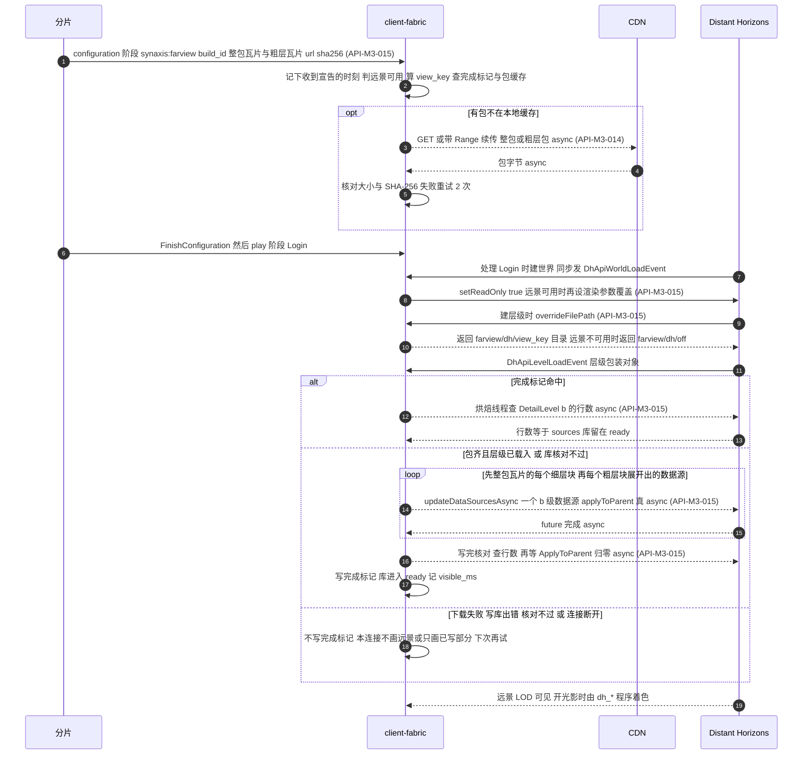

驱动的状态机迁移：§11.3 `absent → downloading → baking → ready`（包已在缓存时 `absent → baking`），失败、核对不过与取消分支 `→ absent`；完成标记命中而载入核对不过时 `ready → baking`（包不全时 `ready → downloading`）；核对通过时不走迁移。服务端状态不变：远景宣告只读清单与包文件。第 6 条消息（`FinishConfiguration` 与 `Login`）是原版的阶段切换，第 7 条是 DH 自己在 `ClientPacketListener#handleLogin` 返回处建世界，都不属于任何 `API-M3-*`；画出来是为了表明宣告一定先于建层级、只读先于层级处理积压的区块（§16）。第 1 条消息在客户端被处理的时刻到第 17 条（写完成标记）的墙钟就是烘焙日志行的 `visible_ms`，§15 远景准备行要它 ≤ 30 s：第 3～5 条的下载与第 6～11 条的登录、建层级并行，第 14～16 条在四周都有大区的对齐大区上是 2,304 个 b 级数据源（b = 2）。

### 12.5 停机时的覆盖层最终落盘

保存阶段的阶段划分、预算与判死路径见 `docs/DESIGN-PROD.md` §11.4 与 `API-PROD-007`，本图只画覆盖层这一步。

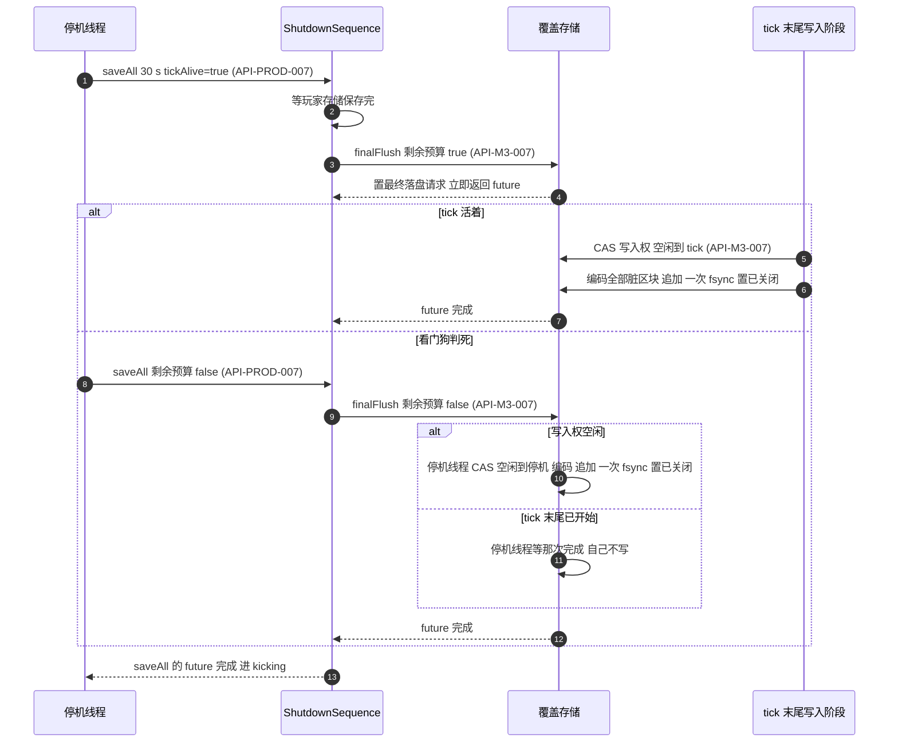

驱动的状态机迁移：§11.1 `overlay → overlay`（停机落盘）；`docs/DESIGN-PROD.md` §11.4 `saving → saving`（宿主步骤）与 `saving → kicking`。到截止时刻 min(2 s, 剩余预算) 还没完成时，覆盖存储自己记 ERROR 并完成 future（`API-M3-007` 停机段），图里省略。

### 12.6 世界状态标志的写入、通知与兜底

两个频道（同一大区）之间的标志同步。起服重放不在图里：它在启动线程上先读表（覆盖存储打开之前），建好实例后逐格比较再 `setBlock`，没有跨进程消息（`API-M3-013` 重放条）。

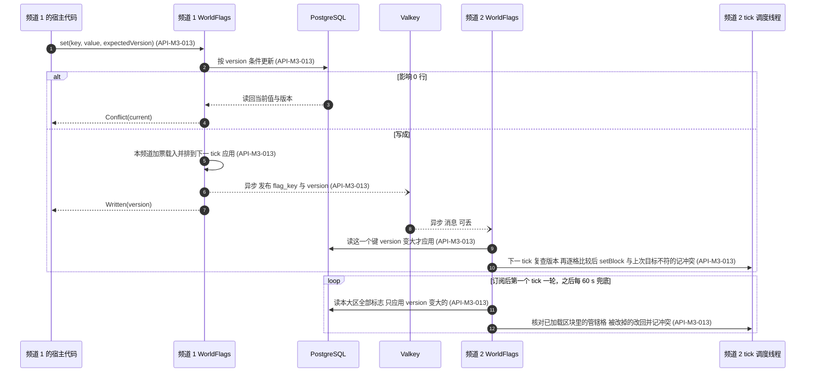

驱动的状态机迁移：§11.1 `handle → overlay`（应用改动的区块物化进覆盖层，触发者一栏的「世界状态标志重放」即指这一路），之后按 `overlay → overlay` 定期落盘。

## 13. 页面与跳转地图

有前端：客户端模组。M3 新增的客户端可见界面是转服过场（原版 `Transfer` 时的连接屏）、新增的断线原因与光影引导屏；远景准备只在 HUD 上显示一条可忽略的进度提示，不是页面。游戏内界面沿用 M2 的 `PAGE-RTS-HUD`（MMO 的 HUD 不在 M3 范围）。

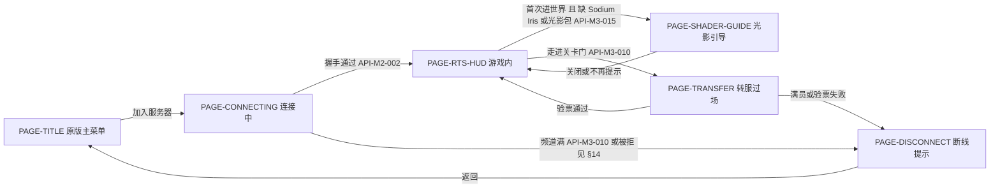

| 页面 | 可见角色 | 调用的接口 | 关键页态 |
| --- | --- | --- | --- |
| `PAGE-TRANSFER` | ROLE-Player | `API-M3-010`（关卡门、选频道、到达，服务端侧） | 原版连接屏，无自定义界面；超过 30 s 未完成即票据过期（`docs/DESIGN-PROD.md` §11.3 `in_transit → offline`），落到断线页。源分片选不到频道（目标大区满、没有在线频道、读心跳失败）时不进这一页：玩家留在原地，收到系统消息 `synaxis:transfer-failed`，走出门框再走进可以重试；验票通过后出生在目标大区通往来源大区那扇门的到达点 |
| `PAGE-DISCONNECT` | ROLE-Player | — | 断线原因键的文案：频道满 `synaxis:shard-full`（模组可自动换频道）、转服与写权相关的键，都见 `docs/DESIGN-PROD.md` §14 |
| `PAGE-SHADER-GUIDE` | ROLE-Player | `API-M3-015`（本机检测） | 三态：缺 Sodium / Iris（给安装说明与版本号：Sodium 0.9.2、Iris 1.11.4，26.2）；已装 Iris 未启用光影包（推荐 Complementary Reimagined，给启用路径）；Mac 上光影包被 Iris 自动关闭（说明原版画面是正常兜底）。按钮「知道了」「不再提示」；关闭后画面照常，不影响进服 |

## 14. 错误处理与错误码

无 HTTP，不用 RFC 9457。沿用 `docs/DESIGN.md` §14 与 `docs/DESIGN-M2.md` §14：断线原因是 `translate` 键，排障关联 ID 是 `connection_id`，每行日志携带、断线文本不携带。M3 不新增断线键。频道满只有 `synaxis:shard-full` 一个键：住引擎 `DisconnectReasons`，由连接闸门 L3 判定，`LoginStart` 时判满、认证之后占不到席位都是这个键（`API-M3-010` 容量段与「选频道」条，定义见 `docs/DESIGN-PROD.md` §14）。转服验票与写权失败的两个键 `synaxis:transfer-rejected`、`synaxis:state-unavailable` 由该分册 §14 这两行定义，拒绝原因与检查顺序见该分册 `API-PROD-028`；`synaxis:state-unavailable` 共五种来源，除载入失败、会话隔离、顶号拿不到租约外，还有转入验票时写权被别处持有（`lease-held`）与数据库错误（`store-unavailable`）。转服日志带票据 nonce 的前 8 位 hex（`transfer_ref`），源、目标两侧日志用它串起来。

起服拒绝（进程非零码退出、端口不 bind，错误写进启动日志）：

| 错误码 | 条件 | 处置 |
| --- | --- | --- |
| `synx-magic` | 文件头 `magic` 或 `format_version` 不认识，或 `flags` 有未知位，或文件种类不对（该是区域文件的位置上是覆盖段，或反之） | 换正确的发布目录 |
| `synx-truncated` | 文件在头部或偏移索引内就结束了 | 重新分发该文件 |
| `synx-world-mismatch` | 区域或覆盖段头部的 `min_y` / `height` 与清单 `world` 不符（文件不是这次烘焙的） | 重新分发整个发布目录；仍不符则重烘 |
| `synx-manifest` | 清单缺失或解析失败、超过 16,777,216 B、同一对象里有重复的名字（M3-S）、整数字段带小数、`build_id` 与目录名或推导值不符、区域头与清单不符、清单漏列区域、区块数不符 | 重新分发整个发布目录；仍不符则重烘 |
| `synx-protocol-mismatch` | `protocol_version` ≠ 776 | 用 `rebake` 按当前协议重烘 |
| `synx-registry-mismatch` | `registry_digest` 与进程的生物群系注册表不符 | 重烘 |
| `synx-compression-mismatch` | 头部 `compression_threshold` 与进程的 `synaxis.compression-threshold` 不符（信息末尾带这个键名） | 把 `synaxis.compression-threshold` 改回 256（烘焙器固定按 256 烘，`Baker.COMPRESSION_THRESHOLD`，重烘换不了阈值；`API-M3-006` 设置表） |
| `synx-payload-hash` | 文件大小或 `payload_sha256` 与清单不符，或 `payload_sha256` 与文件内容不符 | 重新分发该文件 |
| `synx-light-engine-mismatch` | 清单 `light_engine_version` ≠ 当前 `LightEngine.VERSION` | 重烘（光照输出已变） |
| `synx-world-flags-unavailable` | 起服读世界状态标志时（覆盖存储打开之前）PostgreSQL 读失败，重试 3 次仍失败 | 见 `RB-M3-006` |

前九个码由 `:synx` 的 `SynxError` 定义，由起服校验与读取器抛出：分片起服经 `SynxBuildVerifier.open`（`API-M3-006` 挂地图模式），烘焙器的 `verify` 经 `SynxBuildVerifier.verify`（`API-M3-002`）；覆盖段文件头部不符同样按这几个码。烘焙器的退出码见 `API-M3-003`。

挂地图的分片起服拒绝一律走 `Main` 既有的拒启路径：日志一行 `Refusing to start: …`，退出码 1，端口不 bind，不写 `EVT:shard_started`。`synx-*` 码写在这一行开头（如 `Refusing to start: synx-payload-hash: r.0.0.synx: …`）；另有不带码的配置拒绝：`synaxis.map.root` 与 `synaxis.map.build` 只给了一个，或经 `bin/server-app` 给了它们；挂地图而 `synaxis.app.core-mode` 不是 `on`；区块视距 > 16；模拟距离不在 1～区块视距；宽限期不是 `-1` 也不 ≥ 1；M3 的八个键写法不对（`API-M3-006`）；`SynxHandlers` 发现同键处理器（`two block handlers have the key <键>: <类名> and <类名>`）；覆盖存储目录建不了或读不了（`the overlay store overlay/<build_id> cannot be opened: …`）。覆盖段没有头部（建段时崩溃）不拒启，记 WARN 并删掉该段（`API-M3-007` 启动条）。`synx-world-flags-unavailable` 属 M3-E。M3-E 目录模式另有六类不带码的配置拒绝（信息原文见 `API-M3-010` 目录条）：PostgreSQL 存储的挂地图分片没有 `shards.json`，或内存存储的挂地图分片有它；目录文件解析或校验不过（`the shard directory <路径> is not valid: …`，含与清单不符的三项）；`synaxis.app.shard-id` 不在目录的 `channels[]` 里；`synaxis.max-players` 与目录容量不同；`synaxis.accept-transfers` 显式给了 `false`；出生点所在的列落在本大区某扇门框的 x、z 范围里（`the spawn column … is inside the gate …`，步骤 (3) 判，`API-M3-006`）。运行期区块记录损坏（越界、crc32c 不符或段长表不符）不拒绝起服：该区块进 §11.1 `failed`，发空气区块占位并记 ERROR，由 §21 的告警接手。客户端远景的下载与校验失败不报错给玩家，只写客户端日志并在下次进大区重试。M3-G 只加一条配置拒绝：`synaxis.farview.url-root` 去掉首尾空白后非空，而不是 `http://` 或 `https://` 开头、以 `/` 结尾、按 `java.net.URI` 解析不了、没有主机，或带查询、片段（解析与主机两项是 `REQ-M3-032` 客户端收宣告的规则，信息见 §9）；清单 `farview[]` 为空、与发布目录里的包不符都不拒启，只让分片不宣告远景并在起服日志里记 `Far view off: …`（`API-M3-015` 宣告条）。M3-G 不新增断线键与 `synx-*` 码。M3-S 加四类不带码的拒绝（信息原文见 `API-M3-002` 文件信任条与覆盖层条、`API-M3-006` 配置键条、`API-M3-010` 读取条）：`synaxis.map.root` 目录、`shards.json`、发布目录、清单、`regions/`、`farview/`、要映射的区域文件或要宣告的包（按真实路径），文件组或他人可写、目录组或他人可写而没有 sticky 位（路径是符号链接时也看链接所在的目录）、或属主既不是 root 也不是 `synaxis.map.root` 的属主；已有的覆盖目录或段文件组或他人可写；`synaxis.overlay.max-bytes` 不是整数或小于 1；`shards.json` 超过 1,048,576 B。清单超过 16,777,216 B 或同一对象里有重复的名字按 `synx-manifest` 拒启；段① 帧头、段③ 或其中的一条 NBT 越过长度上限不拒启，该区块进 `failed`（§11.1）；已映射的区域文件在运行中被截断同样只让载入的区块进 `failed`（`API-M3-005` 映射读取条）。覆盖层写到磁盘上限也不拒启（`API-M3-007` 磁盘上限条）。M3-S 不新增断线键与 `synx-*` 码。

## 15. 非功能需求

全部数字追溯 §2 规模画像；基准数字的三条限制（合成地形、美术地图未测、墙钟在高负载下测只当上界）见 §2 表头。

| 维度 | 场景 | 目标 |
| --- | --- | --- |
| tick 预算 | 单分片挂 4k×4k 测试图、200 机器人、视距 12、模拟距离 4、宽限 100、步行与坐骑两档各 600 s | tick P99 < 50 ms，超 50 ms 的 tick 为 0（路线报告 P2 ⑥），这两项只在分机档判定（下面「压测的机器前提与登记」，用户 2026-09-30 拍板，§28.1）；30 min 档 TPS 20、RSS ≤ 堆上限 + 1 GiB、末段老年代回收后的占用 ≤ 堆上限的 50%（P6 原写 RSS < 4 GiB，用户 2026-10-11 改，§28.1；读法见下一行）。覆盖层 tick 末尾写入阶段每 tick ≤ 20 ms 加一次 `fsync`（`API-M3-007`）。同机档实测只登记（`docs/TEST.md` RUN-057、RUN-058）。RUN-057（分片 1 GiB 堆）：步行 tick P99 6.447 ms、超 50 ms 的 tick 4 个（最长 90.4 ms），坐骑 P99 12.790 ms、7 个（最长 91.2 ms）；11 个里 9 个与一次 G1 暂停重叠（暂停 54.0～86.7 ms），另 2 个前后没有 GC 暂停。RUN-058（`bin/server-shard` 的默认参数：G1、4 GiB 堆、`MaxGCPauseMillis=50`）：步行 P99 5.738 ms、超 50 ms 的 5 个（最长 71.2 ms），4 个与 G1 暂停重叠（48.3～68.5 ms），1 个（56.5 ms）前后 4.8 s 没有暂停，归因未定；坐骑 P99 47.863 ms、116 个，前 8 分钟的 6 个都与 G1 暂停重叠（50.5～132.8 ms），之后别的会话把本机 `load1` 推到 47，另有 110 个（最长 370.5 ms），101 个没有暂停。堆加大不缩短暂停：G1 按暂停目标调年轻代，步行每次年轻代回收前堆只有 207～604 MB，47 次暂停最长 68.5 ms（RUN-057 的 1 GiB 堆 40 次、最长 88.8 ms）。写入阶段每 tick 最长：RUN-057 0.66 与 2.35 ms；RUN-058 3.37 与 33.34 ms，后者出在坐骑 13:00～13:01 本机 `load1` 从 17 升到 35 的那一分钟，那一分钟没有追加记录、没有 `fsync`，是负载下的墙钟 |
| tick 预算（M3-E，目录模式 30 min） | 4k 测试图一个大区（`bounds` `0,0,255,255`）一个频道，`capacity` 200，PostgreSQL 存储、写心跳、有标志表（0 个标志），分片宿主默认值（`grid`、核数 − 2 条 tick 线程、视距 12、模拟距离 4、宽限 100、区块上限 4、可见上限 100），200 机器人 walk 1,800 s，离线模式、不加密 | 200 个全部登录、0 掉线、0 被踢；tick P99 < 50 ms、超 50 ms 的 tick 为 0；`ticks` 数 ≥ 1,800 × 20 × 0.995 = 35,820（平均 TPS ≥ 19.9）；Linux RSS ≤ 堆上限 + 1 GiB（默认 4 GiB 堆时 5 GiB）；GC 判据：分片加 `-Xlog:gc:file=<产物目录>/gc.log`（经 `JAVA_OPTS`），最后 5 min 里老年代回收（G1 的 `Pause Young (Mixed)` 与 `Pause Full`）之后的堆占用（日志行 `->` 后面的数）都 ≤ 堆上限的 50%（4 GiB 堆时 2,048 MiB），这 5 min 里没有老年代回收时取最后一次回收之后的堆占用（含没回收的老年代垃圾，是上界）；`EVT:chunk_stream_stats` 的 `failed`、`evict_failed` 恒为 0；心跳每 5 s 一行、稳态 `online` = 200（P6；RSS 与 GC 两项是用户 2026-10-11 定的，§28.1）。只在分机档判定（下面「压测的机器前提」）。同机档实测（`docs/TEST.md` RUN-057，512 MiB 堆，跑的过程中本机 `load1` 5.6～39.5）：200 个全部登录、0 掉线、0 被踢，`ticks` 36,426 个（≥ 35,820），`failed`、`evict_failed` 恒为 0，心跳 61 次读数的年龄都 ≤ 4.96 s、全员进场后 `online` 200，这几项达标；补充读数（不作判据）：tick P99 15.833 ms、超 50 ms 的 44 个（最长 213.8 ms，38 个在前 5 分钟），RSS 最大 545.9 MiB。tick 与 RSS 待分机档 |
| tick 预算（正式档） | 500 机器人，两档各 600 s：分散档（同上配置，`capacity` 500，walk）；单分格档（只有一个大区的目录，`bounds` `0,0,239,239`，出生点落在格 (7, 7) 中央，`town` 画像，全员留在这一格，`API-M3-009` 单分格条） | 两档都记 tick P99、超 50 ms 的 tick 数、`ticks.acquire_ms`、每条 tick 线程的 `dispatcher_busy_ratio`、每人出口；记录在案即算完成。分机档的 tick P99 ≥ 50 ms 时把该档对应的频道 `capacity` 在 `shards.json` 里降到 300，并在本行与 `docs/DESIGN-PROD.md` §15「集成后复测与 `capacity`」一段登记（P6）。同机档读数只登记、不据此改 `capacity`。实测（`docs/TEST.md` RUN-057，同机档，512 MiB 堆，跑的过程中本机 `load1` 4.4～68.2，别的会话在跑 Android 模拟器与 xcodebuild）：分散档 tick P99 57.2 ms、超 50 ms 的 163 个（最长 732.8 ms），10 条 tick 线程的 `dispatcher_busy_ratio` 0.002～0.090、调度线程 0.140，每人出口 50,743 B/s（服务端出站 ÷ 500）；单分格档 tick P99 213.4 ms、超 50 ms 的 1,902 个（最长 1,929.3 ms），全部玩家在 `Syn-Tick-8` 上（0.529，其余 9 条 ≤ 0.001）、调度线程 0.557，每人出口 56,506 B/s。`ticks.acquire_ms` 两档都是 null：`:loadtest` 的 `sample` 在 `TickMonitor` 的获取耗时导出之前不写它（`docs/DESIGN-PROD.md` `API-PROD-015`，审计 P3-3），所以五项只有四项，「记录在案」没有完成。审计 P3-3 随 `main` `c46578d24f` 合入后，`sample` 写真实的 `ticks.acquire_ms`（`docs/DESIGN-PROD.md` v0.9.36）；RUN-060 按原文重跑这两档，起跑门槛在一个 90 min 窗口里一次都没满足（下面「压测的机器前提与登记」），登记为阻塞。RUN-063（2026-10-02，同机档，分片用 `bin/server-shard` 的默认参数、4 GiB 堆，跑的过程中本机 `load1` 3.7～13.1）重跑两档，五项读数都有：分散档 tick P99 18.2 ms、超 50 ms 的 12 个（最长 110.8 ms），`ticks.acquire_ms` 12,416 个、按 `sample` 的 0.001 ms 步长取整全是 0（0 表示每个 tick 在获取上的等待都 < 0.5 µs：`sample` 把 JFR 字段 `acquisitionTime` 的纳秒值转成毫秒后按 0.001 ms 四舍五入，计法见 `docs/DESIGN-PROD.md` `API-PROD-015`；单分格档同此），10 条 tick 线程的 `dispatcher_busy_ratio` 0.002～0.067、调度线程 0.085，每人出口 50,766 B/s；单分格档 tick P99 45.8 ms、超 50 ms 的 75 个（最长 349.2 ms），`ticks.acquire_ms` 12,410 个、取整全是 0，`Syn-Tick-8` 0.199、其余 9 条 0.0、调度线程 0.205，每人出口 57,199 B/s。与 RUN-057 的四项对照：tick P99 分散档 57.2 → 18.2 ms、单分格档 213.4 → 45.8 ms；超 50 ms 的 163 → 12 个、1,902 → 75 个；`dispatcher_busy_ratio` 分散档 tick 线程最高 0.090 → 0.067、调度线程 0.140 → 0.085，单分格档 `Syn-Tick-8` 0.529 → 0.199、调度线程 0.557 → 0.205；每人出口 50,743 → 50,766 B/s、56,506 → 57,199 B/s。两轮之间分片堆（512 MiB → 4 GiB）与本机负载（`load1` 最高 68.2 → 13.1）同时变了，tick 与 busy 比例的下降不归到其中任何一处。两档「记录在案」完成；tick 只在分机档判定，分机档没到位 |
| 零编码 | 未改区块的发送路径 | 确定性判据：集成测试经真实 `Player` 发送路径发句柄区块，连接收到的每个区块包都是 `sheddable = false` 的 `BufferedPacket`、字节与段① 相同，没有 `CachedPacket` 或 `ServerPacket` 形式的区块包，所以发送路径上 `ChunkDataPacket` 对象数为 0。压测判据（P2 ④）：200 机器人 600 s、全程不改方块，JFR `jdk.MethodTiming` 计 `ChunkDataPacket::<init>` 与 `DynamicChunk::createChunkPacket` 的调用数都是 0，`SynxChunk::getFullDataPacket` 的调用数 > 0 且 ≥ 机器人收到的区块包数（多出的是断线时还在路上、机器人没读到的包）；`jdk.ExecutionSample` 与 `jdk.ObjectAllocationSample` 的栈里 `createChunkPacket` 出现 0 次；`EVT:chunk_stream_stats` 的 `overlay_sent = 0`、`handle_sent > 0`。必须配阳性对照：不挂图的核心模式分片按同样走法跑，两个方法计数都 > 0、执行样本栈里 `createChunkPacket` 也 > 0，否则这组计数证明不了什么。不用「`ObjectAllocationSample` 按 `objectClass` 过滤 `ChunkDataPacket` 为 0」：阳性对照里构造了 3,278 个 `ChunkDataPacket`，按类过滤的分配样本仍是 0 / 301 条（TLAB 内分配的小对象几乎采不到）。实测两档，都挂 4k 测试图。20 机器人 180 s（`docs/TEST.md` RUN-041）：walk 与 ride 两个方法计数都是 0，`getFullDataPacket` 45,984 与 87,524 次、机器人收到 45,972 与 87,524 个；阳性对照（核心模式平地，walk 90 s）两个方法都是 3,278 次、执行样本栈里 `createChunkPacket` 60 次；200 机器人 600 s（RUN-057，同机档）：walk 与 ride 两个方法计数都是 0，`getFullDataPacket` 1,229,807 与 2,653,597 次、机器人收到 1,229,724 与 2,653,386 个，执行样本 28,612 与 29,756 条、分配样本 74,798 与 101,953 条，栈里 `createChunkPacket` 都是 0 次，`overlay_sent` 全为 0；阳性对照是 RUN-041 那一次，这一档没有重跑。每区块服务端 CPU 只剩读页与拷贝，对照值见 §2「区块 CPU 对照」行 |

| 调色板形态 | 烘焙产物与覆盖层物化结果 | 每个 section 的方块调色板只能是单值或间接调色板（P2 验收）。依据：生成器用 `setAll` 会转成直接调色板，高 384 自然地形堆从 27.0 涨到 81.1 KiB/区块、包体 +47%（基准重测 §1 第 4 条） |
| 包体一致 | 测试图按固定种子抽 1,000 个区块（测试图每个区块在 y 204 各放 1 格 `cave_air` 与 `void_air`） | 每个区块按 `API-M3-005` 物化（段① 解码灌进 section、方块实体取自段③），再经 `SynxChunk` 的快照取包：快照是 `createChunkPacket` 的结果，各 section 开头的非空方块数按客户端与烘焙器的口径改写过，`cave_air`、`void_air` 不计（`SynxChunk#counted`）；交给新观察者的包按写线程的方式成帧、`encodeOverlay` 的段① 包体，两者解压后都与段① 解压后的包体逐字节一致，1,000 个不同的数为 0（P2 ②；比包体而不比成帧字节的理由见 `API-M3-001` 段①）。只经 `DynamicChunk#createChunkPacket` 的包与段① 不同：引擎的 `Palette#count` 只排除状态 0；把改写的扣除量置 0 时 1,000 个全部不一致（`docs/TEST.md` RUN-041 反证） |
| 带宽 | 200 机器人步行 / 坐骑 | 区块下行 KB/s/人（`summary.json` 的 `inbound.chunks.<档>.steady_wire_bytes ÷ steady_connection_seconds ÷ 1000`，1 KB = 1,000 B，与 §2 模型同一口径；`summary.json` 自带的 `steady_kb_per_s_per_bot` 按 1,024 B 算，比这个值小 2.3%，不能直接拿来比）与按机器人实际走法修正的模型偏差 ≤ ±20%：机器人绕圆走，模型取步行 13.9、坐骑 32.3 KB/s（§2 近圈下行行；直线口径是 10.9、25.3）；另报每区块字节（`steady_wire_bytes ÷ steady_packets`）与 B = 1,502 B 的偏差（P2 ⑥）。分片出站实测与 §2 估算偏差 ≤ ±20%（P6，估算按同一走法修正）；每人收到的区块数 > 首批 9 块。下发速率由客户端回报决定，分片宿主上限 4 区块/tick（`API-M3-006`）。20 机器人 180 s 的补充读数（不作判据，RUN-041）：步行 13.573 KB/s（−2.3%）、1,482.4 B/区块（−1.3%），坐骑 31.248 KB/s（−3.3%）、1,463.2 B/区块（−2.6%）。200 机器人 600 s 的判据档（RUN-057，同机档）：步行 13.679 KB/s（−1.6%）、1,480.8 B/区块（−1.4%），坐骑 31.353 KB/s（−2.9%）、1,465.7 B/区块（−2.4%），都在 ±20% 内；每人收到的区块最少 5,775 与 12,832 块。分片出站与 §2 估算的比较没有做 |
| 加密 | online 模式 500 人 | 服务端加密 CPU 与 §2 推算（0.23～0.31 核）偏差记录在案；判据与原生实现的切换条件归 `docs/DESIGN-PROD.md` §15 加密 CPU 行与 `ADR-PROD-011` |
| 烘焙 | 4k×4k 测试图（65,536 区块，高 256） | 烘焙成功，记墙钟、CPU 与磁盘（P2 ①）。规划值见 §2「烘焙」行，16 线程墙钟按其 CPU 时间除以 16 估 < 10 s（推算）。实测见 §2「烘焙」「磁盘」两行：1 线程 89～93 s，落在规划的 83～123 CPU·s 区间内；12 线程 16.4～24.4 s，只比 1 线程快 3.7～5.7 倍，测量时 12 核机不空闲，并行效率没有单独排查；空闲机器复跑前不据此改规划。M3-C 为压测再烘一次（4 线程，RUN-041）：墙钟 27.3 s、进程 CPU 96.9 s，峰值 RSS 2.00 GB，`content_hash` 与 RUN-033 相同 |
| 起服 | 挂载一个大区（≈ 219 MB + 段③ + 邻区边缘文件） | 全量 `payload_sha256` 校验 < 5 s（按 SHA-256 硬件加速约 1 GB/s 推算，一个大区的量没有测）。已有读数：4k 测试图整张（213,319,659 B，64 个区域）`verified in 409 ms`（RUN-041）；两进程夹具的 32×16 区块小图（1,692,000 B）31～50 ms（RUN-045）。换 `build_id` 后第一次起服，标志重放投递的光照重算不挡 bind：它们在 tick 开始后按装回队列上限分批装回（§2 改光照的改方块行，约 1～17 s，推算），这段时间进场的玩家收到的是装回前的光照，按光照待补在装回时补发；持 5×5 票据的任务至多线程数加 29 个，不随标志数增长 |
| 覆盖层内存 | 覆盖层满载 | 堆（光照已算、间接调色板、不含包缓存）、含 SoftReference 包缓存的上界、堆外成帧包体与解码缓存各不超过 §2「服务端堆」行对应档的值；进程堆 < 2 GB 沿用 `docs/DESIGN.md` §15，正式档堆上限 4 GiB（`bin/server-shard` 默认）、RSS ≤ 堆上限 + 1 GiB、末段老年代回收后的占用 ≤ 堆上限的 50%（用户 2026-10-11，§28.1；读法见 tick 预算（M3-E）行）。监控按堆与堆外两项（NMT 或 `BufferPoolMXBean`） |
| 覆盖层落盘 | 进程 `kill -9`；正常 `stop`；看门狗判死 | `kill -9`：丢失的改动 ≤ 最近 10 s（F4，由到期判定提前 250 ms 保证，见 `API-M3-007`；实测丢失的最老改动在 kill 前 9.706～9.753 s，RUN-041）。`stop`：12 核机（3 个编码线程）上脏区块 ≤ 12,700 时最终落盘在 min(2 s, 剩余保存预算) 内完成、丢失 0；按每个编码线程 2 s 约 4,250 个区块推算，4 核机（1 个线程）的上界约 4,250 个（推算，未测，T10 一并量）；落盘之后到进程退出之间的改动不保证落盘（`API-M3-007` 语义边界）。判死：最终落盘由 tick 末尾写入阶段与停机线程恰一方执行，本次最终落盘追加的记录里同一区块只有一条（整理原样复制记录，段里合法地会有同一区块同一 `generation` 的两条，所以判据只看最终落盘追加的那一段）；一个区块的写锁被卡住时只有它计入剩余数。每 tick 末尾阶段最多 1 次 `fsync`（每秒 ≤ 20 次），编码等待 ≤ 20 ms；定期落盘每 tick 的开销待 T10 量，`write_phase_ms_max` 持续超过 5 ms 时把每 tick 上限从 64 条下调 |
| 运行时光照（路线报告 P4） | 光照夹具分片 + 无头容器里的真客户端（§19 容器场景，放 9 支火把、拆 1 支）；多观察者集成测试；光照夹具进程的 JFR | ① 能自算的客户端（火把所在区块的 5×5 都交付满 100 tick、都不在它的光照待补里）：每次放或拆，19 个采样点（火把所在格与东西南北上下六个方向各 1、4、8 格处）的方块光与天光，终值在 t0 或 t0 + 1 的采样里出现（t0 是客户端第一次读到新方块的那一 tick 采样；客户端光照在每帧 `Minecraft#renderFrame` → `ClientLevel#update` 里算，Fabric 客户端 gametest 把每帧的 tick 数钳到 ≤ 1（`fabric-client-gametest-api-v1` 6.0.2 的 `MinecraftMixin#captureTicksPerFrame`，反编译核对），所以两次采样之间至少跑过一帧），t0 + 1～t0 + 200 每 tick 恒等于终值（10 s 不闪），终值等于服务端结果；客户端收到的 `UpdateLightPacket` 为 0，夹具记的发给这名玩家的也为 0。② 不能自算的客户端分两种。没收到方块更新的（改动在视野外、目标在视野边上）：光照有变的每个目标恰收到 1 个完整光照包、没变的收 0 个；从夹具放下方块起逐 tick 采样，收到光照包之前恒等于改动前的值，收到之后 ≤ 2 tick 等于服务端结果、之后 200 tick 恒定，整个过程至多变一次。收到方块更新而不能自算的（目标的 3×3 里有它没收到或刚收到的区块）：这些目标不论光照变没变各恰收到 1 个完整光照包，收到最后一个光照包后 ≤ 100 tick 内等于服务端结果、之后 200 tick 恒定；中间可能先变成它自己算的值，不判（刚收到的区块的光照还在客户端队列里，应用时会盖掉自算结果，100 tick 同 `API-M3-005` 的来历）。③ tick 线程上光照计算为 0：JFR `jdk.MethodTrace` 记 `LightEngine::computeArea`、`SynxRelight::snapshot`、`SynxRelight::compute` 的每次调用，线程名以 `Syn-Tick` 开头的（tick 线程 `Syn-Tick-<n>` 与 tick 调度线程 `Syn-TickScheduler`）为 0 次，`synaxis-relight-` 开头的 `computeArea` 次数 ≥ `relights`；`jdk.ExecutionSample`（1 ms）栈里带这三个方法的样本在 `Syn-Tick*` 上 0 条、在 `synaxis-relight-*` 上 > 0 条（同一份记录里的阳性对照，证明采样看得见它们）。装回 `SynxRelight::installPhase` 只在 `Syn-TickScheduler` 上，只比对与换数组、不算光照，`relight_install_ms_max` ≤ 5 ms：每 tick 至多 64 个目标条目、累计满 1 ms 即停，单个 tick 不超过 1 ms 加一个目标的耗时，最坏的一个目标要在装回里为光照物化一次（inflate 段①），按 4 ms 以内估（推算，段① 解码耗时是存储对比 T2，未测）；这是墙钟，本机负载高时超出的那一窗口附上 `load1` 与该 tick `installPhase` 的 `jdk.MethodTrace` 时长，重跑一次仍超出才算不通过（`ADR-M3-019`）。④ `relight_queue_p99_ms` < 250 ms（单次 3×3 重算的实测分布见基准重测 §3.3，负载依赖）。「服务端结果」指同一时刻对服务端当前方块跑 `LightEngine.computeArea` 的值，由夹具在测试通道自己的线程上算，不经重算线程池，不是 `SynxChunk` 的坐标按缺失（同重算） |
| 客户端光照一致（P1① 逐 nibble 一半） | 同上夹具与客户端：未改区块 64 个（1,024 个 section）；改方块 16 次，每次比 3×3 里客户端收到了的区块（至多 144 个 section） | 客户端 `LayerLightEventListener#getLightValue` 与服务端结果逐格（每格一个 nibble）比较天光与方块光，差异为 0；另报客户端每个 section 的数据层形态（`getDataLayerData` 为 null、全 0 或有数据）只作诊断。不为 0 时逐条列出（区块、section、坐标、层、两边的值）并归因，归不到测试本身的按 `ADR-M3-002` 判为不成立。帧时间那一半要真显卡（§17） |
| 光照下行 | 默认模式与退路模式；多观察者集成测试给每个 `UpdateLightPacket` 按压缩阈值 256、级别 6 成帧计线上字节，放火把的四个点各记一次 | 默认模式只有不能自算的玩家收包，每名玩家每个目标每次装回至多一个完整光照包，稳态下只落在视野边缘、刚进场与 100 tick 内收过光照包的玩家身上，量记在 `light_packets`、`light_sections`，不设判据。退路模式每次改方块的附加下行 = Σ_T V_T × L_T（T 取光照有变的目标，V_T 是 T 的已交付玩家数，L_T 是只含变了的 section 的包的线上字节），上界 9 × V × L_max；100 tick 内连续改方块时，收过退路包的玩家对后面的改动按不能自算处理、改收完整光照包（`API-M3-005` 光照包刷新交付时刻），这种连续改动的上界按 9 × V × 完整光照包字节算；按 §2「改光照的改方块」行（每名玩家视野里 ≤ 1 次/s）折成每人附加下行，加进 §2「分片出站」的 500 人档。折算后分片出站超过既有的 800 Mbit/s 重估线，或每人附加下行超过 §2 近圈下行步行档（绕圆 13.9 KB/s）的 20%，开退路之前回到用户。实测（`docs/TEST.md` RUN-054）：多观察者集成测试（`TC-WORLD-093` 第 1 步，测试图 y 0～63）四个放火把点的退路包每包平均 edge 105.8 B、center 125.3 B、corner 218.0 B、cave 424.0 B；完整光照包只在 edge 那一轮出现，每包 114.6 B。容器退路轮（`TC-WORLD-096`）里一名能自算的客户端每次改动收 1～4 个退路包（6 次改动共 18 个），全轮 26 个退路包共 32 个 section。折算（推算）：一名观察者每次改动的附加下行按容器包数乘同一点的每包字节约 0.3～0.9 KB；L_max 取四个实测点的最大值 424 B，9 × 424 B ≈ 3.8 KB，它不是证明过的上界，跨多个 section、天光与方块光都变的改动没有量过。按每名玩家视野里 ≤ 1 次/s 折成每人附加下行，四个实测点是 0.3～0.9 KB/s，按 L_max 是 3.8 KB/s，超过步行档的 20%（2.78 KB/s）；500 人档按 3.8 KB/s 全开约 15.3 Mbit/s，低于 800 Mbit/s 重估线。100 tick 内连续改动按完整光照包算是 9 × 114.6 B ≈ 1.0 KB（只有平地样本）。所以不论因为什么开退路，开之前都回到用户；P1① 逐 nibble 成立（`TC-WORLD-095`），退路眼下关着 |
| 卸载 | 无人观察的区块 | 票据归零的那个 tick 记为第 0 个，宽限期 100 时第 99 个 tick 结束时仍在实例区块表里、第 100 个 tick 结束时已卸载；宽限期 `-1` 时 1,000 tick 后仍在（可证伪，P2 ⑤）。每 tick 卸 256 个区块时分区删除为 O(1)，不随已加载区块数增长（`API-M3-006` 分区删除条） |
| 转服 | 从走进关卡门框到新大区首批 9 块可见；两大区档：4k 测试图按 `API-M3-010` 的示例目录切成 r0、r1 两个大区各一个频道，r0 上 180 个 walk 机器人作背景负载，20 个 `gate` 机器人以 10 格/s 在两扇门之间来回（到达后停 6 s 再走进门框，避开 5 s 冷却；第一趟从 r0 出生点走到门约 100 s，之后每趟约 9 s），跑 900 s | 主判据：机器人侧 `transfers.transfer_ms` 的 P95 < 5,000 ms，样本是完成的转服、≥ 1,000 次（`merge` 的判定项 `transfers_completed` 判 `transfers.completed ≥ --min-transfers`，`transfer_ms_p95` 判 P95）。它从机器人第一次真发出去的门框内位置包起算（机器人处在重配置、那一 tick 没发包时不算），到新连接收到第 9 个区块包止，用同一台机器人的时钟，包含源分片写回、登录（含加密与 `hasJoined`）、验票与首批区块全程。另外两项同时达标：两个分片台账里 `EVT:transfer_completed` 数 ÷ `EVT:transfer_issued` 数 ≥ 99%（§3 转服成功率），`first_batch_ms` 的 P95 < 5,000 ms（§3 转服首批区块耗时，服务端口径；两个分片不在同一台机器时 NTP 偏差 ≤ 50 ms，`chronyc tracking` 的 offset 记进产物）。失败按原因分栏：`shard-full`、`transfer-rejected`、`state-unavailable`、进门后 30 s 没收到 `Transfer`（`no-transfer`，这时机器人走出门框再走进，下一趟照常计样本；P6；「首批」是原版首批 9 块，不是填满 729 块）。`shard-full` 只数目标分片的拒绝；源分片的六种拒绝结果（选不到频道的 `FULL`、`OFFLINE`、`DIRECTORY_UNAVAILABLE`，签发端没发出票据的 `COOLDOWN`、`NOT_ONLINE`、`SAVE_FAILED`）都不发 `Transfer`，其中选不到频道与写回失败时玩家收到一条系统消息，机器人不读聊天，一律记成 `no-transfer`；源分片每拒绝一次就在台账写一条 `EVT:transfer_refused`，按 `result` 分别计数（`docs/DESIGN-PROD.md` §20）。一趟在进行中失败（目标拒绝、连不上、第 9 块之前断线）时，机器人按原因记这一趟失败、清掉存下的 Cookie，以 intent=login 重连 `--host` / `--port`，相当于玩家点「重连」，不算掉线、不进 `kicks_by_reason`（§28.1「转服失败后机器人怎么算」）。补充读数（不作判据）：RUN-045 两进程夹具（32×16 区块小图、1 个 `gate` 机器人、停 6 s、240 s）32 趟全部完成，机器人侧 P95 425.9 ms，`first_batch_ms` 240～345 ms（中位 292），台账 32 对全部配对。同机档实测（`docs/TEST.md` RUN-057，两个分片各 512 MiB 堆、3 条 tick 线程）：900 s 里 2,240 趟全部完成（要求 ≥ 1,000），机器人侧 P95 445.7 ms（P50 395.0、最长 523.4 ms）；两个台账 `transfer_issued` 与 `transfer_completed` 各 2,240，按 `transfer_ref` 全部配对，成功率 100%；`first_batch_ms` P95 309 ms（最长 392 ms）；`failed_by_reason` 各栏都是 0，没有 `transfer_refused`（当时只写选不到频道的三种）。三项判据都通过 |
| 世界状态标志 | 起服重放 1,000 个标志（每个 20 格） | 重放 < 5 s（`EVT:shard_started.flags_ms`）；运行期变化在同大区其他频道 P99 < 1 s 可见（Redis 可用时），Redis 不可用时 ≤ 60 s；60 s 核对每 tick 至多 1,024 格。1,000 个标志的重放没有测；集成测试只证明单条消息 1 s 内被另一频道应用（`WorldFlagsSyncTest`，负载高时最可能偶发红的一条判据），真进程里库中只有 0 或 1 个（没登记应用方式的）标志时 `flags_ms` 为 1 ms（RUN-045） |
| 光照正确性 | 对拍 | `LightParityIntegrationTest` 全部场景与原版 26.2 逐值差异为 0（当前 7 个场景）；测试直接断言差异数为 0，没有例外表，任何差异都让测试失败 |
| 兼容 | 客户端 | Minecraft 26.2；Apple Silicon（GL 4.1）必须能进服并正常渲染近景（Q5）；光影只在 OpenGL 后端（Iris 不支持 Vulkan；DH 与 Iris 同开固定 OpenGL）。帧率判据（远景备忘录 V7、V8）：RTX 3060、1080p、rd=12、远景 4,096 格、Complementary 默认档 P1% ≥ 60 FPS，开 DH 比关 DH 的平均帧时间多 ≤ 2 ms；Mac 1080p、LOW 档 P1% ≥ 45 FPS；低配档 GTX 1650 / M1、1080p、r=8、远景 2,048 格 P1% ≥ 45 FPS。全部由用户提供的真机测（§17，测法见 §26 M3-G 的 V8b）；首次载入耗时先在无头容器里量（V8a，只记录：从 DH 层级载入到烘焙日志行，4,096 档 101,990 ms、2,048 档 48,300 ms，`docs/TEST.md` RUN-064）；DH 的堆内存在 llvmpipe 下测不出（两次 GC 后的已用堆比 0 档还低 14～19 MiB，DH 的占用多在堆外），要另立测法（如 RSS 或 NMT），本版不定 |
| 远景准备 | 首次进一个四周都有大区的大区（3×3 瓦片测试图的中心大区：1 个整包瓦片、8 个粗层瓦片，`base_level` 2） | 进服不等远景：登录、进世界与下载、烘焙并行，失败只关远景。判据是切换条件 2（§6.1，用户 2026-10-01 拍板）：Windows 与 Mac 两台真机上，进大区到远景完整可见 ≤ 30 s，读客户端烘焙日志行的 `visible_ms`（收到远景宣告到写完核对通过、父层传播做完），夹具的 HTTP 按 50 Mbit/s 限速，三次取中位数，两台都 ≤ 30,000 ms 为通过（V2b）。「完整可见」取这一刻，因为这时宣告里 9 个瓦片的数据都在库里、各层都已降采样，DH 此后只剩把渲染缓冲传上显卡；`LOD_VIEW` 截图稳定的时刻另记、不参与判定。推算：下载 12.5 MiB（未压缩）约 2.1 s，与登录、建层级并行；写库与父层传播要在不到 28 s 里做完 2,304 个数据源，平均每个约 12 ms。另记四段拆分（下载墙钟、`visible_ms − ms` 即等包齐与层级载入、`write_ms`、`ms − write_ms` 即等父层传播）、包的压缩后字节、在途 16 个时 DH 线程的 CPU 占用（V2a 在容器里、V2b 在真机上）。不通过时回到用户，见 §6.1 切换条件 2。容器读数（V2a，`docs/TEST.md` RUN-064，llvmpipe，主机 `load1` 10.7～13.6，只登记、不判）：三个新起的容器各跑一次 `bake-timing`，`visible_ms` 64,654、73,757、70,065 ms，中位数 70,065 ms；按中位数拆成四段是下载 240 ms、等包齐与层级载入约 1.4 s、`write_ms` 33,358 ms、等父层传播 32,193 ms。`write_ms` 含与父层传播的争用，不是 DH 的写库速率：不设父层传播时写同样 2,304 个数据源只要 4.6～7.6 s，所以瓶颈是父层传播，含争用 55.9～65.1 s（`ms` 减纯写入时间）。CPU 只取到整个容器（518～540%，Docker VM 共 12 核），在途 16 个时 DH 线程的 CPU 没有单独测出来 |
| 远景包与库大小 | 3×3 瓦片测试图的中心大区 | 只记录，偏差超过 §2 远景高度场包行 ±50% 时重算该行：整包未压缩约 8.5 MiB、粗层包约 0.5 MiB（b = 2），首次进大区共约 12.5 MiB；DH 库（`DistantHorizons.sqlite` + `-wal` + `-shm`，取烘焙日志行的 `db_bytes`）推算 26～78 MB（V2a）。实测（RUN-064，合成地形）：压缩后整包 585,131～603,204 B、粗层前缀 65,807～68,823 B，首次进中心大区共 1,126,018 B；DH 库 20.9～29.3 MB（13 次完整烘焙），在推算下限的 ±50% 以内，§2 不重算 |
| 远景只读 | 远景可用的连接走动 200 格 | DH 库 `FullData` 表里数据细节级 0 的行数在走动前后都为 0：DH 自己收的区块写在这一层，W2 只写 b ≥ 1 与更粗的层，所以这一层非空就是近圈区块进了库（V1 ⑤）。实测（RUN-064）：synthetic 与 baked 两种夹具走动前后都是 0 行；反证 `v1-writable`（不设只读）走动后由 36 行增到 54 行 |
| 数据增长 | 12 个月 | 地图版本目录按版本增长，`retired/` 保留 30 天后删；覆盖存储随 `build_id` 丢弃；CDN 上的高度场包按内容摘要存，不再被任何已发布版本引用的对象随 `retire` 30 天后删，正式档 64 个瓦片按块压缩前约 0.56 GiB/版本（整包 0.53 GiB 加粗层对象 32 MiB）；玩家机器上的远景缓存上限 1 GiB（`API-M3-015`）；`world_flag` 行数 = 标志数，每大区 ≤ 1,000 行；`transfer_nonce` 的过期行由 `docs/DESIGN-PROD.md` §17 `transfer_nonce.gc` 每 10 min 删除；玩家数据（`character` + `character_section`）的增长见 `docs/DESIGN-PROD.md` §15 数据增长行；覆盖存储每频道 ≤ `synaxis.overlay.max-bytes`（默认 4 GiB，M3-S）：默认不能改地形时只由标志驱动，已写约 0.35 GB（推算）；打开改地形后 4k 大区每区块改一次约 0.27 GB，改到饱和的存活记录推算 2.4～3.5 GB，已写字节按整理的触发条件至多约为它的 2 倍加 256 MiB；非目录模式挂整张正式档地图时每区块改一次约 17.6 GB，由这个上限挡住（`API-M3-007` 磁盘上限条，M3 侧安全审查 S1-03） |
| 光照重算吞吐（M3 侧安全审查 S1-04） | §19「重算池在满速改方块下的积压与吞吐」的测量模式：3 个重算线程、16 个 section 高的测试图、真 `OverlayStore`；按 107 个中心/s（单客户端在包闸上限下的改方块速率，S1-01）改 60 s，再不限速改 60 s。触发：`./gradlew :synx:test --tests '*SynxRelightBacklogTest' -Dsynaxis.relight.measure=true --rerun`；Gradle 只把点名的系统属性转给测试 JVM（`build-src/src/main/kotlin/synaxis.java-library.gradle.kts:77-78` 只转三个线程键），所以 `synx/build.gradle.kts` 的 `tasks.test` 照冻结 zlib 开关的写法（`synx/build.gradle.kts:26-29`）转发这个键；不给时这条测试跳过，门禁不跑它 | 只登记：中心/s、`relight_queue_p99_ms`、`relight_ms_p99`、`relight_pending` 峰值、每 tick 装回耗时的最大值。M3-S 轨道 S 的读数（2026-10-06，本机 12 核，测时 load1 12.45、同机另有会话在跑，空闲机器重测之前不据此改默认值）：107 个中心/s 那一档实际 35.4 个中心/s，`relight_queue_p99_ms` 29,254.8，`relight_ms_p99` 121.4，`relight_pending` 峰值 1,024，装回最长 3.06 ms，等装回的条目峰值 27；不限速那一档 27.1 个中心/s、21,009.8、224.6、1,024、2.15 ms、36；按这组读数 `relight_queue_p99_ms` 远超 250 ms，打开改地形时要加改方块速率上限或调线程数（本格「用处」一句），等装回的条目两档都 ≤ 282。等装回的目标条目 ≤ 282 是断言（重算线程在条目 ≤ 255 时才取新任务，3 个线程各再加一个任务的 9 个目标，`API-M3-005` 任务条）。用处是打开 `synaxis.world-writable` 的前提之一（§28.1 改地形一行）：107 个中心/s 下 `relight_queue_p99_ms` ≥ 250 ms（§21 光照重算延迟的 SLO）时，打开改地形的同时加每玩家的改方块速率上限，或按读数调 `synaxis.relight-threads` 的默认值。推算：3 个线程按单次 3～51 ms 约 59～1,000 个中心/s（§2 改光照的改方块行），P95 那一端已低于 107 |
| 资源上限（M3-S） | 地图分片与客户端远景对单个输入能占的资源 | 覆盖层每频道已写字节 ≤ `synaxis.overlay.max-bytes`（默认 4 GiB，`REQ-M3-030`）；玩家走不出世界边界、单包位移 ≤ 64 格（引擎判定，交接 ①②），`view_bounds` 外新建的空气区块为 0（`REQ-M3-029`）；常驻区块 ≤ `view_bounds` 的区块数（4k 大区 84,100 个），对玩家开放的分片要满足这个区块数 × 每区块常驻字节 ≤ 堆的 25%（`bin/server-shard` 默认 4 GiB 堆时是 1 GiB，即每区块 ≤ 12,767 B），4k 大区的每区块常驻字节由 §19「单个客户端在 bounds 内扫图的常驻上界」测：M3-S 合并验收在含 RUN-070 引擎判定的集成树上测得每区块 6,577 B，84,100 × 6,577 B ≈ 553 MB，是 1 GiB 的 52%，判通过（`docs/TEST.md` RUN-069：120 s 发 9,304 个位置包、77.5 个/s，每包等目标区块载入完才发，64 格的界内小跳 0 次被拉回；常驻区块 729 起、峰值 51,249、结束 43,273，载入 4,410.0 个/s、卸载 4,055.4 个/s，每次载入 54.7 µs CPU，tick P99 10.56 ms，`void_chunks` 0，进程峰值 RSS 2,519,302,144 B；机器不空闲，load1 4.1～5.3，tick 只登记）；轨道 S 在不含引擎判定的树上测得 6,570 B，读数与此相近，非目录模式挂多个大区的整张图不满足、只用于测试与压测（`API-M3-006` 玩家位置条）；解析器：段① 帧长 ≤ 2,097,151 B、未压缩 ≤ 8,388,608 B，段③ 解压 ≤ 16 MiB、每条 NBT 计量 ≤ 16 MiB，清单 ≤ 16 MiB、`shards.json` ≤ 1 MiB、起服核对的远景包 ≤ 40 MiB（`REQ-M3-031`）；客户端：单个对象 ≤ 40 MiB、一条宣告合计 ≤ 1 GiB、一次下载 ≤ 10 min，收到宣告时删掉宣告没点名的与存在超过 24 h 的 `.part`，残留至多是最近一条宣告点名的那些（`REQ-M3-032`）；关卡门读心跳每目标大区 ≤ 1 次/s（`REQ-M3-033`）。都由 §19 对应场景判 |

**测量手段**：tick 与堆沿用 `docs/DESIGN-M2.md` §15 的 soak `summary.json` 字段口径，压测工具按 `docs/DESIGN-PROD.md` `API-PROD-025`；区块下行由 `REQ-M3-014` 的 `inbound.chunks`（区块包条数、字节、按移动档分栏，取 `steady_*` 那组以排除进场的首次填满）；零编码由发送路径的包类型断言（确定性）加 JFR 的方法调用数与样本栈过滤（统计，配阳性对照）：分片打出 listening 行之后、第一个机器人进场之前 `jcmd <pid> JFR.start name=zero settings=profile 'method-timing=io.github.bearisbug.synaxis.network.packet.server.play.ChunkDataPacket::<init>;io.github.bearisbug.synaxis.instance.DynamicChunk::createChunkPacket;io.github.bearisbug.synaxis.synx.SynxChunk::getFullDataPacket' 'jdk.ObjectAllocationSample#throttle=100000/s' 'jdk.ExecutionSample#period=2ms'`，机器人退出后 `JFR.dump`、`JFR.stop`；`jfr print --events jdk.MethodTiming` 取每个方法最后一个事件的 `invocations`，`jfr print --stack-depth 64` 数栈里含 `createChunkPacket` 的执行与分配样本；包体一致与光照对拍是单元测试；基准数字按 `API-M3-008` 的口径，报堆必须写明是否含包缓存、调色板形态、是否预热三项。

**压测的机器前提与登记**（M3-E 各档与 M3-C 的 `TC-WORLD-099`）。分两种机器档，tick 与 RSS 只在分机档判定（M3-C 的 tick 两项由用户 2026-09-30 纳入，§28.1）：

| 机器档 | 配置 | 能判什么 |
| --- | --- | --- |
| 分机档 | 服务端一台 Linux x86_64 ≥ 8 核 / 16 GiB（JDK 25），机器人另一台 ≥ 8 核 / 16 GiB，千兆内网；PostgreSQL 16 与 Valkey 8 跑在服务端机或第三台机上，不与机器人同机；两台以上机器时 NTP 偏差 ≤ 50 ms。与 `docs/DESIGN-PROD.md` §28.1 Q11 相同。转服档的两个分片都在服务端机上，各设 `-Dsynaxis.dispatcher-threads=3`（8 核里两个分片各 3 条 tick 线程，留 2 核给调度、网络与数据库） | 本节 tick、RSS、转服、标志各行全部判据 |
| 同机档 | 本机 Apple M4 Pro 12 核 / 24 GiB（macOS），服务端、机器人、PostgreSQL 与 Valkey（共用容器 `synaxis-pg`、`synaxis-valkey`，跑在 Docker 虚拟机里）同机走回环，本机另有会话常驻 | tick P99、超 50 ms 的 tick 数与 RSS 只登记、不判定（该分册第 5 波口径：同机分不出分片自身与机器负载，macOS 的 RSS 与 Linux 不可比）；转服档的三项判据通过即算数、不通过不下结论：同机只会让延迟变长（CPU 争用），回环省下的网络时间对 5 s 的目标可以忽略；标志各行照常判定（它们是单元与集成测试，不是压测） |

同机档每档起跑前查一次门槛（`TC-WORLD-099` 与 M3-E 四档同一写法）：`memory_pressure` 输出的 `System-wide memory free percentage` 不低于下表，没有别的 java/Gradle 进程在消耗 CPU：`pgrep -fl java` 列出的非本轮 java 进程（本轮自己起的按 pid 排除）每个在 30 s 内平均 CPU ≤ 5%（`ps -o %cpu` 间隔 15 s 采 3 次取均值），并且重活锁 `/tmp/synaxis-heavy.lock` 由本轮持有（拿锁与 `owner` 的写法见 `docs/TEST.md` `TC-WORLD-099`），`df -m /System/Volumes/Data` 的可用 ≥ 5,120 MB，M3-E 各档另要 `docker ps` 能看到两个共用容器。`sysctl vm.swapusage` 的 free 照录、不作门槛：macOS 的 swap 按需扩容，free 常年在 0.5～1.7 GB，不反映内存压力；按 swap free 定的门槛（200 机器人档 ≥ 3,072 MB、500 机器人档 ≥ 4,096 MB、转服档 ≥ 5,120 MB）让 RUN-041、RUN-045、RUN-046 一次都没起跑。进程一项看 CPU、不看有无：空闲的守护进程不抢 CPU，占的内存已计入空闲比例一项；按有无判时，RUN-060 的 18 次读数有 17 次只差这一项，差在别的项目空闲的 Gradle 守护进程与它的 Kotlin 编译守护进程（查看时都是 0% CPU）。M3-D 的容器门槛在 RUN-054 已改成同一口径（§26 第 5 步 5.2）。门槛值由用户 2026-09-30 定：

| 档 | 空闲比例门槛 |
| --- | --- |
| 200 机器人 walk、ride 各 600 s（`TC-WORLD-099`，分片用 `bin/server-shard` 的默认参数、预触 4 GiB 堆） | ≥ 35% |
| 200 机器人 30 min | ≥ 30% |
| 500 机器人分散、单分格 | ≥ 35% |
| 两大区转服 | ≥ 30% |

不满足时每 5 分钟复查、最长 90 分钟，仍不满足时这样登记：该档的用例在 `docs/TEST.md` 那一轮 RUN 里记「阻塞」，附每次门槛读数（时刻、空闲比例、swap、`load1`、数据盘可用、占用最多的 5 个进程）。四档可以共用一个等待窗口：门槛是嵌套的（30% < 35%），一次读数低于 30% 就同时挡住四档；窗口里某一档满足即立刻起那一档，高门槛的先起。M3-E 合并验收的两轮按当时的 swap 门槛登记为阻塞：RUN-045 一个 85 min 窗口 18 次读数，swap free 933～1,719 MB；RUN-046 一个 90 min 窗口（11:23:50～12:53:53）19 次读数，swap free 1,177.50～1,465.50 MB，窗口内没有别的 java 或 Gradle；§26 M3-E 行把该档列为未完成，§28.2 的压测机一行写明阻塞在哪一档。RUN-057 按本节门槛起跑，六次起跑读数的空闲比例 37%～47%，都满足（swap free 同时是 1,124～1,705 MB）；跑的过程中空闲比例最低到 29%，起跑门槛只在起跑时读。RUN-058 的分片预触 4 GiB 堆，用户要求该轮按 35% 起跑：两步起跑读 38%、39%；坐骑档再起一次时一个 90 min 窗口 19 次读数都不满足（达到 35% 的 4 次都有别的会话的 Gradle），登记为阻塞。RUN-060 重跑 500 人两档（2026-10-01，一个 90 min 窗口 00:14:05～01:39:10）：18 次读数的空闲比例 32%～47%，17 次达到 35%，但每次都有别的项目闲置的 Gradle 8.13 守护进程（JDK 17，最后一次构建在 23:22，查看时 0% CPU，按 3 h 空闲超时算约 02:22 退出），前 15 次还有它的 Kotlin 编译守护进程，两档都登记为阻塞。不拿更小的档（如 20 机器人）顶替判据，更小的档可以跑，产物标「补充读数，不作判据」。M3-E 的代码可以在非压测判据全绿时合入 `main`，压测档留在 §26 与 §28.2 里，直到在分机档（或门槛满足的同机档）跑完；tick 与 RSS 判据不用同机档读数关闭（用户 2026-09-28 拍板，§28.1）：分机档到位前 §26 M3-E 行标「代码已合，①② 待分机档」，M3-E 不算完成。M3-C 的 tick 两项同一规定（用户 2026-09-30 拍板，§28.1）：分机档到位前 §26 M3-C 行标「tick 两项待分机档」，M3-C 不算完成。

## 16. 并发与一致性

引擎侧竞态见 `docs/DESIGN.md` §16，M2 竞态见 `docs/DESIGN-M2.md` §16，玩家数据与写权的竞态（两分片同时获取同一角色、首次建档、僵尸分片写入、票据重放等）见 `docs/DESIGN-PROD.md` §16，本表只列 M3 新增的。

| 竞态场景 | 参与方 | 期望结果 | 依据（约束/守卫） |
| --- | --- | --- | --- |
| 光照重算进行中 3×3 里又有方块被改 | `overlay.relight` × 任一区块的 `setBlock` | 快照之后自己的 3×3 里有区块改过方块的目标不装回；那次改动投递的重算覆盖这些目标，光照待补标记留到它装回 | 装回时比对目标自己的 3×3 九个坐标上的区块对象与 `block_changes`（§9），在 tick 调度线程上、全部 tick 线程停着时比，比完到换数组之间没有改方块（`ADR-M3-019` 的线程前提） |
| 3×3 重算结果跨分格 | 重算线程池 × 各 tick 线程 | 重算线程只读快照、只做内容不变的物化；换光照数组在 tick 末尾由 tick 调度线程做 | `ADR-M3-019`；区块没有 `Acquirable`，不交给所属线程 |
| 区块交付与改方块同时发生 | 玩家 tick 线程交付 X（`PlayerChunkLoadEvent`）× 另一条线程改 C（X 在 C 的 5×5 里） | 这名玩家至少被一方记进待补：X 在 C 的 3×3 里时，交付方看到 `relight_pending > 0` 把他记进 X 的 `light_stale`；改方块方读不到 X 对他的交付，或读到的不满 100 tick，就把 3×3 含 X 的目标对他判为不能自算 | 交付方先写 `delivered` 再读 `relight_pending`，改方块方先加 `relight_pending` 再读 `delivered`，两边都是并发容器（`API-M3-005` 运行时光照条） |
| 客户端光照队列没排空时收到方块更新 | 客户端 `pollLightUpdates` × 方块更新排下的 `checkBlock` | 目标 3×3 里有区块交付不满 100 tick 的玩家判为不能自算，装回后补发完整光照 | 客户端每帧处理 max(10, 队长 / 10) 个排队的光照数据（26.2 反编译），729 块约 29 帧排空 |
| 光照包与随后的方块更新在同一帧或光照包排队期间到达 | 装回时补发的光照包 × 之后 tick 里目标 3×3 内的改方块 | 这名玩家对之后 100 tick 里、3×3 含该区块的改动判为不能自算，被光照包盖掉的自算结果由那次装回补发 | 客户端在 `LightEngine#runLightUpdates` 最后才把排队的光照数据换进 section，排在同一帧的 `checkNode` 之后（26.2 反编译）；发光照包时刷新 `delivered`（`API-M3-005`）。线上次序（光照包在方块更新之前）保证不了结果 |
| 改方块与玩家离开中心区块 | 改方块的线程读 C 的 `delivered` × 这名玩家的 tick 线程移动、C 离开他的区块环 | 未保证：推断存在窗口。判定时他还在 C 的 `delivered` 里，方块更新广播时（`UNSAFE_setBlock` 在 `chunk.setBlock` 之后才 `sendPacketToViewers`）已不在观察者里，他没收到这次方块更新却被判为能自算，他手里的目标停在旧光照，直到该区块离开他的视野再回来或附近再改方块 | 见 §28.2 能自算判定一行 |
| 装回与覆盖层编码 | tick 末尾装回 × 编码池持区块写锁（`encodeOverlay`） | 取不到写锁的目标留到下一 tick，不等 | `tryLockWriteLock(Duration.ZERO)` |
| 停机时还有排队的重算 | `overlay.relight-drain` × 最终落盘 | 先排空（≤ min(500 ms, 剩余预算 − 最终落盘上限 2 s)，排空期间装回不受每 tick 64 个与 1 ms 的上限约束）再最终落盘；到时没装完的目标以旧光照落盘并记 WARN | `ShutdownSequence` 按登记次序执行，`relight` 登记在 `overlay` 之前；排空给最终落盘留出它自己的 2 s 上限，剩余预算不到 2 s 时不等 |
| 淘汰与新观察者同时到达 | `overlay.evict` × 玩家视野加票据 | 淘汰在 tick 末尾的单线程阶段做；新票据只增加计数，不阻塞淘汰；淘汰后的区块以 handle 形式继续服务，字节来自覆盖存储 | §11.1 `overlay → handle` 不看 `ticket_count` |
| 覆盖存储追加或整理时有句柄区块正在读 | tick 末尾写入阶段 × 发包线程 | 读者只读索引指向的、已 `fsync` 的区间，读到的永远是完整记录 | `API-M3-007`：`fsync` 之后才更新索引；段文件只追加、不截断、不原地改写 |
| 排队中的句柄包引用已被整理的段 | 出站队列 × 整理 | 包照常发出，字节与整理前一致；段映射在不可达后由 GC 释放 | `API-M3-007`：`Arena.ofAuto()`，整理只 unlink 不解除映射 |
| 定期落盘或淘汰与再次改动 | 编码池上的 `encodeOverlay` × 其他线程的 `setBlock` | 记录写的是编码那一刻的内容，照样进索引；编码之后又被改的区块不清 `dirty`、不退回 handle，下一轮再写 | `OverlayChunk#written` 比对编码时的 `generation`（`API-M3-005`）；编码持区块写锁先读 `generation` 再取包，期间别的线程改不了这个区块，记录内容与记下的 `generation` 一致 |
| 进程崩溃在 `fsync` 前 | 覆盖存储 × `kill -9` | 最后一批追加可能半截；重启时按 crc32c 截掉，回到上一条完整记录 | `API-M3-007` 启动规则；丢失 ≤ `flush_interval_s` |
| 卸载与光照未完成 | `chunk.unload` × `overlay.relight` | 排队与在算期间中心的 3×3 不被自动卸载；在算的任务从快照起给 5×5 各持一张票，目标都处理完才撤；排队期间 5×5 外圈可以卸载，卸载前已落盘，快照时重新载入的内容相同。显式卸载不看票据与 `readyToUnload()`：被卸掉的目标在装回时因区块对象不同而跳过，不再投递，重载后是卸载时落下的旧光照，直到附近再改方块；地图分片上只有停机注销实例时显式卸载，那时 `relight` 停机步骤已排空 | §11.1 三条自动卸载迁移的守卫 `relight_pending = 0`，由 `readyToUnload()` 执行；`API-M3-006` 卸载判定只挑票据数为 0 且 `readyToUnload()` 为真的区块 |
| 脏区块到了卸载条件 | `chunk.unload` × `overlay.flush` | 本轮不卸载；写入阶段先把它落盘，下一轮判定时卸载；落盘失败则一直不卸载 | `Chunk#readyToUnload()` 对 `dirty` 返回假并请求卸载前落盘（`API-M3-005`） |
| 显式卸载脏区块后马上重新加载 | 调用方直接 `Instance#unloadChunk` × 同一区块的下一次加载 × 写入阶段 | 新对象含全部改动，`generation` 接着被卸掉的那个；写入阶段落盘后索引指向新记录，重启后也是这份内容 | `unloaded` 先放占位再同步编码进待写表，`find` 遇到占位就等它编完；`find` 先查待写表再查索引；写入阶段先更新索引、再移出待写表（`API-M3-007` 待写表条） |
| 加载查覆盖层与写入阶段更新索引 | 加载区块的虚拟线程 `OverlayIndex#find` × tick 末尾写入阶段 | 读到替换前或替换后的一条，都是已 `fsync` 的完整记录 | 索引是并发表，只在 `fsync` 之后整条替换（`API-M3-007` 索引条） |
| 卸载判定与插件加票 | `chunk.unload`（tick 调度线程）× 插件 `addChunkTicket`（任意线程） | 判定在票据锁内复查票据数为 0 才卸；复查之后才到的票据不撤销这次卸载，照常记在坐标上，区块再次加载后受它保护 | `API-M3-006` 卸载判定条；玩家侧由「先加票、再调 `chunkAdder`」保证加载完成前就有票 |
| 判死时编码遇到被卡住的区块锁 | 编码池 × 停在某区块写锁里的 tick 线程 | 该区块等满 50 ms 放弃、计入剩余数，其余区块照常编完 | `encodeOverlay` 用 `Chunk#tryLockWriteLock`，等待上限 min(截止时刻, 50 ms)（`API-M3-005`） |
| 最终落盘的两个写入者 | tick 末尾写入阶段 × 停机线程（看门狗判死但 tick 仍在跑） | 恰一方执行最终落盘：停机线程抢到写入权就自己写；tick 末尾阶段已开始，停机线程只等它完成；之后两边都不再写 | `API-M3-007` 写入权 CAS（`空闲 → tick`、`空闲 → 停机`、做完的一方置 `已关闭`） |
| 停机请求与本 tick 的写入阶段 | `finalFlush(…, true)` × 正在跑的 tick 末尾阶段 | 请求在阶段开始之后到：本批照常写完，下一 tick 的阶段做最终落盘 | 「已请求」只在阶段开头读一次 |
| 最终落盘之后改方块 | `kicking` 阶段的玩法、插件 `onDisable` × 已关闭的覆盖存储 | 改动留在内存、不落盘，进程退出即丢；每次停机第一处记 WARN | `API-M3-007` 语义边界；要保住的状态走 `API-M3-013` |
| 模拟集合与实体 tick | tick 调度线程重算 × 各 tick 线程读 | 本 tick 所有线程看到同一份集合，按本 tick 开始时玩家所在区块算 | `API-M3-006` 模拟集合 volatile 发布 |
| 多个线程同时改票据 | 玩家区块环（各自的 tick 线程）× 插件持票 × 卸载判定 | 票据数不丢不重，卸载判定读到的是锁内一致的值 | `API-M3-006` 每实例票据表与它的锁 |
| 区块包遇到出站积压超限 | 句柄区块的 `BufferedPacket` × 积压超限时丢移动包 | 区块包不被丢，按实际字节计入积压 | `ADR-M3-018`，`sheddable = false` |
| 发包与淘汰 | 发包线程取 overlay 区块的包 × 写入阶段 `written(…, demote = true)` 清空 section | 已交出、还没成帧的包内容不变，客户端收到的是交包那一刻的完整区块 | overlay 模式交的是写锁内取的快照，有自己的一份 section 数据（`API-M3-005` 发包条）；交父类惰性 `CachedPacket` 时成帧晚于淘汰就发出全空区块 |
| `written` 拿不到区块写锁 | 写入阶段 × 持该区块写锁的线程（如判死时停在锁里的 tick 线程） | 等满 50 ms 返回 false，区块不动、仍常驻，下一 tick 重写或重新淘汰；写入阶段不被拖住 | `SynxChunk#written` 用 `tryLockWriteLock`（`API-M3-005`），覆盖存储按返回值决定是否移出常驻（`API-M3-007`） |
| 同一坐标的新旧两个区块对象 | 旧对象还没调 `unloaded` × 新对象已加载并被改动 | 两个对象各自常驻、各自落盘，新对象的改动不丢 | 常驻集合按对象作键（`API-M3-007` 常驻集合条） |
| 取包到入队之间有别的线程改方块 | `Player` 发区块（`getFullDataPacket` 到入队）× 另一线程 `UNSAFE_setBlock` 广播 `BlockChange` | 客户端最终看到的是改动之后的方块 | 已保证（`docs/DESIGN-PROD.md` v0.9.54，RUN-071，§28.2 交接行 M3 v0.38 ⑥）：`Player#sendPendingChunks` 在该区块的写锁里取包并交给连接，`SynxChunk#getFullDataPacket` 的写锁成了重入，`UNSAFE_setBlock` 在同一把写锁内改方块并广播，改动要么在取包之前（包里是改后的内容）、要么在入队之后（`BlockChange` 排在区块包后面）（`API-M3-005` 发包条；该分册 `API-PROD-020` 区块包与方块更新的先后一条，`docs/TEST.md` `TC-PROD-675`）。等锁另有上限：一批合计至多 1 ms，等不到的区块推到下一个 tick、不挡同批后面的区块，编码池持写锁时这个区块晚一个 tick 发（`TC-PROD-676`、`TC-PROD-679`） |
| 显式卸载与同坐标的加载 | `InstanceContainer#unloadChunk`（`chunks.remove` 到调 `ChunkLoader#unloadChunk` 之间）× 同坐标的 `loadChunk` | 加载取到卸载那一刻的内容 | 未保证：这几条语句之间到达的加载仍读索引里的旧记录，见 §28.2 |
| 物化与并发读 | `setBlock` / `setBiome` 物化 × 其他线程 `getBlock` | 读者看到物化前（解码缓存）或物化后（section）的完整状态之一 | 物化持本区块写锁（不一定持实例监视器），`getBlock` 的调用方按引擎约定持读锁（`API-M3-005`） |
| 世界标志变化与覆盖层改动冲突 | 标志应用或 60 s 核对 × 绕过保护的改方块（插件 `setBlock` 等） | 以标志为准：冲突格被改回标志规定的状态，记 WARN 并计 `flag_conflicts` | `API-M3-013` 管辖格条；玩家的破坏与放置在事件里就被取消 |
| 标志应用与同 tick 的其他改方块 | 应用任务 × tick 线程上的玩法 | 应用排在下一 tick 的调度阶段，这时各 tick 线程还没开始本 tick，不与它们并发改同一格 | `API-M3-013` 应用条；`ServerProcessImpl` 先 `scheduler().processTick()` 再 `updateAndAwait` |
| 标志要改的区块在载入与应用之间被卸载 | 应用任务 × `chunk.unload` | 不会发生：载入前先加票，应用完才退票 | `API-M3-013` 应用条；`API-M3-006` 卸载判定只挑票据数为 0 的区块 |
| 标志管辖的方块实体被卸载后从覆盖记录重新载入 | 60 s 核对与重放 × 覆盖层淘汰或卸载、同一 `build_id` 重启 | 不算冲突、不重写：读回的方块 NBT 由 NULL 变空 compound、记录键被剥掉、handler 是按命名空间重取的另一个对象，按 `SynxChunk.sameBlock` 与目标仍相同 | `API-M3-005` 方块是否相同条；`API-M3-013` 应用与管辖格两条 |
| 同一个键的两次应用载入快慢不同 | v2 的应用（载入慢）× v3 的应用（载入快），各在自己的虚拟线程上 `loadChunk` | v3 先落到方块上；v2 排到 tick 调度线程时版本不大于已应用的 3，整组丢弃、只退票；已应用版本不回退，冲突计数不误报 | `API-M3-013` 应用条：执行时在 tick 调度线程上复查版本，复查与更新已应用版本都在这一条线程上 |
| 源分片选中的频道在玩家到达前满了 | 源分片 `ShardService`（读到最多滞后 5 s 的心跳）× 目标分片 L3 | 目标 L3 按实时席位判，满员回 `synaxis:shard-full`；玩家已离开源分片（写权已释放，票据 30 s 后过期），停在断线页，重连即可 | `API-M3-010` 选频道条；L3 是权威判断，源分片的判断只是建议 |
| 两个源分片同时把玩家送向同一频道的最后一个席位 | 两个 `ShardService` × 目标 L3 | 先认证完、先占到席位的那个进得来，后到的收 `synaxis:shard-full`；两个都在 `LoginStart` 时判得未满的，后者在认证之后占席位时被拒，多花了一次 RSA 解密与一次 `hasJoined` | `ConnectionGate` 席位计数的 CAS，占席位时判定与 +1 是同一次（`docs/DESIGN-PROD.md` `API-PROD-003`、`ADR-PROD-015`） |
| drain 关了登录门、心跳还没写上 `accepting = false` | 目标分片 `synaxis:shard/drain` × 源分片选频道 | 最多 5 s 内仍可能被选中；被送来的玩家收 `synaxis:server-stopping`，与上一行同样停在断线页 | `API-M3-010` 心跳条（每 5 s 读一次登录门） |
| 目标分片停机，最后一行心跳仍是 `accepting = true` | 目标分片 SIGTERM 或 `stop` × 源分片选频道 | 最多 15 s 内仍可能被选中：进程还在时玩家收 `synaxis:server-stopping`，进程退出后连接被拒，都停在断线页；滚动重启时每个频道各有这样一段 | `API-M3-010` 心跳生命周期条：停机 1～2 s 就退出，短于 5 s 的心跳间隔，`close()` 不补写，靠 `updated_at` 过期（风险与切换条件见 §28.2） |
| 关卡门在一次转服未完成时又被触发 | 同一玩家的 `PlayerMoveEvent` × 在途的 `ShardService#transfer` | 不再触发，在途那次完成后按它的结果处理 | `ShardGates` 的在途集合（`API-M3-010` 关卡门条） |
| 关卡门与 GM 同时送同一个玩家 | `ShardGates` × 6A 的 `gm.transfer` | 先进 `TicketIssuer` 的那次把玩家带进 `saving`，另一次得到 `NOT_ONLINE`，不重复写回、不签两张票；关卡门拿到的 `NOT_ONLINE` 也写一行 `EVT:transfer_refused`（`result=not_online`，`API-M3-010` 关卡门条），GM 那一方拿到时只记在它的 `EVT:gm_command` 里 | `PlayerStore#transferOut` 只接受 `online` 的玩家（`docs/DESIGN-PROD.md` §11.3） |
| 不在本分片 `online` 的玩家走进门框 | `ShardGates#moved` × `PlayerStore` 的状态迁移（转服的 `saving`、`in_transit`，载入，停机保存） | 判定时不是 `online` 就直接返回：不读心跳、不调 `ShardService`、不写台账，门框状态照记。判定时是 `online`、读心跳期间才离开的，照旧走到签发端得 `NOT_ONLINE`，写一行 `EVT:transfer_refused`（上一行） | `PlayerStore#isOnline` 读的记录状态与 `closing` 都是 volatile；判定与 `transferOut` 不在同一把锁里，窗口内的那一次由签发 ② 兜住（`API-M3-010` 关卡门条，安全审查 B-01） |
| 到达点与大区出生点 | `serveMap` 的出生点监听 × `ShardArrivals#claimed` | 转进来的玩家出生在到达点，其余玩家出生在大区出生点 | 根事件节点的监听器先于宿主子节点执行，`claimed` 在 `AdmissionGate` 的载入里、`setSpawningInstance` 之前调，后设的到达点生效（`API-M3-010` 到达条） |
| 两个频道同时改同一个标志 | `WorldFlags#set` × 2 | 恰一个成功，另一个因 `version` 不符失败并返回当前值 | `world_flag` 按 `version` 条件更新 |
| 世界标志消息丢失 | Redis × 频道进程 | 最长 60 s 后由兜底的全量读收敛 | `API-M3-013` 运行期同步条：每 60 s 读本大区全部行，只应用 `version` 变大的 |
| 地图版本目录被替换或原地改写 | 能写地图目录的人 × 已映射的分片 | 整体替换（新文件 rename 覆盖，含起服校验与载入之间换文件）：分片读的始终是校验过的那份映射，载入与出生点都不再按路径打开（M3-S）。原地改写同一个文件：未保证，分片读到改写后的字节；被截断时读映射区的线程收到 `InternalError`，载入那个区块进 failed，解码改抛 `IllegalStateException`，运行时光照的重算按任务失败处理、装回按单个目标失败处理，覆盖存储的编码在编码池上记 ERROR、区块保持脏，在显式卸载的线程上抛给卸载方、这次改动丢失，进程照常；拷段① 字节（写线程拷 `BufferedPacket` 时做的事）在新起的 JVM 里同样是 `InternalError`（macOS 与 Linux 实测），在 macOS 的共用测试 JVM 里有一次是拷贝桩收到 SIGBUS、整个 JVM 崩溃（§28.2 截断一行） | 发布目录不可变，新版本是新 `build_id` 目录，只允许 `retire` 已无分片挂载的版本（`API-M3-002`）；`SynxBuildVerifier.open` 返回已映射的区域，`SynxChunkLoader` 与 `ShardWorld#spawn` 都从它读（`API-M3-002` 文件信任条）；起服按真实路径查属主与权限位，只有属主能写（`REQ-M3-031`）；原地改写与截断只靠 §23 部署规范挡（M3 侧安全审查 S2-01），截断之后的处置见 `API-M3-005` 映射读取条 |
| 并行烘焙两个相邻区域 | 烘焙任务 × 2 | 结果与串行烘焙逐字节相同（同一 JDK 上整个区域文件相同） | 每个任务只写自己区域；光环只读（`ADR-M3-004`）；生成器跨区块 `fork` 即让该区域失败（`API-M3-003`）；`GeneratorBakeTest#aParallelBakeEqualsASerialOne` 与发布前的抽样重烘守住 |
| 烘焙期间源给出的区块前后不同 | 烘焙任务 × 抽样重烘 | 发布前被拦下，退出码 4 | `verify` 抽样只带 3×3 邻居重烘并逐字节比较整条记录（`GeneratorBakeTest#aSourceThatChangesBetweenReadsFailsTheVerification`） |
| `LightingChunk.relight` 与 `setBlock` 同时进行 | M2 `Match` 载入 × 改方块 | 不允许发生：调用方保证调用期间这些区块及周围区块不改方块 | `API-M3-004` 的前置条件（§5 末表 ②）；M2 只在实例注册前调用。违反时快照与写回之间改的方块留旧光照，直到该 section 下一次变动 |
| 远景宣告与 `FinishConfiguration` | 分片的 configuration 虚拟线程 × 连接的写队列 | 宣告在 `FinishConfiguration` 之前写出，客户端按 configuration 负载收到 | 宣告在 `AsyncPlayerConfigurationEvent` 的监听里同步入队，`FinishConfiguration` 在这个事件处理完之后才入队（`API-M3-015` 宣告条）；连接重新进入 configuration 时 `isFirstConfig()` 为假、不再发；不能挪到别的线程或 `scheduleNextTick`，否则会与 `S2C_HELLO` 当年一样被当成 play 负载丢掉（`docs/DESIGN-M2.md` v0.51） |
| 远景宣告与 DH 建层级 | 客户端处理负载的线程 × DH 在客户端层级创建时调 `overrideFilePath` | DH 问目录时宣告已存好 | 宣告在 `Login` 之前到（上一行），DH 在 `ClientPacketListener#handleLogin` 返回处才建世界，层级更晚；宣告的保存与读取用 `volatile` 引用。Fabric 在哪条线程上执行 configuration 负载的接收回调没有核对，由 V1 ⑦ 在日志里核对「宣告收到」早于「Save folder overridden」 |
| 烘焙与 DH 的库 | 烘焙线程 × DH 的更新线程、渲染线程与近圈区块收集 | 只有 DH 写库：烘焙线程只建数据源、交给 `updateDataSourcesAsync`；近圈区块被只读挡住 | `API-M3-015` 写库条与只读条；DH 按位置加锁合并（`FullDataUpdaterV2` 的 `PositionalLockProvider`，javap）；父层由 DH 的 `FullDataUpdatePropagatorV2` 在自己的线程上取 `ApplyToParent = 1` 的行往上合并，烘焙线程只读计数（写完核对） |
| 本大区的细层与相邻瓦片的粗层写同一个库 | 烘焙线程交出的细层数据源 × 粗层展开的数据源 × DH 的父层传播 | 同一位置只有一份数据，本大区的细层不被粗层盖掉，DH 不把父层往下填 | 宣告里一个瓦片要么是整包、要么是粗层，(`tile_x`, `tile_z`) 严格升序、重复即解码失败（`API-M3-015` 宣告布局）；瓦片按 4,096 格对齐，b 级数据源 64 × 2^b 格见方、整除 4,096，两种数据源的位置不重叠；更粗的层里一个数据源可以跨两种瓦片，父层传播按列从各自的子层取；全部数据源不设 `applyToChildren`，`ApplyToChildren = 1` 的行恒为 0，子层传播不启动（V1 ④ 计数核对） |
| 烘焙与渲染线程 | 烘焙线程 × 客户端主线程 | 渲染线程上从不等 DH 的 future，也不在它上面调写库或查询 | 写库、写完核对、载入核对与 V1 的查询都在烘焙线程或测试自己的线程上（DH spike ①：在渲染线程上等查询结果会卡死客户端）；`AbstractDhRepo` 按线程各开一条连接，库是 WAL 模式，读计数不挡 DH 写 |
| 断开时还在烘焙 | Fabric `DISCONNECT`、`DhApiLevelUnloadEvent`、`DhApiWorldUnloadEvent` × 烘焙线程 × DH 关世界 | 库没写全时不写完成标记；写了完成标记的库在下次层级载入时仍核对得上 | DH 关世界时先把更新器置为关闭、再关线程池与全部库连接（`SharedApi#setDhWorld`，javap）：之后交出的数据源直接得到已完成的 future、不写库，排队中的任务被丢掉、future 不再完成，所以「future 全部完成」与「写进了库」无关，三个信号与关库的先后也不全一致（`API-M3-015` 写库条第 3、6 步）。取消标志只让线程尽早停；写没写全由写完核对判（库里 `DetailLevel = b` 的行数 = 交出数，库连接关了查询返回 null 即不通过），载入核对再兜一次（§11.3）。写完核对与等父层传播的查询返回 null 或不相符时取消标志已置，就直接停、不记 WARN（写库条第 4 步），一次正常的断开或转服不留假的 `incomplete` 或 `parents pending` |
| 完成标记与缓存清理 | 烘焙线程写标记 × 另一个库的烘焙结束之后的清理 | 在用的库不被删；标记要么完整要么不存在 | 清理跳过本连接在用的 `view_key`；标记先写 `.tmp` 再原子改名（`API-M3-015` 缓存条） |
| 上一条连接的层级迟到的卸载事件 | DH 的 `ClientLevelWrapper#tickCleanup`（旧层级最后一次使用约 30 s 后）× 新连接的烘焙线程 | 新连接的烘焙照常做完；只有本连接自己的层级卸载才停它 | DH 3.3.2 带旧层级的包装对象发 `DhApiLevelUnloadEvent`，而所有分片层级在 DH 里的 id 相同；监听只在事件的包装对象与本连接 `DhApiLevelLoadEvent` 给的是同一个对象时取消（`API-M3-015` 写库条第 6 步）。修复前转服或 30 s 内重连的烘焙会被停掉（RUN-064：F22 的 4,096 档 `ready false`、F29 的反证） |
| 取消与进入 `baking` 同时发生 | 断开、层级或世界卸载的回调 × 下载线程或 `DhApiLevelLoadEvent` 回调 × 烘焙线程起跑 | 取消之后状态不停在 `baking`；取消先到就不起烘焙线程 | `FarViewConnection#baking()` 与 `#cancel` 在同一把锁下判定与迁移（§11.3）；烘焙线程起跑后的每个检查点仍查取消标志 |
| 载入核对时恰好断开 | 烘焙线程的载入核对 × DH 关库连接 | 好库的完成标记不被删 | 查询返回 null 且取消标志已置时直接停、不删标记（`API-M3-015` 写库条第 8 步，`FarViewConnection#rebakeAfterLoadCheck`） |
| 同一连接上的第二条宣告 | 服务器重发 `synaxis:farview` × 第一条宣告起的下载线程 | 同一个 `.part` 只有一个写者，一条连接只有一轮下载 | 同一连接只收第一条宣告，后来的丢弃并记 WARN（`API-M3-015` 宣告条）；一条宣告里两项同摘要即整条不认（下载条 ⑥），所以同一个对象只有一个下载 |
| 上一条连接留下的状态与集成服务端启动 | 断开到下一次登录之间仍留着的握手状态与宣告 × DH 在集成服务端线程上建世界与服务端层级（早于客户端登录） | 单人与局域网世界不设只读、不钉 `dh/off/`、不套远景参数 | 世界载入只认客户端线程上的；层级载入与 `overrideFilePath` 跳过 `getLevelType()` 为 `SERVER_LEVEL` 的层级（`API-M3-015` 可用性条） |
| 两个游戏实例共用一个 `gameDir` | 两个客户端进程 × 同一个 DH 库目录 | 未保证：DH 自己不支持两个进程开同一个库，本设计不加锁 | 同 DH 的既有行为；只影响多开同一游戏目录的玩家 |
| 覆盖层转满与已过只读判定的改方块 | 写入阶段置 `overlay_full`（tick 调度线程）× 正在改方块的线程 | 已过判定的那一次照常改、照常落盘；之后玩家与插件的改方块按只读处理；已写字节在转满之后还会涨，来自转满那一刻的脏区块、之后标志的应用与它们的光照，以及整理的复制（来源与量级见 `API-M3-007` 已满时条） | `overlay_full` 是 volatile，只读判定在 `setBlock` 开头读一次（`API-M3-007` 磁盘上限条，M3-S） |
| 同一秒里多名玩家走进通往同一大区的门 | 多条 tick 线程上的 `ShardGates` → `ShardServiceImpl#transfer` | 共用一次心跳读（在途的或 1 s 内完成的），可能选到同一个频道；目标的 L3 按实时席位判，多出来的收 `synaxis:shard-full`，停在断线页 | 复用表每个目标大区一个条目，换新读用一次 CAS（`API-M3-010` 选频道条，`REQ-M3-033`）；选频道本来就是建议性的 |

一致性承诺：

- 覆盖层：客户端看到的方块以 `BlockUpdate` 为准。光照：能自算的客户端（手里有中心区块，目标的 3×3 都交付满 100 tick、都不在它的光照待补里）在收到方块更新的那一帧自己算出光照；装回之前交付的区块带旧光照，原版客户端不会自己重算收到的区块（区块包里的光照照单全收，客户端从不调 `propagateLightSources`，只有方块更新会触发 `checkBlock`，26.2 反编译），所以这些玩家记进光照待补，装回时补发一个完整光照包（P99 < 250 ms 窗口）。进程崩溃丢失最近 ≤ 10 s 的覆盖层改动；正常停机（`stop` 或 SIGTERM）在 min(2 s, 剩余保存预算) 内写完全部脏区块则丢失 0，超出预算的剩余区块按崩溃窗口计；最终落盘之后到进程退出之间的改动不保证落盘（`API-M3-007` 停机段）。
- 频道之间：地形改动互不可见（F2）；世界状态标志跨频道最终一致，上界 60 s。
- 地图版本之间：覆盖层不保留（F1）；世界状态标志保留并在新版本上重放。
- 事件投递：本地 JSONL，单进程追加，进程崩溃丢失最后一次未刷盘的行。

## 17. 依赖与外部系统 / SLA

| 依赖 | 用途 | SLA | 超时/重试 | 失败影响 | 降级 |
| --- | --- | --- | --- | --- | --- |
| PostgreSQL 16（自托管，单主） | 唯一权威存储：世界状态标志、分片心跳；玩家数据、写权与转服 nonce 见 `docs/DESIGN-PROD.md` §17 | 按该分册 §17（99.9% 规划） | 语句超时 2 s；标志重放重试 3 次，退避 1 / 2 / 4 s | 起服时读不到标志则拒绝起服；运行期标志写入失败；心跳写不上、选频道读不到心跳（跨大区转服回 `DIRECTORY_UNAVAILABLE`） | 运行期写入失败时调用方收到 `FlagWrite.Failed`、不改世界；心跳写不上时本分片照常服务，15 s 后不再被选中；起服失败见 `RB-M3-006` |
| Valkey 8（Redis 兼容；版本与客户端 Jedis 8.0.1 见 `docs/DESIGN-PROD.md` §17） | 可丢的消息：世界状态标志变化通知；玩家侧用途（在线名单、顶号与封禁通知）见该分册 `API-PROD-006` | 可丢，不承诺 | 发布失败不重试 | 其他频道最长 60 s 后才看到标志变化 | 每频道每 60 s 从 PostgreSQL 读本大区全部标志，只应用 `version` 变大的 |
| CDN（对象存储 + 静态分发） | 高度场包下载，每个瓦片整包与粗层前缀两个对象，对象名是内容摘要，必须支持 `Range`（`API-M3-014` 分发条）；玩家首次进一个四周都有大区的大区下约 12.5 MiB（未压缩上界） | 按所选服务商（选型与运维归 `docs/DESIGN-PROD.md`，§28.2 交接行） | 连接 10 s；30 s 无新字节算失败；每个包 3 次尝试、续传；M3-S 起不跟随重定向、单个对象 ≤ 40 MiB、一次下载总时限 10 min（`API-M3-015` 下载条） | 该玩家这条连接没有远景 | 原版视距；下次连到宣告它的分片再试。全体关远景：`synaxis.farview.url-root` 置空、滚动重启（§23） |
| Mojang sessionserver | online 模式登录鉴权（每次转服都重新登录） | 见 `docs/DESIGN-PROD.md` §17 | 同左 | online 模式下转服整体失败 | 同左 |
| 原版 26.2 专用服务端 `server.jar`（SHA-1 `823e2250d24b3ddac457a60c92a6a941943fcd6a`） | `tools/light-oracle/gen.sh` 生成光照形状表与对拍真值；美术侧的 `--forceUpgrade` 与 Chunky 预生成。不进运行时 | — | — | 形状表与真值无法再生；源存档无法升级 | 生成物入库，平时不需要 |
| Distant Horizons 3.3.2（26.2，LGPL-3.0-only；Modrinth `9NoftEde`，SHA-1 `51cdbdd9d25b1f27c3825bfc405ca6c49b864889`） | 客户端远景，随客户端整合分发（用户已确认，§28.1；玩家可替换 jar）；写库与写完核对用到 8 个 DH core 内部成员与它的库表结构（`API-M3-015` DH 接入面表）。3.3.3-26.2 已发布（Modrinth `aAow4a9f`），DH 自带的更新器会在标题屏提示升级，玩家升了版本锁就关远景（§28.2） | 第三方，无 SLA | — | 远景不可用；DH 换了版本时远景关 | 原版视距 |
| Sodium 0.9.2 + Iris 1.11.4 + 光影包（Complementary Reimagined r5.9.3） | 玩家自装的光影路径（`ADR-M3-010`） | 第三方，无 SLA | — | 光影不可用或性能回归（Iris 26.2 有 #3241：同配置 138 → 84 FPS，原因未定） | 原版画面兜底，`PAGE-SHADER-GUIDE` 引导 |

外部依赖（需要真显卡或真机，本机与无头容器做不了）。**机器由用户提供**：一台 RTX 3060 级 Windows、一台 Apple Silicon Mac、一台 GTX 1650 级 Windows；组合固定为 MC 26.2 + Sodium 0.9.2 + Iris 1.11.4+26.2 + Complementary r5.9.3 + DH 3.3.2-26.2。结论回写 §15 与 §28.2。测法：V2b、V3b、V6b、V8b 见 §26 M3-G「真机验收」；其余六项（P1① 帧时间、P1③、P1⑦、P1⑧、V7、Vulkan）见 §26 M3-S「真机六项的测法」，`docs/TEST.md` 的用例由 M3-S 轨道 C 在实现阶段起草。

| 编号 | 内容 | 需要的机器 | 阻塞谁 |
| --- | --- | --- | --- |
| P1① 帧时间一半 | 客户端自算光照在 729 块同时到达时 `runLightUpdates` 的最坏单帧增量（729 与 1,225 区块两档：视距 12 与挂地图时的上限 16，引擎的区块环半径是视距 + 1，环是 (2r + 1)² 个区块；客户端渲染距离也要设到不小于这一档的视距，环取两者里小的那个） | RTX 3060 级机 + Apple Silicon Mac | `ADR-M3-002` 的「不向能自算的客户端发 `UpdateLightPacket`」在真机上的帧预算；退路开着时客户端还要应用补发的光照包，两种模式各测一次。逐 nibble 对拍那一半由 M3-D 在无头容器做（§19），不等这一项，RUN-054 已成立（`docs/TEST.md` `TC-WORLD-095`，差异 0） |
| P1③ | 3060 机与 150 ms RTT 下填满 729 块的实际耗时 | RTX 3060 级机 | §15 转服与进场体验 |
| V2b | 首次进 3×3 瓦片测试图的中心大区到远景完整可见的墙钟（`visible_ms`，夹具 HTTP 按 50 Mbit/s 限速）与库大小，三次取中位数（测法见 §26 M3-G「真机验收」） | RTX 3060 级 Windows + Apple Silicon Mac | 切换条件 2（≤ 30 s） |
| V3b | 开 Complementary 默认档后 LOD 的光照、雾、水面、阴影与 dither 过渡带，以及大区边界外 16 格粗层的观感：四个固定机位各一组光影开 / 关截图，外加沿远近接缝飞行的 10 s 录屏 | RTX 3060 级 Windows | 切换条件 4（美术评审判不可接受时才做 V4、V5）；粗层的台阶判为不可接受时回到用户 |
| V6b | 透视 RTS 相机、eye 离地 64 与 100 格时光影包的雾、水面、阴影；再切正交截一张留档。正午与太阳高度角 40° 两张要等 M3-S 轨道 C 给夹具加上设时间的参数（第六个参数 `dayTime`，§26 M3-S「轨道 C 的四项容器规格」第 1 项）：26.2 客户端的日间时间跟着服务端 | RTX 3060 级 Windows | R2 的效果确认 |
| V7 | Mac 上 Iris + Complementary 能否加载，加 DH 后是否崩溃，1080p、LOW 档 P1% | Apple Silicon Mac | §15 兼容行 |
| V8b | 1080p、rd=12、远景 4,096 格、Complementary 默认档沿固定路线飞 60 s 的 P1% 与平均帧时间；远景开 / 关各测一次，另记显存；超预算时远景 2,048 格重测（gametest 模式 `bench-2048`，写 `farview-bench-2048.csv`） | RTX 3060 级 Windows | 切换条件 3；§15 兼容行 |
| P1⑦ | 低配档 GTX 1650 或 Apple M1、1080p、r=8、远景 2,048 格的 P1% 帧率 | GTX 1650 机、M1 Mac | §15 兼容行 |
| P1⑧ | Complementary 与 Photon 在 26.2 + Iris 1.11.4 + 我们的模组下的帧时间；RTS 相机 mixin 与 Sodium 异步遮挡剔除、Iris 阴影剔除能否共存（无头容器已证实 mixin 能应用、不崩溃） | RTX 3060 级机 + Apple Silicon Mac | `REQ-M3-019` 验收 |
| Vulkan | 不开光影时 DH 的 BLAZE_3D 引擎在 Vulkan 后端下的远景 | RTX 3060 级机 | 仅影响不开光影的 Vulkan 玩家 |

本机或无头容器可做、不需要用户机器的（功能正确性，步骤见 §26 M3-G「容器验收」）：V1（W2 写的库在连 Synaxis 的多人客户端上能否写全、往上层降采样并画出，相邻瓦片的粗层展开后在大区边界外画得出、只写 16 格一级时画不出，钉目录、只读、重连命中，DH spike 同一套容器）；V2a（库大小、容器里进大区到远景完整可见的墙钟与亮度，只记录）；V3a（换高 256 的测试图，查 llvmpipe 下浅蓝雾的来源）；V6a（RTS 透视相机离开玩家时的近圈空洞，比 `overdrawPreventionRadius` 两档）；V8a（DH 的首次载入耗时，只记录；堆内存在 llvmpipe 下测不出）。以上都已在 RUN-064 跑过，结论见 §26 M3-G 行与 §15。容器里是 Mesa llvmpipe，帧率、显存与光影的观感一律不据此判定；P1④（harness 回 ack）归 `REQ-M3-014`；AES-CFB8 CPU 已由生产就绪侧测过（`docs/DESIGN-PROD.md` `ADR-PROD-011`）。方案 C 的 V4、V5 与 P1②（Blaze3D 画高度场）只在切换到 C 时才做。

内部后台任务（玩家数据与写权的任务 `shard_session.renew`、`store.autosave` 与票据清理 `transfer_nonce.gc` 见 `docs/DESIGN-PROD.md` §17）：

| 任务 | 触发 | 批量/互斥 | 超时 | 失败策略 | 对应告警 |
| --- | --- | --- | --- | --- | --- |
| `overlay.relight` | `SynxChunk#setBlock` 改变方块状态之后投递（实例调过 `startRelight`；M3-C 与没调它的实例不投递） | 重算线程池：`synaxis.relight-threads` 个 `synaxis-relight-*` 平台线程，默认 `max(1, 核数 / 4)`，与覆盖层编码池分开；每个中心在队列里至多一项，排队的合并、在算或等装回的记「再算一次」，队列以改过的区块数为界；等装回的目标 ≥ 256 个时不取新任务；任务从快照起持 5×5 的票据，目标都处理完才撤 | 单次超过 200 ms 记 WARN（带中心坐标、耗时与其中快照的耗时），结果照常装回 | 抛异常：记 ERROR，撤票、减 `relight_pending`，区块保留旧光照，光照待补标记留到下一次成功装回 | 见 `RB-M3-003` |
| `overlay.relight-install` | 每 tick 的 `TICK_END`，tick 调度线程上，与覆盖存储写入阶段同一个任务、排在它前面 | 每 tick ≤ 64 个目标条目（装回、光照没变、跳过、抛异常都算），累计满 1 ms 即停，停机排空期间两个上限都不看（下一行）；目标自己的 3×3 的区块对象或 `block_changes` 与快照不同即跳过；写锁取不到留到下一 tick | 1 ms 预算，余下的下一 tick；单 tick 耗时 `relight_install_ms_max` ≤ 5 ms（§15） | 单个目标装回抛异常：记 ERROR `The light install of <x>,<z> failed, it keeps its old light`，按已处理出队，区块保留旧光照，光照待补标记留到下一次成功装回，不计入 `skipped`；任务的目标都处理完照常撤票、减 `relight_pending`。阶段本身抛异常：报给进程的异常处理器，下一 tick 照常再跑（同写入阶段，`ShardWorld#scheduleWritePhase`） | 见 `RB-M3-003` |
| `overlay.relight-drain` | 停机 `saving` 阶段的步骤 `relight`，登记在 `overlay` 之前（`docs/DESIGN-PROD.md` `API-PROD-007` 的 `ShutdownSequence`） | 每分片一次；tick 活着时等 tick 末尾的装回清空，这期间装回不受每 tick 64 个与 1 ms 的上限约束，只在截止时刻停；判死时停机线程自己装回 | min(500 ms, 剩余保存预算 − 最终落盘上限 2 s)，不足 0 即不等 | 到时剩余目标以旧光照落盘，记 WARN 带剩余数，完成步骤的 future | 见 `RB-M3-003` |
| `overlay.evict` | 每 tick 的 tick 末尾写入阶段（`TICK_END` 任务），`overlay_resident > overlay_cap` 时 | 写入阶段单线程，编码在编码池；每 tick 最多淘汰 64 个（含前面写入阶段留下的在途编码，`API-M3-007` 第 4 步），最久没改的先；干净的区块不编码、不追加，直接退回 handle | 与写入阶段共用：编码等待 ≤ 20 ms | 写入失败留常驻、下一 tick 重试（§11.1） | 见 `RB-M3-002` |
| `overlay.flush` | 每 tick 的 tick 末尾写入阶段：有脏区块距首个未落盘改动 ≥ `flush_interval_s` − 250 ms（`API-M3-007` 到期规则），卸载判定因 `dirty` 请求先落盘，或待写表里有显式卸载留下的编码 | 写入阶段单线程；定期落盘每 tick ≤ 64 个、卸载前落盘 ≤ 256 个，都含前面写入阶段留下的在途编码（`API-M3-007` 第 4 步）；与淘汰、整理的追加合并为一次 `fsync` | 编码等待 ≤ 20 ms，之后一次 `fsync` | 写入失败保留 `dirty`，下一 tick 重试，一串连续失败只在第一次记 ERROR（`API-M3-007`）；编不完的留到下一 tick；写入阶段整个抛异常时报给进程的异常处理器，下一 tick 照常再跑（`ShardWorld#scheduleWritePhase`） | 见 `RB-M3-002` |
| `overlay.shutdown-flush` | 进程停机的 `saving` 阶段，玩家保存之后：`docs/DESIGN-PROD.md` `API-PROD-007` 的 `ShutdownSequence` 步骤 `overlay`（`OverlayStore#finalFlush`） | 每分片一次；tick 活着时由 tick 末尾写入阶段做，看门狗判死时由停机线程做，写入权 CAS 保证只有一方；编码在编码池并行，追加单线程，一次 `fsync` | min(2 s, 剩余保存预算) | 到时不再发起新编码，已编完的追加并 `fsync`；取不到写锁的区块等 50 ms 放弃；剩余脏区块数记 ERROR 并完成步骤的 future | 见 `RB-M3-002` |
| `chunk.unload` | 每 tick，tick 调度线程上、全部 tick 线程结束本 tick 之后，对宽限期 ≥ 1 的实例 | 每实例每 tick 最多卸载 256 个，空闲最久的先；候选按批读（256 起、每批翻倍，跳过的不挡后面的）；在票据锁内复查票据数后才卸；`readyToUnload()` 抛异常时报给异常处理器、跳过该区块；只卸载 `readyToUnload()` 为真的区块（覆盖层脏区块先由 `overlay.flush` 落盘）；分区删除 O(1) | — | 不满足条件的留到下一轮 | 见 `RB-M3-002` |
| `flags.replay` | 目录模式起服，`Main` 步骤 (5)：覆盖存储打开之前读表，建好地图实例之后、端口 bind 之前应用 | 每分片一次，在启动线程上逐标志、逐格比较后应用，目标相同的格子不动 | 30 s（读表每次 2 s，重试退避 1、2、4 s） | 读失败重试 3 次后以 `synx-world-flags-unavailable` 拒启，端口不 bind | 见 `RB-M3-006` |
| `flags.sync` | 收到 Redis 频道 `synaxis:worldflag:<map_id>:<region_id>` 的消息；订阅后第一个 tick 兜底一次，之后每 60 s 一次 | 每分片一个；读表在虚拟线程上，改方块排到下一 tick 的调度阶段；60 s 核对每 tick 至多 1,024 格，按区块分组取格 | 读表 2 s | 下一轮补（消息丢了由 60 s 兜底补上）；连续 5 次读表失败记 WARN | 见 `RB-M3-006` |
| `shard.heartbeat` | 目录模式端口 bind 之后立即一次，之后每 5 s | 每分片一个，平台守护线程；按 `shard_id` upsert 一行 | 2 s | 下一轮补；连续 3 次失败记 WARN，15 s 没写上即被别的分片当作下线 | 见 `RB-M3-004` |

客户端的后台任务（`client-fabric`，玩家机器上，没有服务端告警；§11.3 迁移表里的任务名）：

| 任务 | 触发 | 批量/互斥 | 超时 | 失败策略 | 对应告警 |
| --- | --- | --- | --- | --- | --- |
| `farview.download` | 收到远景宣告且有包不在本地缓存（§11.3 `absent → downloading`） | 每条连接一组，并发 2；同一包只有一个下载（同一连接只收第一条宣告，宣告里两项同摘要即整条不认，`API-M3-015` 宣告条与下载条 ⑥）；收到宣告时删掉宣告没点名的与存在超过 24 h 的 `.part`；主机解析出本地地址而服务器不在本地时不下载（M3-S） | 连接 10 s；30 s 收不到新字节算一次失败；一次下载总时限 10 min（M3-S） | 每个包 3 次尝试（重试前等 1 s、4 s，`.part` 续传）；URL 解析不了、不是 http(s) 或回 3xx 当场失败、不重试（M3-S），摘要相符而读不成包、层或瓦片不符同样当场失败；都失败则本连接不画远景、记 WARN，下次连接再试（`API-M3-015` 下载条） | 无（客户端日志） |
| `farview.bake` | 包齐且 DH 层级已载入（§11.3 `→ baking`）；完成标记命中时同一线程先做载入核对 | 每条连接至多一个，平台线程 `synaxis-farview-bake`；交给 DH 的数据源在途 ≤ 16；等 future 时每 250 ms 醒一次查取消标志 | 写库不设总超时，连接断开或层级卸载即取消；写全之后等父层传播至多 120 s | 同步调用抛异常、写完核对不过、等传播超时：都不写完成标记、记 WARN，下次连接从头重写，取消标志已置时写完核对与等传播静默停；缓存里的包读不出即删掉，下次连接重下；载入核对不过即删完成标记重烘（`API-M3-015` 写库条） | 无（客户端日志） |
| `farview.cache-clean` | 每次烘焙结束且没被取消之后，成功与失败都算 | 与 `farview.bake` 同一线程、紧接着跑，不并发 | — | 删不掉的目录记 WARN 跳过，下次再试 | 无（客户端日志） |

## 18. ADR 决策记录

- **`ADR-M3-001` `.synx` 存已成帧已压缩的原版包体** — Status: Accepted（2026-09-23，随用户拍板路线报告 Q3）
  - Context：MMO 地图基本静态（Q3），服务端每发一个区块要付 0.52 ms（不带光照）到 3.95 ms（懒算光照）CPU（基准重测，高 256 自然地形）。
  - Decision：段① 存 socket 上的原字节，未改区块发送 = mmap 读 + 拷贝；包裹用引擎既有的 `BufferedPacket`。`:synx` 按引擎侧模块使用它与 `Chunk#getFullDataPacket()` 这两个内部成员，不放宽注解（§6 内部面表）。
  - Alternatives：Anvil / Polar / Slime 存调色板、运行时编码（每区块仍要编码与压缩，不解决 CPU；Polar 与 Slime 还是整世界一个压缩流、无区块索引，存储对比 §1）；数据库存区块字节（库客户端缓存在进程私有堆里，同机多频道各一份；库抖动变成全部分片的区块加载失败）。
  - Consequences：包体绑定协议版本、压缩阈值与生物群系注册表顺序，任一变化都要重烘（`API-M3-002` 的 `rebake`），新 `build_id` 连带清空覆盖层（F1）；`BufferedPacket` 不触发 `PlayerPacketOutEvent`，插件看不到句柄区块的发包；online 模式下每连接仍要单独加密（§2）。取代 `API-M2-009` 的设计。
- **`ADR-M3-002` 运行时不向能自算的客户端发 `UpdateLightPacket`** — Status: Accepted（v0.22 按 M3-D 设计修订决策：能自算的不发，不能自算的补发一次；v0.23 改为按目标自己的 3×3 判能自算，光照包刷新交付时刻）；P1① 逐 nibble 一半成立（`docs/TEST.md` RUN-054，`TC-WORLD-095`），退路保持关闭；帧时间一半待真显卡（§17）
  - Context：`LightingChunk` 的延迟重发会与客户端自算光照互相覆盖闪烁（上游 Minestom issue #3158）：它在改动 100 tick 之后按那时的数据发 3×3 光照，客户端期间可能已按更新的方块更新自算过。Q8 定了服务端不读光照。原版 26.2 客户端的光照行为（反编译核对）：区块包里的光照排进队列，每帧在 `ClientLevel#update` 里先应用一批（`pollLightUpdates`），原样写进 `LevelLightEngine`；客户端从不为收到的区块调 `propagateLightSources`；只有方块更新经 `LevelChunk#setBlockState` 调 `checkBlock`，同一帧的 `runLightUpdates` 把它算完；`skyLightSources` 在 `LevelChunk#replaceWithPacketData` 里由 `initializeLightSources` 填好。所以改动之前就已经应用好相关区块光照的客户端能自己算出改动的光照；其余客户端手里是旧光照，而且不会自己修正。「相关区块」是每个目标区块自己的 3×3，不只是中心与目标：客户端对自己没存的 section 既不向里传光、也不从里取光（`LayerLightSectionStorage#storingLightForSection`），区块到达时也不补算。例：环是 3..29，中心 (29,15)、目标 (29,16) 在环里，(30,16) 不在；(30,16) 里的光源照到目标东缘，这时拆掉中心里靠近目标的火把，客户端的递减把东缘那几格清掉（原版 `propagateDecrease` 把不高于来源减 1 的邻格都当作可能由它传来），却取不到 (30,16) 的光源补回来，比服务端暗。光照包在客户端上也不是收到就生效：先排进 `ClientLevel` 的队列，每帧 `pollLightUpdates` 处理一批，再在 `LightEngine#runLightUpdates` 的最后（`markNewInconsistencies`）整段换进 section，排在同一帧方块更新的 `checkNode` 与两轮传播之后，所以一个光照包会盖掉同一帧或它排队期间到达的方块更新的自算结果，线上次序保证不了。
  - Decision：服务端的 3×3 重算结果进之后交付的区块包、覆盖存储，以及发给不能自算的客户端的一个完整光照包；能自算的客户端只收方块更新。对每个目标 T 分别判：手里有中心区块，且 T 的 3×3 九个区块都是交付给它满 100 tick 的 `SynxChunk`、都不在它的光照待补里，才算能自算。收到这次方块更新而不能自算的记为必补，装回时不论光照变没变都补（它自己算过，结果不定）；没收到方块更新的与在重算排队时才收到区块的，光照有变才补（手里是服务端装回之前的光照）。给一名玩家发某个区块的光照包（补发或退路）时，把该区块对他的交付时刻刷新为当前 tick，之后 100 tick 里附近的改方块对他按不能自算处理，被光照包盖掉的自算结果由那次装回补上。判定与时点见 `API-M3-005` 运行时光照条。装回在 tick 末尾、目标自己的 3×3 的方块自快照以来没变时才做（`ADR-M3-019`），补发的光照因此与发出那一刻的方块一致，不会像延迟重发那样按过时的数据去盖客户端的自算。
  - Alternatives：沿用延迟重发（有闪烁、全局配置、持实例锁）；完全不发（视野边缘与刚进场的客户端留着旧光照：火把的光在区块边上断开，直到附近下一次改方块）；只看中心与目标两个区块判能自算（v0.22 的做法：目标 3×3 里客户端缺的区块让自算结果比服务端暗，而这名玩家收不到补发）；靠线上次序保证光照包不盖自算（客户端在同一帧里先算方块更新、后换光照数据，次序对不上结果）；每次装回向全部已交付的客户端发变了的 section（即下面的退路，每次改动每个观察者多一个光照包）；每次改动重发 3×3 完整区块包（每个观察者 9 × B，区块包还要排进每人每 tick 4 块的区块队列、落在进场区块后面，而它带的光照与光照包在客户端走同一个 `readSectionList`，对光照不对的问题不比光照包多修什么）。
  - Consequences：成立的前提是 P1①：能自算的客户端算出的值与服务端 `LightEngine` 逐 nibble 相同，包括世界上下各一个两组 mask 都不置位的 section 旁边的格子（§19 容器场景在最高与最低的 section 各改一次）。**退路**：P1① 不成立（客户端对服务端的差异归不到测试本身）时，同一轮把 `ShardMain` 写的 `synaxis.relight.resend-light` 默认值改为 true：装回后另向其余已交付的客户端发只含变了的 section 的光照包，客户端最终以服务端值为准，对单次改动 t0 + 1 之后至多变一次；附加下行按 §15 光照下行行计入 §2 分片出站，超出该行的阈值时开退路之前回到用户；RUN-054 按四个实测点折算的每人上界 3.8 KB/s 已超出 20% 阈值，所以不论因为什么开退路，都先回到用户。退路的代码与测试和默认模式同一轮交付、同一轮验证（§26 M3-D）。未改区块的差异（§19 未改区块场景不为 0）不归退路管：那是段① 光照的编码问题，要改烘焙器写光照的做法并重烘（新 `build_id`，覆盖层随之清空），登记进 §28.2。每个区块多两张并发表（已交付表、光照待补），改方块时在 tick 线程上多 O(25 × 已交付玩家数) 的查表；不调 `Chunk#getViewers`（每次调用遍历实例里的全部玩家）。能自算判定的前提与失效情形（客户端 ≥ 6 FPS、交付时刻按服务端发出算、玩家离开时的窗口）登记在 §28.2。
- **`ADR-M3-003` 光照引擎从 `LightingChunk` 抽出，跑在 `WorldView` 上** — Status: Accepted
  - Context：烘焙器没有 `Instance`；`LightingChunk.relight` 持 `synchronized(instance)`，`flushQueue` 有数据竞争。
  - Decision：抽出 `LightEngine`（思路同上游 Minestom PR #3295），光照规则复用已落地的 `LightBlocks`，`LightingChunk.relight` 改为委托；`LightingChunk` 的运行期路径保留给 M2，MMO 实例禁用它。
  - Alternatives：在烘焙器里造一个假 `Instance` 跑 `LightingChunk`（继承锁与竞争）；移植 Starlight（体量大，与引擎数据结构不同）。
  - Consequences：`relightSection` 留在 `LightingChunk` 里，只在 M2 的懒算路径上可达；`flushQueue` 在抽取完成前仍被 `relight` 使用，M3-D 前必须处理（§5 末表 ⑥）。光照修复已改变 M2 的光照值，`MatchIntegrationTest#theMapIsLitBeforeTheMatchRuns` 的两条断言（地表以上空气天光 15、地表下石头 0）仍须成立。
- **`ADR-M3-004` 按区域 + 1 区块光环并行烘焙** — Status: Accepted
  - Context：65,536 区块的大区烘焙光照要 52～92 CPU·s，全世界 64 个大区（基准重测 §6.3）。
  - Decision：每个区域（32×32 区块）一个任务，读入外扩 1 区块的光环。光照最多传播 15 格，小于一个区块宽 16 格，所以光环外的方块影响不到本区域任何一格，并行结果与整图串行结果相同。
  - Alternatives：整图一次算（内存随地图线性增长）；区域间做边界修正遍（多一遍、代码更复杂）。
  - Consequences：每个区域多读 (34² − 32²) / 32² ≈ 13% 的方块；「并行等于串行」由 §19 的一条测试守住。区域正好对齐一个 `.mca`，Anvil 源按文件读。
- **`ADR-M3-005` 光照对拍的真值用原版 26.2 专用服务端的存档** — Status: Superseded，被 `ADR-M3-013` 取代（2026-09-23）
  - Context：删 `instance/anvil` 时连带删了 `LightParityIntegrationTest`，其真值是一个版本不明的原版存档。
  - Decision（已废弃）：用原版服务端在固定 seed 上放测试结构、存档后提取 `SkyLight` / `BlockLight` 作真值。
  - Alternatives：见 `ADR-M3-013`。
  - Consequences：实现时改为直接隔离运行原版 `LevelLightEngine`，存档路线不再使用。
- **`ADR-M3-006` 空间分格 `ThreadProvider`，16×16 区块一格** — Status: Accepted
  - Context：`counter()` 把同一片区域的区块打散到不同线程，相邻实体交互全变成跨线程 `Acquirable`；跨线程访问经全进程唯一的 `GLOBAL_LOCK` 串行化（`docs/DESIGN-PROD.md` `ADR-PROD-006`）。
  - Decision：格边长 2^4 区块（参照 Folia 的 grid-exponent=4）；由分片宿主选用并把 `dispatcherThreads` 设为核数 − 2，引擎默认仍是 `counter` + 1 线程，M2 进程不变。引擎侧的实现决策（每 tick 屏障、线程契约）见 `docs/DESIGN-PROD.md` `ADR-PROD-006`，接口见 `API-PROD-016`。
  - Alternatives：Folia 式动态区域合并（复杂度高、上游不可用）；单线程（500 人下 tick 预算不够，未测）；`dispatcherThreads` = 核数（调度线程、网络读写虚拟线程的载体与 `overlay.relight` 会与 tick 线程抢核）。
  - Consequences：主城或世界 Boss 聚在一格时这一格仍是单线程，Folia 也一样；「500 人挤在 1 个分格」是 P6 单列的测试档。
- **`ADR-M3-007` 按大区分服 + 频道，不做无缝跨服** — Status: Accepted（用户 2026-09-23 拍板 Q4）
  - Context：先例（Wynncraft、Hypixel SkyBlock）都是整图复制成频道加副本，没有一家做一个无缝世界横跨多台服务器（路线报告 §2.4）。
  - Decision：每个大区一个进程，满员开频道；大区之间用地形屏障或关卡门分隔。
  - Alternatives：MultiPaper 式单世界跨服（停在 1.20.1，无 MMO 上线案例）；自研边界幽灵实体（工作量未估）。
  - Consequences：大区边界看不见对面的玩家；同大区不同频道的玩家互相不可见，地形改动也互相不可见（F2，`ADR-M3-015`）。
- **`ADR-M3-008` 转服用原版 `Transfer` + 签名 Cookie + 写权交接** — Status: Accepted；实现细节移交生产就绪分册
  - Context：26.2 客户端原生支持 `Transfer` 与 Cookie（引擎已有 `TransferPacket`、`CookieStorePacket`、`fetchCookie`、`synaxis.accept-transfers`）。
  - Decision：票据签名防伪造、有过期、一次性；状态本体不放 Cookie，真状态走 PostgreSQL 并由写权保证单写者。票据布局、验票顺序与写权交接以 `docs/DESIGN-PROD.md` `REQ-PROD-045`、`API-PROD-028`、§11.3 与 §12.3 为准。
  - Alternatives：Velocity 一类代理（多一跳；用户已定不用 Velocity）；把背包写进 Cookie（5,120 B 上限，且客户端可篡改）。
  - Consequences：每次转服都重新走登录，online 模式下 Mojang sessionserver 是转服的外部故障点；世界侧只剩选频道与首批区块（`REQ-M3-017`）；容量判定前移到连接闸门 L3（`docs/DESIGN-PROD.md` `API-PROD-003`）。
- **`ADR-M3-009` PostgreSQL 是唯一权威存储，Redis 只放可丢的缓存和消息** — Status: Accepted（用户 2026-09-23 拍板）
  - Context：玩家数据、写权租约、世界状态标志、分片心跳都要持久且有条件更新语义；跨分片通知、在线表、限流这类数据丢了能重建。
  - Decision：PostgreSQL 16 存全部权威数据，写权与版本号用单行条件 `UPDATE`；Redis（Valkey 8）只放可丢的缓存和消息，本文档里只有世界状态标志的变化通知。玩家数据侧的同一决策见 `docs/DESIGN-PROD.md` `ADR-PROD-003`，写权粒度（每分片一个会话租约）见 `ADR-PROD-004`。
  - Alternatives：Redis 当写回缓冲（出现两个权威副本，AOF `everysec` 本身有 1 s 丢失窗口，`docs/DESIGN-PROD.md` §28.1 D6）；只用 PostgreSQL 不用 Redis（标志变化只能轮询，同大区频道之间最长延迟等于轮询间隔）；每分片本地文件（转服时目标读不到）。
  - Consequences：多两个要运维的有状态服务；Redis 整体不可用时标志同步退化为 60 s 轮询，不影响正确性；PostgreSQL 的容量规划归 `docs/DESIGN-PROD.md`（§15 数据增长行与 `API-PROD-004` 连接段）。
- **`ADR-M3-010` 光影用社区光影包，不自研画风** — Status: Accepted（用户 2026-09-23 拍板 Q2、R1）
  - Context：路线报告推荐自研 L1/L2，用户选了社区光影包。
  - Decision：主画面由玩家自装的 Iris + Complementary / Photon 一类光影包提供；`client-fabric` 不覆盖原版核心着色器，不声明与 Sodium / Iris 冲突；不做 `synaxis:lights` 与 64 点光源 UBO。Sodium、Iris、光影包都由玩家自装，客户端检测并引导（`REQ-M3-026`），没装时原版画面兜底。
  - Alternatives：自研 L1/L2（路线报告的默认，用户否决）；一键安装（走 Modrinth / CurseForge 整合包时 Complementary 按许可 §1.2 可引用原包但不能改任何默认值；自建启动器直传要作者书面许可；两种都要法务对 Sodium 的 PolyForm Shield 与 Iris 内嵌的 AGPL glsl-transformer 出意见）。
  - Consequences：光影只能在 OpenGL 后端，Vulkan 玩家没有光影；每次升 MC 要等 Iris 跟进；Iris 在 26.2 有 #3241 性能回归（RTX 3060 Laptop、1080p、Complementary、渲染距离 25 时 138 → 84 FPS，原因未定）；Iris 硬依赖 Sodium 0.9.x，所以「Sodium 不捆绑」（Q9）只剩「玩家自装」一种含义；RTS 相机必须是透视（R2）；Apple Silicon 上 Photon 默认配置跑不起来，Complementary 降配能加载（源码结论），不能运行时 Mac 玩家只有原版画面，不违反 Q5。
- **`ADR-M3-011` 覆盖层用 LRU 上限兜住堆，淘汰落覆盖存储** — Status: Accepted
  - Context：路线报告 §3.3 指出不能依赖「改动率 5%」这类没有出处的假设。
  - Decision：覆盖层常驻数上限 `overlay_cap`，超出淘汰最久未用的区块：脏的重编码写覆盖存储、干净的直接用索引里的记录，然后退回 handle 模式，继续以零编码方式服务。上限是软的：每 tick 最多淘汰 64 个，待重算光照与写失败的区块暂不淘汰（`API-M3-007`）。内存预算分堆（21.1 KiB/区块，另有 SoftReference 包缓存的上界）与堆外（成帧包体）两项。
  - Alternatives：无上限（堆随改动线性增长）；淘汰即丢弃改动（玩法不可接受）。
  - Consequences：淘汰要付一次编码与落盘；覆盖存储随 `build_id` 丢弃。
- **`ADR-M3-012` 远景用 Distant Horizons，客户端本地烘焙高度场包** — Status: Accepted（用户 2026-09-23 拍板方案 B、R3）
  - Context：Q1 定了画面是「高度场地形 + 颜色」，Q2 定了光影走社区光影包。Iris 开光影时，没有经 `IrisApi.assignPipeline` 登记的自定义 RenderPipeline 整体不可见（malilib #165；Iris 26.2 分支有同一段代码），自写 clipmap + 自研着色器（A）在开光影时看不到远景。
  - Decision：方案 B。烘焙器按 4,096 格瓦片产出高度场包（`API-M3-014`、`ADR-M3-020`；大区按 256 区块对齐时每大区一个整包，`base_level` 2 的细层未压缩 8 MiB，另有给相邻大区用的 16 格粗层，`ADR-M3-022`），客户端下载后本地按 Q1 只写地表、液面与其上的空气（每列 1～3 点），经 DH 运行中的层级写进 DH 库（`ADR-M3-021`），库经 DH API 钉住目录并设为只读（`API-M3-015`）；开光影时由光影包的 `dh_*` 程序统一着色。切换条件与退路照远景备忘录 §6（本文档 §6.1 列出五条），其中第 2 条的判据由用户 2026-10-01 定为进大区到远景完整可见 ≤ 30 s：真机超过 30 s 时回到用户，退路是 CDN 分发预烘库；DH 写库与本地注入都不通过时转方案 C（clipmap 经 `assignPipeline` 登记）。
  - Alternatives：A 自写 clipmap + 自研着色器（开光影时远景不可见，排除）；C clipmap 经 Iris API 登记（只依赖 Iris 一个上游，但雾走光影包的非 DH 分支，边界雾要玩家手动关，Complementary 大气雾给远景混 50～70% 雾色，接缝是硬边；作退路）；B 的体素烘焙（保留建筑轮廓，每大区 0.19～0.55 GB、只能走 CDN，R3 否决）。
  - Consequences：DH 与 Iris 两个上游要锁版本同升，每次升 MC 自估 2～4 人日（不含等待）；本地写库与写完核对依赖 8 个 DH core 内部成员与 DH 的库表结构（清单见 `API-M3-015` DH 接入面表），不在 DH API 的兼容承诺内，由 `DhSurfaceTest` 与运行期探测兜住；客户端附 LGPL 声明；DH 在正交相机下不画 LOD、透视下相机周围约一个原版视距不画、与 Iris 同开固定 OpenGL（§6.1 约束表）；远景没有阴影贴图阴影；光影包在 LOD 上的效果与 DH 在 4,096 格下的运行时开销都没有有效数据，由用户提供的真机测（§17 V3b、V8b）。`.synx` 段④ 照旧写入，但高度场包不读它（`API-M3-014` 来源条）。
- **`ADR-M3-013` 光照对拍的真值用原版 26.2 `LevelLightEngine` 隔离运行** — Status: Accepted（2026-09-23，取代 `ADR-M3-005`，commit `4ce6285d95`）
  - Context：原版存档里的光照「可选且有条件」——只在 `isLightOn = true` 且区块状态 ≥ light 时有效，26.1 重存的夹具 1,024 个区块里 0 个带光照（存储对比 §2）；存档路线还要跑整套世界生成与 `forceload`。
  - Decision：`tools/light-oracle/LightOracle.java` 在原版 26.2 服务端的类路径上（`gen.sh` 核对 `server.jar` 的 SHA-1 后解包库文件）隔离运行 `LevelLightEngine`：读手写的 `*.scene`（`fill` / `set` 方块），算出区块 −1..1、section −4..3 的 sky 与 block 数组写成 `*.light.gz`；同一工具生成 `light_shape_states.txt`。测试用同一个 `*.scene` 建引擎场景，逐 nibble 比较。
  - Alternatives：原版存档（上述两条问题）；真值取客户端 `propagateLightSources`（要起客户端，且与服务端共用同一套 `LightEngine`，不是独立真值）；Starlight 或 Moonrise（第三方实现，与原版的一致性本身需要证明）。
  - Consequences：真值可逐字节再生，换 MC 版本时改 `gen.sh` 的 SHA-1 重跑（`docs/ENGINE.md` 升版 checklist 已写）；`server.jar` 不入库；场景是手写的，覆盖面随场景数增长，真实美术地图上的方块组合由 `REQ-M3-021` 的源存档对拍补充。
- **`ADR-M3-014` 编辑源格式用原版 26.2 Anvil 存档** — Status: Accepted（用户 2026-09-23 拍板存储路线）
  - Context：美术工具（WorldEdit、Axiom、Litematica、Amulet、WorldPainter）全部读写 Anvil，没有一个写得出 `.synx`；`.synx` 绑协议，不能当源。
  - Decision：美术交付原版 26.2 Anvil 存档（DataVersion 4903）；`:baker` 内置复活的只读 Anvil 读取器（`REQ-M3-020`）；版本只靠 DataVersion 门禁，升级交给原版服务端 `--forceUpgrade --eraseCache`，之后必须重跑预生成（`--eraseCache` 会删 `Heightmaps` 与 `isLightOn`），顺序固定为「升级 → 预生成 → 校验 `isLightOn` 覆盖率」（`REQ-M3-022`）。
  - Alternatives：Polar 或 Slime 作中间格式（多一次转换无收益；Slime 参考实现 GPL-3.0）；自研编辑器（工作量未估，M2 已明确不做）。
  - Consequences：Mojang 的 DataFixer 在专有 jar 里，不随烘焙器分发，只让运维本地跑原版服务端；26.4 起区块根标签与生物群系存储会变（minecraft.wiki），下次升版时读取器要跟着改；复活读取器自估 4～5 人日。
- **`ADR-M3-015` 覆盖层存本地只追加分段，每频道一份，不进数据库** — Status: Accepted（用户 2026-09-23 拍板 F1、F2、F4）
  - Context：同大区不同频道互相不可见（`ADR-M3-007`），地形改动若跨频道同步，玩家会看到门被看不见的人打开；覆盖层进 PostgreSQL 会把数据库的故障半径扩大到每个分片的卸载与淘汰。
  - Decision：每频道一份本地只追加分段文件（`API-M3-007`），与 `build_id` 绑定，换版本清空；10 s 定期落盘 + group commit；跨频道或跨版本要一致的东西建模成世界状态标志（`API-M3-013`）。
  - Alternatives：覆盖层进 PostgreSQL 做单写者 + 失效通知（F2 改为可见时才需要，自估 2～3 人周，数据库成为每个分片的运行时硬依赖）；覆盖层存方块级逻辑差分以跨版本保留（F1 改为保留时才需要，自估 1～2 人周）；LMDB（lmdbjava，省掉手写整理与崩溃恢复）。
  - Consequences：只升协议也会清空覆盖层；崩溃最多丢 10 s。切换条件：分段文件的整理、引用与崩溃截断在测试里反复出问题，或实现超过 2 人周 → 换 LMDB（wrapper 自估 3～5 人日）；玩法要求玩家造的地形跨版本保留，或一年升协议 2 次以上 → 改逻辑差分；玩法把地形改动与物品产出挂钩 → 窗口降到 1～2 s，先按 T10 实测每 tick 开销。
- **`ADR-M3-016` 句柄区块与覆盖层区块是同一个 `DynamicChunk` 子类对象，模式原地切换** — Status: Accepted（2026-09-27，M3-C 设计）
  - Context：引擎 `InstanceContainer` 把区块对象放在私有表里，`ThreadDispatcher` 的分区、`EntityTrackerImpl` 的区块视野、实体的所在区块都挂在区块对象上；`DynamicChunk` 的 `sections` 是 final 列表，`createChunkPacket` 私有，6 参的 `setBlock` 在跨包的非子类里不可见。
  - Decision：`SynxChunk extends DynamicChunk`，handle、overlay、failed 三种模式是对象上的字段；物化与淘汰在本区块写锁下原地改父类 section 的内容；handle 模式下父类的 16 个空 section 常驻、不参与读与发包（`API-M3-005`）。
  - Alternatives：① 物化时换一个 `DynamicChunk` 对象进实例（要给 `InstanceContainer` 加替换区块的接口，替换发生在 tick 中间时分区与实体要迁移，还停在旧对象上的读者看到过期数据）；② `SynxChunk extends Chunk`，改动委托给内部的 `DynamicChunk`（两个对象各有一把锁、一份视野与一个 `CachedPacket`，要双份加锁，6 参 `setBlock` 也调不到）；③ handle 模式不建 section（要把引擎的 `sections` 改成可替换，改动面大，等 T3 实测再定）。
  - Consequences：每个句柄区块多 16 个空 section 与两个高度图对象的堆，由 T3 量；引擎里直接读 section 调色板的代码在 handle 模式读到空气，已逐处核对只在 overlay 模式或有生成器的实例上跑（`API-M3-005` 读方块条）；别的线程只会看到切换前或切换后的完整状态（§16 物化与并发读）。
- **`ADR-M3-017` 模拟距离外只跳过 tick 体，分区与实体调度器照常** — Status: Accepted（2026-09-27，M3-C 设计）
  - Context：模拟距离要让远处的区块不 tick。实体按所在区块挂在 `ThreadDispatcher` 的分区上，实体调度器（`runOn`、`scheduleNextTick`、`setInstance` / `teleport` 的续延）靠 `Entity#tick` 推进；第 6 波 6E 已规定休眠实体的调度器每 tick 照跑（`docs/DESIGN-PROD.md` `API-PROD-019`）。
  - Decision：加载、分区、发包都不变；`DynamicChunk#tick` 与 `Entity#tick` 的 tick 体在模拟距离外跳过，实体调度器照跑；投射物的卡住判定（`EntityProjectile#tick` 读所在方块、置 `onGround`）也属 tick 体，模拟距离外调度器跑完即返回，不判；休眠中的投射物仍按第 6 波 6E 原样跑这个判定；模拟集合每 tick 在 tick 调度线程上按玩家所在区块算一次（`API-M3-006`）。
  - Alternatives：① 模拟距离外的区块不进分区（离开模拟距离的实体调度器停摆，插件等 `teleport` 的 future 永不完成；玩家来回走动时分区反复增删，每次都要经 `refreshThreads` 迁移）；② 用 6E 的休眠策略代替（休眠是按实体、按距离的降频，表达不了「完全不 tick」，还要插件给每个实体设策略）；③ 每个区块维护玩家引用计数（多 tick 线程下计数要原子操作，玩家跨一个区块边界要改 2 × 9 个区块的计数，重生、换实例、改视距都要配对加减）。
  - Consequences：模拟距离外的区块仍占分区，分区数随已加载区块增长、不随模拟区块减少；grid 与 counter 的 `refreshType` 都是 `NEVER`，`refreshThreads` 不轮询分区，成本在区块卸载时删分区，已改为 O(1)（`API-M3-006` 分区删除条）；实体在模拟距离外静止，回到模拟距离时补发一次位置同步；每 tick 最多一次模拟集合重算，只在玩家所在区块或模拟距离变了时发生。
- **`ADR-M3-018` 句柄区块的包用 `BufferedPacket`，给它加「可丢」分量** — Status: Accepted（2026-09-27，M3-C 设计）
  - Context：引擎里能直接发已成帧字节的只有 `BufferedPacket`；生产就绪第 5 波 5B 的出站积压规则（`docs/DESIGN-PROD.md` `API-PROD-020`）把全部 `BufferedPacket` 当作视野广播的实体移动包，积压超限时整批丢掉（`PlayerSocketConnection` 的 `offer` 与 `writeMovement`）。句柄区块的包照此处理会在积压时被丢，客户端缺区块，服务端不会重发。
  - Decision：`BufferedPacket` 加布尔分量 `sheddable`；视野广播（`PacketViewableUtils`，现在唯一构造它的地方）传 true，其余一律 false；`PlayerSocketConnection` 只丢 `sheddable` 为真的包，积压计数仍按全部 `BufferedPacket` 的实际字节。
  - Alternatives：① 新增一种 `SendablePacket`（封闭接口多一个子类型，`PlayerSocketConnection` 与 `SendablePacket` 里对它穷举的 `switch` 都要改）；② 用 `FramedPacket`（要带一个 `ServerPacket`，即 `ChunkDataPacket` 对象，违背零编码）；③ 区块包走 `CachedPacket`（每区块编码一次，正是 M3 要去掉的 CPU）。
  - Consequences：改动落在生产就绪分册负责的出站代码上，`API-PROD-020` 的积压规则要同步写明「只丢 `sheddable` 的 `BufferedPacket`」（§28.2 交给生产就绪会话的一行）；积压超限时区块包不在可丢之列，积压若由区块包撑满，按既有规则断线 `synaxis:outbound-backlog`。
- **`ADR-M3-019` 光照重算结果在 tick 末尾由 tick 调度线程装回** — Status: Accepted（2026-09-28，M3-D 设计）
  - Context：一次 3×3 的结果要写进 9 个区块，它们可能分属两个分格、两条 tick 线程；区块没有 `Acquirable`（只挂在实体上）。同一时刻 tick 线程在改方块（玩家放置与挖掘）、在交付区块包（`Player#sendPendingChunks`）。装回要知道「目标的 3×3 的方块自快照以来变没变」「谁手里是旧光照」；补发的光照包在客户端上整段替换 section，必须反映发出那一刻目标 3×3 的全部方块，发出之后的改方块由光照包刷新交付时刻处理（`ADR-M3-002`）。
  - Decision：重算线程只读快照、算、比，只做内容不变的物化；判有效、换光照数组、补发放在 `TICK_END` 由 tick 调度线程做。这时全部 tick 线程已结束本 tick，改方块与交付都停着，与覆盖存储写入阶段同一个时点（`API-M3-007`）。每 tick 至多 64 个目标条目、累计满 1 ms 即停；停机排空期间不设这两个上限，只受排空的预算约束（`API-M3-005` 运行时光照条）。前提：挂地图分片上改方块只发生在 tick 线程（玩家的放置与挖掘）与 tick 调度线程的调度阶段（世界状态标志的应用，`API-M3-013`）上，起服重放在 tick 开始之前的启动线程上；地图分片不加载插件（§28.1 已决），光照夹具的 `place` 也经调度阶段执行。前提被破坏时（将来地图分片加载插件，插件在虚拟线程上改方块），装回可能在判有效之后、清空光照待补之前碰上一次改方块，清掉刚为它记下的待补，那名玩家收不到这次补发（§28.2 风险）。
  - Alternatives：① 在重算线程上逐个取区块写锁装回（tick 调度线程上的耗时也为 0；但判有效用的是 3×3 九把锁之外的状态，判完到补发之间别的区块可以被改，补发的旧光照会盖掉客户端对那次改动的自算，那个客户端又因为能自算而收不到下一次补发，最坏停在旧光照直到附近再改方块）；② 交给目标区块所属的 tick 线程（区块没有 `Acquirable`，`grid` 下要按分格找线程，跨格的 3×3 拆成几段，段与段之间照样有 ① 的次序问题）。
  - Consequences：装回占 tick 时间，由每 tick 1 ms 的预算兜住，计入 `relight_install_ms_max`；预算在每个目标处理完后才看，最坏的一个目标要在装回里为光照物化一次（inflate 段①），所以判据取 `relight_install_ms_max` ≤ 5 ms。「tick 线程上光照耗时为 0」的口径因此是：光照计算（`LightEngine`、快照、比较）在 tick 线程与 tick 调度线程上都为 0，装回只在 tick 调度线程上、单 tick ≤ 5 ms（§15）。重算线程池积压只推迟装回，不推迟 tick。`installPhase` 与写入阶段同一个 `TICK_END` 任务、排在它前面，本 tick 装回置脏的区块照写入阶段的既有规则落盘。
- **`ADR-M3-020` 高度场包按 4,096 格瓦片切，不按大区切** — Status: Accepted（2026-10-01，M3-G 设计）
  - Context：v0.28 以前写的是「每个大区一个包」。大区边界只在分片目录 `shards.json` 里，它放在各 `build_id` 目录旁边、不进 `content_hash`，加频道、改边界都不重烘（`API-M3-010`）；烘焙器不读它，也不该有第二个解析器（§24 分片目录条）。
  - Decision：包按区块坐标 256 对齐的 256×256 区块瓦片切（`API-M3-014`），是地图内容的纯函数；分片起服时按本大区边界挑出相交的瓦片宣告（`API-M3-015`）。CDN 按内容摘要存，内容没变的瓦片跨地图版本共用。
  - Alternatives：① 按大区切：烘焙器要多一个 `--regions` 输入或读 `shards.json`，改大区边界就要重烘，包与目录不一致时还要一条起服核对；② 整张图一个文件、客户端按 `Range` 取需要的块：要给每块单独的摘要与索引，客户端逻辑重，一块坏了整个文件的摘要都对不上。
  - Consequences：大区按 256 区块对齐时一个大区恰好一个整包瓦片；不对齐时一个大区要 2～4 个整包瓦片，整包的下载量随之翻倍到 4 倍（`docs/MAP-SOURCE.md` 第 3 节建议对齐）。远景只画宣告了的瓦片；大区边界之外的瓦片按粗层宣告，相邻瓦片因此是现成的切分单位（`ADR-M3-022`）。
- **`ADR-M3-021` 客户端经 DH 运行中的层级写 DH 库，不离线写 SQLite、不走本地注入** — Status: Accepted（2026-10-01，M3-G 设计，V1 在无头容器里定案）
  - Context：v0.28 的写库路径是「DH core 直接写 SQLite（`FullDataSourceV2Repo`），不行再走 `overwriteChunkDataAsync`」。对 DH 3.3.2 jar 逐项 `javap` 之后：离线写要一个已载入的层级才建得出方块与生物群系的包装对象，而库目录在建层级时就被 DH 打开；`overwriteChunkDataAsync` 在只读时被静默丢掉，而只读是挡住 DH 自己收集近圈区块（隐藏区域剧透）的唯一公开手段；公开的世界生成覆盖在连 Synaxis 时 DH 从不调用（§6.1 写库路径表）。
  - Decision：DH 世界与层级载入之后，在后台线程上按高度场包的每个 64×64 采样块建一个 `FullDataSourceV2`，经公开接口 `setApiDataPointColumn` 填列（y 写相对层级最低格的下标，光照写点顶面之上一格的光照），把 `applyToParent` 设为真，交给 `IDhLevel#updateDataSourcesAsync`；DH 自己合并、写库、刷新渲染，父层传播往上层降采样；b ≥ 1 的层 DH 不烘天光，点上的光照就是最终值。写完之后在 DH 自己的库连接上数行核对写全、等父层传播做完才写完成标记，层级载入时再核对一次（`API-M3-015` 写库条）。只读从世界载入起一直开着。
  - Alternatives：W1 离线写 SQLite（上述理由不用）；W3 本地注入（只读要关着，只能按方块全分辨率写，一个瓦片 65,536 个假区块；作 V1 的退路）；世界生成覆盖（DH 不调用）。
  - Consequences：第一次进大区当场就能看到远景逐块出现，不必等下次连接；依赖 8 个 DH core 内部成员与 DH 的库表结构，由 `DhSurfaceTest` 与运行期探测兜住，DH 升版要整套重跑 V1；DH 的写库 future 在库关闭后也正常完成，完成标记只能靠数行核对来定；写库占 DH 自己的线程池，对帧时间的影响由 V8b 量；库目录在烘焙期间已被 DH 打开，中断后留下的部分数据照样被画出，直到下次重写。
- **`ADR-M3-022` 远景画到相邻大区：高度场包加 16 格粗层，相邻瓦片只下粗层，客户端展开到 `base_level` 再写库** — Status: Accepted（用户 2026-10-01 拍板，§28.1）
  - Context：Q6 要远景半径 4,096 格（低配档 2,048）。只宣告与本大区相交的瓦片时，站在 4k 大区中央，四个方向到边界只有约 2,048 格，远景在大区边界处截断。DH 的四叉树按玩家到节点的距离要细节级，默认 MEDIUM 档 1,536 格以内要最细一级（4 格一列），HIGH、EXTREME 档到 2,726 与 3,407 格；库里缺这一级的位置照样建出空的渲染缓冲，父节点随即停画，那一圈是空的；DH 的子层传播（`ApplyToChildren`）能把父层往下填，但子层只要 section 细节级 > 6 就接着往下，一个 16 格一列的数据源会展开成 341 个，一个瓦片 5,456 个（§6.1 约束表，javap）。
  - Decision：每个瓦片的包多存一层 16 格（一个区块）一采样的粗层，粗采样取区块里顶最高的细采样，排在文件开头，前缀本身是只有粗层的包、按自己的摘要分发（`API-M3-014`）；分片把与本大区边界外扩 4,096 格的矩形相交的其余瓦片按粗层宣告（`API-M3-015`）；客户端把每个粗采样展开成 2^(c − b) × 2^(c − b) 列，与本大区瓦片的细层写在同一细节级，`applyToParent` 设真、不设 `applyToChildren`。粗层的隐藏区域与细层同一规则，在粗网格上算。
  - Alternatives：① 相邻 8 个瓦片也宣告整包：格式不改，首次进大区下载 72 MiB（未压缩，50 Mbit/s 约 12 s），库与写库量与本决定相同，远处的细节是真的；用户选了粗层。② 粗层只写 16 格一级，靠 DH 的子层传播往下填：客户端只交每瓦片 16 个数据源，但传播把它展开成 5,456 个，多出的 7、6 两级没人画，完成时刻还要等 `ApplyToChildren` 归零。③ 粗层只写 16 格一级、不往下填：相邻大区里离玩家 3,072 格以内的部分是空的（MEDIUM 档在这个距离内要 4 格与 8 格两级），V1 的反证 `v1-coarse-only` 核对这一点。
  - Consequences：远景在大区边界之外不截断，相邻大区画成 16 格见方的台阶（V3b 的大区边界机位交美术评审）；首次进一个四周都有大区的对齐大区下载约 12.5 MiB（未压缩），是选 ① 的 17%，写库量与 ① 相同：2,304 个 b 级数据源、库约 26～78 MB（推算）；30 s 判据（§6.1 切换条件 2）要连同这 8 个瓦片一起达标；相邻大区的内容变了，它的粗层摘要变、本大区的 `view_key` 变，库整个重烘；隐藏区域在粗层里按区块替换，从相邻大区看过去被抹平的范围每边最多宽出 15 格（`docs/MAP-SOURCE.md` 第 5 节）；CDN 上每个瓦片多一个约 0.5 MiB 的对象。V1 的反证不红（只写 16 格一级时边界外仍画得出）就说明 DH 会退回去画父层，那时回到本决定，把粗层改为只写 16 格一级，每个相邻瓦片的写库量从 256 个数据源降到 16 个。

## 19. 验收 / 测试

测试策略：格式、光照、区块驻留、覆盖存储、世界状态标志是单元与集成测试（JUnit，进 `./gradlew check`）；带宽、tick、堆是压测（工具按 `docs/DESIGN-PROD.md` `API-PROD-025`，结果入 `docs/research/`）；客户端相关的用例在无头容器跑（沿用 `docs/research/client-spikes-2026-09/README.md` 与 `dh-iris/README.md` 的方式），需要真显卡的列在 §17 外部依赖。玩家数据与写权的场景（崩溃后接管、首次建档竞争、租约被他人持有时的登录）由 `docs/DESIGN-PROD.md` §19 的 `REQ-PROD-004`、`REQ-PROD-005`、`REQ-PROD-007` 场景承担，本节不列。可执行用例按 `CLAUDE.md` 的纪律派生进 `docs/TEST.md`。

M3-C 场景写明入口。挂地图的分片不加载插件（§28.1），所以凡是「改方块、持票、调视距」都由测试代码直接调，不经插件：

- 引擎测试：根模块测试，用 `:testing` 的进程与测试连接，测票据、模拟距离、卸载判定与出站积压。
- 覆盖存储单元测试：`:synx` 测试里真 `OverlayStore` 加 `OverlayChunk` 替身（可控 `generation`、编码耗时与失败）。
- `:synx` 集成测试：`:synx` 测试用 `:testing` 的进程直接建实例挂 `SynxChunkLoader`，覆盖存储是内存替身或真 `OverlayStore`（标了「A、C 合并后」的要真的）；「重启」指关掉覆盖存储、对同一目录重新 `OverlayStore.open`。
- `server-app` 测试 / 集成测试：`server-app` 测试源里按 `Main` 的挂地图装配在测试进程里建 `ShardWorld` 与真 `ShutdownSequence`，不 bind 端口。
- 子 JVM 夹具：测试另起一个 JVM 跑夹具主类（同 `WatchdogHaltFixture`），用于 `kill -9`。
- 分片进程：`bin/server-shard` 起的真进程，用于起服、拒启与压测。

M3-E 场景同样写明入口。挂地图的分片不加载插件（§28.1 已决），转服由宿主关卡门或测试直接调 `ShardService` 发起，标志的应用方式由测试代码登记：

- `server-app` 单元测试：不连数据库，心跳读写与 `TransferTickets` 用替身，测目录校验、选频道、结果映射、关卡门的触发规则与到达点。
- `server-app` 数据库测试：经 `TestDatabase.create()` 连共用容器 `synaxis-pg` 与 `synaxis-valkey`（同 `docs/DESIGN-PROD.md` §19 `dbTest`），测心跳表、标志表、Redis 通知与迁移往返。跳过规则照 `TestDatabase`：设了 `SYNAXIS_TEST_PG_URL` 时连不上即失败；没设时用默认的 `127.0.0.1:5440`、用户 `postgres`、空密码去连，连不上才跳过。共用容器 `synaxis-pg` 要密码（SCRAM 认证），所以本机上不设四个 `SYNAXIS_TEST_*` 变量就是「不带数据库」的那一次，不用停容器；跳过原因以 `Assumption failed: no PostgreSQL for the store tests` 开头。
- `server-app` 集成测试：在测试进程里建 `ShardWorld` 与 `WorldFlagsImpl`，地图用 `MapFixture` 现烘的测试图，不 bind 端口；测重放、应用、保护与核对。标志场景调 `ShardWorld.prepare(…, null)` 与 `start(…, flags)`，不经目录，本大区取清单 `bounds`（`API-M3-013` 范围条）。
- 两进程：两个 `bin/server-shard` 真进程（r0、r1）加 PostgreSQL 与 Valkey，1 个 `:loadtest` 机器人按 `gate` 画像来回，测转服全程、到达点与两个事件。
- 压测：`:loadtest` 分机档或同机档，机器前提与登记办法见 §15「压测的机器前提与登记」。

M3-D 场景同样写明入口。改方块由测试代码或光照夹具调 `Instance#setBlock`（与玩家放置同一条路，广播方块更新）；玩家自己的放置与挖掘只在容器场景里由真客户端经 `MultiPlayerGameMode` 发出（程序化调用，不合成鼠标键盘）。测试代码与夹具只在 tick 线程或调度阶段改方块（`ADR-M3-019` 的线程前提）。「服务端结果」一律指同一时刻对服务端当前方块跑 `LightEngine.computeArea` 的值，不是 `SynxChunk` 的坐标按缺失：

- `:synx` 集成测试：`:testing` 的进程建实例挂 `SynxChunkLoader` 与真 `OverlayStore` 并调 `startRelight`，地图是 `:baker` 现烘的 8×8 区块小图（y 0～63，石头到 y 40，区块 (3,3) 有一个 5×5×4 的洞室、一格竖井通到地表并由最上面一格石头盖住）；重算池可经 `startRelight(instance, Executor)` 换成手动执行器，装回由测试每 tick 调 `installPhase()`。
- 多观察者集成测试：同上，另用 `:testing` 的玩家连接当观察者，用传送、区块环半径（视距）与推进 tick 控制每名玩家手里有哪些区块、各在哪个 tick 交付，收包用 `TestConnection#trackIncoming`。
- `server-app` 集成测试：按 `Main` 的挂地图装配在测试进程里建 `ShardWorld` 与真 `ShutdownSequence`（同 M3-C），测装配、停机步骤与计数；要把重算停住的经 `ShardWorld` 包内可见的 `start(…, overlayRoot, relightExecutor)` 重载传执行器。
- 光照夹具分片 + 容器真客户端：`server-app` 测试源码集的 `LightShardFixture` 按 `ShardWorld#prepare` / `start` 装一个挂光照测试图的分片（线程与视距同 `ShardMain` 的默认值），另开测试通道 `synaxis_test:light`；`client-fabric` gametest 源码集的 `LightClientGameTest` 在无头容器里连它，结果写 `synaxis-gametest/light-report.txt`（§26 M3-D 第 4 步）。
- JFR：对光照夹具进程 `jcmd`，口径见 §15 运行时光照行。
- 真进程：`bin/server-shard` 挂 4k 测试图，容器客户端以生存模式进场；分片设 `synaxis.overlay.flush-interval-s=60` 与 `synaxis.chunk-unload-grace-ticks=-1`，宿主看到客户端写的就绪标记后才发 SIGTERM。

M3-G 场景同样写明入口：

- `:protocol` 测试：`FarViewVectorTest` 读 `protocol/src/test/resources/farview-vectors/`，编解码逐字节对拍（§24）；客户端模组的 `FrozenVectorTest` 跑同一批。
- `:baker` 测试：`GeneratorSource` 现烘小图，或 `tools/anvil-fixture` 冻结的 Anvil 夹具（含 `synaxis:hidden 0 0 15 15`，`docs/MAP-SOURCE.md` 第 5 节），读发布目录里的包。
- `server-app` 测试：照 `ShardWorldTest` 在测试进程里建 `ShardWorld`，查 `Started#farView()`；宣告的收发用 `:testing` 的测试连接，看 configuration 阶段的出站包顺序。
- `client-fabric` 单元测试：下载器对着测试自己起的 `com.sun.net.httpserver.HttpServer`，DH 的部分用替身（点规则与 `view_key` 是纯函数，点规则用 `min_y` −64 的采样断言下标与天光）；`DhSurfaceTest` 在编译用的 DH jar 上反射核对接入面表。
- 容器：`server-app` 测试源码集的 `FarViewShardFixture` 挂图、起 HTTP 文件服务并宣告；`client-fabric` gametest 的 `FarViewClientGameTest` 在无头容器里连它，装 DH 3.3.2，`SYNAXIS_FARVIEW_MODS=dh-iris` 时（只有 V3a）另装 Sodium 0.9.2、Iris 1.11.4 与 Complementary r5.9.3，结果写 `synaxis-gametest/farview-report.txt`（§26 M3-G 容器验收）。库里的行数与取样经 DH 自己的库连接与数据源提供者查（`API-M3-015` 接入面表），不用 `IDhApiTerrainDataRepo`：它只读数据细节级 0（§6.1 约束表）。要在烘焙线程的某一步停住、或要跑反证的场景用 `…client.farview.dh` 包的静态测试钩子 `DhTestHook`（默认空，只有 gametest 设它）：`DhLibraryBaker` 在交每一块之前与写完核对之前各回调一次，gametest 经它插入等待、断开与「忽略取消标志」；另有三个开关给反证用（不设 `applyToParent`、不设只读、跳过写完核对），`DhSession` 与 `DhLibraryBaker` 读它们。
- 真机：用户的机器跑同一个 gametest 的真机模式，按 §26 M3-G 真机验收的步骤交回日志与截图。

```gherkin
场景: 区域文件读写与测试向量一致 (REQ-M3-001)
  Given synx/src/test/resources/vectors/ 下的 empty、one-chunk-flat、two-by-two-lit、block-entities 四个向量与 manifest.txt
  When 读取器解出每条记录，写入器用同一输入重新编码
  Then 解出的记录与期望值一致，段② 恒为 544 B，重新编码的文件与向量逐字节相同，manifest.txt 的摘要全部对得上

场景: 损坏与不兼容的区域文件 (REQ-M3-001)
  Given vectors/edge/ 下 truncated-index、truncated-records、offset-out-of-range、crc-mismatch、payload-hash、protocol-775、registry-mismatch、unknown-flag 八个向量
  When 分别交给读取器与起服校验
  Then truncated-index 拒绝为 synx-truncated；truncated-records 让被截断的区块进 failed 且摘要不符；offset-out-of-range 与 crc-mismatch 只让对应区块进 failed、同文件其他区块正常读出；payload-hash、protocol-775、registry-mismatch 在起服校验阶段分别抛出 synx-payload-hash、synx-protocol-mismatch、synx-registry-mismatch；unknown-flag 在打开时抛出 synx-magic

场景: 内容哈希不随 zlib 实现变化 (REQ-M3-001)
  Given 同一区块记录，段① 分别用两种 Deflater 级别压缩
  When 计算 region_content_hash
  Then 两者相同，因为哈希取的是段① 解压后的包体

场景: 清单不符时拒绝起服 (REQ-M3-002)
  Given 一个已发布的地图版本，把其中一个区域文件改动 1 个字节
  When 分片以该 build_id 起服
  Then 进程以退出码 1 退出，启动日志一行 Refusing to start: synx-payload-hash 带该文件名，端口未 bind，没有 EVT:shard_started
  And M3-B 已验到校验函数这一半（SynxBuildVerifier.verify 抛出 synx-payload-hash 且消息含该文件名），M3-C 验进程这一半

场景: 光照引擎版本变化强制重烘 (REQ-M3-002)
  Given 清单 light_engine_version 比当前 LightEngine.VERSION 小 1
  When 分片起服
  Then 进程以退出码 1 退出，日志含 synx-light-engine-mismatch，端口未 bind

场景: 烘焙测试图并记录耗时与磁盘 (REQ-M3-003)
  Given 4k×4k、高 256 的合成测试图（generator:synthetic），烘焙器线程数取核数
  When 执行 bake
  Then 退出码 0，发布目录含 64 个区域文件与清单（高度场包随 M3-G），清单记录墙钟、CPU 与字节数，EVT:map_build_finished 的 outcome=published
  And 同一输入用 1 线程再烘一次，content_hash 相同

场景: 烘焙产物只有单值或间接调色板 (REQ-M3-003)
  Given 用 setAll 生成的测试图（生成器原样是直接调色板）
  When 执行 bake 后把每个区块的段① 解码
  Then 每个 section 的方块调色板都是单值或间接调色板，直接调色板数为 0

场景: 并行烘焙等于串行烘焙 (REQ-M3-003)
  Given 同一张 3×3 区域的测试图
  When 分别用 1 线程与 9 线程烘焙
  Then 两次的 content_hash 与 build_id 相同，9 个区域文件整个逐字节相同

场景: 生成器跨区块写入即让区域失败 (REQ-M3-003)
  Given 一个在区块 (0, 0) 里 fork 写到相邻区块的生成器
  When 执行 bake
  Then 退出码 3，错误信息含 forked

场景: 超过 256 种方块状态的 section 让区域失败 (REQ-M3-003)
  Given 一个 section 里有 300 种方块状态的生成器
  When 执行 bake
  Then 退出码 3，错误信息含 "chunk 0, 0 section 0 holds 300 block states"，EVT:map_build_finished 的 outcome=failed，工作目录保留

场景: 未过对拍的光照版本不烘 (REQ-M3-003)
  Given 已过对拍版本集里没有当前 LightEngine.VERSION
  When 执行 bake
  Then 退出码 6，输出目录与事件目录都没有产生

场景: 同一输入重烘 (REQ-M3-003)
  Given 一个已发布的地图版本
  When 以同一输入再执行一次 bake
  Then 退出码 5，输出目录下只有第一次的那个 build_id 目录
  And 输入是 Anvil 夹具存档（区块 (0, 0) 含 oak_sign 与 oak_hanging_sign，front_text、back_text 各三个键）时，新起进程重烘同样退出码 5

场景: 区块包跨 JVM 逐字节确定 (REQ-M3-003)
  Given 同一生成器生成的 3×3 区块（含高度图、4 个箱子与 1 块告示牌，告示牌的 front_text、back_text 各三个键、NBT 经 adventure 的 BinaryTagIO 读回，每个 section 经 optimize(SIZE)），DynamicChunk 与 LightingChunk 各一遍
  When 依次在 6 个子 JVM 里编码每个区块的未压缩 ChunkDataPacket
  Then 6 个 JVM 的字节逐字节相同；不同时失败信息给出区块坐标、字段名（head、heightmaps、sections、blockEntities、light）与字段内偏移

场景: 烘焙源不可读 (REQ-M3-003)
  Given --source 指向不存在的目录
  When 执行 bake
  Then 退出码 2，不产生任何发布目录

场景: 命令行写错即退出码 1，什么都不写 (REQ-M3-003)
  Given 空的临时目录作 --out 与 --logs
  When 分别以 --map-id castle/v2、..、"Arena 2" 与 33 个字符执行 bake；拼错的 --bound、给两次的 --threads、verify --samples 8、生成器源配 --dimension、--dimension Minecraft:Overworld、--threads eight 各执行一次
  Then 每次都是退出码 1，stderr 点名出错的选项，临时目录里什么都没写
  And --map-id 正好 32 个字符时照常发布，EVT:map_build_started 的 source_spec 等于命令行的 --source

场景: 光照引擎不依赖实例且不加锁 (REQ-M3-004)
  Given 一个只实现 WorldView 的内存方块数组，没有任何 Instance
  When 在两个线程上对不相交的两块区域同时调用 LightEngine.computeArea
  Then 两次结果与各自单线程结果逐 nibble 相同；ArchUnit 规则确认 LightEngine 不引用 Instance 与 synchronized 块

场景: 对拍场景同时覆盖抽取后的引擎 (REQ-M3-004)
  Given parity/ 下的全部场景
  When 把场景方块灌进 WorldView 并跑 LightEngine.computeArea
  Then 与 *.light.gz 逐 nibble 差异为 0，与 LightingChunk 路径的结果相同

场景: 缺失区块不传光 (REQ-M3-004)
  Given 区块 (0, 0) 缺失，唯一的光路从露天区块穿过缺口进到带顶的邻区块，场景按 90° 转四次让光分别从北、南、西、东进入
  When 跑 LightEngine.computeArea
  Then 四个方向上带顶区块里的天光与方块光全为 0

场景: M2 对局在修复后的光照下仍然有光 (REQ-M3-004)
  Given M2 的 rts-512 地图
  When Match#load 调 LightingChunk.relight
  Then MatchIntegrationTest#theMapIsLitBeforeTheMatchRuns 通过，EVT:match_started 的 load_ms < 3000

场景: lightBlock 为 1 的顶棚逐格衰减天光 (REQ-M3-005)
  Given 露天平地上方 y=50 铺满一层 mangrove_leaves、pale_oak_leaves、powder_snow、white_shulker_box 或 kelp_plant（都不在旧的手写表里）
  When 跑光照
  Then 顶棚格天光为 14，下方一格为 13，下方五格为 9；源码里不再存在 DIFFUSE_SKY_LIGHT 常量

场景: tinted_glass 挡住天光 (REQ-M3-005)
  Given 露天平地上方 y=50 铺满一层 tinted_glass
  When 跑光照
  Then y=50 与 y=45 的天光都为 0（修复前天光整列直通）

场景: 低矮方块让天光整列进入 (REQ-M3-005)
  Given 地面上放一块 white_carpet、oak_slab、enchanting_table 或 snow
  When 跑光照
  Then 该方块所在格天光为 15

场景: 光进入 tinted_glass 损失 15 (REQ-M3-006)
  Given 一块 glowstone 在 (8, 45, 8)，东侧 (9, 45, 8) 是 tinted_glass
  When 跑方块光
  Then glowstone 格为 15，西侧空气为 14，tinted_glass 格为 0

场景: 与原版 26.2 逐值对拍 (REQ-M3-007)
  Given parity/ 下 surface、overhang、cave、transparent、emitters、deep、shaft 七个场景与 tools/light-oracle/gen.sh 生成的真值
  When 运行 LightParityIntegrationTest
  Then 每个场景区块 -1..1、section -4..3 的 sky 与 block 光照逐 nibble 差异为 0

场景: 真值被篡改时测试失败 (REQ-M3-007)
  Given 把某个场景 *.light.gz 里一个 section 的 SkyLight 改掉一个 nibble
  When 跑对拍测试
  Then 测试失败，失败信息给出场景名、层、方块坐标、方块状态、原版值与引擎值

场景: 新场景自动纳入对拍 (REQ-M3-007)
  Given 在 parity/ 下新增一个 *.scene 并用 gen.sh 生成真值
  When 跑对拍测试
  Then 该场景被执行，无需改测试代码

场景: 未改区块零编码发送 (REQ-M3-008)
  Given :synx 集成测试：测试进程挂测试图的 SynxChunkLoader 实例（覆盖存储用内存替身），一个测试连接上的玩家站在出生点，不改任何方块
  When 发送路径发完它区块环里的 729 个区块
  Then 连接收到的 729 个区块包都是 sheddable=false 的 BufferedPacket，逐个与对应区块的段① 字节相同，没有 CachedPacket 或 ServerPacket 形式的区块包
  And 这 729 个区块都还是 handle 模式

场景: 压测中没有区块编码 (REQ-M3-008)
  Given 分片进程：挂测试图；listening 行之后、第一个机器人进场之前用 jcmd JFR.start 开 jdk.MethodTiming（ChunkDataPacket::<init>、DynamicChunk::createChunkPacket、SynxChunk::getFullDataPacket 三个方法）、jdk.ExecutionSample 与 jdk.ObjectAllocationSample（§15 测量手段）
  When 200 个机器人步行 600 s，期间没有任何方块被改
  Then ChunkDataPacket::<init> 与 createChunkPacket 的调用数都是 0，getFullDataPacket 的调用数 > 0 且 ≥ 机器人收到的区块包数；执行样本与分配样本的栈里 createChunkPacket 出现 0 次；EVT:chunk_stream_stats 的 overlay_sent = 0、handle_sent > 0
  And 阳性对照：不挂图、core-mode=on 的分片按同样走法跑，ChunkDataPacket::<init> 与 createChunkPacket 的调用数都 > 0，执行样本栈里 createChunkPacket 出现 > 0 次

场景: 出站积压超限时只丢实体移动包 (REQ-M3-008)
  Given 引擎测试：synaxis.outbound.max-backlog-bytes = 65536，对端暂停读 socket；一个连接的出站队列里依次排着 20 个视野广播的实体移动包（sheddable=true，共 24 KiB）与 20 个句柄区块包（sheddable=false，每个 1.5 KiB，包住文件映射的段，经真 socket 写出）
  When 再排入一个 16 KiB 的实体移动包，积压到 70 KiB、超过上限，随后对端恢复读取
  Then 队列里的 21 个实体移动包全部被丢，20 个区块包按排队顺序全部到达对端且字节与段① 相同；丢包后的积压计数等于 20 个区块包的实际字节；连接没有被 synaxis:outbound-backlog 断开
  And 同一用例把区块包改成以 sheddable=true 构造时，这 20 个区块包也被丢
  And 生产就绪第 5 波 5B 的出站积压用例照跑且全绿

场景: 段① 与重新编码逐字节一致 (REQ-M3-008)
  Given 测试图按固定种子抽的 1,000 个区块，每个区块含 cave_air 与 void_air 各 1 格（方块实体那一半由告示牌与数据标记两条场景覆盖）
  When 把每个区块按 API-M3-005 物化，取 getFullDataPacket 交给新观察者的包按写线程的方式成帧，另取 encodeOverlay 的段①
  Then 两者解压后的包体都与段① 解压后的包体逐字节相同，1,000 / 1,000
  And 反证：物化时不灌光照数组，1,000 个全部不同（sky mask 变成 empty sky mask）；快照不改写块数（cave_air、void_air 照引擎口径计入），1,000 个全部不同

场景: 物化后新观察者不变黑 (REQ-M3-008)
  Given 一个句柄区块，段① 中地表以上 section 的 sky mask 全部置位
  When 在该区块 setBlock 一次，随后一个新玩家进入视野
  Then 新玩家收到的区块包中地表以上 section 的 sky mask 与段① 相同，且 empty sky mask 不含这些 section

场景: 淘汰后已交出的包不变空 (REQ-M3-008, REQ-M3-011)
  Given :synx 集成测试：一个 overlay 区块被改过并已落盘，一个新观察者的 getFullDataPacket 已交出包、写线程还没成帧
  When 覆盖存储淘汰它（written(…, demote = true)），随后写线程才成帧这个包
  Then 成帧出的区块包 sky mask 非空、内容等于那条覆盖记录；再成帧一次仍相同

场景: 告示牌文字在物化后不丢 (REQ-M3-008)
  Given 源存档一个区块含 1 块 oak_sign，正面第 1 行文字为 "Synaxis"
  When 烘焙后以 handle 模式加载并在同区块另一格 setBlock 物化为 overlay
  Then 物化后该告示牌的 NBT 与源存档逐项相等，正面第 1 行仍为 "Synaxis"

场景: 分片没登记的 handler 命名空间不丢 (REQ-M3-008)
  Given 段③ 里一个箱子方块实体的 handler 是 synaxis:unknown，测试进程没有登记这个命名空间
  When 以 handle 模式加载，getBlock 读该格，再在同区块另一格 setBlock 物化并写一条覆盖记录，新玩家进入视野
  Then getBlock 返回的 Block 的 handler 键是 synaxis:unknown；覆盖记录段③ 里该方块实体的 handler 仍是 synaxis:unknown、NBT 与源相等；新玩家收到的该方块实体 NBT 为空；WARN 日志含 synaxis:unknown 恰 1 行

场景: 世界不可写时改方块不生效 (REQ-M3-008)
  Given :synx 集成测试：SynxOptions 的 world_writable = false，一个测试连接上的玩家站在一个 handle 区块旁
  When 测试代码对该区块调 instance.setBlock 与 instance.setBiome，再持该区块写锁直接调 chunk.setBlock；玩家挖同一区块里的另一格
  Then 三次调用都没有抛异常，方块与生物群系都不变，区块仍是 handle，客户端没有收到这几次调用的方块更新；玩家挖的那格被引擎按原方块回正
  And 该区块 isReadOnly() 为 true

场景: 邻区边缘区块只读 (REQ-M3-008)
  Given :synx 集成测试：加载器挂大区 R1；区块 A 在 R1 的 bounds 外 10 个区块、在 view_bounds 内，区域文件里有它的记录，段③ 有 1 个静态实体与 1 个会 tick 的 handler 方块
  When 测试连接上的玩家站在 R1 边缘，测试代码对 A 调 setBlock，服务端运行 100 tick
  Then A 以 handle 形式发给玩家；setBlock 不生效，A 仍是 handle；A 里没有生成静态实体，那个 handler 的 tick 次数为 0

场景: view_bounds 外是引擎建的空气区块 (REQ-M3-008)
  Given :synx 集成测试：测试代码在运行期把地图实例的视距调到 20，玩家站在 bounds 边缘
  When 玩家的区块环加载到 bounds 外 18 个区块处的区块 B
  Then B 是空气 DynamicChunk，没有异常，不计入 SynxStreamStats.failed

场景: 记录损坏的区块发空气占位 (REQ-M3-008)
  Given 测试直接用 SynxChunkLoader 挂一个区域文件（不经起服校验），其中 bounds 内区块 C 的记录 crc32c 不符
  When 玩家走到 C 附近
  Then C 以空气区块发出、只读，包里每个 section 的 sky mask 置位、天光全为 15，empty sky mask 为空；ERROR 日志带 C 的坐标与 crc 细节，SynxStreamStats.failed 加 1，同文件其他区块正常

场景: 会 tick 的 handler 在句柄区块里照常 tick (REQ-M3-008)
  Given 段③ 里有一个 handler 的 isTickable() 为真的方块实体，区块是 handle 模式、在模拟距离内
  When 服务端运行 20 tick
  Then 该 handler 的 tick 被调 20 次，区块仍是 handle

场景: 名单外的静态实体被跳过 (REQ-M3-008)
  Given 段③ 静态实体表里有 1 个 item_frame 与 1 个名单外类型（minecraft:minecart）
  When 区块以 handle 模式加载
  Then 生成 1 个 item_frame 实体，挂着 synx_source 标签且 NBT 与源相等；minecart 没有生成，WARN 日志 1 行含它的类型名；区块不是 failed

场景: 挂地图的分片起服 (REQ-M3-008)
  Given 分片进程：4k×4k 测试图的发布目录，bin/server-shard 带 synaxis.map.root 与 synaxis.map.build 起服
  When 起服完成
  Then 台账有 EVT:shard_started（verify_ms、regions、bytes_mapped 为正，overlay_records = 0），日志有 listening 那一行；thread-provider=grid、chunk-view-distance=12、core-mode=on；地图实例的 simulationDistance() = 4、chunkUnloadGraceTicks() = 100；世界边界覆盖 bounds；新玩家出生在 bounds 中心列段② 的 surface_y 上；没有方块被改过时 overlay/<build_id>/ 下没有段文件
  And 不给这两个键时 bin/server-shard 照旧起服，没有 overlay/ 目录，停机序列里没有 overlay 这一步

场景: 地图配置写错时拒启 (REQ-M3-008)
  Given 分片进程：分别以下列五种方式起服：只给 synaxis.map.build；经 bin/server-app 给两个地图键；两个地图键加 synaxis.app.core-mode=auto；synaxis.world-writable=TRUE；synaxis.overlay.flush-interval-s=0
  When 起服
  Then 每种都以 Refusing to start 一行、退出码 1 退出，行内含出错的键名，端口未 bind，没有 overlay/ 目录

场景: 模拟距离外的区块不 tick (REQ-M3-009)
  Given 引擎测试：视距 12、模拟距离 4，一个实体放在离玩家 6 个区块处，它所在区块里有一个会 tick 的 handler 方块
  When 服务端运行 100 tick
  Then 该实体的 getAliveTicks() 不变、handler 的 tick 次数为 0，玩家客户端仍收到该区块与实体

场景: 模拟距离外实体的调度器照跑 (REQ-M3-009)
  Given 同上的实体，测试代码在它上面 scheduleNextTick 一个任务，并把它 teleport 到同一区块里的另一点
  When 服务端运行 2 tick
  Then 任务执行了 1 次，teleport 的 future 已完成，getAliveTicks() 不变

场景: 回到模拟距离时补发位置同步 (REQ-M3-009)
  Given 一个在模拟距离外静止了 200 tick 的实体，观察者客户端看得见它
  When 玩家走到离它 3 个区块以内
  Then 实体恢复 tick 的第一个 tick 向观察者发一次 EntityPositionSync

场景: 模拟距离与休眠叠加 (REQ-M3-009)
  Given 一个设了休眠策略（离最近玩家 > 32 格时每 20 tick 跑一次）的实体，先在模拟距离外待 100 tick，再移到模拟距离内、离玩家 40 格处待 100 tick
  When 两段各运行 100 tick
  Then 第一段 getAliveTicks() 增加 0、策略一次都没被调用；第二段增加 5、策略被调用

场景: 引擎默认值下 M2 对局行为不变 (REQ-M3-009)
  Given 不设 synaxis.thread-provider 与 synaxis.dispatcher-threads，实例不调 setSimulationDistance 与 setChunkUnloadGraceTicks（M2 Main 与 Match 的现状）
  When 起一局 rts-512，单位放在离所有玩家实体 20 个区块处并下令移动，运行 200 tick
  Then 线程提供者是 counter、dispatcher 线程数为 1；该单位每 tick 都被 tick；预载的全部区块在 200 tick 后仍在实例区块表里；MatchIntegrationTest 全绿
  And isChunkSimulated 对任意区块为 true，卸载判定没有卸载任何区块

场景: 视距越界配置被拒 (REQ-M3-009)
  Given 分片进程：挂地图，一次 synaxis.chunk-view-distance=17；另一次视距 12、synaxis.simulation-distance=13
  When 起服
  Then 两次都以 Refusing to start 一行、退出码 1 退出，前者说明上限 16，后者说明模拟距离不能超过视距；端口未 bind
  And 不挂地图时 synaxis.chunk-view-distance=17 照常起服

场景: 模拟距离参数越界 (REQ-M3-009)
  Given 一个模拟距离为 4 的实例
  When 分别调 setSimulationDistance(0) 与 setSimulationDistance(-2)
  Then 都抛 IllegalArgumentException，simulationDistance() 仍是 4

场景: 无人观察的区块被卸载 (REQ-M3-010)
  Given 引擎测试：宽限期 100 的实例，一个玩家站在区块 A，没有别的票据
  When 玩家传送到 40 个区块外，A 的票据数在这个 tick 降到 0（记为第 0 个 tick），服务端继续运行
  Then 第 99 个 tick 结束时 A 仍在实例的区块表里，第 100 个 tick 结束时已卸载
  And 反证：宽限期 -1 时 1,000 tick 后 A 仍在

场景: 插件持票的区块不卸载 (REQ-M3-010)
  Given 同上，测试代码在玩家离开前以 owner 调 addChunkTicket(A 的坐标, owner)
  When 玩家离开并运行 300 tick，再 removeChunkTicket(A 的坐标, owner)（这个 tick 记为第 0 个）后继续运行
  Then 前 300 tick A 一直加载、chunkTicketCount 为 1；去票之后第 100 个 tick 结束时 A 卸载
  And 对同一 owner 重复 addChunkTicket 返回 false，计数仍是 1

场景: 票据跟随区块环而不是调用次数 (REQ-M3-010)
  Given 一个视距 12 的玩家站在区块 (0, 0)，客户端视距也是 12
  When 玩家死亡并在原地重生；再调 setMaxViewDistance(4) 并运行 1 tick；再断线
  Then 重生前后 chunkTicketCount(0, 13) 都是 1（区块环半径 13）；设上限并运行 1 tick 后 (0, 13) 为 0、(0, 5) 仍是 1；断线后环内全部区块为 0

场景: 卸载判定跳过有在线玩家的区块 (REQ-M3-010)
  Given 引擎测试：宽限期 1 的实例，区块 A 里站着在线玩家；测试经 io.github.bearisbug.synaxis.instance 包内的测试钩子把 A 的玩家视野票据清掉（生产代码里玩家所在区块恒在它自己的区块环里，这个状态只能由钩子造出）
  When 卸载判定运行 10 个 tick
  Then A 没有被卸载，没有 IllegalStateException

场景: 每 tick 至多卸载 256 个 (REQ-M3-010)
  Given 宽限期 1 的实例里有 600 个空闲已满 1 tick、没有票据的区块
  When 运行 1 个 tick
  Then 恰卸载 256 个，是空闲最久的 256 个；再运行 2 个 tick 后全部卸载

场景: 覆盖层达到上限时淘汰 (REQ-M3-011)
  Given :synx 集成测试（A、C 合并后）：真 OverlayStore，overlay.cap=16、flush-interval-s=1
  When 测试代码依次改区块 1～16 各一次，运行 40 tick（全部定期落盘、变干净），再改区块 17 与区块 1
  Then 下一个 tick 末尾常驻覆盖层区块数回到 16，被淘汰的是最久没改的区块 2；它退回 handle 时这个 tick 没有为它追加记录，字节来自它定期落盘的那条覆盖记录；新观察者收到的包含改动后的方块
  And 再改区块 2 时从那条覆盖记录物化，之前的改动仍在，generation 接着那条记录加 1

场景: 从覆盖记录重载的区块再改后重启 (REQ-M3-011)
  Given :synx 集成测试（A、C 合并后）：区块 C 的最新覆盖记录 generation = 5，C 已卸载
  When C 重新加载（handle 模式，来源是那条记录），测试代码改 C 一次并等它定期落盘，然后关掉覆盖存储、对同一目录重新 OverlayStore.open
  Then 新记录的 generation 是 6；重新 open 后索引里 C 指向 generation 6 的那条，内容含这次改动

场景: 显式卸载的脏区块不丢 (REQ-M3-011)
  Given :synx 集成测试（A、C 合并后）：overlay 区块 D 被改过、还没落盘，generation = 3
  When 测试代码调 instance.unloadChunk(D)，同一 tick 内再调 instance.loadChunk(D 的坐标)
  Then 重新加载的 D 是 handle 模式、含那次改动、generation = 3；下一个 tick 末尾写入阶段追加 D 的一条记录并 fsync，之后待写表为空、索引指向这条
  And 关掉覆盖存储、对同一目录重新 open 后 D 仍含那次改动

场景: 脏区块卸载前先落盘 (REQ-M3-011)
  Given server-app 集成测试（A、B、C 合并后，按 Main 的挂地图装配建 ShardWorld）：宽限期 100 的实例，flush-interval-s = 60（机器慢时定期落盘不会抢在第 100 个 tick 之前把它写掉），一个 overlay 区块被改后无人观察，票据数降到 0 的那个 tick 记为第 0 个
  When 运行到第 100 个 tick，之后逐 tick 推进，直到它不再 dirty（最多再推进 100 个 tick）
  Then 第 100 个 tick 的卸载判定因 dirty 不卸载它、请求卸载前落盘；写入阶段追加它的记录并 fsync，写完之前的每个 tick 它都还在实例里，写完后的下一个 tick 卸载；重新加载后是 handle 模式、字节来自覆盖记录、含那次改动
  And 写入可以晚于第 100 个 tick：编码受写入阶段 20 ms 的预算约束，没编完的留给后面的 tick（API-M3-007 第 4 步）。所以本场景不判写在第几个 tick，只判 100 个 tick 内写完；「卸载要求的写被推迟、但在 5 s 内完成」这类回归不归本场景抓

场景: 覆盖层崩溃丢失窗口有上界 (REQ-M3-011)
  Given 子 JVM 夹具（同 WatchdogHaltFixture 的做法）：按 Main 的步骤 (3)(5) 装配挂测试图的分片（真 OverlayStore、真 ShutdownSequence），flush-interval-s = 10；先给 256 个区块加插件票据并全部加载（否则宽限 100 会在第 5 s 走卸载路径把它们写掉）
  When 从 t = 0 起每 100 ms 改一个区块（第一个是 E），t = 20 s 对子 JVM 发 SIGKILL，随后在测试 JVM 里对同一目录 OverlayStore.open
  Then E 的最新记录含 t = 0 的改动；kill 前超过 10 s 的改动都在盘上；最近几秒的改动有丢失
  And 反证：到期间隔乘 3 时 E 丢失

场景: 脏区块提前一个写入阶段到期 (REQ-M3-011)
  Given 覆盖存储单元测试（时钟由测试拨），flush-interval-s = 10，一个区块在 t = 0 被改
  When 时钟拨到 9.749 s 跑一次写入阶段，再拨到 9.750 s 跑一次
  Then 前一次不写、fsync 0 次；后一次写入它、fsync 1 次，区块不再 dirty

场景: 一个 tick 的覆盖追加只 fsync 一次 (REQ-M3-011)
  Given 覆盖存储单元测试（OverlayChunk 用替身）：同一 tick 末尾有 8 个待淘汰的脏区块、24 个待卸载、8 个到期的脏区块，编码在 20 ms 内完成
  When 该 tick 末尾写入阶段完成
  Then 覆盖存储新增 40 条记录，fsync 调用计数加 1，fsync 之后内存索引才指向这些记录

场景: 写入阶段超预算时留到下一 tick (REQ-M3-011)
  Given 覆盖存储单元测试：1,000 个到期的脏区块替身，每个编码耗时 5 ms
  When 运行 1 个 tick
  Then 本 tick 追加的记录 ≤ 64 条，编码等待不超过 20 ms，fsync 1 次；没编完的区块仍 dirty，之后的 tick 继续写、每个 tick 追加的也 ≤ 64 条，同一区块不被重复提交编码

场景: 前一 tick 留下的在途编码占下一 tick 的额度 (REQ-M3-011)
  Given 覆盖存储单元测试，一个编码线程：128 个到期的脏区块替身，第一个编码卡在闸门上，第一个 tick 提交的 64 个全部留在途中；闸门打开后这 64 个在下一 tick 之前编完
  When 运行下一个 tick
  Then 追加的正好是这 64 条，本 tick 不再提交新的到期区块（其余 64 个一次也没编码过）；淘汰与卸载前落盘同理：64 个待淘汰加 256 个待卸载全部留在途中，下一 tick 追加 320 条、淘汰 64 个，不再提交新的

场景: 编码之后又被改的区块不清脏标记 (REQ-M3-011)
  Given 覆盖存储单元测试：一个到期的脏区块替身正在编码
  When 同一区块在 fsync 之前又被改一次（替身 generation 加 1）
  Then 这条记录照样进索引，区块仍是 overlay 且 dirty；下一轮再写一条 generation 更大的记录

场景: 正常停机不丢覆盖层改动 (REQ-M3-011)
  Given server-app 集成测试（A、B、C 合并后）：按 Main 的挂地图装配在测试进程里建好 ShardWorld 与真 ShutdownSequence（不 bind 端口），flush-interval-s = 60、宽限期 -1（定期落盘与卸载都不会在停机前写掉改动，机器慢时也一样，100 次改动全归最终落盘），测试代码改 100 个区块
  When 调 process.stop()，停机完成后对同一目录重新 OverlayStore.open
  Then 停机日志有 Overlay final flush: chunks=100 … left=0 by=tick；重新 open 后 100 个区块的最新记录都含停机前的改动

场景: 真进程停机不丢覆盖层改动 (REQ-M3-011)
  Given 子 JVM 夹具：按 Main 的步骤 (3)(5) 装配挂测试图的分片，先加载 100 个区块，flush-interval-s = 10
  When 在 1 s 内把这 100 个区块各改一次，随即对子 JVM 发 SIGTERM，进程退出后在测试 JVM 里对同一目录 OverlayStore.open
  Then 夹具日志有 Overlay final flush: chunks=100 … left=0 by=tick，重新 open 后 100 个区块的改动都在
  And 反证：去掉 ShardWorld 里的 addAfterPlayers("overlay", …) 即红

场景: 看门狗判死时停机线程做最终落盘 (REQ-M3-011)
  Given 覆盖存储单元测试：30 个脏区块替身，tick 末尾写入阶段不再被调用（tick 已停）
  When 停机线程调 finalFlush(15 s, false)
  Then 最终落盘在调用线程上执行，日志 by=shutdown、left=0，finalDone 完成；重新 open 后 30 个区块都有新记录

场景: 真停机序列先 true 后 false 只落盘一次 (REQ-M3-011)
  Given server-app 测试（C 合并后）：真 ShutdownSequence 上注册 overlay::finalFlush（真 OverlayStore，5 个脏区块替身），玩家存储用立即完成的替身，tick 末尾写入阶段不运行
  When saveAll(30 s, true)，随后 saveAll(15 s, false)
  Then finalFlush 被调两次（先 true、后 false），最终落盘只执行一次：5 条记录、fsync 1 次，by=shutdown；saveAll 返回的 future 完成

场景: 判死但 tick 没停时最终落盘只有一方执行 (REQ-M3-011)
  Given 覆盖存储单元测试：finalFlush(2 s, true) 之后 tick 末尾写入阶段已开始最终落盘，测试让它的 fsync 停 300 ms
  When 停机线程以 finalFlush(2 s, false) 再调一次
  Then 停机线程不写、等那次完成后返回；这次最终落盘每个区块只追加一条记录，fsync 恰 1 次，日志 by=tick

场景: 两个写者同时争最终落盘 (REQ-M3-011)
  Given 覆盖存储单元测试：每轮一个新的覆盖存储与 10 个脏区块替身，先调 finalFlush(2 s, true)
  When 两条线程在同一屏障后同时进入，一条跑 tickEnd()，一条调 finalFlush(2 s, false)；共 1,000 轮
  Then 每一轮最终落盘恰执行一次：10 个区块各恰一条新记录、fsync 恰 1 次、finalDone 完成；1,000 轮里 by=tick 与 by=shutdown 两种结果都出现过

场景: 判死时一个区块的锁被卡住 (REQ-M3-011)
  Given :synx 集成测试（A、C 合并后）：20 个脏 overlay 区块，其中 1 个的写锁被测试线程一直持有，编码池 1 个线程
  When 停机线程调 finalFlush(2 s, false)
  Then 该区块的 encodeOverlay 等 50 ms 后返回 null，其余 19 个都写进这次最终落盘；日志 left=1 为 ERROR 行，finalDone 在 2 s 内完成

场景: 最终落盘之后的改动不保证落盘 (REQ-M3-011)
  Given 覆盖存储单元测试：最终落盘已完成（写入权为已关闭）
  When 测试代码改一个区块替身，再改另一个（对应 kicking 阶段的玩法与插件 onDisable 里的 setBlock），随后对同一目录重新 open
  Then 第一次改动记一行 WARN 带其坐标，第二次不再记；段文件没有新记录；重新 open 后两个区块都没有这些改动
  And server-app 集成测试另用 process.scheduler().buildShutdownTask 登记一次 setBlock（与插件 onDisable 同在 plugins_disabled 阶段执行），重新 open 后该区块没有这次改动

场景: 最终落盘超出预算 (REQ-M3-011)
  Given 覆盖存储单元测试：剩余保存预算 1 s，20,000 个脏区块替身，每个编码耗时 1 ms
  When 最终落盘
  Then 1 s 时步骤的 future 完成，ERROR 日志含剩余脏区块数；截止之后没有再发起编码，已编完的部分已追加并 fsync

场景: 覆盖存储重启后重建索引并丢弃半截尾部 (REQ-M3-011)
  Given 一个段文件，最后一条记录只写了一半（crc32c 不符），其后是预分配的全 0 空洞
  When 对同一目录重新 OverlayStore.open
  Then 该区块回到上一条完整记录的内容，其他区块的改动都在，ERROR 日志给出段号与偏移；之后的写入进段号加 1 的新段，旧段文件的长度与内容不变

场景: 排队中的句柄包在覆盖段整理后仍可发出 (REQ-M3-011)
  Given :synx 集成测试（A、C 合并后）：一个玩家出站队列中有 64 个引用覆盖段 seg.3 的 BufferedPacket，且 seg.3 被整理标记为待删
  When 整理完成、seg.3 被 unlink，随后出站队列排空
  Then 64 个包全部发出且字节与整理前一致，进程无 IllegalStateException 与崩溃

场景: 覆盖存储写失败时不丢改动 (REQ-M3-011)
  Given :synx 集成测试（A、C 合并后）：测试替身让覆盖段的写入抛 IOException（模拟磁盘写满）
  When 触发淘汰、定期落盘与卸载前落盘
  Then 区块保留在 overlay 且 dirty 仍为真，没有被卸载，evict_failed 计数增加，ERROR 日志出现，改动未丢失；替身恢复后下一 tick 写入成功

场景: 换地图版本清空覆盖层 (REQ-M3-011)
  Given overlay/ 下有 build_id B1 的目录与 10 条记录
  When 以只升协议得到的 B2 调 OverlayStore.open
  Then overlay/B1 目录被删除，索引为空，全部区块从 B2 的区域文件加载

场景: 改方块后 3×3 光照等于重算结果 (REQ-M3-012)
  Given :synx 集成测试的实例已调 startRelight，区块 (3,3) 与四周都是句柄区块
  When 在 (3,3) 中心列的地表上一格放火把，推进 tick 直到 relight_pending 全部为 0
  Then 3×3 九个区块每个 section 的天光与方块光（取新观察者拿到的区块包里的光照）与服务端结果逐 nibble 相同
  And 东西南北四个邻居已是 overlay 模式、dirty、generation 比放置前大，对角的四个仍是句柄区块（火把的光到不了它们）

场景: 光照装回后落盘，淘汰与重启后仍是新光照 (REQ-M3-012)
  Given 上一场景装回之后
  When 写入阶段落盘、把这些区块淘汰回句柄模式，再关掉覆盖存储、对同一目录重新 OverlayStore.open 并重新载入
  Then 新观察者拿到的区块包光照仍与服务端结果相同

场景: 光照重算期间 3×3 里又改了方块 (REQ-M3-012)
  Given 重算池换成手动执行器，中心 (3,3) 的任务已拍完快照、还没算
  When 在 (4,3) 放一块萤石，再依次放行两个任务、推进 tick 到 relight_pending 为 0
  Then (3,3) 那次任务里自己的 3×3 包含 (4,3) 的六个目标（x 为 3、4）被跳过，skipped 至少加 6
  And (2..5, 2..4) 的光照与服务端结果相同

场景: 同一中心的多次改动合并成一次重算 (REQ-M3-012)
  Given 重算池换成手动执行器
  When 同一 tick 内在 (3,3) 同一格放火把、拆掉、再放、再拆、再放，共 5 次改动，然后放行
  Then 以 (3,3) 为中心只算 1 次（relights 加 1），3×3 的光照与服务端结果相同

场景: 只改方块实体数据或生物群系不重算 (REQ-M3-012)
  Given 测试先在 (3,3) 地表放一个箱子，推进 tick 到 relight_pending 为 0，记下 relights
  When 对这个箱子设同一状态、只换 NBT，再改 (3,3) 一格的生物群系
  Then relight_pending 保持 0，relights 不变

场景: 重算中的区块不被淘汰、不被自动卸载 (REQ-M3-012)
  Given overlay_cap 为 1、卸载宽限期 1 tick、实例里没有玩家，重算池换成手动执行器；测试载入中心 (3,3) 的 5×5
  When 推进任何 tick 之前在 (3,3) 放火把，然后推进 20 tick
  Then 3×3 九个区块仍全部加载、还是原来的对象，3×3 里没有区块被淘汰；5×5 外圈的十六个区块已按宽限期卸载（排队期间只由 readyToUnload() 挡住 3×3）
  And 放行之后快照重新载入外圈并持票；装回之后 3×3 与外圈才按宽限期卸载、按上限淘汰，脏的卸载前先落盘

场景: 大区外的只读邻居不写光照 (REQ-M3-012)
  Given SynxChunkLoader 的 bounds 东边界是区块 x = 5
  When 在 (5,3) 的东缘放火把
  Then (6,3) 仍是只读句柄区块、光照不变，skipped 计入它
  And (4..5, 2..4) 的光照与服务端结果相同

场景: 引擎补的空气区块按缺失 (REQ-M3-012)
  Given 8×8 小图（bounds 0..7），测试先载入 (−1,3)：加载器对它返回 null，引擎用 DynamicChunk::new 补一个空气区块
  When 在 (0,3) 的 y 30～31、z 56 挖一条 1×2 的隧道，从 x = 0 挖到 x = 3（西端贴着 (−1,3)，其余各面都是石头），推进 tick 到 relight_pending 为 0
  Then 隧道里每格的天光是 0，与服务端结果相同（不是 SynxChunk 的 (−1,3) 按缺失，不向里传光）
  And 反证：重算把 (−1,3) 当作存在的全空气区块时，隧道西端一格的天光是 14，本场景红

场景: 只读世界里标志改方块后光照照样装回 (REQ-M3-012, REQ-M3-023)
  Given synaxis.world-writable=false，server-app 集成测试登记一个把一格设成萤石的标志应用方式
  When 应用这个标志
  Then 装回后 3×3 的光照与服务端结果相同，光照有变的句柄邻居被物化（为光照物化不看 world_writable）

场景: 装回每 tick 有上限 (REQ-M3-012)
  Given 手动执行器；在 (2..5, 2..3) 八个区块的地表各放一支火把（八个中心，3×3 相互重叠），八次改动都在放行之前做完
  When 放行八个任务，之后每 tick 调一次 installPhase
  Then 每次 installPhase 处理的目标条目 ≤ 64，72 个条目至少分两个 tick 处理完，skipped 为 0（八个快照都晚于八次改动）
  And relight_install_ms_max 有值，(1..6, 1..4) 的光照与服务端结果相同

场景: 排空预算为 0 时以旧光照落盘 (REQ-M3-012, REQ-M3-011)
  Given 手动执行器；在 (3,3) 放了一支火把，这个中心的任务还没放行
  When 调 SynxRelight#drain(2 s, true)（剩余预算正好是最终落盘的上限，留给排空的是 0），再调覆盖存储的最终落盘
  Then drain 立即完成，记一行 WARN，带剩余目标数（这里是 9）
  And 最终落盘写下的 (3,3) 覆盖记录里方块已是火把，光照是放火把之前的烘焙光照

场景: 停机时先排空重算再最终落盘 (REQ-M3-012, REQ-M3-011)
  Given server-app 集成测试按 Main 装配的 ShardWorld 与真 ShutdownSequence，重算执行器是一道门（ShardWorld 的测试重载传入），停机开始 100 ms 后才放行
  When 改一格后立即发起停机
  Then 步骤 relight 先于 overlay 执行，relight 等到门放行、装回完才完成
  And 最终落盘写下的覆盖记录解码出的光照与服务端结果相同

场景: 停机排空不受装回上限约束 (REQ-M3-012, REQ-M3-011)
  Given server-app 集成测试按 Main 装配的 ShardWorld 与真 ShutdownSequence，重算执行器是一道门（每个任务一条线程，不经装回队列上限）；tick 还没开始，在 100 个区块各放一块悬空的金块（y 50，石头地面到 y 39；100 个中心、900 个目标条目），放行后等 100 个重算都算完、一个都没装回
  When 起 tick 调度，随即发起停机
  Then 步骤 relight 在 500 ms 的预算内完成、剩余 0（日志 Relight drain: <n> ms, left=0，没有 WARN）；按每 tick 64 个装回要 15 个 tick，按 50 ms 一个 tick 超过 500 ms
  And 随后的最终落盘由 tick 写（by=tick），100 个区块的覆盖记录解码出的光照都与服务端结果相同
  And 反证：排空期间照旧受每 tick 64 个与 1 ms 的上限约束时，步骤到 500 ms 仍剩目标、记 WARN，本场景红

场景: 能自算的观察者不收光照包，不能自算的收一次 (REQ-M3-012)
  Given 多观察者集成测试：A 手里有 C = (3,3) 的 5×5，都在 200 tick 前交付；B 的区块环覆盖 T = (3,4)、不覆盖 C；D 在放置前 10 tick 才收到 C 的 5×5
  When 在 C 靠 T 的一侧放火把，推进 200 tick
  Then A 收到 1 个方块更新、0 个 UpdateLightPacket
  And B 收到 0 个方块更新，对它手里光照有变的目标（含 T）各收 1 个完整光照包，光照没变的收 0 个
  And D 收到 1 个方块更新，并对 3×3 九个目标各收 1 个完整光照包（必补，含光照没变的）
  And 包里的光照与服务端结果相同

场景: 重算排队时才收到区块的玩家收一次补发 (REQ-M3-012)
  Given 重算池换成手动执行器，C 已改、任务还没放行
  When 新玩家 E 进场收到 C 与 T，再放行、装回
  Then E 对 3×3 里光照有变、它已收到的每个目标（含 C 与 T）各收 1 个完整光照包，光照没变的收 0 个，包里的光照与服务端结果相同

场景: 目标的 3×3 里有观察者没收到的区块时补发 (REQ-M3-012)
  Given 多观察者集成测试：A 站在 (1,3)、区块环半径 2（x −1..3），C = (3,3) 与 T = (3,4) 在环里，x = 4 的区块不在；环里的区块都在 200 tick 前交付；U = (4,4) 西缘地表已放一块萤石并装回，之后又过了 100 tick
  When 在 C 东南角地表放火把；装回后过 100 tick 拆掉；再过 100 tick 在 C 西北角地表放一块石头
  Then 三次 A 都收到 1 个方块更新，并对 (3,2)、(3,3)、(3,4) 各收 1 个完整光照包（它们的 3×3 含 x = 4 的区块，A 手里没有，必补；第三次其中光照没变的也收）
  And A 对 (2,2)、(2,3)、(2,4) 收 0 个光照包，包里的光照与服务端结果相同
  And 反证：判能自算只看中心与目标两个区块时，三次 A 都收 0 个光照包，本场景红

场景: 收到光照包后 100 tick 内附近的改动改为补发 (REQ-M3-012)
  Given 多观察者集成测试：D 的区块环覆盖 C = (3,3) 的 5×5，全部在第 0 tick 交付
  When 第 10 tick 在 C 靠 T = (3,4) 的一侧放火把，第 105 tick 拆掉，第 300 tick 再放
  Then 第一次 D 对 3×3 九个目标各收 1 个完整光照包（交付不满 100 tick，必补）
  And 第二次 D 同样各收 1 个：5×5 的原始交付已满 100 tick，但第一次的光照包把九个目标对它的交付时刻刷新到了装回那一 tick
  And 第三次 D 收 0 个光照包；各次包里的光照与服务端结果相同
  And 反证：发光照包时不刷新交付时刻，第二次 D 收 0 个，本场景红

场景: 退路开关打开时全部已交付观察者收到变了的 section (REQ-M3-012)
  Given synaxis.relight.resend-light=true，同「能自算的观察者不收光照包」一条的观察者 A、B、D
  When 在 C 靠 T 的一侧放火把
  Then A 对光照有变的每个目标各收 1 个只含变了的 section 的光照包（两组 mask 只置这些 section 的位）
  And B、D 按默认模式各收完整光照包，不再另收只含变了的 section 的包
  And 四个放火把点各按压缩阈值 256、级别 6 成帧记下线上字节（§15 光照下行行）

场景: 同一 tick 相邻两处改动，每个目标只装一次 (REQ-M3-012)
  Given 多观察者集成测试，synaxis.relight.resend-light=true；A 站在 C = (3,3)，区块环覆盖 (3,3) 与 (4,3) 两个中心的 5×5，都在 200 tick 前交付
  When 同一 tick 在 (3,3) 与 (4,3) 的地表各放一支火把（两个任务都在任一装回之前算完），推进到 relight_pending 为 0
  Then A 对 (2..5, 2..4) 里光照有变的每个目标恰收 1 个只含变了的 section 的光照包，光照没变的收 0 个，包里的 section 与服务端结果相同
  And (4,3) 的 generation 恰好加 2（改方块一次、装回一次），(2..5, 2..4) 的光照与服务端结果相同
  And 反证：装回不与区块手里的光照比较、标了变化的 section 一律换掉时，A 对 (3,2) 收到 2 个包，本场景红

场景: 未改区块的客户端光照与服务端逐 nibble 一致，容器 (REQ-M3-012)
  Given 光照夹具分片（默认模式）与无头容器里的真客户端，还没有任何改方块；出生点周围 8×8 = 64 个区块与外面一圈都已收到，最后一个区块到达后又过了 100 tick
  When 逐区块读客户端 LayerLightEventListener#getLightValue，与夹具经测试通道给出的服务端结果比较
  Then 1,024 个 section 的天光与方块光逐 nibble 差异为 0

场景: 放火把时能自算的客户端 1 tick 内变亮且 10 s 不闪，容器 (REQ-M3-012)
  Given 同一夹具与客户端，玩家在出生区块 (16,16)，离火把约 6 格；火把所在区块的 5×5 都在 100 tick 之前交付，玩家不在其中任何区块的光照待补里
  When 夹具经测试通道在 center、edge、corner、cave 四个点放火把，客户端再用 MultiPlayerGameMode#useItemOn 在 own-center、own-edge 两个点自己放；每次之后等 relight_pending 为 0 再等 100 tick
  Then 每次 19 个采样点的终值在 t0 或 t0 + 1 的采样出现，t0 + 1～t0 + 200 每 tick 恒等于终值，终值等于服务端结果
  And 客户端收到的 UpdateLightPacket 为 0，夹具记的发给这名玩家的也为 0

场景: 视野边缘的客户端经补发得到光照，容器 (REQ-M3-012)
  Given 同一夹具与客户端，玩家在 (16,16)，区块环是 3..29
  When 夹具在 ring-edge 点放火把：(30,16) 西缘地表上一格（x 480，y 64，z 264），(30,16) 不在环里，它的西邻 (29,16) 在环边上
  Then 客户端收到 0 个方块更新，对 (29,15)、(29,16)、(29,17) 里光照有变的各收 1 个完整光照包（火把离 (29,15)、(29,17) 最近的格子 10 格与 9 格，这两块的光照也变），其余区块 0 个
  And 从夹具放下火把起逐 tick 采样 (29,16) 里火把西侧 1、4、8 格处及它们上下南北各 1 格（15 个点）：收到光照包之前恒等于改动前的值，收到之后 ≤ 2 tick 等于服务端结果，之后 200 tick 恒定

场景: 目标的 3×3 里有客户端没收到的区块时补发，容器 (REQ-M3-012)
  Given 同一夹具与客户端，玩家在 (16,16)，环是 3..29；seam-source 点在 U = (30,12) 西缘地表上一格（x 480，y 64，z 194），seam 点在 C = (29,11) 东南角地表上一格（x 479，y 64，z 191），T = (29,12)
  When 夹具在 seam-source 放萤石；再在 seam 放火把；再拆掉它；每次之后等 relight_pending 为 0 再等 100 tick
  Then 放萤石之后：客户端收 0 个方块更新，对 (29,11)、(29,12)、(29,13) 里光照有变的各收 1 个完整光照包
  And 放火把与拆火把之后：客户端各收 1 个方块更新，并对 (29,10)、(29,11)、(29,12) 各收 1 个完整光照包（它们的 3×3 含 x = 30 的区块，客户端没有，必补），对 (28,10)、(28,11)、(28,12) 收 0 个
  And 每次都在收到最后一个光照包后 ≤ 100 tick 内，(28..29, 10..13) 与服务端结果逐 nibble 相同，之后 200 tick 恒定

场景: 刚进场的客户端经补发得到光照，容器 (REQ-M3-012)
  Given 同一夹具与客户端；夹具先把玩家传送到 far 点所在区块 (28,27)（环 15..41 × 14..40），等客户端手里没有 (3..7, 3..7)
  When 把玩家传送到 fresh 点所在区块 (5,5)，30 tick 后夹具在 fresh 点（(5,5) 中心列地表上一格）放火把
  Then 客户端收到 1 个方块更新，并对 (4..6, 4..6) 九个区块各收 1 个完整光照包（它们的 3×3 里都有交付不满 100 tick 的区块，必补）
  And 收到最后一个光照包后 ≤ 100 tick 内这九个区块与服务端结果逐 nibble 相同，之后 200 tick 恒定
  And 之后夹具把玩家传回 (16,16)，等环 3..29 全部收到再过 100 tick，下一次改方块才开始

场景: 改方块后客户端自算与服务端逐 nibble 一致，容器 (REQ-M3-012)
  Given 同一客户端
  When 依次做：上面四条容器场景的 9 次放火把、1 次拆火把与 1 次放萤石；挖开洞室竖井顶上的草方块；在 y 250 的高柱顶旁放一块石头再挖掉；在底层气室里萤石旁放一块石头；同一格 5 tick 内放拆 5 次；每次之后等 relight_pending 为 0 再等 100 tick
  Then 这 16 次各自的 3×3 里客户端收到了的区块（至多 144 个 section），客户端值与服务端结果逐 nibble 差异为 0（收到了光照包的，在收到最后一个光照包后 100 tick 比）
  And 不为 0 时 light-report.txt 逐条列出区块、section、坐标、层与两边的值，按 ADR-M3-002 判定

场景: tick 线程上没有光照计算，JFR (REQ-M3-012)
  Given 光照夹具进程在客户端进场之前开 JFR（§15 运行时光照行的事件与参数）
  When 上面六条容器场景跑完、导出记录
  Then jdk.MethodTrace 里 LightEngine::computeArea、SynxRelight::snapshot、SynxRelight::compute 在 Syn-Tick* 线程上 0 次，computeArea 在 synaxis-relight-* 上的次数 ≥ relights
  And jdk.ExecutionSample 栈里带这三个方法的样本在 Syn-Tick* 上 0 条、在 synaxis-relight-* 上 > 0 条
  And SynxRelight::installPhase 只出现在 Syn-TickScheduler 上，relight_install_ms_max ≤ 5 ms（超出时照 §15 附 load1 与该 tick 的 MethodTrace 时长重跑一次）

场景: 退路模式下的容器场景 (REQ-M3-012)
  Given 光照夹具以 -Dsynaxis.relight.resend-light=true 起服，客户端 SYNAXIS_LIGHT_MODE=resend
  When 重跑上面六条容器场景
  Then 能自算的客户端对光照有变的每个目标各收 1 个只含变了的 section 的光照包，19 个采样点从 t0 + 1 到 t0 + 200 仍恒等于终值
  And 其余判据同默认模式

场景: 真客户端改方块后真进程停机落盘 (REQ-M3-012, REQ-M3-011)
  Given bin/server-shard 挂 4k 测试图、离线模式，设 synaxis.overlay.flush-interval-s=60 与 synaxis.chunk-unload-grace-ticks=-1；容器客户端 SYNAXIS_LIGHT_MODE=real 以生存模式进场，出生点周围的 5×5 交付满 100 tick
  When 客户端逐 tick 调 MultiPlayerGameMode#continueDestroyBlock 挖掉出生点旁一格草方块，采样 200 tick 后写就绪标记 /out/light-ready 并保持连接；宿主每秒查一次 $OUT/light-ready，看到后对分片 kill -TERM <pid>
  Then 客户端在方块消失后 ≤ 1 tick 读到该格天光 15，之后 200 tick 不变，收到的 UpdateLightPacket 为 0
  And 停机日志 Overlay final flush 一行的区块数 ≥ 1：定期落盘要在第一次改动后 59.75 s 才到期，宿主约在第 11 s 发 SIGTERM；玩家一直在线，区块不会先被卸载落盘
  And 客户端被停机断开后写完 light-report.txt、回到标题屏

场景: 基准程序复跑 (REQ-M3-013)
  Given 空闲机器（loadAverageBefore 低于核数一半）
  When 运行 ./gradlew :jmh-benchmarks:worldBench 默认作业表
  Then 输出 JSON 含每个作业的 machine、loadAverageBefore/After 与指标分布；7 个 packet 作业的 28 个字节摘要与 bench-2026-09-packet-canonical-1.json 相同；墙钟列替换基准重测 §3.2、§3.3

场景: 基准的区块包字节两次运行逐字节相同 (REQ-M3-013)
  Given 同一 commit、同一 JDK 构建
  When 连续两次运行 worldBench 的 7 个 packet 作业
  Then 每个作业的 plainFramedSha256、litFramedSha256、plainUncompressedSha256、litUncompressedSha256 两次相同，28 个摘要全部相等

场景: 真地图档补测 (REQ-M3-013)
  Given 第一张美术地图的至少 1 个 32×32 区域
  When worldBench 以该区域为地形运行
  Then 结果给出段① 字节/区块、方块实体数/区块与存活堆（写明是否含包缓存、调色板形态、是否预热），与 1,502 B 偏差超过 ±20% 时 §2 已重算

场景: 压测量出真实区块下行 (REQ-M3-014)
  Given 挂 4k×4k 测试图（generator:synthetic）的分片，视距 12、模拟距离 4、宽限 100、区块上限 4；机器人对每个 ChunkBatchFinished 回 ChunkBatchReceived
  When 200 个机器人按 walk 跑 600 s，重启分片后再按 ride 跑 600 s
  Then 两次 summary.json 的 inbound.chunks 分别给出 walk 与 ride 的区块包条数、字节与 steady_* 三项，每人收到的区块数超过首批 9 块
  And 两档的 steady_wire_bytes ÷ steady_connection_seconds ÷ 1000（1 KB = 1,000 B，不用 summary.json 按 1,024 B 算的 steady_kb_per_s_per_bot）与模型（walk 13.9 KB/s、ride 32.3 KB/s，§2 近圈下行行）的偏差都在 ±20% 以内
  And 分机档（§15 机器前提）两档分片的 tick P99 < 50 ms，超过 50 ms 的 tick 为 0；同机档这两项只登记

场景: 同一分格的区块归同一线程 (REQ-M3-015)
  Given thread-grid-exponent=4、dispatcher-threads=8
  When 加载区块 (0,0)、(15,15)、(16,0)
  Then 前两个同属格 (0,0)、线程下标 0；第三个属格 (1,0)，线程号 3×1 + 0 = 3，下标 floorMod(3, 8) = 3（公式见 docs/DESIGN-PROD.md API-PROD-016）

场景: 分片宿主的线程数 (REQ-M3-015)
  Given 12 核机器，命令行未给 synaxis.dispatcher-threads
  When 分片宿主启动
  Then 线程提供者是 grid，dispatcher 线程数为 10

场景: 目录模式 200 机器人 30 min 达标，压测 (REQ-M3-015、REQ-M3-016)
  Given 分机档（§15 机器前提）；4k 测试图一个大区 r0（bounds 0,0,255,255）一个频道 r0-c1，capacity 200，PostgreSQL 与 Valkey 可用，环境变量 SYNAXIS_TRANSFER_HMAC_KEYS 已配（目录模式缺它即拒启），分片宿主默认值，离线模式
  When 200 个机器人按 walk 跑 1,800 s，同时在服务端机上跑 :loadtest 的 sample 子命令（产出 server.json，由 merge 并进 summary.json）
  Then summary.json：200 个全部登录、0 掉线、kicks_by_reason 为空；ticks 的 P99 < 50 ms、超 50 ms 的 0 个、ticks 数 ≥ 35,820；RSS 最大 ≤ 分片堆上限 + 1 GiB（默认 4 GiB 堆时 5 GiB）
  And 分片的 GC 日志（-Xlog:gc）里最后 5 min 老年代回收之后的堆占用 ≤ 堆上限的 50%，没有老年代回收时取最后一次回收之后的（读法见 §15 tick 预算（M3-E）行）
  And 台账里每个 EVT:chunk_stream_stats 的 failed 与 evict_failed 都是 0
  And 跑的过程中每 30 s 查一次 shard_heartbeat 的 r0-c1 行：updated_at 距 now() 都 < 10 s（5 s 一次，加语句耗时与查询时刻的错位），全员进场后 online = 200
  And 同机档跑这一档时 tick 与 RSS 只登记为「补充读数，不作判据」，其余各项照判

场景: 500 机器人分散档记录在案，压测 (REQ-M3-015)
  Given 同上配置，capacity 改为 500
  When 500 个机器人按 walk 跑 600 s
  Then 产物给出 tick P99、超 50 ms 的 tick 数、ticks.acquire_ms、每条 tick 线程的 dispatcher_busy_ratio 与每人出口，写进 §15 正式档行
  And 分机档 tick P99 ≥ 50 ms 时 shards.json 的 capacity 改为 300，§15 与 docs/DESIGN-PROD.md §15「集成后复测与 capacity」各登记一行

场景: 500 人压在一个分格，压测 (REQ-M3-015)
  Given 目录只有一个大区 town（bounds 0,0,239,239）一个频道 town-c1，capacity 500，出生点 (1,912.5, 表面, 1,912.5) 在格 (7, 7) 中央；其余同 200 人档（含 SYNAXIS_TRANSFER_HMAC_KEYS）
  When 500 个机器人按 town 画像跑 600 s
  Then 起服日志的 Map mounted 一行 spawn 的 x、z 是 1,912.5；:loadtest 的 ProfileTest 证明 town 画像的每个位置离出生点 ≤ 64 格（harness 不输出位置，所以由单元测试证明），以 1,912.5 计这些位置都在区块 115～123 之内，这 81 个区块都属格 (7, 7)，全部实体由同一条 tick 线程跑
  And 产物给出与分散档相同的五项读数；分机档 tick P99 ≥ 50 ms 时同样把 capacity 降到 300 并登记

场景: 分片目录决定容量，频道满员由 L3 拒绝 (REQ-M3-016)
  Given 两进程夹具的 r0-c1 在 shards.json 里 capacity=2，命令行不给 synaxis.max-players
  When 两个机器人先连上并进世界，第 3 个连接发出 LoginStart
  Then 起服日志的 Effective 配置行里 maxPlayers=2；第 3 个连接收到 LoginDisconnect synaxis:shard-full，服务端没有发加密请求，synaxis_gate_rejections_total{reason="full"} 加 1；下一次心跳的 online = 2
  And 反证：命令行给 -Dsynaxis.max-players=3 时进程以退出码 1 拒启，日志含 "disagrees with the capacity 2 of r0-c1 in the shard directory"

场景: 分片目录写错时拒启 (REQ-M3-016)
  Given 一份合法的 shards.json 与它的九个坏版本：两个大区的 bounds 重叠；某扇门的 target_region 是自己；到达点落在本大区的门框里；同一对大区两扇门；同一大区两扇门的门框重叠；shard_id 写成 r0-1；capacity 501；多一个未知字段 capcity；map_id 与清单不符
  When PostgreSQL 存储的挂地图分片分别以它们起服
  Then 九次都以退出码 1 退出，日志一行 Refusing to start: the shard directory <路径> is not valid: …，细节点出出错的下标或 id；端口没 bind，没有写心跳
  And PostgreSQL 存储而 map_root 下没有 shards.json、内存存储而有它、synaxis.app.shard-id 不在 channels[] 里、显式 -Dsynaxis.accept-transfers=false 四种情形同样拒启，信息原文见 API-M3-010
  And 把 API-M3-010 示例目录里 r0-east 的门框改到 x 1,012～1,020、z 1,012～1,020（覆盖 r0 的出生点列 1,016, 1,016；r0 的 bounds 0,0,127,127，中心区块 63）后以 r0-c1 起服：退出码 1，日志含 "the spawn column 1016, 1016 of r0 is inside the gate r0-east"，拒启发生在步骤 (3)，工作目录下没有 overlay/

场景: 内存存储的挂地图分片不进目录模式 (REQ-M3-016)
  Given 与 TC-WORLD-054 相同的内存存储挂地图分片，map_root 下没有 shards.json
  When 起服并连 1 个机器人
  Then 起服照旧，bounds 取清单，shard_heartbeat 没有这个分片的行，EVT:shard_started 的 region_id 与 capacity 为 null、flags_replayed 为 0

场景: 心跳按时写入，过期或关门的频道不被选中 (REQ-M3-016)
  Given 数据库测试：目标大区 r1 有三行心跳 r1-c1（updated_at 为 now() − 20 s）、r1-c2（accepting = false）、r1-c3（online 120、capacity 200，新鲜）
  When ShardService#transfer(player, "r1")
  Then 调 TransferTickets#transfer 时的目标是 r1-c3 及其行里的 host、port
  And 把 r1-c3 的 updated_at 改到 now() − 16 s 后再调，结果是 OFFLINE，TransferTickets 没被调用，玩家的冷却不变
  And ShardHeartbeat#start() 之后测试每 500 ms 读一次本分片行的 updated_at，12 s 内读到 3 个不同的值（第一次在 start 时立即写）；关登录门（ConnectionGate#close）之后下一次写的 accepting = false

场景: 选频道取负载最低、并列取 shard_id 小的 (REQ-M3-017)
  Given 单元测试：r1 的三个频道都在线且接收新连接，online / capacity 分别是 100/200、100/200、60/100
  When ShardService#transfer(player, "r1")
  Then 选中 online / capacity = 0.5 里 shard_id 字典序最小的那个；三个都满（online = capacity）时结果是 FULL

场景: ShardService 的九种结果 (REQ-M3-017)
  Given 单元测试：本分片 r0-c1；目录里有 r0、r1 两个大区；替身 HeartbeatReader 与替身 TransferTickets 按下表逐行设定
  When 按下表逐行调用
  Then 每行得到表中的结果，与 API-M3-010 的检查顺序与映射表一致
    | 调用 | 替身 HeartbeatReader | 替身 TransferTickets | 结果 |
    | transfer(p, "r0") | 不该被调用 | 不该被调用 | SAME_TARGET |
    | transfer(p, "r9") | 不该被调用 | 不该被调用 | UNKNOWN_TARGET |
    | transferTo(p, "r0-c1") | 不该被调用 | 不该被调用 | SAME_TARGET |
    | transfer(p, "r1") | region 异常完成（SQLException） | 不该被调用 | DIRECTORY_UNAVAILABLE |
    | transfer(p, "r1") | region 3 s 后才完成 | 不该被调用 | DIRECTORY_UNAVAILABLE |
    | transfer(p, "r1") | region 返回空表 | 不该被调用 | OFFLINE |
    | transfer(p, "r1") | 两行都 live、accepting、online = capacity | 不该被调用 | FULL |
    | transferTo(p, "r1-c9") | shard 以 null 完成 | 不该被调用 | UNKNOWN_TARGET |
    | transferTo(p, "r1-c1") | shard 返回 live = false 的行 | 不该被调用 | OFFLINE |
    | transferTo(p, "r1-c1") | shard 返回 accepting = false 的行 | 不该被调用 | OFFLINE |
    | transferTo(p, "r1-c1") | shard 返回 online = capacity 的行 | 不该被调用 | FULL |
    | transfer(p, "r1") | 一行 live、accepting、未满 | 返回 SENT / COOLDOWN / NOT_ONLINE / SAVE_FAILED（四次） | 同名四值 |
  And 前 11 行 TransferTickets 一次都没被调用，玩家仍在本分片、§11.3 状态仍是 online；最后一行四次调用的目标都是那一行的 shard_id、host、port

场景: 关卡门只在走进门框时触发一次 (REQ-M3-017)
  Given 单元测试：r0 的门 r0-east（x 2032～2047、z 1016～1031），替身 ShardService 记录调用、结果可控
  When 玩家从 x 2030 走到 2040，在框内走到 2045，走出到 2030 再走回 2046（r0 的世界边界到方块 x 2047，走不到 2050）；另一次在第一次调用还没完成时走出又走进
  Then 第一次进框与第二次进框各触发一次 transfer(player, "r1")，框内移动不触发；在途时的再进框不触发
  And 位置 x = 2031.99 不触发、x = 2032.0 触发（按向下取整的方块坐标判，与 :loadtest 的 gate 画像同一规则）
  And 结果为 FULL、OFFLINE、DIRECTORY_UNAVAILABLE 时玩家收到一条 synaxis:transfer-failed，COOLDOWN 与 NOT_ONLINE 时什么都没收到
  And 结果为 FULL、OFFLINE、DIRECTORY_UNAVAILABLE、COOLDOWN、NOT_ONLINE、SAVE_FAILED 时台账各写一条 EVT:transfer_refused（player_uuid 是这名玩家，source_shard = r0-c1，target_region = r1，result 依次为 full、offline、directory_unavailable、cooldown、not_online、save_failed；NOT_ONLINE 那名玩家先断开连接再得到结果），SENT、UNKNOWN_TARGET、SAME_TARGET 与异常完成都不写
  And UNKNOWN_TARGET、SAME_TARGET 与 ShardService 的 future 异常完成（按生产上的形态：CompletionException 里包着原异常）各记一行 ERROR，异常完成那一行记的是里面那层原异常；之后出框再进框照常再触发

场景: 正常转服的世界侧 (REQ-M3-017)
  Given 两进程：API-M3-010 示例目录的 r0-c1、r1-c1，PostgreSQL 与 Valkey 可用，1 个 gate 机器人从 r0 出生点出发
  When 机器人走进 r0-east，到达 r1 后停 6 s 再走进 r1-west，来回 10 趟
  Then 20 次转服全部完成；每次机器人在新连接上收到的第一个 PlayerPositionAndLook 在到达点：进 r1 时是 (2071.5, 200, 1024.5)，回 r0 时是 (2024.5, 200, 1024.5)
  And 两个分片台账里 EVT:transfer_issued 与 EVT:transfer_completed 各 20 条，按 transfer_ref 一一配对，每对的 source_shard、target_shard 相同，first_batch_ms 都 < 5,000；按 issued_at 排序后相邻两次转服方向相反（r0-c1 → r1-c1 与 r1-c1 → r0-c1 交替）
  And 源分片 EVT:transfer_issued 的 issued_at 等于机器人存下的 Cookie 里的 issued_at

场景: 转服到达点缺省时用大区出生点 (REQ-M3-017)
  Given 单元测试：目录里 r2 没有通往 r0 的门
  When 一张 source_shard = r0-c1 的票据在 r2 的分片上通过验票（ShardArrivals#claimed）
  Then 玩家的出生点保持 serveMap 设的 r2 大区出生点；ShardArrivals 仍记下 transfer_ref，数到第 9 个区块时写 EVT:transfer_completed
  And 票据验不过（TicketVerifier 拒绝）时 claimed 没被调用，台账没有 transfer_completed

场景: 满员频道在读 Cookie 之前拒绝转入 (REQ-M3-017)
  Given 目标频道 capacity=2 且已占席位 2，玩家持有一张有效票据
  When 玩家经 Transfer 连入该频道并发出 LoginStart
  Then 该连接收到 LoginDisconnect synaxis:shard-full，目标分片没有发加密请求与 CookieRequest，票据 nonce 未写入 transfer_nonce，synaxis_gate_rejections_total{reason="full"} 加 1，台账没有这条连接的事件

场景: 转服 P95 < 5 s，压测 (REQ-M3-017)
  Given 分机档或门槛满足的同机档（§15）；API-M3-010 示例目录的 r0-c1、r1-c1 两个分片各 -Dsynaxis.dispatcher-threads=3，PostgreSQL 与 Valkey 可用
  When r0 上 180 个机器人按 walk 跑、20 个机器人按 gate 画像（10 格/s，到达后停 6 s）在 r0-east 与 r1-west 之间来回，跑 900 s
  Then 机器人侧 summary.json 的 transfers.completed ≥ 1,000（merge --min-transfers 1000 的 transfers_completed 通过），transfers.transfer_ms 的 P95 < 5,000 ms（从机器人第一次真发出去的门框内位置包，到新连接收到第 9 个区块包，同一台机器人的时钟）
  And 两个分片台账的 EVT:transfer_completed 数 ÷ EVT:transfer_issued 数 ≥ 0.99，first_batch_ms 的 P95 < 5,000 ms
  And transfers.failed_by_reason 分栏列出 shard-full、transfer-rejected、state-unavailable 与 30 s 内没收到 Transfer 的次数；后者发生时机器人走出门框再走进，下一趟照常产生样本
  And 一趟在进行中被目标拒绝或断线时，机器人按原因记这一趟失败并以 intent=login 重连源大区入口，不计入 lost
  And 同机档不达标时不下结论，按 §15 换分机档重跑；completed < 1,000 时本轮无效，加长时长重跑

场景: 与 Sodium、Iris 和 DH 同装 (REQ-M3-019)
  Given 客户端装 client-fabric、Sodium 0.9.2、Iris 1.11.4、DH 3.3.2，光影包开与关两轮（无头容器）
  When 进入对局并切换 RTS 相机的透视形态
  Then 模组正常加载无 breaks 冲突，四个 mixin 全部应用、没有 MixinApplyError 与崩溃报告；RTS 相机、选中与下令可用

场景: 启用光影包时的画面与帧时间 (REQ-M3-019)
  Given 同上并启用 Complementary（用户提供的 RTX 3060 级机与 Apple Silicon Mac，外部依赖 P1⑧、V7）
  When 在 1080p、r=12 下跑 60 s
  Then 记录两台机器的 P1% 帧时间与截图，对照 §15 兼容行；Mac 上不能运行时记录错误，并确认关掉光影后仍能正常进服（这一半是通过条件）

场景: Anvil 源的 DataVersion 门禁 (REQ-M3-020)
  Given 一个源存档，其中 1 个区块 DataVersion = 4790
  When 运行 baker bake --source anvil:<dir>
  Then 退出码为 2，不产生任何输出目录，错误信息含该区块坐标与 "--forceUpgrade"

场景: 原型区块不被当成完整区块 (REQ-M3-020)
  Given 一个源存档，其中 1 个区块 Status = minecraft:carvers
  When 运行 baker bake
  Then 退出码为 2，错误信息含该区块坐标

场景: Anvil 源按 256 格窗口烘焙 (REQ-M3-020)
  Given 原版主世界存档，内容都在 y −64～191
  When 运行 baker bake，不给 --min-y
  Then 退出码 0，清单 world = −64 / 256，段① 有 16 个 section

场景: 高度窗口外有内容即拒绝 (REQ-M3-020)
  Given 同一存档分别在 y 200 放一块石头、在 y 250 放一个静态实体，或以 --min-y 0 烘焙（y −64 的基岩落在窗口外）
  When 运行 baker bake
  Then 退出码为 2，不产生任何输出目录，错误信息含区块坐标、越界的 y 与窗口范围

场景: 源存档的实体随区块生成 (REQ-M3-020)
  Given 源存档 entities/ 里一个区块含 1 个 item_frame 与 1 个 text_display
  When 烘焙该区块
  Then 段③ 静态实体表恰为这 2 个实体，NBT 与源逐项相等
  And M3-C 起：分片载入该区块后生成这 2 个实体，类型、坐标与朝向与源一致，synx_source 标签上的 NBT 与源逐项相等，§28.1 静态实体还原范围列出的元数据已映射

场景: 源存档光照对拍只报告 (REQ-M3-021)
  Given 一个源存档，其中一个 isLightOn=true 的区块把某格 SkyLight 手工改掉 1
  When 运行 baker bake
  Then 退出码 0，清单 verify.source_light_diff 比未改时多 1，build_id 不变，EVT:map_build_finished 的 outcome=published

场景: 源光照对拍不计数据标记 (REQ-M3-021)
  Given 夹具存档的 3 个数据标记在烘焙时换成空气
  When 运行 baker bake
  Then 清单 verify.source_light_diff = 0

场景: 源里的结构方块标记映射成段③ 记录 (REQ-M3-022)
  Given 源存档 (5, -59, 5) 是 DATA 模式结构方块，metadata = "synaxis:door {locked:1b}"，(5, -60, 5) 是拉杆；(4, -59, 1) 的标记 "synaxis:loot {table:"t1"}" 在 (4, -60, 1) 的箱子上方
  When 运行 baker bake
  Then (5, -59, 5) 与 (4, -59, 1) 为 air；(5, -60, 5) 的段③ 记录 handler 为 synaxis:door、NBT 含 locked:1b；(4, -60, 1) 的记录 handler 为 synaxis:loot，NBT 是箱子原有 NBT 合并 table:"t1"，id 仍是 minecraft:chest
  And 段① 包体里箱子的方块实体只含 handler 声明的客户端标签，拉杆没有方块实体
  And M3-C 起：以 handle 模式加载该区块并 setBlock 物化为 overlay 后，两条记录的 handler 与 NBT 不变

场景: 未登记的标记命名空间 (REQ-M3-022)
  Given 源存档一个 DATA 结构方块 metadata = "nosuch:thing {}"
  When 运行 baker bake
  Then 退出码 2，错误信息含坐标与命名空间

场景: 游戏模块登记处理器后带标记的存档可以烘焙 (REQ-M3-022)
  Given 运行时 classpath 上只有 :game-rts 登记的 synaxis:door 与 synaxis:loot 两个处理器（:baker 测试 classpath 上不再有同键替身），夹具存档 anvil/world
  When 在仓库根执行 baker bake --bounds 0,0,0,0
  Then 退出码 0，输出目录下恰一个 build_id 目录，EVT:map_build_finished 的 outcome=published
  And 反证：从 :game-rts 的 META-INF/services 删掉 synaxis:loot 那一行后换空目录重跑，退出码 2，错误信息含 "names handler namespace 'synaxis:loot', which is not registered"

场景: 同键的处理器被拒绝 (REQ-M3-022)
  Given classpath 上有两个 getKey() 都是 synaxis:door 的 BlockHandler 服务
  When 烘焙器执行 bake；另一次分片以挂地图模式起服
  Then 烘焙器退出码 1；分片以 Refusing to start 一行、退出码 1 退出，端口未 bind；两处信息都含 synaxis:door 与两个处理器的类名

场景: 分片与烘焙器登记同一份处理器清单 (REQ-M3-022)
  Given 同一个 server-app 运行时 classpath
  When 分片以挂地图模式起服（ShardWorld.prepare）
  Then SynxHandlers.registerAll 在这个 classpath 上返回 {synaxis:door, synaxis:loot}；process.block() 按这两个键取到的是 :game-rts 的 DoorMarker 与 LootMarker，loot 的客户端标签只有 table
  And 烘焙器在 :baker 运行时 classpath 上烘焙带标记的夹具时登记的也是这两个（BakerMainTest#theCommandLineBakesASaveWithDataMarkers）。BlockManager 列不出全部键，所以按键逐个取，不比集合

场景: 翻译键门禁不把处理器命名空间当翻译键 (REQ-M3-022)
  Given :game-rts 主类里有整串常量 "synaxis:door" 与 "synaxis:loot"，server-app 的 ShardWorld 里有维度类型常量 "synaxis:map"
  When 跑 architecture-tests 的 TranslationKeyGateTest
  Then 通过，三者都在 NOT_TEXT 名单里且写明用途；删掉名单里任一行时失败，报该键在 en_us.json 与 zh_cn.json 都没有译文

场景: 世界状态标志起服重放 (REQ-M3-023)
  Given 集成测试：world_flag 里本大区有 quest:bridge = "repaired"（version 3），测试登记的应用方式给出 20 格橡木木板；地图上这 20 格原本是空气
  When ShardWorld.prepare(…, directory = null) 后以 start(…, flags) 起服（不经目录，本大区取清单 bounds）
  Then start 返回时（真进程里是端口 bind 之前）这 20 格已是橡木木板，涉及的区块是 overlay 模式、dirty；stats().replayed = 1
  And 等这些区块落盘后关掉覆盖存储、同一目录再起服一次：重放逐格比较后一格都不改，这些区块从覆盖记录加载、不是 dirty，起服后第一个 tick 之后仍不是 dirty（区块不脏，写入阶段就没有可追加的记录，测试断言 dirty() 而不读 flush_appended）

场景: 换地图版本后标志重放到新版本 (REQ-M3-023)
  Given 同上，覆盖目录里有旧 build_id 的记录
  When 分片以另一个 build_id 起服
  Then 旧 build_id 的覆盖目录被删掉（F1），20 格在新版本上重新被放成橡木木板，flags_replayed = 1

场景: 没登记应用方式的键在重放时跳过 (REQ-M3-023)
  Given world_flag 里本大区另有 quest:gate = "open"，测试没有登记这个键
  When 分片起服
  Then 起服成功，日志一行 WARN 含 quest:gate；这个键的格子保持地图原样；flags_replayed 只数 quest:bridge

场景: 玩家不能改标志管辖的格子 (REQ-M3-023)
  Given 集成测试：quest:bridge = "repaired" 与 quest:gate = "open" 都已应用（门开着时门洞的 2 格是空气，也在管辖表里），一名测试玩家站在旁边
  When 玩家挖桥上的一格，再往门洞的一个空气格里放方块
  Then PlayerBlockBreakEvent 与 PlayerBlockPlaceEvent 都被取消，桥格仍是橡木木板、门洞仍是空气；flag_conflicts 仍为 0
  And 管辖表外的格子照常能挖能放

场景: 标志与覆盖层冲突以标志为准 (REQ-M3-023)
  Given quest:bridge 已应用；测试代码绕过保护直接 instance.setBlock 把桥上一格改成空气（模拟插件或保护的漏洞）
  When 60 s 兜底任务跑一轮（测试调包内可见的 syncNow()）
  Then 该格恢复为橡木木板，日志一条 WARN 含 quest:bridge 与坐标，stats().conflicts() 比之前多 1（EVT:chunk_stream_stats 的 flag_conflicts 由 ShardWorld 按两次读数的差写，§20）
  And 另一次：绕过保护把该格改成石头后收到新值 "broken"（该格的新目标是空气）：该格改成空气，计 1 次冲突，因为改之前它既不是上次应用的木板、也不是新目标

场景: 跨频道同步与 Redis 不可用时收敛 (REQ-M3-023)
  Given 数据库测试：同大区两个 WorldFlagsImpl（频道 1、2），都已登记 quest:gate，Valkey 可用；频道 2 起服后第一个 tick 的那轮兜底已跑完
  When 频道 1 set(quest:gate, "open", 当前 version)
  Then 频道 1 得到 Written(version + 1)；频道 2 在 1 s 内应用了新值
  And 关掉频道 2 的 RedisLink（订阅断开，PUBSUB NUMSUB 降到 0，代替停掉共用的 Valkey）后频道 1 再改为 "closed"：频道 2 在 1 s 内没有应用，最迟在下一轮 60 s 兜底（测试调 syncNow()）后应用，兜底读到的其他键 version 没变的不重复应用

场景: 两个频道同时改同一个标志 (REQ-M3-023)
  Given 数据库测试：quest:gate 的 version = 5
  When 两个频道同时 set(quest:gate, …, 5)
  Then 恰一个得到 Written(6)，另一个得到 Conflict，其中的当前值是赢的那次写的值与 version 6；库里 version = 6
  And 新键 set(…, 0) 两次并发时同样恰一个写成 version 1

场景: 起服读不到标志即拒绝 (REQ-M3-023)
  Given 集成测试：WorldFlagStore 的读语句一直抛 SQLException（重试退避改为 0 以缩短测试），覆盖目录的上级目录里另有一个旧 build_id 的覆盖目录
  When ShardWorld#start
  Then 读了 4 次（1 次加 3 次重试）后抛 IllegalArgumentException，消息以 synx-world-flags-unavailable 开头；真进程下即 Refusing to start 一行、退出码 1、端口不 bind
  And 旧 build_id 的覆盖目录还在，本 build_id 的覆盖目录没有被建出（拒启早于 OverlayStore.open）

场景: 只读世界里标志照常重放与应用 (REQ-M3-023)
  Given 集成测试：SynxOptions 的 world_writable = false；world_flag 里有 quest:bridge = "repaired"，已登记应用方式（有一格在 bounds 外的区块 (−1,0) 里）；分片以一个从不执行任务的执行器挂载光照重算（ShardWorld 的测试重载）
  When 起服，再由另一个 WorldFlagsImpl 把 quest:bridge 改成 "broken"（新目标是空气）并调本进程的 syncNow()
  Then 起服后 20 格是橡木木板，下一个 tick 之后是空气，flag_conflicts = 0
  And 测试代码不经 SynxChunk.asWorldFlag 直接 instance.setBlock 改其中一格：不生效（该区块 isReadOnly() 为 true）；bounds 外的格子即使在应用方式里也不改，记一行 WARN；标志应用没有载入 (−1,0)
  And 挂载时给重算不执行任务的执行器，是因为桥的光照重算的快照会载入中心的 5×5（API-M3-005 运行时光照条 ①），(−1,0) 在里面；本场景断言的是标志应用本身不载入 bounds 外的区块

场景: 同一个键的两次应用乱序时不回退 (REQ-M3-023)
  Given 集成测试：quest:gate 已应用 version 2（"closed"）
  When 测试在同一个 tick 里先排 version 4（"open"）的应用、再排 version 3（"closed"）的应用（调包内可见的 schedule(key, value, version)，模拟 v3 的区块载入比 v4 慢）
  Then 下一个 tick 之后门洞是空气（"open"），get("quest:gate") 的 version = 4；version 3 那组没有改任何格子，它加的区块票据已退掉，flag_conflicts = 0

场景: 标志管辖的方块实体从覆盖记录读回不算冲突 (REQ-M3-023)
  Given 集成测试：一个标志的应用方式放三只箱子，分别不带 NBT、NBT 含记录键、带每次调用都新建实例的 handler；已应用并落盘
  When 卸载并重新载入这个区块后跑一轮 60 s 兜底（syncNow() 加 2 个 tick）；另一次以同一覆盖目录、同一 build_id 重起
  Then 读回的方块已不等于原来的 Block（前置条件），但冲突数的差为 0、没有含该键的 WARN、区块不是 dirty；重起时重放一格都不改，stats().replayed = 1
  And SynxChunk.sameBlock 对三种读回形态为真；NBT 其他键不同、朝向不同、一边有 handler 一边没有、handler 命名空间不同时为假

场景: 冲突日志写出前后两个方块 (REQ-M3-023)
  Given 集成测试：门洞一格被绕过保护改成 waterlogged=true 的铁栏杆，目标是 waterlogged=false 的铁栏杆
  When syncNow()
  Then 该格被改回，WARN 同时含 waterlogged=true 与 waterlogged=false

场景: 关掉之后不再应用 (REQ-M3-023)
  Given 数据库测试：同大区两个频道，频道 2 已 close() 而订阅仍在（NUMSUB = 1）
  When 频道 1 写 v2；门洞一格被直接改成石头后频道 2 调 syncNow()
  Then 1 s 内频道 2 仍是 v1，石头没被改回，冲突数为 0，区块票数为 0；兜底任务已从调度器取消

场景: 高度场包随地图版本产出 (REQ-M3-024)
  Given 生成器源 synthetic 的 4k×4k 测试图（bounds 0,0,255,255）
  When 执行 bake
  Then 发布目录下有且只有 farview/t.0.0.hfp，清单 farview[] 恰好一项：tile_x 0、tile_z 0、base_level 2、coarse_level 4，bytes 与 sha256 等于文件，coarse_bytes 等于包头的 fine_offset、coarse_sha256 等于文件前 coarse_bytes 字节的 SHA-256
  And 包头 magic 为 SHFP、format_version 1、flags 0、coarse_level 4、min_y 0、height 256、block_states 等于 Block.statesCount()、protocol_version 776，粗层块索引 16 项与细层块索引 256 项都不为 0，FarViewPack.Reader 两层逐块读完没有不变式错误
  And 清单 baker_version 为 2，EVT:map_build_finished 的 farview_bytes 等于该文件字节数

场景: 地图跨瓦片时每个相交的瓦片一个包 (REQ-M3-024)
  Given 生成器源 synthetic、bounds 250,-8,262,7（跨 4 个瓦片）
  When 执行 bake
  Then farview/ 下是 t.0.-1、t.0.0、t.1.-1、t.1.0 四个包，清单 farview[] 按 (tile_x, tile_z) 升序列出这四项
  And 每个包里整块在 bounds 外的块索引两项为 0，块内在 bounds 外的采样三个高度与两个状态都为 0、biome 为 0

场景: 远景采样规则 (REQ-M3-024)
  Given 一张 2×2 区块的生成器测试图，b = 2，五种列各占一个 4×4 方格且是方格里最高的一列：草方块上有一朵花；草方块上盖 1 层雪；3 格深的水、水底是沙子、水里有海草；悬空的水（水下到世界底都是空气）；空列
  When 执行 bake 并用 FarViewPack.Reader 读回这五个采样
  Then 花与雪那两列的 ground_state 都是草方块、ground_y 是草方块的高度，没有液体
  And 水那一列 ground_state 是沙子，fluid_bottom = ground_y + 1，fluid_top 是水面，海草那一格并在液体段里
  And 悬空水那一列 ground_state 为 0，fluid_bottom 是水的最低一格；空列三个高度与两个状态都为 0
  And 另在一个 4×4 方格里放两根等高的柱子，采样取按 z 再按 x 排在前面的那一根

场景: 粗层取每个区块里最高的细采样，前缀可单独读 (REQ-M3-024)
  Given 上一条的 2×2 区块测试图，b = 2；其中一个区块里有两个 4×4 方格的细采样一样高、是该区块最高的
  When 执行 bake 并用 FarViewPack.Reader 读回两层
  Then 每个区块的粗采样等于该区块 16 个细采样里顶最高的那一个，四个字段原样；两个一样高时取按 z 再按 x 排在前面的那一个细采样
  And 把整包的前 coarse_bytes 字节单独存成文件，Reader 认它是只有粗层的包，读出的粗采样与整包里的相同；截掉最后一个字节、或把头部的 fine_offset 改成比文件长度大时抛 Invalid

场景: 同一输入的高度场包逐字节相同 (REQ-M3-024)
  Given 同一个生成器源
  When 在同一 JDK 上以 1 线程与 4 线程各烘一次到两个输出目录
  Then 两个版本的 build_id 相同，清单 farview[] 相同，farview/ 下的包逐字节相同

场景: 隐藏区域在高度场包里被替换 (REQ-M3-024)
  Given 冻结的 Anvil 夹具，含 DATA 标记 synaxis:hidden 0 0 15 15
  When 执行 bake
  Then 方格与方块 (0..15, 0..15) 相交的采样都是 minecraft:stone 的默认状态、没有液体、生物群系 minecraft:plains，ground_y 等于这些采样在 bounds 以内的外沿八邻接采样的顶的最小值（夹具只烘区块 (0, 0)，外沿全在 bounds 外，ground_y 为 0）
  And 粗层里区块 (0, 0) 那一个粗采样同样换成石头、平原，ground_y 等于粗层里它在 bounds 以内的外沿八邻接粗采样的顶的最小值；其余粗采样与按 FarViewPack.coarsen 从替换之前的细采样取出的相同
  And 区域文件里 (0..15, 0..15) 的方块照原样，只有标记所在格变成空气

场景: 贴着地图边的隐藏区域只取 bounds 以内的外沿 (REQ-M3-024)
  Given 4×4 区块、每列地面都在 y 10 以上的生成图，隐藏区域方块 0,20～7,27 贴着 bounds 的西边
  When 执行 bake
  Then 细层采样 0..1 × 5..6 与粗层区块 (0, 1) 换成平原上的石头，ground_y 各取自己那一层 bounds 以内外沿的最低顶，不低于 10（不是 bounds 外的空列给的 0）
  And 发布前的抽样核对抽 16 个区块，差异 0

场景: 校验拦下与清单或区域不符的高度场包 (REQ-M3-024)
  Given 一个已发布的 4k 测试图版本复制到临时目录
  When 把 farview/t.0.0.hfp 改掉一个字节后跑 verify --build
  Then 退出码 4，信息指出 farview/t.0.0.hfp 的 SHA-256 与清单不符
  When 文件不动，只把清单的 coarse_sha256 改掉一位后跑 verify --build
  Then 退出码 4，信息指出 farview/t.0.0.hfp 的粗层前缀与清单不符
  When 烘焙器的发布前校验遇到一个采样被改、清单 sha256 与 coarse_sha256 同步改过的包，改的是被抽中区块里的一个细采样或它的粗采样
  Then 两种都是 verify.diffs ≥ 1，退出码 4，信息点名第一个有差异的区块、差在远景采样，工作目录保留
  When 一个新烘的版本删掉 farview/、清单 farview[] 置空后跑 verify --build
  Then baker_version 为 2 时退出码 4，信息 farview[] lists the tiles [], the bounds meet [0,0]；清单与区域头部的 baker_version 都改成 1（M3-G 以前的版本）后退出码 0

场景: farview-export 按内容摘要导出 (REQ-M3-024)
  Given 一个已发布的版本
  When 对同一个输出目录连续跑两次 farview-export
  Then 第一次每个包两行 exported：整包在 <dir>/<map_id>/farview/<sha256>.hfp、字节与发布目录里的相同，粗层前缀在 <dir>/<map_id>/farview/<coarse_sha256>.hfp、字节等于包的前 coarse_bytes 字节；第二次每个对象一行 kept，退出码 0
  When 把导出目录里的一个文件改掉一个字节再跑
  Then 退出码 4，信息点出这个对象
  When 发布目录里的一个包与清单不符
  Then 退出码 4，导出目录里什么都不写（先核对全部包，再开始写）
  And 导出的对象都是 0644（POSIX 文件系统上）
  When 清单某一项的 coarse_bytes 改成 −1
  Then 退出码 4，信息指出这个包的粗层前缀与清单不符，导出目录里什么都不写
  When 清单 farview[] 为空
  Then 退出码 0，stdout 一行 lists no far view packs，导出目录不建

场景: 分片在 configuration 阶段宣告本大区的瓦片 (REQ-M3-024)
  Given 挂单瓦片测试图（MapFixture 现烘的 16×16 区块，只落在瓦片 (0, 0) 里；与 4k 测试图同一判据，省掉每轮约 90 s 的 4k 烘焙）的分片，synaxis.farview.url-root=http://cdn.test/synaxis
  When 测试连接登录
  Then 它在 configuration 阶段收到一条 synaxis:farview，排在 FinishConfiguration 之前
  And 解码出 build_id 等于挂载的版本、coarse_level 为 4、tiles 恰好一项 (0, 0) 且 layer 为 0（地图只有这一个瓦片，没有粗层瓦片），url 为 http://cdn.test/synaxis/<map_id>/farview/<sha256>.hfp，bytes 与 sha256 等于清单
  And EVT:shard_started 的 farview_tiles 为 1

场景: 分片把四周 4,096 格以内的瓦片按粗层宣告 (REQ-M3-024)
  Given 选瓦片的单元测试，清单 farview[] 有 tile_x、tile_z 都在 −1..2 的 16 项
  When 本大区 bounds 分别是 0,0,255,255 与 250,0,255,7
  Then 两种都是 (0, 0) 按整包、tile_x 与 tile_z 都在 −1..1 的其余 8 项按粗层，tile_x 或 tile_z 为 2 的 7 项不宣告
  When 本大区 bounds 是 128,128,383,383（跨 4 个瓦片）
  Then (0, 0)、(0, 1)、(1, 0)、(1, 1) 按整包，其余 12 项都按粗层
  And 挂 bounds 250,-8,262,7 的四瓦片版本、经 ShardWorld.prepare 传入只有大区 r0（bounds 250,0,255,7）的分片目录的分片，测试连接收到的宣告里 (0, 0) 是 layer 0，(0, -1)、(1, -1)、(1, 0) 是 layer 1，layer 1 项的 bytes、sha256 等于清单的 coarse_bytes、coarse_sha256，url 以 <coarse_sha256>.hfp 结尾；起服日志一行 Far view: 1 tile(s), 3 coarse, from，EVT:shard_started 的 farview_tiles 为 4
  And 把 t.1.0.hfp 的前 coarse_bytes 字节里改一个字节时整条不宣告，起服日志的 Far view off: 是 WARN 且点出 t.1.0.hfp

场景: 分片不宣告远景的情形 (REQ-M3-024)
  Given 挂地图的分片
  When 分别是：url-root 为空；清单 farview[] 为空（M3-F 以前烘的版本，测试改写新烘版本的清单来模拟）；发布目录里的包被改过一个字节；只有清单的 coarse_sha256 不符；各瓦片的 base_level 不一致；要宣告的瓦片超过 64 个；某项 url 超过 1,024 字节
  Then 分片照常起服，测试连接收不到 synaxis:farview，起服日志各有一行 Far view off:，前两种是 INFO，其余是 WARN，文件与层级不符时点出文件名，后两种写 make no announcement，EVT:shard_started 的 farview_tiles 为 0
  When url-root 写成 cdn.test/synaxis、https://cdn.test/synaxis/、https://cdn.test/a b（java.net.URI 解析不了）、http://farview_cdn:8080（主机名带下划线，解析不出主机）、https://cdn.test?x 或 https://cdn.test/synaxis#x
  Then 拒启，日志一行 Refusing to start: synaxis.farview.url-root must be an http(s) URL without a trailing slash: 加上这个值
  And url-root 首尾带空白（https://cdn.test/synaxis 后面跟一个空格）时去掉空白照常起服，url-root 取 https://cdn.test/synaxis；只有空白时与为空相同，不宣告远景

场景: 采样换算成 DH 数据点 (REQ-M3-025)
  Given FarViewColumnsTest，包的 min_y 为 −64、height 256，四个采样：只有地面、ground_y 100；地面 ground_y 60 上是 61～63 的水；只有液体 10～20；空列
  When 按点规则换算
  Then 只有地面那一列是地面点 [0, 101) 天光 15 与空气点 [101, 256) 天光 15
  And 有水那一列是地面点 [0, 61) 天光 12、液体点 [61, 64) 天光 15、空气点 [64, 256) 天光 15
  And 只有液体那一列是空气点 [0, 10) 天光 4、液体点 [10, 21) 天光 15、空气点 [21, 256) 天光 15；空列只有空气点 [0, 256) 天光 15
  And 没有一个点的 y 是负数或等于绝对坐标；把换算改成写绝对坐标或地面天光写 0 时这条测试红

场景: 粗层块展开成 b 级数据源 (REQ-M3-025)
  Given FarViewColumnsTest，b = 2、c = 4，瓦片 (−1, 0) 的粗层块 (1, 2)，4,096 个粗采样各不相同
  When 展开
  Then 得到 16 个数据源，位置是 DhSectionPos.encode(8, −12 + ex, 8 + ez)，ex、ez 为 0..3
  And 第 (ex, ez) 个数据源的列 (x, z) 等于粗采样 ((ez × 64 + z) >> 2) × 64 + ((ex × 64 + x) >> 2) 按点规则换算出的点，每 4×4 列相同
  And 把展开倍数写成 2^c，或 b = 1 时写成 2^b，这条测试红（b = 2 时 2^b 与 2^(c − b) 都是 4，测不出）

场景: 首次进大区下载并本地烘焙远景，无头容器 (REQ-M3-025)
  Given 无头容器里的客户端装 DH 3.3.2、缓存目录为空；FarViewShardFixture 以 synthetic 模式挂 33×33 区块、min_y −64 的小图，宣告合成的瓦片 (0, 0) 为整包、四周 8 个瓦片为粗层，HTTP 文件服务可达并按 50 Mbit/s 限速
  When 客户端连上并进入世界
  Then 客户端日志里「收到宣告」一行早于 DH 的 Save folder overridden，后者的目标是 synaxis/farview/dh/<view_key>/，getReadOnly() 为真
  And 1 个整包与 8 个粗层包存成 packs/<sha256>.hfp 且通过校验，粗层包的文件长度等于它的 fine_offset；日志有一行 baked in，visible 后的毫秒数不小于 baked in 后的毫秒数；dh/<view_key>/ 有 DistantHorizons.sqlite 与完成标记，标记的 sources 等于整包里细层两项不都为 0 的块数，加 8 个粗层包里两项不都为 0 的块数 × 16
  And 经 DH 的库连接查 FullData：DetailLevel = 2 的行数等于 sources，ApplyToParent = 1 的行数为 0，ApplyToChildren = 1 的行数为 0，DetailLevel = 4 的行数大于 0
  And 夹具给的四个点（山顶、水面、隐藏区域，与相邻瓦片 (−1, 0) 里的一座山）所在的数据源经 FullDataSourceProviderV2#get 取出，getApiDataPointColumn 最上面一个非空气点的方块与顶面下标等于包里的采样，相邻瓦片那一点等于覆盖它的粗采样；FAR_VIEW 机位截图在地平线一带比烘焙前变化超过 1% 的像素；EDGE_VIEW 机位（出生点上方 100 格、朝西、俯角 15°，瓦片 (0, 0) 的西边界在 264 格外，视线中心落在边界外约 110 格）截图中心 64×64 像素那一块不是一片天空色（比烘焙前变化超过 50%）
  And 默认目录 Distant_Horizons_server_data 下没有这台服务器的库
  And 反证：不设 applyToParent 时 DetailLevel = 4 的行数为 0；粗层只写 section 细节级 10、不展开（v1-coarse-only）时 EDGE_VIEW 中心那一块是一片天空色（变化低于 10%）
  And 夹具换 baked 模式（3×3 瓦片测试图，min_y 0，生成器源没有隐藏区域，EDGE_VIEW 由包里的地形定）再跑一遍，结论相同；/expect.json 只有三个核对点，隐藏区域与「点写成绝对 y」只由 synthetic 那一遍覆盖

场景: 再次进入同一大区不重下不重烘 (REQ-M3-025)
  Given 上一个场景之后的缓存
  When 客户端断开并重连同一分片
  Then HTTP 文件服务没有收到请求，客户端日志有 view <view_key> ready、没有 baked in，200 tick 内 FAR_VIEW 截图出现 LOD

场景: 完成标记与库不符时重烘 (REQ-M3-025)
  Given 一个 ready 的库，测试在客户端断开期间把它完成标记里的 sources 改成 sources + 1
  When 客户端重连同一分片
  Then 日志一行 view <view_key> library does not match its marker，完成标记被删后重写；HTTP 文件服务没有收到请求
  And 重烘完成后完成标记的 sources 与 DetailLevel = 2 的行数相等

场景: 只读挡住近圈区块 (REQ-M3-025)
  Given 远景已 ready 的连接
  When 玩家在已发来的区块里走 200 格再走回，每个位置包至多挪 16 格（先在原地逐 tick 升到 y 180，再每 tick 向东 2 格；回程同样，最后逐 tick 降回原高度）
  Then DH 库 FullData 表 DetailLevel = 0 的行数在走动前后都为 0；走到最远处 20 tick 之后客户端的位置与 (x + 200, 180) 相差都 ≤ 0.5 格，没有被拉回
  And 反证：同样走动而不设只读时 DetailLevel = 0 的行数大于 0
  And 反证：第一步改回一包从出生点升到 y 180（116 格）时，引擎的单包上界（交接 ②）把玩家拉回，F5 判 FAIL、详情写没走到 x + 200

场景: 包校验失败时重试两次后放弃 (REQ-M3-025)
  Given 夹具以 --break sha 模式提供一个改过一个字节的包
  When 客户端连上
  Then 同一个包被请求 3 次，客户端日志一行 failed after 3 attempts，没有完成标记，packs/ 下没有这个包也没有 .part
  And 玩家照常进世界，没有弹窗

场景: 下载中断后断点续传 (REQ-M3-025)
  Given 下载器对着测试起的 HttpServer，服务对第一次请求只发一半字节就断开
  When 下载一个包
  Then 第二次请求带 Range: bytes=<已收字节数>-，服务回 206，拼好的包通过校验
  And 服务不支持 Range（总回 200）时下载器截断重下，也通过校验；收到的字节超过宣告的 bytes 时算一次失败

场景: 摘要相符而内容不对时当场失败，一次尝试里的文件错误算一次失败 (REQ-M3-025)
  Given 下载器对着测试起的 HttpServer
  When 分两次下载，每次一个对象：第一个是摘要与宣告相符、却不是包的 512 字节；第二个是正常的包，而缓存里 packs/<sha256>.hfp 的位置是一个目录，.part 改名进不去
  Then 第一个只请求 1 次、原因含 magic；第二个 3 次尝试都算失败、结果点名这个包，只请求 1 次（.part 留给后两次重算摘要），最后删掉 .part
  And 摘要相符之后的不符照样重试时（反证）第一个请求 3 次；object() 不接 IOException 时（反证）第二个的结果不点名任何包、尝试次数为 0

场景: 断开时取消烘焙 (REQ-M3-025)
  Given 首次进大区、烘焙进行中（客户端日志第一次出现烘焙进度之后）
  When 客户端断开
  Then 烘焙线程在 5 s 内停下，没有完成标记；重连后从头烘焙，完成后库进入 ready

场景: 取消信号晚到时写完核对拦下没写全的库 (REQ-M3-025)
  Given 首次进大区；测试钩子让烘焙线程在交出最后一块之前停住，并让它忽略取消标志
  When 客户端断开，DH 关掉世界之后放开钩子
  Then 最后一块的 future 立即完成，写完核对的查询返回 null 或 DetailLevel = 2 的行数少于交出数，没有完成标记，日志一行 view <view_key> incomplete
  And 重连后库按 absent 重新烘焙，完成后完成标记的 sources 与 DetailLevel = 2 的行数相等
  And 反证：去掉写完核对、全部 future 完成即写标记时，同一步骤留下完成标记

场景: 上一条连接的层级迟到的卸载事件不停新连接的烘焙 (REQ-M3-025)
  Given 无头容器，客户端断开后重连同一分片、新连接的烘焙进行中
  When 测试钩子拿上一条连接的层级包装对象让 DH 卸载它（DH 3.3.2 在旧层级最后一次使用约 30 s 后自己也会这样做）
  Then 新连接的烘焙照常做完，库进入 ready，日志里没有 bake stopped
  And 反证：卸载监听不比较包装对象时，同一步骤日志一行 view <view_key> bake stopped: Distant Horizons unloaded the level，ready 为假

场景: 取消与进入 baking、载入核对时断开 (REQ-M3-025)
  Given FarViewConnectionTest，替身烘焙与替身缓存
  When 取消之后烘焙线程才调 baking()；取消在层级载入之前；载入核对的查询返回 null 时取消标志已置或未置；行数等于标记
  Then 取消之后 baking() 返回假、状态是 absent、烘焙不起；取消标志已置时完成标记保留；未置时标记删掉、要重烘；行数等于标记时留在 ready 并更新 last_used
  And 下载完进入 baking 时已交出的进度是 0，不沿用下载的字节数，HUD 行从 preparing 0% 起，全部交出后换成 finishing；行数不等时标记删掉、状态是 absent；行数等于标记而完成标记重写不了时仍是 ready，WARN 一行 last_used not updated，标记原样
  And 反证：baking() 不看取消标志、rebakeAfterLoadCheck 不看取消标志时，前三种红

场景: 服务端迟迟不回响应头时按空闲时钟放弃 (REQ-M3-025)
  Given 下载器对着测试起的 HttpServer，服务收到请求后不回响应头，空闲时钟在测试里调短
  When 下载一个包
  Then 每次尝试都以 no byte for 开头的原因失败，3 次后放弃；之后服务再晚回的响应不会把 .part 重新建出来
  And 反证：只删请求级超时、不取消放弃的交换时，晚到的响应重建了 .part，这条测试红

场景: DH 缺席或版本不符时只有原版视距 (REQ-M3-025)
  Given 无头容器里的客户端只装 client-fabric，不装 DH
  When 连上宣告远景的分片
  Then 模组照常加载、照常进世界，没有下载请求，没有远景相关的异常
  And 可用性的单元测试：DH 版本为 3.3.1、API 大版本为 8、或接入面表缺一个成员时判为不可用，且除版本查询外一次都不调用 DH

场景: 服务端不宣告时 DH 只读一个空库 (REQ-M3-025)
  Given 无头容器里装 DH 3.3.2 的客户端，bin/server-shard 挂地图、url-root 为空
  When 连上并进世界，走 200 格
  Then 收不到宣告，getReadOnly() 为真，DH 的库是 synaxis/farview/dh/off/，走动后库里 0 行
  And renderingEnabled 与 chunkRenderDistance 都没有 API 覆盖值，DH 照常渲染；断开后同样没有覆盖值
  And 反例（为什么不用 renderingEnabled）：把 renderingEnabled 覆盖成 false 再 clearValue()，玩家的 DistantHorizons.toml 变成 rendererMode = "DISABLED"

场景: 远景档位 (REQ-M3-025)
  Given 客户端 farview.radius 分别为 4096、2048、0
  When 进入宣告远景的分片
  Then 前两档 chunkRenderDistance 的 API 覆盖值分别为 256、128，maxHorizontalResolution 为 FOUR_BLOCKS；0 档不下载，库是 dh/off/、0 行，不设任何覆盖

场景: 档位文件里不是 UTF-8 的注释不让档位作废 (REQ-M3-025)
  Given FarViewClientTest：档位文件第一行是按 GBK 存下的中文注释，第二行 farview.radius=0
  When 读档位
  Then 档位是 0
  And 按严格 UTF-8 读时（反证）整份设置作废，档位按 4096

场景: 远景缓存超过上限时按最久未用删除 (REQ-M3-025)
  Given 缓存里有三个 ready 的库，last_used 各不相同，总占用超过上限（单元测试把上限设小）
  When 第四个库进入 ready
  Then 删掉 last_used 最旧的库与只被它引用的包，本连接在用的库不删，没有完成标记的库目录一并可删

场景: 相邻瓦片的粗层变了就换一个库 (REQ-M3-025)
  Given FarViewCacheTest，四对宣告：只差一个粗层瓦片的 sha256；只差一个整包瓦片的 sha256；同一瓦片的 layer 一条是 0、一条是 1；瓦片、layer 与摘要都相同而 build_id 不同
  When 每对各算两个 view_key
  Then 前三对的两个 view_key 都不同，第四对相同
  And 第一对的第二条宣告来了之后，旧库在缓存清理之前一直留着，新库从 absent 起烘

场景: 真机进大区到远景完整可见 ≤ 30 s (REQ-M3-025)
  Given 用户提供的 RTX 3060 级 Windows 与 Apple Silicon Mac（§26 M3-G 真机验收 V2b）；夹具 baked 模式挂 3×3 瓦片测试图的中心大区，HTTP 按 50 Mbit/s 限速
  When 每台各清空缓存进入中心大区三次
  Then 记下每次烘焙日志行的 visible_ms、ms、write_ms、db_bytes 与下载墙钟；两台的 visible_ms 中位数都 ≤ 30,000 ms 为通过
  And 任一台的中位数 > 30,000 ms 时按切换条件 2 回到用户，附两台三次的读数与四段拆分（§6.1、§28.1）

场景: 真机远景画面与帧时间 (REQ-M3-025)
  Given 用户提供的 RTX 3060 级 Windows，DH 3.3.2 + Sodium 0.9.2 + Iris 1.11.4 + Complementary r5.9.3（V3b、V6b、V8b）
  When 按 §26 M3-G 真机验收跑四个机位的截图（含大区边界朝外的一个）、10 s 录屏、RTS 透视相机两档与 60 s 固定路线
  Then 交回截图、录屏与 farview-bench.csv；P1% ≥ 60 FPS 且远景开比关的平均帧时间多 ≤ 2 ms 为通过，不通过按切换条件 3 处理；截图与录屏交美术评审，结论回写 §15 与 §28.2

场景: 没装光影组件时引导一次 (REQ-M3-026)
  Given 客户端只装 client-fabric 与 DH，没有 Sodium 与 Iris
  When 首次进世界
  Then 打开 PAGE-SHADER-GUIDE 且显示「缺 Sodium / Iris」态；点「不再提示」后重进世界不再打开；画面是原版

场景: 光影已开时不打扰 (REQ-M3-026)
  Given 客户端装 Sodium、Iris 并启用 Complementary
  When 进世界
  Then 不打开 PAGE-SHADER-GUIDE

场景: 面遮挡只对原版列出的状态生效 (REQ-M3-027)
  Given 露天平地，y=50 铺满一层 type=top 的 oak_slab
  When 跑光照
  Then y=50 与 y=49 的天光都为 0；同位置换成 white_carpet 时地毯格天光为 15

场景: 光照形状表与注册表一致 (REQ-M3-027)
  Given light_shape_states.txt
  When 运行 LightBlocksTest
  Then 表里每行的状态 ID 在注册表里存在且方块名一致，共 6,762 行

场景: 曾经全亮的 section 被盖住后重算 (REQ-M3-028)
  Given 一块平地，光照没有整图 relight，第一次经懒读路径 Instance#getSkyLight 读 (8, 60, 8) 为 15（该 section 被 SkyLight 标为全亮）
  When 只在 (8, 63, 8) 放一块石头，再经懒读路径读 (8, 60, 8)
  Then 天光为 14；删掉 SkyLight#invalidate 里清全亮标记的那一行时为 15（反证）

场景: 一个位置包跨 13 个区块进不了关卡门框 (REQ-M3-029)
  Given server-app 单元测试（m3/sec-r1 的 onePositionPacketCarriesThePlayerThirteenChunksIntoAGate 翻转，跑在含 RUN-070 的 main 上）：平坦实例上登记 ShardGates（替身 ShardService 记下每次 transfer）；玩家站在门框西边 208 格的 (1832.5, 41, 1024.5)
  When 一个位置包把他挪到门框里的 (2040.5, 41, 1024.5)
  Then 这个包被引擎拉回（单包超过 64 格，交接 ②）：服务端位置不变，transfer 0 次；之后每包 16 格向东走，走进门框（x ≥ 2032）的那一包触发恰一次 transfer("r1")
  And 临时去掉引擎的单包上界时（反证）第一个包就触发 transfer("r1")

场景: 连续越界跳跃不再新建空气区块 (REQ-M3-029)
  Given server-app 集成测试（m3/sec-r1 的 jumpsPastTheBoundsLoadChunksFasterThanTheUnloadTakesThem 翻转，跑在含 RUN-070 的 main 上）：按 ShardWorld 挂 MapFixture 现烘的 16×16 区块图（bounds 0,0,15,15，视距 12），测试连接上的玩家在出生点（等到实体追踪器里有它才开始）
  When 200 个 tick 里每 tick 发一个位置包，目标是当前位置向东 64 格（单包上界之内，测的是世界边界）
  Then 越过 x = 256 的包都被引擎拉回，玩家的 x 始终 < 256，void_chunks 为 0，实例里的区块数始终 ≤ view_bounds 的 (16 + 34)² = 2,500 个（生产就绪会话评审时实测：200 跳只采信 2 跳，停在 x = 248.5，区块峰值 945，400 tick 后回到区块环的 729 个）
  And 临时去掉引擎的越界判定时（反证）玩家越过 x = 256，void_chunks > 0，区块数超过 2,500（测试红在第一条断言 x < 256，后两条跑不到）

场景: 挂地图分片默认不能改地形 (REQ-M3-029)
  Given ShardMainTest：mapDefaults 收四组属性：两个地图键都给、没给 synaxis.world-writable；两个地图键加 synaxis.world-writable=true；两个地图键加 synaxis.app.core-mode=on；不给地图键
  When 取 mapDefaults
  Then 第一组含 synaxis.world-writable=false 与 synaxis.app.core-mode=on；第二组不含 world-writable（命令行优先）；第三组只含 synaxis.world-writable=false；第四组为空
  And 照现在的提前返回写（反证：core-mode 已给时整个返回空）第三组为空
  And 分片进程：bin/server-shard 挂 4k 测试图、不给这个键时 EVT:shard_started 的 world_writable 为 false、没有 Map … is writable 一行；加 -Dsynaxis.world-writable=true 时为 true，起服日志多一行 WARN Map … is writable

场景: 不可改地形时远处的挖掘被回正、不进覆盖层 (REQ-M3-029)
  Given server-app 集成测试（m3/sec-r1 的 aSurvivalPlayerBreaksABlockThirteenChunksAwayAndTheOverlayKeepsIt 翻转）：SynxOptions 的 world_writable = false（ShardMain 挂地图时的值），生存模式空手的玩家（测试连接记下发给它的 AcknowledgeBlockChangePacket），13 个区块外有一格石头
  When 只发一个 sequence 为 1 的 FINISHED_DIGGING 指向那一格
  Then 那格仍是石头，测试连接收到 sequence 为 1 的 AcknowledgeBlockChangePacket（只读区块上 breakBlock 不发方块更新，原版客户端靠这个确认撤回预测，API-M3-005 只读条），区块不脏；重启挂同一个覆盖目录后 overlay_records 为 0
  And world_writable = true、并临时去掉引擎的挖掘距离判定（交接 ③）时（反证）那格变成空气，重启后仍是空气
  And 同一分片上世界状态标志照样把另一格改成登记的方块（asWorldFlag 不看 world_writable）

场景: view_bounds 外的区块请求被计数并带请求方的栈 (REQ-M3-029)
  Given server-app 集成测试：同「连续越界跳跃不再新建空气区块」的挂载，实例是 ShardInstance
  When 测试方法在自己的线程上直接 instance.loadChunk(200, 0)，在 view_bounds 外
  Then 下一个统计窗口的 void_chunks 为 1，WARN 一行 Void chunk requested at 200 0，带的调用栈里有这个测试方法；同一进程再请求一个这样的区块时 WARN 不再带栈
  And 计数与取栈挪到实例的 ChunkSupplier 里时（反证）栈里只有虚拟线程上的异步链，没有测试方法

场景: 单个客户端在 bounds 内扫图的常驻上界 (REQ-M3-029)
  Given 测量程序 ShardSweepProbe（server-app 测试源码集里带 main 的类，不进门禁，跑在含 RUN-070 的 main 上）：-Xms4G -Xmx4G，按非目录模式挂 TC-WORLD-023 第 1 步烘的 4k 合成测试图 synth-09b42ebb5dc6-p776（bounds 256 × 256 区块，view_bounds 290 × 290 = 84,100 个），视距 12、模拟距离 4、卸载宽限 100、world_writable = false（ShardMain 的值）；一名测试玩家在出生点，等到实体追踪器里有它才开始
  When 120 s 里按 27 个区块的行距来回扫 bounds：每个位置包沿坐标轴挪 64 格，每 tick 5 或 6 个、平均 107 包/s（入站闸上限），目标所在区块还没载入时等它载入再发
  Then 记下实际包速率、常驻区块的起点与峰值、每秒载入与卸载数、每区块常驻字节（扫图前与扫图结束、停 tick 之后各三次 GC 的存活堆之差 ÷ 区块数之差）、每次载入的进程 CPU 微秒数、tick 时长的 P99，写进 §15 资源上限行与 §2 服务端堆行；64 格的界内小跳都被引擎放行（每包之后服务端位置等于目标，没有一次拉回）、常驻区块始终 ≤ 84,100、void_chunks 为 0 是断言
  And 84,100 × 每区块常驻字节 ≤ 1 GiB（bin/server-shard 默认 4 GiB 堆的 25%）为通过；不通过时 M3-S 不关闭，按 §28.2 发现表 S1-V01 一行的残余处置

场景: 覆盖层写到磁盘上限后改方块被拒、标志照常 (REQ-M3-030)
  Given :synx 集成测试：真 OverlayStore，OverlayOptions 的上限 65,536 B，world_writable = true，一个登记了应用方式的测试标志
  When 改方块直到某个写入阶段之后 overlay_bytes ≥ 65,536；再改一格还是 handle 的区块、一格已是 overlay 的区块，再在 asWorldFlag 下改第三格
  Then 前两次静默不生效（区块不脏、不发方块更新）；第三次生效并在之后的写入阶段落盘；OverlayStats.full 为真；ERROR 恰一行 Overlay store full
  And 上限换成 1 GiB 时（反证）前两次照常生效

场景: 整理之后降回上限以下即恢复可写 (REQ-M3-030)
  Given 同上已满，一个封口段里超过一半的记录已被同一批区块的新记录覆盖
  When 写入阶段整理并 unlink 那个段，overlay_bytes < 65,536
  Then overlay_full 为假，INFO 一行；之后的改方块照常生效
  And 去掉 unlink 之后的那次判定时（反证）overlay_full 仍为真、没有 INFO 一行，之后的改方块不生效

场景: 起服时覆盖层已超上限 (REQ-M3-030)
  Given 覆盖目录里已有约 80 KiB 的有效记录，上限 65,536 B
  When OverlayStore.open
  Then 不拒启，索引照常重建，full 为真，ERROR 一行 Overlay store full
  And 去掉启动扫描之后的那次判定时（反证）full 为假，没有这行 ERROR

场景: 覆盖层上限的写法不对时拒启 (REQ-M3-030)
  Given 分片进程：分别给 -Dsynaxis.overlay.max-bytes=0 与 -Dsynaxis.overlay.max-bytes=4G
  When 起服
  Then 分别是 Refusing to start: Property 'synaxis.overlay.max-bytes' is below 1: 0 与 … is not a number of bytes: 4G，退出码 1，端口不 bind
  And OverlayOptions 的属性解析与记录构造器两处 ≥ 1 的检查都去掉时（反证）给 0 的那一次照常起服、端口 bind，启动扫描之后即满（ERROR 一行 Overlay store full）；只去属性解析那一处时记录构造器仍拒启，信息变成 overlay_max_bytes must be at least 1: 0

场景: 组或他人可写的地图文件拒启 (REQ-M3-031)
  Given server-app 测试：现烘的发布目录（烘焙器建的目录 0755、文件 0644）与目录模式的 shards.json（0644）
  When 每次只改一处再走 ShardWorld.prepare：shards.json 改 0666；<build_id>/ 改 0777；regions/ 里一个要映射的区域文件改 0664；manifest.json 改 0646；farview/ 改 1777
  Then 前四次拒启，信息带真实路径与权限位（这四处都是路径自己可写：writable by group or others (<权限位>); a map release is written by its owner alone），退出码 1；后三处被查的文件在拒启之前没有被读或映射（shards.json 在步骤 (1) 已按大小上限读过，到步骤 (3) 才查，API-M3-002 次序条）；第五次照常起服（farview/ 只作为远景包所在的目录查，带 sticky 位放行）；全部改回之后照常起服
  And 把 regions/ 改成 0775 时拒启，信息是区域文件的路径加 its directory …/regions is writable by group or others without the sticky bit (rwxrwxr-x); they may replace the file
  And m3/sec-r2 的 aShardsJsonAnyoneMayWriteIsRead 改为经 MapFileTrust 断言第一种拒启；ShardDirectory.load 本身照旧读得出（它只管读与大小）
  And ConfigFilePermissionsTest（TC-PROD-613）照绿：ConfigFile 改调 FileTrust 之后拒启信息逐字不变
  And 修复前的代码上（反证：ShardWorld.prepare 不调 MapFileTrust）前四次都照常起服
  And 后三处各再跑一次，同时写坏一个文件（<build_id>/ 与 manifest.json 那两次把清单写成不合法的 JSON，区域文件那次改掉它载荷里的一个字节、大小不变），信息仍是权限那一条；这三处检查挪到读清单与 open 之后时（反证）清单写坏的两次信息变成 synx-manifest，区域文件那次变成 synx-payload-hash

场景: 属主既不是 root 也不是地图根目录的属主时拒启 (REQ-M3-031)
  Given MapFileTrustTest：MapFileTrust 的包内构造器换上读 uid 的替身，synaxis.map.root 的 uid 记为 501
  When 依次让 manifest.json 的 uid 为 0、501、502
  Then 前两次放行；第三次拒启，信息 …/manifest.json: owned by uid 502, neither root nor uid 501 that owns synaxis.map.root …
  And 替身报告没有 unix 属性视图时两条都跳过，起服行带 permissions=unchecked (the file system has no POSIX permissions)
  And 去掉属主那一条时（反证）uid 502 那一次放行

场景: 符号链接按它指向的位置查 (REQ-M3-031)
  Given 同上的发布目录，把一个要映射的区域文件换成符号链接，指向另一处权限 0777 的目录里的同名文件
  When 走 ShardWorld.prepare
  Then 拒启，信息里的路径与目录是链接指向的真实位置（its directory <那个 0777 目录> is writable by group or others without the sticky bit …）
  And 不先 toRealPath 时（反证）照常起服：FileTrust 读权限位跟随链接拿到目标文件的 0644，所在目录取的是链接的父目录 regions/（0755）
  And 链接指向 0755 目录里的同名文件、链接所在的 regions/ 改成 0775 时同样拒启，信息是目标的真实路径加 its directory <regions/ 的真实路径> is writable by group or others without the sticky bit (rwxrwxr-x); they may replace the file；regions/ 带 sticky 位（1775）时照常起服
  And 内存存储（不读 shards.json）时 <build_id>/ 换成另一个 synaxis.map.root 里指向发布目录的符号链接，那个地图根目录 0775 时拒启，信息是发布目录的真实路径加 its directory <那个地图根目录> …；0755 时照常起服
  And 不查链接所在的目录时（反证）后两处 0775 都照常起服

场景: 覆盖目录组可写时拒启，新建的覆盖目录是 0700 (REQ-M3-031)
  Given 分片的工作目录里已有 overlay/<build_id>/，权限 0775，里面有一个 0644、没有头部的段文件（OverlayStore.open 扫到它就记 WARN Overlay segment … has no header … 并删掉）
  When 起服到步骤 (5)
  Then 拒启，信息指向 …/overlay/<build_id>（writable by group or others (rwxrwxr-x); only the service user may write it），段文件没有被打开：文件还在，没有 has no header 那行 WARN
  And 删掉 overlay/ 之后起服：新建的 overlay/ 与 overlay/<build_id>/ 是 0700，第一个段文件是 0600
  And ShardWorld 在 OverlayStore.open 之前不查覆盖目录时（反证）照常起服，那个段文件被删、记 has no header 那行 WARN；OverlayStore 改回按 umask 建时（反证）umask 022 下新建的两层目录是 0755、段文件是 0644

场景: umask 002 下 server-app 的测试照绿 (REQ-M3-031)
  Given 本机，shell 先 umask 002
  When ./gradlew :server-app:test
  Then 全绿：烘焙器发布的目录与文件、MapFixture#copy 拷出的目录与文件都是 0755 / 0644，不随 umask；ShardDirectoryTest 与 MainDirectoryModeTest 从测试资源读 shards.json，不经 MapFileTrust；ShardWorldAssemblyTest 拿来挡住覆盖目录的普通文件是 0600，拒启信息仍是 the overlay store … cannot be opened
  And 烘焙器改回按 umask 建文件时（反证）挂 MapFixture 的用例以 writable by group or others 拒启
  And 那个普通文件改回按 umask 建时（反证）ShardWorldAssemblyTest 先被覆盖层的权限检查拒掉，信息是 writable by group or others

场景: 校验与载入用同一份映射 (REQ-M3-031)
  Given server-app 集成测试：ShardWorld.prepare 通过之后、start 之前，把出生点所在的区域文件换成另一张图的同名文件（写到旁边再 rename 覆盖）
  When start 之后读那个区域里一格方块，并取出生点
  Then 读到的是校验过的原内容，出生点的 y 也取自原内容
  And 改成原地改写同一个文件时（反证；原地改写只靠 §23 部署规范挡）读到改写后的内容

场景: 已映射的区域文件被截断之后载入转 failed (REQ-M3-031)
  Given SynxTruncatedMappingTest：映射一个区域文件，载入其中一个区块，再把文件截断为 0
  When 载入同一区域里另一个区块；对先载入的区块读一格方块；拷它段① 切片的字节
  Then 第二个区块进 failed，ERROR 一行 the region file … faulted on read，进程照常；读方块抛 IllegalStateException；拷字节那一步的结果（InternalError 或别的）记进测试输出，写进 §28.2
  And 去掉载入路径对 InternalError 的处理时（反证）loadChunk 抛 InternalError

场景: 已映射的区域文件被截断之后运行时光照照常 (REQ-M3-031, REQ-M3-012)
  Given SynxTruncatedMappingTest：映射一个区域文件，重算池换成手动执行器；在区块 (10,10) 东缘放火把，放行快照，计算期间另一条线程持 (11,10) 的写锁，(11,10) 没能为光照物化、仍是 handle；然后把文件截断为 0
  When 装回这次的结果；再在 (10,10) 改一格，放行它的重算
  Then 装回 (11,10) 时读映射出错：ERROR 一行 The light install of 11,10 failed, it keeps its old light，(11,10) 仍是 handle，同一任务的其余目标照常处理，relight_pending 回到 0，skipped 不加
  And 第二次重算对 handle 目标取当前光照时读映射出错：ERROR 一行 The light recomputation of center 10,10 failed, its 3×3 keeps its old light，relight_pending 回到 0，测试线程上没有 InternalError
  And 反证：SynxChunk 读映射时不把 InternalError 改抛 IllegalStateException，装回把 InternalError 抛到测试线程，本场景红

场景: 解析器先核长度再分配 (REQ-M3-031)
  Given :synx 单元测试（m3/sec-r2 的 SynxParserBoundaryPocTest 翻转 4 条）
  When 段① 帧声明的未压缩长度为 64 MiB、−1、8,388,609；段① 的帧长为 2,097,152；段③ 解压出 16,777,217 B；清单的同一对象里有两个 map_id
  Then 前五个都抛 IllegalArgumentException，声明 64 MiB 的那一帧在抛出之前本线程分配 < 1 MiB（ThreadMXBean#getCurrentThreadAllocatedBytes）；清单按 synx-manifest 拒绝
  And 段① 帧头不合法的记录在加载时进 failed 模式，记 ERROR 带区块坐标，计入 failed
  And 修复前的代码上（反证）六种输入都不按上面拒：64 MiB 那一帧先分配 ≥ 64 MiB 才拒（m3/sec-r2 实测 67,241,640 B），−1 抛 NegativeArraySizeException，8,388,609 与帧长 2,097,152 两帧照常解开（两帧都是能按声明解开的 zlib 流），段③ 解出 16,777,217 B 不拒，清单取后一个 map_id

场景: 装满成书的箱子照常往返 (REQ-M3-031)
  Given :synx 集成测试：烘焙一个区块，其中一个箱子装 27 本成书，每本 30 页 × 256 字符，这条 NBT 超过 200 KB，按 adventure-nbt 计量超过默认的 131,082
  When 以 handle 载入、读那一格方块；改同一区块的另一格让它物化，落盘、重启之后再载入
  Then 两次读到的箱子与烘焙输入相同（按 SynxChunk.sameBlock 的口径），区块不进 failed
  And readNbt 换回 BinaryTagIO.reader() 时（反证）写入侧用同一个读者读回，烘焙先失败：segment ③ does not read back: unreadable NBT in segment ③: The read NBT was longer than the maximum allowed size of 131082 bytes! (block entity at x 8, y 41, z 8 of the chunk)，到不了载入

场景: 读不回的段③ 写不进区域文件 (REQ-M3-031)
  Given :synx 单元测试：SynxRegionWriter 加一条记录，其中一个方块实体带一个 160 项的字符串列表、每项 60,000 个 ASCII 字符（段③ 未压缩约 9.6 MB，在 16 MiB 以内；按 adventure-nbt 计量约 19.2 MB）
  When 写出区域
  Then 抛 IllegalArgumentException，信息带区块坐标与 segment ③ does not read back（烘焙器据此按区域失败，退出码 3）
  And 去掉 SynxEntities.encode 末尾的读回时（反证）写出成功，SynxChunkLoader 载入那个区块进 failed

场景: 段③ 声明多于实有的内容在分配之前被拒 (REQ-M3-031)
  Given :synx 单元测试：一条静态实体 NBT 是 8 层嵌套列表、每层声明 2,000,000 项、没有元素；另一份段③ 的方块实体表头声明 16,777,212 项，后面是同样多的零字节
  When 解码段③
  Then 都抛 IllegalArgumentException，抛出之前本线程分配 < 1 MiB
  And 去掉 NBT 的结构核对、按表头计数预分配时（反证）前者每层先分配约 8 MB（嵌 512 层即约 4.29 × 10⁹ B，分片按 ExitOnOutOfMemoryError 退出），后者先分配约 64 MiB

场景: 段③ 的畸形内容按损坏处理，载入进 failed (REQ-M3-031)
  Given :synx 单元测试与集成测试：一条静态实体 NBT 里字节数组声明长度 −1；一个列表元素类型为 END、声明 1,000 项；一个方块实体的 handler 是 Bad Handler；覆盖记录里一个方块实体的 section_y 为 100（世界只有 section 0～15）；一个区块有会 tick 的 handler，段① 帧头合法而包体解不出
  When 解码前三条所在的段③；载入后两个区块
  Then 前三个解码都抛 IllegalArgumentException（unreadable NBT in segment ③: …，静态实体那条以 (static entity 1 of 1) 结尾；handler is not a key: Bad Handler）
  And 后两个区块载入进 failed，ERROR 带区块坐标与来源文件（the overlay segment seg.<n>.synx, segment ③: a block entity in section 100, the world is sections 0 to 15；…, segment ①: …），计入 failed
  And 修复前（反证）负长度抛 NegativeArraySizeException；handler 不是合法键的记录照常构造；section_y 为 100 的区块照常以 handle 载入

场景: 缺 Pos 或 Rotation 的静态实体与乘客 (REQ-M3-008)
  Given :synx 集成测试：覆盖记录里一个区块的段③ 有 1 个 text_display、1 个缺 Rotation 的 item_frame、1 个 Pos 只有两项的 armor_stand、2 个各带 1 名乘客的 block_display 与 1 个 minecart
  When 区块以 handle 模式加载
  Then 生成 text_display 与两个 block_display，乘客不生成，区块不是 failed；WARN 4 行：缺 Pos 或 Rotation 的两行、block_display 带乘客一行（第二个不再记）、minecart 一行且带它的位置
  And 生成的静态实体同步间隔为 Integer.MAX_VALUE
  And 修复前（反证）缺 Rotation 的 item_frame 让 onLoad 抛 ArrayIndexOutOfBoundsException（Index 0 out of bounds for length 0），区块的加载 future 异常完成

场景: 读文件之前先比大小 (REQ-M3-031)
  Given server-app 测试：清单 16,777,217 B；shards.json 1,048,577 B；一个要宣告的高度场包是 41,943,041 B 的稀疏文件，清单里它的 bytes 与 sha256 都与文件相符
  When 分别起服
  Then 前两次拒启（synx-manifest；the shard directory … is not valid: 1048577 bytes, over 1048576）；第三次照常起服，Far view off 一行 WARN，原因是大小超过 41,943,040
  And 三处读取的包内函数各收一个数读出字节的 SeekableByteChannel 包装时，三个文件都只取了 size()，读出 0 字节
  And 去掉远景包核对里的大小上限时（反证）包装读出 41,943,041 字节（流式算了摘要），WARN 的原因变成宣告构造时的 make no announcement

场景: 宣告里超过 40 MiB 的对象让整条宣告不认 (REQ-M3-032)
  Given :protocol 单元测试（m3/sec-r2 的 FarViewDecoderBoundaryPocTest#anAnnouncedObjectSizeHasNoUpperBound 翻转）与边界向量 edge/announce-object-over-40mib.bin
  When 构造与解码 bytes 为 41,943,040、41,943,041、Long.MAX_VALUE 的宣告项
  Then 第一个通过，后两个都抛 MalformedMessageException；客户端收到这条向量时按没有宣告处理，WARN 一行
  And 第 0 步之前的 FarViewAnnouncement 上（反证）超限的两项照常构造与解码、读回的 bytes 等于写入的值（m3/sec-r2 记下的行为），翻转后的测试红在第一次超限构造（FarViewDecoderBoundaryTest.java:169）

场景: 宣告合计超过缓存上限时不下载 (REQ-M3-032)
  Given FarViewClient 单元测试：一条 32 项、每项 40 MiB 的宣告，合计 1,342,177,280 B
  When 收到宣告
  Then 不下载，库钉到 dh/off/，WARN 一行 Far view announcement of 1342177280 bytes is over the cache limit
  And 去掉合计的判定时（反证）这条宣告被接受：库不钉 dh/off/，下载器收到第一个对象的请求

场景: 坏 URL 与 3xx 当场失败，重定向不跟随 (REQ-M3-032)
  Given FarViewDownloaderTest 的本地 HTTP 服务：三个对象的 url 分别是 ftp://…、带空格的 http URL、回 302 指向另一个本地端口的 http URL
  When 下载
  Then 三个各只尝试 1 次：前两个原因以 the url cannot be requested 开头、没有 .part，第三个原因 HTTP 302，另一个端口没收到请求
  And 302 后面跟着一个一直不结束的响应体时同样只尝试 1 次、原因 HTTP 302，不等空闲时钟；被拒的响应等响应体收完时（反证）原因是 no byte for …、尝试 3 次
  And 下载器换回 Redirect.NORMAL 时（反证）另一个端口收到请求

场景: 宣告里的主机不一致或解析到本地地址时不下载 (REQ-M3-032)
  Given FarViewClient 单元测试：服务器地址替身分别是 203.0.113.5 与 127.0.0.1
  When 收到三条宣告：两项主机不同；全部指向 http://192.168.1.1/…；全部指向 http://127.0.0.1:<端口>/…
  Then 第一条整条不认，库钉到 dh/off/，WARN Far view announcement names more than one host；服务器是 203.0.113.5 时后两条都不下载，WARN … resolves to the local address …；服务器是 127.0.0.1 时后两条照常下载
  And 去掉本地地址的判定时（反证）服务器是 203.0.113.5 也向 192.168.1.1 发请求
  And 100.64.0.0/10 里的地址（100.64.0.1、100.100.100.100、100.127.255.254）算本地地址，100.63.255.254、100.128.0.1 与 203.0.113.5 不算

场景: 两项同摘要的宣告与同一连接的第二条宣告不收 (REQ-M3-032)
  Given FarViewClient 单元测试
  When 收到一条两项摘要相同的宣告；同一连接已有宣告时又收到一条
  Then 前者整条不认，库钉到 dh/off/，不下载，WARN Far view announcement names object <前 12 位> for two tiles: ignored
  And 后者丢弃，WARN Far view announcement repeated on one connection: ignored，第一条的远景不被取消

场景: 一次下载超过总时限即停 (REQ-M3-032)
  Given 本地 HTTP 服务每 20 s 发 1 字节（不触发 30 s 空闲超时），下载器的总时限换成 2 s 的测试值
  When 下载
  Then 2 s 时停下，success=false，原因写明超时，.part 留着
  And 去掉总时限时（反证）5 s 时还没有结果（测试等满 5 s 后自己取消）

场景: 收到宣告与客户端启动时清理残留的 .part (REQ-M3-032)
  Given 两份缓存。第一份：宣告的包都已下好，另有 A（不在宣告里）、B（在宣告里、修改时间 25 h 前）、C（在宣告里、修改时间 1 h 前）三个 .part。第二份：宣告的包都没下，有 A、B、C（1,000 字节）与 D（在宣告里、比宣告的 bytes 大）四个 .part
  When 两份各收到这条宣告
  Then 第一份不下载，收到宣告时就删掉 A、B，C 留着；第二份收到宣告时删掉 A、B，下载时 D 被删，B 与 D 从头下，C 带 Range: bytes=1000- 续传；两份各自烘焙成功、clean() 之后 packs/ 下都没有 .part（第一份的 C 在这一步删掉）
  And 客户端启动时只删修改时间早于 24 h 的 .part；packs/ 设成 0555 时删不掉的那个记 WARN Far view cache … cannot be deleted，其余照常
  And m3/sec-r2 的 FarViewDownloaderSizePocTest 改为断言：40 MiB 以上的 Tile 构造即拒，比宣告大的 .part 在下载时删掉、从头下；它的反证是修复前的代码（3 GiB 的 .part 让下载以 OutOfMemoryError 结束，clean() 之后仍在）
  And 收到宣告时不跑 dropStaleParts 时（反证）第一份的 A、B 留着；clean() 照旧只删 *.hfp 时（反证）第一份 clean() 之后 C 还在

场景: 下载时边写边算摘要 (REQ-M3-032)
  Given 一个 30 MiB 的对象，.part 已有 10 MiB
  When 续传下完
  Then 摘要由 PartWriter 边写边算，下完不再整读 .part 求摘要，与宣告的 sha256 相同；服务端改掉一个字节时摘要不符，.part 删掉，算一次失败
  And 续传时不先把已有的 10 MiB 喂进摘要时（反证）没改字节的那次也摘要不符，.part 删掉，算一次失败

场景: url-root 是非回环的明文 http 时起服记 WARN (REQ-M3-032)
  Given 分片挂四瓦片版本，url-root 分别是 http://127.0.0.1:25751、http://cdn.test、https://cdn.test
  When 起服
  Then 三次都照常宣告；只有第二次多一行 WARN Far view packs go over plain http to cdn.test
  And 不做回环判定、凡 http 都记时（反证）第一次也多这一行 WARN

场景: 关卡门读心跳每目标大区每秒至多一次 (REQ-M3-033)
  Given ShardServiceImplTest：计数的 HeartbeatReader 替身（每次读 50 ms 后返回同一组行）、可控时钟；替身 TransferTickets 一律回 COOLDOWN；50 名在线玩家
  When 1 s 内每人调 10 次 transfer(player, "r1")
  Then HeartbeatReader#region 被调 1 次，500 次都得 COOLDOWN；第 1 次读完成后满 1,001 ms 再调一次时读第 2 次
  And 去掉复用时（反证）读 500 次

场景: 读心跳失败同样复用 1 s (REQ-M3-033)
  Given 替身每次读都异常完成
  When 1 s 内调 20 次 transfer
  Then 读 1 次，20 次都得 DIRECTORY_UNAVAILABLE
  And 只复用正常完成的读时（反证）读 20 次

场景: GM 的 transferTo 不复用心跳读 (REQ-M3-033)
  Given 同一秒里对同一个分片调两次 transferTo
  When 两次都完成
  Then HeartbeatReader#shard 被调 2 次
  And transferTo 对同一个分片的读也按 1 s 复用时（反证）只调 1 次

场景: 发区块时持区块写锁取包并入队 (REQ-M3-008)
  Given 引擎测试：:testing 进程里一个测试区块类，getFullDataPacket 被调时记下 holdsWriteLock()，并让另一条线程对同一区块 setBlock（那条线程至多等 1 s 取写锁）
  When 玩家的 sendPendingChunks 发这个区块
  Then getFullDataPacket 被调时持写锁；连接收到的包序是区块包在前、那格的 BlockChange 在后
  And 去掉 sendPendingChunks 的加锁时（反证）holdsWriteLock() 为假，BlockChange 排到区块包之前

场景: 重算池在满速改方块下的积压与吞吐 (REQ-M3-012)
  Given :synx 集成测试 SynxRelightBacklogTest 的测量模式（./gradlew :synx:test --tests '*SynxRelightBacklogTest' -Dsynaxis.relight.measure=true --rerun 才跑，不进门禁；synx/build.gradle.kts 把这个属性转给测试 JVM，不给时这条在 JUnit 报告里是 skipped）：3 个重算线程、16 个 section 高的测试图、真 OverlayStore，每 tick 调 installPhase
  When 60 s 里按 107 个中心/s 在不同区块改方块，再不限速改 60 s
  Then 记下中心/s、relight_queue_p99_ms、relight_ms_p99、relight_pending 峰值与每 tick 装回耗时的最大值（打一行到标准输出，在 JUnit 报告的 system-out 里），写进 §15 光照重算吞吐行；等装回的目标条目始终 ≤ 282（断言：重算线程在条目 ≤ 255 时才取新任务，一个任务算完加 9 个目标，3 个线程至多同时加 27 个）

场景: 夹具定住日间时间 (REQ-M3-025)
  Given FarViewShardFixture baked，第六个参数 dayTime 为 6000；另一次为太阳高度角 40° 那一档的 tick
  When 容器里的客户端以 rts-shots 模式进世界
  Then F25 记下的 day time 等于给的值、600 tick 后不变，太阳高度角与 90° 和 40° 各相差 ≤ 1°
  And 夹具只设不停时（-Dfarview.fixture.clock-runs=true，反证）F25 FAIL：时钟照走，地图分片的对齐在 1 s 内把它拨到挂钟（API-M3-006 日夜条），两次读数都不等于给的值、600 tick 后多出约 600

场景: 远景档位、不宣告、坏包与续传四个容器场景的反证 (REQ-M3-025)
  Given 容器验收的 synthetic 夹具，gametest 依次以 counter-radius、counter-off、counter-sha、counter-range 四个模式运行（FarViewTestHook 的四个开关）
  When 各跑一次
  Then 依次只有 F15、F16、F18、F19 FAIL，失败的位置与 docs/TEST.md §7 那一条写的相同；其余 F 行照 PASS
  And 这一条本身是 TC-WORLD-119、TC-WORLD-120 的反证；四个开关都关的同一夹具（即这两条用例本身）F15、F16、F18、F19 PASS

场景: 隐藏区域在客户端读回成替换后的采样 (REQ-M3-025)
  Given FarViewShardFixture baked-hidden（地图 farview3x3h，两个隐藏矩形，一个跨瓦片 (0, 0) 与 (−1, 0) 的边界）
  When 容器里的客户端以 v1 模式进中心大区
  Then ④ 读回 /expect.json 的三个隐藏点：顶块 minecraft:stone、顶面下标等于期望的 H、生物群系 minecraft:plains
  And 夹具换成 counter-hidden 模式时（反证：同样的三个隐藏点，包里不做隐藏替换；peak、water、mountain 三点各取自己的包）三点读回原地形，对应的 F 行 FAIL

场景: 带 url-root 的 server-shard 真进程被真客户端连上并画出远景 (REQ-M3-025)
  Given FarViewShardFixture serve-only 提供 baked 的 9 个包；bin/server-shard 以内存存储挂同一个发布目录，-Dsynaxis.farview.url-root=http://<夹具主机>:<httpPort>（本机容器是 host.docker.internal，GitHub Actions 上是 runner 自己的地址）
  When 容器里的客户端以 v1 模式连 server-shard
  Then F1～F7 PASS，/access.log 恰 9 个 GET，重连后没有新请求；分片日志有 Far view: 9 tile(s), 0 coarse 一行与非回环 http 的 WARN
  And server-shard 不给 -Dsynaxis.farview.url-root 时（反证）分片记 INFO Far view off、不宣告，F1 FAIL（库钉在 dh/off/），/access.log 没有 GET

场景: 真机：进场与放拆火把时的帧时间 (REQ-M3-012)
  Given 用户提供的 RTX 3060 级 Windows 与 Apple Silicon Mac；LightShardFixture 视距 12 与 16 两档（区块环 729 与 1,225 个；客户端渲染距离设到 16）
  When gametest 以 light-frames 模式进服，等最后一个区块交付后 10 s，再在玩家旁放、拆 9 支火把
  Then 交回逐帧 csv；进场窗口与放拆窗口的 P1% 都不低于 §15 兼容行同一台机器的判据（3060 ≥ 60 FPS、Mac ≥ 45 FPS）为通过；不通过按 §26 M3-S 真机六项一表处置

场景: 真机：150 ms RTT 下填满 729 个区块的耗时 (REQ-M3-009)
  Given 用户提供的 RTX 3060 级 Windows；FarViewShardFixture 第七个参数 RTT 150 ms；客户端 farview.radius=0
  When gametest 以 fill-time 模式进服三次
  Then 交回从 Login 到客户端有 729 个区块的墙钟，取中位数回写 §15（只登记）

场景: 真机：低配档与 Vulkan 后端的远景 (REQ-M3-025)
  Given GTX 1650 级 Windows 与 M1 Mac 跑 bench-low（原版渲染距离 8、远景 2,048 格、不装光影包）；RTX 3060 级 Windows 的 Vulkan 后端只装 DH
  When 各跑一次
  Then 低配档 P1% ≥ 45 FPS 为通过；Vulkan 下不崩、FAR_VIEW 地平线一带变化 > 1%、LOD_VIEW 不是一片天空色为通过

场景: 真机：两种光影包、Mac 上的 Iris 与 RTS 相机的剔除 (REQ-M3-019)
  Given RTX 3060 级 Windows 与 Apple Silicon Mac，dh-iris 一套，光影包 Complementary r5.9.3 与 Photon（Fetch.java 按 SHA-1 取）
  When 各以 bench 模式跑一次，Mac 另以 Complementary LOW 档跑一次；gametest 的 spike 相机在 eye 64 与 100 开着 Sodium 的异步遮挡剔除与 Iris 的阴影剔除各截一张
  Then 两种光影包都能加载、加 DH 不崩；Complementary 的读数达 §15 兼容行（3060 P1% ≥ 60 FPS，Mac LOW 档 ≥ 45 FPS），Photon 只登记；截图里除 V6a 解释过的近圈空洞外没有缺块

场景: 地图维度类型带主世界的时间线与默认时钟 (REQ-M3-034)
  Given ShardWorldTest：一个能过起服校验的发布，进程注册表里的 minecraft:overworld 维度类型
  When ShardWorld.prepare 登记 synaxis:map
  Then synaxis:map 的 default_clock 与 timelines 等于 minecraft:overworld 的（时钟 minecraft:overworld、标签 #minecraft:in_overworld），min_y 与 height 仍取清单 world
  And 修复前的代码（反证）default_clock 为 null

场景: 地图分片的时钟按挂钟走 (REQ-M3-034)
  Given ShardWorldAssemblyTest：挂钟定在 2026-10-07T07:15:23.456Z（epoch 1,791,357,323,456 ms）
  When ShardWorld#start 建好地图实例
  Then 默认时钟是 138,469（(epoch 毫秒 ÷ 50) mod 192,000），日间时间 18,469 等于 (epoch 毫秒 ÷ 50) mod 24,000，时间包里这个时钟的流速是 1
  And 修复前的代码（反证）实例没有默认时钟，getTime() 为 −1

场景: 两个分片同一时刻时间相同，丢掉的 tick 由对齐补回 (REQ-M3-034)
  Given 两个进程挂同一个发布；分片 A 在挂钟 T0（上一条的时刻）起服，挂钟每 tick 走 50 ms，A 走 740 tick；分片 B 在 T0 + 37 s 起服
  When 比 A、B 的时钟；再让挂钟一下跳过 30 s（模拟 tick 循环停顿后放弃追赶），A 接着走 20 tick
  Then A、B 都是 139,209；停顿之后 A 走到第 19 tick 时比挂钟慢 600，第 20 tick 末的对齐之后等于挂钟（139,829）
  And 修复前的代码（反证）A、B 的 getTime() 都是 −1

场景: 停住的时钟不被对齐，夹具默认停在正午 (REQ-M3-034)
  Given FarViewShardFixtureTest：带主世界时钟的实例，FarViewShardFixture.holdTime 停在 6000；另一个 dayTime 为 −1；第三个只设不停（clock-runs）
  When 对齐按 T0 的挂钟各跑一次
  Then 前两个仍是 6000、时间包里的流速 0；第三个被设成 138,469、流速 1
  And 对齐去掉「暂停的时钟不动」那一判时（反证）停住的两个也被设成 138,469，V6b 的太阳会动
```

## 20. 埋点 / 分析事件

事件写本地 `logs/events-YYYYMMDD.jsonl`（沿用 `docs/DESIGN-M2.md` §20），每条带 `ts` 与 `shard_id`；烘焙器的事件写在它自己的 `logs/` 下。玩家数据与写权的事件见 `docs/DESIGN-PROD.md` §20；其中 `EVT:lease_takeover` 的属性是 `character_id`、`previous_session_id`、`gap_ms`；目标分片验票不通过的 `EVT:transfer_rejected` 也由该分册 §20 定义，是 §3 转服成功率失败侧的明细。源分片关卡门没发出票据时的 `EVT:transfer_refused`（`ShardGates` 收到六种拒绝结果之一时写：选不到频道的 `FULL`、`OFFLINE`、`DIRECTORY_UNAVAILABLE`，签发端没发出票据的 `COOLDOWN`、`NOT_ONLINE`、`SAVE_FAILED`；属性 `player_uuid`、`source_shard`、`target_region`、`result`，`API-M3-010` 关卡门条）同样定义在该分册 §20：没签票据，不进转服成功率的分子分母，供 `RB-M3-001` 按 `result` 分出六种原因。

| 事件（ID=事件名） | 触发时机 | 关键属性 | 对应指标 |
| --- | --- | --- | --- |
| `EVT:map_build_started` | §11.2 `[*] → baking` | `map_id`, `source`, `source_spec`, `source_data_version`, `threads`, `baker_version`, `light_engine_version`（`source_spec` 是命令行 `--source` 的原文，如 `generator:rts-512:21075`、`anvil:/saves/arena`：清单的 `source` 只记 `generator` 或 `anvil`，要按原样重烘一个版本时，从这条事件查出当初的预设、种子或存档目录；不经命令行、直接调 `Baker.bake` 的烘焙（测试夹具）没有这一项） | 地图版本一次发布成功率（分母） |
| `EVT:map_build_finished` | §11.2 进入 `published` 或 `failed` | `build_id`, `outcome`（published / failed）, `wall_ms`, `cpu_ms`, `bytes`, `farview_bytes`, `failed_regions`, `verify_diffs`, `source_light_diff` | 地图版本一次发布成功率 |
| `EVT:shard_started` | 分片以挂地图模式通过起服校验、重建覆盖存储索引、重放标志并 bind 端口成功之后 | `build_id`, `verify_ms`, `regions`, `bytes_mapped`, `overlay_records`, `flags_replayed`, `flags_ms`, `region_id`, `capacity`, `farview_tiles`, `world_writable`（`world_writable` 是 `SynxOptions` 生效的值，挂地图分片默认 false，M3-S，`REQ-M3-029`；`farview_tiles` 是远景宣告里的瓦片数，整包与粗层合计，不宣告为 0，由 `ShardWorld#startedAttributes` 写，M3-G；`Main` 在 bind 之后按 `ShardWorld` 给的读数写：`verify_ms` 是 `ShardWorld` 量的起服校验耗时，`regions`、`bytes_mapped` 来自 `SynxStreamStats`，`overlay_records` 来自 `OverlayStats.records`；`flags_*` 两项与 `region_id`、`capacity` 只在目录模式有值（`API-M3-010`），否则写 0、0、null、null；台账目前把 Java 的 null 写成字符串 `"null"`，改法待生产就绪会话定，见 §28.2 交接行 M3 v0.16 ⑭） | 无（诊断型：起服失败时进程不写事件，由退出码与 `RB-M3-004`、`RB-M3-006` 接手） |
| `EVT:chunk_stream_stats` | 挂地图的分片每 60 s 一次，由 `ShardWorld` 的定时任务取 `SynxChunkLoader#stats()` 与 `OverlayStore#stats()` 写出：计数取两次快照的差，`*_max` 取本窗口最大值，`section_cache_bytes`、`overlay_resident` 取当前值；光照的九项取 `SynxRelight#stats()`（`relights`、`relight_skipped`、`light_materialized`、`light_packets`、`light_sections` 是两次快照的差，`relight_queue_p99_ms`、`relight_ms_p99`、`relight_install_ms_max` 是窗口值，`relight_pending` 是当前值，即全实例排队或在算的中心总数（`RelightStats#pending`），与 §9 按坐标计的同名量不是一回事；实例没调 `startRelight` 时全写 0），`flag_conflicts` 在没有标志的分片（不在目录模式）上写 0、目录模式下是两次 `WorldFlagsImpl#stats().conflicts()` 的差。口径：`flush_fsyncs` 是 `fsync` 调用次数，一批跨两个段记 2；`overlay_sent` 含 failed 占位的发送；任务不兜异常，抛一次就停（§28.2）。M3-S 加三项：`void_chunks`（`ShardInstance` 收到的 `view_bounds` 外、尚未载入的区块请求数）是两次快照的差，`overlay_bytes`、`overlay_full` 取当前值（`OverlayStats`） | `handle_sent`, `overlay_sent`, `bytes_sent`, `failed`, `loaded`, `overlay_resident`, `overlay_evicted`, `evict_failed`, `flush_appended`, `flush_fsyncs`, `flush_lag_s_max`, `write_phase_ms_max`, `relight_queue_p99_ms`, `relight_ms_p99`, `relights`, `relight_skipped`, `light_materialized`, `light_packets`, `light_sections`, `relight_install_ms_max`, `relight_pending`, `unloaded`, `section_cache_bytes`, `flag_conflicts`, `void_chunks`, `overlay_bytes`, `overlay_full` | 零编码发送占比；§21 覆盖层、光照、地图边界与覆盖层磁盘 SLI |
| `EVT:transfer_issued` | 源分片发出 `TransferPacket` 之后，由签发端 `TicketIssuer` 写（`API-M3-010` 签发端条；GM 与管理接口发起的转服同样经它，所以每张发出的票据恰一条） | `transfer_ref`, `player_uuid`, `source_shard`, `target_shard`, `issued_at`（票据签发时刻，ms，与 Cookie 里的值相同） | 转服成功率（分母） |
| `EVT:transfer_completed` | 目标分片把转入玩家的第 9 个区块包放进连接时（同一次发送紧接着写 `ChunkBatchFinished`），由 `ShardArrivals` 写；只有目录模式分片写 | `transfer_ref`, `first_batch_ms`（此刻 − 票据 `issued_at`，ms）, `source_shard`, `target_shard` | 转服成功率、转服首批区块耗时 P95 |

## 21. 可观测性 (SLI/SLO/告警)

「告警」沿用 M2：控制台醒目日志行 + 每日聚合脚本红字汇总，无 oncall 呼叫系统（`docs/DESIGN-M2.md` §21）。日志每行带 `shard_id`，转服相关行带 `transfer_ref`。

| SLI | SLO | 告警阈值 | 对应 Runbook |
| --- | --- | --- | --- |
| 转服成功率（`EVT:transfer_completed` ÷ `EVT:transfer_issued`，与 §3 同口径） | ≥ 99% | 10 分钟内 < 95% | 见 `RB-M3-001` |
| 覆盖层健康（`EVT:chunk_stream_stats` 的 `evict_failed` 与 `failed`） | 两者恒为 0 | 任一 > 0 即告警 | 见 `RB-M3-002` |
| 覆盖层占用（`overlay_resident ÷ overlay_cap`） | < 80% | 连续 10 分钟 ≥ 95% | 见 `RB-M3-002` |
| 覆盖层落盘滞后（`flush_lag_s_max`） | ≤ 10 s | 连续 5 分钟 > 20 s | 见 `RB-M3-002` |
| 光照重算延迟（`relight_queue_p99_ms`） | < 250 ms | 连续 5 分钟 > 1,000 ms | 见 `RB-M3-003` |
| 光照装回耗时（`relight_install_ms_max`） | ≤ 5 ms（每 tick 1 ms 预算加一个目标，`ADR-M3-019`） | 连续 5 分钟 > 5 ms | 见 `RB-M3-003` |
| 起服成功（分片进程退出码） | 0 | 任一次非零退出 | 见 `RB-M3-004`；`synx-world-flags-unavailable` 见 `RB-M3-006` |
| 世界标志同步（`flags.sync` 连续失败次数与 `flag_conflicts`） | 失败 0；冲突每小时 ≤ 10 | 连续 5 次失败，或 1 小时冲突 > 100 | 见 `RB-M3-006` |
| 地图边界（`EVT:chunk_stream_stats` 的 `void_chunks`，M3-S） | 恒为 0 | `void_chunks > 0` 即告警 | 见 `RB-M3-008` |
| 覆盖层磁盘（`overlay_bytes ÷ synaxis.overlay.max-bytes` 与 `overlay_full`，M3-S） | < 80% | ≥ 95%，或 `overlay_full` 为真，即告警 | 见 `RB-M3-002` |

引擎的 tick P99、停服耗时、协议错误断线率三条 SLI 继续有效（`docs/DESIGN.md` §21）；停服耗时的 SLO 由 `docs/DESIGN-PROD.md` §11.4 的停机预算取代（`docs/DESIGN.md` §21 已改写）。玩家数据与写权的 SLI（分片会话状态、保存 fenced 数、数据库语句 p99）见 `docs/DESIGN-PROD.md` §21。

## 22. 运维 Runbook

- **`RB-M3-001` 转服成功率骤降**：影响 玩家切不了大区 · owner Bearisbug · 诊断 用 `transfer_ref` 串起源、目标两侧日志；目标分片有 `A transfer did not complete: transfer_ref=…` 一行说明玩家已到达、认领了票据，前 9 个区块没发完就断线（`reason=left`）或超过 60 s（`reason=expired`），查目标分片的区块发送与 tick；源分片有 `EVT:transfer_issued`、目标分片却没有这个 `transfer_ref` 的任何一行时，对照目标分片 `Shard heartbeat written` 一行的 `address` 是不是客户端连得上的地址；目标分片 `synaxis_gate_rejections_total{reason="full"}` 上升（频道满 `synaxis:shard-full` 不写台账，只进这个计数）说明目标大区频道不够，按 `API-M3-010` 加频道（新频道那台机器的 `shards.json` 加一条、起进程，其余分片经心跳自动看到）；源分片一侧看 `shard_heartbeat`：目标大区的行 `updated_at` 超过 15 s 或 `accepting = false` 说明目标频道下线、在停机或被 drain；停机的频道多半只能从 `updated_at` 超过 15 s 看出来（它来不及写 `accepting = false`，`API-M3-010` 心跳生命周期条），所以滚动重启时每个频道有最多 15 s 转不进去，这段时间的失败是预期内的；关卡门进门后源分片台账没有 `EVT:transfer_issued`，说明转服停在源分片，源分片台账的 `EVT:transfer_refused` 按 `result` 分出六种原因：`full` 是目标大区在线且接收新连接的频道都满了，按上文加频道；`offline` 是目标大区没有在线且接收新连接的频道，查 `shard_heartbeat` 里那个大区各行的 `updated_at` 与 `accepting`；`directory_unavailable` 是读心跳失败或超过 2 s，先看源分片 `Reading the heartbeats of region … failed` 一行的异常（`TimeoutException` 是 2 s 内没读完，多半是连接池被占满；`SQLException` 是语句或连接本身出错），再查源分片的数据库连接与连接池（这三种玩家收到 `synaxis:transfer-failed`）；`save_failed` 是写回失败或被 fenced，按 `docs/DESIGN-PROD.md` `RB-PROD-002` 查数据库、按 `RB-PROD-006` 查 fenced（另有 `EVT:save_fenced`）；`not_online` 是玩家在读心跳或写回期间离开、本分片的停机保存已开始或另一次转服在途；`cooldown` 是玩家转服到达后 5 s 内又走进门框，同一 `player_uuid` 一天超过 1,000 行按 `docs/DESIGN-PROD.md` §28.2 那条 `cooldown` 风险处置；`player_uuid` 与 `target_region` 指出是谁、往哪去；验票、写权、正版验证类原因按 `docs/DESIGN-PROD.md` §14 与 `RB-PROD-001`、`RB-PROD-002` 排查；`first_batch_ms` 高但成功率正常说明首批区块慢，查目标分片 tick 与 `EVT:chunk_stream_stats` · 处置 频道不够时加频道；其余按上述 Runbook 处置 · 回滚 把各大区 `shards.json` 的 `gates` 置空并滚动重启，玩家留在当前大区；或 `git checkout` 上一个 tag 重启分片 · 升级判据 10 分钟内成功率 < 50% 即暂停跨大区玩法并广播；默认下暂停的唯一办法是上一条「`gates` 置空并滚动重启」，会踢掉该大区全部在线玩家，运行期开关见 §28.1「关卡门的运行期开关」 · 恢复验证 成功率回到 99% 以上持续 10 分钟
- **`RB-M3-002` 覆盖层触顶或落盘失败**：影响 堆逼近上限，或崩溃时丢失超过 10 s 的改动，或覆盖层写到磁盘上限、玩家与插件的改方块被拒（M3-S） · owner Bearisbug · 诊断 看 `EVT:chunk_stream_stats` 的 `overlay_resident`、`overlay_evicted`、`evict_failed`、`flush_lag_s_max`、`failed`、`overlay_bytes`、`overlay_full`；`overlay_full` 为真时日志有一行 `Overlay store full`，`overlay_bytes` 持续上涨说明有分片打开了 `synaxis.world-writable`（挂地图分片默认关）或标志的应用涉及的区块多于 §2 的假设；`evict_failed > 0` 或起服报 `Refusing to start: the overlay store overlay/<build_id> cannot be opened` 都查覆盖存储目录的磁盘空间与权限；写失败持续期间 ERROR 只有这一串的第一行 `The overlay write phase failed in …`，恢复时有一行 INFO `Overlay writes succeed again in … after <n> failed write phases`，n 是这一串失败的写入阶段数，没有这行 INFO 就是还没恢复；某个区块持续编码失败同样只有第一行 ERROR（带坐标），恢复时记 INFO `Chunk <x>,<z> encodes into an overlay record again after <n> failed encodings`；启动日志里 `Overlay segment … has no header … deleted` 的 WARN 说明上次在建段时崩溃，不影响起服；`flush_lag_s_max` 持续 > 20 s 说明脏区块多于每 tick 64 条能消化的量，或每 tick 20 ms 的编码等待不够（`write_phase_ms_max` 贴着 20 ms）；停机日志的 `Overlay final flush` 一行 `left > 0` 说明最终落盘超出了 2 s；`failed > 0` 查 ERROR 日志里的区块坐标与来源文件：是 `the overlay segment seg.<n>.synx` 时问题在覆盖层、不在区域文件，是 `the region file r.<x>.<z>.synx` 时用 `baker verify` 核对区域文件；占用长期 ≥ 95% 说明玩法改动量超出 Q3 的「基本静态」前提 · 处置 磁盘问题修复后淘汰与落盘自动重试；`overlay_full`：磁盘有余量时调大 `synaxis.overlay.max-bytes` 并重启，否则切换 `build_id` 清空覆盖层（F1，已知代价）；挂地图分片默认已是 `synaxis.world-writable=false`（`REQ-M3-029`），只有显式打开改地形的分片才会遇到改动量过大，这时把它关回 false 并重启（之后玩家与其他代码的改方块全部静默不生效，覆盖层只再增加世界状态标志应用涉及的区块，以及这些改动光照有变的邻区块（每个改动的中心至多 8 个，为光照物化不看 `world_writable`）；标志照常重放、同步与核对，只受大区边界约束，`API-M3-013` 应用条） · 回滚 切回上一个 `build_id`（覆盖层随之清空，已知代价） · 升级判据 `evict_failed` 持续 10 分钟或堆超过 90% 即停服 · 恢复验证 `evict_failed` 与 `failed` 连续 30 分钟为 0，占用 < 80%，`flush_lag_s_max` ≤ 10 s
- **`RB-M3-003` 光照重算积压或光照不对**：影响 装回推迟时，能自算的玩家不受影响，推迟期间才收到区块的玩家要等装回时的补发才看到新光照，覆盖层可能先落下旧光照；客户端光照与服务端不一致时玩家看到暗块或光在区块边上断开 · owner Bearisbug · 诊断 看 `EVT:chunk_stream_stats` 的 `relight_queue_p99_ms`、`relight_ms_p99`、`relight_pending`、`relight_install_ms_max` 与 `relight_skipped`：`relight_ms_p99` 含快照（载入 5×5 里没载入的区块、解段①）与为光照物化，它高时看单次超过 200 ms 的 WARN 里快照占几成：快照为主说明改动落在没人在的冷区（多是标志应用），计算为主才说明改动集中在复杂区域；它正常而排队高说明线程池不够；`relight_install_ms_max` 在 1～5 ms 而 `relight_pending` 居高不下说明每 tick 64 个目标条目的装回上限不够，超过 5 ms 说明装回里为光照物化的目标多（重算线程 50 ms 内取不到写锁，查编码池是否长时间持锁）；`relight_skipped` 也计不写光照的目标：中心在大区边上时每次重算有 3 个区外目标，在区角有 5 个，缺失与 failed 的目标同样计入，按改动位置扣掉这个底数之后，`relight_skipped` 相对 `relights` 仍很高才说明同一片区域在被连续改动（每次改动让上一次的部分目标作废）；以上都正常而玩家报光照不对时，看 `light_packets` 是否为 0、问清玩家是改动时就在场还是之后走过来的、离大区边界多远（边界 16 格内的接缝见 §28.1 大区边界一行），并对照 §19 的 P1① 容器场景复现 · 处置 调大 `synaxis.relight-threads` 并重启；定位高频改方块的来源；能复现客户端与服务端不一致时，先回到用户，用户同意后设 `synaxis.relight.resend-light=true` 重启该频道（`ADR-M3-002` 退路：RUN-054 折算每人附加下行上界 3.8 KB/s，超过 §15 光照下行行的 20% 阈值 2.78 KB/s） · 回滚 N/A（服务端玩法不读光照）；退路开关可以随时关回 · 升级判据 `relight_queue_p99_ms` 连续 30 分钟 > 1,000 ms 即排查改方块来源并限制其频率 · 恢复验证 `relight_queue_p99_ms` < 250 ms 且 `relight_install_ms_max` ≤ 5 ms，持续 10 分钟
- **`RB-M3-004` 分片起服拒绝地图**：影响 该大区或频道不可用 · owner Bearisbug · 诊断 启动日志里的 `synx-*` 错误码（§14）逐条对应处置；`synx-payload-hash` 看是哪个文件、与发布源比对大小与摘要；`shard.heartbeat` 连续失败（WARN）说明数据库连接问题，WARN 之后出现一行 `Shard heartbeat written` 即已恢复；目录模式的配置拒启（没有或写错 `shards.json`、`shard-id` 不在目录里、`max-players` 与容量不符、`accept-transfers=false`、出生点所在的列在门框里）按 §14、`API-M3-006` 步骤 (3) 与 `API-M3-010` 目录条的原文逐条改配置；M3-S 起的属主与权限拒启（`<路径>: writable by group or others …`、`<路径>: its directory <目录> is writable by group or others without the sticky bit …` 或 `<路径>: owned by uid <n>, neither root nor uid <m> …`；路径是符号链接解开之后的真实位置，`its directory` 那一句的目录也可能是链接本身所在的目录）按 §23 地图文件一行改属主与权限，查清是谁改的再起服；指向 `overlay/` 的那几条是覆盖目录或段文件组可写，改成只有服务用户能写（0700 / 0600）再起服（`API-M3-002` 文件信任条与覆盖层条） · 处置 按 §14 表处置：重新分发文件、按当前协议 `rebake`、或改挂载的 `build_id` · 回滚 `-Dsynaxis.map.build` 指回上一个 `published` 版本重启 · 升级判据 同一大区全部频道都起不来即对外公告维护 · 恢复验证 `EVT:shard_started` 出现且 `verify_ms` 在 §15 目标内
- **`RB-M3-006` 世界状态标志不可用或冲突激增**：影响 分片起不来（起服读不到标志），或同大区频道之间的门、桥状态不一致 · owner Bearisbug · 诊断 起服失败看 `synx-world-flags-unavailable` 与 PostgreSQL 连接错误；运行期看 `flags.sync` 的失败日志与 Redis 连通性（Redis 不可用只会让收敛慢到 60 s，不是故障）；`flag_conflicts` 激增说明有代码绕过了管辖格保护在改方块（玩家的破坏与放置已被拦下；地图分片不加载插件，§28.1 已决），按 WARN 日志里的键与坐标找改方块的代码；先看有没有 WARN `World flags give the same cells, the one applied last holds them: …`：它说明两个键的应用方式给出了同一格（`API-M3-013` 管辖格条不允许），每项写「后应用的键 over 先应用的键 格数」，这些格子归后应用的键，先应用的键每应用一次新值就把它们算成冲突，这时要改的是应用方式，不是去找绕过保护的代码 · 处置 恢复数据库连接后重启分片；冲突来自代码时修代码，来不及修就删掉该标志登记的应用方式并重启（它的格子保持现状，不再被改回） · 回滚 分片回到上一个 tag；标志表的回退按 `docs/DESIGN-PROD.md` §25 的回退策略（手工执行 `db/rollback/V<n>__*.down.sql`） · 升级判据 同一大区全部频道都起不来即对外公告维护 · 恢复验证 `EVT:shard_started` 的 `flags_replayed` 等于标志数，`flags.sync` 30 分钟无失败，`flag_conflicts` 回到每小时 ≤ 10
- **`RB-M3-007` 已发布版本的远景画错或泄露隐藏区域**：影响 某个地图版本的远景地形错位、发暗或缺块，或隐藏区域在远景里露出真实地形（剧透）；一个瓦片的粗层还被四周 4,096 格以内的大区宣告，在那些大区里同样看得到；进服与近景不受影响 · owner Bearisbug · 诊断 由玩家报告或美术评审（V3b 截图）发现，没有 SLI；先对照客户端 `latest.log` 的 `[synaxis/farview]` 行确认是哪个 `view_key` 与瓦片摘要，再用 `baker verify --build <maps_root>/<map_id>/<build_id>` 核对发布目录里的包与清单一致（不一致按 `RB-M3-004` 查分发）；一致则问题在包的内容或客户端点规则：用 `FarViewPack.Reader` 读出出错位置的采样，采样本身错（采样规则或隐藏矩形）归烘焙器，采样对而画面错归 `client-fabric` 的点规则 · 处置 按 §28.1「已发布版本的远景包出错怎么修」的默认做法：该版本所有分片的 `synaxis.farview.url-root` 置空并滚动重启，玩家退回原版视距，覆盖层不动；剧透时另从 CDN 删掉受影响瓦片的整包与粗层前缀两个对象 `<map_id>/farview/<sha256>.hfp` 与 `<map_id>/farview/<coarse_sha256>.hfp`（发布目录不动）；客户端问题随下一个客户端版本修，`BAKE_CODE_VERSION` 加 1 让全部库重烘；包的问题随下一个地图版本修，只是烘焙器代码的错、输入没变时，也可以在停服窗口里 `retire` 后用修好的烘焙器重烘同一输入（`build_id` 不变，覆盖层保留；`retire` 还没实现，§28.2） · 回滚 把 `synaxis.farview.url-root` 改回原值并滚动重启 · 升级判据 剧透类问题发现即处置，不等下一个版本；30 分钟内删不掉 CDN 对象时回到用户 · 恢复验证 修正后的版本宣告的瓦片摘要与出错的不同（客户端出现新的 `view_key`），V1 ④ 的四个核对点在该版本上通过，美术复看 V3b 机位
- **`RB-M3-008` `view_bounds` 外载入了区块**（M3-S，`REQ-M3-029`）：影响 实例在 `view_bounds` 外新建空气区块，玩家在视野边上看到按零天光画的空气区块；放着不管时堆随它增长（M3 侧安全审查 S1-V01 在 4 个 section 的夹具上量到每区块约 3.2 KB） · owner Bearisbug · 诊断 看 `Void chunk requested` 的 WARN，每个进程第一次带请求线程的调用栈，指出是谁在请求；起服日志有 `The bounds … are not square` 一行时，先查是不是有玩家走出了短边（`API-M3-006` 步骤 (5)）；`bounds` 是正方形而栈落在引擎的位置包处理上，说明引擎的位置判定没挡住，交生产就绪会话（§28.2 交接行 M3 v0.38 ①②） · 处置 非正方形：把大区边界改成正方形（`docs/MAP-SOURCE.md` 第 3 节）后滚动重启；代码路径：按调用栈修代码，修好之前对该大区滚动重启，释放已建的空气区块 · 回滚 N/A（只计数与记日志，不改行为） · 升级判据 同一分片 1 小时内 `void_chunks` 累计 > 1,000，或分片堆超过 90%，即停服排查 · 恢复验证 连续 30 分钟 `void_chunks` 为 0

## 23. 发布: Feature Flag / 灰度 / 回滚

放量单位是分片与人（白名单），沿用 `docs/DESIGN-M2.md` §23 的理由：没有流量比例可切。

Feature flag：

| 名 | owner | 用途 | 清理计划 |
| --- | --- | --- | --- |
| `synaxis.map.build` | Bearisbug | 选挂载的地图版本；地图出问题时切回上一个 `published` 版本 | 不清理，它是运维手段 |
| `synaxis.world-writable` | Bearisbug | 挂地图分片默认 `false`（`ShardMain` 写，`REQ-M3-029`）；玩法要改地形时打开，前提见 §28.1「挂地图分片的玩家能否改地形」一行；打开之后覆盖层出问题时关回 `false` | 不清理 |
| `synaxis.relight.resend-light` | Bearisbug | `ADR-M3-002` 的退路：P1① 逐 nibble 不成立，或运行期能复现客户端光照与服务端不一致时开，装回后向全部已交付的客户端发变了的 section；默认 false。开之前回到用户（RUN-054 折算每人附加下行上界 3.8 KB/s，超过 §15 光照下行行的 20% 阈值） | P1① 的帧时间一半在真机上有结论、默认模式连续 30 天没有光照不一致的报告之后评估删除 |
| `synaxis.thread-provider` | Bearisbug | 引擎默认 `counter`；分片宿主设 `grid`，出问题时在分片命令行显式传 `counter` 退回 | 不删：M2 进程靠它的默认值保持 `counter` |
| `shards.json` 的 `gates` | Bearisbug | 置空即关掉本大区全部关卡门、停掉跨大区转服（起服读一次，改了要滚动重启，会踢掉该大区的在线玩家；GM 与管理接口的转服不受影响）；运行期开关是 §28.1 的一条分叉，默认不加 | 不清理，它是地图配置本身 |
| `synaxis.farview.url-root` | Bearisbug | 置空即不宣告远景，客户端全体退回原版视距（高度场包有问题或 CDN 故障时，见 `RB-M3-007`）；起服读一次，改了要滚动重启 | 不清理：它同时是 CDN 地址的配置 |

| 环 | 放量 | 进入门槛（指标） | 回滚动作 |
| --- | --- | --- | --- |
| 内部 | 1 个分片，机器人 | §15 的 P2 与 P6 判据全部达标 | 改代码 |
| 内测 A | 1 个大区 1 个频道，白名单 50 人 | 内部环达标；§3 零编码发送占比 ≥ 95%；M3-S 已合入 `main`（§26 M3-S 行标完成）；§28.2 交接行 M3 v0.38 的 ①②③⑥ 已在引擎落地并合入 `main` | `synaxis.map.build` 切回上一版 |
| 内测 B | 1 个大区 1 个频道，白名单 200 人；开远景 | 内测 A 连续 7 天无 `RB-M3-002` / `RB-M3-004` 告警；V2b、V8b 结论已回写 §15 | 同上；远景问题把 `synaxis.farview.url-root` 置空并滚动重启 |
| 多大区 | 2 个以上大区，开启关卡门 | 内测 B 达标；转服成功率 ≥ 99%、首批区块 P95 < 5 s（§3 两条指标，口径见 §15 转服行） | `shards.json` 的 `gates` 置空并滚动重启 |

回滚分两层：应用层是上表的开关与 `build_id` 切换；数据层是 `world_flag` 与 `shard_heartbeat` 两张表随迁移入库的回退办法（§25），覆盖存储随 `build_id` 丢弃不需要回滚。

上线前检查单：

| 检查项 | 状态（过 / N-A + 证据） |
| --- | --- |
| 验收用例全量通过（§19） | 待 M3-C～M3-G 各阶段完成；M3-A 的光照六条（`REQ-M3-004`～`REQ-M3-007`、`REQ-M3-027`、`REQ-M3-028`）与 M3-B 的 `REQ-M3-001`～`REQ-M3-003`、`REQ-M3-020`～`REQ-M3-022` 在 M3-B 范围内的场景已过（`docs/TEST.md` RUN-033）；M3-C 的 `REQ-M3-008`～`REQ-M3-011` 与 `REQ-M3-022` 的场景在 RUN-041 过，例外是 `REQ-M3-008`「压测中没有区块编码」与 `REQ-M3-014` 的 200 机器人档没跑；`REQ-M3-003`「同一输入重烘」的 Anvil 那一句 RUN-041 失败，修复后在 RUN-042 过（§28.2 NBT 键序）；M3-E 的 `REQ-M3-016`、`REQ-M3-017`、`REQ-M3-023` 的非压测场景在 RUN-045、RUN-046 过（两进程场景用小图夹具，标志的真进程只验到装配），`REQ-M3-015` 的三档与转服压测档阻塞；M3-D 的 `REQ-M3-012` 二十七条场景（十八条 JUnit、六条容器、JFR、退路与真进程各一条）在 RUN-052、RUN-054 过（分支 `m3d/runtime-light`，已合入 `main`，`28a6e1bcf6`）；M3-S 的 `REQ-M3-029`～`REQ-M3-034` 已在集成分支 `m3s/integrate` 实现，§19 新增场景派生的 `docs/TEST.md` `TC-WORLD-125`～`TC-WORLD-150` 在 RUN-069 验收中，合入 `main` 要用户批准；留给后续阶段的场景见 §26 |
| 光照对拍测试绿，`verified-light-versions.txt` 含当前版本 | 过：对拍 7 个场景对 `LightEngine` 与 `LightingChunk.relight` 两条路径都 0 差异，版本文件含 `LightEngine.VERSION = 1` 及其指纹，`LightEngineVersionTest` 绿（RUN-033） |
| 告警 ↔ Runbook 双向就绪（§21 ↔ §22） | 过：§21 十条 SLI 各指向 `RB-M3-001`～`RB-M3-004`、`RB-M3-006`、`RB-M3-008` 之一，这六条 Runbook 均被引用（M3-S 加地图边界与覆盖层磁盘两条 SLI 与 `RB-M3-008`，两条 SLI 的事件属性随 M3-S 实现）；`RB-M3-007`（远景画错或剧透）由玩家报告或美术评审触发，没有 SLI，由 §23 远景开关一行与 §28.1 引用 |
| 容量/负载按 §15 验证（200 与 500 机器人） | 未过（`docs/TEST.md` RUN-057、RUN-058，同机档）：M3-C 的 200 机器人两档 600 s 除 tick 两项外通过，tick 两项只在分机档判定（§28.1），同机档两轮都有超 50 ms 的 tick（§15 tick 预算行，§28.2）；M3-E 的目录模式 200 人 30 min 除 tick 与 RSS 外通过，两大区转服档通过，500 人分散与单分格两档的五项读数已记（RUN-063 补上 `ticks.acquire_ms`，§15 正式档行）；tick 与 RSS 待分机档（§15「压测的机器前提与登记」） |
| 基准重测完成，§2 数字已替换 | 过：基准重测（`bench-2026-09.md`，数字取第 2 轮 `bench-2026-09-results.json`）；空闲机器复跑与真地图档待补 |
| 回滚演练：`synaxis.map.build` 切回上一版实测过 | 待 M3-C |
| 远景与光影在用户提供的真机上达标（V2b、V3b、V6b、V7、V8b） | 待外部依赖 |
| DH 的 LGPL 声明与许可全文随客户端分发，玩家可替换 DH jar；模组 jar 不内嵌 DH（`verifyModJar`） | 一半过：模组 jar 不内嵌 DH 已由 `verifyModJar` 断言（M3-G，RUN-064，反证是往 jar 里塞一个 `com/seibel/` 的类）；整合包的 LGPL 声明、许可全文与关掉更新器的 DH 配置待 `docs/DESIGN-M2.md` §23（§28.2 交接行） |
| CDN 上的高度场包对象（每个瓦片整包与粗层前缀两个）可按 `Range` 读、带不可变缓存头，`farview-export` 的目录已同步 | `farview-export` 已实现（M3-G，`TC-WORLD-107`），测试夹具的 HTTP 服务按同样的头与 `Range` 提供对象；CDN 本身待 `docs/DESIGN-PROD.md` 的 CDN 运维 |
| 地图发布目录与 `shards.json` 的属主与权限（M3-S，`REQ-M3-031`）：属 root 或部署用户；目录 0755、文件 0644，组与他人不可写（起服按真实路径查权限位，并查属主是 root 或与 `synaxis.map.root` 同属主；`synaxis.map.root` 自己的属主与它的上级目录由这一行保证）；`synaxis.map.root` 的上级目录只许 root 或部署用户写；不用符号链接把发布目录里的文件指到别的用户能写的地方，符号链接所在的目录同样组与他人不可写（起服按同一规则查）；已挂载的 `build_id` 目录不原地覆盖（`cp`、`rsync --inplace` 都不行），换版本发布新目录再改 `synaxis.map.build` | 待部署目标定下来（还没有部署目标；用户 2026-10-02 定 CDN 与部署目标一起定，`docs/DESIGN-PROD.md` §28.2 CDN 运维一行）；起服检查随 M3-S 实现 |
| 覆盖目录所在卷支持稀疏文件（ext4、xfs、APFS），可用空间 ≥ 本机频道数 × `synaxis.overlay.max-bytes` + 1 GiB（M3-S，`REQ-M3-030`） | 待部署目标定下来 |
| `synaxis.farview.url-root` 用 https，CDN 直接回对象、不回重定向（M3-S，`REQ-M3-032`：明文 http 让路上的人看到玩家取了哪些瓦片，起服对非回环的 http 记 WARN；客户端不跟随重定向） | 待 CDN 运维（§28.2 交接行 M3 v0.30 ③） |
| 用户文档/帮助中心已同步 | N-A：M3 对玩家可见的是转服过场、断线文案与光影引导屏，内测阶段无帮助中心；对外发布时补 |

## 24. 契约同步与防漂移机制

- **`.synx` 测试向量**：唯一事实源是 `:synx` 的编解码类；向量在 `synx/src/test/resources/vectors/`（常规）与 `vectors/edge/`（损坏与不兼容），`manifest.txt` 冻结 `format_version` 与全部向量的 SHA-256。改布局必须同一个 PR 里升 `format_version` 并重新冻结，门禁写法照搬 `docs/DESIGN-M2.md` §24 的 `ProtocolVectorTest`。写入器的逐字节向量绑定冻结时的 zlib：`manifest.txt` 记下 zlib 指纹，指纹相同才比逐字节；设了 `-Dsynaxis.synx.require-frozen-zlib=true`（CI 的 check job 已设，`:synx` 的测试任务把它转给测试 JVM）时指纹不符即失败，提示重冻向量或换回 JDK；不设时只跳过逐字节那一条。读取器与内容哈希向量在所有 JDK 上断言。向量由 `./gradlew :synx:generateVectors` 生成，生成器在临时目录里写、结束时删除。CI 的 Temurin 25 与冻结时的 Homebrew 25.0.4.1 是否同一 zlib 还没核实，合入后第一次 CI 即见分晓（§28.2）。
- **远景向量**：唯一事实源是 `:protocol` 的 `FarViewPack` 与 `FarViewAnnouncement`；向量在 `protocol/src/test/resources/farview-vectors/`（不放进 `vectors/`：那个目录的 digest 与 M2 的 `schema_version` 绑在一起，远景的格式有自己的 `format_version`），自带 `manifest.txt` 冻结两个 `format_version` 与全部文件的 SHA-256。常规向量：`announce-one-tile.bin`、`announce-four-tiles.bin`、`announce-nine-tiles.bin`（1 个整包瓦片加四周 8 个粗层瓦片）、`pack-small.hfp`（b = 2、一个瓦片只有 2×2 区块在 `bounds` 内，覆盖五种列、隐藏替换与两层）与它的粗层前缀 `pack-small.coarse.hfp`，连同 `pack-small.samples.txt`（细层与粗层逐个采样的期望值）；边界向量 `edge/`：未知 `format_version`、未知 `flags`、`base_level` 3、`coarse_level` 3、`fine_offset` 越过文件末尾、粗层块落到 `fine_offset` 之后、块索引越过文件末尾、两块重叠、块解压后不是 32,768 B、违反不变式的采样、宣告计数 65、宣告 `url` 超长、宣告里同一瓦片出现两次、`layer` 为 2、宣告里没有 `layer` 0 的项、宣告里单个对象超过 40 MiB（`announce-object-over-40mib.bin`，M3-S 第 0 步）。`:protocol` 的 `FarViewVectorTest` 与 `client-fabric` 的 `FrozenVectorTest` 跑同一批；`client-fabric` 的测试经系统属性 `synaxis.farview-vectors.dir` 找到它，`gametest-env/run.sh` 把这个目录与 `vectors/` 一起拷进容器。改布局必须同一个改动里升对应的 `format_version` 并重新冻结。两个 `.hfp` 向量的逐字节比较绑定冻结时的 zlib，做法照 `.synx` 向量（`manifest.txt` 第三行记 zlib 指纹，不符时只比解压后的采样、逐字节那一条跳过）；严格开关与 `.synx` 共用系统属性 `synaxis.synx.require-frozen-zlib`（`protocol/build.gradle.kts` 把它透传给测试，CI 的 `check` 已带），开着时指纹不符即红在 `FarViewVectorTest.java:217`。向量由 `./gradlew :protocol:generateFarViewVectors` 重新生成（保留目录里的 `README.md`，它写着文件命名、`pack-small` 的选址与 `samples.txt` 的行格式）。第 0 步冻结，M3-G 的退出条件「高度场包向量冻结」指的就是这批。
- **DH 接入面**：`API-M3-015` DH 接入面表是 `client-fabric` 可用的 DH 成员的全集，只有 `io.github.bearisbug.synaxis.game.client.farview.dh` 包能引用 `com.seibel.distanthorizons..`（`client-fabric` 的 `DhPackageBoundaryTest` 按字节码扫描，违规样例证明会红）。`DhSurfaceTest` 在编译用的 DH jar（`client-fabric/build.gradle.kts` 的 `fetchDistantHorizons` 任务按 SHA-1 取）上逐个反射核对表里的类、方法、字段、参数与返回类型，并读 jar 里的 `sqlScripts/0020-sqlite-createFullDataSourceV2Tables.sql` 断言 `FullData` 表有 `DetailLevel` 与 `ApplyToParent` 两列（写完核对的 SQL 靠它们）；运行期的可用性探测读同一份名单；升 DH 时这个测试、版本锁常量与表必须在同一个改动里一起改。
- **光照门禁**：`LightParityIntegrationTest`（`parity/*.scene` 全部场景）、`LightDampeningIntegrationTest`、`LightBlocksTest` 进 `./gradlew check`。真值 `*.light.gz` 与 `light_shape_states.txt` 只由 `tools/light-oracle/gen.sh` 生成（核对 `server.jar` 的 SHA-1），不手改；`LightBlocksTest` 拦下状态 ID 已错位的旧表。`LightEngine.VERSION` 与引擎资源 `src/main/resources/io/github/bearisbug/synaxis/instance/light/verified-light-versions.txt` 由 `LightEngineVersionTest` 互相绑定：每行 `<版本> <指纹>`，指纹是对四部分算的 SHA-256——每个方块状态的光照规则、全部对拍场景的引擎输出、覆盖全部方块状态的随机场景，以及缺失区块场景（光从四个方向进缺口）。改光照代码而不升版本（指纹对不上），或升版本而没追加对拍绿时的指纹行，CI 都红；`theVersionFileCountsUpToTheCurrentVersion` 另要求版本号从 1 起连续递增、不重复、最后一行等于 `LightEngine.VERSION`。只增不改：扩大指纹覆盖面而引擎输出不变时，也要升 `VERSION` 并追加新行，不改旧行。烘焙器经 `LightVersions` 按引擎路径读这个文件，只接受其中列出的版本（§11.2 守卫）。
- **数据库**：`world_flag` 与 `shard_heartbeat` 的迁移脚本是表结构的唯一事实源；版本号由 `docs/DESIGN-PROD.md` §25 的版本表统一分配，回退脚本与 CI 往返（migrate → 回退 SQL → migrate）按该分册 §24、§25。`API-M3-010`、`API-M3-013` 里的两段 DDL 与脚本逐字一致，改表先改脚本、同一提交改这两段。
- **分片目录**：`shards.json` 的解析与校验只在 `ShardDirectory` 一处，分片起服、测试夹具与 `docs/TEST.md` 里的示例文件都经它读；`ShardDirectoryTest` 对 `API-M3-010` 列出的每条校验各带一个坏文件，并对该条示例目录断言能读、两扇门互为回程。改字段即升 `format_version`，旧版本的文件拒启。
- **宿主内部接口不进插件面**：`ShardService`、`ShardTransferResult`、`WorldFlags` 及其记录类型在 `server-app` 的 `app.shard` 包；`:plugin-api` 在构建上不依赖 `server-app`，这几个类型漏不进插件面，不另加门禁。§28.1 插件一项改判时把它们移进 `:plugin-api`，同一提交跑 ABI 门。
- **ArchUnit**：新增两条——MMO 路径的模块（`:synx`、`:baker` 与 `server-app` 的分片包）不得引用 `LightingChunk`；`LightEngine` 不得引用 `Instance`。已落地：`:synx` 部分在 `SynxInternalSurfaceArchitectureTest`，`:baker` 部分在 `BakerArchitectureTest`（另加「引擎不得依赖 `:baker`」）；「`LightEngine` 不引用 `instance` 包、不含 `synchronized`」在根模块的 `LightEngineIsolationTest`（ArchUnit 加字节码扫描，各带一个违规样例）；聚合项目 `:architecture-tests` 的 `LightEngineArchitectureTest` 另守烘焙侧：`:baker` 直接引用的 `instance.light` 包类型（现为 `LightEngine`、`LightResult`、`WorldView`，名单从 `:baker` 的字节码取，新引用的类型自动纳入）不得引用 `Instance` 及其子类型。规则不沿包内依赖传递：`LightEngine`、`LightResult` 借用 `LightCompute` 的常量与 `getLight`，而 `LightCompute` 的旧引擎部分引用 `Light`，`Light#getNeighbors` 调 `Instance#getChunk`，这是类级依赖，不是 `computeArea` 的调用路径。`server-app` 分片包那一半已由 M3-C 加在 `server-app` 自己的测试里（`ShardArchitectureTest`，3 条；模块能对自己的类表达的规则留在本模块，同 `:architecture-tests` 构建脚本的说明）：`io.github.bearisbug.synaxis.app.shard..` 不得引用 `LightingChunk`，带一个违规样例。
- **宿主日志门禁**（`server-app` 的 `ClientDrivenLogArchitectureTest`，`docs/DESIGN-PROD.md` §24 ArchUnit ②）：宿主类直接写 WARN / ERROR 就要进豁免名单并写明上界。M3-C 加了 `ShardWorld`（每次起服固定几行）；M3-E 轨道 A 加了 `ShardHeartbeat`，名单由 10 个类变成 11 个：上界是连续 3 次写失败一行 WARN，按 5 s 一次算至多 15 s 一行，另加 `close()` 等写超过 2 s 时一行，两者都由数据库驱动、不由客户端驱动（`API-M3-010` 心跳条）。`ShardGates`、`ShardServiceImpl` 与 `WorldFlagsImpl` 的 WARN 与 ERROR 全部经 `LogBudget`，不进名单。这份测试属生产就绪会话，名单与该分册 §24 的登记见 §28.2 交接行。
- **方块比较**：标志的应用、核对与重放判「与目标相同」只经 `SynxChunk.sameBlock`；它与覆盖记录读回方块实体（`BlockEntity.of`）、烘焙器的 `ChunkEncoder` 共用去记录键的 `SynxBlockEntity.withoutRecordKeys`，改记录里保留哪些键时三处一起变（`API-M3-005` 方块是否相同条）。`:synx` 的 `SynxChunkOverlayIntegrationTest#aBlockEntityReadBackFromItsRecordIsTheSameBlock` 钉住三种读回形态相同、四种真不同。
- **配置键**：M3-C 新增的八个 `synaxis.*` 键（`synaxis.map.root`、`synaxis.map.build`、`synaxis.simulation-distance`、`synaxis.chunk-unload-grace-ticks`、`synaxis.world-writable`、`synaxis.synx.section-cache-bytes`、`synaxis.overlay.cap`、`synaxis.overlay.flush-interval-s`，读取处与取值见 `API-M3-006` 与 §9）必须在读它们的代码进仓的同一个提交里进 `server-app` 的 `ConfigFile.KEYS` 与 `docs/DESIGN-PROD.md` `API-PROD-023` 键表，否则 `:architecture-tests` 的 `ConfigKeyGateTest` 红（它扫 `:synx` 与 `:baker` 在内的全部主类）；M3-C 合入后门禁输出 `config key gate: 113 keys read, 113 in ConfigFile.KEYS, 20 meter names left out`。键只能以完整字符串常量出现，运行时拼出来的键门禁看不见。M3-E 不加 `synaxis.*` 键（容量写进既有的 `synaxis.max-players`，`API-M3-006`），门禁计数仍是 113。M3-D 加 `synaxis.relight-threads` 与 `synaxis.relight.resend-light` 两个键（读取处 `SynxOptions`，§9），随读它们的代码进表，门禁输出改为 `config key gate: 115 keys read, 115 in ConfigFile.KEYS, 20 meter names left out`。M3-G 第 0 步加 `synaxis.farview.url-root` 一个键（读取处 `ShardSettings`，§9），同一提交进表；合入 `main` 后门禁输出 `config key gate: 116 keys read, 116 in ConfigFile.KEYS, 21 meter names left out`（21 是生产就绪第 6 波以后的值，RUN-064）。客户端的 `farview.radius` 在客户端自己的配置文件里，不是 `synaxis.*` 系统属性，不进这张表。M3-S 加 `synaxis.overlay.max-bytes` 一个键（读取处 `OverlayOptions`，§9），轨道 S 在读它的同一提交进 `ConfigFile.KEYS` 与 `API-PROD-023` 键表（生产就绪会话 2026-10-06 同意由轨道 S 改键表那几行，§28.2 交接行 M3 v0.38 ⑨），门禁的键数 116 → 117。
- **权限规则**（M3-S）：`synaxis.properties`、地图发布目录与覆盖目录的权限拒启是同一个方法 `FileTrust.writableByOthers`（`server-app` 的 `app` 包，`public`，生产就绪会话维护，`API-M3-002` 文件信任条）；`MapFileTrust` 在它之外只加两条（先解符号链接、链接所在的目录另判一次；查属主），不改它的规则。改这条规则时各处一起变：`ConfigFilePermissionsTest`（`docs/TEST.md` `TC-PROD-613`）与 `MapFileTrustTest` 都要过，`API-M3-002` 文件信任条与该分册 `API-PROD-023` 的说法同改。
- **光照测试通道**：光照夹具与真客户端之间的通道 `synaxis_test:light`、`LightShardFixture`、`LightMapFixture` 与 `LightClientGameTest` 只在 `server-app` 测试源码集与 `client-fabric` gametest 源码集，分片的主类里没有它们（配置键门禁与翻译键门禁只扫主类，`synaxis_test` 也不是 `synaxis` 命名空间）。`LightClientGameTest` 在没设 `SYNAXIS_LIGHT_SERVER` 时什么都不做、不写报告，CI 的 `client-gametest.yml` 不设它，R1～R8 的判定（`client-fabric/gametest-env/judge.sh`）不变。`farview-gametest.yml` 的 `light` 组（M3-S 合并验收加，与远景三组同一个标签触发）在运行器上起 `LightShardFixture`，设它跑 `default` 模式，不装 Distant Horizons，判 `docs/TEST.md` `TC-WORLD-095` 第 5～11 步（L1～L11 PASS、没有 L0）；`# stats` 行只登记，两核运行器不是 §15 的机器。
- **翻译键门禁**（`docs/DESIGN-PROD.md` `API-PROD-029`，该分册 §28.3 登记给本分册的一行）：`:baker`、`:synx`、`server-app` 与游戏模块的主类都在 `TranslationKeyGateTest` 的扫描范围里，常量池里整串是 `synaxis:<路径>` 的字符串都按翻译键核对。在这些模块里新增这种形状的非文字标识（数据标记的 handler 命名空间、方块或格式里的名字）时，同一提交把它加进 `architecture-tests` 的 `TranslationKeyGateTest#NOT_TEXT` 并写明用途，否则 `./gradlew check` 按两份语言文件缺译文报它；名单里的项没有类再提到时同样失败。已在名单：`synaxis:hidden`（烘焙器）；M3-C 加了三行（门禁输出 `translation key gate: 56 keys checked against [en_us.json, zh_cn.json], 14 identifiers left out`），都照 `synaxis:match`（比赛维度类型）的先例写成整串常量进名单：第 0 步加 `synaxis:map`（`ShardWorld` 登记的地图维度类型），轨道 D 加 `synaxis:door`、`synaxis:loot`（`:game-rts` 的处理器键）。M3-G 第 0 步加 `synaxis:farview`（远景宣告的通道，常量在 `:protocol` 的 `FarViewAnnouncement.CHANNEL`，编译期内联进 `server-app` 的常量池），合入 `main` 后门禁输出 `translation key gate: 60 keys checked against [en_us.json, zh_cn.json], 15 identifiers left out`（RUN-064；客户端那两个 HUD 键 `synaxis.farview.downloading`、`synaxis.farview.preparing` 不是 `synaxis:` 形状，不在这道门禁里）。不能把标识拆成 `Key.key("synaxis", "map")` 两段写来绕开名单：门禁因此看不见它，以后出现同名的翻译键时撞不出来。
- **引擎内部面**：§6 内部面表是 `:synx` 与 `:baker` 可用的 `@ApiStatus.Internal` 成员的全集（M3-C 给 `BufferedPacket` 加的 `sheddable` 分量属表内已有的类型，不另加行；`BlockManager#getHandlerOrDummy` 一行由第 0 步与测试常量同一提交加入）。聚合项目 `:architecture-tests` 的 `SynxInternalSurfaceArchitectureTest` 与 `BakerArchitectureTest` 把名单写成测试里的常量，`io.github.bearisbug.synaxis.synx..` 与 `…baker..` 访问名单外的 `@ApiStatus.Internal` 引擎成员即红（违规样例证明规则会红）；引擎改动名单内成员的 PR 必须跑 `:synx:check` 与 `:baker:check`。
- **覆盖率门**：CI 的 diff-cover 覆盖率门（新增行 ≥ 80%）的 `--src-roots` 含 `synx/src/main/java` 与 `baker/src/main/java`。
- **基准结果**：`docs/research/large-world-2026-09/bench-2026-09-results.json` 与后续轮次入库；§2 与 §15 引用基准重测文档的节号，不抄数字到第三处。报堆数字必须写明是否含包缓存、调色板形态、是否预热。
- **跨轨道引用**：玩家数据、写权、转服验票、正版验证、连接闸门、停机顺序、分格线程的引擎侧、压测 harness 的契约只在 `docs/DESIGN-PROD.md` 里写，本文档只引用它的 ID 与节号，不复述。
- **lint 口径**：`bash ~/.claude/skills/design-doc/check.sh docs/DESIGN-M3.md` 必须零警告；ID 按定义记法写（需求与 Runbook 是表格首格或 Runbook 条目，接口是 `- **`API-M3-…`**` 条目）。
- **分册回指**：`docs/DESIGN.md` §1 的「关联」行与 §26 里程碑表登记本分册（`docs/DESIGN.md` v0.35；v0.36 关闭该文档 §28 的光照 parity 技术债）；`CLAUDE.md`「功能开发纪律」同时列出 `docs/DESIGN-M2.md`、本分册与 `docs/DESIGN-PROD.md`（`docs/DESIGN.md` v0.37 同批登记该分册）。

## 25. 迁移 / 数据回填

- PostgreSQL：本文档新增 `world_flag` 与 `shard_heartbeat` 两张表，属 `server-app`。版本号由 `docs/DESIGN-PROD.md` §25 的版本表统一分配（它是 `db/migration` 目录唯一的版本号分配表）：`shard_heartbeat` 归 V5，结构以 `API-M3-010` 为准，脚本内容由本分册提供，随 M3-E 入库；`world_flag` 结构以 `API-M3-013` 为准，脚本与回退 SQL 由本分册提供，同随 M3-E 入库。两个迁移都只建表与索引、不回填：`db/migration/V5__shard_heartbeat.sql`、`V6__world_flag.sql` 的内容就是两段 DDL；回退脚本 `db/rollback/V5__shard_heartbeat.down.sql` 是 `DROP TABLE shard_heartbeat;` 加 `DELETE FROM flyway_schema_history WHERE version = '5';`，V6 同理（表名与版本号换掉），与 `main` 上 V1～V4 的回退脚本同一写法。合并时版本号若已被占，文件名、两行 `DELETE` 里的版本号与本段一起改。两者的版本号按该分册 §25 的规则在合并时取下一个空号、不开 `outOfOrder`：M3-E 合并验收时 `main` 上只有 V1～V4（`server-app/src/main/resources/db/migration/`），`shard_heartbeat` 是 V5、`world_flag` 是 V6，`MigrationsDbTest` 对两者各做一次回退往返（`docs/TEST.md` RUN-045、RUN-046）。`transfer_nonce` 归该分册 V1，本分册不建；v0.2 规划的 `player_state` 不建，由该分册的 `character` + `character_section` 取代。回退策略与该分册统一为两层：发布「先扩后缩」，同一次发布只加列加表，回退分片版本不需要回退表结构；每个版本配 `db/rollback/V<n>__*.down.sql`（最后一句删掉 `flyway_schema_history` 里该版本的行），只在迁移本身有误时手工执行，CI 在 `dbTest` 里对每个版本做一次 migrate → 回退 SQL → migrate 往返。执行者是发布流程 `server-app --migrate-only`，分片只 `validate`（该分册 §28.1 D11）。上线次序：先迁移数据库，再起分片，最后在 `shards.json` 里写上 `gates` 并滚动重启。
- 地图：无存量数据迁移。M2 的 RTS 对局地图仍在进程内生成，不受影响。
- 覆盖存储：随 `build_id` 丢弃，不做跨版本迁移（F1）。
- 光照值变化：`REQ-M3-005`、`REQ-M3-006`、`REQ-M3-027`、`REQ-M3-028` 已改变 M2 对局的光照值，M2 无存档，不需要回填。
- 客户端远景缓存：包按内容摘要存（`packs/<sha256>.hfp`），DH 库按 `view_key` 分目录（`API-M3-015` 缓存条）。新地图版本里内容没变的瓦片摘要不变、不重下；换了包、DH 版本或 `BAKE_CODE_VERSION` 就是另一个库目录，旧的由 1 GiB 上限的清理按最久未用删除，不做迁移。升 DH 时不依赖 DH 自带的库迁移（`DatabaseUpdater` 与 `DataMigratorV1`）：`view_key` 含 DH 版本，新版本从头重写一个库。

## 26. 里程碑

排期从 M2 阶段 6b 完成后开始；「外部依赖」一栏的项由用户提供的真机执行，不阻塞服务端阶段。

| 阶段 | 内容 | 退出条件（可验证） | 预估 |
| --- | --- | --- | --- |
| M3-A 数字与光照 | `REQ-M3-013`、`REQ-M3-004`～`REQ-M3-007`、`REQ-M3-027`、`REQ-M3-028` | **已完成**（`docs/TEST.md` RUN-026、RUN-027、RUN-033）：基准重测入库、§2 / §15 已替换；光照 ④⑤⑦⑧⑨ 修复与 7 场景对拍 0 差异；`LightEngine` 抽取，对拍对它与 `LightingChunk.relight` 两条路径都 0 差异；`verified-light-versions.txt` 与版本绑定测试；M2 对局光照测试仍绿，`load_ms` < 3000（`server-app` 默认 `rts-512` 实测 305 ms，RUN-033 的 TC-GAME-029 第 2 步；光照分支在 `MatchIntegrationTest` 的全尺寸地图上新旧实现交替各测 10 次，中位数 845 对 887 ms）。**剩余**：空闲机器复跑墙钟（基准与 `load_ms` 都是在负载 4.7～82 的机器上测的） | 剩余一次空闲机器复跑 |
| M3-B 格式与烘焙 | `REQ-M3-001`～`REQ-M3-003`、`REQ-M3-020`～`REQ-M3-022` | **已完成**（RUN-033）：向量冻结（4 个常规 + 8 个损坏与不兼容，CI 设冻结 zlib 开关）；4k×4k 测试图烘焙成功并记墙钟、CPU 与磁盘（§2）；1 线程与 9 线程的区域文件逐字节相同；调色板形态断言；损坏与不兼容向量各有断言；Anvil 门禁、标记映射、实体读取三组用例绿；交付规范 `docs/MAP-SOURCE.md` 入库。**留给后续阶段**：高度场包（M3-G）；游戏侧 `BlockHandler` 服务登记与分片起服接线（M3-C，已完成，RUN-041）；方块实体 NBT 键序的遗留缺陷（M3-C 合并验收时发现：含多键方块实体的 Anvil 源新起进程重烘得到另一个 `build_id`；已修，RUN-042，§28.2）；`rebake`、`retire` 与带重新抽样的独立 `verify`；空闲机器与真实 Anvil 地形（256 格窗口）的耗时与内存 | 12 天（自估，含复活 Anvil 读取器 4～5 天）；实际人日未记录 |
| M3-C 流送与内存 | `REQ-M3-008`～`REQ-M3-011`、`REQ-M3-014`，加 M3-B 留下的游戏侧处理器登记与分片起服接线 | **除 tick 两项外已完成，tick 两项待分机档**（`docs/TEST.md` RUN-041，集成分支 `m3c/integrate` 的 `cd47d36c89`；200 机器人两档 RUN-057、RUN-058，代码同 `main` `5c7874ed5c`）：1,000 区块物化后逐字节一致、卸载可证伪、覆盖层 `kill -9` 窗口 ≤ 10 s（实测丢失的最老改动 9.71～9.75 s）与正常停机全部落盘、group commit、最终落盘两条路径与写入权 CAS、处理器登记与同键拒启、带标记夹具烘焙退出码 0 都过，显式卸载与重载不丢改动只由区块与存储两侧的替身测试各自验过；全量 `check` 与两种严格模式各 3,896 个测试 0 失败。20 机器人 180 s（RUN-041）：挂图时 `ChunkDataPacket::<init>` 与 `createChunkPacket` 调用数都是 0（阳性对照 3,278 次），区块下行与模型差 −2.3%（walk）、−3.3%（ride），tick P99 6.9、8.6 ms。**200 机器人两档**（同机档；RUN-057 分片 1 GiB 堆，是起跑门槛改为 `memory_pressure` 空闲比例后第一次起跑；RUN-058 用 `bin/server-shard` 的默认参数，4 GiB 堆）：两轮 walk 与 ride 各 600 s 都是 200/200 登录、0 掉线；零编码成立（两个方法 0 次，执行与分配样本栈里 `createChunkPacket` 0 条，`overlay_sent` 0）；区块下行与模型差 −1.6%、−2.9%（两轮相同），每人最少收到 5,775 与 12,832 块。**待分机档**：tick P99 < 50 ms 与超 50 ms 的 tick 为 0 只在分机档判定（§28.1，用户 2026-09-30 拍板，与 M3-E 同一规定），分机档到位前 M3-C 不算完成。同机档读数只登记：RUN-057 tick P99 6.4、12.8 ms，超 50 ms 的 tick 4 与 7 个；RUN-058 tick P99 5.7、47.9 ms，超 50 ms 的 tick 5 与 116 个（坐骑有 110 个出在别的会话把本机 `load1` 推到 47 之后）；负载升高之前的慢 tick 多数与 G1 暂停重叠（§15 tick 预算行，§28.2）。M3-C 当时留在 §28.2 的另两项已由 M3-D 关闭：真 `ShardMain` 进程的最终落盘（RUN-054 `TC-WORLD-097`）与「A、C 合并后」六条的真组合测试（`TC-WORLD-091`）。原定退出条件是：路线报告 P2 ②④⑤⑥，逐条对应 §19 场景：1,000 区块物化后重新编码的包体与段① 逐字节一致；句柄区块的发包全是 `sheddable = false` 的 `BufferedPacket`，200 机器人压测的 JFR 里发送栈无 `createChunkPacket`、`ChunkDataPacket` 分配样本 0 条；卸载可证伪（票据归零第 99 个 tick 仍在、第 100 个 tick 卸载，宽限期 `-1` 时不卸载）；200 机器人 walk 与 ride 各 600 s，tick P99 < 50 ms、超 50 ms 的 tick 为 0，区块下行与按走法修正的模型偏差 ≤ ±20%；覆盖层崩溃窗口、group commit、显式卸载与重载不丢改动、最终落盘两条路径与写入权 CAS 的用例绿；新测试在 CI 的两种严格模式（`-Dsynaxis.dispatcher-threads=4 -Dsynaxis.acquirable-strict=true`，再加 `-Dsynaxis.thread-provider=grid`）下都绿；带数据标记的夹具存档烘焙退出码 0 | 12 天（自估，串行）；按下面的做法是第 0 步 1 天、四条轨道并行约 6 天、合并验收 2 天（自估）。实际：四条轨道的第一个提交到合并验收的最后一个代码提交都在 2026-09-27（提交时间 01:06～08:40），人日未记录 |
| M3-D 运行时光照 | `REQ-M3-012`；另收 §28.2 两行技术债（「A、C 合并后」六条场景的真组合测试、真 `ShardMain` 进程的最终落盘） | **已完成并合入 `main`（`28a6e1bcf6`）：①～⑦ 都达成**（分支 `m3d/runtime-light`，代码到 `6027ac8079` 加测试提交 `6d8e77157e`，合入 `main` `a7bc18b2ad` 后是 `17e6198742`，停机排空的装回上限修在 `f65c9445fc`；`docs/TEST.md` RUN-052～RUN-054、RUN-056；偏离见下面「M3-D 实际执行与偏离」）。① 前置在 v0.22 已核实。② 第 1～3 步照计划做完：「A、C 合并后」六条真组合测试第一次跑就绿，六处反证各红在自己的断言上；十八条 JUnit 场景（v0.24 加「同一 tick 相邻两处改动，每个目标只装一次」）在骨架上全红、实现后全绿，四条带反证的各红在预期的断言上；v0.26 加的第十九条「停机排空不受装回上限约束」修复前红、修复后绿，反证红在同一行（RUN-056）。RUN-054 在 `4a3ff9e29c` 加测试提交上跑根项目 `check`（冻结 zlib）与两种严格模式，三道各 4,088 个、跳过 15、0 失败；合入 `main` 之后在 `17e6198742` 上重跑这三道，各 4,090 个（`:server-app` 519）、跳过 15、0 失败；RUN-056 在 `f65c9445fc` 上再跑这三道，各 4,091 个（`:server-app` 520）、跳过 15、0 失败。RUN-052 在严格模式一红过的 `OverlayShardProcessTest` 在这六道门禁与单独连跑的 5 次里都没复现（§28.2 技术债仍开着）。③ `TC-WORLD-095` L2～L7：夹具在 center、edge、corner、cave 放的与客户端在 own-center、own-edge 自己放的火把，火把所在格都在 t0 + 1 到终值（方块光 14），19 个采样点 t0 + 1～t0 + 200 不变，客户端与夹具都记 0 个光照包；L8～L10 的视野边缘、目标的 3×3 缺区块、刚进场三条按判据收包。④ P1① 逐 nibble 一半成立：L1 未改区块 64 个、8,388,608 个 nibble，L11 16 次改动 16,515,072 个 nibble，差异都是 0，含世界最高与最低的 section；退路不开，`ShardMain` 不改。⑤ `TC-WORLD-096` 通过：L2～L7 的退路包 4、3、4、1、2、4 个，都是只含变了的 section 的包，客户端计数等于夹具；反证（开退路、客户端按默认模式判）L2～L7 只红在 `light packets` 一条；§15 光照下行行已填实测。⑥ JFR：`computeArea`、`snapshot`、`compute` 在 `Syn-Tick*` 上 0 次，`synaxis-relight-*` 上 `computeArea` 17 次、等于 `relights`，`installPhase` 只在 `Syn-TickScheduler` 上；`install_ms_max_seen` 4.90 ms，离 5 ms 上限很近，这个最大值出在没有东西要装回的 tick 上，是墙钟，真正装回的 tick 是 0.12～1.29 ms，下次超线时按 §15 运行时光照行 ③ 重跑一次；`queue_ms_p99_max_seen` 135.7 ms。⑦ `TC-WORLD-097`：真客户端在 `bin/server-shard` 上挖一格、写就绪标记后宿主发 SIGTERM，分片先 `Relight drain: 0 ms, left=0`、再 `Overlay final flush: chunks=1 … left=0`，SIGTERM 之前这次改动没有被定期落盘写过。退出条件，逐条对应 §19 场景：① 前置已核实（v0.22）：MMO 路径不经 `flushQueue`、不发 `UpdateLightPacket`（§5 末表 ③⑥）；② §19 的十九条 M3-D JUnit 场景（`:synx` 集成、多观察者、`server-app` 集成）与「A、C 合并后」六条的真组合测试全绿，新测试在 CI 的两种严格模式（`-Dsynaxis.dispatcher-threads=4 -Dsynaxis.acquirable-strict=true`，再加 `-Dsynaxis.thread-provider=grid`）下都绿；③ 路线报告 P4 的火把判据在无头容器通过（§15 运行时光照行 ①②④，§19 四条火把容器场景：能自算、视野边缘、目标的 3×3 缺区块、刚进场）；④ P1① 逐 nibble 一半有结论：§19 两条对拍容器场景差异为 0，或逐条归因并登记，归不到测试本身的按 `ADR-M3-002` 在同一轮开退路（`ShardMain` 默认写 `synaxis.relight.resend-light=true`）；⑤ 退路模式的 JUnit 与容器场景通过，§15 光照下行行填入实测字节；⑥ JFR：tick 线程上光照计算为 0，`relight_install_ms_max` ≤ 5 ms（§15 运行时光照行 ③）；⑦ 真进程场景：真客户端在 `bin/server-shard` 挖一格、写就绪标记后宿主发 SIGTERM，最终落盘区块数 ≥ 1。P1① 的帧时间一半是外部依赖（§17），不挡 M3-D 关闭 | 8 天（自估，一条轨道）：第 1 步 1 天，第 2、3 步 3.5 天，第 4 步 2.5 天，第 5 步 1 天（不含等容器起跑门槛）；实际 2026-09-28～30 三个日历日，含 RUN-052、RUN-053 等门槛与磁盘写满的中断 |
| M3-E 分片 | `REQ-M3-015`～`REQ-M3-017`、`REQ-M3-023` | **代码已合，①② 待分机档（tick 与 RSS）；③④⑤ 已达成**（集成分支 `m3e/integrate`，代码 `f1c39684f8`：`m3e/base` `9640ad567d` 加四条轨道按 D → A → B → C 的四个合并与合并验收的两条测试；`docs/TEST.md` RUN-045、RUN-046、RUN-057、RUN-060、RUN-063）。④⑤ 的用例全绿，两种严格模式下都绿，门禁三道各 4,030 个测试 0 失败。RUN-045、RUN-046 的同机档起跑门槛（swap 空余）都不满足，压测四档当时登记为阻塞；门槛改为 `memory_pressure` 空闲比例后（§15），RUN-057 在同机档跑完四档（`main` `5c7874ed5c`，分片 512 MiB 堆）。① 除 tick 与 RSS 外的判据都达标：200/200 登录、0 掉线、0 被踢，`ticks` 36,426 个，`failed`、`evict_failed` 恒为 0，心跳 61 次读数年龄 ≤ 4.96 s、`online` 200；tick P99 15.8 ms、超 50 ms 的 44 个与 RSS 545.9 MiB 只登记。② 两档读数记进 §15 正式档行，`ticks.acquire_ms` 是 null（`:loadtest` 不导出，`docs/DESIGN-PROD.md` `API-PROD-015`），五项只有四项，`docs/TEST.md` 判这两条失败；审计 P3-3 随 `main` `c46578d24f` 合入后 `sample` 写这一项，RUN-060 按原文重跑这两档，起跑门槛 90 min 内没满足（别的项目闲置的 Gradle 守护进程，§15「压测的机器前提与登记」），登记为阻塞；RUN-063（2026-10-02，分片 4 GiB 堆）重跑两档，五项读数都有，记进 §15 正式档行，`docs/TEST.md` 判这两条通过。③ 达成：2,240 趟全部完成，机器人侧 P95 445.7 ms，台账成功率 100%，`first_batch_ms` P95 309 ms。①② 的 tick 与 RSS 只在分机档判定（§28.1 已决），分机档没到位。两进程场景跑在 32×16 区块的小图上（本节「M3-E 实际执行与偏离」）。原定退出条件，路线报告 P6，逐条对应 §19 场景：① 目录模式 200 机器人 walk 30 min 达标（§15「tick 预算（M3-E）」行，分机档判定）；② 500 机器人分散档与单分格档各 600 s 记录在案（§15 正式档行）；③ 两大区转服档：机器人侧 `transfer_ms` P95 < 5,000 ms、完成的转服 ≥ 1,000 次，转服成功率 ≥ 99%，`first_batch_ms` P95 < 5,000 ms（§15 转服行）；④ 世界标志四组用例绿（§19 `REQ-M3-023` 十三条）：重放（起服重放、换版本、没登记的键、只读世界里照常应用、方块实体读回不算冲突）、以标志为准（玩家保护、冲突改回、冲突日志）、跨频道同步（Redis 可用与不可用、并发写、同一个键的应用乱序不回退、关掉之后不再应用）、起服依赖（读不到即拒启、拒启早于覆盖存储打开）；⑤ 其余 M3-E 场景（目录校验与拒启、内存存储不进目录模式、心跳、选频道、九种结果、关卡门、到达、满员频道拒绝转入、两进程转服）绿，新测试在 CI 两种严格模式下都绿。①～③ 的机器前提与不满足时的登记办法见 §15「压测的机器前提与登记」。依赖都已在 `main`：`docs/DESIGN-PROD.md` 第 1 波连接闸门、第 2 波正版验证、第 3 波持久化与 3D 组转服票据（`TransferTickets` 在 `server-app/.../app/transfer/`，目前没有调用方）；不依赖第 6 波。该分册 6A（`Transfers` 插件面、`gm.transfer`、管理接口 `synaxis:transfer`、P10 两分片来回 100 次）依赖 M3-E 的 `ShardService`，排在 M3-E 之后 | 10 天（自估，串行）；按下面的做法是第 0 步 1 天、四条轨道并行约 3 天、合并验收 2 天（自估，不含等压测机）。实际：第 0 步的第一个提交（`823acd717e`，02:33）到合并验收的最后一个代码提交（`f1c39684f8`，10:59）都在 2026-09-28，人日未记录；压测档还在等机器 |
| M3-F 光影兼容 | `REQ-M3-019`、`REQ-M3-026` | 无头容器里 Sodium + Iris + DH 同装用例绿；引导屏两组用例绿；P1⑧、V7 结论回写 §15 与 §28.2 | 4 天（自估），真机部分依赖外部 |
| M3-G 远景 | `REQ-M3-024`、`REQ-M3-025` | **代码已合，①～③ 达成；④ 的容器读数已登记，真机部分待外部依赖**（集成分支 `m3g/integrate`：第 0 步 `094b52530e`，合入轨道 S `a5fa501868`、轨道 C `be4f62eabb`，复核后的 gametest `c8a403032d`，合入 `main` `4bb76eec7f` 之后是 `24d3b318a9`；`docs/TEST.md` RUN-064；偏离见下面「M3-G 实际执行与偏离」）。① 成立：无头容器里 V1 在 synthetic 夹具（`min_y` −64、隐藏区域）与 baked 夹具（3×3 瓦片测试图）上都是 F1～F10 全过，写库是 W2，不切换；粗层展开后在大区边界外画得出（`EDGE_VIEW` 中心 64×64 像素块比烘焙前变化 97.41% 与 100%），`v1-coarse-only` 反证是一片天空色（4.10% 与 0.00%），证实「库里缺的那一级画成空」。② 远景向量冻结（`farview-vectors/manifest.txt` 两个格式版本、zlib 指纹与 21 个向量文件），冻结 zlib 的严格开关与 `.synx` 共用 `synaxis.synx.require-frozen-zlib`，CI 已带。③ 两组用例绿：服务端与烘焙器 `TC-WORLD-102`～`TC-WORLD-109`，客户端 `TC-WORLD-110`～`TC-WORLD-122`（含容器场景），反证都实跑过，只有容器里的 `TC-WORLD-119`（档位、不宣告、DH 缺席）与 `TC-WORLD-120`（坏包、续传）没有反证（`docs/TEST.md` §7）；合入 `main` 后根项目 `check`（冻结 zlib）与两种严格模式各 4,237 个、跳过 15、0 失败，`client-fabric` 184 个 0 失败，合并树上的容器回归（baked 夹具的 V1、库核对、取消、旧层级卸载、档位，加 `bin/server-shard` 不配 url-root 的 F16）F1～F16 与 F29 全过。④ 容器读数（只登记）：V2a `visible_ms` 中位数 70,065 ms，超过 30 s，瓶颈是父层传播；V3a 雾在高 256 的世界里仍在，记为 llvmpipe 所致（未证实）；V6a 0 档补上空洞，但在原版视距内盖住原版地形，「RTS 设 0」不交给阶段 6b；V8a 从层级载入到烘焙日志行 4,096 档 101,990 ms、2,048 档 48,300 ms，堆内存的测法无效。真机 V2b、V3b、V6b、V8b 待用户的机器（下面「真机验收」），30 s 判据由 V2b 定。原定退出条件：① V1 在无头容器里有结论：W2 成立，或按 §6.1 切换条件 1 换成 W3 或转 C；相邻瓦片的粗层展开后在大区边界外画得出，`v1-coarse-only` 反证有结论（`ADR-M3-022`）；② 远景向量冻结（`protocol/src/test/resources/farview-vectors/manifest.txt`，含粗层与九瓦片宣告，§24）；③ 两组用例绿：服务端与烘焙器一组（§19 `REQ-M3-024` 十一条），客户端一组（§19 `REQ-M3-025` 除两条真机外的全部，含容器场景）；④ 容器读数 V2a、V3a、V6a、V8a 与真机结论 V2b（进大区到远景完整可见 ≤ 30 s）、V3b、V6b、V8b 回写 §15，按 §6.1 切换条件判定是否换路；真机部分没到之前 ④ 标「待外部依赖」，不挡 ①～③ | 2.5～4 人周（远景备忘录 §3.2 自估）加粗层约 3～5 人日（自估）；第 0 步约 3 人日，轨道 S 与 C 并行。实际：第 0 步的第一个提交（`0c16b1c3ff`，2026-10-01 12:38）到复核后的最后一个代码提交（`c8a403032d`，2026-10-02 05:21），人日未记录；真机在等用户的机器 |
| M3-S 安全修复（M3 侧安全审查 2026-10-02） | `REQ-M3-029`～`REQ-M3-033`；`REQ-M3-034`（地图分片的日夜，用户 2026-10-07，在合并步骤做）；§15「光照重算吞吐」与「资源上限」的读数（后者是引擎判定之后单个客户端的常驻上界，兼作存储对比 T3）；§17 六个真机项的测法与用例；M3-G 留下的四项（V6b 设时间、`TC-WORLD-119`/`120` 的反证、隐藏替换的端到端核对、带 url-root 的 `server-shard`）；M2 与引擎域的测试与播种（取代 `TC-020`、废弃 `TC-030` 并新写核心模式下的原版冒烟、`TC-GAME-053`～`059` 按 ID 登记、`TC-GAME-068` 按均匀播种重跑）。用户 2026-10-06：「全部都修复」，分叉按推荐项（§28.1）；不等 M2 阶段 6b | **已合入 `main`（RUN-069，用户 2026-10-11 批准）：①～⑦ 达成，⑥ 的重算吞吐读数是忙机器上的、只登记**（`docs/TEST.md` RUN-069：通过 31/45、失败 3、待人工 8、阻塞 1、跳过 2；集成分支 `m3s/integrate`，PR #12，被测的头 `6f3ffa9c79` 已含 `main` `8220ef9d0f`，之后的提交只改文档）。① 对 `6f3ffa9c79`：CI run `38063985868` 的三道门禁各 638 个类 4,389 条 0 失败，Client mod `38063985700` 的 `client-fabric` `check` 17 个类 199 条，jcstress 与真客户端回归 R1～R8 都绿，没有重跑。② 翻转的 10 条与两条竞态回归测试在门禁里绿；`umask 002` 下 `:server-app:test` 123 个类 638 条 0 失败（合并 `main` 之前，`TC-WORLD-132` 第 1 步）。③ 45 条入册，39 条的反证实跑过；`TC-WORLD-132` 第 2 步红的条数比用例多（日夜加的三条测试同样挂发布目录），用例已改写、下一轮复测。④ 远景容器 run `38065240160` 四组全绿：V6b 两档 `6000 → 6000`（90.000°）与 `10137 → 10137`（39.995°），四条反证各只 FAIL 在自己那一行，三个隐藏点读回 stone 96、62、62，带 url-root 的 `server-shard` F1、F2、F5、F6 PASS、`access.log` 9 行、非回环明文 http 的 WARN 在运行器上出现；`light` 组 L1～L11 全 PASS；`walk` 反证 run `38065344280` F5 FAIL、详情 `not at x + 200 (464.5, 180, 264.5): turned back to (264.5, 64.0, 264.5)`（`workflow_dispatch` 只认默认分支上的工作流，临时提交放在单独的分支 `m3s/walk-proof` 上，同一提交给工作流加只对该分支生效的 `push` 触发，跑完删分支）。⑤ `TC-GAME-053`～`059` 各登记一次（054、059 按当时的写法判失败、用例已改写，055、057 按用例跳过），`TC-GAME-068` 两档通过。⑥ 扫图每区块 6,577 B，84,100 × 6,577 B 是 1 GiB 的 52%；重算吞吐两档读数在 load1 6.85～7.58 的机器上测，`TC-WORLD-139` 登记阻塞，空闲机器上重测之后回写 §15。⑦ 合入前的知会已做：协调者在合入 `main` 之前告诉了生产就绪会话。真机六项与原版冒烟待人工，不挡关闭。① 合并前提：生产就绪会话的 RUN-070 已合入 `main`（S1 的三条回归测试要它带来的交接 ①②③），M3-S 的集成分支在那之后从 `main` 分出，或把已有的集成分支 rebase 上去。第 0 步与 S、C、G 三条轨道合入 `main`，根项目 `check`（冻结 zlib）、4 线程 counter 严格、grid 严格三道门禁与 `client-fabric` 的 `check` 都绿；门禁红一律按真失败处理：`OnlineDuplicateLoginSocketTest` 的偶发红已由 RUN-068 结案（测试修复 `b7fd2ee575`，`docs/TEST.md` §7），各轨道从含它的 `main` 分叉，不再豁免；② `m3/sec-r1`、`m3/sec-r2` 里断言漏洞行为的 10 条测试改为断言修复后的行为、进门禁（S1：3 条，只断言结果：位置不变、方块不变、覆盖层不脏、不触发转服；移动的两条靠交接 ①②，挖掘那条有 `world_writable = false` 或交接 ③ 任一即绿；S2：7 条），`m3/sec-r3` 的 `OverlayCrossCellWritersProbeTest` 与 `ShardGatesRaceProbeTest` 改成回归测试进门禁（每条 20 次降到 5 次）；`umask 002` 下 `:server-app:test` 照绿；③ §19 新增的 46 条场景里 45 条派生进 `docs/TEST.md`；「发区块时持区块写锁取包并入队」不随 M3-S 派生，随交接 ⑥ 由生产就绪会话派生（它的 RUN-071）。45 条里 39 条带实跑过的反证：照场景里写的改法实跑，用例写明红在哪个文件哪一行，复现测试翻转来的以修复前的代码作反证；其余 6 条不要求反证：真机四条（用户执行，入册时登记「待人工」）与两条测量模式（不进门禁，读数登记，见 ⑥）。「重算池在满速改方块下的积压与吞吐」的断言「等装回的目标条目 ≤ 282」去掉等待之后，只在本机算完的速率超过每 tick 64 个目标的装回上限、即约 142 个中心/s 时才红；「单个客户端在 bounds 内扫图的常驻上界」的断言（64 格的界内小跳都被放行、常驻 ≤ 84,100、没有空气区块）是引擎判定与 `view_bounds` 本身的界，反证由带反证的「连续越界跳跃不再新建空气区块」与生产就绪会话的引擎测试（恰好 64 格放行、65 格拉回，`PlayerMovementAuthorityIntegrationTest#aMoveOfMoreThanSixtyFourBlocksIsTurnedBack`）给出；所以两条都不另作反证。M3-G 的「只读挡住近圈区块」改了 When 与 Then、加了一条反证，按改后的写法改它派生出的 `TC-WORLD-117` 第 3 步与 `TC-WORLD-119` 第 2 步；④ 轨道 C 的容器四项各跑一次：V6b 正午与 40° 两档的 day time 读数、四条反证各只 FAIL 在预期的那一行、`baked-hidden` 的三个隐藏点读回替换后的采样、带 url-root 的 `server-shard` 按轨道 C 的 CI 判据通过（2 核 runner 上 F3 整行、F4 的行数、F7 的 ready 与 baked in 只登记、判据留给真机 V2b；F6、F7 的截图在客户端定住的正午下拍）；S、C 都合入之后，`walk` 的反证跑一次：第一步改回一包升 116 格，F5 FAIL、详情写没走到 x + 200；⑤ 轨道 G：取代 `TC-020` 的用例绿；`TC-030` 废弃、核心模式下的原版冒烟用例入册并登记「待人工」；`TC-GAME-053`～`059` 各按 ID 登记一次；`TC-GAME-068` 以 1,000 个单位按均匀播种重跑，另跑一档画像档（实体视距 8 时 `-Dsynaxis.app.units=175`，视野里至多 49 个单位），两档按 `docs/DESIGN-M2.md` §15 单位快照行的两支判定，结论是通过，或判失败、读数登记并回到用户（那一行写了三条选项）；⑥ §15「光照重算吞吐」与「资源上限」两行、§2 服务端堆行填上两次测量的读数：重算吞吐的测量模式在 JUnit 报告里不是 skipped；扫图测量按 84,100 × 每区块常驻字节 ≤ 1 GiB 判，不通过时 M3-S 不关闭，按 §28.2 发现表 S1-V01 一行的残余处置；扫图的 CPU 与 tick 读数只登记，分机档跑 tick 判据的同一轮再跑一次扫图，扫图期间 tick P99 < 50 ms 为过，不过时同样按那一行处置；⑦ §28.2 交接行 M3 v0.38 已交给生产就绪会话，`FileTrust` 与键表两处改动合入之前知会过它，M3-S 快要合入时提前告诉它（它要在那之前让 `p10.py` 写完的 `shards.json` 是 0644，交接 ⑯）。交接 ①②③ 是 M3-S 的合并前提（上面 ①）；① 里平坦实例的边界与载具两判、⑥ 的交包窗口随该会话的 RUN-071，不挡 M3-S，挡的是 §23 内测 A 环（那一环的进入门槛写了 ①②③⑥）。本轮的执行记录登记 RUN-069，合入晚于 RUN-070 也用这个号，`docs/TEST.md` 的执行记录按号排（RUN-068、RUN-070、RUN-071 归生产就绪会话：dup-login 修复、交接项的集成与紧接着的一轮）；真机六项与新的原版冒烟由用户执行，不挡关闭 | 第 0 步 0.5 天；轨道 S 6 天、C 4 天、G 2 天，三条并行；合并验收 1 天（自估） |

**M3-C 的四条并行轨道**。做法是先合一个契约骨架（第 0 步），四条轨道都从它分叉、各在自己的 worktree 里做，每个文件只归一条轨道改（第 0 步动过的文件之后也按下面的归属），最后按 D → A → C → B 合并并做退出验收。各轨道不改 `docs/DESIGN-M3.md`、`docs/DESIGN-PROD.md` 与 `docs/TEST.md`：实现中发现的设计问题与起草的用例正文写进交付说明，由协调者合并时回写两份设计文档，并统一改 `docs/TEST.md`（用例、REQ→TC 追溯表、变更记录与 RUN 都只在合并验收时改一次）。

跨会话冲突：A 改的 `BufferedPacket`、`PacketViewableUtils`、`PlayerSocketConnection`，B 改的 `Player`、`Entity`、`ServerProcessImpl`、`ThreadDispatcherImpl`、`TickThread`、`Main`、`ShardMain` 同时在生产就绪会话的维护范围里（`docs/DESIGN-PROD.md` §26 文件表）。开工前在那张表登记这些文件（§28.2 交给生产就绪会话的一行），合并前 rebase 到当时的 `main`，冲突时两边改动都留；视距与休眠的语义以该分册第 6 波 6E 为准。

- **第 0 步 契约骨架**（一个提交，分支 `m3c/base`，由协调者做或指定 B 的执行者做，协调者确认后四条轨道再分叉）：
  - `:synx` 新类型（签名见 `API-M3-005`、`API-M3-007`）：接口 `OverlayIndex`、`OverlayChunk`、`OverlayTracker`；记录 `OverlayHit`、`OverlayEncoding`、`SynxStreamStats`、`OverlayStats`；`SynxOptions`、`OverlayOptions` 两个记录连同完整的 `fromSystemProperties()`（读键、默认值、校验与拒启信息，§9）；`SynxHandlers.registerAll`（完整实现，`API-M3-003`）与它的单元测试（同键抛 `IllegalArgumentException`，信息含键与两个类名）；`SynxChunk`、`SynxChunkLoader`、`OverlayStore` 只有公开构造器与方法签名，方法体抛 `UnsupportedOperationException`。
  - `:synx` 既有文件里抽出两个方法，行为不变：`SynxRegion#slot` 里段长表的解析与校验抽成 `SynxSlot.parse(int chunkX, int chunkZ, MemorySegment record, boolean hasColumns)`（返回 `Present` 或 `Failed(MALFORMED)`）；`SynxRegionWriter#encode` 里一条记录的写法抽成 `SynxChunkRecord#encode(SynxSettings)`（段长表加四段，段③ 已压缩）。现有的读写测试与冻结向量逐字节照绿。这四个文件此后任何轨道都不改，C 写覆盖记录只调这两个方法。
  - 引擎：`Chunk#readyToUnload()`（`protected`，默认 true，此后由 B 调、A 覆写）；`Chunk#tryLockWriteLock(Duration)`（`public`、`@ApiStatus.Experimental`，与 `lockWriteLock` 同一把锁，超时返回 false）与它的单元测试。
  - `architecture-tests`：`SynxInternalSurfaceArchitectureTest#ALLOWED_MEMBERS` 加 `BlockManager#getHandlerOrDummy`（§6）；`TranslationKeyGateTest#NOT_TEXT` 加 `synaxis:map`（用途：挂地图分片的维度类型，`API-M3-006`）。
  - `server-app`：`build.gradle.kts` 加 `implementation(project(":synx"))`；包 `io.github.bearisbug.synaxis.app.shard` 的 `ShardSettings`（四个宿主键的读取与写法校验，完整）与 `ShardWorld` 骨架（常量 `DIMENSION_TYPE = "synaxis:map"`，方法抛 `UnsupportedOperationException`）；`ConfigFile.KEYS` 按 §24 加八个键。`docs/DESIGN-PROD.md` `API-PROD-023` 键表的八行由协调者与生产就绪会话在同一提交写入（§28.2 交给生产就绪会话的一行）。
  - 验收：`./gradlew check` 绿，配置键门禁输出 `config key gate: 113 keys read, 113 in ConfigFile.KEYS`，翻译键门禁绿，两种严格模式绿。
- **轨道 A `SynxChunk`、`SynxChunkLoader` 与零编码发送**（分支 `m3c/a-chunk`）：
  - 文件：`:synx` 的 `SynxChunk`、`SynxChunkLoader` 与新文件（解码缓存、段① 流式解码、静态实体生成）；引擎 `BufferedPacket`（加 `sheddable`）、`PacketViewableUtils`（构造时传 true）、`PlayerSocketConnection`（只丢 `sheddable` 的包）。
  - 实现：`API-M3-005` 全部（加载结果表与 `generation` 接续、只读三情形与 `setBlock` / `setBiome` 覆写里的判定、三种模式、failed 占位的满天光、解码缓存与三种键、物化、`encodeOverlay` 的写锁与 50 ms 等待、`written` 与干净区块的退回、`readyToUnload`、`stats()`）与 `ADR-M3-018`。
  - 接口边界：只经 `OverlayIndex` / `OverlayTracker` 调覆盖存储，测试里用自写的内存实现，不等 C；`SynxChunkLoader` 的构造器与 `stats()` 由 B 的 `ShardWorld` 调。
  - 自测：§19 `REQ-M3-008` 里入口是引擎测试与 `:synx` 集成测试（内存替身）的场景，即零编码发送、出站积压只丢移动包、1,000 区块逐字节、物化不变黑、告示牌、没登记的命名空间、世界不可写、邻区只读、`view_bounds` 外、记录损坏、会 tick 的 handler、名单外静态实体；另测写锁被别的线程持有时 `encodeOverlay` 50 ms 后返回 null。`docs/TEST.md` 生产就绪第 5 波 5B 的出站积压用例照跑。
  - 验收：根模块与 `:synx` 的 `check` 绿，两种严格模式绿，`SynxInternalSurfaceArchitectureTest` 不加名单行照绿。
  - 不碰：`Instance`、`InstanceContainer`、`Player`、`Entity`、`DynamicChunk`（B）；`OverlayStore`（C）；`server-app`；`:game-rts`（D）。
- **轨道 B 视距 / 模拟距离分离、按观察者自动卸载与分片宿主**（分支 `m3c/b-view`）：
  - 文件：引擎 `Instance`（模拟距离、模拟集合、票据表与包内测试钩子、宽限期）、`InstanceContainer`（卸载判定）、`ServerProcessImpl#serverTick`（在 `updateAndAwait` 之后调卸载判定）、`Player`（区块环票据）、`Entity#tick` 与 `DynamicChunk#tick`（模拟判定与回到模拟时补发同步）、`ThreadDispatcherImpl` 与 `TickThread`（分区删除 O(1)）；`server-app` 的 `ShardMain`（挂地图模式、`core-mode` 默认值、调 `Main.main(args, true)`）、`Main`（步骤 (1)、(3)、(5)、(7) 的接入、宿主准入与出生点监听）、`ShardWorld`（填实）；`server-app` 测试里的分片包 ArchUnit 规则与 `server-app` 集成测试。
  - 实现：`API-M3-006` 全部（引擎 Java 面、模拟集合、票据次序与锁、卸载判定与复查、分区删除、分片宿主设置表、挂地图模式的进入与装配、八个键的读取时机），`EVT:chunk_stream_stats` 的 60 s 任务与 `EVT:shard_started`。
  - 6E 的约束：动 `Player.java`、`Entity.java` 之前读懂第 6 波 6E 的改法（`docs/DESIGN-PROD.md` `API-PROD-019` 视距与休眠两条），不回退：`effectiveViewDistance`、`updateViewDistance`、`setMaxViewDistance` 的一 tick 生效、`sitsOutTick` 与 `PlayerPositions` 快照都保持原样，B 只在其旁边加票据调用与模拟判定；6E 的回归用例（`docs/TEST.md` 生产就绪第 6 波 6E 一节）照跑。
  - 接口边界：`ShardWorld` 只经骨架签名调 `SynxChunkLoader`、`OverlayStore` 与 `SynxHandlers`，编译不等 A、C；引擎对 `readyToUnload()` 的调用对任何 `Chunk` 子类成立，不依赖 A。
  - 自测：§19 `REQ-M3-009`、`REQ-M3-010` 的全部场景，「地图配置写错时拒启」「视距越界配置被拒」两条分片进程场景；「真停机序列先 true 后 false 只落盘一次」与 `server-app` 集成测试写好，C 合并后转绿。
  - 验收：根模块与 `server-app` 的 `check` 绿，两种严格模式绿，6E 回归绿；挂地图的端到端场景在合并验收时跑。
  - 不碰：`:synx`（骨架之后）、`BufferedPacket` 与出站代码（A）、`:game-rts`（D）。
- **轨道 C 覆盖存储**（分支 `m3c/c-overlay`）：
  - 文件：`:synx` 的 `OverlayStore` 与新文件（段文件读写、索引、待写表、写入阶段、编码池、写入权与最终落盘、整理、启动重建）。
  - 实现：`API-M3-007` 全部，`OverlayIndex` 与 `OverlayTracker` 两个接口，`stats()`。
  - 接口边界：只经 `OverlayChunk` 调区块，测试里用替身（可控的 `generation`、编码耗时、`encodeOverlay` 返回 null 与抛异常），不等 A；记录本体只用第 0 步抽出的 `SynxChunkRecord#encode` 与 `SynxSlot.parse`；`finalFlush` 的形状对齐 `ShutdownSequence.Step#run`，注册与真 `ShutdownSequence` 的测试归 B 的 `server-app` 测试（`:synx` 的测试依赖里没有 `server-app`）。
  - 自测：§19 `REQ-M3-011` 里入口是覆盖存储单元测试的全部场景（一个 tick 只 fsync 一次、超预算与不重复提交、编码后又被改、看门狗判死、判死但 tick 没停、两个写者 1,000 轮、落盘之后的改动、超出预算、半截尾部与空洞、换版本）；另测待写表（`unloaded` 同步编码、`find` 先查待写表、落盘后先更新索引再移出）与干净区块淘汰时不追加记录。
  - 验收：`:synx:check` 绿，两种严格模式绿。
  - 不碰：引擎、`server-app`、`SynxChunk`、`SynxChunkLoader`、第 0 步抽出方法的四个文件。
- **轨道 D 游戏侧处理器、门禁名单与用例草案**（分支 `m3c/d-handlers`）：
  - 文件：`:game-rts` 新包 `io.github.bearisbug.synaxis.game.rts.marker` 的两个处理器（`DoorMarker`：键 `synaxis:door`，无客户端标签；`LootMarker`：键 `synaxis:loot`，客户端标签 `Tag.String("table")`，与 `BakerMainTest` 的两个替身同键同标签）与 `META-INF/services/io.github.bearisbug.synaxis.instance.block.BlockHandler`；`:baker` 的 `BakerMain` 改用 `SynxHandlers.registerAll`，删掉测试 classpath 上的两个同键替身及其 services 文件（否则同键拒绝）；`:baker` 测试加同键拒绝的烘焙器一半（classpath 上两个同键处理器时退出码 1，信息含键与两个类名；分片那一半归 B）；`TranslationKeyGateTest#NOT_TEXT` 加 `synaxis:door`、`synaxis:loot` 两行并写明用途；`docs/MAP-SOURCE.md` 第 6 节改写处理器现状（游戏模块已登记这两个命名空间）。
  - 用例草案（写进交付说明）：`TC-WORLD-025` 标废弃（它判的是「未登记即退出码 2」），起新 ID（合并时取 `TC-WORLD` 的下一个空号，当前是 `TC-WORLD-030`）「交付规范的自检命令照做，带标记的夹具存档烘焙成功」：前置同 `TC-WORLD-025`；第 1 步 `grep '^## ' docs/MAP-SOURCE.md` 仍是 7 行；第 2 步照 `TC-WORLD-025` 第 2 步的命令烘焙，预期 `BUILD SUCCESSFUL`，`<O>/fixture/` 下恰一个 `fixture-<12 位 hex>-p776` 目录，含 `manifest.json` 与 `regions/r.0.0.synx`，`<O>-logs` 下有一行 `map_build_finished` 且 `outcome=published`；第 3 步对它跑 `verify --build <该目录>`，退出码 0；第 4 步反证：删掉 `:game-rts` services 文件里 `LootMarker` 那一行，换空目录重跑第 2 步，预期退出码 2、stderr 与 `TC-WORLD-025` 第 2 步相同，再 `git checkout --` 该文件；后置 `rm -rf <O> <O>-logs`。另起一条用例对应上面 `:baker` 测试里的同键拒绝。
  - 验收：`:game-rts`、`:baker` 与 `:architecture-tests` 的 `check` 绿；按草案第 2～4 步手跑一遍。
  - 不碰：`:synx`、引擎、`server-app`。
- **合并与退出验收**（协调者）：按 D → A → C → B 合并到 `m3c/integrate`，每合一条跑一次 `./gradlew check` 与两种严格模式。A、C 合入后跑 §19 标「A、C 合并后」的 `:synx` 集成测试；B 合入后跑其余要分片进程、`server-app` 集成测试或子 JVM 夹具的场景（挂地图起服、脏区块卸载前先落盘、正常停机、真停机序列、落盘之后改动的 `server-app` 一半、`kill -9` 窗口、压测两档与 JFR）；把各轨道交来的用例写进 `docs/TEST.md` 并登记一轮 RUN，再把交付说明里的设计问题回写本文档与 `docs/DESIGN-PROD.md`。`baker verify` 的独立抽样不在这四条轨道内（§28.2 烘焙器子命令一行）。
- **实际执行与偏离**（2026-09-27，`m3c/integrate`）：`m3c/base` 没有建成独立分支，第 0 步的内容由三条轨道各带一部分：A 的 `0961e96751`（`:synx` 契约类型、`Chunk#readyToUnload` 与 `Chunk#tryLockWriteLock`、`ALLOWED_MEMBERS`）、C 的 `4f90a3100a`（`SynxSlot.parse` 与 `SynxChunkRecord#encode` 两处抽取）、B 的 `961002fbea`（`SynxOptions`、`OverlayOptions`、`OverlayStats` 与 `OverlayStore`、`SynxChunkLoader` 的骨架），`SynxHandlers` 由 D 的 `98b6100174` 写成。合并顺序是 A → B → C → D，不是上面写的 D → A → C → B；每个合并提交各跑一次 `check`，两种严格模式只在最终提交上跑。轨道之间的契约改过一处：C 把 `OverlayChunk#written` 改成返回 `boolean`（`fa292a38af`），C 的合并提交 `273c645618` 同时把 A 的 `SynxChunk#written` 改成拿不到写锁返回 false。D 合入时 `:synx` 的测试 classpath 经 `:baker` 带进 `:game-rts` 的数据标记服务，与 `SynxHandlersTest` 的替身同键，D 的合并提交 `0ecc205466` 让 `:synx` 的测试依赖排除 `:game-rts`。合并验收另加了到期判定提前 250 ms（`b9969e07ba`）、`kill -9` 与 SIGTERM 的子 JVM 夹具（`529f4a0834`、`c8478587d5`）、分片的处理器清单与同键拒启两条测试（`cd47d36c89`）。

**M3-E 的四条并行轨道**。做法照 M3-C：先合一个契约骨架（第 0 步），四条轨道从它分叉、各在自己的 worktree 里做，每个文件只归一条轨道改；各轨道不改 `docs/DESIGN-M3.md`、`docs/DESIGN-PROD.md` 与 `docs/TEST.md`，设计问题与用例草案写进交付说明，由协调者合并时回写。M3-C 的第 0 步没有建成独立分支（上面「实际执行与偏离」），这次第 0 步必须先合进 `m3e/base` 再分叉：轨道 B、C 靠它给的签名编译，靠它写完整的数据类型跑单元测试，不等 A。

跨会话冲突：`Main.java`（第 0 步）、`TicketIssuer.java` 与 `TicketVerifier.java`（第 0 步改构造器、轨道 B 填实）、`RedisLink.java`（第 0 步加签名、轨道 C 填实）、三份测试 `MigrationsDbTest.java`（第 0 步）与 `TransferTicketsIntegrationTest.java`、`TransferAdmissionIntegrationTest.java`（第 0 步改构造调用、轨道 B 加断言）、`:loadtest` 的 `Bot.java`、`Profile.java`、`Args.java`、`RunCommand.java`、`BotStats.java`、`MergeCommand.java`（轨道 D，另新建 `ProfileTest.java`）、`db/migration` 与 `db/rollback`（第 0 步）都在生产就绪会话的维护范围里。实现中又碰了三份同属该会话的测试：`server-app` 的 `ClientDrivenLogArchitectureTest.java`（轨道 A 在宿主豁免名单加 `ShardHeartbeat`，10 个类变 11 个），`:loadtest` 的 `BotSocketTest.java` 与 `MergeTest.java`（轨道 D 加转服往返、转服失败与判定的用例；两份属 5A）。开工前在该分册 §26 文件表登记（§28.2 交给生产就绪会话的一行 ④，后三份见同一行 ⑯）；合并前 rebase 到当时的 `main`，冲突时两边的改动都留。6A 之后还要改 `Main.java`（接 `gm.transfer` 与管理接口），它排在 M3-E 之后，按「后合者 rebase」处理。M3-E 不改 `PluginContext.java`。

- **第 0 步 契约骨架**（一个提交，分支 `m3e/base`，协调者做）：
  - 迁移：`V5__shard_heartbeat.sql`、`V6__world_flag.sql` 与两份回退脚本，内容按 §25，是完整的、不是骨架；合并时版本号已被占就按 §25 改。同一提交改 `MigrationsDbTest`：`anEmptyDatabaseMigratesAndThenValidates` 与 `theDatabaseOfThePreviousVersionMigratesForward` 的版本表改为 1～6（后者的断言消息改为 `V2 to V6 are pending`），表名单按字母序加 `shard_heartbeat`、`world_flag`（共 16 张）；`everyVersionRollsBackAndMigratesAgain` 先回退 V6（断言没有 `world_flag`）、再回退 V5（断言没有 `shard_heartbeat`），接原来的 V4～V1，最后 migrate 回 1～6。这就是 §25「CI 对每个版本做一次往返」对 V5、V6 的落实。不改它，`check` 在设了 `SYNAXIS_TEST_*` 变量的机器与 CI 上必红（本机不设变量时 `TestDatabase` 以空密码连 `synaxis-pg` 被 SCRAM 拒绝、这些测试跳过，§19 M3-E 入口）。
  - 写完整、能直接用的数据类型与接口（包 `app.shard`）：
    - `ShardDirectory`：`record ShardDirectory(String mapId, List<Region> regions, List<Channel> channels, String shardId)`；嵌套记录 `Region(String regionId, SynxManifest.Bounds bounds, List<Gate> gates)`（带 `gateAt(int x, int y, int z)`，框含该方块的门，没有为 null）、`Gate(String gateId, Frame frame, String targetRegion, Pos arrival)`、`Frame(int minX, int minY, int minZ, int maxX, int maxY, int maxZ)`（带 `contains(int x, int y, int z)`）、`Channel(String shardId, String regionId, int channel, String host, int port, int capacity)`；查询方法 `ownChannel()`、`ownRegion()`、`region(String regionId)`（没有为 null）、`gateTo(String targetRegion)`（本大区通往它的门，没有为 null），静态 `regionOfShard(String shardId)`（取最后一个 `-c` 之前的部分；id 里没有 `-c` 或 `-c` 在开头时为 null，如默认的 `local`）。`ownChannel()`、`ownRegion()` 找不到时抛 `IllegalStateException`：`load` 会拒启这种目录，只有测试直接 `new` 的目录碰得到。常量 `FILE_NAME = "shards.json"`，`Main` 与 `ShardWorld` 拼目录文件路径都用它。公开构造器不校验，测试直接 `new`；校验只在 `load` 与 `checkAgainst` 里。记录不带文件路径，以后也不能加字段：轨道 B、C 的测试直接调四参构造器，加了字段合并时编译不过。
    - `HeartbeatReader` 与 `HeartbeatRow`（原文见 `API-M3-010` 心跳的读条）；`ShardService` 与 `ShardTransferResult`（原文见 `API-M3-010`）；`WorldFlags`、`FlagApplier`、`FlagCell`、`FlagValue`、`FlagWrite`（原文见 `API-M3-013`）。
  - 只写签名、方法体抛 `UnsupportedOperationException` 的类（括号里是填实它的轨道）：
    - `ShardDirectory.load(Path file, String shardId)` 与 `checkAgainst(SynxManifest manifest)`（A）。`load` 知道文件，拒启信息自带 `the shard directory <绝对路径> is not valid: ` 前缀；`checkAgainst` 抛的 `IllegalArgumentException` 只写细节（出错的数组下标或 id），前缀由 `ShardWorld#checkDirectory` 补（第 0 步已接好）。
    - `ShardHeartbeat implements HeartbeatReader, AutoCloseable`：构造器 `ShardHeartbeat(DataSource dataSource, ShardDirectory directory, String buildId, ServerProcess process)`，`start()`、`close()`（A）。`close()` 之后再调 `start()` 什么都不做、不起线程：bind 之后、步骤 (7) 之前开始的停机（SIGINT 或管理接口）先跑 `heartbeat::close`，这时连接池已经关了。
    - `ShardServiceImpl implements ShardService`：构造器 `ShardServiceImpl(ShardDirectory directory, HeartbeatReader heartbeats, TransferTickets tickets)`（B）。
    - `ShardGates`：构造器 `ShardGates(ShardDirectory directory, ShardService service)`，`attach(Instance instance)` 挂 `PlayerMoveEvent`（B）。
    - `ShardArrivals`：构造器 `ShardArrivals(ShardDirectory directory, BiConsumer<String, Map<String, ?>> events, LongSupplier clock)`，`claimed(Player player, TransferTicket ticket)`、`attach(Instance instance)`（B）。
    - `WorldFlagsImpl implements WorldFlags, AutoCloseable`：构造器、`load()`、`replay(InstanceContainer)`、`start(InstanceContainer)`、`close()`、`stats()`，包内可见的 `syncNow()` 与 `schedule(String, JsonElement, long)`（原文见 `API-M3-013` 实现类条；C）。
  - `ShardWorld` 改成新签名、旧行为不变：`prepare(ServerProcess, ShardSettings, SynxOptions, OverlayOptions, @Nullable ShardDirectory directory)`；`start(ShutdownSequence, BiConsumer<String, Map<String, ?>>, @Nullable WorldFlagsImpl flags)`，包内可见、测试用的 `start(…, Path overlayRoot)` 同样加 `flags`。`directory` 为 null 时 `bounds` 取清单，不做目录的核对与出生点列检查；`flags` 为 null 时不读不放。第 0 步就把 `flags.load()`、`replay`、`stats` 的调用接在 `API-M3-006` 步骤 (5) 规定的位置上；两个参数非 null 时调到的方法在骨架上抛 `UnsupportedOperationException`，现有测试都传 null，不受影响。
  - 生产就绪分册维护的类只改签名：`TicketIssuer` 构造器末尾加 `BiConsumer<String, Map<String, ?>> analytics`，`TicketVerifier` 构造器末尾加 `BiConsumer<Player, TransferTicket> onClaimed`，两处暂不调用，行为不变；`Main#openStore` 与两份测试的构造调用同一提交补上空操作参数（`(_, _) -> {}`）：`TransferTicketsIntegrationTest` 8 处 `new TicketIssuer`、2 处 `new TicketVerifier`，`TransferAdmissionIntegrationTest` 1 处 `new TicketVerifier`。`RedisLink` 加 `listenWorldFlags(String channel, Consumer<String> listener)` 与 `boolean publishWorldFlag(String channel, String message)` 两个签名（发不出去时返回 false：Redis 断了或没配，与该类其余 `publish*` 方法一致）。
  - 装配：`Main` 按 `API-M3-006` 与 `API-M3-010` 接好目录模式：步骤 (1) 读目录、写 `synaxis.max-players`；(3) `prepare` 收目录；(4) 建台账之后建 `ShardArrivals`，`openStore` 传两个回调（台账给 `TicketIssuer`、`ShardArrivals::claimed` 给 `TicketVerifier`），之后建 `ShardHeartbeat`、`ShardServiceImpl` 与 `WorldFlagsImpl`；(5) `start` 收标志，`serveMap` 挂关卡门、到达与保护，停机任务在 `store::close` 之前登记 `flags::close`、`heartbeat::close`；(7) 起心跳、`EVT:shard_started` 写新属性。不在目录模式时一切照旧；目录模式在骨架上抛 `UnsupportedOperationException`，现有测试都不进目录模式。
    - 步骤 (1) 的目录逻辑第 0 步已经写完，轨道 A 只测不改：包内可见的 `Main.shardDirectory(ShardSettings settings, String store, String shardId)` 按存储判目录模式、核 `shards.json` 在不在（两种拒启），读目录后调 `Main.applyDirectory(ShardDirectory directory)`；后者核 `synaxis.accept-transfers` 不是 `false`，没给 `synaxis.max-players` 就写本分片的 `capacity`，给了就按整数比较（见 `API-M3-010` 容量条）。四条拒启信息与 `API-M3-010` 原文一致。
    - `EVT:shard_started` 的四个新属性（`flags_replayed`、`flags_ms`、`region_id`、`capacity`）已由 `ShardWorld#startedAttributes` 写出；`EVT:chunk_stream_stats` 的 `flag_conflicts` 由 60 s 任务在有标志时按两次 `stats().conflicts()` 的差写，没有标志时 `streamStats` 照旧写 0。
    - `Main#openStore` 另留一个不带 `onClaimed` 的 6 参重载（传空操作），只给 `MainStoreIntegrationTest` 的 6 处调用用，那份测试不在跨会话登记里、第 0 步不改；删法见 §28.2 交给生产就绪会话的一行 ⑮。
  - 验收：开着共用容器跑 `./gradlew check` 绿（`MigrationsDbTest` 的往返覆盖 V5、V6），两种严格模式绿，配置键门禁仍是 113 个键，`:server-app:test` 的现有测试数不变。
- **轨道 A 分片目录、心跳与大区装配**（分支 `m3e/a-directory`）：
  - 文件：`ShardDirectory`（`load`、`checkAgainst`）、`ShardHeartbeat`、`ShardWorld`（大区 `bounds`、起服校验范围、世界边界、出生点、出生点列在门框里拒启、`EVT:shard_started` 里随大区 `bounds` 变的读数 `verify_ms`、`regions`、`bytes_mapped`）；测试 `ShardDirectoryTest`、`ShardHeartbeatDbTest`，`ShardWorldTest` 与 `ShardWorldAssemblyTest` 的新增用例，`server-app/src/test/resources/shards/` 下的示例与坏文件，新文件 `server-app/src/test/java/io/github/bearisbug/synaxis/app/MainDirectoryModeTest.java`（`app` 包，才调得到包内可见的 `Main.shardDirectory` 与 `Main.applyDirectory`；两者读写 `synaxis.max-players`、`synaxis.accept-transfers` 系统属性，测试在 `@AfterEach` 里清掉）。
  - 实现：`API-M3-010` 的目录格式与全部校验（`load`、`checkAgainst`）、本分片条目、心跳的写与读（`HeartbeatReader` 两个方法的语句都带 `map_id`）；`API-M3-006` 步骤 (3)、(5) 里与目录、大区有关的部分。目录模式判定、容量与接收转入两处拒启、步骤 (1) 与 (7) 的装配第 0 步已写在 `Main` 里，A 只测不改。
  - 接口边界：只实现第 0 步的签名；`HeartbeatReader` 由第 0 步定死，轨道 B 按它写替身。
  - 自测：§19 `REQ-M3-016` 的「分片目录写错时拒启」（含出生点列在门框里那一句）「内存存储的挂地图分片不进目录模式」两条，「心跳按时写入，过期或关门的频道不被选中」里 `ShardHeartbeat` 的一半（写入频率、`accepting`、`live` 的过期判定；经 `ShardService` 选频道的一半在合并验收时跑），与「分片目录决定容量」的拒启那一半；`ShardWorldAssemblyTest` 另测非方形大区的 WARN 与大区边界外的区块只读（两条都要真的地图实例，放在装配测试里）。另有三处第 0 步定下、要由 A 的测试钉住的口径：`MainDirectoryModeTest` 覆盖 `Main` 里的四种拒启与写 `synaxis.max-players`（没给时写入 `capacity`；给 `0200` 而 `capacity` 为 200 时通过，给 `150` 拒启，给 `abc` 这里不拒、留给 `ServerConfig`），`applyDirectory` 的分支直接 `new` 一个目录就能测，不用等 `load`；`ShardWorldTest` 断言 `checkAgainst` 的拒启信息以 `the shard directory <绝对路径> is not valid: ` 开头；`ShardHeartbeatDbTest` 断言先 `close()` 再 `start()` 不写行、不留线程。「内存存储的挂地图分片不进目录模式」断言 `region_id` 与 `capacity` 为 null 时取 `startedAttributes()` 的值，台账文本在 §28.2 ⑭ 落地之前把 null 写成字符串 `"null"`。
  - 验收：`:server-app:check` 跑两次，两种严格模式绿。一次设四个 `SYNAXIS_TEST_*` 变量、开着共用容器 `synaxis-pg`，数据库测试照跑；一次不设这四个变量、容器照开，数据库测试按 `TestDatabase` 的规则跳过（空密码被 SCRAM 拒绝），断言跳过原因以 `Assumption failed: no PostgreSQL for the store tests` 开头，其余照绿。不用停容器。
  - 不碰：`ShardServiceImpl`、`ShardGates`、`ShardArrivals`（B）；标志（C）；`:loadtest`（D）；`Main`（第 0 步已接好，A 只加测试）。
- **轨道 B 选频道、关卡门与到达**（分支 `m3e/b-transfer`）：
  - 文件：`ShardServiceImpl`、`ShardGates`、`ShardArrivals`；`TicketIssuer`（写 `EVT:transfer_issued`）与 `TicketVerifier`（`claim` 通过时调 `onClaimed`）两处填实；测试 `ShardServiceImplTest`、`ShardGatesTest`、`ShardArrivalsTest`，`TransferTicketsIntegrationTest` 与 `TransferAdmissionIntegrationTest` 各加断言。
  - 实现：`API-M3-010` 的选频道、`ShardService` 的检查顺序与映射表、关卡门的触发与结果处理、转入与到达、签发端写事件。
  - 接口边界：目录直接 `new` 第 0 步的 `ShardDirectory` 记录，心跳用 `HeartbeatReader` 替身，`TransferTickets` 也用替身。不等 A。
  - 自测：§19 `REQ-M3-017` 的「选频道取负载最低」「ShardService 的九种结果」「关卡门只在走进门框时触发一次」「转服到达点缺省时用大区出生点」四条；已有的 `TicketIssuer`、`TicketVerifier` 用例照跑（`docs/TEST.md` 生产就绪第 3 波 3D 组）。
  - 验收：`:server-app:check` 绿，两种严格模式绿。
  - 不碰：`ShardDirectory` 的 `load` 与 `checkAgainst`、`ShardHeartbeat`、`ShardWorld`（A）；标志（C）；`:loadtest`（D）。
- **轨道 C 世界状态标志**（分支 `m3e/c-flags`）：
  - 文件：`WorldFlagsImpl` 与新文件 `WorldFlagStore`（SQL）；`RedisLink` 的两个方法填实；`:synx` 的 `SynxChunk` 加 `asWorldFlag(Runnable)`，`isReadOnly()` 在绑定内不看 `world_writable`（`API-M3-005` 只读条），另加 `sameBlock(Block, Block)` 与私有的 `withoutRecordKeys`（`API-M3-005` 方块是否相同条）；测试 `WorldFlagStoreDbTest`、`WorldFlagsReplayTest`、`WorldFlagsSyncTest`，`:synx` 的 `SynxChunkOverlayIntegrationTest` 加一条 `sameBlock` 的用例。
  - 实现：`API-M3-013` 全部：写、应用（含执行时复查版本与只读世界下照常应用）、管辖格表与保护、冲突计数、读与重放、Redis 通知、60 s 兜底与核对、统计、`close`。
  - 接口边界：`ShardWorld` 在第 0 步已按签名调 `load`、`replay`、`stats`；集成测试调 `ShardWorld.prepare(…, null)` 与 `start(…, flags)`，用 `MapFixture` 现烘的测试图和测试里登记的应用方式，本大区取清单 `bounds`，不经目录、不等 A。
  - 自测：§19 `REQ-M3-023` 的十条，即 §26 M3-E 行的世界标志四组用例。
  - 验收：照轨道 A 的做法跑两次 `:server-app:check`，外加 `:synx:check`；两种严格模式绿。
  - 不碰：A、B 的文件；`Main`。
- **轨道 D 压测 harness**（分支 `m3e/d-loadtest`）：
  - 文件：`:loadtest` 的 `Bot`（play 态收到 `CookieStore` 就存下，收到 `Transfer` 就断开并以 intent=transfer 连新地址；login 与 configuration 态的 `CookieRequest` 按存下的值回；新连接沿用同一个机器人的统计）、`Profile`（新画像 `gate`：以 10 格/s 直走到最近一扇门框的中心，每次（重新）出生后先停 `--dwell` 秒；「在门框内」按向下取整的方块坐标判，与 `ShardGates` 相同；进门后 30 s 没收到 `Transfer` 就记一次 `no-transfer`，走出门框 3 格再走回）、`Args` 与 `RunCommand`（`--gates "minX,minY,minZ,maxX,maxY,maxZ;…"`、`--dwell`，默认 6 s；两个参数只给 `gate` 画像，别的画像给了即报 `--gates and --dwell are only read by --profile gate`、退出码 1）、`BotStats` 与 `MergeCommand`（`summary.json` 加 `transfers`：`count`、`completed`、`failed_by_reason`、`transfer_ms` 的 P50 / P95 / P99 / max；`merge` 按 P95 < 5,000 ms（判定项 `transfer_ms_p95`）与 `completed` ≥ `--min-transfers`（判定项 `transfers_completed`）判定，不达标退出码 2；按 `completed` 比，与 §15、本节 M3-E 行 ③ 的「完成的转服 ≥ 1,000」一致）；测试 `BotSocketTest` 加转服往返，`MergeTest` 加 `transfers` 判定，新文件 `ProfileTest`。
  - 实现：§15 转服行与 §19「转服 P95 < 5 s」要的测量口径：`transfer_ms` 从机器人第一次在门框内发位置包起算，到新连接收到第 9 个区块包止。审查后补的口径：起算点是第一个真发出去的门框内位置（机器人处在重配置、那一 tick 不发包时 `gate` 行走不推进）；门框中心的高度取机器人自己的高度（在框的 y 范围内时），否则取框的中间高度，所以与世界同高的门框是平着走进去的；就近选框；进门后等 `Transfer` 的 30 s 是常量；`failed_by_reason` 的键是断线原因键去掉命名空间（`shard-full`）或 `no-transfer`；一趟在进行中失败时按原因记失败、清掉 Cookie、以 intent=login 重连 `--host` / `--port`，不算掉线（§28.1「转服失败后机器人怎么算」）；`bots-<n>.json` 加 `connections` 数组，每个连接一条：`bot`、`connection`（从 1 起）、`intent`（`login` / `transfer`）、`address`、`first_position`（第一个 `PlayerPositionAndLook` 的 x、y、z，没出生过就没有这一项）、`stored_cookies`（play 态收到的 Cookie，键 → Base64），`merge` 不把它并进 `summary.json`；§19「正常转服的世界侧」的两项核对由它读出：第 k 个连接（k ≥ 2）的落点是 `connections[k].first_position`，源分片的 `issued_at` 是 `connections[k−1].stored_cookies["synaxis:transfer"]` 解码后倒数第 48～41 字节（8 字节大端，布局见 `TransferTicket` 的 javadoc）；`merge` 只收一份 `server.json`，两大区档给 r0 分片机上那份。
  - 接口边界：只依赖协议包（`TransferPacket`、`CookieStorePacket`、`CookieRequestPacket`），不依赖 `server-app`，不等 A～C。
  - 自测：`BotSocketTest` 的假服务端先发 `CookieStore` 再发 `Transfer(127.0.0.1, 第二个端口)`，断言机器人以 intent=transfer 连上第二个端口、回 `CookieRequest` 的字节与存下的相同、`transfer_ms` 记了一条；假服务端不发 `Transfer` 时（测试把 30 s 调短）记一次 `no-transfer` 并走出门框再走进。`MergeTest` 造一组 P95 = 5,001 ms 的数据，断言退出码 2。`ProfileTest` 断言 `town` 画像 600 s 内每个位置离出生点 ≤ 64 格，`gate` 画像的门框判定与 `ShardGates` 一致（x = 2031.99 在框外、2032.0 在框内）。
  - 验收：`:loadtest:check` 绿。
  - 不碰：`server-app`。
- **合并与退出验收**（协调者）：按 D → A → B → C 合并到 `m3e/integrate`，每合一条开着共用容器跑一次 `./gradlew check` 与两种严格模式。D 不依赖任何轨道，先合，两进程场景要的机器人能力随之就位。B 合入后跑「心跳按时写入，过期或关门的频道不被选中」的完整版（数据库测试，不用起服）。目录模式分片要 A、B、C 都合入才能完整起服（C 之前 `flags.load()` 抛 `UnsupportedOperationException`），所以 C 合入后才跑「两进程」入口的两条场景（正常转服的世界侧、分片目录决定容量），之后按 §15 的机器前提跑四档压测。把各轨道交来的用例写进 `docs/TEST.md` 并登记一轮 RUN，交付说明里的设计问题回写本文档与 `docs/DESIGN-PROD.md`。
- **M3-E 实际执行与偏离**（2026-09-28，`m3e/integrate`）：
  - 第 0 步照计划先合进 `m3e/base` 再分叉，四条轨道都从 `9640ad567d` 分出。四次合并都是自动合并、没有冲突（没有一个文件被两条轨道改过），每次合并后三道门禁都绿（12 次），审查轮在最终代码上再跑 3 次，都绿（`docs/TEST.md` RUN-045）。
  - 合并验收加了两条测试：B 合入后的 `ShardServiceHeartbeatDbTest`（「心跳按时写入，过期或关门的频道不被选中」经 `ShardService` 选频道的那一半，`edded4cf65`）；审查后的 `FullChannelTransferSocketTest`（「满员频道在读 Cookie 之前拒绝转入」，`f1c39684f8`），它在测试进程里起 socket，按目录模式分片的装法接准入闸门、连真 PostgreSQL 的 `TicketVerifier` 与台账，不是分片进程。这个类第一次按 `…IntegrationTest` 命名，`testNamingCheck` 要求该后缀带 `@EnvTest`，改名为 `…SocketTest`。
  - 两进程夹具换成小图：`bake --bounds 0,0,31,15`（32×16 区块，两个 16×16 区块的大区），`shards.json` 按 `API-M3-010` 示例的比例缩小，门框与到达点跟着换算。原因是本机 swap 空余只有 1.1～1.4 GB，而烘 4k 图要约 2 GB RSS。代价是示例目录的 4k 图与 `(2071.5, 200, 1024.5)` 这组到达点没有原样跑。
  - 标志在真进程里只验到装配：挂地图的分片不加载插件、`Main` 也不登记应用方式，库里的标志只会被当成「没登记的键」跳过；应用、保护与核对由集成测试证明（§28.2「生产上没有登记应用方式」）。
  - 四档压测共用一个等待窗口：RUN-045 在 08:48:24～10:13:27 读了 18 次（85 min），没有按「每档起跑前各等一次」执行。理由是门槛嵌套，一次读数低于 3,072 MB 就同时挡住四档；代价是总共只观察了 85 min，逐档各等 90 min 最多要 6 h。窗口少了 5 min，是读数脚本在下一次读数会超过 90 min 时就停了；RUN-046 修了脚本的截止判断，按 90 min 整窗口重读。§15 已把共用窗口写成规则。
  - 「分片目录决定容量」的进程级那次用的是离线模式（`synaxis.app.auth=offline`），离线模式对任何连接都不发加密请求，「服务端没有发加密请求」一句在进程级区分不了，由 `FullChannelTransferSocketTest` 的加密离线登录（`Auth.Offline(true)`）判定。
  - 严格模式二在第 0 步的第一次运行红过一次 `AcquirableTest > trySyncOrdersThroughGlobalLock`（`AcquirableTest.java:80`，`trySync never acquired an idle element`，引擎根模块，第 0 步没碰；当时负载 17～19），重跑绿，登记在 `docs/TEST.md` §7。

**M3-D 的步骤**（一条轨道，分支 `m3d/runtime-light`，从含 M3-E 的 `main` `702169831f` 分出，v0.21 的小项已在这条分支上）。不拆并行轨道：`SynxChunk`、`OverlayStore` 与 `ShardWorld` 三处改动互相咬合，拆开只多一次合并验收。每一步先写能在实现前失败的测试、确认它红在断言上，再实现。

- **第 1 步 真组合测试**（§28.2「A、C 合并后」一行）：`:synx` 新增 `SynxOverlayCombinedIntegrationTest`，真 `OverlayStore` 加真 `SynxChunk`，地图用 `:baker` 现烘的小图，逐条跑 §19 标「A、C 合并后」的六条场景（覆盖层达到上限时淘汰、从覆盖记录重载的区块再改后重启、显式卸载的脏区块不丢、判死时一个区块的锁被卡住、排队中的句柄包在覆盖段整理后仍可发出、覆盖存储写失败时不丢改动）。它们描述的是 M3-C 已实现的行为，测试应当直接绿，每条另做一次反证（把对应的实现改坏一处）确认会红；直接红了按缺陷修，修完才进第 2 步。第 2、3 步要改淘汰与物化，这组测试是它们的安全网。
- **第 2 步 契约与先行测试**：`SynxOptions` 加 `relightThreads`、`resendLight` 两个分量与两个键，`server-app` 的 `ConfigFile.KEYS` 同一提交加这两个键；`OverlayChunk` 加 `relightPending()`（`:synx` 测试里的替身返回 false）；`SynxRelight`（含 `public int installPhase()` 与 `drain`）、`RelightStats` 与 `SynxChunkLoader#startRelight` 两个重载的骨架，投递什么都不做；`ShardWorld` 加包内可见的 `start(…, Path overlayRoot, @Nullable Executor relightExecutor)` 重载。写 §19 的十八条 M3-D JUnit 场景：`:synx` 的 `SynxRelightIntegrationTest`（十条）与 `SynxRelightViewersIntegrationTest`（多观察者六条，「同一 tick 相邻两处改动」一条是 v0.24 评审后加的，与装回的比较一起写），`server-app` 的 `ShardWorldRelightTest`（停机排空一条场景，两个测试方法：停机次序与 `EVT:chunk_stream_stats` 的九个光照属性）与 `WorldFlagsReplayTest` 里加一条（只读世界里的标志）。确认它们在骨架上红、红在断言上，不是编译错误。带「反证」一句的场景（空气区块按缺失、目标的 3×3 缺区块、光照包刷新交付时刻、同一 tick 相邻两处改动）在第 3 步实现之后再各做一次：把对应的一处实现改回反证里说的做法，确认红在预期的断言上。
- **第 3 步 实现**：按 `API-M3-005` 运行时光照条实现 `SynxRelight`（中心项的排队、合并与「再算一次」，装回队列 256 个目标的上限，快照里不是 `SynxChunk` 的坐标按缺失，每次至多 64 个目标条目、累计 1 ms 的装回）；`SynxChunk`：投递、`block_changes`、`delivered`（光照包刷新）、`light_stale`（玩家 → 必补位）、按目标的 3×3 判能自算（每名玩家对 5×5 各查一次，不调 `getViewers`）、为光照物化（把 `materialize` 拆成「灌 section、切模式、通知」与「执行本次改动」两段，改方块与光照共用前一段）、装回时换光照的方法、`relightPending()`，`readyToUnload()` 先查 `relightPending()`；`OverlayStore` 的淘汰按 `relightPending()` 跳过；`ShardWorld`：调 `startRelight`（测试重载给了执行器时调带执行器的那个），同一个 `TICK_END` 任务里先装回后写入，`relight` 停机步骤登记在 `overlay` 之前，`streamStats` 写九个光照属性，`ShardWorld.Started` 加一个 `relight` 分量（夹具与测试读计数用，`Main` 不读）。验收：第 2 步的测试全绿，`./gradlew check` 与两种严格模式各一次。
- **第 4 步 光照夹具与容器用例**：
  - `LightMapFixture`（`server-app` 测试源码集 `app.shard` 包，照 `MapFixture` 经 `:baker` 的 `GeneratorSource` 现烘）：map id `light`，33×33 区块（`bounds` 0,0,32,32），y 0～255。取 33 是为了让出生区块落在 (16,16)：`ShardWorld` 取 `bounds` 中间的区块、向下取整，0..31 会是 (15,15)，下面各命名点与环 3..29 都按 (16,16) 定。地面：y 0 基岩、1～59 石头、60～62 泥土、63 草方块。按 `(cx + cz) mod 5` 分五类区块：0 平地；1 顶棚（y 68 一块 8×8 的石台阶顶，四角各一根橡木原木柱）；2 洞室（y 30～33 一个 7×7×4 的空气室，室中地面一块萤石，从室顶沿 (12, 34..62, 12) 挖一格竖井，y 63 的草方块盖住井口）；3 发光簇（地表 (4..11, 64, 4..11) 上隔格放萤石、火把、灯笼、海晶灯、南瓜灯、菌光体、灵魂火把、红石火把，其余格放下半台阶、楼梯、雪层（`layers=2`）、染色玻璃、玻璃、橡树树叶）；4 水塘（(2..13, 61..63, 2..13) 为水，其下 y 60 为沙子）。另有两处固定点：区块 (10,10) 的底层气室（(4..6, 1..3, 4..6) 为空气，(5, 1, 5) 为萤石），区块 (20,20) 的高柱（(8, 64..249, 8) 为石头，(8, 250, 8) 为萤石，(7..9, 251, 7..9) 为橡树树叶）。出生点按 `API-M3-006` 取中心区块 (16,16)。
  - `LightShardFixture`（同包，`main(port, workDir)`）：命令行没给时写与 `ShardMain` 默认相同的六个属性（`synaxis.thread-provider=grid`、`synaxis.dispatcher-threads` = 核数 − 2、`synaxis.chunk-view-distance=12`、`synaxis.chunk-queue.max-per-tick=4`、`synaxis.max-visible-entities-per-player=100`、`synaxis.max-joins-per-tick=5`），`ShardMain` 另写的三个不写：`synaxis.max-connections`（按 `synaxis.max-players` 的 3 倍写，夹具不设容量，取引擎的 1,024）、`synaxis.app.core-mode=on`（只有 `Main` 读）、`synaxis.world-writable=false`（通道的 `place`、`break` 与 L7 要改地形）；把光照测试图烘进 `<workDir>/maps`；照 `OverlayShardFixture` 建进程、`ShardWorld.prepare` / `start`（停机参与者是空的玩家存储）；`AsyncPlayerConfigurationEvent` 把玩家放进地图实例、出生在地图出生点；第一次出生时设创造模式，快捷栏第 0 格火把、第 1 格石头；同 `Main` 绑 `0.0.0.0:<port>`，就绪后打一行 `light fixture ready`。测试通道 `synaxis_test:light`（`PlayerPluginMessageEvent`；请求是一行 UTF-8 文本，应答是二进制）：`sites` 返回各命名点的坐标（center、edge、corner、cave、own-center、own-edge 在出生区块 (16,16) 周围、离出生点约 6 格，5×5 都在环 3..29 里；ring-edge 是 (30,16) 西缘地表上一格 (480, 64, 264)；seam-source 是 (30,12) 西缘地表上一格 (480, 64, 194)，seam 是 (29,11) 东南角地表上一格 (479, 64, 191)；far 是区块 (28,27) 中心的地表，fresh 是区块 (5,5) 中心列地表上一格；shaft-cap、top、bottom、flicker 同 §19）；`tp x y z`；`place x y z <方块>` 与 `break x y z` 调 `Instance#setBlock`：区块已加载时在这名玩家的 tick 线程上（`PlayerPluginMessageEvent` 所在的线程）直接调；没加载时先加票、在虚拟线程上载入，载入完成后经 `process.scheduler().scheduleNextTick` 排到下一 tick 的调度阶段、在 tick 调度线程上调（同世界状态标志的应用，守住 `ADR-M3-019` 的线程前提），票留到夹具退出；`idle` 返回 `SynxRelight#stats().pending()`；`truth cx cz` 在通道自己的单线程执行器上逐区块持读锁取 3×3 的方块，跑 `LightEngine.computeArea` 给出该区块 16 个 section 的天光与方块光（各 2,048 字节），不是 `SynxChunk` 的坐标按缺失（同重算），这就是 §19 的「服务端结果」；`sent` 返回夹具经 `PlayerPacketOutEvent` 数到的、发给这名玩家的 `UpdateLightPacket` 个数与 section 数；`age` 返回实例的 `worldAge`；`stats` 返回 `SynxRelight#stats()`，外加夹具自己记的三个最大值 `install_ms_max_seen`、`queue_ms_p99_max_seen`、`relight_ms_p99_max_seen`（`stats()` 每读一次就重置两个 P99 与装回最大值的窗口，客户端的 `idle` 轮询、`ShardWorld` 的 60 s 统计任务都在读，所以夹具每次读完把各窗口的值并进最大值；每个窗口的 P99 都低于 250 ms 时全部样本的 P99 也低于 250 ms，按窗口最大值判偏严）。命令行第三个参数是 `drive` 时是不带客户端的驱动模式（给 JFR 用）：载入出生点周围 11×11，等 `<workDir>/drive` 出现后每 5 tick 在调度阶段放一支火把或一块萤石，共 60 次，打印 `light fixture drive done:` 一行计数后照常运行，由宿主按 pid 停。
  - `server-app/build.gradle.kts` 加任务 `lightFixtureArgs`：把测试运行 classpath 写成 `server-app/build/light-fixture.args`（一行 `-cp <路径>`），夹具用 `java @server-app/build/light-fixture.args …` 起，不必留着 Gradle 进程。
  - `client-fabric` gametest 源码集（包 `io.github.bearisbug.synaxis.game.client.gametest.light`）：`LightProbe`（gametest 模组新增的 `client` 入口，用 `PayloadTypeRegistry` 登记 `synaxis_test:light` 两个方向的负载，应答进队列）；`LightClientGameTest`（`fabric-client-gametest` 入口表的第一个；没设 `SYNAXIS_LIGHT_SERVER` 时立即返回；设了就把渲染距离设为 12、连过去，按 `SYNAXIS_LIGHT_MODE` 跑 `default`、`resend` 或 `real` 一组场景，每条写一行 `L<n> PASS|FAIL <证据>` 到 `synaxis-gametest/light-report.txt`，逐 tick 的采样写 `light-samples.csv`，结束时回到标题屏；`default` 与 `resend` 跑完夹具场景后向夹具要一次 `stats`，写成报告末尾的 `# stats` 一行。编号：L1 未改区块对拍，L2～L5 夹具在 center、edge、corner、cave 放，L6、L7 客户端在 own-center、own-edge 自己放，L8 ring-edge，L9 seam，L10 far 与 fresh，L11 十六次改动的逐 nibble 汇总；`real` 只有 L1（挖掉一格）与 L2（写就绪标记、被停机断开）；连不上或中途异常记 L0 FAIL。`resend` 的 L2～L7 另判两条：这次改动收到的包里没有完整光照包，客户端处理的光照包按区块计数与夹具 `sent` 数到的相同）；`mixin/LightUpdateCounterMixin`（`ClientPacketListener#handleLightUpdatePacket` 上，只在客户端主线程那次调用时按区块计数）。玩家自己的放置与挖掘在 `context.runOnClient` 里调 `MultiPlayerGameMode#useItemOn`、`startDestroyBlock`、`continueDestroyBlock`，不用 `TestInput`，不合成鼠标键盘。`default` 与 `resend` 的执行顺序固定：未改区块对拍；center、edge、corner、cave、own-center、own-edge；ring-edge；seam-source、seam 放、seam 拆；far 与 fresh（结束时传回 (16,16)，等环 3..29 全部收到再过 100 tick）；shaft-cap、top 放与挖、bottom、flicker。每次改方块都做一次逐 nibble 对拍（§19「改方块后客户端自算」一条汇总），(10,10) 与 (20,20) 两个固定点只在玩家回到 (16,16) 之后改。`real` 挖完并采样 200 tick 后往 `SYNAXIS_LIGHT_MARKER` 给的路径写一个空文件作就绪标记，保持连接直到被服务端断开（最多 120 s），再写报告、回到标题屏。`client-fabric/gametest-env/run.sh` 多传 `SYNAXIS_LIGHT_SERVER`、`SYNAXIS_LIGHT_MODE` 两个环境变量，并固定传 `SYNAXIS_LIGHT_MARKER=/out/light-ready`（容器里 `$OUT` 的挂载点；`run.sh` 结束时清空 `/out` 再拷报告，标记随之删掉，宿主要在容器运行期间轮询它）。光照轮不设 `SYNAXIS_GAMETEST_SERVER`，同一次运行里 `RegressionClientGameTest` 只写 R1 PASS 与 R2～R8 的「not reached」，光照轮不看 `report.txt`。
- **第 5 步 验收与登记**（环境变量照 `docs/TEST.md` §3；同一时刻只跑一条 Gradle，每条都带 `--no-daemon --init-script gradle/init/aliyun-mirror.init.gradle.kts --max-workers=4`；端口避开 2566x、2569x；`L` 是 `mktemp -d` 的目录；起 Gradle 前数据盘可用 ≥ 1,500 MB，跑的过程中看门狗每 10 s 读一次，低于 1,000 MB 按 pid 停掉这条 Gradle，门槛的依据见 `docs/TEST.md` §3 M3-D 一条）：
  1. JUnit：`./gradlew :synx:test :server-app:test`，再各加 `-Dsynaxis.dispatcher-threads=4 -Dsynaxis.acquirable-strict=true`、再加 `-Dsynaxis.thread-provider=grid` 各跑一次；最后 `./gradlew check` 一次（配置键门禁 115 个键）。
  2. 容器默认轮：`./gradlew :protocol:publishToMavenLocal :server-app:lightFixtureArgs`；`java @server-app/build/light-fixture.args -Xms1G -Xmx1G -XX:-AlwaysPreTouch io.github.bearisbug.synaxis.app.shard.LightShardFixture 25740 $L > $L/fixture.log 2>&1 &`，记下 pid，等 `light fixture ready`；`jcmd <pid> JFR.start name=light settings=profile 'method-trace=io.github.bearisbug.synaxis.instance.light.LightEngine::computeArea;io.github.bearisbug.synaxis.synx.SynxRelight::snapshot;io.github.bearisbug.synaxis.synx.SynxRelight::compute;io.github.bearisbug.synaxis.synx.SynxRelight::installPhase' 'jdk.MethodTrace#threshold=0ms' 'jdk.ExecutionSample#period=1ms'`（数字与单位之间不能有空格：`jcmd` 按空格切参数，`period=1 ms` 被切成 `period=1`，30 s 里 0 条样本；`threshold=0` 仍记每次调用）；起容器前查门槛：`memory_pressure` 的 `System-wide memory free percentage` ≥ 25%，`ps` 与 `lsof -a -p <pid> -d cwd` 看没有别的 worktree 的 Gradle 或 java（自己起的夹具与分片不算，不是自己的进程不碰），不满足每 5 分钟复查、最多 90 分钟，仍不满足登记阻塞；`sysctl vm.swapusage` 的 free 只记录、不作门槛（macOS 的 swap 按需扩容，RUN-052、RUN-053 按 swap 空余 ≥ 2,048 MB 的门槛一次都没起跑）；镜像 `synaxis-mc-client:dev` 不在本机时按同一个 tag 重建：`docker build --build-arg APT_MIRROR=http://mirrors.ustc.edu.cn/ubuntu-ports -t synaxis-mc-client:dev client-fabric/gametest-env`；`SYNAXIS_LIGHT_SERVER=host.docker.internal:25740 SYNAXIS_LIGHT_MODE=default OUT=$L/out client-fabric/gametest-env/run.sh`（退出码恒为 1 是已知的 libopenal 段错误，看 `$L/out/synaxis-gametest/light-report.txt`）；`jcmd <pid> JFR.dump name=light filename=$L/light.jfr`，`jfr print --events jdk.MethodTrace $L/light.jfr` 按线程名分组计数，`jfr print --events jdk.ExecutionSample --stack-depth 64 $L/light.jfr` 数带三个方法的样本；§15 运行时光照行 ③ 的装回耗时与 ④ 的排队 P99 读 `light-report.txt` 的 `# stats` 行：`install_ms_max_seen` ≤ 5、`queue_ms_p99_max_seen` < 250；按 pid 停夹具。`client-fabric` 的 Gradle（`run.sh` 在容器里起的那个，以及宿主上的 `compileGametestJava check`）用它自己的 `client-fabric/gametest-env/mirror.init.gradle.kts`，不用根项目的 `gradle/init/aliyun-mirror.init.gradle.kts`：后者设 `PREFER_SETTINGS`，会丢掉 Loom 加的 Fabric 仓库（`Could not find net.fabricmc:intermediary:0.0.0`）
  3. 容器退路轮：同上，夹具加 `-Dsynaxis.relight.resend-light=true`，客户端 `SYNAXIS_LIGHT_MODE=resend`，不开 JFR。
  4. 真进程：`./gradlew :server-app:installDist :baker:installDist`；按 `docs/TEST.md` §3「区块流送与覆盖层」一条把 4k 测试图烘进 `$L/maps`；在 `$L/shard` 里 `JAVA_OPTS="-Xms1G -Xmx1G -XX:-AlwaysPreTouch" SERVER_APP_OPTS="-Dsynaxis.app.port=25741 -Dsynaxis.app.auth=offline -Dsynaxis.app.metrics.bind=127.0.0.1:19741 -Dsynaxis.connection-gate.trusted-networks=127.0.0.0/8 -Dsynaxis.app.log=stdout -Dsynaxis.map.root=$L/maps/synth -Dsynaxis.map.build=<build_id> -Dsynaxis.overlay.flush-interval-s=60 -Dsynaxis.chunk-unload-grace-ticks=-1" <仓库>/server-app/build/install/server-app/bin/server-shard`（JVM 参数放 `JAVA_OPTS`、服务端属性放 `SERVER_APP_OPTS`，同 `docs/TEST.md` `TC-WORLD-097` 第 2 步；内存存储，不用 `--migrate-only`；后两个属性让改动在 SIGTERM 之前既不被定期落盘、也不因卸载落盘，最终落盘才有区块可写）；过门槛后（这一步的分片工作目录在 `$L/shard`、不在 worktree 里，查门槛时按 pid 把它排除）在后台跑容器 `SYNAXIS_LIGHT_SERVER=host.docker.internal:25741 SYNAXIS_LIGHT_MODE=real OUT=$L/out client-fabric/gametest-env/run.sh &`；宿主每秒查一次 `$L/out/light-ready`（最多 600 s），出现后 `kill -TERM <分片 pid>`，等容器退出，在分片日志里找 `Overlay final flush` 一行、在 `$L/out/synaxis-gametest/light-report.txt` 看客户端的判定；600 s 没出现标记就停容器与分片、登记 FAIL。
  5. 回收：删 `$L`（地图、覆盖存储、JFR、容器输出）；容器带 `--rm`，镜像 `synaxis-mc-client:dev` 与卷 `synaxis-mc-gradle` 复用，不建新的 tag 与卷；夹具与分片按 pid 停。
  6. 登记：把 §19 的 M3-D 场景派生进 `docs/TEST.md`（每条带实跑过的反证）并登记 RUN；按结论回写本文档：`REQ-M3-012` 标已落地，§15 光照下行行填实测，本节 M3-D 行标完成，`ADR-M3-002` 的 Status 写 P1① 逐 nibble 的结论，§28.2 两行技术债转已决；§28.1「大区边界附近的改方块」按用户的决定落到 `docs/MAP-SOURCE.md` 第 3 节（默认一句：大区边界两侧各 16 格内不放玩家能改的方块）；生产就绪分册要跟着改的交给该会话（§28.2「M3 v0.22～v0.24」一行）。

- **M3-D 实际执行与偏离**（2026-09-28～30，分支 `m3d/runtime-light`）：
  - 第 1～3 步照计划：六条真组合测试第一次跑就绿，六处反证各红（`docs/TEST.md` `TC-WORLD-091`）；十七条场景在骨架上全红在断言上，实现后全绿，三条带反证的各红在预期的一行（RUN-052 `01-red.txt`）。多观察者那一类第一次在骨架上跑，五条全以 `Server threw exception` 失败，原因是测试把观察者的视距设成 1，低于 `Player` 的下限 2；改成 2（区块环半径 3）后才是红在断言上。
  - 光照测试图改为 33×33 区块（见第 4 步），`docs/MAP-SOURCE.md` 第 3 节按 §28.1「大区边界附近的改方块」的默认值加了一句（`6f68dc306d`），该项仍待用户拍板。
  - `SynxRelight` 第一版从 `InstanceContainer#getCachedDimensionType` 取世界高度，`:architecture-tests` 的 `SynxInternalSurfaceArchitectureTest` 红 2 处，改为取清单的 `world`（`8186a77b5e`，`API-M3-005` 入口与线程条）。
  - 两个既有的分片测试（`ShardWorldAssemblyTest`、`ShardWorldTest`）数区块票据：M3-D 起改方块会让重算给 5×5 持票，改为等光照装回之后再数。`WorldFlagsReplayTest` 只读世界那条原有断言「标志应用不载入 `bounds` 外的区块」被重算的快照打破（快照载入 (−1,0)），改为挂载时给重算不执行任务的执行器、断言保留（`506e13b0ae`，§19 该场景）。
  - 评审后加的一条：同一 tick 相邻两处改动的两个任务都在装回之前算完时，重叠的目标被装两次。装回改为在写锁内与区块手里的光照逐 section 比较（`21696b2a57`，`API-M3-005` 装回条），§19 新增一条场景，JUnit 由十七条变为十八条。
  - RUN-052、RUN-053 的容器轮没有跑：当时的起跑门槛（swap 空余 ≥ 2,048 MB、没有别的 worktree 的 Gradle 或 java）在 RUN-052 的两个 90 分钟窗口 38 次读数都不满足，swap 空余 450～1,740 MB，窗口里另有 Kando 与别的 synaxis worktree 的 Gradle。为了在没有客户端的情况下看到光照算在哪条线程上，夹具加了 drive 模式（`0d4d593d84`）跑一次 JFR，它不替代任何容器场景。
  - RUN-052 的门禁在最终代码上没跑完：严格模式一红 1 条 `OverlayShardProcessTest`（计时，未复跑），严格模式二在 `:compileJava` 遇到磁盘写满（`No space left on device`）。RUN-053 起跑时 `/System/Volumes/Data` 可用约 260 MB（本机 421 GiB 已用，大头是别的项目的临时目录），90 分钟窗口里最高 2,324 MB，整轮没有起 Gradle 与容器（§28.2 两行）。
  - RUN-054（2026-09-30，磁盘空间恢复之后）换了两道门槛，第 5 步开头与 5.2 已改：起 Gradle 看数据盘可用（≥ 1,500 MB，加 10 s 一读、低于 1,000 MB 就停的看门狗），起容器看 `memory_pressure` 的空闲比例（≥ 25%），swap 空余只记录。全轮看门狗一次没触发；容器门槛的空闲比例读数在 33%～44%，都满足。
  - 镜像 `synaxis-mc-client:dev` 在 RUN-054 开跑时已不在本机（构建缓存也是 0，被谁删的没有记录），按同一个 tag 重建一次（55 s，894 MB），卷照旧复用；重建命令写进 5.2。
  - `ShardWorldAssemblyTest` 的「脏区块卸载前先落盘」原写法假定卸载前那次写在第 100 个 tick 的写入阶段里写完，而写入阶段只等编码 20 ms（`API-M3-007` 第 4 步）；临时让每个编码多 25 ms 时它红在 `:396`。测试改为逐 tick 推进到写完（`6d8e77157e`），§19 该场景随之改写，产品代码不改。
  - 真进程那一轮查容器门槛时，第一次读数把自己的分片算成了别人的 java（分片的工作目录在 `$L/shard`、不在 worktree 里），按 pid 排除后重读满足；5.4 已写明。
  - 合入 `main` `a7bc18b2ad`（`HandshakeGate` 两处修复，`HandshakeIntegrationTest` 多 2 条）只在 `docs/TEST.md` 冲突，两边都保留；合并后三道门禁在 `17e6198742` 上重跑。
  - §28.1「大区边界附近的改方块」仍待用户拍板，`docs/MAP-SOURCE.md` 第 3 节那一句是默认值，第 6 步那一项没做。
  - 合入 `main` 之前的独立核验发现：tick 活着时停机排空靠 tick 末尾的装回，而装回每 tick 至多 64 个、累计 1 ms 即停，500 ms 约 10 个 tick 只装得下约 640 个目标条目；`ShardWorldAssemblyTest` 停机前改 100 处（约 900 个）每次都记「Relight drain did not finish within 500 ms」（RUN-056 读到剩 260 个），与 §28.2 崩溃窗口一行「正常停机不受影响」不符。改为排空期间装回不受这两个上限约束（`f65c9445fc`，`API-M3-005` 装回与停机两条、§16、§17、`ADR-M3-019`），§19 新增一条场景，JUnit 由十八条变为十九条；排空里还要现算的中心仍受重算吞吐限制，量级记在 §28.2 该行。

M3-D 改动的文件与归属（引擎根模块不改）：

| 文件 | 步骤 | 归属 |
| --- | --- | --- |
| `synx/.../SynxRelight.java`、`RelightStats.java`（新建） | 2、3 | M3 会话 |
| `synx/.../SynxChunk.java`、`SynxChunkLoader.java`、`SynxOptions.java`、`OverlayChunk.java`、`OverlayStore.java`、`SynxPacketDecoder.java`（解码段① 的光照，判「光照变没变」与装回的比较用） | 2、3 | M3 会话 |
| `synx/src/test/...`：`SynxOverlayCombinedIntegrationTest`、`SynxRelightIntegrationTest`、`SynxRelightViewersIntegrationTest`、`RelightWorld`、`RelightTestMap`（新建，后两个是两个光照类共用的实例、观察者与 8×8 小图），`OverlayChunk` 替身 `FakeChunk` 补 `relightPending()`，`SynxOptionsTest` 加两个键，`SynxWorlds`、`SynxChunkOverlayIntegrationTest` 改用四个分量的 `SynxOptions` | 1～3 | M3 会话 |
| `server-app/.../app/shard/ShardWorld.java`（含只给测试的 `start(…, overlayRoot, relightExecutor)` 重载） | 2、3 | M3 会话 |
| `server-app/src/test/.../app/shard/`：`LightMapFixture`、`LightShardFixture`、`LightTruth`（服务端结果，夹具与测试共用）、`ShardWorldRelightTest`（新建）；`WorldFlagsReplayTest` 加一条，只读世界那条改用不执行任务的重算执行器；`ShardWorldTest` 的计数断言加九个光照属性，`ShardWorldAssemblyTest` 等光照装回之后再数票据，`WorldFlagsSyncTest` 改用四个分量的 `SynxOptions` | 2～4 | M3 会话 |
| `server-app/.../app/ConfigFile.java`（`KEYS` 加两个键） | 2 | 生产就绪会话维护；按它 §26 文件表「加键与读键同一提交」的规则由 M3 会话加，交接见 §28.2 |
| `server-app/build.gradle.kts`（任务 `lightFixtureArgs`） | 4 | 跨会话，只加一个任务，交接见 §28.2 |
| `server-app/.../app/ShardMain.java`（只在 P1① 不成立、同一轮开退路时改：分片默认值加 `synaxis.relight.resend-light=true`，命令行与配置文件给的值照旧优先；RUN-054 判 P1① 逐 nibble 成立，M3-D 没改它） | 5 | 跨会话（`docs/DESIGN-PROD.md` `API-PROD-016` 配置段列的是它写的默认值），交接见 §28.2 |
| `client-fabric/src/gametest/**`：`light/LightClientGameTest.java`、`light/LightProbe.java`、`mixin/LightUpdateCounterMixin.java`（新建），`fabric.mod.json`（入口表首位与 `client` 入口）、`synaxis-gametest.mixins.json`（一行）；`client-fabric/gametest-env/run.sh`（三个环境变量） | 4 | 跨会话（gametest 源码集的 R1～R8 由 `docs/DESIGN-PROD.md` `API-PROD-026` 维护）；只加文件与入口，不改 R1～R8 与 `judge.sh`，交接见 §28.2 |

**M3-G 的第 0 步与两条并行轨道**。做法照 M3-C、M3-E：先合一个契约骨架（第 0 步），两条轨道从它分叉、各在自己的 worktree 里做，每个文件只归一条轨道改（下面的文件表）；最后按 S → C 合并并做退出验收。服务端与烘焙器侧（轨道 S）和客户端侧（轨道 C）之间只隔着三样第 0 步就冻结的东西：`FarViewPack` 的字节（含粗层与粗层前缀）、`FarViewAnnouncement` 的字节（含 `layer`）、`FarViewShardFixture` 的行为，所以两条轨道互不等待。粗层的边界：布局与粗采样的取法（`FarViewPack.coarsen`）在第 0 步；S 做两层的隐藏替换、装配、清单的 `coarse_*` 两项、导出粗层前缀与分片挑粗层瓦片的测试；C 做粗层包的下载、展开与写库。各轨道不改 `docs/DESIGN-M3.md`、`docs/DESIGN-PROD.md` 与 `docs/TEST.md`：实现中发现的设计偏差写进交付说明，合并时由协调者回写。

本机资源规则（第 0 步、两条轨道与合并验收都照做）：

1. 重活指任何 Gradle 任务（`check`、`test`、`installDist`、`publishToMavenLocal`、`client-fabric` 的 `runClientGameTest`）与任何 Docker 容器（`synaxis-mc-client:dev`）。开始前 `mkdir /tmp/synaxis-heavy.lock`，成功才开工，并写 `/tmp/synaxis-heavy.lock/owner`：一行「会话名 pid 开始时刻 命令」（会话名如 `m3g-base`、`m3g-S`、`m3g-C`、`m3g-merge`，pid 是跑这件事的 shell 的 `$$`）。`mkdir` 失败说明别的会话占着：读 `owner`，每 5 分钟重试，最长 90 分钟，仍拿不到就在交付说明里记「阻塞」与每次读到的 `owner`。`owner` 里的 pid 已不在（`kill -0 <pid>` 失败）时才可以删掉这把陈旧的锁，并在交付说明里记一行。干完（含失败退出）`rm -rf /tmp/synaxis-heavy.lock`，脚本里用 `trap 'rm -rf /tmp/synaxis-heavy.lock' EXIT` 保证。锁同时保证同一时刻只有一条 Gradle 或一个容器。
2. 起容器前另查 `memory_pressure` 输出的 `System-wide memory free percentage` ≥ 30%（§15 同一读法；容器验收要先起夹具 JVM，就在起夹具之前查），不满足每 5 分钟复查、最长 90 分钟，仍不满足登记阻塞，附每次读数（时刻、空闲比例、`load1`、占用最多的 5 个进程）；`sysctl vm.swapusage` 只记录。先拿锁、再查门槛，门槛不满足时先放锁再等。
3. Gradle 一律带 `--no-daemon --init-script gradle/init/aliyun-mirror.init.gradle.kts --max-workers=4`；`client-fabric` 的 Gradle 用它自己的 `client-fabric/gametest-env/mirror.init.gradle.kts`（理由见 M3-D 第 5 步第 2 条）；`JAVA_HOME` 照 `CLAUDE.md`。
4. 回收：临时目录用 `mktemp -d`，结束即删；容器带 `--rm`；镜像 `synaxis-mc-client:dev` 与卷 `synaxis-mc-gradle` 复用，不建新的 tag 与卷；夹具按 pid 停。

- **第 0 步 契约骨架**（一个提交，分支 `m3g/base`，协调者做）：
  - `:protocol`：`FarViewPack`（头部、生物群系表、两层块索引与采样的 record 和常量，`Writer`、认整包与只有粗层的包的 `Reader`、`Invalid`，粗采样的取法 `coarsen`，按 `API-M3-014` 写完整）与 `FarViewAnnouncement`（record、`CHANNEL = "synaxis:farview"`、`write` / `read`，含 `coarse_level` 与每项的 `layer`，按 `API-M3-015` 宣告布局写完整）；`FarViewVectorTest` 与 `farview-vectors/` 全部向量冻结，含 `pack-small.coarse.hfp` 与 `announce-nine-tiles.bin`（§24 远景向量条）；`protocol/build.gradle.kts` 加生成任务 `generateFarViewVectors`，并把 `synaxis.synx.require-frozen-zlib` 透传给测试（实现时加的，§24）。两个类放在已导出的包 `io.github.bearisbug.synaxis.game.protocol`，`module-info.java` 不动；新增公开类型对 `:plugin-api` 的 ABI 门是新增、不算破坏。
  - `:synx`：`SynxManifest.FarView` 改成 `FarView(int tileX, int tileZ, int baseLevel, int coarseLevel, long bytes, byte[] sha256, long coarseBytes, byte[] coarseSha256)`，JSON 字段名 `tile_x`、`tile_z`、`base_level`、`coarse_level`、`bytes`、`sha256`、`coarse_bytes`、`coarse_sha256`；`synx/src/test/resources/vectors/manifest.json` 里那一项、`SynxManifestTest` 与 `SynxVectors` 同步改，`vectors/manifest.txt` 里 `manifest.json` 那一行的 SHA-256 重冻。这是清单向量，区域文件的向量字节不变，`.synx` 的 `format_version` 不动。
  - `server-app`：`ShardSettings` 读 `synaxis.farview.url-root` 并校验（§9），`ConfigFile.KEYS` 加这个键；`ShardWorld#start` 按 `API-M3-015` 宣告条算宣告（选整包与粗层瓦片是包内的静态纯函数，单元测试直接调；粗层瓦片另核对粗层前缀），`Started` 加 `farView()`，`startedAttributes` 加 `farview_tiles`，起服日志两种写法；`Main#serveMap` 在已有的 `AsyncPlayerConfigurationEvent` 监听里，`farView()` 不为 null 且 `event.isFirstConfig()` 时 `event.getPlayer().sendPluginMessage(FarViewAnnouncement.CHANNEL, 字节)`。这一步就写完整：轨道 S 之前清单 `farview[]` 恒为空，现有测试的行为不变。测试（实现时加的）：`ShardWorldFarViewTest` 在第 0 步就建（选瓦片的纯函数单测与手写四个包的四瓦片版本，轨道 S 接着补真烘的包）；`FarViewShardFixtureTest` 测夹具本身；`app/FarViewLaunchTest` 在独立 JVM 里起 `ShardMain` 挂四瓦片版本，用裸协议客户端登录，断言恰好一条 `synaxis:farview`、排在 `FinishConfiguration` 之前，不设 url-root 时一条都没有（`Main#serveMap` 归生产就绪会话维护，这条测试不把监听体抽成包内方法）。
  - `architecture-tests`：`TranslationKeyGateTest#NOT_TEXT` 加 `synaxis:farview`。
  - 夹具：`server-app` 测试源码集 `app.shard` 包的 `FarViewShardFixture`（`main(port, httpPort, workDir, mode[, urlRoot])`）。照 `LightShardFixture` 写默认属性、建进程、经 `ShardWorld.prepare` / `start` 挂一张现烘的小图：`LightMapFixture` 的生成器（它会盖到 y 251，夹具丢掉 y ≥ 192 的方块，`LightMapFixture` 本身不改）与 33×33 区块的 `BOUNDS`，`GeneratorPreset` 的 `minY` 取 −64、高 256（y −64～191，与 Anvil 源的默认窗口相同；世界高与 4k 测试图相同，避开 DH spike 那张 64 格高的对局世界）。`min_y` 取负数是为了让 V1 测得出把点的 y 写成绝对坐标的错（§6.1 约束表），`min_y` 为 0 的图上两种写法结果一样。玩家出生在地图出生点；在 `0.0.0.0:<httpPort>` 起 `com.sun.net.httpserver.HttpServer`，按 `/<map_id>/farview/<sha256>.hfp` 提供整包与粗层包，全部连接共用一个令牌桶、按 50 Mbit/s（6,250,000 B/s）限速发送（§15 远景准备行的下载口径），`url_root` 默认 `http://host.docker.internal:<httpPort>`（容器里客户端看到的地址），真机同机时由第五个参数给 `http://127.0.0.1:<httpPort>`。`mode`：`synthetic`（第 0 步的默认：包由 `FarViewPack.Writer` 按一个固定高度函数生成，瓦片 (0, 0) 是整包，有阶梯地形、每 64 格一根 14 格高的红色混凝土柱、一片 3 格深的水、一块按隐藏规则替换过的区域；四周 8 个瓦片只生成粗层前缀，粗采样经 `coarsen` 从同一函数的细采样取，(−1, 0) 里有一座山；宣告 1 个整包、8 个粗层，由夹具自己的 `AsyncPlayerConfigurationEvent` 监听发）、`baked`（轨道 S 之后：烘焙器以 `generator:synthetic` 烘出 3×3 瓦片测试图，`--bounds -256,-256,511,511`，12,288 格见方，烘焙线程数取 min(可用核数, 3)（夹具堆 1 GiB，每线程约 256 MB），按 4k 图单线程 89～93 s 外推 3 线程约 4.5 min、区域文件约 1.9 GB，烘一次后在 `workDir` 里复用；经 `ShardWorld.prepare` 传入只有一个大区（瓦片 (0, 0)，bounds 0,0,255,255）的分片目录，目录由测试代码构造，`start` 的 `flags` 传 null，不连 PostgreSQL；宣告走 `ShardWorld` 的正路，是 1 个整包、8 个粗层）、`break-sha`（只把整包 (0, 0) 正中的一个字节改掉）、`half`（只把本进程收到的第一个包请求发一半字节就断开）。地图 id：synthetic 是 `farview`，baked 是 `farview3x3`。另在 `/expect.json` 给出四个核对点（山顶、水面、隐藏区域，与相邻瓦片 (−1, 0) 里的山）的坐标与期望的顶块和高度（绝对 y，测试减去层级的 `getMinHeight()` 再与 DH 读回的下标比；相邻瓦片那一点的期望是覆盖它的粗采样），以及 `EDGE_VIEW` 与 V3b 的四个机位（平原、湖面、山脊、大区边界朝外），每个机位是 x、y、z、yaw、pitch；在 `/access.log` 给出请求记录（方法、路径、`Range` 头、状态码；`/expect.json` 与 `/access.log` 自己的请求不记，否则「重连后没有新请求」判不了；被截断的响应在行尾加第 5 列 `cut`）。baked 模式的点与机位从包里找（`FarViewShardFixture.Baked`）：点是瓦片 (0, 0) 里最高的细采样（山顶）、第一个带液体的细采样（水面）与瓦片 (−1, 0) 里最高的粗采样（相邻瓦片的山），y 是采样下标加包头 `min_y`；生成器源没有隐藏区域，所以没有隐藏点。`EDGE_VIEW` 在瓦片 (0, 0) 西边界内 264.5 格（synthetic 出生点离西边界的距离）、出生点的 z，高度取 x −110～264 之间最高那一列再加 100，朝西、俯角 15°，视线在 x ≈ −109 之前不会被挡，中心必然落在瓦片 (−1, 0)；平原取瓦片 (0, 0) 里起伏最小的干燥 64×64 方块区中心、上方 60 格、朝东俯 10°；湖面取最深的水往西 110 格、水面上 40 格、朝东俯 20°；山脊取最高的细采样往西 400 格、高出 20 格、朝东俯 5°；大区边界朝外取西边界内 100.5 格、出生点的 z、地面上 60 格、朝西。就绪后打一行 `farview fixture ready`。`server-app/build.gradle.kts` 加任务 `farviewFixtureArgs`，照 `lightFixtureArgs` 写 `server-app/build/farview-fixture.args`。
  - 验收：拿锁后 `./gradlew check` 绿；配置键门禁的键数比合入前多 1，翻译键门禁绿，远景向量冻结；`FarViewShardFixture synthetic` 能起、`curl` 取得到整包与 8 个粗层包且 SHA-256 等于宣告，整包的下载墙钟不小于文件字节 × 8 ÷ 50,000,000 s（限速生效）。
- **轨道 S 烘焙器侧的高度场包**（分支 `m3g/s-baker`）：
  - 文件：`baker/build.gradle.kts`（加 `implementation(project(":protocol"))`）；`ChunkEncoder`（在同一遍列扫描里算本区块的远景采样，与 `SynxChunkRecord` 一起返回）；`Baker`（部件文件、装配、写包、清单 `farview[]`、`verify` 的高度场包部分、`farview_bytes`、`VERSION = 2`）；新文件 `FarViewAssembler`（部件文件的读写、取粗采样、两层的隐藏替换、按瓦片装配、生物群系表）；`BakeSource`（加默认方法 `hiddenAreas()`，返回空表，所以 `GeneratorSource` 与 `:synx` 测试里实现它的 `SynxTestMap.FeatureSource` 都不用改）、`AnvilSource`（门禁时收齐）；`BakerMain`（`farview-export` 子命令与用法行，每个瓦片导出整包与粗层前缀）；测试 `FarViewSamplingTest`（含粗采样）、`FarViewBakeTest`、`AnvilFarViewTest`、`FarViewExportTest`；`server-app` 测试源码集的 `ShardWorldFarViewTest`（宣告、选整包与粗层瓦片的单元测试、四瓦片版本挂单个大区的分片目录、不宣告的三种情形与 `url-root` 拒启，地图用 `MapFixture` 现烘，要本轨道产出的包）；`FarViewLaunchTest` 加单瓦片走线与 url-root 拒启两条（实现时加的）。
  - 实现：`API-M3-014` 全部与 `API-M3-003` 的 M3-G 部分。
  - 接口边界：包只经第 0 步的 `FarViewPack.Writer` 写，粗采样只经 `FarViewPack.coarsen` 取，清单只经 `SynxManifest.FarView` 写；分片侧只加测试。
  - 自测：§19 `REQ-M3-024` 的十一条。
  - 验收：拿锁后 `./gradlew :protocol:check :synx:check :baker:check :server-app:check`，再 `./gradlew check` 一次；`bake` 4k 测试图一次，记下整包与粗层前缀的压缩后字节、装配耗时写进交付说明；`bake` 3×3 瓦片测试图一次（`baked` 模式要用），记墙钟与发布目录的字节数，烘完删掉。
  - 不碰：`client-fabric`；`ShardWorld`、`Main` 与 `ShardSettings` 的主代码（第 0 步已写完）。
- **轨道 C 客户端的下载与本地烘焙**（分支 `m3g/c-client`）：
  - 文件（都在 `client-fabric/` 下）：`build.gradle.kts`（任务 `fetchDistantHorizons` 按 Modrinth URL 与 SHA-1 `51cdbdd9d25b1f27c3825bfc405ca6c49b864889` 把 DH jar 取到 `build/dh/`，已存在且 SHA-1 相符即跳过，用 JDK `HttpClient` 与 JVM 的代理设置；`compileOnly(files(...))` 与 `testRuntimeOnly`；测试系统属性 `synaxis.farview-vectors.dir`；`verifyModJar` 加一条断言：没有 `com/seibel/` 的类；内嵌 DH 已被既有的「`META-INF/jars/` 里恰好一个 `:protocol`」挡住）；`fabric.mod.json`（`suggests` 写 `"distanthorizons": "3.3.2"`，不写 `depends`）；`SynaxisClientMod`（登记 `synaxis:farview` 的 configuration 负载类型，调 `FarViewClient.init()`）；新包 `game/client/farview/`：`FarViewPayload`、`FarViewClient`（连接级状态、可用性、HUD 行）、`FarViewSettings`、`FarViewDownloader`、`FarViewCache`（布局、带 `layer` 的 `view_key`、完成标记、上限清理）、`FarViewColumns`（采样到点区间与粗层块展开的纯函数），以及实现时加的 `FarViewConnection`（一条连接的 `ENT-FarViewLibrary` 状态，`baking()` 与 `cancel` 同一把锁）与 `FarViewDh`（DH 一侧的接口，把 DH 的类型挡在这个包之外）；新包 `game/client/farview/dh/`：`DhFarView`（版本锁与接入面探测、登记覆盖与事件）、`DhSaveFolder`、`DhSession`（只读与配置覆盖）、`DhLibraryBaker`（写库线程、写完核对、载入核对）、`DhTestHook`（静态测试钩子，默认空）；`assets/synaxis/lang/en_us.json`、`zh_cn.json`（两个键）；测试 `FarViewPayloadTest`、`FarViewDownloaderTest`、`FarViewCacheTest`（含相邻瓦片换库）、`FarViewColumnsTest`（`min_y` −64 的采样，断言下标与天光；粗层块展开的位置与列）、`FarViewAvailabilityTest`、`FarViewConnectionTest`（实现时加的）、`DhSurfaceTest`（含 `sqlScripts/0020` 的两列）、`DhPackageBoundaryTest`，`FrozenVectorTest` 加远景向量；gametest 源码集 `gametest/farview/`：`FarViewClientGameTest`（没设 `SYNAXIS_FARVIEW_SERVER` 时立即返回；反证模式经 `DhTestHook` 关掉 `applyToParent`、只读、写完核对或粗层展开；实现时加了 `stale-unload`（F29，旧层级迟到的卸载事件）与 `bench-2048` 两个模式），另有 `Shots`（截图的像素运算）、`FrameTimes`、`DhUpdaterOff`（关 DH 的自动更新器；gametest `fabric.mod.json` 的 `client` 入口，排在 `LightProbe` 之后）；帧时间 mixin `FrameTimeMixin` 只能放在 `gametest/mixin/`（mixin 配置限定了包名）；`gametest-env/run.sh`（透传 `SYNAXIS_FARVIEW_SERVER`、`SYNAXIS_FARVIEW_HTTP`、`SYNAXIS_FARVIEW_MODE`、`SYNAXIS_FARVIEW_MODS`，以及实现时加的 `SYNAXIS_GAMETEST_ARGS`（作 Gradle 的 `--args`，真机分辨率冒烟用 `--width 1920 --height 1080`）与 `SYNAXIS_DH_SHADERPACKS=/dh/shaderpacks`；`SYNAXIS_FARVIEW_MODS` 不为空时照 `dh-iris/run.sh` 在容器里跑 `Fetch.java` 并加 `-Dfabric.addMods=/dh/mods`；`http.nonProxyHosts` 加 `host.docker.internal`；把 `farview-vectors/` 与 `vectors/` 一起拷进容器；结束时把 `synaxis/farview/` 的文件清单与完成标记拷到 `/out`）。
  - 实现：`API-M3-015` 除宣告服务端那半以外的全部，§11.3 状态机。
  - 接口边界：只经第 0 步的 `FarViewAnnouncement`、`FarViewPack.Reader`（整包与粗层包都经它读）与 HTTP GET；容器用例连第 0 步 `FarViewShardFixture` 的 `synthetic` 模式（已有 8 个粗层瓦片），不等轨道 S；RTS 相机归 `docs/DESIGN-M2.md` 阶段 6b，V6a 只复用 gametest 里已有的 spike 相机。
  - 自测：§19 `REQ-M3-025` 除两条真机外的全部；下面容器验收的 V1、V3a、V6a、V8a（V2a 要真包，合并后补）。
  - 验收：拿锁后 `./gradlew :protocol:publishToMavenLocal`，再在 `client-fabric/` 里 `./gradlew check`；容器按下面「容器验收」跑。
  - 不碰：`:baker`、`:synx`、`server-app` 的主代码；gametest 的 `camera/` 与四个相机 mixin。
- **合并与退出验收**（协调者，分支 `m3g/integrate`）：先合 S 再合 C，每合一条拿锁跑一次 `./gradlew check`，C 合入后再跑 `client-fabric` 的 `check`；`FarViewShardFixture` 换 `baked` 模式重跑容器验收全套（V1 用真包复核，V2a 在这里取数）；§19 的 M3-G 场景派生进 `docs/TEST.md`（每条带实跑过的反证）并登记 RUN；按结论回写本文档（`REQ-M3-024`、`REQ-M3-025` 标落地，§15 远景三行填读数，本行标完成或待外部依赖，§28.2 相关行）；生产就绪分册要跟着改的交给该会话（§28.2 交接行）；把真机验收要用的提交号、夹具命令与步骤交给用户。
- **M3-G 实际执行与偏离**（2026-10-01～02，`m3g/integrate`）：
  - 第 0 步照计划先合进 `m3g/base`（`0c16b1c3ff`，审查后 `094b52530e`）再分叉。先 S 后 C 两次合并都是自动合并、没有冲突（两条轨道改的文件不相交），每次合并后拿锁跑门禁，都绿。合入 `main` `4bb76eec7f` 时只有 `Main#serveMap` 冲突：保留 `main` 的签名（多一个 `PlayerStore store`，关卡门取 `store::isOnline`），再放进远景宣告的监听体（`24d3b318a9`）；合后在合并树上重跑三道门禁与 `client-fabric`，都绿，并在合并树上重跑了 JUnit 反证与一轮容器回归（RUN-064）。
  - 被实测推翻的一处设计：没有远景的 Synaxis 连接原写「设 `renderingEnabled = false`」，DH 3.3.2 会把它写进玩家的 `DistantHorizons.toml`、清掉覆盖也不还原（F27），改为把库钉到只读的空库 `dh/off/`（`API-M3-015` 可用性条）。「Synaxis 连接」的判据随之扩成三选一（同一条）。
  - 复跑时发现设计没覆盖的竞态：DH 清理旧层级时带旧包装对象发的卸载事件，会停掉新连接的烘焙（容器里 V8a 的 4,096 档 `ready false`）；改成只认本连接载入时拿到的包装对象，加 F29 与它的反证（§16、写库条第 6 步）。同一轮还补了取消与进入 `baking` 同锁、载入核对时断开不删好库的标记、下载只按空闲时钟计时三处（§11.3、写库条第 8 步、下载条）。
  - V2a 改为三个新起的容器各跑一次 `bake-timing` 取中位数，`v2` 只跑一次、取亮度比与绘出占比：`v2` 为了拍烘焙前的空帧会卡住烘焙约 6.2 s，它的 `visible_ms` 不能直接拿来判。三次在主机 `load1` 10.7～13.6 下跑，读数只作参考。
  - V6a 加了 V6b 的机位（玩家北 60 格、面向玩家、俯角 55°）才测到穿插：原来的机位离玩家 300 格，画面里没有原版几何，「没有明显穿插」实际没测到。
  - V8a 的两项（`ready` 之后两次 GC 的已用堆、到 `LOD_VIEW` 截图稳定）在 llvmpipe 下都没取到：堆差值为负，截图从没连续两张变化 < 0.1%。本版删掉这两项，只留「层级载入到烘焙日志行」。
  - baked 夹具的源包没有隐藏区域、`min_y` 是 0：烘焙器做的隐藏替换没有经客户端端到端核对，「点的 y 写成绝对坐标」只由 synthetic 那一轮覆盖（§28.2）。
  - 夹具烘 3×3 瓦片测试图实测：3 线程 321～339 s，进程 RSS 峰值 2.27～2.92 GB（堆 1 GiB），区域文件 1,946,768,700 B；三次从空目录烘出的 `build_id` 与 9 个包逐字节相同。
  - 「派生进 `docs/TEST.md` 的用例每条带实跑过的反证」没有做全：JUnit 的 15 条与容器的 `TC-WORLD-117`、`TC-WORLD-118` 都有，`TC-WORLD-119`（档位、不宣告、DH 缺席）与 `TC-WORLD-120`（坏包、续传）只跑了正例，每条反证都要改客户端代码再起一次容器，没有排（`docs/TEST.md` §7 写了各自的改法）；`TC-WORLD-121` 只登记读数、`TC-WORLD-122` 只证明真机模式跑得通，不设反证。
  - 远景向量的冻结 zlib 开关与 `.synx` 共用属性名 `synaxis.synx.require-frozen-zlib`，`ci.yml` 不用改；`FarViewLaunchTest`、`FarViewShardFixtureTest`、`FarViewConnectionTest` 与 gametest 的 `Shots`、`FrameTimes`、`DhUpdaterOff` 是实现时加的文件，已补进下面的文件表。

**容器验收**（无头容器里的 Mesa llvmpipe，只判功能正确性；帧率、显存与光影观感不据此判定）：

1. 拿锁、查门槛：按本机资源规则第 1、2 条先拿 `/tmp/synaxis-heavy.lock`、再读 `memory_pressure` 空闲比例 ≥ 30%，都满足才进下一步。门槛在起夹具之前查：夹具 JVM 要 1 GiB 堆，与容器同时占内存。
2. 起夹具：`./gradlew :protocol:publishToMavenLocal :server-app:farviewFixtureArgs`；`java @server-app/build/farview-fixture.args -Xms1G -Xmx1G io.github.bearisbug.synaxis.app.shard.FarViewShardFixture 25750 25751 $L <mode> > $L/fixture.log 2>&1 &`，记下 pid，等 `farview fixture ready`。端口避开 2566x、2569x、2574x。
3. 起容器：`SYNAXIS_FARVIEW_SERVER=host.docker.internal:25750 SYNAXIS_FARVIEW_HTTP=http://host.docker.internal:25751 SYNAXIS_FARVIEW_MODE=<模式> SYNAXIS_FARVIEW_MODS=dh OUT=$L/out client-fabric/gametest-env/run.sh`（退出码恒为 1 是已知的 libopenal 段错误），读 `$L/out/synaxis-gametest/farview-report.txt`，每条一行 `F<n> PASS|FAIL <证据>`。
4. V1（`SYNAXIS_FARVIEW_MODE=v1`，判 W2 能否落地，①～⑦ 全 PASS 才算成立；`synthetic` 模式的图 `min_y` 是 −64，宣告 1 个整包、8 个粗层，合并后 `baked` 模式的 3×3 瓦片测试图再跑一次）：① DH 日志 `Save folder overridden` 的目标是 `synaxis/farview/dh/<view_key>/`，与层级的 `getDhSaveFolder()` 相同，默认目录 `Distant_Horizons_server_data` 下没有这台服务器的库；② `getReadOnly()` 为真，`chunkRenderDistance`、`maxHorizontalResolution` 的 API 覆盖值是 256 与 `FOUR_BLOCKS`（`getCanBeOverrodeByApi()` 为假的项记 FAIL）；③ 烘焙完成：日志有 `baked in`，记下 `ms`、`write_ms`、`visible_ms` 与 `db_bytes`，完成标记的 `sources` 等于整包里细层两项不都为 0 的块数，加粗层包里两项不都为 0 的块数 × 16；④ 写库核对，在测试自己的平台线程上经 DH 的库连接（`getFullDataProvider().repo.queryDictionaryFirst`）数 `FullData` 表：`DetailLevel = 2` 的行数等于 `sources`，`ApplyToParent = 1` 与 `ApplyToChildren = 1` 的行数都为 0，`DetailLevel = 4`（比 `base_level` 粗 2 级、16 格一列）的行数大于 0，证明父层传播跑了、子层传播没跑；再把 `/expect.json` 的四个点换算成数据源位置（`DhSectionPos.encode(8, x >> 8, z >> 8)`，块内列 `(x >> 2) & 63`，相邻瓦片那一点同样按 8 级取），经 `FullDataSourceProviderV2#get` 取出、`getApiDataPointColumn` 读回，最上面一个非空气点的方块与顶面下标等于期望（期望的绝对 y 减去 `getMinHeight()`），读完 `close()`；⑤ 玩家走 200 格再走回，`DetailLevel = 0` 的行数在走动前后都为 0；⑥ `FAR_VIEW` 机位（出生点上方 40 格、朝东）烘焙前后各截一张，地平线一带变化超过 1% 的像素；`LOD_VIEW` 机位（离玩家 600 格处上空 100 格）不是一片天空色；`EDGE_VIEW` 机位（出生点上方 100 格、朝西、俯角 15°，视线中心落在瓦片 (0, 0) 西边界外约 110 格的相邻瓦片里）截图中心那一块（64×64 像素）比烘焙前变化超过 50%；⑦ 客户端日志里「收到宣告」早于「Save folder overridden」；断开重连后 `/access.log` 没有新请求、没有 `baked in`、有 `ready`，200 tick 内 `FAR_VIEW` 截图出现 LOD。反证各跑一次（`SYNAXIS_FARVIEW_MODE=v1-noparent`、`v1-writable`、`v1-coarse-only`，经 `DhTestHook`）：不设 `applyToParent` 时 ④ 的 `DetailLevel = 4` 为 0；不设只读时 ⑤ 的 `DetailLevel = 0` 大于 0；粗层只写 section 细节级 10、不展开时 ⑥ 的 `EDGE_VIEW` 中心那一块是一片天空色、变化低于 10%（证实 §6.1 约束表「库里缺的那一级画成空」；不是天空色时登记截图，按 `ADR-M3-022` Consequences 末句回到设计）。W2 不成立时把写库换成 W3（关着只读注入，注入完再设只读）重跑同一套，按 §6.1 切换条件 1 登记。RUN-064：synthetic 与 baked 两轮都 F1～F10 全过，W2 成立。baked 模式下 `EDGE_VIEW` 等机位按 `FarViewShardFixture.Baked` 从包里取（第 0 步夹具条）。容器里每个模式重连 2～3 次（从 Docker 连接时服务端要到保活超时约 23 s 才放掉上一个玩家，gametest 最多试 6 次、每次隔 10 s），不影响读数。
5. V2a（`baked` 模式的 3×3 瓦片测试图，夹具按 50 Mbit/s 限速，只记录）：三个新起的容器各跑一次 `SYNAXIS_FARVIEW_MODE=bake-timing`（不卡烘焙，报告行 F28）取中位数，另跑一次 `v2`（F23，会为拍烘焙前的空帧卡住烘焙约 6 s，只取亮度比与绘出占比）。记烘焙日志行的 `visible_ms`、`ms`、`write_ms` 与 `db_bytes`（写完核对通过且父层传播做完那一刻，与 V2b 同一口径）、下载墙钟、整包与粗层包的压缩后字节、`LOD_VIEW` 机位 LOD 区域的平均亮度与近处原版地面平均亮度之比（低于 0.5 记为发暗，回头查点规则的天光）。容器的 CPU 与真机不同，`visible_ms` 超过 30 s 只登记、不判，提前提醒真机那一轮。RUN-064：`visible_ms` 64,654、73,757、70,065 ms，中位数 70,065 ms；`v2` 一次 LOD 亮度比 1.12（不发暗）、`LOD_VIEW` 绘出 78.35%；`write_ms` 含与父层传播的争用，不设父层传播时写同样 2,304 个数据源只要 4.6～7.6 s（§15 远景准备行）。
6. V3a（`SYNAXIS_FARVIEW_MODS=dh-iris`：DH + Sodium 0.9.2 + Iris 1.11.4 + Complementary r5.9.3，`baked` 模式的 3×3 瓦片测试图，世界高 256）：`FAR_VIEW` 与 `LOD_VIEW` 各截光影开、关两张，照 DH spike ② 的口径算像素变化。浅蓝雾仍在则记为 llvmpipe 所致，交 V3b 判定；雾散了则登记成因是 spike 那张 64 格高的对局世界。
7. V6a（`SYNAXIS_FARVIEW_MODE=v6`，复用 gametest 里的 spike 相机）：相机离开玩家 300 格、透视、eye 离地 64 与 100 格，`overdrawPreventionRadius` 取 DH 默认值与 0 两档，各截一张，算画面下半部天空色像素的占比；再在原版视距之内取 V6b 的机位（玩家北 60 格、面向玩家、俯角 55°，eye 64 与 100），默认档截两张、0 档截一张，比 0 档相对默认档的像素变化（两张默认档之间的变化是噪声基线），作穿插的判据。只记录；0 档补上空洞且没有明显穿插时，把「RTS 模式设 0」交给阶段 6b（`docs/DESIGN-M2.md`）。RUN-064：eye 64 时空洞默认档 41.13%、0 档 0.00%，eye 100 时两档都是 0.10%；原版视距内默认档两张之间 0.00%，0 档相对默认档 13.00%（eye 64）与 3.17%（eye 100），目视是 LOD 的 4 格台阶与树冠盖住原版地形和树，所以不交给 6b（§28.2）。
8. V8a（`SYNAXIS_FARVIEW_MODE=v8`）：远景 4,096 与 2,048 两档各一次，记从 `DhApiLevelLoadEvent` 到烘焙日志行那一刻（写完核对通过、父层传播做完）的墙钟。只记录。RUN-064：4,096 档 101,990 ms，2,048 档 48,300 ms。已用堆与「到 `LOD_VIEW` 截图稳定」两项不作读数：llvmpipe 下 `ready` 之后两次 GC 的已用堆比 0 档还低，截图也从没连续两张变化 < 0.1%；DH 的内存要另立测法（RSS 或 NMT），本版不定。
9. 回收：按 pid 停夹具，删 `$L`，放锁。

**真机验收**（外部依赖，§17；由用户在自己方便的时候亲自启动，gametest 会占用那台机器的窗口与鼠标，Agent 不代跑；结论回写 §15 与 §28.2）：

- 机器：V2b 要一台 RTX 3060 级 Windows 10/11（1080p 显示器，16 GiB 内存以上）与一台 Apple Silicon Mac（M1 以上，macOS 14 以上）；V3b、V6b、V8b 只要那台 Windows。组合固定为 MC 26.2 + DH 3.3.2-26.2；V3b、V6b、V8b 另加 Sodium 0.9.2 + Iris 1.11.4+26.2 + Complementary r5.9.3，jar 与光影包用 `docs/research/client-spikes-2026-09/dh-iris/Fetch.java` 按 SHA-1 取。
- 准备（逐条命令见 `docs/test-runs/RUN-064/integrate/08-real-machine-steps.txt`）：机器上装 JDK 25 与 Git，检出 `m3g/integrate` 合入 `main` 之后的提交（代码 `24d3b318a9`；分支没有 push，真机检出前要先推到远端或合入 `main`），检出路径不能含空格（`server-app/build/farview-fixture.args` 的类路径没有加引号）。第三方 jar 用 `Fetch.java dh <DIR>`（V2b）或 `dh-iris <DIR>`（V3b、V6b、V8b）取到仓库外的目录，经 `JAVA_TOOL_OPTIONS=-Dfabric.addMods=<DIR>/mods` 交给 Fabric（Loom 每次运行前清空 gametest 的运行目录，jar 不能预先放进去），装光影包时另设 `SYNAXIS_DH_SHADERPACKS=<DIR>/shaderpacks`。夹具与客户端同机，夹具用 `baked` 模式、第五个参数给 `http://127.0.0.1:<httpPort>`，JVM 加 `-XX:ActiveProcessorCount=2` 只给两核，读数注明「同机」；夹具第一次起要先烘 3×3 瓦片测试图（本机 3 线程实测 321～339 s、RSS 峰值 2.27～2.92 GB、约 1.9 GB 磁盘；两核按 `cpu_ms` 外推约 8 min），之后复用，`build_id` 应为 `farview3x3-82ef22b94f77-p776`，全部验收做完删掉 `workDir`。客户端在 `client-fabric/` 里设 `SYNAXIS_FARVIEW_SERVER=127.0.0.1:25750`、`SYNAXIS_FARVIEW_HTTP=http://127.0.0.1:25751` 与下面的 `SYNAXIS_FARVIEW_MODE`，跑 `runClientGameTest --args="--width 1920 --height 1080"`（真显卡、有窗口）；报告里 `framebuffer` 不是 `1920x1080` 的那次作废重跑（不给 `--args` 时是 854×480）。每次运行会清空 `client-fabric/build/run/clientGameTest/`，跑完先拷走产物。
- V2b（`bake-timing`）：每次先删 `<gameDir>/synaxis/farview/`，进 3×3 瓦片测试图的中心大区，报告写出 `ready` 与烘焙日志行的 `visible_ms`、`ms`、`write_ms`、`db_bytes`、下载墙钟后退出；每台跑三次，交回三份 `farview-report.txt` 与 `logs/latest.log`。判据见 §15 远景准备行：两台的 `visible_ms` 中位数都 ≤ 30,000 ms，任一台超过即按 §6.1 切换条件 2 回到用户。
- V3b（`shots`）：gametest 在 `/expect.json` 的四个机位（平原、湖面、山脊、大区边界内 100 格朝外）各截光影关与 Complementary 默认档两张；另由用户用 OBS 在远景 `ready` 之后录 10 s，这段时间 gametest 让相机沿原版视距边缘（离玩家 192 格）平飞。交回 8 张截图与录屏，交美术评审：光照是否一致、雾是否连续、水面是否可见、接缝处 dither 是否闪烁、大区边界外 16 格粗层的台阶能否接受；LOD 上没有阴影是预期（§6.1）。
- V6b（`rts-shots`）：透视相机 eye 离地 64 与 100 格，正午与太阳高度角 40° 各一张，外加正交一张留档。判据：透视下雾、水面、阴影正常；正交失真只登记。缺口：26.2 客户端的日间时间跟着服务端，夹具没有设时间的参数，现有代码只拍得到夹具当时的时刻（F25 记下 day time）；正午与 40° 两张要先给夹具加设时间的参数（§28.2）。
- V8b（`bench`）：1080p 全屏、原版渲染距离 12、Complementary 默认档；远景 `ready` 之后沿固定路线飞 60 s，gametest 的帧时间 mixin 逐帧写 `farview-bench.csv`；先 `farview.radius=4096`、再 `farview.radius=0` 各跑一次，同时开 `nvidia-smi --query-gpu=memory.used --format=csv -l 1 > vram.csv`。交回两份 csv 与 `vram.csv`。P1% FPS = 1,000 / 帧时间的 99 百分位（ms）。判据见 §15 兼容行；开远景比关多出的平均帧时间 > 2 ms 时改用模式 `bench-2048` 重测一次（`farview.radius=2048`，写 `farview-bench-2048.csv`，`vram.csv` 另录一份），仍超则按 §6.1 切换条件 3 回到用户。

M3-G 改动的文件与归属：

| 文件 | 步骤 | 归属 |
| --- | --- | --- |
| `protocol/.../game/protocol/FarViewPack.java`、`FarViewAnnouncement.java`（新建）；`protocol/src/test/...` 的 `FarViewPackTest`、`FarViewAnnouncementTest`、`FarViewVectorTest`、`FarViewVectors`、`FarViewVectorGenerator` 与 `farview-vectors/`；`protocol/build.gradle.kts`（任务 `generateFarViewVectors`，把 `synaxis.synx.require-frozen-zlib` 透传给测试） | 0 | M3 会话；`:protocol` 的通道清单在 `docs/DESIGN-M2.md` §8，登记见 §28.2 |
| `synx/.../SynxManifest.java`、`synx/src/test/resources/vectors/manifest.json` 与相关测试 | 0 | M3 会话 |
| `server-app/.../app/shard/ShardSettings.java`、`ShardWorld.java` | 0 | M3 会话 |
| `server-app/.../app/Main.java`（`serveMap` 的监听加一行）、`ConfigFile.java`（`KEYS` 加一个键） | 0 | 生产就绪会话维护；按它 §26 文件表「加键与读键同一提交」的规则，交接见 §28.2 |
| `architecture-tests/.../TranslationKeyGateTest.java`（`NOT_TEXT` 加一行） | 0 | 生产就绪会话维护，交接见 §28.2 |
| `server-app/src/test/.../app/shard/FarViewShardFixture.java`、`FarViewShardFixtureTest.java`；`server-app/src/test/.../app/FarViewLaunchTest.java`（第 0 步建，轨道 S 加两条） | 0 | M3 会话 |
| `server-app/build.gradle.kts`（任务 `farviewFixtureArgs`，照 M3-D 的 `lightFixtureArgs`） | 0 | 跨会话（`docs/DESIGN-PROD.md` §26 文件表有这一行，各组只追加依赖或任务）；只加一个任务，交接见 §28.2 |
| `baker/**`（上面轨道 S 列出的）；`server-app/src/test/.../app/shard/ShardWorldFarViewTest.java` | S | M3 会话 |
| `client-fabric` 主源码集的新包 `game/client/farview/`（含 `FarViewConnection`、`FarViewDh`）、`game/client/farview/dh/`，语言文件的两个键，上面列出的单元测试（含 `FarViewConnectionTest`），gametest 源码集的 `gametest/farview/`（`FarViewClientGameTest`、`Shots`、`FrameTimes`、`DhUpdaterOff`）与 `gametest/mixin/FrameTimeMixin.java` | C | M3 会话 |
| `client-fabric/build.gradle.kts`（`fetchDistantHorizons`、`compileOnly`、`testRuntimeOnly`、测试系统属性、`verifyModJar` 由四条断言变五条）、主 `fabric.mod.json`（`suggests`）、`SynaxisClientMod`（登记负载、调 `FarViewClient.init()`） | C | 跨分册（`docs/DESIGN-M2.md` `REQ-M2-020` 的客户端模组骨架与阶段 6a 工程完备）；只追加，不改已有断言与入口，交接见 §28.2 |
| gametest 源码集的 `fabric.mod.json` 入口表（`FarViewClientGameTest` 排在 `LightClientGameTest` 之后、R1～R8 之前；`client` 入口加 `DhUpdaterOff`，排在 `LightProbe` 之后）、`synaxis-gametest.mixins.json`（加帧时间 mixin 一行）；`client-fabric/gametest-env/run.sh`（透传 `SYNAXIS_FARVIEW_SERVER`、`_HTTP`、`_MODE`、`_MODS`、`SYNAXIS_GAMETEST_ARGS` 作 Gradle 的 `--args`、`SYNAXIS_DH_SHADERPACKS=/dh/shaderpacks`；`SYNAXIS_FARVIEW_MODS` 不为空时取 jar 并加 `-Dfabric.addMods=/dh/mods`；`http.nonProxyHosts` 加 `host.docker.internal`；拷进 `farview-vectors/`，结束时拷出缓存清单与完成标记） | C | 跨会话（`docs/DESIGN-PROD.md` §26 文件表与 `API-PROD-026`：入口表的先后决定谁先跑，排在 R1～R8 之前的用例没设自己的环境变量时必须直接返回）；不改 R1～R8 与 `judge.sh`，交接见 §28.2 |

**M3-S 的第 0 步与三条并行轨道**（M3 侧安全审查 2026-10-02 的修复与 2026-10-06 盘点列出的测试缺口；发现与处置的总表在 §28.2 末尾，审查原文在 `docs/research/security-review-2026-10/README.md` §9）。做法照 M3-G：先合一个第 0 步，三条轨道都从它分叉，每个文件只归一条轨道改（本节末的文件表），按第 0 步 → S → C → G 合并。第 0 步可以从合入本设计（v0.38）之后的 `main` 分叉先开工，那时 `main` 已含 RUN-068 的测试修复（`b7fd2ee575`）；集成分支 `m3s/integrate` 在生产就绪会话的 RUN-070 合入 `main` 之后从 `main` 分出（已建的就 rebase 上去），第 0 步与各轨道随之 rebase：S1 的三条回归测试、扫图测量与 `walk` 的反证都要 RUN-070 的引擎判定（§26 M3-S 行 ①）。交接行 M3 v0.38 与 dup-login 修复涉及的文件（生产就绪会话 2026-10-06 起在改）三条轨道都不碰：引擎的 `PlayerPositionListener`、`PlayerActionListener`、`BlockPlacementListener`、`PlayerVehicleListener`、`Entity`、`Player`、`ItemEntity`、`ConnectionManager`，`server-app` 的 `PlayerStore`；该会话随 RUN-070 加的测试同样不碰，例外是轨道 S 里的 `GateFreezeEarlyGrantTest`。各轨道不改 `docs/DESIGN.md`、`docs/DESIGN-M2.md`、`docs/DESIGN-M3.md`、`docs/DESIGN-PROD.md` 与 `docs/TEST.md`：设计偏差、用例草案与 §19 场景反证的实跑结果（照场景写的改法，红在哪个文件哪一行）写进交付说明，合并时由协调者回写；一处例外是轨道 S 加键的提交同时改 `docs/DESIGN-PROD.md` 的键表（见轨道 S）。写测试的规矩（生产就绪会话查 `OnlineDuplicateLoginSocketTest` 偶发红时查明，RUN-068）：判断测试玩家已进世界，要等实体追踪器里有它（`instance.getEntityTracker().getEntityByUuid(uuid)`），不能只看 `getInstance()`：`Entity#setInstance` 在 `Entity.java:1180` 写实例、`:1194` 才登记追踪器，中间隔几十微秒到几毫秒，CI 上会撞进这个窗口。本机资源规则照 M3-G 那四条（重活锁 `/tmp/synaxis-heavy.lock`、起容器前的 `memory_pressure` 门槛、Gradle 参数、回收）。复现测试从三条本机分支取：用 `git show <提交>:<路径>` 把文件拷进各自的轨道再改，不合并分支本身；三条分支在 M3-S 合入 `main` 之前保留，不推到 origin（用户 2026-10-11 定：留在本机，不推远端）。

- **第 0 步 远景对象上限**（一个提交，分支 `m3s/base`，协调者做）：`:protocol` 的 `FarViewAnnouncement` 加 `MAX_OBJECT_BYTES = 41_943_040`，`Tile` 的构造、写者与读者都按它检查（`API-M3-015` 宣告布局条的对象上限）；`FarViewAnnouncementTest` 补 41,943,040 与 41,943,041 两档；边界向量 `farview-vectors/edge/announce-object-over-40mib.bin`（`generateFarViewVectors` 生成，`manifest.txt` 加一行，其余向量字节不变）；从 `m3/sec-r2` 取 `FarViewDecoderBoundaryPocTest`（改名 `FarViewDecoderBoundaryTest`，1 条翻转、2 条原样）。轨道 S 核对远景包大小、轨道 C 的下载器都要这个常量，放进第 0 步，两条轨道同时开工、不用互相等。验收：拿锁后 `./gradlew :protocol:check :protocol:publishToMavenLocal`，再根项目 `check`。
- **轨道 S 地图分片、`.synx` 与烘焙器的发布权限**（分支 `m3s/s-shard`）：
  - 文件：`server-app` 的 `ShardMain`（`mapDefaults` 的两个默认值各判各的，`API-M3-006` 设置表）；`app.shard` 包的新文件 `MapFileTrust`（真实路径、属主、次序，`API-M3-002` 文件信任条）、`ShardInstance`（`retrieveChunk` 计 `view_bounds` 外的请求），改 `ShardWorld`（建 `ShardInstance`、按次序查属主与权限、清单在同一通道上只读一次、`SynxBuildVerifier.open`、出生点从映射读、查覆盖目录、远景包在同一通道上先比大小再流式算摘要、非回环 http 的 WARN、改地形打开时的 WARN、`bounds` 不是正方形时那行 WARN 的后半句改成走到世界边界才被拉回（`ShardWorld.java:625-626`，`API-M3-006` 步骤 (5)）、`startedAttributes` 加 `world_writable`、统计任务加三个属性）、`ShardDirectory`（同一通道上的大小上限）、`ShardServiceImpl`（心跳读复用，超时只挂一次）；`:synx` 的 `SynxBuildVerifier`（`regionFiles`、`open` 与 `VerifiedBuild`、拿映射比大小、类注释）、`SynxChunkLoader`（构造器收 `VerifiedBuild`、加载时核段① 帧头、接住读映射的 `InternalError`）、`SectionCache`（解码时的 `InternalError` 改抛 `IllegalStateException`）、`SynxChunkPacket`（帧长与未压缩长度上限）、`SynxEntities`（段③ 解压上限、NBT 的计量上限、编完读回）、`SynxRegionWriter`（写入侧上限）、`SynxManifest`（严格 JSON、拒同名键）、`OverlayStore`（磁盘上限、目录 0700、转满与降回各一行日志）、`OverlaySegment`（段文件 0600）、`OverlayOptions`（新键）、`OverlayTracker`（默认方法 `full()`）、`OverlayStats`（加 `writtenBytes`、`full`）、`SynxChunk`（只读条加已满）；`synx/build.gradle.kts`（`tasks.test` 照 `synaxis.synx.require-frozen-zlib` 的写法转发 `synaxis.relight.measure`，`synx/build.gradle.kts:26-29`；这个键只在测试源码集里读，配置键门禁只扫主源码集，`ConfigFile.KEYS` 不加它）；`:baker` 发布路径上建目录与建暂存文件的代码（`Baker`、`FarViewAssembler` 与写清单处；文件系统支持 POSIX 时目录 0755、文件 0644，硬链接挂出去的文件在建暂存文件时就设，此前按 umask 建，`Baker.java:208`、`SynxRegionWriter.java:69`、`FarViewAssembler.java:283`、`:397`）；`server-app` `app` 包的新文件 `FileTrust`（`public final`，`ConfigFile#writableByOthers` 与两个常量原样搬来，文件那一句的结尾改为参数），`ConfigFile` 改为调用它、`KEYS` 加一个键，其余逻辑不动；`docs/DESIGN-PROD.md` `API-PROD-023` 键表那几行与三处键数（键表引导句、§23 首段、§24 配置键门禁的输出行，116 → 117），与 `ConfigFile.KEYS` 同一提交（生产就绪会话 2026-10-06 同意；与它 v0.9.47～v0.9.50 的改动冲突时谁后合谁解）。
  - 测试：从 `m3/sec-r1` 取 `MapShardPlayerAuthorityTest`（3 条翻转、1 条原样；翻转后只断言结果：位置不变、方块不变、覆盖层不脏、不触发转服；移动的两条靠交接 ①②，挖掘那条有 `world_writable = false` 或交接 ③ 任一即绿，反证照 §19 对应场景；跳跃那条原先每跳 13 个区块，第 0 跳就先被 64 格的上界挡住，改成每跳 64 格才测得到世界边界；测试线程直接调监听器时，拉回分支里的 `teleport` 会断言所有权，调用要包在 `player.acquirable().sync(…)` 里，或者把包放进包队列再 tick）；从 `m3/sec-r2` 取 `ShardDirectoryFileTrustPocTest`（改名 `ShardDirectoryFileTrustTest`，1 条翻转，改为经 `MapFileTrust` 断言拒启；2 条原样）与 `SynxParserBoundaryPocTest`（改名 `SynxParserBoundaryTest`，4 条翻转、2 条原样）；从 `m3/sec-r3` 取 `OverlayCrossCellWritersProbeTest`（改名 `OverlayCrossCellWritersTest`，20 次降到 5 次）与 `ShardGatesRaceProbeTest`（留在 `app.store` 测试包，它要用 `StoreFixture`；改名 `ShardGatesRaceTest`，三个方法每条 20 次降到 5 次；按心跳读次数断言的两个方法照 1 s 复用改写：第二次走进门框之前等上一次读完成满 1,000 ms），`m3/sec-r3` 的另外四个探针不带：`PickupFreezeRaceProbeTest` 属 `PlayerStore` 的冻结，`GridItemRaceProbeTest`、`FreezeBeforePluginListenersProbeTest`、`GateFreezeEarlyGrantProbeTest` 以生产就绪会话 items 组的版本为准（改名 `GridItemRaceTest`、`FreezeBeforePluginListenersIntegrationTest`、`GateFreezeEarlyGrantTest`，随 RUN-070 进 `main`）；`:synx` 的 `SynxChunkLoaderIntegrationTest#aReadOnlyWorldIgnoresEveryChange` 挖的那一格离玩家 16 格，交接 ③ 之后它照绿，测的却成了距离判定，把玩家放到离那一格不到 5.5 格处；新写 `MapFileTrustTest`（属主由包内构造器换上读 uid 的替身）、`ShardMainTest` 的 `mapDefaults` 四组（`ShardMainTest.java:73-79` 那条断言随之改）、`ShardServiceImplTest` 的心跳复用三条、`OverlayStoreTest` 的磁盘上限四条与目录权限一条、`SynxBuildVerifierTest` 的同一份映射、`SynxTruncatedMappingTest`、段③ 的大方块实体往返与读回各一条、`SynxRelightBacklogTest`（S1-04 的测量模式：带 `-Dsynaxis.relight.measure=true` 才跑，`@EnabledIfSystemProperty`，读数打一行到标准输出）；测量程序 `ShardSweepProbe`（测试源码集里带 `main` 的类，不是 JUnit 测试：照远景与光照夹具经测试运行期 classpath 的参数文件起，`java @server-app/build/light-fixture.args -Xms4G -Xmx4G -Dsynaxis.map.root=<O>/maps12/synth -Dsynaxis.map.build=synth-09b42ebb5dc6-p776 io.github.bearisbug.synaxis.app.shard.ShardSweepProbe 120`；挂载照 `MapShardPlayerAuthorityTest#mount`，位置包照它的 `moveTo` 经引擎监听器发；规格见 §19「单个客户端在 bounds 内扫图的常驻上界」，读数一行写到标准输出，断言不过时退出码 1）；`MapFixture#copy` 建的目录 0755、拷出的文件 0644（烘焙器自己设权限之后，`MapFixture#bake` 与直接调 `Baker.bake` 的 `LightMapFixture`、`ShardWorldAssemblyTest`、`ShardWorldFarViewTest`、`WorldFlagsReplayTest`、`FarViewShardFixture` 的发布目录都不用改）；`ShardWorldAssemblyTest#anOverlayStoreThatCannotBeOpenedNamesItsDirectory` 在覆盖目录的位置用 `Files.createFile` 放一个普通文件挡住 `OverlayStore.open`，改为以 0600 建（`PosixFilePermissions.asFileAttribute`）：按 umask 建时 umask 002 下它是 0664，先被覆盖层的权限检查拒掉，报的不是这条用例要的 `the overlay store … cannot be opened`。
  - 实现：`REQ-M3-029`、`REQ-M3-030`、`REQ-M3-031`、`REQ-M3-033`，`REQ-M3-032` 里 url-root 的 WARN。
  - 接口边界：`VerifiedBuild` 只在 `:synx` 与 `ShardWorld` 之间；`FileTrust` 对 `ConfigFile` 的输出逐字不变（`TC-PROD-613` 照绿），`ConfigFile` 除了改调 `FileTrust` 与 `KEYS` 加键不动别处；`:protocol` 只用第 0 步的常量。
  - 跟着改的用例：经真 `ShardMain` 进程改方块的用例在命令行加 `-Dsynaxis.world-writable=true`（已知 `TC-WORLD-097` 第 2 步；`grep -n 'server-shard' docs/TEST.md` 逐条核），写进交付说明；`LightShardFixture`、`FarViewShardFixture` 自己补默认值、不调 `ShardMain#mapDefaults`（`API-M3-006` 设置表后一段）：`FarViewShardFixture` 照写 `synaxis.world-writable=false`（远景用例不改地形），`LightShardFixture` 不写（通道的 `place`、`break` 与 L7 要改地形）。生产就绪会话的 `GateFreezeEarlyGrantTest`（随 RUN-070 进 `main`）直接构造 `ShardGates`、`ShardServiceImpl` 与 `HeartbeatReader`：为心跳读复用改这几个构造器时，同一提交改这个测试，写进交付说明，合入之前知会该会话。
  - 自测：§19 `REQ-M3-029`（扫图测量除外；「一个位置包跨 13 个区块进不了关卡门框」与「连续越界跳跃不再新建空气区块」要 RUN-070 的引擎，轨道分支 rebase 到含它的 `main` 之后跑）、`REQ-M3-030`、`REQ-M3-031`、`REQ-M3-033` 的全部场景，`REQ-M3-032` 的 url-root 一条，`REQ-M3-012`「重算池在满速改方块下的积压与吞吐」（读数写进交付说明）。
  - 验收：拿锁后 `./gradlew :synx:check :baker:check :server-app:check`，再根项目 `check`（冻结 zlib）与两种严格模式各一次，`umask 002` 之后再跑一次 `:server-app:test`；`bin/server-shard` 真进程三次：发布目录有一个 0664 的区域文件时拒启、信息带真实路径与权限位；改回 0644 后起服，`EVT:shard_started` 的 `world_writable` 为 false；加 `-Dsynaxis.overlay.max-bytes=0` 拒启。加键的提交之后照字面重跑 `TC-PROD-441` 与 `TC-PROD-569` 的门禁读数；`TC-PROD-613` 里改 `ConfigFile.java` 的反证步骤改到搬家之后的位置（规则在 `FileTrust.java`）照字面重跑，改过的步骤写进交付说明。重算的测量模式跑两次：不给 `-Dsynaxis.relight.measure` 时 JUnit 报告里 `SynxRelightBacklogTest` 是 skipped（门禁不跑它），给了时不是、标准输出有读数行（属性转发的正反两面）；扫图测量拿锁跑一次（先照 `TC-WORLD-023` 第 1 步烘 4k 合成测试图，区域文件约 213 MB，测完删），读数与判定写进交付说明。合入之前把 `FileTrust` 与键表两处改动知会生产就绪会话。
  - 不碰：`client-fabric`、`:protocol`、`FarViewShardFixture`、`game-rts`、`tools/`。
- **轨道 C 客户端远景下载与远景夹具**（分支 `m3s/c-client`）：
  - 文件：`client-fabric` 的 `FarViewDownloader`（URL 进 `try`、3xx 当场失败、不跟随重定向、边写边算摘要、总时限、主机解析与本地地址的判定）、`FarViewCache`（`dropStaleParts` 在收到宣告时与启动时跑、删不掉记 WARN、`clean` 删 `.part`）、`FarViewClient`（宣告合计上限、各项 URL 同协议同主机同端口），主源码集新文件 `FarViewTestHook`（照 `DhTestHook`：四个反证开关，默认全关）；从 `m3/sec-r2` 取 `FarViewDownloaderSizePocTest`（改名 `FarViewDownloaderLimitsTest`，翻转）；测试 `FarViewDownloaderTest`、`FarViewCacheTest`、`FarViewClientTest`；gametest 的 `FarViewClientGameTest`（反证模式 `counter-radius`、`counter-off`、`counter-sha`、`counter-range`，`rts-shots` 记 day time 与太阳高度角，真机六项的模式 `fill-time`、`bench-low`；`walk` 改为每 tick 的三维位移至多 16 格：先在原地逐 tick 升到 y 180，再照旧每 tick 向东 2 格，回程同样，最后逐 tick 降回原高度（取 16 格留了余量：客户端把四个 tick 的位移并进一包也不超过 64 格）；走到最远处等 20 tick 记下客户端位置，与 (x + 200, 180) 相差都 ≤ 0.5 格才算走到，被拉回的客户端此时已回到服务端位置；F5、F9、F16 都把走到了算进 PASS，没走到时详情写被拉回到哪。原写法第一包升 116 格，交接 ② 的引擎上界会拉回，`API-M3-006` 玩家位置条影响面）与 `light/LightClientGameTest`（真机 P1① 的模式 `light-frames`；L7 点的方块离眼睛 8.43 格，交接 ③ 之后会被拒，先把玩家传到离它不到 5.5 格处，这条只在设了 `SYNAXIS_LIGHT_SERVER` 时跑）；`client-fabric/gametest-env/run.sh`（透传新加的环境变量，若有）；`docs/research/client-spikes-2026-09/dh-iris/Fetch.java`（加 Photon 的 jar 与 SHA-1，P1⑧ 要）；`server-app` 测试源码集的 `FarViewShardFixture`（第六个参数 `dayTime`、第七个参数 RTT 毫秒数；模式 `baked-hidden`、`counter-hidden` 与 `serve-only`）与 `FarViewShardFixtureTest`。
  - 实现：`REQ-M3-032`（对象上限在第 0 步，url-root 的 WARN 在轨道 S）；下面「轨道 C 的四项容器规格」；真机六项的 gametest 模式、`docs/TEST.md` 用例草案与步骤文件（照 `docs/test-runs/RUN-064/integrate/08-real-machine-steps.txt` 的写法）。
  - 接口边界：只经第 0 步的 `FarViewAnnouncement`、`FarViewPack.Reader` 与 HTTP GET；容器第 4 项要 `bin/server-shard`，轨道内先对当时 `main` 的 `bin/server-shard` 跑通，S 合入之后在合并验收里重跑。
  - 自测：§19 `REQ-M3-032` 除对象上限与 url-root 两条外的全部；`REQ-M3-025` 新增的四条容器场景；「只读挡住近圈区块」的走到了那一句（容器里 F5、F9 的详情写走到了 x + 200；它的反证要交接 ② 的引擎上界，在合并验收里跑）。
  - 验收：拿锁后先 `./gradlew :protocol:publishToMavenLocal`（带第 0 步的常量），再在 `client-fabric/` 里 `./gradlew check`；容器四项各跑一次。
  - 不碰：`:synx`、`:protocol`、`:baker`、`server-app` 主代码、`game-rts`；gametest 的 `camera/` 与四个相机 mixin，`s5/TerrainSpike.java`（交接 ②，生产就绪会话随 RUN-070 改）。
- **轨道 G M2 与引擎域的测试与播种**（分支 `m3s/g-tests`）：
  - 文件：`game-rts` 的 `Roster` 与 `RosterTest`：`synaxis.app.units` 大于默认 67 时，全部己方单位（总数减 3 个固定单位）在全图均匀铺开：在等间距网格的每个格点上取离它最近的、`NavGrid` 可站立且没有单位的列，间距 ⌊√(地图面积 ÷ 己方单位数)⌋ 格，格点按 z 再 x 升序编号、取前「己方单位数」个（这样取的格点数不少于单位数，多出的格点落在最后几行；实现让网格居中，起点 ⌊(边长 − (列数 − 1) · s) ÷ 2⌋，「最近」按切比雪夫距离一圈圈找）；3 个固定单位照旧（出生点旁的中立与敌方单位、220 格外的前哨）；默认 67 时布局不变，验收用例不受影响；地图放不下时与现在一样拒绝。`tools/protocol-probe/probe.py` 加子命令 `compare-registry <样本> <录得> --ignore minecraft:dimension_type/synaxis:match`（按注册表与条目拆开比，忽略列出的条目）。Python 一律在仓库的 `.venv` 里跑（用 `uv` 建），不用系统 Python。
  - 执行：`TC-GAME-053`～`TC-GAME-059` 按 ID 各跑一次；取代 `TC-020` 的用例：判据是「除 `minecraft:dimension_type` 里宿主加的 `synaxis:match` 外，26 个注册表与 4 个原版维度类型逐字节相同」（它判的是引擎删减之后协议不变，宿主加的维度类型不属于引擎），不重录样本，追溯 `docs/DESIGN.md` §19「删除波次 1 与 2 后协议不变」里宿主进程那一句，主源码文件数的阈值沿用 ≤ 1,150（`docs/DESIGN.md` §3 规模行）；`TC-GAME-068` 以 `-Dsynaxis.app.units=1000` 按均匀播种重跑（`tools/loadtest/soak.py play`，50 条连接，600 s，判据与读法照 `docs/DESIGN-M2.md` §15 测量手段表），同一轮另跑一档画像档：网格间距 s = ⌈16(2e + 1) ÷ 7⌉ 格时实体视野每边至多 7 列单位、视野里至多 49 个，己方单位取 ⌊262,144 ÷ s²⌋ 个（262,144 是 `rts-512` 的面积；e 是 RTS 进程当时的实体视距，e = 8 时 s = 39、172 个，即 `-Dsynaxis.app.units=175`；阶段 6b 改成 10 时 16 × 21 ÷ 7 恰好是 48，没有余量，轨道 G 实测一列柱子让单位挪进第 21 个区块、视野里 50 个，改取 s = ⌊16(2e + 1) ÷ 7⌋ + 1 = 49、109 个，即 `-Dsynaxis.app.units=112`；视野里至多 49 个只在开跑那一刻成立，压测里下令把单位拉向镜头锚点，画像档读到至多 104 个），对上 `docs/DESIGN-M2.md` §15 单位快照行的场景「视野 50 单位」；两档按那一行的两支判定（§28.1 M3-S 默认值一行 ⑤）；写 `TC-030` 的废弃说明与「核心模式下原版客户端登录与断开」用例的草案（执行者人工，步骤照 `docs/DESIGN.md` §19 `REQ-011` 的两条场景）。结果与草案写进交付说明，`docs/TEST.md` 由协调者合并时改。
  - 不执行：`TC-GAME-004`（要推临时分支、开草稿 PR，等用户批准）；新的原版冒烟用例（人工）。
  - 验收：拿锁后 `./gradlew :game-rts:check :server-app:check`；`TC-GAME-068` 两档各跑一次（重活，同一把锁，起跑门槛照 `docs/TEST.md` §3）。
  - 不碰：`:synx`、`:protocol`、`:baker`、`server-app` 主代码、`client-fabric`。
- **合并与退出验收**（协调者，分支 `m3s/integrate`）：开合之前先查 `main` 上确实已有生产就绪会话的 RUN-070，集成分支从那之后的 `main` 分出（已建的就 rebase 上去）。第 0 步先合进来，再按 S → C → G 合并，每合一条拿锁跑一次根项目 `check` 与两种严格模式；S 合入后另跑一次 `umask 002` 下的 `:server-app:test`；C 合入后另跑 `client-fabric` 的 `check` 与容器第 4 项（要 S 之后的 `bin/server-shard`），再跑一次 `walk` 的反证（synthetic 夹具 `v1` 模式，`walk` 第一步临时改回一包升到 y 180：F5 FAIL、详情写没走到 x + 200）。§19 新增场景按本节 M3-S 行退出条件 ③ 派生进 `docs/TEST.md`（派生哪 45 条、哪 6 条不要求反证以 ③ 为准；反证的红行取自各轨道的交付说明），`TC-WORLD-117` 第 3 步的 F5、F9 与 `TC-WORLD-119` 第 2 步的 F16 期望加「走到 x + 200」，`TC-020`、`TC-030` 按 G 的草案改，按轨道 S 的交付说明同步 `docs/TEST.md` 里 `ConfigFile.java:NN` 的红行行号（`TC-PROD-613`～`616`、`619` 一带，`rg 'ConfigFile\.java:[0-9]' docs/` 逐条核，对应反证在锁下照字面重跑；`TC-PROD-613` 改到 `FileTrust.java` 的那条反证归生产就绪会话，见本条末段），登记 RUN-069。下面六处要 RUN-070 进了 `main` 才写得准，同在这一步改：
  - `docs/DESIGN.md` §15 加一行「客户端位置与方块操作」：三条判定（越界、单包位移、挖掘与放置的距离），引 `docs/DESIGN-PROD.md` `API-PROD-030`、`ADR-PROD-016`。
  - 本文档 §28.2 发现表的时点：S1-V01、S1-02、S1-01 改记「`docs/DESIGN-PROD.md` v0.9.47 已修（挖掘时长没修）」，S1-V01 里平坦实例的边界与载具两判随 RUN-071，到时另记；S3-V01、S3-01 改记「v0.9.48 已修」（含冻结在派发中途落地的情形）；都不写触发条件。
  - `API-M3-010` 首批区块一条引的 `Player.java:950`、`:955` 按生产就绪会话集成后给的最终行号改（`sendPendingChunks` 开头多了一行）。
  - `docs/MAP-SOURCE.md` 第 3 节「大区范围」一行（`:45`）的「不是正方形时玩家能走出短边，走到只读的邻区里」改为「不是正方形时世界边界按长边画，玩家能走出短边：先进至多 17 个区块的只读邻区，再往外是空气区块，到世界边界才被拉回」。
  - `docs/TEST.md`：`TC-GAME-066` 第 3 步（`client-fabric` 的测试 90 → 15 个类 184 条，M3-S 合入后按 CI 实跑是 17 个类 199 条）与 `TC-GAME-017` 第 4 步（`FrozenVectorTest` 20 → 40，`705af4ef08` 加的远景向量；M3-S 第 0 步再加一个边界向量，合入后是 41）；小图上用 `:loadtest` 的 walk、ride、fly 画像的 `TC-WORLD` 用例逐条核期望：RUN-070 把机器人改成每包至多走 32 格追向画像位置，出界的机器人基本停在出界点，看区块数或出站字节的几条要按新走法重核。
  - 审查报告 `docs/research/security-review-2026-10/README.md`：§5 第 3 行与生产就绪会话 items 组的改法冲突时以它为主；§9 M3 侧审查表复现测试栏里的三个探针换成它的新类名 `FreezeBeforePluginListenersIntegrationTest`、`GateFreezeEarlyGrantTest`、`GridItemRaceTest`。
  - 地图分片的日夜（`REQ-M3-034`，用户 2026-10-07；合入的五个分支都没做，在集成分支上补）：`ShardWorld` 按 `API-M3-006` 日夜条改，先写修前红的测试（§19 末尾四条：维度类型带时钟、时钟按挂钟、两个分片同一时刻时间相同、停住的时钟不被对齐）；`FarViewShardFixture` 去掉 `withOverworldClock`，`dayTime` −1 停在正午，`FarViewShardFixtureTest` 断言 `defaultClock` 为 null 的那条改成断言停住的时钟不被对齐；`farview-gametest.yml` 的 `day_time` 输入说明随之改。容器第 4 项连真 `bin/server-shard`，时间照挂钟走，F6、F7 的判读见日夜条影响面。

  合并验收之后，把生产就绪会话要改的四项所需的数字交给它，由它改（交接 ⑩⑭⑰：§26 文件表登记 `FileTrust` 与 `synaxis.overlay.max-bytes`、`TC-PROD-613` 的反证移到 `FileTrust.java`、§28.2:2959 那句改写、`:server-app:test` 的新条数）。按结论回写本文档（五条 REQ 标落地、§15 两行与 §2 服务端堆行填读数、本行标完成、§28.2 发现表里归 M3 会话的行转已决）、`docs/DESIGN.md` 与 `docs/DESIGN-M2.md` 受影响的行、审查报告 §9 的用例号；交接行 M3 v0.38 里该会话还没做的项发消息知会。

**轨道 C 的四项容器规格**（无头容器，门槛与回收同 M3-G「容器验收」）。实际在 GitHub Actions 上跑（`.github/workflows/farview-gametest.yml`，给草稿 PR 打标签 `farview-gametest` 触发，`docs/ENGINE.md` §7）：runner 两核，DH 设 2 线程，父层传播在烘焙的 120 s 窗口里做不完，所以 CI 上 F3 整行、F4 里 `DetailLevel=2` 的行数与 `ApplyToParent` 的行数、F7 里的 ready 与 baked in、F19 里的 ready 只登记，判据留给真机 V2b 或本机容器的 `docs/TEST.md` `TC-WORLD-117`；其余照判（F4 的 `ApplyToChildren=1 0`、`DetailLevel=4` 大于 0 与 `/expect.json` 的每个点，F7 的重连不再请求与宣告先于选库）。夹具地图每轮现烘，不进 Actions 缓存：

1. V6b 设时间：`FarViewShardFixture` 加第六个参数 `dayTime`（tick；−1 停在正午 6000：v0.39 起地图分片有日夜，容器用例的截图比对要固定的天空，`API-M3-006` 日夜条），给了就在建实例之后 `setTime(dayTime)` 并 `setTimeRate(0)` 停住日夜，客户端随服务端的时间包停在那一刻。`rts-shots` 的 F25 记客户端的 `ClientLevel#getDayTime()` 与太阳高度角（由 `getTimeOfDay` 换算）。正午取 6000；高度角 40° 那一档的 tick 由轨道 C 按 26.2 客户端 `DimensionType#timeOfDay` 的公式算出，写进步骤文件。验收：容器里两档各跑一次，F25 的 day time 等于给的值、600 tick 后不变，高度角与 90° 和 40° 各相差 ≤ 1°；反证：夹具开关 `-Dfarview.fixture.clock-runs=true`（只设不停）再跑一档，F25 FAIL；拍图仍在真机（V6b）。40° 那一档的 tick 是 10137（轨道 C 实测高度角 39.995°）。
2. `TC-WORLD-119`、`TC-WORLD-120` 的反证（改法照 `docs/TEST.md` §7 2026-10-02 那一条）：`FarViewTestHook` 的四个开关对应 gametest 模式 `counter-radius`（不按 `farview.radius` 设 `chunkRenderDistance`，F15 FAIL）、`counter-off`（`DhSaveFolder` 对没有远景的 Synaxis 连接返回 null，F16 的库不是 `dh/off`，FAIL）、`counter-sha`（下载器不核摘要，F18 只请求 1 次、坏包留在缓存，FAIL）、`counter-range`（续传不带 `Range`，F19 第二次请求是 200，FAIL）；每个反证只让自己那一行 FAIL，其余照 PASS。DH 缺席（F17）的反证要让模组在没有 DH 时去加载 DH 的类，等于造一次崩溃，不做。
3. 隐藏替换的端到端核对：`FarViewShardFixture` 加模式 `baked-hidden`（地图 id `farview3x3h`，与 `baked` 分开缓存，`baked` 的 `build_id` 与真机步骤不变）：烘焙源在测试代码里照 `FarViewBakeTest.Hiding` 把 `GeneratorSource` 包一层，`hiddenAreas()` 返回两个矩形：一个在瓦片 (0, 0) 里、盖住一座山的山顶；一个跨瓦片 (0, 0) 与 (−1, 0) 的边界，让粗层也有替换。`/expect.json` 加三个隐藏点（细层山顶、细层跨界、粗层跨界），期望值按 `API-M3-014` 隐藏区域规则从包里算（`minecraft:stone`、高度 H、`minecraft:plains`）。验收：V1 的 ④ 读回这三点等于期望；反证用夹具模式 `counter-hidden`（同样的三个隐藏点，包里不做隐藏替换；peak、water、mountain 三点各从自己的包里取，所以两种模式的 `/expect.json` 并不逐字相同）时三点读回原地形、FAIL。
4. 带 url-root 的 `server-shard` 由真客户端连上：`FarViewShardFixture` 加模式 `serve-only`：不起游戏端口，把 `baked` 的 3×3 发布目录按 `farview-export` 的布局导出、按 50 Mbit/s 提供，照常给 `/expect.json` 与 `/access.log`；另起 `bin/server-shard`（`installDist`，内存存储，`-Dsynaxis.map.root=<workDir>/maps/farview3x3 -Dsynaxis.map.build=farview3x3-82ef22b94f77-p776 -Dsynaxis.farview.url-root=http://host.docker.internal:<httpPort> -Dsynaxis.app.auth=offline`；GitHub Actions 上客户端直接跑在 runner 上，主机写 runner 自己的地址，轨道 C 那一轮是 `10.1.1.205`）。内存存储时本分片的 `bounds` 是清单 `bounds`（3×3 整张），宣告是 9 个整包、没有粗层。容器以 `v1` 模式连 `server-shard`，客户端的天空定在正午（`API-M3-006` 日夜条影响面）。验收：F1～F7 PASS（F6 行尾两组截图时的日间时间都是 6000）（`sources` 等于 9 个整包细层里两项不都为 0 的块数），`/access.log` 恰 9 个 GET，重连后没有新请求；分片日志有 `Far view: 9 tile(s), 0 coarse, from http://host.docker.internal:<httpPort>` 与非回环 http 的那行 WARN（S 合入之后）；反证：`server-shard` 不给 `-Dsynaxis.farview.url-root` 再连一次，分片不宣告，F1 FAIL（库钉在 `dh/off/`），`/access.log` 没有 GET。

**真机六项的测法**（P1① 帧时间、P1③、P1⑦、P1⑧、V7、Vulkan；§17 外部依赖）。机器由用户提供，用户在自己方便的时候亲自启动，gametest 会占用那台机器的窗口与鼠标，Agent 不代跑；`docs/TEST.md` 的用例由轨道 C 在实现阶段起草、合并时入册，执行者人工；结论回写 §15 与 §28.2。准备与 M3-G「真机验收」相同：JDK 25、Git、检出路径不含空格、`Fetch.java` 取第三方 jar、`runClientGameTest --args="--width 1920 --height 1080"`、夹具与客户端同机时读数注明「同机」。

| 项 | 机器 | 夹具与 gametest 模式 | 读数 | 判据 | 不达标时 |
| --- | --- | --- | --- | --- | --- |
| P1① 帧时间 | RTX 3060 级 Windows、Apple Silicon Mac | `LightShardFixture`，视距 12 与 16 各一档（区块环 729 与 1,225 个；16 那一档在夹具命令行给 `-Dsynaxis.chunk-view-distance=16`，夹具只在没给时写 12；客户端渲染距离设到不小于这一档的视距，环取两者里小的那个）；模式 `light-frames`：进服到最后一个区块交付后 10 s，接着在玩家旁放、拆 9 支火把（摆法同 §15 运行时光照行），帧时间 mixin 逐帧写 csv | P1% FPS、最坏单帧、站着不动 10 s 的帧时间中位数（基线） | 进场窗口与放拆窗口的 P1% 都不低于 §15 兼容行同一台机器的判据（3060 ≥ 60 FPS、Mac ≥ 45 FPS） | 进场窗口不达标：分片的 `synaxis.chunk-queue.max-per-tick` 由 4 降到 2 再测一次，仍不达标回到用户；放拆窗口不达标只登记：客户端收到方块更新总会自己重算光照，开不开 `synaxis.relight.resend-light` 都省不掉这一份 |
| P1③ | RTX 3060 级 Windows | `FarViewShardFixture baked`，第七个参数 RTT 150 ms（夹具的 TCP 代理两个方向各延迟 75 ms）；客户端 `farview.radius=0`；模式 `fill-time` | 从 `Login` 到客户端的区块缓存里有 729 个区块的墙钟，三次取中位数 | 只登记 | 读数回写 §15 的下发速率条（`API-M3-006`），由用户定要不要设填满时间的目标 |
| P1⑦ | GTX 1650 级 Windows（第三台）、M1 Mac（那台 Apple Silicon Mac 是 M1 时兼用） | `FarViewShardFixture baked`；模式 `bench-low`：原版渲染距离 8、`farview.radius=2048`，不装光影包（§15 兼容行没写光影，按不装测，§28.1 M3-S 默认值一行 ④），沿固定路线飞 60 s | P1% FPS、平均帧时间、显存（Windows 用 `nvidia-smi`） | §15 兼容行：P1% ≥ 45 FPS | 回到用户，在「低配档默认远景 0 档」与「低配档降原版渲染距离」之间选 |
| P1⑧ | RTX 3060 级 Windows、Apple Silicon Mac | `baked`；`dh-iris` 一套，光影包 Complementary r5.9.3 与 Photon（版本与 SHA-1 由轨道 C 钉进 `Fetch.java`）各一次；模式 `bench`；再用 gametest 的 spike 相机在 eye 64 与 100 开着 Sodium 的异步遮挡剔除与 Iris 的阴影剔除各截一张 | 两种光影包的 P1% 与平均帧时间；截图里地形与阴影有没有缺块 | `REQ-M3-019`：两种光影包都能加载、不崩；Complementary 的读数达 §15 兼容行（与 V8b 同一判据），Photon 只登记；截图除 V6a 解释过的近圈空洞外没有缺块 | 回到用户；RTS 相机那一半在 M2 阶段 6b 合入后用真相机重跑 |
| V7 | Apple Silicon Mac | `baked`；`dh-iris`，Complementary 选 LOW 档；模式 `bench` | 能否加载、加 DH 后是否崩溃、1080p 的 P1% | §15 兼容行：P1% ≥ 45 FPS；Iris 在 Mac 上自动关掉光影包时，按 `PAGE-SHADER-GUIDE` 第三态的原版兜底算通过 | 回到用户 |
| Vulkan | RTX 3060 级 Windows | `baked`；只装 DH、不装 Iris，客户端图形后端切 Vulkan；模式 `v1`，只看 ③ 与 ⑥ | 烘焙日志行；`FAR_VIEW` 前后两张在地平线一带的像素变化、`LOD_VIEW` 是否一片天空色；是否崩溃 | 不崩；⑥ 的两条判据与 OpenGL 下相同（地平线一带变化 > 1%，`LOD_VIEW` 不是一片天空色） | 登记为已知限制（只影响不开光影的 Vulkan 玩家），`PAGE-SHADER-GUIDE` 加一句：连 Synaxis 时用 OpenGL |

M3-S 改动的文件与归属：

| 文件 | 轨道 | 归属 |
| --- | --- | --- |
| `protocol/.../FarViewAnnouncement.java`、`protocol/src/test/...`（`FarViewAnnouncementTest`、`FarViewDecoderBoundaryTest`）与 `farview-vectors/` | 第 0 步 | M3 会话 |
| `server-app/.../app/ShardMain.java`；`app/shard/` 的 `MapFileTrust`、`ShardInstance`、`BoundedRead`（新建；后者是清单与 `shards.json` 在同一通道上先比大小再读的包内函数）、`ShardWorld`、`ShardDirectory`、`ShardServiceImpl`；`server-app/src/test/.../app/shard/` 的新测试与测量程序 `ShardSweepProbe`、`MapShardPlayerAuthorityTest`、`ShardDirectoryFileTrustTest`、`MapFixture`、`ShardWorldAssemblyTest`；`server-app/src/test/.../app/ShardMainTest.java` | S | M3 会话 |
| `synx/**`（上面轨道 S 列出的，含 `synx/build.gradle.kts`）与 `synx/src/test/...` 的测试；轨道 S 另改了上面没列的 `SynxRegion`（共享 arena 的映射与 `byteSize`）、`SynxChunkRecord`（`entities()` 与写入侧的帧长检查）、`SynxRelight`（测量用的包内方法 `installBacklog()`） | S | M3 会话 |
| `baker/**` 发布路径上建目录与暂存文件的代码（`Baker`、`FarViewAssembler`、写清单处）与它的测试 | S | M3 会话 |
| `server-app/src/test/.../app/store/ShardGatesRaceTest.java`（取自 `m3/sec-r3`） | S | M3 会话；文件在生产就绪会话的 `app.store` 测试包里（要用 `StoreFixture`），关卡门竞态归 M3（2026-10-06 与该会话的约定） |
| `server-app/src/test/.../app/store/GateFreezeEarlyGrantTest.java`（只在为心跳读复用改 `ShardGates`、`ShardServiceImpl`、`HeartbeatReader` 的构造器时） | S | 生产就绪会话的测试，随 RUN-070 进 `main`；同一提交改，合入之前知会该会话 |
| `server-app/.../app/ConfigFile.java`（改调 `FileTrust`，`KEYS` 加一个键）与新文件 `app/FileTrust.java`；`docs/DESIGN-PROD.md` `API-PROD-023` 键表那几行与三处键数 | S | 生产就绪会话维护；该会话 2026-10-06 同意由轨道 S 改：规则一字不改，加键与键表同一提交，合入之前知会（交接 ⑨⑩） |
| `client-fabric` 的 `game/client/farview/`（`FarViewDownloader`、`FarViewCache`、`FarViewClient`、`FarViewTestHook`）与它们的测试，gametest 的 `gametest/farview/` 与 `gametest/light/LightClientGameTest.java`（加 `light-frames` 模式，L7 的站位挪到离方块不到 5.5 格处） | C | M3 会话 |
| `server-app/src/test/.../app/shard/FarViewShardFixture.java`、`FarViewShardFixtureTest.java` | C | M3 会话 |
| `client-fabric/gametest-env/run.sh`；`docs/research/client-spikes-2026-09/dh-iris/Fetch.java` | C | 跨会话（`docs/DESIGN-PROD.md` `API-PROD-026`）：只追加变量与 jar，不改 R1～R8 与 `judge.sh` |
| `game-rts/.../Roster.java` 与 `RosterTest` | G | M3 会话按 `docs/DESIGN-M2.md` 阶段 5 的单位模型改（M3 会话维护该分册不描述生产就绪改动的部分） |
| `tools/protocol-probe/probe.py` | G | 引擎域（`docs/DESIGN.md`，M3 会话） |
| `server-app/.../app/shard/ShardWorld.java`（日夜）与 `ShardWorldTest`、`ShardWorldAssemblyTest`；`FarViewShardFixture`、`FarViewShardFixtureTest`、`.github/workflows/farview-gametest.yml`（`day_time` 输入说明） | 合并步骤 | M3 会话 |

M3-A 必须在 M3-B 之前：烘焙器只接受过了对拍的光照引擎版本（§11.2），修复前烘焙的产物全部要重烘。M3-C 依赖 M3-B 的产物；M3-G 依赖 M3-B 的烘焙器（远景采样在编码段②、段④ 的同一遍里算）与 M3-C、M3-E 的挂地图装配（宣告挂在 `ShardWorld` 与 `Main#serveMap` 上）。M3-C 除 tick 两项外已完成（tick 两项待分机档）；M3-E 代码已合（压测档待分机档）。M3-D 与 M3-E 在 `ShardWorld.java` 与 `SynxChunk.java` 上相撞（M3-D 往 `EVT:chunk_stream_stats` 写九个光照属性并给 `SynxChunk` 加光照重算；M3-E 改了大区装配与 `flag_conflicts`，给 `SynxChunk` 加了 `asWorldFlag`、`sameBlock` 与私有的 `withoutRecordKeys`，`BlockEntity.of` 改走后者），M3-D 开工时从含 M3-E 的 `main` 分出。M3-S 不依赖还没完成的 M3 阶段：第 0 步只改已合入的 `FarViewAnnouncement`，轨道 S 只改已合入 `main` 的分片、`.synx`、覆盖层与烘焙器的发布代码，轨道 C 只改已合入的远景下载与夹具，轨道 G 只动 M2 已合入的 `Roster` 与测试；它依赖生产就绪会话的 RUN-070（交接 ①②③ 的引擎判定，S1 的三条回归测试要它才绿），集成分支在 RUN-070 合入 `main` 之后分出或 rebase（§26 M3-S 行 ①）；随 RUN-071 的交接项不挡 M3-S（§28.2 交接行 M3 v0.38）。M3-S 与 M3-F 都改 `client-fabric`，M3-F 开工时从含 M3-S 的 `main` 分出。

## 27. 上线后度量与复盘

N/A — M3 还没有上线：M3-A、M3-B 已完成（离线的光照、格式与烘焙器），M3-C 除 200 机器人两档的 tick 两项外已完成、tick 两项待分机档（区块流送与覆盖层，RUN-041、RUN-057、RUN-058），M3-E 代码已合、tick 与 RSS 待分机档（分片、转服与世界状态标志，RUN-045、RUN-046、RUN-057、RUN-063），M3-D 已完成并合入 `main`（运行时光照，`17e6198742`，RUN-052～RUN-054；P1① 帧时间一半待真显卡），M3-F 尚未开工，M3-G 代码已合（`24d3b318a9`，RUN-064），真机四项等用户的机器，M3-S（M3 侧安全修复）已合入 `main`（RUN-069；真机六项待人工）。内测 B 环稳定运行 7 天后按 §3 四条指标做一次实际度量，并回填 §26 各阶段的实际人日与偏差；对任何一次「分片起服拒绝地图」「覆盖层落盘失败」或「世界状态标志不可用」做无指责 postmortem。

## 28. 风险与开放问题

### 28.1 待用户拍板

表中的 Open Question 都已按默认值写进设计，用户可改：前两项（F3、F3′）改动时只影响交付规范与烘焙器的标记解析；接着四项是 v0.11 为 M3-C 新列的，改动面各自写在行里，何时需拍板写的是最晚时点，过了按默认实现；这四项 M3-C 都已按默认值实现（RUN-041），用户改动时按行里写的代价算。接着三项是 v0.16 为 M3-E 新列的（转进来的玩家出生在哪、按 `current_region` 送回上次所在的大区、关卡门的运行期开关），默认值都能直接照着实现，M3-E 按默认值实现了（RUN-045、RUN-046）；用户要改的，最晚在各行「何时需拍板」一栏的时点之前说。再接着四项是 M3-D 的：光照装回放在哪条线程、不能自算的客户端补不补发、容器里用几个真客户端（v0.22 列），大区边界附近的改方块（v0.23 列）；默认值可以直接照着实现，用户要改的最晚在各行「何时需拍板」一栏的时点之前说。再接着两项是 M3-G 的（v0.30 列）：高度场包的采样粒度、已发布版本的远景包出错怎么修；默认值同样可以直接照着实现，用户要改的最晚在各行「何时需拍板」一栏的时点之前说。接着一项是 M3-S 的（v0.38 列）：M3 会话设计 M3-S 时自己定的六处默认值，都已按默认写进设计，用户要改的最晚在 M3-S 合入 `main` 之前说。最后一项是 v0.46 按生产就绪分册 `ADR-PROD-017` 登的：挂地图的分片挂不挂宿主默认玩法层，默认不挂；玩法架构分册 `docs/DESIGN-PLAY.md` 定为 W5 起分阶段挂，W5 开工前由用户拍板（该分册 §28.1 D3）。十七条「已决」由用户确认：DH 分发 2026-09-23 确认；世界高度与超过 256 种状态是 M3-B 实现中新出现的，2026-09-25 拍板；接着六条与 M3-E 有关，用户 2026-09-28 拍板，都选了设计给的做法：关卡门由宿主发起、挂地图的分片不加载插件、只有目录模式分片有 `ShardService`、tick 与 RSS 只在分机档判定、转服失败的机器人重连且不算掉线、选频道失败写事件 `EVT:transfer_refused`（这条的代码由 v0.20 落地）；接着一条是 M3-C 的 tick 判据也只在分机档判定，用户 2026-09-30 拍板（RUN-058 用默认堆重跑后仍有超 50 ms 的 tick）；接着两条是 M3-G 的，用户 2026-10-01 拍板：远景给包加粗层、画到相邻大区，切换条件 2 的判据是进大区到远景完整可见 ≤ 30 s；接着三条是 M3-S 的，用户 2026-10-06 回「全部都修复」时按推荐项：挂地图分片默认不能改地形、地图制作者与运维同等可信（起服查属主与权限）、修复的分工与 S1-V01 的定级；接着一条是地图分片的日夜，用户 2026-10-07 没选推荐项；最后一条是正式档的 RSS 判据与分片默认堆（v0.38 列为 Open Question），用户 2026-10-11 选 (b)。M3-E 的前两条合起来决定了 6A 的插件面不支持地图分片：插件面只留 6A 的 `transfers()`，M3-E 不改 `PluginContext`。

| 类型 | 描述 | 负责人 | 何时需拍板 |
| --- | --- | --- | --- |
| Open Question | **美术工具（F3）**。默认 WorldEdit 7.4.5（GPL-3.0-only）+ Litematica 0.28.8（LGPL-3.0-only），地形底稿可用 WorldPainter（26.2 支持未核实），不买 Axiom。切换条件：美术需要多人协作建图或 Axiom 专属笔刷。代价：购买 Axiom Commercial License（价格与「commercial purposes」定义未读原文） | Bearisbug | M3-B 交付规范定稿前 |
| Open Question | **服务端数据标记约定（F3′）**。默认 DATA 模式结构方块，`metadata` 写 `<handler 命名空间> <SNBT>`，作用于正下方一格，烘焙时替换为空气；隐藏区域用 `synaxis:hidden` 同类标记。切换条件：美术工具链里有更顺手的标记方式（如 Litematica 的元数据或独立的 JSON 旁注文件）。代价：改烘焙器的标记解析与交付规范，格式不变 | Bearisbug | M3-B 交付规范定稿前 |
| Open Question | **数据标记处理器放在哪、叫什么**。默认由唯一的游戏模块 `:game-rts` 登记 `synaxis:door`（无客户端标签）与 `synaxis:loot`（客户端标签 `table`），与已冻结的 Anvil 夹具里的两个标记一致；`:baker` 与 `server-app` 都在运行期依赖 `:game-rts`，两边的清单由同一个 classpath 决定（`API-M3-003`）。两个处理器目前只作标记，不带玩法。切换条件：MMO 玩法有了自己的游戏模块，或美术要用游戏自己的命名空间（如 `<game>:door`）。代价：处理器搬进新模块并改 `:baker`、`server-app` 的运行期依赖；换命名空间要用 `tools/anvil-fixture` 重生成夹具（`TC-WORLD-020`，需要 26.2 服务端 jar）并改翻译键门禁名单 | Bearisbug | M3-C 轨道 D 开工前 |
| Open Question | **静态实体还原到什么程度**。默认只保证类型、位置与朝向，元数据只映射这几项：`item_frame` / `glow_item_frame` 的 `Facing`、`Item`、`ItemRotation`、`Invisible`（`Fixed` 不映射：它不是实体元数据，只是服务端不让玩家打掉或转动展示框的标志，静态实体本来就不让）；`text_display` 的 `text`、`billboard`、`background`；`item_display` 的 `item`；`block_display` 的 `block_state`；`armor_stand` 的 `Small`、`ShowArms`、`NoBasePlate`、`Invisible`、`Marker`（不含装备）。这六种以外的类型记 WARN 并跳过；骑在别的实体上的乘客（载具 NBT 里的 `Passengers`）不生成，载具照常处理，每种载具类型第一次遇到时记一行 WARN；源 NBT 整份挂在实体的 `synx_source` 标签上供插件自己读（`API-M3-005`）。切换条件：美术用到名单外的类型或字段（画、盔甲架装备、`interaction`、乘客）。代价：每加一种类型或字段要写一段映射与一条测试，约半天 | Bearisbug | M3-C 轨道 A 开工前 |
| Open Question | **出生点从哪来**。默认取本大区 `bounds` 中心区块中心那一列的段② `surface_y`（导航层的可站立高度），不用配置（`API-M3-006`）。切换条件：美术要指定出生点，或中心列落在水里、屋顶上。代价：加一个数据标记 `synaxis:spawn`（轨道 D 登记处理器，门禁名单加一行），分片起服时扫段③ 非空的区块找它，找到多个即拒启 | Bearisbug | 第一张美术地图挂上分片前 |
| Open Question | **只读区块上改方块的反应**。默认沿用引擎对只读区块的既有语义：插件 `setBlock` 静默不生效、不抛异常，玩家的挖掘与放置由引擎回正（`API-M3-005`）；覆盖 `bounds` 外的邻区区块、记录损坏的区块与 `synaxis.world-writable=false` 三种情形。替代做法是对插件抛 `IllegalStateException`：异常会从玩家挖掘的包处理路径冒出来，所以要在 `InstanceContainer` 里把玩家与插件分成两条路。切换条件：插件作者反馈静默失败难以排查。代价：改引擎 `InstanceContainer` 的只读判定处，加一个插件可选的「抛异常」开关 | Bearisbug | M3-C 轨道 A 开工前 |
| Open Question | **转进来的玩家出生在哪**。默认出生在本大区通往来源大区那扇门的到达点（`gates[].arrival`），本大区没有这样的门时出生在大区出生点；目录校验保证同一对大区至多一扇门（`API-M3-010`）。切换条件：美术要在同一对大区之间放两扇以上的门，或要单向门且从它进来的玩家要落在指定位置。代价：到达点要按「玩家走进的是哪扇门」定，票据得带门 id：Cookie 布局升 `ver` 2、签发与验票跟着改、票据向量重冻（`docs/DESIGN-PROD.md` `API-PROD-028` 与该分册 §24），两个分册同改，约 1 天（自估） | Bearisbug | 第一张多大区美术地图定稿前 |
| Open Question | **按 `current_region` 把登录的玩家送回上次所在的大区**（`docs/DESIGN-PROD.md` `REQ-PROD-005`、`ENT-CharacterLocation`）。同大区记位置已做（RUN-075；该分册 v0.9.63 `API-PROD-032` 设计，v0.9.73～v0.9.75 接上挂地图的分片）：同一 `map_id`、存档位置所在的区块落在当前分片的 `bounds` 里、同一 `build_id`，三条都满足才用存档位置，否则回本大区出生点；凭转服票据到达的仍按 `API-M3-010` 的门框落点。挂地图的分片那一支用 `ShardWorld#mapId()`、`#buildId()`、`#bounds()`（`API-M3-006` 只读访问器条，M3 v0.45）判。跨大区送回待做，默认不做：`character.current_region` 仍不读写，登录的玩家落在被分到的那个大区。切换条件：要做「登录时送回上次所在的大区」时。代价：该分册在保存事务里写 `current_region`，登录后按它多一次转服（登录多 2～3 s），并要一个固定的入口地址 | Bearisbug | 内测 A 环之前 |
| Open Question | **关卡门的运行期开关**。默认不加：关掉一个大区的关卡门只能把 `shards.json` 的 `gates` 置空并滚动重启（§23），`RB-M3-001`「10 分钟内成功率 < 50% 即暂停跨大区玩法」要重启该大区全部频道、踢掉在线玩家。替代做法：管理接口加方法 `synaxis:shard/gates`（参数 `enabled`，只作用于本进程，`ShardGates` 读一个 volatile 开关，关着时进框不触发，GM 与管理接口的 `ShardService` 调用不受影响；不新增 `synaxis.*` 键，重启后回到开）。切换条件：多大区环（§23）开放之前，或第一次因为转服故障要暂停跨大区玩法时。代价：约 0.5 天（自估）；`docs/DESIGN-PROD.md` `API-PROD-022` 方法表加一行、§10 权限矩阵同步，运维要对同一大区的每个频道各调一次 | Bearisbug | 多大区环（§23）开放之前 |
| Open Question | **光照装回放在哪条线程**（`ADR-M3-019`）。默认 tick 末尾由 tick 调度线程装回，每 tick ≤ 64 个目标条目、累计满 1 ms 即停，单 tick `relight_install_ms_max` ≤ 5 ms；光照计算（`LightEngine`、快照、比较）在全部 `Syn-Tick*` 线程上为 0，装回在 `Syn-TickScheduler` 上计量（§15 运行时光照行 ③）。切换条件：用户把路线报告 P4 的「tick 线程上光照耗时为 0」读成连装回也要为 0。代价：装回挪到重算线程、逐区块取写锁，接受 `ADR-M3-019` 选项 ① 的次序竞态（最坏某个客户端的某个区块停在旧光照，直到附近再改方块），约 0.5 天（自估）；§15 判据改为 `installPhase` 在 `Syn-TickScheduler` 上也为 0 | Bearisbug | M3-D 第 3 步开工前 |
| Open Question | **不能自算的客户端补不补发**（`ADR-M3-002`）。默认补发：改方块时不能自算的已交付玩家在装回时各收一个完整光照包；不能自算指改动时手里没有中心区块、目标的 3×3 里有他没收到或交付不满 100 tick 的区块、其中有区块在他的光照待补里、在重算排队时才收到区块、100 tick 内收过这个区块的光照包。收到了方块更新而不能自算的不论光照变没变都收；能自算的不收。替代做法是对在看的客户端一律不发。切换条件：用户认为视野边缘的光照接缝可以接受，而不想要每个区块两张并发表与改方块时 O(25 × 已交付玩家数) 的查表。代价：不发时视野边缘与刚进场的玩家看到旧光照（火把的光在区块边上断开、挖开的洞口下面是暗的），直到附近再改方块；§19 的视野边缘、目标的 3×3 缺区块、刚进场、重算排队时才收到区块、光照包刷新交付时刻五条场景改为断言不发包 | Bearisbug | M3-D 第 3 步开工前 |
| Open Question | **容器里用一个真客户端还是两个**。默认一个：同一个真客户端先当观察者（夹具放火把）、再当放置者（自己放），「所有在看的客户端」由服务端的多观察者集成测试补上：每名观察者收到的包相同，真客户端证明收到这些包的客户端 1 tick 内变亮、不闪。理由：本机同一时刻只能有一个容器挂 Gradle 卷，两个客户端要在同一容器里跑两份 Gradle 与两个客户端 JVM，内存大约多 2.5 GB（推算，未测），本机 swap 空余常在 1～2 GB。替代做法 ①：两个真客户端。切换条件：用户要求字面上两个真客户端同时在看。代价：`run.sh` 加双客户端模式（第二份工作目录、两个 `runClientGameTest` 并行、经夹具的测试通道对齐时刻），约 1 天（自估）；起跑门槛改为 swap free ≥ 4,096 MB。替代做法 ②：一个真客户端加一个 `:loadtest` 机器人当第二个观察者，机器人在真 socket 上数自己收到的方块更新与 `UpdateLightPacket`（按区块），断言能自算的位置收到方块更新、光照包为 0。它不占显卡、不挂 Gradle 卷，内存只多一个机器人进程（约 0.5 GB，推算）；但机器人不算光照，证明的仍只是服务端发了什么，多观察者集成测试已经在测试连接上证明了这一点，多出来的只有真 socket 这一段。切换条件：用户要在真网络路径上看到第二个观察者的收包，而不要求它也渲染光照。代价：`:loadtest` 的 `Protocol` 与 `Bot` 加两个包的解析与按区块计数、`BotStats` 加两个字段，约 0.5 天（自估）；`:loadtest` 归生产就绪分册（`API-PROD-025`），要交接给该会话 | Bearisbug | M3-D 第 4 步开工前 |
| Open Question | **大区边界附近的改方块**（`API-M3-005` 运行时光照条「不在范围」、§28.2 光照接缝一行）。默认：大区之间按 `ADR-M3-007` 用玩家过不去的地形屏障或关卡门隔开，美术在大区边界两侧各 16 格（一个区块）内不放玩家能改的方块；分片不另做保护，边界 16 格内真被改了时，邻区一侧留光照接缝。这条对美术的约束随 M3-D 登记写进交付规范 `docs/MAP-SOURCE.md` 第 3 节。替代做法：`bounds` 外的只读邻区区块也为光照物化并装回，但不落盘（不进覆盖存储，淘汰或卸载即丢，重载后回到段① 的烘焙光照）。切换条件：玩法要在大区边界 16 格以内改方块。代价：约 1 天（自估）：只读 handle 多一条「为光照物化、不置脏」的迁移，覆盖存储要认得不落盘的 overlay 区块；邻区自己的分片仍不知道这次改动（F2），从邻区那边看同一处还是旧光照 | Bearisbug | 第一张多大区美术地图定稿前 |
| Open Question | **高度场包的采样粒度 `base_level`**（`API-M3-014`）。默认 2（4×4 格一个采样），每瓦片未压缩 8 MiB，DH 最细分辨率设为 `FOUR_BLOCKS`。改成 1（2×2 格）时包未压缩 32 MiB，超过 v0.28 写给用户的 5.3～21 MiB（b = 2 的整包在合成地形上压缩后约 0.6 MB，见 §2；b = 1 与真实地形没测），DH 库与本地烘焙时长约 4 倍，换来原版视距外 192～768 格那一圈更细。切换条件：V3b 截图里原版视距外那一圈明显是 4 格一块的台阶，美术判为不可接受，且 V2a 测得 `base_level` 1 的包压缩后 ≤ 21 MiB。代价：烘焙器常量改一个数并升 `baker_version`，格式与客户端都不改；下载与烘焙时长约 4 倍 | Bearisbug | 第一张美术地图发布之前 |
| Open Question | **已发布版本的远景包出错怎么修**（`API-M3-014` 绑定条、`RB-M3-007`）。包不进 `content_hash`，`build_id` 不随 `baker_version` 变；同一 `build_id` 已发布时烘焙器退出码 5，`retire` 要求没有分片在挂，换新 `build_id` 又会清空覆盖层（F1）。所以采样错了或隐藏区域露了（剧透），要么停服、要么清玩家的覆盖层。默认：出错的版本先关远景（该版本所有分片的 `synaxis.farview.url-root` 置空、滚动重启，玩家退回原版视距，覆盖层不动；剧透时另删 CDN 上受影响瓦片的对象），修正随下一个地图版本发布；只是烘焙器代码错、输入没变的，也可以在停服窗口里 `retire` 后用修好的烘焙器重烘同一输入，`build_id` 不变、覆盖层保留（`retire` 还没实现，§28.2）。切换条件：某个版本的远景错误必须在不停服、不清覆盖层的前提下修，例如隐藏区域漏标而这个版本还要跑很久。代价：加子命令 `baker farview-patch --build <目录> [--hidden x0 z0 x1 z1 …]`，从同一输入只重算高度场包（可追加隐藏矩形），写到发布目录旁的 `farview-patch/<build_id>/<序号>/`（自带一份列出瓦片与摘要的 `farview.json`）；分片起服时有补丁就读序号最大的一份、逐个核对后宣告它的摘要，客户端按新摘要得到新的 `view_key`，自动重下重烘；约 2～3 人日（自估），另加 §19 的补丁场景与一次容器复核；分片仍要滚动重启才宣告新包 | Bearisbug | 第一张带隐藏区域的美术地图发布之前 |
| Open Question | **M3-S 设计里 M3 会话自己定的六处默认值**（v0.38；用户 2026-10-06 回「全部都修复」时没有逐项看过）。① 引擎越界判定用的世界边界按本分片 `bounds` 设（`ShardWorld.java:623`，`API-M3-006` 步骤 (5) 与玩家位置条；审查建议的写法是「玩家不能离开 `view_bounds`」）：交接 ① 不让玩家由界内走到界外，`bounds` 是正方形时玩家走不出它，区块环（半径至多 17）出不了 `view_bounds`；世界边界按 `view_bounds` 设时玩家能走到它的边上，区块环再越出去 17 个区块，引擎就为他新建空气区块，`void_chunks` 为 0 做不到。切换条件：美术要让玩家走进相邻大区的只读区块。代价：`view_bounds` 改为外扩 34 区块，多映射、多校验一圈区域文件。② `url-root` 是非回环的明文 http 时只记 WARN、不拒启（`API-M3-015` 宣告条）：远景包的完整性靠宣告里的 SHA-256，明文只让路上的人看到玩家取了哪些瓦片。切换条件：部署要求强制 https。代价：本机与容器夹具用的 http 要另开豁免（回环与 `host.docker.internal`）。③ 关卡门读心跳失败的结果同样复用 1 s（`API-M3-010` 选频道条）：数据库出问题时每次进门都去读，正是这一条要挡的情形。切换条件：用户要失败之后立即重试。代价：数据库恢复之后至多晚 1 s 才能转服；改成不复用失败时，库不可用期间每人每秒至多读 53 次。④ 真机 P1⑦（低配档）按不装光影包测（§26 M3-S 真机六项）：§15 兼容行的低配档判据没写光影。切换条件：用户要求低配档也开光影。代价：再测一档 Complementary LOW，判据另定。⑤ `TC-GAME-068` 的 1,000 个单位那一档每玩家仍 > 2,560 B/s 时怎么改口径（用户定的是「仍超再改 §15 口径」，改法由 M3 会话定；§26 M3-S 轨道 G，`docs/DESIGN-M2.md` §15 单位快照行）：那一行的四项判据改在画像档上判（视野里至多 49 个单位，就是那一行的场景「视野 50 单位」），1,000 个单位那一档按该分册 §2 出站带宽行的每条目约 4 B 与 50 人合计 2 MB/s 判：1,000 个单位在 `rts-512` 上均匀铺开，视野里约 282 个，不是那一行的场景。切换条件：用户要 1,000 个单位那一档也守每玩家 2,560 B/s。代价：推算这一档压缩后仍约 6,400 B/s/玩家，要从那一行的三条选项里选一条改快照编码，再重跑一次。⑥ 客户端只向公网主机、或与服务器同在本机或局域网的主机下载远景包（本机与局域网的地址类别含 100.64.0.0/10 共享地址段：它不是公网，Tailscale 的 tailnet 也在这一段），宣告里各项 URL 必须同协议、同主机、同端口（`API-M3-015` 下载条 ⑥，M3-S 设计的安全审查 2026-10-06 建议）：原版的服务器资源包默认先问玩家，远景包不问。切换条件：用户要照原版资源包的做法改成先问玩家。代价：加一个确认页，首次进服多一步。 | Bearisbug | M3-S 合入 `main` 之前；过了按默认实现 |
| Open Question | **挂地图的分片是否挂宿主默认玩法层**（`docs/DESIGN-PROD.md` `REQ-PROD-046`、`API-PROD-031`，v0.9.63）。默认不挂（该分册 `ADR-PROD-017`，用户 2026-10-11 拍板）：默认玩法层的七项（同实例聊天、丢弃、拾取、近战、虚空伤害、初始物品、训练假人）平坦核心全开、RTS 只开聊天，挂地图的分片不调用 `DefaultPlay.attach`（`Main#defaultPlay`，`Main.java:885`）；挂地图的分片又不加载插件（本节「挂地图的分片是否加载插件」已决行），所以它上面聊天收件人为空、拾取不进背包、没有伤害，与该分册 v0.9.62 相同。切换条件：玩法架构分册 `docs/DESIGN-PLAY.md`（v0.1，用户 2026-10-12 签字）§6.5「MMO 开放世界」定为分阶段挂（`REQ-PLAY-013`）：W5 起挂聊天；丢弃与拾取等掉落物的 claim 约定与 `item_ledger` 有写入（`docs/DESIGN-PROD.md` §28.2）之后再挂；近战只在 MMO 插件声明的 PvP 区域里放行；虚空伤害、初始物品、训练假人不挂。W5 同时改判本节「挂地图的分片是否加载插件」已决行（按白名单加载玩法插件、指定场景所有者、强制模组握手，该分册 `API-PLAY-011`），连同挂聊天是该分册 §28.1 D3，W5 开工前由用户拍板；在那之前维持本行默认。代价：不挂期间，进地图分片的玩家不能聊天、捡不起物品、不受伤害；现在照平坦核心整套挂上，地图分片先跑一套以后要拆的规则（`ADR-PROD-017` 备选方案「地图分片一起挂」） | Bearisbug | `docs/DESIGN-PLAY.md` §28.1 D3：W5 开工前 |
| 已决 | **DH 随客户端整合分发**（用户 2026-09-23 确认）。DH 是 LGPL-3.0-only：独立 jar 放 `mods/`，承担 LGPL-3.0 §4a 显著声明、§4b 附 GPL 与 LGPL 全文、§4c 在显示版权的界面列出 DH（远景备忘录 §3.6）；允许玩家替换这个 jar；DH 的版本锁定（`API-M3-015` 版本锁）与客户端本地烘焙代码一起升级。落点：`API-M3-015` 许可段、§17 DH 行、§23 检查单 | Bearisbug | 已于 2026-09-23 决定 |
| 已决 | **编辑源的世界高度与 Q7 的 256 格怎么对齐**（用户 2026-09-25 拍板：选 ①）。原版主世界是 y −64～319（384 格、24 个 section）；烘焙器按 256 格窗口读取，窗口起始 y 由 `--min-y` 给出、默认 −64（理由见 `API-M3-003` Anvil 源条），清单 `world` 写窗口，`.synx` 头部 `height` 与段①～④ 都按 256 格；窗口外有非空气方块、方块实体或静态实体即拒绝烘焙（退出码 2，信息带区块坐标与越界 y），美术照常用原版主世界。未选 ②（高 256 的自定义维度：美术要装数据包，WorldEdit、Litematica、WorldPainter 对自定义维度的支持未核实）与 ③（接受 384 格：段①、段④ 与每线程内存按 1.5 倍算）。落点：`REQ-M3-020`、`API-M3-001` 头部 `height` 行、`API-M3-003`、§19 两条场景、`docs/MAP-SOURCE.md` 第 1 节 | Bearisbug | 已于 2026-09-25 决定 |
| 已决 | **超过 256 种方块状态的 section 怎么处理**（用户 2026-09-25 确认：维持拒绝）。间接调色板最多 256 项，再多只能用直接调色板，而 `REQ-M3-003` 要求只能是单值或间接。烘焙器拒绝，该区域失败、退出码 3，错误信息带区块与 section 坐标（`GeneratorBakeTest` 断言 `chunk 0, 0 section 0 holds 300 block states`，交付规范第 6 节写明）。未选「允许直接调色板」，它的代价：该 section 包体变大（高 384 自然地形下直接调色板让包体 +47%，基准重测 §1 第 4 条），并要改 `REQ-M3-003` 与 §15 的 P2 调色板验收 | Bearisbug | 已于 2026-09-25 决定 |
| 已决 | **关卡门由谁发起跨大区转服**（用户 2026-09-28 拍板：宿主内置）。`ShardGates` 按 `shards.json` 里的门框与目标大区，在玩家从框外走进框内时调 `ShardService#transfer`；GM 与管理接口直接调 `ShardService`；插件发起不了（`API-M3-010`）。6A 的插件面因此只支持不挂地图的进程：`Transfers` 只含 `docs/DESIGN-PROD.md` `API-PROD-021` 的四个方法，不加 `toRegion` / `toShard`，P10 与 `gm.transfer` 经宿主的 `ShardService`；M3-E 第 0 步接 `ShardGates`。未选「插件发起」，它的代价：先让地图分片加载插件（下一行，1～2 天）；6A 给 `Transfers` 加 `toRegion` / `toShard` 两个默认方法、把 `ShardTransferResult` 移进 `:plugin-api`、6A 的测试加一档地图分片（约 1 天，自估）；门的逻辑写成插件，每种门约半天。改判条件：进门要看玩法条件（任务进度、等级、组队、付费），或门前要有确认界面、倒计时，或门的开关要跟世界状态标志走。落点：`REQ-M3-017`、`API-M3-010` 关卡门与插件面两条、§12.2、§26 M3-E 第 0 步 | Bearisbug | 已于 2026-09-28 决定 |
| 已决 | **挂地图的分片是否加载插件**（用户 2026-09-28 拍板：不加载）。挂地图时 `ShardMain` 写 `synaxis.app.core-mode=on`，插件一个都不发现，玩家由宿主准入放进地图实例；挂地图而 `core-mode` 给了别的值拒启（`API-M3-006`）。原因是 `server-app` 运行期带着 `:game-rts`，放开插件发现会让 RTS 插件建比赛并接管准入。影响面：M3-C 的分片上没有插件票据、插件 `setBlock` 与 `onDisable`，§19 的 M3-C 场景一律由测试代码直接调用；M3-E 不依赖插件（关卡门在宿主里，跨大区转服经宿主的 `ShardService`，世界状态标志只有宿主内部接口 `WorldFlags`），标志在生产上还没有调用方，§19 的标志场景由测试代码登记应用方式；运维在地图分片上跑不了插件。`ShardService` 是 `server-app` `app.shard` 包里的宿主内部接口，插件面只留 6A 的 `transfers()`，M3-E 不改 `PluginContext`。未选「挂地图时按白名单发现插件」，它的代价：宿主改为挂地图时按 `synaxis.app.plugins` 白名单发现插件，拒绝在挂地图时登记准入或建比赛的插件，改 `Main` 步骤 (4)、(5) 与 `PluginHost` 的准入登记，约 1～2 天（自估）；`WorldFlags` 一组类型移进 `:plugin-api` 并加 `PluginContext#worldFlags()` 默认方法，约半天；另补插件 `setBlock`、`onDisable`、插件登记标志三条端到端场景。插件的 `onEnable` 在步骤 (4)，早于地图实例建出、早于步骤 (5) 的标志重放，所以插件登记的应用方式赶得上重放，也改不到还没打开的覆盖存储。改判条件：上一行改判为插件发起；或第一个开放世界玩法要登记标志的应用方式、读写标志；或运维要在地图分片上装管理插件。落点：`API-M3-006` 核心模式行、`API-M3-010` 插件面条、`API-M3-013` 宿主接口条、§10 插件作者一行、§24「宿主内部接口不进插件面」 | Bearisbug | 已于 2026-09-28 决定 |
| 已决 | **不挂地图的进程是否也有 `ShardService`**（用户 2026-09-28 拍板：没有）。只有目录模式分片（挂地图 + PostgreSQL 存储 + `shards.json`）装配 `ShardService`，其余进程拿到 null（`API-M3-010` 装配条），所以 6A 的 P10 两个分片要各挂一张地图，夹具见 §28.2 交给生产就绪会话的一行 ⑧（CI 另烘一张 16×16 区块的小图，与 `MapFixture` 同形；按 4k 图单线程 89～93 s 折算，256 个区块不到 1 s，另加进程启动，推算）。未选「无地图大区」，它的代价：目录格式允许不带 `bounds` 与 `gates` 的大区，`Main` 在不挂地图的 PostgreSQL 分片上也读目录、写心跳、装配 `ShardService`，目录模式的判定与 §14 的两条拒启随之改写，`shard_heartbeat.map_id` 对这种分片取目录的 `map_id`；约 1 天（自估），另补两条拒启场景。改判条件：6A 认为在 `client-gametest.yml` 里烘图、挂地图的成本不可接受，或运维要在不挂地图的 RTS 进程之间用 GM 调度玩家。落点：`API-M3-010` 装配条与 GM 条、§28.2 交给生产就绪会话的一行 ③⑧ | Bearisbug | 已于 2026-09-28 决定 |
| 已决 | **M3-E 的 tick 与 RSS 判据能否用同机档读数关闭**（用户 2026-09-28 拍板：不能）。退出条件 ①② 只在分机档判定（§15），同机档的 tick 与 RSS 读数只登记；分机档到位前 §26 M3-E 行标「代码已合，①② 待分机档」，M3-E 不算完成；6A 照常可以开工（它只依赖 `ShardService`，不依赖压测结果）。未选的做法：同机档 tick P99 < 50 ms 且超 50 ms 的 tick 为 0 即算 ① 的 tick 部分达标（同机只会更差，与转服判据同一规则），RSS 改用 JVM NMT 的 committed 总量 < 4 GiB 判定；它的代价是 RSS 换了口径，与 `docs/DESIGN-PROD.md` Q11 的 Linux RSS 不可比，正式档 `capacity` 仍要在分机档复核一次。改判条件：用户确认短期内拿不出第二台 ≥ 8 核 / 16 GiB 的 Linux 机，又要关闭 M3-E。落点：§15「压测的机器前提与登记」、§26 M3-E 行、§28.2 压测机一行 | Bearisbug | 已于 2026-09-28 决定 |
| 已决 | **转服失败后机器人怎么算**（`:loadtest` 的口径；用户 2026-09-28 拍板：选默认，一趟失败后重连、不算掉线、按完成数判定）。一趟在进行中失败（目标拒绝、连不上、第 9 块之前断线）时，机器人按原因记这一趟失败（`failed_by_reason`，键是断线原因去掉命名空间），清掉存下的 Cookie，以 intent=login 重连 `--host` / `--port`，相当于玩家点「重连」；不算 `lost`、不进 `kicks_by_reason`、不再记一次 `login_latency_ms`；没有在进行中的趟时出错照旧算掉线。转服档的判定按完成数：`transfers_completed` 判 `transfers.completed ≥ --min-transfers`，`transfer_ms_p95` 判 P95（§15 转服行）。轨道 D 已按此实现（RUN-045、RUN-046）。未选的做法：失败即算掉线、判定按 `transfers.count`。它的代价：一次目标满员就让 `bots` 一项的「0 掉线」不通过，机器人也不再产生样本，转服档的 `bots` 判定会被转服失败拖成不通过；按 `count` 比时失败的趟也算样本，与 §15 的「完成的转服 ≥ 1,000」不一致。改判条件：用户认为转服失败应当计入掉线（例如把它当作玩家流失）。改判代价：改 `Bot` 的失败路径与 `MergeCommand` 的判定项，约半天；`BotSocketTest`、`MergeTest` 的相应用例改写（两份属生产就绪 5A，§28.2 交接行）。落点：§15 转服行、§19「转服 P95 < 5 s」、§26 轨道 D | Bearisbug | 已于 2026-09-28 决定 |
| 已决 | **选频道失败是否留痕**（`API-M3-010` 关卡门条；用户 2026-09-28 拍板：选默认，加事件 `EVT:transfer_refused`）。源分片选不到频道（`FULL`、`OFFLINE`、`DIRECTORY_UNAVAILABLE`）时，`ShardGates` 照旧给玩家发 `synaxis:transfer-failed`，另写一条 `EVT:transfer_refused`，属性 `player_uuid`、`source_shard`、`target_region`、`result`。用户 2026-09-30 又拍板把签发端没发出票据的 `COOLDOWN`、`NOT_ONLINE`、`SAVE_FAILED` 也写进来（`docs/DESIGN-PROD.md` v0.9.37），`RB-M3-001` 靠它分出六种原因。已实现：选不到频道的三种在 v0.20（RUN-048），另三种在 `docs/DESIGN-PROD.md` v0.9.37（随 RUN-059 的集成合入 `main` `c46578d24f`，用例 `TC-PROD-570`～`TC-PROD-573`）；关卡门一侧的用例是 `docs/TEST.md` `TC-WORLD-100`（取代 `TC-WORLD-089`）。`ShardGates` 的构造器收台账回调，`Main#serveMap` 传 `ledger::record`；`API-M3-010` 关卡门条、§12.2、§15 转服行、§16、§19 关卡门场景、§20 与 `RB-M3-001` 诊断段同步。未选的做法：在 `ShardGates` 里经 `LogBudget` 记 WARN，它的代价是按 10 s 聚合，分不开原因与玩家。改判条件：不想在两大区转服档之前加新事件类型 | Bearisbug | 已于 2026-09-28 决定，代码同日落地（v0.20），早于两大区转服档第一次开跑；2026-09-30 扩到六种，代码随 `c46578d24f` 落地 |
| 已决 | **M3-C 的 tick 判据能否用同机档读数关闭**（用户 2026-09-30 拍板：不能，与 M3-E 同一规定）。§15 tick 预算行与 §19「压测量出真实区块下行」里的 tick P99 < 50 ms、超 50 ms 的 tick 为 0 只在分机档判定，同机档的读数只登记；零编码、区块下行、登录与掉线、每人区块数照常在同机档判定。分机档到位前 §26 M3-C 行标「tick 两项待分机档」，M3-C 不算完成。依据：同机档两轮都有超 50 ms 的 tick，分片 1 GiB 堆（RUN-057）与 `bin/server-shard` 默认的 4 GiB 堆（RUN-058）都一样，多数与 G1 暂停重叠，同机分不出分片自身与机器负载（§28.2 同名风险一行）。未选的做法：tick 两项也在同机档判定，M3-C 要等同机档跑出 0 个慢 tick，或在分机档重跑之后才关闭。改判条件同上面 M3-E 那一行（短期内拿不出第二台 Linux 机，又要关闭 M3-C）。落点：§15「压测的机器前提与登记」与 tick 预算行、§19、§26 M3-C 行、§28.2 M3-C 慢 tick 一行；`docs/TEST.md` 的 `TC-WORLD-054` 按此废弃，由 `TC-WORLD-099` 取代 | Bearisbug | 已于 2026-09-30 决定 |
| 已决 | **远景画不画相邻大区**（用户 2026-10-01 拍板：给包加粗层覆盖相邻大区）。每个瓦片的高度场包多存一层 16 格（一个区块）一采样的粗层，排在文件开头，前缀本身是只有粗层的包、按自己的摘要分发；分片把与本大区边界外扩 4,096 格的矩形相交的其余瓦片按粗层宣告；客户端只下这些瓦片的粗层前缀，把每个粗采样展开成 4×4 列、与本大区的细层写在同一细节级，远景半径达到 Q6 的 4,096 格（低配档 2,048），远处画得粗、不在大区边界截断（`ADR-M3-022`）。粗层的隐藏区域与细层同一规则，在粗网格上算。首次进一个四周都有大区的对齐大区：下载约 12.5 MiB（未压缩，50 Mbit/s 约 2.1 s），写 2,304 个数据源，库约 26～78 MB（推算）。javap 核对得出粗层不能只写在 16 格那一级：默认画质档下 DH 在 1,536 格以内要最细一级，库里缺这一级的位置画成空；DH 的子层传播又会一直填到一格一列（§6.1 约束表），由 V1 的反证 `v1-coarse-only` 实跑核对。未选的两种：只画本大区（站在 4k 大区中央每个方向只看得到约 2,048 格，远景在大区边界截断）；相邻 8 个瓦片也下整包（下载 72 MiB、约 12 s，库与写库量与选定的相同）。落点：`API-M3-014` 两层与粗层前缀、头部、采样规则 7、隐藏区域与分发条，`API-M3-015` 宣告、缓存与写库条，`API-M3-002` 清单字段，§2 与 §15 的远景行，§9，§12.3、§12.4，§16，§19，§24 远景向量，§26 M3-G，`RB-M3-007`，`docs/MAP-SOURCE.md` 第 3、5 节 | Bearisbug | 已于 2026-10-01 决定 |
| 已决 | **切换条件 2 的判据**（用户 2026-10-01 拍板：进大区到远景完整可见 ≤ 30 s）。V2b 两台真机（RTX 3060 级 Windows、Apple Silicon Mac）各清空缓存进 3×3 瓦片测试图的中心大区三次，客户端收到远景宣告到写完核对通过、父层传播做完的墙钟（烘焙日志行的 `visible_ms`，夹具 HTTP 按 50 Mbit/s 限速，含下载与烘焙）中位数 ≤ 30 s，按玩家首次进大区实际等待的时长算。本地烘焙是唯一路径，玩家首次进大区看着远景逐块出现。CDN 预烘库只作 30 s 也达不到时的退路：任一台超过 30 s 即回到用户，附两台三次的读数与四段拆分（下载、等 DH 建层级、写库、等父层传播），由用户在「改走预烘库」（约 3～5 人日，自估；每个大区一个库约 26～78 MB，正式档 1.7～5 GB/地图版本，每次升 DH 都要在容器里重烘全部库）与「放宽 30 s」之间选。未选的判据：本地烘焙墙钟 ≤ 同一库在 50 Mbit/s 下的下载时间；库每瓦片约 2.9～8.7 MB 时门槛只有约 0.5～1.4 s，本地烘焙多半过不了，就要多做预烘库这条路。落点：§6.1 切换条件 2，§15 远景准备行，§17 V2b 行，§19 真机场景，§26 M3-G 的 V2a、V2b 与夹具限速，`API-M3-015` 写库条第 5 步与退路条，`ADR-M3-012` | Bearisbug | 已于 2026-10-01 决定 |
| 已决 | **挂地图分片的玩家能否改地形**（M3 侧安全审查 S1-01；用户 2026-10-06 按推荐项：默认不能）。`ShardMain` 挂地图时写 `synaxis.world-writable=false`，命令行或配置文件给的值优先（`API-M3-006` 设置表）：玩家的挖掘与放置由引擎按原方块回正，插件 `setBlock` 静默不生效，世界状态标志照常应用与核对（`asWorldFlag` 不看它），为光照物化不受影响。打开（玩法要改地形时）的前提，三条都满足才打开：① §28.2 交接行 M3 v0.38 ③ 的挖掘与放置距离判定已在引擎落地；② 挖掘时长校验已在引擎落地（打开之前另交一次，按原版的挖掘时长）；③ `REQ-M3-030` 的磁盘上限与 §15「光照重算吞吐」的读数都在，按单个客户端 107 次/s 的改方块重核覆盖层与重算池（S1-03、S1-04），并按「2 × 存活上界 + 256 MiB」重设 `synaxis.overlay.max-bytes`（`API-M3-007` 磁盘上限条的默认值依据）。未选「保留可改、只加距离判定」：距离判定之后单个客户端仍能按 107 次/s 改它身边的方块，覆盖层与重算池的输入由客户端决定，`m3/sec-r1` 量到的记录随改动变大（4 个 section 的区块 673 → 4,512 B）照样成立。落点：`REQ-M3-029`、`API-M3-005` 只读条、`API-M3-006` 设置表、§9 `world_writable`、§23 开关一行、`RB-M3-002` | Bearisbug | 已于 2026-10-06 决定 |
| 已决 | **地图制作者是否与运维同等可信**（S2-01；用户 2026-10-06 按推荐项：同等可信，起服查属主与权限）。起服按真实路径查属主与权限位：组或他人可写、或属主既不是 root 也不是 `synaxis.map.root` 的属主即拒启，权限位与配置文件共用 `FileTrust` 的那一条规则；清单只读一次，区域文件在同一份映射上校验与载入；部署规范禁止原地覆盖已挂载的版本目录（§23）；不钉清单的 sha256。切换条件：地图来自不完全可信的制作者或流水线时，在 `synaxis.properties` 里钉住 `manifest.json` 的 sha256（配置文件已受安全审查 D-03 的权限检查保护，形成「配置 → 清单 → 区域文件」的信任链），清单同时为每个区域加 `index_sha256`（S2-V02：`payload_sha256` 不覆盖偏移索引）。代价：每次换版本多改一个键，约 0.5 天（自估）。落点：`REQ-M3-031`、`API-M3-002` 文件信任条、§23 地图文件一行 | Bearisbug | 已于 2026-10-06 决定 |
| 已决 | **M3 侧安全修复的分工与 S1-V01 的定级**（用户 2026-10-06 按推荐项）。S1-V01 定 high（复核的建议）。引擎监听器（位置、挖掘与放置、载具）、`PlayerStore` 的冻结、`ItemEntity` 的合并与引擎的区块发送队列交生产就绪会话（§28.2 交接行 M3 v0.38）；地图分片（改地形的默认值、`view_bounds` 外的区块请求计数、覆盖层上限）、`.synx` 与清单、远景下载、`ShardGates` 与 `ShardServiceImpl`、审查报告 `docs/research/security-review-2026-10/README.md` 的 §5 第 1～3 行与 §9 归 M3 会话（M3-S）。实例作用域撤销冻结取消写明不支持（S3-V01 的分叉，交接行 ④）。落点：§26 M3-S、§28.2 末尾的发现表与交接行 | Bearisbug | 已于 2026-10-06 决定 |
| 已决 | **地图分片有没有日夜**（用户 2026-10-07：有；推荐项是默认停在正午，用户没选）。`synaxis:map` 带 `minecraft:overworld` 的时间线与默认时钟，原版 20 分钟一天。同一地图各分片、各频道的时间怎么对齐由 M3 会话定默认：按挂钟对齐，时钟值 (epoch 毫秒 ÷ 50) mod 192,000、流速 1，不持久化，转服与重启前后天色不跳；用户建议的 mod 24,000 改为 192,000，日间时间相同，多出 `minecraft:moon` 时间线的 8 天月相周期。切换条件：玩法要给不同大区不同的时间、或要 GM 调时间时，改为每大区一个时间偏移；代价是跨偏移不同的大区转服时天色跳变，调时间要经 Redis 通知同大区的全部频道。夜里（每 20 分钟里 7.2 分钟天光降到 4/15）的可读性与 RTS 视角登记在 `docs/DESIGN-M2.md` §28.2，归阶段 6b。落点：`REQ-M3-034`、`API-M3-006` 日夜条、§19 末尾四条、§26 M3-S 合并步骤 | Bearisbug | 已于 2026-10-07 决定 |
| 已决 | **正式档的 RSS 判据与分片默认堆**（2026-10-06 全项目盘点发现，v0.38 列为 Open Question；用户 2026-10-11 选 (b)，与生产就绪会话 2026-10-06 的倾向相同）。起因：`bin/server-shard` 默认是 `-Xms4G -Xmx4G -XX:+AlwaysPreTouch`（`server-app/build.gradle.kts:46-50`），`AlwaysPreTouch` 让 JVM 起服时把整个堆逐页写一遍，4 GiB 全部计入 RSS，判据若是 RSS < 4 GiB，按默认参数跑的分机档一定判失败。定法 (b)：堆维持 4 GiB，启动脚本不改；RSS 判据是「RSS ≤ 堆上限 + 1 GiB」（4 GiB 堆时 5 GiB），它看的是堆外开销（线程栈、直接缓冲、元空间、代码缓存），抓得住原生内存泄漏；另加 GC 判据「压测末段老年代回收后的占用 ≤ 堆上限的 50%」（4 GiB 堆时 2 GiB），因为 `AlwaysPreTouch` 下 RSS 从起服就等于整堆加原生开销，判不了堆压力。末段取最后 5 min、读 `-Xlog:gc` 的日志（M3 会话定的读法，写在 §15 tick 预算（M3-E）行）。没选 (a) 作默认的理由：RUN-058 步行档每次年轻代回收前堆只有 207～604 MB（§15 tick 预算行），3 GiB 与 4 GiB 都远大于这个量，(a) 换不来暂停上的好处。切换条件：一台机器放 n 个分片时，每个分片的份额 =（单机内存 − 1 GiB 系统预留）÷ n；份额 < 5 GiB 时改 (a)：堆 3 GiB、RSS < 4 GiB；份额 < 4 GiB 时两种都装不下，只能减少每台的分片数。前提：1 GiB 系统预留（自估）只在这台机器不跑 PostgreSQL、Valkey 或机器人时成立，同机部署要先从单机内存里扣掉它们的占用。例：10 GiB 的机器跑两个分片，份额 4.5 GiB，用 (a)；8 GiB 的跑两个，份额 3.5 GiB，两种都装不下。改 (a) 的代价：生产就绪会话改启动脚本；25% 判据按 3 GiB 重算成 0.75 GiB（4k 大区每区块 ≤ 9,575 B，RUN-069 测得的 6,577 B 仍满足），本分册同改 §2 服务端堆行、§15 资源上限行、§19 扫图场景与 §26 轨道 S 里 `ShardSweepProbe` 的 `-Xms4G -Xmx4G`、§26 M3-S 退出条件 ⑥、§28.2 发现表 S1-V01 一行。落点：§2 服务端堆行、§15 tick 预算两行与覆盖层内存行、§19「目录模式 200 机器人 30 min 达标」；`docs/DESIGN-PROD.md` 的同类各处由该会话改（§28.2 交接行 M3 v0.44） | Bearisbug | 已于 2026-10-11 决定 |
| 已决 | **贴着地图边的隐藏区域取多高**（`API-M3-014` 隐藏区域条；M3 审查优化发现，用户 2026-10-14 拍板：`bounds` 外的采样不算外沿）。此前外沿把 `bounds` 外的采样当空列、按高度 0 算：隐藏区域离地图边不到一个采样（细层 4 格、粗层 16 格）时 H = 0，受影响的采样换成 `ground_y` 0 的石头，即 `min_y` 处（Anvil 源默认 −64）。地表在 y 60～80 时远景里是一个约 130 格深的方坑，沿同一条地图边的相邻大区按粗层也看得到，与 `docs/MAP-SOURCE.md` 第 5 节对美术的说法「区域外紧挨着的一圈地表里最低的那一处」不符。现在 `bounds` 外的采样与被别的区域覆盖的采样一样不算外沿；`bounds` 以内一个外沿采样都没有（区域盖住了整个 `bounds`）时 H 仍是 0，`bounds` 以内的真空列仍按 0。装配（`FarViewAssembler`）与发布前的抽样核对（`Baker.SampledFarView`）经同一个函数判外沿，两边不会一边改了另一边没改、让发布前核对退出码 4。未选的做法：维持原规则，只在交付规范里写明离地图边 16 格以内的隐藏区域在远景里会压到世界底部。代价：已发布版本的包不会自己变，要用新烘焙器重烘（包不进 `content_hash`，`build_id` 不变，修法见本表「已发布版本的远景包出错怎么修」） | Bearisbug | 已于 2026-10-14 决定 |

### 28.2 风险与技术债

| 类型 | 描述 | 负责人 | 何时需拍板 |
| --- | --- | --- | --- |
| 风险 | **基准只覆盖合成地形**：美术地图的方块实体、群系混排、火把与岩浆（块光数组）都会让包体与堆变大，幅度未测；段③ 大小完全未知。烘焙器的 4k 实测同样是合成地形；真实 Anvil 地形（默认窗口 y −64～191，y < 0 是带矿石的深板岩，要用间接调色板）的烘焙耗时与每线程内存没有测，每线程 256 MB 是在 y < 0 全为基岩的临时配置下量的。墙钟在负载均值 4.7～82 的机器上测得，只当上界 | Bearisbug | 第一张美术地图出来时跑 T1 与一次真实存档烘焙；空闲机器复跑（`REQ-M3-013`，同时复跑 4k 烘焙与 M2 `load_ms`） |
| 已决 | **CI 与本机的 zlib 一致**：向量在本机 Homebrew JDK 25.0.4.1 上冻结，合入 `main` 后第一次 CI（`5be385bd54`，Temurin 25）的 check job 带 `-Dsynaxis.synx.require-frozen-zlib=true` 跑绿，`writerReproducesTheVectorBytesOnTheFrozenZlib` 通过（§24）。换 CI 的 JDK 发行版或本机重冻向量时仍以这条测试为门 | Bearisbug | 已于 2026-09-25 处置 |
| 风险 | 存储对比 T2～T10 未测：段① 解码耗时（决定段③ 是否要回存调色板）、句柄区块常驻字节（M3-C 的句柄区块带父类 `DynamicChunk` 的 16 个空 section 与两个高度图对象，`ADR-M3-016`）、mmap 冷页对虚拟线程载体的阻塞、65,536 个分区下区块加载与卸载时增删分区的耗时（`refreshType = NEVER`，`refreshThreads` 不轮询分区）、源存档光照对拍能否设为门禁、`--forceUpgrade` 后预生成的 `isLightOn` 覆盖率、覆盖层稳态写入率、单次 `fsync` 延迟与定期落盘的 tick 开销 | Bearisbug | 原定 M3-B、M3-C 开工时测，两个阶段都没测。改为：T2（段① 解码耗时）、T3（句柄区块常驻字节）、T10（单次 `fsync` 延迟与定期落盘的 tick 开销）进 `API-M3-008` 待补作业，在分机档到位、跑 tick 判据的同一轮测（墙钟只在分机档可信）；T3 不等那一轮：存活堆与机器负载无关，M3-S 的扫图测量（§19「单个客户端在 bounds 内扫图的常驻上界」）在 4k 合成测试图上先量出每区块常驻字节，用来判 S1-V01 修复之后的常驻上界；源存档光照对拍能否设门禁（T6）与 `--forceUpgrade` 之后的 `isLightOn` 覆盖率等第一张美术地图（同本表第一行）；覆盖层的写入量有一个上界读数：4 个 section 的区块打掉 1～10,000 格时单条记录 690～4,512 B（`m3/sec-r1`，M3 侧安全审查 S1-03），挂地图分片默认不可改地形之后只由标志驱动 |
| 风险 | **实体流量才是出站大头**：包体变小后默认档步行时区块只占出站的 25%，而实体下行 14.5～32.5 KB/s/人来自 RTS 口径，MMO 主城可见对数按 n² 增长，没有模型 | Bearisbug | 原定 M3-E 的 500 机器人档之前补模型；500 人两档已跑（RUN-057、RUN-063），模型没补。改为：在主城类玩法（同屏玩家超过每玩家可见实体上限 100，`API-M3-006` 设置表）立项之前补；在那之前按 RUN-063 的每人出口实测（分散档 50,766 B/s、单分格档 57,199 B/s，§15 正式档行）作 500 人档的上界 |
| 已决 | **P1① 逐 nibble 一半成立，退路保持关闭**（RUN-054 `TC-WORLD-095`）：未改区块 8,388,608 个 nibble、16 次改动 16,515,072 个 nibble，客户端与服务端差异都是 0，含世界最高与最低的 section；`synaxis.relight.resend-light` 不开，`ShardMain` 不改。以后运行期能复现客户端光照与服务端不一致、要开退路时，先回到用户：RUN-054 按四个实测点折算的每人附加下行上界 3.8 KB/s 超过 §15 光照下行行的 20% 阈值（`RB-M3-003`、§23 该键一行）。未改区块的差异不归退路管：要改烘焙器写段① 光照的做法并重烘（新 `build_id`，覆盖层清空）。帧时间一半待真显卡（§17） | Bearisbug | 已于 2026-09-30 处置 |
| 风险 | **崩溃窗口里落盘的旧光照**：定期落盘不等光照重算（F4 的 10 s 优先），改方块之后、装回之前被写入阶段选中的脏区块带着旧光照落盘；装回再置脏，下一次落盘改正它。`kill -9` 落在这两次落盘之间（≤ 10 s）时，重启后该区块的光照是旧的，新观察者看到旧光照，直到附近再改方块。正常停机先排空重算（`overlay.relight-drain`，≤ min(500 ms, 剩余预算 − 最终落盘上限 2 s)，排空期间装回不受每 tick 64 个与 1 ms 的上限约束，`API-M3-005`）：已经算完、只等装回的 900 个目标条目 2～21 ms 装完（`ShardWorldRelightTest`，`docs/TEST.md` RUN-056 四次）；排空里还要现算的中心受重算线程的吞吐限制，预算用完时没装完的目标所在区块照样以旧光照落盘并记 WARN（带剩余目标数），与崩溃窗口一样要等附近再改方块才改正。量级（RUN-056，`ShardWorldAssemblyTest` 停机前边 tick 边改 100 处，本机 12 核，别的会话同时在跑，load1 7～16）：1 个重算线程 8 次里 6 次在 255～346 ms 装完，2 次到 500 ms 剩 63 与 126 个目标条目；临时改成 3 个重算线程（本机 `relight_threads` 的默认值）3 次都剩 72～143 个，单次重算 P99 17～20 ms（1 个线程时 5～22 ms），比 1 个线程剩得多的原因没查；装回上限不放开时剩 260 个 | Bearisbug | 出现第一次这类报告时，在覆盖记录头加「光照待算」标志、载入时重新投递（升 `format_version`，约 1 天，自估） |
| 风险 | **大区边上的改动在邻区一侧留下光照接缝**：`bounds` 外的区块是只读的邻区区块，本分片不写它们的光照（`API-M3-005` 运行时光照条）；离大区边界 1 个区块以内的改方块，邻区一侧的光照停在段① 的烘焙值，邻区自己的分片也不知道这次改动（F2） | Bearisbug | 默认靠美术约束避开（大区边界两侧各 16 格内不放玩家能改的方块），分叉与代价见 §28.1「大区边界附近的改方块」；玩法要在边界 16 格内改方块时按那一行的替代做法改 |
| 风险 | **能自算判定的三个前提**（`API-M3-005` 运行时光照条）：① 客户端 ≥ 6 FPS，排队的区块光照在 100 tick 内应用完；② 交付时刻按服务端把区块包放进连接的时刻算，出站积压超过约 5 s 时，客户端真正收到区块比这个时刻晚，100 tick 到了而它的光照还在排队；③ 手里有中心区块就收得到这次方块更新，但判定读已交付表在前、广播方块更新在后，玩家恰好在这两步之间离开中心区块时收不到方块更新（§16 改方块与玩家离开中心区块一行）。三者不成立时这名玩家被判为能自算，手里的目标停在旧光照，直到该区块离开他的视野再回来或附近再改方块。另一个前提已关：「手里有中心区块就在它的观察者里」自 `docs/DESIGN-PROD.md` v0.9.54 起由区块观察者按区块环判保证，此前区块更新限流器留住环心时不成立（`docs/TEST.md` `TC-PROD-677` 修前红） | Bearisbug | 出现第一次这类报告，或压测里出站积压超过 5 s 的连接常见时：交付时刻改为按客户端的 `ChunkBatchReceived` 回报算（引擎 `Player` 暴露每批回报的 tick，约 1 天，自估）；③ 把判定挪到广播那一刻：`SynxChunk` 覆写 `sendPacketToViewers`，对 `BlockChangePacket` 只取一次观察者集合，既用它发包、也用它判谁收到了这次方块更新（约 0.5 天，自估） |
| 风险 | **改方块只在 tick 线程与 tick 调度线程上**（`ADR-M3-019` 的前提）：地图分片不加载插件，今天成立。将来加载插件、插件在虚拟线程上改方块时，装回可能在判有效之后碰上一次改方块，清掉刚为它记下的光照待补，那名玩家收不到这次补发 | Bearisbug | §28.1「挂地图的分片是否加载插件」改判时：光照待补的每条带上投递序号，装回只清序号不大于快照的条目（约 0.5 天，自估），或要求插件改方块经 `scheduleNextTick` |
| 已决 | **M3-D 的容器验收受本机内存限制**：RUN-052、RUN-053 按 swap 空余 ≥ 2,048 MB 的门槛读了三个 90 分钟窗口，一次都没起跑（swap 空余 450～1,740 MB）。macOS 的 swap 按需扩容，swap 空余小不说明内存紧；RUN-054 起容器的门槛改为 `memory_pressure` 的空闲比例 ≥ 25% 且没有别的 worktree 的 Gradle 或 java，swap 空余只记录（§26 第 5 步 5.2，`docs/TEST.md` §3），读数 33%～44%，默认轮、退路轮、退路反证与真进程四个容器都跑完 | Bearisbug | 已于 2026-09-30 处置 |
| 已决 | **本机磁盘写满时门禁中断**：2026-09-29 约 06:11 `/System/Volumes/Data` 写满，RUN-052 的严格模式二停在 `:compileJava`，RUN-053 整轮没起 Gradle。空间恢复后，RUN-054 起 Gradle 的门槛改为数据盘可用 ≥ 1,500 MB，跑的过程中看门狗每 10 s 读一次、低于 1,000 MB 按 pid 停（§26 第 5 步，`docs/TEST.md` §3）。门禁跑的过程中可用会比起跑时少 468～2,007 MB，其中有别的会话的写入与 swap 扩容（swap 文件与数据盘共用同一份可用空间），所以防写满靠看门狗，起跑门槛只挡明显不够的情况。RUN-054 全轮可用都在 8 万 MB 以上，看门狗一次没触发 | Bearisbug | 已于 2026-09-30 处置 |
| 技术债 | **严格模式一红过一次 `OverlayShardProcessTest`**：RUN-052 在 `6027ac8079` 上跑 4 线程严格模式时红在 `OverlayShardProcessTest.java:166`：`kill -9` 之前 10,125 ms 的一次改动没落盘，F4 上限 10 s（落盘的最新一次改动是 10,236 ms 前的）。当时 swap 空余约 600 MB、磁盘将满，像负载下的计时失败，没有复跑，不能排除与 M3-D 有关：M3-D 把光照装回放在同一个 `TICK_END` 任务里、写入阶段之前，装回耗时会推迟写入阶段（登记在 `docs/TEST.md` §7）。RUN-054 复跑 11 次（严格模式一单跑 5 次，合入 `main` 前后两组三道门禁各 1 次），都是 2 条 0 失败，丢失的改动里最老的在 kill 前 9,668～9,783 ms；没复现，根因不明 | Bearisbug | 再红时：在装回前后记时间戳，查定期落盘的到期判定是否被装回推迟 |
| 已决 | 500 人每分片的全部数字从 50 连接 soak 与基准线性外推：500 人两档已在同机档实测（RUN-057、RUN-063，§15 正式档行），每人出口、`ticks.acquire_ms` 与各 tick 线程的忙碌比都有读数；tick 与 RSS 只在分机档判（本表压测机一行）；§2 分片出站行仍是外推的估算，实测在 §15 | Bearisbug | 已于 2026-10-02（RUN-063）处置 |
| 风险 | **DH 在 RTS 相机下的近圈空洞**：透视相机离开玩家时，相机周围约一个原版视距内没有 LOD。DH 的 `overdrawPreventionRadius` 是公开配置（`IDhApiGraphicsConfig`，javap）。V6a（`docs/TEST.md` RUN-064）的结论：0 档补上空洞（相机离玩家 300 格、eye 64 时下半部空洞 41.13% → 0.00%），但相机在原版视距之内时 LOD 盖住原版地形（0 档相对默认档变化 13.00% 与 3.17%，默认档两张之间 0.00%，画面里看不到一棵原版树），所以「RTS 设 0」不交给阶段 6b。**M2 的几何下这个构图只出现在平移瞬间**：玩家实体被传送到镜头锚点（`docs/DESIGN-M2.md` `ADR-M2-013`），`zoom` 上限 100 时 eye 离玩家至多直线 115.5 格、水平 57.7 格，都在原版视距 160 格内；V6a 那种「相机离玩家 300 格」只在快速平移、玩家实体与区块还没跟上时出现。**用户 2026-10-02 拍板**：保持 DH 默认的 `overdrawPreventionRadius`，不打补丁、不切档；M2 阶段 6b 验收加一步，按最快平移速度来回推镜头，记下空洞出现的时长与面积；空洞可见再在两种做法里选：在 DH 的投影改写上打补丁（mixin 进 DH 或在渲染事件里改矩阵，工作量未估，DH 升版要重打），或按「相机离玩家超过原版视距才设 0」切换（没测过；选它时先在容器里测切换那一刻的画面）。RTS 对局现在不发远景宣告，DH 钉在 `dh/off/` 不画 LOD（`API-M3-015` 钉目录条），带上远景之前那一步量到的只是原版区块的空白。MMO 的第一人称相机就在玩家身上，不受这一条影响；它只关系到阶段 6b 的 RTS 模式 | Bearisbug | 已于 2026-10-02 由用户拍板保持默认；M2 阶段 6b 验收的平移读数出来后再判要不要二选一 |
| 风险 | **光影包在 LOD 上的效果没有有效数据**：llvmpipe 下 LOD 被一层来源不明的浅蓝雾盖住。V3a（RUN-064）在高 256 的 3×3 瓦片测试图上雾仍在：开光影后 `LOD_VIEW` 下半部 82.88% 的像素贴近该帧天空色（关光影 0.00%），亮度标准差 46.7 → 7.4，「64 格高的对局世界」这个成因排除，记为 llvmpipe 所致（未证实）；DH 的首次载入耗时 V8a 已在容器里记（§15 兼容行），堆在 llvmpipe 下测不出，显存与帧时间没有数字；Iris 26.2 #3241 性能回归原因未定；光影包在 Apple Silicon 上能否运行只有源码结论 | Bearisbug | 用户提供真机后跑 V3b、V6b、V7、V8b、P1⑧ |
| 已决 | **DH 钉住目录并设为只读之后会不会写库、本地写库与 DH 打开库的先后、DH 自带迁移**（v0.30 对 DH 3.3.2 jar `javap` 核对）：只读时 `SharedApi#applyChunkUpdate` 在入口处返回，服务端发来的近圈区块不进库；写库改走 DH 运行中的层级（`ADR-M3-021`），只有 DH 自己开这个库，没有两方先后与并发的问题；`view_key` 含 DH 版本，升 DH 就是新库，不依赖 DH 的库迁移（§25）。容器里由 V1 ①⑤⑦ 实跑确认 | Bearisbug | 已于 2026-10-01 处置（设计），2026-10-02 由 V1 在 synthetic 与 baked 两种夹具上实跑确认（RUN-064） |
| 风险 | **写库依赖 8 个 DH core 内部成员与 DH 的库表结构**（`API-M3-015` DH 接入面表里「否」的行）：运行期用 `FullDataSourceV2.createEmpty` 与 `close()`、`FullDataSourceV2#applyToParent`、`DhSectionPos.encode`、`ILevelWrapper#getDhLevel`、`IDhLevel#updateDataSourcesAsync`、`IDhLevel#getFullDataProvider`、`FullDataSourceProviderV2#repo`、`AbstractDhRepo#queryDictionaryFirst`，写完核对的 SQL 依赖 `FullData` 表的 `DetailLevel` 与 `ApplyToParent` 两列；V1 另用 `FullDataSourceProviderV2#get`。它们不在 DH API 的兼容承诺内，DH 升版可能改名、改签名或改语义（例如 `updateDataSourcesAsync` 不再合并而是覆盖、父层传播改看别的标志、`DetailLevel` 改存 section 细节级）。兜底：版本锁在 3.3.2，`DhSurfaceTest` 在构建时、运行期探测在加载时发现名字、签名与两列的变化，远景关、不崩；语义变化只有 V1 整套重跑才发现（V1 ④ 的计数与取样、⑤ 的细节级 0 为空、两个反证都要过）。切换条件：DH 升版后 V1 不过而短期修不好 → 远景用上一版 DH 继续（整合包钉版本），或按 §6.1 退到 W3 | Bearisbug | 每次升 DH 时 |
| 风险 | **30 s 判据下的写库预算**：首次进一个四周都有大区的对齐大区要写 2,304 个 b 级数据源（本大区 256 个，相邻 8 个瓦片的粗层展开后各 256 个，b = 2），是只画本大区时的 9 倍；下载 12.5 MiB（未压缩）约 2.1 s、与登录并行，留给写库与父层传播的不到 28 s，平均每个数据源约 12 ms。DH 3.3.2 的 `updateDataSourcesAsync` 与父层传播的速率没有任何实测；唯一沾边的读数是 DH spike 的 W3：576 个区块注入后 40～60 tick 可查到（每 20 tick 查一次），那是带轮询粒度的延迟、走的是另一条路径，不能折算成 W2 的写库速率。本机容器的 V2a（RUN-064，llvmpipe）是第一个读数：写入本身不是瓶颈，不设父层传播时写这 2,304 个只要 4.6～7.6 s；瓶颈是父层传播（含与写入的争用），V2a 三次 55.9～65.1 s，V1 那一轮 99.6 s，V8a 的 2,048 档一次 34.0 s，`visible_ms` 中位数 70,065 ms。2,048 档比 4,096 档快一倍，可能是 DH 渲染侧在抢 CPU（4,096 档要渲染的 LOD 多），未核实。低配档的机器同样要在 30 s 内写完这 2,304 个（档位只改画多远，不改写多少） | Bearisbug | V2b 两台真机任一中位数超过 30 s 即按 §6.1 切换条件 2 回到用户；评估退路前先看四段拆分里的父层传播那一段。`v1-coarse-only` 反证在容器里证实只写 16 格一级时边界外画不出，所以不能靠只写粗层把总数降到 384 个（`ADR-M3-022`） |
| 技术债 | **段④ 没有读者**：高度场包不再读段④（`API-M3-014` 来源条），运行期也没有代码读它，每个 4k 大区占约 84 MB（§2 磁盘行）。v0.30 不动 `.synx` 的格式 | Bearisbug | 下一次因别的原因升 `.synx` `format_version` 时决定删掉或改作他用 |
| 风险 | **DH 3.3.3-26.2 已发布（Modrinth `aAow4a9f`），DH 自带的更新器会把玩家带离版本锁**：更新器在标题屏弹出升级提示，玩家一升级，版本锁就把远景关掉（`API-M3-015` 可用性条）；gametest 已用 `DhUpdaterOff` 关掉它，否则每次 gametest 都停在提示屏。默认：保留 3.3.2 的版本锁，客户端整合包附一份关掉更新器的 `config/DistantHorizons.toml`（键 `Config.Client.Advanced.AutoUpdater.enableAutoUpdater` = false）。理由：锁哪个版本都会遇到下一次新版本，这份配置总要带；升锁到 3.3.3 是另一件事，要同时改版本锁、接入面表、`DhSurfaceTest` 并在容器里重跑 V1。未核实：DH 是否接受只写这一个键的 toml | Bearisbug | 内测 B 的整合包定稿之前，先在容器里验一次只写这一个键的 toml；整合包一条交 `docs/DESIGN-M2.md` §23（下面 M3 v0.32 交接行） |
| 风险 | **本连接自己的层级在连接内被卸载后，这条连接不再画远景**（已知限制）：换维度或 `Player#startConfigurationPhase` 会卸载层级，之后的层级载入不再选库、不做载入核对（`FarViewConnection#levelLoaded` 只收本连接第一次层级载入），`API-M3-015` 写库条第 8 步与 §11.3 已按实现写。挂地图的分片现在没有让玩家换维度或重新进入 configuration 的代码路径，碰不到 | Bearisbug | 出现换维度或重新 configuration 的功能时，补「每次层级载入后核对并接着烘」 |
| 技术债 | **烘焙器的隐藏替换没有经客户端端到端核对**：baked 夹具的源包是生成器源、没有隐藏区域，`/expect.json` 没有隐藏点；synthetic 那一轮的隐藏区域是夹具按规则自己写进包的，不经烘焙器。烘焙器一侧由 `TC-WORLD-105` 的单元测试与反证覆盖 | Bearisbug | 排进 M3-S 轨道 C：夹具新模式 `baked-hidden` 照 `FarViewBakeTest.Hiding` 给源包加两块隐藏区域（一块跨瓦片边界），`/expect.json` 加三个隐藏点（§26 M3-S「轨道 C 的四项容器规格」第 3 项）；`baked` 本身不改，真机步骤里的 `build_id` 不变 |
| 待办 | **V6b 的正午与太阳高度角 40° 两张拍不了**：26.2 客户端的日间时间跟着服务端，`FarViewShardFixture` 没有设时间的参数，`rts-shots` 只拍得到夹具当时的时刻（F25 记下 day time） | Bearisbug | 排进 M3-S 轨道 C：夹具第六个参数 `dayTime`，`setTime` 加 `setTimeRate(0)`；F25 另记太阳高度角（§26 M3-S「轨道 C 的四项容器规格」第 1 项）；真机 V6b 在它合入之后跑 |
| 技术债 | **`verify` 抽样部分的内存随地图线性增长**（M3-B 起就是这样）：所有抽样区块的记录与重烘结果留到比较结束才放。正式档 16,384 个抽样区块，按合成地形每区块约 3.3 KB 估约 0.1 GB（推算），真实地形没测。远景那一半已改成按瓦片释放（`API-M3-003` 资源条） | Bearisbug | 正式档地图第一次烘焙时量一次；超过烘焙堆的 1/4 时改成逐区块比较、比完即放 |
| 技术债 | **「连接重新进入 configuration 时不重发宣告」没有自动测试**：`FarViewLaunchTest` 只覆盖第一次 configuration（把条件改成 `!event.isFirstConfig()` 时它红）；挂地图的分片里没有让玩家重新进入 configuration 的代码路径，要测只能改 `Main`（归生产就绪会话） | Bearisbug | 出现重新 configuration 的路径时补这条测试 |
| 待办 | **`PAGE-SHADER-GUIDE` 写明怎么彻底关 DH**：远景 0 档只是不下载、不烘焙，DH 照常渲染（`API-M3-015` 可用性条，不用 `renderingEnabled` 的理由在同一条）；低配玩家想彻底关 DH 只能在 DH 设置里关 | Bearisbug | M3-F 做 `PAGE-SHADER-GUIDE` 时 |
| 风险 | 光照正确性依赖修过的光照规则，错一次会写进全部 `.synx`；对拍场景是手写的 7 个，没有逐状态枚举全部 `lightBlock ≥ 1` 与 `lightEmission > 0` 的状态，真实地图上的方块组合由 `REQ-M3-021` 补充 | Bearisbug | 持续；源存档对拍能否升为门禁待 T6 |
| 风险 | 离线模式下转服票据只防伪造状态，不防冒名；`server-app` 默认在线模式、转入连接照常走加密与 `hasJoined`、票据 `player_uuid` 须等于本次验证出的 UUID（`API-PROD-028` 检查 ④，不符回 `uuid-mismatch`），都由 `docs/DESIGN-PROD.md` `REQ-PROD-002`、`REQ-PROD-031`、`REQ-PROD-045` 负责，届时 Mojang sessionserver 是转服的外部故障点 | Bearisbug | 对外发布前 |
| 风险 | 段① 依赖生物群系注册表顺序；注册表内容或顺序一变就要重烘（`registry_digest` 会拦住，不会静默出错）；只升协议也会清空全部覆盖层（F1），一年升协议 2 次以上即触发 `ADR-M3-015` 的切换条件 | Bearisbug | 每次改注册表或升版时 |
| 风险 | 32k×32k 手工地图需要内容生产线，M3 不做编辑器；没有生产线时正式档尺寸只是技术上限 | Bearisbug | 正式档立项时 |
| 风险 | 大量世界状态标志会把区块物化进覆盖层并占 `overlay_cap`；标志数超过 §2 假设（每大区 1,000）时要重估 | Bearisbug | 玩法首次批量使用标志时 |
| 已决 | **覆盖层停机落盘在新关闭顺序下怎么挂**（2026-09-27 按 `docs/DESIGN-PROD.md` v0.9.14 `API-PROD-007` 定稿）：分片宿主路径在 `Main` 装配里创建覆盖存储处调 `ShutdownSequence#addAfterPlayers("overlay", overlay::finalFlush)`，RTS 路径不注册；与玩家存储共用 `saving` 阶段 30 s（判死 15 s）预算，自身上限 min(2 s, 剩余预算)；`tickAlive=true` 只投递最终落盘请求给 tick 末尾写入阶段、不阻塞，`false` 时停机线程直接执行；写入权 CAS 保证最终落盘只有一方执行（`false` 调用先抢，tick 末尾已开始则停机线程等它完成）；落盘之后（`kicking`、`plugins_disabled` 阶段）的改方块不保证落盘，要保住的走世界状态标志。落点：`API-M3-007` 停机段、§11.1 停机落盘行、§12.5、§16 三行、§17 `overlay.shutdown-flush` 行 | Bearisbug | 已于 2026-09-27 决定 |
| 技术债 | `LightingChunk` 的 `flushQueue` 竞争（§5 末表 ⑥）只剩 `relightSection` 可达，M3-D 的前置已满足；懒算、`relightSection` 的实例锁、全局重发延迟与 `onGenerate` 写死 20 tick（①②③）保留给 M2 与核心模式的平坦实例，`relight` 不持锁的前提是调用期间不改方块（§16）。核心模式的平坦实例自 `docs/DESIGN-PROD.md` v0.9.65（RUN-073 C 组，`API-PROD-031`）起用 `LightingChunk`，环外新区块的第一次建包与玩家挖放（可玩项 P3、P4）之后的重算都走 `relightSection` → `flushQueue`，已经碰到这些；读数、影响与改走 `LightEngine.relightArea` 的条件见该分册 §28.2 v0.9.65 懒算路径一行（默认保留懒算路径）。同一路径上块光丢掉外圈 section 外来光的缺陷（§5 末表 ⑩）已修。挂地图的分片（MMO 路径）不变 | Bearisbug | 已触发：核心模式的挖与放（`docs/DESIGN-PROD.md` v0.9.65）满足了原定的「M2 出现可破坏地形时（①②③⑥）」；改走 `LightEngine.relightArea` 按该分册 §28.2 v0.9.65 懒算路径一行的两条条件 |
| 已决 | **游戏模块没有登记任何 `BlockHandler` 服务**：M3-C 轨道 D 在 `:game-rts` 登记了 `synaxis:door`（`DoorMarker`）与 `synaxis:loot`（`LootMarker`，客户端标签 `table`），烘焙器 `BakerMain` 与分片 `ShardWorld` 都经 `SynxHandlers.registerAll` 登记同一份清单，同键时烘焙器退出码 1、分片拒启；`:baker` 测试 classpath 上的两个同键替身已删。带标记的夹具存档命令行烘焙退出码 0（`docs/TEST.md` RUN-041） | Bearisbug | 已于 2026-09-27 处置 |
| 技术债 | **烘焙器还缺三个子命令**：`rebake`（升协议批量重烘并记重烘耗时，`API-M3-002`）、`retire`（§11.2 `published → retired`）、带重新抽样的独立 `verify`（现在的 `verify` 只做摘要校验） | Bearisbug | `rebake` 在第一次升协议前；`retire` 在第一次下线地图版本前；独立抽样 `verify` 不在 M3-C 的四条轨道里，排在第一张美术地图挂上分片之前 |
| 已决 | `docs/ENGINE.md` 的目录地图没有 `:synx`、`:baker`、`tools/anvil-fixture` 与 `docs/MAP-SOURCE.md`：四项已补进该文 §5 | Bearisbug | 已于 2026-09-25 处置 |
| 已决 | **高度场包的采样布局**：v0.30 定为每采样 8 B（地面与液体各一个方块状态 u16，地面高度、液体底与顶各一个 u8，生物群系下标 u8），水面列带水底，花草与 1 层雪不算地面，细层与 16 格粗层两层都用它，按 64×64 分块压缩（`API-M3-014`）；向量在第 0 步冻结 | Bearisbug | 已于 2026-10-01 处置 |
| 已决 | **交给 `docs/DESIGN-M2.md` 的改动（M3 v0.30）**：① §8 通道清单加 `synaxis:farview`：宿主保留命名空间，只在 configuration 阶段由服务端发给客户端，编解码是 `:protocol` 的 `FarViewAnnouncement`，有自己的 `format_version`，不走 `msg_id` 信封、不计入 `schema_version`，列出与本大区相交的整包瓦片和四周 4,096 格以内的粗层瓦片，每项带 `layer`（布局见本分册 `API-M3-015`）；② §24 向量条：`:protocol` 多一个 `farview-vectors/` 目录，自带 `manifest.txt`，不进 `vectors/` 的 digest；③ §23 客户端整合包：DH 3.3.2 作独立 jar 放 `mods/`，附 LGPL 显著声明与 GPL / LGPL 全文，版权界面列出 DH（本分册 §28.1 DH 分发一行）；模组 jar 不内嵌 DH，`fabric.mod.json` 只在 `suggests` 写 DH；④ `REQ-M2-020` 的文件归属：M3-G 轨道 C 在 `client-fabric/build.gradle.kts` 加任务 `fetchDistantHorizons`、`compileOnly` 与测试系统属性 `synaxis.farview-vectors.dir`，`verifyModJar` 由四条断言变五条（加「没有 `com/seibel/` 的类」；内嵌 DH 已被「恰好 JiJ 一个 `:protocol`」挡住），主 `fabric.mod.json` 加 `suggests`，`SynaxisClientMod` 多登记一个 configuration 负载并调 `FarViewClient.init()`；只追加，不改已有断言与入口（本分册 §26 M3-G 文件表）。**已完成**：`docs/DESIGN-M2.md` v0.53 按 `main` `494605595a` 的代码改完：① 在 `API-M2-001`（通道清单一句加一个分句，条目末尾加 `synaxis:farview` 一项），选瓦片按 `ShardWorld` 写成与本分片边界相交（目录模式下才是本大区边界）；② 在 §24 线协议条；③ 在 §23 客户端整合包一段与上线前检查单新增的一行；④ 在 `REQ-M2-020`，与下面 ⑦ 合写 | Bearisbug | 已于 2026-10-02 处置 |
| 待办 | **交给生产就绪会话的改动（M3 v0.30）**，M3-G 第 0 步落代码，该分册可以先按本行改文：① `API-PROD-023` 键表加一行 `synaxis.farview.url-root`：默认空，空即分片不宣告远景；非空必须是 `http://` 或 `https://` 开头、不以 `/` 结尾，否则拒启（原文见本分册 §9）；读取处 `ShardSettings`；键表引导句、§23 首段与 §24 配置键门禁输出行里的键数各加 1。② §26 文件表：`Main.java`（`serveMap` 的 `AsyncPlayerConfigurationEvent` 监听里 `farView()` 不为 null 且 `event.isFirstConfig()` 时发 `synaxis:farview`，排在 `FinishConfiguration` 之前）一行的修改记录加「M3 v0.30」；`ConfigFile.java`（`KEYS` 加一个键）在该表里没有单独一行，按 M3-D 的先例记在 `ServerConfig.java` 一行；`TranslationKeyGateTest.java`（`NOT_TEXT` 加 `synaxis:farview`）在该表里原本没有，新加一行。③ CDN 运维：对象存储与 CDN 的选型、域名与 HTTPS；`baker farview-export` 目录的同步做法（每个瓦片两个对象：整包 `<sha256>.hfp` 与粗层前缀 `<coarse_sha256>.hfp`，正式档每个地图版本约 0.56 GiB，按块压缩前）；对象响应头 `Cache-Control: public, max-age=31536000, immutable` 与 `Range` 支持；`retire` 之后按引用清理（不再被任何已发布版本的清单引用的对象保留 30 天再删，两种对象同一规则）；费用上限与告警，流量按每名玩家首次进一个四周都有大区的大区下约 12.5 MiB（未压缩上界，本分册 §2）估；写进该分册的部署与 Runbook，并在它的 §17 外部依赖加 CDN 一行（本分册 §17 CDN 行只管客户端的超时与退路）。④ §26 文件表两行的修改记录加 M3-G（M3 会话）：`server-app/build.gradle.kts` 一行加「M3-G 第 0 步：新任务 `farviewFixtureArgs`，照 `lightFixtureArgs` 写 `build/farview-fixture.args`」；gametest 源码集那一行（`fabric.mod.json` 入口表、`synaxis-gametest.mixins.json` 与 `gametest-env/run.sh`）加「M3-G 轨道 C：`farview/FarViewClientGameTest` 排在 `LightClientGameTest` 之后、R1～R8 之前，没设 `SYNAXIS_FARVIEW_SERVER` 时立即返回；mixin 表加帧时间 mixin 一行；`run.sh` 透传 `SYNAXIS_FARVIEW_SERVER`、`SYNAXIS_FARVIEW_HTTP`、`SYNAXIS_FARVIEW_MODE`、`SYNAXIS_FARVIEW_MODS`，后者不为空时在容器里按 SHA-1 取 DH（`dh-iris` 时另取 Sodium、Iris 与光影包）放在 `/dh/mods`，`protocol` 测试资源的 `farview-vectors/` 拷进容器，结束时拷出 `synaxis/farview/` 的文件清单」；`API-PROD-026` 的 R1～R8 与 `judge.sh` 不变 | Bearisbug | ①②④ 已由该分册 v0.9.45 与 `docs/TEST.md` RUN-067 做完（合入 `main` 的头是 `b9bf3be86a`），① 的键数 115 → 116 三处一并改了；③ 用户 2026-10-02 定为等部署目标定了一起定，该分册 §28.2 已登一行待办，时点是内测 B 开远景之前 |
| 已决 | **交给生产就绪会话的改动（M3 v0.31）**，安全审查 B-01 交给本会话的 `ShardGates#moved` 加固与 `ADR-PROD-015` 的同步（分支 `m3/sec-followup`，代码 `072d45b790`，`docs/TEST.md` RUN-065）：① 该分册 §28.3 指向本分册 `REQ-M3-016`、`REQ-M3-017`、`API-M3-010`、§9、§12.2、§14、§16 的那一行（v0.9.39，`ADR-PROD-015`）可以标已完成，七处都按该行改了（本分册 v0.31）；§28.2「`EVT:transfer_refused` 的 `cooldown` 与 `not_online`」风险行里的加固已由本轮在该行写明做完（该会话授权，只动那一行）。② 代码行号：`ShardGates` 的构造器加第四个参数 `Predicate<Player> online`：多一行导入、类注释多三行、多一个字段、构造器的 Javadoc 多两行，§20 `EVT:transfer_refused` 一行的 `ShardGates.java:60` → `:67`，§28.2「`grid` 下跨格拾取……」已决行的 `ShardGates.java:51`、`:53` → `:56`、`:58`。`Main.java` 各行的行号不变（`serveMap` 的 Javadoc 首段由四行排成三行，空出的一行给 `@param store`），`:518` 仍是 `new ShardGates(`、第三个参数仍是 `ledger::record`，第四个是 `store::isOnline`。③ §26 文件表：`ShardGates.java` 与 `ShardGatesTest.java` 一行加「M3 v0.31（构造器加在线判定，不在 `online` 的玩家走进门框不读心跳、不写台账，安全审查 B-01；新测试类 `ShardGatesOnlineTest`，M3 会话）」；`Main.java` 一行加 M3 v0.31（`serveMap` 多一个参数 `PlayerStore store`）。④ `docs/TEST.md`：`TC-PROD-570` 第 2 步照写（`git checkout 0e919cce6a -- <GT>`）现在编译不过，旧文件只有三个参数的构造器，`Main.java:518` 与 `ShardGatesTest` 都传四个；RUN-065 用「旧文件只加上第四个构造参数」代跑，红在 `ShardGatesTest.java:218`，信息与用例相同，第 2 步的写法由该会话改。`TC-PROD-570`～`TC-PROD-573` 的其余步骤照写实跑，结果都与用例相同（`ShardGatesTest` 仍是 7 个，四个类仍是 18 个）。`:server-app:test` 全量多 1 个（`ShardGatesOnlineTest`）：`TC-PROD-486` 第 3 步、`505` 第 3 步、`510` 第 2 步、`529` 第 4 步、`549` 第 2 步、`575` 第 3 步（不带数据库的那次，跳过数不变）、`585` 第 1、2 步、`596` 第 2 步、`607` 第 2 步、`618` 第 1、2 步的 552 → 553，根构建 `:test` 的 3,162 不变，合入后由该会话统一改 | Bearisbug | 已由该分册 v0.9.45 与 `docs/TEST.md` RUN-067 做完（合入 `main` 的头是 `b9bf3be86a`） |
| 已决 | **交给生产就绪会话的改动（M3 v0.32）**，M3-G 合并验收与合入 `main` `4bb76eec7f`（`24d3b318a9`，`docs/TEST.md` RUN-064）带来的：① `docs/TEST.md` `TC-PROD-550` 第 3 步的首行改为 `baker: published maps/p10/p10-41d364b9d82e-p776, 883274 bytes; 1 far view pack(s), 5308 bytes, assembled in <n> ms`（烘焙器的发布行多了远景包一段，`API-M3-003` bake 步骤条；轨道 S 实跑）。② 条数（合并树上实跑）：`:server-app:test` 553 → 577、类 110 → 113（新类 `ShardWorldFarViewTest` 9、`FarViewShardFixtureTest` 9、`FarViewLaunchTest` 4，`ShardSettingsTest` 6 → 8），根构建 `:test` 3,162 不变，带数据库变量的全量 4,146 → 4,237；要改的是上一行 ④ 列的 `TC-PROD-486` 第 3 步、`505` 第 3 步、`510` 第 2 步、`529` 第 4 步、`549` 第 2 步、`575` 第 3 步（不带数据库变量那次的跳过数本轮没测）、`585` 第 1、2 步、`596` 第 2 步、`607` 第 2 步、`618` 第 1、2 步。③ 两道门禁：配置键 `116 keys read, 116 in ConfigFile.KEYS, 21 meter names left out`（多了 `synaxis.farview.url-root`），`TC-PROD-441` 与 `TC-PROD-569` 写的 115 跟着改（`441` 的反证读数按同样的差值推，没实跑）；翻译键 `60 keys checked against [en_us.json, zh_cn.json], 15 identifiers left out`（`NOT_TEXT` 多了 `synaxis:farview`），`TC-PROD-430`、`TC-PROD-547` 写的 14 跟着改；`NOT_TEXT` 多一行，门禁的断言由 `TranslationKeyGateTest.java:90` 移到 `:91`，`TC-PROD-068`、`105`、`162`、`210`、`233`、`250`、`295`、`396`、`430`、`431`、`433`、`547` 的反证红行与 `TC-PROD-432` 第 2、3 步的行号和读数按 RUN-067 实跑改。④ `Main.java` 合入后的行号：远景宣告的导入让第 50 行以后的行号 +1，`serveMap` 的监听多 7 行，原 `:513` 以后的行号共 +8；该分册 `API-PROD-028` 的 `new ShardGates(` `:518` → `:526`，`docs/TEST.md` `TC-PROD-521` 的 `:750` → `:758`、`TC-PROD-528` 的 `:704` → `:712`、`TC-PROD-533` 的 `:748` → `:756`、6A 其余部分一节开头的 `:268`～`:269` → `:269`～`:270` 与 `:284` → `:285`、`TC-PROD-548` 的 `:268` → `:269`、`TC-PROD-573` 第 3 步的 518 → 526、§7 的就绪行 `:359` → `:360`（该分册其余 `Main.java` 行号同一规则）；`ShardWorld.java` 也因远景宣告变了行号，该分册 `API-PROD-007` 注册停机步骤一条的 `ShardWorld.java:302-303` → `:437-438`。⑤ §26 文件表与 `API-PROD-026` 的 gametest 一行，在 v0.30 ④ 之外再加：`run.sh` 透传 `SYNAXIS_GAMETEST_ARGS`（作 Gradle 的 `--args`）与 `SYNAXIS_DH_SHADERPACKS=/dh/shaderpacks`，`SYNAXIS_FARVIEW_MODS` 不为空时加 `-Dfabric.addMods=/dh/mods`，`http.nonProxyHosts` 加 `host.docker.internal`；gametest `fabric.mod.json` 的 `client` 入口加 `DhUpdaterOff`，排在 `LightProbe` 之后（先例是 `LightProbe` 在该分册 §26 文件表单列）。⑥ `Main.java` 一行的修改记录：合入时只有 `serveMap` 冲突，按约定保留 `main` 的签名（`PlayerStore store`，关卡门取 `store::isOnline`）再放进远景宣告的监听体，`ConfigFile.java` 与该分册键表自动合并；`en_us.json`、`zh_cn.json` 的两个 HUD 键加在文件末尾，B-01 若也在末尾加键，冲突时两边都留 | Bearisbug | 已由该分册 v0.9.45 与 `docs/TEST.md` RUN-067 做完（合入 `main` 的头是 `b9bf3be86a`） |
| 待办 | **交给生产就绪会话的改动（M3 v0.36）**，随 `docs/DESIGN-M2.md` v0.55（用户 2026-10-02 把 RTS 镜头的 `zoom` 上限放宽到 eye 100 格，RTS 进程的实体视距要 160 格）；代码随 M2 阶段 6b 落，该分册可以先按本行改文：① `API-PROD-023` 键表 `synaxis.entity-view-distance` 一行的「取值与出处」由「`Main` 写 8」改为「`Main` 写 10、`ShardMain` 写 8（`docs/DESIGN-M2.md` §15 ①，本分册 `API-M3-006`）」，引擎默认 5 与键数不变。② §28.2「分片宿主入口 `ShardMain` 的默认值」已决行列出的默认值补 `synaxis.entity-view-distance=8`。③ 核心模式经 `Main` 起服，M2 阶段 6b 合入后默认实体视距是 10：该分册以核心模式起服的压测（§15 第 5 波实测那一段写的 `entity-view-distance=8`，`docs/TEST.md` 里前置写「`server-app` 核心模式」的压测用例）要与旧读数对照时在前置里加 `-Dsynaxis.entity-view-distance=8`，否则注明按 10 重测。④ §26 文件表 `Main.java`、`ShardMain.java` 两行的修改记录加「M2 阶段 6b：实体视距 `Main` 写 10、`ShardMain#viewDefaults` 写 8」 | Bearisbug | M2 阶段 6b 合入时 |
| 待办 | **交给生产就绪会话的改动（M3 v0.38）**，M3 侧安全审查（2026-10-02）的引擎侧修复与几处要该会话改的跨分册行，分工按用户 2026-10-06 的推荐项（§28.1）；复现测试在本机分支 `m3/sec-r1`（`de82c5720a`）与 `m3/sec-r3`（`7219ce342d`、`7062cfecd2`），发现编号见本节末尾的发现表。该会话 2026-10-06 起分四条分支承接，集成登记 RUN-070：①②③ `prod/m3fix-authority`（该分册 v0.9.47）、④⑤⑦ `prod/m3fix-items`（v0.9.48）、⑥ 的发送队列累积 `prod/m3fix-chunks`（v0.9.49）、⑧ `prod/m3fix-chores`（v0.9.50）；紧接着的 RUN-071 基于 RUN-070 合入后的 `main`，做 ① 里平坦实例的边界与载具两判、⑥ 的交包窗口一半与 ⑫⑬⑮⑱。①②③ 的口径按该会话 2026-10-06 评审后的定稿（该分册 v0.9.47）写，之后再改由该会话通知 M3 会话。① **S1-V01 的通用修复**（high）：`PlayerPositionListener` 按世界边界判越界，拉回两种包：由界内走到界外的，与人在界外时 x 或 z 轴上离边界更远的（转头、沿边界走、走回界内照常）；边沿按原版客户端碰撞墙取整（`floor(min)`、`ceil(max)`，不是 `WorldBorder#inBounds(Point)` 的精确区间），拉回走「目标区块未加载」同一路径：派发 `EntityTeleportEvent`、不派发 `PlayerMoveEvent`。判定对所有实例生效，地图分片按 `bounds` 设世界边界，由它覆盖（本分册 `REQ-M3-029`）。`CoreMode` 的平坦实例设有限的世界边界（它今天用默认的极大边界，跳跃没有上界，`docs/DESIGN-M2.md` §28.2「核心模式下区块加载由对端驱动」一行）；核心模式从不卸载区块，修后客户端仍能每包走 64 格、边界内的区块会全部常驻，所以直径 D 按堆定：(D ÷ 16)² × 每区块常驻字节 ≤ 进程堆上限的 25%，每区块常驻字节在这个平坦实例上实测（载入 1,024 个区块前后的存活堆差 ÷ 1,024）；核心模式要服务的活动范围超过这个直径时，改为给平坦实例打开自动卸载（`setChunkUnloadGraceTicks(100)`），代价是走回头路要重新载入；两种做法由该会话按实测二选一，`rts-512` 的边界一起核。`PlayerVehicleListener#vehicleMoveListener` 对载具位置加同样两判（今天没有代码让玩家骑乘；测试用 `addPassenger` 造骑乘，先写修前红的用例）。验收（平坦实例上的越界没有复现测试，`m3/sec-r1` 测越界的那条挂在 `ShardWorld` 上）：核心模式平坦实例上，由界内落到边界外 1 格的位置包被拉回、服务端位置不变；连续发 200 个这样的包之后实例的区块数不变；载具包同样判定。② **S1-02 的通用修复**（low）：同一处加单包位移上界：目标位置与当前位置的三维直线距离 > 64 格即走同一路径拉回，恰好 64 格放行，不加配置键。验收：恰好 64 格的包放行，水平、竖直各 65 格的两包拉回（该会话的 `PlayerMovementAuthorityIntegrationTest#aMoveOfMoreThanSixtyFourBlocksIsTurnedBack`）。残余是接受的风险：每包 64 格的连续小跳仍能快速移动、不判碰撞（没有速度与穿墙校验），触发条件是地形或关卡路线开始承载进度门槛（任务锁区）之前（本节发现表 S1-02 一行）。受影响的现有测试：每日定时运行才跑的 spike S5 原先一包把玩家挪约 216 格（`TerrainSpike.java:64-68`；`client-gametest.yml` 只在定时运行时设 `SYNAXIS_SPIKES=all`，PR 上不跑），② 之后这一包被拉回，`:72` 等边缘区块的 `waitFor` 600 tick 超时；该会话已在 `prod/m3fix-authority` 里把那一步改成每包至多 32 格（M3 会话同意由该会话改这个文件），验收时在锁下跑一次 `SYNAXIS_SPIKES=s5`。地图分片上的 `FarViewClientGameTest#walk` 同样会被拉回，由 M3-S 轨道 C 改；其余受影响的 M3 测试见本分册 §26 M3-S。③ **S1-01 的挖掘与放置距离判定**（medium）：`PlayerActionListener` 的 `STARTED_DIGGING` 与 `FINISHED_DIGGING`、`BlockPlacementListener` 对目标方块照原版判交互距离：眼睛到方块立方体最近点的距离平方 ≥ (方块交互距离 + 1)² 即拒绝（原版 `Player#isWithinBlockInteractionRange(pos, 1.0)`；属性默认 4.5，即不到 5.5 格放行，引擎不加原版创造模式的 0.5 修饰符）；距离不够的挖掘只回 ack，放置走已有的拒绝分支、方块回正。验收：生存模式包围盒最近点 5.4 格通过、5.6 格拒绝；`MapShardPlayerAuthorityTest` 那条远程挖掘在 `world_writable = true` 时也被回正。挖掘时长校验另排，在任何分片打开 `synaxis.world-writable` 之前另交一次（§28.1 改地形一行的前提 ②）。地图分片默认不可改地形，这一条先挡 RTS 玩法模式（`docs/DESIGN-M2.md` §28.2「玩法模式下玩家是可见的生存玩家」一行）。④ **S3-V01**（low，潜伏）：`PlayerStore#attach` 在根节点 `process.eventHandler()` 自身的监听器上再挂一份冻结取消（拾取与丢弃），保留宿主节点下优先级 3 那份（挡 `HIGHEST` 撤销取消）；`PluginEvents.java:44-47`（`MONITOR`「sees the final state」）、`PlayerDataStore.java:79-80`（「the host cancels pickups and drops」）两处 javadoc 与 `API-PROD-005`「`MONITOR` 读到的是取消后的结果」一句写明只对全局作用域成立：发放物品的监听器必须 `ignoreCancelled = true`，实例作用域撤销冻结取消不支持（用户 2026-10-06 按推荐项）；`m3/sec-r3` `7062cfecd2` 的两个探针由该会话改成 `FreezeBeforePluginListenersIntegrationTest`、`GateFreezeEarlyGrantTest` 进门禁。⑤ **S3-01**（info，潜伏）：`ItemEntity#update` 的跨格合并先占两把 claim，再读邻居的物品数与 `isSimilar`，不满足就把两把都放掉；`GridItemRaceProbeTest#aMergeAcrossACellBorderKeepsEveryItem`（70 颗变 50 颗，20/20）由该会话改成 `GridItemRaceTest`，修后转绿进门禁。⑥ **`Player` 的区块发送队列两处**：累积（审查报告 §5 第 11 行）：客户端一直不回 `ChunkBatchReceived` 时，`Player` 的发送队列只在出队时丢掉视野外的条目（`Player.java:926-945`），条目随玩家移动累积；地图分片上引擎的位置判定让玩家走不出世界边界，上界是 `view_bounds` 的区块数（4k 大区 (256 + 34)² = 84,100 个，推算每名这样的玩家约 2 MB），核心模式没有上界。修法：区块离开客户端的区块环时（`chunkRemover`）同时从发送队列移除，队列因此始终是区块环的子集。验收：客户端不回 `ChunkBatchReceived` 并走 10,000 格，发送队列的长度始终不超过区块环的区块数 (2r + 1)²。交包窗口（本节「取包到入队之间的并发改方块」一行）：`Player#sendPendingChunks` 在该区块的写锁内调 `getFullDataPacket()` 并入队，放锁之后才派发 `PlayerChunkLoadEvent`，加锁次序是 `chunkQueueLock` 在外、区块写锁在内（规格与影响面在本分册 `API-M3-005` 发包条）；该会话先写修前红的复现（取到包之后、入队之前插入一次世界状态标志的改方块），验收照本分册 §19「发区块时持区块写锁取包并入队」，测试 `PlayerChunkSendLockTest` 放根模块。⑦ 该分册 §28.2:2961「`grid` 下跨格拾取不能刷物品」已决行补前提：分片不加载插件、发放物品的监听器都在全局 `MONITOR`；S3-V01 与 S3-01 各另登一行。⑧ 该分册 §15:1572 分机档的机器人机由「≥ 4 核 / 8 GiB」改为「≥ 8 核 / 16 GiB」，与该分册 §28.1 Q11、本分册 §15 压测机前提一致，采购按这个值。⑨ `API-PROD-023` 键表加 `synaxis.overlay.max-bytes`（读取处 `OverlayOptions`，进程级，整数字节，默认 4,294,967,296，≥ 1，其他值拒启，`API-M3-007`）；`synaxis.world-writable` 一行加「分片宿主 `ShardMain` 挂地图时写 `false`（M3 v0.38）」；键数 116 → 117 的各处（键表引导句、§23 首段、§24 配置键门禁的输出行）。这几行与 `ConfigFile.KEYS` 由 M3-S 轨道 S 在读键的同一提交改（该会话 2026-10-06 同意），照字面重跑 `TC-PROD-441` 与 `TC-PROD-569`，合入之前知会；与该会话 v0.9.47～v0.9.50 冲突时谁后合谁解。⑩ §26 文件表登记 M3 v0.38 改的两个文件：`ConfigFile.java`（`writableByOthers` 搬到 `FileTrust`，`KEYS` 加一个键）与新文件 `FileTrust.java`（配置文件与地图文件共用的权限规则，归该会话维护；`TC-PROD-613` 里改 `ConfigFile.java` 的反证步骤随之改到 `FileTrust.java`）。⑪ `m3/sec-r3` 的探针分属：两个冻结探针与 `GridItemRaceProbeTest` 以该会话 items 组的版本为准（④⑤），`PickupFreezeRaceProbeTest` 属 `PlayerStore` 的冻结、留不留由该会话定，这四个 M3-S 都不带；同在 `app.store` 测试包的 `ShardGatesRaceProbeTest`（三个方法共 145.9 s）由 M3-S 轨道 S 改成回归测试 `ShardGatesRaceTest`。该会话的 `GateFreezeEarlyGrantTest` 直接构造 `ShardGates`、`ShardServiceImpl` 与 `HeartbeatReader`，M3-S 轨道 S 为心跳读复用改这几个构造器时同一提交改它，合入之前知会该会话。⑫ 该分册 §28.3:3039 末栏：`docs/DESIGN.md` 那一半已由 `docs/DESIGN.md` v0.43 完成；方法名按 `docs/DESIGN.md` 写 `PlayerSocketConnection#processPackets`，判断在它调用的私有方法 `processBatch` 里（`PlayerSocketConnection.java:281-282`），两个方法都在。⑬ 该分册 §23 R2（内测 A）的进入门槛加两条，与本分册 §23 内测 A 行相同：M3-S 已合入 `main`；①②③⑥ 已在引擎落地并合入 `main`。⑭ 该分册 §28.2:2959（`cooldown` 与 `not_online` 的台账）里「`ShardGates` 在心跳读返回之前挡住同一玩家的下一次走进，按代码推算多为每 tick 一次、约 20 次 / s」一句改写：M3-S 的心跳读复用（本分册 `REQ-M3-033`）让拒绝结果多半当场完成，每人每秒的拒绝台账会到入站闸允许的 53 次；那一行的上界与切换条件不变。⑮ 该分册 §28.3:3033 那一行可转已决：㉑ 已由本分册 v0.21 完成（`cf1a359794`，`TicketIssuer.TRANSFER_FAILED` 改为 public，本节 v0.21 已决行），不是「仍待 M3 会话改 `TicketIssuer.java`」。⑯ `client-fabric/gametest-env/p10.py` 的 `shards` 子命令写完 `shards.json` 设 0644（`os.chmod`）：M3-S 之后分片按真实路径查它的权限，组可写即拒启，CI 的 P10 步骤（`client-gametest.yml:515-522`）就不随 runner 的 umask 变；`:baker` 发布的目录与文件由 M3-S 轨道 S 设成 0755 / 0644。⑰ M3-S 合入之后 `:server-app:test` 的条数会变，`docs/TEST.md` 里记着这个总数的 `TC-PROD-486`、`505`、`510`、`529`、`549`、`575`、`585`、`596`、`607`、`618` 跟着改；新条数在 M3-S 合并验收时数出来知会（照 M3 v0.31 ④、v0.32 ② 的做法）。⑱ `docs/DESIGN-M2.md` §28.2「原版聊天是一进 N 出的放大面」一行（描述该会话的改动，M3 会话不改）：时点仍写「`REQ-PROD-009` 落地时」，而 `synaxis.chat-rate-per-second` 已在 `ConfigFile.java:83` 与 `ServerConfig.java:262`；该会话核对 `REQ-PROD-009` 的四项都落地之后转已决。 | Bearisbug | ①②③④⑤⑦⑧ 与 ⑥ 的发送队列累积已随 RUN-070 完成（该分册 v0.9.47～v0.9.51，合入 `main` `8b18922130`），其中 ①②③ 是 M3-S 合并的前提（本分册 §26 M3-S 行 ①）。① 里平坦实例的边界与载具两判（v0.9.53）、⑥ 的交包窗口（v0.9.54）、⑫⑬⑮⑯⑱（v0.9.52，分支 `prod/r071-ops`）已随 RUN-071 完成（合入 `main` `f7a9756f7b`）：⑯ `p10.py shards` 写完 `shards.json` 设 0644（`docs/TEST.md` `TC-PROD-660`）；⑫ 该分册 §28.3 监听器异常一行转已完成；⑬ 该分册 §23 R2 加两条门槛，写明到 RUN-070 为止合入的部分（①②③ 的位置与方块判定、⑥ 的区块待发队列修剪）与随 RUN-071 的部分（① 里平坦实例的世界边界与载具两判、⑥ 的交包窗口）；⑮ 该分册 §28.3 ㉑ 那一行转已决；⑱ `docs/DESIGN-M2.md` v0.57 把聊天放大一行转已决。⑨ 已随 M3-S 轨道 S 加键的提交完成（`3d0e711288`，`config key gate: 117 keys read, 117 in ConfigFile.KEYS`）；⑪ 已随 ④⑤ 完成，集成分支 `m3s/integrate` 不带那四个探针，`ShardGatesRaceTest` 进了门禁。仍开着 ⑩⑭⑰：依赖 M3-S 的代码，M3-S 合并验收之后 M3 会话把数字交给该会话，由它改 |
| 已决 | **交给生产就绪会话的改动（M3 v0.44）**，正式档的内存判据（用户 2026-10-11 选 (b)，§28.1「正式档的 RSS 判据与分片默认堆」）：`docs/DESIGN-PROD.md` 里写 RSS < 4 GiB 的各处按 (b) 同改，即 §15 tick 预算行 200 人那一档（该分册 :1555）、§19 对应场景（:2393）与 §26 第 5 波的退出条件（:2921）：RSS 判据改为「RSS ≤ 堆上限 + 1 GiB」（`bin/server-shard` 默认 4 GiB 堆时 5 GiB），另加 GC 判据「压测末段老年代回收后的占用 ≤ 堆上限的 50%」，读法照本分册 §15 tick 预算（M3-E）行（`-Xlog:gc`，最后 5 min）；启动脚本的默认堆不改。由该会话改，M3 会话不改该分册 | Bearisbug | 已由 `docs/DESIGN-PROD.md` v0.9.63 完成：§15 tick 预算行 200 人那一档、§19「200 人稳态与 500 人两档达标或降容量」场景与 §26 第 5 波的退出条件按 (b) 改，该分册 §28.1 加 Q13 已决；启动脚本的默认堆不改 |
| 已决 | **交给 `docs/DESIGN-M2.md` 的改动（M3 v0.32）**，在 v0.30 那一行之外：⑤ §23 客户端整合包附一份关掉 DH 自动更新器的 `config/DistantHorizons.toml`（键 `Config.Client.Advanced.AutoUpdater.enableAutoUpdater` = false，理由与未核实的一点见上面 DH 3.3.3 风险行）；⑥ 阶段 6b 收 V6a 的否定结论：`overdrawPreventionRadius` 设 0 能补上 RTS 相机离开玩家时的空洞，但相机在原版视距之内时 LOD 盖住原版地形，「RTS 模式设 0」不成立，6b 要在 DH 投影补丁与「相机离玩家超过原版视距才设 0」之间选一个（本分册 §28.2 RTS 空洞行）；⑦ `REQ-M2-020` 的文件归属再补：`client-fabric/build.gradle.kts` 多一个 `testRuntimeOnly`（单元测试运行期要 DH 的 jar），`SynaxisClientMod` 调的是 `FarViewClient.init(握手是否完成)`，`verifyModJar` 现在报 75 个条目。**已完成**：`docs/DESIGN-M2.md` v0.53 改完：⑤ 在 §23 客户端整合包一段与上线前检查单同一行；⑥ 在 §26 阶段 6b 行；⑦ 在 `REQ-M2-020`（75 个条目取自 RUN-064 `main-merge/01-gates.txt` 里 `verifyModJar` 的输出行） | Bearisbug | 已于 2026-10-02 处置 |
| 风险 | **`view_bounds` 外的空气区块按零天光画**：`loadChunk` 返回 `null` 时引擎用 `DynamicChunk::new` 建的空气区块没有光照数组，`createLightData` 对全部 section 置 `emptySkyMask`，客户端把它和相邻区块朝向它的面画暗。只在运行期有代码把地图实例视距调到 16 以上时出现（挂地图时视距 > 16 拒启）。failed 占位已按满天光处理（`API-M3-005`），这里没有处理 | Bearisbug | 出现运行期调大视距的玩法时，给地图实例设一个建满天光空气区块的 `ChunkSupplier` |
| 技术债 | 静态实体（展示框、盔甲架、`*_display`）的运行期改动不持久化：玩家打掉的展示框在区块重新载入后复原；需要持久时建模成世界状态标志 | Bearisbug | 玩法首次允许玩家改静态实体时 |
| 已决 | **`ShardMain` 的分片设置没写全**：v0.8 写上了区块视距 12、区块上限 4、可见上限 100 与 PostgreSQL 存储时的 `accept-transfers=true`；M3-C 轨道 B 补齐余下几项：挂地图模式里读模拟距离（`synaxis.simulation-distance`，默认 4）与卸载宽限（`synaxis.chunk-unload-grace-ticks`，默认 100），挂地图时写 `synaxis.app.core-mode=on`，视距大于 16 拒启（`API-M3-006`，RUN-041）。M3-S 加挂地图时的 `synaxis.world-writable=false`；生产就绪会话 RUN-071 补上连接闸门两项：`synaxis.max-connections` = 3 × `capacity`（没有容量时不写，取引擎的 1,024）与 `synaxis.max-joins-per-tick` = 5，由 `ShardMain#gateDefaults` 写、`Main` 步骤 (1) 读完分片目录之后调（`docs/DESIGN-PROD.md` v0.9.53，`API-M3-006` 设置表） | Bearisbug | 已于 2026-09-27 处置；闸门两项 2026-10-07 随 RUN-071 |
| 待办 | **交给生产就绪会话的改动（M3 v0.16，⑭⑮ 为 v0.17 所加，⑯～㉑ 为 v0.18 在 M3-E 合并验收后所加）**：① `API-PROD-028` 签发 ④ 加「发出 `Transfer` 之后写 `EVT:transfer_issued`（属性见本分册 §20），`TicketIssuer` 构造器加台账回调」；验票末段加「`claim` 通过时（记冷却之后、返回 true 之前）调构造器传入的 `BiConsumer<Player, TransferTicket> onClaimed`，目录模式的挂地图分片传 `ShardArrivals::claimed`，其余进程传空操作」。② `API-PROD-021`：插件只有 `transfers()` 一个入口，M3-E 不加 `shards()`；`Transfers` 只含该条的四个方法，「跨大区转服走 M3 `ShardService#transfer`」一句改为「跨大区转服经宿主内部接口 `ShardService`；本分册 §28.1 与插件相关的两条已决项改判后 `Transfers` 加 `toRegion(Player, String)` / `toShard(Player, String)`，返回 `CompletableFuture<ShardTransferResult>`」。③ `API-PROD-022` 与 §28.2 `synaxis:transfer` 待办：参数是 `player` 加 `region` 或 `shard` 二选一，地址由心跳解析、不收 `host` / `port`，结果是 `ShardTransferResult` 的小写名（九个值，本分册 §9），进程没有 `ShardService`（不在目录模式）回 −32000。④ §26 文件表：`PluginContext.java`（跨会话）一行删去 M3-E，只剩 6A；`Main.java` 行加 M3-E 第 0 步（目录模式装配）；新增 `TicketIssuer.java`、`TicketVerifier.java`（3D；M3-E 加构造器回调）、`RedisLink.java`（M3-E 加标志频道的两个方法）、`:loadtest` 的 `Bot.java`、`Profile.java`、`Args.java`、`RunCommand.java`、`BotStats.java`、`MergeCommand.java`（5A；M3-E 轨道 D，另新建 `ProfileTest.java`）、`db/migration` 与 `db/rollback`（V5、V6 由 M3-E 加），以及三份测试：`MigrationsDbTest.java`（M3-E 第 0 步加 V5、V6 的版本、表名与回退往返）、`TransferTicketsIntegrationTest.java` 与 `TransferAdmissionIntegrationTest.java`（3D；M3-E 第 0 步补构造参数、轨道 B 加断言）；第 6 波行「P10 由 M3-E 的 `ShardService#transfer` 驱动」改为「经宿主的 `ShardService`，两个分片可以是同大区的两个频道（`transferTo`）」。⑤ `API-PROD-023` 键表：`synaxis.max-players` 行加「目录模式由 `Main` 步骤 (1) 按 `shards.json` 本分片的 `capacity` 写，命令行或文件给了不同的值拒启」；`synaxis.app.shard-id` 行加「目录模式下必须是 `shards.json` `channels[]` 里的一个，形如 `<region_id>-c<channel>`」；`synaxis.accept-transfers` 行加「目录模式下不能是 `false`」；键数仍是 113。⑥ `API-PROD-025`：机器人支持 `CookieStore` 与 `Transfer` 后按 intent=transfer 重连、`CookieRequest` 回存下的值；新画像 `gate` 与 `--gates`、`--dwell`；`summary.json` 加 `transfers`，`merge` 加 `--min-transfers` 与 P95 < 5,000 ms 判定（本分册 §15 转服行、§26 轨道 D）。⑦ §25 版本表的 V5、V6 两行「脚本内容由 M3 会话提供」改为已给出（本分册 §25）；V1 行、`REQ-PROD-005` 行、§7 `ENT-CharacterLocation` 行、§9 `current_region` 行的「由 M3-E 接上」改为「按 `docs/DESIGN-M3.md` §28.1『按大区的最后位置』一行，默认 M3-E 不接，内测 A 环之前由本分册接上」。⑧ §19 P10 场景写明驱动方式（`gm.transfer` 或管理接口经 `ShardService#transferTo`）、冷却对时长的影响（每次转服间隔 ≥ 5 s，100 次来回即 200 次转服 ≥ 1,000 s）与夹具前提：两个分片都是目录模式（本分册 §28.1「不挂地图的进程是否也有 `ShardService`」一行，用户 2026-09-28 拍板），`client-gametest.yml` 先用 `:baker` 命令行烘一张小图（`bake --map-id p10 --source generator:synthetic:1 --out maps --bounds 0,0,15,15 --threads 1`），写一份一个大区两个频道的 `shards.json`（`r0` 的 `bounds` 取 `0,0,15,15`、`gates` 为空，频道 `r0-c1`、`r0-c2` 两个端口），两个 `bin/server-shard` 进程各给 `synaxis.map.root`、`synaxis.map.build`、`synaxis.app.shard-id`、`synaxis.app.store=postgres`，环境里配 `SYNAXIS_TRANSFER_HMAC_KEYS` 与共用的 PostgreSQL（Valkey 可选），真客户端在两个频道间来回；少任一项时 `Main` 拒启或 `ShardService` 为 null（管理接口回 −32000）。⑨ §15「集成后复测与 `capacity`」一段写明 `capacity` 的落点是 `shards.json`（宿主据此写 `synaxis.max-players`），M3-E 分机档的 500 人两档读数回填到这一段。⑩ §12.3 时序第一步「插件调 ShardService.transfer 选频道」改为「宿主关卡门、GM 命令或管理接口经 `ShardService` 选频道（本分册 `API-M3-010`）」。⑪ §10 权限矩阵 `API-PROD-028` 行插件作者一列「✗（经 M3 `ShardService#transfer` 间接发起）」改为「✗（地图分片不加载插件，本分册 §28.1 已决；与插件相关的两条已决项改判后经 `Transfers#toRegion` / `toShard` 间接发起）」。⑫ §14 `synaxis:transfer-failed` 行：来源一列加 `ShardGates`；含义加「源分片选不到频道（`ShardTransferResult` 的 `FULL`、`OFFLINE`、`DIRECTORY_UNAVAILABLE`），玩家留在源分片、走出门框再走进可重试」。⑬ §28.2 技术债「`TransferTickets` 的签发端……第一个调用方是 M3-E 的 `ShardService#transfer`」改指宿主内部接口 `ShardService` 的实现 `ShardServiceImpl`（本分册 `API-M3-010`），M3-E 合入后转已决。⑭ `EventLedger#appendValue` 把 Java 的 null 按 `String.valueOf` 写成字符串 `"null"`：该分册 §20 写「为 null」的属性（如 `gm_command.actor_uuid`、`player_banned.kicked_within_ms`）与本分册 `EVT:shard_started` 不在目录模式时的 `region_id`、`capacity`，在台账里都是字符串，`capacity` 在目录模式下又是数字，同一属性两种类型。默认改为 null 写 JSON 的 `null`（`appendValue` 开头判 null）；`server-app` 现有测试没有断言字符串 `"null"` 的。该会话要保留字符串写法时，改在两份分册的 §20 写明「null 记为字符串 `"null"`」。⑮ `Main#openStore` 的 6 参重载（不带 `onClaimed`、传空操作）是 M3-E 第 0 步为 `MainStoreIntegrationTest` 的 6 处调用留的，那份测试不在跨会话登记里：该会话下次改这份测试时把 6 处改成 7 参（补 `(_, _) -> {}`），同一提交删掉这个重载。 ⑯ §26 文件表再加三份测试：`server-app` 的 `ClientDrivenLogArchitectureTest.java`（M3-E 轨道 A 在宿主豁免名单加 `ShardHeartbeat`）、`:loadtest` 的 `BotSocketTest.java` 与 `MergeTest.java`（5A；M3-E 轨道 D 加转服往返、转服失败与 `transfers` 判定的用例）。⑰ `DESIGN-PROD.md` §24「ArchUnit」条 ② 的宿主豁免名单加 `ShardHeartbeat`，上界照本分册 §24「宿主日志门禁」一条写（连续 3 次写失败一行 WARN，按 5 s 一次算至多 15 s 一行；`close()` 等写超过 2 s 时一行），名单变为 11 个类。本分册推荐保留这个豁免；该会话不接受 M3 往名单加类时，改为 `ShardHeartbeat` 经 `LogBudget` 记日志并撤掉豁免，代价是它的两处日志与 `ShardHeartbeatDbTest` 的 WARN 断言要改写。⑱ `API-PROD-025` 补上 M3-E 轨道 D 的全部口径（本分册 §26 轨道 D、§15 转服行）：画像 `gate` 与 `--gates`、`--dwell`（两者只给 `gate`，别的画像给了即拒）；`bots-<n>.json` 的 `transfers`（`count`、`completed`、`failed_by_reason`、`transfer_ms`）与 `connections`；`merge` 的 `--min-transfers` 与判定项 `transfers_completed`、`transfer_ms_p95`；转服失败后以 intent=login 重连、不算掉线的语义（本分册 §28.1 待签字）；跨连接的统计口径：`bots_in_play` 与 `visible_entities` 只数已在当前连接上出生的机器人，首次出生之前、从 `Transfer` 到下一次出生之间、重连途中都不算。另补 `LoadTest.java` 的用法注释，缺 `gate`、`town`、`--gates`、`--dwell`、`--min-transfers`。⑲ `docs/TEST.md` 里随 M3-E 过时的 `TC-PROD-*`（M3-E 按约定不改它们，下面的读数除标「未重跑」外都是轨道或合并验收实跑的）：`TC-PROD-141` 第 1 步、`TC-PROD-200` 第 1 步、`TC-PROD-220` 第 1 步的迁移版本改为 `1`～`6`、表名单加 `shard_heartbeat` 与 `world_flag`（共 16 张）、「V2～V4 待执行」改为「V2～V6」、回退从 V6、V5 开始；`TC-PROD-200` 第 2 步红行 `MigrationsDbTest.java:91` → `:97`、`TC-PROD-220` 第 2 步 `:90` → `:96`（按插入的 6 行推算，未重跑）；`TransferTicketsIntegrationTest` 的红行 `:180` → `:200`、`:239` → `:270`、`:260` → `:292`、`:365` → `:403`、`:413` → `:450`、`:458` → `:497`（`TC-PROD-157` 第 2、3 步，`TC-PROD-174` 第 4 步，`TC-PROD-376` 第 2、5 步，`TC-PROD-377`），`TransferAdmissionIntegrationTest` 的 `:148` → `:151`（`TC-PROD-379` 第 2 步）；`TC-PROD-157` 第 1 步的预期加上签发端台账恰 1 行 `transfer_issued`（`transfer_ref` 等于 `reference()`、`issued_at` 等于 Cookie 里的值、写时 `TransferPacket` 已发出）、坏票据与重放都不调 `onClaimed`、好票据恰调 1 次、`COOLDOWN` / `NOT_ONLINE` / `SAVE_FAILED` 不写 `transfer_issued`，并加两条反证（`onClaimed.accept` 挪到 `claim` 开头红在 `:274`、`:301`；写事件挪到 `storeCookie` 之前红在 `:241`），全类仍 7 个；`TC-PROD-379` 第 1 步加「两条被拒的连接都没有调 `onClaimed`」，新增一步反证（同上一条的第一个）红在 `TransferAdmissionIntegrationTest.java:142`；`TC-PROD-265`～`TC-PROD-267` 与 `TC-PROD-316` 的 `BotSocketTest` 4 个 → 8 个、`MergeTest` 2 个 → 4 个，红行与信息按本分册 v0.18 登记的轨道 D 读数（`TC-PROD-265` 第 1 步 walk `:88`、加密 `:111`、踢人 `:120`，第 2 步 `23 tests completed, 4 failed` 红在 `:88`、`:111`、`:171`、`:303`，第 4 步红在 `:120`；`TC-PROD-266` 第 2 步红在 `:109`，`login_failures` 为 `closed: SocketException` 2 个、`configuration: synaxis:protocol-error` 1 个；`TC-PROD-267` 第 2 步红在 `MergeTest.java:48`）；`TC-PROD-486` 第 3 步、`TC-PROD-505` 第 3 步、`TC-PROD-510` 第 2 步的 `:server-app:test` 411 个 → 484 个（M3-E 加 73 个），根构建 `:test` 3,141 个不变。⑳ 引擎 `ConnectionManager#updateWaitingPlayers` 在 ticker 线程上调 `Player#remove` 与 `UNSAFE_init`（本表「引擎重配置在 tick 线程归属检查下失效」一行），归引擎或该会话的线程正确性（`REQ-PROD-019`）处理。㉑ `TicketIssuer.TRANSFER_FAILED` 改成 public，`ShardGates` 同一提交改用它（本表「转服失败的系统消息键定义了两份」一行）。 | Bearisbug | ①～⑫ 已由 `docs/DESIGN-PROD.md` v0.9.26（`10bc9f832d`，经 `d2a0844ada` 合入 `main`）完成；⑬⑯⑰⑱⑲ 已由该分册 v0.9.29（分支 `prod/6a-rest`）完成：`docs/TEST.md` 十三条 `TC-PROD` 逐条重跑、按实跑结果改写，与本行的推算有两处不同（`TC-PROD-377` 的红行是 `TransferTicketsIntegrationTest.java:451`，不是 `:450`；`TC-PROD-316` 第 2 步的红行是 `BotSocketTest.java:130`）（该分册 §28.3:3033）；还开着的是 ⑭⑮⑳。原定时点：M3-E 第 0 步合入 `main` 之前完成 ④⑤；①②③⑦⑩⑪⑫ 随第 0 步同一轮改；⑥ 随轨道 D；⑧⑨ 随 6A 与 M3-E 合并验收；⑬ 随 M3-E 合入 `main`；⑭ 还没定，M3-E 的断言取 `startedAttributes()` 的值、不读台账文本，不再卡 M3-E，随该会话下一次改 `EventLedger` 定；⑮ 该会话下次改 `MainStoreIntegrationTest` 时；⑯⑰⑱⑲ 在 M3-E 合入 `main` 之后该会话的第一轮同步里改；⑳ 第一个在分片上用重配置的玩法之前；㉑ 已由本分册 v0.21 完成（`cf1a359794`，M3 会话代做；该分册要跟着改的见交接行「M3 v0.21」） |
| 已决 | **交给生产就绪会话的改动（M3 v0.20）**：① 该分册 §28.2「签发 ④ 的 `OutgoingTransferEvent` 不在玩家所属 tick 线程上」一行可以转已决：`TicketIssuer` 按该行给的插件面做法改了（`API-M3-010`「签发 ④ 的线程」一条），证据是 `docs/TEST.md` `TC-WORLD-090` 与 RUN-048（修复前事件在 `Syn-Store-Write` 虚拟线程上派发，测试红；修复后 `check` 与两种严格模式都绿）。② `API-PROD-028` 签发 ④ 写明在玩家所属 tick 线程上、按原顺序做，future 在那条线程上完成；玩家不 tick 时每 5 s 看一次连接，断开才回 `NOT_ONLINE`，连接还开着就一直等（与插件面 5 s 放弃不同，理由见本分册 `API-M3-010`「签发 ④ 的线程」一条）；「写回途中登出而写回成功……签一张发不出去的票据并记冷却」改为回 `NOT_ONLINE`、不签票、不发包、不记冷却、不写 `EVT:transfer_issued`，§11.3 `saving → offline`（转服且已登出）一行与 §28.2「写回途中登出」已决行同步；构造器行号 `TicketIssuer.java:40-41` → `:47-48`。③ §20 `EVT:transfer_refused` 一行的「尚未实现」改为已实现（`ShardGates`，`docs/TEST.md` `TC-WORLD-089`）。④ `Main#serveMap` 的 Javadoc 多一行（`@param ledger`），其后的 `Main.java` 行号都加一：`API-PROD-028` 的 `:500` → `:501`、`:713` → `:714`、`:714-715` → `:715-716`，`API-PROD-011` 的 `:944` → `:945`，§28.3 `docs/TEST.md` 一行的 `:862` → `:863`；`docs/TEST.md` 6A 一节 `TC-PROD-521` 第 4 步 `:716` → `:717`、`TC-PROD-528` 第 2 步 `:670` → `:671`、`TC-PROD-533` 第 2 步 `sed -n 714,716p` → `715,717p` 与第 3 步 `:714` → `:715`。⑤ `docs/TEST.md` 里 `:server-app:test` 的总数（`TC-PROD-486` 第 3 步、`TC-PROD-505` 第 3 步、`TC-PROD-510` 第 2 步、`TC-PROD-529` 第 4 步）498 → 502：本轮加 4 个，`ShardGatesTest` 1 个、新类 `TicketIssuerTickThreadIntegrationTest` 3 个（不连数据库）；`TransferTicketsIntegrationTest` 没动，`TC-PROD-157`、`TC-PROD-376`、`TC-PROD-377`、`TC-PROD-379` 的条数与红行不受影响 | Bearisbug | ①～⑤ 已由 `docs/DESIGN-PROD.md` v0.9.31 完成（该分册 §28.2 签发 ④ 一行已转已决，§28.3:3034）。④ 的行号按该分册 v0.9.43 的 `Main.java` 取：`API-PROD-028` 为 `:518`、`:747`、`:748-749`，`API-PROD-011` 为 `:978`，该分册 §28.3 `docs/TEST.md` 一行为 `:896`，`docs/TEST.md` `TC-PROD-521` 第 4 步 `:750`、`TC-PROD-528` 第 2 步 `:704`、`TC-PROD-533` 第 2 步 `sed -n 748,750p` 与第 3 步 `:748`；⑤ 合入之后 `:server-app:test` 是 514 个（498 加本行的 4 个与 6A 其余部分的 12 个）；`docs/TEST.md` `TC-WORLD-100` 第 2 步的 `new ShardGates(` 在 `Main.java:518`，已由该分册 v0.9.43 改好 |
| 已决 | **交给生产就绪会话的改动（M3 v0.21）**：§26 文件表 `TicketIssuer.java`、`TicketVerifier.java` 一行的修改记录在 M3-E 之后加「M3 v0.21：`TicketIssuer.TRANSFER_FAILED` 改为 public，`ShardGates` 改用它、删掉自己那份同值常量（本分册 §28.2 交接行 ㉑，`cf1a359794`，M3 会话）」，末列「3D → U → M3-E」随之加「→ M3 v0.21」。该分册别处不用改：§14 `synaxis:transfer-failed` 行的来源一列本来就是 `TicketIssuer`、`ShardGates`；`TicketIssuer.java` 行数不变，`API-PROD-028` 与该分册 §28.2 引的行号不动；`:server-app:test` 仍是 502 个，`TransferTicketsIntegrationTest` 没动，`TC-PROD-*` 的条数与红行不受影响。**已完成**：生产就绪会话在 `docs/DESIGN-PROD.md` v0.9.34（`c6f5cd7ae3`）给 §26 文件表这一行加了 M3 v0.21、末列加「→ M3 v0.21」；同一提交把 §20 `EVT:transfer_refused` 引的 `ShardGates.java:60` 改为 `:59`（v0.21 在构造器之前删了常量、加了一行导入） | Bearisbug | 已于 2026-09-30 处置 |
| 已决 | **交给生产就绪会话的改动（M3 v0.22、v0.23）**：M3-D 实现时才落代码，该分册可以先按本行改文，也可以等 M3-D 合入 `main` 后对照代码再改。① `API-PROD-023` 键表加两行：`synaxis.relight-threads`（读取处 `SynxOptions`，进程级，整数，默认 `max(1, 核数 / 4)`，≥ 1，其他值拒启）与 `synaxis.relight.resend-light`（`SynxOptions`，进程级，布尔，默认 false，与 `synaxis.world-writable` 同一布尔规则）；「113 个键」三处（键表引导句、§23 首段、§24 配置键门禁的输出行）改为 115，门禁输出 `config key gate: 115 keys read, 115 in ConfigFile.KEYS, 20 meter names left out`。② §26 文件表：`ServerConfig.java` 一行（键表）加「M3-D（`ConfigFile.KEYS` 加两个键，M3 会话）」；新增 `server-app/build.gradle.kts` 一行（M3-D 加任务 `lightFixtureArgs`，把测试运行 classpath 写成参数文件，不动既有任务）；新增 `client-fabric` gametest 源码集与 `gametest-env/run.sh` 一行（M3-D 加 `LightClientGameTest`、`LightProbe`、`LightUpdateCounterMixin`，`fabric.mod.json` 入口表首位加 `LightClientGameTest` 并加一个 `client` 入口，`run.sh` 多传 `SYNAXIS_LIGHT_SERVER`、`SYNAXIS_LIGHT_MODE` 两个环境变量并固定传 `SYNAXIS_LIGHT_MARKER=/out/light-ready`（v0.23 加，真进程场景的就绪标记）；R1～R8 与 `judge.sh` 不动）。③ `API-PROD-026` 加一句：gametest 源码集另有 M3-D 的光照用例，只在设了 `SYNAXIS_LIGHT_SERVER` 时连服务器，`client-gametest.yml` 不设它，CI 的判定不变。④ `API-PROD-007` 注册段：挂地图的分片在 `ShardWorld#start` 里 `OverlayStore.open` 之后先登记步骤 `relight`、再登记 `overlay`；`relight` 与玩家存储、覆盖层共用 `saving` 预算，自身上限 min(500 ms, 剩余预算)。⑤ `API-PROD-016` 线程契约加一句：挂地图分片的光照装回在 `TICK_END` 由 tick 调度线程做，与覆盖存储写入阶段同一个任务，不经实体的 `Acquirable`（本分册 `ADR-M3-019`）；v0.23 再加一句前提：挂地图分片上改方块只发生在 tick 线程与 tick 调度线程的调度阶段，地图分片不加载插件时成立。⑥（v0.23，有条件）只在 M3-D 判定 P1① 不成立、同一轮开退路时：`API-PROD-016` 配置段在 `ShardMain` 写的默认值里加 `synaxis.relight.resend-light=true`（命令行与配置文件给的值照旧优先），§26 文件表 `ShardMain.java` 一行登记 M3-D；M3-D 结论为成立时本项作废。**已完成**：①～⑤ 由生产就绪会话在 M3-D 合入 `main` 后对照代码改完，`docs/DESIGN-PROD.md` v0.9.34（`c6f5cd7ae3`）：键表加两个键、三处 113 改为 115（`ConfigKeyGateTest` 实跑 `115 keys read, 115 in ConfigFile.KEYS, 20 meter names left out`）；§26 文件表 `ServerConfig.java` 行加 M3-D，新增 `server-app/build.gradle.kts` 与 `client-fabric` gametest 源集加 `run.sh` 两行；`API-PROD-026` 加光照用例只在设了 `SYNAXIS_LIGHT_SERVER` 时连服务器；`API-PROD-007` 写明 `ShardWorld.java:302-303` 先登记 `relight` 再登记 `overlay`、共用保存预算、自身封顶 min(500 ms, 剩余预算)，并加 v0.26 的排空装回不受每 tick 上限约束；`API-PROD-016` 加光照装回的线程契约与前提。同日 `5c7874ed5c` 在 `API-PROD-007` 补排空装回的第二个停点（编码池持写锁的目标等下一个 tick）与 `relight` 超时记 WARN。⑥ 作废：RUN-054 判 P1① 逐 nibble 成立（`TC-WORLD-095`），`ShardMain` 与该分册的分片默认值不改 | Bearisbug | 已于 2026-09-30 处置 |
| 已决 | **交给生产就绪会话的改动（M3 v0.24，v0.25 按 RUN-054 改 ⑥⑦，v0.26 按 RUN-056 改 ⑦）**：上一行 ①～⑥ 仍按原文，代码已在分支 `m3d/runtime-light` 上（没合入 `main`），可以对照代码改：键名、默认值与门禁输出 `config key gate: 115 keys read, 115 in ConfigFile.KEYS, 20 meter names left out` 与实现一致（RUN-052 `02-gates.txt`）；② 里 `run.sh` 的三个环境变量已在 `5fcfc4bff6` 写入；⑥ 作废：RUN-054 判 P1① 逐 nibble 成立（`TC-WORLD-095`），`ShardMain` 不改。另加一项，在 M3-D 合入 `main` 之后做：⑦ `docs/TEST.md` 里写 `:server-app:test` 全量个数 516 的五处（`TC-PROD-486` 第 3 步、`TC-PROD-505` 第 3 步、`TC-PROD-510` 第 2 步、`TC-PROD-529` 第 4 步、`TC-PROD-549` 第 2 步）改为 520：M3-D 加 `ShardWorldRelightTest` 3 个、`WorldFlagsReplayTest` 1 个；`main` 在 `a7bc18b2ad` 上是 516（§7 R2 偶发红的结案加了 `HandshakeIntegrationTest` 2 个），本分支合入它之后实测 519（RUN-054 `07-merged-gates.txt`），v0.26 加一条后 520（RUN-056）；根项目 `:test` 仍是 3,142，`:synx` 由 118 变为 142。本会话不改 `TC-PROD-*`。**已完成**：上一行 ①～⑤ 见上一行；⑦ 由同一提交 `c6f5cd7ae3` 改完，`docs/TEST.md` 那五处 516 → 520，在 `main` 上带数据库变量 `--rerun` 实跑 97 个类 520 个、0 失败 0 跳过；同批 `TC-PROD-441`、`TC-PROD-547` 的配置键门禁 113 → 115 | Bearisbug | 已于 2026-09-30 处置 |
| 风险 | **源分片按最多滞后 5 s 的心跳选频道**：玩家到达时目标可能已满或已关登录门，L3 回 `synaxis:shard-full` 或 `synaxis:server-stopping`，而玩家已离开源分片（写权已释放），只能停在断线页重连（§16 三行）。默认不做「目标拒收时送回源分片」：原版客户端在被断线后不会再听源分片的，要做只能靠客户端模组的自动重连 | Bearisbug | 两大区转服档里 `shard-full` 与 `server-stopping` 合计超过转服次数的 1% 时，给源分片的选择留余量（`online ≤ capacity − 5` 才选），或让模组在这两个键上自动重连源大区 |
| 风险 | **两个进程配了同一个 `synaxis.app.shard-id`**：心跳互相覆盖、`online` 来回跳，票据检查 ④ 的 `wrong-target` 也分不出它们；目录校验只保证文件里不重复，管不了运维把同一条目起两份 | Bearisbug | 出现第一次同 id 事故时，起服前查心跳表里同 id、`started_at` 不同且未过期的行即拒启（代价：崩溃后 15 s 内重启会被误拒） |
| 风险 | **世界状态标志的应用方式与地图坐标写死在一起**：应用方式是代码，新地图版本挪了桥或门而应用方式没跟着改，重放会把方块放到旧位置（覆盖层随 `build_id` 清空，旧位置的放置落进新版本的覆盖层） | Bearisbug | 每次换 `build_id` 前，由改地图的人核对标志管辖格在新版本上的位置；标志数过百时改为在地图里用数据标记登记管辖格（烘焙器写进段③，应用方式按标记找格子） |
| 风险 | **M3-E 的四档压测受压测机限制**：tick 与 RSS 只在分机档判定（§15），本机是 24 GiB、另有会话常驻的 Mac。**已发生**：RUN-045、RUN-046 按 swap 空余定的门槛（3,072～5,120 MB）四档全部阻塞：RUN-045 一个 85 min 窗口 18 次读数，swap free 933～1,719 MB，审查轮 11:17 又读一次 1,177.50 MB；RUN-046 一个 90 min 窗口 19 次读数，swap free 1,177.50～1,465.50 MB；占用来自 Docker 虚拟机（0.9～1.7 GB）与其他会话的进程，没有别的 java。门槛改为 `memory_pressure` 空闲比例（§15 v0.27）后，RUN-057 四档都在同机档跑完：转服档三项判据通过，目录模式 30 min 档除 tick 与 RSS 外的判据通过；跑的过程中本机 `load1` 最高 68.2（别的会话的 Android 模拟器、iOS 模拟器与 xcodebuild），500 人两档的 tick P99 57.2 与 213.4 ms 分不出多少来自分片自身。RUN-060（2026-10-01）重跑 500 人两档以补 `ticks.acquire_ms`，一个 90 min 窗口 18 次读数都不满足（空闲比例 17 次达到 35%，每次都有别的项目闲置的 Gradle 守护进程），两档阻塞；RUN-063（2026-10-02）重跑两档，五项读数都有（§15 正式档行）。仍开着的：①② 的 tick 与 RSS 要分机档 | Bearisbug | 合并验收时先查门槛；分机档到位前，同机档门槛满足就跑并按 §15 的规则判转服与登记 tick，不满足按 §15 登记「阻塞」；tick 与 RSS 不用同机档读数关闭（§28.1 已决），分机档到位前 §26 M3-E 行标「代码已合，①② 待分机档」 |
| 风险 | **停机时心跳来不及写 `accepting = false`**：SIGTERM 到进程退出实测 1～2 s（RUN-045：r0-c1 停机 2 s，之后那一行 `accepting` 仍是 `t`、3.0 s 前写的），短于 5 s 的心跳间隔，`close()` 又不补写，所以停机频道的最后一行多半停在 `true`，要等 `updated_at` 过 15 s 才退出选择。这段时间里被选中的玩家：进程还在时收 `synaxis:server-stopping`，进程退出后连接被拒，都停在断线页。drain 时进程还在，「最多 5 s」照旧成立。现在只改了文字（`API-M3-010` 心跳生命周期条、§9 `accepting` 行、§16 拆成两行、`RB-M3-001` 诊断段） | Bearisbug | 滚动重启时出现这类转服失败（目标侧查不到对应 `transfer_ref` 的连接）时，改为 `close()` 在 2 s 预算内补写一行 `accepting = false`；代价是停机多一次数据库往返，库不可用时最多多等 2 s |
| 技术债 | **生产上没有登记应用方式**：挂地图的分片不加载插件（§28.1 已决），`Main` 也不登记任何 `FlagApplier`，库里的标志在真进程里一律被当作「没登记的键」跳过（RUN-045：`quest:bridge` 起服时记一行 WARN，运行期消息不应用、不记日志）。世界状态标志的应用、保护与核对只由集成测试登记的应用方式证明，真进程里的一致性没有验过 | Bearisbug | 第一个要用标志的玩法（门、桥、任务进度）接入时，由宿主或游戏模块在 `Main` 步骤 (5) 之前登记应用方式，同时补一条两进程用例（写标志、另一频道 1 s 内可见、重启后重放） |
| 待办 | **失败的进门没有冷却**：`FULL`、`OFFLINE`、`DIRECTORY_UNAVAILABLE` 不记冷却，玩家出框再进框就再读一次心跳。上界：同一玩家同一时刻至多一次读心跳在途（`ShardGates` 的在途集合），而且要先出框再进框才触发。M3 侧安全审查 S3-02 把冷却窗口也算进来：每人至多 53 次/s，约 75 个账号来回走门框能占满存储的 4 连接池（单次读按 1 ms 推算）。处置改为 `REQ-M3-033` 的心跳读复用（每个分片对每个目标大区至多每秒一次读，与人数无关），不在 `ShardGates` 里给失败结果加去抖，检查顺序与冷却的台账照旧 | Bearisbug | M3-S 轨道 S |
| 风险 | **引擎重配置在 tick 线程归属检查下失效**（轨道 D 排查时发现，范围外，没修）：`ConnectionManager#updateWaitingPlayers` 在 ticker 线程上调 `Player#remove(false)`（离开 play）与 `Player#UNSAFE_init`（配置后重新出生）。开着 `-ea`（全部测试 JVM）或 `synaxis.acquirable-strict=true` 时，只要玩家归某条 tick 线程所有，`AcquirableImpl#assertOwnership` 就抛 `AcquirableOwnershipException`：调 `startConfigurationPhase()` 后 150 ms 时 `online=false`、`config=true`，玩家仍在实例里，`StartConfiguration` 始终没发出；挪到玩家自己的 tick 线程上排空能进配置，重新出生又在 `UNSAFE_init → setHealth` 上抛同样的异常。生产上关着 `-ea`、不开 strict 时检查直接返回，调用照样在别的线程上执行，是个竞态。引擎现有的 `PlayerReconfigurationIntegrationTest` 从测试线程调 `updateWaitingPlayers`，走不到这条路径；`:loadtest` 的 `BotSocketTest` 在测试代码里绕开了它 | Bearisbug | 交引擎或生产就绪会话（§28.2 交接行 ⑳）；第一个在分片上用重配置的玩法之前修，修时补一条从 ticker 线程走的用例 |
| 已决 | **标志的测试缺口**：原先没有用例的五项（运行期应用方式抛异常；每 tick 1,024 格的核对上限；读表连续失败到第 5 次记 WARN；收到格式不对的 Redis 消息；`close()` 取消 60 s 任务）已有用例，见 `docs/TEST.md` `TC-WORLD-NEW-shard-flags-1`；「关掉之后不再应用」那条另外断言 60 s 任务已从调度器取消。仍没有用例的一项：60 s 核对里方块 handler 抛异常时下一批照样排上（`check` 的 `finally`），调度器把这个异常交给测试环境的异常处理器，`Env#tick` 当场判失败。`close` 的判定在 `received`、`apply`、执行三处与 `sync`、`check` 两处互为冗余，用例证明得了行为，定位不到是哪一处守住的：只删一处仍是绿，要同时删两处或三处才红 | Bearisbug | 已于 2026-10-14 补上前五项的用例；冗余的几处 `close` 判定不删 |
| 已决 | **转服失败的系统消息键定义了两份**：`ShardGates` 与 `TicketIssuer` 各有一个 `TRANSFER_FAILED = "synaxis:transfer-failed"` 常量。v0.21 把 `TicketIssuer` 那个改为 public，`ShardGates` 同一提交（`cf1a359794`）改用它并删掉自己那份；`ShardGatesTest` 的期望取同一个常量，关卡门改发别的键即红（`docs/TEST.md` `TC-WORLD-064` 第 4 步） | Bearisbug | 已于 2026-09-28 处置（§28.2 交接行 ㉑，`TicketIssuer` 属生产就绪会话，由 M3 会话代做） |
| 已决 | **交给生产就绪会话的改动（M3 v0.11）**：① `API-PROD-023` 键表加 `API-M3-006` 的八个键；「105 个键」三处（键表引导句、§23 首段、§24 配置键门禁的输出行）改为 113；键表前的说明加一句 `:synx` 的布尔键 `synaxis.world-writable` 与 `ServerConfig` 布尔键同一规则；② `API-PROD-020` 出站积压改为「只丢 `sheddable` 的 `BufferedPacket`」，区块包的 `BufferedPacket` 不丢、按实际字节计入积压（`ADR-M3-018`）；③ `API-PROD-007` 注册段写明注册点：挂地图时 `Main` 步骤 (5) 的 `ShardWorld#start` 在 `OverlayStore.open` 之后随即 `addAfterPlayers("overlay", …)`，RTS 路径不注册；④ `API-PROD-016` 与 `API-PROD-023` 里 `ShardMain` 写的默认值加上挂地图时的 `synaxis.app.core-mode=on`；⑤ `API-PROD-019` 休眠的规则补一句：模拟距离外先于休眠判定、调度器照跑（`ADR-M3-017`）；⑥ §2 非目标「统计与进度、simulation distance：原版玩法已删」改写为：原版的统计与进度已删，模拟距离是本分册 `API-M3-006` 提供的按实例能力，引擎默认不限，只有挂地图的分片开启；⑦ §28.2 区块上限那条已决行的「625 个区块要 156 tick ≈ 7.8 s」改为 729 个、183 tick ≈ 9.15 s（§2 视距行）；⑧ §26 文件表登记 M3-C 的跨会话文件：`Player.java`、`PlayerSocketConnection.java`、`ServerProcessImpl.java`、`Main.java`（注册点在步骤 (5)）、`ShardMain.java` 各行补 M3-C，另加 `Entity.java`、`BufferedPacket.java`、`PacketViewableUtils.java`、`ThreadDispatcherImpl.java` 与 `TickThread.java`（分区删除 O(1)）；⑨ §28.3 指向本分册 §24 翻译键门禁与 `API-M3-007` 停机段的两行改为已完成（本分册 v0.11），指向本分册 §4 `ShardMain` 的那一行补「模拟距离与卸载宽限只在挂地图模式读，键是 `synaxis.simulation-distance`、`synaxis.chunk-unload-grace-ticks`（本分册 v0.11）」 。**v0.12 核对**：① 里键表的八行已随 M3-C 写进本分支的 `docs/DESIGN-PROD.md`，① 的其余两处与 ②～⑨ 该分册都还没改；另加 ⑩ `API-PROD-029` ② 的名单「共 11 个」改为 14 个（`synaxis:map`、`synaxis:door`、`synaxis:loot`），同一条「核对」里的 `11 identifiers left out` 改为 `14 identifiers left out`；⑪ 合并 `main` `ab32fdda00` 之后 `:server-app:test` 实跑 411 个 0 失败 0 跳过（`main` 的 370 个加 M3-C 的 41 个，`docs/TEST.md` RUN-041 合并后复跑），与 `docs/TEST.md` `TC-PROD-486` 第 3 步、`TC-PROD-505` 第 3 步、`TC-PROD-510` 第 2 步写的 370 不一致，要按实跑重计；`TC-PROD-505` 第 3 步写的根构建 `:test` 3,106 个同理，合并后实跑 3,140 个。**已完成**：①～⑪ 由生产就绪会话在 `docs/DESIGN-PROD.md` v0.9.24（`9a6edb4f06`）与 `docs/TEST.md` 改完，`docs/TEST.md` RUN-043 验证；⑦ 的 183 tick × 50 ms 是 9.15 s，本行与 `API-M3-006` 原写 9.1 s，已同步改正。RUN-041 `00-index.txt` 的过时清单另漏了 `TC-PROD-431`、`TC-PROD-433`（`:87` → `:90`）、`TC-PROD-443`、`TC-PROD-469`、`TC-PROD-489`（`ConfigFileLaunchTest` `:312` → `:316`）与 `TC-PROD-417` 第 2 步的代码锚点，该会话一并改了 | Bearisbug | 已于 2026-09-27 处置 |
| 已决 | **段① 的方块实体 NBT 键序跨 JVM 不确定（M3-B 遗留缺陷）**：引擎 `BinaryTagTypeImpl` 按复合标签自己的迭代顺序写出，adventure-nbt 5.2.0 的 `CompoundBinaryTagImpl.create` 用 `Map.copyOf` 建表（`BinaryTagIO` 读出的每个复合标签都经过它，Anvil 源与段③ 的解码都是），多键的方块实体（告示牌的 `front_text`、`back_text` 各三个键）在两个 JVM 里编出不同字节。修复前同一个 Anvil 夹具（`--bounds 0,0,0,0`）新起进程烘焙 5 次得到 5 个 `build_id`（`5d1eb2eae028`、`0de6eec33ba3`、`c235d78cca7f`、`3c3bfdec6aa2`、`b6566bc4f5c0`，20,047～20,050 B），退出码都是 0，没有一次是 5（轨道 D 2 次、RUN-041 3 次），`REQ-M3-003`「同一内容哈希」、交付规范的「同一内容已在输出目录，退出码 5」与 M3-C 退出条件「物化后重新编码的包体与段① 逐字节一致」对含这类方块实体的存档都不成立；`ChunkPacketDeterminismTest` 的 4 个箱子不带 NBT，拦不住。**修法**：`BinaryTagTypeImpl` 加一个按键升序（`String#compareTo`，与段③ 相同）写出的实例，嵌套的复合标签与列表里的复合标签同样排序，经 `NetworkBuffer.SORTED_NBT` 只在 `ChunkData` 的方块实体编码处用；烘焙器与分片物化后的重新编码都走 `ChunkData`，只改 `:baker` 修不好。只有区块包付 O(k log k) 的排序，其余网络包的 NBT 仍按迭代顺序写出，以后又有别的网络包要哈希或逐字节比对时改成全局排序。`ChunkPacketDeterminismTest` 每个区块加一块经 `BinaryTagIO` 读回的告示牌（修复前红在 `blockEntities` 字段），`BinaryTagTypeImplTest` 钉住排序后的字节；同一夹具新起进程烘焙 6 次都是 `fixture-4a17058953f6-p776`（20,046 B），`docs/TEST.md` `TC-WORLD-033` 转绿。**向量不重冻、`format_version` 不升**：区域文件布局没变（§24 的升版条件是改布局）；`block-entities` 向量的三个方块实体 NBT 由 builder 建成，迭代顺序是 `HashMap` 的、跨 JVM 固定，而且这三组键在 `HashMap` 里恰好就是升序，修复前后写出的字节相同，`SynxVectorTest` 带 `-Dsynaxis.synx.require-frozen-zlib=true` 照旧 4 条全绿。修复前烘出的含告示牌的地图版本，按同一输入重烘会得到一个新的 `build_id`（一次性） | Bearisbug | 已于 2026-09-27 处置（RUN-042） |
| 已决 | **`:testing` 的出站包追踪遇到 `BufferedPacket` 抛空指针（M3-C 遗留缺陷）**：开了 `TestConnection#trackIncoming` 之后，`TestPlayerImpl#sendChunk`（`TestConnectionImpl.java:156`）把区块的 `getFullDataPacket()` 直接发出，句柄区块交的是 `BufferedPacket`，`SendablePacket.extractServerPacket` 对它返回 `null`，`TestConnectionImpl.java:98` 的 `serverPacket.getClass()` 抛 `NullPointerException`，挂 `.synx` 地图的集成测试一开追踪就失败。**修法**：追踪照引擎对出站事件的做法（`PlayerSocketConnection` 对 `BufferedPacket` 不发 `PlayerPacketOutEvent`，它是编好的字节，没有 `ServerPacket` 对象），跳过它，其余包照常收集；生产发送路径不动。要看句柄区块发了哪些字节的测试用 `:synx` 测试里的 `RecordingConnection`。`TrackIncomingIntegrationTest`（修复前红在该空指针），`docs/TEST.md` `TC-WORLD-056` | Bearisbug | 已于 2026-09-27 处置（RUN-042） |
| 已决 | **取包到入队之间的并发改方块（交包窗口）**：`Player` 从 `getFullDataPacket` 取到区块包、到把它放进出站队列之间，另一线程改了同一区块；`UNSAFE_setBlock` 在写锁内广播的 `BlockChange` 可能先入队，客户端因区块还没加载而丢掉它，随后收到的是改动之前的内容。handle 模式本来就有这个窗口（段① 不可变）；overlay 模式改成交快照后也有了（原先交惰性包，没有这个窗口，但有淘汰后发空区块的问题，`API-M3-005` 发包条） | Bearisbug | 修法：`Player#sendPendingChunks` 持该区块写锁调 `getFullDataPacket` 并入队（写锁可重入），代价是每发一个区块取一次写锁，碰上编码池时约等 0.5 ms。原定排在第一次开放玩家改地形之前；M3 侧安全审查证实改地形在 M3-S 之前就是开着的（S1-01），挂地图分片改成默认不可改之后，会改方块的只剩标志的应用与将来的插件。用户 2026-10-06「全部都修复」：交生产就绪会话，随它的 RUN-071（本节交接行 M3 v0.38 ⑥）。**已修**（`docs/DESIGN-PROD.md` v0.9.54，RUN-071 合入 `main` `f7a9756f7b`）：修法即上面的持写锁取包入队，另给等锁加了上限，一批合计至多 1 ms，等不到的区块推到下一个 tick（`API-M3-005` 发包条）；该会话先写的修前红复现与验收是 `docs/TEST.md` `TC-PROD-675`～`TC-PROD-679`（§19「发区块时持区块写锁取包并入队」由它派生，不随 M3-S 派生） |
| 技术债 | **段③ 的 NBT 读取上限比烘焙器窄**（M3-S 设计的安全审查 2026-10-06 发现，M3-B 起就是这样）：`SynxEntities.java:141` 用 `BinaryTagIO.reader()`，adventure-nbt 5.2.0 的默认计量上限是 131,082，一个装 27 本成书（每本 10 页 × 256 字符）的箱子 NBT 71,076 B 就读不出，那个区块在运行期进 failed、发空气占位；烘焙器读 Anvil 的上限比它宽得多（每个区块 64 MiB，`API-M3-003`），写段③ 不逐条检查，烘焙照常成功。合成地形与现有夹具没有这么大的方块实体，所以没暴露；美术地图里装书的箱子、雕纹书架、讲台都会触发 | Bearisbug | M3-S 轨道 S：读者改用 16 MiB 的计量上限，`SynxEntities.encode` 编完读回一遍，读不回按区域失败（`API-M3-001` 长度上限条；§19「装满成书的箱子照常往返」「读不回的段③ 写不进区域文件」）；第一张美术地图烘焙之前合入 |
| 风险 | **已映射的区域文件在运行中被截断时，写线程拷段① 的后果**（M3-S 设计的安全审查 2026-10-06 在 macOS 的 JDK 25 上实测：读截断之后的映射抛 `InternalError`）：载入与解码两条路径由 M3-S 接住，运行时光照的重算与装回同样接住，覆盖存储的编码不接（编码池上由 `Future` 兜住，显式卸载时抛给卸载方；`API-M3-005` 映射读取条）；写线程（引擎 `PlayerSocketConnection#writeSendable` 拷 `BufferedPacket`）不在 M3 的文件里，不接。M3-S 的读数（`SynxTruncatedMappingTest`）：在新起的 JVM 里拷截断后的段① 切片是 `java.lang.InternalError: a fault occurred in an unsafe memory access operation`，子 JVM 退出码 0（Linux：CI run `37592308915`，`m3s/integrate` `49bee23cc1`；macOS 同样）；在 macOS 的共用测试 JVM 里拷，拷贝桩 `StubRoutines::copy_byte_f` 收到 SIGBUS（`BUS_ADRALN`），整个 JVM 崩溃（轨道 S 的 `hs_err_pid33302.log`），所以测试把这一步挪进了子 JVM。写线程收到这个 `InternalError` 之后那条连接与写线程会怎样仍没有读数；SIGBUS 那一种接不住，进程退出。只在违反 §23「已挂载的版本目录不原地覆盖」时出现 | Bearisbug | 按本行原定的处置交生产就绪会话：在写线程上接住 `InternalError`、断开那条连接（随 M3-S 合入时知会）；SIGBUS 那一种只靠 §23 部署规范挡。出现第一次截断事故时改为截断即停服 |
| 风险 | **显式卸载与同坐标加载之间的窗口（推断，没有复现）**：`InstanceContainer#unloadChunk` 先 `chunks.remove`、再调 `ChunkLoader#unloadChunk`（覆盖存储在这里放待写占位），中间只有几条语句；这时到达的同坐标加载仍读索引里的旧记录，显式卸载前的未落盘改动在新对象上看不到（覆盖存储一侧封不住） | Bearisbug | 修法在引擎：`retrieveChunk` 等同坐标正在进行的卸载结束；排在插件开始显式卸载区块之前 |
| 风险 | **判死路径的 `fsync` 不受截止约束**：看门狗判死时最终落盘由停机线程同步执行（`docs/DESIGN-PROD.md` `API-PROD-007` 的要求），`fsync` 卡住时这一步会越过 min(2 s, 剩余预算)；编码有截止，`fsync` 没有 | Bearisbug | 不改；磁盘出现秒级 `fsync` 时再议 |
| 风险 | **引擎的区块包把 `cave_air`、`void_air` 算成非空方块**：`DynamicChunk#createChunkPacket` 的 section 计数来自 `Palette#count`，只排除状态 0，与客户端口径不一致。`SynxChunk#counted` 只修了挂地图分片的 overlay 区块，RTS 与核心模式的区块照旧；影响只是这些 section 不被客户端当作全空，目前没发现显示错误 | Bearisbug | 出现相关显示问题时改引擎计数，届时删掉 `SynxChunk#counted` |
| 已决 | **真 `ShardMain` 进程的最终落盘只验到 `chunks=0`**：M3-D 第 5 步关闭（RUN-054 `TC-WORLD-097`）。分片设 `synaxis.overlay.flush-interval-s=60` 与 `synaxis.chunk-unload-grace-ticks=-1`，容器真客户端在 `bin/server-shard` 上以生存模式挖一格、写就绪标记后宿主发 SIGTERM，分片日志先 `Relight drain: 0 ms, left=0`、再 `Overlay final flush: chunks=1 bytes=1730 fsync_ms=8 left=0 by=tick`；停机前的统计 `flush_appended=0`，这次改动只由最终落盘写下 | Bearisbug | 已于 2026-09-30 处置 |
| 技术债 | **60 s 统计任务不兜异常**：`ShardWorld` 写 `EVT:chunk_stream_stats` 的重复任务抛一次异常就被调度器永久停掉，之后不再有这个事件；只丢统计，不丢数据（写入阶段已兜异常，`API-M3-006`） | Bearisbug | 第一次按 §21 覆盖层 SLI 告警之前，照写入阶段的做法兜住 |
| 风险 | **M3-C 的 200 机器人两档在同机档有超 50 ms 的 tick**：`REQ-M3-014` 与零编码的压测判据要 200 机器人 walk、ride 各 600 s。原先的起跑门槛（swap 空余 ≥ 3 GB）在合并验收两轮与 RUN-041 都不满足，改为 `memory_pressure` 空闲比例 ≥ 30% 后（§15「压测的机器前提与登记」）RUN-057 在同机档跑完：零编码、区块下行、登录与每人区块数都达标，tick P99 6.4、12.8 ms，超 50 ms 的 tick 4 与 7 个（最长 90.4、91.2 ms），不达标。11 个慢 tick 里 9 个与一次 G1 暂停重叠（54.0～86.7 ms，1 GiB 堆），另 2 个前后没有 GC 暂停；跑的过程中本机 `load1` 3.9～18.1，别的会话在跑 iOS 模拟器与另一个项目的 Gradle。RUN-058 用 `bin/server-shard` 的默认参数（4 GiB 堆）并开 GC 日志重跑：步行 5 个（最长 71.2 ms），4 个与 G1 年轻代暂停重叠（48.3～68.5 ms），1 个前后 4.8 s 没有暂停；坐骑前 8 分钟 6 个、都与 G1 暂停重叠（50.5～132.8 ms），之后别的会话（Android 模拟器、node、xcodebuild）把 `load1` 推到 47，又有 110 个，101 个没有暂停，暂停本身也长到 97～331 ms。加大堆不缩短暂停：G1 按 `MaxGCPauseMillis=50` 调年轻代，步行每次回收前堆只有 207～604 MB，47 次暂停 P50 29.1 ms、最长 68.5 ms，与 1 GiB 堆（P50 24.2、最长 88.8 ms）相当；超过 50 ms 的暂停落在两个 tick 之间时不拉长 tick（步行 5 次里 3 次）。零编码、区块下行、登录与每人区块数两轮都达标。**已定**（§28.1，用户 2026-09-30）：tick 两项只在分机档判定，与 M3-E 同一规定。仍开着：分机档上的 G1 暂停没有量过，那里若同样超过 50 ms 并落进 tick，tick 判据在分机档也会红 | Bearisbug | 分机档到位后跑 `docs/TEST.md` 的 `TC-WORLD-099`（由 `TC-WORLD-054` 按 §28.1 改写、换 ID）；仍有与 G1 暂停重叠的慢 tick 时，GC 参数（`MaxGCPauseMillis`、收集器）与判据怎么改回到用户 |
| 已决 | **§19 标「A、C 合并后」的六条 `:synx` 集成场景没有真组合的测试**（M3-D 第 1 步，`9e883386f0`，分支 `m3d/runtime-light`，随 M3-D 合入 `main`）：`SynxOverlayCombinedIntegrationTest` 在真 `OverlayStore` 加真 `SynxChunk` 上跑这六条，第一次就绿；把六处实现同时改坏（干净区块淘汰时重新编码、覆盖记录载入时 `generation` 从 0 起、`find` 不看待写表、`encodeOverlay` 不限时等写锁、删段前先清零文件、编码一取走就清常驻），六条各红在自己的断言上（`docs/TEST.md` `TC-WORLD-091`）。原描述：覆盖层达到上限时淘汰、从覆盖记录重载的区块再改后重启、显式卸载的脏区块不丢、判死时一个区块的锁被卡住、排队中的句柄包在覆盖段整理后仍可发出、覆盖存储写失败时不丢改动。每条只由两侧的替身测试分别覆盖：区块一侧是 `SynxChunkOverlayIntegrationTest`、`SynxChunkLoaderIntegrationTest`（内存覆盖存储），存储一侧是 `OverlayStoreTest`、`OverlayFinalFlushTest`（`FakeChunk`）。真 `OverlayStore` 加真 `SynxChunk` 只在 `ShardWorldAssemblyTest` 的三条（服务地图、正常停机、卸载前先落盘）与子 JVM 夹具里组合跑过；接口两侧的约定（`written` 的返回值、`generation` 接续、待写占位）各自有测试，组合后的时序没有 | Bearisbug | M3-D 第 1 步补进 `:synx` 集成测试 `SynxOverlayCombinedIntegrationTest`（`:synx` 的测试已依赖 `:baker`，能现烘测试图；§26 M3-D 的步骤） |
| 已决 | **生产就绪分册按本文档 v0.2 引用转服票据**：`docs/DESIGN-PROD.md` v0.5 起把票据布局（加 `character_id`）、密钥、检查 ①～⑥（④ 加 UUID 一致校验）、`transfer_nonce` 表与清理、两个断线键写进自身（`REQ-PROD-045`、`API-PROD-028`、§14、§17 `transfer_nonce.gc`），本文档 v0.6 把 §1、§3、§4、`REQ-M3-017`、`API-M3-010`、§12.2、§14、§15、`ADR-M3-008` 改指这些 ID，删去本分册的 `nonce.gc` | Bearisbug | 已于 2026-09-24 处置 |
| 已决 | `world_flag` 的迁移版本号：`docs/DESIGN-PROD.md` §25 版本表已列入，与 `shard_heartbeat` 同随 M3-E，合并时取下一个空号；M3-E 合并验收时 `main` 上只有 V1～V4，两张表是 V5、V6，见 §25 | Bearisbug | 已于 2026-09-24 处置，2026-09-28 核定 |
| 已决 | **跨区块写入与调色板顺序**：原先 `ChunkPacketDeterminismTest` 与基准的生成器都不跨区块写方块，间接调色板保留写入顺序的风险没有测试守住。M3-B 处置了三处：调色板规范形改为先 `setAll` 进空调色板再 `optimize(SIZE)`，由 `SynxChunkPacketTest` 用两种写入顺序守住；生成器跨区块 `fork` 让该区域失败（`GeneratorBakeTest#aGeneratorThatForksIntoAnotherChunkFailsItsRegion`）；「并行等于串行」比较整个区域文件的字节，不只比段②③④ | Bearisbug | 已于 2026-09-25 处置（RUN-033） |
| 说明 | **M2 soak 判据不需要因 M3 重跑**：M3 不改引擎任何既有默认值（视距 8、`counter`、1 线程），模拟距离与自动卸载是按实例开启、默认关闭的新能力，M2 的 `Main` 与 `Match` 都不调用；由 §19「引擎默认值下 M2 对局行为不变」守住。例外是光照：光照修复改了 M2 整图 relight 的结果，M2 的 `load_ms` 与光照断言在 M3-A 退出条件里重跑 | Bearisbug | M3-A |

**M3 侧安全审查的发现**（2026-10-02；审查面是 `docs/research/security-review-2026-10/README.md` §5 第 1～3 行，结论全文、复现测试的位置与复核确认安全的项在该报告 §9）。严重度与结论以对抗复核为准；处置按用户 2026-10-06 的「全部都修复」，分叉按推荐项（§28.1）。修复的规格在 `REQ-M3-029`～`REQ-M3-033` 与 §26 M3-S，引擎侧在上表交接行 M3 v0.38。

| 编号 | 严重度 | 复核结论 | 处置 | 归属 | 时点 |
| --- | --- | --- | --- | --- | --- |
| S1-V01 | high（复核新增，用户 2026-10-06 确认） | 测试复现：200 tick 内玩家到 x = 41,720（边界 x = 256），载入 70,929 个、卸载 25,856 个（每 tick 至多 256），常驻 729 → 45,073，堆 +142 MB（4 个 section 的夹具约 3.2 KB/区块；4 GiB 堆约 5 分钟耗尽是推算，OOM 没跑到） | 引擎：由界内走到界外、人在界外时离边界更远与单包三维距离超过 64 格的位置包拉回，对所有实例生效，地图分片按 `bounds` 设世界边界，由它覆盖（交接 ①②）；核心模式平坦实例设按堆定直径的有限边界或打开自动卸载、载具同判（交接 ①）。地图分片：`view_bounds` 外的区块请求计数（`void_chunks`，`REQ-M3-029`）。残余：`bounds` 内每包 64 格仍合法，单个客户端每秒能让实例请求载入 11,556～18,939 个区块（推算），卸载每秒至多 5,120 个，常驻区块能涨满 `view_bounds`（4k 大区 84,100 个，正常玩家约 729 个，`API-M3-006` 玩家位置条）；判据是 84,100 × 每区块常驻字节 ≤ 1 GiB（`bin/server-shard` 默认 4 GiB 堆的 25%），由 M3-S 的扫图测量判，不通过时 M3-S 不关闭，按 `API-M3-005`「handle 模式的内存形态」条已定的做法让 handle 模式不建 section（另起 ADR，要改引擎 `DynamicChunk`），开工前回到用户排期；分机档上扫图期间 tick P99 ≥ 50 ms 时回到用户，推荐在引擎的位置判定上按账号限每秒累计位移（160 格/s 时单客户端每秒至多载入约 370 个，低于卸载上限）；非目录模式挂多个大区的整张图不对玩家开放 | 引擎：生产就绪会话；计数与残余的扫图测量：M3 会话（M3-S 轨道 S） | 引擎：`docs/DESIGN-PROD.md` v0.9.47 已修（RUN-070，`API-PROD-030`）；平坦实例的边界与载具两判 v0.9.53 已修（RUN-071）；计数与扫图测量：M3-S 已做（RUN-069，扫图 84,100 × 6,577 B 是 1 GiB 的 52%）；扫图期间的 tick 那一半随分机档 |
| S1-01 | medium | CONFIRMED，测试复现：生存玩家只发一个 `FINISHED_DIGGING`，打掉 293.45 格外的石头，改动进覆盖层、重启后仍是空气；没有台账。更正：放置侧现在不成立（生存放置要消耗物品，地图分片不加载插件、挖掘不产生掉落物）；管辖格保护只在目录模式里装上 | `ShardMain` 挂地图时默认 `synaxis.world-writable=false`（`REQ-M3-029`，用户 2026-10-06 按推荐项）；挖掘与放置的距离判定（交接 ③）；挖掘时长校验在打开改地形之前另交。复现代价（`docs/DESIGN-PROD.md` `API-PROD-030` 复现代价一条）：距离判定挡的是一包直达，挖掘距离只相对服务端此刻的位置判，原 PoC 在挖掘前后各加 5 个不超过 64 格的位置包照样挖得到 293.45 格外的石头（该会话评审实测），挂地图分片上由默认不可改地形挡住 | 默认值：M3 会话；距离判定：生产就绪会话 | 默认值：M3-S 已修（RUN-069）；距离判定：`docs/DESIGN-PROD.md` v0.9.47 已修（RUN-070）；挖掘时长没修（该分册 §28.2 待办），任何分片打开 `world-writable` 之前 |
| S1-02 | low（审查 medium，可能 high） | CONFIRMED，测试复现：一个位置包移动 208 格（13 个区块）直接落进门框，`ShardGates` 发起 `transfer("r1")`。改判理由：门框是公开地点、走路也能到，没有任务锁；B-01 的台账残余不靠瞬移。更正：载入在虚拟线程上当场完成，实际是每 tick 跳 13 个区块，约 4,160 格/s | 引擎的单包上界：三维距离超过 64 格拉回、恰好 64 格放行，拉回不派发 `PlayerMoveEvent`，关卡门只看放行的移动（交接 ②，`REQ-M3-029`）。残余是接受的风险：每包 64 格的连续小跳仍能快速移动、不判碰撞（没有速度与穿墙校验），越得过同一大区里的地形屏障（§2 非目标）；地形或关卡路线开始承载进度门槛（任务锁区）之前，要引擎侧的速度与碰撞判定。复现代价：208 格拆成 4 包同一 tick 内进门框（该分册 `API-PROD-030` 按同一规则推算，没有单独实跑），目标区块都已载入时上限约 6,860 格/秒 | 生产就绪会话 | `docs/DESIGN-PROD.md` v0.9.47 已修（RUN-070）；残余：地形或关卡路线开始承载进度门槛之前 |
| S1-03 | low | PLAUSIBLE，数字改过：记录随改动变大（4 个 section 的区块打掉 0、1、10、100、1,000、4,000、10,000 格时 673、690、738、948、1,690、2,846、4,512 B）；玩家驱动的写入上限约 963 条/s（107 次改方块 ×（1 + 光照波及的至多 8 个邻区））；4k 大区每区块改一次约 0.27 GB、改到饱和约 3.5 GB（按 24 个 section 外推）；漏掉的一档：非目录模式挂整张正式档地图约 17.6 GB | 覆盖层磁盘上限 `synaxis.overlay.max-bytes`，默认 4 GiB（`REQ-M3-030`）；§23 要求覆盖目录在支持稀疏文件的卷上 | M3 会话 | M3-S 已修（RUN-069） |
| S1-04 | low | PLAUSIBLE：同一区块的重算合并、装回队列满 256 个目标时阻塞、停机时重算与覆盖层都按时限完成，都成立；补一个前提：重算积压期间待重算的 3×3 不卸载、不被淘汰，覆盖层常驻可越过 16,384（上限仍是本大区区块数）；重算吞吐没测 | 不改代码；M3-S 测重算池在 107 个中心/s 输入下的吞吐，读数写进 §15「光照重算吞吐」行；打开改地形之前按它重核 | M3 会话 | M3-S 已测（RUN-069，`TC-WORLD-139`：忙机器上的读数只登记、用例记阻塞）；空闲机器上重测之后回写 §15，打开改地形之前按它重核 |
| S1-05 | info | CONFIRMED：主代码没有 `new ItemEntity` 与 `new ExperienceOrb`，`Player#dropItem` 只派发事件，创造物品栏监听器对生存玩家直接返回 | 只登记。失效条件：生成掉落物的玩法插件接入、且分片打开改地形时，107 次/s 的远程破坏会变成 107 个实体/s | M3 会话 | 地图分片开始加载插件或打开 `world-writable` 之前复核 |
| S2-01 | low | CONFIRMED，测试复现读取一环：0666 的 `shards.json` 放在 0777 目录里照常读，地址 `192.0.2.66:25999`。补充：`shards.json` 是同机共用的一份，滚动重启之后同机全部频道都被导向；起服校验与载入分两次按路径打开，步骤 (3) 与 (5) 之间整体换掉文件也能绕过；被导向的目的地还能下发远景宣告，经它触达 S2-02 | 起服按真实路径查属主与权限位，覆盖目录以 0700 建并查同一条权限规则，烘焙器发布的目录与文件是 0755 / 0644，清单在同一通道上只读一次，校验、载入与出生点用同一份映射（`REQ-M3-031`）；§23 部署规范：属 root 或部署用户、0755 / 0644、已挂载的版本目录不原地覆盖；不钉清单 sha256（用户 2026-10-06：地图制作者与运维同等可信） | M3 会话 | M3-S 已修（RUN-069）；部署规范在部署目标定下来时核 |
| S2-02 | low | CONFIRMED，测试复现：3 GiB 的稀疏 `.part` 以 `OutOfMemoryError` 结束、`failed` 为 null、`.part` 留下、`clean()` 不清。补前提：只有装了 DH 3.3.2 且远景打开的玩家下载，经 S2-01 也能触达；补影响：残留超过 1 GiB 之后每次烘焙成功都删掉当前视图之外的全部库 | 宣告的单个对象 ≤ 40 MiB（两端共用 `:protocol`）、一条宣告合计 ≤ 1 GiB、边写边算摘要、`object()` 接住 `RuntimeException`（`REQ-M3-032`） | M3 会话 | M3-S 已修（RUN-069） |
| S2-V01 | low（复核新增） | 只按代码：取消时特意保留 `.part`（`FarViewDownloader.java:113`），清理只删 `*.hfp`（`FarViewCache.java:349`）；40 MiB 的上限只能把每次宣告的残留压到 64 × 40 MiB ≈ 2.5 GiB | 收到宣告时删掉宣告没点名的与存在超过 24 h 的 `.part`，客户端启动时删掉存在超过 24 h 的，`clean()` 也删，删不掉的记 WARN 跳过（`REQ-M3-032`） | M3 会话 | M3-S 已修（RUN-069） |
| S2-03 | info | CONFIRMED，测试复现：14 B 的帧声明 64 MiB 时先分配 67,241,640 B；段③ 16,316 B 解出 16,777,216 B（1,028 倍）；负长度抛 `NegativeArraySizeException`；清单同名键取后一个。更正：`ShardWorld.java:216` 读超过 2 GiB 的包时是 Java 代码主动抛的 `OutOfMemoryError`，不触发 `ExitOnOutOfMemoryError` | 解析器先核长度再分配：段① 帧长 ≤ 2,097,151 B、未压缩 0～8,388,608 B，段③ 解压 ≤ 16 MiB、每条 NBT 计量 ≤ 16 MiB，清单 ≤ 16 MiB 且严格 JSON 拒同名键、`shards.json` ≤ 1 MiB、读远景包前比大小（`REQ-M3-031`） | M3 会话 | M3-S 已修（RUN-069） |
| S2-04 | info | CONFIRMED，改一处：`URI.create` 在 `try` 之外，非 http(s) 的 URL 走 `failed = null` 的分支、日志是 INFO；`Redirect.NORMAL` 不会由 https 跳到 http；其余属实（`url-root` 接受 `http://`，只有 30 s 空闲超时、没有总时限） | URL 解析进 `try`、当场失败；3xx 当场失败、不跟随重定向；一次下载总时限 10 min；宣告各项 URL 同协议同主机，主机解析出本地地址而服务器不在本地时不下载（§28.1 M3-S 默认值一行 ⑥）；非回环的 http `url-root` 起服记 WARN，§23 要求生产用 https（`REQ-M3-032`） | M3 会话 | M3-S 已修（RUN-069） |
| S2-V02 | info（复核新增） | 只按代码：`payload_sha256` 从 16,640 起算，不覆盖 16,384 B 的偏移索引；`SynxBuildVerifier.java:15` 的「byte for byte」不准。有写文件条件的人本来就能把载荷与摘要一起改，眼下不新增能力 | 改类注释写准（`API-M3-002` 文件信任条）；不钉清单 sha256 时校验不改，改钉时清单加 `index_sha256` | M3 会话 | 注释：M3-S 已改（RUN-069）；索引哈希：改钉清单时 |
| S3-01 | info（审查 low） | CONFIRMED，测试复现 20/20：跨格合并读了邻居的旧数量，70 颗变 50 颗；只吞不复制，当前部署走不到（地图分片不加载插件，主代码不生成 `ItemEntity`，RTS 进程是单线程 counter） | 先占两把 claim 再读（交接 ⑤）；回归测试 `GridItemRaceTest#aMergeAcrossACellBorderKeepsEveryItem` | 生产就绪会话 | `docs/DESIGN-PROD.md` v0.9.48 已修（RUN-070） |
| S3-02 | info | CONFIRMED（只按代码）：每走进一次门框读一次心跳，冷却之前就读；每人至多 53 次/s，`underWay` 让同一玩家至多 1～2 次读在途；约 75 个账号能占满 4 连接池（单次读 1 ms 是假设）；会话续期用独立连接，不会连带进 DEGRADED | 同一目标大区的心跳读 1 s 内复用（`REQ-M3-033`），超时只挂一次；台账写法照旧、不改 `TransferTickets`，拒绝当场完成之后每人的拒绝台账至多 53 行/s，该分册 §28.2 那一行的估算交它改（交接 ⑭） | M3 会话 | M3-S 已修（RUN-069） |
| S3-V01 | low（复核新增，潜伏） | CONFIRMED，测试复现 20/20：冻结只在宿主节点下优先级 3 取消拾取与丢弃，实例作用域的插件监听器（任一档位）与全局 `LOWEST`～`HIGHEST` 先看到未取消的事件，在那里发放物品就复制，5 颗变 10 颗；全局 `MONITOR` 的对照看到 `cancelled=true`；文档承诺与实现不符的三处是 `PluginEvents.java:44-47`、`PlayerDataStore.java:79-80` 与 `API-PROD-005` | 根节点自身的监听器再挂一份冻结取消，改三处说法（交接 ④）；实例作用域撤销冻结取消写明不支持（用户 2026-10-06 按推荐项）；回归测试 `FreezeBeforePluginListenersIntegrationTest`、`GateFreezeEarlyGrantTest` | 生产就绪会话 | `docs/DESIGN-PROD.md` v0.9.48 已修（RUN-070），含冻结在派发中途从别的线程落地的情形（关卡门、管理接口与 `transfer` 命令转服时冻结在心跳读取完成的虚拟线程上落地） |
