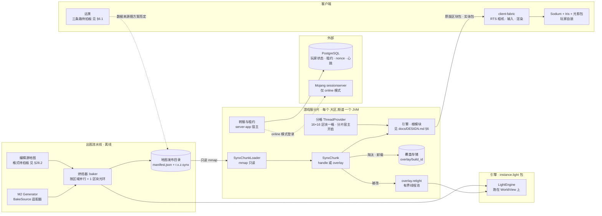
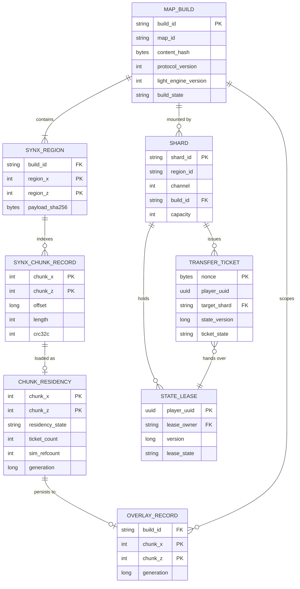
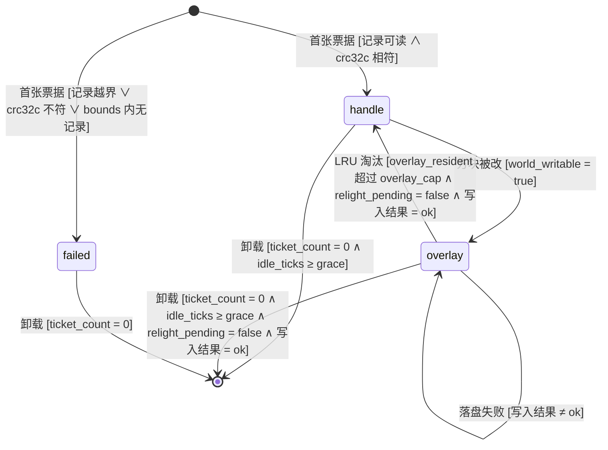
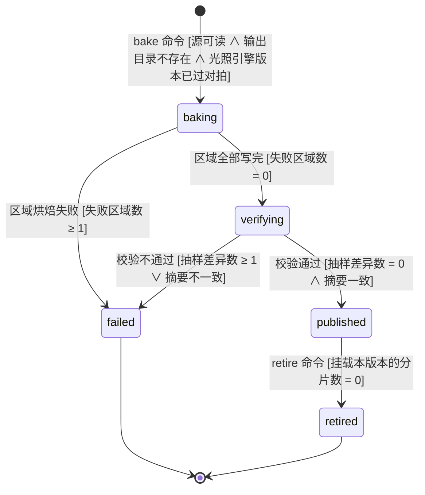
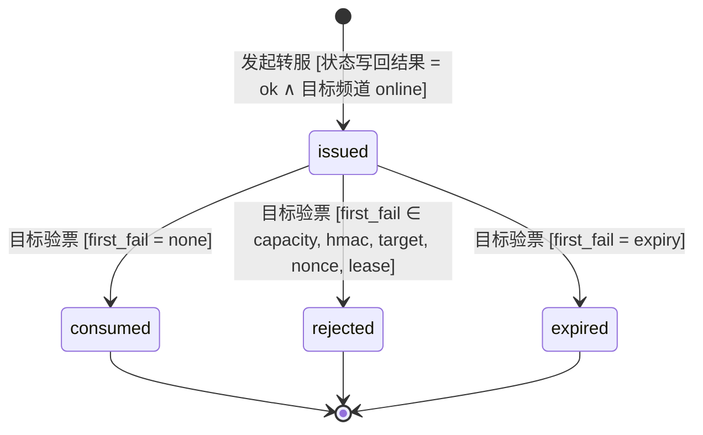
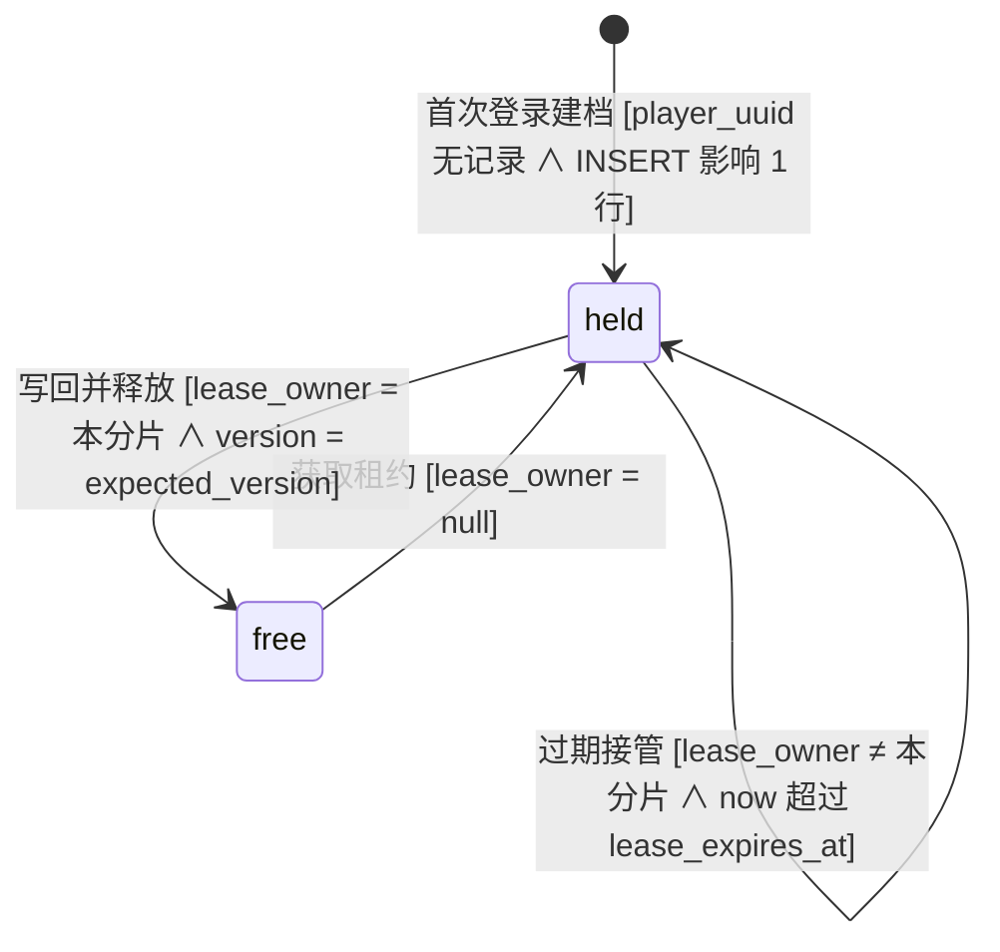
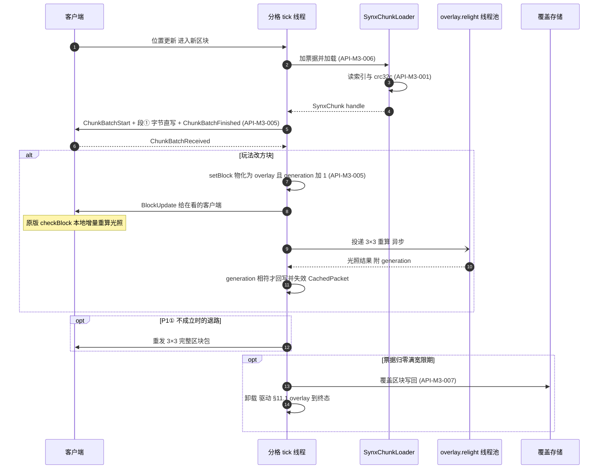
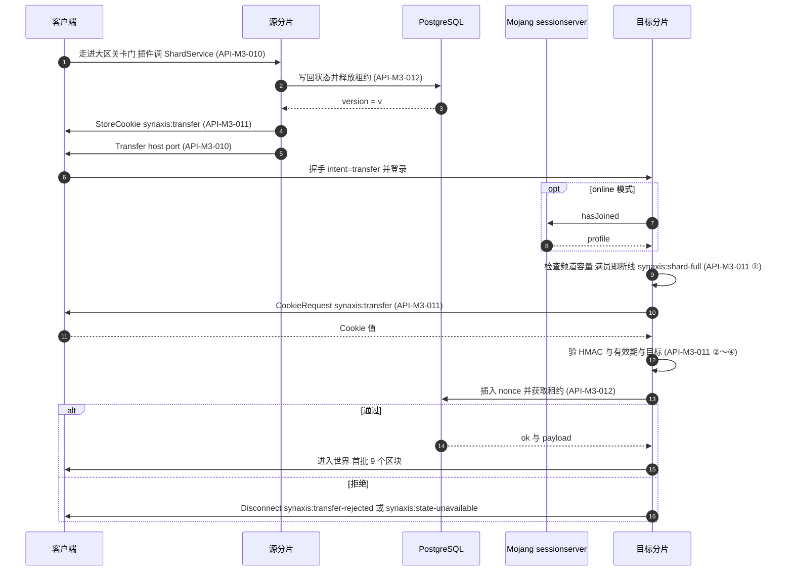
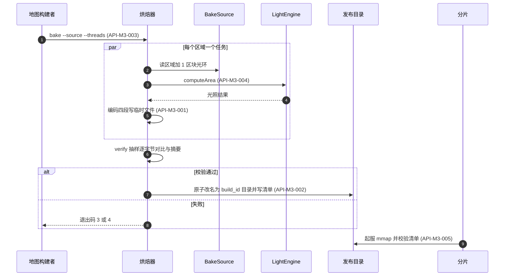

# Synaxis 设计文档 · 里程碑 M3「大世界地图管线与分片」

## 1. 元信息 / 变更记录

| 字段 | 值 |
| --- | --- |
| 状态 | 草稿（未评审；远景方案待用户拍板，见 §6.1） |
| 项目画像 | 生产产品（与 `docs/DESIGN-M2.md` §1 相同：交付的是面向真实玩家的 MMO 服务端；按生产产品填全部 `[核心]` 节。可观测性与埋点仍落本地文件，外部依赖只新增一个 PostgreSQL） |
| Owner | Bearisbug |
| 评审人 | Bearisbug |
| 最后更新 | 2026-09-23 |
| 关联 | 引擎单一事实源 `docs/DESIGN.md` · M2 分册 `docs/DESIGN-M2.md`（§15、§28.2、§28.3） · 技术路线报告 `docs/research/large-world-2026-09/README.md`（本文档的依据，下称「路线报告」） · 远景方案备忘录 `docs/research/large-world-2026-09/far-view-vs-iris.md`（2026-09-23，推荐 B，待用户拍板） · 客户端 spike `docs/research/client-spikes-2026-09/README.md` · 测试文档 `docs/TEST.md` · 仓库 `https://github.com/Bearisbug/synaxis` |

本文档是 `docs/DESIGN.md` 的第二个里程碑分册，写法与防腐坏机制沿用 `docs/DESIGN-M2.md` §24 最后一条：只管 M3 新增的东西，引擎侧与 M2 侧的事实一律用「见 `docs/DESIGN.md` §N」「见 `docs/DESIGN-M2.md` §N」引用。ID 独立编号：需求 `REQ-M3-*`、接口 `API-M3-*`、决策 `ADR-M3-*`、Runbook `RB-M3-*`；实体 `ENT-*`、页面 `PAGE-*`、事件 `EVT:*` 用语义命名，名字与 M1、M2 已有的不重复（已核对 `ENT-Map`、`ENT-NavGrid`、`ENT-Match` 等 M2 名字未被复用）。

**`.synx` 的 ID 处置**：`docs/DESIGN-M2.md` §28.3 ② 写的是「M3 整条加回 `API-M2-009`」。M3 的格式与 M2 当初的设计不是同一个东西（M2 是单文件 `header` / `chunks` / `nav` 三段；M3 是 32×32 区块一个区域文件、偏移索引、四段内容、存已成帧的原版包体），按 ID「语义实质变更 = 新 ID」的规则，M3 用 `API-M3-001` 取代 `API-M2-009`，`API-M2-009` 不复活。`docs/DESIGN-M2.md` §28.3 ② 那一行要在 M2 分册下次修订时改写为「被 `API-M3-001` 取代」，登记在 §28.2。

用户 2026-09-23 对路线报告第 7 节的拍板（本文档所有设计的前提）：

| 问题 | 拍板 | 本文档据此做的事 |
| --- | --- | --- |
| Q1 远景画什么 | 接受「高度场地形 + 颜色」 | 远景画法有三条路，**待拍板**，只写占位（§6.1）；其中 B（DH）画体素 LOD，选它等于改本条拍板 |
| Q2 光影 | 社区光影包（Iris + Complementary / Photon 一类）作主画面，不自研画风 | 已决，见 `ADR-M3-010`、`REQ-M3-019`；删掉路线报告的 P5（自研 L1/L2）与 64 点光源 UBO |
| Q3 地图 | 人工制作、基本静态、按版本发布 | `.synx` 只读烘焙 + 覆盖层；地图升版 = 重新烘焙 |
| Q4 在线规模 | 每分片 200～500 人，按大区分服 + 频道，不做无缝跨服 | `REQ-M3-015`～`REQ-M3-018` |
| Q5 硬件 | 必须支持 Apple Silicon（GL 4.1）；低配档 GTX 1650 / M1、1080p、r=8 | 进 §15 兼容行与 §17 外部依赖 |
| Q6 远景半径 | 4,096 格 | 只进 §6.1 占位（另记低配档 2,048 格） |
| Q7 世界高度 | 256 格 | `.synx` 头部与碰撞位集按 256 定 |
| Q8 服务端读光照 | 不读 | 服务端光照只为给新观察者发包，不进玩法查询 |
| Q9 Sodium | 不捆绑，只声明兼容 | Iris 硬依赖 Sodium，光影路径由玩家自装 Sodium + Iris，见 `ADR-M3-010` |

变更记录：

| 日期 | 版本 | 改动 | 作者 |
| --- | --- | --- | --- |
| 2026-09-23 | v0.2 | 评审第 1 轮修订：M3 的线程模型、模拟距离、自动卸载改为分片宿主显式开启，引擎默认值不变（`API-M3-006`、`API-M3-009`，§19 加一条 M2 行为不变的场景）；§6.1 按远景备忘录改为 A / B / C 三条路并写明 A 与 Q2 冲突、B 改 Q1，仍不替用户选；§5 光照处置表 ⑥ 改为 `flushQueue` 保留给 `relightSection`；`REQ-M3-006` 注册表计数更正为 727 / 85 / 384，对拍夹具改按方块状态枚举；覆盖存储改为只追加分段 + 内存索引；§6 登记 `:synx` 用到的引擎内部面；§11.2 光照版本守卫前移到 `[*] → baking`；§11.3 守卫按检查顺序改为互斥并补 `shard-full` 出口；Flyway 回退改为手工回退 SQL；§15 / §19 火把、光影同装、对拍例外表的判据改为可判定；`docs/DESIGN.md` 同批登记 §26 与变更记录 | Bearisbug |
| 2026-09-23 | v0.1 | 初稿：`.synx` 格式与测试向量、离线烘焙器、光照引擎抽取与两处修复、原版光照对拍、`SynxChunkLoader` 与区块驻留、覆盖层、运行时光照、基准程序、空间分格线程、大区分服与频道、转服票据、外部状态存储；远景占位；光影按 Q2 定为社区光影包 | Bearisbug |

## 2. 背景 / 目标 / 非目标

- 背景：M2 的地图是进程内程序化生成、整图常驻、无文件格式（见 `docs/DESIGN-M2.md` §2 非目标与 §28.3 ②）。路线报告第 2.2 节列出这套做法撑不起 MMO 大世界的五个硬限制：整图常驻按 57 KiB/区块（未核实）算，10k×10k 格要 21 GiB 堆；没有按视距或无人观察的自动卸载（`InstanceManager.java:93` 只在注销整个实例时卸载）；只有 `NoopChunkLoaderImpl`；`ServerProcessImpl.java:104` 写死 `ThreadProvider.counter()`；`LightingChunk` 有六处问题（§5 末表）。每多发一个区块，按路线报告的临时测量要付 0.84 ms（不带光照）或 5.18 ms（带光照）的 CPU（未核实）。
- 目标：
  1. 地图成为离线烘焙的只读产物：`.synx` 区域文件存已成帧已压缩的原版区块包体与烘焙光照，服务端对未改区块只做「mmap 读 + 写 socket」。
  2. 光照正确性有可执行的证据：修掉光照引擎的两处缺陷，恢复与原版的逐值对拍，错误不会被烘焙进全部 `.synx`。
  3. 运行时内存有界：视距与模拟距离分开、按观察者引用计数自动卸载、被改区块进覆盖层且覆盖层有 LRU 硬上限。
  4. 规模数字可复现：路线报告第 8.1 节全部「未核实」数字由一个入库的基准程序重测，§2 / §15 的带宽与磁盘估算以重测值为准。
  5. 每分片 200～500 人：空间分格线程、大区分服 + 频道、跨大区转服带签名票据，玩家状态放外部存储。
- 非目标：
  - **不定远景方案，也不实现远景**：三条路待用户拍板（§6.1），拍板后另行增补需求与接口。
  - 不做自研光影（路线报告的 L1 调色、L2 阴影与体积光）与 64 点光源 UBO、`synaxis:lights` 通道（Q2 拍板，见 `ADR-M3-010`）。动态光只有原版方块光。
  - 不做无缝跨服、边界幽灵实体、区块所有权迁移，不做「千人同屏」（Q4）。
  - 不做地图编辑器；地图由美术用外部工具制作，烘焙器只读它的产物（格式见 §28.1 开放问题）。
  - 不做运行时地形生成；M2 的 `Generator` 只作为烘焙器的一种输入。M2 的 RTS 对局地图仍在进程内生成，不走本文档的管线。
  - 不支持大规模改地形的玩法（Q3）。覆盖层按「局部、少量改动」设计，上限触顶即降级（见 `RB-M3-002`）。
  - 服务端玩法不读光照值（Q8）。
  - 不捆绑 Sodium（Q9），不捆绑 Iris 与光影包。
  - 不做客户端本地区块缓存、不换 zstd 压缩（路线报告 §3.5、§3.6 都放到实测之后）。
  - 不修 `LightingChunk` 的运行期路径（懒算、`relightSection`、延迟重发），MMO 实例不使用它（§5 末表）。
  - 不做 `docs/DESIGN-M2.md` §28.3 ③ 的多局并行；M2 RTS 进程的运行行为不变：M3 新增的线程模型、模拟距离、自动卸载都由 MMO 分片宿主显式开启，引擎默认值不改（`API-M3-006`、`API-M3-009`）。
  - 不升 Minecraft 版本（26.2 / 协议 776 继续钉死，重估见 `docs/DESIGN-M2.md` `ADR-M2-016`）。

规模画像（下游 §15 / §17 / §21 全部数字的唯一来源）。**带星号（\*）的系数是路线报告的临时测量，程序已删、未核实，由 `REQ-M3-013` 重测后替换**；依赖它们的行按线性关系重算。

| 维度 | 估算 | 依据 / 假设（未知则写假设 + 重估阈值） |
| --- | --- | --- |
| 用户量 | 内测档：单分片 50～200 人。正式档：每分片 200～500 人，64 个大区，每个大区 1～N 个频道 | Q4 拍板。500 人的全部数字是从 50 连接 soak（`docs/research/soak-2026-09-22/`）线性外推；实测 500 机器人不达标时频道上限降到 200～300 人（`REQ-M3-016` 验收） |
| 地图尺寸 | 内测档：4,096×4,096 格 = 65,536 区块（1 个大区）。正式档：32,768×32,768 格 = 4,194,304 区块，切成 64 个 4k×4k 大区 | 路线报告 §4.2、§4.3。正式档尺寸是技术上限，内容产能未评估（§28.2） |
| 世界高度 | 256 格（16 个 section） | Q7 |
| 区块包体 B | 5.26 KB/区块\*（压缩后含光照，高 384 合成地形）；高 256 按 section 数折算约 3.5 KB（未测） | 路线报告 §4.1。规划先用 5.26 作上界；重测值与它偏差超过 ±20% 时重算本表带宽与磁盘行 |
| 视距 / 模拟距离 | 视距 12（上限 16），视野 (2·12+1)² = 625 区块；模拟距离 4，81 区块 | 路线报告 §3.3 |
| 每玩家近圈下行 | 进场 625 × B ≈ 3.3 MB；步行 4.317 格/s → 6.75 区块/s ≈ 35 KB/s；坐骑 10 格/s → 15.6 区块/s ≈ 82 KB/s；飞行 30 格/s → 46.9 区块/s ≈ 247 KB/s | 新进视野区块数 (2r+1)·v/16（`ChunkRange.java:14-17`，视野是正方形）× B |
| 实体下行 | 14.5～32.5 KB/s/人 | soak-2026-09-22，50 人 × 1,000～4,000 单位（RTS 口径）。**不是 MMO 主城上界**：主城可见对数按 n² 增长，没有模型（§28.2） |
| 分片出站 | 200 人：步行 13.6 MB/s（109 Mbit/s），全员骑乘 22.9 MB/s（183 Mbit/s）；500 人：步行 34 MB/s（272 Mbit/s），骑乘 57 MB/s（458 Mbit/s） | (近圈 + 32.5 KB/s 实体) × 人数。千兆网卡够用；超过 800 Mbit/s 需重估网卡与频道上限 |
| 区块吞吐 | 500 人 3.4k～7.8k 区块/s，全部是 mmap 读 + 内存拷贝 | 500 × 6.75～15.6 |
| 磁盘 | 每大区 `.synx` ≈ 1.3 GB：段① 65,536 × 5.26 KB\* ≈ 345 MB；段② 碰撞位集上界 8 KiB/区块 = 512 MiB（全空或全实的 section 不占字节）；段③ 按与段① 同量级推算 ≈ 345 MB（未测）；段④ 1.25 KiB/区块 = 80 MiB。正式档全世界 ≈ 84 GB，每个大区进程只 mmap 自己那份 | `API-M3-001` 各段布局；段③ 与段② 的实际压缩比由 `REQ-M3-013` 量 |
| 服务端堆 | 覆盖层 LRU 上限：内测档 16,384 区块 × 57 KiB\* ≈ 0.89 GiB；正式档 24,576 区块 ≈ 1.34 GiB。句柄区块的 section 解码缓存上限 256 MiB | 路线报告 §4.2、§4.3；上限兜住堆，不依赖「改动率」假设。进程目标 RSS < 4 GiB |
| 玩家状态 | 正式档 64 × 500 = 32,000 人在线；每人状态 ≤ 64 KiB；自动保存 60 s 一次 → 约 533 次写/秒，转服另计 | 假设值；单条状态超过 64 KiB 或写入超过 2,000 次/秒时重估 `ADR-M3-009` |
| 分布与形态 | 每个大区一个进程；地图发布目录随版本分发到各分片机器；外部依赖只有 PostgreSQL；远景是否需要 CDN 待 §6.1 拍板 | Q3、Q4 |

## 3. 成功指标 / 验收阈值

指标全部由 §20 的 `EVT:*` 事件计数算，事件写本地 JSONL（沿用 `docs/DESIGN-M2.md` §20 的落盘方式，文件按分片分开）。接口可用性类 SLI 在 §21。

| 指标 | 定义（分子 ÷ 分母，全部是事件计数或事件属性） | 当前 | 目标 | 由哪些事件算 |
| --- | --- | --- | --- | --- |
| 转服成功率 | `EVT:transfer_completed` 计数 ÷ `EVT:transfer_issued` 计数 | 无（M3 前无转服） | ≥ 99% | 见 `EVT:transfer_issued`、`EVT:transfer_completed` |
| 转服首批区块耗时 P95 | `EVT:transfer_completed` 的 `first_batch_ms`（票据 `issued_at` 到目标分片发完首批 9 个区块的 `ChunkBatchFinished`；两个时间戳来自两台机器，前提是分片机跑 NTP 且时钟偏差 ≤ 50 ms，即 5 s 目标的 1%） | 无 | < 5 s | 见 `EVT:transfer_completed` |
| 零编码发送占比 | 各分片 `EVT:chunk_stream_stats` 的 Σ`handle_sent` ÷ Σ(`handle_sent` + `overlay_sent`) | 无 | ≥ 95%（监控阈值，不是容量假设：堆由覆盖层上限兜住） | 见 `EVT:chunk_stream_stats` |
| 地图版本一次发布成功率 | `EVT:map_build_finished`（`outcome=published`）计数 ÷ `EVT:map_build_started` 计数 | 无 | ≥ 90% | 见 `EVT:map_build_started`、`EVT:map_build_finished` |

「转服成功率」同时作为 §21 的同名 SLI，两处是同一个数值口径。

## 4. 术语表 / 统一语言

引擎侧术语见 `docs/DESIGN.md` §4，M2 术语见 `docs/DESIGN-M2.md` §4，本表只登记 M3 新增的。

| 术语 | 定义 | 代码/字段标识 | 对应实体 |
| --- | --- | --- | --- |
| 区域文件 | 一个 `.synx` 文件，装 32×32 个区块的记录，头部带偏移索引，只读 mmap | `r.<rx>.<rz>.synx` | `ENT-SynxRegion` |
| 区块记录 | 区域文件里一个区块的四段内容 | `chunk_record` | `ENT-SynxChunkRecord` |
| 段① 包体 | 已成帧、已压缩的原版 `ChunkDataPacket` 字节（含高度图与烘焙光照），与服务端写进 socket 的字节相同 | `seg_packet` | `ENT-SynxChunkRecord` |
| 段② 碰撞与导航 | 1 bit/方块的碰撞位集 + M2 的 walkable 位集与 surface_y | `seg_collision` | `ENT-SynxChunkRecord` |
| 段③ 原始数据 | 引擎 section 序列化（调色板、光照、方块实体），物化覆盖层时解码 | `seg_sections` | `ENT-SynxChunkRecord` |
| 段④ 列摘要 | 每列的表面高度、表面方块、天光，供远景烘焙用；是否使用待 §6.1 拍板 | `seg_columns` | `ENT-SynxChunkRecord` |
| 地图版本 | 一次烘焙的全部产物（区域文件 + 清单），不可变，用 `build_id` 区分 | `map_build` | `ENT-MapBuild` |
| 地图内容哈希 | 对地图未压缩规范内容算的 SHA-256；同一输入、同一烘焙器与光照引擎版本产出同一哈希 | `content_hash` | `ENT-MapBuild` |
| 烘焙器 | 离线命令行工具，把编辑源地图或生成器输出烘焙成地图版本 | 模块 `:baker` | `ENT-MapBuild` |
| 烘焙源 | 烘焙器的输入适配接口；M3 有「编辑源地图」与「M2 生成器」两种实现 | `BakeSource` | — |
| 光照引擎 | 从 `LightingChunk` 抽出、跑在 `WorldView` 上的纯函数式光照计算，不需要 `Instance`、不加锁 | `LightEngine` | — |
| 世界视图 | 只读的方块访问接口（坐标 → 方块），光照引擎的唯一输入 | `WorldView` | — |
| 句柄区块 | 堆里没有 section、发包直接写已成帧字节的区块；字节来源是区域文件（未被改过的区块）或覆盖存储（改过后被淘汰的区块） | `SynxChunk`（handle 模式） | `ENT-ChunkResidency` |
| 覆盖层区块 | 被玩法改过、已物化为 `DynamicChunk` 的区块 | `SynxChunk`（overlay 模式） | `ENT-ChunkResidency` |
| 覆盖存储 | 覆盖层区块被淘汰或卸载时写入的只追加分段文件，索引在内存；与地图版本绑定 | `overlay/<build_id>/seg.<n>.synx` | `ENT-OverlayRecord` |
| 票据 | 让区块保持加载的引用；玩家视野与插件显式持有各算一张 | `chunk_ticket` | `ENT-ChunkResidency` |
| 视距 | 服务端给玩家发区块的半径（区块数） | `synaxis.chunk-view-distance` | — |
| 模拟距离 | 区块内实体与方块 tick 的半径；超出的区块只发包、不 tick。按实例设置，默认不限 | `Instance#setSimulationDistance` | — |
| 分片宿主 | MMO 分片的启动入口，与 M2 的 `Main` 分开；M3 的线程模型、模拟距离、自动卸载都只在这里开启 | `server-app` 的 `ShardMain` | `ENT-Shard` |
| 分格 | 16×16 区块的空间格，同一格内的区块归同一 tick 线程 | `grid_cell` | — |
| 大区 | 按地理切出的一块地图（正式档 4k×4k 格），一个大区一份 `.synx` | `region_id` | `ENT-Shard` |
| 频道 | 同一大区的一个进程副本；人数超上限时同一大区开多个频道 | `channel` | `ENT-Shard` |
| 分片 | 一个游戏服进程 = 一个（大区, 频道） | `shard_id` | `ENT-Shard` |
| 转服 | 用原版 `Transfer` 包把玩家送到另一个分片 | `transfer` | `ENT-TransferTicket` |
| 转服票据 | 源分片写进客户端 Cookie 的签名数据，目标分片验签后放行 | cookie 键 `synaxis:transfer` | `ENT-TransferTicket` |
| 状态租约 | 外部存储里「哪个分片当前拥有该玩家状态的写权」的记录，带过期时间 | `lease_owner` | `ENT-StateLease` |
| 光影包 | Iris 加载的社区着色器包（Complementary、Photon 一类），玩家自装 | — | — |

## 5. 功能清单与需求 ID

无对外契约的需求（`REQ-M3-005`、`REQ-M3-006`、`REQ-M3-007`、`REQ-M3-012`、`REQ-M3-014`、`REQ-M3-019`）按规则标注锚点为状态机迁移行、时序消息或 §24 门禁。

| ID | 功能 | 对应目标 | 优先级 | 锚点 |
| --- | --- | --- | --- | --- |
| REQ-M3-001 | `.synx` 区域文件格式：32×32 区块、定长头部 + 偏移索引、可 mmap、四段内容、地图内容哈希 + 协议版本 + 注册表摘要；读写两侧共用一套测试向量 | 目标 1 | P0 | `API-M3-001` |
| REQ-M3-002 | 地图发布目录与清单：`manifest.json` 记内容哈希、协议版本、光照引擎版本与逐文件摘要；分片起服时全量校验，任一项不符拒绝起服；升 MC 版本要按协议版本批量重烘，重烘耗时写进升版清单 | 目标 1 | P0 | `API-M3-002`；状态机见 §11.2 |
| REQ-M3-003 | 离线烘焙器：输入为编辑源地图或 M2 `Generator`；按区域并行（每个区域带 1 区块光环读取邻居）；产出区域文件与清单；烘焙末尾自动校验（抽样逐字节对比 + 摘要）；同输入同版本产出同一内容哈希 | 目标 1 | P0 | `API-M3-003`；状态机见 §11.2 |
| REQ-M3-004 | 光照引擎抽取：`LightEngine` 跑在 `WorldView` 上，不依赖 `Instance`、不进 `synchronized(instance)`；`LightingChunk.relight` 改为委托给它（M2 对局同时受益）；`relightSection` 与它用的 `flushQueue` 保留原样（§5 末表 ②⑥） | 目标 2 | P0 | `API-M3-004` |
| REQ-M3-005 | 光照修复 ④：天光整列直通的条件改为「`lightBlocked() == 0` ∧ 遮挡形状为空」，`lightBlocked() ≥ 1` 的方块按该值衰减，删除手写的 23 种 `DIFFUSE_SKY_LIGHT`（注册表里默认状态 `lightBlock == 1` 的有 85 种）。现状 `checkSkyOcclusion`（`LightingChunk.java:109-117`）只看遮挡形状，`tinted_glass`（`lightBlock` 15、遮挡形状为空）下方天光整列直通 | 目标 2 | P0 | 无对外 API，见 §19 与 §24 光照门禁 |
| REQ-M3-006 | 光照修复 ⑤：BFS 每步衰减由固定 1 改为 `max(1, lightBlocked(目标方块))`。按 `src/main/resources/data/block.json` 统计，`lightBlock` 只有 0 / 1 / 15 三种取值：按默认状态是 727 / 85 / 384 个方块（共 1,196），按全部 32,366 个状态是 17,476 / 12,106 / 2,784；411 个方块（台阶、楼梯、活板门、栅栏等）的部分状态覆盖了 `lightBlock`，`RegistryData.java:296` 按状态读取。`lightBlock = 15` 而遮挡形状为空的状态只属于 `minecraft:tinted_glass`，它是本项修复在现有注册表上唯一会改变结果的方块；修复的价值在于以后注册表出现中间值时不再静默算错 | 目标 2 | P0 | 无对外 API，见 §19 与 §24 光照门禁 |
| REQ-M3-007 | 恢复与原版的光照逐值对拍测试。真值来源：原版 26.2 专用服务端生成并保存的存档里的 `SkyLight` / `BlockLight` 数组（`ADR-M3-005`）；夹具按**方块状态**枚举（不按方块）：覆盖全部 `lightBlock ≥ 1` 的状态（默认状态里 85 种方块为 1、`tinted_glass` 为 15）、全部 `lightEmission > 0` 的状态、非完整形状、区块与 section 边界 | 目标 2 | P0 | 无对外 API，见 §24 光照门禁与 §11.2 `verifying → published` 守卫 |
| REQ-M3-008 | `SynxChunkLoader` 与 `SynxChunk`：未改区块以句柄形式加载，发包直接把段① 写进 socket，不建调色板、不算光照、不进堆；`getBlock` 按需解码单个 section 进全局有界缓存；被改时物化为覆盖层 | 目标 1、目标 3 | P0 | `API-M3-005`；状态机见 §11.1 |
| REQ-M3-009 | 视距与模拟距离分离：分片宿主把视距设为 12（上限 16）、模拟距离设为 4，只有模拟距离内的区块 tick 实体与方块。模拟距离按实例设置，引擎默认「不限」，M2 对局行为不变 | 目标 3 | P0 | `API-M3-006` |
| REQ-M3-010 | 按观察者引用计数自动卸载：开启了自动卸载的实例上，票据数归零且空闲满 100 tick 的区块卸载；插件可显式持票。按实例开启，引擎默认关闭，M2 对局整图预载的区块不受影响 | 目标 3 | P0 | `API-M3-006`；状态机见 §11.1 |
| REQ-M3-011 | 覆盖层：被改区块物化为 `DynamicChunk`；改动写单独的覆盖存储，不改 `.synx`；覆盖层常驻数有 LRU 硬上限（内测档 16,384、正式档 24,576），淘汰时写覆盖存储并退回句柄 | 目标 3 | P0 | `API-M3-007`；状态机见 §11.1 |
| REQ-M3-012 | 运行时光照：未改区块的光照随段① 下发，服务端 0 CPU；被改区块在 tick 线程外的有界线程池做 3×3 局部重算，结果只进之后发给新观察者的包；不向已在看的客户端发 `UpdateLightPacket`（前提待 P1① 验证，退路见 `ADR-M3-002`） | 目标 2、目标 3 | P0 | 无对外 API，见 §12.1 时序与 §17 内部任务 `overlay.relight` |
| REQ-M3-013 | 可提交的基准程序：重测路线报告第 8.1 节全部「未核实」数字，结果 JSON 入库；§2 / §15 的带宽与磁盘估算以重测值替换 | 目标 4 | P0 | `API-M3-008` |
| REQ-M3-014 | soak harness 回 `ChunkBatchReceived`、按步行与坐骑两档移动机器人，量出真实区块下行（路线报告 P1④，服务端侧，本机可做） | 目标 4 | P0 | 无对外 API，见 §15 测量手段与 §26 M3-C 退出条件 |
| REQ-M3-015 | 空间分格 `ThreadProvider`：16×16 区块一格，跨格交互走 `Acquirable`；分片宿主选用它并把 `dispatcherThreads` 设为核数。引擎默认仍是 `counter` + 1 线程 | 目标 5 | P1 | `API-M3-009` |
| REQ-M3-016 | 大区分服 + 频道：分片目录描述大区边界与频道地址；分片心跳上报在线人数；频道满员时拒绝进入并提示换频道 | 目标 5 | P1 | `API-M3-010` |
| REQ-M3-017 | 跨大区转服：原版 `Transfer` + `StoreCookie`，票据带 HMAC-SHA256 签名、30 s 有效期与一次性 nonce；目标分片验签失败即断线 | 目标 5 | P1 | `API-M3-011`；状态机见 §11.3 |
| REQ-M3-018 | 外部状态存储：玩家状态放 PostgreSQL，写权由带过期时间的租约控制，写入按版本号条件更新；分片崩溃后租约 30 s 过期可被接管 | 目标 5 | P1 | `API-M3-012`；状态机见 §11.4 |
| REQ-M3-019 | 光影走社区光影包：`client-fabric` 不覆盖原版核心着色器、不在 `fabric.mod.json` 声明与 Sodium / Iris 冲突；与 Sodium 0.9.x + Iris 1.11.x 同装时 RTS 相机 mixin 仍工作 | 目标 5 | P1 | 无对外 API，见 `ADR-M3-010` 与 §17 外部依赖 |

`LightingChunk` 六处问题（路线报告 §2.2）的 M3 处置：

| # | 问题 | M3 处置 | 理由 |
| --- | --- | --- | --- |
| ① | 光照在发包路径与 `Instance.getBlockLight/getSkyLight` 里懒算 | **不修**。MMO 实例不用 `LightingChunk`（§24 ArchUnit 规则禁止），光照在烘焙期全量算、运行期由 `overlay.relight` 主动算 | M2 对局在载入期整图 `relight`（`docs/DESIGN-M2.md` §28.2 已决行），懒算路径碰不到；Q8 定了服务端不读光照 |
| ② | `relight` 与 `relightSection` 在 `synchronized(instance)` 里 | `relight` 改委托 `LightEngine`（`REQ-M3-004`），不再持实例锁；`relightSection` 保留原样（仍持锁、仍经 `flushQueue`），调用方是 ① 的懒算路径 `Instance#getBlockLight/getSkyLight`（`Instance.java:1066-1100`），只在 M2 对局上可达 | 光照引擎在 `WorldView` 快照上算，不需要实例锁，也就不与空间分格多线程（`REQ-M3-015`）冲突；`relightSection` 跟 ① 一起不修 |
| ③ | 方块变化后按全局 `sendLightAfterBlockPlacementDelay`（默认 100 tick）延迟重发 3×3 光照 | **不修**，MMO 路径不发 `UpdateLightPacket`（`ADR-M3-002`） | 该字段是全进程配置，改它影响 M2；MMO 路径整条换掉 |
| ④ | `DIFFUSE_SKY_LIGHT` 手写 23 种，注册表 `lightBlock == 1` 有 85 种 | **修**，`REQ-M3-005` | 错误会被烘焙进全部 `.synx`，是烘焙器的前置 |
| ⑤ | BFS 每步固定减 1，不读 `lightBlocked()` | **修**，`REQ-M3-006` | 同上 |
| ⑥ | `flushQueue` 并行任务间读写非 volatile 字段 | **不修**。`relight` 委托后 `flushQueue` 只剩 `relightSection` 一个调用方（`LightingChunk.java:576-588`），数据竞争登记为 M2 技术债（§28.2） | 新引擎按「每个区域一个线程、只写自己的区块」划分，不存在共享写；MMO 路径碰不到 `flushQueue` |

## 6. 总体架构



模块：新增 `:synx`（格式编解码、`SynxChunkLoader`、`SynxChunk`、覆盖存储；依赖引擎）、`:baker`（烘焙器命令行；依赖 `:synx` 与引擎的光照引擎；M2 生成器的适配器放在 `:game-rts`，烘焙器按 `ServiceLoader` 发现，不编译期依赖玩法模块）。引擎内改动：抽出 `LightEngine` / `WorldView`、区块票据与按实例开启的自动卸载、按实例设置的模拟距离、`ThreadProvider.grid` 与 `synaxis.thread-provider` 开关；**引擎的全部既有默认值不变**，M3 的行为由分片宿主显式开启（`API-M3-006`、`API-M3-009`）。依赖方向沿用 `docs/DESIGN-M2.md` §6：引擎不得依赖 `:synx` / `:baker`。

`:synx` 与 `:baker` 是**引擎侧模块**：包名 `io.github.bearisbug.synaxis.synx` / `…baker`，落在 `docs/DESIGN-M2.md` §24 规则 ⑥ 对「引擎」的包段定义内（根包之下除去 `game` / `plugin` / `app`），因此可以使用引擎的 `@ApiStatus.Internal` 成员，引擎不为它们放宽注解。`:synx` 用到的内部面逐项登记如下，引擎改动其中任何一项必须在同一个 PR 里跑 `:synx` 的测试（§24）：

| 内部成员 | 位置 | `:synx` 怎么用 |
| --- | --- | --- |
| `Chunk#getFullDataPacket()` | `Chunk.java:137`，`@ApiStatus.Internal` | `SynxChunk` 覆写：handle 模式返回包住段① 的 `BufferedPacket` |
| `BufferedPacket` | `network/packet/server/BufferedPacket.java`，`@ApiStatus.Internal` | 包住 mmap 段① 直写 socket |
| `CachedPacket` | `network/packet/server/CachedPacket.java:43`，`@ApiStatus.Internal` | overlay 模式沿用 `DynamicChunk` 的包缓存 |

段③ 编解码只用公开的 `Palette.BLOCK_SERIALIZER` 与 `Palette.biomeSerializer(int)`，不碰 `Palette` 上 5 个标 `@ApiStatus.Internal` 的成员（`Palette.java:44`、`:191-206`）；实现时若需要其中之一，先在本表加行。M2 分册 §24 规则 ⑥ 的游戏侧禁令不变：`:game-rts` 里的 `BakeSource` 适配器只能用公开面。外部依赖逐项见 §17。

### 6.1 远景与光影（占位）

**光影：已决**。Q2 拍板用社区光影包作主画面，见 `ADR-M3-010` 与 `REQ-M3-019`。

**远景：方案待用户拍板，本文档不替用户选**。目标半径 4,096 格（Q6），低配档 2,048 格（Q5 默认值：GTX 1650 / M1、1080p、r=8 时 P1% ≥ 45 FPS）。三条路的论证在 `docs/research/large-world-2026-09/far-view-vs-iris.md`（2026-09-23，只读调研，未实跑；该备忘录推荐 B）。拍板后按选中的一列补 `REQ-M3-*` / `API-M3-*`，新 ID 从现有最大号往后接。

拍板前要知道的两条事实：

- **选 A 与已决的 Q2 冲突**：Iris 开光影包时，没有经 `IrisApi.assignPipeline` 登记的自定义 RenderPipeline 整体不可见（malilib #165，2026-09-20；备忘录 §1）。A 的远景只在玩家关光影时出现。
- **选 B 等于改 Q1 的拍板**：DH 画的是保留建筑轮廓的体素 LOD，不是 Q1 定的「高度场地形 + 颜色」（备忘录 §3.1「超出 Q1 要求」；路线报告 Q1 把它列为「美术要求 512 格外认出方块轮廓」时的切换项）。选 B 需要用户重新确认 Q1。

三条路里只有 C 与 Q1、Q2 同时一致，代价是雾与接缝的观感压在光影包的非 DH 分支上（下表「观感」行）。

| 影响面 | A：client-fabric 自写高度场 clipmap + 自研着色器 | B：DH，数据离线烘焙成 DH 的 SQLite 库，客户端经 DH API 钉住数据目录并只读 | C：自写 clipmap，经 Iris 公开 API 登记为地形管线 |
| --- | --- | --- | --- |
| 与已决拍板的关系 | 与 Q2 冲突（开光影时远景不可见） | 改 Q1（体素 LOD，带方块轮廓） | 与 Q1、Q2 都一致 |
| 光影开启时的观感 | 远景不可见 | 光照、雾、远近 dither 过渡由光影包的 `dh_*` 程序处理；远景没有阴影贴图阴影 | 受光一致；Complementary 的非 DH 大气雾在 192 格处饱和到 70%（按公式手算，未截图），边界雾要玩家在包设置里手动关；接缝是硬边（推论，未验证） |
| `.synx` 段④（`API-M3-001`） | 装每列高度、表面方块、天光（当前 v1 布局即为此设计） | 不用段④：烘焙器从段③ 同源数据直接写 DH 库，段④ 长度写 0，`has_columns = 0` | 同 A |
| 烘焙器产物（`REQ-M3-003`） | 追加 LOD 金字塔与内容哈希包 | 链接 DH core（不依赖 Minecraft）写 SQLite 库；烘焙器跟 DH core 同版本重编 | 同 A |
| 每个 4k×4k 大区下载量 | 5.3～21 MiB（未压缩，路线报告 §4.2） | 0.22～0.55 GB（推算，未核实） | 同 A |
| 分发通道 | CDN 下载 + 新增 `synaxis:terrain_lod` 增量通道 | CDN 下载（库文件连 `-wal`、`-shm` 一起）；运行期增量走什么通道未定 | 同 A |
| 握手（`docs/DESIGN-M2.md` `API-M2-002`） | 比对地图内容哈希，`schema_version` 加 1 | 同左，另加 DH 版本号比对 | 同 A |
| 客户端许可义务 | 无 | DH 是 LGPL-3.0-only：独立 jar 分发、附声明与许可全文 | 无（Iris 由玩家自装） |
| 要先验证的项（§17 外部依赖） | P1②：Blaze3D 画 256×256 高度场，GL 与 macOS GL 4.1 | 备忘录 V1（预烘库在连 Synaxis 的多人客户端上能画出）、V2（实烘一个大区 ≤ 0.5 GB）、V3（光影下远近衔接） | 备忘录 V4（经 `assignPipeline` 画出且受光受雾）、V5（关边界雾前后的 4,096 格截图） |
| 每次升 MC 的维护 | 自写管线，2～5 人日/次（自估） | 等 DH 与 Iris 两个上游一起升，2～4 人日/次（自估，不含等待） | Blaze3D 管线 + Iris API（v0.4），3～6 人日/次（自估） |
| 工程量 | 3～4 人周（自估） | 2.5～4 人周（自估） | 4～6 人周（自估） |
| 隐藏区域 | 烘焙器必须把标记为隐藏的区域排除出 LOD 产物（漏标即剧透且无法撤回） | 同左 | 同左 |

三条路共同的约束（备忘录 §2）：光影只在 OpenGL 后端；Iris 硬依赖 Sodium；RTS 正交相机下两个光影包的深度公式全算错，RTS 相机要改透视才能开光影（这条同时压在 `docs/DESIGN-M2.md` §28.2「正交 vs 透视」的待拍板项上）。

本文档里与远景无关、三条路都成立的部分（`.synx` 段①～③、烘焙器、区块流送、光照、分片）已写实，不因拍板结果改动。

## 7. 数据模型 / 领域实体

引擎侧实体见 `docs/DESIGN.md` §7，M2 实体见 `docs/DESIGN-M2.md` §7，本节只画 M3 新增的；字段权威定义在 §9。



`CHUNK_RESIDENCY` 只存在于分片进程内存；`TRANSFER_TICKET` 的正文在客户端 Cookie 里，服务端只落 nonce（`transfer_nonce` 表）；`STATE_LEASE` 与玩家状态同一行（`player_state` 表）。

## 8. 接口契约 (API-first)

M3 的契约有三类：① 文件格式（`.synx`、清单、覆盖存储）；② Java 稳定面（光照引擎、区块加载与票据、线程、状态存储）；③ 线上格式（转服 Cookie）与运维命令行。都不是 HTTP。机器可读的事实源是 `:synx` 的编解码类与 `synx/src/test/resources/vectors/` 测试向量、`server-app` 的 Cookie 编解码与其向量、Flyway 迁移脚本（防漂移见 §24）。

---

- **`API-M3-001` `.synx` 区域文件格式** — 实现 `REQ-M3-001`
  - 文件名 `r.<rx>.<rz>.synx`，`rx = chunk_x >> 5`。全部多字节整数小端（mmap 后按本机序直读，x86 与 Apple Silicon 都是小端）。
  - 头部（定长 256 B）：

    | 偏移 | 字段 | 类型 | 说明 |
    | --- | --- | --- | --- |
    | 0 | `magic` | 4 B | `SYNX` |
    | 4 | `format_version` | u16 | 当前 1；读到更高版本即拒绝 |
    | 6 | `flags` | u16 | bit0 `overlay`（覆盖段文件：没有偏移索引，记录区从 256 起，布局见 `API-M3-007`），bit1 `has_columns`（段④ 非空）；未知位置 1 即拒绝 |
    | 8 | `protocol_version` | i32 | 776 |
    | 12 | `compression_threshold` | i32 | 烘焙段① 时用的阈值，256 |
    | 16 | `compression_level` | i8 | Deflater 级别，-1（默认） |
    | 18 | `min_y` | i16 | 世界最低 y |
    | 20 | `height` | u16 | 256 |
    | 24 | `region_x` / `region_z` | i32 × 2 | 与文件名一致 |
    | 32 | `registry_digest` | 32 B | 生物群系注册表顺序与方块状态总数的 SHA-256（段① 里的生物群系 id 依赖配置阶段下发的注册表顺序） |
    | 64 | `content_hash` | 32 B | 整个地图版本的内容哈希，同一版本所有文件相同 |
    | 96 | `region_content_hash` | 32 B | 本文件未压缩规范内容的 SHA-256：按索引顺序拼接每条记录的段②、段③ 解压后字节、段④；**不含段①**，所以换 JDK 自带 zlib 不改变内容哈希 |
    | 128 | `payload_sha256` | 32 B | 索引之后全部字节的 SHA-256，起服校验用 |
    | 160 | `light_engine_version` | u16 | 烘焙时的 `LightEngine.VERSION` |
    | 162 | `baker_version` | u16 | 烘焙器版本 |
    | 164 | 保留 | 92 B | 全 0 |

  - 偏移索引（256 起，1,024 项 × 16 B = 16,384 B）：第 `i = (chunk_z & 31) × 32 + (chunk_x & 31)` 项为 `{offset: u64, length: u32, crc32c: u32}`；`offset = 0` 表示无该区块，只允许出现在清单 `bounds` 之外（烘焙器保证 `bounds` 内每个区块都有记录，`verify` 逐项检查）。记录区从 16,640 起，每条记录 8 B 对齐。
  - 区块记录：16 B 段长表（四个 u32）后接四段：
    - 段①：`ChunkDataPacket` 在 `compression_threshold` 下成帧、压缩后的完整字节（帧长 VarInt + 未压缩长度 VarInt + zlib 数据），包 id 按协议 776。光照按烘焙结果逐 section 填 sky / block 两组 mask，**不得对有天光的 section 置 `emptySkyMask`**（M2 的全黑剪影即由此而来，见 `docs/DESIGN-M2.md` §28.2）。
    - 段②：16 个 section 各 1 B 标志（0 全空、1 全实、2 位集）+ 标志为 2 的 section 各 512 B 碰撞位集（位序 `((y & 15) × 16 + z) × 16 + x`）；其后 walkable 位集 32 B 与 surface_y 256 × i16（沿用 M2 导航层，见 `docs/DESIGN-M2.md` §9）。
    - 段③：deflate 压缩的引擎 section 序列化（方块调色板、生物群系调色板、sky / block 光照各 2,048 B）+ 方块实体 NBT 列表。
    - 段④：`has_columns = 1` 时为 256 列 × 5 B（表面高度 u16、表面方块状态 id u16、天光 u8），否则长度 0；语义随 §6.1 拍板定稿。
  - 读取规则：`magic` / `format_version` / 未知 `flags` 位不符 → 拒绝起服；`protocol_version`、`registry_digest`、`compression_threshold`、`min_y`、`height` 与运行进程不符 → 拒绝起服；`offset + length` 越过文件末尾、`crc32c` 不符、或 `bounds` 内的 `offset = 0` → 该区块进 `failed`（§11.1），发空气区块占位，不影响同文件其他区块；`bounds` 外 → `loadChunk` 返回 `null`（`API-M3-005`）。
  - 演进：新增字段只占保留区并升 `format_version`；改段布局 = 破坏性变更，升 `format_version` 且全部重烘。
  - 缓存与超时：文件只读、不可变，按地图版本目录隔离，永不原地覆盖。

- **`API-M3-002` 地图发布目录与清单** — 实现 `REQ-M3-002`
  - 目录：`<maps_root>/<map_id>/<build_id>/`，内含 `manifest.json` 与 `regions/r.<rx>.<rz>.synx`。`build_id` = `<map_id>-<content_hash 前 12 位 hex>-p<protocol_version>`。
  - `manifest.json` 字段：`map_id`、`build_id`、`content_hash`、`mc_version`（`"26.2"`）、`protocol_version`、`registry_digest`、`light_engine_version`、`baker_version`、`world.min_y`、`world.height`、`bounds`（区块坐标 min/max）、`regions[]`（`rx`、`rz`、`bytes`、`payload_sha256`、`chunks`）、`bake`（`started_at`、`wall_ms`、`threads`、`jdk`、`source`）、`verify`（抽样数、差异数）。
  - 分片起服：`-Dsynaxis.map.root` + `-Dsynaxis.map.build=<build_id>`；按清单逐文件核 `payload_sha256` 与头部字段，任一不符以非零码退出、端口不 bind（错误码见 §14）。
  - 升版重烘：`baker rebake --from <旧 build_id> --protocol <新协议>` 产出新 `build_id`；升版清单记录每个大区的重烘墙钟时间。

- **`API-M3-003` 烘焙器命令行** — 实现 `REQ-M3-003`
  - `./gradlew :baker:run --args="bake --map-id <id> --source <anvil:<dir> | generator:<preset>:<seed>> --out <maps_root> --threads <N>"`；另有 `verify --build <build_id>`、`rebake`、`retire --build <build_id>`。
  - `bake` 的步骤：枚举区域 → 每个区域一个任务，读本区域 + 四周 1 区块光环的方块进 `WorldView` → `LightEngine` 算光照 → 编码四段 → 写临时目录 → 全部区域完成后跑 `verify` → 通过则原子改名为发布目录。
  - 退出码：0 发布成功；2 源不可读；3 某区域烘焙失败；4 校验不通过；5 输出目录已存在；6 当前 `LightEngine.VERSION` 不在已过对拍版本集（§11.2）。每次运行写 `EVT:map_build_started` / `EVT:map_build_finished`。
  - 确定性：同一 `--source`、同一 `baker_version` 与 `light_engine_version`，`content_hash` 必须相同；段① 字节只在同一 JDK 构建上保证相同。

- **`API-M3-004` 光照引擎 Java API** — 实现 `REQ-M3-004`
  - `interface WorldView { int minY(); int height(); boolean hasChunk(int cx, int cz); Block getBlock(int x, int y, int z); }`（引擎 `instance.light` 包，`@ApiStatus.Experimental`）。
  - `LightEngine.computeArea(WorldView view, int cxMin, int czMin, int cxMax, int czMax) → LightResult`：给目标区块矩形算完整 sky 与 block 光照；调用方保证 `view` 覆盖目标矩形外扩 1 区块。`LightEngine.relightArea(view, cx, cz)`：以 (cx, cz) 为中心的 3×3 重算。
  - 语义：纯函数，只读 `view`、只写返回值；线程封闭，不加任何锁；不依赖 `Instance`。天光透过判定读 `Block#lightBlocked()`，BFS 每步衰减 `max(1, lightBlocked(目标方块))`，非完整形状沿用 `occlusionShape` 的面遮挡判定。
  - 版本：`LightEngine.VERSION` 在任何改变输出的提交里加 1；清单记录它，分片起服时不等于当前值即拒绝（强制重烘，§14）。

- **`API-M3-005` `SynxChunkLoader` 与 `SynxChunk`** — 实现 `REQ-M3-008`、`REQ-M3-011`
  - `new SynxChunkLoader(Path buildDir, SynxOptions)` 实现引擎 `ChunkLoader`：构造时 `FileChannel.map(READ_ONLY)` 映射全部区域文件并做 `API-M3-002` 的起服校验。
  - `loadChunk(instance, cx, cz)`：`bounds` 内返回 handle 模式的 `SynxChunk`（堆里只有坐标、段偏移与票据计数）；覆盖存储内存索引里有该区块时指向覆盖存储记录，否则指向区域文件；`bounds` 外返回 `null`。玩家由引擎世界边界挡在图内：分片宿主起服时按清单 `bounds` 调 `Instance#setWorldBorder`（`Instance.java:589`）。
  - `getFullDataPacket()`：handle 模式返回包住 mmap 段① 的 `BufferedPacket`（`NetworkBuffer.wrap(MemorySegment, …)`），发送路径不调用 `createChunkPacket`；overlay 模式走 `DynamicChunk` 的 `CachedPacket`。`BufferedPacket` 不触发 `PlayerPacketOutEvent`（`PlayerSocketConnection.java:430` 的既有语义）。覆写的是引擎内部方法，登记见 §6 内部面表。
  - `getBlock` / `getSection`（handle 模式）：只解码被读的那个 section 的方块调色板进全进程共享的 LRU 缓存（`synaxis.synx.section-cache-bytes`，默认 256 MiB），不解码光照：返回的 `Section` 的 `skyLight` / `blockLight` 是全 0 的空光照，所以 `Instance#getSkyLight` / `getBlockLight`（`Instance.java:1066-1100`）对句柄区块返回 0，其中的 `relightSection` 对非 `LightingChunk` 返回空集、无副作用。Q8 定了服务端玩法不读光照，这个返回值不进任何玩法路径。overlay 模式的 section 带段③ 解码出的烘焙光照。
  - `setBlock`（handle 模式）：`world_writable = true` 时物化（解码段③ 全部 section 与光照）为 overlay 模式，否则抛 `IllegalStateException`；物化后投递 `overlay.relight`。
  - `saveChunk`：handle 模式空实现；overlay 模式写覆盖存储（`API-M3-007`）。

- **`API-M3-006` 视距、模拟距离与区块票据** — 实现 `REQ-M3-009`、`REQ-M3-010`
  - 引擎默认值不变：`synaxis.chunk-view-distance` 仍默认 8（M2 的 `Main.java:68` 设 10），模拟距离默认「不限」（全部已加载区块照常 tick），自动卸载默认关闭（`InstanceManager.java:93` 的「注销实例时卸载」是唯一卸载路径，与现状相同）。M2 对局的 `Match` 不调用下列任何方法，行为不变。
  - Java（按实例）：`Instance#setSimulationDistance(int chunks)`（`-1` = 不限，默认 `-1`）；`Instance#setChunkUnloadGraceTicks(int ticks)`（`-1` = 不自动卸载，默认 `-1`）；`Instance#addChunkTicket(int cx, int cz, Object owner)` / `removeChunkTicket(...)`。玩家视野进出由引擎自动加减票据；开启了自动卸载的实例上，票据数归零并空闲满宽限期的区块在 tick 末尾卸载（内部任务 `chunk.unload`）。
  - 分片宿主的设置：`synaxis.chunk-view-distance=12`（宿主校验大于 16 即起服报错）、`setSimulationDistance(4)`（必须 ≤ 视距）、`setChunkUnloadGraceTicks(100)`。三个值从宿主配置 `shard.view-distance` / `shard.simulation-distance` / `shard.unload-grace-ticks` 读。
  - 模拟距离外的区块不进 `ThreadDispatcher` 的 tick 分区：区块内实体与方块不 tick，但照常发包、照常可见。

- **`API-M3-007` 覆盖存储** — 实现 `REQ-M3-011`
  - 目录 `<work_dir>/overlay/<build_id>/`，内含只追加的分段文件 `seg.<n>.synx`（`n` 递增）。段文件头部同 `API-M3-001` 的 256 B，`flags.overlay = 1`，没有偏移索引；其后逐条追加 `{chunk_x i32, chunk_z i32, generation u64, length u32, crc32c u32}` 24 B 记录头 + 一条区块记录（段①～③ 按覆盖层当前内容重新编码，段④ 长度 0）。
  - 写入：追加到当前活动段末尾并 `fsync`，然后更新内存索引 `(cx, cz) → (段号, offset, length, generation)`；活动段超过 1,024 条记录或 256 MiB 即封口、开新段。**任何段文件都不截断、不原地改写**：已被 mmap 的区间只会在它之后追加字节，读者不会遇到 SIGBUS（§16）。
  - 整理：已封口段里被新记录覆盖的比例超过 50% 时，把其中仍有效的记录复制进活动段，更新内存索引，再把旧段标记为待删；句柄区块持有段的引用计数，计数归零后才删文件。整理由 `overlay.evict` 所在的 tick 末尾单线程阶段驱动，每 tick 最多复制 64 条。
  - 启动：按段号升序扫描全部段文件重建内存索引，同一区块取 `generation` 最大的一条；某条记录的 `crc32c` 不符则丢弃这一条及同段之后的全部记录（写到一半崩溃的尾部），记 ERROR。
  - 生命周期：与 `build_id` 绑定；分片以新 `build_id` 起服时旧目录整体丢弃。进程重启是否保留见 §28.1 开放问题（默认保留同一 `build_id` 的记录）。

- **`API-M3-008` 基准程序** — 实现 `REQ-M3-013`
  - `./gradlew :jmh-benchmarks:jmh -Pinclude=World`（时间类：单区块首次序列化 ms，带 / 不带光照；3×3 局部重算 ms；每 MB AES-CFB8 + socket 写的 CPU ms）与 `./gradlew :jmh-benchmarks:worldProbe --args="--heights 64,256,384 --chunks 1024,4096,16384 --seed 1 --out <dir>"`（体积与堆类：区块包体压缩后字节、`.synx` 各段字节、存活堆 KiB/区块、整图 relight 墙钟与堆增量）。
  - 地形：合成自然地形（固定 seed 的噪声高度 + 洞穴 + 水体 + 树叶），三档高度；拿到第一张美术地图后加一档「真地图抽样」。
  - 输出 `docs/research/world-bench-<日期>/results.json`：`env`（JDK、CPU、核数、`commit`）、每项 `{metric, height, chunks, samples, p50, p95, max, unit}`；存活堆沿用 `Match#sampleLiveHeap` 的「两次强制回收后取差」口径并记 `gc_runs`。

- **`API-M3-009` 空间分格 `ThreadProvider`** — 实现 `REQ-M3-015`
  - `ThreadProvider.grid(int exponent)`：区块 (cx, cz) 归格 `(cx >> exponent, cz >> exponent)`，线程号 = 格坐标的 `hash` 对线程数取模；`RefreshType.NEVER`。
  - 配置：`ServerProcessImpl` 不再写死 `counter()`（`ServerProcessImpl.java:104`），改读 `synaxis.thread-provider=grid|counter`，**默认 `counter`**；`synaxis.thread-grid-exponent` 默认 4（16×16 区块）；`synaxis.dispatcher-threads` 默认仍是 1。分片宿主启动时写入 `thread-provider=grid` 与 `dispatcher-threads=Runtime.availableProcessors()`，写法同 M2 `Main` 的 `VIEW_RANGE_PROPERTIES`（命令行显式给的值优先）。M2 的 `Main` 不设这两项，仍是单线程 `counter`；`docs/DESIGN-M2.md` §28.2 的「`ThreadProvider` 硬编码」技术债在 M2 进程上照旧成立，随多局并行处理。

- **`API-M3-010` 分片目录与频道** — 实现 `REQ-M3-016`
  - `shards.json`（与地图版本一起放在发布目录，但**不进 `content_hash`**：它含机器地址，加频道或换机器只改这个文件，不需要重烘）：`regions[]`（`region_id`、区块边界、`build_id`）与 `channels[]`（`shard_id`、`region_id`、`channel`、`host`、`port`、`capacity`，`capacity` ∈ [200, 500]）。
  - 心跳：每分片每 5 s 写 `shard_heartbeat(shard_id, online, updated_at)`；超过 15 s 未更新视为下线。
  - 插件面：`PluginContext#shards()` 返回 `ShardService`，`transfer(Player, String regionId)` 选该大区 `online / capacity` 最低且在线的频道发起转服（`API-M3-011`）。属 `:plugin-api` 新增方法，兼容变更，`api_version` 不变。

- **`API-M3-011` 转服票据（Cookie）** — 实现 `REQ-M3-017`
  - Cookie 键 `synaxis:transfer`，值 ≤ 5,120 B（引擎 `CookieStorePacket.MAX_VALUE_LENGTH`）。布局：`ver u8 = 1`、`key_id u8`、`player_uuid 16 B`、`source_shard`（UTF-8，u8 长度前缀）、`target_shard`（同）、`state_version u64`、`nonce 16 B`、`issued_at u64`（ms）、`expires_at u64`（= `issued_at` + 30,000）、`hmac 32 B`（HMAC-SHA256，覆盖前面全部字节）。
  - 源分片：状态写回并释放租约（`API-M3-012`）成功后，先发 `CookieStorePacket` 再发 `TransferPacket(host, port)`。
  - 目标分片：`synaxis.accept-transfers=true`（引擎既有属性，默认 false，分片宿主打开）；configuration 阶段按固定顺序检查，第一个不通过的检查决定结果：① 频道容量（`online < capacity`，不通过断线 `synaxis:shard-full`，此时还没读 Cookie、nonce 未消耗）→ ② `PlayerConnection#fetchCookie("synaxis:transfer")` 并按 `key_id` 取密钥验 HMAC → ③ `expires_at` → ④ `target_shard` → ⑤ nonce（`INSERT INTO transfer_nonce` 唯一约束）→ ⑥ 租约获取。② ④ ⑤ ⑥ 不通过断线 `synaxis:transfer-rejected` 或 `synaxis:state-unavailable`（§14），③ 不通过断线 `synaxis:transfer-rejected`。§11.3 的守卫按这个顺序写。
  - 密钥：环境变量 `SYNAXIS_TRANSFER_HMAC_KEYS`（`key_id:base64` 逗号分隔，最多 2 把同时有效用于轮换）。按 `CLAUDE.md` 密钥纪律：值只进 `.env` 与 Bitwarden（item 名 = 键名），`.env.example` 登记键名、用途与获取方式。PostgreSQL 连接串 `SYNAXIS_STATE_DB_URL` 同样处理。

- **`API-M3-012` 玩家状态存储** — 实现 `REQ-M3-018`
  - 表 `player_state(player_uuid uuid PK, version bigint, lease_owner text NULL, lease_expires_at timestamptz NULL, payload bytea, updated_at timestamptz)`、`transfer_nonce(nonce bytea PK, expires_at timestamptz)`、`shard_heartbeat(shard_id text PK, online int, updated_at timestamptz)`，Flyway 管理（§25）。
  - Java：`PlayerStateStore#acquire(uuid, shardId) → Lease | Held`、`renew(Lease)`、`writeAndRelease(Lease, byte[] payload)`、`write(Lease, byte[] payload)`。
  - 获取：`UPDATE … SET lease_owner = ?, lease_expires_at = now() + 30s WHERE player_uuid = ? AND (lease_owner IS NULL OR lease_expires_at < now()) RETURNING version, payload`；影响 0 行且该玩家没有记录时首次建档：`INSERT … VALUES (…, lease_owner = 本分片, version = 0) ON CONFLICT (player_uuid) DO NOTHING`，插入 0 行说明另一个分片同时建了档，改回走上面的获取语句（结果是 `Held` 或拿到租约）。写入：`… SET payload = ?, version = version + 1 WHERE player_uuid = ? AND lease_owner = ? AND version = ?`，影响 0 行即失去写权，分片立刻踢出该玩家。
  - 续租每 10 s 一次，自动保存每 60 s 一次；超时 2 s，重试 2 次、退避 200 / 800 ms（§17）。

演进与弃用：

- 版本方案：文件格式用 `format_version` 整数、光照用 `LightEngine.VERSION` 整数、Cookie 用 `ver` 字节、数据库用 Flyway 版本号；Java 稳定面（`WorldView`、`LightEngine`、`ShardService`）随 `:plugin-api` 的 SemVer。
- 弃用期：文件格式与光照版本不设弃用期——不符即拒绝起服、重烘即可（地图按版本发布，Q3）；Cookie 的 `ver` 升级时目标分片同时接受新旧两版一个发布周期。
- 当前 deprecated 清单：`API-M2-009`（被 `API-M3-001` 取代，见 §1）。

## 9. 数据字典

| 字段 | API 名 | 存储名 | 类型 | 必填 | 枚举/约束 | 单位/精度 | PII |
| --- | --- | --- | --- | --- | --- | --- | --- |
| 区块驻留状态 | `residency_state` | 仅内存 | enum | 是 | `handle` / `overlay` / `failed`；未知值不存在（进程内） | — | 否 |
| 票据数 | `ticket_count` | 仅内存 | int | 是 | ≥ 0 | 张 | 否 |
| 模拟引用数 | `sim_refcount` | 仅内存 | int | 是 | ≥ 0；> 0 时区块 tick | 个玩家 | 否 |
| 区块代次 | `generation` | 覆盖存储记录头 | long | 是 | 每次 `setBlock` 加 1；光照结果按它判是否过期 | — | 否 |
| 允许改地形 | `world_writable` | 配置 `synaxis.world-writable` | bool | 是 | 默认 `true` | — | 否 |
| 覆盖层上限 | `overlay_cap` | 配置 `synaxis.overlay-cap` | int | 是 | 内测档 16,384，正式档 24,576 | 区块 | 否 |
| section 缓存上限 | `section_cache_bytes` | 配置 `synaxis.synx.section-cache-bytes` | long | 是 | 默认 268,435,456 | 字节 | 否 |
| 光照重算线程数 | `relight_threads` | 配置 `synaxis.relight-threads` | int | 是 | 默认 `max(1, 核数 / 4)`；≥ 1 | 个 | 否 |
| 模拟距离 | `simulation_distance` | `Instance#setSimulationDistance` | int | 是 | `-1`（不限，引擎默认）或 1～视距；分片宿主设 4 | 区块 | 否 |
| 卸载宽限期 | `chunk_unload_grace_ticks` | `Instance#setChunkUnloadGraceTicks` | int | 是 | `-1`（不自动卸载，引擎默认）或 ≥ 1；分片宿主设 100 | tick | 否 |
| 地图版本状态 | `build_state` | `EVT:map_build_finished.outcome` 与发布目录位置 | enum | 是 | `baking` / `verifying` / `published` / `retired` / `failed`；读到未知值的工具按 `failed` 处理 | — | 否 |
| 地图版本 id | `build_id` | 目录名 | string | 是 | `<map_id>-<12 位 hex>-p<协议号>` | — | 否 |
| 内容哈希 | `content_hash` | 清单、区域文件头 | bytes(32) | 是 | SHA-256 | — | 否 |
| 光照引擎版本 | `light_engine_version` | 清单、区域文件头 | u16 | 是 | 等于 `LightEngine.VERSION` 才可挂载 | — | 否 |
| 分片 id | `shard_id` | `shards.json`、`shard_heartbeat` | string | 是 | `<region_id>-c<channel>` | — | 否 |
| 频道容量 | `capacity` | `shards.json` | int | 是 | 200～500 | 人 | 否 |
| 票据状态 | `ticket_state` | 仅目标分片日志与事件 | enum | 是 | `issued` / `consumed` / `rejected` / `expired` | — | 否 |
| 票据拒绝原因 | `reject_reason` | `EVT:transfer_rejected.reason` | enum | 否 | `shard-full` / `bad-signature` / `expired` / `wrong-target` / `nonce-reused` / `lease-held` / `store-unavailable`（依次对应 `API-M3-011` 检查 ①～⑥，⑥ 分两种）；未知值按 `store-unavailable` 统计 | — | 否 |
| 状态版本 | `version` | `player_state.version` | bigint | 是 | 每次写入加 1 | — | 否 |
| 租约持有者 | `lease_owner` | `player_state.lease_owner` | text | 否 | `shard_id` 或 NULL | — | 否 |
| 租约到期 | `lease_expires_at` | `player_state.lease_expires_at` | timestamptz | 否 | 获取或续租时 = now + 30 s | UTC | 否 |
| 租约状态 | `lease_state` | 由 `lease_owner` 与 `lease_expires_at` 派生 | enum | 是 | `held`（owner 非空且未过期）/ `free`（owner 为空）；owner 非空且已过期视同可接管的 `held` | — | 否 |
| 玩家 UUID | `player_uuid` | `player_state.player_uuid` | uuid | 是 | 离线模式按用户名派生（`docs/DESIGN.md` §10） | — | 是（标识符） |
| 玩家状态正文 | `payload` | `player_state.payload` | bytea | 是 | ≤ 65,536 B；格式归玩法插件 | — | 是（背包与进度） |

## 10. 权限与角色

M1 / M2 角色见 `docs/DESIGN.md` §10 与 `docs/DESIGN-M2.md` §10。M3 新增 `ROLE-MapBuilder`（运行烘焙器的人或 CI）与 `ROLE-Shard`（对等分片进程，持有数据库账号与 HMAC 密钥）。矩阵覆盖全部 12 个 `API-M3-*`。

| 角色 · 操作 | `API-M3-001` 区域文件 | `API-M3-002` 发布目录 | `API-M3-003` 烘焙器 | `API-M3-004` 光照引擎 | `API-M3-005` 区块加载 | `API-M3-006` 票据 | `API-M3-007` 覆盖存储 | `API-M3-008` 基准 | `API-M3-009` 线程 | `API-M3-010` 分片目录 | `API-M3-011` 转服票据 | `API-M3-012` 状态存储 |
| --- | --- | --- | --- | --- | --- | --- | --- | --- | --- | --- | --- | --- |
| ROLE-Player | ✗ | ✗ | ✗ | ✗ | ✗（只收区块包） | ✗（视野票据由引擎代持） | ✗ | ✗ | ✗ | ✗ | ✓（只保存与回传，无法解读或伪造） | ✗ |
| ROLE-PluginAuthor | ✗ | ✗ | ✗ | ✗ | ✓（`getBlock` / `setBlock`） | ✓（插件票据） | ✗ | ✗ | ✗ | ✓（`ShardService#transfer`） | ✗ | ✓（经宿主读写本玩家状态） |
| ROLE-Host | ✓（只读） | ✓（只读） | ✗ | ✓ | ✓ | ✓ | ✓（读写） | ✗ | ✓ | ✓ | ✓（签发与验签） | ✓ |
| ROLE-MapBuilder | ✓（写） | ✓（写） | ✓ | ✓ | ✗ | ✗ | ✗ | ✓ | ✗ | ✓（编辑） | ✗ | ✗ |
| ROLE-Shard | ✗ | ✗ | ✗ | ✗ | ✗ | ✗ | ✗ | ✗ | ✗ | ✓（心跳） | ✓（验签） | ✓（租约） |
| ROLE-Operator | ✗ | ✓（选择挂载哪个 `build_id`） | ✓（`retire`） | ✗ | ✗ | ✗ | ✓（清空） | ✓ | ✓（配置） | ✓（配置） | ✗（只轮换密钥） | ✗（只读排障） |

行级可见性：

| 端点 | 行级规则 | 强制点 |
| --- | --- | --- |
| `API-M3-012` 状态存储 | 插件只能读写**当前连接玩家**的那一行；写入附带本分片的租约 | 宿主包装层按连接取 `player_uuid`，SQL 条件带 `lease_owner = 本分片` |
| `API-M3-011` 转服票据 | 目标分片只接受 `target_shard = 自己` 的票据 | 验签后比较，失败断线 |

## 11. 状态机

数据字典里取值 ≥ 2 的生命周期枚举共四个：`residency_state`、`build_state`、`ticket_state`、`lease_state`，各建一台机。

### 11.1 区块驻留 `ENT-ChunkResidency`



迁移表：

| 源 → 目标 | 事件 | 守卫（纯布尔） | 动作（副作用） | 谁触发 | 接口/事件 |
| --- | --- | --- | --- | --- | --- |
| [*] → handle | 首张票据 | 记录可读（`offset ≠ 0` ∧ 未越界）∧ crc32c 相符 | 建 handle 模式 `SynxChunk`，源为区域文件或覆盖存储（覆盖存储记录优先） | 引擎（玩家视野或插件票据） | `API-M3-006`、`API-M3-005` |
| [*] → failed | 首张票据 | 记录越界 ∨ crc32c 不符 ∨（区块在 `bounds` 内 ∧ `offset = 0`） | 记 ERROR（带区块坐标）；发空气区块占位；计入 `EVT:chunk_stream_stats.failed` | 引擎 | `API-M3-005` |
| handle → overlay | 方块被改 | `world_writable = true` | 解码段③ 物化为 `DynamicChunk`；`generation` 加 1；向在看的客户端发方块更新；投递 `overlay.relight` | 插件 `setBlock` | `API-M3-005` |
| overlay → handle | LRU 淘汰 | `overlay_resident > overlay_cap` ∧ `relight_pending = false` ∧ 写入结果 = ok | 重编码三段追加到覆盖存储活动段；丢弃 section；改指向该条覆盖记录并持有段引用 | 内部任务 `overlay.evict` | `API-M3-007` |
| overlay → overlay | 落盘失败 | 写入结果 ≠ ok | 保留常驻；记 ERROR；`evict_failed` 计数加 1；下一轮重试 | 内部任务 `overlay.evict` 或 `chunk.unload` | `API-M3-007` |
| handle → [*] | 卸载 | `ticket_count = 0` ∧ `idle_ticks ≥ grace` | 释放句柄；清该区块在 section 缓存里的条目 | 内部任务 `chunk.unload` | `API-M3-006` |
| overlay → [*] | 卸载 | `ticket_count = 0` ∧ `idle_ticks ≥ grace` ∧ `relight_pending = false` ∧ 写入结果 = ok | 写覆盖存储后释放 | 内部任务 `chunk.unload` | `API-M3-007` |
| failed → [*] | 卸载 | `ticket_count = 0` | 释放占位 | 内部任务 `chunk.unload` | `API-M3-006` |

`bounds` 外的区块 `loadChunk` 返回 `null`，不建驻留对象，不进本状态机。`sim_refcount` 是属性不是状态：它只决定区块是否进 tick 分区，与驻留形态正交，任何状态下都可增减。

### 11.2 地图版本 `ENT-MapBuild`



迁移表：

| 源 → 目标 | 事件 | 守卫（纯布尔） | 动作（副作用） | 谁触发 | 接口/事件 |
| --- | --- | --- | --- | --- | --- |
| [*] → baking | bake 命令 | 源可读 ∧ 输出目录不存在 ∧ `LightEngine.VERSION` ∈ 已过对拍版本集 | 建临时目录；写 `EVT:map_build_started` | ROLE-MapBuilder | `API-M3-003` |
| baking → verifying | 区域全部写完 | 失败区域数 = 0 | 汇总 `content_hash`，写清单草稿 | 烘焙器 | `API-M3-003` |
| baking → failed | 区域烘焙失败 | 失败区域数 ≥ 1 | 保留临时目录供排查；写 `EVT:map_build_finished`（`outcome=failed`）；退出码 3 | 烘焙器 | `API-M3-003` |
| verifying → published | 校验通过 | 抽样差异数 = 0 ∧ 摘要一致 | 原子改名为发布目录；写 `EVT:map_build_finished`（`outcome=published`） | 烘焙器 | `API-M3-002` |
| verifying → failed | 校验不通过 | 抽样差异数 ≥ 1 ∨ 摘要不一致 | 同 `baking → failed`；退出码 4 | 烘焙器 | `API-M3-003` |
| published → retired | retire 命令 | 挂载本版本的在线分片数 = 0（按 `shard_heartbeat` 与 `shards.json` 判） | 目录移入 `retired/`，保留 30 天 | ROLE-Operator | `API-M3-003` |

`[*] → baking` 的守卫任一项不成立时不进入状态机、不产生任何目录：源不可读退出码 2，输出目录已存在退出码 5，光照引擎版本未过对拍退出码 6（在烘焙 65,536 个区块之前就拒绝）。「已过对拍版本集」由 CI 维护：光照对拍测试（`REQ-M3-007`）绿的提交，其 `LightEngine.VERSION` 写进 `baker` 的资源文件 `verified-light-versions.txt`（§24）。

### 11.3 转服票据 `ENT-TransferTicket`

目标分片按 `API-M3-011` 的顺序 ①～⑥ 做检查，记 `first_fail` 为第一个不通过的检查（全部通过为 `none`）。三条出边的守卫按 `first_fail` 取值互斥且穷尽。



迁移表：

| 源 → 目标 | 事件 | 守卫（纯布尔） | 动作（副作用） | 谁触发 | 接口/事件 |
| --- | --- | --- | --- | --- | --- |
| [*] → issued | 发起转服 | 状态写回结果 = ok ∧ 目标频道 online | 签票据；发 `CookieStorePacket` 与 `TransferPacket`；写 `EVT:transfer_issued`。驱动 §11.4 `held → free`（写回并释放）先于本转移完成 | 插件经 `ShardService#transfer` | `API-M3-010`、`API-M3-011` |
| issued → consumed | 目标验票 | `first_fail = none`（容量有余 ∧ HMAC 有效 ∧ now ≤ `expires_at` ∧ `target_shard` = 本分片 ∧ nonce 未用 ∧ 租约获取结果 = ok） | 插入 nonce；载入状态；放行进世界；首批区块发完时写 `EVT:transfer_completed`。驱动 §11.4 `free → held` | 目标分片 | `API-M3-011`、`API-M3-012` |
| issued → expired | 目标验票 | `first_fail = expiry`（容量有余 ∧ HMAC 有效 ∧ now > `expires_at`） | 断线 `synaxis:transfer-rejected`；写 `EVT:transfer_rejected`（`reason=expired`） | 目标分片 | `API-M3-011` |
| issued → rejected | 目标验票 | `first_fail` ∈ {`capacity`, `hmac`, `target`, `nonce`, `lease`} | `capacity`：断线 `synaxis:shard-full`，不读 Cookie、不插 nonce；其余：断线 `synaxis:transfer-rejected`（`lease` 为 `synaxis:state-unavailable`）。都写 `EVT:transfer_rejected`，`reason` 见 §9 | 目标分片 | `API-M3-011` |

`capacity` 出口不读 Cookie、不插 nonce，服务端不留痕迹；源分片已在签票前释放租约，玩家重新登录任一分片都能取回状态，与「票据未到达目标」同一条路径。

跨机一致性：`issued → consumed` 要求 §11.4 能走 `free → held` 或「过期接管」。源分片在 `[*] → issued` 之前已完成 `held → free`，因此正常路径下守卫可满足；源分片写回失败时不签票据（守卫「状态写回结果 = ok」不成立），玩家留在源分片并收到提示。票据未到达目标（客户端关闭）不产生任何状态变化：租约已释放，玩家下次登录任一分片都能获取。

### 11.4 状态租约 `ENT-StateLease`



迁移表：

| 源 → 目标 | 事件 | 守卫（纯布尔） | 动作（副作用） | 谁触发 | 接口/事件 |
| --- | --- | --- | --- | --- | --- |
| [*] → held | 首次登录建档 | `player_uuid` 无记录 ∧ `INSERT … ON CONFLICT DO NOTHING` 影响 1 行 | 新行 `version = 0`，租约归本分片；影响 0 行（另一分片抢先建档）则不走本转移，改走获取租约（§16） | 登录分片 | `API-M3-012` |
| free → held | 获取租约 | `lease_owner = null` | 设 owner 与到期时间；返回 `version` 与 `payload` | 登录或转入分片 | `API-M3-012` |
| held → held | 续租 | `lease_owner` = 本分片 ∧ now ≤ `lease_expires_at` | 到期时间 = now + 30 s | 内部任务 `lease.renew` | `API-M3-012` |
| held → held | 过期接管 | `lease_owner` ≠ 本分片 ∧ now > `lease_expires_at` | owner 改为本分片；写 `EVT:lease_takeover` | 登录或转入分片 | `API-M3-012` |
| held → free | 写回并释放 | `lease_owner` = 本分片 ∧ `version` = `expected_version` | 写 `payload`、`version` 加 1、owner 置空 | 源分片（转服前、玩家下线时） | `API-M3-012` |

续租连续失败 3 次（30 s 内）的分片必须踢出该玩家并停止写入：它已无法证明自己仍持有写权。被接管后旧分片的任何写入都因 `lease_owner` 条件影响 0 行而失败。

## 12. 关键流程时序

### 12.1 区块流送、改动与运行时光照



驱动的状态机迁移：§11.1 `[*] → handle`、`handle → overlay`、`overlay → [*]`。光照结果跨分格回写（3×3 可能跨两个格）时经 `Acquirable` 交给目标区块所属线程执行，不在线程池里直接写。

### 12.2 跨大区转服



驱动的状态机迁移：§11.4 `held → free`（第 2 步）、§11.3 `[*] → issued`（第 4～5 步）、§11.3 `issued → rejected`（第 9 步满员时）、§11.3 `issued → consumed / rejected / expired` 与 §11.4 `free → held`（第 14 步之后）。

### 12.3 烘焙与发布



驱动的状态机迁移：§11.2 `[*] → baking → verifying → published`，失败分支 `→ failed`。

## 13. 页面与跳转地图

有前端：客户端模组。M3 新增的客户端可见界面只有转服过场（原版 `Transfer` 时的连接屏）与新增的断线原因；游戏内界面沿用 M2 的 `PAGE-RTS-HUD`（MMO 的 HUD 不在 M3 范围）。


| 页面 | 可见角色 | 调用的接口 | 关键页态 |
| --- | --- | --- | --- |
| `PAGE-TRANSFER` | ROLE-Player | `API-M3-011`（交回 Cookie） | 原版连接屏，无自定义界面；超过 30 s 未完成即票据过期，落到断线页 |
| `PAGE-DISCONNECT` | ROLE-Player | — | 新增三个原因键的文案（§14） |

## 14. 错误处理与错误码

无 HTTP，不用 RFC 9457。沿用 `docs/DESIGN.md` §14 与 `docs/DESIGN-M2.md` §14：断线原因是 `translate` 键，排障关联 ID 是 `connection_id`，每行日志携带、断线文本不携带。转服额外在日志里带票据 nonce 的前 8 位 hex（`transfer_ref`），源、目标两侧日志用它串起来。新增断线键住在 `plugin-api` 的 `DisconnectKeys`，不进引擎的 `DisconnectReasons`（理由同 `docs/DESIGN-M2.md` §14）。

| 错误码（type） | 协议动作 | 语义 | 客户端处理约定 |
| --- | --- | --- | --- |
| `synaxis:transfer-rejected` | Disconnect（configuration 阶段） | 转服票据缺失、签名无效、过期、目标不符或 nonce 已用 | 提示「切换大区失败，请重新登录」；重复出现提示报障并附时间 |
| `synaxis:state-unavailable` | Disconnect（configuration 阶段） | 外部存储不可达，或该玩家状态的租约被另一分片持有且未过期 | 提示稍后重试；30 s 后重试即可（租约最长 30 s 过期） |
| `synaxis:shard-full` | Disconnect（configuration 阶段） | 本频道在线人数达到 `capacity`；转服时在读 Cookie 之前判定（`API-M3-011` ①），票据的 nonce 不消耗 | 提示换频道 |

起服拒绝（进程非零码退出、端口不 bind，错误写进启动日志）：

| 错误码 | 条件 | 处置 |
| --- | --- | --- |
| `synx-magic` | 文件头 `magic` 或 `format_version` 不认识 | 换正确的发布目录 |
| `synx-protocol-mismatch` | `protocol_version` ≠ 776 | 用 `rebake` 按当前协议重烘 |
| `synx-registry-mismatch` | `registry_digest` 与进程的生物群系注册表不符 | 重烘 |
| `synx-compression-mismatch` | `compression_threshold` 与进程不符 | 改回清单里的阈值或重烘 |
| `synx-payload-hash` | `payload_sha256` 与清单或文件内容不符 | 重新分发该文件 |
| `synx-light-engine-mismatch` | 清单 `light_engine_version` ≠ 当前 `LightEngine.VERSION` | 重烘（光照输出已变） |

运行期区块记录损坏（越界或 crc32c 不符）不拒绝起服：该区块进 §11.1 `failed`，发空气区块占位并记 ERROR，由 §21 的告警接手。

## 15. 非功能需求

全部数字追溯 §2 规模画像。带「未核实」的目标由 `REQ-M3-013` 重测后更新，重测前以它们作规划值。

| 维度 | 场景 | 目标 |
| --- | --- | --- |
| tick 预算 | 单分片 200 机器人、视距 12、步行与坐骑两档、600 s | tick P99 < 50 ms，超 50 ms 的 tick 为 0（路线报告 P2 ⑥）；30 min 档 TPS 20、RSS < 4 GiB（P6） |
| tick 预算（正式档） | 500 机器人；另压「500 人挤在 1 个分格」一档 | 两档分别记 tick P99 与每人出口；不达标则频道 `capacity` 降到 200～300（P6） |
| 零编码 | 未改区块的发送路径 | JFR 采样里句柄区块的发送栈不出现 `createChunkPacket`（P2 ④）；每区块服务端 CPU 只剩 mmap 读与内存拷贝，对照现状 0.84 / 5.18 ms（未核实） |
| 包体一致 | 抽 1,000 个区块 | 段① 字节与「段③ 解码成 `DynamicChunk` 再 `createChunkPacket`」逐字节一致（P2 ②） |
| 带宽 | 200 机器人步行 / 坐骑 | 区块下行 KB/s/人与模型（步行 35、坐骑 82）偏差 ≤ ±20%（P2 ⑥）；分片出站实测与 §2 估算偏差 ≤ ±20%（P6） |
| 烘焙 | 4k×4k 测试图（65,536 区块，高 256） | 烘焙成功，记墙钟与磁盘（P2 ①）。规划值：单线程光照约 16 s + 编码约 55 s，按 0.25 ms 与 0.84 ms/区块推算（未核实，且与「带光照首次序列化 5.18 ms」口径对不上，重测一并解释） |
| 起服 | 挂载一个大区（≈ 1.3 GB） | 全量 `payload_sha256` 校验 < 5 s（按 SHA-256 硬件加速约 1 GB/s 推算，未测） |
| 覆盖层堆 | 覆盖层满载 | 内测档 ≤ 0.89 GiB、正式档 ≤ 1.34 GiB（上限 × 57 KiB，未核实）；section 缓存 ≤ 256 MiB；进程堆 < 2 GB 沿用 `docs/DESIGN.md` §15 只对内测档成立，正式档堆上限 3 GiB、RSS < 4 GiB |
| 运行时光照 | 放一支火把 | 不闪的判定：gametest 在两个在看的客户端上每 tick 读客户端 `LevelLightEngine` 的方块光，采样点是火把所在格与它东西南北上下六个方向各 1、4、8 格处（共 19 点），从放置那一 tick 起连读 200 tick，每个采样点的序列单调不减、≤ 2 tick 到达终值，终值等于服务端 `overlay.relight` 回写的值；服务端不发 `UpdateLightPacket`；JFR 验证 tick 线程上光照耗时为 0（路线报告 P4）；`overlay.relight` 从投递到回写 P99 < 250 ms（单次 3×3 重算 3～43 ms，未核实） |
| 卸载 | 无人观察的区块 | 票据归零 100 tick 后卸载，有可证伪的测试（P2 ⑤） |
| 转服 | 从点击关卡门到新大区首批 9 块可见 | P95 < 5 s（P6；「首批」是原版首批 9 块，不是填满 625 块） |
| 状态存储 | 正式档 32,000 人在线 | 写入约 533 次/秒 + 转服；单次写入 P99 < 50 ms；租约 30 s，续租 10 s |
| 光照正确性 | 对拍夹具 | 与原版 26.2 逐值差异为 0（P2 ③）。例外表只收一类：原版自身的已知缺陷，每条带 Mojira 编号与精确坐标，总数 ≤ 16 条；其他任何差异都让测试失败 |
| 兼容 | 客户端 | Minecraft 26.2；Apple Silicon（GL 4.1）必须能进服并正常渲染近景（Q5）；低配档 GTX 1650 / M1、1080p、r=8 的帧率判据随远景方案一起定（§6.1；路线报告 Q5 的默认线是远景 2,048 格时 P1% ≥ 45 FPS）；光影只在 OpenGL 后端（Iris 不支持 Vulkan） |
| 数据增长 | 12 个月 | 地图版本目录按版本增长，`retired/` 保留 30 天后删；覆盖存储随 `build_id` 丢弃；`transfer_nonce` 每 10 min 删过期行（行数 ≤ 转服速率 × 30 s）；`player_state` 行数 = 注册玩家数，32,000 在线按 10 倍注册估 32 万行 × ≤ 64 KiB ≈ 20 GiB 上界 |

**测量手段**：tick 与堆沿用 `docs/DESIGN-M2.md` §15 的 soak `summary.json` 字段口径；区块下行由 `REQ-M3-014` 的 harness 新增 `inbound.chunks`（区块包条数、字节、按移动档分栏）；零编码由 JFR `jdk.ExecutionSample` 栈过滤 `createChunkPacket`；包体一致与光照对拍是单元测试。

## 16. 并发与一致性

引擎侧竞态见 `docs/DESIGN.md` §16，M2 竞态见 `docs/DESIGN-M2.md` §16，本表只列 M3 新增的。

| 竞态场景 | 参与方 | 期望结果 | 依据（约束/守卫） |
| --- | --- | --- | --- |
| 光照重算进行中方块又被改 | `overlay.relight` × 同区块 `setBlock` | 旧结果丢弃并重新投递；不回写过期光照 | 回写前比对 `generation`（§9） |
| 3×3 重算结果跨分格 | 线程池 × 两个 tick 线程 | 结果经 `Acquirable` 交给各区块所属线程写 | `API-M3-009`；线程池不直接写区块 |
| 淘汰与新观察者同时到达 | `overlay.evict` × 玩家视野加票据 | 淘汰在 tick 末尾的单线程阶段做；新票据只增加计数，不阻塞淘汰；淘汰后的区块以 handle 形式继续服务，字节来自覆盖存储 | §11.1 `overlay → handle` 不看 `ticket_count` |
| 覆盖存储追加或整理时有句柄区块正在读 | `overlay.evict` / 整理 × 发包线程 | 读者只读已 `fsync` 的区间，读到的永远是完整记录 | `API-M3-007`：段文件只追加、不截断、不原地改写；整理写新记录后才切内存索引，旧段按引用计数删 |
| 卸载与光照未完成 | `chunk.unload` × `overlay.relight` | 等光照回写后再卸载 | §11.1 守卫 `relight_pending = false` |
| 同一票据被重放两次 | 目标分片 × 2（同一或不同频道） | 先到者成功，后到者 `nonce-reused` 断线 | `transfer_nonce` 主键唯一 |
| 两个分片同时获取同一玩家租约 | `API-M3-012` × 2 | 恰一个获取成功，另一个拿到 `Held` 并断线 `synaxis:state-unavailable` | 单行条件 `UPDATE`（§8） |
| 两个分片同时给同一新玩家首次建档 | `API-M3-012` × 2 | 恰一个插入成功并持有租约；另一个插入 0 行，改走获取语句，拿到 `Held` 并断线 `synaxis:state-unavailable` | `INSERT … ON CONFLICT (player_uuid) DO NOTHING`；主键唯一，不抛冲突异常 |
| 源分片被判下线后仍在写 | 僵尸分片 × 接管分片 | 僵尸写入影响 0 行，踢出玩家 | 写入条件 `lease_owner = 本分片 ∧ version = 期望值` |
| 地图版本目录被替换 | 运维 × 已 mmap 的分片 | 不可能发生：发布目录不可变，新版本是新 `build_id` 目录 | `API-M3-002`；原地覆盖会让 mmap 读到 SIGBUS，所以只允许 `retire` 已无分片挂载的版本 |
| 并行烘焙两个相邻区域 | 烘焙任务 × 2 | 结果与串行烘焙逐字节相同 | 每个任务只写自己区域；光环只读（`ADR-M3-004`） |

一致性承诺：

- read-after-write：玩家状态的写入在同一分片内立即可读（本地内存为准，外部存储是持久化副本）；跨分片以租约交接为界，目标分片读到的一定是源分片释放时写入的版本。
- 覆盖层：客户端看到的方块以 `BlockUpdate` 为准；新观察者收到的区块包在 `overlay.relight` 回写前可能带旧光照（P99 < 250 ms 窗口），客户端会用原版 `checkBlock` 自行修正。
- 事件投递：本地 JSONL，至少一次写入语义不需要（单进程追加），进程崩溃丢失最后一次未刷盘的行。

## 17. 依赖与外部系统 / SLA

| 依赖 | 用途 | SLA | 超时/重试 | 失败影响 | 降级 |
| --- | --- | --- | --- | --- | --- |
| PostgreSQL 16（自托管，单主） | 玩家状态、租约、nonce、心跳 | 自托管，按 99.9% 规划 | 语句超时 2 s；重试 2 次，退避 200 / 800 ms | 新登录与转服失败；在线玩家的自动保存失败 | 登录与转服断线 `synaxis:state-unavailable`；续租连续失败 3 次踢出玩家（§11.4） |
| Mojang sessionserver | online 模式登录鉴权（每次转服都重新登录） | 无公开 SLA | 沿用引擎登录超时（`docs/DESIGN.md` §17） | online 模式下转服整体失败 | 无；离线模式不依赖它（身份风险见 §28.2） |
| 原版 26.2 专用服务端 `server.jar` | 只在生成光照对拍夹具时用（`ADR-M3-005`），不进运行时 | — | — | 夹具无法再生 | 夹具入库，平时不需要 |
| Sodium 0.9.x + Iris 1.11.x + 光影包 | 玩家自装的光影路径（`ADR-M3-010`） | 第三方，无 SLA | — | 光影不可用或性能回归（Iris 26.2 有 #3241：同配置 138 → 84 FPS，原因未定） | 玩家关光影，退回原版画面 |
| CDN | 远景数据下载（三条路都需要，下载量差 10～100 倍，见 §6.1） | — | — | — | 占位，待 §6.1 拍板 |

外部依赖（需要真显卡或真机，本机做不了；结论回写 §28.2 与 §15）：

| 编号 | 内容 | 需要的机器 | 阻塞谁 |
| --- | --- | --- | --- |
| P1① 帧时间一半 | 客户端自算光照在 625 块同时到达时 `runLightUpdates` 的最坏单帧增量（1,024 与 4,225 区块两档） | RTX 3060 级 Windows 机 + Apple Silicon Mac | `ADR-M3-002` 的「不发 `UpdateLightPacket`」在真机上的帧预算；逐 nibble 对拍那一半可在无头容器做（量的是 CPU 光照，不依赖显卡） |
| P1② | Blaze3D 画 256×256 高度场，GL、Vulkan、macOS GL 4.1 | 同上 | 仅远景选 A 或 C 时（§6.1） |
| P1③ | 3060 机与 150 ms RTT 下填满 625 块的实际耗时 | RTX 3060 级机 | §15 转服与进场体验 |
| P1⑥ | DH：离线预烘的 SQLite 库在连 Synaxis 的多人客户端上能否画出（备忘录 V1），实烘一个大区的库大小（V2），光影下远近衔接（V3）；原路线报告的 `overwriteChunkDataAsync` 注入降为 V1 不通过时的退路 | 有显卡的客户端 | 仅远景选 B 时（§6.1） |
| P1⑨ | clipmap 经 `IrisApi.assignPipeline` 登记后在光影下可见、受光、受雾（备忘录 V4），关边界雾前后的 4,096 格截图（V5） | RTX 3060 级机 + Apple Silicon Mac | 仅远景选 C 时（§6.1） |
| P1⑦ | 低配档 GTX 1650 或 Apple M1、1080p、r=8、远景 2,048 格的 P1% 帧率 | GTX 1650 机、M1 Mac | §15 兼容行 |
| P1⑧（Q2 新增） | Complementary 与 Photon 在 26.2 + Iris 1.11 + 我们的模组下：3060 / 1080p / r=12 帧时间；Apple Silicon GL 4.1 能否编译运行；RTS 相机 mixin 与 Sodium 异步遮挡剔除、Iris 阴影剔除能否共存 | RTX 3060 级机 + Apple Silicon Mac | `REQ-M3-019` 验收 |

P1④（harness 回 ack）与 P1⑤（AES-CFB8 CPU）只要服务端，已并进 `REQ-M3-014` 与 `REQ-M3-013`，本机做。

内部后台任务：

| 任务 | 触发 | 批量/互斥 | 超时 | 失败策略 | 对应告警 |
| --- | --- | --- | --- | --- | --- |
| `overlay.relight` | `setBlock` 物化或再次改动后投递 | 有界线程池（线程数 = `synaxis.relight-threads`，默认 `max(1, 核数 / 4)`；队列上限 4,096，满则同区块合并） | 单次 200 ms | 超时或抛异常：记 ERROR，区块保留旧光照，下一次改动再投递 | 见 `RB-M3-003` |
| `overlay.evict` | 每 tick 末尾，`overlay_resident > overlay_cap` 时 | 单线程阶段；每 tick 最多淘汰 64 个 | 单个 50 ms | 写入失败留常驻、下一 tick 重试（§11.1） | 见 `RB-M3-002` |
| `chunk.unload` | 每 tick 末尾 | 单线程阶段；每 tick 最多 256 个 | — | 覆盖区块写入失败则不卸载 | 见 `RB-M3-002` |
| `lease.renew` | 每 10 s | 每分片一个，批量续本分片全部在线玩家 | 2 s | 连续 3 次失败踢出对应玩家 | 见 `RB-M3-005` |
| `state.autosave` | 每 60 s | 每分片一个，分批每批 100 人 | 2 s/批 | 失败重试 2 次，仍失败记 ERROR，下一轮再写 | 见 `RB-M3-005` |
| `nonce.gc` | 每 10 min | 只由 `shard_id` 字典序最小的在线分片执行 | 10 s | 下一轮补 | 无（无副作用） |
| `shard.heartbeat` | 每 5 s | 每分片一个 | 2 s | 下一轮补；连续 3 次失败记 WARN | 见 `RB-M3-005` |

## 18. ADR 决策记录

- **`ADR-M3-001` `.synx` 存已成帧已压缩的原版包体** — Status: Accepted（2026-09-23，随用户拍板路线报告 Q3）
  - Context：MMO 地图基本静态（Q3），服务端每发一个区块要付 0.84～5.18 ms（未核实）的编码与光照。
  - Decision：段① 存 socket 上的原字节，未改区块发送 = mmap 读 + 拷贝；包裹用引擎既有的 `BufferedPacket`。`:synx` 按引擎侧模块使用它与 `Chunk#getFullDataPacket()` 这两个内部成员，不放宽注解（§6 内部面表）。
  - Alternatives：Anvil / Polar 存调色板、运行时编码（每区块仍要编码与压缩，不解决 CPU）；自研格式只存调色板加运行时 `CachedPacket`（首次发送仍编码，且缓存进堆）。
  - Consequences：包体绑定协议版本、压缩阈值与生物群系注册表顺序，任一变化都要重烘（`API-M3-002` 的 `rebake`）；`BufferedPacket` 不触发 `PlayerPacketOutEvent`，插件看不到句柄区块的发包。取代 `API-M2-009` 的设计。
- **`ADR-M3-002` 运行时不向在看的客户端发 `UpdateLightPacket`** — Status: Accepted，前提待 P1① 验证
  - Context：`LightingChunk` 的延迟重发会与客户端自算光照互相覆盖闪烁（上游 Minestom issue #3158）；Q8 定了服务端不读光照。
  - Decision：服务端只发方块更新，客户端用原版 `checkBlock` 自算；服务端的 3×3 重算结果只用于之后发给新观察者的区块包。
  - Alternatives：沿用延迟重发（有闪烁、全局配置、持实例锁）；方块变化后重发 3×3 完整区块包（每次改动每个观察者 9 × 5.26 KB）。
  - Consequences：成立的前提是 P1①——客户端在两组 mask 都不置位时的行为、`skyLightSources` 是否已填充、自算结果与服务端逐 nibble 一致，都还没验证。**退路**：P1① 不成立时，被改区块在 `overlay.relight` 回写后向在看的客户端重发 3×3 完整区块包（§12.1 的 opt 分支），带宽按每次改动 9 × B × 观察者数计入 §15。服务端值与客户端自算值可能有细微差别，登记在 §28.2。
- **`ADR-M3-003` 光照引擎从 `LightingChunk` 抽出，跑在 `WorldView` 上** — Status: Accepted
  - Context：烘焙器没有 `Instance`；`LightingChunk.relight` 持 `synchronized(instance)`，`flushQueue` 有数据竞争。
  - Decision：抽出 `LightEngine`（思路同上游 Minestom PR #3295），`LightingChunk.relight` 改为委托；`LightingChunk` 的运行期路径保留给 M2，MMO 实例禁用它。
  - Alternatives：在烘焙器里造一个假 `Instance` 跑 `LightingChunk`（继承锁与竞争）；移植 Starlight（体量大，与引擎数据结构不同）。
  - Consequences：`relightSection` 与 `flushQueue` 留在 `LightingChunk` 里，只在 M2 的懒算路径上可达，`flushQueue` 的数据竞争作为 M2 技术债保留（§28.2）。M2 对局的整图光照换成新引擎，`REQ-M3-005` / `REQ-M3-006` 修复后 M2 的光照值会变，`MatchIntegrationTest#theMapIsLitBeforeTheMatchRuns` 的两条断言（地表以上空气天光 15、地表下石头 0）仍须成立。
- **`ADR-M3-004` 按区域 + 1 区块光环并行烘焙** — Status: Accepted
  - Context：65,536 区块的大区串行烘焙按推算要 1 分钟以上，全世界 64 个大区。
  - Decision：每个区域（32×32 区块）一个任务，读入外扩 1 区块的光环。光照最多传播 15 格，小于一个区块宽 16 格，所以光环外的方块影响不到本区域任何一格，并行结果与整图串行结果相同。
  - Alternatives：整图一次算（内存随地图线性增长）；区域间做边界修正遍（多一遍、代码更复杂）。
  - Consequences：每个区域多读 (34² − 32²) / 32² ≈ 13% 的方块；「并行等于串行」由 §19 的一条测试守住。
- **`ADR-M3-005` 光照对拍的真值用原版 26.2 专用服务端的存档** — Status: Accepted
  - Context：删 `instance/anvil` 时连带删了 `LightParityIntegrationTest`，那条测试的真值是一个旧版本原版存档 `r.0.0.mca`（9 MB），只比 3×3 区块的中心、section ≤ 6。
  - Decision：用 Mojang 版本清单里 26.2 的 `server.jar`（SHA-1 记在夹具目录的 `SOURCE.md`）在固定 seed 上放置一组测试结构（数据包里的结构模板），`forceload` 后等区块状态到 `full`、`save-all flush`；一个仅测试期使用的提取工具 `tools/light-fixture/` 读 region 文件，把每个 section 的方块状态 id 与 `SkyLight` / `BlockLight` 数组写成紧凑夹具（≤ 2 MiB）入库。测试把方块灌进 `WorldView`、跑 `LightEngine`，逐 nibble 比较除最外一圈之外的全部区块。
  - Alternatives：真值取客户端 `propagateLightSources`（要起客户端，且客户端与服务端共用同一套 `LightEngine` 实现，不是独立真值——它是 P1① 用来验证「客户端自算」的，不是本需求的真值）；Starlight 或 Moonrise（第三方实现，与原版的一致性本身需要证明）。
  - Consequences：夹具换 MC 版本要重生成；Mojang 的 `server.jar` 不入库，只入提取后的数组；夹具覆盖范围写死在 `SOURCE.md`，按方块状态枚举（全部 `lightBlock ≥ 1` 的状态、全部 `lightEmission > 0` 的状态、411 个按状态覆盖 `lightBlock` 的方块各取覆盖与未覆盖的状态、区块与 section 边界、水下天光逐格衰减）。
- **`ADR-M3-006` 空间分格 `ThreadProvider`，16×16 区块一格** — Status: Accepted
  - Context：`counter()` 把同一片区域的区块打散到不同线程，相邻实体交互全变成跨线程 `Acquirable`。
  - Decision：格边长 2^4 区块（参照 Folia 的 grid-exponent=4）；由分片宿主选用并把 `dispatcherThreads` 设为核数，引擎默认仍是 `counter` + 1 线程，M2 进程不变。
  - Alternatives：Folia 式动态区域合并（复杂度高、上游不可用）；单线程（500 人下 tick 预算不够，未测）。
  - Consequences：主城或世界 Boss 聚在一格时这一格仍是单线程，Folia 也一样；「500 人挤在 1 个分格」是 P6 单列的测试档。
- **`ADR-M3-007` 按大区分服 + 频道，不做无缝跨服** — Status: Accepted（用户 2026-09-23 拍板 Q4）
  - Context：先例（Wynncraft、Hypixel SkyBlock）都是整图复制成频道加副本，没有一家做一个无缝世界横跨多台服务器（路线报告 §2.4）。
  - Decision：每个大区一个进程，满员开频道；大区之间用地形屏障或关卡门分隔。
  - Alternatives：MultiPaper 式单世界跨服（停在 1.20.1，无 MMO 上线案例）；自研边界幽灵实体（工作量未估）。
  - Consequences：大区边界看不见对面的玩家；同大区不同频道的玩家互相不可见。
- **`ADR-M3-008` 转服用原版 `Transfer` + HMAC 签名 Cookie + 状态租约** — Status: Accepted
  - Context：26.2 客户端原生支持 `Transfer` 与 Cookie（引擎已有 `TransferPacket`、`CookieStorePacket`、`fetchCookie`、`synaxis.accept-transfers`）。
  - Decision：票据签名防伪造、30 s 过期、nonce 一次性；状态本体不放 Cookie，只放版本号，真状态走外部存储并由租约保证单写者。
  - Alternatives：Velocity 一类代理（多一跳、要为自定义负载做转发）；把背包写进 Cookie（5,120 B 上限，且客户端可篡改）。
  - Consequences：每次转服都重新走登录，online 模式下 Mojang sessionserver 是转服的外部故障点。
- **`ADR-M3-009` 外部状态存储用 PostgreSQL** — Status: Accepted
  - Context：租约需要「条件更新 + 过期」的原子语义，状态需要持久化。
  - Decision：PostgreSQL 16，单行条件 `UPDATE` 实现租约与版本号。
  - Alternatives：Redis（持久化默认不是同步落盘，丢状态的窗口要另行配置）；每分片本地文件（转服时目标读不到）。
  - Consequences：多一个要运维的有状态服务；写入超过 2,000 次/秒或单条状态超过 64 KiB 时重估（§2）。
- **`ADR-M3-010` 光影用社区光影包，不自研画风** — Status: Accepted（用户 2026-09-23 拍板 Q2）
  - Context：路线报告推荐自研 L1/L2，用户选了社区光影包。
  - Decision：主画面由玩家自装的 Iris + Complementary / Photon 一类光影包提供；`client-fabric` 不覆盖原版核心着色器，不声明与 Sodium / Iris 冲突；不做 `synaxis:lights` 与 64 点光源 UBO。
  - Alternatives：自研 L1/L2（路线报告的默认，用户否决）。
  - Consequences（路线报告第 7 节写明的代价，用户已接受）：光影只能在 OpenGL 后端，Vulkan 玩家没有光影；每次升 MC 要等 Iris 跟进；Iris 在 26.2 有 #3241 性能回归（RTX 3060 Laptop、1080p、Complementary、渲染距离 25 时 138 → 84 FPS，原因未定）。另两条由本设计推出：Iris 硬依赖 Sodium 0.9.x（Iris 26.2 分支 `fabric.mod.json` 的 `depends.sodium`，见 `docs/research/large-world-2026-09/far-view-vs-iris.md` §2），而 Q9 定了不捆绑 Sodium，所以开光影的玩家要自装 Sodium + Iris；我们的 RTS 相机 mixin 与 Sodium / Iris 的剔除能否共存完全没测（P1⑧）。Apple Silicon 上光影包能否运行未核实（P1⑧），不能运行时 Mac 玩家只有原版画面，这不违反 Q5（Q5 要求的是能进服并正常渲染）。
- **`ADR-M3-011` 覆盖层用 LRU 硬上限兜住堆，淘汰落覆盖存储** — Status: Accepted
  - Context：路线报告 §3.3 指出不能依赖「改动率 5%」这类没有出处的假设。
  - Decision：覆盖层常驻数上限 `overlay_cap`，超出淘汰最久未用的区块：重编码写覆盖存储后退回 handle 模式，继续以零编码方式服务。
  - Alternatives：无上限（堆随改动线性增长）；淘汰即丢弃改动（玩法不可接受）。
  - Consequences：淘汰要付一次编码与落盘；覆盖存储随 `build_id` 丢弃。
- **`ADR-M3-012` 远景画法** — Status: Proposed（待用户拍板，不在本文档决定）
  - Context：Q1 定了画面是「高度场地形 + 颜色」，Q2 定了光影走社区光影包。Iris 开光影时未登记的自定义管线不可见（malilib #165），路线报告当初选自写 clipmap 的依据不再成立。
  - Decision：未决。备忘录 `docs/research/large-world-2026-09/far-view-vs-iris.md` 推荐 B，并写了它的切换条件（该备忘录 §6）。
  - Alternatives：A 自写 clipmap + 自研着色器（与 Q2 冲突）；B DH + 离线烘焙库（改 Q1）；C 自写 clipmap 经 Iris API 登记（与 Q1、Q2 都一致，观感风险在雾与接缝）。影响面对照见 §6.1。
  - Consequences：拍板前 `.synx` 段④ 按 A / C 的需要写入；选 B 时 `has_columns = 0`、段④ 长度写 0，不改格式版本。

## 19. 验收 / 测试

测试策略：格式、光照、区块驻留、票据、租约是单元与集成测试（JUnit，进 `./gradlew check`）；带宽、tick、堆是 soak（`tools/loadtest/soak.py`，结果入 `docs/research/`）；客户端相关的用例在无头容器跑（沿用 `docs/research/client-spikes-2026-09/README.md` 的方式），需要真显卡的列在 §17 外部依赖。可执行用例按 `CLAUDE.md` 的纪律派生进 `docs/TEST.md`。

```gherkin
场景: 区域文件读写与测试向量一致 (REQ-M3-001)
  Given synx/src/test/resources/vectors/ 下的 empty、one-chunk-flat、two-by-two-lit 三个向量与 manifest.txt
  When 读取器解出每条记录，写入器用同一输入重新编码
  Then 解出的记录与期望值一致，重新编码的文件与向量逐字节相同，manifest.txt 的摘要全部对得上

场景: 损坏与不兼容的区域文件 (REQ-M3-001)
  Given 向量 edge/crc-mismatch、edge/offset-out-of-range、edge/protocol-775、edge/unknown-flag
  When 分别交给读取器
  Then 前两个只让对应区块进 failed、同文件其他区块正常读出；后两个在起服校验阶段抛出 synx-protocol-mismatch 与 synx-magic

场景: 清单不符时拒绝起服 (REQ-M3-002)
  Given 一个已发布的地图版本，把其中一个区域文件改动 1 个字节
  When 分片以该 build_id 起服
  Then 进程以非零码退出，启动日志含 synx-payload-hash 与文件名，端口未 bind

场景: 光照引擎版本变化强制重烘 (REQ-M3-002)
  Given 清单 light_engine_version 比当前 LightEngine.VERSION 小 1
  When 分片起服
  Then 进程以非零码退出并打印 synx-light-engine-mismatch

场景: 烘焙测试图并记录耗时与磁盘 (REQ-M3-003)
  Given 4k×4k、高 256 的合成测试图，烘焙器 16 线程
  When 执行 bake
  Then 退出码 0，发布目录含 64 个区域文件与清单，清单记录墙钟与字节数，EVT:map_build_finished 的 outcome=published

场景: 并行烘焙等于串行烘焙 (REQ-M3-003)
  Given 同一张 3×3 区域的测试图
  When 分别用 1 线程与 9 线程烘焙
  Then 两次的 content_hash 相同，每个区域文件的段②③④ 逐字节相同

场景: 烘焙源不可读 (REQ-M3-003)
  Given --source 指向不存在的目录
  When 执行 bake
  Then 退出码 2，不产生任何发布目录

场景: 光照引擎不依赖实例且不加锁 (REQ-M3-004)
  Given 一个只实现 WorldView 的内存方块数组，没有任何 Instance
  When 在两个线程上对不相交的两块区域同时调用 LightEngine.computeArea
  Then 两次结果与各自单线程结果逐 nibble 相同；ArchUnit 规则确认 LightEngine 不引用 Instance 与 synchronized 块

场景: M2 对局在新引擎下仍然有光 (REQ-M3-004)
  Given M2 的 rts-512 地图
  When Match#load 调 LightingChunk.relight（已委托 LightEngine）
  Then MatchIntegrationTest#theMapIsLitBeforeTheMatchRuns 通过，EVT:match_started 的 load_ms < 3000

场景: 85 种 lightBlock == 1 方块都让天光衰减 1 (REQ-M3-005)
  Given 注册表里 lightBlock == 1 的全部方块（枚举自注册表，不是手写列表）
  When 每种方块单独放在露天平地上方的一格，跑光照
  Then 该方块下方一格的天光为 14，源码里不再存在 DIFFUSE_SKY_LIGHT 常量

场景: tinted_glass 挡住天光 (REQ-M3-005)
  Given 露天平地上方一格放一块 tinted_glass
  When 跑光照
  Then tinted_glass 下方一格的天光为 0（修复前 checkSkyOcclusion 让天光整列直通，为 15）

场景: BFS 按方块的 lightBlocked 衰减 (REQ-M3-006)
  Given 一支火把（发光 14）的东侧依次是 1 格空气、1 格 tinted_glass、1 格空气
  When 跑方块光
  Then 空气格为 13，tinted_glass 格与其后的空气格为 0（修复前分别是 12 与 11）

场景: lightBlock 为 1 的方块按 1 衰减 (REQ-M3-006)
  Given 同一支火把东侧连续 3 格水
  When 跑方块光
  Then 三格水里依次为 13、12、11，与原版夹具一致

场景: 与原版 26.2 逐值对拍 (REQ-M3-007)
  Given tools/light-fixture/ 从原版 26.2 专用服务端存档提取的夹具（SOURCE.md 记录 server.jar 的 SHA-1 与覆盖清单）
  When 把夹具方块灌进 WorldView 并跑 LightEngine
  Then 除最外一圈区块外全部 section 的 sky 与 block 光照逐 nibble 差异为 0；例外表只收带 Mojira 编号与精确坐标的原版缺陷，总数 ≤ 16 条，表外任何差异都让测试失败

场景: 对拍夹具被篡改时测试失败 (REQ-M3-007)
  Given 把夹具里一个 section 的 SkyLight 改掉一个 nibble
  When 跑对拍测试
  Then 测试失败，失败信息给出区块坐标、section 与 xyz

场景: 未改区块零编码发送 (REQ-M3-008)
  Given 一个挂载测试图的分片，JFR 开启执行采样
  When 200 个机器人步行 600 s
  Then 句柄区块的发送栈中 createChunkPacket 出现 0 次，EVT:chunk_stream_stats 的 handle_sent > 0

场景: 段① 与重新编码逐字节一致 (REQ-M3-008)
  Given 测试图中随机抽的 1,000 个区块
  When 把段③ 解码为 DynamicChunk 再调用 createChunkPacket 并按同一阈值成帧压缩
  Then 1,000 个结果都与段① 逐字节相同

场景: 世界不可写时拒绝改方块 (REQ-M3-008)
  Given synaxis.world-writable=false
  When 插件对一个 handle 区块调用 setBlock
  Then 抛 IllegalStateException，区块仍是 handle，客户端没有收到方块更新

场景: 模拟距离外的区块不 tick (REQ-M3-009)
  Given 视距 12、模拟距离 4，一个实体放在离玩家 6 个区块处
  When 服务端运行 100 tick
  Then 该实体的 tick 计数为 0，玩家客户端仍收到该区块与实体

场景: 引擎默认值下 M2 对局行为不变 (REQ-M3-009)
  Given 不设 synaxis.thread-provider 与 synaxis.dispatcher-threads，实例不调 setSimulationDistance 与 setChunkUnloadGraceTicks（M2 Main 与 Match 的现状）
  When 起一局 rts-512，单位放在离所有玩家实体 20 个区块处并下令移动，运行 200 tick
  Then 线程提供者是 counter、dispatcher 线程数为 1；该单位每 tick 都被 tick；预载的全部区块在 200 tick 后仍在实例区块表里；MatchIntegrationTest 全绿

场景: 视距越界配置被拒 (REQ-M3-009)
  Given synaxis.chunk-view-distance=17
  When 起服
  Then 进程以非零码退出并说明上限 16

场景: 无人观察的区块被卸载 (REQ-M3-010)
  Given 一个玩家站在区块 A，插件没有持票
  When 玩家传送到 40 个区块外并等待 100 tick
  Then 区块 A 不再在实例的区块表里；若插件对 A 持票，则 A 保持加载

场景: 覆盖层达到上限时淘汰 (REQ-M3-011)
  Given overlay_cap=16 的分片
  When 插件依次改 17 个不同区块的方块
  Then 常驻覆盖层区块数回到 16，最久未用的那个区块以 handle 形式继续服务，新观察者收到的包含改动后的方块

场景: 覆盖存储重启后重建索引并丢弃半截尾部 (REQ-M3-011)
  Given 一个活动段文件，最后一条记录只写了一半（crc32c 不符）
  When 分片以同一 build_id 重启
  Then 该区块回到上一条完整记录的内容，其他区块的改动都在，ERROR 日志给出段号与偏移

场景: 覆盖存储写失败时不丢改动 (REQ-M3-011)
  Given 覆盖存储目录不可写
  When 触发淘汰与卸载
  Then 区块保留在 overlay，evict_failed 计数增加，告警日志出现，改动未丢失

场景: 放火把时在看的客户端不闪 (REQ-M3-012)
  Given 两个装模组的客户端在看同一区块（无头容器，fabric-client-gametest-api）
  When 其中一人放一支火把，两个客户端从放置那一 tick 起每 tick 读 LevelLightEngine 在 19 个采样点（§15 运行时光照行）的方块光，连读 200 tick
  Then 每个采样点的序列单调不减且 ≤ 2 tick 到达终值，终值等于服务端 overlay.relight 回写的值；服务端没有发出 UpdateLightPacket；JFR 显示 tick 线程上光照耗时为 0

场景: 光照重算期间再次改动 (REQ-M3-012)
  Given overlay.relight 正在算区块 B 的 3×3
  When 同一 tick 内 B 又被改一次
  Then 第一次的结果因 generation 不符被丢弃，第二次投递的结果被回写

场景: 基准程序重测未核实数字 (REQ-M3-013)
  Given 固定 seed、三档高度 64/256/384、三档规模 1024/4096/16384
  When 运行 World 基准与 worldProbe
  Then results.json 含路线报告第 8.1 节每一项的重测值与 env，§2 与 §15 的带星号数字被替换，偏差超过 ±20% 的行已重算

场景: 基准输出缺项时失败 (REQ-M3-013)
  Given worldProbe 的某一档因内存不足中断
  When 汇总 results.json
  Then 程序以非零码退出并列出缺失的指标，不写出不完整的 results.json

场景: soak 量出真实区块下行 (REQ-M3-014)
  Given harness 对每个 ChunkBatchFinished 回 ChunkBatchReceived，机器人按步行 4.317 与坐骑 10 格/s 移动
  When 200 个机器人各跑 600 s
  Then summary.json 的 inbound.chunks 给出两档的区块包条数与 KB/s/人，每人收到的区块数超过首批 9 块

场景: 同一分格的区块归同一线程 (REQ-M3-015)
  Given thread-grid-exponent=4、dispatcher-threads=8
  When 加载区块 (0,0)、(15,15)、(16,0)
  Then 前两个的线程号相同，第三个按 (1,0) 格的 hash 取模分配

场景: 500 人压在一个分格 (REQ-M3-015)
  Given 500 个机器人全部站在同一 16×16 区块格内
  When 跑 600 s
  Then 记录 tick P99 与每人出口；tick P99 ≥ 50 ms 时把频道 capacity 降到 300 并在 §15 登记

场景: 频道满员 (REQ-M3-016)
  Given 某频道 capacity=200 且在线 200
  When 第 201 个玩家连接
  Then 断线 synaxis:shard-full；ShardService#transfer 不会选这个频道

场景: 心跳过期的频道不被选中 (REQ-M3-016)
  Given 目标大区有两个频道，其中一个 shard_heartbeat 已 20 s 未更新
  When 插件调用 ShardService#transfer
  Then 选中的是另一个在线频道

场景: 正常转服 (REQ-M3-017)
  Given 玩家在大区 R1 的分片，外部存储可用
  When 玩家走进通往 R2 的关卡门
  Then 目标分片验票通过，玩家状态版本等于源分片写回的版本，EVT:transfer_completed 的 first_batch_ms < 5000

场景: 满员频道在验票前拒绝转入 (REQ-M3-017)
  Given 目标频道 capacity=200 且在线 200，玩家持有一张有效票据
  When 玩家经 Transfer 连入该频道
  Then 断线 synaxis:shard-full，目标分片没有发 CookieRequest，transfer_nonce 表里没有这张票据的 nonce，EVT:transfer_rejected 的 reason=shard-full

场景: 篡改、过期与重放的票据 (REQ-M3-017)
  Given 三张票据：改过 player_uuid 的、expires_at 已过 1 s 的、已被使用过一次的
  When 分别用它们连目标分片
  Then 三次都断线 synaxis:transfer-rejected，EVT:transfer_rejected 的 reason 依次为 bad-signature、expired、nonce-reused

场景: 源分片崩溃后租约被接管 (REQ-M3-018)
  Given 玩家在分片 S1 上，S1 被 kill -9
  When 玩家 31 s 后登录分片 S2
  Then S2 获取租约成功，EVT:lease_takeover 记一次；若 S1 的僵尸进程此后写入，影响 0 行

场景: 两个分片同时给新玩家建档 (REQ-M3-018)
  Given player_state 里没有玩家 P 的记录
  When 分片 S1 与 S2 在同一时刻为 P 执行首次建档
  Then 恰一个分片持有租约，另一个断线 synaxis:state-unavailable，两边都没有抛主键冲突异常，player_state 只有一行

场景: 租约被他人持有时拒绝登录 (REQ-M3-018)
  Given 玩家状态的租约由 S1 持有且未过期
  When 同一玩家连接 S2
  Then S2 断线 synaxis:state-unavailable，S1 上的会话不受影响

场景: 与 Sodium 和 Iris 同装 (REQ-M3-019)
  Given 客户端装 client-fabric、Sodium 0.9.x、Iris 1.11.x，未启用光影包（无头容器）
  When 进入对局并切换 RTS 相机
  Then 模组正常加载无 breaks 冲突，RTS 相机、选中与下令可用；在 S5 的同一组机位上读 Sodium 渲染器报告的可见 section（接口名开工时核对，Sodium 替换了原版的 LevelRenderer#visibleSections），视锥内地表 section 的缺失数为 0

场景: 启用光影包时的画面与帧时间 (REQ-M3-019)
  Given 同上并启用 Complementary 或 Photon（RTX 3060 级机与 Apple Silicon Mac，外部依赖 P1⑧）
  When 在 1080p、r=12 下跑 60 s
  Then 记录型用例，本条不设帧率阈值（阈值随 §6.1 远景拍板一起定，届时的判据见路线报告 P3 与备忘录 V7、V8）：记录两台机器的 P1% 帧时间与截图；Mac 上不能运行时记录错误，并确认关掉光影后仍能正常进服（这一半是通过条件）
```

## 20. 埋点 / 分析事件

事件写本地 `logs/events-YYYYMMDD.jsonl`（沿用 `docs/DESIGN-M2.md` §20），每条带 `ts` 与 `shard_id`；烘焙器的事件写在它自己的 `logs/` 下。

| 事件（ID=事件名） | 触发时机 | 关键属性 | 对应指标 |
| --- | --- | --- | --- |
| `EVT:map_build_started` | §11.2 `[*] → baking` | `map_id`, `source`, `threads`, `baker_version`, `light_engine_version` | 地图版本一次发布成功率（分母） |
| `EVT:map_build_finished` | §11.2 进入 `published` 或 `failed` | `build_id`, `outcome`（published / failed）, `wall_ms`, `bytes`, `failed_regions`, `verify_diffs` | 地图版本一次发布成功率 |
| `EVT:shard_started` | 分片通过起服校验并 bind 端口 | `build_id`, `verify_ms`, `regions`, `bytes_mapped` | 无（诊断型：起服失败时进程不写事件，由退出码与 `RB-M3-004` 接手） |
| `EVT:chunk_stream_stats` | 每 60 s 一次 | `handle_sent`, `overlay_sent`, `bytes_sent`, `failed`, `overlay_resident`, `overlay_evicted`, `evict_failed`, `relight_queue_p99_ms`, `relight_ms_p99`, `unloaded`, `section_cache_bytes` | 零编码发送占比；§21 覆盖层与光照两条 SLI |
| `EVT:transfer_issued` | §11.3 `[*] → issued` | `transfer_ref`, `player_uuid`, `source_shard`, `target_shard`, `state_version` | 转服成功率（分母） |
| `EVT:transfer_completed` | 目标分片发完首批 9 个区块的 `ChunkBatchFinished` | `transfer_ref`, `first_batch_ms` | 转服成功率、转服首批区块耗时 P95 |
| `EVT:transfer_rejected` | §11.3 进入 `rejected` 或 `expired` | `transfer_ref`, `reason`（§9 `reject_reason`） | 无（诊断型：失败原因分布，供 `RB-M3-001`） |
| `EVT:lease_takeover` | §11.4「过期接管」 | `player_uuid`, `previous_owner` | 无（诊断型：分片崩溃痕迹，供 `RB-M3-005`） |

## 21. 可观测性 (SLI/SLO/告警)

「告警」沿用 M2：控制台醒目日志行 + 每日聚合脚本红字汇总，无 oncall 呼叫系统（`docs/DESIGN-M2.md` §21）。日志每行带 `shard_id`，转服相关行带 `transfer_ref`。

| SLI | SLO | 告警阈值 | 对应 Runbook |
| --- | --- | --- | --- |
| 转服成功率（`EVT:transfer_completed` ÷ `EVT:transfer_issued`，与 §3 同口径） | ≥ 99% | 10 分钟内 < 95% | 见 `RB-M3-001` |
| 覆盖层健康（`EVT:chunk_stream_stats` 的 `evict_failed` 与 `failed`） | 两者恒为 0 | 任一 > 0 即告警 | 见 `RB-M3-002` |
| 覆盖层占用（`overlay_resident ÷ overlay_cap`） | < 80% | 连续 10 分钟 ≥ 95% | 见 `RB-M3-002` |
| 光照重算延迟（`relight_queue_p99_ms`） | < 250 ms | 连续 5 分钟 > 1,000 ms | 见 `RB-M3-003` |
| 起服成功（分片进程退出码） | 0 | 任一次非零退出 | 见 `RB-M3-004` |
| 状态存储可用（`lease.renew` 与 `state.autosave` 的失败次数） | 0 | 1 分钟内 ≥ 3 次 | 见 `RB-M3-005` |

引擎的 tick P99、停服耗时、协议错误断线率三条 SLI 继续有效（`docs/DESIGN.md` §21）。

## 22. 运维 Runbook

- **`RB-M3-001` 转服成功率骤降**：影响 玩家切不了大区 · owner Bearisbug · 诊断 按 `EVT:transfer_rejected` 的 `reason` 分组：`bad-signature` 占多说明 HMAC 密钥两侧不一致（轮换没同步），`expired` 占多说明登录耗时超过 30 s（查 online 模式下的 sessionserver 延迟），`lease-held` / `store-unavailable` 转 `RB-M3-005`，`shard-full` 占多说明目标大区频道不够，按 `API-M3-010` 加频道（只改 `shards.json`）；用 `transfer_ref` 串起源、目标两侧日志 · 处置 密钥不一致时把旧 key 重新加回 `SYNAXIS_TRANSFER_HMAC_KEYS` 作第二把并重启目标分片 · 回滚 关闭关卡门（插件配置）让玩家留在当前大区，`git checkout` 上一个 tag 重启分片 · 升级判据 10 分钟内成功率 < 50% 即暂停跨大区玩法并广播 · 恢复验证 成功率回到 99% 以上持续 10 分钟
- **`RB-M3-002` 覆盖层触顶或落盘失败**：影响 堆逼近上限或改动可能在崩溃时丢失 · owner Bearisbug · 诊断 看 `EVT:chunk_stream_stats` 的 `overlay_resident`、`overlay_evicted`、`evict_failed`、`failed`；`evict_failed > 0` 查覆盖存储目录的磁盘空间与权限；`failed > 0` 查 ERROR 日志里的区块坐标并用 `baker verify` 核对区域文件；占用长期 ≥ 95% 说明玩法改动量超出 Q3 的「基本静态」前提 · 处置 磁盘问题修复后淘汰自动重试；改动量过大时临时设 `synaxis.world-writable=false` 并重启 · 回滚 切回上一个 `build_id`（覆盖存储随之丢弃，已知代价） · 升级判据 `evict_failed` 持续 10 分钟或堆超过 90% 即停服 · 恢复验证 `evict_failed` 与 `failed` 连续 30 分钟为 0，占用 < 80%
- **`RB-M3-003` 光照重算积压**：影响 新观察者看到旧光照，客户端自行修正前短暂不一致 · owner Bearisbug · 诊断 看 `relight_queue_p99_ms` 与 `relight_ms_p99`；单次耗时高说明改动集中在复杂区域，排队高说明线程池不够 · 处置 调大线程池（`synaxis.relight-threads`），或定位高频改方块的插件逻辑 · 回滚 N/A（不影响玩法正确性，服务端不读光照） · 升级判据 连续 30 分钟 > 1,000 ms 即排查插件并限制其改方块频率 · 恢复验证 `relight_queue_p99_ms` < 250 ms 持续 10 分钟
- **`RB-M3-004` 分片起服拒绝地图**：影响 该大区或频道不可用 · owner Bearisbug · 诊断 启动日志里的 `synx-*` 错误码（§14）逐条对应处置；`synx-payload-hash` 看是哪个文件、与发布源比对大小与摘要 · 处置 按 §14 表处置：重新分发文件、按当前协议 `rebake`、或改挂载的 `build_id` · 回滚 `-Dsynaxis.map.build` 指回上一个 `published` 版本重启 · 升级判据 同一大区全部频道都起不来即对外公告维护 · 恢复验证 `EVT:shard_started` 出现且 `verify_ms` 在 §15 目标内
- **`RB-M3-005` 外部状态存储不可用**：影响 新登录与转服失败，在线玩家续租失败被踢 · owner Bearisbug · 诊断 看 PostgreSQL 连接错误、语句超时与 `EVT:lease_takeover` 频率；接管频繁说明有分片反复崩溃 · 处置 恢复数据库；恢复前关闭关卡门减少写入 · 回滚 手工执行最近一次迁移配套的回退 SQL（`db/rollback/`，§25），分片回到上一个 tag · 升级判据 5 分钟内续租失败踢人超过 50 人即全服维护 · 恢复验证 续租与自动保存失败次数 30 分钟为 0，转服成功率回到 99%

## 23. 发布: Feature Flag / 灰度 / 回滚

放量单位是分片与人（白名单），沿用 `docs/DESIGN-M2.md` §23 的理由：没有流量比例可切。

Feature flag：

| 名 | owner | 用途 | 清理计划 |
| --- | --- | --- | --- |
| `synaxis.map.build` | Bearisbug | 选挂载的地图版本；地图出问题时切回上一个 `published` 版本 | 不清理，它是运维手段 |
| `synaxis.world-writable` | Bearisbug | 覆盖层出问题时临时禁止改地形 | 不清理 |
| `synaxis.thread-provider` | Bearisbug | 引擎默认 `counter`；分片宿主设 `grid`，出问题时在分片命令行显式传 `counter` 退回 | 不删：M2 进程靠它的默认值保持 `counter` |
| 插件配置 `gates.enabled` | Bearisbug | 关闭全部关卡门，停掉跨大区转服 | 不清理 |

| 环 | 放量 | 进入门槛（指标） | 回滚动作 |
| --- | --- | --- | --- |
| 内部 | 1 个分片，机器人 | §15 的 P2 与 P6 判据全部达标 | 改代码 |
| 内测 A | 1 个大区 1 个频道，白名单 50 人 | 内部环达标；§3 零编码发送占比 ≥ 95% | `synaxis.map.build` 切回上一版 |
| 内测 B | 1 个大区 1 个频道，白名单 200 人 | 内测 A 连续 7 天无 `RB-M3-002` / `RB-M3-004` 告警 | 同上 |
| 多大区 | 2 个以上大区，开启关卡门 | 内测 B 达标；转服成功率 ≥ 99%、首批区块 P95 < 5 s | `gates.enabled=false` |

回滚分两层：应用层是上表的开关与 `build_id` 切换；数据层是随迁移一起入库的回退 SQL（§25），覆盖存储随 `build_id` 丢弃不需要回滚。

上线前检查单：

| 检查项 | 状态（过 / N-A + 证据） |
| --- | --- |
| 验收用例全量通过（§19） | 待 M3-A～M3-F 各阶段完成 |
| 光照对拍测试绿，`verified-light-versions.txt` 含当前版本 | 待 M3-A |
| 告警 ↔ Runbook 双向就绪（§21 ↔ §22） | 过：§21 六条 SLI 各指向 `RB-M3-001`～`RB-M3-005` 之一，五条 Runbook 均被引用 |
| 容量/负载按 §15 验证（200 与 500 机器人） | 待 M3-C（200）、M3-E（500） |
| 基准重测完成，§2 带星号数字已替换 | 待 M3-A |
| 回滚演练：`synaxis.map.build` 切回上一版实测过 | 待 M3-C |
| HMAC 密钥已存 Bitwarden、两侧一致 | 待 M3-E |
| 用户文档/帮助中心已同步 | N-A：M3 对玩家可见的只有转服过场与三条断线文案，内测阶段无帮助中心；对外发布时补 |

## 24. 契约同步与防漂移机制

- **`.synx` 测试向量**：唯一事实源是 `:synx` 的编解码类；向量在 `synx/src/test/resources/vectors/`（常规）与 `vectors/edge/`（损坏与不兼容），`manifest.txt` 冻结 `format_version` 与全部向量的 SHA-256。改布局必须同一个 PR 里升 `format_version` 并重新冻结，门禁写法照搬 `docs/DESIGN-M2.md` §24 的 `ProtocolVectorTest`。写入器的逐字节向量只在 CI 钉死的 JDK 构建上断言（zlib 输出随 JDK 自带 zlib 变化），读取器与内容哈希向量在所有 JDK 上断言。
- **光照门禁**：`REQ-M3-007` 的对拍测试进 `./gradlew check`；`LightEngine.VERSION` 与 `baker/src/main/resources/verified-light-versions.txt` 由一条测试互相绑定——改光照代码而不升版本，或升版本而对拍没绿，CI 都红。烘焙器只接受该文件里列出的版本（§11.2 守卫）。
- **转服 Cookie 向量**：`server-app/src/test/resources/vectors/transfer/` 放一张已知密钥签出的票据与三张坏票据，编解码与验签两侧跑同一批。
- **数据库**：Flyway 迁移脚本是表结构的唯一事实源，`PlayerStateStore` 的集成测试在 Testcontainers 的 PostgreSQL 16 上跑。
- **ArchUnit**：新增两条——MMO 路径的模块（`:synx`、`:baker` 与 `server-app` 的分片包）不得引用 `LightingChunk`；`LightEngine` 不得引用 `Instance`。
- **引擎内部面**：§6 内部面表是 `:synx` 可用的 `@ApiStatus.Internal` 成员的全集。聚合项目 `:architecture-tests` 加一条规则：`io.github.bearisbug.synaxis.synx..` 与 `…baker..` 访问的 `@ApiStatus.Internal` 引擎成员必须在该表的名单里（名单写成测试里的常量），名单外的访问即红；引擎改动名单内成员的 PR 必须跑 `:synx:check`。
- **基准结果**：`docs/research/world-bench-<日期>/results.json` 入库；§2 与 §15 引用具体文件，不抄数字到第三处。
- **lint 口径**：`bash ~/.claude/skills/design-doc/check.sh docs/DESIGN-M3.md` 必须零警告；ID 按定义记法写（需求与 Runbook 是表格首格或 Runbook 条目，接口是 `- **`API-M3-…`**` 条目）。
- **分册回指**：`docs/DESIGN.md` §1 的「关联」行与 §26 里程碑表登记本分册（`docs/DESIGN.md` v0.35）；`CLAUDE.md` 的「单一事实源」表述在 M3 开工前补上本分册（登记在 §28.2）。

## 25. 迁移 / 数据回填

- PostgreSQL：Flyway 社区版 `V1__player_state.sql` 建 `player_state`、`transfer_nonce`、`shard_heartbeat` 三张表。社区版不执行 `U` undo 迁移（那是 Flyway Teams 功能），所以每个迁移配一份回退 SQL 放 `db/rollback/V<n>__*.down.sql`，回退 SQL 的最后一句删掉 `flyway_schema_history` 里该版本的行，由 `RB-M3-005` 手工执行；CI 在 Testcontainers 的 PostgreSQL 16 上用 psql 按「migrate → 回退 SQL → migrate」正反各跑一次。上线次序：先迁移数据库，再起分片，最后打开 `gates.enabled`。
- 地图：无存量数据迁移。M2 的 RTS 对局地图仍在进程内生成，不受影响。
- 覆盖存储：随 `build_id` 丢弃，不做跨版本迁移（Q3：地图按版本发布）。
- 光照值变化：`REQ-M3-005` / `REQ-M3-006` 修复后 M2 对局的光照值会变，M2 无存档，不需要回填。

## 26. 里程碑

排期从 M2 阶段 6b 完成后开始；「外部依赖」一栏的 P1 项由有真显卡的人另行执行，不阻塞服务端阶段。

| 阶段 | 内容 | 退出条件（可验证） | 预估 |
| --- | --- | --- | --- |
| M3-A 数字与光照 | `REQ-M3-013`、`REQ-M3-004`～`REQ-M3-007` | `results.json` 入库且 §2 / §15 带星号数字替换完；光照对拍 0 差异（例外表 ≤ 16 条且每条带 Mojira 编号）；M2 对局光照测试仍绿且 `EVT:match_started` 的 `load_ms` < 3000 | 8 天（自估） |
| M3-B 格式与烘焙 | `REQ-M3-001`～`REQ-M3-003` | 向量冻结；4k×4k 测试图烘焙成功并记墙钟与磁盘；并行等于串行；损坏与不兼容向量各有断言 | 8 天（自估） |
| M3-C 流送与内存 | `REQ-M3-008`～`REQ-M3-011`、`REQ-M3-014` | 路线报告 P2 ②④⑤⑥：1,000 区块逐字节一致、JFR 无 `createChunkPacket`、卸载可证伪、200 机器人 600 s tick P99 < 50 ms 且下行与模型偏差 ≤ ±20% | 10 天（自估） |
| M3-D 运行时光照 | `REQ-M3-012` | 路线报告 P4 的火把判据（无头容器）；P1① 逐 nibble 一半的结论；不成立时退路已实现并计入 §15 带宽 | 5 天（自估），依赖 P1① |
| M3-E 分片 | `REQ-M3-015`～`REQ-M3-018` | 路线报告 P6：200 机器人 30 min 达标、500 机器人与单分格档记录在案、转服 P95 < 5 s | 12 天（自估） |
| M3-F 光影兼容 | `REQ-M3-019` | 无头容器里 Sodium + Iris 同装用例绿；P1⑧ 结论回写 §15 与 §28.2 | 3 天（自估），真机部分依赖外部 |
| 远景 | 待 §6.1 拍板后排 | — | — |

M3-A 必须在 M3-B 之前：烘焙器只接受过了对拍的光照引擎版本（§11.2），修复前烘焙的产物全部要重烘。M3-C 依赖 M3-B 的产物。M3-E 与 M3-C / M3-D 可并行。

## 27. 上线后度量与复盘

N/A — M3 尚未开工。内测 B 环稳定运行 7 天后按 §3 四条指标做一次实际度量，并回填 §26 各阶段的实际人日与偏差；对任何一次「分片起服拒绝地图」或「覆盖层落盘失败」做无指责 postmortem。

## 28. 风险与开放问题

### 28.1 待用户拍板

| 类型 | 描述 | 负责人 | 何时需拍板 |
| --- | --- | --- | --- |
| Open Question | **远景画法：A 自写 clipmap、B DH + 离线烘焙库、C clipmap 经 Iris API 登记**（§6.1、`ADR-M3-012`）。论证在 `docs/research/large-world-2026-09/far-view-vs-iris.md`，该备忘录推荐 B。A 与已决的 Q2 冲突，B 改 Q1 的拍板（需要重新确认 Q1），C 与两者一致但雾与接缝观感未验证。备忘录 §7 另有三问（R1 光影组件是否全部玩家自装、R2 RTS 相机改透视、R3 每大区 0.22～0.55 GB 下载）随本项一起答 | Bearisbug | M3-C 完成前（段④ 的最终语义与烘焙器产物要随之定） |
| Open Question | **编辑源地图的格式**。默认：26.2 原版 Anvil 存档（美术在原版客户端创造模式 + 外部编辑工具里做图，烘焙器内置一个仅离线使用的 Anvil 读取器，不回引擎）。切换条件：若要自研编辑器，烘焙源改为编辑器的输出格式，代价是编辑器本身的工作量（未估）。`docs/DESIGN-M2.md` §28.2 那条「真地图从哪来」由此承接 | Bearisbug | M3-B 开工前 |
| Open Question | **覆盖存储在进程重启后是否保留**。默认：同一 `build_id` 内保留（`API-M3-007`）。切换条件：玩法要求「重启即复原」时改为启动时清空，代价是改动随重启丢失 | Bearisbug | M3-C 开工前 |

### 28.2 风险与技术债

| 类型 | 描述 | 负责人 | 何时需拍板 |
| --- | --- | --- | --- |
| 风险 | **路线报告第 8.1 节全部数字未核实**：5,109 / 5,255 B/区块、0.84 / 5.18 ms/区块、57 / 64 KiB/区块、relight 耗时（1,024 区块 0.68～1.05 s、4,096 区块 1.17 s、16,384 区块 4.08 s / 315 MiB）、局部重算 3～43 ms；另有反常「高 64 世界 4,096 区块堆增量 78 MiB、高 384 只有 46 MiB」未解释。§2 与 §15 的带宽、磁盘、堆都建在它们上面 | Bearisbug | `REQ-M3-013`（M3-A） |
| 风险 | 合成地形不是美术地图：方块实体、生物群系混排会让包体变大，幅度未测 | Bearisbug | 第一张美术地图出来时加一档基准 |
| 风险 | **P1① 不成立**：客户端不能正确自算光照时，`ADR-M3-002` 走退路，每次改动每个观察者多 9 × B 下行；服务端重算值与客户端自算值可能有细微差别 | Bearisbug | M3-D |
| 风险 | AES-CFB8 逐玩家加密的 CPU 没测，未改区块零编码后可能成为新瓶颈（500 人 × 57 MB/s 骑乘档） | Bearisbug | `REQ-M3-013` |
| 风险 | 500 人每分片的全部数字从 50 连接 soak 线性外推；MMO 主城实体流量按 n² 增长，没有模型 | Bearisbug | M3-E 的 500 机器人档 |
| 风险 | Iris 26.2 #3241 性能回归原因未定（Iris 成员否认 reversed-Z 归因）；Iris 不支持 Vulkan；光影包在 Apple Silicon 上能否运行未核实；RTS 相机 mixin 与 Sodium / Iris 剔除能否共存未测 | Bearisbug | P1⑧（外部依赖） |
| 风险 | 光照正确性依赖修过的光照引擎，错一次会写进全部 `.synx`；由 §11.2 守卫与 §24 光照门禁挡住，门禁失效时要全量重烘 | Bearisbug | 持续 |
| 风险 | 离线模式下转服票据只防伪造状态，不防冒名（UUID 由用户名派生）；对外发布前要切 online 模式，届时 Mojang sessionserver 成为转服的外部故障点 | Bearisbug | 对外发布前 |
| 风险 | 段① 依赖生物群系注册表顺序；注册表内容或顺序一变就要重烘（`registry_digest` 会拦住，不会静默出错） | Bearisbug | 每次改注册表时 |
| 风险 | 32k×32k 手工地图需要内容生产线，M3 不做编辑器；没有生产线时正式档尺寸只是技术上限 | Bearisbug | 正式档立项时 |
| 技术债 | `docs/DESIGN-M2.md` §28.3 ② 仍写「M3 整条加回 `API-M2-009`」，应改为「被 `API-M3-001` 取代」；本次按约束未改 M2 分册 | Bearisbug | M2 分册下次修订 |
| 技术债 | `CLAUDE.md` 的单一事实源表述仍写「当前为 `docs/DESIGN-M2.md`」，未回指本分册（本次按约束未改） | Bearisbug | M3 开工前 |
| 技术债 | `docs/DESIGN-M2.md` §28.3 ② 其余各行的去向，M2 分册下次修订时逐行改写：`ChunkLoader` 实现与只读语义 → MMO 分片由 `API-M3-005` 承接，RTS 对局仍在进程内生成、不补回；`map.load` 的落盘语义 → 不补回（RTS 地图不走本管线）；`RB-M2-004` → MMO 分片的起服失败由 `RB-M3-004` 承接，RTS 对局不补回；对局载入成功率 SLI → 不补回，MMO 侧对应的是 §21「起服成功」；S5 签字项的格式部分 → 由 `API-M3-001` 落地（自研、只读、区块与导航同文件，段②） | Bearisbug | M2 分册下次修订 |
| 技术债 | `docs/DESIGN-M2.md` §28.3 ③ 多局并行 M3 不做（§2 非目标）。M3 只把 `ThreadProvider` 变成可配置（`API-M3-009`），M2 进程不设、仍是 `counter` + 1 线程，M2 §28.2「`ThreadProvider` 硬编码」那条在 M2 进程上照旧成立 | Bearisbug | 做多局并行时 |
| 说明 | **M2 soak 判据不需要因 M3 重跑**：M3 不改引擎任何既有默认值（视距 8、`counter`、1 线程），模拟距离与自动卸载是按实例开启、默认关闭的新能力，M2 的 `Main` 与 `Match` 都不调用；由 §19「引擎默认值下 M2 对局行为不变」守住。例外是光照：`REQ-M3-004`～`REQ-M3-006` 改了 M2 整图 relight 的实现与结果，M2 的 `load_ms` 与光照断言在 M3-A 退出条件里重跑 | Bearisbug | M3-A |
| 技术债 | `docs/DESIGN.md` §28 那条「光照引擎暂无 parity 测试」由 `REQ-M3-007` 关闭，关闭时在该行登记 | Bearisbug | M3-A 完成时 |
| 技术债 | `LightingChunk` 的懒算、`relightSection` 的实例锁、`flushQueue` 的数据竞争（并行任务间读写非 volatile 字段）与全局延迟重发保留给 M2（§5 末表 ①②③⑥），M2 若出现运行期改地形就会碰到它们 | Bearisbug | M2 出现可破坏地形时 |
