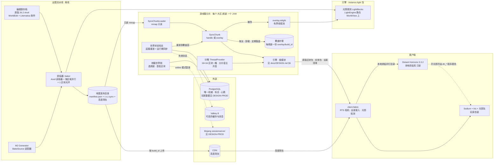
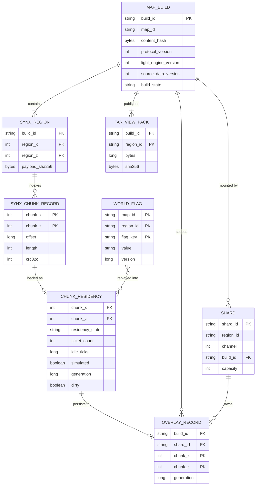
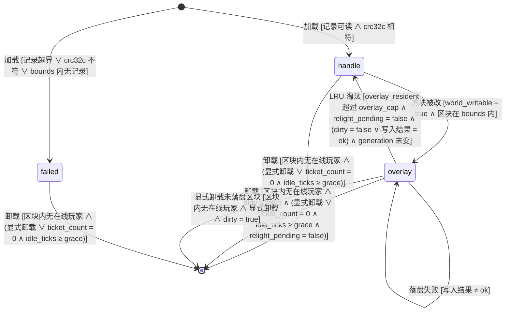
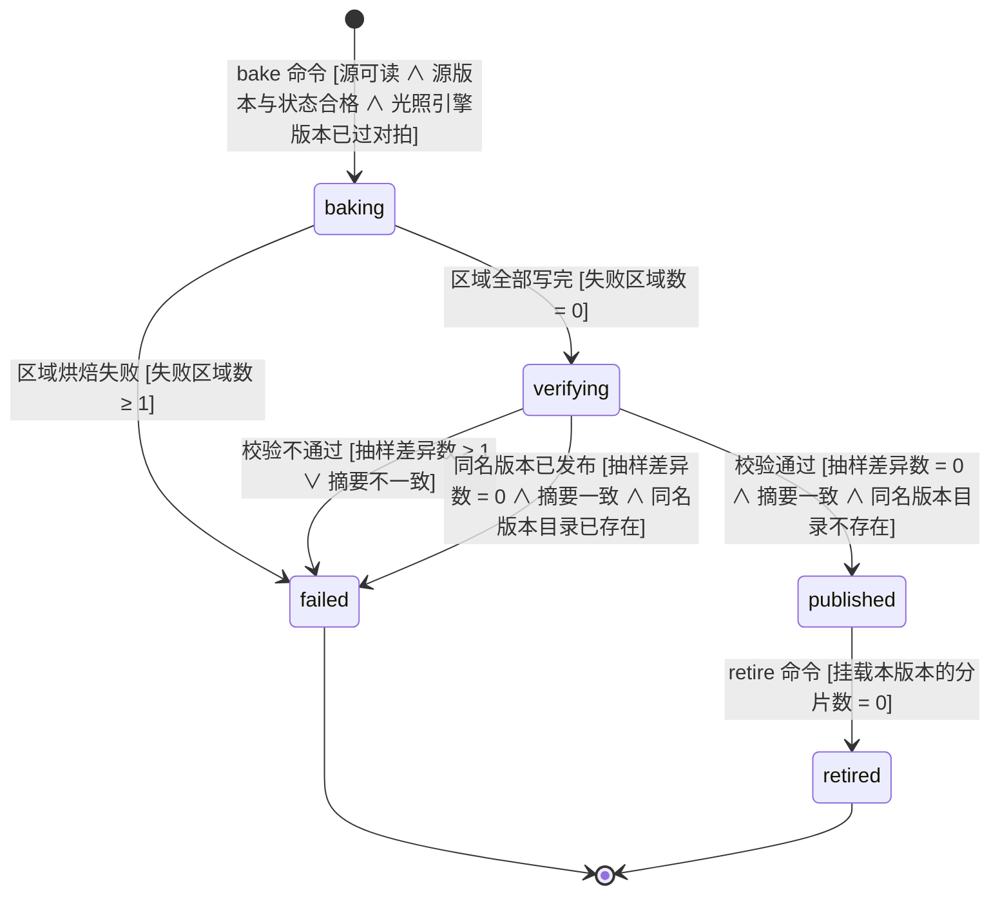
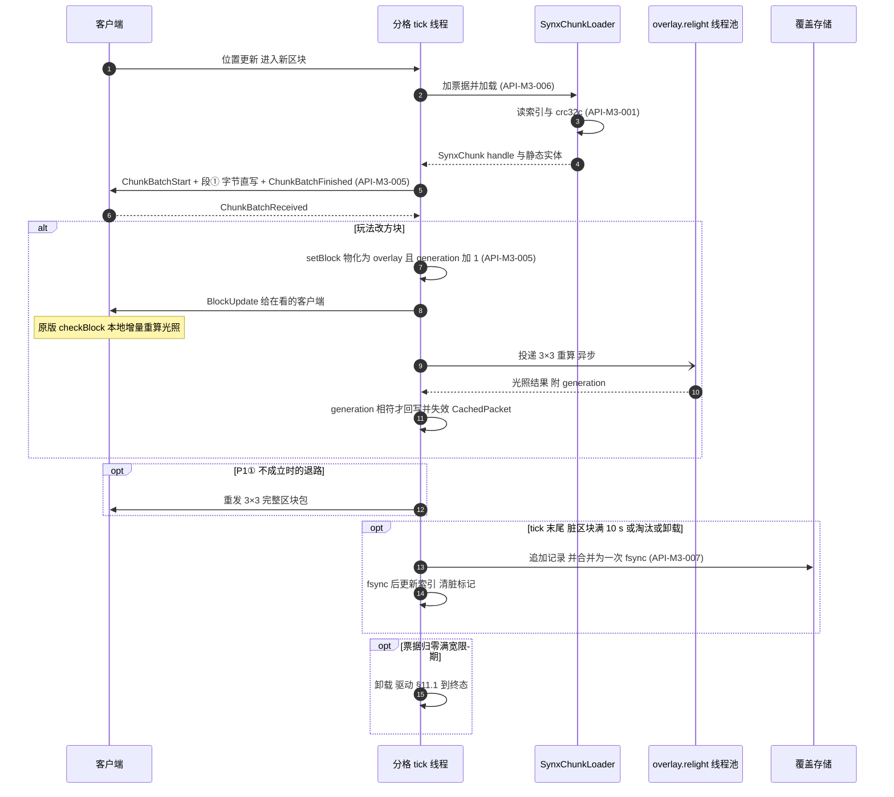
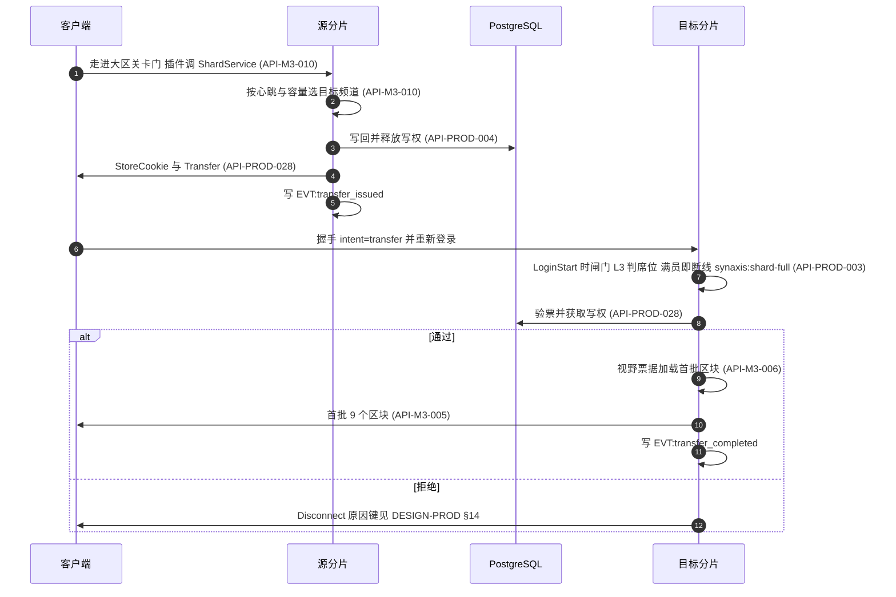
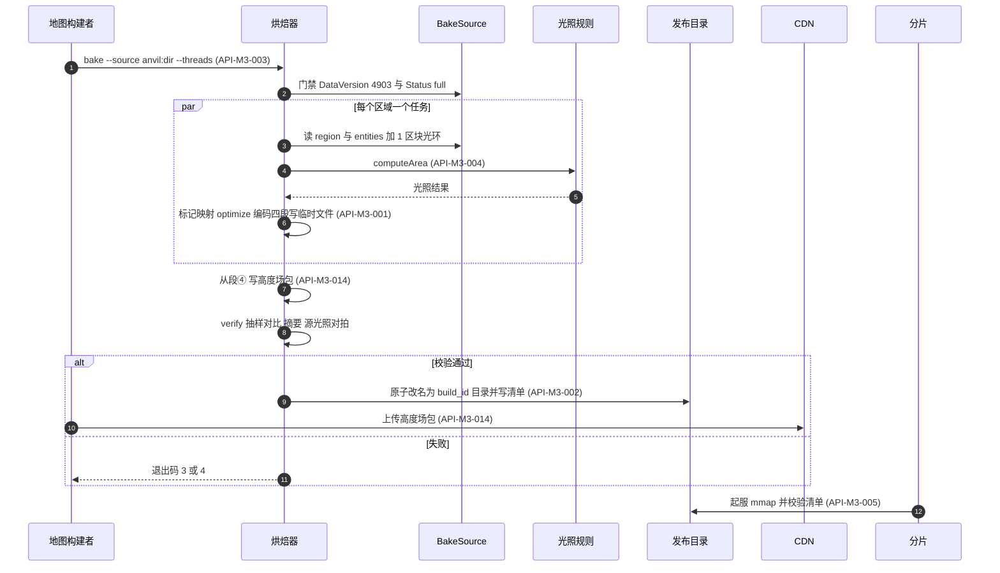
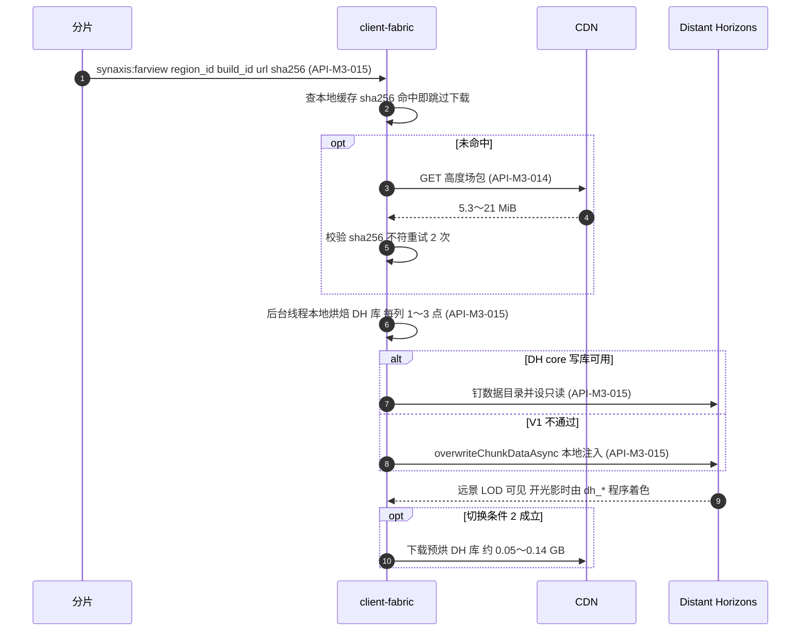
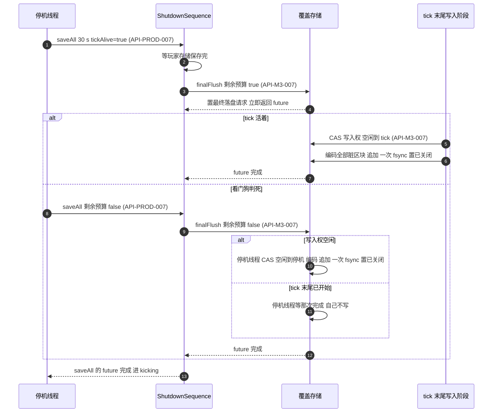
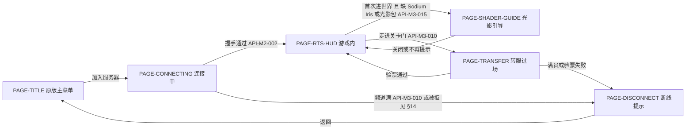

# Synaxis 设计文档 · 里程碑 M3「大世界地图管线与分片」

## 1. 元信息 / 变更记录

| 字段 | 值 |
| --- | --- |
| 状态 | 草稿（未评审；远景、光影、存储与分工已由用户 2026-09-23 拍板，见下方拍板表） |
| 项目画像 | 生产产品（与 `docs/DESIGN-M2.md` §1 相同：交付的是面向真实玩家的 MMO 服务端；按生产产品填全部 `[核心]` 节。可观测性与埋点仍落本地文件，外部依赖是 PostgreSQL、Valkey 8（Redis 兼容，只放可丢数据）与分发高度场包的 CDN） |
| Owner | Bearisbug |
| 评审人 | Bearisbug |
| 最后更新 | 2026-09-27 |
| 关联 | 引擎单一事实源 `docs/DESIGN.md` · M2 分册 `docs/DESIGN-M2.md`（§15、§28.2、§28.3） · 技术路线报告 `docs/research/large-world-2026-09/README.md`（下称「路线报告」，第 4 节与第 8.1 节的数字已被基准重测取代） · 远景与光影备忘录 `docs/research/large-world-2026-09/far-view-vs-iris.md`（下称「远景备忘录」） · 存储对比 `docs/research/large-world-2026-09/storage-options.md`（下称「存储对比」） · 基准重测 `docs/research/large-world-2026-09/bench-2026-09.md`（下称「基准重测」） · DH spike `docs/research/client-spikes-2026-09/dh-iris/README.md` · 生产就绪分册 `docs/DESIGN-PROD.md`（v0.9.14；其输入草案在 `docs/research/production-readiness-2026-09/`，本文档不再引用草案） · 测试文档 `docs/TEST.md` · 仓库 `https://github.com/Bearisbug/synaxis` |

本文档是 `docs/DESIGN.md` 的第二个里程碑分册，写法与防腐坏机制沿用 `docs/DESIGN-M2.md` §24 最后一条：只管 M3 新增的东西，引擎侧与 M2 侧的事实一律用「见 `docs/DESIGN.md` §N」「见 `docs/DESIGN-M2.md` §N」引用。ID 独立编号：需求 `REQ-M3-*`、接口 `API-M3-*`、决策 `ADR-M3-*`、Runbook `RB-M3-*`；实体 `ENT-*`、页面 `PAGE-*`、事件 `EVT:*` 用语义命名，名字与 M1、M2 已有的不重复（已核对 `ENT-Map`、`ENT-NavGrid`、`ENT-Match` 等 M2 名字未被复用）。

**`.synx` 的 ID 处置**：`docs/DESIGN-M2.md` §28.3 ② 原写「M3 整条加回 `API-M2-009`」。M3 的格式与 M2 当初的设计不是同一个东西（M2 是单文件 `header` / `chunks` / `nav` 三段；M3 是 32×32 区块一个区域文件、偏移索引、四段内容、存已成帧的原版包体），按 ID「语义实质变更 = 新 ID」的规则，M3 用 `API-M3-001` 取代 `API-M2-009`，`API-M2-009` 不复活；M2 分册 §28.3 ② 已同步改写（`docs/DESIGN-M2.md` v0.45）。

**与生产就绪轨道的分工**（用户 2026-09-23 拍板）：PostgreSQL 是唯一权威存储，Redis 只放可丢的缓存和消息；玩家数据、写权租约（每个分片一个会话租约）、转服 Cookie 的签名与验票、正版验证、连接闸门、压测 harness、空间分格线程的引擎侧细节、PostgreSQL 迁移与回退，一律以生产就绪分册 `docs/DESIGN-PROD.md` 为准。本文档只写这些能力的区块与世界侧需求，引用而不复述。

用户 2026-09-23 的拍板（本文档所有设计的前提）：

| 问题 | 拍板 | 本文档据此做的事 |
| --- | --- | --- |
| Q1 远景画什么 | 接受「高度场地形 + 颜色」 | 远景按 Q1 只烘地表与水面，见 R3 行与 `ADR-M3-012` |
| Q2 光影 | 社区光影包（Iris + Complementary / Photon 一类）作主画面，不自研画风 | `ADR-M3-010`、`REQ-M3-019`、`REQ-M3-026`；删掉路线报告的 P5（自研 L1/L2）与 64 点光源 UBO |
| Q3 地图 | 人工制作、静态、按版本发布 | `.synx` 只读烘焙 + 覆盖层；地图升版 = 重新烘焙 |
| Q4 在线规模 | 每分片 200～500 人，按大区分服 + 频道，不做无缝跨服 | `REQ-M3-015`～`REQ-M3-017` |
| Q5 硬件 | 必须支持 Apple Silicon（GL 4.1）；低配档 GTX 1650 / M1、1080p、r=8 | §15 兼容行与 §17 外部依赖 |
| Q6 远景半径 | 4,096 格（低配档 2,048 格） | `REQ-M3-025` |
| Q7 世界高度 | 256 格 | `.synx` 头部按 256 定；§2 默认档用高 256 的基准值；Anvil 源由烘焙器按 256 格窗口读取，窗口外有内容即拒绝（`API-M3-003`，用户 2026-09-25 拍板） |
| Q8 服务端读光照 | 不读 | 服务端光照只为给新观察者发包，不进玩法查询 |
| Q9 Sodium | 不捆绑，只声明兼容 | Iris 硬依赖 Sodium，Sodium、Iris、光影包都由玩家自装（R1 行） |
| 远景方案 | 方案 B：Distant Horizons。客户端首次进大区下载 5.3～21 MiB 高度场包，本地烘焙 DH 库（每列 1～3 点）；切换条件与退路（CDN 预烘库、方案 C 经 Iris `assignPipeline`）照远景备忘录 §6。自写 clipmap + 自研着色器（方案 A）排除 | `ADR-M3-012`、`REQ-M3-024`、`REQ-M3-025` |
| R1 光影组件谁装 | Iris、Sodium、光影包由玩家自装；客户端检测并引导，没装时用原版画面兜底。DH 随客户端整合分发（用户 2026-09-23 确认：LGPL-3.0，附许可、允许玩家替换 jar，版本锁定与本地烘焙代码一起升级） | `REQ-M3-026`、`PAGE-SHADER-GUIDE`；DH 分发见 `API-M3-015` 许可段 |
| R2 RTS 相机 | 带俯角的透视，eye 离地 ≤ 100 格，不用正交。相机实现归 `docs/DESIGN-M2.md` 阶段 6b（另一会话负责），本文档只引用；M2 §28.2「RTS 相机形态」那条 Open Question 仍写「待用户选」，由 6b 关闭 | §6.1 共同约束；DH 在正交下不画 LOD 是选透视的依据之一 |
| R3 远景烘焙粒度 | 只烘高度场（每列 1～3 点，不保留建筑轮廓），客户端本地生成 DH 库 | `REQ-M3-025` |
| 存储路线 | 原版 26.2 Anvil 存档作编辑器交换格式 → `:baker` 烘焙 → `.synx` mmap；覆盖层存本地只追加分段文件，每频道一份 | `ADR-M3-014`、`ADR-M3-015` |
| F1 地图新版本与覆盖层 | 地图发新版本（新 `build_id`，含只升协议）时清空覆盖层；要跨版本保留的东西建模成世界状态标志 | `API-M3-007`、`REQ-M3-023` |
| F2 频道之间 | 同一大区不同频道的地形改动互相不可见 | `ADR-M3-015` |
| F3 美术工具 | **默认** WorldEdit + Litematica，不买 Axiom（用户可改） | `REQ-M3-022`、§28.1 |
| F3′ 服务端数据标记 | **默认**用 DATA 模式结构方块的 metadata 标记 handler 与服务端 NBT（用户可改） | `REQ-M3-022`、§28.1 |
| F4 覆盖层崩溃丢失窗口 | 10 s：定期写脏区块 + 每 tick 一次 group commit `fsync` | `API-M3-007` |
| F5 地图里的实体 | 允许美术放实体，烘焙器读 `entities/` | `REQ-M3-020`、段③ 静态实体表 |

变更记录：

| 日期 | 版本 | 改动 | 作者 |
| --- | --- | --- | --- |
| 2026-09-27 | v0.12 | M3-C 合并验收后按实现同步（集成分支 `m3c/integrate` 的 `cd47d36c89`，`docs/TEST.md` RUN-041），四条轨道与合并验收交来的设计更正逐条回写。**落地标注**：`REQ-M3-008`～`REQ-M3-011` 标已落地、`REQ-M3-014` 标部分落地（20 机器人已测，200 机器人待跑），`REQ-M3-002` 的分片起服接线与 `REQ-M3-022` 的处理器登记标已落地；`REQ-M3-003` 注明 M3-B 遗留缺陷（段① 方块实体 NBT 的复合标签按库的迭代顺序写出，含告示牌的 Anvil 源新起进程重烘得到另一个 `build_id`），`API-M3-001` 段①「字节可复现」加上复合标签按键升序这一条并注明未实现，`API-M3-003` 确定性条、§19「同一输入重烘」「区块包跨 JVM 逐字节确定」与 §28.2 同步。**`API-M3-005`**：overlay 模式在写锁内取快照交给连接（按 `generation` 与 `invalidate()` 次数软缓存，`encodeOverlay` 用同一份），淘汰清空 section 碰不到已交出的包；快照把各 section 的非空方块数改写成客户端与烘焙器的口径（`cave_air`、`void_air` 不计，`SynxChunk#counted`）；解码缓存的读路径经区块自己的弱引用、不取缓存锁，淘汰为 LRU 加一次放过；方块实体的 NBT 与 handler 按记录各取一次；`written` 改为返回 `boolean`，取锁最多等 50 ms，拿不到返回 false；failed 模式的发送计入 `overlaySent`；§6 内部面表 `CachedPacket` 一行写明用构造器，三处行号更新。**`API-M3-006`**：模拟距离取值为 `-1` 或 1～32（分片宿主仍是 1～视距）；卸载候选按批读（256 起、每批翻倍，跳过的不挡后面的），`readyToUnload()` 抛异常按跳过处理；分区删除写成已落地并给出实测比较次数；写入阶段任务兜异常、60 s 统计任务不兜；出生点中心区块无记录时取世界顶部；覆盖存储打不开的拒启信息；八个键的拒启文案。**`API-M3-007`**：定期落盘在距首个未落盘改动满 `flush-interval-s` 减 250 ms 时到期（为守住 F4 的 10 s，按整间隔到期时 `kill -9` 实测丢 10.02～10.04 s），崩溃窗口写入实测 9.706～9.753 s；待写表先放占位再编码、`find` 等占位、编码失败放回旧项；新增常驻集合条（按区块对象作键）；`written` 返回 false 时留作常驻；最终落盘先收写入阶段留下的在途编码；启动时删除没有头部的段；`stats()` 的两个最大值被 `ShardWorld` 多读两次的影响。**其余各节**：§2 近圈下行与包体两行、§15 零编码（改用 JFR `jdk.MethodTiming` 方法计数加阳性对照，删去按类过滤分配样本那一项）、包体一致、带宽（1 KB = 1,000 B）、烘焙、覆盖层落盘五行与测量手段；§9 模拟距离与落盘间隔两行；§11.1 定期落盘守卫（图与表同步）、LRU 淘汰、显式卸载与停机落盘三行的动作；§14 拒启信息与冒号笔误；§16 加五行（发包与淘汰、`written` 拿不到锁、同坐标新旧两个对象、交包窗口、显式卸载与同坐标加载），改一行；§17 `overlay.flush` 与 `chunk.unload`；`ADR-M3-017` 加投射物的卡住判定；§19 新增三条（淘汰后已交出的包不变空、脏区块提前一个写入阶段到期、真进程停机不丢覆盖层改动），改十条：「覆盖层崩溃丢失窗口有上界」按子 JVM 夹具重写，「压测中没有区块编码」改用方法计数与阳性对照，「段① 与重新编码逐字节一致」按快照与块数口径改写，「正常停机不丢覆盖层改动」「脏区块卸载前先落盘」写明落盘间隔 60 s 与入口，「出站积压超限时只丢实体移动包」「压测量出真实区块下行」「分片与烘焙器登记同一份处理器清单」改写判据细节，「同一输入重烘」「区块包跨 JVM 逐字节确定」各加一句 NBT 键序；§20 计数口径；`RB-M3-002` 诊断；§23 两行；§24 门禁输出；§26 M3-B、M3-C 两行的状态，新增「实际执行与偏离」（`m3c/base` 没有建成、合并顺序 A → B → C → D、`written` 契约的改动与 `:synx` 测试 classpath 排除 `:game-rts`），轨道 C 一句依赖说明更正；§27 状态。**§28**：§28.1 注明后五项已按默认值实现；§28.2 两条技术债（游戏模块未登记处理器、`ShardMain` 设置没写全）转已决，新增方块实体 NBT 键序缺陷、交包窗口、显式卸载与同坐标加载的窗口、判死路径的 `fsync`、引擎块数口径、真 `ShardMain` 只验到 `chunks=0`、60 s 统计任务不兜异常、200 机器人压测没跑、标「A、C 合并后」的六条场景只有两侧替身测试九行；交给生产就绪会话的一行写明哪些已做、哪些没做，另加 `API-PROD-029` 名单数与合并 `main` 后 `:server-app:test` 计数两项 | Bearisbug |
| 2026-09-27 | v0.11 | 把 M3-C「流送与内存」修订到可以直接照着实现，逐项对照了引擎、`:synx`、`:baker`、`server-app` 的现有代码。**停机**：`API-M3-007` 停机段按 `docs/DESIGN-PROD.md` v0.9.14 `API-PROD-007` 重写：分片宿主路径在创建覆盖存储处（`Main` 步骤 (5) 的 `ShardWorld#start`）调 `ShutdownSequence#addAfterPlayers("overlay", overlay::finalFlush)`，RTS 路径不注册；与玩家共用 `saving` 预算，自身上限 min(2 s, 剩余预算)；`tickAlive=true` 只把最终落盘请求投给 tick 末尾写入阶段、不阻塞，`false` 由停机线程直接执行；写入权 CAS 保证最终落盘恰一方执行；截止之后不再发起新编码；判死时每个区块取锁最多等 50 ms（新引擎方法 `Chunk#tryLockWriteLock`），卡住的区块不拖住编码池；落盘之后的改方块不保证落盘。§28.2 那条 Open Question 转已决，§11.1、§16、§17 同步，新增 §12.5 时序。**接口**：`API-M3-005`～`API-M3-007` 重写：类在 `:synx` 的 `io.github.bearisbug.synaxis.synx` 包，`SynxChunk` 继承 `DynamicChunk`、模式原地切换（`ADR-M3-016`）；`OverlayIndex#find` 返回带 `generation` 与记录位置的 `OverlayHit`，加载时 `generation` 接着来源的值，解码缓存按不可变内容的位置作键；`OverlayChunk`、`OverlayTracker` 契约，`encodeOverlay` 取写锁；计数快照 `SynxStreamStats`、`OverlayStats` 与 `EVT:chunk_stream_stats` 的出处；`view_bounds` 改为外扩 17；只读由 `SynxChunk` 在 `setBlock` / `setBiome` 覆写里自判；failed 占位满天光；没登记的 handler 命名空间用 `getHandlerOrDummy`（§6 内部面表加一行）；运行期解码不构造 `ChunkDataPacket`；物化只依赖区块写锁；静态实体在 `onLoad` 生成；`BufferedPacket` 加 `sheddable`，区块包不被出站积压丢掉（`ADR-M3-018`）；模拟距离外只跳过 tick 体（`ADR-M3-017`）；票据跟随区块环、先加票再加载，卸载判定在票据锁内复查；分区删除改为 O(1)；显式卸载的脏区块同步编码进待写表；干净区块淘汰不重新编码；LRU 上限写明是软上限；分片宿主的挂地图模式：八个键在 `Main` 步骤 (1) 读完，清单校验与维度类型在步骤 (3)，覆盖存储在步骤 (5) 打开（其余拒启点之后），宿主准入与台账留在 `app` 包的 `Main`；活动段在第一次追加时才建；覆盖段头部 `has_columns = 0`。**配置键**：八个 `synaxis.*` 键与读取处（`ShardSettings`、`SynxOptions`、`OverlayOptions`），键名 `synaxis.simulation-distance`、`synaxis.chunk-unload-grace-ticks`、`synaxis.overlay.cap`（配置文件只收键表里的键）；§9 补 `idle_ticks`、`simulated`（取代 `sim_refcount`）、`relight_pending`、`overlay_resident`、`map_root`。**数字**：引擎的区块环半径是视距 + 1，§2 视野由 625 改为 729 区块，近圈下行、分片出站、区块吞吐、加密 CPU 与 §15 带宽行按新环重算，压测模型按机器人绕圆走修正（步行 13.9、坐骑 32.3 KB/s）；§15 最终落盘目标绑定 12 核机并给出每线程推算值。**门禁**：§24 加配置键门禁与翻译键门禁两条（后者是该分册 §28.3 登记给本分册的一行），`synaxis:map`、`synaxis:door`、`synaxis:loot` 照 `synaxis:match` 进 `NOT_TEXT`；处理器清单由烘焙器与分片共用 `SynxHandlers.registerAll`，烘焙器退出码 1 加「处理器同键」。**验收**：§19 写明 M3-C 场景的六种入口，为 `REQ-M3-008`～`REQ-M3-011`、`REQ-M3-014` 重写并新增场景，覆盖 §26 M3-C 的退出条件，另加出站积压、没登记的命名空间、从覆盖记录重载再改、显式卸载、真停机序列、两个写者 1,000 轮、卡住的区块锁七条；`REQ-M3-002` 两条改为进程拒启口径；`REQ-M3-022` 加四条。**排期**：§26 M3-C 行写全退出条件，新增第 0 步契约骨架（含 `SynxSlot.parse`、`SynxChunkRecord#encode` 两处抽取与两个门禁名单）、四条并行轨道（逐条写明文件、实现、接口边界、自测与验收）、跨会话冲突与合并验收。**§28.1** 新增数据标记处理器、静态实体还原范围、出生点、只读区块反应、挂地图分片是否加载插件五项并给默认值；**§28.2** 新增 `view_bounds` 外空气区块画暗的风险与交给生产就绪会话的改动两行 | Bearisbug |
| 2026-09-25 | v0.10 | 按用户 2026-09-25 拍板收尾 M3-B（`docs/TEST.md` RUN-034）。**世界高度**：§28.1「编辑源世界高度」转已决（选 ①）：烘焙器按 256 格窗口读 Anvil 源，新增命令行 `--min-y`（默认 −64、16 的倍数，与生成器源同给或不是 16 的倍数退出码 1），窗口外有非空气方块、方块实体或静态实体即退出码 2，信息带区块坐标、越界 y 与窗口范围；默认值的理由写进 `API-M3-003` Anvil 源条。§1 Q7 行、`REQ-M3-020`、`API-M3-001` 头部 `height` 行、`API-M3-003`（命令行、Anvil 源条、退出码 2）同步，§19 新增「Anvil 源按 256 格窗口烘焙」「高度窗口外有内容即拒绝」两条场景；§26 与 §28.2 的真实 Anvil 地形改按 256 格窗口。**超过 256 种状态**：§28.1 转已决，维持拒绝（退出码 3，信息带区块与 section 坐标，已有断言）。**`fullyLit`**：`LightingChunk.relight` 改走 `LightEngine` 后不再设全亮标记，`REQ-M3-028` 与 §5 末表 ⑦ 写明修复只在懒读路径（`Instance#getSkyLight` → `relightSection` → `SkyLight`）生效；§19 该场景改为先经懒读路径把 section 标为全亮，再放石头。**ArchUnit**：§24 加 `:architecture-tests` 的 `LightEngineArchitectureTest`（烘焙侧用到的 `instance.light` 类型不得引用 `Instance`）。§28.2「`docs/ENGINE.md` 目录地图」转已决；「CI 还没跑过冻结 zlib 开关」按 `5be385bd54` 的 CI 结果转已决，§26 M3-B 行删去该遗留项 | Bearisbug |
| 2026-09-25 | v0.9 | M3-A 剩余项与 M3-B 落地后按实现同步（`docs/TEST.md` RUN-033）。**光照引擎**：`REQ-M3-004` 标已落地；`API-M3-004` 写明缺失区块不传光、`MAX_SECTIONS = 2^19` 上限、`LightResult` 共享常量不得写、规则只取自 `LightBlocks`（含天光边）、`relight` 的快照与分块做法及「调用期间不改方块」前置条件、版本文件在引擎资源里；§5 末表 ② 改为 `relight` 已不持实例锁，⑥ 改为 M3-D 前置已满足（`flushQueue` 只剩 `relightSection` 可达），§2 非目标、`REQ-M3-012`、§26 M3-D 同步；§16 加 `relight` 与 `setBlock` 并发一行。**格式**：`REQ-M3-001`、`REQ-M3-002` 标已落地（校验函数在 `:synx`，起服接线随 M3-C）；`API-M3-001` 补 `registry_digest` 文本、`crc32c` 覆盖段长表、对齐填充与 `payload_sha256` 范围、段① 规范形为 `setAll` 后 `optimize(SIZE)`、最短 VarInt 与包 id 常量、段③ 为带头 zlib 流且 NBT 键排序、`compression_threshold ≥ 1`、暂存文件加硬链接的写入语义、`open` 不核对文件名；`API-M3-002` 补 `content_hash` 算法、`bounds` 键、小写 hex、整数不许带小数与起服校验顺序；§14 新增 `synx-truncated`、`synx-world-mismatch`、`synx-manifest`。**烘焙器**：`REQ-M3-003`、`REQ-M3-020`～`REQ-M3-022` 标已落地；`API-M3-003` 按实际命令行（`--bounds`、`--dimension`、`--logs`、`--samples`，退出码 1）、Anvil 源的拒绝清单、生成器预设与 `fork` 拒绝、标记规则与 handler 来自 `ServiceLoader`、工作目录与发布步骤、`verify` 的摘要与抽样重烘、源光照对拍不计标记格、每线程 256 MB、整文件确定性重写；§11.2 把「输出目录已存在」守卫从 `[*] → baking` 移到 `verifying → published`，新增 `verifying → failed`（同名版本已发布，退出码 5）；§6 模块段写明已落地部分与 `:baker` 依赖，内部面表加 `GeneratorImpl`（只给 `:baker`）；§4 烘焙源改写、新增「已过对拍版本文件」。**数字**：§2 烘焙与磁盘行、§15 烘焙行写入 4k×4k 合成图实测。**§19**：损坏向量改为 8 个；清单不符、源实体、标记映射三条写明 M3-B 验到哪一半；并行等于串行改为整文件相同；新增 `fork`、超过 256 种状态、光照版本未过对拍、同一输入重烘、缺失区块不传光、源光照对拍不计标记六条。**§24**：向量门改为 zlib 指纹门加 CI 开关；光照门禁写明版本文件路径、指纹覆盖的四部分与只增不改；ArchUnit 与内部面名单写明落地位置；覆盖率门含 `:synx`、`:baker`。**§26**：M3-A、M3-B 标已完成并列出留给后续阶段的项。**§28**：§28.1 新增世界高度 384 对 256 与超过 256 种状态两项待拍板；§28.2 新增 CI 冻结 zlib、游戏侧 handler 未登记、烘焙器缺三个子命令、`docs/ENGINE.md` 目录地图四项，「跨区块写入与调色板顺序」转已决 | Bearisbug |
| 2026-09-24 | v0.8 | `ShardMain` 写入 `API-M3-006` 分片宿主设置表里可直接设的四项，都在 `Main` 读取之前写、命令行显式给的值优先，线程两项不变：`ShardMain#viewDefaults` 写 `synaxis.chunk-view-distance=12`、`synaxis.chunk-queue.max-per-tick=4`、`synaxis.max-visible-entities-per-player=100`；`ShardMain#transferDefaults` 只在 `synaxis.app.store=postgres` 时写 `synaxis.accept-transfers=true`，内存存储不写（无条件写会让 `docs/DESIGN-PROD.md` 第 5 波那种内存存储、无票据密钥的压测分片起不了服；PostgreSQL 存储缺密钥时仍由 `Main` 拒启）。§4 分片宿主术语、`API-M3-006`（设置段、接收转入行与表后说明）、`API-M3-009` 现状段、`API-M3-010` 接收转入段同步。视距行的「大于 16 拒启」校验与模拟距离一起随 M3-C 加。§28.2「`ShardMain` 只写了线程两项」技术债改为「分片设置没写全」，记下四项已落地、模拟距离与卸载宽限待 M3-C，并写明 `docs/DESIGN-PROD.md` §28.2 那条待办由此完成、该分册的改写交给生产就绪会话 | Bearisbug |
| 2026-09-24 | v0.7 | 按 `docs/DESIGN-PROD.md` v0.8.2 §28.3 核对指向本文档的各行。**分片宿主**：§4、`API-M3-006`、`API-M3-009`、`API-M3-010` 写明 `ShardMain` 已由该分册第 5 波 5D 建在 `server-app`（启动脚本 `bin/server-shard`，经 `Main` 起服），目前只写线程两项；`API-M3-006` 新增分片宿主设置表，列出 M3 往里加的视距 12、模拟距离 4、卸载宽限 100、`accept-transfers`，与该分册 §28.2 待办要求的区块上限 4、可见上限 100；视距改为直接写引擎属性 `synaxis.chunk-view-distance`，不再另设 `shard.view-distance`。**区块上限**：原文写「分片宿主不覆盖兜底 64、另设 4」，与该分册 `API-PROD-020` 不符，改为同一个键 `synaxis.chunk-queue.max-per-tick` 引擎默认 64、分片宿主写 4，§2 限速行与 §15 带宽行同步。**线程号**：`API-M3-009` 与 §19「同一分格的区块归同一线程」引用 `API-PROD-016` 的 `3x + z`。`API-M3-010` 写明接收转入要求 PostgreSQL 存储与票据密钥。**补引用**：§10 指向该分册 §10 行级规则与 `API-PROD-004` 写入条件，§17 指向该分册的 `shard_session.renew`、`store.autosave`、`transfer_nonce.gc`，§19 指向 `REQ-PROD-004`、`005`、`007` 的场景。§28.2 新增「`ShardMain` 只写了线程两项」技术债；§1 关联行改指该分册 v0.8.2 | Bearisbug |
| 2026-09-24 | v0.6 | 按 `docs/DESIGN-PROD.md` v0.7.1 §28.3 改写对转服票据与迁移版本号的引用。**票据**：§1 末段、§3 首批区块耗时行、§4 转服术语、`REQ-M3-017`、`ADR-M3-008`、§12.2 两步（`StoreCookie` 与 `Transfer`、验票并获取写权）改指该分册 `REQ-PROD-045`、`API-PROD-028`（Cookie 布局含 `character_id`，检查 ④ 加票据 `player_uuid` 与本次验证 UUID 的一致校验）；`API-M3-010` 插件面写明 `ShardService#transfer` 选好频道后调宿主接口 `TransferTickets#transfer(player, targetShardId, host, port)`，三种失败结果交还插件；§14 两个键改为由该分册 §14 定义，`synaxis:state-unavailable` 补齐转入验票的两种来源；§20 注明 `EVT:transfer_rejected` 由该分册 §20 定义；§28.2 冒名风险行补检查 ④。**清理**：删去 §17 `nonce.gc` 行，`transfer_nonce` 过期行由该分册 §17 `transfer_nonce.gc` 清理，§15 数据增长行同步。**排期**：§26 M3-E 的转服只依赖该分册第 3 波 3D 组（`TransferTickets` 已在 `main`），不再依赖 6A。**迁移**：§25 与 `API-M3-013` 写明 `world_flag` 版本号在合并时取下一个空号、不开 `outOfOrder`（`main` 已有 V1～V4，当前预计 `shard_heartbeat` = V5、`world_flag` = V6，以该分册 §25 为准）。§1 关联行改指该分册 v0.7.1；§28.2 两条技术债（生产就绪分册按 v0.2 引用、`world_flag` 未分版本号）转已决 | Bearisbug |
| 2026-09-23 | v0.5 | 区块包字节确定性：引擎 `ChunkData` 修复前用 `Map.copyOf` / `toUnmodifiableMap` 复制高度图与方块实体，同一区块在不同 JVM 里编出长度相同、字节不同的包（`5fba33a398` 修复）。`REQ-M3-003` 补「区块包逐字节确定」；`API-M3-001` 段① 加「字节可复现」（编码集合的固定顺序、禁止直接决定编码顺序的集合、编码前 `optimize(SIZE)`、验收门 `ChunkPacketDeterminismTest`）；`API-M3-003` 确定性条目改为解压后包体跨 JDK 相同、成帧字节同一 JDK 构建相同；`API-M3-008` 输出加 `packet` 作业的四个 SHA-256 摘要；§19 新增「区块包跨 JVM 逐字节确定」「基准的区块包字节两次运行逐字节相同」两条场景，「基准程序复跑」的字节判据改为与 `bench-2026-09-packet-canonical-1.json` 的摘要相同；§28.2 加跨区块写入未覆盖的风险 | Bearisbug |
| 2026-09-23 | v0.4 | 按 `docs/DESIGN-PROD.md` v0.3 §28.3 改写对生产就绪的全部引用：原先指向 `docs/research/production-readiness-2026-09/` 三份草案的位置一律改指该分册的 ID 与节号。**频道满**：只用 `synaxis:shard-full` 一个键，住引擎 `DisconnectReasons`，由连接闸门 L3 在 `LoginStart` 按已占席位判定，早于加密请求与读 Cookie，不消耗票据 nonce，不写台账（`REQ-M3-016`、`REQ-M3-017`、`API-M3-010` 容量段、§12.2、§13、§14、§19 两条场景与 `RB-M3-001` 改为断言 `synaxis_gate_rejections_total{reason="full"}`），取代 v0.3 的 `synaxis:server-full`。**分格线程**：`REQ-M3-015`、`API-M3-009` 只提世界侧要求，引擎侧设计引用 `API-PROD-016`，`ADR-M3-006` 引用 `ADR-PROD-006`。**持久化与租约**：§1 末段写明 `REQ-M3-018`、`API-M3-012`、v0.2 §11.4、`RB-M3-005`、`API-M3-011` 的去向；§7、§11、§16、§17、§20（`EVT:lease_takeover` 属性为 `character_id`、`previous_session_id`、`gap_ms`）、§21、`ADR-M3-009`（引用 `ADR-PROD-003`、`ADR-PROD-004`）改为引用该分册；§14 写明 `synaxis:state-unavailable` 的来源按该分册 §14（在线模式下先顶号，5 s 内拿不到租约才回这个键）；§15 数据增长行加 `transfer_nonce` 与玩家数据的出处；外部依赖写明 Valkey 8（可丢）。**迁移**：§25 改为引用该分册 §25 版本表（`shard_heartbeat` = V5，脚本内容由本分册提供；`transfer_nonce` = 该分册 V1；`player_state` 不建），回退策略两层；§17 新增 `nonce.gc`（每 10 min，`transfer_nonce` 唯一的清理任务）。**区块发送**：`API-M3-006` 写明引擎兜底限速每玩家每 tick 64 区块（`synaxis.chunk-queue.max-per-tick`，1,280 区块/s）保持不变，并与分片宿主每玩家 4 区块/tick（`REQ-PROD-026`）对照。**停机**：`API-M3-007` 停机段挂到该分册 §11.4 `saving` 阶段，§28.2「停机预算已占满」改为挂载方式的开放问题。**DH 分发**：用户确认随客户端分发（LGPL-3.0，附许可、允许玩家替换 jar，版本锁定与本地烘焙代码一起升级），§1 R1 行、`API-M3-015` 许可段、§17、§23 检查单同步，§28.1 该行关闭。§28.2 新增两条交给生产就绪会话：该分册仍按 v0.2 引用 `API-M3-011` 与本文档 §14 的两个键；`world_flag` 不在该分册 §25 版本表 | Bearisbug |
| 2026-09-23 | v0.3 | 合入用户对远景、光影、存储与分工的拍板及五份证据。**远景与光影**：§6.1 与 `ADR-M3-012` 定为方案 B（DH + 客户端本地烘焙高度场包），新增 `REQ-M3-024`～`REQ-M3-026`、`API-M3-014`、`API-M3-015`、§12.4 时序与 `PAGE-SHADER-GUIDE`；DH spike 的结论（本地注入在 llvmpipe 下可用、正交不画 LOD、透视下相机周围约一个原版视距不画、与 Iris 同开固定 OpenGL、光影包在 LOD 上的效果无有效数据）写进 §6.1 与 §28.2。**存储**：`API-M3-001` 段② 删碰撞位集、段③ 改为全部方块实体完整 NBT + handler + 静态实体表，`region_content_hash` 改按段① 解压后包体算；烘焙器读 `region/` 与 `entities/`、DataVersion 门禁、「升级 → 预生成 → 校验 `isLightOn` 覆盖率」固定顺序；覆盖存储用 `Arena.ofAuto` 映射、活动段预分配、10 s 定期落盘 + group commit；新增 `REQ-M3-020`～`REQ-M3-023`、`API-M3-013`、`ADR-M3-014`、`ADR-M3-015`；关闭「编辑源格式」「覆盖存储重启是否保留」两个开放问题。**光照**：④⑤ 两处缺陷与对拍中发现的 `fullyLit`、面遮挡、`ShapeImpl` 三处已修，`LightParityIntegrationTest` 7 个场景 0 差异是验收门；真值改为原版 26.2 `LevelLightEngine` 隔离运行（`ADR-M3-013` 取代 `ADR-M3-005`）；新增 `REQ-M3-027`（面遮挡）与 `REQ-M3-028`（`fullyLit`）；`flushQueue` 竞争改为 M3-D 前必须处理；§15 删去对拍例外表（测试直接断言 0 差异）。**基准**：§2、§15 的带宽、磁盘、堆、耗时换成基准重测值，P2 验收补调色板形态与「不产生 `ChunkDataPacket`」两条。**分工**：`REQ-M3-018`、`API-M3-011`、`API-M3-012`、`RB-M3-005` 与 §11.3、§11.4 两台状态机移交生产就绪轨道；`ADR-M3-009` 改为「PostgreSQL 唯一权威、Redis 只放可丢的缓存和消息」；分片宿主 `dispatcherThreads` 改为核数 − 2；频道满员改用连接闸门的 `synaxis:server-full`；原 `API-M3-011` 里的 `synaxis.accept-transfers=true` 并入 `API-M3-010`；覆盖存储补停机落盘（`overlay.shutdown-flush`，§11.1 加一条迁移）；转服首批区块耗时的起点定为票据 `issued_at`，`EVT:transfer_issued` 加该属性；§28.2 列全生产就绪文档对 v0.2 的引用。**自定默认**：DH 随客户端分发登记进 §28.1。另同批改了 `docs/DESIGN-M2.md` 两处（v0.45）、`docs/DESIGN.md` §28 parity 技术债转已决（v0.36）、`CLAUDE.md` 一句与路线报告开头一行 | Bearisbug |
| 2026-09-23 | v0.2 | 评审第 1 轮修订：M3 的线程模型、模拟距离、自动卸载改为分片宿主显式开启，引擎默认值不变（`API-M3-006`、`API-M3-009`，§19 加一条 M2 行为不变的场景）；§6.1 按远景备忘录改为 A / B / C 三条路；§5 光照处置表 ⑥ 改为 `flushQueue` 保留给 `relightSection`；`REQ-M3-006` 注册表计数更正为 727 / 85 / 384；覆盖存储改为只追加分段 + 内存索引；§6 登记 `:synx` 用到的引擎内部面；§11.2 光照版本守卫前移到 `[*] → baking`；Flyway 回退改为手工回退 SQL；§15 / §19 火把、光影同装、对拍例外表的判据改为可判定；`docs/DESIGN.md` 同批登记 §26 与变更记录 | Bearisbug |
| 2026-09-23 | v0.1 | 初稿：`.synx` 格式与测试向量、离线烘焙器、光照引擎抽取与两处修复、原版光照对拍、`SynxChunkLoader` 与区块驻留、覆盖层、运行时光照、基准程序、空间分格线程、大区分服与频道、转服票据、外部状态存储；远景占位；光影按 Q2 定为社区光影包 | Bearisbug |

已废弃、移交生产就绪分册的 ID（编号不回收）与去向：`REQ-M3-018` 外部状态存储 → `docs/DESIGN-PROD.md` `REQ-PROD-005`～`REQ-PROD-007`；`API-M3-012` 玩家状态存储与 v0.2 的 §11.4 `ENT-StateLease` → `API-PROD-004`、`API-PROD-005` 与该分册 §11.3 `ENT-CharacterLease`；`RB-M3-005` 外部状态存储不可用 → `RB-PROD-002`；`API-M3-011` 转服票据 Cookie → `REQ-PROD-045`、`API-PROD-028`（Cookie 布局含 `character_id`、`SYNAXIS_TRANSFER_HMAC_KEYS`、检查 ①～⑥ 且 ④ 校验票据 `player_uuid` 等于本次验证 UUID、`transfer_nonce` 表与清理任务 `transfer_nonce.gc`），插件面的 `transfer` 与 Cookie 见 `REQ-PROD-031`、`API-PROD-021`。区块与世界侧的剩余需求见 `REQ-M3-017`、`REQ-M3-023`、`API-M3-013`、`RB-M3-006`。

## 2. 背景 / 目标 / 非目标

- 背景：M2 的地图是进程内程序化生成、整图常驻、无文件格式（见 `docs/DESIGN-M2.md` §2 非目标与 §28.3 ②）。路线报告第 2.2 节列出这套做法撑不起 MMO 大世界的五个硬限制：整图常驻在 10k×10k 格时要 7.9 GiB 堆（高 256 自然地形，基准重测 §6.3）；没有按视距或无人观察的自动卸载（`InstanceManager.java:93` 只在注销整个实例时卸载）；只有 `NoopChunkLoaderImpl`；`ServerProcessImpl.java:104` 写死 `ThreadProvider.counter()`；`LightingChunk` 的六处问题（§5 末表）。每发一个未缓存的区块，服务端要付 0.52 ms（不带光照）或 3.95 ms（懒算光照）CPU（高 256 自然地形，基准重测 §3.1）。
- 目标：
  1. 地图成为离线烘焙的只读产物：`.synx` 区域文件存已成帧已压缩的原版区块包体与烘焙光照，服务端对未改区块只做「mmap 读 + 写 socket」。
  2. 光照与原版一致且有可执行的证据：光照缺陷已修，逐值对拍是门禁，错误不会被烘焙进全部 `.synx`。
  3. 运行时内存有界：视距与模拟距离分开、按观察者引用计数自动卸载、被改区块进覆盖层且覆盖层有 LRU 上限，崩溃最多丢 10 s 改动。
  4. 规模数字可复现：带宽、磁盘、堆、耗时都来自入库的基准程序（基准重测），美术地图出来后按同一程序补测。
  5. 每分片 200～500 人：空间分格线程、大区分服 + 频道、跨大区转服；玩家数据与写权由生产就绪分册 `docs/DESIGN-PROD.md` 负责。
  6. 远景 4,096 格：客户端用 DH 画高度场 LOD，开光影时由光影包统一着色。
- 非目标：
  - 不自写远景 clipmap 与着色器（方案 A 排除）；方案 C（clipmap 经 Iris `assignPipeline` 登记）只作 `ADR-M3-012` 的退路，不排期。
  - 不做自研光影（路线报告的 L1 调色、L2 阴影与体积光）与 64 点光源 UBO、`synaxis:lights` 通道（Q2，`ADR-M3-010`）。动态光只有原版方块光。
  - 不捆绑 Sodium、Iris 与光影包（Q9、R1）。
  - 远景不保留建筑轮廓（R3），不做体素 LOD。
  - 不做无缝跨服、边界幽灵实体、区块所有权迁移，不做「千人同屏」（Q4）。
  - 不做地图编辑器；美术用原版客户端 + 外部工具出 Anvil 存档（`ADR-M3-014`）。
  - 不做运行时地形生成；M2 的 `Generator` 只作为烘焙器的一种输入。M2 的 RTS 对局地图仍在进程内生成，不走本文档的管线。
  - 不支持大规模改地形的玩法（Q3）。覆盖层按「局部、少量改动」设计，上限触顶即降级（见 `RB-M3-002`）。
  - 覆盖层不跨地图版本保留、不跨频道共享（F1、F2）；要跨版本或跨频道一致的东西走世界状态标志（`REQ-M3-023`）。
  - 静态实体（展示框、盔甲架等）的运行期改动不持久化（§28.2）。
  - 服务端玩法不读光照值（Q8）。
  - 不做客户端本地区块缓存、不换 zstd 压缩（路线报告 §3.5、§3.6 都放到实测之后）。
  - 不修 `LightingChunk` 的运行期路径（懒算、`relightSection` 的实例锁、延迟重发），MMO 实例不使用它（§5 末表）。`flushQueue` 竞争在 `REQ-M3-004` 落地后只剩 `relightSection` 一条路径可达，整图 `relight`、对拍与烘焙器都不再经过它（§5 末表 ⑥）。
  - 不做 `docs/DESIGN-M2.md` §28.3 ③ 的多局并行；M2 RTS 进程的运行行为不变：M3 新增的线程模型、模拟距离、自动卸载都由 MMO 分片宿主显式开启，引擎默认值不改（`API-M3-006`、`API-M3-009`）。
  - 不设计玩家数据、写权租约、转服票据的签名与验票、正版验证、连接闸门与压测 harness 本身（生产就绪分册 `docs/DESIGN-PROD.md`，见 §1 分工）。
  - 不升 Minecraft 版本（26.2 / 协议 776 继续钉死，重估见 `docs/DESIGN-M2.md` `ADR-M2-016`）。

规模画像（下游 §15 / §17 / §21 全部数字的唯一来源）。**数字口径**：区块包体、堆、序列化与 relight 耗时出自基准重测（Apple M4 Pro 12 核，`bench-2026-09-results.json`）。三条限制对本表每一行都成立：地形是合成的，美术地图未测；墙钟耗时在负载均值 26～82 的机器上测得，只当上界；CPU 时间比墙钟稳，估算成本时用 CPU。默认档取「高 256 自然地形」（Q7 高度，地下有矿有洞），另列「高 256 实心地下」（人工地图地下不做内容）与「高 384 自然地形」两档作区间。

| 维度 | 估算 | 依据 / 假设（未知则写假设 + 重估阈值） |
| --- | --- | --- |
| 用户量 | 内测档：单分片 50～200 人。正式档：每分片 200～500 人，64 个大区，每个大区 1～N 个频道 | Q4 拍板。500 人的数字从 50 连接 soak（`docs/research/soak-2026-09-22/`）与基准重测线性外推；实测 500 机器人不达标时频道上限降到 200～300 人（`REQ-M3-016` 验收） |
| 地图尺寸 | 内测档：4,096×4,096 格 = 65,536 区块（1 个大区）。正式档：32,768×32,768 格 = 4,194,304 区块，切成 64 个 4k×4k 大区 | 路线报告 §4.2、§4.3。正式档尺寸是技术上限，内容产能未评估（§28.2） |
| 世界高度 | 256 格（16 个 section） | Q7 |
| 区块包体 B（压缩后含光照，均值） | 默认 1,502 B/区块；区间 583 B（实心地下）～2,582 B（高 384） | 基准重测 §3.1、§6。块光为 0（地形没有光源方块），美术地图的火把、岩浆、方块实体会让包体变大，幅度未测。第一张美术地图实测（存储对比 T1）与 1,502 B 偏差超过 ±20% 时重算本表。M3-C 压测里合成测试图的实测是步行 1,482.4 B、坐骑 1,463.2 B（稳态段每区块线上字节，−1.3%、−2.6%，RUN-041） |
| 视距 / 模拟距离 | 视距 12（上限 16）；引擎发区块的环半径是视距 + 1 = 13，视野 (2·13+1)² = 729 区块；模拟距离 4，81 区块 | 路线报告 §3.3。环多一圈是引擎行为：`Player#effectiveViewDistance` = min(客户端, 实例, 玩家上限) + 1，`EntityTrackerImpl` 的区块观察者按同一半径算。基准重测 §6.1 的进场行与 `docs/DESIGN-PROD.md` §28.2 区块上限一行按 625 区块算，比实际少 14% |
| 每玩家近圈下行 | 进场 729 × B ≈ 1.09 MB。沿坐标轴直线移动：步行 4.317 格/s → 7.28 区块/s ≈ 10.9 KB/s；坐骑 10 格/s → 16.9 区块/s ≈ 25.3 KB/s；飞行 30 格/s → 50.6 区块/s ≈ 76.0 KB/s。压测机器人绕圆走（`:loadtest` 的 `Profile`），每秒跨区块边界的次数是直线的 4/π 倍：步行 ≈ 13.9 KB/s，坐骑 ≈ 32.3 KB/s | 每跨一次区块边界新进视野 2r+1 = 27 个区块（`ChunkRange#chunksInRangeDiffering`，视野是正方形），直线每秒跨 v/16 次，绕圆每秒跨 (\|vx\|+\|vz\|)/16 次、平均 4v/(16π) 次；× B；基准重测 §6.1。M3-C 在挂 4k 合成测试图的分片上以 20 机器人各跑 180 s 实测：步行 13.573、坐骑 31.248 KB/s，与模型差 −2.3%、−3.3%（`docs/TEST.md` RUN-041，§15 带宽行；§15 判据要的 200 机器人 600 s 未跑） |
| 实体下行 | 14.5～32.5 KB/s/人 | soak-2026-09-22，50 人 × 1,000～4,000 单位（RTS 口径）。**不是 MMO 主城上界**：主城可见对数按 n² 增长，没有模型（§28.2）。包体变小后实体流量是出站的大头：默认档直线步行时近圈只占 25% |
| 分片出站 | 200 人：步行 8.7 MB/s（70 Mbit/s），全员骑乘 11.6 MB/s（93 Mbit/s）；500 人：步行 21.7 MB/s（174 Mbit/s），骑乘 28.9 MB/s（231 Mbit/s） | (直线近圈 + 32.5 KB/s 实体) × 人数，基准重测 §6.1、§6.2。千兆网卡够用；超过 800 Mbit/s 需重估网卡与频道上限 |
| 区块吞吐 | 500 人 3.6k～8.4k 区块/s，全部是 mmap 读 + 内存拷贝（5.5～12.7 MB/s） | 500 × 7.28～16.9 区块/s × 1,502 B |
| 区块发送上限 | 引擎默认 64 区块/tick = 1,280 区块/s（`ServerConfig.maxChunksPerTick`，属性 `synaxis.chunk-queue.max-per-tick`）；分片宿主把同一属性写成 4，即 80 区块/s，高于飞行档的 50.6 区块/s（绕圆 64.5 区块/s） | 存储对比 §4 口径更正；`docs/DESIGN-PROD.md` `API-PROD-020`。正常速率由客户端 `ChunkBatchReceived` 回报决定，回报被夹到这个上限，流控不改 |
| 区块 CPU 对照 | 未改区块改走 `.synx` 之前：每区块 0.52 ms（不带光照）/ 3.95 ms（懒算光照）CPU；走 `.synx` 之后只剩读页与拷贝 | 基准重测 §3.1 整遍 CPU，高 256 自然地形 |
| 加密 CPU（online 模式） | AES-CFB8 出站 11.2～11.6 ms/MiB；500 人步行 21.7 MB/s ≈ 0.23 核，骑乘 28.9 MB/s ≈ 0.31 核 | 本机实测（M4 Pro），出处见 `docs/DESIGN-PROD.md` `ADR-PROD-011`；核数按 11.29 ms/MiB × 本表「分片出站」推算。该分册 §2 的 0.21 核用同一速率、按 RTS 4,000 单位档 18.30 MiB/s 算，口径不同、不矛盾。`.synx` 的预压缩包体可以复用，但加密是每连接一次，不能跨连接复用 |
| 磁盘 | 每大区 `.synx` ≈ 219 MB + 段③：段① 65,536 × 1,502 B ≈ 98 MB；段② 544 B/区块 ≈ 36 MB；段③ 只存方块实体与静态实体，合成地形为 0，美术地图未测；段④ 1.25 KiB/区块 ≈ 84 MB；索引与头部约 1 MB。正式档全世界 ≈ 14 GB + 段③。合成 4k×4k 图（种子 7，高 256、没有方块实体）实测 64 个区域文件共 213,319,659 B | `API-M3-001` 各段布局；段① 按包体区间为 38～169 MB/大区；段③ 由存储对比 T1 量；实测值出自 `docs/TEST.md` RUN-033（`TC-WORLD-023`） |
| 远景高度场包 | 每大区 5.3～21 MiB（未压缩，从第 2 层或第 1 层起的金字塔）；正式档全部大区 0.33～1.3 GiB | 路线报告 §4.2 算式 1,024² 或 2,048² × 4 B × 4/3；压缩率未测 |
| 服务端堆 | 覆盖层 LRU 上限：内测档 16,384 区块 × 21.1 KiB ≈ 0.33 GiB（含 SoftReference 包缓存的上界 0.56 GiB）；正式档 24,576 区块 ≈ 0.49 GiB（0.84 GiB）。堆外成帧包体 24,576 × 1,502 B ≈ 37 MB。区块解码缓存上限 256 MiB。句柄区块常驻字节未测 | 基准重测 §3.1 存活堆（光照已算、间接调色板）；句柄区块由存储对比 T3 量。进程目标 RSS < 4 GiB |
| 烘焙 | 一个 4k×4k 大区：光照 52～92 CPU·s + 编码约 31 CPU·s（0.47 ms/区块）；正式档全图光照 0.9～1.6 CPU·h，按区域并行摊到核上。实测（`:baker`，合成 4k×4k、高 256、65,536 区块，M4 Pro 12 核）：12 线程墙钟 16.4～24.4 s、1 线程 89.4～93.4 s（实现者、审查者与 RUN-033 三次测量；RUN-033 的进程 CPU 是 12 线程 123.8 s、1 线程 98.7 s），每线程堆约 150～190 MB | 规划值出自基准重测 §6.3（整图 relight 的 CPU 线性外推，高 256）与 §3.1「光照已知」整遍 CPU；实测值出自 `docs/TEST.md` RUN-033（`TC-WORLD-023`），机器不空闲，墙钟只当上界；每线程堆是 384 格高、y < 0 全为基岩（单值调色板）的临时配置下测的，真实 Anvil 地形未测（§28.2） |
| 世界状态标志 | 假设每大区 ≤ 1,000 个标志，写入 ≤ 1 次/秒 | 假设值；超过 10,000 个标志或 10 次/秒时重估 `API-M3-013` 的重放与同步方式 |
| 分布与形态 | 每个大区一个进程，满员开频道；同一大区的频道进程部署在同一台机器并挂同一只读卷，映射同一 inode，页缓存只占一份（各容器各拷一份则不共享）。地图发布目录按 `build_id` 分发到分片机；高度场包经 CDN 分发给客户端；外部依赖 PostgreSQL（唯一权威）与 Valkey 8（Redis 兼容，可丢） | Q3、Q4、存储对比 §2 |

## 3. 成功指标 / 验收阈值

指标全部由 §20 的 `EVT:*` 事件计数算，事件写本地 JSONL（沿用 `docs/DESIGN-M2.md` §20 的落盘方式，文件按分片分开）。接口可用性类 SLI 在 §21。

| 指标 | 定义（分子 ÷ 分母，全部是事件计数或事件属性） | 当前 | 目标 | 由哪些事件算 |
| --- | --- | --- | --- | --- |
| 转服成功率 | `EVT:transfer_completed` 计数 ÷ `EVT:transfer_issued` 计数 | 无（M3 前无转服） | ≥ 99% | 见 `EVT:transfer_issued`、`EVT:transfer_completed` |
| 转服首批区块耗时 P95 | `EVT:transfer_completed` 的 `first_batch_ms`（票据的 `issued_at` 到目标分片发完首批 9 个区块的 `ChunkBatchFinished`。`issued_at` 由源分片签票时写进 Cookie，同一个值记为 `EVT:transfer_issued` 的 `issued_at` 属性；`issued_at` 是 Cookie 布局里的字段，布局见 `docs/DESIGN-PROD.md` `API-PROD-028`。两个时间戳来自两台机器，前提是分片机跑 NTP 且时钟偏差 ≤ 50 ms，即 5 s 目标的 1%） | 无 | < 5 s | 见 `EVT:transfer_completed` |
| 零编码发送占比 | 各分片 `EVT:chunk_stream_stats` 的 Σ`handle_sent` ÷ Σ(`handle_sent` + `overlay_sent`) | 无 | ≥ 95%（监控阈值，不是容量假设：堆由覆盖层上限兜住） | 见 `EVT:chunk_stream_stats` |
| 地图版本一次发布成功率 | `EVT:map_build_finished`（`outcome=published`）计数 ÷ `EVT:map_build_started` 计数 | 无 | ≥ 90% | 见 `EVT:map_build_started`、`EVT:map_build_finished` |

「转服成功率」同时作为 §21 的同名 SLI，两处是同一个数值口径。

## 4. 术语表 / 统一语言

引擎侧术语见 `docs/DESIGN.md` §4，M2 术语见 `docs/DESIGN-M2.md` §4，本表只登记 M3 新增的。

| 术语 | 定义 | 代码/字段标识 | 对应实体 |
| --- | --- | --- | --- |
| 区域文件 | 一个 `.synx` 文件，装 32×32 个区块的记录，头部带偏移索引，只读 mmap | `r.<rx>.<rz>.synx` | `ENT-SynxRegion` |
| 区块记录 | 区域文件里一个区块的四段内容 | `chunk_record` | `ENT-SynxChunkRecord` |
| 段① 包体 | 已成帧、已压缩的原版 `ChunkDataPacket` 字节（含高度图、调色板与烘焙光照），与服务端写进 socket 的字节相同；也是服务端读方块状态的来源 | `seg_packet` | `ENT-SynxChunkRecord` |
| 段② 导航 | M2 导航层的 walkable 位集与 surface_y | `seg_nav` | `ENT-SynxChunkRecord` |
| 段③ 方块实体与静态实体表 | 区块内全部方块实体的完整 NBT 与 handler 命名空间，加源存档 `entities/` 里的静态实体 | `seg_entities` | `ENT-SynxChunkRecord` |
| 段④ 列摘要 | 每列的表面高度、表面方块、天光，是远景高度场包的来源 | `seg_columns` | `ENT-SynxChunkRecord` |
| 地图版本 | 一次烘焙的全部产物（区域文件 + 高度场包 + 清单），不可变，用 `build_id` 区分 | `map_build` | `ENT-MapBuild` |
| 地图内容哈希 | 对地图未压缩规范内容算的 SHA-256；同一输入、同一烘焙器与光照引擎版本产出同一哈希 | `content_hash` | `ENT-MapBuild` |
| 编辑源存档 | 美术交付的原版 26.2 Anvil 存档（DataVersion 4903），烘焙器的主输入 | `anvil:<dir>` | — |
| 烘焙器 | 离线命令行工具，把编辑源存档或生成器输出烘焙成地图版本 | 模块 `:baker` | `ENT-MapBuild` |
| 烘焙源 | 烘焙器的输入适配接口，有 Anvil 存档（`AnvilSource`）与生成器（`GeneratorSource`）两种实现；生成器预设经 `ServiceLoader` 找 `BakeGeneratorProvider`，现有烘焙器自带的 `synthetic`（4k×4k 合成测试图）与 `:game-rts` 的 M2 预设 `rts-*` | `BakeSource`；命令行 `anvil:<dir>` 或 `generator:<preset>:<seed>` | — |
| 数据标记 | 美术在编辑源里放的 DATA 模式结构方块，metadata 写 handler 命名空间与服务端 NBT，作用于它正下方一格 | `metadata` | — |
| 光照规则 | 原版 26.2 的三条光照语义：衰减 `max(1, lightBlock)`、天光边规则、只对 `useShapeForLightOcclusion` 的状态做面遮挡 | `LightBlocks` | — |
| 光照形状表 | 使用面遮挡的 6,762 个方块状态 ID 清单，由原版服务端生成 | `light_shape_states.txt` | — |
| 光照引擎 | 从 `LightingChunk` 抽出、跑在 `WorldView` 上的纯函数式光照计算，不需要 `Instance`、不加锁（已落地，`REQ-M3-004`） | `LightEngine` | — |
| 已过对拍版本文件 | 光照对拍绿时的 `LightEngine.VERSION` 与该版本的输出指纹，一行一个版本，只追加不改；烘焙器只接受其中列出的版本 | 引擎资源 `verified-light-versions.txt` | `ENT-MapBuild` |
| 世界视图 | 只读的方块访问接口（坐标 → 方块），光照引擎的唯一输入 | `WorldView` | — |
| 句柄区块 | section 里没有方块与光照数据、发包直接写已成帧字节的区块；字节来源是区域文件（未被改过的区块）或覆盖存储（改过后被淘汰的区块） | `SynxChunk`（handle 模式） | `ENT-ChunkResidency` |
| 覆盖层区块 | 被玩法改过、section 已从段① 解码填满、按 `DynamicChunk` 的方式读写与发包的区块；与句柄区块是同一个对象，模式原地切换（`ADR-M3-016`） | `SynxChunk`（overlay 模式） | `ENT-ChunkResidency` |
| 覆盖存储 | 覆盖层区块落盘用的只追加分段文件，索引在内存；每频道一份，与地图版本绑定 | `overlay/<build_id>/seg.<n>.synx` | `ENT-OverlayRecord` |
| 定期落盘 | 覆盖层脏区块每 `flush_interval_s` 秒重编码追加一次，同一 tick 的全部追加合并成一次 `fsync`（group commit） | `overlay.flush` | `ENT-OverlayRecord` |
| tick 末尾写入阶段 | 覆盖存储每 tick 一次的单线程写入：挑本批（待写表、淘汰、卸载前落盘、定期落盘、整理）、编码池并行编码、按顺序追加、一次 `fsync`、更新索引。跑在 tick 调度线程的 `TICK_END` 任务里，此时全部 tick 线程已结束本 tick | `OverlayStore#tickEnd` | `ENT-OverlayRecord` |
| 最终落盘 | 停机保存阶段把全部脏区块写一次，之后覆盖存储不再写；由 tick 末尾写入阶段或停机线程之一执行，写入权 CAS 决定是哪一方 | `OverlayStore#finalFlush`，任务 `overlay.shutdown-flush` | `ENT-OverlayRecord` |
| 写入权 | 覆盖存储追加记录与 `fsync` 的独占权：一个 `AtomicInteger`，取值空闲、tick、停机、已关闭；tick 末尾写入阶段与停机线程都要先 CAS 拿到它才写，所以任何时刻只有一个写者 | `OverlayStore` 内部 | `ENT-OverlayRecord` |
| 待写表 | 被显式卸载（绕过卸载判定的 `Instance#unloadChunk`）时还有未落盘改动的区块，在卸载那一刻同步编码，编码放进这张表等下一个写入阶段追加；落盘之前 `OverlayIndex#find` 先查它，所以区块马上被重新加载也不丢改动 | `OverlayStore` 内部 | `ENT-OverlayRecord` |
| 票据 | 让区块不被自动卸载的引用：玩家的区块环覆盖到它算一张，插件显式持有按 owner 各算一张；持票不触发加载 | `chunk_ticket` | `ENT-ChunkResidency` |
| 视距 | 服务端给玩家发区块的半径（区块数）；引擎实际发的环再多一圈 | `synaxis.chunk-view-distance` | — |
| 区块环 | 引擎给一名玩家发区块、并按它登记视野票据的正方形范围：环心是玩家所在区块，半径 = min(客户端视距, 实例视距, 玩家上限) + 1；视距 12 时半径 13、729 个区块 | `Player#chunksLoadedByClient`、`Player#effectiveViewDistance()` | `ENT-ChunkResidency` |
| 模拟距离 | 区块内实体与方块跑 tick 体的半径；超出的区块照常加载、发包、可见，方块 handler 不 tick，实体只跑调度器。按实例设置，默认不限 | `Instance#setSimulationDistance` | — |
| 分片宿主 | MMO 分片的启动入口，与 M2 的 `Main` 分开：先写分片的默认属性（命令行与配置文件给的值优先），再交给 `Main` 起服。已由生产就绪分册第 5 波 5D 建出（`docs/DESIGN-PROD.md` `API-PROD-016`），写线程两项、区块视距 12、区块上限 4、可见上限 100，PostgreSQL 存储时另写 `accept-transfers=true`；M3-C 加挂地图模式，模拟距离与卸载宽限在这个模式里读（`API-M3-006`）。M3 的线程模型、模拟距离、自动卸载都只在这里开启 | `server-app` 的 `ShardMain`，启动脚本 `bin/server-shard` | `ENT-Shard` |
| 挂地图模式 | 分片宿主给了 `synaxis.map.root` 与 `synaxis.map.build` 时的起服方式：校验地图版本、打开覆盖存储、建挂 `SynxChunkLoader` 的实例，代替核心模式的平地世界 | `server-app` 的 `ShardWorld` | `ENT-Shard` |
| 分格 | 16×16 区块的空间格，同一格内的区块归同一 tick 线程 | `grid_cell` | — |
| 大区 | 按地理切出的一块地图（正式档 4k×4k 格） | `region_id` | `ENT-Shard` |
| 频道 | 同一大区的一个进程副本；人数超上限时同一大区开多个频道 | `channel` | `ENT-Shard` |
| 分片 | 一个游戏服进程 = 一个（大区, 频道） | `shard_id` | `ENT-Shard` |
| 转服 | 用原版 `Transfer` 包把玩家送到另一个分片；票据签发、验票与写权交接见 `docs/DESIGN-PROD.md` `API-PROD-028`、§11.3 与 §12.3 | `transfer` | — |
| 世界状态标志 | 需要跨频道、跨地图版本保持一致的世界状态（开过的门、修好的桥），存 PostgreSQL；频道进程按标志重放到自己的覆盖层 | `world_flag` | `ENT-WorldFlag` |
| 高度场包 | 一个大区的远景数据：按层的高度 + 材质 + 色调采样金字塔，客户端下载后本地烘焙成 DH 库 | `farview/<region_id>.hfp` | `ENT-FarViewPack` |
| DH 库 | Distant Horizons 的 SQLite LOD 库；客户端从高度场包生成，经 DH API 钉住目录并设为只读 | — | — |
| 光影包 | Iris 加载的社区着色器包（Complementary、Photon 一类），玩家自装 | — | — |

## 5. 功能清单与需求 ID

无对外契约的需求（`REQ-M3-005`、`REQ-M3-006`、`REQ-M3-007`、`REQ-M3-012`、`REQ-M3-014`、`REQ-M3-019`、`REQ-M3-021`、`REQ-M3-022`、`REQ-M3-026`、`REQ-M3-027`、`REQ-M3-028`）按规则标注锚点为状态机迁移行、时序消息或 §24 门禁。

| ID | 功能 | 对应目标 | 优先级 | 锚点 |
| --- | --- | --- | --- | --- |
| REQ-M3-001 | `.synx` 区域文件格式：32×32 区块、定长头部 + 偏移索引、可 mmap、四段内容（段① 包体、段② 导航、段③ 方块实体与静态实体表、段④ 列摘要）、地图内容哈希 + 协议版本 + 注册表摘要；读写两侧共用一套测试向量（**已落地**，commit `0d04044e2f`、`bfa700d04b`：`:synx` 的 `SynxRegion`、`SynxRegionWriter`，向量 4 个常规 + 8 个损坏与不兼容） | 目标 1 | P0 | `API-M3-001` |
| REQ-M3-002 | 地图发布目录与清单：`manifest.json` 记内容哈希、协议版本、光照引擎版本、源存档 DataVersion 与光照覆盖率、逐文件摘要；分片起服时全量校验，任一项不符拒绝起服；升 MC 版本要按协议版本批量重烘，重烘耗时写进升版清单（**格式与校验函数已落地**，commit `0d04044e2f`、`bfa700d04b`：`SynxManifest`、`SynxBuildVerifier`；**分片进程的起服接线已落地**（M3-C，commit `39d71098a4`、`31937b051c`：`ShardWorld.prepare` 在端口 bind 之前调校验函数，不符即 `Refusing to start: <synx 码>…`、退出码 1）；`rebake` 未实现） | 目标 1 | P0 | `API-M3-002`；状态机见 §11.2 |
| REQ-M3-003 | 离线烘焙器：输入为编辑源存档或 M2 `Generator`；按区域并行（每个区域带 1 区块光环读取邻居）；产出区域文件、高度场包与清单；烘焙末尾自动校验（抽样逐字节对比 + 摘要）；同输入同版本产出同一内容哈希；产出的 section 只能是单值或间接调色板；「同一内容哈希」要求区块包逐字节确定：同一区块状态在任何 JVM、任何线程调度下编出的未压缩 `ChunkDataPacket` 字节相同（编码顺序与调色板规范化见 `API-M3-001` 段①）（**`bake` 与摘要校验已落地**，commit `5a95ca534b`、`2fc66a5c34`、`5d1db64ff7`：`:baker` 的 `Baker`、`BakerMain`；高度场包随 M3-G，`rebake`、`retire` 与带重新抽样的独立 `verify` 未实现。**遗留缺陷**：方块实体 NBT 的复合标签按库的迭代顺序写出，含多键方块实体（告示牌）的 Anvil 源新起进程重烘得到另一个 `content_hash`，「同一内容哈希」对这类存档不成立，见 §28.2） | 目标 1 | P0 | `API-M3-003`；状态机见 §11.2 |
| REQ-M3-004 | 光照引擎抽取：`LightEngine` 跑在 `WorldView` 上，不依赖 `Instance`、不进 `synchronized(instance)`；复用 `LightBlocks` 的光照规则；`LightingChunk.relight` 改为委托给它（M2 对局同时受益）；`LightParityIntegrationTest` 的全部场景同时对 `LightEngine` 跑（**已落地**，commit `4d04f13e04`、`2b714d683a`、`e19109be23`、`569a607856`；`LightEngine.VERSION = 1`） | 目标 2 | P0 | `API-M3-004` |
| REQ-M3-005 | 光照修复 ④（**已落地**，commit `32e1923e47`）：天光整列从世界顶部向下，停在第一条满足「下方方块 `lightBlock ≠ 0`，或上下两格之间的面相互遮挡」的边；删除手写的 23 种 `DIFFUSE_SKY_LIGHT`（注册表里默认状态 `lightBlock == 1` 的有 85 种方块，按任一状态计有 459 种） | 目标 2 | P0 | 无对外 API，见 §19 与 §24 光照门禁 |
| REQ-M3-006 | 光照修复 ⑤（**已落地**，commit `32e1923e47`）：BFS 每步衰减由固定 1 改为 `max(1, lightBlock(光进入的方块))`。按 `src/main/resources/data/block.json`，`lightBlock` 只有 0 / 1 / 15 三种取值：按默认状态是 727 / 85 / 384 个方块（共 1,196），按全部 32,366 个状态是 17,476 / 12,106 / 2,784；`tinted_glass`（`lightBlock` 15、遮挡形状为空）修复前让光像空气一样通过 | 目标 2 | P0 | 无对外 API，见 §19 与 §24 光照门禁 |
| REQ-M3-007 | 与原版 26.2 光照逐值对拍（**已落地**，commit `4ce6285d95`、`8d765c4acf`）：`LightParityIntegrationTest` 对 `parity/` 下每个 `*.scene` 建场景、跑光照，与原版 26.2 `LevelLightEngine` 隔离运行的结果（`tools/light-oracle/gen.sh` 生成的 `*.light.gz`）逐 nibble 比较 sky 与 block 两层；当前 7 个场景（surface、overhang、cave、transparent、emitters、deep、shaft），区块 −1..1、section −4..3，差异 0 是验收门 | 目标 2 | P0 | 无对外 API，见 §24 光照门禁与 §11.2 `[*] → baking` 守卫 |
| REQ-M3-008 | `SynxChunkLoader` 与 `SynxChunk`：未改区块以句柄形式加载，发包直接把段① 写进 socket，不建调色板、不算光照、不产生 `ChunkDataPacket` 对象，积压超限时也不被丢；`getBlock` 从段① 整块解码进有界缓存，解码同样不构造 `ChunkDataPacket`；方块实体只从段③ 取；载入区块时按段③ 静态实体表生成实体；被改时原地物化为覆盖层；本大区外与记录损坏的区块只读；分片以挂地图模式从清单起服，校验不过即拒启、端口不 bind（**已落地**，M3-C 轨道 A 与 B，commit `80d8dbdd04`、`d420117f4c`、`bf4ac71349`、`39d71098a4`，`docs/TEST.md` RUN-041；零编码的压测判据只在 20 机器人 180 s 上验过，200 机器人 600 s 待跑，见 §26） | 目标 1、目标 3 | P0 | `API-M3-005`、`API-M3-006` 分片宿主段；状态机见 §11.1 |
| REQ-M3-009 | 视距与模拟距离分离：分片宿主把视距设为 12（上限 16）、模拟距离设为 4，只有模拟距离内的区块跑方块 handler 与实体的 tick 体，模拟距离外的实体只跑调度器。模拟距离按实例设置，引擎默认「不限」，M2 对局行为不变（**已落地**，M3-C 轨道 B，commit `b3aaf7c9e5`、`2cf2021dbd`、`39d71098a4`，RUN-041） | 目标 3 | P0 | `API-M3-006` |
| REQ-M3-010 | 按观察者引用计数自动卸载：票据跟随玩家的区块环，插件可显式持票；开启了自动卸载的实例上，票据数归零且空闲满 100 tick、区块里没有在线玩家、覆盖层已落盘的区块在 tick 末尾卸载。按实例开启，引擎默认关闭，M2 对局整图预载的区块不受影响（**已落地**，M3-C 轨道 B，commit `b3aaf7c9e5`、`d540dabb44`，RUN-041） | 目标 3 | P0 | `API-M3-006`；状态机见 §11.1 |
| REQ-M3-011 | 覆盖层：被改区块原地物化为 overlay 模式；改动写每频道一份的覆盖存储，不改 `.synx`；覆盖层常驻数有 LRU 上限（内测档 16,384、正式档 24,576），淘汰时写覆盖存储并退回句柄；这是软上限：每 tick 最多淘汰 64 个，待重算光照与写失败的区块暂不淘汰，超出的量由 `overlay_resident` 监控（§21）；被显式卸载时仍有未落盘改动的区块当场编码、下一 tick 落盘，不丢；脏区块每 10 s 定期落盘，同一 tick 的追加合并为一次 `fsync`，进程崩溃最多丢最近 10 s 的改动（F4）；正常停机经生产就绪分册的停机序列做一次最终落盘，由 tick 末尾写入阶段或停机线程恰一方执行，落盘之后的改动不保证落盘；地图换 `build_id` 时清空（F1）（**已落地**，M3-C 轨道 C 与合并验收，commit `4969e23b73`～`08b4952012`、`b9969e07ba`、`529f4a0834`，RUN-041；为守住 10 s 窗口，定期落盘的到期判定提前 250 ms，见 `API-M3-007`） | 目标 3 | P0 | `API-M3-007`；状态机见 §11.1；时序见 §12.5 |
| REQ-M3-012 | 运行时光照：未改区块的光照随段① 下发，服务端 0 CPU；被改区块在 tick 线程外的有界线程池做 3×3 局部重算，结果只进之后发给新观察者的包；不向已在看的客户端发 `UpdateLightPacket`（前提待 P1① 验证，退路见 `ADR-M3-002`）；开工前 `flushQueue` 竞争必须已消除（§5 末表 ⑥，`REQ-M3-004` 落地后该前置已满足） | 目标 2、目标 3 | P0 | 无对外 API，见 §12.1 时序与 §17 内部任务 `overlay.relight` |
| REQ-M3-013 | 可提交的基准程序：已完成（基准重测，`LargeWorldBench`，两轮），§2 / §15 已换成重测值；剩余三项：空闲机器复跑墙钟列、加「从 `.synx` 或 Anvil 读入」的真地图档（存储对比 T1）、补句柄区块常驻字节（T3）与段① 解码耗时（T2） | 目标 4 | P0 | `API-M3-008` |
| REQ-M3-014 | 压测量出真实区块下行：机器人回 `ChunkBatchReceived`、按步行与坐骑两档移动，产物带 `inbound.chunks`。harness 本身（Java `:loadtest` 模块、分机、加密档）按 `docs/DESIGN-PROD.md` `API-PROD-025` 实现，本需求只定区块侧的字段与判据。harness 这一侧已随该分册第 5 波落地（回 ack、`walk` / `ride` / `fly` 三档、`inbound.chunks` 的 `steady_*` 字段）；M3-C 只剩在挂地图的分片上跑，并按机器人实际走法修正的模型判定（§2 近圈下行行、§15 带宽行）（**部分落地**：挂 4k 测试图的分片上 20 机器人 walk 与 ride 各 180 s 已测，偏差 −2.3% 与 −3.3%，RUN-041；§15 判据要的 200 机器人各 600 s 阻塞在压测机内存，见 §26） | 目标 4 | P0 | 无对外 API，见 §15 测量手段与 §26 M3-C 退出条件 |
| REQ-M3-015 | 空间分格 `ThreadProvider`：16×16 区块一格，同一格的区块归同一 tick 线程；分片宿主选用它并把 `dispatcherThreads` 设为核数 − 2。引擎默认仍是 `counter` + 1 线程。本需求只提世界侧要求，引擎侧设计（`ThreadProvider.grid`、取模、多线程测试矩阵、线程契约、`acquire_ms` 指标）归 `docs/DESIGN-PROD.md` `REQ-PROD-020` 与 `API-PROD-016` | 目标 5 | P1 | `API-M3-009` |
| REQ-M3-016 | 大区分服 + 频道：分片目录描述大区边界与频道地址；分片心跳上报在线人数；频道满员时由连接闸门 L3 在 `LoginStart` 拒绝，键只有 `synaxis:shard-full` 一个（`docs/DESIGN-PROD.md` `API-PROD-003`，`capacity` 取自分片目录） | 目标 5 | P1 | `API-M3-010` |
| REQ-M3-017 | 跨大区转服的世界侧：源分片按心跳与容量选目标频道；目标分片的容量由连接闸门 L3 在 `LoginStart` 判定，早于加密请求与读 Cookie；验票通过后首批 9 个区块 P95 < 5 s 发完；写转服事件。票据签发、验票与写权交接见 `docs/DESIGN-PROD.md` `REQ-PROD-045`、`API-PROD-028`，正版验证与插件面见该分册 `REQ-PROD-031`，时序见该分册 §12.3 | 目标 5 | P1 | `API-M3-010`；时序见 §12.2 |
| REQ-M3-019 | 光影兼容：`client-fabric` 不覆盖原版核心着色器、不在 `fabric.mod.json` 声明与 Sodium / Iris / DH 冲突；与 Sodium 0.9.2 + Iris 1.11.4 + DH 3.3.2 同装时 RTS 相机 mixin 照常应用 | 目标 6 | P1 | 无对外 API，见 `ADR-M3-010` 与 §17 外部依赖 |
| REQ-M3-020 | 离线 Anvil 读取器：从 `74592d8fdf^` 复活 `RegionFile` 读路径与 `AnvilLoader` 的 section / 调色板 / 生物群系 / 方块实体解码，放 `:baker`，不回引擎；只读打开；`Status` 与 `status` 两种大小写都接受且只接受 full；版本只靠 `DataVersion == 4903` 门禁；只保留 `dimensions/<ns>/<path>/` 构造器；方块实体按坐标保存完整 NBT，不经 `Block.fromKey`；另读 `entities/r.<x>.<z>.mca`；只读 256 格高度窗口，窗口外有方块、方块实体或静态实体即拒绝（`API-M3-003` Anvil 源条）（**已落地**，commit `4707714b84`、`c40d20edbd`：`io.github.bearisbug.synaxis.baker.anvil.AnvilWorld`；源错误一律退出码 2、不回退 plains，清单见 `API-M3-003` Anvil 源条） | 目标 1 | P0 | `API-M3-003` |
| REQ-M3-021 | 烘焙器用源存档的原版光照做第二道对拍：源区块 `isLightOn = true` 时，光照输出与源 `SkyLight` / `BlockLight` 逐 nibble 比较，差异数写进清单；数据标记所在格与它正下方一格不计；只报告，是否升为门禁待存储对比 T6 定（**已落地**，commit `5a95ca534b`、`2fc66a5c34`） | 目标 2 | P1 | 无对外 API，见 §11.2 `verifying → published` 动作与 §12.3 |
| REQ-M3-022 | 编辑源交付规范（给美术，写进 `docs/`）：26.2 存档；处理顺序固定为「需要时原版服务端 `--forceUpgrade --eraseCache` → 原版 26.2 专用服务端 + Chunky 预生成到 full 且 `isLightOn` → 校验覆盖率 100%」，升级后必须重跑预生成；默认工具 WorldEdit + Litematica（F3）；服务端专用数据用 DATA 模式结构方块标记（F3′）；隐藏区域用同类标记圈出；`server.properties` 的 `region-file-compression` 保持默认 `deflate`（**已落地**，commit `0281d9bfdd`、`7d4c5867bd`：`docs/MAP-SOURCE.md`；标记命名空间的处理器由 M3-C 轨道 D 在 `:game-rts` 登记，烘焙器与分片都经 `SynxHandlers.registerAll`，commit `98b6100174`、`c2fdec118c`、`004fd37457`、`2416a87566`、`cd47d36c89`，RUN-041） | 目标 1 | P1 | 无对外 API，见 §12.3 与 `API-M3-003` 的标记规则 |
| REQ-M3-023 | 世界状态标志：跨频道、跨地图版本一致的世界状态存 PostgreSQL；频道进程起服与切换 `build_id` 时全量重放，运行期变化经 Redis 消息通知、每 60 s 增量拉取兜底；重放幂等；与覆盖层冲突时以标志为准并记 WARN | 目标 3、目标 5 | P1 | `API-M3-013` |
| REQ-M3-024 | 远景高度场包：烘焙器从段④ 同源数据为每个大区产出高度场包（5.3～21 MiB）与 SHA-256，随地图版本发布并上传 CDN；隐藏区域排除在包外 | 目标 6 | P1 | `API-M3-014` |
| REQ-M3-025 | 客户端远景：`client-fabric` 首次进大区按清单下载高度场包并校验，后台线程本地烘焙 DH 库（每列 1～3 点），经 DH API 钉住数据目录并设为只读；远景半径 4,096 格（低配档 2,048）；DH 不可用时只有原版视距，不影响进服 | 目标 6 | P1 | `API-M3-015`；时序见 §12.4 |
| REQ-M3-026 | 光影检测与引导：客户端检测 Sodium、Iris、光影包是否装好并启用，缺任一项时进世界后弹一次 `PAGE-SHADER-GUIDE` 引导，可关闭、不阻塞；没装或被 Iris 自动关闭时用原版画面兜底 | 目标 6 | P1 | 无对外 API，见 §13 `PAGE-SHADER-GUIDE` 与 `API-M3-015` |
| REQ-M3-027 | 光照面遮挡按原版（**已落地**，commit `32e1923e47`、`7b1a16c20a`）：只有 `light_shape_states.txt` 列出的 6,762 个状态（158 个方块：台阶、楼梯、雪层、耕地、土径、活塞等）用遮挡形状判定面遮挡，其余状态对光没有面；发光方块不忽略自己的面；该表由 `tools/light-oracle/gen.sh` 从原版 26.2 服务端生成，不手改。`ShapeImpl#getRemaining` 的覆盖矩形错切修复后 38 个状态补上满面（4 个 `piston_head[facing=up]` 的遮挡形状，外加 32 个脚手架与 2 个杜鹃花丛的碰撞形状） | 目标 2 | P0 | 无对外 API，见 §19 与 §24 光照门禁 |
| REQ-M3-028 | 光照修复 ⑦ `fullyLit`（**已落地**，commit `dcfe387a8e`）：曾经全亮的 sky section 在其上方放方块、section 被标记失效后必须重新走源队列，不得保留 15。`REQ-M3-004` 落地后 `LightingChunk.relight` 改由 `LightEngine` 计算、写回时不设全亮标记，这个标记只剩懒读路径（`Instance#getSkyLight` 经 `relightSection` 进 `SkyLight#calculateInternal`）会设，修复在那条路径上生效 | 目标 2 | P0 | 无对外 API，见 §19 与 §24 光照门禁 |

`LightingChunk` 的问题（路线报告 §2.2 的六处，加原版对拍中发现的三处）与 M3 处置：

| # | 问题 | M3 处置 | 理由 |
| --- | --- | --- | --- |
| ① | 光照在发包路径与 `Instance.getBlockLight/getSkyLight` 里懒算 | **不修**。MMO 实例不用 `LightingChunk`（§24 ArchUnit 规则禁止），光照在烘焙期全量算、运行期由 `overlay.relight` 主动算 | M2 对局在载入期整图 `relight`（`docs/DESIGN-M2.md` §28.2 已决行），懒算路径碰不到；Q8 定了服务端不读光照；基准重测 §7：整图 relight 的 CPU（1.4 ms/区块）只有懒算的 29% |
| ② | `relight` 与 `relightSection` 在 `synchronized(instance)` 里（`LightingChunk.java:428`、`:544`） | **`relight` 已修，`relightSection` 未修**。`REQ-M3-004` 落地后 `relight` 在每个区块的读锁下把方块调色板拷进以区块索引为键的快照，按 8×8 区块分块并行交给 `LightEngine`，再写回 section，不再持实例锁；已加载的相邻区块一起重算。前置条件：调用期间这些区块及其周围区块不得 `setBlock`（例如在实例注册前调用，M2 的 `Match` 就是这样），否则在快照与写回之间改的方块会留下旧光照，直到该 section 下一次变动。`relightSection` 保留原样，仍在 `synchronized(instance)` 里，只在 M2 的懒算路径 `Instance#getBlockLight/getSkyLight`（`Instance.java:1066-1100`）上可达；它可能与 `relight` 同时写同一个 section，M2 只在注册前调 `relight`，碰不到 | 光照引擎在 `WorldView` 快照上算，不需要实例锁，也就不与空间分格多线程（`REQ-M3-015`）冲突 |
| ③ | 方块变化后按全局 `sendLightAfterBlockPlacementDelay`（默认 100 tick）延迟重发 3×3 光照；`onGenerate` 对邻居写死 `resendTimer.set(20)`（`LightingChunk.java:166`） | **不修**，MMO 路径不发 `UpdateLightPacket`（`ADR-M3-002`） | 该字段是全进程配置，改它影响 M2；MMO 路径整条换掉 |
| ④ | `DIFFUSE_SKY_LIGHT` 手写 23 种，天光整列只看这张表与上下满面 | **已修**（`REQ-M3-005`） | 错误会被烘焙进全部 `.synx`，是烘焙器的前置 |
| ⑤ | BFS 每步固定减 1，不读 `lightBlock` | **已修**（`REQ-M3-006`） | 同上 |
| ⑥ | `flushQueue` 并行任务间读写非 volatile 字段 | **未修，M3-D 的前置已满足**。处置二选一的第一条已成立：`REQ-M3-004` 落地后 `relight`（M2 整图光照与对拍测试）与烘焙器都走 `LightEngine`，不再经过 `flushQueue`；它只剩 `relightSection` 这一个调用方（M2 懒算路径）。MMO 路径的运行时重算（M3-D）按 `REQ-M3-012` 走 `LightEngine.relightArea`，也不经过它 | 竞争在代码上成立，是否算错过光照没有复现（路线报告 §8.2）；M3-D 的运行时重算是它第一次在多线程 tick 下被频繁触发 |
| ⑦ | `SkyLight#fullyLit` 让曾经全亮的 section 之后跳过源队列，上方放方块后仍是 15 | **已修**（`REQ-M3-028`，commit `dcfe387a8e`）；`relight` 改走 `LightEngine` 后不再设全亮标记，修复只在懒算路径上生效 | 对拍中发现 |
| ⑧ | 所有遮挡方块都用遮挡形状挡光（地毯、箱子、栅栏也挡）；发光形状忽略自己的面 | **已修**（`REQ-M3-027`） | 对拍中发现；原版只对 `useShapeForLightOcclusion` 的状态用形状 |
| ⑨ | `ShapeImpl#getRemaining` 在覆盖矩形与待覆盖部分不相交时切出反向矩形，多盒拼成的满面被判为不满 | **已修**（commit `7b1a16c20a`，`REQ-M3-027`） | 对拍中发现；同时影响碰撞形状，38 个状态只增面、不丢面 |

## 6. 总体架构



模块：新增 `:synx`（格式编解码、`SynxChunkLoader`、`SynxChunk`、覆盖存储；依赖引擎）、`:baker`（烘焙器命令行、离线 Anvil 读取器、高度场包写出；依赖 `:synx` 与引擎的光照；M2 生成器的适配器放在 `:game-rts`，烘焙器按 `ServiceLoader` 发现，不编译期依赖玩法模块）。M3-B 落地的部分：`:synx` 有区域文件的读写（`SynxRegion`、`SynxRegionWriter`）、清单（`SynxManifest`）与起服校验函数（`SynxBuildVerifier`）；M3-C 加上 `SynxChunkLoader`、`SynxChunk`、覆盖存储（`OverlayStore`）与 `SynxHandlers`。`:synx` 的测试依赖 `:testing` 与 `:baker`（集成测试在烘焙器烘出的测试图上跑），但排除 `:baker` 运行期带来的 `:game-rts`：它的数据标记服务会与 `SynxHandlersTest` 自己的同键替身相撞。`:baker` 有 `bake` 与摘要版 `verify` 两个子命令和 Anvil 读取器（`baker.anvil` 包），高度场包写出随 M3-G。`:baker` 在编译期依赖引擎、`:synx` 与 fastutil，运行期依赖 `:game-rts`（`runtimeOnly`，为 `ServiceLoader` 找到 `RtsBakeGenerators` 与数据标记处理器）。M3-C 起 `server-app` 编译期依赖 `:synx`：挂地图模式的装配在新包 `io.github.bearisbug.synaxis.app.shard`（`ShardWorld`、`ShardSettings`），`SynxChunkLoader`、`SynxChunk`、`OverlayStore` 与两组选项在 `:synx` 的 `io.github.bearisbug.synaxis.synx` 包（与 `SynxEntities` 等包内类同包）。`server-app` 运行期已依赖 `:game-rts`，所以分片与烘焙器从同一个 classpath 找到同一份数据标记处理器。引擎内改动：抽出 `LightEngine` / `WorldView`、区块票据与按实例开启的自动卸载、按实例设置的模拟距离、`Chunk#readyToUnload()` 与 `Chunk#tryLockWriteLock(Duration)`、`BufferedPacket` 的 `sheddable` 分量（`ADR-M3-018`）、分区删除由 O(n) 改为 O(1)（`API-M3-006` 卸载判定条）、`ThreadProvider.grid` 与 `synaxis.thread-provider` 开关；**引擎的全部既有默认值不变**，M3 的行为由分片宿主显式开启（`API-M3-006`、`API-M3-009`）。依赖方向沿用 `docs/DESIGN-M2.md` §6：引擎不得依赖 `:synx` / `:baker`，`:synx` 不得依赖 `server-app`（停机步骤的签名按 `ShutdownSequence.Step` 的形状写成 `OverlayStore#finalFlush`，由宿主以方法引用注册）。世界状态标志的存储与同步在 `server-app`（宿主），插件经 `:plugin-api` 使用。客户端远景与光影检测在 `client-fabric`，DH 与 Iris 全部经反射或 API jar 的 `compileOnly` 调用，缺席时模组照常加载。

`:synx` 与 `:baker` 是**引擎侧模块**：包名 `io.github.bearisbug.synaxis.synx` / `…baker`，落在 `docs/DESIGN-M2.md` §24 规则 ⑥ 对「引擎」的包段定义内（根包之下除去 `game` / `plugin` / `app`），因此可以使用引擎的 `@ApiStatus.Internal` 成员，引擎不为它们放宽注解。`:synx` 与 `:baker` 用到的内部面逐项登记如下，引擎改动其中任何一项必须在同一个 PR 里跑这两个模块的测试（§24）。前四行两个模块都可以用（M3-C 的 `SynxChunk` 用了前三行），`GeneratorImpl` 一行只给 `:baker`，`BlockManager#getHandlerOrDummy` 一行只给 `:synx`：

| 内部成员 | 位置 | `:synx` / `:baker` 怎么用 |
| --- | --- | --- |
| `Chunk#getFullDataPacket()` | `Chunk.java:140`，`@ApiStatus.Internal` | `SynxChunk` 覆写：handle 模式返回包住段① 的 `BufferedPacket`，overlay 模式返回自己的快照（下一行） |
| `BufferedPacket` | `network/packet/server/BufferedPacket.java`，`@ApiStatus.Internal` | 包住 mmap 段① 直写 socket，构造时 `sheddable = false`；这个分量由 M3-C 加，只有视野广播的实体移动包是 `true`（`ADR-M3-018`） |
| `CachedPacket` | `network/packet/server/CachedPacket.java:44`，`@ApiStatus.Internal` | 用到构造器与 `packet()`：overlay 模式在写锁内从父类 `CachedPacket#packet()` 取 `createChunkPacket` 的结果，改写各 section 的方块计数后包成新的 `CachedPacket` 作快照交给连接；`SynxChunk#encodeOverlay` 取同一份快照按 `.synx` 规范成帧（`API-M3-005`）；failed 模式照用父类的包 |
| `LightBlocks` | `instance/light/LightBlocks.java`，`@ApiStatus.Internal` | 保留在名单里；`LightEngine` 落地后烘焙器只调 `LightEngine`，不直接用它 |
| `GeneratorImpl` | `instance/generator/GeneratorImpl.java`，`@ApiStatus.Internal` | 只给 `:baker`：`GeneratorSource` 按实例生成区块的方式对单个区块跑引擎 `Generator`，生成器跨区块 `fork` 时该区域失败（`API-M3-003`） |
| `BlockManager#getHandlerOrDummy` | `instance/block/BlockManager.java:41`，`@ApiStatus.Internal` | 只给 `:synx`：段③ 里的 handler 命名空间在分片上没登记时，`SynxChunk` 拿到它返回的 `BlockHandler.Dummy`，键仍是原命名空间，所以覆盖记录重新编码时段③ 的 handler 键不丢；`Dummy` 不声明客户端标签，服务端 NBT 不会发给客户端。只用公开的 `getHandler` 时取不到就只能不挂 handler，重新编码后段③ 丢掉命名空间，且没有 handler 的方块实体按引擎规则把整份 NBT 发给客户端（`BlockUtils#extractClientNbt`）。引擎对每个命名空间自记一行 WARN。M3-C 已把它加进 `SynxInternalSurfaceArchitectureTest` 的 `ALLOWED_MEMBERS`（§26 第 0 步） |

段① 解码与段③ 编解码只用公开面：运行期（`getBlock`、物化）按包体字段顺序流式读，用 `ChunkData` 与 `LightData` 的公开网络类型、`ChunkData.Section.networkType(int)`、`Palette.BLOCK_SERIALIZER`、`Palette.biomeSerializer(int)` 与 `Palette#copyFrom`，不构造 `ChunkDataPacket`；`ChunkDataPacket.SERIALIZER`（`SynxChunkPacket.decode`）只给测试与烘焙器的校验用。不碰 `Palette` 上 5 个标 `@ApiStatus.Internal` 的成员（`Palette.java:44`、`:191-206`）与 `Light#array()`；`Chunk#assertWriteLock` / `assertReadLock` 也是名单外的内部成员，`SynxChunk` 断言锁用公开的 `holdsWriteLock()` / `holdsReadLock()`；实现时若需要名单外的内部成员，先在本表加行并同步 `SynxInternalSurfaceArchitectureTest` 的常量（§24）。M2 分册 §24 规则 ⑥ 的游戏侧禁令不变：`:game-rts` 里的 `BakeSource` 适配器只能用公开面。外部依赖逐项见 §17。

### 6.1 远景与光影

**光影**：社区光影包作主画面（Q2，`ADR-M3-010`）；Sodium、Iris、光影包由玩家自装，客户端检测并引导，没装时用原版画面兜底（R1，`REQ-M3-026`）。光影包默认推荐 Complementary Reimagined r5.9.3（有 26.2 发布、Mac 上降配能加载）；Photon 没有 26.2 发布、Mac 默认跑不起来，只作 Windows 玩家的可选项（远景备忘录 §6）。

**远景：方案 B，Distant Horizons**（`ADR-M3-012`）。烘焙器为每个大区产出高度场包（`REQ-M3-024`、`API-M3-014`）；客户端首次进大区下载 5.3～21 MiB，后台线程按 Q1 只烘地表与水面、每列 1～3 点，生成 DH 的 SQLite 库，再经 `IDhApiSaveStructure` 钉住数据目录并 `IDhApiWorldProxy.setReadOnly(true)`（`REQ-M3-025`、`API-M3-015`）。开光影时 Iris 用光影包的 `dh_terrain` / `dh_water` 程序给 LOD 着色，雾与远近 dither 过渡由包的 DH 分支处理。

写库路径有两条，按先后尝试：① DH core 直接写 SQLite（`FullDataSourceV2Repo`，DH core 不依赖 Minecraft），远景备忘录 V1 未验证；② 客户端造 `LevelChunk` 调 `IDhApiTerrainDataRepo#overwriteChunkDataAsync` 本地注入，DH spike 在 llvmpipe 下已验证：576 个区块造块加调用 148～219 ms，注入后 40～60 tick 可查到列数据并在截图里出现（`docs/research/client-spikes-2026-09/dh-iris/README.md` ①）。按这个速率，一个大区 65,536 区块的注入调用约 17～25 s（推算，未含 DH 建 LOD 的时间）。

切换条件（远景备忘录 §6，按先后判定）：

1. V1 不通过且本地注入在真显卡上也不通过 → 转方案 C（clipmap 经 Iris `assignPipeline` 登记）。
2. V2 里任一台机的本地烘焙耗时 > 同一库在 50 Mbit/s 下的下载时间 → 改为 CDN 分发预烘库（每大区约 0.05～0.14 GB，推算），方案仍是 B。
3. V8 里开 DH 的帧时间增量在 2,048 格半径下仍 > 2 ms → 回到用户，在「远景 4,096 格」与「光影包主画面」之间取舍。
4. V3 截图里远近衔接不如 V5 → 转 C（两组截图一起给美术评审）。
5. V4 与 V1 都不通过 → 回到用户，在「开光影」与「远景 4,096 格」之间二选一。

B 的已知约束（DH spike 与远景备忘录 §2 实测或读源码所得）：

| 约束 | 事实 | 对本设计的影响 |
| --- | --- | --- |
| RTS 相机必须是透视 | DH 在正交投影下一个 LOD 都不画（`RenderUtil#setDhProjectionMatrix` 按透视矩阵改写 `m22`/`m23`，正交矩阵经此后深度范围错位，反汇编推断）；两个光影包的线性深度公式也写死透视 | R2 已选透视，eye 离地 ≤ 100 格；相机实现归 `docs/DESIGN-M2.md` 阶段 6b |
| 透视下相机周围有空洞 | DH 近平面 = `overdrawPrevention` × 原版渲染距离，按**相机**位置算，假设相机附近由原版区块填满；RTS 相机离开玩家飞到没有原版区块的地方时，相机周围约一个原版视距内什么都没画（spike：d64 有洞、d400 完整） | 要在 DH 的投影改写或 `overdrawPrevention` 上打补丁，工作量未估（§28.2） |
| 与 Iris 同开固定 OpenGL | DH 3.3.2 检测到 Iris 时把渲染引擎从 `AUTO` 退回 `OPEN_GL`，不走 Blaze3D，Minecraft 切 Vulkan 后这条路径不可用 | 开光影的玩家只有 OpenGL；与 Iris 本身不支持 Vulkan 一致 |
| 光影包在 LOD 上的效果没有有效数据 | llvmpipe 下 LOD 确实进了光影管线（LOD 机位光影开关像素 100% 改变），但整片被一层浅蓝雾盖住，改三个雾参数只变 0.2%，来源未查清（怀疑对局世界只有 64 格高、或 llvmpipe 深度合成） | 阴影、色调、雾要在真显卡、正常高度的世界上复核（§17 V3） |
| 远景没有阴影贴图阴影 | 两包都写 `dhShadow.enabled = false`；阴影贴图以相机为原点，沿光方向覆盖 −100.05～156 格 | eye 离地 100 格时太阳高度角 ≥ 40° 地面仍有阴影（R2 取 100 格的依据） |
| DH 会自己收集近圈区块 | 多人客户端上 DH 把服务端发来的区块也存成 LOD（spike 日志 `Loaded [673] waiting chunk wrappers`） | 钉住目录并只读后 DH 是否仍写入未验证（§28.2）；隐藏区域的剧透问题对 B 同样成立 |
| 查询接口有线程约束 | `getColumnDataAtBlockPos` 在渲染线程上同步等结果会卡死客户端；不传 `IDhApiTerrainDataCache` 直接失败 | `API-M3-015`：注入与查询都在独立线程，不在渲染线程上等 |
| 入参形状不是稳定 API | DH 3.3.x 的 `overwriteChunkDataAsync` 只收 `[ChunkAccess, Level]`（`WrapperFactory#createChunkWrapper` 反汇编），不收 `DhApiChunk` | DH 每次升版重核；DH 与 Iris 锁版本同升 |

本文档里与远景无关的部分（`.synx` 段①～③、烘焙器、区块流送、光照、分片）不依赖远景结果；远景只消费段④ 与高度场包。

## 7. 数据模型 / 领域实体

引擎侧实体见 `docs/DESIGN.md` §7，M2 实体见 `docs/DESIGN-M2.md` §7，本节只画 M3 新增的；字段权威定义在 §9。玩家数据、角色写权（`ENT-CharacterLease`）、分片会话与转服 nonce 的实体见 `docs/DESIGN-PROD.md` §7，字段见该分册 §9。



`CHUNK_RESIDENCY` 只存在于分片进程内存；`OVERLAY_RECORD` 在分片本地磁盘（每频道一份）；`WORLD_FLAG` 与 `shard_heartbeat` 在 PostgreSQL；`FAR_VIEW_PACK` 是发布目录里的文件，经 CDN 分发。

## 8. 接口契约 (API-first)

M3 的契约有四类：① 文件格式（`.synx`、清单、覆盖存储、高度场包）；② Java 稳定面（光照引擎、区块加载与票据、线程、世界状态标志）；③ 客户端接入（远景与光影检测）；④ 运维命令行。都不是 HTTP（高度场包下载是 CDN 上的静态文件 GET）。机器可读的事实源是 `:synx` 的编解码类与 `synx/src/test/resources/vectors/` 测试向量、`:baker` 的高度场包写出类与其向量、光照的 `parity/` 场景与真值（防漂移见 §24）。

---

- **`API-M3-001` `.synx` 区域文件格式** — 实现 `REQ-M3-001`
  - 文件名 `r.<rx>.<rz>.synx`，`rx = chunk_x >> 5`。全部多字节整数小端（mmap 后按本机序直读，x86 与 Apple Silicon 都是小端）。尚未发布过任何文件，本版布局仍是 `format_version = 1`。
  - 头部（定长 256 B）：

    | 偏移 | 字段 | 类型 | 说明 |
    | --- | --- | --- | --- |
    | 0 | `magic` | 4 B | `SYNX` |
    | 4 | `format_version` | u16 | 当前 1；读到更高版本即拒绝 |
    | 6 | `flags` | u16 | bit0 `overlay`（覆盖段文件：没有偏移索引，记录区从 256 起，布局见 `API-M3-007`），bit1 `has_columns`（段④ 非空，烘焙器产出的区域文件恒为 1）；未知位置 1 即拒绝 |
    | 8 | `protocol_version` | i32 | 776 |
    | 12 | `compression_threshold` | i32 | 烘焙段① 时用的阈值，256；必须 ≥ 1 |
    | 16 | `compression_level` | i8 | Deflater 级别，-1（默认） |
    | 18 | `min_y` | i16 | 世界最低 y |
    | 20 | `height` | u16 | 世界高度：Q7 定 256。Anvil 源恒写 256，按 256 格窗口读取，`min_y` 写窗口起始 y（默认 −64，`API-M3-003` Anvil 源条）；生成器源写预设自带的 `min_y` 与高度（`synthetic` 为 0 / 256，M2 的 `rts-*` 随预设） |
    | 24 | `region_x` / `region_z` | i32 × 2 | 与文件名一致 |
    | 32 | `registry_digest` | 32 B | 生物群系注册表顺序与方块状态总数的 SHA-256（段① 里的生物群系 id 依赖配置阶段下发的注册表顺序）。被哈希的是 UTF-8 文本：首行 `"biome <n>\n"`，随后按注册表 id 顺序每个生物群系键一行，末行 `"block_states <Block.statesCount()>\n"` |
    | 64 | `content_hash` | 32 B | 整个地图版本的内容哈希，同一版本所有文件相同 |
    | 96 | `region_content_hash` | 32 B | 本文件未压缩规范内容的 SHA-256：按索引顺序拼接每条记录的「段① 帧内 zlib 流解压后的包体」+ 段②、段③ 解压后字节、段④；换 JDK 自带 zlib 不改变内容哈希 |
    | 128 | `payload_sha256` | 32 B | 索引之后全部字节（含记录间的对齐填充）的 SHA-256，起服校验用；索引本身不在覆盖范围内，篡改索引靠逐条越界检查与 `crc32c` 发现 |
    | 160 | `light_engine_version` | u16 | 烘焙时的 `LightEngine.VERSION` |
    | 162 | `baker_version` | u16 | 烘焙器版本 |
    | 164 | 保留 | 92 B | 全 0 |

  - 偏移索引（256 起，1,024 项 × 16 B = 16,384 B）：第 `i = (chunk_z & 31) × 32 + (chunk_x & 31)` 项为 `{offset: u64, length: u32, crc32c: u32}`；`offset = 0` 表示无该区块，只允许出现在清单 `bounds` 之外（烘焙器保证 `bounds` 内每个区块都有记录，`verify` 逐项检查）。记录区从 16,640 起，每条记录 8 B 对齐，对齐填充为 0，文件在最后一条记录处结束。`crc32c` 覆盖 `[offset, offset + length)`，含记录开头的段长表。
  - 区块记录：16 B 段长表（四个 u32）后接四段；段长表与记录长度或段② 定长不符时该区块进 `failed`：
    - 段①：`ChunkDataPacket` 在 `compression_threshold` 下成帧、压缩后的完整字节（帧长 VarInt + 未压缩长度 VarInt + zlib 数据），包 id 按协议 776（常量 `0x2D`，由测试与引擎 `PacketVanilla` 对拍，不进 §6 内部面表）。两个 VarInt 都用最短编码，与引擎 `PacketWriting` 固定 3 字节的帧长不同，所以 M3-C 做「1,000 区块逐字节一致」时比较的是解压后的包体。「有天光的 section 不置 `emptySkyMask`」由烘焙器保证，`:synx` 不检查。光照按烘焙结果逐 section 填 sky / block 两组 mask，**不得对有天光的 section 置 `emptySkyMask`**（M2 的全黑剪影即由此而来，见 `docs/DESIGN-M2.md` §28.2）。每个 section 的方块调色板必须是单值或间接调色板（`REQ-M3-003`）。方块实体只带客户端需要的标签（有 `BlockHandler` 的按 `getBlockEntityTags()`），服务端不从段① 读方块实体。
      - 字节可复现：同一烘焙输入与版本，在不同进程中产出的段① 未压缩包体必须逐字节相同（`region_content_hash` 按它计算），同一 JDK 构建下成帧压缩后的字节也相同（zlib 在同级别、同输入下是确定的）。为此编码中的集合一律按固定顺序写出：高度图按 `Heightmap.Type` 序号，方块实体按区块内方块索引升序（引擎 `ChunkData` 构造器，`5fba33a398`），方块实体 NBT 的每个复合标签按键升序写出、嵌套的复合标签同样。最后这一条还没有实现（M3-B 遗留缺陷，§28.2）：adventure-nbt 5.2.0 的 `CompoundBinaryTagImpl.create` 经 `Map.copyOf` 建表，引擎 `BinaryTagTypeImpl` 按它的迭代顺序写出，多键的方块实体（告示牌的 `front_text`、`back_text` 各三个键）在两个 JVM 里编出不同字节。迭代顺序随 JVM 启动种子变化的集合（`Map.of`、`Map.copyOf`、`Set.of`、`Collectors.toUnmodifiableMap`、以身份哈希为键的 `HashMap`、adventure-nbt 的 `CompoundBinaryTag`）不得直接决定编码顺序：修复前 `ChunkData` 用 `Map.copyOf` 与 `toUnmodifiableMap`，同一区块在两个 JVM 里编出长度相同、字节不同的包（高度图两项互换），压缩后长度随之变化（`docs/research/large-world-2026-09/bench-2026-09.md` §3.5）。调色板的规范形 = 先把 section 的内容 `setAll` 进一个空调色板，再 `optimize(SIZE)`：单用 `optimize(SIZE)` 时间接调色板仍保留写入顺序，同内容不同写入顺序会编出不同字节（`SynxChunkPacketTest`）。这个规范形绑定引擎 `PaletteImpl` 与 fastutil 的版本，两者升版视同改格式，要重冻向量并重烘；不能写成「按内容排序」。验收门是 `ChunkPacketDeterminismTest`（6 个子 JVM 逐字节比对）与 `SynxChunkPacketTest`（§19）。
    - 段②：定长 544 B：walkable 位集 32 B + surface_y 256 × i16（沿用 M2 导航层，见 `docs/DESIGN-M2.md` §9）。实体物理走 `BlockCollision` 取 `Block` 对象，不需要碰撞位集；将来自研寻路或服务端射线要它时，以新 `format_version` 加回。
    - 段③：方块实体与静态实体表，整段是一条 zlib 流（带 zlib 头，不是裸 deflate）。方块实体按 `(section_y, index)` 升序写出；NBT 是未压缩二进制格式，根名为空串，每一层 compound 的键按 `String#compareTo` 排序后写出（adventure 按哈希表顺序写，同内容可能不同字节），异构列表按 wrap 形式写出；静态实体表按烘焙器给定的顺序写出，确定性由烘焙器保证（按 `Pos` 排序会改变生成顺序，不做）。解码时先按剩余字节检查表长与 NBT 长度再分配内存，损坏一律抛 `IllegalArgumentException`，M3-C 的加载器据此把该区块转入 `failed`。方块实体子表 `count u32` + 每项 `{index u16（section 内 ((y&15)×16+z)×16+x）, section_y i8, handler_len u8, handler UTF-8（无 handler 时长度 0）, nbt_len u32, nbt（未压缩二进制 NBT，完整，含客户端标签）}`，覆盖区块内**全部**方块实体（26.2 有 7 种方块实体类型没有同名方块：`sign`、`hanging_sign`、`mob_spawner`、`skull`、`banner`、`shelf`、`brushable_block`，经 `ChunkData.readBlockEntities` 会被静默丢掉，所以不能从段① 重建）；静态实体子表 `count u32` + 每项 `{nbt_len u32, nbt（源 entities/ 里该实体的完整 NBT，含 id 与 Pos）}`。区块内两者都没有时长度 0。
    - 段④：256 列 × 5 B（表面高度 u16、表面方块状态 id u16、天光 u8），是高度场包（`API-M3-014`）的来源。
  - 读取规则：`magic` / `format_version` / 未知 `flags` 位不符 → 拒绝起服（`synx-magic`）；文件在头部或索引内就结束 → 拒绝起服（`synx-truncated`）；`protocol_version`、`registry_digest`、`compression_threshold` 与运行进程不符 → 拒绝起服（各自的错误码），`min_y`、`height` 不符 → `synx-world-mismatch`；`offset + length` 越过文件末尾、`crc32c` 不符、段长表不符、或 `bounds` 内的 `offset = 0` → 该区块进 `failed`（§11.1），发空气区块占位，不影响同文件其他区块；`view_bounds` 外 → `loadChunk` 返回 `null`（`API-M3-005`）。`SynxRegion.open` 不核对文件名里的坐标（它也打开 `seg.N.synx` 与测试用的任意文件名）：头部坐标、清单条目与文件名三者的绑定由起服校验逐区域检查，M3-C 的加载器只能打开通过 `SynxBuildVerifier.verify` 的构建目录里的文件。
  - 写入语义：区域先经同一文件系统上的暂存文件逐条写出、边写边算两个摘要，回填头部与索引并 `fsync` 后用硬链接挂到 `r.<rx>.<rz>.synx`；目标已存在时失败，不覆盖，已发布的文件不可变。成功与失败都删掉暂存文件。写入器只在内存里持有调用方加进来的记录，不再整区复制。
  - 演进：新增字段只占保留区并升 `format_version`；改段布局 = 破坏性变更，升 `format_version` 且全部重烘。
  - 缓存与超时：文件只读、不可变，按地图版本目录隔离，永不原地覆盖。

- **`API-M3-002` 地图发布目录与清单** — 实现 `REQ-M3-002`
  - 目录：`<maps_root>/<map_id>/<build_id>/`，内含 `manifest.json`、`regions/r.<rx>.<rz>.synx` 与 `farview/<region_id>.hfp`。一个 `build_id` 覆盖整张地图的全部大区。`build_id` = `<map_id>-<content_hash 前 12 位 hex>-p<protocol_version>`，所以只升协议也会得到新 `build_id`（F1：覆盖层随之清空）。
  - `manifest.json` 字段：`map_id`、`build_id`、`content_hash`、`mc_version`（`"26.2"`）、`protocol_version`、`registry_digest`、`light_engine_version`、`baker_version`、`world.min_y`、`world.height`、`bounds`（区块坐标 min/max）、`regions[]`（`rx`、`rz`、`bytes`、`payload_sha256`、`chunks`）、`farview[]`（`region_id`、`bytes`、`sha256`、`levels`，见 `API-M3-014`）、`source`（`kind` = `anvil` / `generator`、`data_version`（Anvil 源必须 = 4903）、`light_coverage`（源区块 `isLightOn = true` 的比例））、`bake`（`started_at`、`wall_ms`、`cpu_ms`、`threads`、`jdk`）、`verify`（`samples` 抽样数、`diffs` 差异数、`source_light_diff`）。
  - 字段口径：`content_hash` = 各区域按 `(rx, rz)` 排序，每个区域依次写 `rx`（i32 LE）、`rz`（i32 LE）、`region_content_hash`，对整串求 SHA-256；`bounds` 的键是 `min_x`、`min_z`、`max_x`、`max_z`，单位是区块坐标，含边界；摘要一律小写 hex；`data_version`、`light_coverage`、`source_light_diff` 为空时不写；字段按固定顺序写出，文件以换行结尾。整数字段带小数（如 `chunks: 4.5`）按 `synx-manifest` 拒绝，不截断。M3-B 的 `farview[]` 恒为空，高度场包随 M3-G。
  - 分片起服：`bin/server-shard` 带 `-Dsynaxis.map.root=<maps_root>/<map_id>` 与 `-Dsynaxis.map.build=<build_id>`（也可写进 `synaxis.properties`）进入挂地图模式（`API-M3-006` 分片宿主段），发布目录是两者拼成的 `<maps_root>/<map_id>/<build_id>/`。在登记维度类型之前、端口 bind 之前跑 `SynxBuildVerifier.verify(buildDir, 期望, scope)`：期望取进程的注册表摘要、`ServerProcess#compressionThreshold()`、清单的 `world` 与当前 `LightEngine.VERSION`，scope 取 `view_bounds`；按清单核本大区与 `view_bounds` 涉及的每个文件的 `payload_sha256` 与头部字段，任一不符即拒启：日志一行 `Refusing to start: <synx 码> <文件名>: <细节>`，退出码 1，端口不 bind（§14）。校验顺序：① 清单：`build_id` 等于目录名，且等于由 `map_id`、`content_hash`、`protocol_version` 推导出的值；② 协议版本与 `mc_version`，再依次是注册表摘要、`world`、光照引擎版本；③ 对「scope ∩ `bounds`」覆盖到的每个区域，依次检查清单有该项、文件存在、大小相等（不等即 `synx-payload-hash`）、头部与进程一致、头部与清单一致、实际 `payload_sha256`、区块数。校验函数 `SynxBuildVerifier.verify` 已由 M3-B 落地（烘焙器的 `verify` 与发布前自检都调它），M3-C 由 `ShardWorld.prepare` 接进起服，起服日志一行 `Map release <build_id> verified in <n> ms: bounds=… world=…`。分片的世界高度取清单 `world`（维度类型按它登记），所以 `synx-world-mismatch` 只会来自区域文件头部与清单不符。
  - 升版重烘：`baker rebake --from <旧 build_id> --protocol <新协议>` 产出新 `build_id`；升版清单记录每个大区的重烘墙钟与 CPU 时间（未实现，§28.2）。

- **`API-M3-003` 烘焙器命令行** — 实现 `REQ-M3-003`、`REQ-M3-020`、`REQ-M3-021`、`REQ-M3-022`、`REQ-M3-024`
  - `./gradlew :baker:run --args="bake --map-id <id> --source <anvil:<dir> 或 generator:<preset>:<seed>> --out <maps_root> [--threads <N>] [--bounds <minX,minZ,maxX,maxZ>] [--dimension minecraft:overworld] [--min-y -64] [--logs logs] [--samples 4]"`：`--threads` 默认等于核数；`--bounds` 是区块坐标、含边界，Anvil 源不给时取存档里全部区块的外接矩形，生成器源不给时取预设自带的范围；`--logs` 是事件目录；`--samples` 是每个区域的抽样数；`--min-y` 只用于 Anvil 源，是 256 格窗口的起始 y（默认 −64，必须是 16 的倍数，见下方 Anvil 源条），不是 16 的倍数或与生成器源同给时按命令行错误退出码 1。`verify --build <maps_root>/<map_id>/<build_id>` 只做摘要校验（`SynxBuildVerifier.verify`），通过退 0、不通过退 4；带重新抽样的独立 `verify`、`rebake`、`retire --build <build_id>` 未实现（§28.2）。命令行解析不了退出码 1。`:baker:run` 在 `baker/` 目录里运行，路径参数写绝对路径。
  - Anvil 源：读 `<dir>/dimensions/<ns>/<path>/{region,entities}/*.mca`，只读打开，不创建缺失的区域文件，不认 26.1 之前的目录布局；只含光照、没有 `block_states` 的 section 不读。任一 `bounds` 内区块 `DataVersion ≠ 4903` → 退出码 2，错误信息给出区块坐标并提示「先用原版 26.2 专用服务端 `--forceUpgrade --eraseCache` 升级，再重跑预生成」；`Status`（或 `status`）的值必须恰好等于 `minecraft:full`，缺失视同非 full，非 full 的区块视为源缺失，同样退出码 2；`bounds` 内缺区块也是退出码 2。以下同样按源错误拒绝（退出码 2），不回退到 plains 之类的默认值：未知方块、非法方块名、未知生物群系；LZ4（压缩类型 4）与外置 `.mcc` 区块；调色板打包的 long 数不等于按位宽 `max(minBits, ⌈log2 n⌉)` 算出的值，或解包下标超出调色板；区域区块的 `xPos` / `zPos` 或实体区块的 `Position` 与所在位置不符。世界高度窗口（用户 2026-09-25 拍板）：烘焙器只读 `[--min-y, --min-y + 256)` 这 256 格（16 个 section），清单 `world` 写 `--min-y` / 256，段①～④ 都只含这 16 个 section。窗口外只要有一个非空气方块（`Block#air` 为假，`air`、`cave_air`、`void_air` 算空气）、一个方块实体或一个静态实体（按 `Pos` 的 y）就拒绝烘焙，退出码 2（与其他源错误同属门禁，任何目录都不建），错误信息给出区块坐标、越界的东西与它的 y，以及窗口范围；同一存档总是报同一处（区块按 (x, z) 顺序检查，区块内取 y 最低的一处）。`--min-y` 默认 −64，理由：原版主世界与超平坦世界都从 y −64 起铺基岩与地形，默认窗口 y −64～191 保住基岩底、深板岩层和海平面 63，美术只需清掉 y 192 以上的山顶；取 0 起则每个原版存档都因 y < 0 的深板岩与基岩被拒，要先整层清掉 64 格。整座图都做在高处时（如浮空岛）用 `--min-y` 平移窗口。窗口与源维度范围不必重合，源里没有的 section 按空气读。
  - 生成器源：`generator:<preset>:<seed>`，预设经 `ServiceLoader` 找 `BakeGeneratorProvider`；烘焙器自带 `synthetic`（4,096×4,096 格、y 0 起 256 格的合成地形，同基准程序的 natural 地形），`:game-rts` 提供 M2 的 `rts-*` 预设（y 0 起、高度随预设）。每个区块像实例那样单独生成进新 section；生成器跨区块 `fork` 时该区域失败（退出码 3），因为区块按任意顺序独立读取，`fork` 会让区块内容取决于哪个邻居先生成。
  - 数据标记：DATA 模式结构方块的 `metadata` 写 `<handler 命名空间> <SNBT>`，作用于结构方块正下方一格；烘焙器把结构方块替换为空气，把 handler 与 NBT 合进该格方块实体的段③ 记录：目标格原本已有方块实体时，SNBT 覆盖合并到原 NBT 上，原版 `id` 保留；没有时记录的 NBT 只有 SNBT 的内容，不含 `id` 与坐标，位置以段③ 的 `section_y` / `index` 为准。以下按源错误拒绝（退出码 2，信息带标记坐标）：命名空间未登记；`metadata` 为空（按「命名空间未登记」处理）；SNBT 格式错误；SNBT 含 `id`、`x`、`y`、`z` 任一键；标记正下方一格也是 DATA 标记。命名空间清单来自运行时 classpath 上的 `BlockHandler` 服务（`ServiceLoader`）：游戏模块把处理器写进 `META-INF/services`，处理器要有 public 无参构造。这份清单必须与分片注册的 handler 一致，因为段① 只带该 handler `getBlockEntityTags()` 声明的标签，所以两边只经同一个函数登记：`SynxHandlers.registerAll(BlockManager)`（`:synx`）签名 `public static Set<Key> registerAll(BlockManager blocks)`：对 `ServiceLoader.load(BlockHandler.class)` 找到的每个处理器以 `getKey()` 登记 `() -> handler`（同一个实例），返回登记的键；两个处理器同键即抛 `IllegalArgumentException`，信息为 `two block handlers have the key <键>: <先找到的类名> and <后找到的类名>`，这时一个都不登记；烘焙器按退出码 1、分片按拒启处理。烘焙器 `BakerMain` 与分片宿主 `ShardWorld` 都调它，且 `:baker` 与 `server-app` 都在运行期依赖同一个游戏模块。游戏模块 `:game-rts` 在包 `io.github.bearisbug.synaxis.game.rts.marker` 里登记 `synaxis:door`（`DoorMarker`，无客户端标签）与 `synaxis:loot`（`LootMarker`，客户端标签 `table`），与已冻结的 Anvil 夹具一致（M3-C 轨道 D，§28.1 数据标记处理器一行），所以夹具这类带标记的存档命令行烘焙退出码 0（`docs/MAP-SOURCE.md` 第 6 节）。隐藏区域用 metadata `synaxis:hidden <x1> <z1> <x2> <z2>` 圈出，两个角都是包含边界的方块坐标，从高度场包里排除（地表改为该区域外沿的最低高度与中性材质，随 M3-G）。
  - `bake` 的步骤：`LightEngine.VERSION` 不在已过对拍版本集 → 退出码 6，任何目录都不建；源门禁（上两条）不过 → 退出码 2，同样不留目录。之后在 `<maps_root>/<map_id>/.baking-*` 建工作目录（与发布目录同一文件系统）→ 每个区域一个任务，读本区域在 `bounds` 内的区块加四周 1 区块光环进 `WorldView`（光环在 `bounds` 外的区块按缺失处理，不传光）→ `LightEngine.computeArea` → 逐 section 规范化调色板（`API-M3-001` 段①），编码四段，经暂存文件写出；一个 section 超过 256 种方块状态、放不进间接调色板时该区域失败（退出码 3，信息带区块与 section 坐标）→ 汇总 `content_hash`、推导 `build_id`，写区域文件与清单 → 跑 `verify` → 通过后若 `<maps_root>/<map_id>/<build_id>` 已存在则删掉工作目录、退出码 5，否则原子改名为发布目录。退出码 3、4 保留工作目录供排查。高度场包从段④ 汇总一步随 M3-G。
  - `verify`（发布前自检）：摘要部分先跑 `SynxBuildVerifier.verify`，再对每个区域从记录重算 `region_content_hash` 与头部比对，并检查 `bounds` 内每个区块都有可读记录；抽样部分按 `region_content_hash` 定种子，每个区域抽 `--samples` 个区块（默认 4），只带 3×3 邻居重新烘焙，与已写的整条记录逐字节比较，差异数写 `verify.diffs`，不为 0 退出码 4。Anvil 源里 `isLightOn = true` 的区块把光照输出与源 `SkyLight` / `BlockLight` 逐 nibble 比较，差异数写 `verify.source_light_diff`（只报告，不影响退出码，`REQ-M3-021`）；数据标记所在格与它正下方一格不计入，因为结构方块烘焙时换成了空气，这两格的光照必然不同。已知局限：标记下面是两格高、不遮光的方块（如门）时，更下面一格的差异仍会计入。
  - 退出码：0 发布成功；1 命令行解析失败或处理器清单有同键；2 源不可读、DataVersion 不符、区块未到 full、`bounds` 内缺区块、标记不合规或高度窗口外有内容；3 某区域烘焙失败（含超过 256 种状态的 section、生成器跨区块写入、`OutOfMemoryError`）；4 校验不通过；5 同一 `build_id` 已在输出目录里（发布前判定）；6 当前 `LightEngine.VERSION` 不在已过对拍版本集（§11.2）。退出码 0、3、4、5 写 `EVT:map_build_started` / `EVT:map_build_finished`（事件在 `--logs` 目录），1、2、6 不写。
  - 资源：每个烘焙线程约需 256 MB 堆（实测 150～190 MB，见 §2 烘焙行）；`:baker:run` 默认最大堆是物理内存的 1/4，OOM 时退出码 3，把 `--threads` 减半重跑。
  - 确定性：同一 `--source`、同一 `baker_version`（当前 1）与 `light_engine_version`，`content_hash` 必须相同；含多键方块实体（告示牌）的 Anvil 源目前不满足，新起进程重烘会得到另一个 `content_hash` 与 `build_id`、退出码 0 而不是 5（M3-B 遗留缺陷，`API-M3-001` 段①「字节可复现」，§28.2）；段① 解压后的包体在任何 JDK 上都相同（`API-M3-001` 段①「字节可复现」），成帧压缩后的字节只在同一 JDK 构建上保证相同（zlib 实现随 JDK 构建变化）。同一 JDK 上 1 线程与 N 线程的区域文件逐字节相同；只比 `content_hash` 不够，因为它按解压后的段① 算，压缩级别随线程变化时它不变。

- **`API-M3-004` 光照引擎 Java API** — 实现 `REQ-M3-004`
  - `interface WorldView { int minY(); int height(); boolean hasChunk(int cx, int cz); Block getBlock(int x, int y, int z); }`（引擎 `instance.light` 包，`@ApiStatus.Experimental`）。
  - `LightEngine.computeArea(WorldView view, int cxMin, int czMin, int cxMax, int czMax) → LightResult`：给目标区块矩形算完整 sky 与 block 光照；调用方保证 `view` 覆盖目标矩形外扩 1 区块，`view.hasChunk` 为假的区块按缺失处理，从任何一面都不传光。目标矩形加外圈后的 section 数上限 `LightEngine.MAX_SECTIONS = 2^19`（超过即抛 `IllegalArgumentException`，按 long 计算防溢出）：高度 384 时约 147×147 区块，高度 4,064 时约 45×45；烘焙器一个区域加光环是 34×34，在上限内。`LightEngine.relightArea(view, cx, cz)`：以 (cx, cz) 为中心的 3×3 重算。`LightResult` 按 `(chunkX, sectionY, chunkZ)` 给 sky / block 数组，返回的全暗与全亮数组是全进程共享的常量，调用方不得写入，要改先拷贝（与 `LightCompute`、`SkyLight`、`BlockLight` 的既有约定相同）。三个类型都在引擎 `instance.light` 包，`@ApiStatus.Experimental`。
  - 语义：纯函数，只读 `view`、只写返回值；线程封闭，不加任何锁；不依赖 `Instance`（`LightEngineIsolationTest` 用 ArchUnit 与字节码各守一条）。光照规则全部来自 `LightBlocks`，引擎不另写判定：进入方块时衰减 `LightBlocks.opacity = max(1, lightBlock)`；发光取 `LightBlocks` 的发光值；天光从世界顶部向下，停在 `LightBlocks.skyEdgeOccluded(上, 下)` 为真的第一条边（下方 `lightBlock ≠ 0`，或两格之间的面相互遮挡；上方是空气的情况查一张由它预先算出的表）；面遮挡只用 `LightBlocks.shape`，即 `light_shape_states.txt` 列出的状态用遮挡形状（发光不豁免自身面），其余状态没有面。
  - `LightingChunk.relight(instance, chunks)` 委托给它：在每个区块的读锁下拷贝方块，按 8×8 区块分块并行计算后写回，不持实例锁，相邻的已加载区块一起重算；调用期间这些区块及周围区块不得变动方块（§5 末表 ②）。
  - 版本：`LightEngine.VERSION`（当前 1）在任何改变输出的提交里加 1；清单记录它，分片起服时不等于当前值即拒绝（强制重烘，§14）。已过对拍的版本登记在引擎资源 `src/main/resources/io/github/bearisbug/synaxis/instance/light/verified-light-versions.txt`，每行 `<版本> <指纹>`，版本号从 1 起连续递增、最后一行等于 `LightEngine.VERSION`；烘焙器经 `LightVersions` 按引擎路径读它（§11.2、§24）。

- **`API-M3-005` `SynxChunkLoader` 与 `SynxChunk`** — 实现 `REQ-M3-008`、`REQ-M3-011`
  - 位置：`:synx`，包 `io.github.bearisbug.synaxis.synx`。`SynxChunkLoader implements ChunkLoader`；`SynxChunk extends DynamicChunk implements OverlayChunk`，handle、overlay、failed 三种模式是同一个对象上的字段，模式原地切换（`ADR-M3-016`）。分片进程里只有一个 `SynxChunkLoader`，解码缓存归它。
  - 构造：`new SynxChunkLoader(Path buildDir, SynxManifest manifest, SynxManifest.Bounds bounds, SynxOptions options, OverlayIndex overlay, OverlayTracker tracker)`。调用方（`ShardWorld`）先跑完 `API-M3-002` 的起服校验，把它返回的清单传进来，构造器不再校验：经 `SynxRegion.open(path, Arena.ofShared())` 映射「`view_bounds` ∩ 清单 `bounds`」覆盖到的区域文件，映射进程内常驻、不关闭；mmap 是惰性的，多出来的只是虚拟地址与 fd。`bounds` 是本大区：M3-C 取清单 `bounds`（内测档一张图一个大区），M3-E 起取 `shards.json` 里本大区的边界（`API-M3-010`）。`supportsParallelLoading()` 为 true：映射只读、`SynxRegion#slot` 无状态、`OverlayIndex#find` 线程安全（`API-M3-007` 索引条），引擎在虚拟线程上并行加载。
  - 范围与加载结果：`view_bounds` = `bounds` 外扩 17 区块，即视距上限 16 加引擎区块环多出的一圈（§2 视距行）。`loadChunk(instance, cx, cz)`：

    | 区块位置 | 查什么 | 结果 | 返回 |
    | --- | --- | --- | --- |
    | `bounds` 内 | 先查 `OverlayIndex#find` | 命中 | handle 模式，当前来源是返回的 `OverlayHit`（覆盖记录，或待写表里的编码），`generation` 从 `OverlayHit#generation` 接着加 |
    | `bounds` 内 | 再查区域文件槽位 | `Present` | handle 模式，当前来源是区域文件的记录，`generation` 从 0 起 |
    | `bounds` 内 | 同上 | `Failed` 或 `Absent` | failed 模式（§11.1 `[*] → failed`） |
    | `view_bounds` 内、`bounds` 外 | 只查区域文件，不查覆盖存储 | `Present` | 只读的 handle 模式 |
    | `view_bounds` 内、`bounds` 外 | 同上 | `Failed` | 只读的 failed 模式 |
    | `view_bounds` 内、`bounds` 外 | 同上 | `Absent` 或没有该区域文件 | `null` |
    | `view_bounds` 外 | — | — | `null` |

    返回 `null` 时引擎用实例的 `ChunkSupplier`（`DynamicChunk::new`）建空气区块，分片实例不设生成器（`InstanceContainer#retrieveChunk`）。插件在运行期把实例视距调到 16 以上时，边缘多出的环就是这种空气区块，不报错；它没有光照数组，客户端按零天光画（§28.2）。

    `generation` 必须从来源的值接着加，不能每次加载都从 0 起：区块从覆盖记录重载、再改、再落盘时，新记录的 `generation` 要大于旧记录，重启时「同一区块取 `generation` 最大的一条」（`API-M3-007` 启动条）才会选中新内容。
  - 只读：`SynxChunk` 覆写 `isReadOnly()`，在三种情形返回 true：区块在 `bounds` 外、failed 模式、`world_writable = false`（`SynxOptions`）。沿用引擎对只读区块的既有语义：`InstanceContainer` 的 `setBlock` / `placeBlock` 直接返回、不发方块更新，`breakBlock` 返回 false，玩家的挖掘由引擎按原方块回正；插件收不到异常，要判断先读 `Chunk#isReadOnly()`（§28.1 只读区块一行）。引擎的只读检查只在 `InstanceContainer` 里：`Instance#setBiome`（`Instance.java:220`）只持区块写锁、不看只读，插件直接调 `Chunk#setBlock` 也绕过它，所以 `SynxChunk` 在自己的 `setBlock`（6 参）与 `setBiome` 覆写开头再判一次，为真即静默返回。
  - handle 模式的内存形态：父类 `DynamicChunk` 构造时照常建 16 个空 section（单值空气调色板、空光照数组）与两个高度图对象，handle 模式下它们一直是空的，不参与读与发包。`SynxChunk` 另持有当前来源：段① 所在记录的切片（`SynxSlot.Present`，来自区域文件、覆盖段或待写表）、它的 `generation`（区域文件为 0）与解码缓存键（读方块条），以及包住段① 的 `BufferedPacket`（加载时建一次）、段③ 解码出的方块实体表（按区块内方块索引）与静态实体表。常驻字节由 `REQ-M3-013` 的 T3 量；超出 §2 进程预算时改成 handle 模式不建 section，那要让引擎 `DynamicChunk` 的 `sections` 可替换，另起 ADR。
  - failed 模式：父类那 16 个空 section 就是空气占位，构造时给每个 section 设满 15 的天光数组（`Section#setSkyLight`，2,048 字节全 `0xFF`），方块光留空，发包走父类 `CachedPacket`。不设天光时 `createLightData` 对全部 section 置 `emptySkyMask`，客户端把占位区块、以及相邻区块朝向它的面画成全黑。
  - 发包：handle 模式的 `getFullDataPacket()` 返回那个 `BufferedPacket`（`NetworkBuffer.wrap(段① 切片, 0, 长度)`，`sheddable = false`），发送路径不调 `createChunkPacket`、不产生 `ChunkDataPacket` 对象，写线程把字节从映射直接拷进连接的写缓冲（`PlayerSocketConnection#writeSendable`）。overlay 模式在本区块写锁内取一份快照交出：父类 `CachedPacket#packet()` 给出的 `createChunkPacket` 结果，各 section 开头的非空方块数按原版口径改写（见物化条），包成一个新的 `CachedPacket`；快照按 (`generation`, `invalidate()` 次数) 软引用缓存，同一代的多个连接共用一次成帧，`encodeOverlay` 也用它。快照有自己的一份 section 数据，所以之后的淘汰清空 section、再改方块都碰不到已交出的包；只交父类那个惰性 `CachedPacket` 时，包在写线程成帧前被淘汰清空，客户端收到的是全空区块（§16 发包与淘汰一行）。failed 模式的内容不变，照走父类的 `CachedPacket`。`BufferedPacket` 不触发 `PlayerPacketOutEvent`（`SendablePacket.java:18` 对它取不到 `ServerPacket`）。出站积压超限时引擎只丢 `sheddable = true` 的包（视野广播的实体移动），区块包照常发出（`ADR-M3-018`）。online 模式下这份字节仍按连接各加密一次（§2 加密 CPU 行）。覆写的是引擎内部方法，登记见 §6 内部面表。
  - 映射与包的生命周期：区域文件映射在 `Arena.ofShared()`，进程内不关闭。覆盖段映射在 `Arena.ofAuto()`（`API-M3-007`）：`SynxChunk` 与它的 `BufferedPacket` 持有段切片，切片持有映射，二者都不可达之后映射才由 GC 解除，所以出站队列里排队的包、整理后被 unlink 的段都照常可读。
  - 读方块：handle 模式的 `getBlock` / `getBiome` 取解码缓存。缓存键按来源分三种：区域文件的记录用区块坐标（区域文件在进程内不变）；覆盖记录用 `(segment, offset)`（段号进程内不复用，整理出的新段号更大）；待写表里的编码用 `segment = −1` 加进程内递增的序号。三种键指向的内容都不可变，不需要失效；不能用映射地址作键，覆盖段被 GC 解除映射后地址可能被新映射复用。未命中时整块 inflate 段①，按包体字段顺序流式读出各 section 的方块与生物群系调色板，跳过高度图、方块实体与光照，不构造 `ChunkDataPacket`（§6）。缓存按解码后调色板的字节计量，上限 `synaxis.synx.section-cache-bytes`（默认 256 MiB），线程安全；两个线程同时未命中同一个键时可能各解码一次，先完成的留下。区块对自己最后一次取到的缓存条目持弱引用，之后的读直接经这个条目、不取缓存的锁（tick 线程每读一格都排一次锁时，2～8 个线程合计只有约 7 M 次/s，单线程是 24 M 次/s，轨道 A 实测）；这样读过的条目只打标记，不调整 LRU 顺序，所以淘汰按最近最少使用、带一次放过（second chance）：第一遍放过有标记的条目并清掉标记，第二遍照顺序淘汰。弱引用不保活：条目被淘汰后区块仍经它读，直到 GC 收掉，再回缓存取。`condition ≠ TYPE` 且该格在段③ 方块实体表里时，返回的 `Block` 带段③ 的 NBT（去掉 `id`、`x`、`y`、`z`、`keepPacked`，即烘焙器给客户端取标签的那个形态）与该命名空间的 handler，没登记的命名空间走引擎 `getHandlerOrDummy`（§6 内部面表，每个命名空间一行 WARN）。NBT 与 handler 在建来源时按记录各取一次，读方块、tick 与物化后的 `entries` 共用同一个 handler 实例，登记成每次调用都新建实例的处理器也一样。handle 模式的 `getSection` / `getSections` 返回父类那组空 section：`Instance#getSkyLight` / `getBlockLight` 对句柄区块返回 0（`relightSection` 对非 `LightingChunk` 无副作用），Q8 定了玩法不读光照；引擎里读 section 调色板的另两处（高度图、生成器 fork）只在 overlay 模式或有生成器的实例上跑，碰不到句柄区块。段① 解码比独立存调色板慢一个数量级以上、且模拟距离内缓存命中率低（存储对比 T2）时，改回在段③ 保存完整调色板，升 `format_version`。
  - 方块 handler：清单由分片宿主经 `SynxHandlers.registerAll(process.block())` 登记（`API-M3-003` 数据标记条），与烘焙器同一个函数、同一份清单。加载时段③ 里有 handler 且 `isTickable()` 的方块实体，按该格状态（经解码缓存取）登记进父类的 `tickableMap`，在模拟距离内照常 tick；`bounds` 外的只读区块不登记，那一格由它自己大区的分片 tick。其余方块实体不预解码。
  - 静态实体：在 `Chunk#onLoad()` 生成（引擎把区块放进实例之后、在加载它的虚拟线程上调，这时 `setInstance` 不会重入加载同一区块）；`bounds` 外的只读区块不生成。按 NBT 的 `id` 取 `EntityType`，建无 AI 的 `Entity`，位置取 `Pos`、朝向取 `Rotation`，只映射 §28.1「静态实体还原范围」一行列出的元数据，源 NBT 整份挂在 `Tag.NBT("synx_source")` 上供插件读；`id` 不在名单里的类型每种记一行 WARN 并跳过，不让区块失败。卸载时引擎 `InstanceContainer#unloadChunk` 移除区块内全部非玩家实体，静态实体随之消失；它们的运行期改动不写覆盖存储。
  - 物化（`handle → overlay`）：发生在 `setBlock` / `setBiome` 进入 `SynxChunk`、过了只读判定的那一刻，线程是改方块的线程（tick 线程、插件的虚拟线程都可能），此时持本区块写锁；经 `InstanceContainer#setBlock` 来的另持实例监视器（`UNSAFE_setBlock`），经 `Instance#setBiome` 或直接调 `Chunk#setBlock` 来的不持，物化只依赖区块写锁。步骤：流式解码段① 全部 section 的方块、生物群系调色板与 sky / block 光照数组，用 `Palette#copyFrom` 与 `Section#setSkyLight` / `setBlockLight` 灌进父类的 section（`copyFrom` 保留调色板顺序，§19「段① 与重新编码逐字节一致」靠它；漏灌光照会让 `createLightData` 对该 section 置 `emptySkyMask`，新观察者看到全黑）；段③ 方块实体按 `(section_y, index)` 放进父类的 `entries`，要 tick 的放进 `tickableMap`，不调 `onPlace`；两个高度图换成新对象（handle 模式下若算过一次，旧对象按空 section 算的结果不会再重算），调 `invalidate()` 让它们下次全量重算；模式切到 overlay，调 `OverlayTracker#materialized`。然后才执行本次改动。块数口径：引擎 `DynamicChunk#createChunkPacket` 写的每个 section 非空方块数来自 `Palette#count`，只排除状态 0，`cave_air`、`void_air` 也算；客户端与烘焙器（`ChunkEncoder`）把三种空气都不算。overlay 模式发出的包与覆盖记录因此在快照里改写这个计数（`SynxChunk#counted`），物化后重新编码的包体才与段① 逐字节一致；引擎 `DynamicChunk` 的口径不变，RTS 与核心模式的区块照旧（§28.2）。overlay 模式下每次改方块或生物群系（含物化那次）`generation` 加 1、`dirty = true`、调 `OverlayTracker#modified`。M3-C 不做运行时光照：物化后沿用段① 的烘焙光照，改动处的光照服务端不重算，由客户端自算；M3-D 起物化与改动后投递 `overlay.relight`（`REQ-M3-012`）。
  - 与覆盖存储的接口（M3-C 第 0 步契约，§26）：

    ```java
    public interface OverlayIndex {                 // OverlayStore 实现，SynxChunkLoader 在加载的虚拟线程上调；须线程安全
        @Nullable OverlayHit find(int chunkX, int chunkZ);  // 先查待写表，再查已 fsync 的索引；都没有返回 null
    }
    public record OverlayHit(SynxSlot.Present record, long generation, int segment, long offset) {
    }                                               // segment = −1：待写表里的编码，offset 是进程内序号
    public interface OverlayChunk {                 // SynxChunk 实现，OverlayStore 调
        int chunkX();
        int chunkZ();
        long generation();
        boolean dirty();
        @Nullable OverlayEncoding encodeOverlay(SynxSettings settings, long deadlineNanos); // 任意线程；取不到写锁返回 null
        boolean written(long generation, OverlayHit hit, boolean demote); // 写入阶段在 fsync 并更新索引之后调；没拿到写锁返回 false
    }
    public record OverlayEncoding(long generation, SynxChunkRecord record) {
    }
    public interface OverlayTracker {               // OverlayStore 实现，SynxChunk 调；实现须线程安全
        void materialized(OverlayChunk chunk);      // handle → overlay，持本区块写锁
        void modified(OverlayChunk chunk);          // overlay 模式下每次改动之后，持本区块写锁
        void unloadRequested(OverlayChunk chunk);   // readyToUnload() 因 dirty 返回 false 时，tick 调度线程
        void unloaded(OverlayChunk chunk);          // 区块离开实例（ChunkLoader#unloadChunk），持实例监视器，任意线程
    }
    public record SynxStreamStats(long handleSent, long overlaySent, long bytesSent, long failed, long loaded,
                                  long unloaded, long sectionCacheBytes, int regionsMapped, long bytesMapped) {
    }                                               // SynxChunkLoader#stats()
    public record OverlayStats(int resident, long evicted, long evictFailed, long flushAppended, long flushFsyncs,
                               double flushLagSMax, double writePhaseMsMax, long records) {
    }                                               // OverlayStore#stats()
    ```

    `encodeOverlay` 取本区块**写锁**，最多等到 min(`deadlineNanos`, 现在 + 50 ms)（`Chunk#tryLockWriteLock`，第 0 步加的引擎方法），拿不到返回 null，该区块不进本批。不能取读锁：`createChunkPacket` 内部先 `lockWriteLock()`（`DynamicChunk.java:281`），而 `Chunk#lockWriteLock` 断言调用方不持读锁（`Chunk.java:342`）；写锁可重入，持写锁时它再取写锁与读锁都成立。锁内先读 `generation`，再取与发包同一份快照（发包条，含块数改写），交给 `SynxChunkPacket.encode` 成帧压缩成段①；段② 沿用当前来源（运行期不读段②，不重算）；段③ 由 `entries` 里的方块实体（完整 NBT 与 handler 键）加当前来源的静态实体表组成；段④ 长度 0；然后放锁。handle 模式（没改过）的区块直接交出当前来源那条记录。`written` 取本区块写锁，同样最多等 50 ms：拿不到就不改区块、记一行 WARN（带区块坐标）、返回 false，覆盖存储把它留作常驻，下一轮再处理（脏的重写，干净的重新退回）；判死时停在这把锁里的 tick 线程因此拖不住写入阶段。拿到锁就先把当前来源换成 `hit`，再看 `generation`：仍等于编码时的值才清 `dirty`；`demote = true`（淘汰）且相符时退回 handle：section 的调色板 `fill(0)`、光照设回空数组，清 `entries` 与 `tickableMap` 后按新来源的段③ 重登要 tick 的 handler，丢掉快照；不相符（编码之后又被改）时区块仍是 overlay 且 `dirty`。这两种情况都返回 true。干净的 overlay 区块（`dirty = false`，索引里已有同 `generation` 的记录）被淘汰时，覆盖存储不重新编码，直接以索引里那条调 `written(generation, 那条, true)`。
  - 计数：`SynxChunkLoader#stats()` 返回累计值，`getFullDataPacket()` 每被调一次按模式计一次发送（handle 模式计 `handleSent`，overlay 与 failed 模式都计 `overlaySent`，failed 占位不是零编码发送），`bytesSent` 只计句柄区块发出的段① 字节，`unloaded` 在 `ChunkLoader#unloadChunk` 里计；`sectionCacheBytes`、`regionsMapped`、`bytesMapped` 是当前值。`EVT:chunk_stream_stats` 与 `EVT:shard_started` 由 `ShardWorld` 从它与 `OverlayStore#stats()` 取数（`API-M3-006`、§20）。
  - 卸载前检查：覆写引擎 `Chunk#readyToUnload()`（`API-M3-006`）：handle 与 failed 模式返回 true；overlay 模式在 `dirty = false` 且 `relight_pending = false` 时返回 true；`dirty` 时调 `OverlayTracker#unloadRequested` 后返回 false，写入阶段先把它落盘，下一轮判定再卸载（§11.1 `overlay → [*]`）。绕过卸载判定的显式卸载（公开的 `Instance#unloadChunk`，`InstanceManager#unregisterInstance` 也走它）不看 `readyToUnload()`：脏区块由 `OverlayTracker#unloaded` 当场编码进待写表（`API-M3-007` 待写表条）。`ChunkLoader#saveChunk` 是空实现：覆盖层只经写入阶段落盘。
  - 零编码的证明分两层（§19）：确定性的一层是集成测试让真实 `Player` 的发送路径发句柄区块，断言连接收到的每个区块包都是 `sheddable = false` 的 `BufferedPacket`、字节与段① 相同（测试连接，不经真 socket；「映射段 → 真 socket」那一段由出站积压的引擎测试覆盖）；统计的一层是挂地图分片压测的 JFR 方法计数，配不挂地图的阳性对照（§15 零编码行）。

- **`API-M3-006` 视距、模拟距离与区块票据** — 实现 `REQ-M3-009`、`REQ-M3-010`
  - 引擎默认值不变：`synaxis.chunk-view-distance` 仍默认 8（M2 的 `Main` 设 10），模拟距离默认「不限」（全部已加载区块照常 tick），自动卸载默认关闭（注销整个实例时卸载是唯一卸载路径，`InstanceManager#unregisterInstance`，与现状相同）。M2 对局的 `Match` 不调用下列任何方法，行为不变。
  - 引擎 Java 面（`Instance` 上，`@ApiStatus.Experimental`）：

    | 方法 | 语义 | 线程 |
    | --- | --- | --- |
    | `setSimulationDistance(int chunks)`、`simulationDistance()` | `-1` 不限（默认）；1～32 只有与某名玩家所在区块的切比雪夫距离 ≤ 该值的区块参与模拟（32 是 `Player` 的视距上限，每名玩家每 tick 要算 (2d + 1)² 个区块，接近 `Integer.MAX_VALUE` 的值会让 tick 调度线程上的循环停不下来）；其他值抛 `IllegalArgumentException`。分片宿主另有自己的校验：1～区块视距（≤ 16） | 任意线程设，下一个 tick 生效 |
    | `isChunkSimulated(int chunkX, int chunkZ)` | 不限时恒 true，否则查本 tick 的模拟集合 | 任意线程 |
    | `setChunkUnloadGraceTicks(int ticks)`、`chunkUnloadGraceTicks()` | `-1` 不自动卸载（默认）；`≥ 1` 票据数为 0 满这么多 tick 的区块在 tick 末尾卸载；其他值抛 `IllegalArgumentException` | 任意线程设，下一轮卸载判定生效 |
    | `addChunkTicket(int chunkX, int chunkZ, Object owner)`、`removeChunkTicket(int chunkX, int chunkZ, Object owner)` | 插件票据，按 (区块, owner) 去重，返回是否真的加上或去掉；持票只阻止卸载，不触发加载；区块未加载时也可以持票；插件禁用时引擎不代收 | 任意线程 |
    | `chunkTicketCount(int chunkX, int chunkZ)` | 玩家视野票据数 + 插件票据数 | 任意线程 |

    `Chunk` 新增 `protected boolean readyToUnload()`，默认 true，卸载判定时由引擎在 tick 调度线程上调，子类据此推迟卸载（`SynxChunk` 的用法见 `API-M3-005`）。
  - 模拟集合：`Instance#tick` 最后一步（tick 调度线程上、交给各 tick 线程之前，与第 6 波 6E 拍 `PlayerPositions` 快照同一处）在模拟距离 ≥ 1 时按本实例全体玩家此刻所在的区块算出；玩家所在区块与模拟距离都没变时沿用上一份。结果是不可变集合，volatile 发布，本 tick 的所有 tick 线程读同一份。
  - 模拟距离外：区块与其中实体照常加载、照常有 `ThreadDispatcher` 分区、照常发包与可见，只是 tick 体不跑（`ADR-M3-017`）。`DynamicChunk#tick`（方块 handler）开头判 `isChunkSimulated` 为假即返回。`Entity#tick` 照跑实体调度器（`processTick` 与 `processTickEnd`，所以 `runOn`、`scheduleNextTick`、`setInstance` / `teleport` 的续延不被推迟，与 6E 休眠相同），跳过移动与物理、方块接触、`update`、`EntityTickEvent`、药水效果与定时位置同步。与 6E 休眠的次序：先判模拟再问休眠策略，模拟距离外不问策略、休眠时钟不走；回到模拟距离内的第一个 tick 补发一次位置同步（与 6E 醒来那次同一做法），客户端按最后速度外推的偏差在这时拉回。玩家所在区块与自己的距离是 0，玩家永远在模拟集合里。
  - 玩家视野票据：跟随玩家区块环这个状态（环心 `chunksLoadedByClient`、半径 `effectiveViewDistance()`、所在实例），不跟随 `chunkAdder` / `chunkRemover` 的调用次数。三者任一变化时引擎按新旧两个环的差给区块加减票据；`Player#respawn` 对同一个环再调一遍 `chunkAdder`，票据不变；玩家离开实例（换实例、断线、`remove`）时整环退票。6E 的玩家上限（`Player#setMaxViewDistance`）与实例视距（`Instance#viewDistance(int)`）改变区块环时走同一路径，两者按 6E 在下一个 tick 生效，票据随之在那个 tick 变。次序：区块环变大时先加票、再调 `chunkAdder` 加载与发送；变小时先调 `chunkRemover`、再退票。这样玩家发起的加载在它完成之前就有票，卸载判定（在全部 tick 线程结束之后跑）不会挑中它。票据表每个实例一张，由实例自己的一把锁保护（不是实例监视器）：玩家在自己的 tick 线程上改，插件在任意线程上改，卸载判定在 tick 调度线程上读。
  - 卸载判定（内部任务 `chunk.unload`）：每个 tick 在 tick 调度线程上、`ThreadDispatcher#updateAndAwait` 之后（全部 tick 线程已结束本 tick），对每个宽限期 ≥ 1 的实例挑候选：已加载 ∧ 票据数 = 0 ∧ 空闲 tick 数 ≥ 宽限期 ∧ 区块里没有在线玩家 ∧ `readyToUnload()` 为真。空闲 tick 数 = 本次判定时实例的 `worldAge` − 票据数最后一次降到 0 那个 tick 的 `worldAge`（以 0 张票据加载的从加载那个 tick 算起），所以降到 0 的那个 tick 记为第 0 个，宽限期 100 时第 99 个 tick 末尾的判定不卸、第 100 个 tick 末尾卸载；空闲最久的先，每实例每 tick 至多 256 个。候选按批从票据表读：第一批 256 个，之后每批翻倍，下一批从已跳过的个数之后接着读，所以跳过的区块（没就绪、里面有在线玩家）不挡后面的，没有跳过时每 tick 只读 256 条，不按空闲区块总数拷贝；`readyToUnload()` 或在线玩家检查抛异常时报给进程的异常处理器、按跳过处理，后面的区块照常卸载。对每个候选在票据锁内复查票据数仍为 0，再调既有的 `InstanceContainer#unloadChunk`（发 `UnloadChunk`、移除区块内非玩家实体、删分区、通知 `ChunkLoader#unloadChunk`）；复查之后才到的插件票据不撤销这次卸载，票据照常记在坐标上，区块再次加载后受它保护。插件要保住某区块及其中的实体：先 `addChunkTicket`，再 `loadChunk`。
  - 分区删除：每卸载一个区块要删它的 `ThreadDispatcher` 分区。M3-C 之前两处删除都是线性扫描：`partitionUpdateQueue` 是 `ArrayDeque`，`TickThread#entries` 是 `ArrayList`，每 tick 卸 256 个时要比较 256 × 分区数次。grid 与 counter 的 `refreshType` 都是 `NEVER`（`ThreadProvider.java:59`），`refreshThreads` 不读这个队列，它只增不用。所以 `ThreadDispatcherImpl` 只在 `refreshType = ALWAYS` 时维护 `partitionUpdateQueue`，`TickThread#entries` 是保持插入顺序的 `LinkedHashSet`（`TickThread.java:37`，tick 顺序不变），两处删除都是 O(1)：2 万个分区里删 256 个，键比较由 505 万次降到 ≤ 512 次（`ThreadDispatcherTest#deletingAPartitionComparesItWithNoOtherPartition`，反证实测，`docs/TEST.md` RUN-041）。
  - 分片宿主（`server-app`）：`ShardMain`（启动脚本 `bin/server-shard`）已由 `docs/DESIGN-PROD.md` 第 5 波 5D 建出，写线程两项（`API-M3-009`）与视野三项，之后调 `Main` 起服；写法是进程属性在 `Main` 读取之前写入、命令行与配置文件给的值优先（`Main#applyViewRangeDefaults` 同样只补没设的键）。M3-C 加挂地图模式，下表是分片宿主的全部设置：

    | 设置 | 写法 | 分片宿主的值 | 引擎 / `Main` 的值 | 出处 |
    | --- | --- | --- | --- | --- |
    | 区块视距 | 属性 `synaxis.chunk-view-distance`，`ShardMain#viewDefaults` 写 | 12；挂地图时大于 16 拒启 | 引擎 8，`Main` 设 10 | 本接口 |
    | 模拟距离 | 属性 `synaxis.simulation-distance`，`ShardSettings` 读，`ShardWorld` 建实例时调 `setSimulationDistance` | 4；只在挂地图时读，取值 1～区块视距 | `-1`（不限） | 本接口 |
    | 卸载宽限 | 属性 `synaxis.chunk-unload-grace-ticks`，同上，调 `setChunkUnloadGraceTicks` | 100；只在挂地图时读，取值 `-1` 或 ≥ 1 | `-1`（不自动卸载） | 本接口 |
    | 核心模式 | 属性 `synaxis.app.core-mode`，`ShardMain` 在挂地图时写 | `on`（不发现插件，宿主准入）；挂地图而给了别的值拒启 | `auto` | 本接口，§28.1 挂地图分片与插件一行 |
    | 接收转入 | 属性 `synaxis.accept-transfers`，`ShardMain#transferDefaults` 写 | `synaxis.app.store=postgres` 时写 `true`；内存存储（`Main` 的默认）不写，取引擎的 `false` | `false` | `API-M3-010` |
    | 区块发送上限 | 属性 `synaxis.chunk-queue.max-per-tick`，`ShardMain#viewDefaults` 写 | 4 | 64 | `docs/DESIGN-PROD.md` `REQ-PROD-026`、`API-PROD-020` |
    | 每玩家可见实体上限 | 属性 `synaxis.max-visible-entities-per-player`，`ShardMain#viewDefaults` 写 | 100 | 0（不限） | `docs/DESIGN-PROD.md` `REQ-PROD-024`、`API-PROD-019` |

    实体视距沿用 `Main` 设的 8，追踪范围归该分册 `API-PROD-019`。接收转入只在 PostgreSQL 存储时写，因为设了它的进程必须配好 PostgreSQL 与票据密钥（`API-M3-010`）：无条件写 `true` 会让内存存储的分片起不了服（`docs/DESIGN-PROD.md` 第 5 波压测就是 `bin/server-shard` 加内存存储，没有 PostgreSQL 与 `SYNAXIS_TRANSFER_HMAC_KEYS`）；PostgreSQL 存储而缺密钥时仍由 `Main` 拒绝起服。
  - 挂地图模式的进入：`synaxis.map.root` 与 `synaxis.map.build` 都给了才进入；都没给时 `ShardMain` 的行为与现状相同（第 5 波压测的内存存储分片照旧起服）；只给一个拒启。经 `bin/server-app`（直接起 `Main`）给了这两个键也拒启：线程、视野与区块上限的分片默认值只有 `ShardMain` 写，挂地图只走分片宿主。`ShardMain` 调包内可见的 `Main.main(String[] args, boolean shard)`，公开的 `Main.main(String[])` 传 false。
  - 挂地图模式的装配：`server-app` 新包 `io.github.bearisbug.synaxis.app.shard` 里有 `ShardSettings`（读键）与 `ShardWorld`（校验、建实例、覆盖存储与统计）。宿主的 `PluginHost`、`CoreMode`、`EventLedger` 都是 `app` 包的包私有类，`app.shard` 里连类型名都引用不到，所以宿主准入、出生点监听与写台账留在 `Main`，`ShardWorld` 只收公开类型（`ServerProcess`、`ShutdownSequence`、事件回调 `BiConsumer<String, Map<String, ?>>`，`Main` 传 `ledger::record`）。拒启一律抛 `IllegalArgumentException`，由 `Main#main` 既有的 catch 打 `Refusing to start: …` 并退出码 1；`SynxException` 由 `ShardWorld` 转成消息以 synx 码开头的 `IllegalArgumentException`。全部拒启点都在第一次写盘之前：
    1. 步骤 (1) 进程级配置：`ShardSettings`、`SynxOptions`、`OverlayOptions` 的 `fromSystemProperties()` 读齐八个键并校验写法；挂地图而 `synaxis.app.core-mode` 不是 `on` 拒启；经公开的 `Main.main(String[])`（`bin/server-app`）给了地图键拒启。只读属性，不碰磁盘。
    2. 步骤 (3) 登记比赛维度类型之后：`ShardWorld.prepare` 校验区块视距 ≤ 16、模拟距离在 1～区块视距（视距取 `process.config()`）；读清单并跑 `API-M3-002` 的起服校验；按清单 `world` 登记维度类型 `synaxis:map`（整串常量，与 `synaxis:match` 同样进翻译键门禁的 `NOT_TEXT`，§24）；`SynxHandlers.registerAll(process.block())`。这些都早于注册表冻结，也都不写盘。
    3. 步骤 (5) 选模式：挂地图时 `CoreMode.decide` 恒为核心模式（`core-mode=on`），`Main` 不调 `CoreMode.start`，改调 `ShardWorld#start(shutdown, ledger::record)`。它依次：`OverlayStore.open(Path.of("overlay"), manifest, settings, overlayOptions)` 重建索引（`API-M3-007`，第一次写盘；目录建不了或读不了即拒启，信息 `the overlay store overlay/<build_id> cannot be opened: …`，区域文件映射失败另报 `the map release <build_id> cannot be opened: …`），随即 `shutdown.addAfterPlayers("overlay", overlay::finalFlush)`；M3-E 起在这里重放世界状态标志（`API-M3-013`）；建 `SynxChunkLoader`（覆盖存储同时作 `OverlayIndex` 与 `OverlayTracker`）与实例（`createInstanceContainer(地图维度类型, loader)`），调 `setSimulationDistance`、`setChunkUnloadGraceTicks`；按 `bounds` 设世界边界（中心是 `bounds` 的中心，直径是长边的格数；`bounds` 不是正方形时记一行 WARN，短边方向的玩家能走进外侧的只读区块）；出生点取 `bounds` 中心区块中心那一列的段② `surface_y`（§28.1 出生点一行），中心区块没有可读记录时取世界顶部并记一行 WARN；登记每 tick 一次的 `TICK_END` 任务调 `OverlayStore#tickEnd()`（`API-M3-007`；`ShardWorld#scheduleWritePhase` 把它抛的 `RuntimeException` 交给进程的异常处理器、任务照常重复，因为调度器会停掉抛过异常的重复任务，那之后脏区块不再落盘，活着的 tick 也接不到最终落盘请求），与每 60 s 一次的任务把 `SynxChunkLoader#stats()`、`OverlayStore#stats()` 的差值写成 `EVT:chunk_stream_stats`（§20；这个任务不兜异常，抛一次就停，只丢统计，§28.2）；记一行 INFO `Map mounted: build_id=… simulation_distance=… chunk_unload_grace_ticks=… spawn=… overlay=…`，返回实例与出生点。`Main` 接着做 `CoreMode.start` 里宿主的那两件：`host.registerHostAdmission` 把全部连接放进地图实例、`AsyncPlayerConfigurationEvent` 监听设出生点。放在步骤 (5) 而不是 (4)，是因为步骤 (4) 的指标端口与管理接口还会拒启，覆盖存储要等它们都过了才打开；挂地图时没有插件，不存在插件 `onEnable` 先于覆盖存储改方块的问题。RTS 路径（`Main` 不挂地图）不建覆盖存储、不注册这一步。
    4. 步骤 (7) 端口 bind 成功之后：`Main` 按 `ShardWorld` 给的读数写 `EVT:shard_started`（`verify_ms`、`regions`、`bytes_mapped`、`overlay_records`；`flags_replayed`、`flags_ms` 在 M3-E 之前写 0）。
  - M3 的八个配置键：`synaxis.map.root`、`synaxis.map.build`、`synaxis.simulation-distance`、`synaxis.chunk-unload-grace-ticks` 由 `ShardSettings` 读；`synaxis.world-writable`、`synaxis.synx.section-cache-bytes` 由 `:synx` 的 `SynxOptions` 读；`synaxis.overlay.cap`、`synaxis.overlay.flush-interval-s` 由 `:synx` 的 `OverlayOptions` 读（取值与默认值见 §9）。三组都在步骤 (1) 读完；除挂地图的两个键外，不挂地图时写了也不读、不校验；写的不是整数或越界、布尔不是小写的 `true` / `false`（与 `ServerConfig` 布尔键同一规则）即拒启，报 `Refusing to start: Property '<键>' …`：不是整数报 `is not an integer: <值>`（缓存键是 `is not a number of bytes: <值>`），越界报 `is not from 1 to 60: <值>`、`is not from 1 up: <值>`、`is below 1: <值>` 或 `is neither -1 nor at least 1: <值>`，布尔报 `is not true or false: "<值>"`。八个键同一提交进 `ConfigFile.KEYS` 与 `docs/DESIGN-PROD.md` `API-PROD-023` 键表（§24）。
  - 下发速率：由客户端 `ChunkBatchReceived` 回报决定，回报被夹到 `synaxis.chunk-queue.max-per-tick`（`ServerConfig.maxChunksPerTick`，`Player#onChunkBatchReceived`），每次发送前的待发额度也不超过它（`Player#sendPendingChunks`）。引擎默认值 64（1,280 区块/s）不变，M2 的 `Main` 与 RTS 进程用它兜底；分片宿主把同一个属性写成 4（80 区块/s），所以分片上的实际速率 = min(客户端回报, 4) 区块/tick。「兜底 64」与「分片 4」是同一个键在两类进程里的值，分片里不存在第二道限速。4 区块/tick 下首批 9 个区块 3 个 tick 内发完，与 §15 转服行「首批 9 块 P95 < 5 s」不冲突；飞行档新进视野 50.6 区块/s（绕圆 64.5 区块/s），低于 80 区块/s；填满视距 12 的 729 个区块约 183 tick ≈ 9.1 s，M3 对填满时间没有目标，要不要设在 M3-C 实测 P1③（§17）之后定。

- **`API-M3-007` 覆盖存储** — 实现 `REQ-M3-011`
  - 位置：`:synx` 包 `io.github.bearisbug.synaxis.synx`，类 `OverlayStore`（实现 `OverlayIndex` 与 `OverlayTracker`，接口见 `API-M3-005`）与 `OverlayOptions`。`OverlayStore.open(Path overlayRoot, SynxManifest manifest, SynxSettings settings, OverlayOptions options)`；公开方法另有 `tickEnd()`（写入阶段）、`finalFlush(Duration remaining, boolean tickAlive)` 与 `stats()`（`OverlayStats`，`API-M3-005`；`*Max` 两项取值后清零，按设计只有 `ShardWorld` 的 60 s 任务读；`ShardWorld` 在 `start` 取基线、在 `startedAttributes` 写 `EVT:shard_started` 时各多读一次，丢的只是起服到端口 bind 之间那几个 tick 的最大值）。`finalFlush` 返回 `CompletableFuture<?>`，形状与 `ShutdownSequence.Step#run` 相同，宿主以方法引用注册，`:synx` 不依赖 `server-app`。
  - 目录与段文件：`<工作目录>/overlay/<build_id>/`，每个频道进程一份（工作目录按 `shard_id` 分开，F2），内含只追加的分段文件 `seg.<n>.synx`（`n` 从 0 递增）。段文件头部同 `API-M3-001` 的 256 B，`flags` 写 bit0 `overlay` = 1、bit1 `has_columns` = 0（段④ 恒为空；照抄区域文件的 `has_columns = 1` 会让段长表检查把每条覆盖记录判成 `MALFORMED`），`content_hash` 是本地图版本的，没有偏移索引；其后逐条追加 24 B 记录头 `{chunk_x i32, chunk_z i32, generation u64, length u32, crc32c u32}` 加一条区块记录（段①～③ 按覆盖层当前内容重新编码，段④ 长度 0），每条 8 B 对齐、填充为 0。`crc32c` 覆盖记录头前 20 B 与记录本体。记录本体的写法与区域文件相同，编码用 `SynxChunkRecord#encode(SynxSettings)`、解析用 `SynxSlot.parse(chunkX, chunkZ, 记录切片, hasColumns = false)`，两者由第 0 步从 `SynxRegionWriter`、`SynxRegion#slot` 里抽出（§26）。
  - 读写方式：活动段在第一次追加时创建，建 256 MiB 稀疏文件，整段一次映射（`FileChannel.map(READ_ONLY, …, Arena.ofAuto())`），读者按内存索引里的 offset 取切片；起服之后一次都没写过的进程不留空段。写入用 `FileChannel#write(ByteBuffer, long)` 按位置顺序写，`fsync` 是 `FileChannel#force(false)`。映射解除交给 GC 可达性：出站队列（无界 `mpscUnboundedArrayQueue`）里排队的 `BufferedPacket` 与句柄区块持有段切片，段就不会被回收（`API-M3-005`）。**任何段文件都不截断、不原地改写**。
  - 索引：并发表 `(cx, cz) → OverlayHit`，只由写入阶段在 `fsync` 之后整条替换，`find` 在加载区块的虚拟线程上无锁读，读到替换前或替换后的一条，两条都是已 `fsync` 的完整记录。
  - 待写表：`unloaded(chunk)` 在 `ChunkLoader#unloadChunk` 里被调（持实例监视器，任意线程）。区块不脏时只从常驻集合里移出。区块脏时只可能来自显式卸载（自动卸载判定对脏区块不卸，`API-M3-006`），这时先在待写表 `(cx, cz)` 放一个占位（未完成的 future），替换同坐标的旧项，再在调用线程上同步 `encodeOverlay`（截止时刻取现在 + 1 s），编好后连同进程内递增的序号完成占位。编码失败（拿不到写锁或抛异常）记 ERROR 带坐标、放弃这次改动，并把被替换的旧项放回，表里仍是已有的最新内容。`find` 先查待写表：遇到占位就在加载的虚拟线程上等它完成，最长是 1 s 取锁加一次编码的时间；命中时返回指向堆内字节的 `OverlayHit`（`MemorySegment.ofArray`，`segment = −1`），再查索引。先放占位再编码，是为了封住「编码进行中又来加载」的窗口：否则加载读到索引里的旧记录，改动就被旧内容盖掉。写入阶段只收已编完的待写项，排在本批最前面追加（已编好，不进编码池），`fsync` 之后先更新索引、再把仍是同一项的条目移出待写表，所以 `find` 任何时刻都能在两处之一找到最新内容。写失败时条目留在表里，下一 tick 重试。已关闭之后到达的 `unloaded` 不编码，按语义边界记 WARN；最终落盘开始时仍在编码的项不等，计入它的剩余数，编完时存储已关闭同样记 WARN。同步编码每区块约 0.5 ms，只在显式卸载脏区块时发生；持实例监视器再取区块写锁，与 `UNSAFE_setBlock` 的加锁顺序相同。
  - 常驻集合：`materialized` 与 `modified` 把区块对象记进常驻集合，按对象作键、不按坐标。同一坐标的旧对象还没调 `unloaded`、新对象已经加载并被改动的情形下，按坐标作键只能在「替换」与「忽略」之间选，各在一个场景下丢改动；按对象存则新旧两个对象同时常驻、各自落盘。`overlay_resident` 数的是常驻对象。
  - tick 末尾写入阶段：`ShardWorld` 登记的 `TICK_END` 任务每 tick 调一次 `tickEnd()`，跑在 tick 调度线程上；这时全部 tick 线程已结束本 tick，引擎的卸载判定也已跑完。步骤：
    1. 取写入权（CAS `空闲 → tick`）；取不到（停机线程持有或已关闭）本 tick 跳过。
    2. 已请求最终落盘，则改做最终落盘（见停机段），做完即结束。
    3. 挑本批，按这个顺序：待写表里的编码（已编好）；LRU 淘汰（内部任务 `overlay.evict`：`overlay_resident − overlay_cap` 个，每 tick ≤ 64，最久没改的先，跳过 `relight_pending`；其中干净的区块不编码、不追加，直接按索引里同 `generation` 的那条调 `written(…, demote = true)` 退回 handle）；卸载前落盘（`overlay.flush`：调过 `unloadRequested` 的脏区块，≤ 256）；定期落盘（`overlay.flush`：`dirty` 且距它第一个未落盘的改动已 ≥ `synaxis.overlay.flush-interval-s`（默认 10）减 250 ms，≤ 64，最久的先；提前 250 ms 是因为到期的区块还要等本 tick 末尾的写入阶段（最多晚一个 tick，50 ms），编码超出该阶段 20 ms 预算时再等一个 tick，最后还有一次 `fsync`；按整间隔到期时 `kill -9` 丢的最老改动实测是 10.02～10.04 s，超出 F4）；整理（≤ 64 条，只拷贝已有记录的字节，不编码）。
    4. 编码在编码池并行（`max(1, 核数 / 4)` 个平台线程，M3-C 固定；M3-D 起与 `overlay.relight` 共用一个池，线程数由 `synaxis.relight-threads` 定），截止时刻是阶段开始后 20 ms，本线程最多等到那时；编码池任务调 `encodeOverlay(settings, 截止时刻)` 后用 `SynxChunkRecord#encode` 把结果写成记录本体，都在池线程上。到时还没编完的区块不进本批，仍然脏；已提交的任务照常跑完，结果留给下一 tick 的本批（`generation` 仍等于区块当前值才用），同一区块在上一个任务完成前不重复提交。
    5. 按挑选顺序追加本批，合并为一次 `fsync`（group commit，每 tick 至多 1 次、每秒至多 20 次）；`fsync` 成功后才更新内存索引，再把已写的待写表条目移出，再对本批里的区块调 `OverlayChunk#written`（淘汰那几条 `demote = true`；待写表条目没有区块对象，不调）。`written` 返回 false（区块没在 50 ms 内让出写锁）时覆盖存储不把它移出常驻、不计入 `evicted`，下一 tick 重新淘汰或重写。
    6. 活动段超过 1,024 条记录或 256 MiB 即封口、开新段；释放写入权（`tick → 空闲`）。

    `fsync` 失败或写入抛 `IOException`：本批不进索引、不调 `written`，`evict_failed` 加 1，记 ERROR；区块保持 overlay 与 `dirty`，下一 tick 重试（§11.1 落盘失败）。已写进段里但没确认的字节，重启扫描时 `crc32c` 相符照样收下（内容是真实的某一代），不相符按启动规则截掉。
  - 崩溃丢失窗口：最近 ≤ `flush-interval-s` 秒的改动（F4），由上面的到期判定提前 250 ms 保证。实测 `flush-interval-s = 10`、每 100 ms 改一个区块、20 s 时 SIGKILL：丢失的改动里最老的在 kill 前 9.706～9.753 s，保住的改动里最新的在 9.814～9.858 s（`OverlayShardProcessTest`，`docs/TEST.md` RUN-041 共 4 次：三道门禁（起止 load1 3.2～10.1）与收尾重跑；合并验收阶段另测 7 次，9.66～9.72 s）。脏区块多于 64 × 20 × 10 = 12,800 个、20 ms 编码预算不够或 tick 超时时窗口按比例拉长，实际最大值记在 `EVT:chunk_stream_stats.flush_lag_s_max`，写入阶段每 tick 的最长耗时记在同一事件的 `write_phase_ms_max`。真正要求不丢的改动建模成世界状态标志（`API-M3-013`）。
  - 停机（最终落盘，内部任务 `overlay.shutdown-flush`，时序见 §12.5）：
    - 挂法：分片宿主路径（`ShardMain` → `Main` → `ShardWorld`）在创建覆盖存储处调 `ShutdownSequence#addAfterPlayers("overlay", overlay::finalFlush)`（`docs/DESIGN-PROD.md` `API-PROD-007`），排在玩家保存之后、踢人之前；RTS 路径不注册。步骤与玩家存储共用 `saving` 阶段 30 s（判死路径 15 s）的预算，自身上限 min(2 s, `remaining`)：截止时刻 = 调用时刻 + min(2 s, `remaining`)，第二次调用时取两次里更早的那个。
    - 写入权：一个 `AtomicInteger`，四个值 `空闲`、`tick`、`停机`、`已关闭`。tick 末尾写入阶段做 `空闲 → tick` 与 `tick → 空闲`；停机线程做 `空闲 → 停机`；做完最终落盘的一方置 `已关闭`，之后谁都不再写。另有一个「已请求最终落盘」标志与一个 `finalDone` future。
    - `finalFlush(remaining, true)`（tick 还活着）：置「已请求」、记截止时刻，立即返回 `finalDone`，不阻塞（这一调用在上一段 future 完成的线程上、持 `ShutdownSequence` 的锁进行）。下一个 tick 末尾写入阶段拿到写入权后做最终落盘：待写表里已编完的编码加全部脏区块（不设每 tick 上限）。先等之前写入阶段留下的在途编码，最多等到截止时刻；它们是按那一阶段的截止编的，`generation` 仍等于区块当前值的直接收进本批，不符或为 null 的与其余脏区块一起在截止前重新交编码池（已收进本批的不再提交），第二轮收结果时接受编码之后又被改的结果（区块照旧脏，计入剩余数）；最终落盘自己发起的编码拿不到锁时不重试。到截止时刻不再发起新编码，已编完的按顺序追加，一次 `fsync`，更新索引并调 `written`，置 `已关闭`，完成 `finalDone`。那一个 tick 最长多出 2 s。
    - `finalFlush(remaining, false)`（看门狗已判 tick 死，停机线程直接执行）：先置「已请求」，再在调用线程上循环：CAS `空闲 → 停机` 成功，就由这个线程做最终落盘（编码仍交编码池，追加与 `fsync` 在本线程），置 `已关闭`，完成 `finalDone`；读到 `tick`（tick 末尾阶段正在跑，判死不等于 tick 真停）就等它释放或完成，最多等到截止时刻，自己不写；读到 `已关闭` 直接返回。所以最终落盘只有一方执行：false 调用赶在 tick 末尾阶段开始之前，由停机线程写；tick 末尾阶段已开始，停机线程等它完成。判死时 tick 线程可能停在持有某个区块写锁的地方，而编码池只有 max(1, 核数 / 4) 个线程（核数 < 8 时只有 1 个）；`encodeOverlay` 对每个区块取锁最多等 50 ms（`API-M3-005`），拿不到的计入剩余数，后面的区块照常编，一个卡住的区块不会拖住整个编码池。不另写无锁读法。
    - 截止：到截止时刻 `finalDone` 还没完成时，步骤自己记 ERROR `Overlay final flush did not finish within <预算>: <n> dirty chunks left` 并完成 `finalDone`（定时完成，不依赖写者），让 `ShutdownSequence` 不再等这一步。截止之后拿到写入权的一方（在做最终落盘的写者，或截止后才轮到的 tick 末尾阶段）只追加已经编完的部分、`fsync`、置 `已关闭`，不再发起新编码。正常完成记一行 INFO `Overlay final flush: chunks=<n> bytes=<b> fsync_ms=<t> left=<m> by=<tick|shutdown>`，`left > 0` 时这一行是 ERROR。
    - 预算推算：编码 0.47 ms/区块 CPU（§2 烘焙行），每个编码线程 2 s 约编 4,250 个区块；编码池 `max(1, 核数 / 4)` 个线程，12 核机（3 个线程）约 12,700 个，与定期落盘最多积下的 12,800 个脏区块同量级，4 核机（1 个线程）约 4,250 个（推算，未测，T10 一并量）。
    - 语义边界：`已关闭` 之后覆盖存储不再写任何记录。之后的改方块（`kicking` 阶段 tick 仍在跑时的玩法、`plugins_disabled` 阶段插件 `onDisable` 里的 `setBlock`）照样改内存里的区块，但不落盘，进程退出即丢；每次停机的第一处这种改动记一行 WARN（带区块坐标）。要保证不丢的状态走世界状态标志：`WorldFlags#set` 返回前已写进 PostgreSQL，下次起服在覆盖存储索引重建之后重放（`API-M3-013`）。
  - 整理：已封口段里被新记录覆盖的比例超过 50% 时，在写入阶段第 3 步把其中仍有效的记录原样复制进活动段（计入同一 tick 的追加与 `fsync`，`generation` 不变），更新内存索引；一个段的有效记录全部搬完并 `fsync` 之后 unlink 该段文件，不显式解除映射；每 tick 最多复制 64 条。
  - 启动（`OverlayStore.open`，`Main` 步骤 (5)、端口 bind 之前，这时其余拒启点都已过去）：先删 `overlay/` 下名字不是本 `build_id` 的目录（F1，含只升协议），建本 `build_id` 目录（建不了拒启）；再按段号升序扫描本目录的全部段文件。没有头部的段（文件不足 256 B 或头部全 0，建段时崩溃所致）记一行 WARN（`Overlay segment <名> has no header, a crash while it was made: deleted`）并删除，删不掉只记 WARN、不拒启，它的段号仍计入「最大段号 + 1」；其余段的头部按 `SynxExpectations` 与本版本 `content_hash` 核对，不符按 §14 同名错误码拒启；逐条读记录，记录头全 0（预分配的空洞）或 `length < 16` 视为段尾；`crc32c` 不符则丢弃这一条及同段之后的全部记录（写到一半崩溃的尾部），记 ERROR（带段号与偏移）；同一区块取 `generation` 最大的一条进索引。之后第一次追加时开新的活动段（段号 = 最大段号 + 1），从不接着旧段写。进程重启保留同一 `build_id` 的记录。
  - 生命周期与次序：与 `build_id` 绑定；分片以新 `build_id` 起服时旧目录整体丢弃（F1）。起服次序：覆盖存储索引重建 → 世界状态标志重放（M3-E，与覆盖层冲突时以标志为准，`API-M3-013`）→ bind。

- **`API-M3-008` 基准程序** — 实现 `REQ-M3-013`
  - `./gradlew :jmh-benchmarks:worldBench -PworldBenchArgs="--out <json>"`（`jmh-benchmarks/src/worldbench/…/LargeWorldBench.java` 与 `SyntheticTerrain.java`；`--quick`、`--heap`、`--jobs <作业表>` 见 `jmh-benchmarks/README.md`）。每个作业一个子 JVM（`-Xms/-Xmx` 同值、G1、`AlwaysPreTouch`）。
  - 作业：`packet`（压缩与未压缩包体、首次序列化 ms 的墙钟与 CPU，带 / 不带 / 懒算光照）、`relight`（整图 relight 墙钟、CPU 与堆增量）、`local`（单处改动后 3×3 懒重算与整块重算）；地形 natural / solid / flat40 三种、高 64 / 256 / 384 三档、调色板 `opt`（间接）与 `setall`（生成器原样）两种。
  - 输出 JSON：`machine`（CPU、核数、JDK、`gitCommit`）、每作业的 `loadAverageBefore/After` 与各指标分布，`packet` 作业另有 `plainFramedSha256`、`litFramedSha256`、`plainUncompressedSha256`、`litUncompressedSha256` 四个字节摘要（字节复现以摘要为判据，长度分布分不出「长度相同、字节不同」）；`tools/worldbench/summarize_worldbench.py <json>` 重新生成表格。默认作业表的结果：`docs/research/large-world-2026-09/bench-2026-09-results.json`（基准重测的第 2 轮，第 1 轮是同目录的 `bench-2026-09-run1.json`）。
  - 口径：存活堆用「两次强制回收后取差」（同 `Match#sampleLiveHeap`），**报堆数字必须同时写明三项：是否含包缓存、调色板形态、是否预热**；墙钟只在 `loadAverageBefore/After` 低于核数一半时算有效。
  - 待补作业：从 `.synx` 或 Anvil 读入的真地图地形（存储对比 T1）、句柄区块常驻字节（T3）、段① 解码耗时（T2）、覆盖层每 tick 定期落盘的开销与单次 `fsync`（T10）。AES-CFB8 的 CPU 已由生产就绪侧量过（11.2～11.6 ms/MiB，`docs/DESIGN-PROD.md` `ADR-PROD-011`），并入 JMH 的事归该分册。

- **`API-M3-009` 空间分格 `ThreadProvider`** — 实现 `REQ-M3-015`
  - 需求：同一 16×16 区块格的区块归同一 tick 线程；MMO 分片宿主选用分格并把 tick 线程数设为核数 − 2（留 2 个核给调度线程、网络读写与 `overlay.relight`），命令行显式给的值优先；引擎默认仍是 `counter` + 1 线程，M2 的 `Main` 与 RTS 进程不设。
  - 现状：这两项已由 `docs/DESIGN-PROD.md` 第 5 波 5D 写进 `ShardMain#threadDefaults`（`synaxis.thread-provider=grid`、`synaxis.dispatcher-threads = max(1, 核数 − 2)`），M3 不重写，`API-M3-006` 表里的各项写在同一个类的 `viewDefaults` 与建实例处。
  - 接口与引擎侧设计以 `docs/DESIGN-PROD.md` `API-PROD-016` 为准，本节不复述：`ThreadProvider.grid(exponent, chunkX, chunkZ)` 与三个配置键、线程号公式（格 (x, z) 的线程号 = `3x + z`，下标取 `Math.floorMod(线程号, 线程数)`）、各实例共用一张格网、`Acquirable` 未分配态与线程契约、4 线程严格模式测试、`acquire_ms` 指标。

- **`API-M3-010` 分片目录与频道** — 实现 `REQ-M3-016`、`REQ-M3-017`
  - `shards.json`（与地图版本一起放在发布目录，但**不进 `content_hash`**：它含机器地址，加频道或换机器只改这个文件，不需要重烘）：`regions[]`（`region_id`、区块边界、`build_id`）与 `channels[]`（`shard_id`、`region_id`、`channel`、`host`、`port`、`capacity`，`capacity` ∈ [200, 500]）。
  - 心跳：每分片每 5 s 写 `shard_heartbeat(shard_id, online, updated_at)`；超过 15 s 未更新视为下线。表结构随 `server-app` 的迁移脚本管理，版本号 V5 与回退策略见 `docs/DESIGN-PROD.md` §25，脚本内容由本分册提供（本分册 §25）。
  - 接收转入：分片宿主以 PostgreSQL 存储（`-Dsynaxis.app.store=postgres`）起服时设 `synaxis.accept-transfers=true`（引擎既有属性，默认 false；由 `ShardMain#transferDefaults` 写入，写法同 `API-M3-006` 分片宿主设置表，命令行显式给的值优先）；内存存储的分片不写，不接收转入。设了它的进程必须用 PostgreSQL 存储并配好 `SYNAXIS_TRANSFER_HMAC_KEYS`，缺一项 `Main` 拒绝起服（`docs/DESIGN-PROD.md` `API-PROD-028` 密钥段），所以 PostgreSQL 存储的分片漏配密钥时起不了服。M2 的 `Main` 不设，仍拒绝 intent=transfer 的握手。
  - 容量：分片宿主把 `capacity` 写进 `synaxis.max-players`，由连接闸门 L3 在处理 `LoginStart` 时按已占席位判定，满员以 `LoginDisconnect` 断线 `synaxis:shard-full`（`docs/DESIGN-PROD.md` `API-PROD-003` 与 §14）。频道满只有这一个键，login 与 transfer 意图同一判定：转服进来的连接在发加密请求、读 Cookie 之前就被拒，票据 nonce 不消耗；L3 拒绝不写台账，只计 `synaxis_gate_rejections_total{reason="full"}`。
  - 插件面：`PluginContext#shards()` 返回 `ShardService`，`transfer(Player, String regionId)` 选该大区 `online / capacity` 最低且在线的频道，再调宿主接口 `TransferTickets#transfer(player, targetShardId, host, port)`（`docs/DESIGN-PROD.md` `API-PROD-028`，`server-app` 包 `io.github.bearisbug.synaxis.app.transfer`，`ShardService` 的实现在同一模块内经构造器拿到它）。写回并释放写权、签票、先 `StoreCookie` 再 `Transfer`、每玩家转服冷却 5 s 都在该接口里完成；它回的 `COOLDOWN`、`NOT_ONLINE`、`SAVE_FAILED` 由 `ShardService` 交还插件（`TransferOutcome` 在 `server-app` 里，`:plugin-api` 侧的对应类型随 M3-E 定）。属 `:plugin-api` 新增方法，兼容变更，`api_version` 不变。
  - 首批区块：目标分片验票通过、玩家进世界后，按普通进场路径发区块；发完首批 9 个区块的 `ChunkBatchFinished` 时写 `EVT:transfer_completed`。

- **`API-M3-013` 世界状态标志** — 实现 `REQ-M3-023`
  - 存储：PostgreSQL 表 `world_flag(map_id text, region_id text, flag_key text, value jsonb, version bigint, updated_at timestamptz, PRIMARY KEY (map_id, region_id, flag_key))`，属 `server-app`；迁移版本号与回退策略按 `docs/DESIGN-PROD.md` §25（合并时取下一个空号，当前预计 V6，以该分册 §25 为准），本地测试容器同该分册 §19 的 `dbTest`。写入按 `version` 条件更新。
  - 插件面：`PluginContext#worldFlags()` 返回 `WorldFlags`：`register(String key, FlagApplier applier)`（`FlagApplier` 给出某个取值对应的一组 `(坐标, 方块状态, NBT)`）、`get(key)`、`set(key, value)`。属 `:plugin-api` 新增方法，兼容变更。
  - 重放：频道进程起服、覆盖存储索引重建之后、bind 端口之前，读本大区全部标志，逐个调 `applier` 并把目标格设成规定的状态；重放幂等（目标格已是该状态就不改，不产生脏区块）。覆盖层与标志冲突时以标志为准并记 WARN。读失败重试 3 次（退避 1 / 2 / 4 s），仍失败以 `synx-world-flags-unavailable` 非零退出。这使 PostgreSQL 成为每个分片的起服硬依赖；`ADR-M3-015` 不让覆盖层进数据库，防的是运行期卸载与淘汰依赖数据库，两者不冲突：分片起服本来就要连 PostgreSQL（`docs/DESIGN-PROD.md` §11.2 起服与 `API-PROD-004`：新建 `shard_session` 行、比对 `store_meta.auth_mode`、Flyway `validate`，任一失败拒绝起服），标志重放没有新增故障点。替代做法是用上次成功读到的标志快照（存本地）起服、运行期再追平，代价是起服后最长一个同步周期内门、桥状态与其他频道不一致，玩法依赖标志做进度判定时会出错，所以不取。
  - 运行期同步：`set` 成功后向 Redis 频道 `worldflag:<map_id>:<region_id>` 发一条 `{flag_key, version}`；同大区各频道收到后读 PostgreSQL 取值并应用。消息可丢：每个频道每 60 s 按 `updated_at` 增量拉一次兜底，所以 Redis 不可用时最长 60 s 后收敛。
  - 应用到的区块按普通 `setBlock` 物化为覆盖层并计入 `overlay_cap`。

- **`API-M3-014` 高度场包** — 实现 `REQ-M3-024`
  - 文件 `farview/<region_id>.hfp`，一个大区一个。头部：`magic` `SHFP`、`format_version u16`（当前 1）、`build_id`、`region_id`、大区原点与边长（格）、`levels u8`、`base_level u8`（1 或 2，第 1 层每采样覆盖 2 格）；其后按层从细到粗存采样，第 L 层每采样覆盖 2^L 格。每采样 4 B：高度 12 bit、材质 id 12 bit、色调或烘焙天光 8 bit（路线报告 §3.7）。同时携带水面与水底两个高度的编码随 V2 定稿（§28.2），定稿后冻结测试向量。
  - 大小：`base_level = 2` 时 1,024² × 4 B × 4/3 ≈ 5.3 MiB，`base_level = 1` 时 ≈ 21 MiB（未压缩，压缩率未测）。
  - 来源：烘焙器从段④ 汇总；隐藏区域按 `API-M3-003` 的标记排除。
  - 分发：随 `build_id` 上传 CDN，路径 `<cdn_root>/<map_id>/<build_id>/farview/<region_id>.hfp`，不可变、可永久缓存；清单 `farview[]` 记 `bytes` 与 `sha256`。
  - 演进：改采样布局升 `format_version`，客户端读到不认识的版本即不画远景。

- **`API-M3-015` 客户端远景与光影检测** — 实现 `REQ-M3-025`、`REQ-M3-026`
  - 清单下发：玩家进入某大区的分片后，服务端经自定义负载 `synaxis:farview` 发一次 `{region_id, build_id, url, bytes, sha256}`；该负载登记进 `docs/DESIGN-M2.md` §8 的协议消息表属于跨分册改动，在客户端远景开工时（M3-G）做。
  - 缓存：`<gameDir>/synaxis/farview/<build_id>/<region_id>/`；`sha256` 相同即跳过下载。下载失败或校验不符重试 2 次，仍失败则本次不画远景，下次进大区再试。
  - 本地烘焙：后台平台线程读高度场包，每列写 1～3 个 DH 数据点（地表或水面；水面列另写水底；V2 ③ 发暗时每列加一个带天光的空气点），必须在 DH 打开该库之前写完。写库先走 DH core 的 `FullDataSourceV2Repo`；V1 不通过时改为造 `LevelChunk` 调 `IDhApiTerrainDataRepo#overwriteChunkDataAsync`（入参 `[ChunkAccess, Level]`），并先 `createSoftCache()` 拿 `IDhApiTerrainDataCache`。注入与查询都不在渲染线程上同步等待结果。
  - 钉目录：`IDhApiSaveStructure` 指向上面的缓存目录，`IDhApiWorldProxy.setReadOnly(true)`；远景半径 4,096 格，低配档 2,048 格。
  - 版本锁：只在 DH 3.3.2（API 7）+ Iris 1.11.4 + Sodium 0.9.2（均为 26.2 版）的组合上启用远景；DH 缺席或版本不符时不画远景、不报错。
  - 光影检测：`FabricLoader#isModLoaded("sodium")`、`isModLoaded("iris")`，Iris 在时读 `IrisApi#isShaderPackInUse()`；三者缺任一项且玩家没勾「不再提示」时，进世界后打开一次 `PAGE-SHADER-GUIDE`。检测结果不上报服务端。
  - 许可：DH 是 LGPL-3.0-only，随客户端整合分发（用户 2026-09-23 确认，§28.1）：以独立 jar 放 `mods/`，附显著声明与 GPL / LGPL 全文，在显示版权的界面列出 DH（远景备忘录 §3.6）；玩家可以替换这个 jar；DH 升版时上一条版本锁与本地烘焙代码（写库路径依赖 DH core 内部类）一起改、一起验证。

演进与弃用：

- 版本方案：文件格式用 `format_version` 整数（`.synx` 与高度场包各一套）、光照用 `LightEngine.VERSION` 整数、数据库用迁移版本号（`docs/DESIGN-PROD.md` §25）；Java 稳定面（`WorldView`、`LightEngine`、`ShardService`、`WorldFlags`）随 `:plugin-api` 的 SemVer。
- 弃用期：文件格式与光照版本不设弃用期——不符即拒绝起服、重烘即可（地图按版本发布，Q3）；高度场包版本不符时客户端不画远景。
- 当前 deprecated 清单：`API-M2-009`（被 `API-M3-001` 取代，见 §1）；`API-M3-011`、`API-M3-012`（移交生产就绪分册 `docs/DESIGN-PROD.md`，去向见 §1 末段）。

## 9. 数据字典

| 字段 | API 名 | 存储名 | 类型 | 必填 | 枚举/约束 | 单位/精度 | PII |
| --- | --- | --- | --- | --- | --- | --- | --- |
| 区块驻留状态 | `residency_state` | 仅内存 | enum | 是 | `handle` / `overlay` / `failed`；未知值不存在（进程内） | — | 否 |
| 票据数 | `ticket_count` | 仅内存（每实例一张票据表） | int | 是 | ≥ 0；玩家视野票据（区块在该玩家的区块环里算 1 张）+ 插件票据（按 owner 去重） | 张 | 否 |
| 空闲 tick 数 | `idle_ticks` | 仅内存 | long | 是 | 卸载判定时实例 `worldAge` − 票据数最后一次降到 0（或以 0 张票据加载）那个 tick 的 `worldAge`，降到 0 的那个 tick 为 0；票据数 > 0 时不计 | tick | 否 |
| 是否模拟 | `simulated` | 仅内存（每 tick 的模拟集合） | bool | 是 | 模拟距离 `-1` 时恒真；否则区块与某名玩家所在区块的切比雪夫距离 ≤ 模拟距离为真 | — | 否 |
| 区块代次 | `generation` | 覆盖存储记录头 | long | 是 | overlay 模式下每次改方块或生物群系加 1（物化那次也加）；从覆盖记录或待写表加载时接着那条的值（`OverlayHit#generation`），从区域文件加载时为 0；同一区块的记录按它取最新，落盘与淘汰按它判编码之后是否又被改，光照结果按它判是否过期 | — | 否 |
| 脏标记 | `dirty` | 仅内存 | bool | 是 | overlay 区块自上次成功落盘后被改过为真 | — | 否 |
| 待重算光照 | `relight_pending` | 仅内存 | bool | 是 | 有在途的 `overlay.relight`；M3-C 没有运行时光照，恒为假（M3-D 起用） | — | 否 |
| 覆盖层常驻数 | `overlay_resident` | 仅内存 | int | 是 | overlay 模式的区块数 | 区块 | 否 |
| 允许改地形 | `world_writable` | 配置 `synaxis.world-writable`（`SynxOptions`） | bool | 是 | 默认 `true`；只认小写 `true` / `false`；为假时全部区块只读 | — | 否 |
| 覆盖层上限 | `overlay_cap` | 配置 `synaxis.overlay.cap`（`OverlayOptions`） | int | 是 | 默认 16,384（内测档）；正式档由运维设 24,576；≥ 1。软上限：每 tick 最多淘汰 64 个，`overlay_resident` 可以暂时超过它 | 区块 | 否 |
| 定期落盘间隔 | `flush_interval_s` | 配置 `synaxis.overlay.flush-interval-s`（`OverlayOptions`） | int | 是 | 默认 10；1～60；脏区块在距首个未落盘改动满本值减 250 ms 时到期（`API-M3-007`） | 秒 | 否 |
| 解码缓存上限 | `section_cache_bytes` | 配置 `synaxis.synx.section-cache-bytes`（`SynxOptions`） | long | 是 | 默认 268,435,456；≥ 1 | 字节 | 否 |
| 光照重算线程数 | `relight_threads` | 配置 `synaxis.relight-threads` | int | 是 | 默认 `max(1, 核数 / 4)`；≥ 1。M3-D 加这个键；M3-C 不读，覆盖层编码池固定 `max(1, 核数 / 4)` | 个 | 否 |
| 模拟距离 | `simulation_distance` | `Instance#setSimulationDistance`；分片宿主取配置 `synaxis.simulation-distance`（`ShardSettings`） | int | 是 | `-1`（不限，引擎默认）或 1～32；分片宿主默认 4，须在 1～区块视距 | 区块 | 否 |
| 卸载宽限期 | `chunk_unload_grace_ticks` | `Instance#setChunkUnloadGraceTicks`；分片宿主取配置 `synaxis.chunk-unload-grace-ticks`（`ShardSettings`） | int | 是 | `-1`（不自动卸载，引擎默认）或 ≥ 1；分片宿主默认 100 | tick | 否 |
| 地图目录 | `map_root` | 配置 `synaxis.map.root`（`ShardSettings`） | path | 挂地图时是 | `<maps_root>/<map_id>`；与 `synaxis.map.build` 同给或同不给 | — | 否 |
| 地图版本状态 | `build_state` | `EVT:map_build_finished.outcome` 与发布目录位置 | enum | 是 | `baking` / `verifying` / `published` / `retired` / `failed`；读到未知值的工具按 `failed` 处理 | — | 否 |
| 地图版本 id | `build_id` | 目录名；分片挂载取配置 `synaxis.map.build`（`ShardSettings`） | string | 是 | `<map_id>-<12 位 hex>-p<协议号>` | — | 否 |
| 内容哈希 | `content_hash` | 清单、区域文件头 | bytes(32) | 是 | SHA-256 | — | 否 |
| 光照引擎版本 | `light_engine_version` | 清单、区域文件头 | u16 | 是 | 等于 `LightEngine.VERSION` 才可挂载 | — | 否 |
| 源 DataVersion | `source.data_version` | 清单 | int | Anvil 源必填 | = 4903（26.2） | — | 否 |
| 源光照覆盖率 | `source.light_coverage` | 清单 | float | Anvil 源必填 | 0～1；交付规范要求 1 | 比例 | 否 |
| 源光照差异 | `verify.source_light_diff` | 清单 | long | 否 | ≥ 0；只报告 | nibble | 否 |
| 高度场包摘要 | `farview[].sha256` | 清单、`synaxis:farview` 负载 | bytes(32) | 是 | SHA-256 | — | 否 |
| 分片 id | `shard_id` | `shards.json`、`shard_heartbeat` | string | 是 | `<region_id>-c<channel>` | — | 否 |
| 频道容量 | `capacity` | `shards.json` | int | 是 | 200～500 | 人 | 否 |
| 标志键 | `flag_key` | `world_flag.flag_key` | text | 是 | `<插件命名空间>:<名字>`；未注册的键在重放时跳过并记 WARN | — | 否 |
| 标志值 | `value` | `world_flag.value` | jsonb | 是 | 由注册该键的插件定义 | — | 否 |
| 标志版本 | `version` | `world_flag.version` | bigint | 是 | 每次写入加 1 | — | 否 |

## 10. 权限与角色

M1 / M2 角色见 `docs/DESIGN.md` §10 与 `docs/DESIGN-M2.md` §10。M3 新增 `ROLE-MapBuilder`（运行烘焙器的人或 CI）与 `ROLE-Shard`（对等分片进程，持有数据库与 Redis 账号）。矩阵覆盖全部 13 个在用的 `API-M3-*`。

| 角色 · 操作 | `001` 区域文件 | `002` 发布目录 | `003` 烘焙器 | `004` 光照 | `005` 区块加载 | `006` 票据 | `007` 覆盖存储 | `008` 基准 | `009` 线程 | `010` 分片目录 | `013` 世界标志 | `014` 高度场包 | `015` 客户端远景 |
| --- | --- | --- | --- | --- | --- | --- | --- | --- | --- | --- | --- | --- | --- |
| ROLE-Player | ✗ | ✗ | ✗ | ✗ | ✗（只收区块包） | ✗（视野票据由引擎代持） | ✗ | ✗ | ✗ | ✗ | ✗ | ✓（只读下载） | ✓（本机） |
| ROLE-PluginAuthor | ✗ | ✗ | ✗ | ✗ | ✓（`getBlock` / `setBlock`） | ✓（插件票据） | ✗ | ✗ | ✗ | ✓（`ShardService#transfer`） | ✓（注册与读写本大区标志） | ✗ | ✗ |
| ROLE-Host | ✓（只读） | ✓（只读） | ✗ | ✓ | ✓ | ✓ | ✓（读写） | ✗ | ✓ | ✓ | ✓（重放与同步） | ✗ | ✓（发清单） |
| ROLE-MapBuilder | ✓（写） | ✓（写） | ✓ | ✓ | ✗ | ✗ | ✗ | ✓ | ✗ | ✓（编辑） | ✗ | ✓（写与上传） | ✗ |
| ROLE-Shard | ✗ | ✗ | ✗ | ✗ | ✗ | ✗ | ✗ | ✗ | ✗ | ✓（心跳） | ✓（跨频道同步） | ✗ | ✗ |
| ROLE-Operator | ✗ | ✓（选择挂载哪个 `build_id`） | ✓（`retire`） | ✗ | ✗ | ✗ | ✓（清空） | ✓ | ✓（配置） | ✓（配置） | ✓（只读排障，紧急时手工改） | ✓（CDN 上线与下线） | ✗ |

列名为 `API-M3-` 后的编号。玩家数据与转服票据的行级规则见 `docs/DESIGN-PROD.md` §10 行级可见性表（`API-PROD-005`、`API-PROD-028` 行）；角色行的写入条件 `lease_session_id = 本会话 ∧ version = 期望值` 见该分册 `API-PROD-004`。本分册的行级可见性：

| 端点 | 行级规则 | 强制点 |
| --- | --- | --- |
| `API-M3-013` 世界标志 | 分片只读写 `region_id = 本大区` 的行；插件只能读写自己命名空间的键 | 宿主包装层按分片配置带 `region_id` 条件，`register` 时校验命名空间前缀 |
| `API-M3-014` 高度场包 | CDN 上全部大区的包对所有持有 URL 的人可读，隐藏区域在烘焙时已排除 | 烘焙器 `verify` 检查隐藏标记区域内的采样已替换 |

## 11. 状态机

数据字典里取值 ≥ 2 的生命周期枚举共两个：`residency_state`、`build_state`，各建一台机。转服票据与玩家写权的生命周期归生产就绪分册（`docs/DESIGN-PROD.md` §11.3 `ENT-CharacterLease`，含 `in_transit`）。

### 11.1 区块驻留 `ENT-ChunkResidency`



迁移表：

| 源 → 目标 | 事件 | 守卫（纯布尔） | 动作（副作用） | 谁触发 | 接口/事件 |
| --- | --- | --- | --- | --- | --- |
| [*] → handle | 加载 | 记录可读（`offset ≠ 0` ∧ 未越界）∧ crc32c 相符 | 建 handle 模式 `SynxChunk`，来源依次查待写表、覆盖存储索引、区域文件（前两者只查 `bounds` 内），`generation` 接着来源的值；解码段③ 表，要 tick 的 handler 登记进 `tickableMap`；`onLoad` 时按段③ 生成静态实体（`bounds` 外不生成） | 引擎（玩家区块环的 `loadOptionalChunk` 或插件 `loadChunk`） | `API-M3-005` |
| [*] → failed | 加载 | 记录越界 ∨ crc32c 不符 ∨（区块在 `bounds` 内 ∧ `offset = 0`） | 记 ERROR（带区块坐标）；建只读的空气占位，天光全 15；计入 `EVT:chunk_stream_stats.failed` | 引擎 | `API-M3-005` |
| handle → overlay | 方块被改 | `world_writable = true` ∧ 区块在 `bounds` 内 | 在改方块的线程上、持区块写锁：从段① 解码方块、生物群系与光照灌进 section，从段③ 挂回方块实体；`generation` 加 1；`dirty = true`；调 `OverlayTracker#materialized`；向在看的客户端发方块更新；M3-D 起投递 `overlay.relight` | 插件 `setBlock` / `setBiome`、玩家放置或破坏方块、世界状态标志重放 | `API-M3-005`、`API-M3-013` |
| overlay → handle | LRU 淘汰 | `overlay_resident > overlay_cap` ∧ `relight_pending = false` ∧（`dirty = false` ∨ 写入结果 = ok）∧ `generation` 未变 | 脏区块：编码池编码三段，tick 末尾写入阶段追加并随本 tick 的 group commit `fsync`，`fsync` 后更新索引，`written(…, demote = true)` 清空 section、改指向该条覆盖记录；干净区块：不编码、不追加，按索引里同 `generation` 的那条直接 `written(…, demote = true)`；`written` 在 50 ms 内拿不到区块写锁时返回 false，区块不动、仍是常驻，下一 tick 再淘汰 | 内部任务 `overlay.evict` | `API-M3-007` |
| overlay → overlay | 定期落盘 | `dirty` ∧（距首个未落盘改动 ≥ `flush_interval_s` − 250 ms ∨ 待卸载）∧ 写入结果 = ok | 编码三段追加，随本 tick 的 group commit `fsync`；`fsync` 后更新索引；编码后 `generation` 未变才 `dirty = false` | 内部任务 `overlay.flush` | `API-M3-007` |
| overlay → overlay | 停机落盘 | `dirty` ∧ 已请求最终落盘 ∧ 持有写入权 ∧ 写入结果 = ok | 由持有写入权的一方（tick 末尾写入阶段或停机线程）先收之前写入阶段留下的在途编码（`generation` 仍相符的直接用），再在截止前编码其余脏区块、追加，合并为一次 `fsync`；`fsync` 后更新索引、`dirty = false`；覆盖存储置已关闭 | 内部任务 `overlay.shutdown-flush` | `API-M3-007` |
| overlay → overlay | 落盘失败 | 写入结果 ≠ ok | 保留常驻与 `dirty`；记 ERROR；`evict_failed` 计数加 1；下一轮重试（最终落盘不重试，计入剩余脏区块数） | 内部任务 `overlay.evict`、`overlay.flush` 或 `overlay.shutdown-flush` | `API-M3-007` |
| handle → [*] | 卸载 | 区块内无在线玩家 ∧（显式卸载 ∨（`ticket_count = 0` ∧ `idle_ticks ≥ grace`）） | 发 `UnloadChunk`；移除区块内非玩家实体（含静态实体）；释放句柄（解码缓存的键指向不可变内容，不必清） | 内部任务 `chunk.unload`，或调用方直接 `Instance#unloadChunk` | `API-M3-006` |
| overlay → [*] | 卸载 | 区块内无在线玩家 ∧ `dirty = false` ∧（显式卸载 ∨（`ticket_count = 0` ∧ `idle_ticks ≥ grace` ∧ `relight_pending = false`）） | 同 `handle → [*]`；调 `OverlayTracker#unloaded`，覆盖存储把它移出常驻集合。自动卸载遇到 `dirty` 时 `readyToUnload()` 返回假并请求卸载前落盘，本轮不卸载 | 内部任务 `chunk.unload`，或调用方直接 `Instance#unloadChunk` | `API-M3-006`、`API-M3-007` |
| overlay → [*] | 显式卸载未落盘区块 | 区块内无在线玩家 ∧ 显式卸载 ∧ `dirty = true` | 同 `handle → [*]`；`OverlayTracker#unloaded` 先在待写表放占位，再在调用线程上同步编码并完成占位（编码失败记 ERROR、放回被替换的旧项）；下一个 tick 末尾写入阶段收已编完的项、追加、`fsync`、更新索引后移出待写表；在这之前重新加载同一区块时 `find` 从待写表取，遇到占位就等它编完 | 调用方直接 `Instance#unloadChunk`（`InstanceManager#unregisterInstance` 也走它） | `API-M3-006`、`API-M3-007` |
| failed → [*] | 卸载 | 区块内无在线玩家 ∧（显式卸载 ∨（`ticket_count = 0` ∧ `idle_ticks ≥ grace`）） | 释放占位 | 内部任务 `chunk.unload`，或调用方直接 `Instance#unloadChunk` | `API-M3-006` |

「显式卸载」指调用方直接调公开的 `Instance#unloadChunk`（`InstanceManager#unregisterInstance` 对每个区块也调它），不看票据、宽限期与 `readyToUnload()`；引擎仍拒绝卸载站着在线玩家的区块（`InstanceContainer.java:294`）。`view_bounds` 外的区块与 `bounds` 外没有记录的区块 `loadChunk` 返回 `null`，引擎建普通空气区块，不进本状态机；`view_bounds` 内、`bounds` 外的只读 handle 没有 `handle → overlay` 出边，`world_writable = false` 时全部区块都没有。`simulated` 是属性不是状态：它只决定区块与其中实体是否跑 tick 体，与驻留形态正交，任何状态下都可变。

### 11.2 地图版本 `ENT-MapBuild`



迁移表：

| 源 → 目标 | 事件 | 守卫（纯布尔） | 动作（副作用） | 谁触发 | 接口/事件 |
| --- | --- | --- | --- | --- | --- |
| [*] → baking | bake 命令 | `LightEngine.VERSION` ∈ 已过对拍版本集 ∧ 源可读 ∧（Anvil 源：`bounds` 内全部区块存在 ∧ `DataVersion = 4903` ∧ 全部为 full ∧ 标记都合规且命名空间已登记） | 写 `EVT:map_build_started`；建工作目录 `<maps_root>/<map_id>/.baking-*` | ROLE-MapBuilder | `API-M3-003` |
| baking → verifying | 区域全部写完 | 失败区域数 = 0 | 汇总 `content_hash`、推导 `build_id`；写区域文件与清单草稿（从段④ 写高度场包随 M3-G） | 烘焙器 | `API-M3-003`、`API-M3-014` |
| baking → failed | 区域烘焙失败 | 失败区域数 ≥ 1 | 保留工作目录供排查；写 `EVT:map_build_finished`（`outcome=failed`）；退出码 3 | 烘焙器 | `API-M3-003` |
| verifying → published | 校验通过 | 抽样差异数 = 0 ∧ 摘要一致 ∧ `<map_id>/<build_id>` 不存在 | 源光照对拍差异写 `verify.source_light_diff`（只报告）；原子改名为发布目录；写 `EVT:map_build_finished`（`outcome=published`） | 烘焙器 | `API-M3-002` |
| verifying → failed | 校验不通过 | 抽样差异数 ≥ 1 ∨ 摘要不一致 | 同 `baking → failed`；退出码 4 | 烘焙器 | `API-M3-003` |
| verifying → failed | 同名版本已发布 | 抽样差异数 = 0 ∧ 摘要一致 ∧ `<map_id>/<build_id>` 已存在 | 删掉工作目录，已发布的那份不动；写 `EVT:map_build_finished`（`outcome=failed`）；退出码 5 | 烘焙器 | `API-M3-003` |
| published → retired | retire 命令 | 挂载本版本的在线分片数 = 0（按 `shard_heartbeat` 与 `shards.json` 判） | 目录移入 `retired/`，保留 30 天；CDN 上的高度场包同期下线 | ROLE-Operator | `API-M3-003` |

`[*] → baking` 的守卫任一项不成立时不进入状态机、不产生任何目录与事件：光照引擎版本未过对拍退出码 6（在读任何区块之前就拒绝），源不可读、源版本或状态不合格、`bounds` 内缺区块、标记不合规退出码 2。「同名版本已发布」放在校验之后判定，因为 `build_id` 由 `content_hash` 推导，烘焙完才知道；同一输入重烘一次得到的是同一 `build_id`，退出码 5 表示不用重烘。「已过对拍版本集」是引擎资源 `verified-light-versions.txt`（路径见 `API-M3-004` 版本条），光照对拍（`REQ-M3-007`）绿时由改光照的同一个提交追加一行，`LightEngineVersionTest` 把它与引擎输出绑定（§24）。

## 12. 关键流程时序

### 12.1 区块流送、改动与运行时光照



驱动的状态机迁移：§11.1 `[*] → handle`、`handle → overlay`、`overlay → overlay`（定期落盘）、`overlay → [*]`。光照结果跨分格回写（3×3 可能跨两个格）时经 `Acquirable` 交给目标区块所属线程执行，不在线程池里直接写。

### 12.2 跨大区转服（世界侧）

写回与释放、Cookie 的签名与验票、正版验证、写权获取的细节不在本图展开，见 `docs/DESIGN-PROD.md` §12.3（跨大区转服与目标分片重新验证）。



驱动的状态机迁移：§11.1 `[*] → handle`（第 9～10 步，目标分片首批区块）。票据与写权的状态迁移见 `docs/DESIGN-PROD.md` §11.3 的迁移表（`in_transit → loading`、`in_transit → offline`）。

### 12.3 烘焙与发布



驱动的状态机迁移：§11.2 `[*] → baking → verifying → published`，失败分支 `→ failed`。M3-B 落地的是第 1～6、8、9、11 步（门禁、按区域烘焙、`verify`、原子改名、失败退出码）；第 7、10 步（高度场包与上传 CDN）随 M3-G，第 12 步（分片起服挂载）随 M3-C。图里「写临时文件」指 `.baking-*` 工作目录与区域暂存文件，清单在校验前后各写一次（校验结果写进 `verify`）。

### 12.4 客户端远景准备



驱动的状态机迁移：无（客户端流程，不改服务端状态）。

### 12.5 停机时的覆盖层最终落盘

保存阶段的阶段划分、预算与判死路径见 `docs/DESIGN-PROD.md` §11.4 与 `API-PROD-007`，本图只画覆盖层这一步。



驱动的状态机迁移：§11.1 `overlay → overlay`（停机落盘）；`docs/DESIGN-PROD.md` §11.4 `saving → saving`（宿主步骤）与 `saving → kicking`。到截止时刻 min(2 s, 剩余预算) 还没完成时，覆盖存储自己记 ERROR 并完成 future（`API-M3-007` 停机段），图里省略。

## 13. 页面与跳转地图

有前端：客户端模组。M3 新增的客户端可见界面是转服过场（原版 `Transfer` 时的连接屏）、新增的断线原因与光影引导屏；远景准备只在 HUD 上显示一条可忽略的进度提示，不是页面。游戏内界面沿用 M2 的 `PAGE-RTS-HUD`（MMO 的 HUD 不在 M3 范围）。



| 页面 | 可见角色 | 调用的接口 | 关键页态 |
| --- | --- | --- | --- |
| `PAGE-TRANSFER` | ROLE-Player | `API-M3-010`（选频道，服务端侧） | 原版连接屏，无自定义界面；超过 30 s 未完成即票据过期（`docs/DESIGN-PROD.md` §11.3 `in_transit → offline`），落到断线页 |
| `PAGE-DISCONNECT` | ROLE-Player | — | 断线原因键的文案：频道满 `synaxis:shard-full`（模组可自动换频道）、转服与写权相关的键，都见 `docs/DESIGN-PROD.md` §14 |
| `PAGE-SHADER-GUIDE` | ROLE-Player | `API-M3-015`（本机检测） | 三态：缺 Sodium / Iris（给安装说明与版本号：Sodium 0.9.2、Iris 1.11.4，26.2）；已装 Iris 未启用光影包（推荐 Complementary Reimagined，给启用路径）；Mac 上光影包被 Iris 自动关闭（说明原版画面是正常兜底）。按钮「知道了」「不再提示」；关闭后画面照常，不影响进服 |

## 14. 错误处理与错误码

无 HTTP，不用 RFC 9457。沿用 `docs/DESIGN.md` §14 与 `docs/DESIGN-M2.md` §14：断线原因是 `translate` 键，排障关联 ID 是 `connection_id`，每行日志携带、断线文本不携带。M3 不新增断线键。频道满只有 `synaxis:shard-full` 一个键：住引擎 `DisconnectReasons`，由连接闸门 L3 在 `LoginStart` 判定（`API-M3-010` 容量段，定义见 `docs/DESIGN-PROD.md` §14）。转服验票与写权失败的两个键 `synaxis:transfer-rejected`、`synaxis:state-unavailable` 由该分册 §14 这两行定义，拒绝原因与检查顺序见该分册 `API-PROD-028`；`synaxis:state-unavailable` 共五种来源，除载入失败、会话隔离、顶号拿不到租约外，还有转入验票时写权被别处持有（`lease-held`）与数据库错误（`store-unavailable`）。转服日志带票据 nonce 的前 8 位 hex（`transfer_ref`），源、目标两侧日志用它串起来。

起服拒绝（进程非零码退出、端口不 bind，错误写进启动日志）：

| 错误码 | 条件 | 处置 |
| --- | --- | --- |
| `synx-magic` | 文件头 `magic` 或 `format_version` 不认识，或 `flags` 有未知位 | 换正确的发布目录 |
| `synx-truncated` | 文件在头部或偏移索引内就结束了 | 重新分发该文件 |
| `synx-world-mismatch` | 头部 `min_y` / `height` 与进程不符 | 改挂与进程世界高度一致的 `build_id`，或重烘 |
| `synx-manifest` | 清单缺失或解析失败、整数字段带小数、`build_id` 与目录名或推导值不符、区域头与清单不符、清单漏列区域、区块数不符 | 重新分发整个发布目录；仍不符则重烘 |
| `synx-protocol-mismatch` | `protocol_version` ≠ 776 | 用 `rebake` 按当前协议重烘 |
| `synx-registry-mismatch` | `registry_digest` 与进程的生物群系注册表不符 | 重烘 |
| `synx-compression-mismatch` | `compression_threshold` 与进程不符 | 改回清单里的阈值或重烘 |
| `synx-payload-hash` | `payload_sha256` 与清单或文件内容不符 | 重新分发该文件 |
| `synx-light-engine-mismatch` | 清单 `light_engine_version` ≠ 当前 `LightEngine.VERSION` | 重烘（光照输出已变） |
| `synx-world-flags-unavailable` | 起服重放世界状态标志时 PostgreSQL 读失败，重试 3 次仍失败 | 见 `RB-M3-006` |

前九个码由 `:synx` 的 `SynxError` 定义，M3-B 已由校验函数 `SynxBuildVerifier.verify` 与读取器抛出；M3-C 由 `ShardWorld` 接进起服（`API-M3-006` 挂地图模式），覆盖段文件头部不符同样按这几个码。烘焙器的退出码见 `API-M3-003`。

挂地图的分片起服拒绝一律走 `Main` 既有的拒启路径：日志一行 `Refusing to start: …`，退出码 1，端口不 bind，不写 `EVT:shard_started`。`synx-*` 码写在这一行开头（如 `Refusing to start: synx-payload-hash: r.0.0.synx: …`）；另有不带码的配置拒绝：`synaxis.map.root` 与 `synaxis.map.build` 只给了一个，或经 `bin/server-app` 给了它们；挂地图而 `synaxis.app.core-mode` 不是 `on`；区块视距 > 16；模拟距离不在 1～区块视距；宽限期不是 `-1` 也不 ≥ 1；M3 的八个键写法不对（`API-M3-006`）；`SynxHandlers` 发现同键处理器（`two block handlers have the key <键>: <类名> and <类名>`）；覆盖存储目录建不了或读不了（`the overlay store overlay/<build_id> cannot be opened: …`）。覆盖段没有头部（建段时崩溃）不拒启，记 WARN 并删掉该段（`API-M3-007` 启动条）。`synx-world-flags-unavailable` 属 M3-E。运行期区块记录损坏（越界、crc32c 不符或段长表不符）不拒绝起服：该区块进 §11.1 `failed`，发空气区块占位并记 ERROR，由 §21 的告警接手。客户端远景的下载与校验失败不报错给玩家，只写客户端日志并在下次进大区重试。

## 15. 非功能需求

全部数字追溯 §2 规模画像；基准数字的三条限制（合成地形、美术地图未测、墙钟在高负载下测只当上界）见 §2 表头。

| 维度 | 场景 | 目标 |
| --- | --- | --- |
| tick 预算 | 单分片挂 4k×4k 测试图、200 机器人、视距 12、模拟距离 4、宽限 100、步行与坐骑两档各 600 s | tick P99 < 50 ms，超 50 ms 的 tick 为 0（路线报告 P2 ⑥）；30 min 档 TPS 20、RSS < 4 GiB（P6）。覆盖层 tick 末尾写入阶段每 tick ≤ 20 ms 加一次 `fsync`（`API-M3-007`） |
| tick 预算（正式档） | 500 机器人；另压「500 人挤在 1 个分格」一档 | 两档分别记 tick P99 与每人出口；不达标则频道 `capacity` 降到 200～300（P6） |
| 零编码 | 未改区块的发送路径 | 确定性判据：集成测试经真实 `Player` 发送路径发句柄区块，连接收到的每个区块包都是 `sheddable = false` 的 `BufferedPacket`、字节与段① 相同，没有 `CachedPacket` 或 `ServerPacket` 形式的区块包，所以发送路径上 `ChunkDataPacket` 对象数为 0。压测判据（P2 ④）：200 机器人 600 s、全程不改方块，JFR `jdk.MethodTiming` 计 `ChunkDataPacket::<init>` 与 `DynamicChunk::createChunkPacket` 的调用数都是 0，`SynxChunk::getFullDataPacket` 的调用数 > 0 且 ≥ 机器人收到的区块包数（多出的是断线时还在路上、机器人没读到的包）；`jdk.ExecutionSample` 与 `jdk.ObjectAllocationSample` 的栈里 `createChunkPacket` 出现 0 次；`EVT:chunk_stream_stats` 的 `overlay_sent = 0`、`handle_sent > 0`。必须配阳性对照：不挂图的核心模式分片按同样走法跑，两个方法计数都 > 0、执行样本栈里 `createChunkPacket` 也 > 0，否则这组计数证明不了什么。不用「`ObjectAllocationSample` 按 `objectClass` 过滤 `ChunkDataPacket` 为 0」：阳性对照里构造了 3,278 个 `ChunkDataPacket`，按类过滤的分配样本仍是 0 / 301 条（TLAB 内分配的小对象几乎采不到）。实测只到 20 机器人 180 s 这一档（`docs/TEST.md` RUN-041，挂 4k 测试图）：walk 与 ride 两个方法计数都是 0，`getFullDataPacket` 45,984 与 87,524 次、机器人收到 45,972 与 87,524 个；阳性对照（核心模式平地，walk 90 s）两个方法都是 3,278 次、执行样本栈里 `createChunkPacket` 60 次；200 机器人 600 s 待跑（§26）。每区块服务端 CPU 只剩读页与拷贝，对照值见 §2「区块 CPU 对照」行 |

| 调色板形态 | 烘焙产物与覆盖层物化结果 | 每个 section 的方块调色板只能是单值或间接调色板（P2 验收）。依据：生成器用 `setAll` 会转成直接调色板，高 384 自然地形堆从 27.0 涨到 81.1 KiB/区块、包体 +47%（基准重测 §1 第 4 条） |
| 包体一致 | 测试图按固定种子抽 1,000 个区块（测试图每个区块在 y 204 各放 1 格 `cave_air` 与 `void_air`） | 每个区块按 `API-M3-005` 物化（段① 解码灌进 section、方块实体取自段③），再经 `SynxChunk` 的快照取包：快照是 `createChunkPacket` 的结果，各 section 开头的非空方块数按客户端与烘焙器的口径改写过，`cave_air`、`void_air` 不计（`SynxChunk#counted`）；交给新观察者的包按写线程的方式成帧、`encodeOverlay` 的段① 包体，两者解压后都与段① 解压后的包体逐字节一致，1,000 个不同的数为 0（P2 ②；比包体而不比成帧字节的理由见 `API-M3-001` 段①）。只经 `DynamicChunk#createChunkPacket` 的包与段① 不同：引擎的 `Palette#count` 只排除状态 0；把改写的扣除量置 0 时 1,000 个全部不一致（`docs/TEST.md` RUN-041 反证） |
| 带宽 | 200 机器人步行 / 坐骑 | 区块下行 KB/s/人（`summary.json` 的 `inbound.chunks.<档>.steady_wire_bytes ÷ steady_connection_seconds ÷ 1000`，1 KB = 1,000 B，与 §2 模型同一口径；`summary.json` 自带的 `steady_kb_per_s_per_bot` 按 1,024 B 算，比这个值小 2.3%，不能直接拿来比）与按机器人实际走法修正的模型偏差 ≤ ±20%：机器人绕圆走，模型取步行 13.9、坐骑 32.3 KB/s（§2 近圈下行行；直线口径是 10.9、25.3）；另报每区块字节（`steady_wire_bytes ÷ steady_packets`）与 B = 1,502 B 的偏差（P2 ⑥）。分片出站实测与 §2 估算偏差 ≤ ±20%（P6，估算按同一走法修正）；每人收到的区块数 > 首批 9 块。下发速率由客户端回报决定，分片宿主上限 4 区块/tick（`API-M3-006`）。20 机器人 180 s 的补充读数（不作判据，RUN-041）：步行 13.573 KB/s（−2.3%）、1,482.4 B/区块（−1.3%），坐骑 31.248 KB/s（−3.3%）、1,463.2 B/区块（−2.6%） |
| 加密 | online 模式 500 人 | 服务端加密 CPU 与 §2 推算（0.23～0.31 核）偏差记录在案；判据与原生实现的切换条件归 `docs/DESIGN-PROD.md` §15 加密 CPU 行与 `ADR-PROD-011` |
| 烘焙 | 4k×4k 测试图（65,536 区块，高 256） | 烘焙成功，记墙钟、CPU 与磁盘（P2 ①）。规划值见 §2「烘焙」行，16 线程墙钟按其 CPU 时间除以 16 估 < 10 s（推算）。实测见 §2「烘焙」「磁盘」两行：1 线程 89～93 s，落在规划的 83～123 CPU·s 区间内；12 线程 16.4～24.4 s，只比 1 线程快 3.7～5.7 倍，测量时 12 核机不空闲，并行效率没有单独排查；空闲机器复跑前不据此改规划。M3-C 为压测再烘一次（4 线程，RUN-041）：墙钟 27.3 s、进程 CPU 96.9 s，峰值 RSS 2.00 GB，`content_hash` 与 RUN-033 相同 |
| 起服 | 挂载一个大区（≈ 219 MB + 段③ + 邻区边缘文件） | 全量 `payload_sha256` 校验 < 5 s（按 SHA-256 硬件加速约 1 GB/s 推算，未测） |
| 覆盖层内存 | 覆盖层满载 | 堆（光照已算、间接调色板、不含包缓存）、含 SoftReference 包缓存的上界、堆外成帧包体与解码缓存各不超过 §2「服务端堆」行对应档的值；进程堆 < 2 GB 沿用 `docs/DESIGN.md` §15，正式档堆上限 3 GiB、RSS < 4 GiB。监控按堆与堆外两项（NMT 或 `BufferPoolMXBean`） |
| 覆盖层落盘 | 进程 `kill -9`；正常 `stop`；看门狗判死 | `kill -9`：丢失的改动 ≤ 最近 10 s（F4，由到期判定提前 250 ms 保证，见 `API-M3-007`；实测丢失的最老改动在 kill 前 9.706～9.753 s，RUN-041）。`stop`：12 核机（3 个编码线程）上脏区块 ≤ 12,700 时最终落盘在 min(2 s, 剩余保存预算) 内完成、丢失 0；按每个编码线程 2 s 约 4,250 个区块推算，4 核机（1 个线程）的上界约 4,250 个（推算，未测，T10 一并量）；落盘之后到进程退出之间的改动不保证落盘（`API-M3-007` 语义边界）。判死：最终落盘由 tick 末尾写入阶段与停机线程恰一方执行，本次最终落盘追加的记录里同一区块只有一条（整理原样复制记录，段里合法地会有同一区块同一 `generation` 的两条，所以判据只看最终落盘追加的那一段）；一个区块的写锁被卡住时只有它计入剩余数。每 tick 末尾阶段最多 1 次 `fsync`（每秒 ≤ 20 次），编码等待 ≤ 20 ms；定期落盘每 tick 的开销待 T10 量，`write_phase_ms_max` 持续超过 5 ms 时把每 tick 上限从 64 条下调 |
| 运行时光照 | 放一支火把 | 不闪的判定：gametest 在两个在看的客户端上每 tick 读客户端 `LevelLightEngine` 的方块光，采样点是火把所在格与它东西南北上下六个方向各 1、4、8 格处（共 19 点），从放置那一 tick 起连读 200 tick，每个采样点的序列单调不减、≤ 2 tick 到达终值，终值等于服务端 `overlay.relight` 回写的值；服务端不发 `UpdateLightPacket`；JFR 验证 tick 线程上光照耗时为 0（路线报告 P4）；`overlay.relight` 从投递到回写 P99 < 250 ms（单次 3×3 懒重算的实测分布见基准重测 §3.3，负载依赖） |
| 卸载 | 无人观察的区块 | 票据归零的那个 tick 记为第 0 个，宽限期 100 时第 99 个 tick 结束时仍在实例区块表里、第 100 个 tick 结束时已卸载；宽限期 `-1` 时 1,000 tick 后仍在（可证伪，P2 ⑤）。每 tick 卸 256 个区块时分区删除为 O(1)，不随已加载区块数增长（`API-M3-006` 分区删除条） |
| 转服 | 从点击关卡门到新大区首批 9 块可见 | P95 < 5 s（P6；「首批」是原版首批 9 块，不是填满 729 块） |
| 世界状态标志 | 起服重放 1,000 个标志 | 重放 < 5 s；运行期变化在同大区其他频道 P99 < 1 s 可见（Redis 可用时），Redis 不可用时 ≤ 60 s |
| 光照正确性 | 对拍 | `LightParityIntegrationTest` 全部场景与原版 26.2 逐值差异为 0（当前 7 个场景）；测试直接断言差异数为 0，没有例外表，任何差异都让测试失败 |
| 兼容 | 客户端 | Minecraft 26.2；Apple Silicon（GL 4.1）必须能进服并正常渲染近景（Q5）；光影只在 OpenGL 后端（Iris 不支持 Vulkan；DH 与 Iris 同开固定 OpenGL）。帧率判据（远景备忘录 V7、V8）：RTX 3060、1080p、rd=12、远景 4,096 格、Complementary 默认档 P1% ≥ 60 FPS，开 DH 比关 DH 的平均帧时间多 ≤ 2 ms；Mac 1080p、LOW 档 P1% ≥ 45 FPS；低配档 GTX 1650 / M1、1080p、r=8、远景 2,048 格 P1% ≥ 45 FPS。全部由用户提供的真机测（§17） |
| 远景准备 | 首次进一个大区 | 下载 5.3～21 MiB（50 Mbit/s 下 1～4 s）+ 本地烘焙；本地烘焙耗时 ≤ 同一库在 50 Mbit/s 下的下载时间（切换条件 2，V2 在 Windows 与 Mac 各测一次）；进服不等远景 |
| 数据增长 | 12 个月 | 地图版本目录按版本增长，`retired/` 保留 30 天后删；覆盖存储随 `build_id` 丢弃；CDN 上的高度场包随 `retire` 下线；`world_flag` 行数 = 标志数，每大区 ≤ 1,000 行；`transfer_nonce` 的过期行由 `docs/DESIGN-PROD.md` §17 `transfer_nonce.gc` 每 10 min 删除；玩家数据（`character` + `character_section`）的增长见 `docs/DESIGN-PROD.md` §15 数据增长行 |

**测量手段**：tick 与堆沿用 `docs/DESIGN-M2.md` §15 的 soak `summary.json` 字段口径，压测工具按 `docs/DESIGN-PROD.md` `API-PROD-025`；区块下行由 `REQ-M3-014` 的 `inbound.chunks`（区块包条数、字节、按移动档分栏，取 `steady_*` 那组以排除进场的首次填满）；零编码由发送路径的包类型断言（确定性）加 JFR 的方法调用数与样本栈过滤（统计，配阳性对照）：分片打出 listening 行之后、第一个机器人进场之前 `jcmd <pid> JFR.start name=zero settings=profile 'method-timing=io.github.bearisbug.synaxis.network.packet.server.play.ChunkDataPacket::<init>;io.github.bearisbug.synaxis.instance.DynamicChunk::createChunkPacket;io.github.bearisbug.synaxis.synx.SynxChunk::getFullDataPacket' 'jdk.ObjectAllocationSample#throttle=100000/s' 'jdk.ExecutionSample#period=2ms'`，机器人退出后 `JFR.dump`、`JFR.stop`；`jfr print --events jdk.MethodTiming` 取每个方法最后一个事件的 `invocations`，`jfr print --stack-depth 64` 数栈里含 `createChunkPacket` 的执行与分配样本；包体一致与光照对拍是单元测试；基准数字按 `API-M3-008` 的口径，报堆必须写明是否含包缓存、调色板形态、是否预热三项。

## 16. 并发与一致性

引擎侧竞态见 `docs/DESIGN.md` §16，M2 竞态见 `docs/DESIGN-M2.md` §16，玩家数据与写权的竞态（两分片同时获取同一角色、首次建档、僵尸分片写入、票据重放等）见 `docs/DESIGN-PROD.md` §16，本表只列 M3 新增的。

| 竞态场景 | 参与方 | 期望结果 | 依据（约束/守卫） |
| --- | --- | --- | --- |
| 光照重算进行中方块又被改 | `overlay.relight` × 同区块 `setBlock` | 旧结果丢弃并重新投递；不回写过期光照 | 回写前比对 `generation`（§9） |
| 3×3 重算结果跨分格 | 线程池 × 两个 tick 线程 | 结果经 `Acquirable` 交给各区块所属线程写 | `API-M3-009`；线程池不直接写区块 |
| 淘汰与新观察者同时到达 | `overlay.evict` × 玩家视野加票据 | 淘汰在 tick 末尾的单线程阶段做；新票据只增加计数，不阻塞淘汰；淘汰后的区块以 handle 形式继续服务，字节来自覆盖存储 | §11.1 `overlay → handle` 不看 `ticket_count` |
| 覆盖存储追加或整理时有句柄区块正在读 | tick 末尾写入阶段 × 发包线程 | 读者只读索引指向的、已 `fsync` 的区间，读到的永远是完整记录 | `API-M3-007`：`fsync` 之后才更新索引；段文件只追加、不截断、不原地改写 |
| 排队中的句柄包引用已被整理的段 | 出站队列 × 整理 | 包照常发出，字节与整理前一致；段映射在不可达后由 GC 释放 | `API-M3-007`：`Arena.ofAuto()`，整理只 unlink 不解除映射 |
| 定期落盘或淘汰与再次改动 | 编码池上的 `encodeOverlay` × 其他线程的 `setBlock` | 记录写的是编码那一刻的内容，照样进索引；编码之后又被改的区块不清 `dirty`、不退回 handle，下一轮再写 | `OverlayChunk#written` 比对编码时的 `generation`（`API-M3-005`）；编码持区块写锁先读 `generation` 再取包，期间别的线程改不了这个区块，记录内容与记下的 `generation` 一致 |
| 进程崩溃在 `fsync` 前 | 覆盖存储 × `kill -9` | 最后一批追加可能半截；重启时按 crc32c 截掉，回到上一条完整记录 | `API-M3-007` 启动规则；丢失 ≤ `flush_interval_s` |
| 卸载与光照未完成 | `chunk.unload` × `overlay.relight` | 等光照回写后再卸载 | §11.1 守卫 `relight_pending = false` |
| 脏区块到了卸载条件 | `chunk.unload` × `overlay.flush` | 本轮不卸载；写入阶段先把它落盘，下一轮判定时卸载；落盘失败则一直不卸载 | `Chunk#readyToUnload()` 对 `dirty` 返回假并请求卸载前落盘（`API-M3-005`） |
| 显式卸载脏区块后马上重新加载 | 调用方直接 `Instance#unloadChunk` × 同一区块的下一次加载 × 写入阶段 | 新对象含全部改动，`generation` 接着被卸掉的那个；写入阶段落盘后索引指向新记录，重启后也是这份内容 | `unloaded` 先放占位再同步编码进待写表，`find` 遇到占位就等它编完；`find` 先查待写表再查索引；写入阶段先更新索引、再移出待写表（`API-M3-007` 待写表条） |
| 加载查覆盖层与写入阶段更新索引 | 加载区块的虚拟线程 `OverlayIndex#find` × tick 末尾写入阶段 | 读到替换前或替换后的一条，都是已 `fsync` 的完整记录 | 索引是并发表，只在 `fsync` 之后整条替换（`API-M3-007` 索引条） |
| 卸载判定与插件加票 | `chunk.unload`（tick 调度线程）× 插件 `addChunkTicket`（任意线程） | 判定在票据锁内复查票据数为 0 才卸；复查之后才到的票据不撤销这次卸载，照常记在坐标上，区块再次加载后受它保护 | `API-M3-006` 卸载判定条；玩家侧由「先加票、再调 `chunkAdder`」保证加载完成前就有票 |
| 判死时编码遇到被卡住的区块锁 | 编码池 × 停在某区块写锁里的 tick 线程 | 该区块等满 50 ms 放弃、计入剩余数，其余区块照常编完 | `encodeOverlay` 用 `Chunk#tryLockWriteLock`，等待上限 min(截止时刻, 50 ms)（`API-M3-005`） |
| 最终落盘的两个写入者 | tick 末尾写入阶段 × 停机线程（看门狗判死但 tick 仍在跑） | 恰一方执行最终落盘：停机线程抢到写入权就自己写；tick 末尾阶段已开始，停机线程只等它完成；之后两边都不再写 | `API-M3-007` 写入权 CAS（`空闲 → tick`、`空闲 → 停机`、做完的一方置 `已关闭`） |
| 停机请求与本 tick 的写入阶段 | `finalFlush(…, true)` × 正在跑的 tick 末尾阶段 | 请求在阶段开始之后到：本批照常写完，下一 tick 的阶段做最终落盘 | 「已请求」只在阶段开头读一次 |
| 最终落盘之后改方块 | `kicking` 阶段的玩法、插件 `onDisable` × 已关闭的覆盖存储 | 改动留在内存、不落盘，进程退出即丢；每次停机第一处记 WARN | `API-M3-007` 语义边界；要保住的状态走 `API-M3-013` |
| 模拟集合与实体 tick | tick 调度线程重算 × 各 tick 线程读 | 本 tick 所有线程看到同一份集合，按本 tick 开始时玩家所在区块算 | `API-M3-006` 模拟集合 volatile 发布 |
| 多个线程同时改票据 | 玩家区块环（各自的 tick 线程）× 插件持票 × 卸载判定 | 票据数不丢不重，卸载判定读到的是锁内一致的值 | `API-M3-006` 每实例票据表与它的锁 |
| 区块包遇到出站积压超限 | 句柄区块的 `BufferedPacket` × 积压超限时丢移动包 | 区块包不被丢，按实际字节计入积压 | `ADR-M3-018`，`sheddable = false` |
| 发包与淘汰 | 发包线程取 overlay 区块的包 × 写入阶段 `written(…, demote = true)` 清空 section | 已交出、还没成帧的包内容不变，客户端收到的是交包那一刻的完整区块 | overlay 模式交的是写锁内取的快照，有自己的一份 section 数据（`API-M3-005` 发包条）；交父类惰性 `CachedPacket` 时成帧晚于淘汰就发出全空区块 |
| `written` 拿不到区块写锁 | 写入阶段 × 持该区块写锁的线程（如判死时停在锁里的 tick 线程） | 等满 50 ms 返回 false，区块不动、仍常驻，下一 tick 重写或重新淘汰；写入阶段不被拖住 | `SynxChunk#written` 用 `tryLockWriteLock`（`API-M3-005`），覆盖存储按返回值决定是否移出常驻（`API-M3-007`） |
| 同一坐标的新旧两个区块对象 | 旧对象还没调 `unloaded` × 新对象已加载并被改动 | 两个对象各自常驻、各自落盘，新对象的改动不丢 | 常驻集合按对象作键（`API-M3-007` 常驻集合条） |
| 取包到入队之间有别的线程改方块 | `Player` 发区块（`getFullDataPacket` 到入队）× 另一线程 `UNSAFE_setBlock` 广播 `BlockChange` | 客户端最终看到的是改动之后的方块 | 未保证，推断存在窗口，见 §28.2 交包窗口一行 |
| 显式卸载与同坐标的加载 | `InstanceContainer#unloadChunk`（`chunks.remove` 到调 `ChunkLoader#unloadChunk` 之间）× 同坐标的 `loadChunk` | 加载取到卸载那一刻的内容 | 未保证：这几条语句之间到达的加载仍读索引里的旧记录，见 §28.2 |
| 物化与并发读 | `setBlock` / `setBiome` 物化 × 其他线程 `getBlock` | 读者看到物化前（解码缓存）或物化后（section）的完整状态之一 | 物化持本区块写锁（不一定持实例监视器），`getBlock` 的调用方按引擎约定持读锁（`API-M3-005`） |
| 世界标志变化与覆盖层改动冲突 | 标志同步 × 插件 `setBlock` | 以标志为准，冲突格被改回标志规定的状态并记 WARN | `API-M3-013` |
| 两个频道同时改同一个标志 | `WorldFlags#set` × 2 | 恰一个成功，另一个因 `version` 不符失败并返回当前值 | `world_flag` 按 `version` 条件更新 |
| 世界标志消息丢失 | Redis × 频道进程 | 最长 60 s 后由增量拉取收敛 | `API-M3-013` 兜底拉取 |
| 地图版本目录被替换 | 运维 × 已 mmap 的分片 | 不可能发生：发布目录不可变，新版本是新 `build_id` 目录 | `API-M3-002`；原地覆盖会让 mmap 读到 SIGBUS，所以只允许 `retire` 已无分片挂载的版本 |
| 并行烘焙两个相邻区域 | 烘焙任务 × 2 | 结果与串行烘焙逐字节相同（同一 JDK 上整个区域文件相同） | 每个任务只写自己区域；光环只读（`ADR-M3-004`）；生成器跨区块 `fork` 即让该区域失败（`API-M3-003`）；`GeneratorBakeTest#aParallelBakeEqualsASerialOne` 与发布前的抽样重烘守住 |
| 烘焙期间源给出的区块前后不同 | 烘焙任务 × 抽样重烘 | 发布前被拦下，退出码 4 | `verify` 抽样只带 3×3 邻居重烘并逐字节比较整条记录（`GeneratorBakeTest#aSourceThatChangesBetweenReadsFailsTheVerification`） |
| `LightingChunk.relight` 与 `setBlock` 同时进行 | M2 `Match` 载入 × 改方块 | 不允许发生：调用方保证调用期间这些区块及周围区块不改方块 | `API-M3-004` 的前置条件（§5 末表 ②）；M2 只在实例注册前调用。违反时快照与写回之间改的方块留旧光照，直到该 section 下一次变动 |
| 客户端本地烘焙与 DH 打开库 | 烘焙线程 × DH | 烘焙写完之前 DH 不打开该目录 | `API-M3-015`：写完后才调 `IDhApiSaveStructure` 指向该目录（DH 的打开时机未验证，§28.2） |

一致性承诺：

- 覆盖层：客户端看到的方块以 `BlockUpdate` 为准；新观察者收到的区块包在 `overlay.relight` 回写前可能带旧光照（P99 < 250 ms 窗口），客户端会用原版 `checkBlock` 自行修正。进程崩溃丢失最近 ≤ 10 s 的覆盖层改动；正常停机（`stop` 或 SIGTERM）在 min(2 s, 剩余保存预算) 内写完全部脏区块则丢失 0，超出预算的剩余区块按崩溃窗口计；最终落盘之后到进程退出之间的改动不保证落盘（`API-M3-007` 停机段）。
- 频道之间：地形改动互不可见（F2）；世界状态标志跨频道最终一致，上界 60 s。
- 地图版本之间：覆盖层不保留（F1）；世界状态标志保留并在新版本上重放。
- 事件投递：本地 JSONL，单进程追加，进程崩溃丢失最后一次未刷盘的行。

## 17. 依赖与外部系统 / SLA

| 依赖 | 用途 | SLA | 超时/重试 | 失败影响 | 降级 |
| --- | --- | --- | --- | --- | --- |
| PostgreSQL 16（自托管，单主） | 唯一权威存储：世界状态标志、分片心跳；玩家数据、写权与转服 nonce 见 `docs/DESIGN-PROD.md` §17 | 按该分册 §17（99.9% 规划） | 语句超时 2 s；标志重放重试 3 次，退避 1 / 2 / 4 s | 起服时读不到标志则拒绝起服；运行期标志写入失败 | 运行期写入失败时玩法插件收到失败结果、不改世界；起服失败见 `RB-M3-006` |
| Valkey 8（Redis 兼容；版本与客户端 Jedis 8.0.1 见 `docs/DESIGN-PROD.md` §17） | 可丢的消息：世界状态标志变化通知；玩家侧用途（在线名单、顶号与封禁通知）见该分册 `API-PROD-006` | 可丢，不承诺 | 发布失败不重试 | 其他频道最长 60 s 后才看到标志变化 | 每频道每 60 s 从 PostgreSQL 增量拉取 |
| CDN（对象存储 + 静态分发） | 高度场包下载 | 按所选服务商 | 客户端重试 2 次 | 该玩家这次进大区没有远景 | 原版视距；下次进大区再试 |
| Mojang sessionserver | online 模式登录鉴权（每次转服都重新登录） | 见 `docs/DESIGN-PROD.md` §17 | 同左 | online 模式下转服整体失败 | 同左 |
| 原版 26.2 专用服务端 `server.jar`（SHA-1 `823e2250d24b3ddac457a60c92a6a941943fcd6a`） | `tools/light-oracle/gen.sh` 生成光照形状表与对拍真值；美术侧的 `--forceUpgrade` 与 Chunky 预生成。不进运行时 | — | — | 形状表与真值无法再生；源存档无法升级 | 生成物入库，平时不需要 |
| Distant Horizons 3.3.2（26.2，LGPL-3.0-only） | 客户端远景，随客户端整合分发（用户已确认，§28.1；玩家可替换 jar） | 第三方，无 SLA | — | 远景不可用 | 原版视距 |
| Sodium 0.9.2 + Iris 1.11.4 + 光影包（Complementary Reimagined r5.9.3） | 玩家自装的光影路径（`ADR-M3-010`） | 第三方，无 SLA | — | 光影不可用或性能回归（Iris 26.2 有 #3241：同配置 138 → 84 FPS，原因未定） | 原版画面兜底，`PAGE-SHADER-GUIDE` 引导 |

外部依赖（需要真显卡或真机，本机与无头容器做不了）。**机器由用户提供**：一台 RTX 3060 级 Windows、一台 Apple Silicon Mac、一台 GTX 1650 级 Windows；组合固定为 MC 26.2 + Sodium 0.9.2 + Iris 1.11.4+26.2 + Complementary r5.9.3 + DH 3.3.2-26.2。结论回写 §15 与 §28.2。

| 编号 | 内容 | 需要的机器 | 阻塞谁 |
| --- | --- | --- | --- |
| P1① 帧时间一半 | 客户端自算光照在 729 块同时到达时 `runLightUpdates` 的最坏单帧增量（1,024 与 4,225 区块两档） | RTX 3060 级机 + Apple Silicon Mac | `ADR-M3-002` 的「不发 `UpdateLightPacket`」在真机上的帧预算；逐 nibble 对拍那一半在无头容器做 |
| P1③ | 3060 机与 150 ms RTT 下填满 729 块的实际耗时 | RTX 3060 级机 | §15 转服与进场体验 |
| V2 | 实烘一张 4k×4k 测试图的 DH 库：库大小（含 `-wal`/`-shm`）、从高度场包本地烘焙的耗时、不写空气点时 LOD 地表亮度 | RTX 3060 级机 + Apple Silicon Mac | 切换条件 2；`API-M3-015` 每列点数 |
| V3 | 开 Complementary 后 LOD 的光照、雾、水面、阴影与 dither 过渡带（录屏 10 s）；同时查清 llvmpipe 下的浅蓝雾 | RTX 3060 级机 | 切换条件 4 |
| V6 | 透视 RTS 相机、eye 离地 ≤ 100 格时光影包的雾、水面、阴影；相机离开玩家时 DH 的近圈空洞 | RTX 3060 级机 | R2 的效果确认；DH 补丁的必要性 |
| V7 | Mac 上 Iris + Complementary 能否加载，加 DH 后是否崩溃，1080p、LOW 档 P1% | Apple Silicon Mac | §15 兼容行 |
| V8 | 1080p、rd=12、远景 4,096 格、Complementary 默认档的 P1%；开 / 关 DH 各测一次，记 DH 的堆内存、显存、首次载入耗时 | RTX 3060 级机 | 切换条件 3；§15 兼容行 |
| P1⑦ | 低配档 GTX 1650 或 Apple M1、1080p、r=8、远景 2,048 格的 P1% 帧率 | GTX 1650 机、M1 Mac | §15 兼容行 |
| P1⑧ | Complementary 与 Photon 在 26.2 + Iris 1.11.4 + 我们的模组下的帧时间；RTS 相机 mixin 与 Sodium 异步遮挡剔除、Iris 阴影剔除能否共存（无头容器已证实 mixin 能应用、不崩溃） | RTX 3060 级机 + Apple Silicon Mac | `REQ-M3-019` 验收 |
| Vulkan | 不开光影时 DH 的 BLAZE_3D 引擎在 Vulkan 后端下的远景 | RTX 3060 级机 | 仅影响不开光影的 Vulkan 玩家 |

本机或无头容器可做、不需要用户机器的：远景备忘录 V1（DH core 写的库在连 Synaxis 的多人客户端上能否画出，DH spike 同一套容器）；P1④（harness 回 ack）归 `REQ-M3-014`；AES-CFB8 CPU 已由生产就绪侧测过（`docs/DESIGN-PROD.md` `ADR-PROD-011`）。方案 C 的 V4、V5 与 P1②（Blaze3D 画高度场）只在切换到 C 时才做。

内部后台任务（玩家数据与写权的任务 `shard_session.renew`、`store.autosave` 与票据清理 `transfer_nonce.gc` 见 `docs/DESIGN-PROD.md` §17）：

| 任务 | 触发 | 批量/互斥 | 超时 | 失败策略 | 对应告警 |
| --- | --- | --- | --- | --- | --- |
| `overlay.relight` | `setBlock` 物化或再次改动后投递（M3-D 起；M3-C 不投递） | 有界线程池（线程数 = `synaxis.relight-threads`，默认 `max(1, 核数 / 4)`；队列上限 4,096，满则同区块合并） | 单次 200 ms | 超时或抛异常：记 ERROR，区块保留旧光照，下一次改动再投递 | 见 `RB-M3-003` |
| `overlay.evict` | 每 tick 的 tick 末尾写入阶段（`TICK_END` 任务），`overlay_resident > overlay_cap` 时 | 写入阶段单线程，编码在编码池；每 tick 最多淘汰 64 个，最久没改的先；干净的区块不编码、不追加，直接退回 handle | 与写入阶段共用：编码等待 ≤ 20 ms | 写入失败留常驻、下一 tick 重试（§11.1） | 见 `RB-M3-002` |
| `overlay.flush` | 每 tick 的 tick 末尾写入阶段：有脏区块距首个未落盘改动 ≥ `flush_interval_s` − 250 ms（`API-M3-007` 到期规则），卸载判定因 `dirty` 请求先落盘，或待写表里有显式卸载留下的编码 | 写入阶段单线程；定期落盘每 tick ≤ 64 个、卸载前落盘 ≤ 256 个；与淘汰、整理的追加合并为一次 `fsync` | 编码等待 ≤ 20 ms，之后一次 `fsync` | 写入失败保留 `dirty`，下一 tick 重试；编不完的留到下一 tick；写入阶段整个抛异常时报给进程的异常处理器，下一 tick 照常再跑（`ShardWorld#scheduleWritePhase`） | 见 `RB-M3-002` |
| `overlay.shutdown-flush` | 进程停机的 `saving` 阶段，玩家保存之后：`docs/DESIGN-PROD.md` `API-PROD-007` 的 `ShutdownSequence` 步骤 `overlay`（`OverlayStore#finalFlush`） | 每分片一次；tick 活着时由 tick 末尾写入阶段做，看门狗判死时由停机线程做，写入权 CAS 保证只有一方；编码在编码池并行，追加单线程，一次 `fsync` | min(2 s, 剩余保存预算) | 到时不再发起新编码，已编完的追加并 `fsync`；取不到写锁的区块等 50 ms 放弃；剩余脏区块数记 ERROR 并完成步骤的 future | 见 `RB-M3-002` |
| `chunk.unload` | 每 tick，tick 调度线程上、全部 tick 线程结束本 tick 之后，对宽限期 ≥ 1 的实例 | 每实例每 tick 最多卸载 256 个，空闲最久的先；候选按批读（256 起、每批翻倍，跳过的不挡后面的）；在票据锁内复查票据数后才卸；`readyToUnload()` 抛异常时报给异常处理器、跳过该区块；只卸载 `readyToUnload()` 为真的区块（覆盖层脏区块先由 `overlay.flush` 落盘）；分区删除 O(1) | — | 不满足条件的留到下一轮 | 见 `RB-M3-002` |
| `flags.replay` | 起服、覆盖存储索引重建之后 | 每分片一次，逐标志应用 | 30 s | 读失败重试 3 次后非零退出 | 见 `RB-M3-006` |
| `flags.sync` | 收到 Redis 消息；每 60 s 兜底 | 每分片一个 | 2 s | 下一轮补；连续 5 次失败记 WARN | 见 `RB-M3-006` |
| `shard.heartbeat` | 每 5 s | 每分片一个 | 2 s | 下一轮补；连续 3 次失败记 WARN | 见 `RB-M3-004` |

## 18. ADR 决策记录

- **`ADR-M3-001` `.synx` 存已成帧已压缩的原版包体** — Status: Accepted（2026-09-23，随用户拍板路线报告 Q3）
  - Context：MMO 地图基本静态（Q3），服务端每发一个区块要付 0.52 ms（不带光照）到 3.95 ms（懒算光照）CPU（基准重测，高 256 自然地形）。
  - Decision：段① 存 socket 上的原字节，未改区块发送 = mmap 读 + 拷贝；包裹用引擎既有的 `BufferedPacket`。`:synx` 按引擎侧模块使用它与 `Chunk#getFullDataPacket()` 这两个内部成员，不放宽注解（§6 内部面表）。
  - Alternatives：Anvil / Polar / Slime 存调色板、运行时编码（每区块仍要编码与压缩，不解决 CPU；Polar 与 Slime 还是整世界一个压缩流、无区块索引，存储对比 §1）；数据库存区块字节（库客户端缓存在进程私有堆里，同机多频道各一份；库抖动变成全部分片的区块加载失败）。
  - Consequences：包体绑定协议版本、压缩阈值与生物群系注册表顺序，任一变化都要重烘（`API-M3-002` 的 `rebake`），新 `build_id` 连带清空覆盖层（F1）；`BufferedPacket` 不触发 `PlayerPacketOutEvent`，插件看不到句柄区块的发包；online 模式下每连接仍要单独加密（§2）。取代 `API-M2-009` 的设计。
- **`ADR-M3-002` 运行时不向在看的客户端发 `UpdateLightPacket`** — Status: Accepted，前提待 P1① 验证
  - Context：`LightingChunk` 的延迟重发会与客户端自算光照互相覆盖闪烁（上游 Minestom issue #3158）；Q8 定了服务端不读光照。
  - Decision：服务端只发方块更新，客户端用原版 `checkBlock` 自算；服务端的 3×3 重算结果只用于之后发给新观察者的区块包。
  - Alternatives：沿用延迟重发（有闪烁、全局配置、持实例锁）；方块变化后重发 3×3 完整区块包（每次改动每个观察者 9 × 1,502 B）。
  - Consequences：成立的前提是 P1①——客户端在两组 mask 都不置位时的行为、`skyLightSources` 是否已填充、自算结果与服务端逐 nibble 一致，都还没验证。**退路**：P1① 不成立时，被改区块在 `overlay.relight` 回写后向在看的客户端重发 3×3 完整区块包（§12.1 的 opt 分支），带宽按每次改动 9 × B × 观察者数计入 §15。服务端值与客户端自算值可能有细微差别，登记在 §28.2。
- **`ADR-M3-003` 光照引擎从 `LightingChunk` 抽出，跑在 `WorldView` 上** — Status: Accepted
  - Context：烘焙器没有 `Instance`；`LightingChunk.relight` 持 `synchronized(instance)`，`flushQueue` 有数据竞争。
  - Decision：抽出 `LightEngine`（思路同上游 Minestom PR #3295），光照规则复用已落地的 `LightBlocks`，`LightingChunk.relight` 改为委托；`LightingChunk` 的运行期路径保留给 M2，MMO 实例禁用它。
  - Alternatives：在烘焙器里造一个假 `Instance` 跑 `LightingChunk`（继承锁与竞争）；移植 Starlight（体量大，与引擎数据结构不同）。
  - Consequences：`relightSection` 留在 `LightingChunk` 里，只在 M2 的懒算路径上可达；`flushQueue` 在抽取完成前仍被 `relight` 使用，M3-D 前必须处理（§5 末表 ⑥）。光照修复已改变 M2 的光照值，`MatchIntegrationTest#theMapIsLitBeforeTheMatchRuns` 的两条断言（地表以上空气天光 15、地表下石头 0）仍须成立。
- **`ADR-M3-004` 按区域 + 1 区块光环并行烘焙** — Status: Accepted
  - Context：65,536 区块的大区烘焙光照要 52～92 CPU·s，全世界 64 个大区（基准重测 §6.3）。
  - Decision：每个区域（32×32 区块）一个任务，读入外扩 1 区块的光环。光照最多传播 15 格，小于一个区块宽 16 格，所以光环外的方块影响不到本区域任何一格，并行结果与整图串行结果相同。
  - Alternatives：整图一次算（内存随地图线性增长）；区域间做边界修正遍（多一遍、代码更复杂）。
  - Consequences：每个区域多读 (34² − 32²) / 32² ≈ 13% 的方块；「并行等于串行」由 §19 的一条测试守住。区域正好对齐一个 `.mca`，Anvil 源按文件读。
- **`ADR-M3-005` 光照对拍的真值用原版 26.2 专用服务端的存档** — Status: Superseded，被 `ADR-M3-013` 取代（2026-09-23）
  - Context：删 `instance/anvil` 时连带删了 `LightParityIntegrationTest`，其真值是一个版本不明的原版存档。
  - Decision（已废弃）：用原版服务端在固定 seed 上放测试结构、存档后提取 `SkyLight` / `BlockLight` 作真值。
  - Alternatives：见 `ADR-M3-013`。
  - Consequences：实现时改为直接隔离运行原版 `LevelLightEngine`，存档路线不再使用。
- **`ADR-M3-006` 空间分格 `ThreadProvider`，16×16 区块一格** — Status: Accepted
  - Context：`counter()` 把同一片区域的区块打散到不同线程，相邻实体交互全变成跨线程 `Acquirable`；跨线程访问经全进程唯一的 `GLOBAL_LOCK` 串行化（`docs/DESIGN-PROD.md` `ADR-PROD-006`）。
  - Decision：格边长 2^4 区块（参照 Folia 的 grid-exponent=4）；由分片宿主选用并把 `dispatcherThreads` 设为核数 − 2，引擎默认仍是 `counter` + 1 线程，M2 进程不变。引擎侧的实现决策（每 tick 屏障、线程契约）见 `docs/DESIGN-PROD.md` `ADR-PROD-006`，接口见 `API-PROD-016`。
  - Alternatives：Folia 式动态区域合并（复杂度高、上游不可用）；单线程（500 人下 tick 预算不够，未测）；`dispatcherThreads` = 核数（调度线程、网络读写虚拟线程的载体与 `overlay.relight` 会与 tick 线程抢核）。
  - Consequences：主城或世界 Boss 聚在一格时这一格仍是单线程，Folia 也一样；「500 人挤在 1 个分格」是 P6 单列的测试档。
- **`ADR-M3-007` 按大区分服 + 频道，不做无缝跨服** — Status: Accepted（用户 2026-09-23 拍板 Q4）
  - Context：先例（Wynncraft、Hypixel SkyBlock）都是整图复制成频道加副本，没有一家做一个无缝世界横跨多台服务器（路线报告 §2.4）。
  - Decision：每个大区一个进程，满员开频道；大区之间用地形屏障或关卡门分隔。
  - Alternatives：MultiPaper 式单世界跨服（停在 1.20.1，无 MMO 上线案例）；自研边界幽灵实体（工作量未估）。
  - Consequences：大区边界看不见对面的玩家；同大区不同频道的玩家互相不可见，地形改动也互相不可见（F2，`ADR-M3-015`）。
- **`ADR-M3-008` 转服用原版 `Transfer` + 签名 Cookie + 写权交接** — Status: Accepted；实现细节移交生产就绪分册
  - Context：26.2 客户端原生支持 `Transfer` 与 Cookie（引擎已有 `TransferPacket`、`CookieStorePacket`、`fetchCookie`、`synaxis.accept-transfers`）。
  - Decision：票据签名防伪造、有过期、一次性；状态本体不放 Cookie，真状态走 PostgreSQL 并由写权保证单写者。票据布局、验票顺序与写权交接以 `docs/DESIGN-PROD.md` `REQ-PROD-045`、`API-PROD-028`、§11.3 与 §12.3 为准。
  - Alternatives：Velocity 一类代理（多一跳；用户已定不用 Velocity）；把背包写进 Cookie（5,120 B 上限，且客户端可篡改）。
  - Consequences：每次转服都重新走登录，online 模式下 Mojang sessionserver 是转服的外部故障点；世界侧只剩选频道与首批区块（`REQ-M3-017`）；容量判定前移到连接闸门 L3（`docs/DESIGN-PROD.md` `API-PROD-003`）。
- **`ADR-M3-009` PostgreSQL 是唯一权威存储，Redis 只放可丢的缓存和消息** — Status: Accepted（用户 2026-09-23 拍板）
  - Context：玩家数据、写权租约、世界状态标志、分片心跳都要持久且有条件更新语义；跨分片通知、在线表、限流这类数据丢了能重建。
  - Decision：PostgreSQL 16 存全部权威数据，写权与版本号用单行条件 `UPDATE`；Redis（Valkey 8）只放可丢的缓存和消息，本文档里只有世界状态标志的变化通知。玩家数据侧的同一决策见 `docs/DESIGN-PROD.md` `ADR-PROD-003`，写权粒度（每分片一个会话租约）见 `ADR-PROD-004`。
  - Alternatives：Redis 当写回缓冲（出现两个权威副本，AOF `everysec` 本身有 1 s 丢失窗口，`docs/DESIGN-PROD.md` §28.1 D6）；只用 PostgreSQL 不用 Redis（标志变化只能轮询，同大区频道之间最长延迟等于轮询间隔）；每分片本地文件（转服时目标读不到）。
  - Consequences：多两个要运维的有状态服务；Redis 整体不可用时标志同步退化为 60 s 轮询，不影响正确性；PostgreSQL 的容量规划归 `docs/DESIGN-PROD.md`（§15 数据增长行与 `API-PROD-004` 连接段）。
- **`ADR-M3-010` 光影用社区光影包，不自研画风** — Status: Accepted（用户 2026-09-23 拍板 Q2、R1）
  - Context：路线报告推荐自研 L1/L2，用户选了社区光影包。
  - Decision：主画面由玩家自装的 Iris + Complementary / Photon 一类光影包提供；`client-fabric` 不覆盖原版核心着色器，不声明与 Sodium / Iris 冲突；不做 `synaxis:lights` 与 64 点光源 UBO。Sodium、Iris、光影包都由玩家自装，客户端检测并引导（`REQ-M3-026`），没装时原版画面兜底。
  - Alternatives：自研 L1/L2（路线报告的默认，用户否决）；一键安装（走 Modrinth / CurseForge 整合包时 Complementary 按许可 §1.2 可引用原包但不能改任何默认值；自建启动器直传要作者书面许可；两种都要法务对 Sodium 的 PolyForm Shield 与 Iris 内嵌的 AGPL glsl-transformer 出意见）。
  - Consequences：光影只能在 OpenGL 后端，Vulkan 玩家没有光影；每次升 MC 要等 Iris 跟进；Iris 在 26.2 有 #3241 性能回归（RTX 3060 Laptop、1080p、Complementary、渲染距离 25 时 138 → 84 FPS，原因未定）；Iris 硬依赖 Sodium 0.9.x，所以「Sodium 不捆绑」（Q9）只剩「玩家自装」一种含义；RTS 相机必须是透视（R2）；Apple Silicon 上 Photon 默认配置跑不起来，Complementary 降配能加载（源码结论），不能运行时 Mac 玩家只有原版画面，不违反 Q5。
- **`ADR-M3-011` 覆盖层用 LRU 上限兜住堆，淘汰落覆盖存储** — Status: Accepted
  - Context：路线报告 §3.3 指出不能依赖「改动率 5%」这类没有出处的假设。
  - Decision：覆盖层常驻数上限 `overlay_cap`，超出淘汰最久未用的区块：脏的重编码写覆盖存储、干净的直接用索引里的记录，然后退回 handle 模式，继续以零编码方式服务。上限是软的：每 tick 最多淘汰 64 个，待重算光照与写失败的区块暂不淘汰（`API-M3-007`）。内存预算分堆（21.1 KiB/区块，另有 SoftReference 包缓存的上界）与堆外（成帧包体）两项。
  - Alternatives：无上限（堆随改动线性增长）；淘汰即丢弃改动（玩法不可接受）。
  - Consequences：淘汰要付一次编码与落盘；覆盖存储随 `build_id` 丢弃。
- **`ADR-M3-012` 远景用 Distant Horizons，客户端本地烘焙高度场包** — Status: Accepted（用户 2026-09-23 拍板方案 B、R3）
  - Context：Q1 定了画面是「高度场地形 + 颜色」，Q2 定了光影走社区光影包。Iris 开光影时，没有经 `IrisApi.assignPipeline` 登记的自定义 RenderPipeline 整体不可见（malilib #165；Iris 26.2 分支有同一段代码），自写 clipmap + 自研着色器（A）在开光影时看不到远景。
  - Decision：方案 B。烘焙器产出每大区 5.3～21 MiB 的高度场包（`API-M3-014`），客户端下载后本地按 Q1 只烘地表与水面（每列 1～3 点）生成 DH 库，经 DH API 钉住目录并设为只读（`API-M3-015`）；开光影时由光影包的 `dh_*` 程序统一着色。切换条件与退路照远景备忘录 §6（本文档 §6.1 列出五条）：本地烘焙慢于下载时改 CDN 分发预烘库；DH 写库与本地注入都不通过时转方案 C（clipmap 经 `assignPipeline` 登记）。
  - Alternatives：A 自写 clipmap + 自研着色器（开光影时远景不可见，排除）；C clipmap 经 Iris API 登记（只依赖 Iris 一个上游，但雾走光影包的非 DH 分支，边界雾要玩家手动关，Complementary 大气雾给远景混 50～70% 雾色，接缝是硬边；作退路）；B 的体素烘焙（保留建筑轮廓，每大区 0.19～0.55 GB、只能走 CDN，R3 否决）。
  - Consequences：DH 与 Iris 两个上游要锁版本同升，每次升 MC 自估 2～4 人日（不含等待）；本地写库依赖 DH core 内部类（`FullDataSourceV2Repo`），不在 DH API 的兼容承诺内；客户端附 LGPL 声明；DH 在正交相机下不画 LOD、透视下相机周围约一个原版视距不画、与 Iris 同开固定 OpenGL（§6.1 约束表）；远景没有阴影贴图阴影；光影包在 LOD 上的效果与 DH 在 4,096 格下的运行时开销都没有有效数据，由用户提供的真机测（§17 V3、V8）。`.synx` 段④ 恒写入，作为高度场包的来源。
- **`ADR-M3-013` 光照对拍的真值用原版 26.2 `LevelLightEngine` 隔离运行** — Status: Accepted（2026-09-23，取代 `ADR-M3-005`，commit `4ce6285d95`）
  - Context：原版存档里的光照「可选且有条件」——只在 `isLightOn = true` 且区块状态 ≥ light 时有效，26.1 重存的夹具 1,024 个区块里 0 个带光照（存储对比 §2）；存档路线还要跑整套世界生成与 `forceload`。
  - Decision：`tools/light-oracle/LightOracle.java` 在原版 26.2 服务端的类路径上（`gen.sh` 核对 `server.jar` 的 SHA-1 后解包库文件）隔离运行 `LevelLightEngine`：读手写的 `*.scene`（`fill` / `set` 方块），算出区块 −1..1、section −4..3 的 sky 与 block 数组写成 `*.light.gz`；同一工具生成 `light_shape_states.txt`。测试用同一个 `*.scene` 建引擎场景，逐 nibble 比较。
  - Alternatives：原版存档（上述两条问题）；真值取客户端 `propagateLightSources`（要起客户端，且与服务端共用同一套 `LightEngine`，不是独立真值）；Starlight 或 Moonrise（第三方实现，与原版的一致性本身需要证明）。
  - Consequences：真值可逐字节再生，换 MC 版本时改 `gen.sh` 的 SHA-1 重跑（`docs/ENGINE.md` 升版 checklist 已写）；`server.jar` 不入库；场景是手写的，覆盖面随场景数增长，真实美术地图上的方块组合由 `REQ-M3-021` 的源存档对拍补充。
- **`ADR-M3-014` 编辑源格式用原版 26.2 Anvil 存档** — Status: Accepted（用户 2026-09-23 拍板存储路线）
  - Context：美术工具（WorldEdit、Axiom、Litematica、Amulet、WorldPainter）全部读写 Anvil，没有一个写得出 `.synx`；`.synx` 绑协议，不能当源。
  - Decision：美术交付原版 26.2 Anvil 存档（DataVersion 4903）；`:baker` 内置复活的只读 Anvil 读取器（`REQ-M3-020`）；版本只靠 DataVersion 门禁，升级交给原版服务端 `--forceUpgrade --eraseCache`，之后必须重跑预生成（`--eraseCache` 会删 `Heightmaps` 与 `isLightOn`），顺序固定为「升级 → 预生成 → 校验 `isLightOn` 覆盖率」（`REQ-M3-022`）。
  - Alternatives：Polar 或 Slime 作中间格式（多一次转换无收益；Slime 参考实现 GPL-3.0）；自研编辑器（工作量未估，M2 已明确不做）。
  - Consequences：Mojang 的 DataFixer 在专有 jar 里，不随烘焙器分发，只让运维本地跑原版服务端；26.4 起区块根标签与生物群系存储会变（minecraft.wiki），下次升版时读取器要跟着改；复活读取器自估 4～5 人日。
- **`ADR-M3-015` 覆盖层存本地只追加分段，每频道一份，不进数据库** — Status: Accepted（用户 2026-09-23 拍板 F1、F2、F4）
  - Context：同大区不同频道互相不可见（`ADR-M3-007`），地形改动若跨频道同步，玩家会看到门被看不见的人打开；覆盖层进 PostgreSQL 会把数据库的故障半径扩大到每个分片的卸载与淘汰。
  - Decision：每频道一份本地只追加分段文件（`API-M3-007`），与 `build_id` 绑定，换版本清空；10 s 定期落盘 + group commit；跨频道或跨版本要一致的东西建模成世界状态标志（`API-M3-013`）。
  - Alternatives：覆盖层进 PostgreSQL 做单写者 + 失效通知（F2 改为可见时才需要，自估 2～3 人周，数据库成为每个分片的运行时硬依赖）；覆盖层存方块级逻辑差分以跨版本保留（F1 改为保留时才需要，自估 1～2 人周）；LMDB（lmdbjava，省掉手写整理与崩溃恢复）。
  - Consequences：只升协议也会清空覆盖层；崩溃最多丢 10 s。切换条件：分段文件的整理、引用与崩溃截断在测试里反复出问题，或实现超过 2 人周 → 换 LMDB（wrapper 自估 3～5 人日）；玩法要求玩家造的地形跨版本保留，或一年升协议 2 次以上 → 改逻辑差分；玩法把地形改动与物品产出挂钩 → 窗口降到 1～2 s，先按 T10 实测每 tick 开销。
- **`ADR-M3-016` 句柄区块与覆盖层区块是同一个 `DynamicChunk` 子类对象，模式原地切换** — Status: Accepted（2026-09-27，M3-C 设计）
  - Context：引擎 `InstanceContainer` 把区块对象放在私有表里，`ThreadDispatcher` 的分区、`EntityTrackerImpl` 的区块视野、实体的所在区块都挂在区块对象上；`DynamicChunk` 的 `sections` 是 final 列表，`createChunkPacket` 私有，6 参的 `setBlock` 在跨包的非子类里不可见。
  - Decision：`SynxChunk extends DynamicChunk`，handle、overlay、failed 三种模式是对象上的字段；物化与淘汰在本区块写锁下原地改父类 section 的内容；handle 模式下父类的 16 个空 section 常驻、不参与读与发包（`API-M3-005`）。
  - Alternatives：① 物化时换一个 `DynamicChunk` 对象进实例（要给 `InstanceContainer` 加替换区块的接口，替换发生在 tick 中间时分区与实体要迁移，还停在旧对象上的读者看到过期数据）；② `SynxChunk extends Chunk`，改动委托给内部的 `DynamicChunk`（两个对象各有一把锁、一份视野与一个 `CachedPacket`，要双份加锁，6 参 `setBlock` 也调不到）；③ handle 模式不建 section（要把引擎的 `sections` 改成可替换，改动面大，等 T3 实测再定）。
  - Consequences：每个句柄区块多 16 个空 section 与两个高度图对象的堆，由 T3 量；引擎里直接读 section 调色板的代码在 handle 模式读到空气，已逐处核对只在 overlay 模式或有生成器的实例上跑（`API-M3-005` 读方块条）；别的线程只会看到切换前或切换后的完整状态（§16 物化与并发读）。
- **`ADR-M3-017` 模拟距离外只跳过 tick 体，分区与实体调度器照常** — Status: Accepted（2026-09-27，M3-C 设计）
  - Context：模拟距离要让远处的区块不 tick。实体按所在区块挂在 `ThreadDispatcher` 的分区上，实体调度器（`runOn`、`scheduleNextTick`、`setInstance` / `teleport` 的续延）靠 `Entity#tick` 推进；第 6 波 6E 已规定休眠实体的调度器每 tick 照跑（`docs/DESIGN-PROD.md` `API-PROD-019`）。
  - Decision：加载、分区、发包都不变；`DynamicChunk#tick` 与 `Entity#tick` 的 tick 体在模拟距离外跳过，实体调度器照跑；投射物的卡住判定（`EntityProjectile#tick` 读所在方块、置 `onGround`）也属 tick 体，模拟距离外调度器跑完即返回，不判；休眠中的投射物仍按第 6 波 6E 原样跑这个判定；模拟集合每 tick 在 tick 调度线程上按玩家所在区块算一次（`API-M3-006`）。
  - Alternatives：① 模拟距离外的区块不进分区（离开模拟距离的实体调度器停摆，插件等 `teleport` 的 future 永不完成；玩家来回走动时分区反复增删，每次都要经 `refreshThreads` 迁移）；② 用 6E 的休眠策略代替（休眠是按实体、按距离的降频，表达不了「完全不 tick」，还要插件给每个实体设策略）；③ 每个区块维护玩家引用计数（多 tick 线程下计数要原子操作，玩家跨一个区块边界要改 2 × 9 个区块的计数，重生、换实例、改视距都要配对加减）。
  - Consequences：模拟距离外的区块仍占分区，分区数随已加载区块增长、不随模拟区块减少；grid 与 counter 的 `refreshType` 都是 `NEVER`，`refreshThreads` 不轮询分区，成本在区块卸载时删分区，已改为 O(1)（`API-M3-006` 分区删除条）；实体在模拟距离外静止，回到模拟距离时补发一次位置同步；每 tick 最多一次模拟集合重算，只在玩家所在区块或模拟距离变了时发生。
- **`ADR-M3-018` 句柄区块的包用 `BufferedPacket`，给它加「可丢」分量** — Status: Accepted（2026-09-27，M3-C 设计）
  - Context：引擎里能直接发已成帧字节的只有 `BufferedPacket`；生产就绪第 5 波 5B 的出站积压规则（`docs/DESIGN-PROD.md` `API-PROD-020`）把全部 `BufferedPacket` 当作视野广播的实体移动包，积压超限时整批丢掉（`PlayerSocketConnection` 的 `offer` 与 `writeMovement`）。句柄区块的包照此处理会在积压时被丢，客户端缺区块，服务端不会重发。
  - Decision：`BufferedPacket` 加布尔分量 `sheddable`；视野广播（`PacketViewableUtils`，现在唯一构造它的地方）传 true，其余一律 false；`PlayerSocketConnection` 只丢 `sheddable` 为真的包，积压计数仍按全部 `BufferedPacket` 的实际字节。
  - Alternatives：① 新增一种 `SendablePacket`（封闭接口多一个子类型，`PlayerSocketConnection` 与 `SendablePacket` 里对它穷举的 `switch` 都要改）；② 用 `FramedPacket`（要带一个 `ServerPacket`，即 `ChunkDataPacket` 对象，违背零编码）；③ 区块包走 `CachedPacket`（每区块编码一次，正是 M3 要去掉的 CPU）。
  - Consequences：改动落在生产就绪分册负责的出站代码上，`API-PROD-020` 的积压规则要同步写明「只丢 `sheddable` 的 `BufferedPacket`」（§28.2 交给生产就绪会话的一行）；积压超限时区块包不在可丢之列，积压若由区块包撑满，按既有规则断线 `synaxis:outbound-backlog`。

## 19. 验收 / 测试

测试策略：格式、光照、区块驻留、覆盖存储、世界状态标志是单元与集成测试（JUnit，进 `./gradlew check`）；带宽、tick、堆是压测（工具按 `docs/DESIGN-PROD.md` `API-PROD-025`，结果入 `docs/research/`）；客户端相关的用例在无头容器跑（沿用 `docs/research/client-spikes-2026-09/README.md` 与 `dh-iris/README.md` 的方式），需要真显卡的列在 §17 外部依赖。玩家数据与写权的场景（崩溃后接管、首次建档竞争、租约被他人持有时的登录）由 `docs/DESIGN-PROD.md` §19 的 `REQ-PROD-004`、`REQ-PROD-005`、`REQ-PROD-007` 场景承担，本节不列。可执行用例按 `CLAUDE.md` 的纪律派生进 `docs/TEST.md`。

M3-C 场景写明入口。挂地图的分片不加载插件（§28.1），所以凡是「改方块、持票、调视距」都由测试代码直接调，不经插件：

- 引擎测试：根模块测试，用 `:testing` 的进程与测试连接，测票据、模拟距离、卸载判定与出站积压。
- 覆盖存储单元测试：`:synx` 测试里真 `OverlayStore` 加 `OverlayChunk` 替身（可控 `generation`、编码耗时与失败）。
- `:synx` 集成测试：`:synx` 测试用 `:testing` 的进程直接建实例挂 `SynxChunkLoader`，覆盖存储是内存替身或真 `OverlayStore`（标了「A、C 合并后」的要真的）；「重启」指关掉覆盖存储、对同一目录重新 `OverlayStore.open`。
- `server-app` 测试 / 集成测试：`server-app` 测试源里按 `Main` 的挂地图装配在测试进程里建 `ShardWorld` 与真 `ShutdownSequence`，不 bind 端口。
- 子 JVM 夹具：测试另起一个 JVM 跑夹具主类（同 `WatchdogHaltFixture`），用于 `kill -9`。
- 分片进程：`bin/server-shard` 起的真进程，用于起服、拒启与压测。

```gherkin
场景: 区域文件读写与测试向量一致 (REQ-M3-001)
  Given synx/src/test/resources/vectors/ 下的 empty、one-chunk-flat、two-by-two-lit、block-entities 四个向量与 manifest.txt
  When 读取器解出每条记录，写入器用同一输入重新编码
  Then 解出的记录与期望值一致，段② 恒为 544 B，重新编码的文件与向量逐字节相同，manifest.txt 的摘要全部对得上

场景: 损坏与不兼容的区域文件 (REQ-M3-001)
  Given vectors/edge/ 下 truncated-index、truncated-records、offset-out-of-range、crc-mismatch、payload-hash、protocol-775、registry-mismatch、unknown-flag 八个向量
  When 分别交给读取器与起服校验
  Then truncated-index 拒绝为 synx-truncated；truncated-records 让被截断的区块进 failed 且摘要不符；offset-out-of-range 与 crc-mismatch 只让对应区块进 failed、同文件其他区块正常读出；payload-hash、protocol-775、registry-mismatch 在起服校验阶段分别抛出 synx-payload-hash、synx-protocol-mismatch、synx-registry-mismatch；unknown-flag 在打开时抛出 synx-magic

场景: 内容哈希不随 zlib 实现变化 (REQ-M3-001)
  Given 同一区块记录，段① 分别用两种 Deflater 级别压缩
  When 计算 region_content_hash
  Then 两者相同，因为哈希取的是段① 解压后的包体

场景: 清单不符时拒绝起服 (REQ-M3-002)
  Given 一个已发布的地图版本，把其中一个区域文件改动 1 个字节
  When 分片以该 build_id 起服
  Then 进程以退出码 1 退出，启动日志一行 Refusing to start: synx-payload-hash 带该文件名，端口未 bind，没有 EVT:shard_started
  And M3-B 已验到校验函数这一半（SynxBuildVerifier.verify 抛出 synx-payload-hash 且消息含该文件名），M3-C 验进程这一半

场景: 光照引擎版本变化强制重烘 (REQ-M3-002)
  Given 清单 light_engine_version 比当前 LightEngine.VERSION 小 1
  When 分片起服
  Then 进程以退出码 1 退出，日志含 synx-light-engine-mismatch，端口未 bind

场景: 烘焙测试图并记录耗时与磁盘 (REQ-M3-003)
  Given 4k×4k、高 256 的合成测试图（generator:synthetic），烘焙器线程数取核数
  When 执行 bake
  Then 退出码 0，发布目录含 64 个区域文件与清单（高度场包随 M3-G），清单记录墙钟、CPU 与字节数，EVT:map_build_finished 的 outcome=published
  And 同一输入用 1 线程再烘一次，content_hash 相同

场景: 烘焙产物只有单值或间接调色板 (REQ-M3-003)
  Given 用 setAll 生成的测试图（生成器原样是直接调色板）
  When 执行 bake 后把每个区块的段① 解码
  Then 每个 section 的方块调色板都是单值或间接调色板，直接调色板数为 0

场景: 并行烘焙等于串行烘焙 (REQ-M3-003)
  Given 同一张 3×3 区域的测试图
  When 分别用 1 线程与 9 线程烘焙
  Then 两次的 content_hash 与 build_id 相同，9 个区域文件整个逐字节相同

场景: 生成器跨区块写入即让区域失败 (REQ-M3-003)
  Given 一个在区块 (0, 0) 里 fork 写到相邻区块的生成器
  When 执行 bake
  Then 退出码 3，错误信息含 forked

场景: 超过 256 种方块状态的 section 让区域失败 (REQ-M3-003)
  Given 一个 section 里有 300 种方块状态的生成器
  When 执行 bake
  Then 退出码 3，错误信息含 "chunk 0, 0 section 0 holds 300 block states"，EVT:map_build_finished 的 outcome=failed，工作目录保留

场景: 未过对拍的光照版本不烘 (REQ-M3-003)
  Given 已过对拍版本集里没有当前 LightEngine.VERSION
  When 执行 bake
  Then 退出码 6，输出目录与事件目录都没有产生

场景: 同一输入重烘 (REQ-M3-003)
  Given 一个已发布的地图版本
  When 以同一输入再执行一次 bake
  Then 退出码 5，输出目录下只有第一次的那个 build_id 目录
  And 输入是 Anvil 夹具存档（区块 (0, 0) 含 oak_sign 与 oak_hanging_sign，front_text、back_text 各三个键）时，新起进程重烘同样退出码 5（M3-B 遗留缺陷修好之前不成立，§28.2）

场景: 区块包跨 JVM 逐字节确定 (REQ-M3-003)
  Given 同一生成器生成的 3×3 区块（含高度图与 4 个方块实体，每个 section 经 optimize(SIZE)），DynamicChunk 与 LightingChunk 各一遍
  When 依次在 6 个子 JVM 里编码每个区块的未压缩 ChunkDataPacket
  Then 6 个 JVM 的字节逐字节相同；不同时失败信息给出区块坐标、字段名（head、heightmaps、sections、blockEntities、light）与字段内偏移
  And 修 §28.2 方块实体 NBT 键序缺陷的同一提交把这 4 个方块实体里的一个换成告示牌（front_text、back_text 各三个键）

场景: 烘焙源不可读 (REQ-M3-003)
  Given --source 指向不存在的目录
  When 执行 bake
  Then 退出码 2，不产生任何发布目录

场景: 光照引擎不依赖实例且不加锁 (REQ-M3-004)
  Given 一个只实现 WorldView 的内存方块数组，没有任何 Instance
  When 在两个线程上对不相交的两块区域同时调用 LightEngine.computeArea
  Then 两次结果与各自单线程结果逐 nibble 相同；ArchUnit 规则确认 LightEngine 不引用 Instance 与 synchronized 块

场景: 对拍场景同时覆盖抽取后的引擎 (REQ-M3-004)
  Given parity/ 下的全部场景
  When 把场景方块灌进 WorldView 并跑 LightEngine.computeArea
  Then 与 *.light.gz 逐 nibble 差异为 0，与 LightingChunk 路径的结果相同

场景: 缺失区块不传光 (REQ-M3-004)
  Given 区块 (0, 0) 缺失，唯一的光路从露天区块穿过缺口进到带顶的邻区块，场景按 90° 转四次让光分别从北、南、西、东进入
  When 跑 LightEngine.computeArea
  Then 四个方向上带顶区块里的天光与方块光全为 0

场景: M2 对局在修复后的光照下仍然有光 (REQ-M3-004)
  Given M2 的 rts-512 地图
  When Match#load 调 LightingChunk.relight
  Then MatchIntegrationTest#theMapIsLitBeforeTheMatchRuns 通过，EVT:match_started 的 load_ms < 3000

场景: lightBlock 为 1 的顶棚逐格衰减天光 (REQ-M3-005)
  Given 露天平地上方 y=50 铺满一层 mangrove_leaves、pale_oak_leaves、powder_snow、white_shulker_box 或 kelp_plant（都不在旧的手写表里）
  When 跑光照
  Then 顶棚格天光为 14，下方一格为 13，下方五格为 9；源码里不再存在 DIFFUSE_SKY_LIGHT 常量

场景: tinted_glass 挡住天光 (REQ-M3-005)
  Given 露天平地上方 y=50 铺满一层 tinted_glass
  When 跑光照
  Then y=50 与 y=45 的天光都为 0（修复前天光整列直通）

场景: 低矮方块让天光整列进入 (REQ-M3-005)
  Given 地面上放一块 white_carpet、oak_slab、enchanting_table 或 snow
  When 跑光照
  Then 该方块所在格天光为 15

场景: 光进入 tinted_glass 损失 15 (REQ-M3-006)
  Given 一块 glowstone 在 (8, 45, 8)，东侧 (9, 45, 8) 是 tinted_glass
  When 跑方块光
  Then glowstone 格为 15，西侧空气为 14，tinted_glass 格为 0

场景: 与原版 26.2 逐值对拍 (REQ-M3-007)
  Given parity/ 下 surface、overhang、cave、transparent、emitters、deep、shaft 七个场景与 tools/light-oracle/gen.sh 生成的真值
  When 运行 LightParityIntegrationTest
  Then 每个场景区块 -1..1、section -4..3 的 sky 与 block 光照逐 nibble 差异为 0

场景: 真值被篡改时测试失败 (REQ-M3-007)
  Given 把某个场景 *.light.gz 里一个 section 的 SkyLight 改掉一个 nibble
  When 跑对拍测试
  Then 测试失败，失败信息给出场景名、层、方块坐标、方块状态、原版值与引擎值

场景: 新场景自动纳入对拍 (REQ-M3-007)
  Given 在 parity/ 下新增一个 *.scene 并用 gen.sh 生成真值
  When 跑对拍测试
  Then 该场景被执行，无需改测试代码

场景: 未改区块零编码发送 (REQ-M3-008)
  Given :synx 集成测试：测试进程挂测试图的 SynxChunkLoader 实例（覆盖存储用内存替身），一个测试连接上的玩家站在出生点，不改任何方块
  When 发送路径发完它区块环里的 729 个区块
  Then 连接收到的 729 个区块包都是 sheddable=false 的 BufferedPacket，逐个与对应区块的段① 字节相同，没有 CachedPacket 或 ServerPacket 形式的区块包
  And 这 729 个区块都还是 handle 模式

场景: 压测中没有区块编码 (REQ-M3-008)
  Given 分片进程：挂测试图；listening 行之后、第一个机器人进场之前用 jcmd JFR.start 开 jdk.MethodTiming（ChunkDataPacket::<init>、DynamicChunk::createChunkPacket、SynxChunk::getFullDataPacket 三个方法）、jdk.ExecutionSample 与 jdk.ObjectAllocationSample（§15 测量手段）
  When 200 个机器人步行 600 s，期间没有任何方块被改
  Then ChunkDataPacket::<init> 与 createChunkPacket 的调用数都是 0，getFullDataPacket 的调用数 > 0 且 ≥ 机器人收到的区块包数；执行样本与分配样本的栈里 createChunkPacket 出现 0 次；EVT:chunk_stream_stats 的 overlay_sent = 0、handle_sent > 0
  And 阳性对照：不挂图、core-mode=on 的分片按同样走法跑，ChunkDataPacket::<init> 与 createChunkPacket 的调用数都 > 0，执行样本栈里 createChunkPacket 出现 > 0 次

场景: 出站积压超限时只丢实体移动包 (REQ-M3-008)
  Given 引擎测试：synaxis.outbound.max-backlog-bytes = 65536，对端暂停读 socket；一个连接的出站队列里依次排着 20 个视野广播的实体移动包（sheddable=true，共 24 KiB）与 20 个句柄区块包（sheddable=false，每个 1.5 KiB，包住文件映射的段，经真 socket 写出）
  When 再排入一个 16 KiB 的实体移动包，积压到 70 KiB、超过上限，随后对端恢复读取
  Then 队列里的 21 个实体移动包全部被丢，20 个区块包按排队顺序全部到达对端且字节与段① 相同；丢包后的积压计数等于 20 个区块包的实际字节；连接没有被 synaxis:outbound-backlog 断开
  And 同一用例把区块包改成以 sheddable=true 构造时，这 20 个区块包也被丢
  And 生产就绪第 5 波 5B 的出站积压用例照跑且全绿

场景: 段① 与重新编码逐字节一致 (REQ-M3-008)
  Given 测试图按固定种子抽的 1,000 个区块，每个区块含 cave_air 与 void_air 各 1 格（方块实体那一半由告示牌与数据标记两条场景覆盖）
  When 把每个区块按 API-M3-005 物化，取 getFullDataPacket 交给新观察者的包按写线程的方式成帧，另取 encodeOverlay 的段①
  Then 两者解压后的包体都与段① 解压后的包体逐字节相同，1,000 / 1,000
  And 反证：物化时不灌光照数组，1,000 个全部不同（sky mask 变成 empty sky mask）；快照不改写块数（cave_air、void_air 照引擎口径计入），1,000 个全部不同

场景: 物化后新观察者不变黑 (REQ-M3-008)
  Given 一个句柄区块，段① 中地表以上 section 的 sky mask 全部置位
  When 在该区块 setBlock 一次，随后一个新玩家进入视野
  Then 新玩家收到的区块包中地表以上 section 的 sky mask 与段① 相同，且 empty sky mask 不含这些 section

场景: 淘汰后已交出的包不变空 (REQ-M3-008, REQ-M3-011)
  Given :synx 集成测试：一个 overlay 区块被改过并已落盘，一个新观察者的 getFullDataPacket 已交出包、写线程还没成帧
  When 覆盖存储淘汰它（written(…, demote = true)），随后写线程才成帧这个包
  Then 成帧出的区块包 sky mask 非空、内容等于那条覆盖记录；再成帧一次仍相同

场景: 告示牌文字在物化后不丢 (REQ-M3-008)
  Given 源存档一个区块含 1 块 oak_sign，正面第 1 行文字为 "Synaxis"
  When 烘焙后以 handle 模式加载并在同区块另一格 setBlock 物化为 overlay
  Then 物化后该告示牌的 NBT 与源存档逐项相等，正面第 1 行仍为 "Synaxis"

场景: 分片没登记的 handler 命名空间不丢 (REQ-M3-008)
  Given 段③ 里一个箱子方块实体的 handler 是 synaxis:unknown，测试进程没有登记这个命名空间
  When 以 handle 模式加载，getBlock 读该格，再在同区块另一格 setBlock 物化并写一条覆盖记录，新玩家进入视野
  Then getBlock 返回的 Block 的 handler 键是 synaxis:unknown；覆盖记录段③ 里该方块实体的 handler 仍是 synaxis:unknown、NBT 与源相等；新玩家收到的该方块实体 NBT 为空；WARN 日志含 synaxis:unknown 恰 1 行

场景: 世界不可写时改方块不生效 (REQ-M3-008)
  Given :synx 集成测试：SynxOptions 的 world_writable = false，一个测试连接上的玩家站在一个 handle 区块旁
  When 测试代码对该区块调 instance.setBlock 与 instance.setBiome，再持该区块写锁直接调 chunk.setBlock；玩家挖同一区块里的另一格
  Then 三次调用都没有抛异常，方块与生物群系都不变，区块仍是 handle，客户端没有收到这几次调用的方块更新；玩家挖的那格被引擎按原方块回正
  And 该区块 isReadOnly() 为 true

场景: 邻区边缘区块只读 (REQ-M3-008)
  Given :synx 集成测试：加载器挂大区 R1；区块 A 在 R1 的 bounds 外 10 个区块、在 view_bounds 内，区域文件里有它的记录，段③ 有 1 个静态实体与 1 个会 tick 的 handler 方块
  When 测试连接上的玩家站在 R1 边缘，测试代码对 A 调 setBlock，服务端运行 100 tick
  Then A 以 handle 形式发给玩家；setBlock 不生效，A 仍是 handle；A 里没有生成静态实体，那个 handler 的 tick 次数为 0

场景: view_bounds 外是引擎建的空气区块 (REQ-M3-008)
  Given :synx 集成测试：测试代码在运行期把地图实例的视距调到 20，玩家站在 bounds 边缘
  When 玩家的区块环加载到 bounds 外 18 个区块处的区块 B
  Then B 是空气 DynamicChunk，没有异常，不计入 SynxStreamStats.failed

场景: 记录损坏的区块发空气占位 (REQ-M3-008)
  Given 测试直接用 SynxChunkLoader 挂一个区域文件（不经起服校验），其中 bounds 内区块 C 的记录 crc32c 不符
  When 玩家走到 C 附近
  Then C 以空气区块发出、只读，包里每个 section 的 sky mask 置位、天光全为 15，empty sky mask 为空；ERROR 日志带 C 的坐标与 crc 细节，SynxStreamStats.failed 加 1，同文件其他区块正常

场景: 会 tick 的 handler 在句柄区块里照常 tick (REQ-M3-008)
  Given 段③ 里有一个 handler 的 isTickable() 为真的方块实体，区块是 handle 模式、在模拟距离内
  When 服务端运行 20 tick
  Then 该 handler 的 tick 被调 20 次，区块仍是 handle

场景: 名单外的静态实体被跳过 (REQ-M3-008)
  Given 段③ 静态实体表里有 1 个 item_frame 与 1 个名单外类型（minecraft:minecart）
  When 区块以 handle 模式加载
  Then 生成 1 个 item_frame 实体，挂着 synx_source 标签且 NBT 与源相等；minecart 没有生成，WARN 日志 1 行含它的类型名；区块不是 failed

场景: 挂地图的分片起服 (REQ-M3-008)
  Given 分片进程：4k×4k 测试图的发布目录，bin/server-shard 带 synaxis.map.root 与 synaxis.map.build 起服
  When 起服完成
  Then 台账有 EVT:shard_started（verify_ms、regions、bytes_mapped 为正，overlay_records = 0），日志有 listening 那一行；thread-provider=grid、chunk-view-distance=12、core-mode=on；地图实例的 simulationDistance() = 4、chunkUnloadGraceTicks() = 100；世界边界覆盖 bounds；新玩家出生在 bounds 中心列段② 的 surface_y 上；没有方块被改过时 overlay/<build_id>/ 下没有段文件
  And 不给这两个键时 bin/server-shard 照旧起服，没有 overlay/ 目录，停机序列里没有 overlay 这一步

场景: 地图配置写错时拒启 (REQ-M3-008)
  Given 分片进程：分别以下列五种方式起服：只给 synaxis.map.build；经 bin/server-app 给两个地图键；两个地图键加 synaxis.app.core-mode=auto；synaxis.world-writable=TRUE；synaxis.overlay.flush-interval-s=0
  When 起服
  Then 每种都以 Refusing to start 一行、退出码 1 退出，行内含出错的键名，端口未 bind，没有 overlay/ 目录

场景: 模拟距离外的区块不 tick (REQ-M3-009)
  Given 引擎测试：视距 12、模拟距离 4，一个实体放在离玩家 6 个区块处，它所在区块里有一个会 tick 的 handler 方块
  When 服务端运行 100 tick
  Then 该实体的 getAliveTicks() 不变、handler 的 tick 次数为 0，玩家客户端仍收到该区块与实体

场景: 模拟距离外实体的调度器照跑 (REQ-M3-009)
  Given 同上的实体，测试代码在它上面 scheduleNextTick 一个任务，并把它 teleport 到同一区块里的另一点
  When 服务端运行 2 tick
  Then 任务执行了 1 次，teleport 的 future 已完成，getAliveTicks() 不变

场景: 回到模拟距离时补发位置同步 (REQ-M3-009)
  Given 一个在模拟距离外静止了 200 tick 的实体，观察者客户端看得见它
  When 玩家走到离它 3 个区块以内
  Then 实体恢复 tick 的第一个 tick 向观察者发一次 EntityPositionSync

场景: 模拟距离与休眠叠加 (REQ-M3-009)
  Given 一个设了休眠策略（离最近玩家 > 32 格时每 20 tick 跑一次）的实体，先在模拟距离外待 100 tick，再移到模拟距离内、离玩家 40 格处待 100 tick
  When 两段各运行 100 tick
  Then 第一段 getAliveTicks() 增加 0、策略一次都没被调用；第二段增加 5、策略被调用

场景: 引擎默认值下 M2 对局行为不变 (REQ-M3-009)
  Given 不设 synaxis.thread-provider 与 synaxis.dispatcher-threads，实例不调 setSimulationDistance 与 setChunkUnloadGraceTicks（M2 Main 与 Match 的现状）
  When 起一局 rts-512，单位放在离所有玩家实体 20 个区块处并下令移动，运行 200 tick
  Then 线程提供者是 counter、dispatcher 线程数为 1；该单位每 tick 都被 tick；预载的全部区块在 200 tick 后仍在实例区块表里；MatchIntegrationTest 全绿
  And isChunkSimulated 对任意区块为 true，卸载判定没有卸载任何区块

场景: 视距越界配置被拒 (REQ-M3-009)
  Given 分片进程：挂地图，一次 synaxis.chunk-view-distance=17；另一次视距 12、synaxis.simulation-distance=13
  When 起服
  Then 两次都以 Refusing to start 一行、退出码 1 退出，前者说明上限 16，后者说明模拟距离不能超过视距；端口未 bind
  And 不挂地图时 synaxis.chunk-view-distance=17 照常起服

场景: 模拟距离参数越界 (REQ-M3-009)
  Given 一个模拟距离为 4 的实例
  When 分别调 setSimulationDistance(0) 与 setSimulationDistance(-2)
  Then 都抛 IllegalArgumentException，simulationDistance() 仍是 4

场景: 无人观察的区块被卸载 (REQ-M3-010)
  Given 引擎测试：宽限期 100 的实例，一个玩家站在区块 A，没有别的票据
  When 玩家传送到 40 个区块外，A 的票据数在这个 tick 降到 0（记为第 0 个 tick），服务端继续运行
  Then 第 99 个 tick 结束时 A 仍在实例的区块表里，第 100 个 tick 结束时已卸载
  And 反证：宽限期 -1 时 1,000 tick 后 A 仍在

场景: 插件持票的区块不卸载 (REQ-M3-010)
  Given 同上，测试代码在玩家离开前以 owner 调 addChunkTicket(A 的坐标, owner)
  When 玩家离开并运行 300 tick，再 removeChunkTicket(A 的坐标, owner)（这个 tick 记为第 0 个）后继续运行
  Then 前 300 tick A 一直加载、chunkTicketCount 为 1；去票之后第 100 个 tick 结束时 A 卸载
  And 对同一 owner 重复 addChunkTicket 返回 false，计数仍是 1

场景: 票据跟随区块环而不是调用次数 (REQ-M3-010)
  Given 一个视距 12 的玩家站在区块 (0, 0)，客户端视距也是 12
  When 玩家死亡并在原地重生；再调 setMaxViewDistance(4) 并运行 1 tick；再断线
  Then 重生前后 chunkTicketCount(0, 13) 都是 1（区块环半径 13）；设上限并运行 1 tick 后 (0, 13) 为 0、(0, 5) 仍是 1；断线后环内全部区块为 0

场景: 卸载判定跳过有在线玩家的区块 (REQ-M3-010)
  Given 引擎测试：宽限期 1 的实例，区块 A 里站着在线玩家；测试经 io.github.bearisbug.synaxis.instance 包内的测试钩子把 A 的玩家视野票据清掉（生产代码里玩家所在区块恒在它自己的区块环里，这个状态只能由钩子造出）
  When 卸载判定运行 10 个 tick
  Then A 没有被卸载，没有 IllegalStateException

场景: 每 tick 至多卸载 256 个 (REQ-M3-010)
  Given 宽限期 1 的实例里有 600 个空闲已满 1 tick、没有票据的区块
  When 运行 1 个 tick
  Then 恰卸载 256 个，是空闲最久的 256 个；再运行 2 个 tick 后全部卸载

场景: 覆盖层达到上限时淘汰 (REQ-M3-011)
  Given :synx 集成测试（A、C 合并后）：真 OverlayStore，overlay.cap=16、flush-interval-s=1
  When 测试代码依次改区块 1～16 各一次，运行 40 tick（全部定期落盘、变干净），再改区块 17 与区块 1
  Then 下一个 tick 末尾常驻覆盖层区块数回到 16，被淘汰的是最久没改的区块 2；它退回 handle 时这个 tick 没有为它追加记录，字节来自它定期落盘的那条覆盖记录；新观察者收到的包含改动后的方块
  And 再改区块 2 时从那条覆盖记录物化，之前的改动仍在，generation 接着那条记录加 1

场景: 从覆盖记录重载的区块再改后重启 (REQ-M3-011)
  Given :synx 集成测试（A、C 合并后）：区块 C 的最新覆盖记录 generation = 5，C 已卸载
  When C 重新加载（handle 模式，来源是那条记录），测试代码改 C 一次并等它定期落盘，然后关掉覆盖存储、对同一目录重新 OverlayStore.open
  Then 新记录的 generation 是 6；重新 open 后索引里 C 指向 generation 6 的那条，内容含这次改动

场景: 显式卸载的脏区块不丢 (REQ-M3-011)
  Given :synx 集成测试（A、C 合并后）：overlay 区块 D 被改过、还没落盘，generation = 3
  When 测试代码调 instance.unloadChunk(D)，同一 tick 内再调 instance.loadChunk(D 的坐标)
  Then 重新加载的 D 是 handle 模式、含那次改动、generation = 3；下一个 tick 末尾写入阶段追加 D 的一条记录并 fsync，之后待写表为空、索引指向这条
  And 关掉覆盖存储、对同一目录重新 open 后 D 仍含那次改动

场景: 脏区块卸载前先落盘 (REQ-M3-011)
  Given server-app 集成测试（A、B、C 合并后，按 Main 的挂地图装配建 ShardWorld）：宽限期 100 的实例，flush-interval-s = 60（机器慢时定期落盘不会抢在第 100 个 tick 之前把它写掉），一个 overlay 区块被改后无人观察，票据数降到 0 的那个 tick 记为第 0 个
  When 运行到第 101 个 tick
  Then 第 100 个 tick 的卸载判定不卸载它，同一 tick 的写入阶段追加它的记录并 fsync；第 101 个 tick 卸载；重新加载后是 handle 模式、字节来自覆盖记录、含那次改动

场景: 覆盖层崩溃丢失窗口有上界 (REQ-M3-011)
  Given 子 JVM 夹具（同 WatchdogHaltFixture 的做法）：按 Main 的步骤 (3)(5) 装配挂测试图的分片（真 OverlayStore、真 ShutdownSequence），flush-interval-s = 10；先给 256 个区块加插件票据并全部加载（否则宽限 100 会在第 5 s 走卸载路径把它们写掉）
  When 从 t = 0 起每 100 ms 改一个区块（第一个是 E），t = 20 s 对子 JVM 发 SIGKILL，随后在测试 JVM 里对同一目录 OverlayStore.open
  Then E 的最新记录含 t = 0 的改动；kill 前超过 10 s 的改动都在盘上；最近几秒的改动有丢失
  And 反证：到期间隔乘 3 时 E 丢失

场景: 脏区块提前一个写入阶段到期 (REQ-M3-011)
  Given 覆盖存储单元测试（时钟由测试拨），flush-interval-s = 10，一个区块在 t = 0 被改
  When 时钟拨到 9.749 s 跑一次写入阶段，再拨到 9.750 s 跑一次
  Then 前一次不写、fsync 0 次；后一次写入它、fsync 1 次，区块不再 dirty

场景: 一个 tick 的覆盖追加只 fsync 一次 (REQ-M3-011)
  Given 覆盖存储单元测试（OverlayChunk 用替身）：同一 tick 末尾有 8 个待淘汰的脏区块、24 个待卸载、8 个到期的脏区块，编码在 20 ms 内完成
  When 该 tick 末尾写入阶段完成
  Then 覆盖存储新增 40 条记录，fsync 调用计数加 1，fsync 之后内存索引才指向这些记录

场景: 写入阶段超预算时留到下一 tick (REQ-M3-011)
  Given 覆盖存储单元测试：1,000 个到期的脏区块替身，每个编码耗时 5 ms
  When 运行 1 个 tick
  Then 本 tick 追加的记录 ≤ 64 条，编码等待不超过 20 ms，fsync 1 次；没编完的区块仍 dirty，之后的 tick 继续写，同一区块不被重复提交编码

场景: 编码之后又被改的区块不清脏标记 (REQ-M3-011)
  Given 覆盖存储单元测试：一个到期的脏区块替身正在编码
  When 同一区块在 fsync 之前又被改一次（替身 generation 加 1）
  Then 这条记录照样进索引，区块仍是 overlay 且 dirty；下一轮再写一条 generation 更大的记录

场景: 正常停机不丢覆盖层改动 (REQ-M3-011)
  Given server-app 集成测试（A、B、C 合并后）：按 Main 的挂地图装配在测试进程里建好 ShardWorld 与真 ShutdownSequence（不 bind 端口），flush-interval-s = 60、宽限期 -1（定期落盘与卸载都不会在停机前写掉改动，机器慢时也一样，100 次改动全归最终落盘），测试代码改 100 个区块
  When 调 process.stop()，停机完成后对同一目录重新 OverlayStore.open
  Then 停机日志有 Overlay final flush: chunks=100 … left=0 by=tick；重新 open 后 100 个区块的最新记录都含停机前的改动

场景: 真进程停机不丢覆盖层改动 (REQ-M3-011)
  Given 子 JVM 夹具：按 Main 的步骤 (3)(5) 装配挂测试图的分片，先加载 100 个区块，flush-interval-s = 10
  When 在 1 s 内把这 100 个区块各改一次，随即对子 JVM 发 SIGTERM，进程退出后在测试 JVM 里对同一目录 OverlayStore.open
  Then 夹具日志有 Overlay final flush: chunks=100 … left=0 by=tick，重新 open 后 100 个区块的改动都在
  And 反证：去掉 ShardWorld 里的 addAfterPlayers("overlay", …) 即红

场景: 看门狗判死时停机线程做最终落盘 (REQ-M3-011)
  Given 覆盖存储单元测试：30 个脏区块替身，tick 末尾写入阶段不再被调用（tick 已停）
  When 停机线程调 finalFlush(15 s, false)
  Then 最终落盘在调用线程上执行，日志 by=shutdown、left=0，finalDone 完成；重新 open 后 30 个区块都有新记录

场景: 真停机序列先 true 后 false 只落盘一次 (REQ-M3-011)
  Given server-app 测试（C 合并后）：真 ShutdownSequence 上注册 overlay::finalFlush（真 OverlayStore，5 个脏区块替身），玩家存储用立即完成的替身，tick 末尾写入阶段不运行
  When saveAll(30 s, true)，随后 saveAll(15 s, false)
  Then finalFlush 被调两次（先 true、后 false），最终落盘只执行一次：5 条记录、fsync 1 次，by=shutdown；saveAll 返回的 future 完成

场景: 判死但 tick 没停时最终落盘只有一方执行 (REQ-M3-011)
  Given 覆盖存储单元测试：finalFlush(2 s, true) 之后 tick 末尾写入阶段已开始最终落盘，测试让它的 fsync 停 300 ms
  When 停机线程以 finalFlush(2 s, false) 再调一次
  Then 停机线程不写、等那次完成后返回；这次最终落盘每个区块只追加一条记录，fsync 恰 1 次，日志 by=tick

场景: 两个写者同时争最终落盘 (REQ-M3-011)
  Given 覆盖存储单元测试：每轮一个新的覆盖存储与 10 个脏区块替身，先调 finalFlush(2 s, true)
  When 两条线程在同一屏障后同时进入，一条跑 tickEnd()，一条调 finalFlush(2 s, false)；共 1,000 轮
  Then 每一轮最终落盘恰执行一次：10 个区块各恰一条新记录、fsync 恰 1 次、finalDone 完成；1,000 轮里 by=tick 与 by=shutdown 两种结果都出现过

场景: 判死时一个区块的锁被卡住 (REQ-M3-011)
  Given :synx 集成测试（A、C 合并后）：20 个脏 overlay 区块，其中 1 个的写锁被测试线程一直持有，编码池 1 个线程
  When 停机线程调 finalFlush(2 s, false)
  Then 该区块的 encodeOverlay 等 50 ms 后返回 null，其余 19 个都写进这次最终落盘；日志 left=1 为 ERROR 行，finalDone 在 2 s 内完成

场景: 最终落盘之后的改动不保证落盘 (REQ-M3-011)
  Given 覆盖存储单元测试：最终落盘已完成（写入权为已关闭）
  When 测试代码改一个区块替身，再改另一个（对应 kicking 阶段的玩法与插件 onDisable 里的 setBlock），随后对同一目录重新 open
  Then 第一次改动记一行 WARN 带其坐标，第二次不再记；段文件没有新记录；重新 open 后两个区块都没有这些改动
  And server-app 集成测试另用 process.scheduler().buildShutdownTask 登记一次 setBlock（与插件 onDisable 同在 plugins_disabled 阶段执行），重新 open 后该区块没有这次改动

场景: 最终落盘超出预算 (REQ-M3-011)
  Given 覆盖存储单元测试：剩余保存预算 1 s，20,000 个脏区块替身，每个编码耗时 1 ms
  When 最终落盘
  Then 1 s 时步骤的 future 完成，ERROR 日志含剩余脏区块数；截止之后没有再发起编码，已编完的部分已追加并 fsync

场景: 覆盖存储重启后重建索引并丢弃半截尾部 (REQ-M3-011)
  Given 一个段文件，最后一条记录只写了一半（crc32c 不符），其后是预分配的全 0 空洞
  When 对同一目录重新 OverlayStore.open
  Then 该区块回到上一条完整记录的内容，其他区块的改动都在，ERROR 日志给出段号与偏移；之后的写入进段号加 1 的新段，旧段文件的长度与内容不变

场景: 排队中的句柄包在覆盖段整理后仍可发出 (REQ-M3-011)
  Given :synx 集成测试（A、C 合并后）：一个玩家出站队列中有 64 个引用覆盖段 seg.3 的 BufferedPacket，且 seg.3 被整理标记为待删
  When 整理完成、seg.3 被 unlink，随后出站队列排空
  Then 64 个包全部发出且字节与整理前一致，进程无 IllegalStateException 与崩溃

场景: 覆盖存储写失败时不丢改动 (REQ-M3-011)
  Given :synx 集成测试（A、C 合并后）：测试替身让覆盖段的写入抛 IOException（模拟磁盘写满）
  When 触发淘汰、定期落盘与卸载前落盘
  Then 区块保留在 overlay 且 dirty 仍为真，没有被卸载，evict_failed 计数增加，ERROR 日志出现，改动未丢失；替身恢复后下一 tick 写入成功

场景: 换地图版本清空覆盖层 (REQ-M3-011)
  Given overlay/ 下有 build_id B1 的目录与 10 条记录
  When 以只升协议得到的 B2 调 OverlayStore.open
  Then overlay/B1 目录被删除，索引为空，全部区块从 B2 的区域文件加载

场景: 放火把时在看的客户端不闪 (REQ-M3-012)
  Given 两个装模组的客户端在看同一区块（无头容器，fabric-client-gametest-api）
  When 其中一人放一支火把，两个客户端从放置那一 tick 起每 tick 读 LevelLightEngine 在 19 个采样点（§15 运行时光照行）的方块光，连读 200 tick
  Then 每个采样点的序列单调不减且 ≤ 2 tick 到达终值，终值等于服务端 overlay.relight 回写的值；服务端没有发出 UpdateLightPacket；JFR 显示 tick 线程上光照耗时为 0

场景: 光照重算期间再次改动 (REQ-M3-012)
  Given overlay.relight 正在算区块 B 的 3×3
  When 同一 tick 内 B 又被改一次
  Then 第一次的结果因 generation 不符被丢弃，第二次投递的结果被回写

场景: 基准程序复跑 (REQ-M3-013)
  Given 空闲机器（loadAverageBefore 低于核数一半）
  When 运行 ./gradlew :jmh-benchmarks:worldBench 默认作业表
  Then 输出 JSON 含每个作业的 machine、loadAverageBefore/After 与指标分布；7 个 packet 作业的 28 个字节摘要与 bench-2026-09-packet-canonical-1.json 相同；墙钟列替换基准重测 §3.2、§3.3

场景: 基准的区块包字节两次运行逐字节相同 (REQ-M3-013)
  Given 同一 commit、同一 JDK 构建
  When 连续两次运行 worldBench 的 7 个 packet 作业
  Then 每个作业的 plainFramedSha256、litFramedSha256、plainUncompressedSha256、litUncompressedSha256 两次相同，28 个摘要全部相等

场景: 真地图档补测 (REQ-M3-013)
  Given 第一张美术地图的至少 1 个 32×32 区域
  When worldBench 以该区域为地形运行
  Then 结果给出段① 字节/区块、方块实体数/区块与存活堆（写明是否含包缓存、调色板形态、是否预热），与 1,502 B 偏差超过 ±20% 时 §2 已重算

场景: 压测量出真实区块下行 (REQ-M3-014)
  Given 挂 4k×4k 测试图（generator:synthetic）的分片，视距 12、模拟距离 4、宽限 100、区块上限 4；机器人对每个 ChunkBatchFinished 回 ChunkBatchReceived
  When 200 个机器人按 walk 跑 600 s，重启分片后再按 ride 跑 600 s
  Then 两次 summary.json 的 inbound.chunks 分别给出 walk 与 ride 的区块包条数、字节与 steady_* 三项，每人收到的区块数超过首批 9 块
  And 两档的 steady_wire_bytes ÷ steady_connection_seconds ÷ 1000（1 KB = 1,000 B，不用 summary.json 按 1,024 B 算的 steady_kb_per_s_per_bot）与模型（walk 13.9 KB/s、ride 32.3 KB/s，§2 近圈下行行）的偏差都在 ±20% 以内
  And 两档分片的 tick P99 < 50 ms，超过 50 ms 的 tick 为 0

场景: 同一分格的区块归同一线程 (REQ-M3-015)
  Given thread-grid-exponent=4、dispatcher-threads=8
  When 加载区块 (0,0)、(15,15)、(16,0)
  Then 前两个同属格 (0,0)、线程下标 0；第三个属格 (1,0)，线程号 3×1 + 0 = 3，下标 floorMod(3, 8) = 3（公式见 docs/DESIGN-PROD.md API-PROD-016）

场景: 分片宿主的线程数 (REQ-M3-015)
  Given 12 核机器，命令行未给 synaxis.dispatcher-threads
  When 分片宿主启动
  Then 线程提供者是 grid，dispatcher 线程数为 10

场景: 500 人压在一个分格 (REQ-M3-015)
  Given 500 个机器人全部站在同一 16×16 区块格内
  When 跑 600 s
  Then 记录 tick P99、acquire_ms 与每人出口；tick P99 ≥ 50 ms 时把频道 capacity 降到 300 并在 §15 登记

场景: 频道满员 (REQ-M3-016)
  Given 某频道 capacity=200 且已占席位 200
  When 第 201 个玩家连接并发出 LoginStart
  Then 该连接收到 LoginDisconnect synaxis:shard-full，服务端没有发加密请求，synaxis_gate_rejections_total{reason="full"} 加 1；ShardService#transfer 不会选这个频道

场景: 心跳过期的频道不被选中 (REQ-M3-016)
  Given 目标大区有两个频道，其中一个 shard_heartbeat 已 20 s 未更新
  When 插件调用 ShardService#transfer
  Then 选中的是另一个在线频道

场景: 正常转服的世界侧 (REQ-M3-017)
  Given 玩家在大区 R1 的分片，外部存储可用
  When 玩家走进通往 R2 的关卡门
  Then 目标分片发完首批 9 个区块，EVT:transfer_completed 的 first_batch_ms < 5000，EVT:transfer_issued 与 EVT:transfer_completed 的 transfer_ref 相同

场景: 满员频道在读 Cookie 之前拒绝转入 (REQ-M3-017)
  Given 目标频道 capacity=200 且已占席位 200，玩家持有一张有效票据
  When 玩家经 Transfer 连入该频道并发出 LoginStart
  Then 该连接收到 LoginDisconnect synaxis:shard-full，目标分片没有发加密请求与 CookieRequest，票据 nonce 未写入 transfer_nonce，synaxis_gate_rejections_total{reason="full"} 加 1，台账没有这条连接的事件

场景: 与 Sodium、Iris 和 DH 同装 (REQ-M3-019)
  Given 客户端装 client-fabric、Sodium 0.9.2、Iris 1.11.4、DH 3.3.2，光影包开与关两轮（无头容器）
  When 进入对局并切换 RTS 相机的透视形态
  Then 模组正常加载无 breaks 冲突，四个 mixin 全部应用、没有 MixinApplyError 与崩溃报告；RTS 相机、选中与下令可用

场景: 启用光影包时的画面与帧时间 (REQ-M3-019)
  Given 同上并启用 Complementary（用户提供的 RTX 3060 级机与 Apple Silicon Mac，外部依赖 P1⑧、V7）
  When 在 1080p、r=12 下跑 60 s
  Then 记录两台机器的 P1% 帧时间与截图，对照 §15 兼容行；Mac 上不能运行时记录错误，并确认关掉光影后仍能正常进服（这一半是通过条件）

场景: Anvil 源的 DataVersion 门禁 (REQ-M3-020)
  Given 一个源存档，其中 1 个区块 DataVersion = 4790
  When 运行 baker bake --source anvil:<dir>
  Then 退出码为 2，不产生任何输出目录，错误信息含该区块坐标与 "--forceUpgrade"

场景: 原型区块不被当成完整区块 (REQ-M3-020)
  Given 一个源存档，其中 1 个区块 Status = minecraft:carvers
  When 运行 baker bake
  Then 退出码为 2，错误信息含该区块坐标

场景: Anvil 源按 256 格窗口烘焙 (REQ-M3-020)
  Given 原版主世界存档，内容都在 y −64～191
  When 运行 baker bake，不给 --min-y
  Then 退出码 0，清单 world = −64 / 256，段① 有 16 个 section

场景: 高度窗口外有内容即拒绝 (REQ-M3-020)
  Given 同一存档分别在 y 200 放一块石头、在 y 250 放一个静态实体，或以 --min-y 0 烘焙（y −64 的基岩落在窗口外）
  When 运行 baker bake
  Then 退出码为 2，不产生任何输出目录，错误信息含区块坐标、越界的 y 与窗口范围

场景: 源存档的实体随区块生成 (REQ-M3-020)
  Given 源存档 entities/ 里一个区块含 1 个 item_frame 与 1 个 text_display
  When 烘焙该区块
  Then 段③ 静态实体表恰为这 2 个实体，NBT 与源逐项相等
  And M3-C 起：分片载入该区块后生成这 2 个实体，类型、坐标与朝向与源一致，synx_source 标签上的 NBT 与源逐项相等，§28.1 静态实体还原范围列出的元数据已映射

场景: 源存档光照对拍只报告 (REQ-M3-021)
  Given 一个源存档，其中一个 isLightOn=true 的区块把某格 SkyLight 手工改掉 1
  When 运行 baker bake
  Then 退出码 0，清单 verify.source_light_diff 比未改时多 1，build_id 不变，EVT:map_build_finished 的 outcome=published

场景: 源光照对拍不计数据标记 (REQ-M3-021)
  Given 夹具存档的 3 个数据标记在烘焙时换成空气
  When 运行 baker bake
  Then 清单 verify.source_light_diff = 0

场景: 源里的结构方块标记映射成段③ 记录 (REQ-M3-022)
  Given 源存档 (5, -59, 5) 是 DATA 模式结构方块，metadata = "synaxis:door {locked:1b}"，(5, -60, 5) 是拉杆；(4, -59, 1) 的标记 "synaxis:loot {table:"t1"}" 在 (4, -60, 1) 的箱子上方
  When 运行 baker bake
  Then (5, -59, 5) 与 (4, -59, 1) 为 air；(5, -60, 5) 的段③ 记录 handler 为 synaxis:door、NBT 含 locked:1b；(4, -60, 1) 的记录 handler 为 synaxis:loot，NBT 是箱子原有 NBT 合并 table:"t1"，id 仍是 minecraft:chest
  And 段① 包体里箱子的方块实体只含 handler 声明的客户端标签，拉杆没有方块实体
  And M3-C 起：以 handle 模式加载该区块并 setBlock 物化为 overlay 后，两条记录的 handler 与 NBT 不变

场景: 未登记的标记命名空间 (REQ-M3-022)
  Given 源存档一个 DATA 结构方块 metadata = "nosuch:thing {}"
  When 运行 baker bake
  Then 退出码 2，错误信息含坐标与命名空间

场景: 游戏模块登记处理器后带标记的存档可以烘焙 (REQ-M3-022)
  Given 运行时 classpath 上只有 :game-rts 登记的 synaxis:door 与 synaxis:loot 两个处理器（:baker 测试 classpath 上不再有同键替身），夹具存档 anvil/world
  When 在仓库根执行 baker bake --bounds 0,0,0,0
  Then 退出码 0，输出目录下恰一个 build_id 目录，EVT:map_build_finished 的 outcome=published
  And 反证：从 :game-rts 的 META-INF/services 删掉 synaxis:loot 那一行后换空目录重跑，退出码 2，错误信息含 "names handler namespace 'synaxis:loot', which is not registered"

场景: 同键的处理器被拒绝 (REQ-M3-022)
  Given classpath 上有两个 getKey() 都是 synaxis:door 的 BlockHandler 服务
  When 烘焙器执行 bake；另一次分片以挂地图模式起服
  Then 烘焙器退出码 1；分片以 Refusing to start 一行、退出码 1 退出，端口未 bind；两处信息都含 synaxis:door 与两个处理器的类名

场景: 分片与烘焙器登记同一份处理器清单 (REQ-M3-022)
  Given 同一个 server-app 运行时 classpath
  When 分片以挂地图模式起服（ShardWorld.prepare）
  Then SynxHandlers.registerAll 在这个 classpath 上返回 {synaxis:door, synaxis:loot}；process.block() 按这两个键取到的是 :game-rts 的 DoorMarker 与 LootMarker，loot 的客户端标签只有 table
  And 烘焙器在 :baker 运行时 classpath 上烘焙带标记的夹具时登记的也是这两个（BakerMainTest#theCommandLineBakesASaveWithDataMarkers）。BlockManager 列不出全部键，所以按键逐个取，不比集合

场景: 翻译键门禁不把处理器命名空间当翻译键 (REQ-M3-022)
  Given :game-rts 主类里有整串常量 "synaxis:door" 与 "synaxis:loot"，server-app 的 ShardWorld 里有维度类型常量 "synaxis:map"
  When 跑 architecture-tests 的 TranslationKeyGateTest
  Then 通过，三者都在 NOT_TEXT 名单里且写明用途；删掉名单里任一行时失败，报该键在 en_us.json 与 zh_cn.json 都没有译文

场景: 世界状态标志起服重放 (REQ-M3-023)
  Given world_flag 里本大区有标志 quest:bridge = "repaired"，对应 20 个方块
  When 频道进程以新 build_id 起服
  Then bind 端口之前这 20 格已是修好的状态；再次重放不产生脏区块

场景: 标志与覆盖层冲突以标志为准 (REQ-M3-023)
  Given 覆盖层里桥上一格被玩家挖成空气，标志 quest:bridge = "repaired"
  When 该频道收到标志变化消息或 60 s 兜底拉取
  Then 该格恢复为标志规定的方块，日志出现一条 WARN

场景: Redis 不可用时标志仍收敛 (REQ-M3-023)
  Given 同大区两个频道，Redis 已停
  When 频道 1 把 quest:gate 改为 "open"
  Then 频道 2 在 60 s 内看到门打开

场景: 起服读不到标志即拒绝 (REQ-M3-023)
  Given PostgreSQL 不可达
  When 分片起服
  Then 重试 3 次后以非零码退出，日志含 synx-world-flags-unavailable，端口未 bind

场景: 高度场包随地图版本产出 (REQ-M3-024)
  Given 4k×4k 测试图，其中一块 64×64 格用 synaxis:hidden 标记圈出
  When 执行 bake
  Then farview/ 下每个大区一个 .hfp，大小在 5.3～21 MiB 之间，清单 farview[] 的 sha256 与文件一致；隐藏区域内的采样全部是替换后的高度与中性材质

场景: 客户端本地烘焙远景 (REQ-M3-025)
  Given 无头容器里的客户端装 DH 3.3.2，连上挂载测试图的分片
  When 进入大区，收到 synaxis:farview 并完成下载与本地烘焙
  Then 缓存目录里有该 build_id 的高度场包与 DH 库；远处一点的 DH 列数据非空；FAR_VIEW 机位截图在地平线一带出现 LOD；再次进入同一大区不重新下载

场景: 高度场包校验失败 (REQ-M3-025)
  Given CDN 返回的文件被改掉 1 个字节
  When 客户端下载
  Then 重试 2 次后放弃，本次不画远景，玩家照常进世界，没有错误弹窗

场景: 没装光影组件时引导一次 (REQ-M3-026)
  Given 客户端只装 client-fabric 与 DH，没有 Sodium 与 Iris
  When 首次进世界
  Then 打开 PAGE-SHADER-GUIDE 且显示「缺 Sodium / Iris」态；点「不再提示」后重进世界不再打开；画面是原版

场景: 光影已开时不打扰 (REQ-M3-026)
  Given 客户端装 Sodium、Iris 并启用 Complementary
  When 进世界
  Then 不打开 PAGE-SHADER-GUIDE

场景: 面遮挡只对原版列出的状态生效 (REQ-M3-027)
  Given 露天平地，y=50 铺满一层 type=top 的 oak_slab
  When 跑光照
  Then y=50 与 y=49 的天光都为 0；同位置换成 white_carpet 时地毯格天光为 15

场景: 光照形状表与注册表一致 (REQ-M3-027)
  Given light_shape_states.txt
  When 运行 LightBlocksTest
  Then 表里每行的状态 ID 在注册表里存在且方块名一致，共 6,762 行

场景: 曾经全亮的 section 被盖住后重算 (REQ-M3-028)
  Given 一块平地，光照没有整图 relight，第一次经懒读路径 Instance#getSkyLight 读 (8, 60, 8) 为 15（该 section 被 SkyLight 标为全亮）
  When 只在 (8, 63, 8) 放一块石头，再经懒读路径读 (8, 60, 8)
  Then 天光为 14；删掉 SkyLight#invalidate 里清全亮标记的那一行时为 15（反证）
```

## 20. 埋点 / 分析事件

事件写本地 `logs/events-YYYYMMDD.jsonl`（沿用 `docs/DESIGN-M2.md` §20），每条带 `ts` 与 `shard_id`；烘焙器的事件写在它自己的 `logs/` 下。玩家数据与写权的事件见 `docs/DESIGN-PROD.md` §20；其中 `EVT:lease_takeover` 的属性是 `character_id`、`previous_session_id`、`gap_ms`；目标分片验票不通过的 `EVT:transfer_rejected` 也由该分册 §20 定义，是 §3 转服成功率失败侧的明细。

| 事件（ID=事件名） | 触发时机 | 关键属性 | 对应指标 |
| --- | --- | --- | --- |
| `EVT:map_build_started` | §11.2 `[*] → baking` | `map_id`, `source`, `source_data_version`, `threads`, `baker_version`, `light_engine_version` | 地图版本一次发布成功率（分母） |
| `EVT:map_build_finished` | §11.2 进入 `published` 或 `failed` | `build_id`, `outcome`（published / failed）, `wall_ms`, `cpu_ms`, `bytes`, `farview_bytes`, `failed_regions`, `verify_diffs`, `source_light_diff` | 地图版本一次发布成功率 |
| `EVT:shard_started` | 分片以挂地图模式通过起服校验、重建覆盖存储索引、重放标志并 bind 端口成功之后 | `build_id`, `verify_ms`, `regions`, `bytes_mapped`, `overlay_records`, `flags_replayed`, `flags_ms`（`Main` 在 bind 之后按 `ShardWorld` 给的读数写：`verify_ms` 是 `ShardWorld` 量的起服校验耗时，`regions`、`bytes_mapped` 来自 `SynxStreamStats`，`overlay_records` 来自 `OverlayStats.records`；`flags_*` 两项 M3-E 之前写 0） | 无（诊断型：起服失败时进程不写事件，由退出码与 `RB-M3-004`、`RB-M3-006` 接手） |
| `EVT:chunk_stream_stats` | 挂地图的分片每 60 s 一次，由 `ShardWorld` 的定时任务取 `SynxChunkLoader#stats()` 与 `OverlayStore#stats()` 写出：计数取两次快照的差，`*_max` 取本窗口最大值，`section_cache_bytes`、`overlay_resident` 取当前值；`relight_*` 在 M3-D 之前、`flag_conflicts` 在 M3-E 之前写 0。口径：`flush_fsyncs` 是 `fsync` 调用次数，一批跨两个段记 2；`overlay_sent` 含 failed 占位的发送；任务不兜异常，抛一次就停（§28.2） | `handle_sent`, `overlay_sent`, `bytes_sent`, `failed`, `loaded`, `overlay_resident`, `overlay_evicted`, `evict_failed`, `flush_appended`, `flush_fsyncs`, `flush_lag_s_max`, `write_phase_ms_max`, `relight_queue_p99_ms`, `relight_ms_p99`, `unloaded`, `section_cache_bytes`, `flag_conflicts` | 零编码发送占比；§21 覆盖层与光照 SLI |
| `EVT:transfer_issued` | 源分片发出 `TransferPacket` | `transfer_ref`, `player_uuid`, `source_shard`, `target_shard`, `issued_at`（票据签发时刻，ms，与 Cookie 里的值相同） | 转服成功率（分母） |
| `EVT:transfer_completed` | 目标分片发完首批 9 个区块的 `ChunkBatchFinished` | `transfer_ref`, `first_batch_ms` | 转服成功率、转服首批区块耗时 P95 |

## 21. 可观测性 (SLI/SLO/告警)

「告警」沿用 M2：控制台醒目日志行 + 每日聚合脚本红字汇总，无 oncall 呼叫系统（`docs/DESIGN-M2.md` §21）。日志每行带 `shard_id`，转服相关行带 `transfer_ref`。

| SLI | SLO | 告警阈值 | 对应 Runbook |
| --- | --- | --- | --- |
| 转服成功率（`EVT:transfer_completed` ÷ `EVT:transfer_issued`，与 §3 同口径） | ≥ 99% | 10 分钟内 < 95% | 见 `RB-M3-001` |
| 覆盖层健康（`EVT:chunk_stream_stats` 的 `evict_failed` 与 `failed`） | 两者恒为 0 | 任一 > 0 即告警 | 见 `RB-M3-002` |
| 覆盖层占用（`overlay_resident ÷ overlay_cap`） | < 80% | 连续 10 分钟 ≥ 95% | 见 `RB-M3-002` |
| 覆盖层落盘滞后（`flush_lag_s_max`） | ≤ 10 s | 连续 5 分钟 > 20 s | 见 `RB-M3-002` |
| 光照重算延迟（`relight_queue_p99_ms`） | < 250 ms | 连续 5 分钟 > 1,000 ms | 见 `RB-M3-003` |
| 起服成功（分片进程退出码） | 0 | 任一次非零退出 | 见 `RB-M3-004`；`synx-world-flags-unavailable` 见 `RB-M3-006` |
| 世界标志同步（`flags.sync` 连续失败次数与 `flag_conflicts`） | 失败 0；冲突每小时 ≤ 10 | 连续 5 次失败，或 1 小时冲突 > 100 | 见 `RB-M3-006` |

引擎的 tick P99、停服耗时、协议错误断线率三条 SLI 继续有效（`docs/DESIGN.md` §21）；停服耗时的 SLO 由 `docs/DESIGN-PROD.md` §11.4 的停机预算取代（`docs/DESIGN.md` §21 已改写）。玩家数据与写权的 SLI（分片会话状态、保存 fenced 数、数据库语句 p99）见 `docs/DESIGN-PROD.md` §21。

## 22. 运维 Runbook

- **`RB-M3-001` 转服成功率骤降**：影响 玩家切不了大区 · owner Bearisbug · 诊断 用 `transfer_ref` 串起源、目标两侧日志；目标分片 `synaxis_gate_rejections_total{reason="full"}` 上升（频道满 `synaxis:shard-full` 不写台账，只进这个计数）说明目标大区频道不够，按 `API-M3-010` 加频道（只改 `shards.json`）；验票、写权、正版验证类原因按 `docs/DESIGN-PROD.md` §14 与 `RB-PROD-001`、`RB-PROD-002` 排查；`first_batch_ms` 高但成功率正常说明首批区块慢，查目标分片 tick 与 `EVT:chunk_stream_stats` · 处置 频道不够时加频道；其余按上述 Runbook 处置 · 回滚 关闭关卡门（`gates.enabled=false`）让玩家留在当前大区，`git checkout` 上一个 tag 重启分片 · 升级判据 10 分钟内成功率 < 50% 即暂停跨大区玩法并广播 · 恢复验证 成功率回到 99% 以上持续 10 分钟
- **`RB-M3-002` 覆盖层触顶或落盘失败**：影响 堆逼近上限，或崩溃时丢失超过 10 s 的改动 · owner Bearisbug · 诊断 看 `EVT:chunk_stream_stats` 的 `overlay_resident`、`overlay_evicted`、`evict_failed`、`flush_lag_s_max`、`failed`；`evict_failed > 0` 或起服报 `Refusing to start: the overlay store overlay/<build_id> cannot be opened` 都查覆盖存储目录的磁盘空间与权限；启动日志里 `Overlay segment … has no header … deleted` 的 WARN 说明上次在建段时崩溃，不影响起服；`flush_lag_s_max` 持续 > 20 s 说明脏区块多于每 tick 64 条能消化的量，或每 tick 20 ms 的编码等待不够（`write_phase_ms_max` 贴着 20 ms）；停机日志的 `Overlay final flush` 一行 `left > 0` 说明最终落盘超出了 2 s；`failed > 0` 查 ERROR 日志里的区块坐标并用 `baker verify` 核对区域文件；占用长期 ≥ 95% 说明玩法改动量超出 Q3 的「基本静态」前提 · 处置 磁盘问题修复后淘汰与落盘自动重试；改动量过大时临时设 `synaxis.world-writable=false` 并重启 · 回滚 切回上一个 `build_id`（覆盖层随之清空，已知代价） · 升级判据 `evict_failed` 持续 10 分钟或堆超过 90% 即停服 · 恢复验证 `evict_failed` 与 `failed` 连续 30 分钟为 0，占用 < 80%，`flush_lag_s_max` ≤ 10 s
- **`RB-M3-003` 光照重算积压**：影响 新观察者看到旧光照，客户端自行修正前短暂不一致 · owner Bearisbug · 诊断 看 `relight_queue_p99_ms` 与 `relight_ms_p99`；单次耗时高说明改动集中在复杂区域，排队高说明线程池不够 · 处置 调大线程池（`synaxis.relight-threads`），或定位高频改方块的插件逻辑 · 回滚 N/A（不影响玩法正确性，服务端不读光照） · 升级判据 连续 30 分钟 > 1,000 ms 即排查插件并限制其改方块频率 · 恢复验证 `relight_queue_p99_ms` < 250 ms 持续 10 分钟
- **`RB-M3-004` 分片起服拒绝地图**：影响 该大区或频道不可用 · owner Bearisbug · 诊断 启动日志里的 `synx-*` 错误码（§14）逐条对应处置；`synx-payload-hash` 看是哪个文件、与发布源比对大小与摘要；`shard_heartbeat` 连续失败说明数据库连接问题 · 处置 按 §14 表处置：重新分发文件、按当前协议 `rebake`、或改挂载的 `build_id` · 回滚 `-Dsynaxis.map.build` 指回上一个 `published` 版本重启 · 升级判据 同一大区全部频道都起不来即对外公告维护 · 恢复验证 `EVT:shard_started` 出现且 `verify_ms` 在 §15 目标内
- **`RB-M3-006` 世界状态标志不可用或冲突激增**：影响 分片起不来（起服读不到标志），或同大区频道之间的门、桥状态不一致 · owner Bearisbug · 诊断 起服失败看 `synx-world-flags-unavailable` 与 PostgreSQL 连接错误；运行期看 `flags.sync` 的失败日志与 Redis 连通性（Redis 不可用只会让收敛慢到 60 s，不是故障）；`flag_conflicts` 激增说明某个插件在改标志管辖的方块，按 WARN 日志里的坐标找插件 · 处置 恢复数据库连接后重启分片；插件冲突时修插件，或临时注销该标志 · 回滚 分片回到上一个 tag；标志表的回退按 `docs/DESIGN-PROD.md` §25 的回退策略（手工执行 `db/rollback/V<n>__*.down.sql`） · 升级判据 同一大区全部频道都起不来即对外公告维护 · 恢复验证 `EVT:shard_started` 的 `flags_replayed` 等于标志数，`flags.sync` 30 分钟无失败，`flag_conflicts` 回到每小时 ≤ 10

## 23. 发布: Feature Flag / 灰度 / 回滚

放量单位是分片与人（白名单），沿用 `docs/DESIGN-M2.md` §23 的理由：没有流量比例可切。

Feature flag：

| 名 | owner | 用途 | 清理计划 |
| --- | --- | --- | --- |
| `synaxis.map.build` | Bearisbug | 选挂载的地图版本；地图出问题时切回上一个 `published` 版本 | 不清理，它是运维手段 |
| `synaxis.world-writable` | Bearisbug | 覆盖层出问题时临时禁止改地形 | 不清理 |
| `synaxis.thread-provider` | Bearisbug | 引擎默认 `counter`；分片宿主设 `grid`，出问题时在分片命令行显式传 `counter` 退回 | 不删：M2 进程靠它的默认值保持 `counter` |
| 插件配置 `gates.enabled` | Bearisbug | 关闭全部关卡门，停掉跨大区转服 | 不清理 |
| 分片配置 `farview.enabled` | Bearisbug | 不下发 `synaxis:farview`，客户端全体退回原版视距（高度场包有问题或 CDN 故障时） | 远景稳定运行 30 天后评估是否保留 |

| 环 | 放量 | 进入门槛（指标） | 回滚动作 |
| --- | --- | --- | --- |
| 内部 | 1 个分片，机器人 | §15 的 P2 与 P6 判据全部达标 | 改代码 |
| 内测 A | 1 个大区 1 个频道，白名单 50 人 | 内部环达标；§3 零编码发送占比 ≥ 95% | `synaxis.map.build` 切回上一版 |
| 内测 B | 1 个大区 1 个频道，白名单 200 人；开远景 | 内测 A 连续 7 天无 `RB-M3-002` / `RB-M3-004` 告警；V2、V8 结论已回写 §15 | 同上；远景问题 `farview.enabled=false` |
| 多大区 | 2 个以上大区，开启关卡门 | 内测 B 达标；转服成功率 ≥ 99%、首批区块 P95 < 5 s | `gates.enabled=false` |

回滚分两层：应用层是上表的开关与 `build_id` 切换；数据层是 `world_flag` 与 `shard_heartbeat` 两张表随迁移入库的回退办法（§25），覆盖存储随 `build_id` 丢弃不需要回滚。

上线前检查单：

| 检查项 | 状态（过 / N-A + 证据） |
| --- | --- |
| 验收用例全量通过（§19） | 待 M3-C～M3-G 各阶段完成；M3-A 的光照六条（`REQ-M3-004`～`REQ-M3-007`、`REQ-M3-027`、`REQ-M3-028`）与 M3-B 的 `REQ-M3-001`～`REQ-M3-003`、`REQ-M3-020`～`REQ-M3-022` 在 M3-B 范围内的场景已过（`docs/TEST.md` RUN-033）；M3-C 的 `REQ-M3-008`～`REQ-M3-011` 与 `REQ-M3-022` 的场景在 RUN-041 过，两个例外：`REQ-M3-008`「压测中没有区块编码」与 `REQ-M3-014` 的 200 机器人档没跑，`REQ-M3-003`「同一输入重烘」的 Anvil 那一句失败（§28.2 NBT 键序）；留给后续阶段的场景见 §26 |
| 光照对拍测试绿，`verified-light-versions.txt` 含当前版本 | 过：对拍 7 个场景对 `LightEngine` 与 `LightingChunk.relight` 两条路径都 0 差异，版本文件含 `LightEngine.VERSION = 1` 及其指纹，`LightEngineVersionTest` 绿（RUN-033） |
| 告警 ↔ Runbook 双向就绪（§21 ↔ §22） | 过：§21 七条 SLI 各指向 `RB-M3-001`～`RB-M3-004`、`RB-M3-006` 之一，五条在用 Runbook 均被引用 |
| 容量/负载按 §15 验证（200 与 500 机器人） | 200：阻塞，M3-C 的两档 600 s 要压测机 swap 空余 ≥ 3 GB，RUN-041 前置检查不满足（20 机器人的补充读数见 §15）；500：待 M3-E |
| 基准重测完成，§2 数字已替换 | 过：基准重测（`bench-2026-09.md`，数字取第 2 轮 `bench-2026-09-results.json`）；空闲机器复跑与真地图档待补 |
| 回滚演练：`synaxis.map.build` 切回上一版实测过 | 待 M3-C |
| 远景与光影在用户提供的真机上达标（V2、V3、V7、V8） | 待外部依赖 |
| DH 的 LGPL 声明与许可全文随客户端分发，玩家可替换 DH jar | 待 M3-G |
| 用户文档/帮助中心已同步 | N-A：M3 对玩家可见的是转服过场、断线文案与光影引导屏，内测阶段无帮助中心；对外发布时补 |

## 24. 契约同步与防漂移机制

- **`.synx` 测试向量**：唯一事实源是 `:synx` 的编解码类；向量在 `synx/src/test/resources/vectors/`（常规）与 `vectors/edge/`（损坏与不兼容），`manifest.txt` 冻结 `format_version` 与全部向量的 SHA-256。改布局必须同一个 PR 里升 `format_version` 并重新冻结，门禁写法照搬 `docs/DESIGN-M2.md` §24 的 `ProtocolVectorTest`。写入器的逐字节向量绑定冻结时的 zlib：`manifest.txt` 记下 zlib 指纹，指纹相同才比逐字节；设了 `-Dsynaxis.synx.require-frozen-zlib=true`（CI 的 check job 已设，`:synx` 的测试任务把它转给测试 JVM）时指纹不符即失败，提示重冻向量或换回 JDK；不设时只跳过逐字节那一条。读取器与内容哈希向量在所有 JDK 上断言。向量由 `./gradlew :synx:generateVectors` 生成，生成器在临时目录里写、结束时删除。CI 的 Temurin 25 与冻结时的 Homebrew 25.0.4.1 是否同一 zlib 还没核实，合入后第一次 CI 即见分晓（§28.2）。
- **高度场包向量**：`baker/src/test/resources/vectors/farview/` 放一个小区域的 `.hfp` 与期望采样，写入器与 `client-fabric` 的读取器跑同一批；布局定稿时（§28.2 水面与水底）冻结。
- **光照门禁**：`LightParityIntegrationTest`（`parity/*.scene` 全部场景）、`LightDampeningIntegrationTest`、`LightBlocksTest` 进 `./gradlew check`。真值 `*.light.gz` 与 `light_shape_states.txt` 只由 `tools/light-oracle/gen.sh` 生成（核对 `server.jar` 的 SHA-1），不手改；`LightBlocksTest` 拦下状态 ID 已错位的旧表。`LightEngine.VERSION` 与引擎资源 `src/main/resources/io/github/bearisbug/synaxis/instance/light/verified-light-versions.txt` 由 `LightEngineVersionTest` 互相绑定：每行 `<版本> <指纹>`，指纹是对四部分算的 SHA-256——每个方块状态的光照规则、全部对拍场景的引擎输出、覆盖全部方块状态的随机场景，以及缺失区块场景（光从四个方向进缺口）。改光照代码而不升版本（指纹对不上），或升版本而没追加对拍绿时的指纹行，CI 都红；`theVersionFileCountsUpToTheCurrentVersion` 另要求版本号从 1 起连续递增、不重复、最后一行等于 `LightEngine.VERSION`。只增不改：扩大指纹覆盖面而引擎输出不变时，也要升 `VERSION` 并追加新行，不改旧行。烘焙器经 `LightVersions` 按引擎路径读这个文件，只接受其中列出的版本（§11.2 守卫）。
- **数据库**：`world_flag` 与 `shard_heartbeat` 的迁移脚本是表结构的唯一事实源；版本号由 `docs/DESIGN-PROD.md` §25 的版本表统一分配，回退脚本与 CI 往返（migrate → 回退 SQL → migrate）按该分册 §24、§25。
- **ArchUnit**：新增两条——MMO 路径的模块（`:synx`、`:baker` 与 `server-app` 的分片包）不得引用 `LightingChunk`；`LightEngine` 不得引用 `Instance`。已落地：`:synx` 部分在 `SynxInternalSurfaceArchitectureTest`，`:baker` 部分在 `BakerArchitectureTest`（另加「引擎不得依赖 `:baker`」）；「`LightEngine` 不引用 `instance` 包、不含 `synchronized`」在根模块的 `LightEngineIsolationTest`（ArchUnit 加字节码扫描，各带一个违规样例）；聚合项目 `:architecture-tests` 的 `LightEngineArchitectureTest` 另守烘焙侧：`:baker` 直接引用的 `instance.light` 包类型（现为 `LightEngine`、`LightResult`、`WorldView`，名单从 `:baker` 的字节码取，新引用的类型自动纳入）不得引用 `Instance` 及其子类型。规则不沿包内依赖传递：`LightEngine`、`LightResult` 借用 `LightCompute` 的常量与 `getLight`，而 `LightCompute` 的旧引擎部分引用 `Light`，`Light#getNeighbors` 调 `Instance#getChunk`，这是类级依赖，不是 `computeArea` 的调用路径。`server-app` 分片包那一半已由 M3-C 加在 `server-app` 自己的测试里（`ShardArchitectureTest`，3 条；模块能对自己的类表达的规则留在本模块，同 `:architecture-tests` 构建脚本的说明）：`io.github.bearisbug.synaxis.app.shard..` 不得引用 `LightingChunk`，带一个违规样例。
- **配置键**：M3-C 新增的八个 `synaxis.*` 键（`synaxis.map.root`、`synaxis.map.build`、`synaxis.simulation-distance`、`synaxis.chunk-unload-grace-ticks`、`synaxis.world-writable`、`synaxis.synx.section-cache-bytes`、`synaxis.overlay.cap`、`synaxis.overlay.flush-interval-s`，读取处与取值见 `API-M3-006` 与 §9）必须在读它们的代码进仓的同一个提交里进 `server-app` 的 `ConfigFile.KEYS` 与 `docs/DESIGN-PROD.md` `API-PROD-023` 键表，否则 `:architecture-tests` 的 `ConfigKeyGateTest` 红（它扫 `:synx` 与 `:baker` 在内的全部主类）；M3-C 合入后门禁输出 `config key gate: 113 keys read, 113 in ConfigFile.KEYS, 20 meter names left out`。键只能以完整字符串常量出现，运行时拼出来的键门禁看不见。M3-D 的 `synaxis.relight-threads` 同理，随读它的代码进表。
- **翻译键门禁**（`docs/DESIGN-PROD.md` `API-PROD-029`，该分册 §28.3 登记给本分册的一行）：`:baker`、`:synx`、`server-app` 与游戏模块的主类都在 `TranslationKeyGateTest` 的扫描范围里，常量池里整串是 `synaxis:<路径>` 的字符串都按翻译键核对。在这些模块里新增这种形状的非文字标识（数据标记的 handler 命名空间、方块或格式里的名字）时，同一提交把它加进 `architecture-tests` 的 `TranslationKeyGateTest#NOT_TEXT` 并写明用途，否则 `./gradlew check` 按两份语言文件缺译文报它；名单里的项没有类再提到时同样失败。已在名单：`synaxis:hidden`（烘焙器）；M3-C 加了三行（门禁输出 `translation key gate: 56 keys checked against [en_us.json, zh_cn.json], 14 identifiers left out`），都照 `synaxis:match`（比赛维度类型）的先例写成整串常量进名单：第 0 步加 `synaxis:map`（`ShardWorld` 登记的地图维度类型），轨道 D 加 `synaxis:door`、`synaxis:loot`（`:game-rts` 的处理器键）。不能把标识拆成 `Key.key("synaxis", "map")` 两段写来绕开名单：门禁因此看不见它，以后出现同名的翻译键时撞不出来。
- **引擎内部面**：§6 内部面表是 `:synx` 与 `:baker` 可用的 `@ApiStatus.Internal` 成员的全集（M3-C 给 `BufferedPacket` 加的 `sheddable` 分量属表内已有的类型，不另加行；`BlockManager#getHandlerOrDummy` 一行由第 0 步与测试常量同一提交加入）。聚合项目 `:architecture-tests` 的 `SynxInternalSurfaceArchitectureTest` 与 `BakerArchitectureTest` 把名单写成测试里的常量，`io.github.bearisbug.synaxis.synx..` 与 `…baker..` 访问名单外的 `@ApiStatus.Internal` 引擎成员即红（违规样例证明规则会红）；引擎改动名单内成员的 PR 必须跑 `:synx:check` 与 `:baker:check`。
- **覆盖率门**：CI 的 diff-cover 覆盖率门（新增行 ≥ 80%）的 `--src-roots` 含 `synx/src/main/java` 与 `baker/src/main/java`。
- **基准结果**：`docs/research/large-world-2026-09/bench-2026-09-results.json` 与后续轮次入库；§2 与 §15 引用基准重测文档的节号，不抄数字到第三处。报堆数字必须写明是否含包缓存、调色板形态、是否预热。
- **跨轨道引用**：玩家数据、写权、转服验票、正版验证、连接闸门、停机顺序、分格线程的引擎侧、压测 harness 的契约只在 `docs/DESIGN-PROD.md` 里写，本文档只引用它的 ID 与节号，不复述。
- **lint 口径**：`bash ~/.claude/skills/design-doc/check.sh docs/DESIGN-M3.md` 必须零警告；ID 按定义记法写（需求与 Runbook 是表格首格或 Runbook 条目，接口是 `- **`API-M3-…`**` 条目）。
- **分册回指**：`docs/DESIGN.md` §1 的「关联」行与 §26 里程碑表登记本分册（`docs/DESIGN.md` v0.35；v0.36 关闭该文档 §28 的光照 parity 技术债）；`CLAUDE.md`「功能开发纪律」同时列出 `docs/DESIGN-M2.md`、本分册与 `docs/DESIGN-PROD.md`（`docs/DESIGN.md` v0.37 同批登记该分册）。

## 25. 迁移 / 数据回填

- PostgreSQL：本文档新增 `world_flag` 与 `shard_heartbeat` 两张表，属 `server-app`。版本号由 `docs/DESIGN-PROD.md` §25 的版本表统一分配（它是 `db/migration` 目录唯一的版本号分配表）：`shard_heartbeat` 归 V5，结构以 `API-M3-010` 为准，脚本内容由本分册提供，随 M3-E 入库；`world_flag` 结构以 `API-M3-013` 为准，脚本与回退 SQL 由本分册提供，同随 M3-E 入库。两者的版本号按该分册 §25 的规则在合并时取下一个空号、不开 `outOfOrder`：`main` 上已有 V1～V4（`server-app/src/main/resources/db/migration/`），`shard_heartbeat` 预计 V5、`world_flag` 预计 V6，以该分册 §25 为准。`transfer_nonce` 归该分册 V1，本分册不建；v0.2 规划的 `player_state` 不建，由该分册的 `character` + `character_section` 取代。回退策略与该分册统一为两层：发布「先扩后缩」，同一次发布只加列加表，回退分片版本不需要回退表结构；每个版本配 `db/rollback/V<n>__*.down.sql`（最后一句删掉 `flyway_schema_history` 里该版本的行），只在迁移本身有误时手工执行，CI 在 `dbTest` 里对每个版本做一次 migrate → 回退 SQL → migrate 往返。执行者是发布流程 `server-app --migrate-only`，分片只 `validate`（该分册 §28.1 D11）。上线次序：先迁移数据库，再起分片，最后打开 `gates.enabled`。
- 地图：无存量数据迁移。M2 的 RTS 对局地图仍在进程内生成，不受影响。
- 覆盖存储：随 `build_id` 丢弃，不做跨版本迁移（F1）。
- 光照值变化：`REQ-M3-005`、`REQ-M3-006`、`REQ-M3-027`、`REQ-M3-028` 已改变 M2 对局的光照值，M2 无存档，不需要回填。
- 客户端远景缓存：按 `build_id` 分目录，新版本另建目录；旧目录由客户端在进入新版本大区时删除。

## 26. 里程碑

排期从 M2 阶段 6b 完成后开始；「外部依赖」一栏的项由用户提供的真机执行，不阻塞服务端阶段。

| 阶段 | 内容 | 退出条件（可验证） | 预估 |
| --- | --- | --- | --- |
| M3-A 数字与光照 | `REQ-M3-013`、`REQ-M3-004`～`REQ-M3-007`、`REQ-M3-027`、`REQ-M3-028` | **已完成**（`docs/TEST.md` RUN-026、RUN-027、RUN-033）：基准重测入库、§2 / §15 已替换；光照 ④⑤⑦⑧⑨ 修复与 7 场景对拍 0 差异；`LightEngine` 抽取，对拍对它与 `LightingChunk.relight` 两条路径都 0 差异；`verified-light-versions.txt` 与版本绑定测试；M2 对局光照测试仍绿，`load_ms` < 3000（`server-app` 默认 `rts-512` 实测 305 ms，RUN-033 的 TC-GAME-029 第 2 步；光照分支在 `MatchIntegrationTest` 的全尺寸地图上新旧实现交替各测 10 次，中位数 845 对 887 ms）。**剩余**：空闲机器复跑墙钟（基准与 `load_ms` 都是在负载 4.7～82 的机器上测的） | 剩余一次空闲机器复跑 |
| M3-B 格式与烘焙 | `REQ-M3-001`～`REQ-M3-003`、`REQ-M3-020`～`REQ-M3-022` | **已完成**（RUN-033）：向量冻结（4 个常规 + 8 个损坏与不兼容，CI 设冻结 zlib 开关）；4k×4k 测试图烘焙成功并记墙钟、CPU 与磁盘（§2）；1 线程与 9 线程的区域文件逐字节相同；调色板形态断言；损坏与不兼容向量各有断言；Anvil 门禁、标记映射、实体读取三组用例绿；交付规范 `docs/MAP-SOURCE.md` 入库。**留给后续阶段**：高度场包（M3-G）；游戏侧 `BlockHandler` 服务登记与分片起服接线（M3-C，已完成，RUN-041）；方块实体 NBT 键序的遗留缺陷（M3-C 合并验收时发现：含多键方块实体的 Anvil 源新起进程重烘得到另一个 `build_id`，§28.2）；`rebake`、`retire` 与带重新抽样的独立 `verify`；空闲机器与真实 Anvil 地形（256 格窗口）的耗时与内存 | 12 天（自估，含复活 Anvil 读取器 4～5 天）；实际人日未记录 |
| M3-C 流送与内存 | `REQ-M3-008`～`REQ-M3-011`、`REQ-M3-014`，加 M3-B 留下的游戏侧处理器登记与分片起服接线 | **已完成，200 机器人一项除外**（`docs/TEST.md` RUN-041，集成分支 `m3c/integrate` 的 `cd47d36c89`）：1,000 区块物化后逐字节一致、卸载可证伪、覆盖层 `kill -9` 窗口 ≤ 10 s（实测丢失的最老改动 9.71～9.75 s）与正常停机全部落盘、group commit、最终落盘两条路径与写入权 CAS、处理器登记与同键拒启、带标记夹具烘焙退出码 0 都过，显式卸载与重载不丢改动只由区块与存储两侧的替身测试各自验过；全量 `check` 与两种严格模式各 3,896 个测试 0 失败。零编码与带宽只在 20 机器人 180 s 上验过：挂图时 `ChunkDataPacket::<init>` 与 `createChunkPacket` 调用数都是 0（阳性对照 3,278 次），区块下行与模型差 −2.3%（walk）、−3.3%（ride），tick P99 6.9、8.6 ms。**未完成**：200 机器人 walk 与 ride 各 600 s（含零编码 JFR）阻塞在压测机内存，要 swap 空余 ≥ 3 GB，合并验收两轮各查 90 分钟、RUN-041 起跑前都不满足；真 `ShardMain` 进程的最终落盘只验到 `chunks=0`；§19 标「A、C 合并后」的六条 `:synx` 集成场景没有真组合的测试（均见 §28.2）。原定退出条件是：路线报告 P2 ②④⑤⑥，逐条对应 §19 场景：1,000 区块物化后重新编码的包体与段① 逐字节一致；句柄区块的发包全是 `sheddable = false` 的 `BufferedPacket`，200 机器人压测的 JFR 里发送栈无 `createChunkPacket`、`ChunkDataPacket` 分配样本 0 条；卸载可证伪（票据归零第 99 个 tick 仍在、第 100 个 tick 卸载，宽限期 `-1` 时不卸载）；200 机器人 walk 与 ride 各 600 s，tick P99 < 50 ms、超 50 ms 的 tick 为 0，区块下行与按走法修正的模型偏差 ≤ ±20%；覆盖层崩溃窗口、group commit、显式卸载与重载不丢改动、最终落盘两条路径与写入权 CAS 的用例绿；新测试在 CI 的两种严格模式（`-Dsynaxis.dispatcher-threads=4 -Dsynaxis.acquirable-strict=true`，再加 `-Dsynaxis.thread-provider=grid`）下都绿；带数据标记的夹具存档烘焙退出码 0 | 12 天（自估，串行）；按下面的做法是第 0 步 1 天、四条轨道并行约 6 天、合并验收 2 天（自估）。实际：四条轨道的第一个提交到合并验收的最后一个代码提交都在 2026-09-27（提交时间 01:06～08:40），人日未记录 |
| M3-D 运行时光照 | `REQ-M3-012` | 开工前 `flushQueue` 竞争已消除（§5 末表 ⑥，`REQ-M3-004` 落地后 MMO 路径与烘焙器已不经过它）；路线报告 P4 的火把判据（无头容器）；P1① 逐 nibble 一半的结论；不成立时退路已实现并计入 §15 带宽 | 5 天（自估），依赖 P1① |
| M3-E 分片 | `REQ-M3-015`～`REQ-M3-017`、`REQ-M3-023` | 路线报告 P6：200 机器人 30 min 达标、500 机器人与单分格档记录在案、转服 P95 < 5 s；世界标志四组用例绿。依赖 `docs/DESIGN-PROD.md` 第 1 波连接闸门、第 2 波正版验证、第 3 波持久化先落地；转服票据与冷却只依赖该分册第 3 波 3D 组（`REQ-PROD-045`，`TransferTickets` 在 `server-app/.../app/transfer/`，已在 `main`），不依赖第 6 波；该分册 6A（插件面与两分片来回转服）排在 M3-E 之后 | 10 天（自估） |
| M3-F 光影兼容 | `REQ-M3-019`、`REQ-M3-026` | 无头容器里 Sodium + Iris + DH 同装用例绿；引导屏两组用例绿；P1⑧、V7 结论回写 §15 与 §28.2 | 4 天（自估），真机部分依赖外部 |
| M3-G 远景 | `REQ-M3-024`、`REQ-M3-025` | V1 在无头容器里有结论；高度场包向量冻结；客户端远景两组用例绿；V2、V3、V6、V8 结论回写 §15，按 §6.1 切换条件判定是否换路 | 2.5～4 人周（远景备忘录 §3.2 自估） |

**M3-C 的四条并行轨道**。做法是先合一个契约骨架（第 0 步），四条轨道都从它分叉、各在自己的 worktree 里做，每个文件只归一条轨道改（第 0 步动过的文件之后也按下面的归属），最后按 D → A → C → B 合并并做退出验收。各轨道不改 `docs/DESIGN-M3.md`、`docs/DESIGN-PROD.md` 与 `docs/TEST.md`：实现中发现的设计问题与起草的用例正文写进交付说明，由协调者合并时回写两份设计文档，并统一改 `docs/TEST.md`（用例、REQ→TC 追溯表、变更记录与 RUN 都只在合并验收时改一次）。

跨会话冲突：A 改的 `BufferedPacket`、`PacketViewableUtils`、`PlayerSocketConnection`，B 改的 `Player`、`Entity`、`ServerProcessImpl`、`ThreadDispatcherImpl`、`TickThread`、`Main`、`ShardMain` 同时在生产就绪会话的维护范围里（`docs/DESIGN-PROD.md` §26 文件表）。开工前在那张表登记这些文件（§28.2 交给生产就绪会话的一行），合并前 rebase 到当时的 `main`，冲突时两边改动都留；视距与休眠的语义以该分册第 6 波 6E 为准。

- **第 0 步 契约骨架**（一个提交，分支 `m3c/base`，由协调者做或指定 B 的执行者做，协调者确认后四条轨道再分叉）：
  - `:synx` 新类型（签名见 `API-M3-005`、`API-M3-007`）：接口 `OverlayIndex`、`OverlayChunk`、`OverlayTracker`；记录 `OverlayHit`、`OverlayEncoding`、`SynxStreamStats`、`OverlayStats`；`SynxOptions`、`OverlayOptions` 两个记录连同完整的 `fromSystemProperties()`（读键、默认值、校验与拒启信息，§9）；`SynxHandlers.registerAll`（完整实现，`API-M3-003`）与它的单元测试（同键抛 `IllegalArgumentException`，信息含键与两个类名）；`SynxChunk`、`SynxChunkLoader`、`OverlayStore` 只有公开构造器与方法签名，方法体抛 `UnsupportedOperationException`。
  - `:synx` 既有文件里抽出两个方法，行为不变：`SynxRegion#slot` 里段长表的解析与校验抽成 `SynxSlot.parse(int chunkX, int chunkZ, MemorySegment record, boolean hasColumns)`（返回 `Present` 或 `Failed(MALFORMED)`）；`SynxRegionWriter#encode` 里一条记录的写法抽成 `SynxChunkRecord#encode(SynxSettings)`（段长表加四段，段③ 已压缩）。现有的读写测试与冻结向量逐字节照绿。这四个文件此后任何轨道都不改，C 写覆盖记录只调这两个方法。
  - 引擎：`Chunk#readyToUnload()`（`protected`，默认 true，此后由 B 调、A 覆写）；`Chunk#tryLockWriteLock(Duration)`（`public`、`@ApiStatus.Experimental`，与 `lockWriteLock` 同一把锁，超时返回 false）与它的单元测试。
  - `architecture-tests`：`SynxInternalSurfaceArchitectureTest#ALLOWED_MEMBERS` 加 `BlockManager#getHandlerOrDummy`（§6）；`TranslationKeyGateTest#NOT_TEXT` 加 `synaxis:map`（用途：挂地图分片的维度类型，`API-M3-006`）。
  - `server-app`：`build.gradle.kts` 加 `implementation(project(":synx"))`；包 `io.github.bearisbug.synaxis.app.shard` 的 `ShardSettings`（四个宿主键的读取与写法校验，完整）与 `ShardWorld` 骨架（常量 `DIMENSION_TYPE = "synaxis:map"`，方法抛 `UnsupportedOperationException`）；`ConfigFile.KEYS` 按 §24 加八个键。`docs/DESIGN-PROD.md` `API-PROD-023` 键表的八行由协调者与生产就绪会话在同一提交写入（§28.2 交给生产就绪会话的一行）。
  - 验收：`./gradlew check` 绿，配置键门禁输出 `config key gate: 113 keys read, 113 in ConfigFile.KEYS`，翻译键门禁绿，两种严格模式绿。
- **轨道 A `SynxChunk`、`SynxChunkLoader` 与零编码发送**（分支 `m3c/a-chunk`）：
  - 文件：`:synx` 的 `SynxChunk`、`SynxChunkLoader` 与新文件（解码缓存、段① 流式解码、静态实体生成）；引擎 `BufferedPacket`（加 `sheddable`）、`PacketViewableUtils`（构造时传 true）、`PlayerSocketConnection`（只丢 `sheddable` 的包）。
  - 实现：`API-M3-005` 全部（加载结果表与 `generation` 接续、只读三情形与 `setBlock` / `setBiome` 覆写里的判定、三种模式、failed 占位的满天光、解码缓存与三种键、物化、`encodeOverlay` 的写锁与 50 ms 等待、`written` 与干净区块的退回、`readyToUnload`、`stats()`）与 `ADR-M3-018`。
  - 接口边界：只经 `OverlayIndex` / `OverlayTracker` 调覆盖存储，测试里用自写的内存实现，不等 C；`SynxChunkLoader` 的构造器与 `stats()` 由 B 的 `ShardWorld` 调。
  - 自测：§19 `REQ-M3-008` 里入口是引擎测试与 `:synx` 集成测试（内存替身）的场景，即零编码发送、出站积压只丢移动包、1,000 区块逐字节、物化不变黑、告示牌、没登记的命名空间、世界不可写、邻区只读、`view_bounds` 外、记录损坏、会 tick 的 handler、名单外静态实体；另测写锁被别的线程持有时 `encodeOverlay` 50 ms 后返回 null。`docs/TEST.md` 生产就绪第 5 波 5B 的出站积压用例照跑。
  - 验收：根模块与 `:synx` 的 `check` 绿，两种严格模式绿，`SynxInternalSurfaceArchitectureTest` 不加名单行照绿。
  - 不碰：`Instance`、`InstanceContainer`、`Player`、`Entity`、`DynamicChunk`（B）；`OverlayStore`（C）；`server-app`；`:game-rts`（D）。
- **轨道 B 视距 / 模拟距离分离、按观察者自动卸载与分片宿主**（分支 `m3c/b-view`）：
  - 文件：引擎 `Instance`（模拟距离、模拟集合、票据表与包内测试钩子、宽限期）、`InstanceContainer`（卸载判定）、`ServerProcessImpl#serverTick`（在 `updateAndAwait` 之后调卸载判定）、`Player`（区块环票据）、`Entity#tick` 与 `DynamicChunk#tick`（模拟判定与回到模拟时补发同步）、`ThreadDispatcherImpl` 与 `TickThread`（分区删除 O(1)）；`server-app` 的 `ShardMain`（挂地图模式、`core-mode` 默认值、调 `Main.main(args, true)`）、`Main`（步骤 (1)、(3)、(5)、(7) 的接入、宿主准入与出生点监听）、`ShardWorld`（填实）；`server-app` 测试里的分片包 ArchUnit 规则与 `server-app` 集成测试。
  - 实现：`API-M3-006` 全部（引擎 Java 面、模拟集合、票据次序与锁、卸载判定与复查、分区删除、分片宿主设置表、挂地图模式的进入与装配、八个键的读取时机），`EVT:chunk_stream_stats` 的 60 s 任务与 `EVT:shard_started`。
  - 6E 的约束：动 `Player.java`、`Entity.java` 之前读懂第 6 波 6E 的改法（`docs/DESIGN-PROD.md` `API-PROD-019` 视距与休眠两条），不回退：`effectiveViewDistance`、`updateViewDistance`、`setMaxViewDistance` 的一 tick 生效、`sitsOutTick` 与 `PlayerPositions` 快照都保持原样，B 只在其旁边加票据调用与模拟判定；6E 的回归用例（`docs/TEST.md` 生产就绪第 6 波 6E 一节）照跑。
  - 接口边界：`ShardWorld` 只经骨架签名调 `SynxChunkLoader`、`OverlayStore` 与 `SynxHandlers`，编译不等 A、C；引擎对 `readyToUnload()` 的调用对任何 `Chunk` 子类成立，不依赖 A。
  - 自测：§19 `REQ-M3-009`、`REQ-M3-010` 的全部场景，「地图配置写错时拒启」「视距越界配置被拒」两条分片进程场景；「真停机序列先 true 后 false 只落盘一次」与 `server-app` 集成测试写好，C 合并后转绿。
  - 验收：根模块与 `server-app` 的 `check` 绿，两种严格模式绿，6E 回归绿；挂地图的端到端场景在合并验收时跑。
  - 不碰：`:synx`（骨架之后）、`BufferedPacket` 与出站代码（A）、`:game-rts`（D）。
- **轨道 C 覆盖存储**（分支 `m3c/c-overlay`）：
  - 文件：`:synx` 的 `OverlayStore` 与新文件（段文件读写、索引、待写表、写入阶段、编码池、写入权与最终落盘、整理、启动重建）。
  - 实现：`API-M3-007` 全部，`OverlayIndex` 与 `OverlayTracker` 两个接口，`stats()`。
  - 接口边界：只经 `OverlayChunk` 调区块，测试里用替身（可控的 `generation`、编码耗时、`encodeOverlay` 返回 null 与抛异常），不等 A；记录本体只用第 0 步抽出的 `SynxChunkRecord#encode` 与 `SynxSlot.parse`；`finalFlush` 的形状对齐 `ShutdownSequence.Step#run`，注册与真 `ShutdownSequence` 的测试归 B 的 `server-app` 测试（`:synx` 的测试依赖里没有 `server-app`）。
  - 自测：§19 `REQ-M3-011` 里入口是覆盖存储单元测试的全部场景（一个 tick 只 fsync 一次、超预算与不重复提交、编码后又被改、看门狗判死、判死但 tick 没停、两个写者 1,000 轮、落盘之后的改动、超出预算、半截尾部与空洞、换版本）；另测待写表（`unloaded` 同步编码、`find` 先查待写表、落盘后先更新索引再移出）与干净区块淘汰时不追加记录。
  - 验收：`:synx:check` 绿，两种严格模式绿。
  - 不碰：引擎、`server-app`、`SynxChunk`、`SynxChunkLoader`、第 0 步抽出方法的四个文件。
- **轨道 D 游戏侧处理器、门禁名单与用例草案**（分支 `m3c/d-handlers`）：
  - 文件：`:game-rts` 新包 `io.github.bearisbug.synaxis.game.rts.marker` 的两个处理器（`DoorMarker`：键 `synaxis:door`，无客户端标签；`LootMarker`：键 `synaxis:loot`，客户端标签 `Tag.String("table")`，与 `BakerMainTest` 的两个替身同键同标签）与 `META-INF/services/io.github.bearisbug.synaxis.instance.block.BlockHandler`；`:baker` 的 `BakerMain` 改用 `SynxHandlers.registerAll`，删掉测试 classpath 上的两个同键替身及其 services 文件（否则同键拒绝）；`:baker` 测试加同键拒绝的烘焙器一半（classpath 上两个同键处理器时退出码 1，信息含键与两个类名；分片那一半归 B）；`TranslationKeyGateTest#NOT_TEXT` 加 `synaxis:door`、`synaxis:loot` 两行并写明用途；`docs/MAP-SOURCE.md` 第 6 节改写处理器现状（游戏模块已登记这两个命名空间）。
  - 用例草案（写进交付说明）：`TC-WORLD-025` 标废弃（它判的是「未登记即退出码 2」），起新 ID（合并时取 `TC-WORLD` 的下一个空号，当前是 `TC-WORLD-030`）「交付规范的自检命令照做，带标记的夹具存档烘焙成功」：前置同 `TC-WORLD-025`；第 1 步 `grep '^## ' docs/MAP-SOURCE.md` 仍是 7 行；第 2 步照 `TC-WORLD-025` 第 2 步的命令烘焙，预期 `BUILD SUCCESSFUL`，`<O>/fixture/` 下恰一个 `fixture-<12 位 hex>-p776` 目录，含 `manifest.json` 与 `regions/r.0.0.synx`，`<O>-logs` 下有一行 `map_build_finished` 且 `outcome=published`；第 3 步对它跑 `verify --build <该目录>`，退出码 0；第 4 步反证：删掉 `:game-rts` services 文件里 `LootMarker` 那一行，换空目录重跑第 2 步，预期退出码 2、stderr 与 `TC-WORLD-025` 第 2 步相同，再 `git checkout --` 该文件；后置 `rm -rf <O> <O>-logs`。另起一条用例对应上面 `:baker` 测试里的同键拒绝。
  - 验收：`:game-rts`、`:baker` 与 `:architecture-tests` 的 `check` 绿；按草案第 2～4 步手跑一遍。
  - 不碰：`:synx`、引擎、`server-app`。
- **合并与退出验收**（协调者）：按 D → A → C → B 合并到 `m3c/integrate`，每合一条跑一次 `./gradlew check` 与两种严格模式。A、C 合入后跑 §19 标「A、C 合并后」的 `:synx` 集成测试；B 合入后跑其余要分片进程、`server-app` 集成测试或子 JVM 夹具的场景（挂地图起服、脏区块卸载前先落盘、正常停机、真停机序列、落盘之后改动的 `server-app` 一半、`kill -9` 窗口、压测两档与 JFR）；把各轨道交来的用例写进 `docs/TEST.md` 并登记一轮 RUN，再把交付说明里的设计问题回写本文档与 `docs/DESIGN-PROD.md`。`baker verify` 的独立抽样不在这四条轨道内（§28.2 烘焙器子命令一行）。
- **实际执行与偏离**（2026-09-27，`m3c/integrate`）：`m3c/base` 没有建成独立分支，第 0 步的内容由三条轨道各带一部分：A 的 `0961e96751`（`:synx` 契约类型、`Chunk#readyToUnload` 与 `Chunk#tryLockWriteLock`、`ALLOWED_MEMBERS`）、C 的 `4f90a3100a`（`SynxSlot.parse` 与 `SynxChunkRecord#encode` 两处抽取）、B 的 `961002fbea`（`SynxOptions`、`OverlayOptions`、`OverlayStats` 与 `OverlayStore`、`SynxChunkLoader` 的骨架），`SynxHandlers` 由 D 的 `98b6100174` 写成。合并顺序是 A → B → C → D，不是上面写的 D → A → C → B；每个合并提交各跑一次 `check`，两种严格模式只在最终提交上跑。轨道之间的契约改过一处：C 把 `OverlayChunk#written` 改成返回 `boolean`（`fa292a38af`），C 的合并提交 `273c645618` 同时把 A 的 `SynxChunk#written` 改成拿不到写锁返回 false。D 合入时 `:synx` 的测试 classpath 经 `:baker` 带进 `:game-rts` 的数据标记服务，与 `SynxHandlersTest` 的替身同键，D 的合并提交 `0ecc205466` 让 `:synx` 的测试依赖排除 `:game-rts`。合并验收另加了到期判定提前 250 ms（`b9969e07ba`）、`kill -9` 与 SIGTERM 的子 JVM 夹具（`529f4a0834`、`c8478587d5`）、分片的处理器清单与同键拒启两条测试（`cd47d36c89`）。

M3-A 必须在 M3-B 之前：烘焙器只接受过了对拍的光照引擎版本（§11.2），修复前烘焙的产物全部要重烘。M3-C 依赖 M3-B 的产物；M3-G 依赖 M3-B 的段④。M3-E 与 M3-C / M3-D 可并行。

## 27. 上线后度量与复盘

N/A — M3 还没有上线：M3-A、M3-B 已完成（离线的光照、格式与烘焙器），M3-C 除 200 机器人压测外已完成（区块流送与覆盖层，RUN-041），M3-D 起的阶段尚未开工。内测 B 环稳定运行 7 天后按 §3 四条指标做一次实际度量，并回填 §26 各阶段的实际人日与偏差；对任何一次「分片起服拒绝地图」「覆盖层落盘失败」或「世界状态标志不可用」做无指责 postmortem。

## 28. 风险与开放问题

### 28.1 待用户拍板

表中的 Open Question 都已按默认值写进设计，用户可改：前两项（F3、F3′）改动时只影响交付规范与烘焙器的标记解析；后五项是 v0.11 为 M3-C 新列的，改动面各自写在行里，何时需拍板写的是最晚时点，过了按默认实现；这五项 M3-C 都已按默认值实现（RUN-041），用户改动时按行里写的代价算。三条「已决」由用户确认，其中后两项是 M3-B 实现中新出现的，用户 2026-09-25 拍板。

| 类型 | 描述 | 负责人 | 何时需拍板 |
| --- | --- | --- | --- |
| Open Question | **美术工具（F3）**。默认 WorldEdit 7.4.5（GPL-3.0-only）+ Litematica 0.28.8（LGPL-3.0-only），地形底稿可用 WorldPainter（26.2 支持未核实），不买 Axiom。切换条件：美术需要多人协作建图或 Axiom 专属笔刷。代价：购买 Axiom Commercial License（价格与「commercial purposes」定义未读原文） | Bearisbug | M3-B 交付规范定稿前 |
| Open Question | **服务端数据标记约定（F3′）**。默认 DATA 模式结构方块，`metadata` 写 `<handler 命名空间> <SNBT>`，作用于正下方一格，烘焙时替换为空气；隐藏区域用 `synaxis:hidden` 同类标记。切换条件：美术工具链里有更顺手的标记方式（如 Litematica 的元数据或独立的 JSON 旁注文件）。代价：改烘焙器的标记解析与交付规范，格式不变 | Bearisbug | M3-B 交付规范定稿前 |
| Open Question | **数据标记处理器放在哪、叫什么**。默认由唯一的游戏模块 `:game-rts` 登记 `synaxis:door`（无客户端标签）与 `synaxis:loot`（客户端标签 `table`），与已冻结的 Anvil 夹具里的两个标记一致；`:baker` 与 `server-app` 都在运行期依赖 `:game-rts`，两边的清单由同一个 classpath 决定（`API-M3-003`）。两个处理器目前只作标记，不带玩法。切换条件：MMO 玩法有了自己的游戏模块，或美术要用游戏自己的命名空间（如 `<game>:door`）。代价：处理器搬进新模块并改 `:baker`、`server-app` 的运行期依赖；换命名空间要用 `tools/anvil-fixture` 重生成夹具（`TC-WORLD-020`，需要 26.2 服务端 jar）并改翻译键门禁名单 | Bearisbug | M3-C 轨道 D 开工前 |
| Open Question | **静态实体还原到什么程度**。默认只保证类型、位置与朝向，元数据只映射这几项：`item_frame` / `glow_item_frame` 的 `Facing`、`Item`、`ItemRotation`、`Invisible`、`Fixed`；`text_display` 的 `text`、`billboard`、`background`；`item_display` 的 `item`；`block_display` 的 `block_state`；`armor_stand` 的 `Small`、`ShowArms`、`NoBasePlate`、`Invisible`、`Marker`（不含装备）。这六种以外的类型记 WARN 并跳过；源 NBT 整份挂在实体的 `synx_source` 标签上供插件自己读（`API-M3-005`）。切换条件：美术用到名单外的类型或字段（画、盔甲架装备、`interaction`）。代价：每加一种类型或字段要写一段映射与一条测试，约半天 | Bearisbug | M3-C 轨道 A 开工前 |
| Open Question | **出生点从哪来**。默认取本大区 `bounds` 中心区块中心那一列的段② `surface_y`（导航层的可站立高度），不用配置（`API-M3-006`）。切换条件：美术要指定出生点，或中心列落在水里、屋顶上。代价：加一个数据标记 `synaxis:spawn`（轨道 D 登记处理器，门禁名单加一行），分片起服时扫段③ 非空的区块找它，找到多个即拒启 | Bearisbug | 第一张美术地图挂上分片前 |
| Open Question | **只读区块上改方块的反应**。默认沿用引擎对只读区块的既有语义：插件 `setBlock` 静默不生效、不抛异常，玩家的挖掘与放置由引擎回正（`API-M3-005`）；覆盖 `bounds` 外的邻区区块、记录损坏的区块与 `synaxis.world-writable=false` 三种情形。替代做法是对插件抛 `IllegalStateException`：异常会从玩家挖掘的包处理路径冒出来，所以要在 `InstanceContainer` 里把玩家与插件分成两条路。切换条件：插件作者反馈静默失败难以排查。代价：改引擎 `InstanceContainer` 的只读判定处，加一个插件可选的「抛异常」开关 | Bearisbug | M3-C 轨道 A 开工前 |
| Open Question | **挂地图的分片是否加载插件**。默认不加载：挂地图时 `ShardMain` 写 `synaxis.app.core-mode=on`，插件一个都不发现，玩家由宿主准入放进地图实例；挂地图而 `core-mode` 给了别的值拒启（`API-M3-006`）。原因是 `server-app` 运行期带着 `:game-rts`，放开插件发现会让 RTS 插件建比赛并接管准入。影响面：M3-C 的分片上没有插件票据、插件 `setBlock` 与 `onDisable`，§19 的 M3-C 场景一律由测试代码直接调用（§19 入口说明），运维要在地图分片上跑插件做不到。切换条件：M3-E 的关卡门（`gates.enabled`）与分片插件要在地图分片上运行，或运维要在地图分片上装管理插件。代价：宿主改为「挂地图时按 `synaxis.app.plugins` 白名单发现插件，拒绝在挂地图时登记准入或建比赛的插件」，改 `Main` 步骤 (4)、(5) 与 `PluginHost` 的准入登记，约 1～2 天（自估），另补插件 `setBlock` 与 `onDisable` 两条端到端场景 | Bearisbug | M3-E 开工前 |
| 已决 | **DH 随客户端整合分发**（用户 2026-09-23 确认）。DH 是 LGPL-3.0-only：独立 jar 放 `mods/`，承担 LGPL-3.0 §4a 显著声明、§4b 附 GPL 与 LGPL 全文、§4c 在显示版权的界面列出 DH（远景备忘录 §3.6）；允许玩家替换这个 jar；DH 的版本锁定（`API-M3-015` 版本锁）与客户端本地烘焙代码一起升级。落点：`API-M3-015` 许可段、§17 DH 行、§23 检查单 | Bearisbug | 已于 2026-09-23 决定 |
| 已决 | **编辑源的世界高度与 Q7 的 256 格怎么对齐**（用户 2026-09-25 拍板：选 ①）。原版主世界是 y −64～319（384 格、24 个 section）；烘焙器按 256 格窗口读取，窗口起始 y 由 `--min-y` 给出、默认 −64（理由见 `API-M3-003` Anvil 源条），清单 `world` 写窗口，`.synx` 头部 `height` 与段①～④ 都按 256 格；窗口外有非空气方块、方块实体或静态实体即拒绝烘焙（退出码 2，信息带区块坐标与越界 y），美术照常用原版主世界。未选 ②（高 256 的自定义维度：美术要装数据包，WorldEdit、Litematica、WorldPainter 对自定义维度的支持未核实）与 ③（接受 384 格：段①、段④ 与每线程内存按 1.5 倍算）。落点：`REQ-M3-020`、`API-M3-001` 头部 `height` 行、`API-M3-003`、§19 两条场景、`docs/MAP-SOURCE.md` 第 1 节 | Bearisbug | 已于 2026-09-25 决定 |
| 已决 | **超过 256 种方块状态的 section 怎么处理**（用户 2026-09-25 确认：维持拒绝）。间接调色板最多 256 项，再多只能用直接调色板，而 `REQ-M3-003` 要求只能是单值或间接。烘焙器拒绝，该区域失败、退出码 3，错误信息带区块与 section 坐标（`GeneratorBakeTest` 断言 `chunk 0, 0 section 0 holds 300 block states`，交付规范第 6 节写明）。未选「允许直接调色板」，它的代价：该 section 包体变大（高 384 自然地形下直接调色板让包体 +47%，基准重测 §1 第 4 条），并要改 `REQ-M3-003` 与 §15 的 P2 调色板验收 | Bearisbug | 已于 2026-09-25 决定 |

### 28.2 风险与技术债

| 类型 | 描述 | 负责人 | 何时需拍板 |
| --- | --- | --- | --- |
| 风险 | **基准只覆盖合成地形**：美术地图的方块实体、群系混排、火把与岩浆（块光数组）都会让包体与堆变大，幅度未测；段③ 大小完全未知。烘焙器的 4k 实测同样是合成地形；真实 Anvil 地形（默认窗口 y −64～191，y < 0 是带矿石的深板岩，要用间接调色板）的烘焙耗时与每线程内存没有测，每线程 256 MB 是在 y < 0 全为基岩的临时配置下量的。墙钟在负载均值 4.7～82 的机器上测得，只当上界 | Bearisbug | 第一张美术地图出来时跑 T1 与一次真实存档烘焙；空闲机器复跑（`REQ-M3-013`，同时复跑 4k 烘焙与 M2 `load_ms`） |
| 已决 | **CI 与本机的 zlib 一致**：向量在本机 Homebrew JDK 25.0.4.1 上冻结，合入 `main` 后第一次 CI（`5be385bd54`，Temurin 25）的 check job 带 `-Dsynaxis.synx.require-frozen-zlib=true` 跑绿，`writerReproducesTheVectorBytesOnTheFrozenZlib` 通过（§24）。换 CI 的 JDK 发行版或本机重冻向量时仍以这条测试为门 | Bearisbug | 已于 2026-09-25 处置 |
| 风险 | 存储对比 T2～T10 未测：段① 解码耗时（决定段③ 是否要回存调色板）、句柄区块常驻字节（M3-C 的句柄区块带父类 `DynamicChunk` 的 16 个空 section 与两个高度图对象，`ADR-M3-016`）、mmap 冷页对虚拟线程载体的阻塞、65,536 个分区下区块加载与卸载时增删分区的耗时（`refreshType = NEVER`，`refreshThreads` 不轮询分区）、源存档光照对拍能否设为门禁、`--forceUpgrade` 后预生成的 `isLightOn` 覆盖率、覆盖层稳态写入率、单次 `fsync` 延迟与定期落盘的 tick 开销 | Bearisbug | 各项在对应阶段（M3-B、M3-C）开工时测 |
| 风险 | **实体流量才是出站大头**：包体变小后默认档步行时区块只占出站的 25%，而实体下行 14.5～32.5 KB/s/人来自 RTS 口径，MMO 主城可见对数按 n² 增长，没有模型 | Bearisbug | M3-E 的 500 机器人档之前补一个主城实体流量模型 |
| 风险 | **P1① 不成立**：客户端不能正确自算光照时，`ADR-M3-002` 走退路，每次改动每个观察者多 9 × B 下行；服务端重算值与客户端自算值可能有细微差别 | Bearisbug | M3-D |
| 风险 | 500 人每分片的全部数字从 50 连接 soak 与基准线性外推 | Bearisbug | M3-E 的 500 机器人档 |
| 风险 | **DH 在 RTS 相机下的近圈空洞**：透视相机离开玩家时，相机周围约一个原版视距内没有 LOD，要在 DH 的投影改写或 `overdrawPrevention` 上打补丁（mixin 进 DH 或在渲染事件里改矩阵），工作量未估；DH 升版要重打。eye 离地 ≤ 100 格且相机不远离玩家时影响多大，由 V6 在真机上看 | Bearisbug | M3-G 开工时估工作量；V6 之后定是否必须修 |
| 风险 | **光影包在 LOD 上的效果没有有效数据**：llvmpipe 下 LOD 被一层来源不明的浅蓝雾盖住；DH 在 4,096 格下的堆、显存、帧时间没有数字；Iris 26.2 #3241 性能回归原因未定；光影包在 Apple Silicon 上能否运行只有源码结论 | Bearisbug | 用户提供真机后跑 V3、V7、V8、P1⑧ |
| 风险 | DH 钉住目录并设为只读后是否仍把服务端发来的近圈区块写进 LOD 库，客户端本地烘焙与 DH 打开同一 SQLite 库的先后与并发，DH 自带的 V1 → V2 迁移是否覆盖我们写出的库，都未验证 | Bearisbug | M3-G（V1 同一套容器） |
| 风险 | 光照正确性依赖修过的光照规则，错一次会写进全部 `.synx`；对拍场景是手写的 7 个，没有逐状态枚举全部 `lightBlock ≥ 1` 与 `lightEmission > 0` 的状态，真实地图上的方块组合由 `REQ-M3-021` 补充 | Bearisbug | 持续；源存档对拍能否升为门禁待 T6 |
| 风险 | 离线模式下转服票据只防伪造状态，不防冒名；`server-app` 默认在线模式、转入连接照常走加密与 `hasJoined`、票据 `player_uuid` 须等于本次验证出的 UUID（`API-PROD-028` 检查 ④，不符回 `uuid-mismatch`），都由 `docs/DESIGN-PROD.md` `REQ-PROD-002`、`REQ-PROD-031`、`REQ-PROD-045` 负责，届时 Mojang sessionserver 是转服的外部故障点 | Bearisbug | 对外发布前 |
| 风险 | 段① 依赖生物群系注册表顺序；注册表内容或顺序一变就要重烘（`registry_digest` 会拦住，不会静默出错）；只升协议也会清空全部覆盖层（F1），一年升协议 2 次以上即触发 `ADR-M3-015` 的切换条件 | Bearisbug | 每次改注册表或升版时 |
| 风险 | 32k×32k 手工地图需要内容生产线，M3 不做编辑器；没有生产线时正式档尺寸只是技术上限 | Bearisbug | 正式档立项时 |
| 风险 | 大量世界状态标志会把区块物化进覆盖层并占 `overlay_cap`；标志数超过 §2 假设（每大区 1,000）时要重估 | Bearisbug | 玩法首次批量使用标志时 |
| 已决 | **覆盖层停机落盘在新关闭顺序下怎么挂**（2026-09-27 按 `docs/DESIGN-PROD.md` v0.9.14 `API-PROD-007` 定稿）：分片宿主路径在 `Main` 装配里创建覆盖存储处调 `ShutdownSequence#addAfterPlayers("overlay", overlay::finalFlush)`，RTS 路径不注册；与玩家存储共用 `saving` 阶段 30 s（判死 15 s）预算，自身上限 min(2 s, 剩余预算)；`tickAlive=true` 只投递最终落盘请求给 tick 末尾写入阶段、不阻塞，`false` 时停机线程直接执行；写入权 CAS 保证最终落盘只有一方执行（`false` 调用先抢，tick 末尾已开始则停机线程等它完成）；落盘之后（`kicking`、`plugins_disabled` 阶段）的改方块不保证落盘，要保住的走世界状态标志。落点：`API-M3-007` 停机段、§11.1 停机落盘行、§12.5、§16 三行、§17 `overlay.shutdown-flush` 行 | Bearisbug | 已于 2026-09-27 决定 |
| 技术债 | `LightingChunk` 的 `flushQueue` 竞争（§5 末表 ⑥）只剩 `relightSection` 可达，M3-D 的前置已满足；懒算、`relightSection` 的实例锁、全局重发延迟与 `onGenerate` 写死 20 tick（①②③）保留给 M2，`relight` 不持锁的前提是调用期间不改方块（§16）。M2 若出现运行期改地形就会碰到这些 | Bearisbug | M2 出现可破坏地形时（①②③⑥） |
| 已决 | **游戏模块没有登记任何 `BlockHandler` 服务**：M3-C 轨道 D 在 `:game-rts` 登记了 `synaxis:door`（`DoorMarker`）与 `synaxis:loot`（`LootMarker`，客户端标签 `table`），烘焙器 `BakerMain` 与分片 `ShardWorld` 都经 `SynxHandlers.registerAll` 登记同一份清单，同键时烘焙器退出码 1、分片拒启；`:baker` 测试 classpath 上的两个同键替身已删。带标记的夹具存档命令行烘焙退出码 0（`docs/TEST.md` RUN-041） | Bearisbug | 已于 2026-09-27 处置 |
| 技术债 | **烘焙器还缺三个子命令**：`rebake`（升协议批量重烘并记重烘耗时，`API-M3-002`）、`retire`（§11.2 `published → retired`）、带重新抽样的独立 `verify`（现在的 `verify` 只做摘要校验） | Bearisbug | `rebake` 在第一次升协议前；`retire` 在第一次下线地图版本前；独立抽样 `verify` 不在 M3-C 的四条轨道里，排在第一张美术地图挂上分片之前 |
| 已决 | `docs/ENGINE.md` 的目录地图没有 `:synx`、`:baker`、`tools/anvil-fixture` 与 `docs/MAP-SOURCE.md`：四项已补进该文 §5 | Bearisbug | 已于 2026-09-25 处置 |
| 技术债 | 高度场包的采样布局还没定：路线报告的 4 B 采样只有一个高度，远景备忘录要求水面列另写水底，需要多一个 12 bit 高度或单独的水深层 | Bearisbug | M3-G 开工时，随 V2 定稿 |
| 技术债 | `synaxis:farview` 负载要登记进 `docs/DESIGN-M2.md` §8 的协议消息表（跨分册改动） | Bearisbug | M3-G 开工时 |
| 风险 | **`view_bounds` 外的空气区块按零天光画**：`loadChunk` 返回 `null` 时引擎用 `DynamicChunk::new` 建的空气区块没有光照数组，`createLightData` 对全部 section 置 `emptySkyMask`，客户端把它和相邻区块朝向它的面画暗。只在运行期有代码把地图实例视距调到 16 以上时出现（挂地图时视距 > 16 拒启）。failed 占位已按满天光处理（`API-M3-005`），这里没有处理 | Bearisbug | 出现运行期调大视距的玩法时，给地图实例设一个建满天光空气区块的 `ChunkSupplier` |
| 技术债 | 静态实体（展示框、盔甲架、`*_display`）的运行期改动不持久化：玩家打掉的展示框在区块重新载入后复原；需要持久时建模成世界状态标志 | Bearisbug | 玩法首次允许玩家改静态实体时 |
| 已决 | **`ShardMain` 的分片设置没写全**：v0.8 写上了区块视距 12、区块上限 4、可见上限 100 与 PostgreSQL 存储时的 `accept-transfers=true`；M3-C 轨道 B 补齐余下几项：挂地图模式里读模拟距离（`synaxis.simulation-distance`，默认 4）与卸载宽限（`synaxis.chunk-unload-grace-ticks`，默认 100），挂地图时写 `synaxis.app.core-mode=on`，视距大于 16 拒启（`API-M3-006`，RUN-041） | Bearisbug | 已于 2026-09-27 处置 |
| 技术债 | **交给生产就绪会话的改动（M3 v0.11）**：① `API-PROD-023` 键表加 `API-M3-006` 的八个键；「105 个键」三处（键表引导句、§23 首段、§24 配置键门禁的输出行）改为 113；键表前的说明加一句 `:synx` 的布尔键 `synaxis.world-writable` 与 `ServerConfig` 布尔键同一规则；② `API-PROD-020` 出站积压改为「只丢 `sheddable` 的 `BufferedPacket`」，区块包的 `BufferedPacket` 不丢、按实际字节计入积压（`ADR-M3-018`）；③ `API-PROD-007` 注册段写明注册点：挂地图时 `Main` 步骤 (5) 的 `ShardWorld#start` 在 `OverlayStore.open` 之后随即 `addAfterPlayers("overlay", …)`，RTS 路径不注册；④ `API-PROD-016` 与 `API-PROD-023` 里 `ShardMain` 写的默认值加上挂地图时的 `synaxis.app.core-mode=on`；⑤ `API-PROD-019` 休眠的规则补一句：模拟距离外先于休眠判定、调度器照跑（`ADR-M3-017`）；⑥ §2 非目标「统计与进度、simulation distance：原版玩法已删」改写为：原版的统计与进度已删，模拟距离是本分册 `API-M3-006` 提供的按实例能力，引擎默认不限，只有挂地图的分片开启；⑦ §28.2 区块上限那条已决行的「625 个区块要 156 tick ≈ 7.8 s」改为 729 个、183 tick ≈ 9.1 s（§2 视距行）；⑧ §26 文件表登记 M3-C 的跨会话文件：`Player.java`、`PlayerSocketConnection.java`、`ServerProcessImpl.java`、`Main.java`（注册点在步骤 (5)）、`ShardMain.java` 各行补 M3-C，另加 `Entity.java`、`BufferedPacket.java`、`PacketViewableUtils.java`、`ThreadDispatcherImpl.java` 与 `TickThread.java`（分区删除 O(1)）；⑨ §28.3 指向本分册 §24 翻译键门禁与 `API-M3-007` 停机段的两行改为已完成（本分册 v0.11），指向本分册 §4 `ShardMain` 的那一行补「模拟距离与卸载宽限只在挂地图模式读，键是 `synaxis.simulation-distance`、`synaxis.chunk-unload-grace-ticks`（本分册 v0.11）」 。**v0.12 核对**：① 里键表的八行已随 M3-C 写进本分支的 `docs/DESIGN-PROD.md`，① 的其余两处与 ②～⑨ 该分册都还没改；另加 ⑩ `API-PROD-029` ② 的名单「共 11 个」改为 14 个（`synaxis:map`、`synaxis:door`、`synaxis:loot`），同一条「核对」里的 `11 identifiers left out` 改为 `14 identifiers left out`；⑪ 合并 `main` `ab32fdda00` 之后 `:server-app:test` 实跑 411 个 0 失败 0 跳过（`main` 的 370 个加 M3-C 的 41 个，`docs/TEST.md` RUN-041 合并后复跑），与 `docs/TEST.md` `TC-PROD-486` 第 3 步、`TC-PROD-505` 第 3 步、`TC-PROD-510` 第 2 步写的 370 不一致，要按实跑重计；`TC-PROD-505` 第 3 步写的根构建 `:test` 3,106 个同理，合并后实跑 3,140 个 | Bearisbug | M3-C 合入 `main` 时与生产就绪会话一起改（原定：① 与第 0 步同一提交，⑧ 在各轨道开工前，其余在合并验收前，均未按时完成） |
| 技术债 | **段① 的方块实体 NBT 键序跨 JVM 不确定（M3-B 遗留缺陷）**：引擎 `BinaryTagTypeImpl` 按复合标签自己的迭代顺序写出，adventure-nbt 5.2.0 的 `CompoundBinaryTagImpl.create` 用 `Map.copyOf` 建表，多键的方块实体（告示牌的 `front_text`、`back_text` 各三个键）在两个 JVM 里编出不同字节。实测同一个 Anvil 夹具（`--bounds 0,0,0,0`）新起进程烘焙 5 次得到 5 个 `build_id`（`5d1eb2eae028`、`0de6eec33ba3`、`c235d78cca7f`、`3c3bfdec6aa2`、`b6566bc4f5c0`，20,047～20,050 B），退出码都是 0，没有一次是 5（轨道 D 2 次、RUN-041 3 次）。后果：`REQ-M3-003`「同一内容哈希」、交付规范的「同一内容已在输出目录，退出码 5」与 M3-C 退出条件「物化后重新编码的包体与段① 逐字节一致」对含这类方块实体的存档都不成立；`ChunkPacketDeterminismTest` 的 4 个箱子只有一个键，拦不住。修法：默认给 `BinaryTagTypeImpl` 加一个按键升序写出的实例，只在 `ChunkData.java:70` 的方块实体编码处用，烘焙器与分片物化走同一条路，只有区块包付 O(k log k) 的排序；以后又有别的网络包要哈希或逐字节比对时改成全局排序。只改 `:baker` 修不好：分片物化后重新编码也走引擎的 `ChunkData`。修复可能要重冻 `block-entities` 向量，同一提交给 `ChunkPacketDeterminismTest` 加一块告示牌（§19），`docs/TEST.md` `TC-WORLD-033` 转绿 | Bearisbug | 第一张美术地图挂上分片之前（美术地图必有告示牌） |
| 风险 | **取包到入队之间的并发改方块（交包窗口，推断，没有复现）**：`Player` 从 `getFullDataPacket` 取到区块包、到把它放进出站队列之间，另一线程改了同一区块；`UNSAFE_setBlock` 在写锁内广播的 `BlockChange` 可能先入队，客户端因区块还没加载而丢掉它，随后收到的是改动之前的内容。handle 模式本来就有这个窗口（段① 不可变）；overlay 模式改成交快照后也有了（原先交惰性包，没有这个窗口，但有淘汰后发空区块的问题，`API-M3-005` 发包条） | Bearisbug | 修法：`Player#sendPendingChunks` 持该区块写锁调 `getFullDataPacket` 并入队（写锁可重入），代价是每发一个区块取一次写锁，碰上编码池时约等 0.5 ms；排在第一次开放玩家改地形之前 |
| 风险 | **显式卸载与同坐标加载之间的窗口（推断，没有复现）**：`InstanceContainer#unloadChunk` 先 `chunks.remove`、再调 `ChunkLoader#unloadChunk`（覆盖存储在这里放待写占位），中间只有几条语句；这时到达的同坐标加载仍读索引里的旧记录，显式卸载前的未落盘改动在新对象上看不到（覆盖存储一侧封不住） | Bearisbug | 修法在引擎：`retrieveChunk` 等同坐标正在进行的卸载结束；排在插件开始显式卸载区块之前 |
| 风险 | **判死路径的 `fsync` 不受截止约束**：看门狗判死时最终落盘由停机线程同步执行（`docs/DESIGN-PROD.md` `API-PROD-007` 的要求），`fsync` 卡住时这一步会越过 min(2 s, 剩余预算)；编码有截止，`fsync` 没有 | Bearisbug | 不改；磁盘出现秒级 `fsync` 时再议 |
| 风险 | **引擎的区块包把 `cave_air`、`void_air` 算成非空方块**：`DynamicChunk#createChunkPacket` 的 section 计数来自 `Palette#count`，只排除状态 0，与客户端口径不一致。`SynxChunk#counted` 只修了挂地图分片的 overlay 区块，RTS 与核心模式的区块照旧；影响只是这些 section 不被客户端当作全空，目前没发现显示错误 | Bearisbug | 出现相关显示问题时改引擎计数，届时删掉 `SynxChunk#counted` |
| 技术债 | **真 `ShardMain` 进程的最终落盘只验到 `chunks=0`**：挂地图的分片不加载插件，玩家也不改方块，真进程里没有改方块的入口；`chunks=100` 由子 JVM 夹具证明（`OverlayShardProcessTest`，夹具调的是与 `Main` 同一组 `ShardWorld#prepare`、`start`） | Bearisbug | M3-D 或玩法接入改方块之后，用真客户端改方块再发 SIGTERM，补一条真进程用例 |
| 技术债 | **60 s 统计任务不兜异常**：`ShardWorld` 写 `EVT:chunk_stream_stats` 的重复任务抛一次异常就被调度器永久停掉，之后不再有这个事件；只丢统计，不丢数据（写入阶段已兜异常，`API-M3-006`） | Bearisbug | 第一次按 §21 覆盖层 SLI 告警之前，照写入阶段的做法兜住 |
| 风险 | **M3-C 的 200 机器人压测没跑**：`REQ-M3-014` 与零编码的压测判据要 200 机器人 walk、ride 各 600 s，本机（24 GiB，另有会话常驻）起跑前要求 swap 空余 ≥ 3 GB，合并验收两轮各查 90 分钟、RUN-041 起跑前都不满足（空余 0.6～1.7 GB，占用来自非 java 进程）；20 机器人 180 s 的读数全部达标（§15） | Bearisbug | 在本机腾出约 3 GB swap（停掉 Docker 的虚拟机等），或换一台压测机，跑 `docs/TEST.md` `TC-WORLD-057`；依赖它的 30 min 档同样待跑 |
| 技术债 | **§19 标「A、C 合并后」的六条 `:synx` 集成场景没有真组合的测试**：覆盖层达到上限时淘汰、从覆盖记录重载的区块再改后重启、显式卸载的脏区块不丢、判死时一个区块的锁被卡住、排队中的句柄包在覆盖段整理后仍可发出、覆盖存储写失败时不丢改动。每条只由两侧的替身测试分别覆盖：区块一侧是 `SynxChunkOverlayIntegrationTest`、`SynxChunkLoaderIntegrationTest`（内存覆盖存储），存储一侧是 `OverlayStoreTest`、`OverlayFinalFlushTest`（`FakeChunk`）。真 `OverlayStore` 加真 `SynxChunk` 只在 `ShardWorldAssemblyTest` 的三条（服务地图、正常停机、卸载前先落盘）与子 JVM 夹具里组合跑过；接口两侧的约定（`written` 的返回值、`generation` 接续、待写占位）各自有测试，组合后的时序没有 | Bearisbug | M3-D 开工前补进 `:synx` 集成测试（`:synx` 的测试已依赖 `:baker`，能现烘测试图） |
| 已决 | **生产就绪分册按本文档 v0.2 引用转服票据**：`docs/DESIGN-PROD.md` v0.5 起把票据布局（加 `character_id`）、密钥、检查 ①～⑥（④ 加 UUID 一致校验）、`transfer_nonce` 表与清理、两个断线键写进自身（`REQ-PROD-045`、`API-PROD-028`、§14、§17 `transfer_nonce.gc`），本文档 v0.6 把 §1、§3、§4、`REQ-M3-017`、`API-M3-010`、§12.2、§14、§15、`ADR-M3-008` 改指这些 ID，删去本分册的 `nonce.gc` | Bearisbug | 已于 2026-09-24 处置 |
| 已决 | `world_flag` 的迁移版本号：`docs/DESIGN-PROD.md` §25 版本表已列入，与 `shard_heartbeat` 同随 M3-E，合并时取下一个空号（当前预计 V6），见 §25 | Bearisbug | 已于 2026-09-24 处置 |
| 已决 | **跨区块写入与调色板顺序**：原先 `ChunkPacketDeterminismTest` 与基准的生成器都不跨区块写方块，间接调色板保留写入顺序的风险没有测试守住。M3-B 处置了三处：调色板规范形改为先 `setAll` 进空调色板再 `optimize(SIZE)`，由 `SynxChunkPacketTest` 用两种写入顺序守住；生成器跨区块 `fork` 让该区域失败（`GeneratorBakeTest#aGeneratorThatForksIntoAnotherChunkFailsItsRegion`）；「并行等于串行」比较整个区域文件的字节，不只比段②③④ | Bearisbug | 已于 2026-09-25 处置（RUN-033） |
| 说明 | **M2 soak 判据不需要因 M3 重跑**：M3 不改引擎任何既有默认值（视距 8、`counter`、1 线程），模拟距离与自动卸载是按实例开启、默认关闭的新能力，M2 的 `Main` 与 `Match` 都不调用；由 §19「引擎默认值下 M2 对局行为不变」守住。例外是光照：光照修复改了 M2 整图 relight 的结果，M2 的 `load_ms` 与光照断言在 M3-A 退出条件里重跑 | Bearisbug | M3-A |
