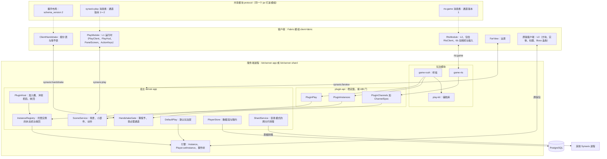
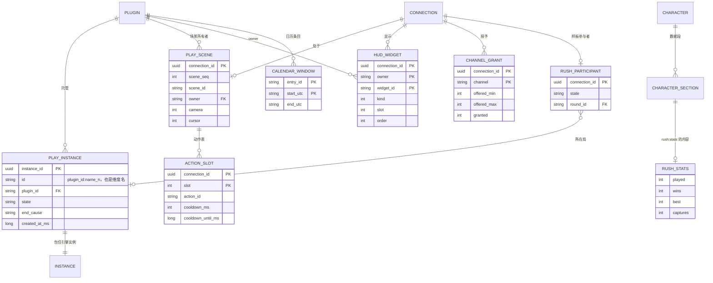
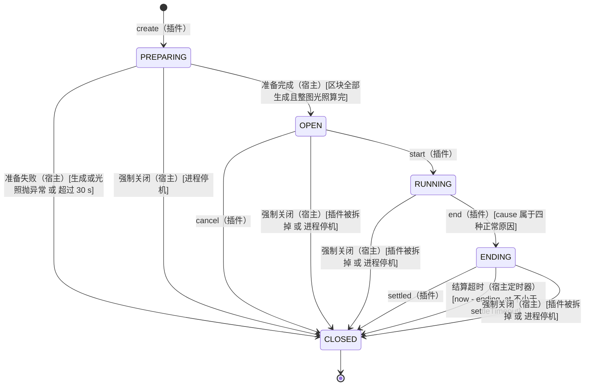
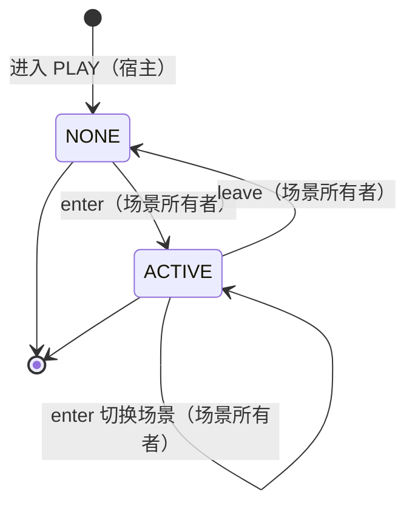
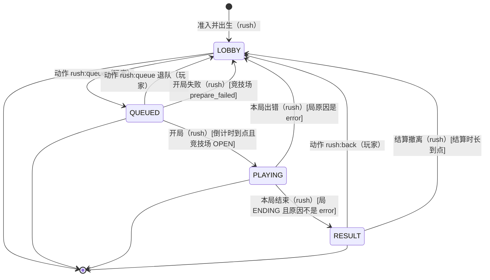
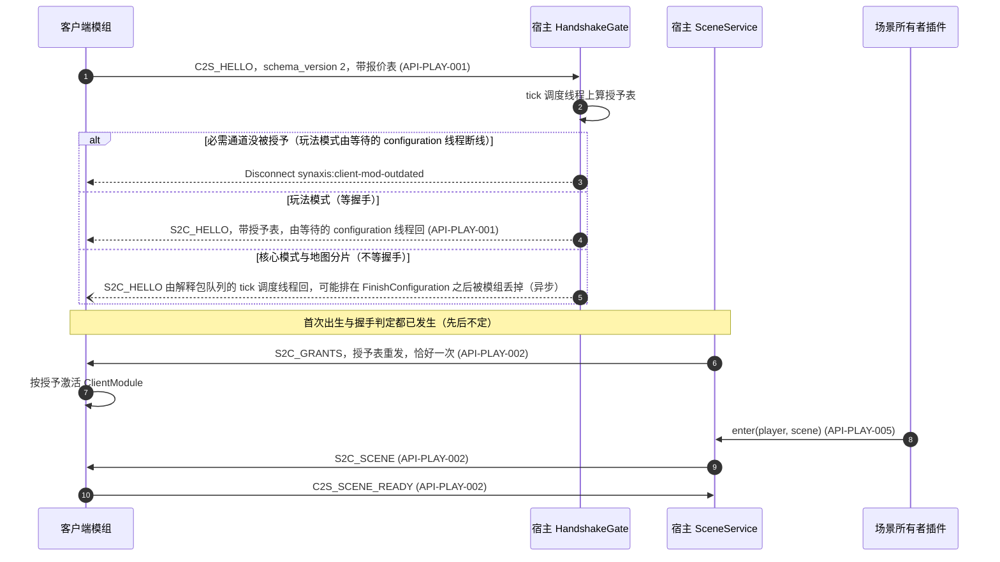
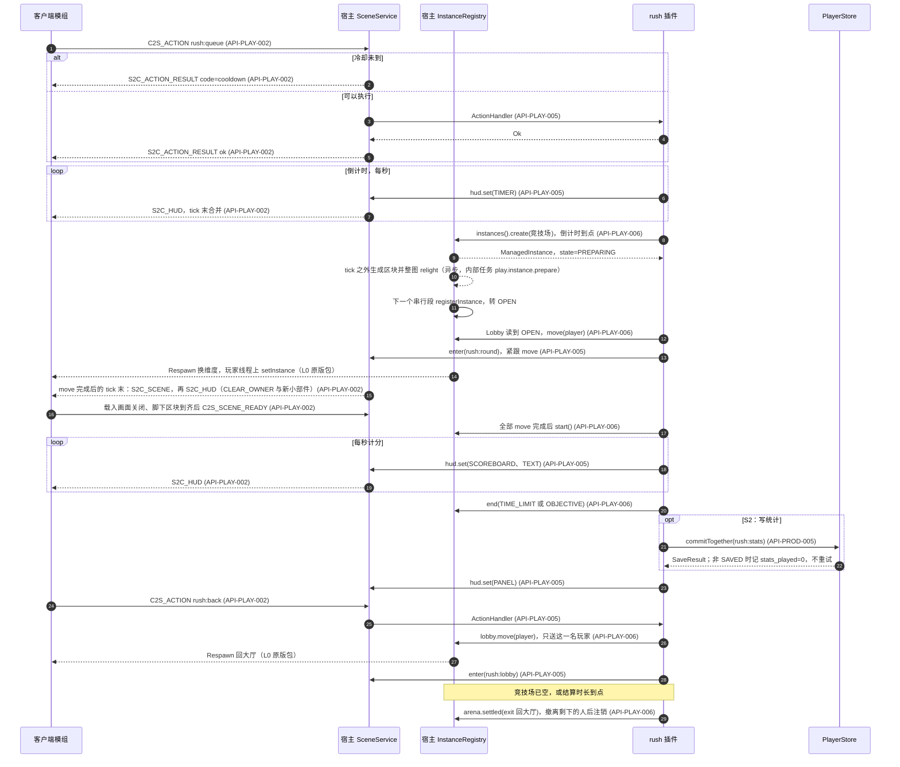
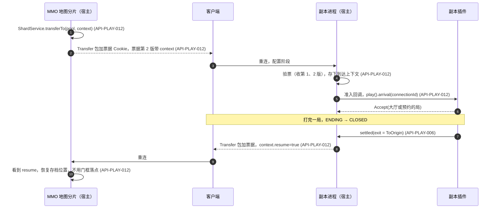
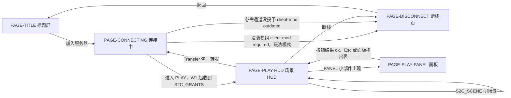

# Synaxis 设计文档 · 玩法架构分册「玩法插件、宿主托管的玩法实例与客户端协作」

## 1. 元信息 / 变更记录

| 字段 | 值 |
| --- | --- |
| 状态 | v0.20：RUN-080 已登记、CI 全绿，用户 2026-10-18 批准合入 `main`（同时接受 `synaxis:player` 段升到第 2 版，见 `docs/DESIGN-PROD.md` v0.9.88）：组 HOST（v0.19）与另七组已依次合入集成分支 `prod/integrate-080`，本分册引的源码行号已跟进合并后的代码，草稿 PR #33 在 `8000c5b332` 上四个工作流第 1 次尝试全绿，已登记 RUN-080（`docs/TEST.md` §6）。RUN-078（S1 的技术债）已登记、CI 全绿，用户 2026-10-14 批准合入 `main`。S1 已合入 `main`（`62ae65f89c`，RUN-077）。RUN-078 的五组（N、S、K、U、J）已依次合入集成分支 `prod/integrate-078`，草稿 PR #29 在 `9d73d8d9e8` 上四个工作流第 1 次尝试全绿，已登记 RUN-078（`docs/TEST.md` §6）；§28.2 S1 测试缺口一行 12 项的终态：①～⑤、⑦～⑪ 已修，⑥ 已核实不重叠、主代码不改，⑫ 测试已补；§23 检查单的「建实例占用的 tick 调度线程」一项按用户 2026-10-14 定的门槛过（§15：tick 调度线程上的 `create` 本 JVM 内第一次 ≤ 5 ms、之后每次 ≤ 1 ms，注册 ≤ 1 ms，在 CI 的三种模式上判；CI 的 15 个读数全部满足）。v0.1 已签字（用户 2026-10-12）：方向与 §18 的 ADR 记 Accepted，只有 `ADR-PLAY-009`（§28.1 D3）、`ADR-PLAY-010`（D4）随对应项拍板；§28.1 的 D1、D5、D9 已拍板，其余各项按默认选项，到「何时需拍板」一列的时点前再请用户确认 |
| 项目画像 | 生产产品（对外真实玩家，与 `docs/DESIGN-PROD.md` §1 同档；全部 `[核心]` 节生效） |
| Owner | Bearisbug（生产就绪会话维护本分册） |
| 评审人 | Bearisbug |
| 最后更新 | 2026-10-18 |
| 关联 | 引擎单一事实源 `docs/DESIGN.md` · M2 分册 `docs/DESIGN-M2.md`（插件模型、线协议、RTS 垂直切片） · M3 分册 `docs/DESIGN-M3.md`（大世界、分片、转服门） · 生产就绪分册 `docs/DESIGN-PROD.md`（插件面、持久化、默认玩法层 `REQ-PROD-046`、持久化段 `REQ-PROD-047`） · 插件作者指南 `docs/PLUGINS.md` · 测试文档 `docs/TEST.md` · 仓库 `https://github.com/Bearisbug/synaxis`（基线 `main` `0a73f035a0`，RUN-076 已合入） |

本文档是 `docs/DESIGN.md` 的「玩法架构」分册，与 `docs/DESIGN-M2.md`、`docs/DESIGN-M3.md`、`docs/DESIGN-PROD.md` 同为分册形态，写法沿用 `docs/DESIGN-M2.md` §24 最后一条：只管玩法架构新增的东西，引擎、M2、M3、生产就绪的事实一律写「见 `docs/X` §N」。ID 用纯字母域段：需求 `REQ-PLAY-*`、接口 `API-PLAY-*`、决策 `ADR-PLAY-*`、Runbook `RB-PLAY-*`、用例前缀 `TC-PLAY-*`；全仓 grep 这几个前缀零命中。实体 `ENT-Play*`、`ENT-HudWidget` 等，页面 `PAGE-PLAY-*`，事件 `EVT:play_*`、`EVT:rush_*`，已核对不与其余四份文档重名。

范围：怎么写一个新玩法（服务端插件加客户端配合）；宿主托管的玩法实例与它的生命周期；四种形态（MMO 开放世界、RTS 对局、副本或小游戏、限时活动）各自落在哪、宿主提供什么、玩法写什么；客户端协作（能力协商、服务端驱动的场景与 HUD、状态同步、文本与资源、版本兼容）；持久化与转服；测试规范；`game-rts` 的迁移；样板玩法「信标速攻」的完整规格。不在范围：MMO、RTS 的具体玩法内容（任务、技能、经济、战斗数值）。

现状断言的依据：只读核对 `origin/main` `0a73f035a0` 的代码与文档，没有构建，也没有运行；每条断言后括注出处（`文件:行号` 或文档章节），没核实的项就地标「未核实」。引 `docs/DESIGN-PROD.md` 的行号按本分支改动后的文件算（比 `main` 多一行变更记录、一行 §28.3），其余文档的行号与 `main` 相同。§2 背景与 §18 各 ADR 的 Context 记的是签字时的现状，代码行号按 `0a73f035a0`，S1 合入后不改；其余各节引的代码行号在 v0.10 按集成分支 `prod/integrate-077` 逐个核过。

本分册已登记进 `docs/DESIGN.md` §1「关联」行与 §26 里程碑表（`main` `f9e002917b`，`docs/DESIGN.md` v0.46）；其余要回指本分册的位置与完成情况见本分册 §28.3。

变更记录（新的在上）：

| 日期 | 版本 | 改动 | 作者 |
| --- | --- | --- | --- |
| 2026-10-18 | v0.20 | RUN-080 集成（分支 `prod/integrate-080`，基于 `main` `a211a45ca1`，八组依次 `--no-ff` 合入；本分册只有组 HOST 改过，见 v0.19，另七组见 `docs/DESIGN-PROD.md` v0.9.85～v0.9.91，集成见它的 v0.9.92），本版只写集成结果与合并后的代码行号，接口与需求不改。**合并**：本分册没有冲突；`docs/TEST.md` 的见该文档变更记录。**行号**：本分册正文引的源码行在合并后的代码上逐个核过，20 行里 34 处照改，引的代码不变。组 WORLD 在 `entity/Player.java` 前部加了 29 行、`instance/InstanceContainer.java` 加了 16 行：§6.1 引擎一行、§6.4.3、§6.6 进程内换实例一行与 §28.2 真客户端切实例一行的 `Player.java:730` 改为 `:759`，§6.3 L0 一行的 `:1307-1342` 改为 `:1336-1371`，`API-PLAY-002` 下行一条的 `:543` 改为 `:572`，`API-PLAY-006` 生成器一条的 `InstanceContainer.java:529` 改为 `:545`、`move` 一条的 `Player.java:731-734` 改为 `:760-763`，§16 结算一行的 `Player.java:477`、`InstanceContainer.java:280`、`Player.java:744` 改为 `:506`、`:296`、`:773`（`docs/DESIGN-PROD.md` §28.3 WORLD 交来的一行）。组 THREAD 在 `entity/Entity.java` 前部加了行：`API-PLAY-006` 在途的 `move` 一条的 `:1154` 改为 `:1210`，§16 结算一行的 `:830` 改为 `:837`（THREAD 交来的一行）。组 NET 在 `PlayerConnection.java` 那两行之前加了 2 行：v0.19 写进 §11.2 表后一段与 §16 一行的 `PlayerConnection.java:267`、`:274` 改为 `:269`、`:276`。NET 与 WORLD 在 `ConnectionManager.java` 加了行：§6.4.1 与 `API-PLAY-001` 线程一条、`API-PLAY-002` 下行一条的 `:642`、`:661` 改为 `:650`、`:670`。组 CODEC 在 `PlayerStateSection.java` 前部加了 8 行：§2 第 5 条、§6.6 宿主段一条与 `ADR-PLAY-010` 的 Context 引的 `:135-150`、`:167-208` 改为 `:143-158`、`:175-216`，§6.6 同一条的 `:258-268` 改为 `:266-276`，§6.6 与 §28.2 跨模式持久化一行的 `:199-207` 改为 `:207-215`，`API-PLAY-002` 下行一条与 §28.2 重进 PLAY 一行的 `:161-166` 改为 `:169-174`。组 STORE 移动了 `PlayerStore.java`：§6.6 插件段一条的 `:557-579` 改为 `:581-610`。变更记录各行（含 v0.19）记的是当版的事实，§6.7.6 两条端到端反证的行号按 `75fdfcf06b`，都不改。**状态行**改为 RUN-080 已集成、等 CI。本机门禁见 `docs/DESIGN-PROD.md` v0.9.92。集成分支上随后的再出生修复（`docs/DESIGN-PROD.md` v0.9.92）让 `entity/Player.java` 的行下移，本分册引的九处跟进。登记 RUN-080 时（版本号不变）：草稿 PR #33 在 `8000c5b332` 上四个工作流第 1 次尝试全绿，`docs/TEST.md` §6 登记 RUN-080（通过 49/49，本分册的用例是 `TC-PLAY-170`）；用户 2026-10-18 批准合入 `main`，同时接受 `synaxis:player` 段升到第 2 版，状态行随之改 | Bearisbug |
| 2026-10-18 | v0.19 | RUN-080 组 HOST（分支 `prod/r080-HOST`，基于 `main` `cb969826b7`），修两处缺陷，需求不改。**`API-PLAY-005` `enter`**：连接已断开时什么都不做（不建场景层、不迁移、不记 `EVT:play_scene_entered`），原先抛 `IllegalStateException`。网络线程断开连接时当场把它标成离线（`network/player/PlayerConnection.java:267`），移除玩家与 `PlayerDisconnectEvent` 要等玩家下一个 tick（`:274`），插件在串行段里先查 `isOnline()` 再 `enter` 照样撞得上，调用方关不掉这个窗口。在线却不在 PLAY 的连接仍抛，消息由 `is not in the play state` 改为写出所处阶段（`connection_id=… is in CONFIGURATION, not play`）。`PluginPlay#enter` 的 Javadoc 随改（只改文档，ABI 不变）；§11.2 `NONE → ACTIVE`、`ACTIVE → ACTIVE` 的守卫加「连接在线」，表后一段写明这个窗口。**样板**：原先竞技场转 `OPEN` 前一刻断线的排队玩家让 `Lobby#open` 在 `enter` 处抛出，`RushRound` 没建，竞技场停在 `OPEN` 到停机，排在他前面的玩家困在竞技场里，排在后面的已出队却没移动；宿主改了之后 `Lobby` 不用改，§16 加一行、§19 加一个场景。**§28.2** `scheduleTask` 不出列一行补一句：`runOn` 投给执行前就被移除的实体或被注销的实例的任务，以及被插件取消的任务，原先同样留在宿主的任务表里，经任务所在的调度器强引用整个目标，已修，宿主只弱引用 `runOn` 的任务（`docs/DESIGN-PROD.md` `REQ-PROD-021`，外部行为不变）；这一行与 `REQ-PLAY-010` 引的 `PluginSchedulerImpl.java` 行号随之后移（`:48-52` → `:55-59`，`:99-102` → `:106-109`）。用例 `docs/TEST.md` `TC-PLAY-170`、`TC-PROD-840`，`TC-PLAY-049` 随改 | Bearisbug |
| 2026-10-14 | v0.18 | RUN-078 登记，本版接口与需求不改。**CI**（草稿 PR #29，head `9d73d8d9e8`，基于 `main` `630abbc142`，四个工作流都是第 1 次尝试）：CI run 38386484038 的 Check、4 线程严格、严格 grid 三个 job 各 682 个类 4,716 个，0 失败 0 错误 22 个跳过；Concurrency run 38386483897 与 Client mod run 38386483895 通过；Client gametest run 38386483950 的 job `gametest`、`p11-smoke`、`rush` 通过（P10 只在手动触发时跑），job `rush` 两次启动 Q0a～Q9 全部 PASS，judge `rush judge: PASS (2 reports, 0 problems)`，两局 `prepare_ms` 98 与 49（`docs/TEST.md` §6 RUN-078，证据 `docs/test-runs/RUN-078/integrate/00-index.txt`）。**用户 2026-10-14 的决定**：批准 RUN-078 合入 `main`；§15「建实例占用的 tick 调度线程」的门槛改为 tick 调度线程上的 `create` 本 JVM 内第一次 ≤ 5 ms、之后每次 ≤ 1 ms，串行段里的注册仍 ≤ 1 ms，判定环境是 CI 的三种模式，本机读数照记、不作判定。**§15** 那一行的门槛一栏按此改；说明栏加 CI 的 15 个读数（三个 job 各连建 5 个：第一次 1,076、3,261、761 µs，之后 249～340 µs，注册 69～142 µs，全部满足）与这条决定；RUN-078 组 N 的本机读数按 RUN-077 的口径重写，反证轮（组 N 第 2、3 次）的读数单列、不计入：不含反证的 7 次运行里第一次 `create` 353～898 µs，本机第一次超过 1 ms 的两个（3,086、1,286 µs）都出自反证轮；RUN-077 那段末尾「`create` 这一半的目标现在不满足，门槛不改」随新门槛删去，读数都留着。**§23 检查单**容量一行的建实例一项改为过；**§28.2 S1 测试缺口一行**的开头与 ⑫、**§26 S1 行**的退出条件一栏同步 | Bearisbug |
| 2026-10-13 | v0.17 | RUN-078 集成（分支 `prod/integrate-078`，基于 `main` `630abbc142`，依次 `--no-ff` 合入组 N、S、K、U、J，合并提交 `d396b649a9`、`783e1c60b9`、`e04491acfb`、`6129ab3b29`、`cb5e6ed578`），本版只写集成结果，接口与需求不改。**冲突**：五次合并只在文档上冲突；代码没有冲突，组 N、K 都改了 `EvacuationIntegrationTest`，自动合并后 19 条（RUN-077 的 13 条，组 N 加 5 条，组 K 加 1 条）。本分册的变更记录按版本排，§28.2 S1 测试缺口一行按条目取各组的改动，§19 宿主集成一行两组加的覆盖都留；`docs/TEST.md` 的变更记录按组排，§5 局部轮玩法架构一段冲突的三处两边都留。合并后逐组核对：各组分支新增的行都在，没进来的只有上面手工合的几行。**版本号**：五组的 v0.12～v0.16 连续、都用上了，不用前移。**状态行**改为 RUN-078 已集成、等 CI，写明 S1 已合入 `main` `62ae65f89c`；**§26 S1 行**的状态一栏同改。**§28.2 S1 测试缺口一行**的开头写上终态：①～⑤、⑦～⑪ 已修，⑥ 已核实不重叠、主代码不改，⑫ 测试已补、超过 1 ms 的原因没核实，§15 的门槛与 §23 那一项待用户定。**行号**：组 N 在 `ManagedInstanceImpl.java` 加的行让组 K 写的 §16「结算中按『返回大厅』与结算到点同时到」一行引的 `:198`、`:269` 下移，改为 `:199`、`:271`；组 K 在 `EvacuationIntegrationTest.java` 组 N 那几条之前加了 41 行，§28.2 ② 的红行改为 `:413`（组 N 分支上是 `:372`）。变更记录各行记的是当版的事实，`docs/TEST.md` 各组节的行号写明按各组提交，都不改。**本机门禁**（`--max-workers=2`）：全部模块的 `compileJava`、`compileTestJava`、`testNamingCheck`、`forbiddenImportsCheck` 与 `:architecture-tests:test` 过；`client-fabric` 用本分支发布到临时目录的 `:protocol` 跑 `compileJava`、`compileTestJava`、`compileGametestJava` 过。全量测试、Concurrency、Client mod 与 Client gametest 交给集成分支草稿 PR 的 CI，跑完再登记 RUN-078 | Bearisbug |
| 2026-10-13 | v0.16 | RUN-078 组 J（剧本、judge 与 job `rush`，分支 `prod/r078-J`，基于 `main` `62ae65f89c`），只改剧本、judge 与 CI，需求、接口与主代码都不改。**§28.2 S1 测试缺口一行的 ⑧～⑪** 标已修：⑧ judge 单测补三条（同一竞技场两条 `ended`、`closed` 的 `cause=error`、多一次非 200 的 `hasJoined`），各在改坏 judge 的副本上只红对应的那一条；⑨ Q3 挪到 Q4 第二次按键之前判；⑩ judge 加 `--wait-s`，轮询台账到最后一个连接回大厅之后的 `play_scene_ready` 出现，至多 10 s，job `rush` 去掉 `sleep 3`；⑪ Q5 就绪那一刻要求没有打开的 Screen、采样的第一个 tick 在大厅，Q9 也判就绪那一刻的 Screen 与脚下区块。**§6.7.6** 的 Q3、Q5、Q9 三行、judge 一段与 CI 第 ⑨ 步按此改，加一段本组的读数与两条端到端反证：草稿 PR #28 的 run 38355508678 两次启动 Q0a～Q9 全部 PASS；宿主反证下 Q3 不再红、只红 Q4 及其后，客户端反证下 Q5 与 Q9 一起红（`docs/TEST.md` `TC-PLAY-112`、`TC-PLAY-113`、`TC-PLAY-117`～`TC-PLAY-119` 加步骤，新增 `TC-PLAY-155`；证据 `docs/test-runs/RUN-078/J/00-index.txt`） | Bearisbug |
| 2026-10-13 | v0.15 | RUN-078 组 U（客户端 `play` 包，分支 `prod/r078-U`，基于 `main` `62ae65f89c`），只补测试，需求、接口与主代码都不改。**§28.2 S1 测试缺口一行的 ⑦** 标已修：`PlayClientTest` 加 `aRefusalShowsOnlyOnTheContentWhoseButtonWasClicked`，按钮被拒之后同一面板再来一条 SET，新内容上不显示原因；点击之后、结果到达之前面板又 SET 了一次，原因也不落到新内容上。`PlayClient.java:533` 的 `panel.set() == reasonSet` 换成 `true` 只红这一条（`PlayClientTest.java:430`），RUN-077 的 21 条与驱动 `PlayClient` 的另外三个类的 13 条照样绿（`docs/TEST.md` `TC-PLAY-078` 第 6、7 步，证据 `docs/test-runs/RUN-078/U/00-index.txt`）。顺带核对 `PlayClient` 的其余分支，另有十二处同样没有用例：十一处各补一条用例，`reset` 清掉最后结果那一处在已补的用例里加一句断言。其中八处一起反证，8 条新用例各红一条：`CLEAR_OWNER` 不碰别的所有者，读不出的 component 显示为空文本，旧场景动作的 `rejected`、`rate-limited`、`unknown-action` 不清新表的冷却，不是本连接发出的动作的结果只记下，面板已移出表时的 `ok`，面板上没有 reason 的 `rejected` 与带宿主 reason 的 `cooldown`，`reset` 清掉本地关闭的面板与面板上的原因（`TC-PLAY-070`、`TC-PLAY-076`、`TC-PLAY-078`、`TC-PLAY-080` 的新步骤）。评审返工补的三处各自单独反证，各只红自己那一条：点一个面板的按钮不清掉另一个面板上被拒的原因（`:442`，叠加者的面板被拒后场景所有者的面板排到前面，点它、回 `ok` 之后叠加者的面板回来，原因还在），`panel()` 跳过排在面板前面的 `TEXT`、`TIMER`、`SCOREBOARD`（`:518`，改成恒为真时给出 `TEXT`，`PanelScreen` 强转 `PlayClient.Panel` 会抛 `ClassCastException`），`reset` 清掉还在等结果的动作（`:598`，不清的话服务端回本连接没发过的 `action_seq` 时，旧动作会把这条结果当成自己的，`rejected` 就清掉新表的冷却并在动作栏提示）；见 `TC-PLAY-077` 第 6、7 步，`TC-PLAY-078` 第 9、10 步，`TC-PLAY-080` 第 7、8 步。第二轮评审返工补的一处单独反证、只红那一条：`reset` 清掉最后结果（`:601`；RUN-077 那条 `reset` 用例在 `reset` 之前没收过结果，它对最后结果的断言有没有这行都成立，`resetForgetsWhatWasRefusedOnAPanel` 收过一条 `rejected`，在 `reset` 之后断言最后结果为空，删掉这行时它红），见 `TC-PLAY-080` 第 9、10 步。没补用例的分支分三类，理由逐条记在证据索引末尾：宿主发的与模组自己的调用都走不到（属性值类型不符的回退由 `API-PLAY-003` 判畸形挡在解码器；属性缺省的回退，解码器不要求属性齐全，但宿主 `WidgetEncoder` 只经 `Widget` 的四个工厂编码，属性总是齐的；没有场景时点按钮（场景只在 `reset` 时变回空，原版进入新连接或重新配置之前已经换掉了屏幕，旧连接的面板屏幕不会留着）；场景 id 不带冒号；按键动作的结果到达时没有场景；`remainingMs` 收到不是 `TIMER` 的小部件；`receive` 的 default 分支），改掉它读数不变（`ttl_ms` 与 `remaining_ms` 的下限，`reset` 的 SET 编号与 `forget` 的 `dismissed.remove`，`cool` 的 `cooldownMs > 0`，面板已移出表时的 `ok` 照样记进 `dismissed`），只有测试调用（`texts()` 与 `cooldownLeftMs`，模组主代码与 gametest 都不调）；另有两处数据字段 JUnit 不断言、只靠 gametest（面板的行，结果的 reason），也记在索引里 | Bearisbug |
| 2026-10-13 | v0.14 | RUN-078 组 K（`:play-kit` 与 `:game-rush`，分支 `prod/r078-K`，基于 `main` `62ae65f89c`），只补测试，需求、接口与主代码的行为都不改（`RushRound#back` 的 Javadoc 写上与撤离的两种先后）。**§28.2 S1 测试缺口一行的 ⑤** 标已修：`LocalQueueTest` 加三条两线程的确定性用例，用一名排队玩家的 `hashCode` 把先到的 `join` 或 `leave` 停在队列的锁里，等后到的调用被这把锁挡住再放行：入队进行中的 `take` 把这人一起取走，同一人的第二次 `join` 等第一次做完并返回 false，退队进行中的 `take` 不取这人；去掉 `join`、`leave`、`take` 的 `synchronized` 后三条都红（`docs/TEST.md` `TC-PLAY-092` 第 5～7 步）。**⑥** 标已核、不重叠：撤离期间 `back` 见竞技场已是 `CLOSED`，不发 move；按钮在前、它的 move 还没跑时结算到点，撤离会给这名玩家再发一次 move，两次在玩家所属 tick 线程上依次跑，后一次见玩家已在大厅、以 true 完成、不再换实例。两条前提各用一条用例钉住（`TC-PLAY-145`），依据写进 **§16**「结算中按『返回大厅』与结算到点同时到」一行，原来写的「按钮先到时 `settled` 只撤离剩下的人」只在按钮的 move 已落地时成立。**§19** 单元层加 `LocalQueue` 的三种交错，宿主集成层的两个类各加一项覆盖，加一个场景。证据 `docs/test-runs/RUN-078/K/00-index.txt` | Bearisbug |
| 2026-10-13 | v0.13 | RUN-078 组 S（场景层 `app/scene`，分支 `prod/r078-S`，基于 `main` `62ae65f89c`），只补测试，需求、接口与主代码都不改。**§28.2 S1 测试缺口一行的 ①** 标已修：`OutboxTest` 加三条用例，两次 `move` 叠加留发时，后一个先完成仍等前一个，前一个以异常结束（`setInstance` 失败时 move 就这样结束，`ManagedInstanceImpl.java:285`）仍等后一个，后一个以异常结束仍等前一个；`Outbox.java:90` 的合并换成只等后一个红后一个先结束的两条，换成 `current.thenCompose(_ -> move)` 与 `move.thenCompose(_ -> current)` 各只红对应的一条（`docs/TEST.md` `TC-PLAY-031` 第 5～9 步，证据 `docs/test-runs/RUN-078/S/00-index.txt`）。顺带核对 `SceneService`：接 move 的 future 只有 `holdUntil` 一处，原样交给 `Outbox`，没有别处依赖完成顺序；核对查出的同类缺口是以异常结束的 move，它在前、在后两种顺序各补一条用例与一处反证 | Bearisbug |
| 2026-10-13 | v0.12 | RUN-078 组 N（托管实例 `app/instance`，分支 `prod/r078-N`，测试提交 `8f56eb21b6`、`8d4df2b3cd`，修复提交 `7c645b587b`，基于 `main` `62ae65f89c`；`docs/TEST.md` `TC-PLAY-055`、`TC-PLAY-064`、`TC-PLAY-066`、`TC-PLAY-069` 加步骤，新增 `TC-PLAY-130`～`TC-PLAY-132`，证据 `docs/test-runs/RUN-078/N/00-index.txt`），接口与需求不改。**§28.2 S1 测试缺口一行的 ②③④** 标已修，**⑫** 标测试已补、结论待用户定。**`API-PLAY-006` 实现一条**：撤离时 `exit` 抛 `Error` 或受检异常也按踢出处理（原先只接 `RuntimeException`，别的会从插件的请求里抛回，状态已是 `CLOSED`、撤离没排上）；加「测试用的暂停点」一条，写明五个窗口的位置，生产上不起作用。**§19** 宿主集成一行补上三个类的新覆盖。**§15**「建实例占用的 tick 调度线程」一行与 **§23 检查单**容量一行加 RUN-078 的 45 个本机读数：本类第一次 `create` 9 个里 2 个超过 1 ms，之后 36 个里 2 个超过（都是 4 线程严格，1,694、1,538 µs，没加载类、没有 GC），非首次也会超标；门槛不改，交给用户定 | Bearisbug |
| 2026-10-12 | v0.11 | RUN-077 门禁与登记（集成分支 `prod/integrate-077` 的 `e7483eaeb0`，草稿 PR #26；`docs/TEST.md` §6 RUN-077，证据 `docs/test-runs/RUN-077/integrate/00-index.txt`），本版只写读数与状态，不改接口与需求。**状态行**改为 S1 已集成、CI 全绿，待用户批准合入。**§26 S1 行**写上门禁结果：CI 三个 job 682 个类 4,702 个 0 失败，Concurrency、Client mod 与 Client gametest 第 1 次尝试全绿，job `rush` 两次启动 Q0a～Q9 全部 PASS，两条端到端反证各自打红，far view gametest 四组全绿。**§15**：建实例一行加 CI 三种模式的读数（`e7483eaeb0` 343～363 µs；`75fdfcf06b` 的默认模式 2,583 µs），16 个读数里 2 个超过 1 ms，门槛不改，照实写目标现在不满足；开局准备与场景层每 tick 开销两行加 CI 读数。**§23 检查单**容量一行改为：开局准备时长与场景层开销过，建实例占用的 tick 调度线程未过。**§6.4.3** 与 **§28.2** 风险行接上集成分支 3 次运行的 Q0b 读数（dev 启动 3、7、11 tick，生产 jar 3 tick）。**§6.7.6** 加集成分支的读数与两条端到端反证的结果：宿主不判冷却时 Q3 与 Q4 一起红（Q3 的检查在第三次按键之后才读），客户端带着载入画面发就绪时只红 Q5、Q9 照样绿。**§28.2** 加一行技术债，收各组评审与反证查出、要改测试或主代码的 12 项。**`API-PLAY-006` 实现一条**：`isAlive` 为 false 不只在 bind 之前，进程停了之后也是（组 I 评审） | Bearisbug |
| 2026-10-12 | v0.10 | RUN-077 集成（分支 `prod/integrate-077`：第一段合入 P、K，第二段合入 V、H、I、R、C，本段 `--no-ff` 合入 G 为 `0100d0b0b2`，没有冲突，合并后的树与 `prod/r077-G` 相同）：**状态行**写明 S1 八组已集成、等集成分支草稿 PR 的 CI。**§26 S1 行**标「已集成，待 CI」；`REQ-PLAY-003` 一项补上场景所有者与叠加者都能经 `hud` 设小部件、切场景只清场景所有者的（组 H 把叠加者的小部件挪进 S1 时，这一行留给集成）；退出条件一栏接上组 G 第 3 轮的读数，写明集成分支的全量 CI 跑完再登记 RUN-077。**行号**：元信息说明段写明 §2 背景与 §18 各 ADR 的 Context 按签字时的 `0a73f035a0`，其余各节按集成分支核过；被组 K、V、C 推旧的引用改为 `PluginContext.java:23-32`、`PluginHost.java:144-176`、`:196-201`（两处）、`:221-228`、`:283`、`SynaxisClientMod.java:95-109`（两处）、`architecture-tests/build.gradle.kts:17-27`、`client-gametest.yml:30-31`、`:57`（两处）、`:124`（三处）；§6.2 准入冲突一句补上经 `instances()` 建的托管实例由宿主收回。**§6.4.3** 换实例的载入画面读数按组 V、C、G 九轮 CI 的 18 个读数统一为 3～7 tick（15 个是 3 tick），从请求到就绪 dev 9～23 tick、生产 jar 5～6 tick；§28.2 换实例一行同改（5～23 tick）。**§6.4.4** 动作冷却一行与 §6.4.8、§14 对齐：`rejected`、`rate-limited`、`unknown-action` 清除本地冷却，`stale-scene` 不动，文案按 §14。**§11.1、§11.3** 的 `PLAYING → RESULT` 改为由 `Round` 驱动：请求 `end` 之后在同一次 `Round#tick` 里调 `onResult`，`RushRound` 不监听状态事件。**§19** 单元层去掉 `RushRound`，宿主集成层加 `RushRoundIntegrationTest`（组 R 把它改成了带 `Env` 的类）；`REQ-PLAY-011` 场景的能力项数写成 S1 合入后的 18 项。**`API-PLAY-006`** 的 `move` 签名注释改为指向「实现」一条的三种完成线程；`:plugin-api` 的 `ManagedInstance#move`、`instance()` 与 `State.CLOSED` 的 Javadoc 按实现改（转 `CLOSED` 之后撤离完才注销），`PluginHost#registerHostAdmission` 的 Javadoc 写上挂地图的分片。**§28.2** 两条 Open Question 转已决：`docs/DESIGN-M2.md` 插件宿主与线协议的行、`docs/PLUGINS.md` 都归本会话（光照会话 2026-10-12 确认）；**§28.3** `docs/DESIGN-M2.md` 两行的归属改为本会话，`docs/DESIGN-PROD.md`「尚未建」一行标已完成（该分册 v0.9.83），`docs/TEST.md`、`docs/PLUGINS.md` 两行写上 S1 已完成的部分。同批改 `docs/DESIGN-PROD.md` v0.9.83、`docs/ENGINE.md` §3.6、§5、§7、`docs/PLUGINS.md` §6 一句与 `docs/TEST.md`；本机门禁与反证的读数在 `docs/test-runs/RUN-077/integrate/` | Bearisbug |
| 2026-10-12 | v0.9 | RUN-077 组 G（真客户端剧本 Q1～Q9、job `rush` 完整版与 judge，分支 `prod/r077-G`，基于 `prod/integrate-077` `f54b122cf5`）：§6.7.6 的 Q1～Q9 写成剧本的做法：Q1 按 `ClientPlayNetworking.getGlobalReceivers()` 判负载已注册，查默认键冲突时排除 `KeyMapping.Category.DEBUG`；Q3、Q4 每按一次都等到结果再按下一次（记录按 tick 采样）；Q5 的倒计时结束按倒计时 `TIMER` 的接收时刻加剩余时间算，就绪那一刻的 Screen、`hasChunk` 与 tick 数取自记录与逐 tick 采样；Q7 用记录里对局 `TIMER` 与 `rush/result` 两条 SET 的接收时刻算；Q9 等回大厅的就绪进了记录再离开。judge 写成 S1 的完整判定：报告全 PASS（SKIP 判红）、竞技场五个状态按序且 `ended` 到 `closed` ≤ 15 s、`prepare_ms` 抄进输出且 > 1,000 判红、局正常结束率、`play_instance_moved` 到同一连接下一条 `play_scene_ready` ≤ 5 s、`rush_round_ended` 的条数与 cause、握手与假 sessionserver 的计数、样板服务端日志任何 ERROR 判红、客户端主源码没有 rush；命令行参数与路径约定写明。CI 段写成 job `rush` 的完整形状：十一步、三个端口、先正向后回滚的演练、artifact。覆盖分工写明两个客户端不同局、不做服务端假玩家陪练的理由。§6.4.8 的 `PlayTestHook` 一条补上进服之后才开始记录与两个包内读口。实测（草稿 PR #25，base `prod/integrate-077`）：第 1 轮 head `a5587875f0`（剧本、judge 与 job 都是完整版，只是不起样板服务端）client-gametest run 38229238270，两份报告 Q1～Q9 都 FAIL、judge 红，Q0 与演练照常过；第 2 轮 head `29f2e5caf0`（起样板服务端）run 38230014989，两份 Q7 与台账一条红；第 3 轮 head `e467542943` run 38231119013 两次启动 Q0a～Q9 全部 PASS、judge 过，三轮的 client-mod 都绿。第 2 轮的两个原因与第 3 轮的读数写进 §6.7.6 新加的「S1 完整版的实测」一段；CI 段第 ⑨ 步加上 judge 前等台账落盘的 3 s。§23 检查单「容量」「回滚演练」两行填上 S1 的结果，回滚演练一行改为先正向后回滚；容量一行里建实例占用的 tick 调度线程一项仍未定（§15 那次 3,440 µs 没有归因）| Bearisbug |
| 2026-10-12 | v0.8 | RUN-077 组 C（客户端 `PlayModule`，分支 `prod/r077-C`，基于 `prod/integrate-077` `3cd20ff777` 并合入组 V 的 `prod/r077-V` `93b70462a0`）：§6.4.8 写定 S1 客户端各类的职责：`PlayClient`（场景与动作表、四种小部件的表、动作序号、按动作键槽的本地冷却、`TIMER` 外推、`TEXT` 的存活时长、面板的本地关闭与按钮结果）、`WidgetLayout`（槽位排序；`TOP_CENTER` 从原版 Boss 血条之下起排，`BOTTOM` 排在原版动作栏之上，两处高度按 26.2 `BossHealthOverlay`、`Hud#extractOverlayMessage` 的常数算）、`SceneReadyProbe`（§6.4.3 的 ①②③，② 认 `LevelLoadingScreen`）、`PanelScreen`、`ActionKeys`（S1 只注册 `key.synaxis.action_1`，分类 `synaxis:play`）与三种小部件的画法；动作键 1～6 的默认键改为 H、J、K、U、I、R，javap 核过 26.2 `Options` 的出厂键位；动作结果的文案显示在原版动作栏，面板按钮的结果显示在面板里；`PlayTestHook` 加本地冷却开关与三项记录（新收到的 SET 及其接收时刻、发出的动作数与收到的结果、发就绪那一刻的 Screen 与脚下区块；以开始记录那一刻为基线，每个客户端 tick 末采样一次）；模组 `fabric.mod.json` 补 `fabric-lifecycle-events-v1`。§13 两页的页态与进出写全。§6.7.6 加 Q0c：夹具按请求让玩家进第二个场景，带一个动作键与 `TIMER`、`SCOREBOARD`、`BOTTOM` 的 `TEXT`、`PANEL`，真客户端验面板的打开、Esc 本地关闭、按钮被拒与受理、动作键的本地冷却与服务端冷却、三个槽位的位置与就绪；judge 的 Q0 阶段把 Q0c 列为必过；Q4 关本地冷却的写法随 `PlayTestHook` 改。§19 单元一行补 `SceneReadyProbe` 与 `PlayPayload`。实测（草稿 PR #23）：第 1 轮推的是类桩，client-mod run 38215632527 共 274 条红 25 条（都是本组的新用例），client-gametest run 38215632670 的 job `rush` 两份报告 Q0a、Q0b PASS、Q0c FAIL（没有面板、`TIMER` 与 `SCOREBOARD` 0 px、夹具没收到就绪）；第 2 轮推实现，client-mod run 38216321030 共 274 条 0 失败，client-gametest run 38216321013 的 job `rush` 两次启动 Q0a～Q0c 都 PASS，job 共 4 min 45 s。Q0c 的截图读数（854×480，GUI 427×240）：`TIMER` 标签在 x 360..441、y 4..17，`SCOREBOARD` 标题在 x 768..825、数值在 x 822..843，`BOTTOM` 的文本在 y 314..329，按常数算出的动作栏起点是 y 336；动作键第一次 `ok`（`cooldown_ms` 2000），200 ms 内第二次被本地冷却挡下，关掉本地冷却后第三次收到代码 2（`cooldown_ms` 1,703 与 1,750）；面板 `refuse` 被拒后仍开着并显示原因，`close` 后关闭；夹具收到的就绪是 1 与 2。同两轮的 Q0b：dev 启动的 `LevelLoadingScreen` 开 7 tick（tick 3..9），生产 jar 开 3 tick，脚下区块都从新世界的第一个 tick 起就在，② 仍是最后成立的一条；§28.2 换实例一行随之改为 3～7 tick。§28.2 的 26.2 界面 API 一行转已决（物品图标留给 W2），槽位重叠一行写上 `BOTTOM` 的截图读数。评审返工：`PlayTestHook` 开始记录时把连接上已有的最后一条动作结果与最后一次就绪也记作基线（此前只给 SET 设了基线，run 38216321013 两份 Q0c 的记录里都混进了开始记录之前约 3.5 s 发出的场景 1 就绪），§6.4.8 写明记录按 tick 采样；Q0c 加两项检查：记录里的就绪只有场景 2，结束前重新开始记录、2 tick 后记录为空。实测（草稿 PR #24）：第 3 轮推新检查、钩子未改，client-gametest run 38220396035 的 job `rush` 两份 Q0c 只因这两项 FAIL（记录里有场景 1 与 2 两条就绪，重新开始的记录里有 1 条结果、1 条就绪）；第 4 轮推修好的钩子，run 38221157191 两次启动 Q0a～Q0c 都 PASS，记录里只有场景 2 的就绪，重新开始的记录为空，job 共 5 min 34 s；这两轮 Q0b 的 `LevelLoadingScreen` 在 dev 与生产 jar 都开 3 tick | Bearisbug |
| 2026-10-12 | v0.7 | RUN-077 组 R（`:play-kit`、`:game-rush` 与 `runRush`，分支 `prod/r077-R`，基于 `prod/integrate-077` `3cd20ff777`）：样板最小档的服务端规则与玩法辅助库按合入的源码回写，消息布局与插件面未改。**`API-PLAY-008`** 回写 S1 的三个类：`Round` 的构造多一个 `Logger`，回调兜底的那一行 ERROR 记在插件的日志器上；`exitOf` 也有兜底，抛异常时这名玩家按 `Kick(synaxis:match-unavailable)` 撤离；`decided()` 返回四种结束原因以外的值按回调失败处理；`Round` 请求过 `cancel` 或 `settled` 之后不再动这个实例；`LocalQueue` 写成泛型 `LocalQueue<P>`，多一个按入队顺序的快照 `players()`；`Countdown` 写出 `start`、`cancel`、`running`、`done`、`remaining`。**§6.7.3** 按实现写清各类的做法：`RushPlugin` 的构造就建排队用的 `LocalQueue`；大厅场景在玩家出生进大厅实例时进入（监听 `PlayerSpawnEvent`，只处理出生进大厅实例的），准入后首次出生、按钮回大厅、结算撤离三条路都走这一处；倒计时到点时上一局还没关闭，就作废这次倒数、等上一局 `CLOSED` 后重新倒数；`RushRound` 在 `onStart` 里重设 `TIMER`（remaining = `round-seconds`，running = true），move 与 enter 时不写；参与者取开局时实例里的玩家，离开实例的参与者从计分板上去掉、他持有的信标进度清零；计分、`rush/capture` 与 `rush/score` 都按整秒更新；`Arena` 的坐标与方块。**§6.7.5** 写出小部件 id、谁看得见倒计时、英文 fallback 与 `en_us.json` 同文。**`API-PLAY-010`** 加配置键的取值范围与写错时的后果、`rush:back` 的回复、大厅不在 `RUNNING` 时准入拒绝、`EVT:rush_round_ended` 各属性的口径。**`ADR-PLAY-011`** 写出 `runRush` 的写法：`server-app/build.gradle.kts` 末尾的 configuration `rush`（内容 `:game-rush`）与 `JavaExec` 任务 `runRush`，`synaxis.*` 透传、标准输入、工作目录与 JVM 默认参数照 `run`，默认白名单 `rush`，`installDist` 与 `run` 的 classpath 不变。**§23** 首段与检查单「回滚演练」一行：R1 的 classpath 是 `installDist` 的 `lib/` 加 `:game-rush`、`:play-kit` 两个 jar，白名单改成 `rts` 回滚时也要两个都在，因为 `PluginHost.discover()` 对每个插件都调 `Provider::get`、白名单到 `enable` 才过滤，缺 `:play-kit` 时 `RushPlugin` 的构造抛 `NoClassDefFoundError`。同批改 `docs/DESIGN-PROD.md` v0.9.82（`API-PROD-023` 加五个 `synaxis.rush.*`，键数 117 → 122）、`docs/PLUGINS.md` §6 与 §7、`docs/ENGINE.md` §3.6、§5 与 §7 check 一条的 `--src-roots` | Bearisbug |
| 2026-10-12 | v0.6 | RUN-077 组 I（宿主托管实例 `InstanceRegistry`，分支 `prod/r077-I`，基于 `prod/integrate-077` `3cd20ff777`）：§11.1 写清转移的时点：状态与结束原因一起比较并交换，`cancel`、`settled`、结算超时与强制关闭在交换成功时就是 `CLOSED`，撤离与注销随后做完，`play_instance_closed` 在注销之后写；状态事件在交换之后、在交换的线程上派发，建实例不派发；强制关闭遇到仍在线的玩家先以 `synaxis:match-unavailable` 踢出再注销，已在撤离的实例立即收尾。`API-PLAY-006` 加「实现」一条：类名，`create` 的线程分流与维度类型校验，维度名序号按 `<plugin_id>:<name>` 分别数，宿主包一层生成器（引擎吞掉生成器的异常），两条准备路径各怎么计 30 s，注册先于交换，撤离的步骤，台账各属性的口径，`move` 的保留与掉线。§17 的 `play.instance.prepare`、`settle-timeout`、`reclaim` 三行按实现改写，加 `play.instance.evacuate` 一行。§15「建实例占用的 tick 调度线程」一行与 §19「宿主集成」一行的托管实例部分改成本组的类名：tick 调度线程上的几条用真 `TickSchedulerThread`（`ManagedInstanceTickThreadTest`），不走 `:testing` 的 `Env`；§15 的这一行与「开局准备时长」一行写上本机读数（`create` 227～944 µs、注册 82～203 µs、`prepare_ms` 49 ms，7 次运行）。同版按对抗式评审返工：bind 之后的启动线程不再算启动线程；插件被收回之后再 `create` 抛 `IllegalStateException`；状态事件早于撤离派发；关闭时的交换、撤离的登记、强制关闭与 `move` 的判状态共用实例的监视器，落地时实例已关闭的在途 `move` 也拿到出口；`exit` 返回 null 或目标的 `move` 抛异常按踢出处理；§17 撤离一行加上在途的 `move`。同版第二轮评审返工：准备失败、结算超时、出口给不出三种日志行改走按插件分的 `LogBudget`（宿主的日志规则 `ClientDrivenLogArchitectureTest` 不许名单外的类直接写 WARN、ERROR）；撤离时限对在途的 `move` 同样生效，到点踢出实例里剩下的人与 `move` 还在途的人，收尾先取在途的快照、再取实例里的快照；同一名玩家至多拿一次出口；被关闭打断的在途 `move` 以 false 完成；实例离开 `PREPARING` 之后生成器的异常照旧交给进程的异常处理器；实现一条写明 `move` 的 future 在哪条线程上完成、已在实例里时的返回值、`prepare_ms` 按 tick 量化；§15 两行加上第二轮返工后的 3 次读数（4 线程严格那次 `create` 3,440 µs，超过 1 ms），「开局准备时长」写明 49 ms 是 tick 边界；§16「`move` 进一个刚转 `ENDING` 的实例」分开判状态先后两种时序；§17 撤离与收回两行、§11.1「转移的时点」加上在途的玩家；`API-PLAY-006`「收回」一条改成宿主现状 | Bearisbug |
| 2026-10-12 | v0.5 | RUN-077 组 H（宿主场景层 `SceneService`，分支 `prod/r077-H`，基于 `prod/integrate-077` `3cd20ff777`）：场景层按实现回写。**出口事件**：§6.4.3「一个出口」一条、`API-PLAY-002` 的下行一条、`API-PLAY-005` 的线程一条、§15、§17 的 `PlayerTickEndEvent` 改为 `PlayerTickEvent`：前者由客户端的 `ClientTickEndPacket` 触发（`listener/PlayerTickListener.java:10`），发不发、发多快都由客户端定，不发的客户端永远收不到场景与 HUD；后者是服务端每 tick 在 `Player#update` 末尾派发的（`entity/Player.java:543`），排在本 tick 的入站包（`:477`）之后。`S2C_HUD` 按 op 边界拆包时同时守 ≤ 8 KiB 与 op ≤ 32 个（`API-PLAY-002` 表里 `0x82` 一行、§6.4.3、§17）。**没有场景所有者**（光照会话 2026-10-12 的要求 2）：`API-PLAY-002` 加一条，§5 `REQ-PLAY-003` 与 §6.2 各加一句，§19 加平坦核心与挂地图的分片两个场景。宿主在这两种进程里以保留 id `synaxis` 自己占准入槽，场景层把它与空的准入槽一样看作没有场景所有者：收到的上行不读负载、不写日志、不断线、不回包，照常计入引擎的入站包速率闸。**动作分发**（`API-PLAY-002`）：每道判定拒掉的动作不进后面的判定；没有插件注册的动作 id 同样回 `unknown-action`；handler 抛异常或返回 null 回 `rejected`、reason 为空（§14 同步）；`PANEL` 按钮没有槽位、不判冷却；handler 里切了场景时照回结果但不开冷却。§19 加两个场景：同一整秒窗口 11 条旧 `scene_seq` 的动作都回 4，随后 11 条当前场景的未知动作前 10 条回 5、第 11 条回 3（过期在限速之前，且不占限速额度），11 个未知动作前 10 条回 5、第 11 条回 3（限速在未知动作之前）；另加「一个 tick 的改动超过 32 个 op」。**就绪**：同一 `scene_seq` 的 `play_scene_ready` 至多记一行，客户端重发不再多写台账（§11.2、§16）。**叠加者的小部件挪进 S1**：§26 W2 行去掉这一项，§5 `REQ-PLAY-003` 写明场景所有者与叠加者都能设小部件。`API-PLAY-002` 加「实现（S1，RUN-077 组 H）」一条列出 `app.scene` 的类；§11.2 的 `leave` 一行写明动作表与冷却清空、`scene_seq` 不变；§16 加四行；§15「场景层每 tick 开销」改为在 `SceneServiceIntegrationTest` 里进程内计时、只打印，并写入本机读数；§19 宿主集成一行的场景层类名改为 `SceneServiceIntegrationTest` 等，并写明断线时丢掉该连接的场景层 | Bearisbug |
| 2026-10-12 | v0.4 | RUN-077 组 V（第一步：组件解码与最小 `PlayHud`，分支 `prod/r077-V`，基于 `prod/integrate-077` `3cd20ff777`）：§6.7.6 加 Q0 与它的夹具 `PlayHudFixture`（先发 `S2C_SCENE`、后发 `S2C_HUD`，三个 `TEXT`：语言文件里有的键带一个参数与颜色、语言文件里没有的键带 fallback、空 component；测试通道 `synaxis_test:play` 按请求把玩家换进维度名不同的实例），`RushClientGameTest` 两个环境变量都没设时立即返回、只设夹具变量时 Q1～Q9 写 SKIP，job `rush` 的骨架只跑 Q0、PR 也起两次，judge 改用 `rush_judge.py`、本阶段只判 Q0；`play-vectors/component/` 的三个冻结组件由服务端 `PlayComponentVectorTest` 与客户端 `PlayComponentDecodeTest` 两头对拍。§6.4.8：测试钩子 `PlayTestHook` 放 gametest 源集，当 gametest 模组的 client 入口，模组主源码里不留测试钩子类（只留一个默认开启、生产代码够不着的 `PlayClient#localCooldown` 开关，剧本经反射关它）（光照会话 2026-10-12 的要求）；`PlayHud` 没收到场景时一笔都不画；模组 `fabric.mod.json` 补上 `fabric-rendering-v1` 与 `fabric-key-mapping-api-v1`。第一步的结论（草稿 PR #22，client-mod run 38210149163、client-gametest run 38210149495）：原版 `ComponentSerialization.STREAM_CODEC` 读得出引擎写的 NBT，`API-PLAY-002` 的 JSON 退路不用，§26 S1 行、`API-PLAY-002` 的 component 一条、§6.4.5 与 §28.2 的组件解码一行随之改为已核实；Q0a 核实语言文件里没有的键显示 fallback，`ADR-PLAY-007` 与 §28.2 去掉「未核实」；§6.4.3 ② 写上 `LevelLoadingScreen` 与 Q0b 的读数（开 3 tick、脚下区块先到、请求到就绪 6～23 tick）；§28.2 的 `fabric.mod.json` 一行转已决，26.2 界面 API 一行写明剩下的部分归组 C；§6.7.6 写上骨架的实测时长 | Bearisbug |
| 2026-10-12 | v0.3 | RUN-077 组 K（插件面契约与宿主接线，分支 `prod/r077-K`）：`API-PLAY-005`、`API-PLAY-006` 按合入的源码回写 S1 子集：`PluginPlay` 只有 `enter`、`leave`、`currentScene`、`hud`、`onAction`，`Widget` 只有四个 v1 记录，`CameraSpec` 只有 `Vanilla`，`CursorMode` 只有 `LOCKED`；W1、W2、6b 再加的方法与类型列在条目末尾；记录类在紧凑构造器里校验各自的上限，`InstanceSpec` 加一个四参数的构造器补默认值，`chunkRadius` 与 `name` 在构造时就校验；场景 id、动作 id 的命名空间照 `PluginChannels` 的写法。§6.1 加宿主侧的落点：包 `app.scene`（`SceneService`、全仓唯一的组件编码点 `ComponentBytes`）、`app.instance`（`InstanceRegistry`），两者的构造参数与 `PluginHost` 的接线。§6.4.5 列出 S1 新增的宿主与客户端语言键（`synaxis:action-cooldown`、六个 `synaxis.action.*`、动作键 1 与它的分类）；§14 的 `synaxis.action.*` 一行写出六个键。§6.7.5 定下 `rush.*` 的 13 个键与两种语言的文本。§8「演进与弃用」加一条：封闭类型与枚举加子类型、加常量时 ABI 门不报，插件里不带 `default` 的穷举 `switch` 却会源码不兼容。按用户 2026-10-12 的拍板（动作键 1 的默认键是 H：26.2 原版 `key.quickActions` 默认占 G），提到默认键的文案一律写 H：语言文件的 `rush.hint`、`rush.hint.failed`，§6.4.2 与 §6.7.2 S2 第 5 项的「按 H 排队」 | Bearisbug |
| 2026-10-12 | v0.2 | RUN-077 组 P（分支 `prod/r077-P`，基于 `prod/r077-docs` `184ad30370`）：`synaxis:play` v1 的线上部分落地，回写类名、解码口径与向量格式，消息布局与小部件目录未改。**`API-PLAY-002`** 加「实现」一条：`:protocol` 新包 `game.protocol.play`（`module-info` 导出），`PlayProtocol` 给通道名与 `version()`（当前 1），`PlayMessages` 按 `msg_id` 分发，v1 不认识的 `0x80`、`0x83`、`0x85` 按未知 `msg_id` 丢弃、不按畸形；`PlayMessage` 加进 `Message` 的 permits；写明各字段的解码口径（`scene_seq` 的下限、动作槽 0～5 不重复、`CLEAR_OWNER` 的 `widget_id` 是空串、`camera`、`cursor` 与结果码按原值保留、`cooldown_ms` 超过 600,000 按畸形、长度 0 的 component 在任何位置都合法且客户端按空文本显示）与 manifest 的两行；§9 `scene_seq` 一行随之注明 `C2S_ACTION` 可带 0。**`API-PLAY-003`** 回写 `Widget`、`PropValue`、`EncodedComponent`：值类型 8、9 的条数上限 16 与 4（count 先按它校验），已知种类的已知属性类型不符按畸形，未知种类整个保留、由客户端丢弃。**§24** 写清 `play-vectors/` 的 manifest、digest 的范围与取文件的次序（先根目录、再 `edge/`，两组各按文件名排序）、`refused-` 向量，`component/` 子目录不进 digest；向量由入库的 `protocol/tools/gen_play_vectors.py` 照本分册的布局生成，相邻的同类型字段至少在一个向量里取不同的值；该条首句把 `vectors/`、`rts-vectors/` 与 `play-vectors/` 各由哪个测试跑分开写，§19 测试分层「冻结向量」一行的类名同步改；翻译键门禁一条改为 `NOT_TEXT` 已登记 `synaxis:play`。**`docs/DESIGN-M2.md` `API-M2-001` 的 `synaxis:play` 一条由本会话直接改**（该分册 v0.66；RUN-077 的文档归属把该分册里插件宿主与线协议的行交给本会话）：§6.7.1 S1 行、§26 S1 行的退出条件、`ADR-PLAY-013` 的 Decision 与 §28.3 第 5 行随之改，不再在 `docs/DESIGN-PROD.md` §28.3 补登记交接行 | Bearisbug |
| 2026-10-12 | v0.1 | 用户签字：状态改为已签字，§18 的 ADR 除 `ADR-PLAY-009`、`ADR-PLAY-010` 外记 Accepted；§28.1 的 D1（按通道协商版本）、D5（模组语言文件加 fallback）、D9（先做最小档 S1）拍板，都选默认选项，其余各项按默认。正文的设计内容未改。**同版补记**（RUN-077 文档基线，分支 `prod/r077-docs`，基于 `main` `f9e002917b`）：§28.3 交光照会话的前四行（`docs/DESIGN.md` §1「关联」行与 §26 里程碑表、`CLAUDE.md` 功能开发纪律段、`docs/DESIGN-M3.md` §28.1 与关联行）对照 `main` `f9e002917b` 逐行核过，标为已完成；§1 说明段「本分册还没有登记进 `docs/DESIGN.md`」一句随之改为已登记。设计内容未改 | Bearisbug |
| 2026-10-11 | v0.1 | 初稿。用户 2026-10-11 要求「服务端核心能完全正常游玩之后（RUN-073、RUN-075），给出一套完整的玩法架构体系」。三份方案（运行时优先、内容数据驱动、协议优先）经三名评委打分，两票选协议优先；本稿以协议优先为主干，嫁接运行时方案的托管生命周期、形态取值表、背包策略与票据意图字段，嫁接内容方案的能力回退、活动快照、回调兜底与预建实例池的判据（取舍见 `ADR-PLAY-001`）。样板分最小档 S1 与完整档 S2，默认先做 S1：10～13 天，不等任何签字项，`synaxis:play` 在 W1 之前自带版本、不进握手（`ADR-PLAY-013`，§28.1 D9）。草稿，待用户签字 | Bearisbug |

## 2. 背景 / 目标 / 非目标

背景：服务端核心能完全正常游玩（`docs/DESIGN-PROD.md` §19 可玩项 P1～P11，RUN-073、RUN-075），现在只有一个玩法插件 `game-rts`，它一个进程一局、只在停服时结束，没有胜负与结算（`game-rts/.../RtsPlugin.java:47-61` 在 `onEnable` 里建并载入唯一一局，`:101-107` 的 `onDisable` 才结束它）。用户要的四种形态今天都缺宿主或引擎能力，卡得最紧的六条：

1. 挂地图的分片不加载任何插件：2026-09-28 拍板（`docs/DESIGN-M3.md` §28.1 L3770），代码在 `server-app/.../Main.java:418-421` 与 `ShardMain.java:141`。MMO 规则今天写不成插件。
2. 插件只能发不带票据的原版转服，分片只收带宿主票据的转入（`plugin-api/.../Transfers.java:10-15`）；跨分片转服 `ShardService` 是宿主内部接口，只在目录模式存在，只认同一张地图（`app/shard/ShardService.java:7-11`；`docs/DESIGN-M3.md` §28.1 L3771）。
3. 宿主只在起服时判一次：有准入回调且已注册实例恰好 1 个才进玩法模式（`CoreMode.java:132-138`，`Main.java:930`）；运行期建实例、回收实例只能经不作兼容承诺的 `process()` 直接调引擎，插件被拆掉时宿主不收回实例（`PluginHost.java:301-310`）。运行期也没有禁用插件的路径：插件只在 `onEnable` 抛异常时（bind 之前，`PluginHost.java:183-188`）与停机时（玩家已保存并踢出之后，`Main.java:341-344`）被拆掉。
4. 整个进程只有一个准入槽（`AdmissionRegistry.java:20-26`），插件之间没有 `depends`，也没有服务互调（`PluginDescriptor.java:14`；`docs/DESIGN-M2.md` L96）。
5. 宿主段 `synaxis:player` 在所有模式下应用并捕获同一个角色的背包与生命值，玩法插件模式从不恢复位置（`app/store/PlayerStateSection.java:143-158`、`:175-216`），插件不能按模式隔离。
6. `:protocol` 的 `Message`、`GameMessage` 是 sealed，全进程只有一个 `SCHEMA_VERSION = 1`，握手严格相等（`protocol/.../Message.java:12`、`ProtocolSchema.java:16`）；客户端只静态注册三条通道，`rts:game` 写死（`client-fabric/.../SynaxisClientMod.java:37-44`、`GamePayload.java:31`）。客户端主源码里唯一的 HUD 元素是远景下载进度（`FarViewClient.java:103`），RTS 客户端只有逻辑层，相机、输入、HUD 属于还没开工的阶段 6b（`SynaxisClientMod.java:21`；`docs/DESIGN-M2.md` L1437）。

目标：

- 新玩法的写法：作者建一个 `game-<id>` 模块，默认只写服务端；客户端只在模组的两份语言文件里各加几行。验收是样板玩法 `rush` 的专属客户端代码为 0 行（见 `REQ-PLAY-008`）。
- 四种形态各有落点：每种写清宿主提供什么、玩法写什么、落在哪一波（§6.5、§26）。
- 统一生命周期：玩法实例由宿主托管，一台状态机（§11.1），每次转移写一行台账，插件被拆掉与停机时宿主收回实例。
- 客户端协作：按通道协商版本，可以先发整合包再逐个滚动分片；服务端驱动场景、HUD 与动作键（§6.4）。
- 端到端验证：样板玩法约 5 分钟一局（服务端规则加客户端 HUD），真客户端剧本在 GitHub Actions 上判（§6.7、§19）。默认先交最小档 S1，不等任何签字项（§28.1 D9）。
- 不打断现有：`game-rts`、平坦核心、地图分片现有的用例与 CI 参数不改（W1 只换 RTS 的协议外壳，见 §25）。

非目标：

- 客户端插件机制、运行期下载客户端代码、服务端下发脚本或布局描述：模组只认有限的小部件目录（`ADR-PLAY-004`）。
- 服务端资源包：维持 `docs/DESIGN-M2.md` L106 的非目标，资源打进模组 jar。
- 通用回滚与延迟补偿：预测只做三类（`ADR-PLAY-005`）。
- 复活原版计分板与队伍包：随 REQ-005 删除（`docs/DESIGN.md` §5 L114），包 ID 由 `ReservedPacket` 占位（`network/packet/PacketVanilla.java:516`、`:524`、`:527`）；侧边栏改用 L1 的 `SCOREBOARD` 小部件。
- 原版 Dialog 作主界面：高层 API 随 REQ-005 删除，没有用真 26.2 客户端验证过；只留一个 spike（§28.2）。
- 跨进程匹配服务、房间目录、公会、拍卖、排行、全服计数：W6 之前不做，不属于角色的存储按 `ADR-PROD-012` 要做成宿主服务，另起设计节。
- 运行期注册维度类型：维度类型只在 configuration 阶段随注册表下发一次（`docs/DESIGN-M2.md` `API-M2-010` ③），托管实例只能用 bind 之前注册好的类型。
- RTS 同进程多局：`docs/DESIGN-M2.md` §28.3 ③ 不补回；样板的多局是 5×5 区块的小图。
- 热加载与每插件 classloader（`ADR-M2-007`）、无缝跨服（`ADR-M3-007`）、接 Velocity（`docs/DESIGN-PROD.md` §2）。
- JSON 数据驱动的玩法定义与脚本引擎（否掉的原因见 `ADR-PLAY-001`）。

规模画像：

| 维度 | 估算 | 依据 / 假设 |
| --- | --- | --- |
| 用户量 | 玩法进程（`bin/server-app` 玩法模式）：样板每进程同时至多 4 局（S1 为 1 局）× 每局至多 8 人，加大厅共约 32 人；RTS 单局沿用 `docs/DESIGN-M2.md` §2 的单机 50 人。地图分片沿用 `docs/DESIGN-PROD.md` §2：内测单分片 50～200 人，正式档 200～500 人 | 局数上限是样板的常量；玩法进程默认 1 条 tick 线程（`synaxis.dispatcher-threads` 默认 1，`ServerConfig.java:404`）。超过 32 人或要开第 5 局时按 `docs/DESIGN-PROD.md` §28.1 Q8 的门槛（tick P99 连续 5 分钟 > 25 ms）重估 |
| 请求量 | L1 上行：每连接动作至多 10 次/秒（宿主按整秒窗口限）；下行：每连接每 tick 合并成一批 `S2C_HUD`（超过 8 KiB 才拆成多条），样板的计分按秒合并，估约 3 包/秒、≤ 2 KiB/s | 推算，没测；宿主台账按连接每分钟记一次 L1 流量（`EVT:play_traffic`），实测超过 20 KiB/s 时重估合并策略 |
| 数据量 | 插件数据段每角色每段编码后 ≤ 65,536 B（`docs/DESIGN-PROD.md` §9）；样板 `rush:stats` 约 100 B；台账每局 6 + n 行（实例五行、每人一行移入、结算一行，n 为人数）；日历文件 ≤ 64 KiB | `rush:stats` 不增长；台账每天上限 1 GiB（`docs/DESIGN-PROD.md` `API-PROD-014`），样板每局至多 14 行，可忽略 |
| 分布与形态 | 单区；玩法进程与地图分片是不同进程；不需要 CDN（本分册不引入任何资源下载） | W6 之前不做跨进程房间；W6 时多一类心跳行（§6.6） |

## 3. 成功指标 / 验收阈值

| 指标 | 定义 | 当前 | 目标 | 由哪些事件算 |
| --- | --- | --- | --- | --- |
| 局正常结束率 | `EVT:play_instance_closed` 中 `cause ∈ {objective, time_limit}` 且 `settle_timeout=false` 的条数 ÷ `cause ∈ {objective, time_limit, error, prepare_failed}` 的条数。`empty`（玩家全部离开）、`cancelled`（没开局就取消）、`shutdown`（停机）、`plugin_disabled`（插件被拆掉）不进分母：它们由玩家或运维的动作造成，不反映玩法与宿主出错；大厅只以 `shutdown` 关闭，因此自动不计。插件没调 `settled`、由结算超时关掉的局（`settle_timeout=true`）cause 沿用 `end` 的原因，留在分母、不进分子，插件漏调 `settled` 因此会拉低这个比例 | 无（没有托管实例） | CI job `rush` 每次启动 100%；内测 ≥ 95% | `EVT:play_instance_closed` |
| 开局准备时长 | `EVT:play_instance_opened` 的 `prepare_ms`（`create` 到转 `OPEN`，区块生成加整图光照，在 tick 之外），取 P95 | 无 | S1 竞技场（25 个区块）≤ 1 s；超过时改为起服时预建实例池（`ADR-PLAY-008`） | `EVT:play_instance_opened` |
| 换实例就绪时延 | 同一连接 `EVT:play_scene_ready` 时刻减 `EVT:play_instance_moved` 时刻，取 P95；就绪的发送条件含世界载入画面已关闭、脚下区块已到（§6.4.3），所以量到的是客户端换世界的整段 | 无 | ≤ 100 tick（5 s）；超过时 S1 不合入，按剧本 Q5 记下的证据定改法（§28.2「真客户端切实例的表现未知」一行） | `EVT:play_instance_moved`、`EVT:play_scene_ready` |
| 场景就绪时延 | 同一 `scene_seq` 的 `EVT:play_scene_ready` 时刻减 `EVT:play_scene_entered` 时刻，取 P95 | 无 | ≤ 2 s | `EVT:play_scene_entered`、`EVT:play_scene_ready` |
| 过期动作比例 | `EVT:play_traffic` 的 `rejected.stale_scene` 之和 ÷ 同期 `accepted` 与全部 `rejected` 之和 | 无 | ≤ 1% | `EVT:play_traffic` |

## 4. 术语表 / 统一语言

| 术语 | 定义 | 代码/字段标识 | 对应实体 |
| --- | --- | --- | --- |
| 玩法插件 | 实现 `SynaxisPlugin` 的游戏模块，包名在 `io.github.bearisbug.synaxis.game..` 下（`docs/DESIGN-M2.md` `ADR-M2-004`） | `game-<id>` | `ENT-Plugin`（`docs/DESIGN-M2.md` §7） |
| 场景所有者 | 本进程里唯一有权让玩家进出场景的插件。玩法模式下是占着准入槽的插件；W5 起地图分片上由 `synaxis.app.scene-owner` 指定 | `ROLE-SceneOwner` | `ENT-PlayScene` |
| 叠加者 | 本进程里场景所有者以外的插件：不注册准入、不调 `enter`，只在自己命名空间里加小部件、命令与监听器 | `ROLE-Overlay` | `ENT-HudWidget` |
| 玩法实例 | 由宿主托管生命周期的一个引擎实例（大厅、一局、一个副本），有五个状态 | `ManagedInstance` | `ENT-PlayInstance` |
| 场景 | 一个连接此刻所处的玩法界面：场景 id、标题、相机档、光标模式、动作键表 | `scene_id`、`scene_seq` | `ENT-PlayScene` |
| 小部件 | HUD 上的一个元素，按 `(owner, widget_id)` 寻址，种类来自有限目录 | `Widget` | `ENT-HudWidget` |
| 动作 | 玩家按动作键或点面板按钮发出的请求，服务端裁决，每条恰好回一条结果 | `action_id`、`action_seq` | `ENT-ActionSlot` |
| L0 / L1 / L2 | 三层线路：原版原语 / 宿主场景层 `synaxis:play` / 玩法领域通道 `<plugin_id>:<name>`（`ADR-PLAY-002`） | — | — |
| 报价、授予 | 客户端在握手里为每条通道报一个版本区间（报价），服务端取交集里的最大值（授予） | `offers`、`grants` | `ENT-ChannelGrant` |
| 必需通道 | 服务端标为必需的通道；没被授予就以 `synaxis:client-mod-outdated` 断线 | `ChannelSpec.required` | `ENT-ChannelGrant` |
| 形态 | MMO 开放世界、RTS 对局、副本或小游戏、限时活动四种，用 §6.5 的八个字段描述 | `trigger` 等八个字段（只作文档词汇） | — |
| 撤离 | 玩法实例关闭前把里面的玩家送走的方式：送进另一个托管实例、踢出，W6 起加回源分片 | `Exit` | `ENT-PlayInstance` |
| 结束原因 | 玩法实例进入 `ENDING` 或 `CLOSED` 的原因 | `EndCause` | `ENT-PlayInstance` |
| 活动窗口 | 限时活动的 UTC 起止时刻；活动是否进行由挂钟算出，不持久化 | `play-calendar.json` 条目 | `ENT-CalendarWindow` |
| 背包策略 | 玩家进入托管实例时背包、选中格与生命值怎么办：`CHARACTER` 照写角色，`SANDBOX` 进入时暂存、离开时还原（W6，`ADR-PLAY-010`） | `InventoryPolicy` | `ENT-PlayInstance` |
| play-kit | 仓内的玩法辅助库 `:play-kit`（`Round`、`LocalQueue`、`Countdown`、`EventCalendar`），不进 ABI 门，不作兼容承诺 | `:play-kit` | — |
| 信标速攻 | 样板玩法，插件 id `rush`（§6.7） | `rush` | `ENT-RushParticipant` |
| S1、S2 | 样板的两档：S1 最小档（默认先做，四种小部件、一个动作键、同时 1 局）与 S2 完整档（§6.7.1） | — | — |
| 无版本通道 | 插件用旧的 `register(name, handler)` 注册的通道：不进报价与授予，`send` 照旧直发（`API-PLAY-004`） | `PluginChannels#register(String, …)` | — |
| 大厅、局 | 样板里玩家等待的托管实例 / 一次对战的托管实例 | `rush:lobby_<n>`、`rush:round_<n>` | `ENT-PlayInstance` |

## 5. 功能清单与需求 ID

| ID | 功能 | 对应目标 | 优先级 |
| --- | --- | --- | --- |
| REQ-PLAY-001 | 按通道协商版本（W1）：`C2S_HELLO` 带报价表、`S2C_HELLO` 带授予表，`SCHEMA_VERSION` 最后一次全局升版到 2，此后只管握手布局；冻结向量按通道分目录；必需通道没被授予时以 `synaxis:client-mod-outdated` 断线（`API-PLAY-001`、`API-PLAY-004`；需签字，见 §28.1 D1） | 客户端协作 | P0 |
| REQ-PLAY-002 | 授予表在 play 阶段重发：首次出生与握手判定都已发生之后，`synaxis:play` 上发一条 `S2C_GRANTS`，恰好一次；平坦核心与地图分片上 `S2C_HELLO` 被模组丢掉时客户端照样知道授予（`API-PLAY-002`） | 客户端协作 | P0 |
| REQ-PLAY-003 | 宿主场景层：宿主通道 `synaxis:play` 与插件面 `PluginPlay`，承载场景、小部件、通知、动作；场景所有者与叠加者都能设小部件，叠加者只在自己的命名空间里；三种进程模式都装，没有场景所有者的进程（平坦核心、挂地图的分片）收到的上行一律静默丢弃；`synaxis:play` 自带版本（`API-PLAY-002`、`API-PLAY-005`） | 新玩法的写法、客户端协作 | P0 |
| REQ-PLAY-004 | 小部件目录：`synaxis:play` v1 有 `TEXT`、`TIMER`、`SCOREBOARD`、`PANEL` 四种，v2 加 `BAR`、`COUNTER`、`MARKER`、`PROMPT`；属性用 TLV 编码，按 `(owner, widget_id)` 寻址，场景所有者的小部件随场景清掉、叠加者的跨场景保留（`API-PLAY-003`、`API-PLAY-005`） | 客户端协作 | P0 |
| REQ-PLAY-005 | 动作：6 个动作键（菜单也是一个动作：它的 handler 开一个 `PANEL`）；上行带 `scene_seq`、`action_seq`、目标；宿主依次判过期场景、限速、未知动作、冷却，每条恰好回一条结果；客户端本地先开冷却（`API-PLAY-002`、`API-PLAY-005`） | 客户端协作 | P0 |
| REQ-PLAY-006 | 托管玩法实例：`PluginInstances` / `ManagedInstance`，五态状态机；区块用 `LightingChunk`、注册前整图光照，bind 之后建的实例在 tick 之外准备、下一个串行段注册；每次转移写台账并派发状态事件，撤离后再注销，插件被拆掉（`onEnable` 失败）与停机时宿主收回（`API-PLAY-006`） | 统一生命周期 | P0 |
| REQ-PLAY-007 | `:play-kit`：`Round`（按托管实例的状态推进，每个回调自带兜底）、`LocalQueue`、`Countdown`、`EventCalendar`（开局时快照活动状态）（`API-PLAY-008`、`API-PLAY-009`） | 新玩法的写法 | P1 |
| REQ-PLAY-008 | 样板玩法「信标速攻」最小档 S1 端到端：大厅、按键排队（带冷却）、按需建局（同时 1 局）、占领计分、结算面板、只把按钮的人送回大厅、局空或到点后回收；`synaxis:play` v1 的四种小部件与一个动作键；专属客户端代码 0 行；CI job `rush`（`API-PLAY-010`） | 端到端验证 | P0 |
| REQ-PLAY-009 | 进程内准入冲突拒启：第二个插件注册准入时照旧抛 `IllegalStateException`，宿主记下冲突，步骤 (5) 判 `REFUSED` 并点名两个插件（`API-PLAY-007`） | 不打断现有 | P0 |
| REQ-PLAY-010 | 调度器一次性任务出列：`scheduleTask` 提交的一次性任务跑完、已取消的任务从任务表移除（无新接口，改 `API-M2-008` 的 `scheduleTask` 实现，现状见 `PluginSchedulerImpl.java:55-59`） | 统一生命周期 | P0 |
| REQ-PLAY-011 | 插件作者指南：`docs/PLUGINS.md` §7 补齐 `playerData`、`lifecycle`、`permissions`、`moderation`、`commands`、`tabList`、`entities` 七项（现只列 9 项，`docs/PLUGINS.md` §7），新增「写一个新玩法」与「场景与 HUD」两节。无对外 API，见 §6.8 的作者流程 | 新玩法的写法 | P1 |
| REQ-PLAY-012 | `game-rts` 接入：W1 把 `rts:game` 注册为必需通道 `[1, 1]`，玩法代码不动；W4a 玩家出生时进入场景 `rts:match`，加计时、单位数、当前选中三个小部件（`API-PLAY-004`、`API-PLAY-005`） | 不打断现有 | P1 |
| REQ-PLAY-013 | MMO 规则上分片（W5，需签字改判 `docs/DESIGN-M3.md` §28.1 L3770）：地图分片按白名单加载玩法插件、指定场景所有者、强制模组握手；默认规则分阶段挂（先挂聊天），按区域定规则（`API-PLAY-011`） | 四种形态的落点 | P2 |
| REQ-PLAY-014 | 跨进程进出（W6）：心跳行加 `kind` 与 `pool`、票据第 2 版带 ≤ 512 B 的意图、转入时按连接取到达上下文、打完回源分片并恢复存档位置（`API-PLAY-012`） | 四种形态的落点 | P2 |
| REQ-PLAY-015 | 背包策略（W6 之前必须落地，需签字改 `REQ-PROD-047`）：托管实例声明 `CHARACTER` 或 `SANDBOX`（`API-PLAY-013`） | 四种形态的落点 | P2 |
| REQ-PLAY-016 | 默认规则按实例生效（触发型：第一个需要 PvE 近战的副本出现时）：`DefaultPlay` 按事件所在实例查规则集 `PlayRule`（`API-PLAY-014`） | 四种形态的落点 | P2 |
| REQ-PLAY-017 | 限时活动的叠加者（W7）：活动插件不占准入、不调 `enter`，靠实例状态事件在目标实例 `OPEN` 时挂上监听器与叠加小部件；跨分片的手动开关等 W5 的世界状态标志（`API-PLAY-006`、`API-PLAY-009`） | 四种形态的落点 | P2 |
| REQ-PLAY-018 | 样板完整档 S2：在 S1 上加授予表与必需通道、动作 `rush:pulse`（对其他玩家经 `runOn` 生效）、限时活动「信标狂潮」的开局快照、数据段 `rush:stats` 与 `commitTogether`、`synaxis:play` v2 的四种小部件与通知、同进程 4 局（`API-PLAY-010`） | 端到端验证 | P1 |

## 6. 总体架构

### 6.1 分层与边界



| 层 | 拥有什么 | 不得做什么 | 兼容承诺 |
| --- | --- | --- | --- |
| 引擎（根模块） | 实例、实体、事件树、网络、`Player#setInstance` 的换维度路径（`entity/Player.java:771`） | 依赖玩法（`docs/DESIGN.md` §24）；再给玩法开公开入口要签字（`docs/DESIGN-M2.md` §2 目标 1） | 不承诺 |
| 宿主 `server-app` | 握手与授予、场景层、托管实例的状态机、准入槽、持久化、转服、默认玩法层 | 写具体玩法规则（默认玩法层的七项除外，`ADR-PROD-017`） | 不承诺（内部实现） |
| `:plugin-api` | 插件能调的全部能力；本分册新增 `PluginPlay`、`PluginInstances`、`ChannelSpec` | 交出引擎内部状态（`process()` 是唯一例外，`PluginContext.java:23-32`） | ABI 门；只由宿主实现的接口标 `@ApiStatus.NonExtendable`，加方法属兼容变更（`docs/DESIGN-PROD.md` §8） |
| `:protocol` | 各通道的线上布局与冻结向量 | 依赖任何第三方库（`ProtocolSchema.java:6-8`） | ABI 门加向量门禁；本分册起每条通道一根版本轴（`ADR-PLAY-003`） |
| 玩法模块 `game-<id>` | 规则、局内状态、结算、本插件的数据段 | 依赖 JDBC 或 Redis（`PersistenceBoundaryArchitectureTest.java:25-31`）、引擎 `@ApiStatus.Internal`（`EngineInternalsArchitectureTest.java:45`）、用 `synaxis:` 命名空间 | 不承诺 |
| `:play-kit` | `Round`、`LocalQueue`、`Countdown`、`EventCalendar` | 进 ABI 门；两个玩法都用上的类才考虑升进 `:plugin-api` | 不承诺 |
| 客户端模组 | 通道与负载注册、编解码、渲染、输入、语言文本、模型 | 执行服务端下发的代码、脚本或布局描述（`ADR-PLAY-004`） | 随整合包发布，同一通道至多同时说两个版本 |

宿主侧的落点（S1 起）：场景层在 `server-app` 的包 `app.scene`，入口是 `SceneService`；托管实例在包 `app.instance`，入口是 `InstanceRegistry`。两者都是宿主内部类，不进 ABI 门；`PluginHost` 在自己的构造里各建一个，全进程共用，插件拿到的 `PluginPlay`、`PluginInstances` 是按插件 id 分出的视图：

| 服务 | 构造参数 | `PluginHost` 怎么接 |
| --- | --- | --- |
| `SceneService` | `ServerProcess`；场景所有者 `Supplier<@Nullable String>`，传准入槽持有者的方法引用 `AdmissionRegistry#pluginId`（`AdmissionRegistry` 在 `app` 包内包私有，`AdmissionRegistry.java:13`、`:43`）；台账 `PluginAnalytics`，传 `EventLedger#record`；单调时钟 `LongSupplier`，单位纳秒，生产传 `System::nanoTime` | `attach(宿主节点)`；用 `registerHostChannel` 注册 `synaxis:play`，上行交给 `receive(Player, byte[])`；`forPlugin(id)` 给每个插件一份 `PluginPlay`；`onEnable` 正常返回后调 `sealActions(id)`，此后该插件再调 `onAction` 抛 `IllegalStateException`；拆掉插件时调 `reclaim(id)` 收回它的动作 |
| `InstanceRegistry` | `ServerProcess`；台账；`SceneService`（`move` 时调它的 `holdUntil(Player, CompletableFuture<?>)`，把该连接的待发队列留到 move 完成之后，§6.4.3）；启动线程，即构造 `PluginHost` 并调 `onEnable` 的线程，`create` 据此分两条路径（§11.1）；时长 `Durations`（准备预算 30 s、撤离 5 s）；单调时钟（同上） | `forPlugin(id)` 给每个插件一份 `PluginInstances`；`onEnable` 抛异常、拆掉插件时调 `reclaim(id, PLUGIN_DISABLED)`，停机的 `disableAll` 调 `reclaim(id, SHUTDOWN)`（§11.1 的强制关闭） |

`ComponentBytes`（也在 `app.scene`）是全仓唯一把 `Component` 编成 `synaxis:play` 线上字节的地方：用引擎的 `NetworkBuffer.COMPONENT`（`network/NetworkBuffer.java:82`）编码，编码后超过 2,048 B 抛 `IllegalArgumentException`（§6.4.3 单个 component 的上限）。场景层下发的每个 component 与 `play-vectors/component/` 的冻结字节都由它写出；`API-PLAY-002` 的退路要改用 JSON 编码时，服务端只改这一个类。

### 6.2 进程角色与场景所有者

| 进程 | 怎么起 | 场景所有者 | 准入归谁 | 托管实例 |
| --- | --- | --- | --- | --- |
| 平坦核心 | `bin/server-app` 且 `core-mode=on`，或 `auto` 下没有插件参与（`CoreMode.java:132-138`） | 无；宿主自己可作叠加者 | 宿主（`CoreMode#start`，`CoreMode.java:152-169`） | 无 |
| 玩法进程 | `bin/server-app`，插件注册准入且起服时恰好一个已注册实例 | 占准入槽的插件 | 该插件 | 起服时一个（大厅或唯一一局），bind 之后按需再建（起服判定只做一次，`Main.java:313`） |
| 地图分片 | `bin/server-shard` 挂地图，模式恒为核心（`ShardMain.java:138-144`） | W5 之前无；W5 起由 `synaxis.app.scene-owner` 指定（`API-PLAY-011`） | 宿主 `serveMap`（`Main.java:545`） | 无，地图实例由宿主建 |

每个进程至多一个场景所有者，其余插件都是叠加者（`ADR-PLAY-006`）。这条按进程回答了 `docs/DESIGN-M2.md` §28.2 L1491「多插件时谁提供对局」：选路在部署层（哪个进程装哪个插件），`API-M2-011` 的签名不改。第二个插件注册准入仍按现状抛 `IllegalStateException`（`AdmissionRegistry.java:20-26`）；宿主另外记下这次冲突，步骤 (5) 判 `REFUSED` 并在日志里点名两个插件（`API-PLAY-007`）。今天冲突时谁占到准入槽由 ServiceLoader 给的启用顺序决定（`PluginHost.java:144-176`），后注册的插件在 `onEnable` 里抛异常被拆掉：它经 `instances()` 建的托管实例由宿主收回（`API-PLAY-006`），经 `process()` 直接建的实例不收回。

没有场景所有者的两种进程（平坦核心、W5 之前的地图分片）照样注册 `synaxis:play`：每个进程都构造 `PluginHost`（`Main.java:274`）。场景层对它们收到的上行一律静默丢弃，在这个通道上一个字节都不发，见 `API-PLAY-002`「没有场景所有者时」一条。

同进程两个插件今天已有一种用法：`docs/PLUGINS.md` §6 与 `docs/TEST.md` `TC-GAME-016` 让示例插件 `hello`（独立构建 `example-plugin/`，不在 `settings.gradle.kts` 里）与 `rts` 同进程启用，`hello` 不注册准入，按本节的说法它是叠加者。这是开发用法，生产部署里同一进程启用第二个插件会触发 `docs/DESIGN-M2.md` §28.3 ① 的补回（§28.1 D2）。

### 6.3 三层线路

| 层 | 通道 | 客户端由谁实现 | 承载什么 | 新玩法要不要改模组 |
| --- | --- | --- | --- | --- |
| L0 原版原语 | 原版包 | 原版客户端 | 方块；实体（`ITEM_DISPLAY`、`TEXT_DISPLAY`）；聊天、动作栏、标题、Boss 血条、Tab 页眉页脚、书（`entity/Player.java:1348-1383`）；音效、粒子；Transfer 加 Cookie | 不改 |
| L1 宿主场景层 | `synaxis:handshake`（报价与授予）加宿主通道 `synaxis:play`（play 阶段双向） | 模组写一次 | 授予重发、场景、小部件、通知、动作请求与结果 | 不改，只加语言文件行 |
| L2 玩法领域通道 | `<plugin_id>:<name>`，每条自带版本轴 | 模组里的 `ClientModule` | 高频领域状态；要客户端先做几何判断的输入 | 改 |

默认用 L0 加 L1。满足下面任一条才开 L2：

1. 同一类状态下行每秒超过 2 次，且每次涉及多个对象。例：RTS 单位快照每 2 tick 一帧、每帧至多 60 行（`docs/DESIGN-M2.md` `API-M2-001` 的 `S2C_UNIT_STATE`）。
2. 上行输入要客户端先做几何判断：射线拾取、框选、落点（`ADR-M2-012`）。
3. 要在世界空间里画 L1 目录里没有的东西：选中框、路径线。

### 6.4 客户端协作

#### 6.4.1 能力协商与版本

- `synaxis:play` 从 S1 起就有自己的版本：它的向量放在单独的目录 `play-vectors/`，manifest 记 `play_version`，不计入 `schema_version`。先例是远景：`synaxis:farview` 不计入 `schema_version`，有自己的版本（`docs/DESIGN-M2.md` `API-M2-001` 的 `synaxis:farview` 一条），向量在单独的 `farview-vectors/`，manifest 头两行是它的格式版本（`protocol/src/test/resources/farview-vectors/manifest.txt:1-2`）。v1 是 S1 的五条消息与四种小部件，v2 是 W2 补齐的两条消息与四种小部件，v3 是 6b 的透视相机与 `FREE` 光标（`API-PLAY-002`、`API-PLAY-003`）。S1 到 W1 之间它不进握手，客户端认不认识它，服务端看不出（§28.2）。
- `SCHEMA_VERSION` 在 W1 最后升一次，从 1 到 2：`C2S_HELLO` 尾部加模组构建号与通道报价表，`S2C_HELLO` 尾部加授予表（`API-PLAY-001`）。此后它只管 `synaxis:handshake` 自己的布局，以及 `synaxis:play` 上 `0x80` 那条 `S2C_GRANTS` 的布局。
- W1 起每条 play 阶段的通道一根版本轴。客户端为每条通道报区间 `[min, max]`，服务端取两边交集里的最大值写进授予表；没有交集就不授予。插件用旧的 `register(name, handler)` 注册的无版本通道不参加协商（`API-PLAY-004`）。
- 授予在 play 阶段重发：核心模式（平坦核心与地图分片）不等握手，`S2C_HELLO` 由解释 configuration 包队列的线程回（tick 调度线程，`HandshakeGate.java:210` 的注释叫它 tick 线程），可能排在 `FinishConfigurationPacket` 之后被模组丢掉（`HandshakeGate.java:64-70`、`:238-241`）。服务端在这些模式下照样收到 `C2S_HELLO`、照样算出授予，所以宿主把授予表作为 `synaxis:play` 上的 `S2C_GRANTS` 再发一次（`REQ-PLAY-002`）。发的时机是首次出生与握手判定都已发生之后，不是首次出生那一刻：`ClientFinishConfigurationPacket` 是立即处理的包（`PlayerSocketConnection.java:80`），它把玩家放进等待队列，下一 tick 的 `updateWaitingPlayers` 就可能让玩家首次出生（`ConnectionManager.java:650`）；`C2S_HELLO` 却排在 configuration 包队列里，在同一个方法的末尾才解释（`ConnectionManager.java:670`），玩家这时已离开 configuration 的话，留在队列里的包由哪条线程解释未核实。客户端静态注册 `synaxis:play` 的负载类型，收到任一份授予表就激活对应模块。
- 必需通道：服务端把某条通道标成必需（玩法模式与 W5 起的地图分片把 `synaxis:play` 标成必需；插件通道按自己的 `ChannelSpec.required`），它没被授予时以新断线键 `synaxis:client-mod-outdated` 拒绝。可选能力缺失时不断线：插件用 `ClientCaps#has(channel, minVersion)` 自己决定降级，例如在大厅放一个 `PROMPT`「需要更新客户端」。
- 相机档与光标模式归在 `synaxis:play` 的版本里：v1、v2 只有 `Vanilla` 相机与 `LOCKED` 光标，6b 的透视相机与 `FREE` 光标是 v3。插件让玩家进入一个超出其授予版本的场景时，宿主把相机降为 `Vanilla`、光标降为 `LOCKED` 并记一行 `EVT:play_scene_entered`（`downgraded=true`）；客户端收到不认识的相机或光标代码时同样退回 `Vanilla` 与 `LOCKED`，不拒绝进场。
- 小部件属性用 TLV 编码（`API-PLAY-003`）：客户端跳过未知 `prop_id`，给已有小部件加属性不升 `synaxis:play` 的版本；加新的小部件种类或新的值类型才升。

不用位集上报客户端支持的小部件种类：种类目录与 `synaxis:play` 的版本一一对应，版本号已经表达了目录，再报一份位集是第二个出处。

#### 6.4.2 服务端驱动的场景与 HUD

服务端告诉客户端四件事：现在在哪个场景、HUD 上有哪些小部件、各个动作键对应什么、用哪种相机。小部件目录共八种，`synaxis:play` v1 四种、v2 再加四种（布局与属性见 `API-PLAY-003`）：

| 种类 | 版本 | 显示什么 | 典型用途 |
| --- | --- | --- | --- |
| `TEXT` | v1 | 一行文本，可设存活时长 | 当前目标、区域名、活动提示 |
| `TIMER` | v1 | 标签加剩余时间，客户端本地倒数 | 对局计时、倒计时 |
| `SCOREBOARD` | v1 | 标题加至多 16 行（名字、数值、是否高亮），替代已删的计分板 | 排名、队伍比分 |
| `PANEL` | v1 | 屏幕中央的面板：标题、至多 12 行、至多 4 个按钮，以 Screen 打开 | 结算、确认框 |
| `BAR` | v2 | 标签加 0～1 的进度条，带每秒速率，客户端外推 | 占领进度、副本 Boss 血量 |
| `COUNTER` | v2 | 原版物品图标加数值加标签 | 排队人数、资源数 |
| `MARKER` | v2 | HUD 上指向一个世界坐标的方向箭头加距离（不画世界空间） | 任务指路、当前占领点 |
| `PROMPT` | v2 | 按键提示加动作 id，按对应动作键即发该动作 | 大厅「按 H 排队」 |

布局槽位七个：`TOP_LEFT`、`TOP_CENTER`、`TOP_RIGHT`、`LEFT`、`RIGHT`、`BOTTOM`、`CENTER`。同一槽里先排场景所有者的小部件、再排叠加者的，各自按 `order` 升序；`TOP_CENTER` 给原版 Boss 血条让位，`BOTTOM` 给动作栏与快捷栏让位，让位高度按原版元素实际高度算，以截图验收。

#### 6.4.3 状态同步

- 以连接为界：每个连接一份场景状态（`ENT-PlayScene`）与一张小部件表。转服与重连都算新连接，两边的表都从空开始，之后按改动逐条同步；客户端在 `ClientPlayConnectionEvents.INIT` 时清空（与 `RtsClient` 的重置同一时点，`SynaxisClientMod.java:95-109`），不跨连接保留任何玩法状态。同一连接回到 configuration 阶段（重新配置）不在支持范围内，见 §28.2。
- 按 `(owner, widget_id)` 寻址：`owner` 由宿主填成调用方插件 id，插件之间互不覆盖。每次改动下发该小部件的完整内容，不做字段级增量；小部件都很小（16 行的 `SCOREBOARD` 约 1 KiB），全量下发省掉增量协议的序号与补发。
- 一个出口，每 tick 一次：`enter`、`leave` 与小部件改动都不立即发包，只排进该连接的待发队列。宿主在每名玩家的 tick 末（`PlayerTickEvent`：服务端每 tick 在 `Player#update` 末尾派发，排在本 tick 的入站包之后，在该玩家所属的 tick 线程上）按顺序发出：本 tick 有过 `enter` 就先发一条 `S2C_SCENE`，再把其余改动合并成 `S2C_HUD`，按 op 边界拆成每条 ≤ 8 KiB 且 op ≤ 32 个。`enter` 丢掉该场景所有者排在它之前、还没发出的改动，并排进一个 `CLEAR_OWNER`。所以同一 tick 里先 set 再 `enter`，旧场景的小部件不会带进新场景；先 `enter` 再 set，小部件跟在 `S2C_SCENE` 后面到达。
- 换实例先于场景：玩家有一次还没完成的 `ManagedInstance#move` 时，宿主把该连接的整个待发队列留到 move 完成之后的第一次 tick 末再发。Respawn 由 `Player#setInstance` 在玩家线程上发出（`entity/Player.java:771`），因此总排在 `S2C_SCENE` 之前。插件绕开托管实例、经 `process()` 自己换实例时宿主看不到，要在换完之后再 `enter`。
- 场景就绪：客户端对每条 `S2C_SCENE` 至多回一条 `C2S_SCENE_READY`，每个客户端 tick 判一次，三条同时成立才发：① 这条 `S2C_SCENE` 已应用（场景头与动作表已换上）；② `client.level` 与 `client.player` 非空，且当前没有打开原版换维度时的世界载入画面（26.2 里是 `net.minecraft.client.gui.screens.LevelLoadingScreen`）；③ 玩家脚下的区块已在 `client.level` 里（`hasChunk`，写法同 `PlayableClientGameTest.java:317`）。还没发就又来了新的 `S2C_SCENE` 时，只为新的那条发。`S2C_SCENE` 先到、Respawn 在判到就绪之前才到（只会发生在宿主之外的换实例路径上）时，②③ 按新世界重判，自然等新世界载入完。服务端只记 `scene_seq` 等于当前场景的就绪（§11.2）。RUN-077 的 Q0b 实测了 ② 与 ③ 在换实例时的先后（§6.7.6；组 V 2 次、组 C 4 次、组 G 3 次 CI 运行，每次 dev 与生产 jar 各一次启动，共 18 个读数）：同一维度类型、维度名不同的 Respawn 会打开 `LevelLoadingScreen`，开 3～7 个客户端 tick（18 个读数里 15 个是 3 tick，组 C 第 1、2 轮的 dev 启动是 7 tick，组 G 第 3 轮的 dev 启动是 6 tick）；新世界的第一个 tick 起脚下区块就已在，载入画面最后才关，所以换实例时 ② 是最后成立的一条。从客户端请求换实例算起，dev 启动用了 9～23 tick（912～1,491 ms），生产 jar 启动用了 5～6 tick（381～570 ms）；差在 Respawn 之前，dev 等了 2～19 tick、生产 jar 等了 1～2 tick。dev 是每次运行里第一个进新实例的，按推断这段时间花在服务端载入新实例视距内的区块上，没有单独计时。集成分支上客户端没改的 3 次 CI 运行（`75fdfcf06b` 的 PR 运行与宿主反证运行、`e7483eaeb0` 的 PR 运行，RUN-077 登记）又得 6 个读数：dev 启动 3、7、11 tick，生产 jar 都是 3 tick，`e7483eaeb0` 那次 dev 的 11 tick 超出上面的 3～7；从请求到就绪 dev 11～16 tick（719～1,365 ms），生产 jar 5～6 tick（350～484 ms）。客户端反证那次（只改发就绪的时机）是 7 与 2 tick。
- 大小上限在写入时校验：单个 component ≤ 2,048 B，单个小部件编码后 ≤ 4,096 B（`hud().set` 时校验），一条 `S2C_SCENE` ≤ 8 KiB（`enter` 时校验）；超限抛 `IllegalArgumentException`，状态不变，什么都不发。单个 SET 至多约 4.2 KiB，`S2C_HUD` 按 op 边界总能拆进 8 KiB。
- 只有上行带序号：同一连接、同一通道的包按 TCP 顺序到达，下行不带序号。上行动作带 `scene_seq`，服务端据此丢掉属于上一个场景的动作（客户端按键时新场景还在路上）。
- 切场景的清理：场景所有者设的小部件随场景切换清掉（上面的 `CLEAR_OWNER`）；叠加者设的小部件跨场景保留，场景所有者覆盖不掉。
- 一问一答：每条 `C2S_ACTION` 恰好回一条 `S2C_ACTION_RESULT`，沿用 RTS「每条指令恰好回答一次」的做法（`game-rts/.../GameChannel.java:191-231`）。

#### 6.4.4 预测只做三类

| 对象 | 客户端显示值 | 校正 |
| --- | --- | --- |
| 移动 | 原版客户端预测加引擎纠正，Synaxis 不另做 | 引擎拉回 |
| `TIMER`、`BAR`（v2） | `TIMER`：`max(0, remaining_ms − (现在 − 收到时刻))`，`running=false` 时不动；`BAR`：`clamp(value + rate × (现在 − 收到时刻), 0, 1)` | 下一次 SET 直接覆盖；服务端只在暂停、速率变化或数值跳变时重发 |
| 动作冷却 | 按下即在本地开始冷却 | 结果 `ok` 与 `cooldown` 按回传的 `cooldown_ms` 重设；`rejected`、`rate-limited`、`unknown-action` 清除本地冷却，`stale-scene` 不动；哪些结果在原版动作栏显示文案按 §14 的客户端处理约定（§6.4.8） |

其余一律由服务端裁决，不做回滚：传输走 TCP、服务端 20 TPS，并且「服务端不因玩法校验失败断线，只回带内结果码」已定（`docs/DESIGN-M2.md` §14）。RTS 的落点标记维持 `OrderFeedback` 现状。

#### 6.4.5 文本与资源

- 服务端发网络格式的 `Component`，翻译键优先。已发版的键译文在模组的 `en_us.json`、`zh_cn.json` 里；插件的键在 `SynaxisPlugin#translationKeys()` 里声明，仓内模块由翻译键门禁核对（`docs/PLUGINS.md` §11；`TranslationKeyGateTest.java:50`）。
- `fallback` 只给版本错位兜底（服务端比整合包新）：它只有一种语言，进 `main` 的键仍须过翻译键门禁。引擎的网络编码会写出 `fallback` 字段（`network/ComponentNetworkBufferTypeImpl.java:92-96`）。S1 的第一步（RUN-077 组 V，§6.7.6 Q0a）核实了两件事：原版的组件流编解码器读得出引擎写的 component（`API-PLAY-002`）；画出时，语言文件里有的键显示译文、不用 `fallback`，没有的键显示它的 `fallback`。
- 客户端专用的文案键命名为 `synaxis.action.*`（动作结果提示），与现有 `synaxis.order.*`、`synaxis.farview.*` 同一规则。S1 新增的宿主与客户端键如下表，模组两份语言文件一次加齐；样板的 `rush.*` 见 §6.7.5。翻译键门禁只查「服务端会发的键都有译文」这一个方向，客户端专用的键与暂时还没有代码发的键先进语言文件不会让它变红：

  | 键 | 谁用、显示在哪 | 参数 | `en_us` | `zh_cn` |
  | --- | --- | --- | --- | --- |
  | `synaxis:action-cooldown` | 宿主：`S2C_ACTION_RESULT` 结果码 2 的 reason（§14） | 剩余秒数 | Wait %s s before doing that again. | 还要等 %s 秒才能再用。 |
  | `synaxis.action.ok` | 客户端：结果码 0 | — | Done. | 已执行。 |
  | `synaxis.action.rejected` | 客户端：结果码 1，服务端没给 reason 时 | — | Not allowed. | 不允许这样做。 |
  | `synaxis.action.cooldown` | 客户端：结果码 2 与本地冷却 | 剩余秒数 | Ready again in %s s. | %s 秒后可再用。 |
  | `synaxis.action.rate-limited` | 客户端：结果码 3 | — | Too many actions; slow down. | 操作太快，请稍候。 |
  | `synaxis.action.stale-scene` | 客户端：结果码 4 | — | That action belonged to the previous screen. | 该动作属于上一个场景，已作废。 |
  | `synaxis.action.unknown-action` | 客户端：结果码 5 | — | This action is not available here. | 这里不能用这个动作。 |
  | `key.synaxis.action_1` | 客户端：控制设置里动作键 1 的名字（`ActionKeys`）；默认键 H（用户 2026-10-12 拍板：26.2 原版 `key.quickActions` 默认占 G） | — | Action 1 | 动作键 1 |
  | `key.category.synaxis.play` | 客户端：控制设置里动作键所在的分类。26.2 的 `KeyMapping.Category` 按 `key.category.<namespace>.<path>` 取译文（`Category#label`），所以 `ActionKeys` 注册的分类 id 是 `synaxis:play` | — | Synaxis play | Synaxis 玩法 |

  每个结果码对应一个 `synaxis.action.*` 键；结果码 1 带了服务端的 reason 时显示 reason，各码显示不显示文案按 §14 的「客户端处理约定」一列。
- 图标 v1 只用原版物品 id，未知 id 画屏障方块。模型沿用 `ADR-M2-002`：`item_model` 指向模组 jar 里的模型，打包流水线还没建。
- 服务端资源包不做（`docs/DESIGN-M2.md` L106）；服务端驱动的大文件下载只有远景包（`docs/DESIGN-M3.md` `API-M3-014`、`API-M3-015`），等第一个要按地图下发大资源的玩法出现再泛化。

#### 6.4.6 模组里写死什么，服务端驱动什么

| 写死在模组里（改动要发新整合包） | 服务端驱动（不发版也能改） |
| --- | --- |
| 通道 id 与负载类型注册、编解码、消息分发，各通道支持的版本区间 | 当前场景：id、标题、相机档与参数、光标模式、动作表（含标签与冷却） |
| 小部件目录（八种）的渲染、七个槽位与让位规则、`PanelScreen` | HUD 上放哪些小部件、放在哪个槽、显示什么 |
| 相机档的实现（v1、v2 只有 `Vanilla`，6b 加透视）与对应输入路径（mixin） | 计时剩余时间、进度值与速率、计分行、计数与图标（原版物品 id）、指路坐标 |
| 动作键槽位数（6 个）与默认按键 | 通知、结算面板的内容与按钮、动作 id |
| 已发版的语言文本、贴图、模型、音效 | 单位与道具的可见物（`ITEM_DISPLAY`、`TEXT_DISPLAY` 元数据） |
| L2 模块：RTS 的拾取包围盒表 `ArchetypeBox`、结果码到标记的映射、选中框绘制 | 原版原语：标题、Boss 血条、动作栏、Tab 页眉页脚、音效 |
| 客户端限流预算（每秒 10 个动作）、本地冷却 | 转服的目标与时机 |
| MC 26.2 钉死（`fabric.mod.json` 的 `minecraft` 依赖）、mixin | — |

#### 6.4.7 版本兼容与发布次序

- 向量按通道分目录，每个目录自带 manifest：`play-vectors/` 从 S1 起就有，放 `synaxis:play` 各版本；W1 起 `vectors/` 只剩握手与 `S2C_GRANTS`，绑定 `schema_version`；`rts-vectors/` 放 `rts:game` 现有 7 条加 `archetype_box`，字节不变，通道版本 1；`farview` 的向量目录不动（它自带 `format_version`，`docs/DESIGN-M3.md` §8）。
- 各通道的版本号用静态方法给出，不写成 `public static final int`：编译期常量会被内联进依赖方，每升一次 ABI 门都报一次「Constant field value changed」（`build-src/.../CheckAbiTask.kt:124`）。
- 发布次序：先发整合包，它对同一通道的新旧两个版本都能说；再逐个滚动分片；全部分片升完，下一版整合包删掉旧版本。同一条通道在模组里至多同时保留两个版本。这一条改写 `docs/DESIGN-M2.md` §8「演进与弃用」的「线协议无弃用期」，要用户签字（§28.1 D1）。
- W1 合入时旧整合包会被新服务端全部拒绝，这是一次性代价，只在 R1 环（团队 ≤ 10 人）做。
- 阶段 6b 把 zoom 改语义时，变成 `rts:game` 从 1 升到 2，不再全局升版；6b 原计划同一个 PR 把 `schema_version` 升到 2（`docs/DESIGN-M2.md` §28.2 L1460）：W1 先合则那一步作废，6b 先合则把报价表并进 6b 那次升版，不升两次。

#### 6.4.8 客户端结构

```java
// game.client.module
interface ClientModule {
    String channel(); int minVersion(); int maxVersion();   // 进 C2S_HELLO 报价表
    void registerPayloads();                                  // onInitializeClient 里注册 Fabric 负载类型
    void granted(int version);                                // 收到授予表（S2C_HELLO 或 S2C_GRANTS）后激活；没被授予就静默
    void reset();                                             // ClientPlayConnectionEvents.INIT
}
```

- 第一批两个模块：`PlayModule`（`synaxis:play`，W1 时 `[1, 1]`，W2 起 `[1, 2]`）与 `RtsModule`（`rts:game` `[1, 1]`，包住现有 `RtsClient`，行为不变）。`ClientModule` 接口随 W1 引入；S1 的 `PlayModule` 只静态注册负载、不报价。模块列表静态写死，不用 ServiceLoader（模组只有一个 jar）。`synaxis:farview` 不参加协商：它只在 configuration 阶段出现，并有自己的 `format_version`。
- `PlayModule` 照「纯逻辑加薄适配层」写（与 `RtsClient` 同法），S1 的类都在模组包 `game.client.play`。纯逻辑、由 JUnit 覆盖的是 `PlayClient`（场景与动作表、四种小部件的表、动作序号、按动作键槽的本地冷却、`TIMER` 外推、`TEXT` 的存活时长、面板的本地关闭与按钮结果）、`WidgetLayout`（槽位排序与让位）、`SceneReadyProbe`（§6.4.3「场景就绪」的三条）与 `PlayPayload`（Fabric 负载，下行畸形照 `GamePayload` 抛出、由 Fabric 断线）。薄适配层是 `PlayHud`（`HudElementRegistry.addLast(synaxis:play)`，写法同 `FarViewClient.java:103`，画 `TEXT`、`TIMER`、`SCOREBOARD`；26.2 的界面绘制类是 `GuiGraphicsExtractor`）、`PanelScreen`（`PANEL` 打开的 Screen）与 `ActionKeys`（动作键）；`SynaxisClientMod` 在每个客户端 tick 末（`ClientTickEvents.END_CLIENT_TICK`）依次处理动作键、`TEXT` 过期、就绪判定与面板的开关。`PlayHud` 在连接收到第一条 `S2C_SCENE` 之前一笔都不画，面板也不打开，没有场景层的服务端（光照与远景的夹具在内）截图读数因此不变。
- `WidgetLayout` 的排法：同一槽里先排场景所有者（`scene_id` 冒号前的命名空间）的小部件、再排叠加者的，各自按 `order` 升序，`order` 相同时按第一次 SET 的先后；槽内上下相隔 2，离屏幕边 2（GUI 坐标）。`TOP_LEFT`、`TOP_RIGHT` 从顶边往下排，`LEFT`、`RIGHT`、`CENTER` 整列垂直居中，`TOP_CENTER`、`BOTTOM`、`CENTER` 水平居中。让位按 26.2 原版的常数算：`TOP_CENTER` 从最后一条画出的 Boss 血条之下起排（`BossHealthOverlay#extractRenderState`：第一条血条在 y 12，每条加 19，加到不小于 GUI 高度的 1/3 就不再画，血条高 5）；`BOTTOM` 整列的底边在 GUI 高度减 72 之上（`Hud#extractOverlayMessage` 把动作栏画在 GUI 高度减 68 再上移 4，快捷栏、经验条、生命与饥饿都在它下面）。Boss 血条条数经主源码的访问器 mixin `BossHealthOverlayAccessor` 读，`BossHealthOverlay` 没有公开条数。`PANEL` 不进 HUD 布局，由 `PanelScreen` 画。
- 三种 HUD 小部件的画法：`TEXT` 一行、不加底；`TIMER` 一行，标签后跟剩余时间「分:秒」，秒向上取整，到 0 显示 `0:00`；`SCOREBOARD` 带半透明底，标题一行居中，每行左边是名字、右边是数值，高亮行加一条浅色底。`TEXT` 的 `ttl_ms` 从收到这条 SET 起算，到期不再画，下一个客户端 tick 从表里删掉。
- `PanelScreen`：`isPauseScreen()` 为 false。表里有面板（场景所有者的优先，同一来源按 `order`）且没有别的 Screen 开着时打开；载入画面、聊天框、暂停菜单开着时等它们关掉再开；同一面板又来一条 SET 时就地换内容。Esc 只在本地关闭，到这个面板的下一条 SET 之前不再打开。按钮发 `C2S_ACTION`（`target` 0）；结果 `ok` 时本地关闭，`rejected`、`cooldown` 时保持打开并在按钮下显示原因（没有 reason 时显示对应的 `synaxis.action.*`），其余结果码保持打开、不显示。面板被 `REMOVE` 或 `CLEAR_OWNER` 移出表时关闭，切场景时场景所有者的面板因此随之关闭。
- `ActionKeys`：S1 只注册 `key.synaxis.action_1`（§6.7.1 的一个动作键），经 Fabric 的 `KeyMappingHelper.registerKeyMapping` 注册；26.2 的 `KeyMapping` 构造要传 `KeyMapping.Category`，分类用 `KeyMapping.Category.register(synaxis:play)`，译文键 `key.category.synaxis.play`（§6.4.5）。按下发当前场景动作表里该槽的动作，表里没有这个槽时什么都不发。`_1`～`_6` 的默认键依次是 H、J、K、U、I、R（用户 2026-10-12 拍板从 H 起，W2 再注册后五个）。javap 读 26.2 `Options` 构造里的出厂键位：普通键占的字母是 W、A、S、D、E、F、Q、T、O、P、L、G、C、X，六个都不撞；F3 组合的调试键（`KeyMapping.Category.DEBUG`）占 A、B、C、D、G、H、I、L、N、P、S、T、V，H、I 与 F3+H、F3+I 同键，但调试键只在按住 F3 时生效（`KeyboardHandler#keyPress` 先判 `keyDebugModifier`），原版控制设置也不把两边都是出厂键位的重叠标成冲突（`KeyBindsList.KeyEntry`），所以不算冲突；R 两边都不占。核对动作键的默认键有没有重叠时排除 `DEBUG` 分类。
- 本地冷却按动作键槽记：按下即按动作表里该槽的 `cooldown_ms` 开始，冷却中再按不发、在原版动作栏显示 `synaxis.action.cooldown`（剩余秒数向上取整）；结果按 §6.4.4 重设：`ok` 与 `cooldown` 按回传的 `cooldown_ms` 重设，`rejected`、`rate-limited`、`unknown-action` 清除，`stale-scene` 不动；收到新的 `S2C_SCENE` 时全部清掉（§11.2）。结果属于已经换掉的场景时不重设。结果的文案按 §14 的「客户端处理约定」显示在原版动作栏（`Hud#setOverlayMessage`）：`rejected` 显示 reason，没有 reason 时显示 `synaxis.action.rejected`；`cooldown` 显示 reason（宿主发的是 `synaxis:action-cooldown`），没有时显示 `synaxis.action.cooldown`；`ok`、`rate-limited`、`stale-scene` 不显示；`unknown-action` 记一行 WARN、不显示。面板按钮的结果只在面板里显示。`action_seq` 每连接从 1 起，每发一条加 1。
- 测试钩子 `PlayTestHook` 不进模组 jar：它在 gametest 源集里，是 gametest 模组的 client 入口（先例 `LightProbe`、`DhUpdaterOff`），经反射读 `SynaxisClientMod.PLAY`（回归读 `RTS` 同法），模组主源码里不留测试钩子（光照会话 2026-10-12 的要求）。它带测试通道 `synaxis_test:play` 的客户端一端，记下 HUD 画出的字符串（`PlayHud.blocks` 经语言文件解析后的结果）与换实例时逐 tick 的 Screen、维度名、脚下区块（Q0）。组 C 加了本地冷却的开关 `PlayTestHook.localCooldown(boolean)`（经 `PlayClient#localCooldown`，默认开，剧本关掉它以验证服务端冷却），以及剧本开始记录之后的三项记录：新收到的 SET（接收时刻是 `PlayClient` 收包时在同一线程上打的，`TIMER` 另记 `remaining_ms`，供 Q7 算）、发出的动作数与新收到的动作结果（Q3、Q4）、`SceneReadyProbe` 发出 `C2S_SCENE_READY` 那一刻的 Screen 与脚下区块（Q5）。开始记录那一刻连接上已有的 SET、最后一条动作结果与最后一次就绪是基线，不进记录：剧本在连接中途重新开始记录时，记录里的第 1 条结果就是开始之后到的第一条。记录是每个客户端 tick 末对镜像的采样，同一个 tick 里到达的同一小部件的两条 SET 只记后一条，两条动作结果也只记后一条；剧本按下标取结果时，要等前一次按键的结果进了记录再按下一次。组 G 的 Q1～Q9 进了样板服务端之后才开始记录：SET 的基线按连接内的序号比，不分连接，新连接 `PlayClient.reset()` 时序号归零，换服之前开始的记录会把新连接的前几条 SET 当成旧的漏掉。剧本经包内可见的 `PlayTestHook.play()` 读镜像里的场景、动作表与小部件，经 `handshake()` 读握手状态（Q1），两者都照 `PLAY` 的写法反射读 `SynaxisClientMod` 的静态字段。
- `fabric.mod.json` 的 `depends` 补上 `fabric-rendering-v1` 与 `fabric-key-mapping-api-v1`（26.2 的 fabric-api 0.161.0+26.2 里按键模块的 id 是 key-mapping，不是旧名 key-binding；以 `client-fabric/build.gradle.kts:26` 钉的版本的 POM 为准，模块版本 25.3.3 与 2.0.5）：此前只声明了 networking，而远景 HUD 已经在用 rendering 模块；RUN-077 组 V 补上。组 C 再补 `fabric-lifecycle-events-v1`（模块版本 4.1.4）：每个客户端 tick 末的处理挂在它的 `ClientTickEvents` 上。
- S1 给 `play-vectors/` 加一份客户端对拍，按 manifest 的 `play_version` 与 digest 判；W1 起 `FrozenVectorTest` 不再写死 `VECTOR_COUNT = 19`（`client-fabric/src/test/.../FrozenVectorTest.java:60`），改成逐个向量目录读 manifest。

### 6.5 四种形态怎样落地

下表借用八个字段描述形态，它们只是文档词汇，不进 `:plugin-api`（`ADR-PLAY-008`）：

| 字段 | MMO 开放世界 | RTS 对局 | 副本或小游戏 | 限时活动 |
| --- | --- | --- | --- | --- |
| trigger（何时建） | 起服即建、常驻 | 现在起服建唯一一局；W4b 起大厅常驻、对局按需建 | 大厅起服建，局开局时建、局末回收 | 按挂钟窗口开关，不建实例 |
| world（世界从哪来） | 地图分片的 `.synx` 地图实例（宿主 `ShardWorld`） | `synaxis:match` 维度类型（`PluginApi.java:29`）上现生成，维度名每局不同（`Match.java:56`） | `synaxis:match` 上现生成的小图（`LightingChunk`，注册前整图光照，`API-PLAY-006`）；W6 之后可加运行期加载 `.synx` 副本图 | 叠加在目标实例上 |
| capacity | 频道容量 ≤ 500（`docs/DESIGN-M3.md` `API-M3-010`；`app/shard/ShardDirectory.java:57`） | 2～8 | 1～8（样板）；副本按队伍大小 | 等于目标实例的人数 |
| timing | 无限时 | 现在无限时，停服才结束；W4b 建议倒计时 10 s、限时 30 min、结算 10 s | 样板：倒计时 10 s、限时 240 s、结算 15 s | 窗口由日历定 |
| inventory | `CHARACTER` | W6 起 `SANDBOX` | 小游戏 `SANDBOX`；副本掉落归角色时 `CHARACTER`（W6 前只用内存存储，或不与地图分片共库，§6.6） | 跟随目标实例 |
| exit | 无（常驻） | 现在踢出（`Match.java:263-276`）；W4b 起回大厅 | 进程内来的回大厅；W6 起跨进程来的回源分片 | 不撤离，只摘监听器与小部件 |
| rules | 分阶段挂：聊天先挂，掉落与近战按区域（见下） | 只开聊天（`Main.java:886`） | 插件自己写；第一个要 PvE 近战的副本出现时改为按实例的规则集（`API-PLAY-014`） | 不另加，活动插件自己挂监听器 |
| clientMode（场景与相机） | 场景 `<mmo>:world`，`Vanilla` 相机，L1 HUD | 场景 `rts:match`，6b 前 `Vanilla`，6b 后透视加 `FREE` 光标；L1 加 L2 | 只用 L1，不改模组 | 叠加小部件加通知 |

#### MMO 开放世界

- 宿主提供：目录模式分片（`ShardMain` 的默认值、`shards.json` 的大区与频道、按心跳选频道、关卡门、票据转服、`synaxis:player` 的同大区位置与背包，`docs/DESIGN-PROD.md` `API-PROD-032`）；W5 起加载白名单里的玩法插件、指定场景所有者、强制模组握手、世界状态标志进插件面、`Transfers` 加 `toRegion` / `toShard`（`API-PLAY-011`）。
- 玩法写：区域规则（PvP 区、掉落归属）、任务进度（插件数据段）、区域进出时的 HUD（`TEXT` 显示大区名、`MARKER` 指路）、门与世界状态标志的绑定。
- 现在已有：分片与转服的全部宿主设施。现在缺：地图分片不加载插件（`docs/DESIGN-M3.md` §28.1 L3770），世界状态标志是宿主内部接口且生产上没有调用方（`app/shard/WorldFlags.java:8-13`；`docs/DESIGN-M3.md` §28.2 技术债），核心模式不强制握手（`HandshakeGate.java:64-71`）。
- 默认规则分阶段挂，回答 `docs/DESIGN-M3.md` §28.1 L3765 交来的问题：
  1. 聊天随 W5 挂上：它按实例填收件人（`app/play/DefaultPlay.java:150-155`），不涉及物品。
  2. 丢弃与拾取等两件事落地后再挂：掉落物的 claim 约定（`docs/DESIGN-PROD.md` §28.2 L3512）与 `item_ledger` 有写入（同节 L3518）。
  3. 近战只在 MMO 插件声明的 PvP 区域里放行，其余区域由插件取消（插件取消事件即替换默认规则，`docs/DESIGN-PROD.md` `API-PROD-031`）。
  4. 虚空伤害、初始物品、训练假人不挂。
- 线程：MMO 的逐实体逻辑不放进 `scheduleTask` 的串行段（`docs/PLUGINS.md` §10），用 `forInstance` 加 `runOn` 按实体拆开；插件不在虚拟线程上改方块，否则破坏光照装回「只在 tick 线程上改方块」的前提（`docs/DESIGN-M3.md` §28.2 L3796）。
- 落在 W5（§26），要用户签字（§28.1 D3）。

#### RTS 对局

- 宿主提供：S1 起场景层 v1 与托管实例（W4b 用）；W1 起 `rts:game` 有独立版本轴；W2 起场景层 v2。
- 玩法写：单位、寻路、指令裁决（现有代码不动）；W4a 的场景与三个小部件；W4b 的大厅、按需对局、胜负与结算（`rts:stats` 段，`commitTogether` 同进程提交）。
- 选中框与落点标记属于世界空间绘制，留在 `RtsClient` 与 6b，不进 L1。镜头锚点由 6b 按 `ADR-M2-013` 把隐形旁观玩家传送过去，这部分仍归 `game-rts`；现在服务端只存不用镜头锚点（`GameSession.java:82-91` 在主代码里没有读取方），客户端也不发 `C2S_CAMERA`。
- W4b 的整图 1,024 个区块，载入实测 771 / 968 ms，圈的是地形、导航网格、区块生成加整图光照（`docs/DESIGN-M2.md` §15「地图生成」行）。对局用 `LightingChunk` 并在注册前整图 `relight`（`Match.java:195-202`），不这样做，真客户端上地形是黑色剪影（同分册 §28.2 L1466-1467）。这么长的一段不能放在 tick 调度线程上，W4b 走 `instances().create` 的异步路径（`API-PLAY-006`：准备在 tick 之外做，做完在下一个串行段注册），S1 建竞技场用的就是这条路径。W4b 只需给 `InstanceSpec` 加按矩形给范围的写法（RTS 整图从区块 (0, 0) 起，不以原点为中心）。
- W4b 之前「onEnable 建唯一一局」的写法一直有效，单局进程以后也可以一直这样写。
- 房间与匹配：一个房间一个进程。同进程多局不补回（`docs/DESIGN-M2.md` §28.3 ③），所以 W4b 起一个 RTS 进程是「大厅加同时至多 1 局」。W6 之前匹配只到进程内：大厅排队凑够人就开局，多开几个 RTS 进程时玩家按地址选进程，没有跨进程的分配。W6 起 RTS 进程写 `kind=match` 的心跳行，MMO 分片经 `ShardService#transferTo(pool, context)` 选一个活着、收人、最空的 RTS 进程，票据带上 `reservation` 与 `team`（`API-PLAY-012`）；房间目录与跨进程排队另起设计节（§2 非目标）。

#### 副本或小游戏

- 宿主提供：托管实例（建、移入、状态机、撤离、收回）、场景层、插件数据段与 `commitTogether`；W6 起跨进程进出与背包策略。
- 玩法写：大厅与排队、局的规则、局内状态（只在内存）、结算写 `<id>:stats` 段。辅助类用 `:play-kit`。
- 样板「信标速攻」就是这一形态（§6.7）。
- 规则：玩法进程的默认玩法层只开聊天（`Main.java:883-889`），近战、拾取由插件自己写；第一个需要 PvE 近战的副本出现时按 `API-PLAY-014` 改为按实例的规则集。
- 肉鸽（`docs/DESIGN.md` §2）默认归入本形态：一局一个实例、局内生成；要不要单列见 §28.1 D6。

#### 限时活动

- 形态：叠加者，不占准入、不调 `enter`。装在玩法进程上，W5 之后也能装在地图分片上。活动逻辑写在场景所有者插件内部时（样板 S2 就是这样）不另起插件；独立的活动插件会让生产进程里出现第二个插件，触发 `docs/DESIGN-M2.md` §28.3 ① 的补回（§28.1 D2）。
- 开关：活动是否进行是挂钟的纯函数，由 `EventCalendar` 读日历文件 `play-calendar.json`（UTC 起止窗口，`API-PLAY-009`）算出；每个进程自己算，不持久化、不跨进程同步，各进程靠 NTP 对齐（与地图分片的昼夜按挂钟对齐同一做法，`docs/DESIGN-M3.md` `REQ-M3-034`）。重启不丢活动状态。
- 挂到哪：活动插件监听宿主的实例状态事件，目标实例进入 `OPEN` 时用 `forInstance` 挂监听器、给实例里的玩家加叠加小部件（`API-PLAY-006` 的 `PlayInstanceStateEvent`）。
- 快照：一局在 `OPEN → RUNNING` 时快照当时生效的活动，到结束不变，结算结果因此确定；要实时生效的玩法自己显式声明（`API-PLAY-008` 的 `Round`）。
- 手动开关：GM 提前开或关要跨分片一致，依赖 W5 把世界状态标志移进插件面；在那之前只能在每个进程的控制台各敲一条插件命令。
- 全服计数（全服累计击杀）要不属于角色的存储，按 `ADR-PROD-012` 做成宿主服务，不在本分册范围。

### 6.6 持久化与转服

持久化：

- 玩法状态按角色存进插件数据段（`docs/DESIGN-PROD.md` `API-PROD-005`）：段 id 以 `<plugin_id>:` 开头，只能在 `onEnable` 里注册，编码后 ≤ 65,536 B。本进程没注册的段不读也不覆盖（`app/store/PlayerStore.java:581-610`），所以 MMO 插件的段能原样经过不跑该插件的玩法进程。
- 多人结算用 `commitTogether`，参与者必须都在本进程（`docs/DESIGN-PROD.md` `API-PROD-005`）；托管实例里的玩家天然满足。
- 局内状态只在内存，进程崩溃即丢，玩家重连进大厅；结算只在 `ENDING` 写一次，不会出现写了一半的统计。
- HUD 不持久化，每个连接按段的内容重建。
- 不属于角色的存储（公会、拍卖、排行、赛季、全服计数）不做，按 `ADR-PROD-012` 另立宿主服务。
- 宿主段 `synaxis:player` 一段通吃所有模式：它在玩法插件模式下照样应用并捕获背包、选中格与生命值，世界标识只有 `core`、`rts`、`map` 三个值（`PlayerStateSection.java:143-158`、`:175-216`、`:266-276`）。玩法进程与 MMO 分片共用一个 PostgreSQL 时出两个问题（按代码推断，没实跑）：① 玩法进程里发的道具会写进 MMO 角色；② 与发不发物品无关，玩法模式的位置规则是 `Rts`，捕获把 `world.kind` 写成 `rts`、位置写成玩法进程里的坐标，回到分片时 `usesSavedPosition` 判 false（`PlayerStateSection.java:207-215`），MMO 的存档位置就丢了。所以 W6 之前玩法进程只用内存存储，或者不与地图分片共库（S1 的 `rush` 不发物品，照样受 ② 约束）；W6 之前必须落地背包策略 `SANDBOX`（`API-PLAY-013`，§28.1 D4）。

转服：

| 路径 | 现在 | 本分册 |
| --- | --- | --- |
| 进程内换实例（大厅 ↔ 局） | 只能经 `process()` 调 `Player#setInstance` | `ManagedInstance#move`（`API-PLAY-006`）；跨维度名时引擎发 Respawn（`entity/Player.java:771`），真客户端上的表现未核实，样板 S1 的 Q5 第一次实测 |
| 同一地图跨大区 | 宿主关卡门、`gm.transfer`、管理接口经 `ShardService`（`docs/DESIGN-M3.md` §28.1 L3769） | 不变；W5 起插件可经 `toRegion` 发起（`API-PLAY-011`） |
| MMO ↔ 副本或 RTS 房间（跨进程） | 不存在：签发端只在目录模式，目标只能是同一张地图的心跳行，票据没有玩法载荷（`transfer/TransferTicket.java:37-38`） | W6（`API-PLAY-012`）：心跳行加 `kind` 与 `pool`；`ShardService#transferTo(pool, context)`；票据第 2 版带 ≤ 512 B 的意图（`kind`、`reservation`、`team`、`return_shard`、`resume`）；验票端过渡期同时收第 1、2 版；转入时插件按连接取到达上下文；回源时按 `resume` 恢复存档位置，不用门框落点 |

### 6.7 样板玩法「信标速攻」

插件 id `rush`，模块 `:game-rush`，包 `io.github.bearisbug.synaxis.game.rush`。只用 L0 加 L1，没有一行专属客户端代码。样板分两档，默认先做最小档 S1（`ADR-PLAY-013`，§28.1 D9），完整档 S2 在 S1 之上补齐。两档都不覆盖地图分片与跨进程转服，它们分别由 W5、W6 自己的剧本验证。

#### 6.7.1 两档范围

| 档 | 验证到的部分 | 不验证 | 前置与签字 | 工作量（自估） |
| --- | --- | --- | --- | --- |
| S1 最小档（默认，`REQ-PLAY-008`） | L1 场景层：场景切换、`synaxis:play` v1 的四种小部件、动作的一问一答与本地加服务端两道冷却、`TIMER` 外推；托管实例的整条生命周期：按需建、移入、开局、结束、结算、撤离、注销、台账；`Round` 驱动一局；真客户端剧本与 judge | 按通道协商与授予表、v2 小部件与通知、对其他玩家生效的动作、限时活动、数据段、多局并发 | 不依赖 W0～W3，也不依赖 §28.1 除 D9 以外的任何签字项；握手与 `schema_version` 不动。`docs/DESIGN-M2.md` `API-M2-001` 的通道清单加 `synaxis:play` 一条，由本会话直接改（该分册 v0.66，§28.3） | 10～13 天（§6.7.7） |
| S2 完整档（`REQ-PLAY-018`） | S1 全部，加授予表与必需通道、v2 的四种小部件与 `S2C_NOTICE`、`rush:pulse` 经 `runOn` 推开其他玩家、限时活动的开局快照、数据段与 `commitTogether`、同进程 4 局 | — | W0～W3（§26）；W1 要 §28.1 D1 签字，W3 要 D10 签字 | 在 S1 之上 9～12 天（§26） |

#### 6.7.2 规则

S1，默认配置一局约 5 分钟：

| 阶段 | 时长 | 内容 |
| --- | --- | --- |
| 大厅 | 等到人数够 | 场景 `rush:lobby`，大厅实例 3×3 区块的石台。动作槽 0 是 `rush:queue`（排队与退队，冷却 2 s）。`TEXT` `rush/hint` 显示「按动作键 1 排队」与当前排队人数 |
| 倒计时 | 10 s（`synaxis.rush.lobby-wait-seconds`） | 排队人数达到 `synaxis.rush.min-players`（默认 2）开始，`TIMER` 倒数；人数掉到下限以下就取消；上一局还没关闭时等它关闭再开 |
| 对局 | 240 s（`synaxis.rush.round-seconds`） | 倒计时到点时按需建竞技场实例 `rush:round_<n>`（5×5 区块，48×48 石地，四周屏障墙），排队的人留在大厅，等竞技场转 `OPEN` 再移入，全部移入完成后开局。三个信标 A（−12, −12）、B（12, −12）、C（0, 14），中心是出生点，上方用 `TEXT_DISPLAY` 标出字母与占领者。S1 的对局里没有动作键 |
| 结算 | 15 s（`synaxis.rush.result-seconds`） | 弹出 `PANEL`：名次、分数、占领次数，按钮「返回大厅」 |

- 占领：信标水平半径 3 格、上下 2 格内恰好一人时，进度朝这个人涨，每秒 10%，10 s 占满；信标属于别人时进度先以每秒 20% 退到 0 再涨；两人及以上同时在圈内时进度冻结。
- 计分：每座已占领的信标每秒给占领者 1 分。先到 150 分（`synaxis.rush.target-score`）结束，原因 `objective`；时间耗尽时最高分获胜，原因 `time_limit`；同分比占领次数，仍同分则并列。
- 返回大厅：结算中按「返回大厅」只把按的人送回大厅；竞技场里已经没人、或结算时长到点时，插件 `settled`，把剩下的人一起送回，实例注销（§11.3）。
- 中途离场：断线的玩家移出本局；局内没人时立即以 `empty` 结束并回收。重连的玩家进大厅，不支持回到原来那局。
- 并发：同时至多 1 局。
- 统计只在本局的结算面板里显示，不存。

S2 在 S1 上加六项：

1. 动作 `rush:pulse`：对局槽 0，冷却 8 s，把半径 4 格内的其他玩家推开。
2. 限时活动「信标狂潮」：日历条目 `rush:surge` 在开局时生效则整局得分翻倍（开局快照，局中不变），`TOP_CENTER` 显示 `TEXT`「信标狂潮：得分 ×2」。
3. 数据段 `rush:stats`（`played`、`wins`、`best`、`captures`），结算时 `commitTogether`；大厅 `TEXT` 显示本人局数与胜场；局内没人以 `empty` 结束时不写。
4. 同时至多 4 局，多组排队时各开一个实例。
5. 小部件换成 v2 全套：`BAR` 显示占领进度（带速率），`COUNTER` 显示排队人数，`PROMPT` 显示「按 H 排队」，`MARKER` 指向离自己最近、不属于自己的信标；信标占满时全体收到 `NOTICE`「X 占领了 A」。
6. 握手报价与授予（W1）：玩法模式把 `synaxis:play` 标为必需；`rush` 在准入里查 `caps(connectionId).has("synaxis:play", 2)`，不满足就以 `synaxis:client-mod-outdated` 拒绝。

#### 6.7.3 服务端组件

| 类 | 职责 | 用到的接口 | 档 |
| --- | --- | --- | --- |
| `RushPlugin` | 构造时建排队用的 `LocalQueue`（classpath 缺 `:play-kit` 时因此在 `PluginHost.discover()` 里就失败，§23）；`onEnable` 读配置，建大厅实例并 `start()`（建不成时 `start()` 抛异常，宿主拆掉插件）；注册准入（大厅 `RUNNING` 时一律 `Accept(大厅, 0)`，否则 `Reject(synaxis:match-unavailable)`；同一连接重走准入得到同一个大厅）；配置阶段把出生点设成大厅出生点；注册 `rush:queue`、`rush:back`；在全局作用域监听 `PlayerSpawnEvent`、只处理出生进大厅实例的（实例作用域的监听器先于宿主节点执行，用全局作用域让宿主先看到这次出生），监听断线；挂每 tick 任务；`translationKeys()` 列出 13 个 `rush.*` 键 | `instances()`、`admission()`、`play()`、`scheduler()`、`events()` | S1；S2 加 `playerData()`、`caps` |
| `RushConfig` | 读 `synaxis.rush.*` 五个键，取值范围见 `API-PLAY-010` | — | S1 |
| `Lobby` | 排队、倒计时、大厅场景与小部件。玩家每次出生进大厅实例（准入后首次出生、按钮回大厅、结算撤离）都 `enter(rush:lobby)` 并设 `rush/hint`；排队人数到 `min-players` 起倒计时，掉到下限以下取消；倒计时到点时上一局还没 `CLOSED` 就作废这次倒数，等上一局关闭后重新倒数，否则 `create` 竞技场。之后每 tick 看它的 `state()`：转 `OPEN` 时排队仍够人就 `take` 至多 8 人、逐个 `move` 并紧跟 `enter(rush:round)`，不够人就 `cancel` 竞技场、排队的人留在队里；转 `CLOSED`（`prepare_failed`）就把排队的人全部出队，他们的 `rush/hint` 换成失败提示，再按排队键后恢复。`move` 以 false 完成而玩家仍在线时，重新进 `rush:lobby` | `LocalQueue`、`Countdown`、`instances().create`、`play().enter`、`hud()` | S1 |
| `RushRound extends Round` | 一局的规则：计分、判胜负、结算、按钮送回、撤离回大厅。countdown 取 0（倒计时在大厅里）；`readyToStart()` 在本局 `take` 到的人的 `move` 全部完成（成功或失败）后才为真，避免第一个 `RUNNING` tick 读到 0 人就以 `empty` 结束；全部失败时 `cancel`。参与者是 `onStart` 时实例里的玩家；`onStart` 放出三个信标标签，给每名参与者设 `TIMER`（remaining = `round-seconds`，running = true）、目标与计分板，`TIMER` 只在这里设，move 与 enter 时不写（剧本 Q7 按这条 SET 的接收时刻推算结束时刻）。离开实例的参与者从计分板上去掉，他持有的信标进度清零。`onResult` 停住 `TIMER`、去掉 `rush/capture`、给每名参与者一份结算 `PANEL`（自己那一行高亮），再写 `EVT:rush_round_ended`。`rush:back` 只在竞技场 `ENDING` 且按的人在里面时把他 `move` 回大厅，每人一次 | `ManagedInstance`、`Round` | S1 |
| `Arena` | 大厅与竞技场的 `Generator`（地面、墙、信标方块）与三个 `TEXT_DISPLAY` 标签。坐标按 `synaxis:match` 维度类型（y 0～64）：地面是 y 36～39 四层石头，玩家站在 y 40，出生点 (0.5, 40, 0.5)；大厅铺满 3×3 区块（x、z 在 [−16, 32)），竞技场地面 50×50（[−25, 25)）；两者都在地面最外一圈立 y 40～43 的屏障墙，竞技场墙内是 48×48 的石地；三个信标方块在 y 40，标签在信标上方 y 42.5，写字母，有占领者时加上名字 | 引擎 `Generator`、实体 | S1 |
| `Beacon` | 占领计算，纯逻辑：圈是到信标方块中心的水平距离 ≤ 3 格、上下 ≤ 2 格；进度按纳秒累计（占满是 10 s），每一步给定圈内的参与者与步长，返回这一步占满的人；占领者在进度退到 0 之前仍是占领者、照样得分。步长由 `RushRound` 按 `onTick` 的 elapsed 之差给出 | — | S1 |
| `RushHud` | 13 个 `rush.*` 键与它们的英文 fallback、两个场景；把局状态映射成小部件，按（玩家，小部件 id）记下最后设出的小部件，值不变就不再 set；`TIMER` 只在没设过时 set；经它 `enter` 时清空这名玩家的记录（换场景清掉了场景所有者的小部件） | `hud()`、`enter`；S2 加 `notice` | S1 |
| `Pulse` | `rush:pulse` 的判定与击退 | `scheduler().runOn` | S2 |
| `RushStats` | 数据段 `rush:stats`（schema 1），结算时 `commitTogether` | `playerData()` | S2 |
| `Surge` | 开局时读一次 `EventCalendar`，存进局状态 | `EventCalendar` | S2 |

线程：每 tick 的占领与计分在 `scheduleTask` 的串行段里跑，读玩家位置与 RTS 的 `Units.tick` 同法（`RtsPlugin.java:91`）。在串行段里读位置安全，靠的是串行段本身（`docs/PLUGINS.md` §10），与 tick 线程数无关：`synaxis.dispatcher-threads` 默认 1（`ServerConfig.java:404`），调大后照样成立。`Lobby` 与 `RushHud` 在串行段里调 `enter`、`hud()`，`API-PLAY-005` 的线程契约允许串行段；进竞技场的 `enter` 可以紧跟在 `move` 之后调，宿主把 `S2C_SCENE` 留到 move 完成之后再发（§6.4.3）。大厅场景的 `enter` 在 `PlayerSpawnEvent` 里调：换实例时它在玩家所属 tick 线程上（`setInstance` 在那里跑），准入后首次出生时在 tick 调度线程上，都在 `API-PLAY-005` 允许的两处之内；`RushHud` 的记录按玩家分开、存在并发表里，两名玩家各自线程上的写入互不相干。`rush:queue` 的 handler 在发送者所属的 tick 线程上入队或出队，`LocalQueue` 内部加锁，串行段里 `take`；`rush:back` 的 handler 在按的人的 tick 线程上读竞技场状态并发起 `move`（任意线程可调）。S2 的脉冲在发起者的线程上判定，对其他玩家用 `runOn(对方, …)` 加速度。

#### 6.7.4 线上消息

S1 用 L1 的 `S2C_SCENE`、`S2C_HUD`、`S2C_ACTION_RESULT`、`C2S_SCENE_READY`、`C2S_ACTION`（`synaxis:play` v1，`API-PLAY-002`）与小部件 `TEXT`、`TIMER`、`SCOREBOARD`、`PANEL`（`API-PLAY-003`），加上 L0 的方块、`TEXT_DISPLAY` 实体、换维度的 Respawn。不开 L2 通道。S2 加 `S2C_GRANTS`、`S2C_NOTICE` 与 `BAR`、`COUNTER`、`MARKER`、`PROMPT`。

#### 6.7.5 客户端 HUD

没有 `rush` 专属代码：

| 槽 | 小部件 | 内容 | 档 |
| --- | --- | --- | --- |
| `TOP_CENTER` | `TIMER` `rush/timer`、`TEXT` `rush/objective` | 倒计时与对局剩余时间共用一个计时；当前目标 | S1 |
| `TOP_RIGHT` | `SCOREBOARD` `rush/score` | 前 8 名，名字加分数，自己那一行高亮 | S1 |
| `BOTTOM` | `TEXT` `rush/capture` | 只在站进信标圈时出现，「占领 A：40%」，每秒更新 | S1；S2 换成 `BAR`，带速率 |
| `LEFT`（大厅） | `TEXT` `rush/hint` | 「按动作键 1 排队」与排队人数 | S1；S2 换成 `PROMPT` `rush/join` 加 `COUNTER` `rush/queue`，另加 `TEXT` `rush/stats` |
| `CENTER` | `PANEL` `rush/result` | 结算 | S1 |
| `TOP_CENTER` | `TEXT` `rush/surge` | 活动加倍提示（活动时） | S2 |
| — | `MARKER` `rush/goal` | 指向离自己最近、不属于自己的信标 | S2 |

语言文件：`rush.*` 键 S1 是下表 13 个，S2 约 18 个，`en_us` 与 `zh_cn` 各一份；`rush` 在 `translationKeys()` 里列出它们，由翻译键门禁核对。宿主侧新增的 `synaxis:action-cooldown` 与客户端的 `synaxis.action.*` 见 §6.4.5；`synaxis:client-mod-outdated` 随 W1。S1 的 `rush.*`：

| 键 | 用在哪 | 参数 | `en_us` | `zh_cn` |
| --- | --- | --- | --- | --- |
| `rush.scene.lobby` | 场景 `rush:lobby` 的标题 | — | Beacon Rush: lobby | 信标速攻：大厅 |
| `rush.scene.round` | 场景 `rush:round` 的标题 | — | Beacon Rush: round | 信标速攻：对局 |
| `rush.action.queue` | 大厅动作槽 0 `rush:queue` 的标签 | — | Join or leave the queue | 排队或退队 |
| `rush.action.back` | 结算 `PANEL` 的按钮 `rush:back` | — | Back to the lobby | 返回大厅 |
| `rush.hint` | `TEXT` `rush/hint` | 排队人数 | Press action key 1 (default H) to join or leave the queue. Queued: %s | 按动作键 1（默认 H）排队或退队。排队人数：%s |
| `rush.hint.failed` | `TEXT` `rush/hint`，竞技场 `prepare_failed` 之后（§11.3） | — | The arena could not be prepared. Press action key 1 (default H) to queue again. | 竞技场没能准备好。按动作键 1（默认 H）重新排队。 |
| `rush.timer.countdown` | `TIMER` `rush/timer` 在大厅倒计时时的标签 | — | Round starts in | 距离开局 |
| `rush.timer.round` | `TIMER` `rush/timer` 在对局中的标签 | — | Time left | 剩余时间 |
| `rush.objective` | `TEXT` `rush/objective` | 目标分数 | Hold beacons A, B and C: first to %s points wins | 占领信标 A、B、C：先到 %s 分获胜 |
| `rush.score` | `SCOREBOARD` `rush/score` 的标题 | — | Score | 得分 |
| `rush.capture` | `TEXT` `rush/capture` | 信标字母、百分比 | Capturing %s: %s%% | 占领 %s：%s%% |
| `rush.result` | `PANEL` `rush/result` 的标题 | — | Round over | 本局结束 |
| `rush.result.row` | `PANEL` 每一行的 label；行的 value 是分数 | 名次、名字、占领次数 | %s. %s (%s captures) | 第 %s 名 %s（占领 %s 次） |

信标上方 `TEXT_DISPLAY` 的字母与占领者名字是字面文本，不用翻译键。文案里写的默认键 H 是动作键 1 的出厂键位；玩家改了键位时这两句仍写 H，S2 换成 `PROMPT` 后由客户端显示实际键位。

S1 的做法（`RushHud`、`Lobby`、`RushRound`）：小部件 id 依次是 `hint`、`timer`、`objective`、`score`、`capture`、`result`，宿主按 `(rush, id)` 寻址，上表写成 `rush/<id>`。每个组件都是翻译键加英文 fallback，fallback 与 `en_us.json` 同文（`ADR-PLAY-007`）。大厅的倒计时 `TIMER` 只发给排队中的人：倒计时开始时发给当时在队里的人，之后入队的人在下一 tick 收到当时的剩余时间，退队或倒计时取消时去掉；`rush/hint` 发给大厅场景里的每个人，排队人数变了才重发。对局的 `TIMER` 只在 `onStart` 发一次，结算时改成停住的剩余时间；`rush/score` 与 `rush/capture` 在每个整秒随计分一起更新，站进信标圈的人在下一个整秒看到 `rush/capture`，离开后在下一个整秒去掉。

配置键登记进 `ConfigFile.KEYS`（`ConfigFile.java:47`），与 RTS 的 `synaxis.app.map` 同法：

| 键 | 默认 | CI 值 | 档 |
| --- | --- | --- | --- |
| `synaxis.rush.min-players` | 2 | 1 | S1 |
| `synaxis.rush.lobby-wait-seconds` | 10 | 3 | S1 |
| `synaxis.rush.round-seconds` | 240 | 45 | S1 |
| `synaxis.rush.result-seconds` | 15 | 10 | S1 |
| `synaxis.rush.target-score` | 150 | 150 | S1 |
| `synaxis.play.calendar` | `play-calendar.json`（工作目录） | `$RUNNER_TEMP/rush/play-calendar.json` | S2 |

#### 6.7.6 验收剧本与 CI

真客户端剧本 `RushClientGameTest`（环境变量 `SYNAXIS_RUSH_SERVER` 与 `SYNAXIS_PLAY_FIXTURE_SERVER`，报告 `synaxis-gametest/rush.txt`，每行 `rush Q<n> PASS|FAIL|SKIP 证据`；规矩同 `PlayableClientGameTest`：步骤在 `finally` 里写，测试本身不抛异常）。两个变量都没设时立即返回：job `gametest`、`p10`、`p11-smoke`、`farview-gametest.yml` 与光照容器的 `run.sh` 跑同一份入口清单（写法同 `LightClientGameTest`、`FarViewClientGameTest` 开头的判断）。只设了夹具变量时 Q1～Q9 写 SKIP，只设了样板变量时 Q0 写 SKIP。S1 跑 Q0～Q9：

| 步 | 动作 | 通过条件 |
| --- | --- | --- |
| Q0a | 连夹具 `PlayHudFixture`（`SYNAXIS_PLAY_FIXTURE_SERVER`），等场景与三个 `TEXT` 到齐、脚下区块载入、载入画面关闭，截图 `play-text` | 解出的场景标题与三个 `TEXT` 的键、参数、颜色、fallback 等于夹具发出的；HUD 画出的字符串：语言文件里有的键是该键的译文（参数已代入），没有的键是它的 fallback，空 component 是空串；截图里两个 `TEXT` 的颜色各至少 20 个像素；客户端仍在世界里 |
| Q0b | 经测试通道 `synaxis_test:play` 发 `move`，夹具把玩家换进同一维度类型、维度名不同的实例 | 30 s 内维度名变成新实例、没有打开的 Screen、脚下区块已在 `client.level` 里。从发请求那个客户端 tick 起逐 tick 记 Screen 类名、维度名与 `hasChunk`，证据写见到的 Screen 及其 tick 区间、最后一个 Screen 关闭的 tick、`hasChunk` 的分段、就绪的 tick 与毫秒数（§6.4.3 ② 与 Q5 的读数依据） |
| Q0c | Q0b 之后经测试通道发 `widgets`：夹具让玩家在新实例里进第二个场景（`scene_seq=2`，动作槽 0 是 `synaxis_test:poke`、冷却 2 s），同一时刻的 `S2C_HUD` 清掉自己的小部件，设 `TIMER`（`TOP_CENTER`）、`SCOREBOARD`（`TOP_RIGHT`，三行、第二行高亮）、`TEXT`（`BOTTOM`）与 `PANEL`（两行、两个按钮：`synaxis_test:refuse`、`synaxis_test:close`） | 100 tick 内当前 Screen 是 `PanelScreen` 且不暂停游戏，截图 `play-panel`；Esc 后 Screen 关闭、面板仍在镜像里，截图 `play-widgets`：`TIMER`、`SCOREBOARD`、`BOTTOM` 的 `TEXT` 各自的颜色落在对应槽位的屏幕区域（`BOTTOM` 在动作栏之上），隔 1 s 读两次 `TIMER`，显示的剩余时间变小；按动作键 1 发出一个动作并收到 `ok`，200 ms 内再按被本地冷却挡下、发出数不变，关掉本地冷却再按收到代码 2；再发 `panel`，面板重新打开，点 `refuse` 后面板仍开着并显示原因，点 `close` 后面板关闭、镜像里没有面板；夹具收到的 `C2S_SCENE_READY` 是 1 与 2，发场景 2 就绪那一刻没有打开的 Screen、脚下区块已在，`PlayTestHook` 的记录里只有场景 2 这一条就绪（场景 1 的就绪在开始记录之前）；最后重新开始记录，2 tick 后记录里没有 SET、动作结果与就绪 |
| Q1 | 连样板服务端（`SYNAXIS_RUSH_SERVER`，在线模式，经假 sessionserver 验证） | 握手 `VERIFIED`；`synaxis:play` 的负载已注册（`ClientPlayNetworking.getGlobalReceivers()` 含 `synaxis:play`），`PlayProtocol.version()` 为 1；遍历 `options.keyMappings`，除 `KeyMapping.Category.DEBUG` 的映射（F3 组合键，F3+H 不算冲突）外，没有别的映射与 `key.synaxis.action_1` 的默认键相同 |
| Q2 | 等大厅 | 进服后 10 s 内场景 id 为 `rush:lobby`，`rush/hint` 存在，动作表槽 0 是 `rush:queue`；截图 `rush-lobby` |
| Q3 | 进服之后开始 `PlayTestHook` 的记录；用 `TestInput` 按 `key.synaxis.action_1`，等这一次的结果 | 2 s 内收到结果 `ok`；`rush/hint` 的参数（排队人数）为 1；倒计时 `TIMER` 出现。三项都在 Q4 的第二次按键之前判：后两次按键会改动排队（宿主不判冷却时第三次回 `ok`，把玩家退队），Q3 不能被它们带红 |
| Q4 | 第一次按下 200 ms 后、且已收到它的结果，再按一次；经 `PlayTestHook.localCooldown(false)` 关掉本地冷却后按第三次，等它的结果。记录每 tick 采样一次，同一 tick 到的两条结果只留后一条，所以每按一次都等到它的结果才按下一次（§6.4.8） | 第二次被本地冷却挡下，客户端发出的动作数仍为 1；第三次在第一次之后 1 s 内发出，收到代码 2（`cooldown`），`cooldown_ms` 在 1～2,000；排队人数仍为 1 |
| Q5 | 等开局；Q4 之后起逐 tick 采样（`PlayTestHook.startSampling`） | 倒计时结束（倒计时 `TIMER` 那条 SET 的接收时刻加它的剩余时间）后 5 s 内，`ClientLevel` 的维度名以 `rush:round_` 开头；场景为 `rush:round`；`TIMER` 显示 ≤ 45 s；玩家离出生点水平 ≤ 3 格；世界里有字母 A、B、C 的三个 `TEXT_DISPLAY`。记录里对局场景那条 `C2S_SCENE_READY` 发出的那一刻：没有打开的 Screen（与 Q0c 同判，比 §6.4.3 ② 只排除 `LevelLoadingScreen` 严：进竞技场时不该有别的 Screen）、`hasChunk(脚下区块)` 为真（§6.4.3 的 ③），任一不成立判 FAIL；从客户端进入新维度的那个 tick 到发出就绪的 tick 数 > 100 判 FAIL。采样的第一个 tick 不在大厅维度（`rush:lobby_` 开头）也判 FAIL：采样晚于换维度时，「进入新维度的那个 tick」取的就不是真正的第一个 tick。证据写那一刻的 Screen 与 `hasChunk`、tick 数与毫秒数 |
| Q6 | 朝信标 A 走（每 tick 转向、按住前进，照 `PlayableClientGameTest#walkTo`），停在离信标方块中心水平 ≤ 2 格处 | 停下后 2 s 内 `rush/capture` 出现，再过 2 s 显示的百分比更大；13 s 内 `rush/score` 里自己那一行（高亮行）≥ 1；截图 `rush-capture` |
| Q7 | 等时间耗尽 | 用记录算，不靠轮询画面：`t0` 是对局 `TIMER` 那条 SET（记录里剩余时间最大的 `rush/timer`）的接收时刻，`remaining_ms` 是它带的剩余时间，`t1` 是 `rush/result` 那条 SET 的接收时刻，三个值都在 `PlayClient` 收包处打；`|t1 − (t0 + remaining_ms)|` ≤ 500 ms（验证外推） |
| Q8 | 结算 | 当前 Screen 是 `PanelScreen`，面板的高亮行带本人名字且分数 ≥ 1；截图 `rush-result`；在客户端线程上按面板的「返回大厅」按钮（写法同 Q0c 按面板按钮） |
| Q9 | 回大厅 | 按钮之后 5 s 内维度名以 `rush:lobby_` 开头，场景为 `rush:lobby`；等记录里有这个场景的就绪再离开，台账里这次移动才有对应的 `play_scene_ready`；这条就绪发出的那一刻没有打开的 Screen、`hasChunk(脚下区块)` 为真，任一不成立判 FAIL（同 Q5） |

夹具 `PlayHudFixture`（`server-app` 测试源码集，经 `:server-app:farviewFixtureArgs` 写出的测试运行时 classpath 起，离线，端口 25568）是裸 `MinecraftServer`，不装场景层：它在 configuration 线程上应答 `C2S_HELLO`，首次出生时先发一条 `S2C_SCENE`（`scene_seq=1`，场景 `synaxis_test:play`，标题是翻译键 `rush.scene.lobby`），再发一条 `S2C_HUD`，带三个 `TEXT`：`rush.hint`（一个参数、`gold`、fallback 与译文不同）、语言文件里没有的 `synaxis_test.missing`（`green`、带 fallback）与一个空 component。三个 component 都经 `ComponentBytes` 写出，与 `protocol/src/test/resources/play-vectors/component/` 的冻结字节逐字节相同（服务端 `PlayComponentVectorTest`），客户端 `PlayComponentDecodeTest` 用原版的组件流编解码器解同一组文件。测试通道 `synaxis_test:play` 收到 `move` 时，把玩家换进维度名 `synaxis_test:play_elsewhere` 的实例，`Player#setInstance` 完成后回 `moved <维度名>`。Q0c 那一段（组 C）：测试通道收到 `widgets` 时按上表发场景 2 与它的小部件，回 `widgets`；收到 `panel` 时再发一次同一个面板；收到 `ready?` 时回它收到过的 `C2S_SCENE_READY` 序号。它在 `synaxis:play` 上应答 `C2S_ACTION`，只认三个动作：`poke` 带 2 s 冷却，冷却中回代码 2、`cooldown_ms` 为剩余时间；`refuse` 回代码 1，reason 是语言文件里没有、带 fallback 的键；`close` 回 `ok` 并在同一时刻 `REMOVE` 面板；别的动作 id 回代码 5。这几个 component 在运行时经 `ComponentBytes` 写出，不冻结。

S2 对剧本的改动：

| 步 | 动作 | 通过条件 |
| --- | --- | --- |
| Q1（改） | 进服 | 握手 `VERIFIED`；客户端持有的授予表里有 `synaxis:play=2`，记下来自 `S2C_HELLO` 还是 `S2C_GRANTS` |
| Q2、Q3（改） | 同 S1 | 判 `rush/join`（`PROMPT`）与 `rush/queue`（`COUNTER`），不判 `rush/hint` |
| Q6（改） | 同 S1 | `rush/capture` 是 `BAR`：1 s 内两次读显示值严格增大；13 s 内收到键为 `rush.notice.captured` 的通知 |
| Q6a（插在 Q6 后） | 占满 A 后再站 5 s | `rush/surge` 存在；这 5 s 里自己的分数增加量在 [8, 12]（不加倍时至多 6） |
| Q6b（插在 Q6a 后） | 隔 200 ms 连按两次动作键 | 第一次 `ok`；第二次被本地冷却挡下；关掉本地冷却再按一次，收到代码 2，`cooldown_ms` 在 7,000～8,000 |
| Q10（追加） | Q9 之后断开，用同一账号重连 | 10 s 内场景又是 `rush:lobby`，`rush/stats` 显示局数 1（内存存储在进程存活期内保留） |

judge（`client-fabric/gametest-env/rush_judge.py`，只用标准库，单测 `test_rush_judge.py`）：`rush_judge.py --ledger-dir <台账目录> --server-log <样板服务端日志> --session-log <假 sessionserver 日志> <rush.txt>…`，报告与三个文件的路径按当前目录解析；客户端主源码的目录默认按脚本自身的位置定位（`client-fabric/src/main/java`），单测给临时目录。N 是给出的报告份数，CI 为 2。带 `--wait-s <秒>` 时先轮询台账（每 0.2 s 读一次），直到最后一条 `client_verified` 的那个连接移回大厅（`kind_id=rush:lobby` 的实例）之后的 `play_scene_ready` 进了台账，至多这么多秒，再判；等不到也照判，缺的就绪由 ④ 判红。台账每秒最多落盘一次（`EventLedger.FLUSH_INTERVAL_MS`），第二次启动最后那条就绪离客户端退出不到 1 s，这条是一次运行写进台账的最后一行；CI 给 10 s。S1 的判定，任一条不成立退出码 1：① 每份报告 Q0a、Q0b、Q0c、Q1～Q9 各一行且都是 PASS，FAIL、SKIP、缺行、重复行、别的形状与缺报告都判红；② 台账（目录下的 `events-*.jsonl` 与跨日压缩的 `.jsonl.gz`）里 `kind_id=rush:round` 的实例恰好 N 个，每个的 `play_instance_created`、`opened`、`started`、`ended`、`closed` 各一条且按时刻先后出现，`ended` 到 `closed` ≤ 15 s；`opened` 的 `prepare_ms` 逐个抄进输出，> 1,000 判红（§3 的门槛是 1 s，超过就要改为起服时预建实例池，属设计变更，停下来报用户）；③ 按 §3 的公式，这 N 个实例的局正常结束率为 N/N；④ 换实例就绪时延（§3）：每条 `play_instance_moved`，同一 `connection_id` 在它之后的第一条 `play_scene_ready` 在 5 s 内，Q5 进竞技场与 Q9 回大厅两次移动都在内；`play_scene_ready` 至少 2N 条（CI 为 4）；⑤ `rush_round_ended` 恰好 N 条，都是 `players=1`、`cause=time_limit`；⑥ `client_verified` 为 N、`client_rejected` 为 0，假 sessionserver 的 `join` 与 `hasJoined` 各 N 次、`hasJoined` 都回 200（夹具是离线模式，不经过 sessionserver）；⑦ 样板服务端日志里 logback 格式的 ERROR 行一律判红：插件日志器叫 `plugin.rush`，宿主 `play.hud.flush` 等的错误不带 `plugin_id=rush`，只匹配插件 id 会漏；白名单起始为空，加一条要在脚本里写明原因；另查 `Plugin channel handler failed`（`PluginChannelRouter.java:134`）；⑧ 客户端主源码里没有整词 `rush`（与 `grep -rlw rush client-fabric/src/main/java` 同义，专属客户端代码 0 行）。另把每份报告 Q0b 见到的 Screen 抄进输出，作为客户端那次端到端反证（Q5 的就绪）有没有齿的前提。S2 另判 `rush_round_ended` 的 `surge=true`、`stats_played=1`，`play_scene_ready` 至少 3N 条（多一次重连后的大厅）。

覆盖分工：CI 一局 45 s、目标分 150，单人至多拿约 35 分（S2 活动加倍时约 70 分），每局都以 `time_limit` 结束，Q7 验的就是它。`objective`、争夺冻结、多人排名与并列、`empty` 由 JUnit 覆盖，S2 再加活动不生效时不加倍。CI 不让两个客户端同局：两次启动依次连同一台样板服务端，`min-players` 取 1，每次启动独自开一局（`rush:round_1`、`rush:round_2`），所以 `rush_round_ended` 是 N 条 `players=1`。服务端假玩家（Bot）陪练不做：引擎没有不带网络连接的 `Player`，`:testing` 的 `TestConnectionImpl` 只在测试源码集里，要在样板进程里造一个就得往主源码放测试钩子；Bot 进局之后名次与争夺取决于 Bot 怎么走，CI 的结果就不只取决于被测的宿主与客户端；多人排名、并列与争夺冻结已由 `RushRoundIntegrationTest`、`BeaconTest` 用 `Env` 的真 `Player` 与纯坐标覆盖。两人以上的争夺与同实例聊天（S2 再加脉冲击退）登记为 `TC-PLAY-*` 手工用例，用两个真客户端在本机跑。

CI：`client-gametest.yml` 的 job `rush`，独立于 job `gametest`，不动它的判定；触发同 job `gametest`、与它并行；runner 钉 `ubuntu-24.04`，时限 30 min；PR 也起两次，因为 §26 S1 的退出条件是两次启动。步骤：① checkout、JDK 25、setup-gradle（只读缓存）、装 Xvfb 与 Mesa；② 发布 `:protocol`；③ 跑 `test_rush_judge.py`；④ 起假 sessionserver（`record` 模式）；⑤ 起服之前一次构建 `:server-app:farviewFixtureArgs :server-app:installDist :game-rush:jar :play-kit:jar`，免得 `runRush` 占着 Gradle 时再开第二个构建；`:play-kit:jar` 要显式列，下游编译只用它的 classes 目录，不会顺带打 jar；⑥ 在 `$RUNNER_TEMP/fixture` 起夹具（离线，端口 25568）；⑦ 在仓库根起样板服务端：`tail -f /dev/null | ./gradlew :server-app:runRush -Dsynaxis.app.plugins=rush -Dsynaxis.app.port=25567 -Dsynaxis.app.auth=online -Dsynaxis.app.auth.session-server=<假 sessionserver>/session/minecraft/hasJoined` 加上表五个键的 CI 值，内存存储，输出写 `rush-server.log`，等到 `server-app listening`；⑧ 依次跑 `runClientGameTest`（开发类路径）与 `runProductionClientGameTest`（remapJar），都设 `continue-on-error`，环境变量只设 `SYNAXIS_RUSH_SERVER`、`SYNAXIS_PLAY_FIXTURE_SERVER`、`SYNAXIS_GAMETEST_SESSION_HOST` 与软件渲染两项；⑨ 跑 judge，带 `--wait-s 10`（先轮询台账等最后那条就绪落盘，见上），它先打印两份报告，再打印台账与 sessionserver 日志；⑩ §23 的演练，在 `$RUNNER_TEMP/rollback` 里、离线、端口 25569、指标端点 `127.0.0.1:0`：classpath 是 `installDist` 的 `lib/*` 加 `:game-rush`、`:play-kit` 的主 jar（各取 `build/libs/` 下唯一一个不带 `-sources`、`-javadoc` 后缀的 jar），先正向（`-Dsynaxis.app.plugins=rush`：日志有 `Plugin enabled: plugin_id=rush` 与就绪日志 `synaxis server-app listening on` 后停服；这就是 `docs/PLUGINS.md` §6 写给 R1 的命令），再回滚（同一 classpath，`-Dsynaxis.app.plugins=rts`：有 `Plugin enabled: plugin_id=rts`、没有 `Plugin enabled: plugin_id=rush`、有就绪日志后停服），任一条不成立这一步判红；⑪ 上传 artifact `client-gametest-rush`：截图、两份 `rush.txt`、客户端日志、`rush-server.log`、`logs/events-*.jsonl`、夹具日志、两段演练日志、sessionserver 日志，保留 14 天（仓库公开，artifact 对外可见；夹具离线、sessionserver 是假的，里面没有凭证）。端口：样板服务端 25567、夹具 25568、两段演练先后共用 25569；指标端点样板服务端用默认的 `127.0.0.1:9464`，演练用 `:0`；job 独占 runner，与 job `gametest` 的 25565、25566 没有交集。台账：样板服务端写在仓库根的 `logs/`（`runRush` 的工作目录照 `run` 设为仓库根），演练写在自己的目录里，不进 judge 读的台账。`runRush` 用 `server-app/build.gradle.kts` 里只给它用的 configuration `rush`（内容 `:game-rush`），`installDist` 与默认 `run` 的 classpath 不变（`ADR-PLAY-011`）。S2 在起服命令之前紧挨着用 `date -u` 写日历文件，窗口从现在前 5 min 到现在后 2 h，起服之后的两次客户端启动都落在窗口里；S2 每次启动多约 30 s，是推算。证据放 `docs/test-runs/RUN-<集成时取号>/`。骨架阶段的实测（组 V，PR #22 的 run 38210149495）：整个 job 4 min 25 s，其中发布 `:protocol` 40 s、`:server-app:farviewFixtureArgs` 68 s、起夹具 4 s、dev 启动 103 s（含构建模组与启动客户端）、生产 jar 启动 22 s；Q0 本身从进服到离开 dev 6.9 s、生产 jar 3.3 s（夹具日志）。加上 Q0c 之后（组 C，PR #23 的 run 38216321013）：整个 job 4 min 45 s，dev 启动 111 s、生产 jar 启动 27 s，Q0 从进服到离开 dev 10.4 s、生产 jar 6.8 s。

S1 完整版的实测（组 G，草稿 PR #25 的三轮 client-gametest）：第 1 轮（run 38229238270）job 里还不起样板服务端，两份报告 Q0a～Q0c PASS、Q1～Q9 都是 FAIL（连不上 25567），judge 报 27 个问题，演练一步照常过；第 2 轮（run 38230014989）起了样板服务端，只剩三处红：两份 Q7 都是剧本在镜像里一见到 `rush/result` 就去读记录，而记录要到那个 tick 末才采样，这条 SET 还没进去；台账一处是第二次启动最后那次移动之后的就绪，judge 读台账时还没落盘；第 3 轮（run 38231119013）剧本改为等记录本身收到这条 SET（Q3 的倒计时 `TIMER` 同改），job 在 judge 之前等 3 s，两次启动 Q0a～Q9 全部 PASS，judge `PASS (2 reports, 0 problems)`，演练正向与回滚都过。第 3 轮的读数：整个 job 6 min 56 s，其中发布 `:protocol` 40 s、构建 86 s、起夹具 3 s、起样板服务端 11 s、dev 启动 161 s、生产 jar 启动 78 s、等台账 3 s、演练 8 s；两次启动在样板服务端上从进服到断开 51.4 s 与 50.8 s。Q3 第一次的 `ok` 在按键后 90 ms 与 31 ms 到；Q4 第二次在第一次之后 231 ms 与 234 ms 被本地冷却挡下，第三次在 380 ms 与 386 ms 发出，回代码 2、`cooldown_ms` 1,651 与 1,601。Q5 在倒计时结束后 298 ms 与 361 ms 进入 `rush:round_1`、`rush:round_2`，`LevelLoadingScreen` 开 4 与 3 tick，就绪在新维度的第 5 与第 3 个 tick 发出（390 ms、249 ms），发出时没有打开的 Screen、脚下区块已在。Q6 停在离信标 A 1.44 与 1.60 格处，`rush/capture` 两秒内从 9% 到 29%、从 2% 到 22%，分数在停下后 10.4 s 与 9.8 s 到 1。Q7 的外推误差 −39 ms 与 −24 ms；Q8 面板里本人一行的分数 31 与 32；Q9 按钮之后 145 ms 与 147 ms 回到 `rush:lobby_1`。台账：两局的 `prepare_ms` 都是 99（第 2 轮是 149 与 49），`ended` 到 `closed` 0.81 s 与 0.75 s，四次移动到同一连接下一条 `play_scene_ready` 0.35～0.59 s，`play_scene_ready` 共 6 条，`rush_round_ended` 两条都是 `players=1`、`cause=time_limit`；样板服务端日志没有 ERROR 行。演练的正向从起进程到就绪日志约 0.6 s，回滚约 1.3 s（其中 `rts` 的 `enable_ms` 是 990）。证据：`docs/test-runs/RUN-077/G/`。

集成分支的读数与端到端反证（RUN-077 登记，`docs/TEST.md` §6）：`e7483eaeb0` 上草稿 PR #26 的 client-gametest run 38253741451，job `rush` 6 min 8 s，两次启动 Q0a～Q9 全部 PASS，judge `PASS (2 reports, 0 problems)`；Q5 在倒计时结束后 335 ms 与 200 ms 进竞技场，就绪都在新维度的第 3 个 tick 发出（230 ms、198 ms）；Q7 误差 12 ms 与 25 ms；台账两局 `prepare_ms` 148 与 49，`ended` 到 `closed` 0.80 s 与 0.75 s，四次移动到同一连接下一条 `play_scene_ready` 0.25～0.39 s。两条端到端反证都从 `75fdfcf06b` 拉出、各改一行、单独触发：宿主不判冷却（`SceneService.java:349`，run 38238974364）时两份的 Q4 都红，第三次按键回 `OK`，玩家被退队，Q5～Q9 跟着红；Q3 也红，因为它对 hint 与倒计时的检查在第三次按键之后才读（`RushClientGameTest.java:557-560`），那时 hint 已回到 0；judge 18 个问题。客户端一应用场景就发就绪（`SceneReadyProbe.java:63`，run 38239031218）时两份都只红 Q5（`sent ready with the loading screen open`，就绪在新维度的第 1 与第 0 个 tick 发出），judge 2 个问题；Q9 对这处改动是绿的，它只判回到大厅与记录里有就绪，不判就绪那一刻的 Screen。两处缺口记在 §28.2。

RUN-078 组 J 的读数与端到端反证（v0.16，§28.2 S1 测试缺口一行的 ⑧～⑪，证据 `docs/test-runs/RUN-078/J/00-index.txt`）：草稿 PR #28（head `fc41810d92`）的 client-gametest run 38355508678，job `rush` 7 min 6 s，两次启动 Q0a～Q9 全部 PASS。judge 先打印 `waited 0.2 s for the ledger`：第二次启动回大厅之后的就绪在台账里是 06:20:21.62，judge 一步 06:20:22 起，第一次读时还没落盘；之后 `PASS (2 reports, 0 problems)`。Q5 在倒计时结束后 416 ms 与 212 ms 进竞技场，采样的第一个 tick 都在 `rush:lobby_1`，就绪在新维度的第 3 个 tick 发出（300 ms、270 ms），那一刻没有打开的 Screen；Q9 在按钮之后 265 ms 与 225 ms 回到大厅，就绪那一刻没有打开的 Screen、脚下区块已在。两条反证从 `fc41810d92` 拉出，各改 RUN-077 改过的同一行，单独触发：宿主不判冷却（run 38356197267）时两份都是 Q3 PASS（hint 1、倒计时在）、Q4 FAIL（第三次按键回 `OK`、hint 0）、Q5～Q9 FAIL，judge 等满 10 s 没等到回大厅的就绪，`FAIL (2 reports, 16 problems)`；客户端一应用场景就发就绪（run 38356192395）时两份都只红 Q5（`sent ready with net.minecraft.client.gui.screens.LevelLoadingScreen open`）与 Q9（`ready screen=net.minecraft.client.gui.screens.LevelLoadingScreen`），judge 4 个问题。Q5「采样从大厅开始」一项没有单独的反证，上面每份 Q5 的 `hasChunk` 分段都从 `rush:lobby_1` 起。

#### 6.7.7 工作量

S1 合计 10～13 天（自估）：

| 部分 | 内容 | 天 |
| --- | --- | --- |
| `:protocol` | `synaxis:play` v1 五条消息与四种小部件的记录类、TLV、`play-vectors/`，服务端与客户端两边对拍 | 1.5～2 |
| 宿主场景层 | `SceneService`：`enter`、`leave`、`currentScene`、`hud()`、`onAction`，每 tick 一个出口的待发队列、move 未完成时留发、写入时的大小校验、过期场景、限速、冷却 | 2～3 |
| 客户端 `PlayModule` | 第一步：组件解码加最小 `PlayHud` 元素的 CI 截图（§26 S1 行，约 0.5 天）；之后 `PlayClient`（含场景就绪的判定）、`WidgetLayout`、四种小部件的渲染、`PanelScreen`、一个动作键、`PlayTestHook` | 2.5～3 |
| 托管实例 | `API-PLAY-006` 全部（含 tick 之外的准备与下一个串行段的注册，约 0.5～1 天；结算超时、`onEnable` 失败与停机的收回、台账）；`:play-kit` 的 `Round`、`LocalQueue`、`Countdown` | 2～3 |
| `:game-rush` | §6.7.3 里标 S1 的类与它们的 JUnit | 1 |
| 剧本、CI 与 judge | `RushClientGameTest` Q1～Q9、job `rush`、judge 扩展 | 1 |

S2 的工作分摊在 W0～W3（§26）。

### 6.8 写一个新玩法：作者流程

1. 定形态与进程：做玩法进程的场景所有者，还是做叠加者；W5 之后也可以做地图分片上的插件（§6.5）。
2. 建模块：模块名 `:game-<id>`，包名 `io.github.bearisbug.synaxis.game.<id>`；加进 `architecture-tests` 的依赖（`architecture-tests/build.gradle.kts:17-27`），翻译键、配置键、持久化边界、引擎内部四道门禁才看得见它；测试源集各带一份规则 ③ 与规则 ⑤（`docs/DESIGN-M2.md` §24）。
3. 只用 L0 与 L1 写：托管实例、场景、动作、小部件、通知；bind 之后建的托管实例先是 `PREPARING`，等它转 `OPEN` 再移人，全部移入后再开局（§11.1、`Round#readyToStart`）；文本一律发翻译键，键在 `translationKeys()` 里声明，中英两行译文加进模组的语言文件。
4. 需要 L2 时：在 `:protocol` 加一个消息族子包，自带版本方法与向量目录；在模组里加一个 `ClientModule`；服务端用 `ChannelSpec` 注册，并声明是否必需。
5. 持久化：用以 `<id>:` 开头的数据段；多人结算用 `commitTogether`。
6. 配置键登记进 `ConfigFile.KEYS`（`ConfigKeyGateTest.java:29-39`）。
7. 真客户端剧本：写一个 `FabricClientGameTest`，报告每行 `<id> PASS|FAIL|SKIP 证据`；在 GitHub Actions 上起服跑，由 judge 读报告与台账判定。
8. 在本分册 §26 的「各玩法专属客户端代码量」表登记一行；新增专属客户端代码不为 0 的玩法要写明它满足 §6.3 的哪一条。

## 7. 数据模型 / 领域实体



| 实体 | 是什么 | 存在哪 | 谁写 |
| --- | --- | --- | --- |
| `ENT-PlayInstance` | 宿主托管的玩法实例，包住一个引擎 `InstanceContainer`；状态机见 §11.1 | 宿主内存（`InstanceRegistry`），不持久化 | 宿主；插件经 `API-PLAY-006` 请求转移 |
| `ENT-PlayScene` | 一个连接此刻的场景；状态机见 §11.2 | 宿主内存（`SceneService`，按连接）；客户端 `PlayClient` 存镜像 | 宿主；场景所有者经 `API-PLAY-005` |
| `ENT-HudWidget` | 一个小部件，按 `(connection_id, owner, widget_id)` 唯一 | 宿主内存；客户端镜像 | 宿主代各插件写 |
| `ENT-ActionSlot` | 场景动作表的一格，带冷却截止时刻 | 宿主内存；客户端镜像（本地冷却） | 宿主 |
| `ENT-ChannelGrant` | 一个连接对一条通道的报价与授予 | 宿主内存（`HandshakeGate`，按连接）；客户端 `ClientHandshake` | 宿主在握手时算一次，连接内不变 |
| `ENT-CalendarWindow` | 日历文件里一个活动窗口 | `play-calendar.json`（`API-PLAY-009`） | 运维或 CI |
| `ENT-RushParticipant` | 样板里一名玩家的参与状态；状态机见 §11.3 | `rush` 插件内存 | `rush` 插件 |
| `ENT-RushStats` | 样板 S2 的统计，存为插件数据段 `rush:stats`（S1 不存统计） | PostgreSQL `character_section`（`docs/DESIGN-PROD.md` `ENT-CharacterSection`），内存存储时只活到进程结束 | `rush` 插件经 `commitTogether` |
| `ENT-Instance`、`ENT-Connection`、`ENT-Plugin` | 引擎实例、连接、插件 | 见 `docs/DESIGN.md` §7、`docs/DESIGN-M2.md` §7 | — |
| `ENT-Character`、`ENT-CharacterSection` | 角色与它的数据段 | 见 `docs/DESIGN-PROD.md` §7 | — |

## 8. 接口契约 (API-first)

线上消息的事实源是 `:protocol` 的记录类与冻结向量（每条通道一个目录，§6.4.7）；插件面的事实源是 `:plugin-api` 的源码与 ABI 门。本节给契约摘要，Java 签名是草图，W 波实现时以合入的源码为准、回写本节。

- **`API-PLAY-001` 握手报价与授予（`synaxis:handshake`，宿主 `HandshakeGate`，W1）** — 实现 `REQ-PLAY-001`
  - 布局（尾部追加字段，`schema_version` 1 → 2）：

    ```
    C2S_HELLO{0x01, mod_version varint, schema_version varint = 2,
              mod_build string(≤64),
              offers count(≤16) × {channel string(≤64), min varint ≥ 1, max varint ≥ min}}
    S2C_HELLO{0x81, schema_version varint, tick_rate u8, server_tick varint,
              grants count(≤16) × {channel string(≤64), version varint ≥ 1}}
    ```

  - 授予规则：令 v = min(客户端 max, 服务端 max)，v ≥ max(客户端 min, 服务端 min) 时授予 v，否则不授予。服务端各通道的 `[min, max]` 来自宿主（`synaxis:play`）与插件的 `ChannelSpec`（`API-PLAY-004`）；无版本通道不进报价与授予。
  - 必需通道：玩法模式（与 W5 起的地图分片）把 `synaxis:play` 标为必需；插件通道按 `ChannelSpec.required`。必需通道没被授予时以 `synaxis:client-mod-outdated` 断线（加进 `DisconnectKeys` 与模组两份语言文件）。平坦核心没有必需通道。
  - 旧模组（`schema_version` 1）照今天以 `synaxis:protocol-version-mismatch` 断线（`HandshakeGate.java:229`、`:295-298`）。
  - 报价表只在 configuration 形态里出现：W1 同时删掉 login 形态的握手路径，它已登记为技术债（`docs/DESIGN-M2.md` §28.2 L1476）；CI 默认跑的就是 configuration 形态（`.github/workflows/client-gametest.yml:57`）。连带要改的不止那一行列的几处（`ADR-M2-010` 转 Accepted、`API-M2-002` 的「阶段」行、§14 两处括注、§17 `handshake.await` 行、`docs/TEST.md` `TC-GAME-061`），还有：`ConfigFile.KEYS` 去掉 `synaxis.app.handshake-phase`（`ConfigFile.java:150`），`docs/DESIGN-PROD.md` `API-PROD-023` 的键表与键数跟着减一，`client-gametest.yml` 删掉 `handshake_phase` 输入及其用处（`:30-31`、`:57`、`:124`），客户端删掉 login 的 query 应答路径（§26 W1 行、§28.3）。
  - 授予表存进宿主按连接的表，供 `ClientCaps`（`API-PLAY-005`）与 `PluginChannels#send`（`API-PLAY-004`）查。台账 `EVT:client_verified` 加两个属性 `mod_build`、`granted`；`EVT:client_rejected`（今天只有 `reason` 与 `schema_version`，`HandshakeGate.java:376-377`）加 `mod_version`，hello 是第 2 版时再加 `mod_build`；必需通道没被授予时 `reason=mod-outdated`，与现有的 `version-mismatch`、`mod-missing` 并列。
  - 工具的报价：`:loadtest` 的 Bot 与 `tools/protocol-probe/probe.py` 报 `:protocol` 在同一个提交里定义的全部带版本通道及其区间。Bot 直接调模块里的版本方法；`probe.py` 照它读 `SCHEMA_VERSION` 的办法从源码里读（`probe.py:126-131`）。玩法模式的两条必需通道 `synaxis:play` 与 `rts:game` 因此都在报价里，探针不会先以 `synaxis:client-mod-outdated` 断线，`docs/TEST.md` `TC-GAME-016` 第 4 步照旧能走到回显。`probe.py` 另加可重复的 `--offer channel=min-max`，给了就只报这些，供「缺必需通道被拒」的反例用。
  - 线程：`C2S_HELLO` 在解释 configuration 包队列时收。`ConnectionManager#tick` 末尾逐个解释（`ConnectionManager.java:670`），这个方法跑在 tick 调度线程上，`HandshakeGate.java:210` 的注释把它叫作 tick 线程；授予在这里算，算完不再变。判定与断线照今天判 `schema_version` 的分工：玩法模式由等待的 configuration 虚拟线程判「必需通道未授予」并断线（与 `HandshakeGate.java:295-298` 同处），在解释包的线程上断线会和准入抢跑，玩家收到的是 `synaxis:internal-error`（`HandshakeGate.java:229-236` 的注释）；核心模式没有等待的线程，由解释包的线程判（与 `:229-236` 同处）。

- **`API-PLAY-002` 宿主场景层通道 `synaxis:play`（宿主 `SceneService`，v1 随 S1，v2 随 W2）** — 实现 `REQ-PLAY-002`、`REQ-PLAY-003`、`REQ-PLAY-005`
  - 宿主经 `PluginHost#registerHostChannel` 注册（`PluginHost.java:283`），三种进程模式都装。`msg_id` 只在本通道内有效；解码照 `docs/DESIGN-M2.md` `API-M2-001` 的三条硬性行为（count 先按上限与剩余字节双重校验、f32 的 NaN 与 ±Inf 按畸形、畸形上行断线 `synaxis:protocol-error`）。本通道的版本记在 `play-vectors/` 的 manifest（§6.4.1）；「版本」一列是该消息加入的版本。

    | msg_id | 名字 | 方向 | 版本 | 布局 | 上限与时机 |
    | --- | --- | --- | --- | --- | --- |
    | 0x80 | S2C_GRANTS | 下 | W1 | grants count(≤16) × {channel string(≤64), version varint} | 首次出生与握手判定都已发生之后发一次（§6.4.1）；布局绑定 `schema_version`，不随本通道版本变 |
    | 0x81 | S2C_SCENE | 下 | v1 | scene_seq varint, scene_id string(≤64), title component, camera u8, cursor u8, actions count(≤6) × {slot u8, action_id string(≤64), label component, cooldown_ms varint} | ≤ 8 KiB，`enter` 时校验；只换场景头与动作表，不动小部件（场景所有者的小部件由同一 tick 末紧跟的 `S2C_HUD` 里的 `CLEAR_OWNER` 清掉，§6.4.3）；玩家有未完成的 `move` 时留到 move 完成之后发 |
    | 0x82 | S2C_HUD | 下 | v1 | ops count(≤32) × {op u8（1 SET / 2 REMOVE / 3 CLEAR_OWNER）, owner string(≤64), widget_id string(≤32), SET 时再跟 widget} | 每名玩家每 tick 一批，按 op 边界拆成每条 ≤ 8 KiB 且 op ≤ 32 个；单个 widget ≤ 4,096 B，`hud().set` 时校验 |
    | 0x83 | S2C_NOTICE | 下 | v2 | style u8（0 INFO / 1 SUCCESS / 2 WARNING / 3 ALERT）, text component, duration_ms varint(≤10,000) | — |
    | 0x84 | S2C_ACTION_RESULT | 下 | v1 | action_seq varint, code u8（见 §14）, reason component（长度 0 表示没有）, cooldown_ms varint | 每条 C2S_ACTION 恰好一条 |
    | 0x85 | S2C_SCENE_LEAVE | 下 | v2 | scene_seq varint | — |
    | 0x01 | C2S_SCENE_READY | 上 | v1 | scene_seq varint | 每条 `S2C_SCENE` 至多一次，发送条件见 §6.4.3「场景就绪」（已应用、没有世界载入画面、脚下区块已收到）；服务端只记与当前 `scene_seq` 相同的 |
    | 0x02 | C2S_ACTION | 上 | v1 | scene_seq varint, action_seq varint, action_id string(≤64), target u8（0 无 / 1 实体 / 2 方块），之后跟 entity_id varint 或 x、y、z 三个 varint | 宿主按整秒窗口每连接至多 10 次（与 `RtsClient.BUDGET_PER_SECOND` 同值，`RtsClient.java:63`），超出回 `rate-limited`。本通道不另设洪水断线：引擎的入站包速率闸（7 s 窗口 750 包，超了以 `synaxis:protocol-error` 断线，`docs/DESIGN-PROD.md` `API-PROD-012`）先于任何更高的阈值生效，`synaxis:game-flood` 的 300 包/秒在默认速率闸下也到不了（`docs/DESIGN-M2.md` L113） |

    W1 之前没有授予表，服务端不知道客户端说哪个版本，所以 v2 的消息与小部件排在 W1 之后（W2）才加。

  - `component` 的编码：varint 长度加字节，内容是引擎 `NetworkBuffer.COMPONENT`（`network/NetworkBuffer.java:82`）写出的原版网络格式，单个 ≤ 2,048 B。`:protocol` 零依赖，只把它当不透明字节；客户端 `PlayComponents` 用原版的 `ComponentSerialization.STREAM_CODEC`（原版读不可信 component 用的那一个，NBT 读取上限 2 MiB）在连接的注册表上读；长度 0 不交给它。S1 的第一步核实了这条路（RUN-077 组 V）：服务端 `PlayComponentVectorTest` 判 `ComponentBytes` 写出的字节等于 `play-vectors/component/` 的三个冻结文件，客户端 `PlayComponentDecodeTest` 用这个编解码器把它们解回原样的键、参数、颜色与 fallback，job `rush` 的 Q0a 在真客户端上画出并截图（§6.7.6），所以不改用引擎的 JSON 编码 `NetworkBuffer.JSON_COMPONENT`。这个编解码器读不出 JSON 编码写的字节（`docs/TEST.md` `TC-PLAY-021` 的反证），服务端换编码时 `ComponentBytes` 与 `PlayComponents` 要同一个提交改。
  - 动作分发顺序（宿主）：`scene_seq` 不等于该连接当前的 `scene_seq` → `stale-scene`；这一条是本整秒窗口里的第 11 条或更多 → `rate-limited`；动作 id 不在当前场景动作表里、也不是该连接某个 `PANEL` 小部件的按钮，或者没有插件注册这个动作 → `unknown-action`；它来自动作表的某个槽位且该槽还在冷却 → `cooldown`（`cooldown_ms` 是剩余毫秒，reason 是 `synaxis:action-cooldown`，参数是向上取整的剩余秒数）；否则在发送者所属的 tick 线程上调插件的 handler（`API-PLAY-005`）：返回 `Ok` 回 `ok`，`cooldown_ms` 是该槽的冷却，同时开始计冷却（`PANEL` 按钮没有槽位，不计冷却，回 0）；返回 `Rejected` 回 `rejected`，reason 是插件给的翻译键；抛异常或返回 null 也回 `rejected`、reason 为空，异常记一行受 `LogBudget` 限制的 ERROR。每道判定拒掉的动作不进后面的判定：过期的动作不占限速额度，被限速的动作不查动作表，所以一个窗口里 11 条过期动作都回 `stale-scene`，11 个未知动作前 10 条回 `unknown-action`、第 11 条回 `rate-limited`。handler 里切了场景（返回时 `scene_seq` 已变）照回结果，但不开冷却、`cooldown_ms` 回 0，新场景的冷却从空开始（§11.2）。`leave` 之后 `scene_seq` 保持原值、动作表为空，带这个 `scene_seq` 的动作只剩 `PANEL` 按钮可用。
  - 没有场景所有者时（光照会话 2026-10-12 的要求 2）：场景所有者取准入槽的持有者（§6.2）。平坦核心与挂地图的分片里宿主以保留 id `synaxis` 自己占准入槽（`CoreMode.java:163`、`Main.java:545`），它不是插件，场景层把它与空的准入槽一样看作没有场景所有者。这两种进程不启用任何插件（`CoreMode.decide` 只在没有插件参与时判 `CORE`，`CoreMode.java:132-138`；挂地图的分片不加载插件），没人调 `PluginPlay`，宿主自己也不主动在 `synaxis:play` 上发包。通道照常注册（每个进程都构造 `PluginHost`，`Main.java:274`），收到的上行一律静默丢弃：不读负载的任何一个字节，解码的上界因此是 0（负载本身受原版插件消息 32,767 B 的上限）；不写日志、不写台账、不断线，也不回任何下行，`C2S_ACTION` 因此没有 `S2C_ACTION_RESULT`（「每条恰好一条」只在有场景所有者时成立）。这些包照常计入引擎的入站包速率闸（`docs/DESIGN-PROD.md` `API-PROD-012`：读线程在交给 `Player` 入站队列之前按包计数，不看通道），场景层不另设阈值，洪水照旧以 `synaxis:protocol-error` 断线。结果是这两种进程在 `synaxis:play` 上一个字节都不发，光照与远景的截图读数不受场景层影响。
  - 下行：`S2C_SCENE` 与小部件改动在玩家的 `PlayerTickEvent` 里从同一个待发队列按序发出（`entity/Player.java:584`，§6.4.3）。这里不能用 `PlayerTickEndEvent`：它由客户端每发一个 `ClientTickEndPacket` 触发一次（`listener/PlayerTickListener.java:10`），出口的频率就落到了客户端手里。`S2C_GRANTS` 由两件事里后发生的那一件发：首次出生时握手已判定就发；握手判定时玩家已首次出生就发。首次出生在 tick 调度线程的串行段里，玩家这时还没有 tick 线程（`PlayerStateSection.java:169-174` 的注释；`ConnectionManager#tick` 先 `updateWaitingPlayers`，`ConnectionManager.java:650`）；握手判定在解释 configuration 包队列时，通常在同一个方法的末尾（`:670`），玩家已离开 configuration 时留在队列里的包由哪条线程解释未核实。按连接一个状态字，两侧各自比较并交换，不依赖是哪条线程，保证恰好发一次；没发 hello 的连接（核心模式下的工具）不发。
  - 实现（S1，RUN-077 组 P）：`:protocol` 包 `io.github.bearisbug.synaxis.game.protocol.play`，`module-info` 导出它。`PlayProtocol.CHANNEL` 是整串 `synaxis:play`，版本是静态方法 `PlayProtocol.version()`（§6.4.7，当前 1）；`PlayProtocol` 另给两个写入侧上限 `MAX_MESSAGE_BYTES`（8,192）与 `MAX_WIDGET_BYTES`（4,096），由宿主编码时校验，解码器不判。五条消息是 record `S2CScene`、`S2CHud`、`S2CActionResult`、`C2SSceneReady`、`C2SAction`，同属 sealed 接口 `PlayMessage`，它扩展 `Message`，`Message` 的 permits 随之加一项。`PlayMessages.read` 读 `msg_id` 分发；`0x80`、`0x83`、`0x85` 在 v1 里抛 `UnknownMessageException`（丢弃加 WARN，不断线），W1、W2 的新消息到了 v1 的客户端因此不会断线。component 是 `EncodedComponent`：varint 长度加至多 2,048 B 的不透明字节；长度 0 在任何位置都合法，表示没有文本：`reason` 用它表示没有原因，其余位置（标题、动作标签、component 类型的属性值）客户端按空文本显示，不交给原版解码器，也不断线。解码口径：`S2C_SCENE` 与 `C2S_SCENE_READY` 的 `scene_seq` ≥ 1，`C2S_ACTION` 的 `scene_seq` ≥ 0（还没进过场景的连接点 `PANEL` 按钮时带 0）；`action_seq` ≥ 0；`scene_id`、`action_id`、`owner` 1～64 B；SET 与 REMOVE 的 `widget_id` 1～32 B，`CLEAR_OWNER` 的 `widget_id` 写空串，读到非空按畸形；动作表的 `slot` 在 0～5 且不重复；`cooldown_ms` 在 0～600,000；`op` 不是 1～3、`target` 不是 0～2 都按畸形。`camera`、`cursor` 与结果码 `code` 按收到的 u8 原样保留：v1 只认 `camera=0`、`cursor=0` 与结果码 0～5，其余值由客户端按 §9 退回（相机与光标退回 0，结果码经 `ActionResultCode.fromWireId` 按 `rejected` 显示），不按畸形。违反上述口径一律抛 `MalformedMessageException`，宿主映射为 `synaxis:protocol-error`（`docs/DESIGN-M2.md` `API-M2-001`）。manifest 的格式见 §24。

  - 实现（S1，RUN-077 组 H）：`server-app` 包 `app.scene`。`SceneService` 持有按连接的 `PlayerScene`（`scene_seq`、场景 id、动作表、小部件表、`ActionGate`、`Outbox`），连接断开（`PlayerDisconnectEvent`）时丢掉；`Outbox` 是每连接一个的待发队列，`PlayerTickEvent` 里由 `SceneService` 交给它一个字节汇点按序发出，move 的 future 没完成时整队留发；`WidgetEncoder` 把插件面的 `Widget` 转成 `:protocol` 的 `Widget`，`set` 时校验大小；`ActionGate` 管整秒窗口的限速与按槽位的冷却，时刻由调用方传入（单调时钟，纳秒）；`ActionRegistry` 管动作的注册、封口与收回；`PlayIds` 给场景 id 与动作 id 补前缀，名字部分与 `PluginChannels` 同一条规则 `[a-z0-9._/-]+`，补上前缀后超过 64 B 抛 `IllegalArgumentException`；`PluginPlayImpl`、`HudImpl` 是按插件分出的视图。有场景所有者时的上行：未知 `msg_id` 丢弃并记受 `LogBudget` 限制的 WARN；解不开的负载与客户端发来的下行消息以 `synaxis:protocol-error` 断线，WARN 同样受限；还在 configuration 阶段的连接发来的上行丢弃。这个包里的日志全部经 `LogBudget`：`ClientDrivenLogArchitectureTest` 的规则覆盖整个 `app` 包树，`app.scene` 不在豁免名单里。

- **`API-PLAY-003` 小部件目录与 TLV 编码（`:protocol` 包 `game.protocol.play`，v1 随 S1，v2 随 W2）** — 实现 `REQ-PLAY-004`
  - `widget = kind u8, slot u8, order varint, props count(≤16) × {prop_id varint, type u8, value}`；`slot`：0 `TOP_LEFT`、1 `TOP_CENTER`、2 `TOP_RIGHT`、3 `LEFT`、4 `RIGHT`、5 `BOTTOM`、6 `CENTER`。
  - 值类型（v1 封闭集合，长度由类型决定，客户端据此跳过未知 `prop_id`）：1 varint；2 varlong；3 f32；4 string(≤64)；5 component；6 bool u8；7 vec3f（三个 f32）；8 rows count × {label component, value string(≤32), highlight u8}；9 buttons count × {action_id string(≤64), label component}。加新值类型要升本通道版本。
  - 种类与属性（`prop_id`：类型）：

    | kind | 种类 | 版本 | 属性 | 约束 |
    | --- | --- | --- | --- | --- |
    | 1 | `TEXT` | v1 | 1 text：5；13 ttl_ms：1 | ttl 0 表示一直显示 |
    | 2 | `TIMER` | v1 | 1 label：5；2 remaining_ms：1；3 running：6 | — |
    | 3 | `BAR` | v2 | 1 label：5；4 value：3；5 rate：3；6 argb：2 | value ∈ [0, 1]；\|rate\| ≤ 10 |
    | 4 | `SCOREBOARD` | v1 | 1 title：5；7 rows：8 | rows ≤ 16 |
    | 5 | `COUNTER` | v2 | 1 label：5；8 icon：4（原版物品 id）；9 value：2 | 未知图标画屏障方块 |
    | 6 | `PANEL` | v1 | 1 title：5；7 rows：8；10 buttons：9 | rows ≤ 12、buttons ≤ 4；`slot` 恒为 `CENTER` |
    | 7 | `MARKER` | v2 | 1 label：5；11 target：7 | 只画 HUD 箭头加距离 |
    | 8 | `PROMPT` | v2 | 1 label：5；12 action_id：4 | action_id 须在当前场景动作表里，客户端显示该槽的按键 |

  - 值类型 1～9 在 v1 就全部定义（v2 的四种小部件只用到已有的值类型），v2 不加值类型。

  - 客户端遇到未知 `kind` 丢弃该小部件并记 WARN，不断线；未知 `prop_id` 按类型跳过。

  - 实现（S1，RUN-077 组 P）：小部件是 record `Widget(kind, slot, order, props)`，属性是 `Widget.Prop(id, value)`，九种值类型是 sealed 接口 `PropValue` 的九个 record（`VarInt`、`VarLong`、`F32`、`Str`、`Component`、`Bool`、`Vec3f`、`Rows`、`Buttons`，`type()` 即上面的类型号）。值类型层的上限：string ≤ 64 B，component ≤ 2,048 B，rows 每个值至多 16 行（行的 `value` ≤ 32 B），buttons 至多 4 个（`action_id` 1～64 B），bool 与 `highlight` 只能是 0 或 1，f32 与 vec3f 须有限；count 先按这些上限与剩余字节校验。v1 认识的种类（1、2、4、6）上，表里列出的属性带了别的值类型按畸形；表里没有的 `prop_id` 照类型读过、原样保留，客户端跳过它，给已有种类加属性因此不升版。未知 `kind`（含 v2 的 3、5、7、8）的小部件整个读出、原样保留，由客户端丢弃并记 WARN。`slot` 超出 0～6、`PANEL` 的 `slot` 不是 `CENTER`、`PANEL` 的 rows 超过 12 都按畸形。`Widget.text`、`timer`、`scoreboard`、`panel` 四个工厂方法按上表填 v1 四种的属性。

- **`API-PLAY-004` 通道带版本注册（`:plugin-api` `PluginChannels` 加重载，W1）** — 实现 `REQ-PLAY-001`、`REQ-PLAY-012`

    ```java
    @ApiStatus.NonExtendable
    public interface PluginChannels {
        void register(String name, PayloadHandler handler);          // 现有，行为不变：无版本通道，不进报价与授予
        void register(ChannelSpec spec, PayloadHandler handler);     // 新：带版本的通道
        OptionalInt version(Player player, String name);             // 新：本连接被授予的版本；无版本通道恒为空
        void send(Player player, String name, byte[] payload);       // 现有：无版本通道照旧直发；带版本的通道未授予时丢弃，记一行受 LogBudget 限制的 WARN
    }
    public record ChannelSpec(String name, int minVersion, int maxVersion, boolean required) {}
    ```

  - 带 `ChannelSpec` 的注册只能在 `onEnable` 里做：授予在握手时算，要用到全部通道的版本区间，而 `onEnable` 早于 bind（`SynaxisPlugin.java:36-51`）。`rts` 在 W1 以 `ChannelSpec("game", 1, 1, true)` 注册。
  - 授予门控只管带 `ChannelSpec` 的通道。旧的 `register(name, handler)` 注册的通道今天怎么发、W1 之后还怎么发：`send` 直接调 `player.sendPluginMessage`，不查客户端声明过什么（`app/PluginChannelsImpl.java:26-28`）。这样做是因为现有用法靠它：示例插件 `hello` 用 `register("echo", …)` 注册、用 `send(player, "echo", payload)` 回发（`example-plugin/.../HelloPlugin.java:43`、`:53`），`docs/PLUGINS.md` §8 教作者用 `probe.py echo --channel hello:echo` 收回显，`docs/TEST.md` `TC-GAME-016` 第 4 步照此判定；探针与客户端的报价表里都没有 `hello:echo`，门控它就会静默丢掉回显，仓外插件同样受影响。无版本通道的代价是服务端不知道客户端认不认识它，只适合调试与工具通道；要发给真客户端的玩法通道用 `ChannelSpec`。
  - 兼容：现有两个方法的行为不变，新增方法加在只由宿主实现、标 `@ApiStatus.NonExtendable` 的接口上，是兼容变更，`API_VERSION` 仍为 2（`docs/DESIGN-PROD.md` §8）。

- **`API-PLAY-005` 场景、HUD 与动作（`:plugin-api` 新包 `plugin.play`，`PluginContext#play()`，S1 起，`caps` 随 W1，`notice`、v2 小部件与相机降级随 W2）** — 实现 `REQ-PLAY-003`、`REQ-PLAY-004`、`REQ-PLAY-005`、`REQ-PLAY-012`

    S1 合入的签名（源码 `plugin-api/src/main/java/io/github/bearisbug/synaxis/plugin/play/`）：

    ```java
    // PluginContext 新增，写法同 playerData()：只有宿主的实现覆盖，其余实现抛 UnsupportedOperationException
    default PluginPlay play() { throw new UnsupportedOperationException("only the host's plugin context has play"); }

    @ApiStatus.NonExtendable
    public interface PluginPlay {
        /** 玩家所属 tick 线程或 tick 调度线程的串行段，宿主校验调用线程；调用线程不对、调用方不是本进程的场景所有者、或在线的玩家还没进 PLAY，抛 IllegalStateException；
         *  连接已断开（含 PlayerDisconnectEvent 派发之前的那一段）时什么都不做（v0.19）；
         *  编码后的 S2C_SCENE 超过 8 KiB、或某个动作 id 没有用 onAction 注册过，抛 IllegalArgumentException。都不抛时立即换掉服务端的场景（scene_seq 加 1），
         *  丢掉本插件排在前面还没发出的 HUD 改动并排一个 CLEAR_OWNER，S2C_SCENE 在本 tick 末发出（玩家有未完成的 move 时留到它完成之后）。 */
        void enter(Player player, SceneSpec scene);
        void leave(Player player);
        Optional<String> currentScene(Player player);
        /** 本插件命名空间下的 HUD；场景所有者设的随场景清除，叠加者设的跨场景保留。
         *  set 时编码校验：单个 component 超过 2,048 B、整个小部件超过 4,096 B、或 PANEL 按钮的动作 id 没有注册过，抛 IllegalArgumentException，什么都不改 */
        Hud hud(Player player);
        /** 动作 id 自动加 <plugin_id>: 前缀；只能在 onEnable 里注册；重复注册抛 IllegalStateException；插件被拆掉时宿主收回 */
        void onAction(String actionId, ActionHandler handler);
    }

    public record SceneSpec(String id, Component title, CameraSpec camera, CursorMode cursor, List<ActionSlot> actions) {}  // actions ≤ 6 个，slot 不重复
    public sealed interface CameraSpec {
        record Vanilla() implements CameraSpec {}
    }
    public enum CursorMode { LOCKED }
    public record ActionSlot(int slot, String actionId, Component label, Duration cooldown) {}   // slot 0..5，cooldown 0～600 s

    @ApiStatus.NonExtendable
    public interface Hud { void set(Widget widget); void remove(String widgetId); void clear(); }
    public enum HudSlot { TOP_LEFT, TOP_CENTER, TOP_RIGHT, LEFT, RIGHT, BOTTOM, CENTER }   // 序数就是线上的 slot
    public sealed interface Widget {
        String id(); HudSlot slot(); int order();                                          // id 是 1～32 B 的 UTF-8，插件内唯一
        record Text(String id, HudSlot slot, int order, Component text, Duration ttl) implements Widget {}             // ttl 0 表示一直显示
        record Timer(String id, HudSlot slot, int order, Component label, Duration remaining, boolean running) implements Widget {}
        record Scoreboard(String id, HudSlot slot, int order, Component title, List<Row> rows) implements Widget {}      // rows ≤ 16
        record Panel(String id, Component title, List<Row> rows, List<Button> buttons) implements Widget {             // rows ≤ 12、buttons ≤ 4
            public HudSlot slot() { return HudSlot.CENTER; }  public int order() { return 0; }
        }
        record Row(Component label, String value, boolean highlight) {}                    // value ≤ 32 B
        record Button(String actionId, Component label) {}
    }

    @FunctionalInterface
    public interface ActionHandler { ActionResult handle(Player player, ActionRequest request); }   // 发送者所属 tick 线程
    public record ActionRequest(String actionId, int actionSeq, Target target) {}
    public sealed interface Target {
        record None() implements Target {}
        record OfEntity(int entityId) implements Target {}     // 客户端报的命中结果，按不可信输入校验（ADR-M2-012）
        record OfBlock(int x, int y, int z) implements Target {}
    }
    public sealed interface ActionResult {
        record Ok() implements ActionResult {}                  // 宿主按 ActionSlot.cooldown 开始冷却
        record Rejected(String reasonKey) implements ActionResult {}
    }
    ```

  - 记录类的校验：上面注释里的上限在紧凑构造器里查，违反抛 `IllegalArgumentException`；`ttl`、`remaining` 不得为负，也不得超过 `Integer.MAX_VALUE` 毫秒（线上是 varint）；列表在构造时拷贝成不可变列表。要看宿主状态的校验留在宿主：编码后的大小（§6.4.3）、调用方是不是场景所有者、id 的命名空间。
  - id 的命名空间：场景 id、动作 id、`PANEL` 按钮的动作 id 都是 `<plugin_id>:<name>`，写法同 `PluginChannels`：可以带也可以不带本插件的前缀，宿主补上；带别的插件的命名空间抛 `IllegalArgumentException`。
  - 动作 id 要先注册：`enter` 的每个动作键、`hud().set` 的每个 `PANEL` 按钮，补上前缀之后在动作注册表里查不到就抛 `IllegalArgumentException`，消息写出完整 id 与「在 `onEnable` 里用 `onAction` 注册」，玩家的场景与 HUD 不变；不另比插件 id，命名空间已经保证是本插件的。动作只能在 `onEnable` 里注册，`enter` 与 `set` 只对已进 PLAY 的玩家生效，那时注册表已经定型，提前校验没有时序问题。分派时仍查一次注册表：插件被收回之后旧场景可能还在，查不到照旧回 `UNKNOWN_ACTION`。
  - 之后各波加的部分，都是只由宿主实现的接口加方法或新类型（兼容性见本节末「演进与弃用」）：
    - W1：`PluginPlay#caps(UUID connectionId)`，任意线程可调，准入回调里也能用（按 `connectionId` 查，`AdmissionRequest` 不用改）；记录 `ClientCaps(String modBuild, Map<String, Integer> granted)`，`has(channel, minVersion)` 判 `granted.getOrDefault(channel, 0) >= minVersion`。
    - W2：`PluginPlay#notice(Player, Notice)` 与 `Notice(Style style, Component text, Duration duration)`（`Style` 是 `INFO`、`SUCCESS`、`WARNING`、`ALERT`）；`Widget` 加 `Bar(id, slot, order, label, float value, float ratePerSecond, int argb)`、`Counter(id, slot, order, Key icon, long value, label)`、`Marker(id, slot, order, label, Vec target)`、`Prompt(id, slot, order, label, String actionId)`；`enter` 加相机降级：相机或光标超出该连接被授予的 `synaxis:play` 版本时降为 `Vanilla` / `LOCKED`，`play_scene_entered` 记 `downgraded=true`。
    - 6b（`synaxis:play` v3）：`CameraSpec.RtsPerspective(float minX, float minZ, float maxX, float maxZ, float minZoom, float maxZoom, float pitchDegrees)` 与 `CursorMode.FREE`。
  - 线程：`enter`、`leave`、`currentScene`、`hud()` 的写方法与 W2 的 `notice` 在两处调用：玩家所属 tick 线程，或 tick 调度线程的串行段（`scheduleTask` 的任务，`docs/PLUGINS.md` §10）。串行段与各 tick 线程不同时跑，宿主在玩家的 `PlayerTickEvent` 里读同一份状态，所以两处都不用加锁；这条与 tick 线程数无关。其余线程（虚拟线程、别的玩家的 tick 线程）用 `scheduler().runOn(对方, …)` 投递。宿主校验这一条：`enter`、`leave` 与 `hud()` 的 `set`、`remove`、`clear` 在入口判调用线程是否持有这名玩家（`acquirable().isOwned()`）或是 `TickSchedulerThread`，都不是时抛 `IllegalStateException`，消息写出 `connection_id`、当前线程与「用 `runOn` 投递」，什么都不改；只读的 `currentScene` 与任意线程可调的 `SceneService#holdUntil` 不判。场景层每个连接的状态不加锁、在玩家的 `PlayerTickEvent` 里读，别的线程写进去会与出口并发，丢掉已经推进了序号的场景头。
  - 收回：插件被拆掉时宿主注销它的动作与 `ChannelSpec`。今天插件只在两个时点被拆掉：`onEnable` 抛异常（bind 之前，还没有玩家）与停机（玩家已保存并踢出之后），所以不会遇到「玩家身上还挂着被拆插件的场景与小部件」。运行期禁用插件不存在（`Main.java:341-344`）；补回 `docs/DESIGN-M2.md` §28.3 ① 的熔断时，要同时补上「场景所有者被禁用时各玩家转为无场景、清掉它的小部件」（§11.2）。

- **`API-PLAY-006` 托管玩法实例（`:plugin-api` 新包 `plugin.instance`，`PluginContext#instances()`，S1）** — 实现 `REQ-PLAY-006`、`REQ-PLAY-017`

    S1 合入的签名（源码 `plugin-api/src/main/java/io/github/bearisbug/synaxis/plugin/instance/`）：

    ```java
    default PluginInstances instances() { throw new UnsupportedOperationException("only the host's plugin context has instances"); }

    @ApiStatus.NonExtendable
    public interface PluginInstances {
        /** 启动线程（onEnable，bind 之前）或 tick 调度线程（scheduleTask 内）调用，chunkRadius ≤ 16。照 Match.load（Match.java:195-218）准备：
         *  建未注册的 InstanceContainer，chunk supplier 用 LightingChunk::new；载入 chunkRadius 内的全部区块（生成跑在引擎的虚拟线程上）；
         *  全部到齐后 LightingChunk.relight 整图光照；enableAutoChunkLoad(false)；registerInstance。
         *  启动线程上就地做完，返回 OPEN 的实例。tick 调度线程上立即返回 PREPARING 的实例，生成与光照在 tick 之外做，
         *  做完在下一个串行段注册并转 OPEN。生成或光照抛异常、或 30 s 内没做完（与 Match.java:40 同一预算）时转 CLOSED，cause=PREPARE_FAILED。 */
        ManagedInstance create(InstanceSpec spec);
        List<ManagedInstance> owned();                  // 本插件建的、还没 CLOSED 的实例，按创建顺序
    }
    public record InstanceSpec(String name,             // [a-z0-9_]{1,32}；维度名取 <plugin_id>:<name>_<序号>，每个实例都不同
                               String dimensionType,    // 须是 bind 前已注册的
                               int chunkRadius,         // 0..16
                               Generator generator, Pos spawn,
                               Duration settleTimeout,  // 大于 0
                               Function<Player, Exit> fallbackExit) {   // 宿主强制关闭时用
        /** 补默认值：dimensionType 取 PluginApi.MATCH_DIMENSION_TYPE，settleTimeout 取 30 s，fallbackExit 一律 Kick(MATCH_UNAVAILABLE) */
        public InstanceSpec(String name, int chunkRadius, Generator generator, Pos spawn) { … }
    }

    @ApiStatus.NonExtendable
    public interface ManagedInstance {
        String id(); UUID instanceId(); InstanceContainer instance();
        State state(); @Nullable EndCause endCause(); Set<Player> players();
        Duration settleTimeout();                       // spec 的 settleTimeout；Round 构造时据此校验结算时长
        /** 任意线程可调。在玩家所属线程上执行 setInstance；只以 true / false 完成，不会异常完成：实例不在 OPEN / RUNNING、玩家已走、
         *  被事件监听器拒之门外、换实例被后一次取代或引擎报错时得 false；future 在哪条线程上完成见下面「实现」一条 */
        CompletableFuture<Boolean> move(Player player, Pos at);
        void start();                                   // OPEN → RUNNING
        void cancel(Function<Player, Exit> exit);       // OPEN → CLOSED，cause=CANCELLED
        void end(EndCause cause);                       // RUNNING → ENDING，cause ∈ {OBJECTIVE, TIME_LIMIT, EMPTY, ERROR}，其余原因抛 IllegalArgumentException
        void settled(Function<Player, Exit> exit);      // ENDING → CLOSED
        enum State { PREPARING, OPEN, RUNNING, ENDING, CLOSED }
    }
    public enum EndCause { OBJECTIVE, TIME_LIMIT, EMPTY, ERROR, CANCELLED, PREPARE_FAILED, PLUGIN_DISABLED, SHUTDOWN }
    public sealed interface Exit {
        record ToInstance(ManagedInstance target, Pos at) implements Exit {}
        record Kick(String reasonKey) implements Exit {}
        // W6 加 ToOrigin()：回源分片（API-PLAY-012）
    }
    /** 宿主在每次转移之后派发，在执行转移的线程上派发。实现引擎的 InstanceEvent（event/trait/InstanceEvent.java:9），
     *  所以 forInstance 收得到（PluginEvents.java:104-107 只接 InstanceEvent），全局作用域也收得到 */
    public record PlayInstanceStateEvent(ManagedInstance managed, ManagedInstance.State from, ManagedInstance.State to) implements InstanceEvent {
        @Override public Instance getInstance() { return managed.instance(); }
    }
    ```

  - `InstanceSpec` 的 `name`、`chunkRadius`、`settleTimeout` 在构造时校验，违反抛 `IllegalArgumentException`：`chunkRadius=17` 的实例连 spec 都建不出，到不了 `create`。维度类型是否已注册、调用线程对不对，由 `create` 判（§11.1 迁移表 `[*] → PREPARING` 的守卫）。
  - 状态转移只由宿主执行，插件的 `start`、`cancel`、`end`、`settled` 是请求：在 tick 调度线程或实例所属的 tick 线程上调用，当前状态不合法时抛 `IllegalStateException`（迁移表见 §11.1）。
  - 撤离：关闭前对每名玩家调 `exit`：`ToInstance` 走 `move`，`Kick` 以给定键断线；5 s 内没撤完的玩家以 `synaxis:match-unavailable` 踢出；全部离开后在 tick 调度线程上 `unregisterInstance`（引擎在实例里还有玩家时拒绝注销，`instance/InstanceManager.java:79-97`）。
  - 收回：插件被拆掉时宿主对它每个未关闭的实例强制关闭：`OPEN`、`RUNNING`、`ENDING` 都直接转 `CLOSED`（cause=`PLUGIN_DISABLED`），不调插件回调、不结算。今天插件只在 `onEnable` 抛异常时被拆掉（`PluginHost.java:196-201`），那时还没 bind、实例里没有玩家，强制关闭只剩注销；它在 `onEnable` 里已建、甚至已 `start()` 的实例都在这一步收回。停机时玩家已在保存阶段之后被踢（`docs/DESIGN-PROD.md` `API-PROD-007`），强制关闭同样只剩注销，cause=`SHUTDOWN`；还在 `PREPARING` 的实例没注册过，停机时直接丢弃，cause 同样是 `SHUTDOWN`，准备完成也不再注册。宿主在 `PluginHost#tearDown`（`PluginHost.java:320-331`）里调 `InstanceRegistry#reclaim`：`onEnable` 失败时（`:199`）cause 是 `PLUGIN_DISABLED`，停机的 `disableAll`（`:236`）是 `SHUTDOWN`。运行期禁用插件要等 `docs/DESIGN-M2.md` §28.3 ① 补回熔断才会有，那时这里加上「把仍在实例里的玩家按 `fallbackExit` 撤离」。
  - 台账：每次转移写一行（§20），带 `kind_id`（`<plugin_id>:<name>`）、`instance_id`、`cause`、`players`、`duration_ms`；`move` 完成写 `EVT:play_instance_moved`。
  - 起服判定：`onEnable` 里 `create` 的实例在启动线程上就地准备完、在 bind 之前注册，计入 `CoreMode.decide` 的「恰好一个实例」（`Main.java:313`、`:930`）；bind 之后再建的实例不受这条限制。
  - tick 之外准备的前提：实例在注册之前没有 tick 碰它，也没有玩家，生成本来就在虚拟线程上（`Match.java:310-313` 的注释）；`LightingChunk.relight` 不持实例锁，前提是调用期间不改方块（`docs/DESIGN-M3.md` §28.2「`LightingChunk` 的 `flushQueue` 竞争」一行），未注册的实例满足。注册（`InstanceManager` 给每个区块建分区并派发 `InstanceRegisterEvent`，`instance/InstanceManager.java:127-134`）放在串行段里，与今天在启动线程上注册同样不和 tick 线程并发。
  - 上限 16 的依据：33 × 33 = 1,089 个区块，与 RTS 整图的 1,024 个区块同一量级；按 `docs/DESIGN-M2.md` §15「地图生成」行的约 8.8 KiB/区块，一个实例约 9.4 MiB。
  - 实现（S1，组 I，`server-app` 包 `app.instance`）：`InstanceRegistry` 按插件 id 分出 `PluginInstancesImpl`（同一个 id 两次 `forPlugin` 拿到同一个视图），实例是 `ManagedInstanceImpl`，撤离是 `Evacuation`，六种台账行由 `InstanceLedger` 写。转移的时点见 §11.1 迁移表下的「转移的时点」。
    - `create` 的调用线程等于构造时传入的启动线程、且进程还没开始跑（`ServerProcess#isAlive` 为 false，即 bind 之前；进程停了之后它同样是 false，停机序列在置停之前先跑插件收回（`ServerProcessImpl` 的 `runShutdownTasks`，其中有宿主的 `disableAll`），所以那时 `create` 先被下面「收回之后」那条拒掉）时就地准备，是 `TickSchedulerThread` 走 tick 之外的路径，其余线程抛 `IllegalStateException`，bind 之后的启动线程也算其余线程；插件被收回之后再 `create` 同样抛 `IllegalStateException`（§11.1 的 `plugin.tornDown`：这时建的实例没有谁会再强制关闭）；维度类型字符串不是合法的 key 或没注册抛 `IllegalArgumentException`，两种拒绝都在建任何东西之前。维度名的序号按 `<plugin_id>:<name>` 分别从 1 数起（`rush:arena_1`、`rush:arena_2`、`rush:lobby_1`）。
    - 宿主给插件的生成器包一层：`PREPARING` 期间生成器抛的异常记下来，不交给进程的异常处理器。引擎在 `InstanceContainer#generateChunk` 里把生成器的异常交给异常处理器、区块照常算载入完成（`instance/InstanceContainer.java:545`），不包这一层的话宿主看不到失败。区块到齐时看到有记下的异常就转 `CLOSED`（`prepare_failed`），写一行 ERROR，带 `plugin_id` 与实例 id。实例离开 `PREPARING` 之后（插件开了自动载入，或显式 `loadChunk` 地图外的区块），这一层把异常原样抛回引擎，照引擎原来的做法交给异常处理器。
    - 日志：准备失败的 ERROR、结算超时的 WARN、出口给不出的 ERROR、`move` 失败的 ERROR（带 `plugin_id`、实例 id 与 `connection_id`）各走一个 `LogBudget`，按插件分：每 10 s 至多写一行，行尾带这段时间的次数，第一次总是写出；每次失败照样各有一行 `play_instance_closed`。宿主的日志规则（`ClientDrivenLogArchitectureTest`）不许 `app` 包下名单之外的类直接写 WARN、ERROR；按插件分预算，一个插件的实例反复失败也盖不住别的插件的失败。
    - 就地路径对区块到齐做至多 30 s 的有界等待（真实时间，同 `Match.java:40`），然后在调用线程上 `relight`、关自动载入、注册、转 `OPEN`。tick 之外的路径把 `relight` 接在区块到齐之后、跑在一条新的虚拟线程上；宿主在 tick 调度线程上每 tick 的串行段看一次：做完了就注册并转 `OPEN`，失败了、或按构造时注入的单调时钟已过 30 s 就转 `CLOSED`（`prepare_failed`），已经不是 `PREPARING`（被停机丢弃）就不再看、不注册。注册先于交换：交换失败（注册途中被别的线程强制关闭）时当场注销，所以不论先后，都不会留下一个注册着的 `CLOSED` 实例。
    - 撤离：取实例里在线玩家的快照，对每人调 `exit`，`ToInstance` 走目标的 `move`，`Kick` 以给定键断线，连接当场下线；`exit` 抛异常（`Error` 与受检异常也算，v0.12）、返回 null、或目标的 `move` 以 false 完成时按 `synaxis:match-unavailable` 踢出并记 ERROR，请求本身照常成功。`move` 以 false 完成的（目标不在 `OPEN` / `RUNNING`、被监听器拒之门外、引擎报错）在它完成的那条线程上当场踢出，不等撤离时限，ERROR 与给不出出口共用一个预算、带目标的 id 与状态；这时玩家已拿到出口，计入 `evacuated`。玩家已下线、或已落进另一个正在关闭的实例（那边会再给他一个出口）的不踢。每名玩家至多拿一次出口。调用线程是启动线程或 tick 调度线程、实例里已没有在线玩家、也没有在途的 `move` 时当场注销；否则每 tick 在串行段看一次，条件满足就注销。到撤离时限（`InstanceRegistry.Durations`，默认 5 s，按注入的单调时钟）不再等：实例里剩下的人与 `move` 还在途的人都以 `synaxis:match-unavailable` 踢出，再注销。
    - 在途的 `move`：`move` 在玩家线程上判状态时把这名玩家记为在途，落地（`setInstance` 完成）时销掉；这一判一记与关闭时的交换、强制关闭取同一把锁（实例对象的监视器）。引擎先把玩家放进实例的玩家集合，`setInstance` 才完成，所以关闭时的快照可能已收进一名 `move` 还没落地的玩家，他落地时再报到一次，撤离按玩家去重。撤离等在途的 `move` 落地，至多等到撤离时限。收尾（到点、或强制关闭）先在锁里取在途玩家的快照，再取实例里在线玩家的快照，两份一并踢出后注销：落地早于第一份快照的玩家已在实例里、进了第二份，晚于的进了第一份，所以注销时实例里没有在线玩家，引擎不会拒绝注销（`instance/InstanceManager.java:79-80`）。落地（`setInstance` 完成且玩家确在本实例里）时实例已经关闭的，这名玩家同样拿到 `exit`、计入 `players`，`move` 以 false 完成、不写 `moved`；撤离已经收尾的，落地的玩家以 `synaxis:match-unavailable` 踢出；落地晚于注销的，`setInstance` 因实例未注册而失败（`entity/Entity.java:1210`），玩家留在原处（到点时已被踢下线），`move` 同样以 false 完成。插件在实例所属的 tick 线程上关闭、同时别的玩家正被移进来，靠这一条不会留下一个在线玩家在已注销的实例里。S1 的实例关着自动载入，地图区块在注册前已全部载入，`setInstance` 走同步路径、在调用里就落地；区块要现载的异步路径只在插件打开自动载入时出现。
    - 台账属性：`instance_id` 是引擎实例的 UUID，`kind_id` 是 `<plugin_id>:<name>`；`players` 是转移那一刻实例里在线的玩家数；`duration_ms` 从 `create` 起算，用注入的单调时钟；`opened` 的 `prepare_ms` 也按这个时钟算；tick 之外的路径要等串行段看到准备做完才转 `OPEN`，所以这条路径的读数按 tick 量化：等于 `create` 到准备做完之后第一个串行段的间隔，tick 50 ms 时是 50·k ms 减去 `create` 晚于它那个 tick 起点的零头，只说明准备用了不到 k 个 tick，不是生成加光照本身的耗时；`closed` 的 `players` 是拿到出口的人数（关闭那一刻在线的，加上之后落地的在途 `move`）加上到点时 `move` 还在途、被踢出的人数，`evacuated` 是其中在撤离时限内离开的人数，`kicked` 是到点被踢出的人数（实例里剩下的与 `move` 还在途的），两者之和等于 `players`；`moved` 的 `from_instance_id` 是玩家原先所在实例的 UUID，`connection_id` 照 §14。
    - `move` 先调 `SceneService#holdUntil(player, future)`，再排进玩家的调度器、在玩家所属 tick 线程的下一 tick 执行 `setInstance`；玩家在那之前下线时这个任务不会再跑，由 tick 调度线程每 tick 查一次、以 false 完成。玩家已经在这个实例里时以实例此刻是否收人完成（`OPEN`、`RUNNING` 为 true），不写 `moved`。future 完成的线程：实例此刻不收人时在调用 `move` 的线程上当场以 false 完成；玩家下线的在 tick 调度线程上；其余在 `setInstance` 完成的线程上，同步路径是玩家所属 tick 线程，异步路径是 tick 调度线程（引擎经玩家的 acquirable 执行，`entity/Player.java:772-775`），`:plugin-api` 的 `ManagedInstance#move` Javadoc 写的是同样三种。`setInstance` 完成之后玩家要确在本实例里才算移入：监听器取消了 `AddEntityToInstanceEvent` 时引擎把玩家留在原处，future 照样正常完成，宿主按这一判以 false 完成、不写 `moved`；`setInstance` 失败同样以 false 完成，失败是 `CancellationException`（换实例被后一次调用取代、玩家途中被移除）的不记日志，其余记一行 ERROR（上面「日志」一条的预算）。所以 `move` 只以 true / false 完成，不会异常完成。`instance()` 与 `State.CLOSED` 的 Javadoc 写明：转 `CLOSED` 之后实例仍注册着，撤离完才注销，至多撤离时限。
    - 判状态在 `end` 之前、落地在 `end` 之后的 `move` 照常落进 `ENDING` 的实例、以 true 完成，这名玩家随后由 `settled` 或结算超时的出口带走；§16「`move` 进一个刚转 `ENDING` 的实例」以 false 完成的，是判状态时已经 `ENDING` 的那种。
    - 插件的四个请求不校验调用线程：交换是原子的，而注销一律留给启动线程或 tick 调度线程做。
    - 测试用的暂停点（v0.12）：`InstanceRegistry` 有一个包内可见的 `pauseWith(Consumer<Window>)`，五个 `Window` 各在一处两步之间调 `reached`：`move` 判完状态、记为在途之前（`ADMIT`，锁内）；落地从在途里销掉之后、交给撤离之前（`LANDED`）；关闭的交换建好撤离之后、发布之前（`CLOSE`，锁内）；收尾取完在途快照之后、取实例快照之前（`FINISH`）；注册之后、转 `OPEN` 之前（`OPEN`）。不设暂停时什么都不做。测试用它让一条线程停在两步之间、再把另一条线程的动作送进来，给上面「在途的 `move`」「注册先于交换」与 §16 强制关闭那几条的互斥与先后做确定性反证（`docs/TEST.md` `TC-PLAY-130`～`TC-PLAY-132`）。

- **`API-PLAY-007` 进程内准入冲突拒启（宿主 `PluginHost`、`CoreMode`，W0）** — 实现 `REQ-PLAY-009`
  - 第二个插件 `admission().register` 仍抛 `IllegalStateException`（`AdmissionRegistry.java:23-25`）；宿主同时记下「`<后来者>` 撞上 `<持有者>`」。
  - 步骤 (5) 有记录时 `CoreMode.decide` 前先判 `REFUSED`，打两行 ERROR 点名两个插件 id，不绑端口、以非零码退出；`synaxis.app.plugins` 白名单是解法，日志里写出这条提示。
  - 不改 `API-M2-011` 的签名与 `AdmissionProvider`。

- **`API-PLAY-008` 玩法辅助库 `:play-kit`（包 `io.github.bearisbug.synaxis.game.playkit`，`Round`、`LocalQueue`、`Countdown` 随 S1，`EventCalendar` 随 W3；不进 ABI 门）** — 实现 `REQ-PLAY-007`

    S1 合入的签名（源码 `play-kit/src/main/java/io/github/bearisbug/synaxis/game/playkit/`；`:play-kit` 只以 `api` 依赖 `:plugin-api`，没有模块描述符，跑 classpath）：

    ```java
    public abstract class Round {
        /** countdown、result 不得为负，length 大于 0，result 加 1 s 须小于 arena.settleTimeout()，否则抛 IllegalArgumentException（最后一条的消息写出两个值，
         *  并提示用 InstanceSpec 的规范构造器给更长的 settleTimeout：结算超时先到时宿主按 fallbackExit 关闭，四参数 spec 的 fallbackExit 是一律踢人）；
         *  logger 记回调兜底的那一行 ERROR，插件传 context.logger() */
        protected Round(ManagedInstance arena, Duration countdown, Duration length, Duration result, LongSupplier nanoClock, Logger logger);
        /** 只读。实例的转移都由 Round 请求：一局靠 decided() 返回原因结束，没开局就放弃调 cancel()；子类自己调 arena() 的 start、end、cancel、settled
         *  会让本局与实例脱节（不调 onResult，或 start 处抛异常） */
        public final ManagedInstance arena();
        /** 插件在 scheduleTask(…, tick(1)) 里驱动：PREPARING 时不做事；OPEN 时倒数 countdown（可以是 0），倒数完且 readyToStart() 为真才 start()；
         *  RUNNING 时 onTick 与 decided()，到时限 end(TIME_LIMIT)；ENDING 展示 result 时长后、或实例里已经没人时 settled(exitOf)；
         *  实例 CLOSED 之后本局结束，调用方丢掉它 */
        public final void tick();
        /** 默认 true。玩家由插件在 OPEN 期间移入时覆盖它，在全部 move 完成之后才返回 true，免得第一个 RUNNING tick 读到 0 人就以 EMPTY 结束 */
        protected boolean readyToStart() { return true; }
        protected abstract void onCountdown(Duration left);
        protected abstract void onStart();                  // 在这里快照活动状态
        protected abstract void onTick(Duration elapsed);
        protected abstract @Nullable EndCause decided();     // 非空即提前结束（OBJECTIVE / EMPTY）
        protected abstract void onResult(EndCause cause);    // 结算、开面板；ERROR 时不调用
        protected abstract Exit exitOf(Player player);
        /** 放弃一局：cancel(exitOf)（带兜底），只在实例 OPEN 时调，即 onCountdown 或 readyToStart 里；返回时实例已是 CLOSED，tick 不再动它；
         *  调过之后回调再抛异常，按回调失败记一行 ERROR，不再请求宿主；RUNNING 时调由宿主抛 IllegalStateException，在回调里抛出按回调失败收局 */
        protected final void cancel();
    }
    public final class LocalQueue<P> {               // 内部加锁，任意线程可调；同一个对象至多在队里一次，按入队顺序排
        public boolean join(P player);               // 已在队里时返回 false
        public boolean leave(P player);              // 不在队里时返回 false
        public int size();
        public List<P> players();                    // 按入队顺序的快照
        public List<P> take(int min, int max);       // 不足 min 人时返回空表、队列不变，否则按入队顺序取走至多 max 人；min < 0 或 max < min 抛 IllegalArgumentException
    }
    public final class Countdown {                   // 不加锁，只在一条线程上用（样板在串行段里）
        public Countdown(LongSupplier nanoClock);
        public void start(Duration length);          // 从现在起倒数 length（不得为负），正在倒数时从头再来
        public void cancel();
        public boolean running();                    // start 之后、cancel 之前为真，倒数到 0 之后仍为真
        public boolean done();                       // running() 且剩余为 0
        public Duration remaining();                 // 不在倒数时为 0
    }
    public final class EventCalendar {
        public static EventCalendar load(Path file, String pluginId);   // 只读 id 以 <plugin_id>: 开头的条目
        public boolean active(String entryId, Instant now);
        public Optional<Instant> nextChange(String entryId, Instant now);
    }
    ```

  - 回调兜底：`Round` 对每个抽象方法与 `readyToStart` 的调用自己 try/catch（`Throwable`，`Error` 与受检异常也算），抛异常时 `OPEN` 中 `cancel(exitOf)`（回调自己已经 `cancel()`、实例已是 `CLOSED` 时不再请求）、`RUNNING` 中 `end(ERROR)` 后立即 `settled(exitOf)`、`ENDING` 中（`onResult` 抛）立即 `settled(exitOf)`，不结算、玩家照 `exitOf` 送回，在构造给的日志器上记一行 ERROR（带实例 id 与回调名）；避免事件包装层只记日志、本局卡在当前阶段。交给宿主的 `exit` 也包了一层：`exitOf` 抛异常时这名玩家按 `Kick(synaxis:match-unavailable)` 撤离，同样记一行。`decided()` 返回 `OBJECTIVE`、`TIME_LIMIT`、`EMPTY`、`ERROR` 以外的原因按回调失败处理；返回 `ERROR` 时 `end(ERROR)` 后立即 `settled`，不调 `onResult`。
  - 只请求一次：宿主在 `cancel`、`settled` 交换成功的那一刻就把实例转成 `CLOSED`，撤离与注销随后做完（§11.1「转移的时点」），请求返回时状态已是 `CLOSED`；`Round` 下一次 `tick` 落进 `CLOSED` 分支什么都不做，所以不另设标志也只请求一次。
  - `LocalQueue` 是泛型：样板里是 `LocalQueue<Player>`，单元测试不必起服务端造玩家。
  - 活动快照：`EventCalendar#active` 在 `onStart` 里读一次存进局状态，到结束不变；要实时生效的玩法自己每 tick 读。
  - `EventCalendar` 在 `onEnable` 里读文件（启动线程，允许阻塞）；局中不读文件。

- **`API-PLAY-009` 日历文件 `play-calendar.json`（W3）** — 实现 `REQ-PLAY-007`、`REQ-PLAY-017`

    ```json
    { "version": 1,
      "entries": [ { "id": "rush:surge",
                     "windows": [ { "start": "2026-10-11T12:00:00Z", "end": "2026-10-11T12:30:00Z" } ] } ] }
    ```

  - 路径来自配置键 `synaxis.play.calendar`（默认工作目录下 `play-calendar.json`，登记进 `ConfigFile.KEYS`）；文件不存在时一个活动都不生效，`INFO` 记一次。
  - `start` 含、`end` 不含；同一条目的窗口不得重叠，重叠或时间写错时 `EventCalendar#load` 抛异常，插件 `onEnable` 失败（宿主拆掉该插件，`PluginHost.java:196-201`）。文件 ≤ 64 KiB。
  - 一个进程一份文件，各插件只读自己命名空间的条目。

- **`API-PLAY-010` 样板 `rush` 的动作、数据段与配置（`:game-rush`，S1，S2 部分随 W3）** — 实现 `REQ-PLAY-008`、`REQ-PLAY-018`
  - 动作：`rush:queue`（大厅槽 0，冷却 2 s）、`rush:back`（结算面板按钮，只把按的人 `move` 回大厅）；S2 加 `rush:pulse`（对局槽 0，冷却 8 s）。S1 的两个 handler 都回 `ok`：`rush:queue` 在队里就退队、不在就入队，并清掉这个人的开局失败提示；`rush:back` 在竞技场不是 `ENDING`、按的人不在竞技场里或已经按过时什么都不做，照样回 `ok`（宿主只在玩家的面板上有这个按钮时才受理它，`API-PLAY-002`）。
  - 数据段 `rush:stats`（S2）：schemaVersion 1，JSON `{played, wins, best, captures}`，全部非负整数；默认值全 0。
  - 配置键：§6.7.5 的五个 `synaxis.rush.*` 键，`onEnable` 时由 `RushConfig` 读一次：`min-players` 1～8（一局至多 8 人），`lobby-wait-seconds` 0～3,600，`round-seconds` 1～3,600，`result-seconds` 1～600，`target-score` 1～1,000,000。不是整数报 `Property '<键>' is not an integer: <值>`，越界报 `Property '<键>' is not from <下限> to <上限>: <值>`，都是 `IllegalArgumentException`：`onEnable` 失败，宿主拆掉 `rush`，进程照 `docs/DESIGN-M2.md` `API-M2-010` 第 ⑤ 步拒启。
  - 实例：大厅用 `InstanceSpec` 的四参数构造器，名字 `lobby`、半径 1；竞技场名字 `round`、维度类型 `synaxis:match`、半径 2，`settleTimeout` 取 `result-seconds` 加 15 s，`fallbackExit` 把人送回大厅出生点。
  - 台账：`EVT:rush_round_ended`（§20）在 `onResult` 里写，即一局转 `ENDING` 时、`settled` 之前；以 `error` 结束的局不调 `onResult`，不写这一行。属性：`round_id` 是竞技场实例 id（如 `rush:round_1`），`players` 是这时的参与者数，`winner` 是名次第 1 的参与者名字，按名字排序、以逗号连接（并列时有多个，没有参与者时为空串），`cause` 是小写的结束原因，`duration_ms` 是开局到最后一次 `onTick` 的毫秒数。名次：分数高的在前，同分比占领次数，再相同则并列同一个名次，下一个名次跳过并列的人数（1、1、3）。
  - 准入：大厅 `RUNNING` 时一律 `Accept(大厅, 0)`，否则 `Reject(synaxis:match-unavailable)`；同一连接回到配置阶段重走准入时得到同一个大厅（`AdmissionGate` 不看 `isFirstConfig`，`AdmissionGate.java:66`）。

- **`API-PLAY-011` 地图分片加载玩法插件（W5，规划；需签字）** — 实现 `REQ-PLAY-013`
  - 改判 `docs/DESIGN-M3.md` §28.1 L3770：挂地图时按 `synaxis.app.plugins` 白名单发现插件（白名单为空时一个都不发现，与今天相同）；白名单里的插件注册准入即拒启（准入仍归 `serveMap`，`Main.java:545`）；场景所有者由新键 `synaxis.app.scene-owner` 指定，其余插件是叠加者。M3 自估：发现插件约 1～2 天，世界状态标志进 `:plugin-api` 约半天（`docs/DESIGN-M3.md` §28.1 L3770）。
  - `Transfers` 加 `toRegion(player, regionId)` / `toShard(player, shardId)`，包住 `ShardService`（M3 自估约 1 天，同节 L3769）。
  - 地图分片强制模组握手（`ADR-PLAY-009`）、挂默认玩法层的聊天（§6.5 MMO）。
  - 同一个提交里守住 `docs/DESIGN-M3.md` §28.2 L3796 的前提：光照待补带投递序号，或要求插件改方块经 `scheduleNextTick`。
  - 开工前写成本分册的正式接口条目，不在本条直接实现。

- **`API-PLAY-012` 跨进程进出（W6，规划）** — 实现 `REQ-PLAY-014`
  - 心跳行加 `kind`（`map` / `match` / `instance`）与 `pool`（V7 迁移，`shard_heartbeat` 今天把 `map_id`、`region_id`、`channel` 设为 NOT NULL，`V5__shard_heartbeat.sql`）；玩法进程也写心跳。
  - `ShardService#transferTo(pool, context)`：在 pool 里选最空、活着且收人的进程。
  - 票据第 2 版：在第 1 版字段之后加 ≤ 512 B 的 `context`（`kind`、`reservation`、`team`、`return_shard`、`resume`）；验票端过渡期同时收第 1、2 版；同一个改动给出新向量。
  - 到达上下文：验票通过后宿主按连接存下 `context`，`PluginPlay` 加 `arrival(UUID connectionId)` 供准入回调读。
  - 回源：`Exit.ToOrigin` 按 `return_shard` 签票送回；源分片看到 `resume` 时用存档位置，不用门框落点。
  - 开工前另起设计节，写成正式接口条目。

- **`API-PLAY-013` 背包策略 `SANDBOX`（W6 之前，规划；需签字改 `REQ-PROD-047`）** — 实现 `REQ-PLAY-015`
  - `InstanceSpec` 加 `InventoryPolicy inventory`（默认 `CHARACTER`）。
  - `SANDBOX`：玩家进入该实例时宿主暂存背包、选中格与生命值；实例内 `synaxis:player` 的捕获返回进入前的快照且不标脏；离开时还原。进程崩溃只丢局内物品。
  - 按实例生效，同一进程里大厅与局可以用不同策略。

- **`API-PLAY-014` 按实例的默认规则（触发型，规划）** — 实现 `REQ-PLAY-016`
  - `PlayRule { CHAT, DROP, PICKUP, MELEE, VOID_DAMAGE, STARTER_KIT }` 进 `:plugin-api`；`InstanceSpec` 加 `Set<PlayRule> rules`；`DefaultPlay` 的每个监听器先查事件所在实例的规则集，查不到时用今天按模式的特性集（`Main.java:883-889`）。
  - `TRAINING_DUMMY` 只留给平坦核心。触发：第一个需要 PvE 近战的副本出现时。

演进与弃用：

- 版本方案：① `schema_version`（整数，握手严格相等）W1 升到 2 后只管 `synaxis:handshake` 与 `S2C_GRANTS` 的布局；② 每条 play 阶段通道一个整数版本：`synaxis:play` S1 起自带（v1 随 S1、v2 随 W2、v3 随 6b），`rts:game` W1 起为 1，W1 起都按报价与授予协商；③ `api_version` 仍为 2，本分册的插件面改动全是只由宿主实现的接口加方法或新类型，现有方法的行为不变（`docs/DESIGN-PROD.md` §8）。
- 弃用期：插件 API 不少于 1 个内测周期（约 30 天，`docs/DESIGN-M2.md` §8「演进与弃用」）；play 阶段通道同一版本区间在整合包里保留一个发布周期（整合包先发、分片滚完后下一版整合包删旧版本），这一条改写 M2 的「线协议无弃用期」，待签字（§28.1 D1）。
- 封闭类型加子类型、枚举加常量：S1 的插件面只放 S1 用到的子类型（`Widget` 四个 v1 记录、`CameraSpec` 只有 `Vanilla`、`CursorMode` 只有 `LOCKED`），W2 给 `Widget` 加四个记录，6b 加 `CameraSpec.RtsPerspective` 与 `CursorMode.FREE`。ABI 门不报这类改动：它只比类级属性与成员（`build-src/src/main/kotlin/CheckAbiTask.kt:84-95`），不比 `permits` 的全集，新常量也只是新字段，已编译的插件照旧能加载。源码却不兼容：插件里对这些类型不带 `default` 的穷举 `switch`，升级后重新编译时报错；没重新编译的插件遇到新子类型或新常量时，在运行期抛 `MatchException`。所以插件对 `:plugin-api` 的封闭类型与枚举做 `switch` 时要写 `default` 分支，`docs/PLUGINS.md` 的「场景与 HUD」一节（`REQ-PLAY-011`，W3）把这一条写给作者。
- 兼容承诺对象：`:plugin-api` 与 `:protocol`；`:play-kit` 不承诺。
- 当前 deprecated 清单：login 形态的握手路径（`synaxis.app.handshake-phase=login`）随 W1 删除，替代是 configuration 形态。

## 9. 数据字典

| 字段 | 线上 / 代码名 | 类型 | 必填 | 枚举 / 约束 | 单位 | PII |
| --- | --- | --- | --- | --- | --- | --- |
| 场景序号 | `scene_seq` | varint | 是 | 每连接从 1 起，每次 `enter` 加 1；`C2S_ACTION` 带 0 表示这个连接还没进过场景（`API-PLAY-002` 实现条） | — | 否 |
| 场景 id | `scene_id` | string | 是 | `<plugin_id>:<name>`，≤ 64 B | — | 否 |
| 动作 id | `action_id` | string | 是 | `<plugin_id>:<name>`，≤ 64 B；宿主自动加前缀 | — | 否 |
| 动作序号 | `action_seq` | varint | 是 | 客户端每连接单调递增 | — | 否 |
| 动作目标 | `target` | u8 + 载荷 | 是 | 0 无 / 1 实体（entity_id）/ 2 方块（x、y、z）；未知值按畸形 | — | 否 |
| 动作结果码 | `code` | u8 | 是 | 0 `ok` / 1 `rejected` / 2 `cooldown` / 3 `rate-limited` / 4 `stale-scene` / 5 `unknown-action`；客户端遇未知值按 `rejected` 显示 | — | 否 |
| 冷却 | `cooldown_ms` | varint | 是 | 0～600,000 | ms | 否 |
| 相机档 | `camera` | u8 | 是 | 0 `Vanilla`（v1）/ 1 `RtsPerspective`（v3）；客户端未知值退回 0 | — | 否 |
| 光标模式 | `cursor` | u8 | 是 | 0 `LOCKED`（v1）/ 1 `FREE`（v3）；客户端未知值退回 0 | — | 否 |
| 小部件种类 | `kind` | u8 | 是 | 1～8（`API-PLAY-003`，v1 为 1、2、4、6）；客户端未知值丢弃该小部件 | — | 否 |
| 通道版本 | `play_version`（`play-vectors/` 的 manifest） | 整数 | 是 | `synaxis:play` 的版本，1 起；W1 起进报价与授予 | — | 否 |
| 槽位 | `slot` | u8 | 是 | 0～6；未知值按畸形 | — | 否 |
| 小部件 id | `widget_id` | string | 是 | ≤ 32 B，插件内唯一 | — | 否 |
| 所有者 | `owner` | string | 是 | 插件 id，宿主填 | — | 否 |
| 通知样式 | `style` | u8 | 是 | 0 INFO / 1 SUCCESS / 2 WARNING / 3 ALERT；未知值按 INFO | — | 否 |
| 通道报价 | `offers[].min`、`.max` | varint | 是 | 1 ≤ min ≤ max | — | 否 |
| 通道授予 | `grants[].version` | varint | 是 | ≥ 1；未授予的通道不出现 | — | 否 |
| 模组构建号 | `mod_build` | string | 是 | ≤ 64 B，进台账 | — | 否 |
| 玩法实例状态 | `ManagedInstance.State` / 台账 `state` | enum | 是 | `PREPARING` / `OPEN` / `RUNNING` / `ENDING` / `CLOSED`（§11.1） | — | 否 |
| 结束原因 | `EndCause` / 台账 `cause` | enum | 否（`ENDING`、`CLOSED` 才有） | `objective` / `time_limit` / `empty` / `error` / `cancelled` / `prepare_failed` / `plugin_disabled`（插件被拆掉，今天只在 `onEnable` 失败时）/ `shutdown` | — | 否 |
| 结算超时标记 | 台账 `settle_timeout`、计数器标签 `settle_timeout` | bool | 是（`EVT:play_instance_closed`） | 只有 `ENDING → CLOSED` 的结算超时为 true，其余为 false；为 true 的局不进局正常结束率的分子（§3） | — | 否 |
| 场景状态 | `ENT-PlayScene.state` | enum | 是 | `NONE` / `ACTIVE`（§11.2） | — | 否 |
| 样板参与状态 | `ENT-RushParticipant.state` | enum | 是 | `LOBBY` / `QUEUED` / `PLAYING` / `RESULT`（§11.3） | — | 否 |
| 样板统计（S2） | `rush:stats` 的 `played`、`wins`、`best`、`captures` | int | 是 | ≥ 0；`best` 是单局最高分 | 局 / 分 / 次 | 否 |
| 日历窗口 | `entries[].windows[].start`、`.end` | string | 是 | ISO-8601 UTC（`Z` 结尾），start < end，同条目不重叠 | — | 否 |
| 日历条目 id | `entries[].id` | string | 是 | `<plugin_id>:<name>` | — | 否 |

## 10. 权限与角色

`ROLE-Client`、`ROLE-Plugin`、`ROLE-Host`、`ROLE-GM`、`ROLE-Operator`、`ROLE-Tooling` 沿用 `docs/DESIGN-PROD.md` §10。本分册把 `ROLE-Plugin` 细分为两种：

| 角色 | 是谁 | 凭据 |
| --- | --- | --- |
| ROLE-SceneOwner | 本进程的场景所有者插件（§6.2） | 进程内；玩法模式下由准入槽决定，W5 起地图分片由 `synaxis.app.scene-owner` 决定 |
| ROLE-Overlay | 本进程其余插件 | 进程内，按 plugin id 命名空间 |

权限矩阵（行 = 接口，列 = 角色；✓ 允许，✗ 不允许）：

| 接口 \ 角色 | ROLE-Client | ROLE-SceneOwner | ROLE-Overlay | ROLE-Host | ROLE-GM | ROLE-Operator | ROLE-Tooling |
| --- | --- | --- | --- | --- | --- | --- | --- |
| `API-PLAY-001` 握手报价与授予 | ✓（发报价） | ✗ | ✗ | ✓（算授予） | ✗ | ✗ | ✓（`:loadtest` 的 Bot、`probe.py` 发 hello） |
| `API-PLAY-002` `synaxis:play` | ✓（`C2S_*`，受限速） | ✗（经 `API-PLAY-005`） | ✗（经 `API-PLAY-005`） | ✓ | ✗ | ✗ | ✓（gametest） |
| `API-PLAY-003` 小部件编码 | ✓（解码） | ✗（经 `API-PLAY-005`） | ✗（经 `API-PLAY-005`） | ✓（编码） | ✗ | ✗ | ✓（向量测试） |
| `API-PLAY-004` 通道带版本注册 | ✗ | ✓（只限本命名空间） | ✓（只限本命名空间） | ✓ | ✗ | ✗ | ✗ |
| `API-PLAY-005` `PluginPlay` | ✗ | ✓（全部方法） | ✓（`hud`、`notice`、`onAction`、`caps`；`enter`、`leave` 抛异常） | ✓ | ✗ | ✗ | ✗ |
| `API-PLAY-006` 托管实例 | ✗ | ✓（只见自己建的实例） | ✓（只见自己建的实例；监听全部实例的状态事件） | ✓（强制关闭、收回） | ✗ | ✗ | ✗ |
| `API-PLAY-007` 准入冲突拒启 | ✗ | ✗ | ✗ | ✓ | ✗ | ✓（改白名单） | ✗ |
| `API-PLAY-008` `:play-kit` | ✗ | ✓ | ✓ | ✗ | ✗ | ✗ | ✗ |
| `API-PLAY-009` 日历文件 | ✗ | ✓（读本命名空间条目） | ✓（读本命名空间条目） | ✗ | ✗ | ✓（写文件） | ✓（CI 写文件） |
| `API-PLAY-010` 样板 `rush` | ✓（发 `rush:queue`、`rush:back`；S2 加 `rush:pulse`） | ✓（`rush` 自身） | ✗ | ✓ | ✗ | ✓（配置键） | ✓（CI 配置键） |
| `API-PLAY-011` 地图分片加载插件 | ✗ | ✓（W5） | ✓（W5） | ✓ | ✗ | ✓（白名单、场景所有者键） | ✗ |
| `API-PLAY-012` 跨进程进出 | ✗ | ✓（W6，`Exit.ToOrigin`、`arrival`） | ✗ | ✓（签票、验票） | ✓（W6 起 `gm.transfer` 可指定 pool） | ✓（管理接口） | ✗ |
| `API-PLAY-013` 背包策略 | ✗ | ✓（声明） | ✓（声明） | ✓（执行） | ✗ | ✗ | ✗ |
| `API-PLAY-014` 按实例的默认规则 | ✗ | ✓（声明） | ✓（声明） | ✓（执行） | ✗ | ✗ | ✗ |

行级可见性：

| 接口 | 谁 | 只看得见 |
| --- | --- | --- |
| `API-PLAY-005` `hud(player)` | 任一插件 | 本插件命名空间下的小部件；改不了别的插件的 |
| `API-PLAY-005` `caps` | 任一插件 | 按连接查授予表，全部插件看到同一份 |
| `API-PLAY-006` `owned()` | 任一插件 | 本插件建的实例；状态事件对全部插件可见（叠加者靠它挂活动） |

## 11. 状态机

建机前的核对：数据字典里取值 ≥ 2 的状态枚举有三个，各建一台机：玩法实例状态（§11.1）、场景状态（§11.2）、样板参与状态（§11.3）。其余实体不建机：`ENT-ChannelGrant` 是纯派生（握手时算一次，连接内不变）；`ENT-CalendarWindow` 是纯派生（活动是否进行是挂钟的函数）；`ENT-HudWidget` 没有状态字段（存在即显示，`set` 与 `remove` 增删）；`ENT-ActionSlot` 的冷却是派生（冷却截止时刻与现在比较）。插件自身的状态机见 `docs/DESIGN-M2.md` §11.2；RTS 对局的状态机见 `docs/DESIGN-M2.md` §11.3，W4b 把它映射到 §11.1（`creating`、`loading` → `PREPARING`；`running` → `OPEN` 加 `RUNNING`；`ended` → `ENDING` 加 `CLOSED`）。

### 11.1 玩法实例 `ENT-PlayInstance`



迁移表：

| 源 → 目标 | 事件 | 守卫（纯布尔） | 动作（副作用） | 谁触发 | 接口/事件 |
| --- | --- | --- | --- | --- | --- |
| [*] → PREPARING | create | `chunkRadius ≤ 16` ∧ 维度类型已注册 ∧ 调用线程是启动线程或 tick 调度线程 | 建未注册的 `InstanceContainer`（`LightingChunk`），维度名 `<plugin_id>:<name>_<序号>`；开始载入区块；记 `EVT:play_instance_created`（不派发状态事件：事件的 `from` 不能为空） | `ROLE-SceneOwner` / `ROLE-Overlay` | `API-PLAY-006` `create` |
| PREPARING → OPEN | 准备完成 | 已载入区块数 = (2 × chunkRadius + 1)² ∧ `relight` 已返回 | 关自动载入、`registerInstance`，再把状态换成 `OPEN`（交换失败说明注册途中被强制关闭，当场注销）；记 `EVT:play_instance_opened`（带 `prepare_ms`）；派发 `PlayInstanceStateEvent` | 宿主（启动线程上在同一次 `create` 调用内；否则在 tick 调度线程上、准备做完之后的第一个串行段） | 内部任务 `play.instance.prepare`，`API-PLAY-006` |
| PREPARING → CLOSED | 准备失败 | 生成或 `relight` 抛异常 ∨ now − created_at ≥ 30 s（就地路径按真实时间等区块到齐，tick 之外的路径按注入的单调时钟每 tick 比一次） | 丢弃实例（未注册，不用撤离）；cause=`prepare_failed`；记 `EVT:play_instance_closed` | 宿主 | 内部任务 `play.instance.prepare` |
| PREPARING → CLOSED | 强制关闭 | `shutdown.started = true` | 丢弃实例（未注册），之后准备完成也不注册；cause=`shutdown`；记 `EVT:play_instance_closed` | 宿主 | 内部任务 `play.instance.reclaim` |
| OPEN → RUNNING | start | state=OPEN | 记 `EVT:play_instance_started`；派发状态事件 | 插件 | `API-PLAY-006` `start` |
| OPEN → CLOSED | cancel | state=OPEN | 按 `exit` 撤离 → `unregisterInstance`；cause=`cancelled`；记 `EVT:play_instance_closed` | 插件（含 `Round` 的回调兜底） | `API-PLAY-006` `cancel` |
| OPEN → CLOSED | 强制关闭 | `plugin.tornDown = true` ∨ `shutdown.started = true` | 注销（走到这里时实例里通常已没有玩家：`onEnable` 失败在 bind 之前，停机在保存并踢出之后；停机的踢出阶段超时留下的在线玩家先以 `synaxis:match-unavailable` 踢出，计入 `kicked`）；cause=`plugin_disabled` / `shutdown` | 宿主 | 内部任务 `play.instance.reclaim` |
| RUNNING → ENDING | end | cause ∈ {`objective`, `time_limit`, `empty`, `error`} | 停止收人（`move` 以 false 完成）；记 `EVT:play_instance_ended`；起结算超时计时；派发状态事件 | 插件 | `API-PLAY-006` `end` |
| RUNNING → CLOSED | 强制关闭 | `plugin.tornDown = true` ∨ `shutdown.started = true` | 同 OPEN → CLOSED 的强制关闭；不结算 | 宿主 | 内部任务 `play.instance.reclaim` |
| ENDING → CLOSED | settled | state=ENDING | 按 `exit` 撤离 → 注销；取消结算超时计时；记 `EVT:play_instance_closed`（cause 沿用 `end` 的，`settle_timeout=false`） | 插件 | `API-PLAY-006` `settled` |
| ENDING → CLOSED | 结算超时 | now − ending_at ≥ `settleTimeout` | 按 `fallbackExit` 撤离 → 注销；记一行 WARN；记 `EVT:play_instance_closed`（cause 沿用 `end` 的，`settle_timeout=true`，不进局正常结束率的分子，§3） | 宿主定时器 | 内部任务 `play.instance.settle-timeout` |
| ENDING → CLOSED | 强制关闭 | `plugin.tornDown = true` ∨ `shutdown.started = true` | 同 OPEN → CLOSED 的强制关闭 | 宿主 | 内部任务 `play.instance.reclaim` |

转移的时点（S1 实现）：状态与结束原因放在一个不可变对象里一起比较并交换，交换成功就算转移完成。`cancel`、`settled`、结算超时与强制关闭在交换成功的那一刻就是 `CLOSED`，撤离与注销随后做完：从这一刻起 `owned()` 不再列出它，`move` 以 false 完成，同时到的另一个关闭请求看到 `CLOSED`（插件的请求抛 `IllegalStateException`，宿主的结算计时什么都不做，§16）。撤离期间 `instance()` 仍注册着，至多持续撤离时限（5 s），`EVT:play_instance_closed` 在注销之后才写，所以它的 `evacuated`、`kicked` 是最终读数。`PlayInstanceStateEvent` 在交换之后、在交换的线程上派发，早于撤离：监听器看到 `→ CLOSED` 时玩家还在实例里、实例还注册着。关闭时的交换与这次撤离的登记在同一把锁里一步做完，强制关闭也取这把锁，所以强制关闭不会看到一个已经 `CLOSED`、却还没有撤离的实例；监听器在事件里调强制关闭，撤离当场收尾，之后发出口那一步什么都不做。插件被拆掉或停机时已经 `CLOSED`、撤离还没做完的实例当场收尾：剩下的人与 `move` 还在途的人以 `synaxis:match-unavailable` 踢出、注销、写 `closed`，停机时这一行赶在台账关闭之前写出（`Main.java:344`、`:348` 两个停机任务的先后）。类名与线程见 `API-PLAY-006` 的「实现」一条。

跨机一致性：`ENT-RushParticipant` 的 `QUEUED → PLAYING` 要求竞技场 state=`OPEN`。竞技场在 tick 调度线程上 `create`，先是 `PREPARING`，下一个或之后的串行段才转 `OPEN`；`Lobby` 每 tick 在串行段里读 `state()`，与转移同在 tick 调度线程上，守卫在动作发生时可判；转 `CLOSED`（`prepare_failed`）时走 `QUEUED → LOBBY`。`PLAYING → RESULT` 由 `Round` 驱动：它请求 `end` 之后在同一次 `Round#tick` 里调 `onResult`，`RushRound` 在那里设结算面板，不监听状态事件；结束原因是 `error` 时 `Round` 不调 `onResult`、紧接着 `settled`，参与者走 `PLAYING → LOBBY`（§11.3）。

### 11.2 场景 `ENT-PlayScene`（每个连接一份）



迁移表：

| 源 → 目标 | 事件 | 守卫（纯布尔） | 动作（副作用） | 谁触发 | 接口/事件 |
| --- | --- | --- | --- | --- | --- |
| [*] → NONE | 进入 PLAY | 首次出生 | 记下首次出生；W1 起握手已判定时发 `S2C_GRANTS`，握手晚到时由握手判定那一侧发（`API-PLAY-002`） | 宿主 | `API-PLAY-002`（`S2C_GRANTS`） |
| NONE → ACTIVE | enter | 调用方 = 场景所有者 ∧ 连接在线 ∧ 玩家在 PLAY | `scene_seq` 加 1；按授予降级相机与光标；丢掉本插件排在前面还没发出的 HUD 改动、排一个 `CLEAR_OWNER`；`S2C_SCENE` 在本 tick 末发（玩家有未完成的 `move` 时留到它完成之后，§6.4.3）；记 `EVT:play_scene_entered` | `ROLE-SceneOwner` | `API-PLAY-005` `enter`、`API-PLAY-002`（`S2C_SCENE`） |
| ACTIVE → ACTIVE | enter 切换场景 | 调用方 = 场景所有者 ∧ 连接在线 | `scene_seq` 加 1；清掉场景所有者的小部件（排 `CLEAR_OWNER`）与动作冷却，保留叠加者的；`S2C_SCENE` 同上在本 tick 末发；记 `EVT:play_scene_entered` | `ROLE-SceneOwner` | `API-PLAY-005` `enter` |
| ACTIVE → NONE | leave | 调用方 = 场景所有者 | 清掉场景所有者的小部件（排 `CLEAR_OWNER`）；动作表与动作冷却清空，`scene_seq` 不变；W2 起在本 tick 末发 `S2C_SCENE_LEAVE`（v1 客户端靠下一条 `S2C_SCENE` 覆盖） | `ROLE-SceneOwner` | `API-PLAY-005` `leave`、`API-PLAY-002`（`S2C_SCENE_LEAVE`） |

连接断开时场景随连接丢弃（纯终态，不列）。离线在网络线程上当场生效，丢弃要等玩家下一个 tick 移除、派发 `PlayerDisconnectEvent`（`network/player/PlayerConnection.java:269`、`:276`）；这段时间里 `enter` 不迁移、不抛异常、不记台账，与 `hud().set` 对离线连接的处理相同，调用方先查 `isOnline()` 也关不掉这个窗口（v0.19）。连接在线、守卫里「玩家在 PLAY」不成立时 `enter` 抛 `IllegalStateException`，消息写出连接所处的阶段。没有「场景所有者被禁用」这条转移：运行期禁用插件不存在（`Main.java:341-344`），插件被拆掉时进程里没有玩家（`API-PLAY-005` 收回一条）；补回 `docs/DESIGN-M2.md` §28.3 ① 的熔断时，在这里加 `ACTIVE → NONE`（事件「场景所有者被禁用」，动作同 leave）。也没有「回到 configuration 阶段」这条转移：主代码不触发重新配置，场景层不支持它，见 §28.2「场景层不支持重新配置」一行。客户端 `C2S_SCENE_READY` 不改状态，状态为 `ACTIVE` 且 `scene_seq` 等于当前场景时才记 `EVT:play_scene_ready`，同一 `scene_seq` 至多记一行，旧的与重发的丢弃；带旧 `scene_seq` 的 `C2S_ACTION` 回 `stale-scene`（`API-PLAY-002`）。

### 11.3 样板参与者 `ENT-RushParticipant`



迁移表：

| 源 → 目标 | 事件 | 守卫（纯布尔） | 动作（副作用） | 谁触发 | 接口/事件 |
| --- | --- | --- | --- | --- | --- |
| [*] → LOBBY | 准入并出生 | 大厅 state=RUNNING | `enter(rush:lobby)`；设大厅小部件 | `rush` | `API-PLAY-010` 准入、`API-PLAY-005` |
| LOBBY → QUEUED | 动作 `rush:queue` | 队列未含此人 | 入队；队列达到 `min-players` 时开始倒计时 | 玩家 | `API-PLAY-002`（`C2S_ACTION`）、`API-PLAY-010` |
| QUEUED → LOBBY | 动作 `rush:queue`（退队） | 队列含此人 | 出队；人数掉到下限以下取消倒计时 | 玩家 | `API-PLAY-002`（`C2S_ACTION`）、`API-PLAY-010` |
| QUEUED → PLAYING | 开局 | 倒计时到点时已 `create` 竞技场（当时未关闭的局 < 局数上限，S1 为 1，S2 为 4）∧ 竞技场 state=OPEN ∧ 队列 ≥ `min-players`（竞技场转 `OPEN` 时人数已掉到下限以下，`Lobby` 就 `cancel` 它，排队的人留在 `QUEUED`） | `take` 至多 8 人 → `move` 进竞技场，紧跟着 `enter(rush:round)`（`S2C_SCENE` 由宿主留到 move 完成之后）；全部 `move` 完成后 `Round` 才 `start()` | `rush`（`Lobby`，tick 调度线程的串行段） | `API-PLAY-006` `create`、`move` |
| QUEUED → LOBBY | 开局失败 | 竞技场 cause=`prepare_failed` | 出队；`TEXT` `rush/hint` 提示开局失败（S2 改用 `NOTICE`） | `rush`（`Lobby`） | `API-PLAY-006` |
| PLAYING → RESULT | 本局结束 | 局 state=ENDING ∧ cause ≠ `error` | 设结算 `PANEL` | `rush`（`Round` 请求 `end` 之后在同一次 `Round#tick` 里调 `RushRound#onResult`） | `API-PLAY-006` `end`、`API-PLAY-008` `Round` |
| PLAYING → LOBBY | 本局出错 | 局 cause=`error` | 撤离回大厅、`enter(rush:lobby)`，不结算 | `rush` | `API-PLAY-008` 回调兜底 |
| RESULT → LOBBY | 动作 `rush:back` | 本人 state=RESULT | 只把这名玩家 `move` 回大厅 → `enter(rush:lobby)`；竞技场照旧停在 `ENDING`，其余人留在结算面板 | 玩家（按钮） | `API-PLAY-002`（`C2S_ACTION`）、`API-PLAY-006` `move` |
| RESULT → LOBBY | 结算撤离 | now − ending_at ≥ `result-seconds` | `settled(exit 回大厅)`：把仍在竞技场里的人一起送回并 `enter(rush:lobby)`，随后实例注销 | `rush`（`Round#tick`，tick 调度线程） | `API-PLAY-006` `settled`、`API-PLAY-008` |

断线时参与者随连接丢弃（纯终态，不列）；局内没人时 `Round#decided` 返回 `EMPTY`。最后一名玩家按「返回大厅」后竞技场变空，下一 tick `Round` 就 `settled`（§11.1 `ENDING → CLOSED`），这时没有参与者要转移；单人局从按钮到实例关闭不超过 1 tick。

## 12. 关键流程时序

### 12.1 握手报价与授予（W1）



驱动的状态机迁移：§11.2 `[*] → NONE`、`NONE → ACTIVE`。

### 12.2 样板一局：排队、开局、计分、结算、回大厅



驱动的状态机迁移：§11.1 `[*] → PREPARING → OPEN → RUNNING → ENDING → CLOSED`；§11.2 `ACTIVE → ACTIVE` 三次；§11.3 `LOBBY → QUEUED → PLAYING → RESULT → LOBBY`（动作 `rush:back` 那一行）。

### 12.3 跨进程进出（W6 规划）



## 13. 页面与跳转地图

客户端模组是本分册的前端。M2 已有的页面（`PAGE-TITLE`、`PAGE-CONNECTING`、`PAGE-DISCONNECT`、`PAGE-RTS-HUD`、`PAGE-CURSOR`）见 `docs/DESIGN-M2.md` §13；本分册新增两个：

| 页面 | 是什么 | 可见角色 | 进出调用的接口 | 页态 |
| --- | --- | --- | --- | --- |
| `PAGE-PLAY-HUD` | 世界里的场景 HUD 层（七个槽位） | `ROLE-Client`，模组注册了 `synaxis:play`（W1 起：被授予） | `API-PLAY-002`（`S2C_GRANTS`、`S2C_SCENE`、`S2C_HUD`、`S2C_NOTICE`、`S2C_ACTION_RESULT`），按动作键发 `C2S_ACTION` | 无场景：不画任何 L1 元素；未知小部件：丢弃并记 WARN；授予缺失：只剩原版界面；动作结果：文案显示在原版动作栏（§6.4.8），本地冷却挡下的按键同样提示 |
| `PAGE-PLAY-PANEL` | `PANEL` 小部件打开的 Screen | 同上 | 表里有面板且没有别的 Screen 开着时打开；按钮发 `C2S_ACTION`；`REMOVE`、`CLEAR_OWNER` 把该小部件移出表时关闭（切场景时场景所有者的面板随之关闭） | 按钮结果 `ok`：本地关闭；按钮被拒（`rejected`、`cooldown`）：在按钮下显示结果原因并保持打开；Esc：只在本地关闭，到该面板的下一条 SET 之前不再打开；同一面板的新 SET：就地换内容 |



视觉来源：N/A — 小部件沿用原版 GUI 的字体与配色，不另立品牌目录；布局以 gametest 截图验收（§19）。

## 14. 错误处理与错误码

无 HTTP，不用 RFC 9457。沿用 `docs/DESIGN-PROD.md` §14：断线原因是翻译键，排障关联 ID 是 `connection_id`，每行日志与台账携带、断线文本不携带；场景层另加 `scene_seq`、`action_seq` 进日志，动作结果按 `action_seq` 对上请求。

| 错误码（type） | 住处 | 协议动作 | 语义 | 客户端处理约定 |
| --- | --- | --- | --- | --- |
| `synaxis:client-mod-outdated`（新） | `:plugin-api` `DisconnectKeys`，模组两份 lang | Disconnect（configuration 阶段） | 服务端标为必需的通道没被授予（模组太旧，`API-PLAY-001`） | 提示「请更新 Synaxis 模组」，附整合包下载途径 |
| `synaxis:protocol-version-mismatch`（现有） | `DisconnectKeys` | Disconnect | 握手 `schema_version` 不等（W1 后旧模组的 1 对新服务端的 2） | 同上 |
| `synaxis:protocol-error`（现有） | 引擎 | Disconnect | 本分册加一种来源：`synaxis:play` 上行畸形。上行过快照旧由引擎入站包速率闸断线（`docs/DESIGN-PROD.md` `API-PROD-012`），本分册不另设阈值 | 同 `docs/DESIGN.md` §14 |
| `synaxis:match-unavailable`（现有） | `DisconnectKeys` | Disconnect | 本分册加一种来源：托管实例撤离 5 s 没撤完 | 提示对局已结束，重连 |
| `synaxis:action-cooldown`（新） | `server-app`（`SceneService`），模组两份 lang | 不断线；`S2C_ACTION_RESULT` 的 reason | 结果码 2 `cooldown`，参数：剩余秒数 | 显示剩余冷却 |
| 结果码 0 `ok` | `synaxis:play` | 带内 | 动作已执行 | 按服务端冷却重设本地冷却 |
| 结果码 1 `rejected` | `synaxis:play` | 带内，reason 是插件给的翻译键；handler 抛异常或返回 null 时 reason 为空 | 插件拒绝 | 显示 reason，清本地冷却 |
| 结果码 3 `rate-limited` | `synaxis:play` | 带内 | 超出每秒 10 次 | 不提示，清本地冷却 |
| 结果码 4 `stale-scene` | `synaxis:play` | 带内 | 动作属于上一个场景 | 静默丢弃 |
| 结果码 5 `unknown-action` | `synaxis:play` | 带内 | 动作 id 不在当前场景 | 记 WARN，清本地冷却 |
| `synaxis.action.*`（新，客户端专用） | 模组两份 lang | — | 各结果码的客户端文案，六个键与结果码一一对应：`synaxis.action.ok`、`synaxis.action.rejected`、`synaxis.action.cooldown`（参数：剩余秒数）、`synaxis.action.rate-limited`、`synaxis.action.stale-scene`、`synaxis.action.unknown-action`；文本见 §6.4.5 | 按上面各结果码一行的约定显示 |

## 15. 非功能需求

| 维度 | 场景 | 目标 | 依据 |
| --- | --- | --- | --- |
| 建实例占用的 tick 调度线程 | tick 调度线程上的 `create` 与之后串行段里的注册（只建对象、提交载入、给每个区块建分区、派发注册事件） | `create`：本 JVM 内第一次 ≤ 5 ms，之后每次 ≤ 1 ms；注册 ≤ 1 ms。在 CI 的三种模式（默认、4 线程严格、严格 grid）上判，本机读数只记、不判（用户 2026-10-14 定） | 生成与光照不在这条线程上（`API-PLAY-006`）。S1 在 `ManagedInstanceTickThreadTest` 里量：真 `TickSchedulerThread`，`chunkRadius=2` 的平地，`System.nanoTime` 包住 tick 调度线程上的 `create` 调用与串行段里的注册（含台账与状态事件），只打印不断言。本机读数（RUN-077 组 I，`--max-workers=2`，每次运行一个读数，反证的几次不计，共 10 次，覆盖默认、4 线程严格、严格 grid 三种模式与两轮评审返工前后）：`create` 227～3,440 µs，注册 82～203 µs。第一轮返工前的 4 次 `create` 在 654～944 µs，离 1 ms 只差 0.06～0.35 ms；第一轮返工后 3 次在 227～406 µs；第二轮返工后 3 次是 358、3,440、364 µs，4 线程严格那次超过 1 ms，同一次 `prepare_ms` 读 46（`create` 晚于 tick 起点约 3.4 ms，与按 tick 量化的口径对得上）。每种组合只有一个读数，超过 1 ms 的那次能否复现、来自类加载与 JIT 预热还是 4 条 tick 线程争 CPU，都没有核实。GitHub Actions 上集成分支的读数（RUN-077 登记，CI 三个 job 各一个，`docs/TEST.md` `TC-PLAY-055` 第 7 步）：`e7483eaeb0` 的默认、4 线程严格、严格 grid 是 `create` 343、346、363 µs，注册 174、145、150 µs；`75fdfcf06b` 是 `create` 2,583（默认）、338、399 µs，注册 149、155、159 µs。16 个读数里 2 个超过 1 ms（本机 4 线程严格 3,440 µs，CI 默认模式 2,583 µs），其余 ≤ 944 µs，注册都 ≤ 203 µs。RUN-078 组 N 起本类先跑这一条、连建 5 个实例，逐个打印 `create`、注册、`prepare_ms` 与这次调用期间 JVM 加载的类数、GC 次数（`docs/TEST.md` `TC-PLAY-055` 第 8～10 步，证据 `docs/test-runs/RUN-078/N/00-index.txt`）。本机 9 次运行（默认 5 次，4 线程严格、严格 grid 各 2 次）45 个读数，GC 都是 0 次。本类在同一个测试 JVM 里排在 `EvacuationIntegrationTest` 之后，「第 1 个」是本 JVM 内 tick 调度线程路径上的第一次 `create`，不是 JVM 冷启动。计数口径同 RUN-077，反证轮的读数单列、不计入：不含反证的 7 次运行（默认 3 次，4 线程严格、严格 grid 各 2 次）35 个读数，第 1 个 353～898 µs；之后 28 个 199～1,694 µs，2 个超过 1 ms（都是 4 线程严格：1,694、1,538 µs，都没加载类、没有 GC；组 N 证据记的第 7～10 次开跑时本机负载 16～20）；注册 58～353 µs。两次反证轮（组 N 第 2、3 次，改动都不在 `create` 的路径上；第 2 次的 M6 改的是注册读数量的 `open()`）的 10 个读数：第 1 个 3,086、1,286 µs，本机第一次 `create` 超过 1 ms 的只有这两个；之后 8 个 232～905 µs；注册 70～179 µs。类数按只包住 `create` 的 3 次运行算：第 1 个加载 4 个类，之后都是 0。两个超过 1 ms 的非首次读数里，1,694 µs 那次 `prepare_ms` 是 43、其余读数 45～49，那次 `create` 开始时已晚于 tick 起点至少约 3 ms，`create` 本身补不齐这个差；1,538 µs 那次 `prepare_ms` 是 48，看不出串行段晚到。是什么拖住了 tick 调度线程、那次调用本身为什么慢，都没有核实。GitHub Actions 上集成分支 `9d73d8d9e8` 的读数（RUN-078 登记，run 38386484038，每个 job 连建 5 个，`docs/TEST.md` `TC-PLAY-055` 第 11 步）：默认 `create` 1,076、340、330、290、320 µs，注册 142、100、97、89、93 µs；4 线程严格 `create` 3,261、304、301、271、249 µs，注册 133、90、92、94、69 µs；严格 grid `create` 761、295、298、292、327 µs，注册 129、110、101、103、90 µs；`prepare_ms` 都是 99，第 1 个加载 4 个类、之后 0 个，GC 都是 0 次。门槛由用户 2026-10-14 定：首次与非首次分开，在 CI 的三种模式上判，本机读数照记、不作判定；按此 CI 的 15 个读数全部满足（第一次最大 3,261 µs，非首次 249～340 µs，注册 69～142 µs）。W4b 的整图要提交 1,024 个区块的载入（S1 的 41 倍），到时重量这一段 |
| 开局准备时长 | `prepare_ms`，tick 之外，S1 竞技场 5×5 = 25 个区块，P95 | ≤ 1 s | 已有实测只有 RTS 地形，口径都含地形、导航网格、区块生成与整图光照，起服时测：`rts-512`（1,024 区块）771 / 968 ms，`rts-128`（64 区块）228 / 189 ms（`docs/DESIGN-M2.md` §15「地图生成」行）。按前者折合 0.75～0.95 ms/区块，25 区块约 19～24 ms；按后者折合 3.0～3.6 ms/区块（小图摊不开固定开销，起服时 JIT 也还冷），25 区块约 74～89 ms。平坦竞技场没有地形与导航网格，真实值由 S1 的 judge 抄进证据（§6.7.6）。本机 `ManagedInstanceTickThreadTest`（`chunkRadius=2`、平地、tick 之外的路径）10 次运行里 9 次 49 ms、1 次 46 ms；CI 上同一个类在 `e7483eaeb0` 的三种模式读 99、49、99 ms，在 `75fdfcf06b` 读 49、99、99 ms，job `rush` 的台账在 `e7483eaeb0` 上两局是 148 与 49 ms。这个读数被 tick 量化：串行段每 tick 只看一次准备是否做完，tick 50 ms，49 ms 与 46 ms 都是 `create` 之后的第一个 tick 边界（46 ms 那次 `create` 晚于 tick 起点约 3.4 ms），只说明准备用了不到一个 tick，量不出生成加光照本身的耗时。CI 上 judge 从台账抄的 `prepare_ms` 同样是 50·k ms 减去不到 1 ms 的零头（`API-PLAY-006` 实现一条的台账属性），拿来判 ≤ 1 s 够用；要知道准备本身用了多久，得在 relight 返回处另外打点。超过 1 s 时改为起服时预建实例池（§3） |
| 换实例就绪 | `move` 完成到客户端回 `C2S_SCENE_READY`（含载入画面关闭与脚下区块到达），P95 | ≤ 100 tick | §3「换实例就绪时延」 |
| 场景层下行 | 每连接 | 单包 ≤ 8 KiB；样板平均 ≤ 2 KiB/s | §2 请求量；台账 `EVT:play_traffic` 实测超过 20 KiB/s 重估 |
| 场景层每 tick 开销 | `SceneService` 在 `PlayerTickEvent` 里合并发送，每名玩家 | ≤ 0.05 ms | 进程内计时，只打印不断言：`SceneServiceIntegrationTest#timesTheExitOfTheSceneLayerPerPlayerPerTick` 每 tick 设一个 `TIMER` 与一个 8 行的 `SCOREBOARD`，再派发该玩家的 `PlayerTickEvent`，只量出口这一段，预热 2,000 次后量 10,000 次。RUN-077 组 H 本机 7 次运行（默认三次、4 线程严格两次、严格 grid 两次，`--max-workers=2`）：均值 0.0013～0.0026 ms，P99 0.0023～0.0038 ms，单次最大 0.03～8.98 ms（长尾没有归因）；同一 tick 两次 `set` 本身均值 0.0039～0.0053 ms（`docs/test-runs/RUN-077/H/`）。CI 上集成分支 6 个读数（`e7483eaeb0` 与 `75fdfcf06b` 各三种模式，`docs/TEST.md` `TC-PLAY-047`）：均值 0.0028～0.0050 ms，P99 0.0056～0.0148 ms，单次最大 0.05～17.54 ms，两次 `set` 均值 0.0081～0.0135 ms。均值与 P99 都在目标之内；超过时改为每 2 tick 合并。不用 JMH：`jmh-benchmarks` 只依赖引擎与 `:testing`，场景层是 `server-app` 的内部类 |
| 并发局数 | 每个玩法进程 | 样板 S2 ≤ 4 局（S1 为 1 局）、≤ 32 人 | §2 用户量；玩法进程默认 1 条 tick 线程 |
| 限流 | `C2S_ACTION` 每连接 | ≤ 10 次/秒，超出回 `rate-limited`；更快的上行由引擎入站包速率闸（7 s 窗口 750 包）断线 | `API-PLAY-002`；`docs/DESIGN-PROD.md` `API-PROD-012` |
| 撤离 | `cancel`、`settled`、强制关闭 | 5 s 内撤完，否则踢出 | `API-PLAY-006` |
| 结算超时 | `ENDING` 停留 | 默认 30 s（`InstanceSpec.settleTimeout`），样板 15 s 内主动 `settled` | §11.1 |
| 数据增长 | `rush:stats` 每角色 | 约 100 B，不增长，无需清理 | §2 数据量 |
| 日历文件 | 每进程 | ≤ 64 KiB；窗口按条目 ≤ 1,000 个 | `API-PLAY-009` |
| 兼容 | 整合包与服务端 | 同一通道整合包至多同时说两个版本；W1 是一次性断档 | §6.4.7 |

## 16. 并发与一致性

| 竞态场景 | 参与方 | 期望结果 | 依据（约束/守卫） |
| --- | --- | --- | --- |
| 两个插件都注册准入 | `API-PLAY-007` | 第二次注册抛异常，步骤 (5) 判 `REFUSED`，日志点名两个插件，不绑端口 | `AdmissionRegistry.java:23-25` 加冲突记录 |
| 同一连接回到配置阶段重走准入 | `API-PLAY-010` 准入 × 2 | 准入这一层：两次都 `Accept(同一个大厅)`，不会进第二个实例。场景层不支持重新配置（服务端场景不复位、`S2C_GRANTS` 不重发，客户端却在重进 PLAY 时清空），见 §28.2「场景层不支持重新配置」一行；主代码不触发重新配置 | `AdmissionGate` 不看 `isFirstConfig`（`AdmissionGate.java:66`）；`rush` 的准入只读大厅引用，不建实例 |
| `end` 与停机的强制关闭同时到 | `API-PLAY-006` | 先到的转移生效；后到的 `end` 抛 `IllegalStateException` 或强制关闭只做注销 | 状态字段比较并交换，守卫 state=RUNNING |
| 首次出生与握手判定先后不定 | `API-PLAY-002` `S2C_GRANTS` | 两件事都发生后恰好发一次；没发 hello 的连接不发 | 按连接一个状态字，两侧各自比较并交换 |
| 结算中按「返回大厅」与结算到点同时到 | `rush` | 按钮先到、它的 move 已落地：玩家已不在竞技场，`settled` 只撤离剩下的人。按钮先到、它的 move 还没跑（按钮在 tick k，结算在 tick k+1 的串行段）：撤离照出口给这名玩家再发一次 `move`，两次都在玩家所属 tick 线程上、按请求顺序跑，前一次落进大厅，后一次见玩家已在大厅、以 true 完成、不再换实例，大厅只记一行 `play_instance_moved`，`closed` 行把他算进 `evacuated`。`settled` 先到：竞技场已是 `CLOSED`，撤离的 move 在玩家同一 tick 处理上行之前落地、场景已切换，按钮动作带旧 `scene_seq`，回 `stale-scene`；move 还没落地时 `back` 也只认 `ENDING`，不发 move | `scene_seq` 比较；`back` 守卫 state=ENDING，转 `CLOSED` 在串行段、按钮在玩家所属 tick 线程上，两处不同时跑（`ServerProcessImpl.java:622`、`:689`）；玩家调度器的下一 tick 任务按加入顺序跑（`SchedulerImpl.java:140`），`Entity#tick` 先跑调度器再处理上行（`Entity.java:837`、`Player.java:518`）；托管实例关掉了自动加载区块（`ManagedInstanceImpl.java:199`），没加载的区块 `loadOptionalChunk` 给已完成的 future（`InstanceContainer.java:296`），`setInstance` 在任务里同步落地（`Player.java:785`），后一次 `moveNow` 走 `from == instance`（`ManagedInstanceImpl.java:271`）；`TC-PLAY-145` 钉住 |
| `settled` 与结算超时同时到 | `API-PLAY-006` | 先到的生效，另一个看到 state=CLOSED 不做事 | 同上，守卫 state=ENDING |
| `move` 进一个刚转 `ENDING` 的实例 | `API-PLAY-006` | 判状态时已经 `ENDING` 的：future 以 false 完成，玩家留在原地；判状态时还是 `RUNNING`、落地前才 `end` 的：照常落进 `ENDING` 的实例、以 true 完成，由 `settled` 或结算超时的出口带走 | 守卫 state ∈ {OPEN, RUNNING}，在玩家线程上判一次 |
| 场景切换后才到的动作 | `API-PLAY-002` `C2S_ACTION` | 回 `stale-scene`，不调 handler | `scene_seq` 比较 |
| 同一 tick 里先 `hud().set` 再 `enter` | `API-PLAY-005` | 客户端依次收到 `S2C_SCENE`、`S2C_HUD`（先 `CLEAR_OWNER`，再 `enter` 之后 set 的小部件）；`enter` 之前 set 的场景所有者小部件不出现 | 每连接一个待发队列，`enter` 丢掉该所有者排在前面的改动（§6.4.3） |
| `move` 还没完成就 `enter` | `API-PLAY-005`、`API-PLAY-006` | `S2C_SCENE` 排在 Respawn 之后；客户端在新世界载入完之前不发就绪 | 宿主见到该玩家有未完成的 move，整个待发队列留到 move 完成之后（§6.4.3） |
| `holdUntil` 与 tick 末发包在不同线程 | `API-PLAY-006` `move`、`API-PLAY-002` | move 的 future 完成之前每个 tick 末都整队留发，完成之后的第一个 tick 末发出 | 留发条件是原子引用里的 future，`holdUntil` 任意线程可调；待发队列本身只在玩家线程与串行段上改 |
| 同一 tick 两次 `enter` | `API-PLAY-005` | `scene_seq` 加 2，tick 末只发后一条 `S2C_SCENE`；带前一个 `scene_seq` 的动作回 `stale-scene` | 待发队列只留最后一条场景头 |
| 动作的 handler 里切了场景 | `API-PLAY-002`、`API-PLAY-005` | 结果照回；不开冷却，`cooldown_ms` 回 0，新场景的冷却从空开始 | 开冷却前比较 `scene_seq` |
| 客户端对同一场景重发 `C2S_SCENE_READY` | `API-PLAY-002` | 台账只记第一条 | 按连接记下已记过就绪的 `scene_seq` |
| 实例还在 `PREPARING` 时停机 | `API-PLAY-006` | 丢弃，cause=`shutdown`；准备之后做完也不注册 | 状态字段比较并交换，注册前守卫 state=PREPARING |
| 同一动作连按 | `API-PLAY-002` | 冷却内第二次回 `cooldown`（客户端本地冷却通常先挡下） | 宿主冷却表按 `(连接, slot)` |
| 两名玩家同时站进信标 | `rush` | 进度冻结，谁都不涨 | §6.7.2 规则，`Beacon` 纯逻辑 |
| 结算时有人已离开 | `API-PROD-005` `commitTogether` | 参与者 = `ENDING` 时仍在实例里的玩家；离开的不计 | `commitTogether` 要求参与者在本分片 |
| `commitTogether` 返回 FENCED 或 UNAVAILABLE | `rush` | 不重试，台账 `stats_played=0`，玩家照常回大厅 | `SaveResult`（`plugin-api/.../SaveResult.java`） |
| 玩家在 `move` 途中断线 | `API-PLAY-006` | future 以 false 完成，参与者丢弃，局照常 | 引擎 `setInstance` 的 future |
| 排队玩家在竞技场转 `OPEN` 之前断线，`PlayerDisconnectEvent` 还没派发 | `rush`、`API-PLAY-005`、`API-PLAY-006` | 该玩家仍在队列里、照样被取出：`move` 以 false 完成，`enter` 什么都不做，`Lobby` 不调 `arrived`；排在他后面的照常移入，`RushRound` 照常建，全部 move 完成后的下一 tick 开局 | 离线当场生效、移除等玩家下一个 tick（`PlayerConnection.java:269`、`:276`），`LocalQueue#take` 不看在线；`SceneService#enter` 对离线连接直接返回；`ManagedInstanceImpl#move` 的离线检查（`ManagedInstanceImpl.java:261`、`:275`）；`TC-PLAY-170` 钉住 |

一致性承诺：

- 场景与小部件：同一连接内按发送顺序生效（TCP 加单通道）；切场景后客户端只认新 `scene_seq` 的动作结果。
- 读写一致：插件在同一 tick 内 `hud().set` 两次同一小部件，客户端只看到后一次。
- 结算：每局至多一次 `commitTogether`；写失败不补写（局内状态不持久化）。
- 台账：会丢行（`EventLedger.java:41-87`），不作发奖依据，发奖只以数据段为准。

## 17. 依赖与外部系统 / SLA

| 依赖 | 用途 | SLA | 超时/重试 | 失败影响 | 降级 |
| --- | --- | --- | --- | --- | --- |
| `PlayerStore` 与 PostgreSQL | `rush:stats` 落库（`commitTogether`） | 沿用 `docs/DESIGN-PROD.md` §17 | 沿用 `API-PROD-005`；本分册不重试 | 统计没写进去 | 玩家照常回大厅，台账记 `stats_played=0` |
| 引擎 `InstanceManager` | 注册与注销托管实例 | 进程内 | 注销前撤离 5 s | 撤不完的玩家被踢 | 踢出 `synaxis:match-unavailable` |
| `HandshakeGate` | 算授予 | 进程内 | 沿用握手 3 s 预算（`docs/DESIGN-M2.md` `API-M2-002`） | 授予缺失 | play 阶段 `S2C_GRANTS` 重发 |
| GitHub Actions | 真客户端剧本 job `rush` | GitHub 托管 | job 超时 30 min，失败手动重跑一次 | 合入门禁不可判 | 本机 `gametest-env/run.sh` 容器跑同一剧本 |
| `ShardService`（W6） | 跨进程进出 | 沿用 `docs/DESIGN-M3.md` `API-M3-010` | 沿用 | 进不了副本 | 留在源分片，`synaxis:transfer-failed` |

内部后台任务：

| 任务 | 触发 | 批量/互斥 | 超时 | 失败策略 | 对应告警 |
| --- | --- | --- | --- | --- | --- |
| `play.hud.flush` | 每名玩家的 `PlayerTickEvent` | 每玩家一次，在该玩家的 tick 线程上；按序发出待发队列（先 `S2C_SCENE` 再 `S2C_HUD`，`S2C_HUD` 每条 ≤ 8 KiB 且 op ≤ 32 个），玩家有未完成的 `move` 时整队留到下次 | 无（同步） | 编码异常记一行受 LogBudget 限制的 ERROR，丢弃本 tick 的改动 | 见 `RB-PLAY-003` |
| `play.instance.prepare` | tick 调度线程上的 `create` | 每实例一个：区块生成在引擎的虚拟线程上，到齐后在一条新的虚拟线程上 `relight`；tick 调度线程每 tick 在串行段看一次，做完了就注册并转 `OPEN` | 30 s，按注入的单调时钟 | 生成器或 `relight` 抛异常、超时都转 `CLOSED`（`prepare_failed`）；状态不再是 `PREPARING`（停机丢弃）时停止，不注册 | 见 `RB-PLAY-001` |
| `play.instance.evacuate` | `cancel`、`settled`、结算超时 | 每实例一个，tick 调度线程每 tick 在串行段看一次实例里是否还有在线玩家与在途的 `move`，都没有了就注销；调用线程是启动线程或 tick 调度线程、且两者都没有时当场注销，不起这个任务 | 撤离时限 5 s，按注入的单调时钟 | 到点不再等在途的 `move`：实例里剩下的人与 `move` 还在途的人以 `synaxis:match-unavailable` 踢出，再注销 | 见 `RB-PLAY-002` |
| `play.instance.settle-timeout` | `RUNNING → ENDING` 时起，每 tick 按注入的单调时钟比一次 now − ending_at | 每实例一个，tick 调度线程；状态不再是 `ENDING`（插件已 `settled` 或被强制关闭）时停止 | `settleTimeout`（默认 30 s） | 强制按 `fallbackExit` 关闭，记一行 WARN | 见 `RB-PLAY-001` |
| `play.instance.reclaim` | 插件被拆掉（`onEnable` 失败）或停机 | 该插件所有还没收尾的实例，在拆插件的线程上逐个：`onEnable` 失败时是启动线程，停机时是 tick 调度线程上的停机任务，tick 调度线程卡住时是停机线程（`ServerProcessImpl.java:540`） | 无：不撤离，`PREPARING` 的丢弃，其余当场注销，已在撤离的当场收尾 | 仍在线的玩家与 `move` 还在途的玩家以 `synaxis:match-unavailable` 踢出 | 见 `RB-PLAY-002` |
| `rush.tick` | `scheduleTask(…, nextTick, tick(1))` | 全进程一个，tick 调度线程串行段 | 无 | 回调兜底：本局 `end(ERROR)` | 见 `RB-PLAY-001` |

## 18. ADR 决策记录

用户 2026-10-12 签字，下面的决策记 Accepted；`ADR-PLAY-009`、`ADR-PLAY-010` 仍是 Proposed，随 §28.1 D3、D4 拍板。

- **`ADR-PLAY-001` 总体方案：以协议与客户端协作为主干，宿主托管玩法实例的生命周期** — Status: Accepted（用户 2026-10-12 签字）
  - Context：用户 2026-10-11 要一套完整的玩法架构。三份方案并行写出：运行时优先（宿主 `GameRuntime` 托管一切，四种形态是同一台状态机的四组 `GameSpec`）、内容数据驱动（玩法定义 JSON 加唯一的运行时插件 `play`，HUD 文本由服务端下发）、协议优先（三层线路、按通道协商版本、服务端驱动的场景与有限小部件）。三名评委按贴合现状、简单、覆盖、客户端、风险五项打分，两票选协议优先，一票选运行时优先。协议优先三次的客户端分都是 9；运行时优先三次的覆盖分都是 9；内容方案贴合现状与风险分最低。
  - Decision：协议优先作主干（`ADR-PLAY-002`～`ADR-PLAY-007`、`ADR-PLAY-011`）。嫁接运行时方案的四处：托管实例的五态状态机加两条短路与每次转移的台账（`ADR-PLAY-008`）、形态取值表（§6.5，只作文档词汇）、背包策略 `SANDBOX`（`ADR-PLAY-010`）、票据第 2 版的意图字段（`API-PLAY-012`）。嫁接内容方案的五处：客户端遇未知相机或小部件时回退、小部件属性 TLV、`MARKER` 与 `PROMPT` 两种小部件、开局快照活动、`Round` 的回调兜底，以及「开局慢就改预建实例池」的判据（本稿把它落在开局准备时长上，§3）。
  - Alternatives：
    - 运行时优先：覆盖面最全，样板走过的环节最多。不选的理由：宿主改动面大（改 `CoreMode.decide` 的玩法分支、准入整体交给运行时并弃用 `AdmissionProvider`、改 `synaxis:player`、票据升版，样板之前要 8～10 天）；在地图分片上让运行时占准入，要与 `serveMap` 的关卡门、到达处理、世界状态标志合并（`Main.java:533-553`），方案没交代；客户端没有能力协商，6b 要与它抢 `schema_version` 的号。
    - 内容数据驱动：简单玩法零 Java，作者反馈最快。不选的理由：`API_VERSION` 2 → 3 没有必要（给只由宿主实现的接口加默认方法是兼容变更，`docs/DESIGN-PROD.md` §8），严格相等又会拒掉现有插件；R1 要把 `rts:game` 改名为 `play:rts/game` 并删掉 `RtsPlugin`，对 `game-rts` 冲击最大；服务端下发文本表等于第二个文本来源，绕开 `API-PROD-029` 与翻译键门禁；样板跑通之前要先写 6～8 天的 JSON 格式、条件词表、阶段图校验与组件 SPI，词表不够用时每个新玩法照样写组件。
  - Consequences：+ `game-rts` 冲击最小：W1 只把通道注册改成 `ChannelSpec`，玩法代码一行不动；+ 6b 改 zoom 只升 `rts:game`，不再全局升版；+ 整合包先发、分片后滚；− W1 范围大（握手、向量分目录、删 login 形态、改 `:loadtest` 的 Bot 与 `probe.py`、换 ABI baseline），且要签字改写 `docs/DESIGN-M2.md` §8；− 作者要自己注册准入、驱动 `Round`，比运行时方案多写几十行；− `:play-kit` 不作兼容承诺，仓外插件依赖它可能在升级时被打断。

- **`ADR-PLAY-002` 三层线路，默认 L0 加 L1** — Status: Accepted（用户 2026-10-12 签字）
  - Context：客户端今天只静态注册三条通道（`SynaxisClientMod.java:37-44`），没注册的 play 负载被原版当 `DiscardedPayload` 静默丢掉（`docs/DESIGN-M2.md` v0.51 记录的事故）；每上一种玩法都要改模组。
  - Decision：L0 原版原语、L1 宿主场景层（模组写一次）、L2 玩法领域通道（只在 §6.3 的三条条件下开）。
  - Alternatives：每个玩法一条通道加模组模块（今天 RTS 的做法，每个玩法都要发模组）；全部走原版原语（计分板与队伍包已删，侧边栏不可用，`PacketVanilla.java:516`、`:524`）。
  - Consequences：+ 样板零专属客户端代码；− L1 目录之外的渲染仍要发模组。

- **`ADR-PLAY-003` 按通道协商版本，`schema_version` 收窄为握手布局版本，做最后一次全局升版** — Status: Accepted（用户 2026-10-12 签字，§28.1 D1 已拍板）
  - Context：唯一的兼容判据是 `SCHEMA_VERSION` 严格相等（`ProtocolSchema.java:16`，`HandshakeGate.java:229`）；manifest 的 digest 覆盖全部向量，加一条向量就得升版（`docs/DESIGN-M2.md` §24）；在全局严格相等下任何协议改动都没法滚动发布。`synaxis:farview` 已有单独版本轴的先例（`docs/DESIGN-M3.md` §8）。
  - Decision：§6.4.1 与 `API-PLAY-001`；授予在 play 阶段重发（`S2C_GRANTS`）。`synaxis:play` 从 S1 起照 farview 的先例自带版本、单独一个向量目录，W1 起进报价与授予（`ADR-PLAY-013`）。
  - Alternatives：永久单轴（每加一个玩法消息都全局升版，整合包与全部分片同时发布）；照 farview 各自 `format_version`、不进握手（旧模组静默缺 HUD，比握手直接拒绝难排查）；客户端在 play 阶段上报小部件种类位集（与版本号重复，第二个出处）。
  - Consequences：+ 可滚动发布；+ 6b 不再和样板抢号；− 改写 `docs/DESIGN-M2.md` §8「线协议无弃用期」；− W1 是一次性断档，旧整合包全部被拒。

- **`ADR-PLAY-004` 有限小部件目录，属性 TLV，客户端不执行服务端下发的代码或布局描述** — Status: Accepted（用户 2026-10-12 签字）
  - Context：客户端主源码里只有一个 HUD 元素、没有 Screen、没有 KeyMapping（`FarViewClient.java:103`）。
  - Decision：八种小部件（`synaxis:play` v1 四种、v2 四种）、七个槽位（`API-PLAY-003`）；加属性不升版，加种类升 `synaxis:play` 版本。
  - Alternatives：服务端下发布局描述或脚本（客户端变成解释器，安全面与测试面都大）；原版 Dialog（高层 API 随 REQ-005 删除，没有真客户端验证）；客户端插件机制（每个插件一个 jar，违背强制单一模组）。
  - Consequences：+ 新玩法默认不改模组；− 目录外的界面要等下一版目录。

- **`ADR-PLAY-005` 预测只做三类，不做通用回滚** — Status: Accepted（用户 2026-10-12 签字）
  - Context：传输走 TCP、服务端 20 TPS；玩法校验失败只回带内结果码（`docs/DESIGN-M2.md` §14）。
  - Decision：§6.4.4。
  - Alternatives：通用回滚与延迟补偿（代价是一整套客户端模拟，换来的延迟收益在 TCP 上有限）。
  - Consequences：+ 客户端逻辑小；− 高延迟玩家的动作反馈要等一个往返（冷却显示除外）。

- **`ADR-PLAY-006` 每个进程至多一个场景所有者，准入冲突即拒启** — Status: Accepted（用户 2026-10-12 签字）
  - Context：全进程一个准入槽（`AdmissionRegistry.java:20-26`）；`docs/DESIGN-M2.md` §28.2 L1491 的 Open Question「多插件时谁提供对局」。
  - Decision：§6.2 与 `API-PLAY-007`；选路在部署层。
  - Alternatives：链式责任准入或按端口、按玩家偏好选路（都改 `API-M2-011` 的签名）；运行时接管准入（见 `ADR-PLAY-001`）。
  - Consequences：+ `API-M2-011` 不改；− 一个进程只能跑一个主玩法，多玩法要多进程（W6 之前进程间不能互送玩家）。

- **`ADR-PLAY-007` 文本走网络格式 `Component`（翻译键加 fallback），不做服务端下发文本表，不做服务端资源包** — Status: Accepted（用户 2026-10-12 签字，§28.1 D5 已拍板；语言文件里没有的键在客户端显示 fallback，RUN-077 组 V 的 Q0a 在真客户端上核实）
  - Context：服务端只发翻译键，译文只在模组里（`docs/PLUGINS.md` §11）；引擎网络编码写出 `fallback`（`network/ComponentNetworkBufferTypeImpl.java:92-96`）。
  - Decision：§6.4.5。
  - Alternatives：服务端下发文本表（`S2C_TEXTS`，省掉每个新玩法一次模组发版，代价是第二个文本来源、绕开 `API-PROD-029`，列为 §28.1 D5 的备选）；只发翻译键不带 fallback（服务端先于整合包上新文案时显示键名）。
  - Consequences：+ 翻译键门禁照常生效；− 新文案仍要发模组才能有第二种语言。

- **`ADR-PLAY-008` 托管玩法实例：生命周期状态机在宿主，形态字段只作文档词汇** — Status: Accepted（用户 2026-10-12 签字）
  - Context：今天插件经 `process()` 自己建、注册、注销实例，宿主不收回（`PluginHost.java:301-310`）；`unregisterInstance` 在实例里还有玩家时抛异常（`InstanceManager.java:79-97`）；`game-rts` 只在停服时结束对局（`RtsPlugin.java:101-107`）。
  - Decision：`API-PLAY-006`：`ManagedInstance` 五态（§11.1），转移由宿主执行并写台账、派发状态事件；`create` 照 `Match.load` 用 `LightingChunk`、注册前整图 `relight`（`Match.java:195-218`；不这样做真客户端上地形是黑色剪影，`docs/DESIGN-M2.md` §28.2 L1466-1467）；在 tick 调度线程上调用时准备放到 tick 之外、做完在下一个串行段注册，`chunkRadius ≤ 16`，同一条路径也给 W4b 的 RTS 整图用；开局准备时长 P95 超过 1 s 时改为起服时预建实例池（§3、§15）。
  - Alternatives：状态机只放 `:play-kit`（限时活动与 MMO 没有统一生命周期，且不作兼容承诺）；运行时方案的 `GameSpec` 全托管（宿主面大，见 `ADR-PLAY-001`）；维持经 `process()` 自己调引擎（不收回、不撤离、没台账）；在 tick 调度线程上同步准备并限半径（按 §15 的实测折算，25 个区块就要约 19～89 ms，即 0.4～1.8 个 tick；半径降到 1（9 个区块）仍约 7～32 ms，且放不下样板的竞技场，RTS 整图更不可能）。
  - Consequences：+ 实例不再泄漏，台账可判生命周期；+ 准备多长都不占 tick；− `:plugin-api` 多一个包，要标 `@ApiStatus.NonExtendable`；− `PREPARING` 成为插件看得见的状态，插件要等转 `OPEN` 再移人（样板的 `Lobby` 每 tick 读 `state()`）。

- **`ADR-PLAY-009` 地图分片强制模组握手（W5）** — Status: Proposed（需签字，§28.1 D3）
  - Context：核心模式只应答 hello、不等也不因缺失踢人（`HandshakeGate.java:64-71`），与「必须装 Fabric 模组才能进服」不一致；L1 HUD 要求授予。
  - Decision：W5 起挂地图的分片要求握手，`synaxis:play` 为必需通道；平坦核心维持现状（压测与冒烟靠它，`HandshakeGate.java:60-71` 的注释）。
  - Alternatives：维持不强制，只对握手过的连接发 L1（无模组玩家能进 MMO，看不到 HUD）。
  - Consequences：+ 进 MMO 的都有模组；− 连地图分片的工具都要发 hello：`:loadtest` 的 Bot 已发（`loadtest` 的 `Bot.java`），运维脚本是否登录分片未核实（§28.2）。

- **`ADR-PLAY-010` 背包策略按实例声明 `CHARACTER` / `SANDBOX`（W6 之前）** — Status: Proposed（需签字改 `REQ-PROD-047`，§28.1 D4）
  - Context：`synaxis:player` 在所有模式下应用并捕获同一角色的背包与生命值（`PlayerStateSection.java:143-158`、`:175-216`）。
  - Decision：`API-PLAY-013`。
  - Alternatives：玩法进程只应用不捕获（回答不了副本掉落要归角色）；按 `world.kind` 分开存（一个角色多份背包，转服时合并语义不清）；玩法进程永远用内存存储（放弃玩法统计持久化）。
  - Consequences：+ 局内物品不会写进 MMO 角色；− 改的是用户 2026-10-11 刚拍板的 `REQ-PROD-047`。

- **`ADR-PLAY-011` 样板走独立的 `runRush` configuration，不进 `server-app` 默认的运行期依赖** — Status: Accepted（用户 2026-10-12 签字）
  - Context：`server-app` 运行期恒带 `:game-rts`（`server-app/build.gradle.kts:29`）；再加一个注册准入的插件，`core-mode=auto` 下两者同时启用、撞上唯一准入槽。
  - Decision：`server-app/build.gradle.kts` 末尾加 configuration `rush`（只给 `runRush` 用，内容 `:game-rush`，按运行期 classpath 的属性解析，带上 `:play-kit` 与 `:plugin-api`）与 `JavaExec` 任务 `runRush`：classpath 是 `main` 的运行期 classpath 加 `rush`；主类、JVM 默认参数（`applicationDefaultJvmArgs`）、标准输入、`synaxis.*` 系统属性透传与工作目录（仓库根）照 `run` 写；默认 `-Dsynaxis.app.plugins=rush`，命令行给了 `synaxis.app.plugins` 时以命令行为准。`installDist`、`distZip` 与 `run` 的 classpath 不变。CI 怎么用见 §6.7.6；R1 环不用 `runRush`，用 `installDist` 的产物加两个 jar（§23）。
  - Alternatives：进默认运行期依赖并要求白名单必填（现有 CI 的玩法模式那台没传白名单，`client-gametest.yml:124`，要跟着改，开发脚本也要改）。
  - Consequences：+ 现有用例与 CI 一个参数不改；− 生产发行版怎么带第二个玩法另行拍板（§28.1 D7，默认一个发行包加白名单必填）。

- **`ADR-PLAY-012` 限时活动是叠加者，活动状态是挂钟的纯函数，开局快照** — Status: Accepted（用户 2026-10-12 签字）
  - Context：调度器没有按挂钟触发，任务不持久化（`timer/TaskSchedule.java:14-60`）；世界状态标志是宿主内部接口，只在地图分片上（`WorldFlags.java:8-13`）。
  - Decision：§6.5 限时活动、`API-PLAY-009`。
  - Alternatives：宿主日历服务带持久化计时器（重启后的补发语义复杂）；跨进程同步开关（要世界状态标志进插件面，W5 之前没有）。
  - Consequences：+ 重启不丢、跨进程靠 NTP 一致；− 各进程的活动边界相差时钟偏差，要求 NTP 偏差 ≤ 1 s。

- **`ADR-PLAY-013` 样板分两档，先做最小档 S1；S1 的 `synaxis:play` 自带版本、不进握手** — Status: Accepted（用户 2026-10-12 签字，§28.1 D9 已拍板）
  - Context：完整样板依赖 W0→W1→W2→W3 串行，合计 15.5～21 天；W1 还卡在 D1 签字与 `docs/DESIGN-M2.md` §8 的归属确认上（§28.2）。用户要的是约 5 分钟的最小样板，端到端验证架构（服务端规则加客户端 HUD）。
  - Decision：S1（§6.7.1）：`synaxis:play` v1 的五条消息与四种小部件、一个动作键、同时 1 局、不写数据段、没有活动、不做报价与授予；托管实例做全。`synaxis:play` 照 `synaxis:farview` 的先例自带版本，向量放单独的 `play-vectors/`，不计入 `schema_version`（`docs/DESIGN-M2.md` `API-M2-001` 的 `synaxis:farview` 一条；`protocol/src/test/resources/farview-vectors/manifest.txt:1-2`）。`docs/DESIGN-M2.md` `API-M2-001` 的 `synaxis:play` 一条由本会话直接改（该分册 v0.66，§6.7.1）。S2 在 W1～W3 之后补齐。
  - Alternatives：
    - 直接做完整样板：第一个可玩版本最早 15.5 天后，且卡在 D1 上。
    - S1 按现行单轴规则把 `schema_version` 升到 2：服务端能直接拒掉旧整合包；代价是整合包与全部进程同时发布、多换一次 ABI baseline（`SCHEMA_VERSION` 常量值变化）、和阶段 6b 原定同一 PR 把 `schema_version` 升到 2 的计划撞号（`docs/DESIGN-M2.md` §28.2 L1460），W1 还得再升一次。S1 只有 `rush` 用 `synaxis:play`，旧整合包的损失只落在 R1 环里进 `rush` 的人身上，不值得为它付这三样。
    - 去掉托管实例再缩：只省 2～3 天（§6.7.7），却不再验证「开局创建、结束回收」。S1 的 10～13 天里场景层与客户端 `PlayModule` 占 4.5～6 天，那就是「服务端规则加客户端 HUD」本身，再小的切法省不出时间。
  - Consequences：+ 不等任何其他签字项，10～13 天出端到端可玩版本；+ 场景层与托管实例的接口先在真客户端上跑一遍再补齐；+ 不动握手，整合包与服务端可以各自发布，不和 6b 撞号；− 到完整档合计 19～25 天，比直接走完整路径多 3.5～4 天（两次接真客户端剧本与 CI，`synaxis:play` 多发一个版本）；− S1 到 W1 之间旧整合包进 `rush` 进程时看不到 HUD、按不出排队动作，服务端看不出（§28.2）。

## 19. 验收 / 测试

测试分层：

| 层 | 手段 | 覆盖 | 进哪 |
| --- | --- | --- | --- |
| 单元 | JUnit（假时钟） | 授予规则；TLV 编解码与跳过未知属性；`PlayClient`、`SceneReadyProbe`（场景就绪三条件的判定与「只为最新一条发」）、`WidgetLayout`、`ActionKeys`、`PlayPayload`；小部件与 `S2C_SCENE` 的大小校验；`ManagedInstance` 的全部转移（含两条短路、结算超时、强制关闭）；`Round` 的回调兜底；`LocalQueue` 两个线程交错的三种顺序（入队中取一局、同一人重复入队、退队中取一局）；`EventCalendar` 的窗口边界与重叠拒绝；`Beacon` 的独占、争夺、退旧占领者 | `./gradlew check`（本机 `--max-workers=2`） |
| 冻结向量 | `play-vectors/` 由 `PlayVectorTest`（服务端事实源）与 `PlayFrozenVectorTest`（客户端读同一目录）跑，`vectors/` 与 `rts-vectors/` 由 `ProtocolVectorTest` 与 `FrozenVectorTest` 跑 | S1 起 `synaxis:play` 每个版本的每条消息（`play-vectors/`）；W1 起握手的报价与授予、`S2C_GRANTS`、`rts:game` 搬目录后字节不变 | `./gradlew check`、`client-fabric` 的 `test` |
| 宿主集成 | 真 `server-app` 进程内测试、`:testing` | `SceneServiceIntegrationTest`：每 tick 一个出口且先 `S2C_SCENE` 后 `S2C_HUD`、同一 tick 先 set 再 `enter` 不带出旧小部件、move 未完成时整队留发、切场景只清场景所有者的小部件、叠加者小部件跨场景保留、断线时丢掉该连接的场景层，量场景层出口的每 tick 耗时（§15）；`SceneInboundIntegrationTest`：冷却、限速、过期场景各回一次结果，分发顺序，畸形上行断线，只记当前 `scene_seq` 的就绪；`app` 包的 `SceneOwnerlessIntegrationTest`：平坦核心与挂地图的分片收到上行时静默丢弃；`OutboxTest`、`WidgetEncoderTest`、`ActionGateTest` 是不用 `Env` 的单元测试；托管实例分五个类：`ManagedInstanceTickThreadTest` 不用 `Env`，起真 `TickSchedulerThread`（`Env#tick` 在测试线程上跑，走不到 tick 之外的路径），覆盖 tick 调度线程上 `create` 先返回 `PREPARING`、准备做完后的串行段转 `OPEN`、竞技场区块的天光已算好（照 `MatchIntegrationTest#theMapIsLitBeforeTheMatchRuns` 直接读 section）、`PREPARING` 时停机丢弃、准备超时与生成器抛异常，并量 tick 调度线程上的两段耗时与 `prepare_ms`（§15；v0.12 起连建 5 个实例逐个量）；`ManagedInstanceIntegrationTest`（`Env` 的测试线程就是启动线程）覆盖就地准备返回 `OPEN` 且天光已算好、拒绝半径 17、未注册的维度类型与别的线程、`move` 遇到 `ENDING` 以 false 完成、状态事件两种作用域都收得到、维度名；`ManagedInstanceTransitionsTest`（不用 `Env`、不 tick，假时钟，测试线程手动推进调度器）覆盖全部合法与非法转移与结算超时，以及注册与转 `OPEN` 之间来的强制关闭（v0.12）；`EvacuationIntegrationTest`（真玩家，撤离时限从构造参数注入）覆盖撤离后注销、到点踢出，`exit` 抛 `Error` 或受检异常也踢出，并借宿主的暂停点给实例监视器与收尾两份快照的先后做确定性反证（v0.12），以及按钮的 move 还没跑时结算只落地一次；`PluginHostInstancesIntegrationTest` 覆盖 `onEnable` 失败时收回已建的实例、停机收回、起服判定只数注册了的实例；`:game-rush` 的 `RushRoundIntegrationTest`（带 `Env`：计分、名次与结算面板要真玩家）覆盖 `RushRound` 的 `objective`、`time_limit`、`empty`、并列、撤离期间按钮不起作用；准入冲突拒启；同一连接重走准入得到同一大厅 | `./gradlew check` |
| 门禁 | `:architecture-tests` | `:game-rush`、`:play-kit` 加进依赖后过翻译键、配置键、持久化边界、引擎内部四道门禁；ABI 门：`:plugin-api` 对 `v0.3.0` 0 条违例（新增全在 `@ApiStatus.NonExtendable` 接口与新类型上）；`:protocol` 在 S1 只有新增类型、0 条违例，在 W1 有一条 `SCHEMA_VERSION` 常量值变化（`CheckAbiTask.kt:124`），按 `docs/ENGINE.md` §7.1 打新 baseline tag 后 0 条 | `./gradlew check` |
| 真客户端 | `client-gametest.yml` 新 job `rush`：`RushClientGameTest`：S1 跑 Q0～Q9（Q0 连夹具 `PlayHudFixture`），S2 按 §6.7.6 的改动跑 | S1：`REQ-PLAY-003`～`REQ-PLAY-008` 的端到端；S2 加 `REQ-PLAY-001`、`REQ-PLAY-002`、`REQ-PLAY-018` | GitHub Actions，跑 PR 与 push `main` |
| 回归 | 现有 job `gametest`（R1～R8、可玩项 G1～G10）、`p11-smoke` | W1 之后 RTS 行为不变 | GitHub Actions |
| 手工 | 两个真客户端在本机 | 两人争夺、同实例聊天、`TOP_CENTER` 与 Boss 血条让位；S2 加脉冲击退 | 登记为 `TC-PLAY-*`，按轮次执行 |

验收口径：W 波合入的条件是本层表里对应各层全绿，真客户端 job 的报告全部 PASS 且 judge 的台账断言成立；没验证到的一层在交付说明里如实写。

```gherkin
场景: 新整合包对新服务端拿到授予 (REQ-PLAY-001)
  Given 服务端 synaxis:play 支持 [1, 1]，rts:game 支持 [1, 1] 且必需
  When 客户端发 C2S_HELLO，schema_version=2，报价 synaxis:play [1, 1]、rts:game [1, 1]
  Then S2C_HELLO 的授予表是 synaxis:play=1、rts:game=1
  And 台账 client_verified 带 granted

场景: 模组缺必需通道被拒 (REQ-PLAY-001)
  Given 玩法模式，rts:game 必需
  When 客户端报价里没有 rts:game
  Then 以 synaxis:client-mod-outdated 断线

场景: 旧模组被拒 (REQ-PLAY-001)
  Given 服务端 schema_version=2
  When 客户端发 schema_version=1 的 C2S_HELLO
  Then 以 synaxis:protocol-version-mismatch 断线

场景: 报价区间非法 (REQ-PLAY-001)
  When 客户端报价 min=3、max=2
  Then 按畸形处理，以 synaxis:protocol-error 断线

场景: 无版本通道不受授予门控 (REQ-PLAY-001)
  Given W1 合入，示例插件 hello 用 register("echo", …) 注册，与 rts 同进程启用（玩法模式，synaxis:play 与 rts:game 必需）
  When probe.py echo --channel hello:echo --payload hi，探针按 :protocol 报全部带版本通道（含 synaxis:play [1, 1] 与 rts:game [1, 1]），报价表里没有 hello:echo
  Then 握手通过，探针收回 hi，退出码 0（docs/TEST.md TC-GAME-016 第 4 步照旧通过）

场景: 探针缺必需通道被拒 (REQ-PLAY-001)
  Given W1 合入，玩法模式
  When probe.py handshake --offer synaxis:play=1-1，报价里没有 rts:game
  Then 以 synaxis:client-mod-outdated 断线，台账 client_rejected 的 reason=mod-outdated

场景: 核心模式下 S2C_HELLO 丢失仍拿到授予 (REQ-PLAY-002)
  Given 平坦核心，客户端模组丢掉了排在 FinishConfiguration 之后的 S2C_HELLO
  When 玩家首次出生
  Then synaxis:play 上收到一条 S2C_GRANTS，授予表含 synaxis:play=2
  And 客户端激活 PlayModule

场景: 首次出生先于握手判定 (REQ-PLAY-002)
  Given 平坦核心，C2S_HELLO 留在 configuration 包队列里，玩家已经首次出生
  When 握手在之后的 tick 里判定
  Then 握手判定那一侧发出 S2C_GRANTS，整个连接恰好收到一条
  And 没发 C2S_HELLO 的连接一条都收不到

场景: 组件解码 (REQ-PLAY-003)
  Given S1 第一步，服务端经 S2C_HUD 下发一个 TEXT，内容是带一个参数与颜色样式的翻译键
  When 客户端用原版的组件流编解码器解码，交给最小的 PlayHud 画出
  Then 解出的 component 与发出的相等（键、参数、样式），CI 截图里是该键的译文

场景: 场景就绪要等新世界载入完 (REQ-PLAY-003)
  Given 场景所有者在同一个串行段里 move 玩家到另一个维度名的实例并紧跟着 enter
  When 客户端收到这一批包
  Then Respawn 排在 S2C_SCENE 之前
  And 世界载入画面关闭、脚下区块到达之前客户端不发 C2S_SCENE_READY
  And 服务端只记 scene_seq 等于当前场景的那条就绪

场景: 叠加者不能让玩家进场景 (REQ-PLAY-003)
  Given 进程的场景所有者是 rush，另有插件 x
  When x 调 play().enter(player, scene)
  Then 抛 IllegalStateException，玩家场景不变

场景: 别的线程调场景层 (REQ-PLAY-003)
  Given 玩家已分配给一条 tick 线程，场景是 rush:round
  When 插件在虚拟线程（比如 runAsync 的回调）里调 enter、leave 或 hud() 的 set、remove、clear
  Then 每次都抛 IllegalStateException，消息写出 connection_id 并提示用 runOn，场景与 HUD 不变，客户端什么都没收到
  And 经 runOn 投到玩家所属 tick 线程的同一个 set 照常在 tick 末发出

场景: 场景与面板引用没注册的动作 (REQ-PLAY-005)
  Given rush 在 onEnable 里只注册了 queue 与 back
  When 场景所有者 enter 一个动作键是 queu 的场景，再 set 一个按钮是 bakc 的 PANEL
  Then 两次都抛 IllegalArgumentException，消息分别点名 rush:queu、rush:bakc
  And 玩家的场景与 HUD 不变，客户端什么都没收到，台账不记 play_scene_entered

场景: 刚断线的连接 enter 什么都不做 (REQ-PLAY-003)
  Given 玩家在 rush:lobby，连接刚断开，PlayerDisconnectEvent 还没派发
  When 场景所有者调 play().enter(player, round)
  Then 不抛异常，场景仍是 rush:lobby，台账不记 play_scene_entered
  And 玩家下一个 tick 移除之后该连接的场景层丢掉

场景: 超出授予的相机被降级 (REQ-PLAY-003)
  Given 连接被授予 synaxis:play=2
  When 场景所有者 enter 一个 RtsPerspective 相机的场景
  Then 客户端收到 camera=0，台账 play_scene_entered 记 downgraded=true

场景: 切场景只清场景所有者的小部件 (REQ-PLAY-004)
  Given 场景所有者设了 rush/timer，叠加者 x 设了 x/banner
  When 场景所有者 enter 下一个场景
  Then 客户端只剩 x/banner

场景: 同一 tick 先设小部件再切场景 (REQ-PLAY-004)
  Given 场景所有者本 tick 先 set 了 rush/hint，再 enter 新场景，再 set 了 rush/timer
  When 该玩家的 tick 末发包
  Then 客户端依次收到 S2C_SCENE 与 S2C_HUD（CLEAR_OWNER rush，SET rush/timer）
  And 新场景里没有 rush/hint

场景: 超限的小部件 (REQ-PLAY-004)
  When 插件 hud().set 一个编码后 5,000 B 的 PANEL
  Then 抛 IllegalArgumentException，服务端小部件表不变，客户端什么都没收到

场景: 一个 tick 的改动超过 32 个 op (REQ-PLAY-004)
  Given 场景所有者在同一 tick 里设了 33 个很小的 TEXT
  When 该玩家的 tick 末发包
  Then 客户端收到 2 条 S2C_HUD，每条 op ≤ 32 个且 ≤ 8 KiB，合起来是 33 个 SET

场景: 未知属性被跳过 (REQ-PLAY-004)
  Given 一个 TIMER 小部件带 prop_id=99、类型 varint 的属性
  When 客户端解码
  Then 小部件照常显示，不断线

场景: 过期场景的动作 (REQ-PLAY-005)
  Given 当前 scene_seq=5
  When 客户端发 scene_seq=4 的 C2S_ACTION
  Then 回 S2C_ACTION_RESULT code=4，不调插件 handler

场景: 冷却与限速 (REQ-PLAY-005)
  Given 动作 rush:queue 冷却 2 s，在 t=0.9 s 执行过一次（整秒窗口 [0, 1) 里的唯一一条）
  When 同一连接在 t=1.0 s 到 1.5 s 之间再发 11 条 rush:queue（都在窗口 [1, 2) 里，都还在冷却内）
  Then 前 10 条回 code=2（cooldown），第 11 条回 code=3（rate-limited）

场景: 过期场景先于限速 (REQ-PLAY-005)
  Given 当前 scene_seq=5，当前场景的动作表里没有 rush:nope，也没有插件注册它
  When 同一连接在同一个整秒窗口里先发 11 条 scene_seq=4 的 C2S_ACTION，再发 11 条动作 id 为 rush:nope、scene_seq=5 的 C2S_ACTION
  Then 前 11 条都回 code=4（stale-scene），不调插件 handler
  And 后 11 条的前 10 条回 code=5（unknown-action），第 11 条回 code=3（rate-limited）：过期的动作不占限速额度

场景: 限速先于未知动作 (REQ-PLAY-005)
  Given 当前场景的动作表里没有 rush:nope，也没有插件注册它
  When 同一连接在同一个整秒窗口里发 11 条动作 id 为 rush:nope、scene_seq 为当前值的 C2S_ACTION
  Then 前 10 条回 code=5（unknown-action），第 11 条回 code=3（rate-limited）

场景: 平坦核心收到 synaxis:play 的上行 (REQ-PLAY-003)
  Given 平坦核心，宿主以保留 id synaxis 占着准入槽，没有插件
  When 一名玩家在 synaxis:play 上连发 C2S_ACTION、C2S_SCENE_READY、未知 msg_id、下行消息与解不开的字节
  Then 玩家不断线，synaxis:play 上一条下行都没有，宿主没写 WARN 或 ERROR

场景: 挂地图的分片收到 synaxis:play 的上行 (REQ-PLAY-003)
  Given 挂地图的分片，宿主以保留 id synaxis 占着地图实例的准入槽，不加载插件
  When 一名玩家在 synaxis:play 上连发 C2S_ACTION、C2S_SCENE_READY、未知 msg_id、下行消息与解不开的字节
  Then 玩家不断线，synaxis:play 上一条下行都没有，宿主没写 WARN 或 ERROR
  And 这些包照常计入入站包速率闸：7 s 窗口里第 751 个 synaxis:play 包判断线

场景: onEnable 失败时收回已建的实例 (REQ-PLAY-006)
  Given 插件在 onEnable 里 create 了一个实例并 start()，随后抛异常
  When 宿主拆掉该插件
  Then 实例被注销，台账 play_instance_closed cause=plugin_disabled
  And 进程照常走到步骤 (5)，该实例不计入「恰好一个实例」

场景: 结算超时强制关闭 (REQ-PLAY-006)
  Given 实例 state=ENDING，settleTimeout=30 s
  When 30 s 内插件没调 settled
  Then 宿主按 fallbackExit 撤离并注销，记一行 WARN
  And 台账 play_instance_closed 带 settle_timeout=true，这一局不进局正常结束率的分子

场景: 被监听器拒之门外的 move (REQ-PLAY-006)
  Given 托管实例上有一个监听器对玩家取消 AddEntityToInstanceEvent
  When 插件把一名大厅里的玩家 move 进去
  Then future 以 false 完成，玩家仍在大厅，台账没有 play_instance_moved

场景: 引擎报错的 move (REQ-PLAY-006)
  Given 托管实例开了自动载入，落点所在的区块载入失败
  When 插件把玩家 move 到那里
  Then future 以 false 完成而不是异常完成，玩家留在原处，记一行带 plugin_id、实例 id 与 connection_id 的 ERROR

场景: 出口指向不收人的实例 (REQ-PLAY-006)
  Given 实例 arena 里有一名玩家，实例 gone 已经 cancel
  When 插件 cancel arena，出口是 ToInstance(gone)
  Then 玩家当场以 synaxis:match-unavailable 断开，不等撤离时限，记一行点名 gone 与其状态的 ERROR
  And arena 当场注销，台账 play_instance_closed 的 players=1、evacuated=1、kicked=0

场景: 非法转移 (REQ-PLAY-006)
  Given 实例 state=OPEN
  When 插件调 end(OBJECTIVE)
  Then 抛 IllegalStateException，状态不变

场景: 超出半径上限 (REQ-PLAY-006)
  When 插件 create 一个 chunkRadius=17 的实例
  Then 抛 IllegalArgumentException，不建实例

场景: tick 调度线程上建实例不占 tick (REQ-PLAY-006)
  Given 插件在 scheduleTask 的任务里 create 一个 chunkRadius=2 的实例
  When create 返回
  Then 实例 state=PREPARING，调用不等区块生成与光照就返回
  And 准备做完后的下一个串行段转 OPEN，派发 PlayInstanceStateEvent，地表以上空气的天光是 15
  And 台账 play_instance_opened 带 prepare_ms

场景: 准备中停机 (REQ-PLAY-006)
  Given 实例 state=PREPARING
  When 进程开始停机
  Then 实例被丢弃，台账 play_instance_closed cause=shutdown，之后准备做完也不注册

场景: Round 回调抛异常 (REQ-PLAY-007)
  Given RUNNING 的局，onTick 抛异常
  When Round.tick 运行
  Then 局以 cause=error 结束并立即关闭，玩家回大厅，不写统计

场景: 结算时长不短于结算超时 (REQ-PLAY-007)
  Given 实例用四参数 InstanceSpec 建，settleTimeout=30 s
  When 插件以 result=29 s 或 60 s 构造 Round
  Then 抛 IllegalArgumentException，消息写出两个值并提示用规范构造器给更长的 settleTimeout
  And result=10 s 照常构造；settleTimeout=75 s 时 result=60 s 也照常构造

场景: 没开局就放弃 (REQ-PLAY-007)
  Given OPEN 的局，readyToStart 里调 cancel() 后返回 false
  When Round.tick 连跑三次
  Then 宿主只收到一次 cancel，出口是 Round 的，readyToStart 只问了一次
  And onCountdown 里调 cancel() 之后又抛异常时，宿主同样只收到一次 cancel，记一行回调失败的 ERROR，tick 不抛异常
  And 在 onTick 里调 cancel() 时宿主拒绝，本局按回调失败以 cause=error 收局

场景: 活动开局快照 (REQ-PLAY-007)
  Given 活动 rush:surge 的窗口在局开始后 10 s 结束
  When 局跑满 240 s
  Then 整局得分都翻倍

场景: 日历窗口重叠 (REQ-PLAY-007)
  Given play-calendar.json 里 rush:surge 两个窗口重叠
  When rush 启用
  Then onEnable 失败，宿主拆掉 rush

场景: 样板最小档一局端到端 (REQ-PLAY-008)
  Given job rush 的服务端按 S1 起（min-players=1、round-seconds=45）
  When RushClientGameTest 依次执行 Q1～Q9
  Then rush.txt 全部 PASS
  And 台账里该局实例按 created、opened、started、ended、closed 的顺序出现，ended 到 closed ≤ 15 s
  And rush_round_ended 的 cause=time_limit
  And client-fabric/src/main/java 下没有 rush 专属代码

场景: 上一局没关闭时不开第二局 (REQ-PLAY-008)
  Given S1，一局在 ENDING，另有 2 人排队且 min-players=2
  When 倒计时到点
  Then 不调 create，两人留在 QUEUED，倒计时等上一局 CLOSED 后重新开始

场景: 开局那一刻有排队玩家刚断线 (REQ-PLAY-008)
  Given 3 人排队、min-players=2，竞技场转 OPEN 之前 b 的连接已断开，PlayerDisconnectEvent 还没派发
  When Lobby 取出 a、b、c，逐个 move 并 enter 局内场景
  Then b 的 enter 什么都不做，c 照常 move，Round 照常建，竞技场下一 tick 转 RUNNING

场景: 全部移入之后才开局 (REQ-PLAY-008)
  Given 竞技场转 OPEN，Lobby take 了 2 人并逐个 move
  When 第 1 个 move 已完成、第 2 个还没完成
  Then 竞技场仍是 OPEN，Round 不 start()
  And 两个 move 都完成后下一 tick 才转 RUNNING，第一个 RUNNING tick 里 players() 是 2 人

场景: 结算中只送按钮的人回大厅 (REQ-PLAY-008)
  Given 一局在 ENDING，竞技场里有玩家 a、b
  When a 按「返回大厅」
  Then a 回到大厅，b 仍看着结算面板，竞技场仍是 ENDING
  And b 也离开后下一 tick 竞技场 CLOSED

场景: 按钮之后紧接着结算，玩家只换一次实例 (REQ-PLAY-008)
  Given 一局在 ENDING，a 在 tick k 按了「返回大厅」，这次 move 还没在 a 的 tick 上跑
  When tick k+1 的串行段里结算到点，撤离照出口给 a 再发一次 move
  Then a 的 tick 上两次 move 依次跑，a 落进大厅一次，后一次以 true 完成、不再换实例
  And 撤离开始之后 a 再按「返回大厅」，RushRound 不发 move

场景: 样板完整档端到端 (REQ-PLAY-018)
  Given job rush 的服务端按 S2 起（min-players=1、round-seconds=45），起服前一刻写的日历窗口覆盖现在之后 2 h
  When RushClientGameTest 按 §6.7.6 的 S2 改动执行
  Then rush.txt 全部 PASS
  And rush_round_ended 恰好 2 条，surge=true、stats_played=1

场景: 活动不生效时不加倍 (REQ-PLAY-018)
  Given 日历条目 rush:surge 的窗口在开局前 1 s 结束
  When 一名玩家占着一座已占领的信标 10 s，圈内没有别人
  Then 这 10 s 只加 10 分，rush/surge 不出现

场景: 整合包太旧被准入拒绝 (REQ-PLAY-018)
  Given S2，连接被授予 synaxis:play=1
  When 准入回调运行
  Then rush 以 synaxis:client-mod-outdated 拒绝

场景: 准入冲突拒启 (REQ-PLAY-009)
  Given rts 与 rush 都在 classpath 上，没给白名单
  When 服务端启动
  Then 步骤 (5) 判 REFUSED，日志点名 rts 与 rush，不绑端口，非零码退出

场景: 一次性任务出列 (REQ-PLAY-010)
  When 插件用 scheduleTask 提交 10,000 个一次性任务并全部跑完
  Then 该插件的任务表长度回到 0

场景: 插件作者指南补齐 (REQ-PLAY-011)
  When 检查 docs/PLUGINS.md §7
  Then 能力表与合入时 PluginContext 的方法一一对应（S1 合入后 18 项：此前的 16 项加 play()、instances()）
  And 有「写一个新玩法」与「场景与 HUD」两节

场景: RTS 换协议外壳后行为不变 (REQ-PLAY-012)
  Given W1 合入，rts 以 ChannelSpec("game", 1, 1, true) 注册
  When 跑 job gametest
  Then R1～R8 与可玩项 rts 五步全部 PASS，rts:game 向量字节不变

场景: 地图分片白名单里的插件注册准入 (REQ-PLAY-013)
  Given W5，地图分片白名单含插件 m
  When m 在 onEnable 里注册准入
  Then 分片拒启，日志点名 m

场景: 从副本回到 MMO 原位置 (REQ-PLAY-014)
  Given W6，玩家从地图分片位置 P 经 transferTo 进副本
  When 副本结束，按 ToOrigin 送回
  Then 玩家在源分片的 P 出现，不在门框落点

场景: SANDBOX 不污染角色背包 (REQ-PLAY-015)
  Given 实例声明 SANDBOX，玩家进入前背包为 B
  When 局内获得物品后离开实例
  Then 背包还原为 B，synaxis:player 存的背包仍是 B

场景: 按实例的近战规则 (REQ-PLAY-016)
  Given 大厅规则集不含 MELEE，局的规则集含 MELEE
  When 玩家在大厅与局里各攻击一次
  Then 大厅里不造成伤害，局里造成伤害

场景: 活动叠加者挂到新开的实例 (REQ-PLAY-017)
  Given 活动插件 e 监听 PlayInstanceStateEvent，日历窗口生效
  When 场景所有者新建一个实例并转入 OPEN
  Then e 给实例里的玩家加上叠加小部件，场景所有者切场景后它仍在
```

## 20. 埋点 / 分析事件

事件写宿主的事件台账（`docs/DESIGN-PROD.md` `API-PROD-014`），行格式沿用 `docs/DESIGN-M2.md` §20；宿主事件由宿主写，`rush_*` 由插件经 `analytics()` 写。

| 事件（ID=事件名） | 触发时机 | 关键属性 | 对应指标 |
| --- | --- | --- | --- |
| `EVT:play_instance_created` | `create` 进入 `PREPARING` | `kind_id`、`instance_id`、`chunk_radius` | 诊断（实例泄漏：created 与 closed 对不上） |
| `EVT:play_instance_opened` | `PREPARING → OPEN` | `kind_id`、`instance_id`、`prepare_ms` | 诊断（建实例耗时，§15） |
| `EVT:play_instance_started` | `OPEN → RUNNING` | `kind_id`、`instance_id`、`players` | 诊断 |
| `EVT:play_instance_ended` | `RUNNING → ENDING` | `kind_id`、`instance_id`、`cause`、`players`、`duration_ms` | 诊断 |
| `EVT:play_instance_closed` | 任一转移进入 `CLOSED` | `kind_id`、`instance_id`、`cause`、`players`、`duration_ms`、`evacuated`、`kicked`、`settle_timeout`（结算超时关闭时为 true，其余为 false） | 局正常结束率 |
| `EVT:play_instance_moved` | `move` 完成 | `instance_id`、`connection_id`、`from_instance_id` | 换实例就绪时延 |
| `EVT:play_scene_entered` | `enter` | `connection_id`、`scene_id`、`scene_seq`、`owner`、`downgraded` | 场景就绪时延 |
| `EVT:play_scene_ready` | 收到 `C2S_SCENE_READY` 且 `scene_seq` 等于当前场景（客户端在载入画面关闭、脚下区块到达后才发，§6.4.3） | `connection_id`、`scene_seq` | 场景就绪时延、换实例就绪时延 |
| `EVT:play_traffic` | 每连接每分钟一次，有流量才写 | `connection_id`、`hud_bytes`、`hud_packets`、`accepted`、`rejected`（按结果码分的计数） | 过期动作比例；§15 下行带宽 |
| `EVT:rush_round_ended` | 样板一局 `settled` 之前 | `round_id`、`players`、`winner`、`cause`、`duration_ms`；S2 加 `surge`、`stats_played` | 样板验收（§6.7.6 judge） |
| `EVT:client_verified`（扩展，W1） | 握手通过（`docs/DESIGN-M2.md` §20） | 加 `mod_build`、`granted` | 诊断（模组版本分布） |
| `EVT:client_rejected`（扩展，W1） | 握手拒绝（`docs/DESIGN-M2.md` §20） | 加 `mod_version`，第 2 版 hello 再加 `mod_build`；`reason` 新增 `mod-outdated` | 模组版本断档（§21） |

## 21. 可观测性 (SLI/SLO/告警)

宿主指标是固定名单（`metrics/HostMetrics.java:89-110`），插件不能加指标；本分册由宿主加三项：`synaxis_play_instances{state}`（gauge）、`synaxis_play_instances_closed_total{cause, settle_timeout}`（counter）、`synaxis_play_hud_bytes_total`（counter），W3 加；在那之前 S1 与 R1 环按台账 `EVT:play_instance_closed` 用同一公式算。日志与台账携带 `connection_id`（§14）。

| SLI | SLO | 告警阈值 | 对应 Runbook |
| --- | --- | --- | --- |
| 局正常结束率（口径同 §3）：`synaxis_play_instances_closed_total{cause=~"objective\|time_limit", settle_timeout="false"}` ÷ `synaxis_play_instances_closed_total{cause=~"objective\|time_limit\|error\|prepare_failed"}`。§3 排除的四种原因不进分母，大厅只以 `shutdown` 关闭，所以这个计数器不用另加大厅标签；台账 `EVT:play_instance_closed` 按同一公式算，两边互证 | ≥ 95% | 1 h 窗口内该 SLI < 95%，且分母 ≥ 20 | 见 `RB-PLAY-001` |
| `ENDING` 滞留 | 0 个实例在 `ENDING` 停留超过 `settleTimeout` + 60 s | `synaxis_play_instances{state="ENDING"}` 同一读数持续 > 90 s，或 `synaxis_play_instances` 总数持续 10 min 大于在线人数 | 见 `RB-PLAY-002` |
| 场景就绪时延 P95（口径同 §3） | ≤ 2 s | 15 min 窗口 P95 > 2 s，或 `play.hud.flush` 的 ERROR 每分钟 > 10 行 | 见 `RB-PLAY-003` |
| 模组版本断档 | 发布后 `synaxis:client-mod-outdated` 断线占登录 < 5% | 发布后 15 min 内占比 > 20% | 见 `RB-PLAY-004` |

## 22. 运维 Runbook

- **`RB-PLAY-001` 局异常结束率过高**：owner Bearisbug · 影响：玩家打到一半被送回大厅、不计统计 · 诊断：按 `kind_id` 聚合 `EVT:play_instance_closed` 的 `cause`，`error` 看同时段 `plugin_id=<id>` 的 ERROR 栈，`prepare_failed` 看 `prepare_ms` 与 generator 异常 · 处置：玩法缺陷用 `synaxis.app.plugins` 去掉该玩法重启该进程，宿主缺陷回滚宿主版本 · 回滚：上一版发行包（W1 之后要整合包与服务端成对回滚，§23） · 升级：1 h 内 error budget（5%）消耗速率 > 2 倍时升级给 owner 并暂停放量 · 恢复验证：下一个 1 h 窗口局正常结束率 ≥ 95%（§21）
- **`RB-PLAY-002` 托管实例滞留**：owner Bearisbug · 影响：内存与 tick 预算被不再使用的实例占着 · 诊断：`synaxis_play_instances{state}` 看滞留在哪个状态，`ENDING` 滞留查结算超时任务是否在跑，`OPEN` 或 `RUNNING` 滞留查该局是否已无玩家而插件没 `end` · 处置：运行期不能单独禁用插件（`Main.java:341-344`），用 `synaxis.app.plugins` 去掉该玩法后重启该进程，停机时宿主强制关闭它的全部实例 · 回滚：上一版发行包 · 升级：滞留实例数 30 min 内翻倍时升级 · 恢复验证：`synaxis_play_instances` 总数回落到不超过在线人数，`ENDING` 读数 90 s 内归零
- **`RB-PLAY-003` 场景层故障**：owner Bearisbug · 影响：HUD 不刷新或延迟，动作无响应 · 诊断：`play.hud.flush` 的 ERROR 栈、`EVT:play_traffic` 的 `hud_bytes` 是否异常放大、场景就绪时延 P95 · 处置：确认是某个插件的小部件过大或过频时，用 `synaxis.app.plugins` 去掉该插件后重启该进程；宿主缺陷回滚 · 回滚：上一版发行包 · 升级：P95 > 2 s 持续 30 min，或 error budget 消耗速率 > 2 倍 · 恢复验证：15 min 窗口场景就绪时延 P95 ≤ 2 s 且 ERROR 归零
- **`RB-PLAY-004` 模组版本断档**：owner Bearisbug · 影响：旧整合包的玩家进不来 · 诊断：台账 `client_rejected` 里 `reason ∈ {mod-outdated, version-mismatch}` 的行，按 `mod_version`（第 2 版 hello 再看 `mod_build`）聚合，确认新整合包是否已发布到下载渠道 · 处置：发布顺序错了（服务端先于整合包）就把服务端回滚到上一版，等整合包发布后再滚动 · 回滚：服务端回到上一版（它的必需通道区间旧整合包能说） · 升级：占比 > 20% 持续 30 min · 恢复验证：`synaxis:client-mod-outdated` 占登录 < 5%

## 23. 发布: Feature Flag / 灰度 / 回滚

项目没有运行期 feature flag 系统；应用层开关是插件白名单 `synaxis.app.plugins`。样板的 `runRush` 任务只给 CI 与本机开发用（`ADR-PLAY-011`）；R1 环照 `docs/PLUGINS.md` §6 起 `rush`：用 `installDist` 的产物，把 `:game-rush` 与 `:play-kit` 两个 jar 追加到 classpath（`./gradlew :server-app:installDist :game-rush:jar :play-kit:jar` 产出，jar 在各模块的 `build/libs/` 下），并给 `-Dsynaxis.app.plugins=rush`。两个 jar 缺一不可，白名单不含 `rush` 时也一样：`PluginHost.discover()` 对 ServiceLoader 找到的每个插件都调 `Provider::get`（`PluginHost.java:144-148`），白名单到 `enable` 才过滤（`:171`），而 `RushPlugin` 的构造就建它的 `LocalQueue`（`:play-kit` 的类）；classpath 上只有 `:game-rush` 的 jar 时，`discover()` 抛 `ServiceConfigurationError`（cause 是 `NoClassDefFoundError: io/github/bearisbug/synaxis/game/playkit/LocalQueue`），起服走不到就绪日志。`installDist` 的 `lib/` 里恒有 `:game-rts`（`server-app/build.gradle.kts:29`），白名单必须给，否则两个注册准入的插件撞上唯一的准入槽（W0 之前谁占到取决于 ServiceLoader 的顺序，W0 起按 `API-PLAY-007` 拒启）。

| 环 | 放量 | 进入门槛（指标） | 回滚动作 |
| --- | --- | --- | --- |
| R0 CI | job `rush` 与现有 job | §19 各层全绿，job `rush` 的剧本全部 PASS（S1 为 Q1～Q9，S2 按 §6.7.6） | 不合入 |
| R1 团队 | ≤ 10 人（S1 的 `rush` 只在这一环跑，旧整合包进 `rush` 看不到 HUD 的问题由 W1 关上；W1 的一次性断档也只在这一环做） | R0 通过；局正常结束率 100%（§3）；`RB-PLAY-004` 不触发 | 整合包与服务端成对回滚到上一版 |
| R2 内测 | 内测全量（`docs/DESIGN-PROD.md` §2 的 50～200 人档） | R1 运行 3 天；局正常结束率 ≥ 95%；场景就绪时延 P95 ≤ 2 s（§21） | 同上；玩法问题用白名单去掉该玩法 |

回滚分两层：应用层是回滚发行包或用白名单去掉玩法，W1 之后服务端与整合包要成对回滚（新服务端拒旧整合包）；数据层 W0～W5 没有 schema 变更，W6 的 V7 迁移（心跳加列）要附回滚脚本（§25）。

上线前检查单（每个 W 波合入 `main` 前逐项填）：

| 检查项 | 状态（过 / N-A + 证据） |
| --- | --- |
| 验收用例全量通过（见 §19） | 待各 W 波填 |
| 告警 ↔ Runbook 双向就绪（§21、§22） | 待 W3 填（指标随 W3 加） |
| 容量按 §15 验证（建实例占用的 tick 调度线程、开局准备时长、每 tick 开销） | S1（RUN-077）：开局准备时长过，job `rush` 的 `prepare_ms` 在组 G 两轮四局是 149、49、99、99（草稿 PR #25 的 run 38230014989、38231119013），在集成分支 `e7483eaeb0` 两局是 148、49（run 38253741451），judge 按 ≤ 1,000 判；场景层每 tick 开销过，`SceneServiceIntegrationTest` 本机均值 0.0013～0.0026 ms、P99 ≤ 0.0038 ms，CI 6 个读数均值 0.0028～0.0050 ms、P99 ≤ 0.0148 ms；建实例占用的 tick 调度线程在 RUN-078 过，门槛是用户 2026-10-14 定的：tick 调度线程上的 `create` 本 JVM 内第一次 ≤ 5 ms、之后每次 ≤ 1 ms，串行段里的注册 ≤ 1 ms，判定环境是 CI 的三种模式。`ManagedInstanceTickThreadTest` 在集成分支 `9d73d8d9e8` 的 CI run 38386484038 三个 job 各连建 5 个：第一次 1,076、3,261、761 µs，之后 12 个 249～340 µs，注册 69～142 µs，15 个读数全部满足。本机读数照记、不作判定：RUN-078 组 N 不含反证轮的 35 个读数里第一次 353～898 µs，非首次 2 个超过 1 ms（4 线程严格 1,694、1,538 µs），原因没核实；RUN-077 与组 N 的全部读数见 §15 |
| 回滚演练：先正向起 R1 的命令（classpath 是 `installDist` 的 `lib/` 加 `:game-rush`、`:play-kit` 两个 jar，`-Dsynaxis.app.plugins=rush`：日志有 `Plugin enabled: plugin_id=rush` 与就绪日志），再把白名单改为 `-Dsynaxis.app.plugins=rts`，两个 jar 仍在 classpath 上，进程照常起服：日志有 `Plugin enabled: plugin_id=rts`、没有 `plugin_id=rush`，就绪日志 `synaxis server-app listening on` 出现。`discover()` 照样实例化 `RushPlugin`，所以少一个 jar 时这一步同样起不来（首段） | S1（RUN-077 组 G）过：job `rush` 的「Rehearse the rollout forward and rolled back」一步在 `$RUNNER_TEMP/rollback` 里离线起两次，classpath 是 `lib/*` 加 `game-rush-dev.jar`、`play-kit-dev.jar`；草稿 PR #25 三轮（run 38229238270、38230014989、38231119013）正向与回滚的四项检查都过，回滚的日志里没有 `plugin_id=rush`；两段日志在 artifact `client-gametest-rush` 的 `rollback/` 与 `docs/test-runs/RUN-077/G/06-ci-round3-green/` |
| 用户文档同步：`docs/PLUGINS.md`（`REQ-PLAY-011`）；面向玩家的使用文档 N-A（项目还没有玩家手册） | 待 S1、W0、W3 填 |
| 整合包先于服务端发布（W1 之后每次通道升版） | 待 W1 填 |

## 24. 契约同步与防漂移机制

- 线协议：每条通道一个向量目录，各带 manifest（digest 覆盖本目录的 `.bin` 并绑本通道版本），两端逐目录读 manifest、不写死条数（§6.4.7）。`vectors/` 与 W1 拆出的 `rts-vectors/` 由 `ProtocolVectorTest` 当期望值的事实源，客户端 `FrozenVectorTest` 经系统属性 `synaxis.vectors.dir` 读同一组目录。S1 起的 `protocol/src/test/resources/play-vectors/`：`manifest.txt` 有 `play_version=<n>` 与 `digest=<十六进制>` 两行。digest 的算法：先取根目录的 `.bin`、再取 `edge/` 的，两组各按文件名排序，逐个把相对路径（UTF-8，如 `edge/s2c_hud.bin`）与文件内容依次喂进同一个 SHA-256（与 `vectors/` 同一算法）；`play_version` 须等于 `PlayProtocol.version()`。根目录每条消息一个常规向量；`edge/` 放同名的边界向量（计数取满、VarInt 取满五字节）、另外几条可接受的边界向量（未知属性、未知种类、`scene_seq` 为 0 的动作），以及文件名以 `refused-` 开头、两端都必须按畸形拒收的向量。期望值写在服务端的 `PlayVectorTest` 里，客户端的 `PlayFrozenVectorTest` 经系统属性 `synaxis.play-vectors.dir` 读同一目录，按 manifest 判 `play_version` 与 digest，再逐个解码。全部 `.bin` 与 manifest 由 `protocol/tools/gen_play_vectors.py` 照本分册 `API-PLAY-002`、`API-PLAY-003` 的布局生成，不经 `:protocol` 的 record，用主工作副本的 `.venv/bin/python` 跑：改向量就改这个脚本、不带参数重跑，同一个改动里改 `PlayVectorTest` 的期望值；带一个目录参数时只写进那个目录，与冻结目录 `diff -r -x component` 无输出即字节未漂移。同一条消息里相邻的同类型字段（`S2C_SCENE` 的 `camera` 与 `cursor`、`C2S_ACTION` 的 `scene_seq` 与 `action_seq`）至少在一个向量里取不同的值，否则读写顺序对调了也测不出来。向量变了就改 digest；布局、小部件种类或值类型变了，还要在同一个改动里升 `PlayProtocol.version()` 与 `play_version`（加属性不升，§6.4.1）。`component/` 子目录放组件解码的冻结字节（§26 S1 行的第一步），不进 digest、不绑 `play_version`。
- 插件面：`:plugin-api` 与 `:protocol` 接 ABI 门（baseline `v0.3.0`，`docs/DESIGN-M2.md` §24）；新接口在第一次提交时就标 `@ApiStatus.NonExtendable`（补标本身判破坏）；通道版本号用静态方法，不写成常量。
- 翻译：插件的键在 `translationKeys()` 里声明，`TranslationKeyGateTest` 逐个核对模组两份语言文件；宿主新增的 `synaxis:client-mod-outdated`、`synaxis:action-cooldown` 是 `synaxis:` 常量，门禁自动扫到。门禁把整串形如 `synaxis:[a-z0-9_./-]+` 的字符串都当作翻译键（`TranslationKeyGateTest.java:50`），所以新通道名 `synaxis:play`（`PlayProtocol.CHANNEL`）照 `synaxis:handshake` 那一行登记在非文本名单 `NOT_TEXT` 里（`:56`，RUN-077 组 P 加）；`rush:` 命名空间的维度名前缀、动作 id、日历条目 id 不在门禁的扫描范围里。§28.2 退路里的维度类型 `synaxis:lobby` 真要加时同样登记。
- 配置键：`synaxis.rush.*` 与 `synaxis.play.calendar` 登记进 `ConfigFile.KEYS`，配置键门禁核对。
- 模块边界：`:game-rush`、`:play-kit` 加进 `architecture-tests` 的依赖；包名在 `io.github.bearisbug.synaxis.game..` 下。新包要加进模块的 `exports`：`plugin-api/src/main/java/module-info.java` 加 `plugin.play` 与 `plugin.instance`，`protocol/src/main/java/module-info.java` 加 `game.protocol.play`（两个文件今天各只导出一个包）。
- 客户端代码边界：judge 断言 `client-fabric/src/main/java` 下没有样板专属代码；§26「各玩法专属客户端代码量」表随每个新玩法登记。

## 25. 迁移 / 数据回填

`game-rts` 的路径（与新体系共存，W4b 之前不需要任何开关）：

1. W1 协议换皮：`rts:game` 的 7 条消息与 `archetype_box` 搬到 `rts-vectors/`，通道版本 1、字节不变；`RtsPlugin` 改用 `ChannelSpec("game", 1, 1, true)` 注册；客户端用 `RtsModule` 包住 `RtsClient`。玩法代码一行不动（`Match`、`Units`、`GameChannel` 的裁决顺序不变）。
2. W4a：玩家出生时进入场景 `rts:match`，加三个小部件（计时、单位数、当前选中）；`GameChannel` 与 `Units` 不动。
3. 6b：透视相机与 `FREE` 光标走 `synaxis:play` v3；zoom 改语义走 `rts:game` v2。`C2SCamera` 的 Javadoc 还写着正交半高 [8, 48]，与已决的透视 eye 高度 [8, 100] 不符（`C2SCamera.java:15`；`docs/DESIGN-M2.md` §28.2 L1460），随 6b 一起改。
4. W4b：`Match.load` 从 `onEnable` 挪到开局时；`onEnable` 只建大厅；对局改用托管实例，走 S1 已有的 tick 之外准备的路径，`InstanceSpec` 加按矩形给范围的写法；结束条件、结算与 `rts:stats` 段用 `Round`。`docs/DESIGN-M2.md` §11.3 的对局状态机映射到 §11.1。W4b 的背包策略从 `CHARACTER` 改 `SANDBOX`、撤离从踢出改回大厅，两处是可见的行为变化，要写进 `docs/TEST.md`。
5. W6：MMO 门口排队，进 RTS 房间进程，打完回原处。

数据：W0～W5 N/A — 无 schema 变更。W6 加 V7 迁移：`shard_heartbeat` 加 `kind`、`pool` 两列，`map_id`、`region_id`、`channel` 改为可空并加检查约束（`kind='map'` 时三者非空），附回滚脚本（删两列、恢复 NOT NULL，回滚前确认没有非地图进程的心跳行）。票据第 2 版不落库，过渡期验票端同时收两版，旧版下线以「最后一个只签第 1 版的发行包已退役」为准。

## 26. 里程碑

| 波 | 内容 | 退出条件（验证） | 估时（自估） |
| --- | --- | --- | --- |
| S1 最小样板（默认，§28.1 D9）；已合入 `main` `62ae65f89c`（RUN-077） | `REQ-PLAY-008`；`REQ-PLAY-003` 的 `enter`、`leave`、`currentScene`、`hud`、`onAction`，场景所有者与叠加者都能经 `hud` 设小部件，切场景只清场景所有者的，叠加者的保留；`REQ-PLAY-004` 的 v1 四种小部件；`REQ-PLAY-005`；`REQ-PLAY-006`；`REQ-PLAY-007` 的 `Round`、`LocalQueue`、`Countdown`；`synaxis:play` v1 与 `play-vectors/`；客户端 `PlayModule` 的 v1 部分 | 第一步：服务端经 `S2C_HUD` 下发一个 `TEXT`（带一个参数与颜色样式的翻译键），客户端用原版的组件流编解码器解出来、由最小的 `PlayHud` 画出，CI gametest 截图并比对解出的与发出的相同，过了再铺开四种小部件（RUN-077 组 V 已过：原版 `ComponentSerialization.STREAM_CODEC` 读得出引擎写的 NBT，不改 JSON 编码；job `rush` 的 Q0a、Q0b 在 dev 与生产 jar 两次启动上都 PASS，§6.7.6）；§19 中 S1 涉及的各层全绿；job `rush`（S1 剧本）两次启动全部 PASS；job `gametest` R1～R8 与可玩项全绿；`docs/DESIGN-M2.md` `API-M2-001` 已有 `synaxis:play` 一条（该分册 v0.66，§6.7.1）。RUN-077 八组已合入 `prod/integrate-077`（v0.10）：组 G 的草稿 PR #25 第 3 轮上 job `rush` 两次启动 Q0a～Q9 全部 PASS、judge 过；门禁结果（RUN-077，`docs/TEST.md` §6）：集成分支 `e7483eaeb0` 上草稿 PR #26 的 CI（Check、4 线程严格、严格 grid，682 个类 4,702 个 0 失败）、Concurrency、Client mod 与 Client gametest 第 1 次尝试全绿，job `rush` 两次启动 Q0a～Q9 全部 PASS、judge `PASS (2 reports, 0 problems)`，job `gametest` R1～R8 与可玩项全绿，P11 冒烟过；两条端到端反证各自打红（宿主不判冷却时 Q4 红、Q3 因检查时点一起红，judge 18 个问题；客户端带着载入画面发就绪时只红 Q5，judge 2 个问题）；far view gametest 四组全绿。本行的退出条件都已满足；§23 检查单的「建实例占用的 tick 调度线程」一项不在本行的退出条件里，RUN-078 按用户 2026-10-14 定的门槛过（§15） | 10～13 天（§6.7.7） |
| W0 前置 | `REQ-PLAY-010` 调度器出列；`REQ-PLAY-009` 准入冲突拒启；`REQ-PLAY-011` 的 §7 能力表 | server-app 单测（任务表长度、冲突拒启）；`./gradlew check` 绿 | 1 天 |
| W1 协议 | `REQ-PLAY-001`、`REQ-PLAY-002`、`REQ-PLAY-012` 的通道注册、`ClientModule`；`schema_version` 1 → 2；向量分目录；删 login 形态及其连带（`API-PLAY-001` 列的各项）；`:loadtest` 的 Bot 与 `probe.py` 跟着改 hello，报 `:protocol` 定义的全部带版本通道（含玩法模式的两条必需通道），`probe.py` 加 `--offer`（`API-PLAY-001`）；打新 ABI baseline tag | 向量两端对拍；`probe.py` 的 `handshake`、`bad-schema` 与 `echo --channel hello:echo` 照旧通过，`handshake --offer synaxis:play=1-1` 在玩法模式下以 `synaxis:client-mod-outdated` 被拒；job `gametest` R1～R8 与可玩项全绿（证明 RTS 没变）；需 §28.1 D1 签字 | 3～4 天 |
| W2 场景层补齐 | `synaxis:play` v2：`REQ-PLAY-004` 的 `BAR`、`COUNTER`、`MARKER`、`PROMPT`，`S2C_NOTICE`、`S2C_SCENE_LEAVE`；`REQ-PLAY-003` 的 `caps`、相机降级；`EVT:play_traffic` | 单测与 v2 向量；fallback 显示与 `ActionKeys` 默认键核对 | 2～3 天 |
| W3 完整样板 | `REQ-PLAY-018`；`REQ-PLAY-007` 的 `EventCalendar` 与日历文件；宿主三项指标；`REQ-PLAY-011` 的两节 | §19 全部层；job `rush`（S2 剧本）两次启动全部 PASS；需 §28.1 D10 签字 | 3～4 天 |
| W4a RTS 场景 | `REQ-PLAY-012` 的场景与小部件 | job `gametest` 的 rts 段加 HUD 截图 | 3 天 |
| 6b RTS 相机 | 透视相机、输入、`rts:game` v2、`synaxis:play` v3 | `docs/DESIGN-M2.md` §26 阶段 6b 的退出条件 | 见该分册 |
| W4b RTS 房间化 | 大厅、按需对局（同时 1 局，用 S1 的异步 `create`，`InstanceSpec` 加矩形范围）、胜负与结算 | 新增 RTS 结算剧本；整图的 `prepare_ms` 与 `docs/DESIGN-M2.md` §15 的 `load_ms` 同一量级 | 4～5 天 |
| W5 MMO | `REQ-PLAY-013`（需 §28.1 D3 签字） | P10 job 加一档带插件的分片；区域 PvP 剧本 | 2.5～3.5 天（M3 自估）加规则 2 天；分片上同时加载两个插件时，另加 2～3 天补回 `docs/DESIGN-M2.md` §28.3 ①（§28.1 D2） |
| W6 跨进程 | `REQ-PLAY-014`、`REQ-PLAY-015`（需 §28.1 D4 签字） | 两进程 job：MMO → 副本 → MMO，位置与背包不变 | 6～10 天，开工前另起设计节 |
| W7 活动 | `REQ-PLAY-017` | 单测加一条叠加小部件 gametest | 1 天；在它之前 ① 还没补回时，另加 2～3 天（§28.1 D2） |
| 触发型 | `REQ-PLAY-016`：第一个需要 PvE 近战的副本出现时 | 规则单测 | 1～2 天 |

默认路径：S1 用 10～13 天出端到端可玩的样板；之后 W0～W3 再用 9～12 天到完整样板，合计 19～25 天。直接走完整路径（§28.1 D9 的切换项）时没有 S1，W2、W3 恢复为完整范围（5～7 天、6.5～9 天，W3 含托管实例的 tick 之外准备），W0～W3 合计 15.5～21 天，但第一个可玩版本要等 W3。依赖：S1 与 W0 互不依赖，也都不依赖签字项；W1 依赖 S1（`synaxis:play` 与 `play-vectors/` 已在）与 D1；W2 依赖 W1 的授予表；W3 依赖 W2；W4a 依赖 W2，W4b 以后各波依赖 W3。

各玩法专属客户端代码量（`ADR-PLAY-002` 的边界判据，新玩法合入时登记一行）：

| 玩法 | 专属客户端代码 | 为什么需要（§6.3 条件） |
| --- | --- | --- |
| `rts` | `RtsClient`、`UnitBindings`、`UnitPicker`、`OrderFeedback`、`ArchetypeBox` 等（L2） | ① 单位快照每 2 tick 一帧；② 射线拾取与落点；③ 选中框（6b） |
| `rush` | 0 | — |

## 27. 上线后度量与复盘

N/A — 本分册是草稿，没有任何部分上线。W3 合入且 R2 运行满 7 天后，按 §3 的四条指标做一次实际度量（达标 / 未达标各列证据）；任何一次 `RB-PLAY-*` 触发做一次无指责复盘。

## 28. 风险与开放问题

### 28.1 待用户拍板

用户 2026-10-12 签字时拍板了 D1、D5、D9，都选默认选项；其余各项先按默认选项执行，到「何时需拍板」一列的时点前再请用户确认。

| # | 问题 | 默认选项 | 切换条件与代价 | 何时需拍板 |
| --- | --- | --- | --- | --- |
| D1 | 按通道协商版本加最后一次全局升版（`ADR-PLAY-003`），改写 `docs/DESIGN-M2.md` §8「线协议无弃用期」 | 同意，W1 做；S1 不受影响 | 不签时维持单轴：W2 给 `synaxis:play` 加 v2 时只能按单轴全局升版（`schema_version` 1 → 2），整合包与全部进程同时发布，此后每加一个玩法消息都这样；S2 的「整合包太旧被准入拒绝」改由握手的 `protocol-version-mismatch` 兜住 | **已拍板（用户 2026-10-12）：同意按通道协商版本，W1 做。** S1 合入后、W1 开工前 |
| D2 | `docs/DESIGN-M2.md` §28.3 ① 的触发条件「出现第二个插件」怎么解读 | 解读为「生产部署的同一进程里启用第二个插件」。依据：开发示例 `hello` 与 `rts` 今天就同进程启用（`docs/PLUGINS.md` §6，`docs/TEST.md` `TC-GAME-016`），① 没有因此补回，「仓内出现」与「任何同进程」两种读法都没被执行过。样板 `rush` 单独一个进程（`runRush` 只启用 `rush`），不触发；第一次触发是 W5（分片同时加载两个插件）或 W7（独立的活动插件），哪一波先开工就在那一波照原设计补回 `depends`、拓扑排序、滑窗熔断、`EVT:plugin_tripped`、`RB-M2-002`，连同把停机的禁用预算改为每插件保底（`PluginHost.java:221-228` 的注释），另加 2～3 天，已计入 §26 | 按字面理解（仓内出现第二个插件即触发）时，S1 加 2～3 天补回，W5、W7 不再加 | 按字面理解时 S1 开工前；否则 W5 或 W7 开工前 |
| D3 | 地图分片加载玩法插件（改判 `docs/DESIGN-M3.md` §28.1 L3770）、强制模组握手（`ADR-PLAY-009`）、挂聊天（改 `ADR-PROD-017` 的默认值） | W5 开工时一起改判；聊天随 W5 挂，丢弃、拾取、近战等 claim 约定与 `item_ledger` 落地后交 MMO 插件按区域挂 | 第一个开放世界玩法要读写世界状态标志或要插件规则时就触发改判（M3 原文的改判条件之一）；运维要求核心模式仍放行无模组工具时，地图分片不强制握手，L1 只对握手过的连接发 | W5 开工前 |
| D4 | 背包隔离（`ADR-PLAY-010`，改 `REQ-PROD-047`） | `SANDBOX` 按实例声明，W6 之前落地 | 玩法进程永远只用内存存储、与 MMO 不共库时可以不做，代价是玩法统计不持久化 | W6 开工前；任何玩法进程改用 PostgreSQL 之前 |
| D5 | HUD 文本的来源（`ADR-PLAY-007`） | 模组语言文件加 `Component` 的 fallback | 每月新增玩法 ≥ 2 个、模组发版成为上新瓶颈时，改为服务端下发文本表（`S2C_TEXTS`），代价是第二个文本来源、翻译门禁要另写一道核对插件文本文件 | **已拍板（用户 2026-10-12）：模组语言文件加 fallback。** W2 开工前 |
| D6 | 肉鸽是否单列一种形态 | 归入副本或小游戏 | 需要一局里连续切多张离线烘焙的房间图时单列，依赖 W6 之后的运行期加载 `.synx` | 第一个肉鸽玩法立项时 |
| D7 | 第二个玩法模块怎么进生产发行版（样板在那之前只走 `runRush`，`ADR-PLAY-011`） | 一个发行包带全部玩法模块，生产进程一律给白名单 `synaxis.app.plugins`。依据：`server-app` 的发行包已经同时带 `bin/server-app` 与 `bin/server-shard` 两种角色（`server-app/build.gradle.kts:57-62`），按配置选角色是现有做法；漏给白名单时两个注册准入的插件撞上，`API-PLAY-007` 让进程拒启并点名两个插件，不会静默跑错玩法。代价：W0 要先落地 `API-PLAY-007`；`client-gametest.yml:124` 的玩法模式那台与开发脚本要补 `-Dsynaxis.app.plugins=rts` | 某个玩法的依赖与别的玩法在同一 classpath 上冲突（同一个库要不同版本），或某个玩法必须独立于其他玩法发版时，改为每个玩法一个发行包，代价是多一份构建产物与镜像 | 第一次把第二个玩法部署到生产之前 |
| D8 | RTS 透视相机（6b）由哪个会话实现 | 本会话随 W4 做：相机档的线上形态定义在本分册（`synaxis:play` v3） | 光照会话已排期 6b 时由它做，本分册只定相机档与 `rts:game` v2 的线上形态。仓内只有 `docs/DESIGN-M3.md` §1 R2（L35）写「另一会话负责」，没点名是哪个会话；没有别的仓内记录写 6b 归谁 | W4a 开工前 |
| D9 | 样板范围与工期（`ADR-PLAY-013`） | 先做最小档 S1（§6.7.1）：10～13 天出端到端可玩样板，不等 D1～D8、D10 的任何一项；`docs/DESIGN-M2.md` `API-M2-001` 加 `synaxis:play` 一行的登记也不等，默认见 §6.7.1；完整档 S2 随 W0～W3 补齐，合计 19～25 天 | 要求第一个样板就验证按通道协商、限时活动与数据段时，直接走完整路径 W0～W3（15.5～21 天），代价是第一个可玩版本要等 W3，且卡在 D1 签字上。不提供比 S1 更小的档：去掉托管实例只省 2～3 天（§6.7.7），却不再验证「开局创建、结束回收」 | **已拍板（用户 2026-10-12）：先做最小档 S1。** S1 开工前 |
| D10 | 完整档的 `rush:stats` 是否触发 `docs/DESIGN-PROD.md` §28.2 L3518（`item_ledger` 没有写入）。L3518 的默认触发条件原文是「在第一个产生带 `uid` 的物品、或注册 `DataSection` 的插件接入之前把写入实现」，`rush` 在 S2 注册 `rush:stats`，按原文触发 | 请用户把 L3518 的触发条件收窄为「第一个产生带 `uid` 的物品、或在数据段里存物品的插件」。理由：`item_ledger` 只记带 `uid` 的物品的产生、销毁与跨角色转移（`docs/DESIGN-PROD.md` `ENT-ItemLedger`），`rush:stats` 只有四个计数，没有物品可记，按原文实现写入也没有调用方。签字后本会话改 L3518 那一行 | 用户维持原文时，S2 合入之前先实现 `item_ledger` 的写入，工作量本分册没估（写入点与 `uid` 的产生都还没设计，D5 在 `docs/DESIGN-PROD.md`）；或者 S2 不写数据段，删掉 S2 的第 3 项与剧本的 Q10。S1 不注册数据段，两种情况都不受影响 | W3 开工前 |

### 28.2 风险、技术债与开放问题

| 类型 | 描述 | 负责人 | 何时需处理 |
| --- | --- | --- | --- |
| 风险 | 真客户端切实例：`Player#setInstance` 跨维度名走 Respawn（`entity/Player.java:771`）。RUN-077 组 V 的 Q0b 用真 26.2 客户端测过夹具上的一次换实例：打开 `LevelLoadingScreen` 3～7 tick（组 V、C、G 共 9 轮 18 个读数，15 个是 3 tick，组 C 第 1、2 轮的 dev 启动 7 tick，组 G 第 3 轮的 dev 启动 6 tick；集成分支客户端没改的 3 次运行又得 6 个读数，dev 3、7、11 tick，生产 jar 都是 3 tick），脚下区块先到，从请求到就绪 5～23 tick（§6.4.3）；样板的换实例走托管实例与 `S2C_SCENE` 的留发，由 Q5 实测，`PlayTestHook` 记下发就绪那一刻的载入画面与脚下区块，超过 100 tick 或条件不成立都判 FAIL；换维度本身出错时的退路是 bind 前多注册一个维度类型 `synaxis:lobby`，大厅与局用不同维度类型 | Bearisbug | S1 |
| 风险（已决） | 组件解码：`synaxis:play` v1 的标题、动作标签与四种小部件的文本都是引擎 `NetworkBuffer.COMPONENT` 写的原版网络格式（`network/NetworkBuffer.java:82`）。RUN-077 组 V 核实客户端用原版 `ComponentSerialization.STREAM_CODEC` 读得出（`API-PLAY-002`），不改 JSON 编码 | Bearisbug | 已于 S1 第一步核实 |
| 风险（已决） | 26.2 的界面与按键 API：画带样式的文字由组 V 核实（Q0a）；画矩形（`GuiGraphicsExtractor#fill`）、`Screen`（`PanelScreen`）、`Button`、`KeyMapping` 与 `KeyMapping.Category`、`ClientTickEvents` 由 RUN-077 组 C 用上，job `rush` 的 Q0c 在 dev 与生产 jar 两次启动里都 PASS（截图 `play-panel`、`play-widgets`）。画物品图标还没用过，第一个用它的是 v2 的 `COUNTER` | Bearisbug | 已于组 C 核实；物品图标随 W2 |
| 风险 | S1 到 W1 之间 `synaxis:play` 不进握手：整合包太旧的玩家进 `rush` 进程看不到 HUD、按不出排队动作，服务端看不出来（`ADR-PLAY-013`）。处置：S1 的 `rush` 只在 R1 环跑（§23）；W1 起玩法模式把 `synaxis:play` 标为必需，改为握手直接拒绝 | Bearisbug | W1 |
| 风险（已决） | `fallback` 文本在客户端是否显示：RUN-077 组 V 的 Q0a 核实语言文件里没有的键显示 fallback，`ADR-PLAY-007` 不变 | Bearisbug | 已于 S1 第一步核实 |
| 风险 | 背包与位置跨模式漂移（按代码推断，没实跑）：玩法进程一旦与地图分片共用 PostgreSQL，局内物品写进 MMO 角色；不发物品也一样丢位置：玩法模式的位置规则是 `Rts`，回分片时存档位置作废（`PlayerStateSection.java:207-215`，§6.6）。丢数据且不可逆 | Bearisbug | 任何玩法进程与地图分片共库之前，或 W6 之前（§28.1 D4） |
| 技术债 | 场景层不支持重新配置（同一连接从 play 回到 configuration 再回来）：客户端的 `ClientModule.reset()` 挂在 `ClientPlayConnectionEvents.INIT` 上，它在 `ClientPacketListener` 的构造里触发（`SynaxisClientMod.java:95-109` 的注释），重进 PLAY 时会清空；服务端的场景不复位，`S2C_GRANTS` 每连接只发一次。主代码不触发重新配置：只有 `Player#startConfigurationPhase`，插件要经 `process()` 才调得到。切换条件：第一个要重新配置的功能出现时（例如运行期改注册表）。代价：约 0.5 天，回到 configuration 时宿主把该连接的场景置 `NONE`、清空待发队列与小部件表、`S2C_GRANTS` 的状态字复位，重进 PLAY 的那次首次出生（引擎把它当首次出生，`PlayerStateSection.java:169-174` 的注释）重发授予，§11.2 加一条 `ACTIVE → NONE` | Bearisbug | 第一个要重新配置的功能立项时 |
| 风险 | 6b 的时序与归属：6b 原计划同一 PR 把 `schema_version` 升到 2（`docs/DESIGN-M2.md` §28.2 L1460），与 W1 冲突；谁先合，另一方并进去，不升两次。S1 不动 `schema_version`，与 6b 不冲突 | Bearisbug | W1 开工前与光照会话确认（§28.1 D8） |
| 风险 | HUD 带宽：每次改动下发整个小部件，16 行计分表若每 tick 都改，单人约 20 KiB/s；处置是计分按秒合并、进度条用速率外推，台账 `EVT:play_traffic` 盯着 | Bearisbug | W2（`EVT:play_traffic` 随 W2） |
| 风险 | 槽位与原版元素重叠：`TOP_CENTER` 与 Boss 血条、`BOTTOM` 与动作栏及快捷栏；`WidgetLayout` 按 26.2 原版的常数让位（§6.4.8）。组 C 的 Q0c 截图里 `BOTTOM` 的文本底边在 y 329（854×480，GUI 缩放 2），按常数算出的动作栏起点是 y 336（截图那一刻动作栏上没有消息），快捷栏没被挡；`TOP_CENTER` 让 Boss 血条只有单测（`WidgetLayoutTest`），真 Boss 血条下的截图是组 G 的人工用例 | Bearisbug | S1（Boss 血条随组 G 的人工用例） |
| 风险 | 强制握手可能挡住现有工具：`:loadtest` 的 Bot 已发 hello，运维脚本是否登录地图分片未核实 | Bearisbug | W5 前 grep `ops/` 与 `docs/TEST.md` 里所有连地图分片的步骤 |
| 风险 | 玩法进程默认 1 条 tick 线程（`synaxis.dispatcher-threads` 默认 1，`ServerConfig.java:404`）：多局共用，tick P99 会上升，达到 `docs/DESIGN-PROD.md` §28.1 Q8 门槛（25 ms 持续 5 分钟）时调大线程数；样板的逐 tick 逻辑在串行段里，调大后照样正确（§6.7.3） | Bearisbug | 样板超过 4 局或 32 人时 |
| 风险 | 样板与 `docs/DESIGN-PROD.md` §28.2 三条待办的关系。S1 不注册数据段、不发物品，三条都不触发。S2 的 `rush:stats`：L3518（`item_ledger` 没有写入）按原文触发，处置见 §28.1 D10；L3516（数据段写不进库时整名角色存不进、且不冻结）的触发条件是「把玩家给的字符串、或由玩家行为算出的浮点数存进数据段」，`rush:stats` 只有四个非负整数，不触发，第一个存玩家给的字符串（如公会名）的插件才触发；L3512（插件消费掉落物的 claim 约定）只在生成或消费掉落物时触发，样板两档都不碰掉落物 | Bearisbug | W3 开工前（D10） |
| 技术债 | S1 的测试缺口与小缺陷（RUN-077 各组评审与集成轮的端到端反证查出，要改测试或主代码，S1 没做；RUN-078 五组处理后的终态：①～⑤、⑦～⑪ 已修，⑥ 已核实不重叠、主代码不改，⑫ 测试已补、超过 1 ms 的原因没核实，§15 的门槛按用户 2026-10-14 的决定分首次与非首次（v0.18），§23 那一项过）：① `OutboxTest` 只测了两次 `move` 留发时先完成第一个的顺序，把 `Outbox.java:90` 的合并换成只等后一个照样绿，`docs/TEST.md` `TC-PLAY-031` 第 3 步缺这处反证（组 H；v0.13 已修：RUN-078 组 S 给 `OutboxTest` 补了后一个先完成、前一个以异常结束、后一个以异常结束三种顺序的用例，`Outbox.java:90` 配三处反证，`TC-PLAY-031` 第 5～9 步，证据 `docs/test-runs/RUN-078/S/00-index.txt`）；② `Evacuation.java:67` 的 `if (finished.get()) return;` 删掉后 `aForcedCloseFromTheClosingEventFinishesTheEvacuation` 照样绿，测试没数插件 `exit` 的调用次数（组 I；v0.12 已修：RUN-078 组 N 让这条记下 `exit` 被调时给的玩家并断言为空，删掉守卫后红在 `EvacuationIntegrationTest.java:413`（组 N 分支上是 `:372`），`docs/TEST.md` `TC-PLAY-066` 第 11、12 步）；③ `admit`、`landed` 与 `beginClose` 共用的监视器，`finish` 里先取在途快照再取实例快照的顺序，`open()` 的先注册后交换，三处只靠并发成立，测试都在单线程上驱动交错，没有确定性反证；要么在 `beginClose` 的交换与赋值之间加一个包内可见的钩子补反证，要么由用户认可按顺序论证（组 I；v0.12 已修，补的是确定性反证：`InstanceRegistry` 加包内可见的暂停点，五个窗口让一条线程停在两步之间、另一条线程的动作送进来，持锁一方按锁对象与持有者查到对方在等锁才放行，不靠碰时序；`admit`、`landed`、`reclaim` 的锁各去掉一处只红对应的一条，`beginClose` 的锁去掉红落地与强制关闭两条，收尾的两份快照对调红在引擎拒绝注销，先交换后注册红在留下注册着的 `CLOSED` 实例；`TC-PLAY-130`～`TC-PLAY-132`，证据 `docs/test-runs/RUN-078/N/00-index.txt`）；④ `Evacuation.java:97` 只接 `RuntimeException`，插件的 `exit` 抛 `Error` 时状态已是 `CLOSED`、撤离还没排上，实例带着玩家注册到停机（组 I；v0.12 已修：`Evacuation.java:98` 改接 `Throwable`，同宿主别处调插件代码的写法，`exit` 抛 `StackOverflowError` 与受检异常的两名玩家都以 `synaxis:match-unavailable` 踢出、实例当场注销；修前红是 `Error` 从 `cancel` 抛回，只接 `RuntimeException \| Error` 的半修红在受检异常，`TC-PLAY-064` 第 4～6 步）；⑤ `LocalQueue` 只有 8 线程压力测试，没有确定性用例（组 R；v0.14 已修：RUN-078 组 K 给 `LocalQueueTest` 补入队中取一局、同一人重复入队、退队中取一局三条，先到的调用停在队列的锁里、后到的被这把锁挡住才放行，去掉三处 `synchronized` 后三条都红，`docs/TEST.md` `TC-PLAY-092` 第 5～7 步，证据 `docs/test-runs/RUN-078/K/00-index.txt`）；⑥ `RushRound.back`（`RushRound.java:94-98`）不知道 `Round` 已请求 `settled`，宿主撤离期间按「返回大厅」会再发一次 `lobby.move`，与撤离的 `move` 重叠（组 R；v0.14 已核，不重叠，主代码的行为不改：撤离期间 `back` 见 `CLOSED` 不发 move（`RushRound.java:100`）；按钮在前、它的 move 还没跑时结算到点，撤离确会再发一次 move，两次在玩家所属 tick 线程上依次跑，后一次见玩家已在大厅、以 true 完成，依据见 §16 该行；RUN-078 组 K 各用一条用例钉住，`TC-PLAY-145`）；⑦ `PlayClient.java:533` 的 `panel.set() == reasonSet` 没有用例，恒为真时客户端测试全绿（组 C；v0.15 已修：RUN-078 组 U 给 `PlayClientTest` 补了 `aRefusalShowsOnlyOnTheContentWhoseButtonWasClicked`，该处恒为真时只红这一条，`TC-PLAY-078` 第 6、7 步，证据 `docs/test-runs/RUN-078/U/00-index.txt`；顺带给 `PlayClient` 另外十二处没有用例的分支补上用例或断言）；⑧ judge 三处没钉住：同一竞技场两条 `ended`（`rush_judge.py:173`）、`closed` 的 `cause=error`（`:51`）、多一次非 200 的 `hasJoined`（`:249`）（组 G；v0.16 已修：RUN-078 组 J 在 `test_rush_judge.py` 各补一条，三处（现 `rush_judge.py:181`、`:59`、`:282`）各改坏一处，只红对应的那一条，`docs/TEST.md` `TC-PLAY-119` 第 4 步，证据 `docs/test-runs/RUN-078/J/01-judge-unit.txt`）；⑨ Q3 对 hint 与倒计时的检查在 Q4 第三次按键之后才读（`RushClientGameTest.java:557-560`），宿主反证下 Q3 跟 Q4 一起红，挪到第二次按键之前才只红 Q4（组 G 评审，集成轮的反证证实；v0.16 已修：Q3 的三项在第二次按键之前判（`RushClientGameTest.java:547-559`），同一处宿主反证（run 38356197267）下两份都是 Q3 PASS、Q4～Q9 FAIL，`TC-PLAY-112` 第 4、5 步）；⑩ job `rush` 在 judge 之前固定 `sleep 3`（`client-gametest.yml:358`），依赖台账每秒最多落一次盘，改为轮询台账或先停样板服务端（组 G；v0.16 已修：judge 带 `--wait-s 10`，每 0.2 s 读一次台账，等最后一个连接回大厅之后的 `play_scene_ready` 落盘再判（`rush_judge.py:230-252`），草稿 PR #28 的 run 38355508678 读到 `waited 0.2 s`，第一次读时那条还没落盘，`TC-PLAY-155`）；⑪ Q5 的就绪那一刻只排除 `LevelLoadingScreen`、没断言采样开始时还在大厅（组 G），Q9 不判就绪那一刻的 Screen（客户端反证下 Q9 是绿的，§6.7.6；v0.16 已修：Q5 就绪那一刻要求没有打开的 Screen、采样的第一个 tick 在大厅（`RushClientGameTest.java:607`、`:615`），Q9 判就绪那一刻的 Screen 与脚下区块（`:711`），同一处客户端反证（run 38356192395）下两份都只红 Q5 与 Q9，`TC-PLAY-113` 第 5、6 步、`TC-PLAY-117` 第 4、5 步，证据 `docs/test-runs/RUN-078/J/00-index.txt`）；⑫ `ManagedInstanceTickThreadTest` 只量 JVM 里第一次 `create`，§15 的两次超过 1 ms 分不清是不是冷启动，要在同一个类里再建一次、把第二次的读数一并打印（组 I；v0.12 测试已补：§15 用例在类里先跑、连建 5 个实例逐个打印，本机不含反证轮的 35 个读数里非首次有 2 个超过 1 ms（都是 4 线程严格，1,694、1,538 µs，没加载类、没有 GC），超标不只出在本类第一次 `create`；v0.18 按用户 2026-10-14 的决定，§15 的门槛改为首次 ≤ 5 ms、之后每次 ≤ 1 ms，在 CI 的三种模式上判，RUN-078 的 CI 15 个读数全部满足，§23 那一项过，`TC-PLAY-055` 第 8～11 步） | Bearisbug | W0 开工前 |
| 技术债 | `PluginSchedulerImpl#scheduleTask` 的一次性任务跑完不出列（`PluginSchedulerImpl.java:55-59`、`:106-109`），每局倒计时与活动计时都会让任务表只增不减。`runOn` 的同类问题（投给执行前就被移除的实体或被注销的实例的任务、被插件取消的任务不出列，经任务所在的调度器强引用整个目标）已修：宿主只弱引用 `runOn` 的任务，目标不可达时条目随之回收（`docs/TEST.md` `TC-PROD-840`） | Bearisbug | W0（`REQ-PLAY-010`） |
| 技术债 | RTS 镜头锚点服务端只存不用（`GameSession.java:82-91` 没有读取方），与 `docs/DESIGN-M2.md` `API-M2-003` 的「传送到锚点」不一致；客户端也不发 `C2S_CAMERA` | Bearisbug | 6b |
| Open Question | 原版 Dialog 作文本输入入口：引擎保留了 `ShowDialogPacket` 与 `PlayerCustomClickEvent`，没有真客户端验证。切换条件：真 26.2 客户端的 gametest 能弹出 Dialog、点击回到 `PlayerCustomClickEvent`，并且有玩法需要文本输入 | Bearisbug | 第一个要文本输入的玩法出现时 |
| Open Question（已决） | `docs/DESIGN-M2.md` 里插件宿主相关的行（`API-M2-007`、`API-M2-011`、§8「演进与弃用」、§28.2 L1491、§28.3 ①）由谁改：光照会话 2026-10-12 确认，该分册里插件宿主与线协议的行归本会话 | Bearisbug | 已决（2026-10-12） |
| Open Question（已决） | `docs/PLUGINS.md` 的维护归属：光照会话 2026-10-12 确认归本会话，条件是 W5 之前文中关于地图分片的说法与 `docs/DESIGN-M3.md` §28.1 一致（地图分片不加载插件），动到 §10、§12 时在合 `main` 的知会里点明 | Bearisbug | 已决（2026-10-12） |
| Open Question（已决） | 主 `fabric.mod.json` 只声明 `fabric-networking-api-v1`，代码已用 rendering 模块：RUN-077 组 V 补上 `fabric-rendering-v1` 与 `fabric-key-mapping-api-v1`（§6.4.8） | Bearisbug | 已决 |

### 28.3 需要其他文档登记的改动

| 文档 | 位置 | 要改成什么 | 谁改 |
| --- | --- | --- | --- |
| `docs/DESIGN.md` | §1「关联」行 | 加「玩法架构分册 `docs/DESIGN-PLAY.md`」一句，范围内的需求 / 接口 / 状态机 / ADR 以分册为准 | 已完成（`main` `f9e002917b`：`docs/DESIGN.md` v0.46） |
| `docs/DESIGN.md` | §26 里程碑表 | 加一行「玩法架构 \| 见 `docs/DESIGN-PLAY.md` \| 见该分册 §26 \| 见该分册 §26」，表后一段补「按能力划范围」 | 已完成（`main` `f9e002917b`：`docs/DESIGN.md` v0.46） |
| `CLAUDE.md` | 「功能开发纪律」段 | 分册清单加 `docs/DESIGN-PLAY.md` 与它的范围句 | 已完成（`main` `f9e002917b`） |
| `docs/DESIGN-M3.md` | §28.1 L3765 Open Question、L12「关联」行 | L3765 的「暂名 DESIGN-PLAY……main 上还没有」改为指向本分册 §6.5 MMO 的分阶段规则与 §28.1 D3 的签字状态；关联行加本分册 | 已完成（`main` `f9e002917b`：`docs/DESIGN-M3.md` v0.48；该版多一行变更记录，L3765 那一行现在是 L3766） |
| `docs/DESIGN-M2.md` | `API-M2-001` 通道清单 | 加 `synaxis:play` 一条：宿主保留命名空间，自带版本、单独的向量目录，写法照同一条里的 `synaxis:farview`，契约见本分册 `API-PLAY-002` | 本会话直接改（RUN-077 的文档归属：`docs/DESIGN-M2.md` 里插件宿主与线协议的行归本会话）；已完成（`docs/DESIGN-M2.md` v0.66，RUN-077 组 P），同一版的 §24 线协议条写上 `play-vectors/` |
| `docs/DESIGN-M2.md` | §8「演进与弃用」、握手布局；§24 向量条；§28.2 L1491、L1460；§28.3 ① | 按 `ADR-PLAY-003`、`ADR-PLAY-006` 与 §28.1 D1、D2 的签字结果改 | 本会话（归属已决，§28.2）；W1 |
| `docs/DESIGN-M2.md` | §28.2 L1476 技术债（握手两条阶段路径收敛） | 随 W1 删 login 形态：按该行自己列的各项改（`ADR-M2-010` 转 Accepted、`API-M2-002` 的「阶段」行、§14 两处括注、§17 `handshake.await` 行），该行转已决 | 本会话（归属已决，§28.2）；W1 合入前 |
| `docs/DESIGN-PROD.md` | `ADR-PROD-017`、`API-PROD-031` 与 §28.3 里写着「尚未建」的三处 | 改为指向本分册 | 已完成（`docs/DESIGN-PROD.md` v0.9.83，RUN-077 集成） |
| `docs/DESIGN-PROD.md` | `API-PROD-023` 键表与键数 | 去掉 `synaxis.app.handshake-phase`，键数减一（随 W1 删 login 形态，`ConfigFile.java:150`） | 本会话；W1 |
| `docs/DESIGN-PROD.md` | §28.2 L3518 `item_ledger` 一行 | 按 §28.1 D10 的签字结果改触发条件 | 本会话；D10 签字后 |
| `docs/TEST.md` | 元信息「关联设计文档」、§4 用例前缀 | 加 `docs/DESIGN-PLAY.md` 与前缀 `TC-PLAY-*`；按 §19 派生用例 | S1 部分已完成（RUN-077：文档基线加关联与前缀，八组写入 `TC-PLAY-001`～`TC-PLAY-125`，集成轮加 §2 对照表与 §5 回归映射）；其余随各波 |
| `docs/TEST.md` | `TC-GAME-061`（握手阶段可切到 login 作为退路） | 随 W1 废弃 | 本会话；W1 |
| `docs/PLUGINS.md` | §6、§7、§8，新节「写一个新玩法」「场景与 HUD」 | §6 写明多个玩法插件要用白名单或分进程；§7 补能力表；§8 写明 `register(name, handler)` 注册的是无版本通道、不参加协商，给真客户端的玩法通道用 `ChannelSpec`；新节写 §6.8 的作者流程与 L1 用法 | 本会话。S1 部分已完成（RUN-077 组 R：§6 的白名单与 R1 的两个 jar，§7 加 `play()`、`instances()` 两行）；§7 其余能力行随 W0，§8 随 W1，两个新节随 W3 |
