# Synaxis 设计文档 · 生产就绪分册「正版验证、持久化、运维与规模」

## 1. 元信息 / 变更记录

| 字段 | 值 |
| --- | --- |
| 状态 | 草稿（2026-09-23 初稿，同日按第 1 轮两份评审意见修订为 v0.2，再按第 0 波五个组（0A～0E）的实现回写为 v0.3，再按第 1 波（1A、1B）与第 2 波（2A～2C）的实现回写为 v0.4，再收回转服票据的定义、拆出不依赖 M3 的票据组为 v0.5，再按第 3 波（3A～3D）的实现回写为 v0.6，再改存储冻结节点的优先级为 v0.6.1，再按第 4 波（4A～4C）的实现回写为 v0.7，再修第 4 波集成时登记的缺陷、堵上 `gm.role` 的提权为 v0.7.1，再给只由宿主实现的插件接口标 `@ApiStatus.NonExtendable`、把 `PluginApi.API_VERSION` 升到 2 为 v0.7.2，再按第 5 波 5B 的实现回写为 v0.7.3，再按第 5 波四组（5A～5D）合入后的集成结果回写为 v0.8，再按集成后的压测收尾补 §15 的 500 人档与 `capacity` 建议值为 v0.8.1，再登记压测中可见实体超上限的缺陷为 v0.8.2，再按 `docs/DESIGN-M3.md` v0.7 核对 §28.3 与 `API-PROD-020` 的引用为 v0.8.3，再修 `grid` 下可见上限被越过的缺陷为 v0.8.4，再按 `ShardMain` 写上分片默认值关闭两条待办、定压测基线的视距为 v0.8.5，再把 ABI baseline 换成 `v0.3.0` 为 v0.8.6，再按第 6 波七组（U、D、6B～6F）的实现与集成验收回写为 v0.9（逐组为 v0.9.1～v0.9.8；6A、6G 未做，见 §26），再修验收后审查与复核出的缺陷为 v0.9.9～v0.9.12，修复轮合入集成分支复验后为 v0.9.13，再修复验中发现的停机冻结与断线竞态、`profile` 文件带出别的录制的环境变量、管理消息无限空续片三处缺陷为 v0.9.14，再修停机保存阶段里仍在途的登录与卡在 configuration 的客户端两处为 v0.9.15，再让 `stop` 与管理接口 `server/stop` 只按引擎占下停机的结果回复为 v0.9.16，再给管理接口与指标端点加固绑定键、`profile` 秒数与出站队列为 v0.9.17，再收口 §28.3 委托的文档行、核对代码行号为 v0.9.18，四组合入集成分支复验后为 v0.9.19，再修 RUN-039 之后三轮审查出的缺陷为 v0.9.20～v0.9.22，再更正管理接口在途调用一行的实测为 v0.9.23，再按 M3-C 合入 `main` 后交来的改动同步键数、出站积压、停机步骤注册点、分片默认值、模拟距离、文件表与代码行号为 v0.9.24，再查明 `SocketWriteStateTransitionIntegrationTest` 偶发红的根因、让它独占 JVM 跑为 v0.9.25，再按 `docs/DESIGN-M3.md` v0.16 交来的 M3-E 契约同步转服入口、管理接口 `synaxis:transfer`、目录模式的配置键约束、P10 夹具与文件表为 v0.9.26，再按第 6 波 6A 插件面（`Transfers`）的实现回写为 v0.9.27。用户同日已拍板七项方向（下表）；其余待拍板点一律按三份草案的默认值定，逐项见 §28.1 |
| 项目画像 | 生产产品（对外真实玩家：内测单分片 50～200 人，正式档每分片 200～500 人，见 §2；全部 `[核心]` 节生效） |
| Owner | Bearisbug |
| 评审人 | Bearisbug |
| 插件 API 版本 | `PluginApi.API_VERSION` = 2（v0.7.2 起）。1 → 2 是一次性的破坏性升级：`3914650305`（3B）给 `PluginEvents` 加了两个抽象方法，对 `gradle/abi-baseline.tag` 当时指的 `v0.1.0` 报 `New abstract method added to interface`，`main` 的 ABI 门从那个提交起一直红；处置是给只由宿主实现的 12 个接口标 `@ApiStatus.NonExtendable`（清单与规则见 §8），而标注本身对 `v0.1.0` 也是违例。对 `v0.1.0` 实跑共 7 条：`PluginAdmission`、`PluginAnalytics`、`PluginChannels`、`PluginContext`、`PluginEvents`、`PluginScheduler` 各一条 `Class made non-extendable`（另 6 个接口 `v0.1.0` 里还没有），加 `API_VERSION` 常量值 1 → 2 一条；`PluginEvents` 那两条随标注消失。新 baseline 为 `v0.2.0`（`gradle/abi-baseline.tag`），对它 0 条违例。4A～4C 给 `PluginContext` 加的 `permissions()`、`moderation()`、`commands()` 与 5B 的 `tabList()`、5C 的 `entities()` 是默认方法，`AdmissionRequest` 加组件时保留了旧的四参构造器（`@Deprecated`）。第 5 波新加的两个接口 `TabList`、`PluginEntities` 只由宿主实现，集成时补标 `@ApiStatus.NonExtendable`（`v0.2.0` 里没有它们，补标不算违例），标注的接口共 14 个。第 5 波集成分支 `prod/integrate-w5` 实跑 ABI 门：对 `v0.2.0`（release 资产与由该 tag 构建的 jar 各一次）两个 `checkBinaryCompatibility` 都真执行、0 条违例；对 `af8ab12406` 的 jar 是 13 条，全部来自 `v0.2.0` 那次升级（12 条 `Class made non-extendable` 加 `API_VERSION` 1 → 2），第 5 波没有新增。v0.8.6 起 baseline 为 `v0.3.0`（第 6 波开工前在 `main` 上打，含 `TabList`、`PluginEntities` 与 14 个标注），`API_VERSION` 仍为 2：`v0.2.0` → `v0.3.0` 只有新增，对 `v0.2.0` 0 条违例，不是破坏性升级。第 6 波 6F 给插件实现的 `SynaxisPlugin` 加了默认方法 `translationKeys()`（`API-PROD-029`），集成分支 `prod/integrate-w6` 对 `v0.3.0` 的 release 资产实跑 ABI 门，两个 `checkBinaryCompatibility` 都真执行、0 条违例（`docs/TEST.md` RUN-036）；6A 加了只由宿主实现的新接口 `Transfers`（首次提交即标 `@ApiStatus.NonExtendable`，标注的接口共 15 个）与 `PluginContext` 的默认方法 `transfers()`（`API-PROD-021`），分支 `prod/6a-plugin` 对 `v0.3.0` 的 release 资产实跑 ABI 门，两个任务都真执行、0 条违例（`docs/TEST.md` TC-PROD-529）。两次都只有新增，`API_VERSION` 仍为 2 |
| 最后更新 | 2026-09-28 |
| 关联 | 引擎单一事实源 `docs/DESIGN.md` · M2 分册 `docs/DESIGN-M2.md` · M3 分册 `docs/DESIGN-M3.md`（大世界：区块存储、流送、远景、光照烘焙） · 差距清单 `docs/research/production-readiness-2026-09/README.md`（下称「清单」，G01～G40 是本分册的输入） · 草案 `design-auth.md`、`design-persistence.md`、`design-ops-scale.md`（同目录，下称「auth 草案」「持久化草案」「运维草案」） · 攻击面盘点 `docs/research/attack-surface-2026-09/README.md` · 测试文档 `docs/TEST.md` · 仓库 `https://github.com/Bearisbug/synaxis`（基线 `main` `4f686b87f6`） |

本文档是 `docs/DESIGN.md` 的「生产就绪」分册，与 `docs/DESIGN-M2.md`、`docs/DESIGN-M3.md` 同为分册形态，写法与防腐坏机制沿用 `docs/DESIGN-M2.md` §24 最后一条：只管生产就绪新增的东西，引擎侧、M2、M3 的事实一律用「见 `docs/DESIGN.md` §N」「见 `docs/DESIGN-M3.md` §N」引用，不复制。ID 用纯字母域段：需求 `REQ-PROD-*`、接口 `API-PROD-*`、决策 `ADR-PROD-*`、Runbook `RB-PROD-*`；实体 `ENT-*`、事件 `EVT:*` 用语义命名，已核对不与 M1～M3 重名。

与 M3 的边界：世界存储（`.synx`）、区块流送、自动卸载、覆盖层、远景、光照烘焙归 `docs/DESIGN-M3.md`，本分册只写接口约束并引用。两处归属调整已与 M3 会话对齐（2026-09-23）：① 空间分格 `ThreadProvider.grid` 的引擎侧设计归本分册（`API-PROD-016`），`REQ-M3-015` / `API-M3-009` 改为只提需求并引用这里；② 玩家状态存储由本分册 `API-PROD-004`、§11.3 取代 `REQ-M3-018` / `API-M3-012` / M3 §11.4 / `ADR-M3-009` 的对应部分，M3 会话把那几处改为引用；③ 转服票据（Cookie 布局、签名密钥、验票顺序、`transfer_nonce` 表与清理、`synaxis:transfer-rejected` 与 `synaxis:state-unavailable` 两个断线键）由本分册 `REQ-PROD-045`、`API-PROD-028` 与 §14 定义，`docs/DESIGN-M3.md` v0.3 起已删去原 `API-M3-011` 与其 §14 的这两行，M3 只保留选频道、容量与首批区块（`REQ-M3-017`），经 `API-PROD-028` 的宿主接口发起转服。本分册已登记进 `docs/DESIGN.md` §1 关联行与 §26 里程碑表（`docs/DESIGN.md` v0.37）、`CLAUDE.md` 的功能开发纪律段与 `docs/TEST.md`（元信息的关联设计文档与 §4 的 `TC-PROD-*` 用例）；其他文档里还要跟着改的位置与完成情况见 §28.3。

用户 2026-09-23 拍板（本分册所有设计的前提）：

| # | 拍板 | 本分册据此做的事 |
| --- | --- | --- |
| U1 | 清单三档全做：开服阻断 G01～G05、内测前必需 G06～G27、正式运营前 G28～G38；G39、G40 按清单写的条件触发 | §5 每个 G 项落一条或几条 `REQ-PROD-*`，§26 按依赖分波 |
| U2 | 恢复加密与 Mojang 正版验证；每个分片自己验证，不用 Velocity；跨大区 Transfer 后重新验证；sessionserver 故障时拒绝登录、重试一次 | `REQ-PROD-002`～`REQ-PROD-004`、`ADR-PROD-001`、`ADR-PROD-007`、§11.1 |
| U3 | 玩家数据 PostgreSQL + Redis：PostgreSQL 是唯一权威（租约、版本号、全部玩家数据），Redis（Valkey 8）只放可丢数据（在线名单、跨分片消息、顶号通知），Redis 整体宕机照常登录 | `REQ-PROD-005`～`REQ-PROD-007`、`ADR-PROD-003` |
| U4 | 写权租约每分片一个会话租约 | `ADR-PROD-004`、§11.2、§11.3 |
| U5 | `dispatcherThreads` 默认核数 − 2 | `API-PROD-016`、`ADR-PROD-006` |
| U6 | 真客户端端到端回归常驻 CI | `REQ-PROD-030`、`API-PROD-026` |
| U7 | 200～500 人真实压测 | `REQ-PROD-029`、`API-PROD-025`、§15 |

变更记录：

| 日期 | 版本 | 改动 | 作者 |
| --- | --- | --- | --- |
| 2026-09-23 | v0.1 | 初稿：把清单 G01～G40 与三份草案落成 44 条 `REQ-PROD`、27 条 `API-PROD`、13 条 `ADR-PROD`、8 条 `RB-PROD`；五台状态机（登录验证、分片会话、角色写权、停机顺序、看门狗）；§26 分七波。**其余待拍板点按草案默认值定**：清单 §7 的 Q3、Q5～Q12，auth 草案 ①～⑧，持久化草案 D1～D13，运维草案 §6 #1～#10，逐项结果与切换条件见 §28.1。**相对草案的三处更正**：① G28 的一次性 nonce 记在 PostgreSQL `transfer_nonce`（与 `API-M3-011` ⑤、持久化草案 ② 一致），不按清单 G28 写的「Redis 记已用」——nonce 丢了就能重放，不属于可丢数据（U3）；② 停机保存预算取清单 G04 的 30 s，不取持久化草案 ③ 的 8 s，`docs/DESIGN.md` §17 `process.shutdown` 的 10 s join 上限与 §21「`stop()` < 10 s」SLO 需主会话改写（§28.3）；③ 区块发送的引擎兜底上限保持 64 块/tick（现默认值 `ServerConfig.java:208`；「保持不变」是协调会话 2026-09-23 的口径，M3 工作区未写入，**未核实**），清单 G23 的「4 块/tick」改为分片宿主默认值（`API-PROD-020`） | Bearisbug |
| 2026-09-23 | v0.2 | 第 1 轮评审修订。**正确性**：首次建档 `INSERT` 时 `lease_session_id` 写 NULL，再走获取语句（原写法让新玩家拿不到自己的租约）；获取语句加「持有者 = 本会话」分支，`saving → orphaned` 显式释放租约；起服事务把同 `shard_id` 的旧会话置过期，前提「同一 `shard_id` 同时只有一个进程」；`closing` 期间续期照常且续期用独占连接；会话释放只令其过期（`DELETE` 与外键冲突），另加过期会话清理任务。**停机**：新增引擎—宿主契约 `ShutdownParticipant`（`API-PROD-007`），引擎计时、宿主保存；`stopped` 标志推迟到最后一步置位，另设内部 `stopping` 标志；保存阶段全体冻结，冻结期间 `commitTogether` 回 `UNAVAILABLE` 且不计入 §3；补 `gate_closed` / `saving` 期间的看门狗判死转移。**闸门**：L3 改按「已占席位」计数（含登录中的连接）；不开 PROXY 时 L1 在 accept 判定，另加握手前 5 s 超时；L3 断线键统一为 M3 已定的 `synaxis:shard-full`，M3 `API-M3-011` ① 由 L3 取代。**G33**：`store_meta.auth_mode` 只由 `--migrate-only` 按发布参数写入，分片只读、空值拒绝起服，正式库按 `online` 迁移，因此生产分片只能跑在线模式（恢复清单 G33 原意）。**其他**：冻结接口 `PlayerDataStore#isFrozen`；同分片踢旧后等旧 `Player` 移除；白名单、封禁、角色授予不建账号外键；`MONITOR` 只读改为文档约定；沿用现有键 `synaxis.entity-synchronization-ticks`；验证指标按每次登录的最终结果计数；`transfer_nonce` 清理归 M3 `nonce.gc`（每 10 min）；Flyway 回退采用 M3 的 `db/rollback/*.down.sql` + CI 正反往返，发布仍守「先扩后缩」；§26 第 0 波退出条件改为 counter 严格模式、看门狗判死接保存与 `store_meta` 自检挪到 3A、并行冲突表补全；§28.3 补齐交给 M3 的改动清单 | Bearisbug |
| 2026-09-23 | v0.3 | 按第 0 波实现回写设计。**0A**（`REQ-PROD-015`～`017`）：`API-PROD-014` 日志改为控制台恒在、`file` 模式另加滚动文件；新增配置键 `synaxis.app.shard-id`（字符规则）并写明 `synaxis.app.log`、`synaxis.app.ledger-max-bytes-per-day` 的取值规则；`API-PROD-013` 写明「致命错误」的范围与密钥脱敏判定；`EVT:ledger_dropped` 的原因属性定名 `reason`（原写 `cause`），另加关闭之后到达的行不入台账、只在日志计 `dropped_after_close`；tick 号由宿主提供，引擎默认落点改为全局 10 s 一行带累计数。**0B**（`REQ-PROD-014` 前半）：`ServerProcess#watchdog()` 内部访问器；tick 起止打点在 `ServerProcessImpl.TickerImpl.tick`；四个看门狗键各自取 0 的含义；`stop()` 不撤回在途 tick 的判决；判死回调跑在单独线程 `Syn-Watchdog-Report`（3A 驱动保存的挂载点）；`synaxis_watchdog_warnings_total` 推迟到 5A；§24 ② 不把 `Watchdog` 纳入客户端驱动日志规则；首条警告实际落在 10～11 s。§11.5 状态机相应加 `watching → dying`、`off` 两处。**0C**（`REQ-PROD-019` 前半）：`API-PROD-016` 写明 `Acquirable` 未分配态语义与严格模式两个开关由 build-src 约定插件转发给测试 JVM。**0D**（`REQ-PROD-030` 离线档）：`client_verified` 的期望值改为连接次数 C（不跑 spike 时 C = N，带 spike 跑时 C = 2N）；新增 `SYNAXIS_SPIKES` 语义（不设只跑 R1～R8，`all` 或逗号列举才跑 spike，CI 只有每日任务设 `all`）；§19「CI 判定不看退出码」的 Given 改为退出码非 0 而报告全 PASS、没进世界而报告缺 R3 两次运行（回归 gametest 遇 FAIL 以断言失败结束，原 Given「S1 断线但 Gradle 退出码 0」不再能构造）；判定只做 `API-PROD-026` 列出的四项台账与日志检查，运维草案 R3 交叉验证用的 `player_entered_play` 代码里不存在；写明 R5 选中规则、R6 射线与目标点的取法；触发列表不含草案的 push `client-gametest-ci`。**0E**（`REQ-PROD-028`）：OOM 两个参数统一由 `server-app/build.gradle.kts` 的 `applicationDefaultJvmArgs` 提供，`REQ-PROD-015` 不另加；默认参数同时作用于 `:server-app:run` 与启动脚本；未设 `HeapDumpPath`，堆转储写在进程工作目录，`RB-PROD-003` 相应改写 | Bearisbug |
| 2026-09-23 | v0.4 | 按第 1、2 波实现回写设计。**1A**（`REQ-PROD-001`、`REQ-PROD-043`）：`API-PROD-003` 加取值规则——`max-connections`、`max-connections-per-ip`、`handshake-timeout-ms` ≥ 1，三只桶的速率 > 0、容量 ≥ 1，L0～L2 的键都不接受 0，放行某些来源用可信网段；`max-players`、`max-joins-per-tick` 取 0 表示不限。被闸门拒的连接经新增的 `PlayerConnection#disconnectTurnedAway` 静默关闭，不写 `Connection closed` 行。计数释放改用每连接 `ConnectionGate.Ticket` 的锁（原写与 `ConnectionManager#removePlayer` 同锁），防孤儿的做法是释放之后该连接再占的计数一律不记；开 PROXY 时 L1 按 `compute` 里自增后的值比上限。accept 失败汇总行按实现写出句式；闸门汇总行由 tick 线程驱动，tick 卡住期间不出；`ConnectionGate` 进 `ArchitectureTest` 的日志豁免名单并登记上界。`synaxis_gate_rejections_total` 随 `REQ-PROD-018` 导出，本波只有 `ConnectionGate#rejected(Reason)`，§19 场景在 5A 之前读它。§15 闸门档「台账 0 条来自攻击 IP 的会话事件」注明只在在线模式成立。**1B**（`REQ-PROD-009`）：`REQ-PROD-009` 与 `API-PROD-008` 写明聊天默认收件人为空集合、发给谁由玩法插件定，每连接令牌桶 `synaxis.chat-rate-per-second` 默认 1、`synaxis.chat-burst` 默认 3，`JoinGame` 的 `enforcesSecureChat=false`，另加客户端模组拦掉进服聊天提示 toast 的 mixin。**2A**（`REQ-PROD-002`～`004`、`044`）：`REQ-PROD-044`、`API-PROD-027` 与 §19 场景改为 `record` 模式只按 serverId 匹配（join 请求体里没有用户名）。**2B**（`REQ-PROD-036` 前半）：开 PROXY 必须同时配可信网段且 `proxyProtocolRequired=true`，`API-PROD-001` 与 §19 补上；拒启在 `ServerConfig` 构造器里做；没发 PROXY 头的连接与头部来自可信网段外的连接都断开；§8 deprecated 清单去掉已删除的两种模式。§28.3 补 `docs/DESIGN.md` §28 两处（代理转发模式技术债关闭；`SOAK-3` 清点行的 `HandshakeListener` BungeeGuard 与豁免名单）与 `docs/DESIGN-M2.md` `network.plugin` 包名歧义仍开着的一条。**2C**（`REQ-PROD-030` 完整正版路径档）：`API-PROD-026` 的 R3 在正版档还要求 `encrypted=true`，判定步骤加两项假 sessionserver 日志检查（每连接一次 join、一次 hasJoined）；§26 第 2 波 2C 组补上实际改动的 `judge.sh`、回归测试 R3 与一个访问器 mixin；§28.2「authlib 是否接受 `http://` 会话主机」已证实可以，关闭 | Bearisbug |
| 2026-09-23 | v0.5 | 收回转服票据的定义。`docs/DESIGN-M3.md` v0.3 按分工删了 `API-M3-011` 与其 §14 的 `synaxis:transfer-rejected`、`synaxis:state-unavailable` 两行，本分册却仍把它们当 M3 的定义引用，成了循环引用。以 M3 v0.2（`7daab2623c`）原文为底写成本分册自己的定义：新增 `REQ-PROD-045`（票据签发与验票）与 `API-PROD-028`（Cookie 布局、`SYNAXIS_TRANSFER_HMAC_KEYS`、宿主接口 `TransferTickets`、检查 ①～⑥：① 由 L3 取代，④ 加「票据 `player_uuid` = 本次验证 UUID」、拒绝原因 `uuid-mismatch`，`transfer_nonce` 表结构），相对 v0.2 布局加 `character_id u64`（写权与版本按角色计），一致性断言失败定名 `version-mismatch`；冷却以转入票据的 `issued_at` 起算，来回转服也受冷却。`API-PROD-004` 密钥段、`API-PROD-021`、§4 术语、§7 `ENT-TransferNonce`、§9（`transfer_nonce.expires_at`、`reject_reason`）、§10 矩阵与行级可见性、§11.3（`in_transit → loading` 改引 `API-PROD-028`，补 `in_transit → loading` 普通登录与 `in_transit → offline` 验票不通过两条）、§12.3、§14（两个键改由本分册定义，`synaxis:state-unavailable` 列全五种来源）、§16、§19 三条场景、§20 `EVT:transfer_rejected`、§24 票据向量、§25 V1 改指本分册。`transfer_nonce` 清理从 M3 `nonce.gc` 收回为本分册 `transfer_nonce.gc`（advisory lock 互斥，不依赖 M3 的 `shard_heartbeat`）。**排期**：原 6A 依赖 M3-E 的票据、M3-E 又依赖 6A；票据签发与验票拆成第 3 波 3D 组，只依赖 3A，M3-E 只依赖 3D，6A 留插件面与 P10 并排在 3D、M3-E 之后；第 3 波工作量 +2～3、第 6 波 −2～3 人日，§28.1 Q12 同步。**迁移**：§25 给 M3 的 `world_flag` 分 V6，并写明版本号按合并顺序落地、不开 `outOfOrder`。§28.3 的 `docs/DESIGN-M3.md` 行改写为 M3 要改的引用清单 | Bearisbug |
| 2026-09-24 | v0.6 | 按第 3 波实现回写设计。**3A**（`REQ-PROD-021`、`005`～`008`、`004` 跨分片部分）：§8 首段改为「`:plugin-api` 接口加方法写成默认方法才是兼容变更」，`API-PROD-005`、`007`、`017` 的新方法标为默认方法；`API-PROD-004` 补驱动参数（`connectTimeout` 2 s、`loginTimeout` 2 s、`socketTimeout` 4 s、`validationTimeout` 1 s）、按账号释放语句，并写明载入语句组在一个事务里；`API-PROD-005` 补「读取早于某次 `commitTogether` 的段不写库、重新标脏」与 `:testing` 内存版的语义；`API-PROD-007` 补判死时第二次 `saveAll`、引擎内部方法 `shutdownAfterWatchdogDeath()` / `shutdownPhase()` 与插件 `onDisable` 的执行线程（投递到 tick 调度线程，1 s 没被接走改在停机线程）；§11.2 `active → degraded`、`→ isolated` 加看门计时触发，`isolated → active` 先把本次运行的上一个纪元置过期；§11.3 补转服写回期间登出的三条转移（快照前登出作废转服、写回失败按登出重试、写回成功以 `offline` 收尾），`loading → offline` 改为任何原因被拒都按账号释放租约，写明同账号在同一分片串行载入与离线模式跨分片拒新；§12.4 补串行载入与轮询；§14 补 `synaxis:transfer-failed`、`synaxis:server-stopping-in` 两个系统消息键；§15 数据库故障行注明「≤ 5 s」未精确测；§17 `store.autosave` 改为每人每周期一次、余数跨 tick 结转，新增 `shard_session.watch`；§17、§19、§23、§24 与 §28.1 D13 的测试设施由 Testcontainers 与 `dbTest` 改为共用容器 / CI 服务容器 + `SYNAXIS_TEST_*`，`docker pause` 改为停止转发的 TCP 代理与不可达地址；§20 `EVT:critical_commit.kind` 只取 `commit` / `save_now`，`EVT:lease_takeover.gap_ms` 定为距上次保存的毫秒数；§21 注明存储指标随 5A 导出；§23 `synaxis.app.store` 默认改为 `memory`，新增 `synaxis.accept-transfers`（要求 postgres 存储）；§7、§9、§25 注明 `character_location` 与 `current_region` 第 3 波不读写；§28.2 登记 `last_name` 约束拒绝离线短名、`TransferTickets` 尚无调用方、验票不在串行载入保护内、顶号轮询不查断线、写回成功后才登出仍签票据五条，另登记集成时发现的一条：存储冻结节点排在插件 `MONITOR` 之后；§28.3 补 `docs/DESIGN.md` `API-003` 与 §11.2 的停机接口。**3B**（`REQ-PROD-022`）：`REQ-PROD-022`、`API-PROD-018` 写明两参形式相对 M2 由跳过已取消事件改为收到、`forInstance` 的拒绝清单与三条先后规则，回指 `docs/DESIGN-M2.md` `API-M2-008`（M2 v0.47）；§19 优先级场景改为 Paper 顺序（原文「HIGH 先于 NORMAL」与「MONITOR 在 HIGHEST 之后」矛盾），新增实例作用域先后与拒绝的场景；§26 3B 组补上实际改动的 `PluginHost.java`、`LoadedPlugin.java`；§28.3 请 `docs/DESIGN-M2.md` §24 写明只由宿主实现的接口加抽象方法算不算破坏。**3C**（`REQ-PROD-035` 前半）：工具定为 `pg_basebackup` + `archive_command`（`ops/postgres/`），§28.1 新增换 pgBackRest 的条件；`REQ-PROD-035` 与 §23 改为建库时开归档（开归档要重启 PostgreSQL），写明基础备份保留 7 份、每分钟异地同步；§17 `backup.base` 行、§21「WAL 归档延迟」改为最早待归档段的等待时间（阈值 300 s）与 `archive_mode` 检查；`RB-PROD-008` 诊断指向 `ops/postgres/`，补 `already exists with different content` 的成因与「重建数据卷必须换 `BACKUP_ROOT`」、恢复实例先开归档换目录再做基础备份一步、归档告警的恢复判据；§15 备份行定恢复时间目标按端到端停服时长计，本地演练数不回填 | Bearisbug |
| 2026-09-24 | v0.6.1 | 存储冻结节点排到插件 `MONITOR` 之前（v0.6 §28.2 登记的技术债）：插件档位 `MONITOR` 的引擎优先级由 3 改为 4，`LOWEST`～`HIGHEST` 仍为 −2～2；冻结节点由 `Integer.MAX_VALUE` 改为 3。`API-PROD-018` 写出档位到引擎优先级的映射，`API-PROD-005` 冻结一条改写为 `HIGHEST` 撤销取消不生效、`MONITOR` 读到取消后的结果；删去 §28.2 该行 | Bearisbug |
| 2026-09-24 | v0.7 | 按第 4 波实现回写设计。**§1**：新增「插件 API 版本」行，`API_VERSION` 仍为 1，ABI 门以 `main` `3914650305` 为 baseline 按 A → B → C 每合一组跑一次，三次都真执行、0 条违例。**4A**（`REQ-PROD-011`）：`API-PROD-010` 写明节点通配与非法节点、角色未读进来时的返回值、登录读取前先以「无角色」登记（读取期间的变更都触发重读，读编号大者胜出）、每 30 s 重读全部在线玩家、读取失败保留已有角色、内存存储没有角色、`expires_at` 到期不发通知最迟晚 30 s 失效、`role` 命令语法、`grant` 不带到期、`role` 与 `role_permission` 由运维用 SQL 维护；§16 加「角色变更与登录读角色同时发生」一行。**4B**（`REQ-PROD-010`）：`API-PROD-009` 写出四个方法的返回类型与线程、`activeBan` 的 `ip` 可空与多条命中取最晚到期、`BanTarget.ByNetwork` 的前缀范围、判定挂在宿主节点并排在登录阶段握手之前（引擎 `ConnectionManager.java` 不用改）、`synaxis:banned` 的第二个参数、`AdmissionRequest` 保留旧四参构造器、缓存的三种重读时机与重读后踢人、首次读取失败拒绝起服、白名单开关取值与内存存储、移出白名单不踢人、三条 GM 命令语法；§7 ER 与 `ENT-Ban`、§9 补 `reason`、`created_at`、`created_by`、`revoked_by` 与 `whitelist.added_at`；`API-PROD-006` 写出 `synaxis:moderation` 的 `kind` 取值、收到后全量重读；§14 补 `synaxis:banned-until` 与九个回执键；§16 封禁行改写；§20 `EVT:player_banned` 注明只在发起分片写；§23 `synaxis.app.whitelist` 补取值规则；§26 第 4 波与冲突表去掉 4B 改 `ConnectionManager.java`，`Main.java`、`PluginHost.java` 两行补上 4A～4C。**4C**（`REQ-PROD-012`）：`API-PROD-011` 写出 `unregister`、名字含冒号与重名的异常、收回之后再注册静默丢弃、执行器所在线程与 `command.failed`、控制台接受前导 `/` 与一行抛异常只记一行 ERROR、`ConsoleSender` 的翻译回退、内置命令先于插件注册、`kick` 的原版默认键、`tps` 取最近 1,200 个 tick，`readConsole` 行号改为 `Main.java:632`；`stop` 秒数按默认不设上限，已在停机时回 `synaxis:command-already-stopping` 并记 `result=invalid`；§14 补 `role-*` 七个、`command-*` 九个回执键；§20 `EVT:gm_command` 列出 `result` 全部取值。**§28.2**：删去 `stop` 秒数上限与已在停机回执两条（已写进 `API-PROD-011`、§20）；`AdmissionRequest` 加组件一条改为已决；新增 `EVT:player_banned` 跨分片漏计、角色到期延迟两条 Open Question，与 4B 报告的 3A 缺陷（core mode 立刻断开不保存）一条风险 | Bearisbug |
| 2026-09-24 | v0.7.1 | **§28.2 风险「core mode 进 play 后立刻断开不保存」定位并修复，改为已决**。根因在引擎而不在 `PlayerStore`：服务端写出 `FinishConfigurationPacket` 时连接已是 PLAY 状态，玩家要到之后某个 tick 才由 `ConnectionManager#updateWaitingPlayers` 放进世界；这段时间里断开，`PlayerConnection#disconnect` 按 PLAY 玩家的做法把移除排在实体调度器上，而实体不在实例里就没有 tick，`PlayerDisconnectEvent` 永不派发，存储的记录停在 `online`、租约不放、停机保存排在同一个调度器上也永不执行。修法：这样断开的玩家由下一个 tick 的 `updateWaitingPlayers` 在 tick 线程上派发断线事件，已开始进世界的仍由实体移除派发，恰好一次。§11.3 `online → saving` 行写明「登出」即该事件及这一来源；§28.3 加 `docs/DESIGN.md` 登记这条引擎保证。**`gm.role` 提权堵上**：原先持有 `gm.role` 的玩家能把任何角色授予任何人，包括自己、包括带 `*` 的角色，`gm.role` 等于全部节点。现在玩家发送者只能授予或收回「角色的每个节点都被自己的有效节点覆盖」的角色，带 `*` 的角色只有自己持有 `*` 的发送者能动，控制台不受限；越权回新键 `synaxis:role-above-sender`，`EVT:gm_command` 记 `result=above_sender`。`API-PROD-010`、§10 权限矩阵、§14、§20 同步，§28.2 登记为已决并写切换条件 | Bearisbug |
| 2026-09-24 | v0.7.2 | **插件 API 升到 2，ABI baseline 换成 `v0.2.0`**。`main` 自 `3914650305` 起 ABI 门红：3B 给 `PluginEvents` 加的四参 `addListener` 与 `forInstance` 是抽象方法，对 `v0.1.0` 报 `New abstract method added to interface`。`PluginEvents` 只由宿主实现，对插件不是破坏，于是按「谁实现」给 `:plugin-api` 的接口分两类：只由宿主实现、插件拿来调用的 12 个标 `@ApiStatus.NonExtendable`，之后加抽象方法是兼容变更；插件实现的 4 个不标，新方法只能带默认实现（§8）。标注本身与常量值变化对 `v0.1.0` 报 7 条违例（逐条见 §1），由新 baseline `v0.2.0` 吸收；`PluginDescriptorsTest` 拒绝的版本号由 0、2 改为 1、3。§1「插件 API 版本」行改写，§8 首段改写，§28.2 `AdmissionRequest` 一行的「`API_VERSION` 仍为 1」改为「未因此变化」，§28.3 `docs/DESIGN-M2.md` §24 一行改为已定的规则。同批改的其他文档：`docs/DESIGN-M2.md` §8 版本方案的当前值、`docs/PLUGINS.md` §3、`docs/ENGINE.md` §7.1（加标注本身报违例、每次合入后看 `main` 的 ABI 门）、`gradle/abi-baseline.tag` | Bearisbug |
| 2026-09-24 | v0.7.3 | 按第 5 波 5B 的实现回写设计。**G11**（`REQ-PROD-013`）：`API-PROD-012` 的 `max-packets` 由初值 500 改为 582（5A 的 200 人 walk 基线每人 7 s 上行包数 P99 291 × 2，`docs/TEST.md` TC-PROD-271 第 5 步）；计数位置写实为 `PlayerSocketConnection` 交给 `Player#addPacketToQueue` 之前（只数 socket 上来的、进入站队列的包，握手登录配置期的 11 个即时处理包与模拟包不计）；滑动窗口分 20 格；`overrides` 的包类型写引擎客户端包类简名（原写「包资源名」，引擎注册表里没有资源名）；解压字节在解码回调计、只在开了压缩之后计；各键须 ≥ 1。§15 入站限流行与 §19 两条场景同步（解压场景改为 150 / 100 个解压后 30,000 B 的包：原写的 64 KiB 超过插件消息 32,767 B 的上限，造不出来）。**G22**（`REQ-PROD-025`）：`API-PROD-020` 写明积压的计法（已成帧的按实际字节，还是对象的每个按 64 B）与超限处置——丢掉队列里全部实体移动包（不是「同实体只留最新一条」），丢掉的包被写线程取完前新的移动包不入队，靠下一次 `EntityPositionSync` 拉回；新键 `synaxis:outbound-backlog` 住引擎 `DisconnectReasons`，模组两份 lang 加文案；§19 场景同步。**G23**（`REQ-PROD-026`）：引擎兜底 64 块/tick 的「未核实」去掉（`docs/DESIGN-M3.md` v0.4 `API-M3-006` 已写入同一口径）；引擎本来就在两处夹住（回报与每次待发额度），本波只补测试；分片宿主还不存在，4 块/tick 没有写入点，§28.2 那条开放问题按 M3 v0.4 的答复关闭，另登记「分片宿主写 4」的待办。**G24**（`REQ-PROD-027`）：`API-PROD-020` Tab 列表段写明自己的条目广播、已在线全体合一包、延迟按 `synaxis.tab-latency-interval-ms` 批量、可见性每进程一份（`PluginContext#tabList()`，默认方法）与收回、判定抛异常按列出。§28.3 加 `docs/DESIGN.md` §15 限流行的改法 | Bearisbug |
| 2026-09-24 | v0.8 | 按第 5 波四组（5A～5D）与偶发红修复（`prod/w5-flake`）合入后的集成结果回写设计，各组交付说明的 design_issues 逐条对照集成分支代码核实。**§1**：「插件 API 版本」行加 5C 的 `entities()`、`TabList` 与 `PluginEntities` 补标 `@ApiStatus.NonExtendable`（§8 清单由 12 个改为 14 个）与集成分支的 ABI 门结果。**5A**（`REQ-PROD-018`、`REQ-PROD-029`）：`API-PROD-015` 写明出站包数按可发送单元计、`synaxis_connections` 的 `login` 由差值得出、积压断线计数随 5B 接上真实值；`API-PROD-025` 写明画像是 `walk` / `ride` / `fly` / `town`（没有 `rts`）、`chunk_batch_rtt_ms` 的区间、`inbound.chunks` 的 `steady_*` 一组、`ticks.acquire_ms` 写 `null`、`visible_entities`。**5C**（`REQ-PROD-023`、`REQ-PROD-024`）：`API-PROD-019` 写明范围的几何（水平按圆、垂直按绝对差）、只在 `entity-view-distance` 方形内收窄、每 5 tick 重算、满额拒收、按三维距离裁剪、乘客随载具、有范围或上限时不再合并广播、插件禁用不收回。**5D**（`REQ-PROD-020`、`REQ-PROD-019` 后半）：`API-PROD-016` 的签名改为 `grid(exponent, chunkX, chunkZ)`，线程号写明 `3 × 格x + 格z` 与依据，写明各实例共用一张格网、分片宿主 `ShardMain` 与 `bin/server-shard` 已落地（只写线程两项）。**§15**：新增「第 5 波实测」表，列 5A 的 30 min 基线与 5B、5C、5D 的九档同机读数；200 人档 tick 判据在同机上一档都没过，只记录不判定。**§28.2**：分片宿主写入点一条由「还不存在」改为「`ShardMain` 已有、4 块/tick 与可见上限 100 都还没写」；新增同机压测判不了 tick 预算的风险、5D 退出判据待 CI、包缓冲池被大包撑大、Tab 可见性没有按单人刷新的接口四条。**§28.3**：`docs/DESIGN-M3.md` 加一行，`ShardMain` 已由本分册 5D 建出 | Bearisbug |
| 2026-09-24 | v0.8.1 | 按第 5 波集成后的压测收尾（`docs/TEST.md` TC-PROD-360～TC-PROD-365，产物 `load/int-*/`）回写。**§15**：「第 5 波实测」的读法末句改为指向新增的「集成后复测与 `capacity`」一段：分片入口 `grid` + 10 线程、可见上限 100、区块上限 4 同机跑了 200 人 walk 30 min、500 人 walk 与 town 各 10 min、200 / 500 人重连风暴、闸门、台账六档；`capacity` 建议值内测 200、正式档暂定 500，写明降到 300 的条件与分机档的机器规格（机器人一侧按 500 人实测 1.04～1.06 个核）。**§26**：合计之后加第 5 波退出条件的现状。**§28.2**：「500 人档全部数字外推」一行补同机实测；G11 阈值一行补区块上限 4 让上行 7 s P99 由 291 升到 305、max 421；新增一条待办：`town` 画像落在 4 个分格、`flood` 进不了 configuration、没有产生插件事件的画像、机器人「进 play」计到 configuration 结束 | Bearisbug |
| 2026-09-24 | v0.8.2 | 第 5 波验收时登记一条缺陷。**§28.2** 新增「缺陷」行：`grid` 分格下每玩家可见的非必显实体偶尔到 101、102，超出 `REQ-PROD-024` 的上限 100；`API-PROD-019` 的设计不变，是实现追不上设计 |
| 2026-09-24 | v0.8.3 | 按 `docs/DESIGN-M3.md` v0.7 核对引用。**§28.3**：指向 `docs/DESIGN-M3.md` 的各行「谁改」栏改为已完成，并注明在 M3 v0.4、v0.6、v0.7 中哪一版完成；§10 那一行改为引用本分册 §10 行级表与 `API-PROD-004` 的写入语句（`API-PROD-005` 行现在是插件段权限）。**`API-PROD-020`** 区块段：同一口径的出处由 M3 v0.4 改为 v0.7，写明 4 与 64 是同一个键 `synaxis.chunk-queue.max-per-tick`，引擎默认 64、分片宿主写 4，没有第二道限速 |
| 2026-09-24 | v0.8.4 | 修 v0.8.2 登记的缺陷。**§28.2**：「缺陷」行改为已决，写明根因（玩家每 5 tick 重算末尾按「这一轮的候选」重建计数，丢掉别的 tick 线程在取候选之后收进来的实体）与修法（计数改为按玩家此刻看得见的实体校正），4 线程 `grid` 严格模式下的复现测试修前 1,000 tick 里 269～865 个 tick 超上限、最多 124 个（6 次），修后 0 个（`docs/TEST.md` TC-PROD-320）。**`API-PROD-019`** 判定规则加一句并发保证：计数只在玩家自己的视图锁里改，与收进、撤走同一把锁，任何时刻玩家看得见的计数实体都不超过上限，与收进来自哪条 tick 线程无关；重算不再加锁，比修前少进一次视图锁 |
| 2026-09-24 | v0.8.5 | 跟进 `docs/DESIGN-M3.md` v0.8（`ShardMain` 写分片默认值，RUN-032）。**`API-PROD-016`** 配置段：`ShardMain` 除线程两项外还写区块视距 12、区块上限 4、可见上限 100，`postgres` 存储时写 `accept-transfers=true`。**`API-PROD-020`** 区块段：删去「`ShardMain` 还没写、只能在命令行给」。**§15**：集成后复测一段注明当时视距 10；新增压测基线视距一段——已登记读数按视距 10 复跑，分机档新基线按 `ShardMain` 默认视距 12，`capacity` 的 500 / 300 判断以它为准。**§28.2**：`ShardMain` 待办与 5D「`main` 上连续 3 次绿」待办转已决 |
| 2026-09-25 | v0.8.6 | **ABI baseline 换成 `v0.3.0`**（用户同日拍板：第 6 波开工前打）。§1「插件 API 版本」行写明新 baseline 含第 5 波的 `TabList`、`PluginEntities`，标注接口 14 个，`API_VERSION` 仍为 2；`v0.2.0` 到 `v0.3.0` 只有新增，对 `v0.2.0` 0 条违例。之后第 6 波给 `PluginContext` 加的 `transfers()` 与 M3-E 的 `shards()` 按「默认方法 + 新接口首次提交即标注」过门，以 `v0.3.0` 为准 |
| 2026-09-25 | v0.9 | 第 6 波（正式运营前）七组合入集成分支 `prod/integrate-w6` 并验收。逐组的设计改动按合入顺序编为 v0.9.1（U）、v0.9.2（D）、v0.9.3（6D）、v0.9.4（6E）、v0.9.5（6F）、v0.9.6（6B）、v0.9.7（集成时的连带修正）、v0.9.8（6C）；正文里只写「v0.9」的地方指本波。本行只记验收时改的：**§1** 状态行；「插件 API 版本」行补本波的插件面（只加 `SynaxisPlugin#translationKeys()` 一个默认方法）与 ABI 门对 `v0.3.0` 0 条违例。**§26** 表后加第 6 波现状一段：6B～6F 与 U 组已完成；6A 等 M3-E，6G 等一份生产数据库副本，G39 仍按条件触发；另列验收时仍开着的五项。**§28.2**：停机保存缺陷一行的期限原定本波验收前，验收时未修，改为指向 §26 的现状段；转服冷却一行的期限由「第 6 波」改为 6A；Tab 列表可见性一行去掉已过去的「第 6 波」。**§28.3**：标「主会话」「M3 会话」的 9 行对照 `origin/main` `a59639f3b1` 的 `docs/DESIGN.md`、`docs/DESIGN-M2.md`、`docs/DESIGN-M3.md`、`docs/ENGINE.md` 逐行核对，都还没改，状态不变；另加一行给主会话：`docs/TEST.md` `TC-GAME-034` 第 4 步的判据与 `TC-GAME-035` 第 1、3、4 步的改写。验收记录见 `docs/TEST.md` RUN-036 | Bearisbug |
| 2026-09-25 | v0.9.1 | 第 6 波 U 组：给 M3-C 的覆盖层停机落盘留出挂载点，并关掉 §28.2 转服与顶号的三条待定项。**停机**：引擎仍只收一个 `ShutdownParticipant`，接口不变；`server-app` 新增 `ShutdownSequence` 作为这唯一的参与者，先让玩家存储照旧保存，再按注册顺序跑装配时用 `addAfterPlayers(name, step)` 注册的停机步骤，共用保存阶段的 30 s（判死路径 15 s）预算。步骤拿到剩余预算与 `tickAlive`；`tickAlive=true` 只把活交给 tick，判死后由停机线程直接做，已按 `true` 开始、还没完成的步骤再以 `false` 调一次（与玩家存储的第二次 `saveAll(false)` 对称）；预算用完时引擎照常进 `kicking`，在跑的步骤自己记 ERROR，没轮到的步骤各记一条 ERROR；进程启动之后注册抛 `IllegalStateException`；没有步骤时 `saveAll` 返回玩家存储自己的 future、三个回调原样转交，RTS 的 `Main` 路径与改动前相同。`API-PROD-007` 新增宿主停机序列一段；§11.4 状态图与迁移表加 `saving → saving`（宿主步骤）一条，`gate_closed → saving`、`saving → saving`（判死）、两条 `saving → kicking` 的动作同步；§12.2 时序、§16 一行、§17 世界存储约束 ①、§19 两条场景、§24 ArchUnit ② 的宿主日志豁免名单同步。`EVT:shutdown_saved.timed_out` 仍只说玩家：有步骤时玩家存储只在自己的保存没完成时按超时收尾。§28.3 请 `docs/DESIGN-M3.md` `API-M3-007` 写明挂载方式与语义边界（落盘之后到停 tick 之前的方块改动不保证落盘）。**转服验票**：`TicketVerifier` 拆成 `read`（②～④，载入之前）与 `claim`（⑤⑥），`claim` 由 `PlayerStore#load` 在同账号串行载入的占位之内、同账号在本分片的上一次登录离开之后、获取语句之前执行；`API-PROD-028` 验票段、§11.3 末段与 `in_transit → loading`（普通登录）一行、§12.3、§16、§19 同步；§28.2 该行转已决，写明没有照原默认值「占位提前到验票开始」的原因（读 Cookie 最长等 5 s，不该占着位；占位后立刻验票，同账号另一次登录正在玩时仍会按 `version-mismatch` 还掉它的写权）。**顶号轮询**：每轮获取之后、发顶号之前查新连接 `isOnline()`，已断开即以 `synaxis:state-unavailable` 退出，不再发顶号、放掉占位与载入名额；§11.3 `loading → offline`、§12.4 时序与末段、§16、§19 同步，§28.2 该行转已决。**写回途中登出而写回成功**：§28.2 该行转已决，不改行为，理由写在该行；`API-PROD-028` 签发段与 §11.3 `saving → offline`（转服且已登出）一行同步。**§26**：`Main.java` 行加本组与 M3-C；新增一行登记 `PluginContext.java` 的跨会话冲突（M3-E `shards()` 与 6A `transfers()`，都是默认方法，先合者先进、后合者 rebase，ABI 门以 `v0.3.0` 为准）。测试见 `docs/TEST.md` `TC-PROD-370`～`TC-PROD-379` | Bearisbug |
| 2026-09-25 | v0.9.2 | 第 6 波 D 组：文档收口，不改设计结论、不改代码。**§26**：按 `main` 的 CI 记录（截至 `a59639f3b1`）补第 0 波与第 2 波退出条件里由 CI 判定的三项——`counter` 严格模式 job 连续 3 次绿已满足；离线档「连续 5 次绿」在 `main` 上只跑了 3 次就被 B 档取代，改由 B 档判定；B 档连续 18 次绿已满足，「Client gametest」连同离线档 21 次全绿，达到 §28.1 ops #1 设为必需检查的条件（`main` 还没有分支保护）。第 5 波现状一段里「`grid` 严格模式 job 待连续 3 次绿」与 §28.2 已决行矛盾，改为连续 9 次绿。**§2**：规模画像「区块下行」行的依据改为引用 `docs/DESIGN-M3.md` §2「区块包体 B」「分片出站」两行，去掉「M3 工作区还是 v0.2、未核实」。**§28.2**：聊天警告一行按 `docs/TEST.md` TC-PROD-083 的截图转已决；`docs/DESIGN.md` 停机 10 s 与 30 s 冲突一行按 `docs/DESIGN.md` v0.37、v0.38 转已决；未核实事项第 2、3、5 条注明已决与证据，`ADR-PROD-009` 的 Consequences 末尾补一句指向该已决行；新增一条缺陷：停机在进世界前断开的玩家派发断线事件之前开始保存时，保存等满 30 s、这份登出保存丢失（`docs/TEST.md` TC-GAME-034 第 3 步复现 10 次中 5 次）。**§28.3**：逐行对照目标文档，14 行标已完成并写明在哪一版完成；`docs/DESIGN.md` §15 限流行与 `docs/DESIGN-M2.md` §24 ABI 门两行仍未改，写明核对结果，`docs/DESIGN-M2.md` 一行的 baseline 改为 `v0.3.0`；节标题去掉「本次未改」。**过时表述**：§1「最后更新」改为 2026-09-25；§1 后与 M3 边界一段的「本次未改」改为已登记的位置；`API-PROD-019`～`API-PROD-021` 的代码行号按现行代码改（`Player.java:349` → `:365-367`，`ServerConfig.java:94`、`:184` → `:219`、`:376`，`ServerProcessImpl.java:77` → `:101`，`HandshakeListener.java:53-57` → `:33-38`；`NetworkBufferImpl.java:301` 未变）。同批改的其他文档：`docs/PLUGINS.md` §6 的起服命令加 `-Dsynaxis.app.auth=offline`（`server-app` 默认在线模式，照原命令起服，第 8 节的探针收到加密请求就退出，`docs/TEST.md` TC-GAME-016 走不通），§5 自己工程的构建命令由 `gradle build` 改为借服务端仓库的 `gradlew`（前置只要求 JDK 25，本机没有 `gradle` 命令） | Bearisbug |
| 2026-09-25 | v0.9.3 | 按第 6 波 6D 的实现回写 `REQ-PROD-037`（G34）。**`API-PROD-024`** 加「响应」一段：每个 status 请求由 `StatusResponse` 填默认值、派发一次 `ServerListPingEvent`（`AsyncEvent`，读线程上派发，不可取消）、按事件的值写 JSON；五个字段的默认值与改法列表——MOTD 按字面进文本组件，样本取 play 态前 12 人、关了「允许在服务器列表中显示」的写作 `Anonymous Player`，`hide-online-players` 只去样本（与原版同义），`setMaxPlayers` 低于真实上限抛 `IllegalArgumentException`；图标校验（PNG 签名、首块 `IHDR`、64×64、≤ 16,384 B，依据是 26.2 客户端读 status JSON 的 32,767 字符上限），配置的图标在进程创建时读一次，不合规拒绝起服；响应超过 32,767 字符时引擎不截断；`:plugin-api` 没有新类型与方法。**`API-PROD-016`** 线程契约加服务器列表事件的线程一条（`package-info` 与 `docs/PLUGINS.md` §10 同步）。§5 `REQ-PROD-037` 行补图标拒启、样本与 max 不得改低；§19 加「图标不合规拒绝起服」「隐藏在线玩家只去样本」两条场景；§26 6D 组写出实际改动的文件，冲突表 `ConnectionManager.java` 行加 6D；§28.3 加 `docs/DESIGN.md` `REQ-005` 删除清单 `ping` 一项的改法 | Bearisbug |
| 2026-09-25 | v0.9.4 | 按第 6 波 6E 的实现回写视距与休眠。**G36**（`REQ-PROD-039`）：`API-PROD-019` 加「视距的规则」一条：玩家上限取 2～32、默认 32 即不限；告诉客户端的视距 = min(实例视距, 玩家上限)，`JoinGame` 发出生实例的这个值，之后它一变就先于区块环增删发 `UpdateViewDistance`（上限改了、实例视距改了、换到视距不同的实例三种来源）；上限在任何线程设、由玩家下一个 tick 应用，`Instance#viewDistance(int)` 在调用方线程上当场改各玩家、只能在 tick 调度线程上调；原「视距」一条的 `JoinGamePacket` 改指这条规则；插件经转导出的引擎 `Player` 调用，`PluginContext` 不加方法。**G37**（`REQ-PROD-040`）：`API-PROD-019` 加休眠的规则、多 tick 线程与开销三条：`DormancyPolicy#tickInterval(entity, 最近玩家距离)` 就是钩子，在实体自己的 tick 线程上、设策略后第一个 tick 与之后每 5 tick 调用；跳过的 tick 不跑移动、方块接触、`update`、`EntityTickEvent` 与药水，调度器照跑；间隔大于 1 期间不发定时位置同步、醒来补发一次，跑的 tick 上的移动照发相对移动包；玩家不能休眠；距离取 tick 调度线程在分发前拍的 `PlayerPositions` 快照，`grid` 下各 tick 线程读同一份；2,000 实体 × 200 玩家实测机制本身每 tick 约 0.046 ms。§5 两条 REQ 按实现改写；§15 新增「实体休眠」行（整 tick CPU 977 → 381 µs）；§16 加三行（休眠判距、别的线程设上限或策略、改实例视距）；§19 加四条场景（上限进 `JoinGame`、5 tick 内醒来、多 tick 线程判距、休眠中移动照发移动包）；§26 6E 组补上实际改动的文件、写明不改 `ServerConfig.java`；§28.2 新增玩家上限不收窄实体可见范围一条 Open Question，包缓冲池一条技术债补上 `SocketWriteStateTransitionIntegrationTest` 偶发红的一个来源（与真 socket 测试并行时借到撑大的缓冲） | Bearisbug |
| 2026-09-25 | v0.9.5 | 按第 6 波 6F（`REQ-PROD-041`，G38 翻译键门禁）的实现回写设计。新增 **`API-PROD-029`**：插件面给 `SynaxisPlugin` 加默认方法 `translationKeys()`（默认空集合，插件实现的接口只能加默认方法，`API_VERSION` 仍为 2），门禁是 `:architecture-tests` 的 `TranslationKeyGateTest`，随 `./gradlew check` 在 CI 跑。键的来源比原 §24 写的「`DisconnectReasons`、`DisconnectKeys` 与插件声明的键」宽：取 classpath 上本仓全部主类常量池里整串是 `synaxis:<路径>` 的字符串常量，宿主命令回执、`synaxis:banned-until`、`synaxis:server-stopping-in` 这类不住在两个键类里的键也在内；去掉 7 个非文字标识（两个插件消息频道、两个 Redis 频道、转服 Cookie 键、维度类型、烘焙器的标记方块），名单里的名字没有类再用时门禁也失败；再加插件声明的键。现有 51 个键两份语言文件都有。写明两条约束：键只能以完整常量或字面量出现，运行时拼出的键门禁看不见；门禁只看本仓 classpath 上的插件。语言目录经参数提供器传给门禁，缓存键里只有它的相对路径。模组测试里手写的服务端键清单（按功能的六个测试类与 `ClientHandshakeTest` 的一条）删除，由门禁取代。§5 `REQ-PROD-041` 的接口列、§10 权限矩阵加 `API-PROD-029` 一行、§19 加两条场景（同命名空间的非文字标识不算键、插件声明的键缺译文）、§24 翻译键门禁与 ABI 门两条同步；§28.3 加两行：`docs/DESIGN-M2.md` `API-M2-007` 的新方法；`docs/DESIGN-M3.md` §24 写明 `:baker`、`:synx` 与游戏模块里新增的 `synaxis:` 非文字标识（如数据标记的 handler 命名空间）要同一提交进门禁名单。同批改 `docs/PLUGINS.md`，新增 §11「发给玩家的文字」 | Bearisbug |
| 2026-09-25 | v0.9.6 | 按第 6 波 6B 的实现回写设计（`REQ-PROD-032` 管理接口、`REQ-PROD-034` 性能剖析）。**`API-PROD-022`** 由三行扩成完整契约：库定为 Java-WebSocket 1.6.0（§28.1 Q10 由用户同日拍板，新增 `ADR-PROD-014` 与 §17 依赖行）；鉴权移到握手阶段，令牌不对就拒掉升级请求（库固定回 404，原版 SMP 回 401），JSON-RPC 层不再有鉴权失败这种回复，−32000 改作「此刻做不了」（§14 同步）；`enabled=true` 而令牌缺失或不合规时拒绝起服；一条消息 ≤ 65,536 B（超出以 1009 断开、不执行），握手前的请求 ≤ 8,192 B、5 s 内完成；方法表写出每个方法的参数、结果与本分片语义（`bans` 只列按 UUID 的封禁，`bans/add` 先校验全部条目再写，`server/stop` 先回复再停机，`shard/drain` 与停机关的是同一扇登录门、不可撤销）；进出通知只发给进过世界的玩家；`synaxis:transfer` 随 6A 交付，此前调用回 −32601；审计与日志各一条（`org.java_websocket` 钉在 INFO）。**`API-PROD-011`**：`profile [秒数]` 写出秒数 1～600、JFR 自带的 `profile` 设置、文件位置与名字、进程内同时只有一个录制、五个回执键（§14 同步）；「已在停机」判定由控制台、玩家命令与管理接口共用（`HostCommands#claimStop`）。**§11.1**：补上登录门已关时的 `login_start → rejected`（停机或 drain，回 `synaxis:server-stopping`），其余三条 `LoginStart` 转移的守卫加「登录门未关」。§15 加管理接口一行，§16 加三行竞态，§17 加三个后台任务，§19 改写鉴权场景、加超长消息与进出通知两条、profile 场景加管理接口，§20 `gm_command` 补管理接口的 `command` 写法与 `result` 取值。**§28.2**：`stop` 与 SIGTERM 竞态一行保持开着，写明 `server/stop` 同样受影响，关闭条件改为 `API-003` 改签名；新增 SMP 版本（已决：minecraft.wiki 核对 26.2 对应 API 3.0.0，未核实事项第 7 条随之改写）、`synaxis:transfer` 参数（待办，6A 触发）、不做 TLS（风险）三行。**§28.3**：新增 `docs/DESIGN.md` `API-003` 一行（`beginShutdown` 返回是否由本次调用发起） | Bearisbug |
| 2026-09-25 | v0.9.7 | 第 6 波集成：六个分支（U、D、6D、6E、6F、6B）合入后的连带修正，不改设计结论。**`API-PROD-029`** ②：6B 的四个 JSON-RPC 方法名 `synaxis:shard/drain`、`synaxis:shard/status`、`synaxis:broadcast`、`synaxis:profile` 按 6F 写好的约定进非文字标识名单，名单由 7 个变为 11 个；门禁通过时的输出行改为 `56 keys …, 11 identifiers left out`（多出的 5 个键是 6B 的 `synaxis:command-profile-*` 回执）。**代码行号**：D 组按 `main` 写的三处引用被别组的改动挪了位置，按合入后的代码改：`API-PROD-020` 的 `ServerConfig.java:219`、`:376` → `:226`、`:386`（6D 加了三个键）；§28.2 停机保存缺陷行的 `PlayerStore.java:1013` → `:1035`、`:932`～`:934` → `:954`～`:956`（U 改了 `PlayerStore`）；§28.3 `docs/TEST.md` TC-036 一行的 `Main.java:580` → `:594`（U 与 6B 都改了 `Main`） | Bearisbug |
| 2026-09-25 | v0.9.8 | 按第 6 波 6C 的实现回写 `REQ-PROD-033`（G30 配置文件）与 `REQ-PROD-038`（G35 压缩阈值与级别）。**`API-PROD-023`** 由一行扩成完整契约：文件位置与只从命令行读的 `-Dsynaxis.config-file`；按 UTF-8 读的 `java.util.Properties` 格式，值原样取；四层优先级（命令行 > 文件 > 启动器默认 > 引擎与宿主默认）；拒启三种情形（未知键连同编辑距离最近的已知键一次列全、同一键写两次、文件里写 `synaxis.config-file`），被拒的文件一个键都不设；读取时机是 `Main` 类初始化的第一件事，早于 logback 读 `synaxis.app.log`、`JvmFlags` 类加载与 `ServerConfig` 建进程，`ShardMain` 先触发它再写分片默认值；起服自检行 `Effective config file: …`；写出全部 105 个键的键表，加载器校验的唯一出处是 `server-app` 的 `ConfigFile.KEYS`。**`API-PROD-020`** 压缩一条：阈值是进程级键 `ServerConfig#compressionThreshold`（默认 256、须 ≥ 0，0 关闭压缩且不发 `SetCompression`，与原版取 0 全部压缩不同），级别是 JVM 级键 `JvmFlags.COMPRESSION_LEVEL`（默认 6、取 0～9，因为 `Deflater` 池是全 JVM 共用的静态池），默认值写出的字节与改动前逐字节相同；线上按 zlib 头第二字节看级别。**§24** 配置键一条改为已实现的配置键门禁 `ConfigKeyGateTest`（`:architecture-tests`，收集主类里 `synaxis.*` 形状的常量，跳过 `ConfigFile` 本身、去掉 20 个指标名，加上 `logback.xml` 的替换，须正好等于键表）。**`API-PROD-016`**：`ShardMain` 的默认值改为「命令行与 `synaxis.properties` 都没给才写」。**§19** 两条场景按实现改写、另加一条（文件压过分片默认值、读一次就固化的键也取文件的值）；**§23** 首段指向键表；**§26** 文件表的 `ServerConfig.java` 一行写明键表的位置与此后加键的规则，另加 `ShardMain.java` 一行；**§28.2** 新增 Open Question「命令行上拼错的键不校验」，停机保存缺陷行补 6C 真 JVM 用例撞上的一次；**§28.3** 加 `docs/DESIGN.md` `REQ-014` 与 `docs/ENGINE.md` 两行。代码行号：`API-PROD-020` 的 `ServerConfig.java:226`、`:386` → `:231`、`:392`，§28.3 TC-036 一行的 `Main.java:594` → `:618`（6C 在两个文件前部加了行）。`:plugin-api` 没有改动 | Bearisbug |
| 2026-09-25 | v0.9.9 | 修第 6 波集成分支验收后审查出的三个缺陷，三处都是实现没做到已写的约束，这里把约束写细。**`API-PROD-011`**：`profile` 用 JDK `profile` 设置的副本，关掉 `jdk.InitialEnvironmentVariable`；原先照搬 JDK 设置，写出的 `.jfr` 带着进程全部环境变量的明文（含 `SYNAXIS_MANAGEMENT_TOKEN`、`SYNAXIS_STATE_DB_PASSWORD`、`SYNAXIS_TRANSFER_HMAC_KEYS`），违反 `API-PROD-022`「令牌不进任何日志与台账」与 `API-PROD-013` 的脱敏规则；写明系统属性与 JVM 参数照录，所以密钥不用 `-D` 传。**`API-PROD-022`** 大小约束与 §15 管理接口行：分片的消息每到一片就比一次累计长度，拼到超出的那一片即以 1009 断开；Java-WebSocket 1.6.0 只在首片与结束片上比，一直不发结束片的一方能让服务端把中间片攒到堆满，发行版带 `-XX:+ExitOnOutOfMemoryError` 时进程会不经停机保存直接退出。**§11.3 末段**加一段、§16 转入验票一行补机制并新增一行：载入后被放弃的登录（`PlayerStore#abandon`）先在记录锁里标 `offline`、再释放、再移出在册表；原先先移出、再释放，同账号后到的登录在两步之间看不到它、不等它，以本会话取得写权后被它还掉（普通登录载入了却没有写权、别的分片可同时载入；转入的登录用掉 nonce 却丢了写权）。§19 加分片不结束一条场景，profile 场景加「读不出 `jdk.InitialEnvironmentVariable`」。**代码行号**：§28.2 停机保存缺陷行引用的 `PlayerStore.java:1035`、`:954`～`:956` 随 `abandon` 与 `admitted` 的改动改为 `:1047`、`:966`～`:968` | Bearisbug |
| 2026-09-25 | v0.9.10 | 修 §28.2 登记的停机保存缺陷，该行转已决并写明由确定性测试证实的根因：`PlayerStore#saveAll` 把快照排在玩家实体的调度器上，没进世界的玩家不 tick，快照永不执行，随后的断线事件又遇到 `saving` 直接返回。**行为**：保存阶段内，被停机冻结、还没快照的玩家断开时，由派发其 `PlayerDisconnectEvent` 的线程调插件 `onShutdownSave` 并快照，与实体调度器上的那次恰一方执行；`onSaveEnded` 之后到的断线事件照旧不写。**§11.4** `gate_closed → saving` 动作、**`API-PROD-007`** 插件一条（钩子线程）、**§12.2** 时序加一条注释、**§16** 停机保存与断线事件一行（并发方加断开连接的线程，机制写 CAS 与保存阶段结束标记）、**§19** 新增一条场景同步；状态图不变。§26 第 6 波现状加修复轮一条。§28.2 新增一条风险：仍连着、保存阶段内一直没进世界的玩家照旧等它进世界，客户端收到 `FinishConfiguration` 后不确认也不断开时停机保存等满 30 s（读代码推出，未实测）。测试见 `docs/TEST.md` `TC-PROD-460`、`TC-PROD-461` | Bearisbug |
| 2026-09-25 | v0.9.11 | 修第 6 波集成分支上审查出的两个安全缺陷，两处都改了对外行为。**`API-PROD-022`**：管理接口原先用 Gson 默认的 `JsonParser.parseString`（宽松模式）读消息，单引号、不带引号的名字、注释、`=>` 与 `;` 分隔等写法都被当成请求执行，与「不是 JSON 回 −32700」不符。「消息」一条写明按 `Strictness.STRICT` 读一个值、之后只能是空白，列出回 −32700 的写法；同一对象里名字重复（任何一层）定为 −32600、不执行（原先后一个生效），两种回复的 `id` 为 null；「错误」一条同步。**`API-PROD-023`**：`ServerConfig` 的布尔键原先按 `Boolean.parseBoolean` 读，文件行尾一个空格（`synaxis.enforce-entity-interaction-range=true `）就把默认开着的护栏静默关掉。改为只认小写的 `true` / `false`、与值逐字比较，别的写法拒启并报键名与带引号的原值，命令行 `-D` 同一规则；`yes` 由 false 变为拒启、`TRUE` 由 true 变为拒启，写明是有意的变化。「文件」一条的尾随空格一句加上布尔键；键表 15 个 `ServerConfig` 布尔键的取值列写 `true` / `false`，10 个 JVM 级布尔键写明仍是 `true` 不分大小写、其余为 false。宿主布尔键 `synaxis.app.management.enabled` 本来就是去首尾空白后只认 `true` / `false`，不改。**§19** 加两条场景；**§28.2** 加 Open Question「JVM 级布尔键仍按 `Boolean.parseBoolean` 读」；**§28.3** 加 `docs/DESIGN.md` `REQ-014` 一行。代码行号：`API-PROD-020` 引用的 `ServerConfig.java:392` → `:403`（读布尔键的方法多了 11 行） | Bearisbug |
| 2026-09-26 | v0.9.12 | 登记一条风险，不改设计结论。**§28.2** 新增「风险」行：`REQ-PROD-028` 的 `-XX:+HeapDumpOnOutOfMemoryError` 写出的堆转储带着 `System.getenv()` 的全部明文，`SYNAXIS_MANAGEMENT_TOKEN`、`SYNAXIS_STATE_DB_PASSWORD`、`SYNAXIS_TRANSFER_HMAC_KEYS` 都在内（JDK 25 实测：读过其中一个变量后 OOM，转储里 `grep -a` 得到它和另一个没读过的 `SYNAXIS_*` 变量的值；HotSpot 建的文件是 0600）。默认保留堆转储（OOM 唯一的现场）；处置规则是转储目录属服务用户、权限 0700，转储按密钥对待（不附进工单、不传出本机、分析完即删）；转储必须离开本机时关掉堆转储、改用 `profile` 采 JFR，不能用 JDK 自带的两份 JFR 设置（都记 `jdk.InitialEnvironmentVariable`）。处置规则同时写进 `RB-PROD-003` 诊断一段的 OOM 那一句与 §23 上线前检查单（新增一行）；**§15** 非功能需求表「日志与磁盘」一行拆开：崩溃报告仍由 `RB-PROD-003` 处理后归档，堆转储不归档、分析完即删。**§28.3**：`docs/TEST.md` `TC-GAME-034` / `TC-GAME-035` 一行标为已完成 | Bearisbug |
| 2026-09-26 | v0.9.13 | 第 6 波修复轮合入集成分支 `prod/integrate-w6` 并复验，不改设计结论。**本表**：修复轮原记作「v0.9（集成修复）」与三行「v0.9.9（修复轮）」，按合入顺序编为 v0.9.9（集成修复：`profile` 的 `.jfr` 不带环境变量、管理消息按片计长、被放弃的载入先释放再离开）、v0.9.10（F1：没进世界的玩家赶上停机保存）、v0.9.11（F2：管理消息只按严格 JSON 读、`ServerConfig` 布尔键只认 `true` / `false`）、v0.9.12（F3：堆转储带环境变量明文的风险）；正文里写「v0.9.9」的五处（`API-PROD-023` 键表说明、§26 修复轮一条、§28.2 两行、§28.3 一行）按所属版本改号。**§1** 状态行补修复轮。**§26** 第 6 波现状的修复轮一条改写：验收时开着的五项里 ① 已修、② 已改写且复验通过，⑤ 标「主会话」的仍是 8 行（`TC-GAME-034` / `TC-GAME-035` 一行已完成，v0.9.11 加了 `docs/DESIGN.md` `REQ-014` 一行）。复验记录见 `docs/TEST.md` RUN-037 | Bearisbug |
| 2026-09-26 | v0.9.14 | 修 RUN-037 之后审查出的三个缺陷，三处都是实现没做到已写的保证，这里把机制写进设计。**§16** 停机保存与断线事件一行：冻结与断开同时发生时恰一方成立，机制写明 `saveAll` 逐条在记录锁里判定 `online` 再冻结、登记，`loggedOut` 在同一把锁里读登记与状态；**§11.4** `gate_closed → saving` 动作同步；§19 加一条场景；§28.2 新增一行已决（两种交错、审查的真进程复现与测试读数）；状态图不变。**`API-PROD-011`** `profile`：写文件时再按事件名滤掉 `jdk.InitialEnvironmentVariable`（先 dump 到只有属主可读的临时文件，再经 `RecordingFile#write` 写成最终文件）；原先只在本录制的设置里关掉它，而 JFR 各录制共用 chunk，别的录制（`jcmd JFR.start settings=default`、`-XX:StartFlightRecording`、JMC）开着它时 `.jfr` 照样带全部环境变量的明文；§19 加一条场景，§28.2 堆转储一行里 `profile` 的说明同步。**`API-PROD-022`** 大小约束与 §15 管理接口行：一条消息至多 1,024 片，第 1,025 片即以 1009 断开；原先只比累计长度，0 字节的续片不加长度，库却每片留一个缓冲，持令牌的一方连发空续片能把堆攒满；§19 加一条场景。**§26** 第 6 波现状加一条。测试见 `docs/TEST.md` `TC-PROD-470`～`TC-PROD-472` | Bearisbug |
| 2026-09-26 | v0.9.15 | 修停机保存阶段的两处缺陷，§28.2 新增一行已决、一行风险转已决。**在途的登录**（RUN-038 之后审查出）：§11.2 `active → closing`、`closing → released` 的动作与表下方新增一段：`closing` 在两处等待之后、顶号轮询每轮之后、获取语句返回之后与准入时判定，准入与置位用同一把准入锁，写明剩下的一处竞态与释放等价；§11.3 状态图 `loading → online` 守卫加「会话未进 closing」，迁移表 `loading → online`、`loading → offline`（保存阶段结束后不释放）同步；§11.4 `gate_closed → saving` 动作；§12.2 时序加一条注释；§14 `synaxis:state-unavailable` 来源加一种；§16 停机保存与断线事件一行同步，新增「停机冻结与在途的登录」一行；§19 新增一条场景。拒绝用的键仍是 §11.3 原定的 `synaxis:state-unavailable`，台账 `client_rejected` 不加新的 `reason`。**没进世界的玩家**（原 §28.2 风险，只写了 `FinishConfiguration` 一种、未实测；本轮实测两种客户端都等满 30 s）：保存阶段开始后的下一个 tick，宿主以 `synaxis:server-stopping` 断开被冻结、仍连着、不在任何实例里的玩家，停机快照走 v0.9.10 的断线接手路径；§11.4 `gate_closed → saving`、`API-PROD-007` 插件一条、§12.2、§14 `synaxis:server-stopping`、§16、§19 新增一条场景同步。§26 第 6 波现状加一条。引擎、`plugin-api` 与配置键都不变。测试见 `docs/TEST.md` `TC-PROD-480`～`TC-PROD-486` | Bearisbug |
| 2026-09-26 | v0.9.16 | 关闭 §28.2「`stop` 与 SIGTERM 竞态」：「停机由谁发起」只由引擎判定。原先宿主 `HostCommands#claimStop` 自设一个标志、再看停机阶段是不是 `RUNNING`，SIGTERM 线程已在引擎里占下停机、阶段还没离开 `RUNNING` 的几条指令内执行 `stop 5`，命令回「5 s 后停」、台账记 `ok`，引擎却按 SIGTERM 的 0 s 停；管理接口 `minecraft:server/stop` 同一窗口里回 `true`。**引擎**（`docs/DESIGN.md` v0.39，`API-003`、§11.2、§16）：`ServerProcess#stop()` 与 `beginShutdown(Duration)` 返回 `boolean`，即这次调用是否占下停机；`beginShutdown` 从任何线程调用都在非 daemon 线程 `Syn-Shutdown` 上跑序列、立即返回，调用方先拿到结果再回复。**`API-PROD-011`** `stop` 一条：宿主按 `beginShutdown` 的返回值回 `synaxis:command-stopping` / `synaxis:command-already-stopping`、台账记 `ok` / `invalid`，不再自设标志；控制台、玩家命令与管理接口都经 `HostCommands#beginStop`。回复与台账那一行仍先于台账关闭与管理连接断开：`beginStop` 在问引擎之前取宿主唯一的回复许可，回复完才交还，装配在 `ledger::close` 之前挂停机任务 `HostCommands#awaitStopAnswers`，等这个许可至多 1 s（原先靠「先回复、再起停机线程」保证，现在引擎一占下就开始跑序列）。**`API-PROD-022`** `server/stop` 一行、**`API-PROD-007`** 引擎一条与进程标志一条、**§11.4** `started → gate_closed` 行同步；§16 改一行、加两行，§19 加三条场景，§26 第 6 波现状加一条；**§28.2** 该行转已决，另新增一行风险：SIGTERM 在宿主发起的停机进行中到达时钩子的 `stop()` 得 false、JVM 随即退出，保存被截断（本组实测发现，未改）；**§28.3** `docs/DESIGN.md` `API-003` 一行转已完成。测试见 `docs/TEST.md` `TC-PROD-495`～`TC-PROD-498` | Bearisbug |
| 2026-09-26 | v0.9.17 | 修 G2 审查出的管理接口与指标端点三处缺陷，三处都改了对外行为。**绑定键**（`API-PROD-022` 键一条、`API-PROD-015`、`API-PROD-023` 键表两行）：`synaxis.app.management.bind` 与 `synaxis.app.metrics.bind` 原先拼成 `ws://`、`http://` 开头的 URI，只查主机、端口与路径，`127.0.0.1@0.0.0.0:25585` 被读成用户信息 `127.0.0.1` 加主机 `0.0.0.0`，绑到全部网卡（管理接口不做 TLS，指标端点不鉴权）；`?x`、`#y` 后缀静默丢掉；端口越界报 JDK 的 `port out of range:70000`，不带键名。现在整串只认「主机:端口」，主机是 IPv4 点分十进制、RFC 1123 主机名或方括号里不带区域 ID 的 IPv6，端口 0～65535，别的写法一律拒启，`Refusing to start` 一行点名键与原值；两个键共用 `server-app` 的 `BindAddress`。**`synaxis:profile` 的秒数**（`API-PROD-022` 方法表与「错误」一条）：原先按 `getAsDouble()` 判断、按 `getAsInt()` 取值，`0.99999999999999999999` 过了 1～600 的检查又被截成 0，回 −32603、写一行带栈的 WARN、台账记 `unavailable`；`600.00000000000000000001` 起一个 600 s 录制。现在按数字原文精确读（`BigDecimal#intValueExact`），这两个值都回 −32602、台账记 `invalid`，`1.0`、`1e0` 仍是 1；其余方法没有数值参数（`id` 原样回送，`translatableParams` 的数字按原文转成文本）。**管理连接的出站队列**（`API-PROD-022` 大小约束一条、§15 管理接口行）：Java-WebSocket 把回复、进出通知与 pong 放进无界队列，对方不读就一直攒；真进程实测一条不读的连接灌 200 MiB 的 ping，1 GiB 堆的存活量由 23.9 MiB 涨到 364.8 MiB，灌 700 MiB 时进程因 `OutOfMemoryError` 退出。现在要入队的消息遇到排队未写出的已有 4,096 帧或 1 MiB，连接即以 1008 关闭、不发关闭帧；帧数与字节数都由计数器得出，不遍历队列。§19 加三条场景；§28.2 新增一行已决（三处缺陷的复现与修后读数）、一行 Open Question（每条连接的在途调用不设上限）。测试见 `docs/TEST.md` `TC-PROD-488`～`TC-PROD-494` | Bearisbug |
| 2026-09-26 | v0.9.18 | 收口 §28.3 里委托给本会话的文档行，并核对本分册的代码行号，不改设计结论。**§28.3**：七行由「主会话」改为已完成——`docs/DESIGN.md` v0.40（§15「限流」行改为 7 s 窗口 > 582 包、§28 速率闸那条转已决；`REQ-005` 注明 6D 以新形态加回服务器列表；`REQ-014` 与 §28「开关结构上是 JVM 级」已决行登记 6C 的两个压缩键、`synaxis.properties` 与 v0.9.11 的布尔键规则）、`docs/DESIGN-M2.md` v0.49（§24 ABI 门写入 §8 的规则、§28.2 那条 Open Question 转已决；`API-M2-007` 加 `translationKeys()`）、`docs/ENGINE.md` §3.4（`synaxis.properties` 一段，停服一句改为 §11.4 的阶段）；完成的两行删去「v0.9 核对」的现状句。其余行按目标文档核对，状态不变：`docs/DESIGN.md` `API-003` 返回值一行（代码仍是 `void`）、`docs/DESIGN-M3.md` §24 翻译键一行与 `API-M3-007` 停机段一行仍未改。**代码行号**：逐个对照今天的 `main`，漂移的改到现在的位置——`API-PROD-002` 的 `PacketVanilla.java:386`、`:286` → `:387`、`:287`，`ServerConfig.java:187` → `:408`；`API-PROD-003` 的 `ConnectionManager.java:100-102` → `:210-212`、`ServerConfig.java:205` → `:455`，`StatusResponse.java:26-28`（原先的 `online + 1`）改指现在写 `max` 的 `:73`；`API-PROD-007` 的 `Main.java:141` → `:261`、`ServerProcessImpl.java:354` → `:571`、`:235` → `:275`；`API-PROD-008` 的 `Player.java:355-357` 改指现在写 false 的 `:386-388`；`API-PROD-011` 的 `Main.java:632` → `:700`；`API-PROD-016` 的 `ServerProcessImpl.java:104` 改指现在按配置二选一的 `:129-131`；`API-PROD-019` 的 `Player.java:365-367` 改指现在的 `:378-381`；§11.1 与 `ADR-PROD-010` 的 `LoginListener.java:140-148` → `:193-212`、`:206-210`；`ADR-PROD-002` 的 `PlayerSocketConnection.java:126-131` → `:173-182`；`ADR-PROD-006` 的 `AcquirableImpl.java:20` → `:23`；§23 的 `Main.java:53-57` → `:119-123`；§28.3 TC-036 一行的 `probe.py:661` → `:679-680`。指向已经不存在的旧代码的引用（§11.4 末段与 `ADR-PROD-006`、`ADR-PROD-007`、`ADR-PROD-008` 的 Context、§25 迁移表、§26 波次表与冲突表）保留原行号，注明是 `8de32ab9b4` 时的位置；§11.4 末段的「现状」「现序」改为「第 3 波之前」「旧序」。其余引用核对无误 | Bearisbug |
| 2026-09-26 | v0.9.19 | RUN-038 之后的四组合入集成分支 `prod/integrate-f` 并复验，不改设计结论。**本表**：四组原都记作「v0.9.15（组名）」，按合入顺序编为 v0.9.15（G1：停机保存阶段里在途的登录与没进世界的玩家）、v0.9.16（G3：`stop` 与 SIGTERM 竞态）、v0.9.17（G2：绑定键、`profile` 秒数与管理连接的出站上限）、v0.9.18（G4：§28.3 委托行收口与代码行号核对）；正文里写「v0.9.15」的七处（§26 两条、§28.2 五行）按所属版本改号。`docs/DESIGN.md` 的 G3、G4 两行原都记作 v0.39，按合入顺序 G3 为 v0.39、G4 为 v0.40，本分册引用 G4 那一版的五处（v0.9.18 一行、§28.3 四行）改为 v0.40。**§1** 状态行补四组。**§26** 第 6 波现状加 G2、G4 两条与合入一条。**§28.2** 管理连接在途调用那条 Open Question 补 RUN-039 的一次例外读数（`TC-PROD-494` 第 3 步）。**代码行号**：G4 按 `main` 核对的引用里有三处被 G3 的代码改动挪了位置，按合入后的代码改：`API-PROD-007` 进程标志一条的 `ServerProcessImpl.java:571` → `:581`（`:275` 不变）、`API-PROD-011` 控制台一条的 `Main.java:700` → `:702`、§28.3 `docs/TEST.md` TC-036 一行的 `Main.java:618` → `:620`；其余引用按各行最后改动时的代码逐条映射到合入后的代码，没有别的漂移。复验记录见 `docs/TEST.md` RUN-039 | Bearisbug |
| 2026-09-26 | v0.9.20（RUN-039 修复） | 修 RUN-039 之后审查出的七处缺陷，§28.2 一行风险转已决、新增一行已决。**停机倒计时的广播**（§11.4 `started → gate_closed`、§14 `synaxis:server-stopping-in`）：只发给服务端状态已是 PLAY 的连接；原先发给在册的全部玩家，还在 configuration 的连接写不出 play 状态的聊天包，写线程抛异常、不带原因断开，玩家落到登出保存、不进停机保存。**SIGTERM 在宿主发起的停机中到达**（原 §28.2 风险行，按该行登记的默认建议）：关闭钩子的 `stop()` 得 false 时结束剩余倒计时、等那次序列跑完才返回；§11.4 状态图与迁移表加 `gate_closed → saving` 的 SIGTERM 一行，`API-PROD-007` 引擎一条、`API-PROD-011` `stop` 一条、§16 SIGTERM 一行、§19 加一条场景；`docs/DESIGN.md` v0.41（RUN-039 修复）改 `API-003`、§11.2、§16（§28.3 加一行，已完成）。**指标端点**（`API-PROD-015` 加应答一条、§15 加一行、§17 加 `metrics.scrape`、§19 加一条场景）：每次抓取一条虚拟线程，至多 10 s，到时中断、关连接；原先一条平台线程、没有时限，一条停住的连接挡住全部抓取。**踢人阶段之后才确认登录的连接**（§11.1 末段、§11.4 `kicking → plugins_disabled`、§14 `synaxis:server-stopping`、§16 加一行、§19 加一条场景）：`ConnectionManager#shutdown` 之后不再建玩家，以 `synaxis:server-stopping` 断开；原先照样建玩家、在插件禁用之后以 `synaxis:match-unavailable` 被拒。**`bans/add` 的到期时间**（`API-PROD-022` 方法表、`API-PROD-009`、§19 加一条场景）：须早于 `+10000-01-01T00:00:00Z`，与别的条目一起在写库之前校验，插件 `Moderation#ban` 同一上限（`:plugin-api` 只改 Javadoc）；原先库存不下的时刻回 −32603 或 −32000，同批前面的条目已写进库。**日志里的地址**（`API-PROD-022` 传输一条、`API-PROD-015`、§19 加一条场景）：拒启行、自检行与就绪行按键的写法写，IPv6 带方括号。§26 第 6 波现状加一条。配置键不变；引擎新增 `ConnectionManager#isShutDown()`（`@ApiStatus.Internal`）。测试见 `docs/TEST.md` `TC-PROD-499`～`TC-PROD-505`，另改 `TC-PROD-169` 第 2 步 | Bearisbug |
| 2026-09-26 | v0.9.21（RUN-039 修复第 2 轮） | 修第 1 轮修复之后审查出的三处缺陷，§28.2 新增一行已决、两行风险、一行 Open Question（其中一行风险是本轮验证时发现的游戏端口绑不上时进程不退出，没修）。**起服过程中的 `minecraft:server/stop`**（§11.4 表下方新增一段、`API-PROD-022` 方法表 `server/stop` 一行与错误一条、§16 加一行、§19 加一条场景、§20 `gm_command` 的 `unavailable`）：`server.start` 返回之前回 −32000、不调 `beginShutdown`、台账记 `unavailable`。原先回 `true`，引擎当场跑完整个停机序列，而宿主的停机任务还没注册；`Main` 接着启用插件、绑游戏端口、打就绪行，进程不 tick、不退出，三个端口都在监听，只有信号结束得了它（审查实测窗口约 400 ms：插件启用加 `rts-512` 载图）。**管理连接出站上限的判定与入队**（`API-PROD-022` 大小一条、§16 加一行、§19 加一条场景）：两步在这条连接的对象锁里一起做；原先分开，几条调用的虚拟线程同时通过判定，排队的超过「1 MiB 加一条消息」（审查实测多出 41,078 B）。**1,024 个字符及以上的 JSON 数字**（`API-PROD-022` 消息一条、方法表 `synaxis:profile` 一行、错误一条，§19 加一条场景）：写明这是 Gson 读法的上限，整条消息回 −32700、`id` 为 null；只改代码注释，不改行为，默认与触发条件见 §28.2。**`API-PROD-015` 应答一条**补一句：不读回复的对端要到两端的 socket 缓冲被填满才占住线程，缓冲被内核涨到装下全部回复时连接不在 10 s 时关；`TC-PROD-501` 的对应测试原先按固定时刻去读，在别的测试类同时跑时约一半次数红，改为反复写请求直到写失败。配置键、`:plugin-api` 与引擎都不变。测试见 `docs/TEST.md` `TC-PROD-506`～`TC-PROD-510`，另改 `TC-PROD-501` | Bearisbug |
| 2026-09-27 | v0.9.22（RUN-039 修复第 3 轮） | 修第 2 轮修复之后审查出的五处缺陷：一处在插件代码，连带 `API-PROD-007` 写错的线程；四处在文档，其中 `TC-PROD-483` 一处连带调了所测的断言顺序。§28.2 新增一行已决、改写一行风险。**本表**：RUN-039 之后的两轮修复原记作「v0.9.15（RUN-039 修复）」「v0.9.15（RUN-039 修复第 2 轮）」，与 v0.9.19 编给 G1 的 v0.9.15 重号，按下一个空号改为 v0.9.20、v0.9.21；正文五处（§26 两条、§28.2 三行）、`docs/DESIGN.md` v0.41 一行与 `docs/TEST.md` 的引用同步，§1 状态行补这三轮。`docs/test-runs/RUN-039/acceptance.txt` 是执行证据，仍写原来的记法。**`API-PROD-007` 插件 `onDisable` 的线程**：原写 `onDisable` 在 tick 调度线程（或停机线程）上执行；实际在那里跑的是 `PluginHost#disableAll`，它给每个插件新起一条 daemon 平台线程 `plugin-disable-<id>` 跑 `onDisable`、join 等它。这条线程不属于任何 tick 线程，本版写明插件在这里移除或改动实体要经 `Acquirable#sync`，还没分配给 tick 线程的实体直接操作。rts 插件原先在这条线程上直接调 `UnitEntity#remove`，所有权断言开着时（`synaxis.acquirable-strict=true`，或测试 JVM 的 `-ea`）抛 `AcquirableOwnershipException`，宿主记 `Plugin failed to disable: plugin_id=rts`，`Match#end` 不执行、台账没有 `match_ended`；`Units#end` 改为按上面的规则移除单位，与引擎 `InstanceContainer#unloadChunk` 的写法相同（§28.2 已决一行）。`docs/DESIGN-M2.md` 只写了 `onDisable` 由 `scheduler.shutdown()` 驱动，没写线程，不用改。**§28.2「游戏端口绑不上时 `server-app` 不退出」**：让 JVM 活着的是指标端点，它的 JDK `HttpServer` 由主线程起出非 daemon 的 `HTTP-Dispatcher`；管理接口的线程都是 daemon，原写两者都是。配置键、`:plugin-api` 与引擎都不变。测试见 `docs/TEST.md` `TC-PROD-511`、`TC-PROD-512`，另改 `TC-PROD-483` 第 2 步（连同所测的断言顺序）与 `TC-PROD-510` 第 2 步 | Bearisbug |
| 2026-09-27 | v0.9.23 | 更正 §28.2「每条管理连接的在途调用不设上限」一行的事实陈述：原写「即时返回的方法堆不起来」、RUN-039 那次 76,009K「未查明」，实测是即时方法在 `UUID.randomUUID()` 的锁上排队、排空后不留存（RUN-039 证据第十六节）。默认处置与触发条件不变 |
| 2026-09-27 | v0.9.24 | M3-C 合入 `main`（`362f8f50a4`）后，按 `docs/DESIGN-M3.md` §28.2「交给生产就绪会话的改动（M3 v0.11）」一行的 ①～⑪（含 v0.12 核对）同步，逐条对照 `main` 的代码，不改本分册的设计结论。**配置键**（①）：`API-PROD-023` 键表引导句、§23 首段、§24 配置键门禁的输出行由 105 个键改为 113 个（`ConfigKeyGateTest` 实跑 `113 keys read, 113 in ConfigFile.KEYS, 20 meter names left out`）；键表前的说明加一句：`:synx` 的布尔键 `synaxis.world-writable` 与 `ServerConfig` 的布尔键同一规则（`SynxOptions#from`，拒启文案同形）。**出站积压**（②，`API-PROD-020`）：只丢 `sheddable` 为真的 `BufferedPacket`，引擎里只有视野广播（`PacketViewableUtils`）这样构造；句柄区块的区块包（`SynxChunkLoader`）以 `sheddable = false` 构造，不丢，按实际字节计入积压，积压由它们撑满时照旧断线。代码与 `docs/DESIGN-M3.md` `ADR-M3-018` 一致。**停机**（③，`API-PROD-007`）：注册点写实为 `Main` 步骤 (5) 的 `ShardWorld#start`，`OverlayStore.open` 之后随即 `addAfterPlayers("overlay", overlay::finalFlush)`；RTS 路径与不挂地图的分片不注册。**分片默认值**（④，`API-PROD-016`、`API-PROD-023`）：`ShardMain` 在两个地图键都给了、核心模式没给时写 `synaxis.app.core-mode=on`。**休眠**（⑤，`API-PROD-019`）：模拟距离外先于休眠判定，不问策略、休眠时钟不走，调度器照跑（`ADR-M3-017`）。**§2**（⑥）非目标一行改写：模拟距离是 M3 的按实例能力，引擎默认不限，只有挂地图的分片开启。**§28.2**（⑦）区块上限一行：区块环半径是视距 + 1，视距 12 进场是 729 个区块，4 块/tick 要 183 个 tick（约 9.15 s）；§15「压测基线的视距」一段的「625 对 441」按同一口径改为 729 对 529。**§26**（⑧）：文件表的 `Main.java`、`ShardMain.java`、`Player.java`、`PlayerSocketConnection.java`、`ServerProcessImpl.java` 各行补 M3-C，新增 `Entity.java`、`BufferedPacket.java`、`PacketViewableUtils.java`、`ThreadDispatcherImpl.java`、`TickThread.java` 五行；第 6 波现状加一条：「验收时仍开着五项」的 ④ 随 M3-C 解决。**§28.3**（⑨）：指向 `docs/DESIGN-M3.md` §24 翻译键门禁与 `API-M3-007` 停机段的两行改为已完成（M3 v0.11）；§4 `ShardMain` 一行补模拟距离与卸载宽限的两个键。**`API-PROD-029`**（⑩）②：名单加 `synaxis:map`、`synaxis:door`、`synaxis:loot`，由 11 个变为 14 个，门禁输出行改为 `14 identifiers left out`（`TranslationKeyGateTest` 实跑 56 个键、14 个标识）。**代码行号**：M3-C 改过的文件里挪了位置的引用按 `main` 改：`Main.java:87` → `:93`、`:119-123` → `:125-129`、`:262` → `:290`、`:623` → `:706`、`:705` → `:788`，`ShardMain.java:35` → `:41`，`Player.java:378-381` → `:385-388`、`:386-388` → `:393-395`，`PlayerSocketConnection.java:173-182` → `:174-183`，`ThreadDispatcherImpl.java:141` → `:145`；其余引用核对无误。⑪ 的测试数与红行见 `docs/TEST.md` 同日一行 | Bearisbug |
| 2026-09-27 | v0.9.25 | 关闭 §28.2 包缓冲池一行里 `SocketWriteStateTransitionIntegrationTest` 的偶发红，不改产品代码，池的设计不变。**根因在测试**：`PacketVanilla.PACKET_POOL` 按设计把被大包撑大的缓冲原样放回，放回前清掉读写下标与注册表，下一个连接拿到的只是容量，写出的字节不变；这条用例却按默认的 16,383 B 造包：填充包占 16,381 B，`FinishConfiguration` 要 8 B 空位（3 B 长度加 `VAR_INT` 写前预留的 5 B），只有 flush 借到的缓冲 ≤ 16,388 B 时它才被拒；池头放 16,388 B 的缓冲绿，放 16,389 B 就红在原第 65 行。根模块 `:test` 里撑大缓冲的有 6 类，v0.9.4 的 `@ResourceLock` 只挡住其中 `ViewDistanceSocketTest` 一类与它并行，大缓冲还有两条路到它手里：先跑完、不清池的类留下的（`OnlineDuplicateLoginSocketTest`、`PacketCompressionIntegrationTest`、`PacketOutEventRetryIntegrationTest`），与并行中的类在它 flush 之前刚放回的（`network` 包 4 线程 `grid` 严格模式并行跑 20 次红 2 次，两次都是并行中的 `OnlineDuplicateLoginSocketTest` 放回的 35,532 B 排在池头）。**处置**：该类改为 `@Isolated`（JUnit 保证它跑时没有别的类在跑），用例开头清空池，flush 借到的是新建的默认大小缓冲；删去它的 `@ResourceLock` 与 `ViewDistanceSocketTest` 上配对的那把。修后按类名顺序串行跑它与上面三类连续 20 次全绿（修前 3 次红 3 次），`network` 包并行连续 30 次全绿（`docs/TEST.md` §7 该条结案、`TC-PROD-513`）。**§28.2** 该行改写为池仍被依赖的两处：`ObjectPoolTest` 数个数，`PacketOutEventRetryIntegrationTest` 借到大缓冲时测不到它要测的重写 | Bearisbug |
| 2026-09-28 | v0.9.26 | 按 `docs/DESIGN-M3.md` v0.16（分支 `m3e/design` `6b79667b07`）§28.2「交给生产就绪会话的改动（M3 v0.16）」一行的 ①～⑬ 同步 M3-E 的契约，按该分册 §28.1 由用户 2026-09-28 拍板的四条已决项写：关卡门由宿主 `ShardGates` 发起、挂地图的分片不加载插件（`core-mode=on`）、只有目录模式分片（挂地图 + PostgreSQL）有 `ShardService`、tick 与 RSS 判据只在分机档判定、不用同机档读数关闭。本分册维护的现有代码逐处对照 `main`（`12d3839493`）。**转服票据**（①，`API-PROD-028`）：签发 ④ 在发出 `Transfer` 之后写 `EVT:transfer_issued`，台账回调由 `TicketIssuer` 构造器传入（现为四参，`TicketIssuer.java:32`，M3-E 第 0 步在末尾加）；验票加「到达回调」一条：`claim` 通过时在记冷却（`TicketVerifier.java:168`）之后调 `onClaimed`，目录模式传 `ShardArrivals::claimed`，其余进程传空操作；§11.3 `saving → in_transit`、`in_transit → loading`（目标验票）两行的动作同步。**插件面**（②，`API-PROD-021`）：插件只有 `transfers()` 一个入口，`Transfers` 只含四个方法，跨大区转服经宿主内部接口 `ShardService`；M3 §28.1 与插件相关的两条已决项改判后才加 `toRegion` / `toShard`；`REQ-PROD-031` 的描述同步写明跨大区转服由 `ShardService` 发起、插件面的 `transfer` 是原版转服，§28.2「写回途中登出」一行已决的末句由「插件」改为「调用方」。**管理接口**（③，`API-PROD-022` 与 §28.2 待办）：`synaxis:transfer` 的契约定为 `player` 加 `region` 或 `shard` 二选一、不收 `host` / `port`、结果是 `ShardTransferResult` 的小写名、没有 `ShardService` 回 −32000，仍随 6A 交付、在那之前回 −32601。**文件表**（④，§26）：`PluginContext.java`（跨会话）一行去掉 M3-E；`Main.java` 行加 M3-E 第 0 步与 6A；新增 `TicketIssuer.java` / `TicketVerifier.java`、`RedisLink.java`、`:loadtest` 六个文件（M3-E 另新建 `ProfileTest.java`、改 `BotSocketTest.java` 与 `MergeTest.java`）、`db/migration` 与 `db/rollback`、`MigrationsDbTest.java`、`TransferTicketsIntegrationTest.java` / `TransferAdmissionIntegrationTest.java` 六行；第 6 波行、依赖段与第 6 波现状写明 6A 的插件面只依赖 3D、现在就能开工，`gm.transfer`、`synaxis:transfer` 与 P10 等 M3-E 的 `app.shard` 进 `main`，§28.1 Q12 同步。**配置键**（⑤，`API-PROD-023`）：`synaxis.max-players`、`synaxis.app.shard-id`、`synaxis.accept-transfers` 三行加目录模式的约束，键数仍是 113。**压测**（⑥，`API-PROD-025`）：新增转服一条（往返、`gate` 画像与 `--gates` / `--dwell`、`transfers` 与 `--min-transfers` 判定，M3-E 轨道 D）。**按大区位置**（⑦）：`REQ-PROD-005`、§7 `ENT-CharacterLocation`、§9 `current_region`、§25 V1 行改为默认 M3-E 不接、玩家下线再上线回到大区出生点、M3 §23 内测 A 环之前由本分册接上，§28.2 新增一行待办跟踪，§23 R2 的进入门槛加这一项；§25 V5、V6 两行改为脚本与回退 SQL 已由 M3 §25 给出。**P10**（⑧，§19）：经 `ShardService#transferTo` 驱动，100 次来回即 200 次转服、≥ 1,000 s；夹具是一张 16×16 区块的小图、一个大区两个频道的 `shards.json` 与两个目录模式的 `bin/server-shard`，另写明同机起两个进程要分开的几项：各用一个工作目录（覆盖存储不加锁，M3 `API-M3-007`），`synaxis.app.port` 等于目录里本频道的端口（心跳抄的是目录里的端口），`synaxis.app.metrics.bind` 不同（都用默认 `127.0.0.1:9464` 时后起的拒启），经管理接口驱动时再开管理接口、`synaxis.app.management.bind` 各不相同并配 `SYNAXIS_MANAGEMENT_TOKEN`；Then 按 `sent`、`character.version` 与台账 `EVT:transfer_issued` 判（地图分片不加载插件，这份夹具没有数据段与 `item_ledger` 写入）。同节「转入连接重新验证」一条的转服经同一份夹具的 `ShardService#transferTo` 驱动，`storeCookie` 的两次写在一个不挂地图、加载测试插件的进程上做，它的工作目录、游戏端口与指标端口都与两个分片分开。**容量**（⑨，§15）：`capacity` 写在 `shards.json`，M3-E 分机档的 500 人两档读数回填「集成后复测与 `capacity`」一段。**时序**（⑩，§12.3）：第一步改为宿主关卡门、GM 命令或管理接口经 `ShardService` 选频道。**权限**（⑪，§10）：`API-PROD-028` 行插件作者一列改为地图分片不加载插件（M3 §28.1 已决）；`gm.transfer` 与管理接口 `synaxis:transfer` 经 `ShardService` 签发票据，GM 与运维两列的这两项从 `API-PROD-021` 行移到 `API-PROD-028` 行，`API-PROD-021` 行运维一列改为配置键 `synaxis.accept-transfers`。**错误码**（⑫，§14）：`synaxis:transfer-failed` 来源加 `ShardGates`，含义加选不到频道的 `FULL`、`OFFLINE`、`DIRECTORY_UNAVAILABLE`。**技术债**（⑬，§28.2）：`TransferTickets` 的第一个调用方改指 `ShardServiceImpl`，M3-E 合入 `main` 后转已决；`REQ-PROD-045` 与 `API-PROD-028` 的同一句同步 | Bearisbug 另：P10 夹具与转入重新验证的进程 C 写明堆（`JAVA_OPTS="-Xms1G -Xmx1G -XX:-AlwaysPreTouch"`，runner 2 核 / 7 GB 放不下两三个默认 4G 的进程）与起服前的 `--migrate-only --auth-mode=offline`；`API-PROD-022` 的 −32000 原因加「进程没有 `ShardService` 时的 `synaxis:transfer`」 |
| 2026-09-28 | v0.9.27 | 第 6 波 6A 的插件面（`REQ-PROD-031`，分支 `prod/6a-plugin`），`gm.transfer`、管理接口 `synaxis:transfer` 与 P10 仍等 M3-E。**`API-PROD-021`** 写定四个方法的行为：`transfer` 返回 boolean，只对在线且处于 PLAY 的玩家发，不在 PLAY 或还在冷却时返回 false、什么都不发、冷却不记（与签发 ② `NOT_ONLINE` 同一口径），空白 host 或端口不在 1～65535 抛 `IllegalArgumentException`；`wasTransferred` 是客户端握手里自报的 transfer 意图；Cookie 键只能在本插件的命名空间里，宿主的 `synaxis:` 因此整个碰不到，票据 Cookie `synaxis:transfer` 读写都拒（写会覆盖票据，读会与验票抢同一个应答：引擎按键只记一个在等的请求），插件之间也不会互相覆盖；`storeCookie` 的 5,120 B 由引擎 `CookieStorePacket` 的构造检查执行；`fetchCookie` 客户端没有时以 null 完成，5 s 没回以 `TimeoutException` 完成。冷却一张表：`Main#openStore` 建 `TransferCooldowns`，挂在 `StoreRuntime#cooldowns`，同一个对象交给 `TicketIssuer`、`TicketVerifier` 与 `PluginHost`；没有签发端的进程也建，`synaxis.app.transfer-cooldown-ms` 因此每个进程都读、写错拒启（§8 键表同步）。`API-PROD-028` 签发 ① 的「最近一次」含插件发的原版转服。**§8** 首段标注接口 14 → 15（`Transfers`）；§1「插件 API 版本」行补 6A 的 ABI 门实跑（对 `v0.3.0` 0 条违例，`API_VERSION` 仍为 2）。**§5** `REQ-PROD-031` 写明 PLAY 与命名空间两条约束。**§10** 矩阵 `API-PROD-021` 行插件列注明 Cookie 命名空间、运维列加冷却键，行级可见性加 `API-PROD-021` 一行。**§16** 加「插件转服与签发同时发起」一行（冷却的查与记不原子，两边都通过时无害）。**§19** 测试分层两行补插件面，新增四条 `REQ-PROD-031` 场景：冷却一张表、不在 PLAY 不发、读写不了票据 Cookie、`fetchCookie` 的三种结果。**§26** 第 6 波现状加 6A 插件面一条，文件表 `Main.java`（`StoreRuntime` 加 `cooldowns`，与 M3-E 第 0 步改的是 `openStore` 签发端同一条构造的相邻几行）与 `PluginHost.java` 两行补 6A。代码行号随 `StoreRuntime` 多一个组件后移：`API-PROD-028` 的 `Main.java:558`、`:559` → `:563`、`:564`，§28.3 `docs/TEST.md` 一行的 `Main.java:706` → `:711`。同批改的其他文档：`docs/DESIGN-M2.md` v0.50（§24 与 §28.2 已决行的标注个数 14 → 15）、`docs/PLUGINS.md` 新增「转服与 Cookie」一节 | Bearisbug |

## 2. 背景 / 目标 / 非目标

- 背景：Synaxis 离「内测可开服」还差清单 §1 列出的 5 项开服阻断（正版验证与加密已删、accept 循环不计数、仓库里没有一行存储代码、停机时插件先于玩家断线被禁用、聊天默认全进程广播且不限频）和 22 项内测前必需，合计 88～117 人日；正式运营前另有 11 项，20.5～25.5 人日（清单 §1）。世界存储与区块不在这个数里，归 `docs/DESIGN-M3.md`。
- 目标：
  1. 开服阻断 G01～G05 全部落地：正版玩家经加密与 `hasJoined` 验证后进服，连接数与登录速率在验证之前受控，玩家数据落 PostgreSQL，停机不漏存，聊天不再一进 N 出。
  2. 内测前必需 G06～G27 全部落地，并用 200 人与 500 人两档压测给出数字（tick P99、每玩家出站、登录风暴）。
  3. 正式运营前 G28～G38 全部落地：跨大区 Transfer、管理接口、配置文件、备份恢复演练等。
  4. G39、G40 按清单的触发条件处理：G39 在「加密 + 压缩占用超过 1 个核的 10%」时启用，G40 只收尾两条技术债。
- 非目标（清单 §5，本可成为目标、明确排除）：
  - 世界存储、区块流送、自动卸载、覆盖层、远景、光照烘焙：归 `docs/DESIGN-M3.md`，本分册只写接口约束（§6、§17）。
  - 签名聊天、Mojang 聊天举报、`enforce-secure-profile`：跨分片聊天要经服务端过滤改写，签名改写即失效；举报走自家 GM 工单与事件台账。出现接入 Mojang 举报的合规要求时重评。
  - Velocity / BungeeCord 接入：每分片自己验证（U2），`Auth.Velocity` / `Auth.Bungee` 删除（`ADR-PROD-007`）。出现代理层计划时从 git 历史复活。
  - Folia 式区域化（动态合并拆分、无主线程）：单进程 200～500 人用空间分格 + 每 tick 屏障（`ADR-PROD-006`）。单分片压测中单格 tick P99 > 35 ms 且无法再拆频道时重评（清单 §5.2）。
  - `prevent-proxy-connections`、`require-resource-pack`、query 协议、RCON、ViaVersion 类跨版本兼容、计分板 Sidebar / Team 包、spark、LuckPerms / Vault、独立反机器人模块、插件配置 API、引擎与插件热重载、按名字封禁、Paper `max-tick-time` 式截断：理由与重评条件逐条见清单 §5.2。
  - 原版的统计与进度：原版玩法已删（清单 §5.1）。模拟距离不在此列：它是 `docs/DESIGN-M3.md` `API-M3-006` 提供的按实例能力（`Instance#setSimulationDistance`），引擎默认不限，只有挂地图的分片开启（`synaxis.simulation-distance`，默认 4）。
  - 世界频道的跨分片聊天（经 Redis pub/sub）：属 MMO 社交系统，另计 5～8 人日（清单 G05），本分册只保证引擎不广播、每连接限频。

规模画像（下游 §8 / §15 / §17 / §21 数字的唯一来源）：

| 维度 | 估算 | 依据 / 假设（未知则写假设 + 重估阈值） |
| --- | --- | --- |
| 在线人数 | 内测单分片 50～200 人；正式档每分片 200～500 人，64 个大区；按每大区 2 个频道假设 128 个分片，全服约 32,000 人在线 | `docs/DESIGN-M3.md` §2 用户量行；「128 个分片」是持久化草案 ③ 的假设，M3 只写「每个大区 1～N 个频道」。分片数超过 24 时连接池改走 PgBouncer（`API-PROD-004`） |
| 登录速率 | 分片重启后 500 人全员重连，每 tick 入场 5 人 = 100 人/秒，约 5 s 进完 | 运维草案 ② L4；Mojang 对 `hasJoined` 的限速未公开，minecraft.wiki 的「每 IP 200 次 / 2 分钟」按较严值估 500 人重连要排 5 分钟（auth 草案 §4.3，**未核实**）。实测到 429 时重估 |
| 数据库写入 | 分片会话续期 128 ÷ 5 s = 25.6 次/秒；自动保存 32,000 ÷ 60 s ≈ 533 次/秒；单个数据段 ≤ 64 KiB | 持久化草案 ③、`docs/DESIGN-M3.md` §2 玩家状态行。写入超过 2,000 次/秒时重估（沿用 M3 的重估线） |
| 区块下行 | 高 256 自然地形压缩包体 1,502 B/区块；200 人分片出站 68 Mbit/s（步行）/ 90 Mbit/s（骑乘）；500 人按线性外推 170 / 225 Mbit/s | `docs/DESIGN-M3.md` §2「区块包体 B」行（默认 1,502 B/区块）与「分片出站」行（200 人步行 8.5 MB/s、全员骑乘 11.2 MB/s），出处是基准重测 §3.1、§6；500 人档是本分册按人数线性外推，M3 同一行按 MB/s 折算为 171 / 224 Mbit/s，差 1 Mbit/s 来自取整。超过 800 Mbit/s 需重估网卡与频道上限（M3 §2） |
| 实体下行 | 50 人 RTS 画像 14.5～32.5 KB/s/人；200 人同格按平均 31.7 B/包推算每玩家约 126 KB/s、合计约 25 MB/s | `soak-2026-09-22/report.md`；200 人同格是清单 G21 的推算，**不是实测**。500 人压测（`REQ-PROD-029`）后替换 |
| 加密 CPU | 500 人按 4,000 单位档每人下行折算约 0.21 核；每次登录 2 次 RSA-1024 解密，各 103.1 µs | auth 草案 §5（Apple M4 Pro 实测；x86 生产机型**未核实**）。加密 + 压缩超过 1 个核的 10% 时触发 `REQ-PROD-042` |
| 事件台账 | 每行约 158 B，每连接 2～3 行约 315 B；500 人最坏 45,000 事件/秒（按每连接 ≤ 90 事件/秒） | `docs/DESIGN.md` §28 第一行；运维草案 ③ 3.1。正常一天超过 100 MB 时重设每日上限（`API-PROD-014`） |
| 机器 | 服务端与压测机器人各一台 ≥ 8 核 / 16 GiB，千兆内网；8 核机 `dispatcherThreads` = 6 | 运维草案 ⑤ 5.3、清单 Q11；核数 − 2（U5）。只有本机时 500 人档只跑部分画像（§28.1） |
| 堆 | G1，`-Xms4G -Xmx4G`；存活堆 43.0～64.1 MiB（50 人三档） | 清单 G25；堆上限要超过 8 GiB 或 GC 暂停 P99 > 10 ms 时改分代 ZGC |

## 3. 成功指标 / 验收阈值

指标全部由 §20 的 `EVT:*` 事件计数算，事件写本地 JSONL（事件台账，`API-PROD-014`）。接口可用性类 SLI（验证成功率、`hasJoined` 延迟、数据库写入延迟）在 §21。

| 指标 | 定义（分子 ÷ 分母） | 当前 | 目标 | 由哪些事件算 |
| --- | --- | --- | --- | --- |
| 停机保存完整率 | 各次 `EVT:shutdown_saved` 的 Σ`saved` ÷ Σ`online` | 无（现状停机时在线玩家全部不保存，持久化草案 §0） | 100%（超出 30 s 预算的差额必须由 `EVT:lease_takeover` 在下次登录时接管，不得丢写权） | 见 `EVT:shutdown_saved` |
| 关键操作落库成功率 | `EVT:critical_commit` 中 `result=saved` 计数 ÷ `cause ≠ frozen` 的 `EVT:critical_commit` 计数（冻结期间被直接拒绝、没有尝试写库的请求不计） | 无 | ≥ 99.9%（`fenced` 与 `unavailable` 合计 ≤ 0.1%） | 见 `EVT:critical_commit` |
| 封禁即时生效率 | `EVT:player_banned` 中 `kicked_within_ms ≤ 5000` 或 `was_online=false` 的计数 ÷ 全部 `EVT:player_banned` 计数 | 无（现状没有封禁） | ≥ 99% | 见 `EVT:player_banned` |

## 4. 术语表 / 统一语言

引擎术语见 `docs/DESIGN.md` §4，M2 见 `docs/DESIGN-M2.md` §4，M3（大区、频道、分片、分格）见 `docs/DESIGN-M3.md` §4；本表只登记本分册新增的。

| 术语 | 定义 | 代码/字段标识 | 对应实体 |
| --- | --- | --- | --- |
| 在线模式 | 每条连接经 RSA 交换、AES/CFB8 加密并向 sessionserver `hasJoined` 验证身份；UUID 与名字取自 Mojang profile | `Auth.Online` | `ENT-LoginAttempt` |
| 离线模式 | 身份不经验证，UUID 由服务端按用户名派生；`encrypt=true` 时仍做加密但不验证（「加密不验证」） | `Auth.Offline(encrypt)` | `ENT-LoginAttempt` |
| sessionserver | Mojang 的会话服务；本分册只调 `hasJoined` | `SessionServer` | — |
| serverHash | `SHA-1(serverId ‖ 共享密钥 ‖ 公钥)` 的有符号十六进制，客户端 `join` 与服务端 `hasJoined` 用同一个值 | `serverHash` | — |
| 连接闸门 | accept 到发加密请求之间的四层计数检查（L0 全局套接字、L1 每 IP 并发、L2 每 IP 令牌桶、L3 分片席位）与 play 入场节流 L4 | `ConnectionGate` | `ENT-LoginAttempt` |
| 已占席位 | 已通过 L3、尚未关闭的连接数（login 余下阶段、configuration、play 都算），连接关闭时释放；L3 按它判满 | `seats` | `ENT-LoginAttempt` |
| 分片会话 | 分片进程一次运行在 PostgreSQL 里的一行，`session_id` 即纪元号，定期续期 | `shard_session` | `ENT-ShardSession` |
| 会话租约 | 角色行上的 `lease_session_id`，指向持有该角色写权的分片会话；只有分片会话续期，角色行不续期 | `character.lease_session_id` | `ENT-CharacterLease` |
| fencing | 每次写入在同一条 SQL 里校验 `lease_session_id = 本会话 ∧ version = 期望值`，影响 0 行即失去写权 | `FENCED` | `ENT-CharacterLease` |
| 数据段 | 插件定义的一块玩家数据（背包、任务……），按段存 jsonb、按段标脏、按段升级 | `DataSection` | `ENT-CharacterSection` |
| 关键操作 | 必须先落库后生效的操作（交易、邮件领取、商店购买） | `commitTogether` | — |
| 冻结 | 分片会话 `degraded`（续期失败超过 10 s）或 `closing`（停机保存）期间对全体在线玩家、以及单个玩家处于 `saving` 期间，禁止改变物品归属的操作（拾取、丢弃、交易、邮件、商店），移动与战斗照常 | `PlayerDataStore#isFrozen` | `ENT-ShardSession` |
| 自我隔离 | 分片会话过期（30 s）后停止一切写入、踢出全部在线玩家 | `isolated` | `ENT-ShardSession` |
| 顶号 | 同一 Mojang UUID 再次登录时把旧会话踢掉、新连接进来 | `logged-in-elsewhere` | `ENT-CharacterLease` |
| 转服票据 | 源分片写回并释放写权后签发、存进客户端 Cookie `synaxis:transfer` 的 HMAC-SHA256 签名数据，目标分片验票后才获取写权；30 s 过期，nonce 一次性 | `TransferTicket` | `ENT-TransferNonce`、`ENT-CharacterLease` |
| 在线名单 | Redis 里 `presence:{uuid}` 的路由提示，可丢，以 PostgreSQL 租约为准 | `presence` | — |
| 事件台账 | 宿主写的本地 JSONL 分析日志 | `EventLedger` | — |
| 看门狗 | 独立线程，检测 tick 卡住并打印栈、判死后落盘停机或 `Runtime.halt` | `Watchdog` | `ENT-Watchdog` |
| tick 线程契约 | 实体回调在实体所属 tick 线程上执行，跨实体访问必须经 `Acquirable` 或投递到目标的调度器 | — | — |
| 必显实体 | 插件标记为不受每玩家可见上限裁剪的实体（队友、目标、Boss） | `alwaysVisible` | — |
| 出站积压 | 每连接出站队列里尚未写进 socket 的字节数 | `outbound_backlog_bytes` | — |
| 假 sessionserver | 单文件 JDK HTTP 服务，`record` 模式供 CI、`allow-all` 模式供压测 | `tools/fake-sessionserver` | — |
| 压测机器人 | `:loadtest` 模块里的 Java 客户端，回区块回执、可加密、可分机 | `:loadtest` | — |
| 管理接口 | 原版 Server Management Protocol（WebSocket 上的 JSON-RPC 2.0）的兼容子集加 `synaxis:` 扩展 | `ManagementServer` | — |

## 5. 功能清单与需求 ID

「档」列：阻断 = 开服阻断，内测 = 内测前必需，运营 = 正式运营前，条件 = 条件触发。工作量取清单 §2 各行，只在 §26 汇总，这里不重复。无对外 API 的需求在锚点列写明状态机、时序或门禁。

| ID | 功能 | 差距 | 档 | 优先级 | 锚点 |
| --- | --- | --- | --- | --- | --- |
| REQ-PROD-001 | 连接闸门：全局套接字上限、accept 失败退避、每 IP 并发上限（不开 PROXY 时在 accept 判定）、握手前 5 s 超时、每 IP 登录 / status / transfer 三只令牌桶、按已占席位判满的分片容量、每 tick 入场上限；全部检查排在 RSA 解密与 `hasJoined` 之前；status 响应的 max 写真实上限；L0～L2 的键不接受 0，放行某些来源用可信网段 | G02 | 阻断 | P0 | `API-PROD-003`；状态机 §11.1 |
| REQ-PROD-002 | 正版验证与 AES/CFB8 加密：`Auth.Online` 重写（不回滚上游），先开加密再验证，`hasJoined` 结果三分，故障时退避重试一次后拒绝登录；验证在独立虚拟线程上、并发 ≤ 32；`server-app` 默认在线模式 | G01 | 阻断 | P0 | `API-PROD-001`、`API-PROD-002`；状态机 §11.1 |
| REQ-PROD-003 | 皮肤：`hasJoined` 返回的签名 `textures` 属性原样进 profile 与 PlayerInfo，登录路径不另调 `PlayerSkin.fromUsername` | G06 | 内测 | P0 | `API-PROD-002`；时序 §12.1 |
| REQ-PROD-004 | 同一 UUID 重复登录：在线模式踢旧会话、放新连接（旧会话收 `synaxis:logged-in-elsewhere`）；离线模式保持拒新，跨分片同样拒新、不发顶号；在线模式跨分片由会话租约与 Redis 顶号通知处理 | G07 | 内测 | P0 | `API-PROD-006`；状态机 §11.3、时序 §12.4 |
| REQ-PROD-005 | 玩家数据持久化：PostgreSQL 是唯一权威（账号、角色、数据段、按大区位置、会话租约、版本号；按大区位置与 `current_region` 第 3 波建表不读写，默认 M3-E 也不接、玩家下线再上线回到大区出生点，`docs/DESIGN-M3.md` §23 内测 A 环之前由本分册接上，见该分册 §28.1「按大区的最后位置」一行与本分册 §28.2 待办）；登录载入（同一账号在同一分片串行载入）、60 s 定时保存（每人每周期一次，按 tick 摊开）、登出保存、关键操作先落库后生效；数据库故障时 10 s 冻结、30 s 踢出 | G03 | 阻断 | P0 | `API-PROD-004`；状态机 §11.2、§11.3 |
| REQ-PROD-006 | 插件存储 API：`PlayerDataStore` 按数据段读写，插件看不见 JDBC、SQL、Redis 与租约 | G03 | 阻断 | P0 | `API-PROD-005` |
| REQ-PROD-007 | Redis（Valkey 8）只放可丢数据：在线名单、跨分片消息、顶号通知；Redis 整体宕机时登录照常，顶号退化为拒新，恢复后各分片重写本分片在线名单 | G03、G07 | 阻断 | P0 | `API-PROD-006` |
| REQ-PROD-008 | 优雅停机：关登录门 → 广播倒计时 → 批量保存全部在线玩家（30 s 预算，超时记 ERROR、靠租约过期兜底）→ 踢人 → 插件 onDisable → 停 tick；插件拿「停机前保存」钩子，不依赖断线事件 | G04 | 阻断 | P0 | `API-PROD-007`；状态机 §11.4、时序 §12.2 |
| REQ-PROD-009 | 聊天：聊天事件的默认收件人为空集合，发给谁由玩法插件定；每连接令牌桶（`synaxis.chat-rate-per-second` 默认 1、`synaxis.chat-burst` 默认 3）；`JoinGame` 的 `enforcesSecureChat` 改为 false，聊天一律以系统消息转发；客户端模组拦掉进服时的聊天验证提示 toast | G05 | 阻断 | P0 | `API-PROD-008` |
| REQ-PROD-010 | 白名单与封禁：按 UUID 与 IP，带理由与到期；存 PostgreSQL 全大区共享、进程内 30 s 缓存、变更经 Redis 通知在线玩家即时下线；判定在 Mojang 验证之后、`AdmissionProvider` 之前 | G08 | 内测 | P1 | `API-PROD-009` |
| REQ-PROD-011 | 权限与 GM 角色：PostgreSQL 角色表（玩家 → 角色 → 权限串），`has(player, node)`；`permissionLevel` 只控制客户端显示，不作授权依据；GM 命令写审计事件 | G09 | 内测 | P1 | `API-PROD-010` |
| REQ-PROD-012 | 控制台命令与插件命令：控制台输入交给 `CommandManager`；`PluginContext#commands()` 按插件命名空间注册、禁用时注销、异常走 `LogBudget`；内置 list、kick、broadcast、save、stop、tps 六条（`profile` 属 `REQ-PROD-034`） | G10 | 内测 | P1 | `API-PROD-011` |
| REQ-PROD-013 | 入站包速率闸与补全限频：读线程入队处滑动窗口计数（全部包 + 按包类型覆盖），动作 DROP / KICK；解压字节/秒上限；补全每连接 20 次/秒 | G11 | 内测 | P1 | `API-PROD-012` |
| REQ-PROD-014 | tick 卡死看门狗：卡 10 s 打印全部 TickThread 与调度线程栈、之后每 5 s 一次；60 s 判死先尝试落盘停机，15 s 未完成 `Runtime.halt` 非零退出 | G12 | 内测 | P0 | `API-PROD-013`；状态机 §11.5 |
| REQ-PROD-015 | 崩溃报告与未捕获异常：`ExceptionManager` 走 SLF4J 带上下文并保留限流；致命路径写 `crash-reports/<时间戳>-<shard_id>.txt`；OOM 由 `REQ-PROD-028` 默认参数里的 `ExitOnOutOfMemoryError` 结束进程，本需求不另加启动参数 | G13 | 内测 | P1 | `API-PROD-013` |
| REQ-PROD-016 | 日志文件与轮转：每天或单文件 256 MB 滚动、gzip、保留 14 天、总量 10 GB，外包 `AsyncAppender`（`neverBlock`、队列 8,192）；控制台输出始终保留，容器部署用启动参数关掉文件 | G14 | 内测 | P1 | `API-PROD-014` |
| REQ-PROD-017 | 事件台账缓冲写入：65,536 行有界队列 + 单写线程，1 s 或 64 KiB 刷一次，满即丢新并计数；按天 gzip、保留 30 天、文件名带 `shard_id`、每日上限 1 GiB | G15 | 内测 | P0 | `API-PROD-014` |
| REQ-PROD-018 | 运行指标导出：Micrometer + Prometheus 文本格式，内网端口 `/metrics`；MSPT 按 TickThread 分别导出；在线人数、各阶段连接数、包数与字节、实体与区块数、GC 与堆、数据库连接池与语句延迟 | G16 | 内测 | P0 | `API-PROD-015` |
| REQ-PROD-019 | tick 多线程引擎侧正确性：`ThreadDispatcherImpl` 取模改 `Math.floorMod`；`setInstance` / `teleport` 三处 `Acquirable` 接线；全量测试加一轮 4 线程严格模式（先 `counter`，`REQ-PROD-020` 落地后再加一轮 `grid`）；`LogBudget` 与 `GameChannel` 线程安全审过；插件线程契约写进 `plugin-api` 与 `docs/PLUGINS.md` | G17 | 内测 | P0 | `API-PROD-016` |
| REQ-PROD-020 | 空间分格 `ThreadProvider.grid`：16×16 区块一格，`RefreshType.NEVER`；分片宿主选用并把 `dispatcherThreads` 设为核数 − 2；引擎默认仍 `counter` + 1；RTS 进程不开 | G17（承接 `REQ-M3-015`） | 内测 | P1 | `API-PROD-016` |
| REQ-PROD-021 | 插件调度器：`runAsync`（虚拟线程，插件禁用时中断）与 `runOn(Schedulable)`（回到实例或实体所属线程）；持久化的标准路径是「异步查库 → 结果回实体线程应用」 | G18 | 内测 | P0 | `API-PROD-017` |
| REQ-PROD-022 | 插件事件 API：六档优先级（Paper 顺序，`LOWEST` 先、`MONITOR` 末）、忽略已取消（两参形式相对 M2 改为收到已取消事件）、按实例作用域监听（拒绝玩家没有实例时也会派发的事件；实例作用域先于全局作用域的插件监听器） | G19 | 内测 | P1 | `API-PROD-018` |
| REQ-PROD-023 | 按实体的追踪范围（含 Y 轴）：实体类型默认值 + 每实体覆盖，类别由插件定 | G20 | 内测 | P1 | `API-PROD-019` |
| REQ-PROD-024 | 每玩家可见实体上限：默认 100 个非必显实体，超出按距离裁剪，插件可标必显 | G21 | 内测 | P1 | `API-PROD-019` |
| REQ-PROD-025 | 出站积压上限：每连接 4 MiB，超限先丢可合并的位置包，仍超限断线；同步间隔与移动包频率可配 | G22 | 内测 | P1 | `API-PROD-020` |
| REQ-PROD-026 | 区块下发的服务端硬上限：引擎兜底 64 块/tick 不变，分片宿主默认每玩家 4 块/tick，与客户端回报取小；区块内容与加载速率归 M3 | G23 | 内测 | P1 | `API-PROD-020` |
| REQ-PROD-027 | Tab 玩家列表去 O(N²)：进服合并为一个多条目 `PlayerInfoUpdatePacket`；延迟每 30 s 批量一包；可见集合由插件设 | G24 | 内测 | P1 | `API-PROD-020` |
| REQ-PROD-028 | JVM 与 GC 默认参数：G1、`-Xms4G -Xmx4G`、`AlwaysPreTouch`、`MaxGCPauseMillis=50`、`HeapDumpOnOutOfMemoryError`、`ExitOnOutOfMemoryError`；同时作用于 `:server-app:run` 与发行包启动脚本 | G25 | 内测 | P1 | 无对外 API，见 §15 与 §23 上线前检查单 |
| REQ-PROD-029 | 200～500 人压测：Java 模块 `:loadtest`（回区块回执、可分机、可加密）；画像为主城 200 人同格、分散 500 人、传送涌入、重连风暴、闸门攻击；200 人档 tick P99 < 50 ms，500 人两档记录 tick P99 与每人出口、不达标则频道 `capacity` 降到 200～300（运维草案 ⑤ 5.4 D） | G26 | 内测 | P0 | `API-PROD-025` |
| REQ-PROD-030 | 真客户端端到端回归常驻 CI：R1～R8 八条断言，判定读报告与台账、退出码只记录不判定；PR（路径过滤）+ push main + 每日；连续 20 次全绿后设为必需检查；G01 落地后切完整正版路径档 | G27 | 内测 | P0 | `API-PROD-026` |
| REQ-PROD-031 | 跨大区 Transfer 由宿主内部接口 `ShardService` 发起（`docs/DESIGN-M3.md` `API-M3-010`）；插件面是 `transfer`（不带票据的原版转服，只对 PLAY 状态的玩家）、`wasTransferred`、store / fetch cookie（只限插件自己的命名空间，碰不到宿主的票据 Cookie）；转入连接照常走加密与 `hasJoined`，票据 UUID 必须等于本次验证出的 UUID；每玩家转服冷却 5 s；票据本身的签发与验票见 `REQ-PROD-045` | G28 | 运营 | P1 | `API-PROD-021`；时序 §12.3 |
| REQ-PROD-032 | 管理接口：SMP 兼容子集（players 列表与踢人、server status / save / stop、bans、进出通知）+ `synaxis:` 扩展（drain、分片状态、广播、转服、profile）；默认只绑内网，Bearer 鉴权 | G29 | 运营 | P1 | `API-PROD-022` |
| REQ-PROD-033 | 配置文件：`synaxis.properties`，键名与 `synaxis.*` 一一对应，优先级 `-D` > 文件 > 默认，未知键拒绝启动；不做热重载 | G30 | 运营 | P2 | `API-PROD-023` |
| REQ-PROD-034 | 性能剖析命令：内置命令 `profile <秒数>`（默认 60 s）开 JFR，产出 .jfr 路径；对应管理接口方法 | G31 | 运营 | P2 | `API-PROD-011`、`API-PROD-022` |
| REQ-PROD-035 | 数据库备份与恢复演练：WAL 归档 + 每日基础备份（`pg_basebackup` + `archive_command`，脚本在 `ops/postgres/`；基础备份保留 7 份，`wal/` 与 `base/` 每分钟同步到另一台机器），恢复点目标 ≤ 5 分钟；开归档要重启 PostgreSQL，所以建库时就开，已在运行的库放到全部分片 drain 之后开；做一次恢复演练写成 Runbook | G32 | 运营 | P1 | 无对外 API，见 `RB-PROD-008` 与 §23 检查单 |
| REQ-PROD-036 | 启动自检：`store_meta.auth_mode` 只由发布流程 `--migrate-only --auth-mode` 写入，分片只读；库里为空或与本进程有效模式不一致时拒绝起服；正式库按 `online` 迁移，所以生产分片只能以 `Auth.Online` + Mojang sessionserver 起服（清单 G33）；删除 `Auth.Velocity` / `Auth.Bungee`；开 PROXY protocol 时必须同时配可信网段且 `proxyProtocolRequired=true`，缺一项在 `ServerConfig` 构造器里拒绝；没发 PROXY 头的连接与头部来自可信网段外的连接都断开 | G33 | 运营 | P1 | `API-PROD-001` |
| REQ-PROD-037 | 服务器列表 ping：MOTD、64×64 图标（不合规拒绝起服）、max 读配置且等于真实上限、至多 12 人的玩家样本（`hide-online-players` 只去样本），事件可改，max 不得改低 | G34 | 运营 | P2 | `API-PROD-024` |
| REQ-PROD-038 | 压缩阈值与级别可配：默认阈值 256、级别 6 | G35 | 运营 | P2 | `API-PROD-020` |
| REQ-PROD-039 | 每玩家服务端视距上限（2～32）：区块环按 min(客户端, 实例, 玩家上限)；JoinGame 改发实例视距与玩家上限的小者，之后它一变就发 UpdateViewDistance；插件经 `:plugin-api` 转导出的 `Player` 调用 | G36 | 运营 | P2 | `API-PROD-019` |
| REQ-PROD-040 | 实体休眠机制：每实体的休眠开关（设或清休眠策略）+ 按最近玩家距离分档的钩子（在实体自己的 tick 线程上调用），`grid` 多 tick 线程下同一 tick 各线程按同一份玩家位置判距；AI 降频由插件在钩子里做 | G37 | 运营 | P2 | `API-PROD-019` |
| REQ-PROD-041 | 多语言约定与翻译键检查：服务端只发翻译键与参数；CI 检查服务端引用的 `synaxis:*` 与插件键在 `zh_cn`、`en_us` 都存在 | G38 | 运营 | P2 | `API-PROD-029`；§24 翻译键门禁 |
| REQ-PROD-042 | 原生 AES-CFB8 / 压缩（velocity-native）：生产机型上加密 + 压缩占用超过 1 个核的 10% 时才引入 | G39 | 条件 | P3 | 无对外 API，见 `ADR-PROD-011` 与 §21 `synaxis_cipher_cpu_seconds_total` |
| REQ-PROD-043 | keep-alive 收尾：`socketTimeout` 对 `SocketChannel` 无效，走弃用流程删除；keep-alive 超时断线改用 `synaxis:keep-alive-timeout` 键 | G40 | 条件 | P2 | `API-PROD-003` |
| REQ-PROD-044 | 假 sessionserver：`record` 模式只对客户端 `join` 过的 serverId 回 200（join 请求体里没有用户名，不按用户名匹配），`allow-all` 模式对任何用户名回 200；两种模式都能注入延迟、204、429、503 与超时；供 CI 与压测 | G01、G26、G27 | 阻断 | P0 | `API-PROD-027` |
| REQ-PROD-045 | 转服票据的签发与验票：源分片写回并释放写权后签 HMAC-SHA256 票据（30 s 过期、16 B 一次性 nonce、带 `state_version`），先 `StoreCookie` 再 `Transfer`；目标分片在 configuration 阶段按固定顺序验票（签名 → 有效期 → 目标分片与 UUID → nonce → 写权），nonce 记 PostgreSQL `transfer_nonce`；每玩家冷却 5 s；以宿主内部接口交给 M3 `ShardService` 的实现 `ShardServiceImpl` 调用，不依赖 M3 的任何代码 | G28 | 运营 | P1 | `API-PROD-028`；状态机 §11.3、时序 §12.3 |

## 6. 总体架构

逻辑视图。一个分片进程 = 引擎 + `server-app` 宿主 + 玩法插件；引擎不依赖 `java.sql`、驱动或 Redis 客户端（`module-info` 不加 `requires java.sql` 本身就是编译期门禁，持久化草案 ①），数据库与 Redis 只进宿主。

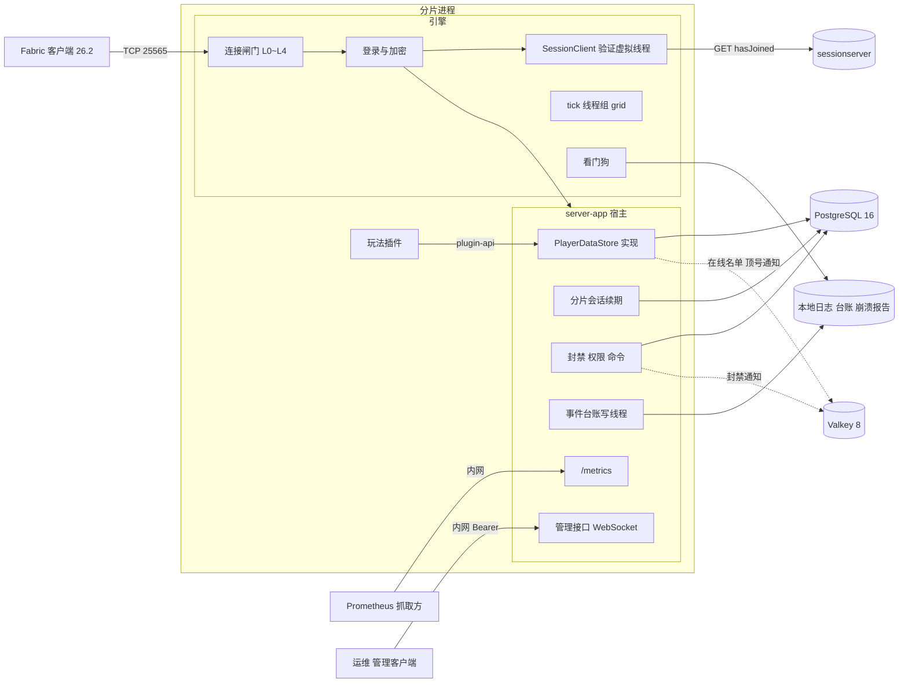

外部依赖与 §17 一一对应：sessionserver、PostgreSQL、Valkey、Prometheus 抓取方、管理客户端。世界存储（`.synx` 发布目录、覆盖存储）与分片目录 `shards.json` 属 M3，见 `docs/DESIGN-M3.md` §6，不在本图。

## 7. 数据模型 / 领域实体

宿主拥有全部表，Flyway 管理（§25）。字段完整定义以 §9 为准，ER 只列关键字段。

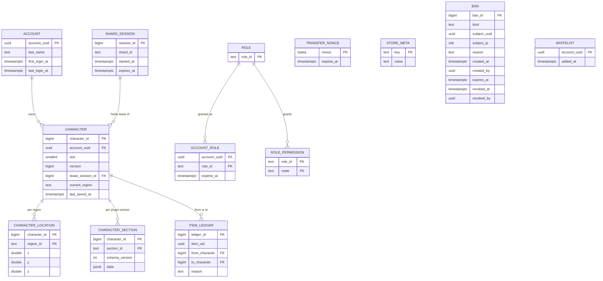

| 实体 | 表 | 说明 |
| --- | --- | --- |
| `ENT-Account` | `account` | Mojang 正版 UUID 为键；名字可在 Mojang 改，只做展示 |
| `ENT-Character` | `character` | 账号与角色 1:N（`unique(account_uuid, slot)`），首个版本只开 `slot = 0`（D2）；写权见 `ENT-CharacterLease` |
| `ENT-CharacterLease` | `character.lease_session_id` + `character.version` | 不是独立的表，是角色行上的写权投影；状态机见 §11.3 |
| `ENT-CharacterSection` | `character_section` | 插件数据段；单段编码后 ≤ 64 KiB（沿用 `API-M3-012` 的 65,536 B） |
| `ENT-CharacterLocation` | `character_location` | 每个大区各记一个最后位置；V1 已建表，第 3 波宿主不读写（`character.current_region` 同）；按 `docs/DESIGN-M3.md` §28.1「按大区的最后位置」一行，默认 M3-E 也不接，该分册 §23 内测 A 环之前由本分册接上，在那之前玩家下线再上线回到大区出生点 |
| `ENT-ShardSession` | `shard_session` | 分片每次起服新建一行；状态机见 §11.2 |
| `ENT-TransferNonce` | `transfer_nonce` | 转服票据用过的 nonce，一行一张票据；目标分片验票检查 ⑤ 插入（`API-PROD-028`），过期行由 `transfer_nonce.gc` 每 10 min 删除（§17） |
| `ENT-StoreMeta` | `store_meta` | `auth_mode = online / offline`，防离线 UUID 写进正式库；只由 `--migrate-only --auth-mode` 写入（`API-PROD-004`），分片只读 |
| `ENT-Ban` | `ban` | 按 UUID 或 IP 网段；`subject_uuid` 不建到 `account` 的外键（预先封禁的 UUID 可能从未登录）；是否生效由 `expires_at`、`revoked_at` 派生（§11 免建理由）；`created_by`、`revoked_by` 记 `Moderation#ban` / `unban` 的操作者，控制台是全零 UUID |
| `ENT-Whitelist` | `whitelist` | 白名单开关 `synaxis.app.whitelist` 打开时才判定；`account_uuid` 不建外键（受邀者加白名单时还没登录过） |
| `ENT-Role` / `ENT-AccountRole` | `role`、`role_permission`、`account_role` | 权限串形如 `gm.ban`、`synaxis.command.kick`；`account_role.account_uuid` 不建到 `account` 的外键（可预先授予），`role_id` 建到 `role` 的外键 |
| `ENT-ItemLedger` | `item_ledger` | 只记带 `uid` 的物品的产生、销毁与跨角色转移（D5） |
| `ENT-LoginAttempt` | 无表（内存） | 一条 login / transfer 意图连接从 accept 到进 configuration 的过程；状态机见 §11.1 |
| `ENT-Watchdog` | 无表（内存） | 看门狗；状态机见 §11.5 |

`shard_heartbeat`（在线人数心跳）属 `API-M3-010`，不在本表。`docs/DESIGN-M3.md` `API-M3-012` 的 `player_state(… payload bytea …)` 表**不建**，由 `character` + `character_section` 取代（§25）。

## 8. 接口契约 (API-first)

本分册没有 HTTP 业务接口。对外契约五类：引擎 Java API（`Auth`、线程）、原版协议的登录段、`:plugin-api` 新增面、宿主的数据库与 Redis 布局、运维面（配置键、指标、管理接口、CI 报告格式）。插件面的破坏性判定沿用 `docs/DESIGN-M2.md` §8 与 §24 的 ABI 门，`:plugin-api` 的接口按谁实现分两类（v0.7.2）。**只由宿主实现、插件拿来调用**的 15 个标 `@ApiStatus.NonExtendable`：`PluginContext`、`PluginScheduler`、`PluginEvents`、`PluginChannels`、`PluginAdmission`、`PluginAnalytics`、`PluginLifecycle`、`ShutdownNotice`、`PlayerDataStore`、`Permissions`、`Moderation`、`PluginCommands`，第 5 波新加的 `TabList`、`PluginEntities`（v0.8），以及第 6 波 6A 新加的 `Transfers`（v0.9.27，`API-PROD-021`）；给它们加方法（抽象或默认）是兼容变更，ABI 门不报，仓内自写实现的测试替身（`game-rts` 测试里的 `ProbeContext`、`RecordedChannels`、`RecordedEvents` 与匿名 `PluginEvents`，`:testing` 的 `InMemoryPlayerDataStore`）随宿主一起补实现。**由插件实现**的 `SynaxisPlugin`、`AdmissionProvider`、`PayloadHandler`、`DataSection<T>` 不标，新方法只能带默认实现，写成抽象方法 ABI 门报 `New abstract method added to interface`；`Admission`、`BanTarget` 是 sealed 接口，插件本来就实现不了。新接口按这条规则在第一次提交时就定好标不标：给已有接口补标注本身报 `Class made non-extendable`，只能随 `API_VERSION` 加 1 与新 baseline tag 一起走（`docs/ENGINE.md` §7.1）。第 3 波 3A 给 `PluginContext` 加的 `playerData()`、`lifecycle()` 与给 `PluginScheduler` 加的 `runAsync`、`runOn` 是默认方法（默认实现抛 `UnsupportedOperationException`，宿主覆盖），已发布，改成抽象方法对 `v0.2.0` 报 `Method made abstract`；给 record 加组件会改 canonical 构造器签名，由 `checkBinaryCompatibility` 判定，判为破坏就把 `PluginApi.API_VERSION` 加 1（`plugin-api/.../PluginApi.java:17`）。

- **`API-PROD-001` `Auth` 与 `SessionServer`（引擎 Java API）** — 实现 `REQ-PROD-002`、`REQ-PROD-036`
  - 签名（auth 草案 §3.1，`Velocity` / `Bungee` 按 `ADR-PROD-007` 删除）：

    ```java
    public sealed interface Auth {
        record Offline(boolean encrypt) implements Auth { public Offline() { this(false); } }
        record Online(KeyPair keyPair, SessionServer sessionServer) implements Auth {
            public Online() { this(LoginCrypt.generateKeyPair(), SessionServer.mojang()); }
        }
    }
    public record SessionServer(URI hasJoinedUrl, boolean sendClientIp, Duration timeout, int maxInFlight) {
        public static SessionServer mojang() { /* https://sessionserver.mojang.com/session/minecraft/hasJoined, false, 5 s, 32 */ }
    }
    ```
  - 语义：身份是否可信只看 `Online` / `Offline`，`encrypt` 是正交开关；`Online` 的 RSA-1024 密钥对每进程生成一次（9.9 ms，auth 草案 §5）。`ServerProcess.of()` 与 `MinecraftServer.init()` 的无参重载继续默认 `new Auth.Offline()`（只给测试与嵌入用）。
  - 落点：`LoginCrypt`（RSA 解密、`serverHash`、CFB8 `Cipher` 工厂）进 `crypto` 包；`SessionClient`（`java.net.http.HttpClient` 异步、结果三分）放 `network/player` 旁；`module-info.java` 加 `requires java.net.http;`。
  - 宿主配置：`synaxis.app.auth` = `online`（默认）| `offline` | `offline-encrypted`；`synaxis.app.auth.session-server` 覆盖 `hasJoined` 地址（只给 CI 与压测），地址不是 `sessionserver.mojang.com` 时启动日志打 WARN。
  - 启动自检（`REQ-PROD-036`）：本进程的有效模式 = `online` 当且仅当 `synaxis.app.auth=online` 且 `hasJoined` 地址是 `sessionserver.mojang.com`，其余（两种离线、指向假 sessionserver 的在线）一律算 `offline`，所以 CI 与压测的机器人身份进不了正式库。分片起服时读 `store_meta.auth_mode`：该行不存在（库没按发布流程迁移过）或与有效模式不一致时拒绝起服（进程非零码、端口不 bind）。分片从不写这一行，写入者只有 `--migrate-only`（`API-PROD-004`）。开 PROXY protocol 时必须同时配 `synaxis.proxy-protocol.trusted-networks`（负载均衡器所在网段，写法同闸门可信网段）并设 `synaxis.proxy-protocol.required=true`，缺一项 `ServerConfig` 构造器就抛 `IllegalArgumentException`，`server-app` 以 `Refusing to start` 退出、端口不 bind。运行中，没发 PROXY 头的连接与头部来自可信网段外的连接都在解码 PROXY 头时断开、不发包，对端在头部里写的地址不被采用。
- **`API-PROD-002` 登录段协议（加密握手与会话验证）** — 实现 `REQ-PROD-002`、`REQ-PROD-003`
  - 包：clientbound login ID 1 恢复为 `EncryptionRequestPacket`（`serverId = ""`、公钥 X.509 DER、4 字节 challenge、`shouldAuthenticate`；`PacketVanilla.java:387`，替换原先占位的 `ReservedPacket`）；serverbound login ID 1 `ClientEncryptionResponsePacket`（现存，`PacketVanilla.java:287`）注册监听器。
  - 顺序：`LoginStart` → 闸门 L3（占一个席位）→ 发加密请求 → 收 `minecraft:key` → 读线程上同步完成「一次性声明 `claimEncryptionResponse()` → RSA 解密 → 校验 challenge → 开收发 cipher，本批剩余字节就地解密」→ 之后一切出站包都是密文（含失败时的 `LoginDisconnect`）→ 在线模式把 `(username, serverHash, ip)` 交给验证虚拟线程。压缩在加密之后开。
  - `hasJoined`：GET `{hasJoinedUrl}?username=…&serverId=<serverHash>`，`sendClientIp` 默认 false 不带 `ip`；并发 ≤ `maxInFlight`，排队加请求超过登录总超时剩余部分的按 `Unavailable` 处理。
  - 结果三分：`Verified(GameProfile)`（200，`id`、`name`、`properties[{name,value,signature}]` 原样进 profile，皮肤随之进 PlayerInfo）/ `Unverified`（204）/ `Unavailable`（连接失败、超时、429、5xx、200 但 JSON 不合法）；`Unavailable` 随机退避 0.5～1.5 s 重试一次。
  - 超时：计入 login 阶段 30 s 总超时（`ServerConfig.java:408`），不占 configuration 阶段 `C2S_HELLO` 的 3 s（`ADR-M2-010` 不变）。
  - 错误：`synaxis:auth-failed`、`synaxis:auth-unavailable`、`synaxis:protocol-error`（§14）。
- **`API-PROD-003` 连接闸门与连接级配置键** — 实现 `REQ-PROD-001`、`REQ-PROD-043`
  - 引擎默认值与分片宿主设置（运维草案 ② 2.3；引擎默认的 L0～L2 开启、L3 / L4 为 0 即不限，M2 进程除 L0～L2 外不变，§28.1 ops #5）：

    | 层 | 检查点 | 键 | 引擎默认 | 分片宿主 | 超限行为 |
    | --- | --- | --- | --- | --- | --- |
    | L0 全局套接字 | `Server#start` accept 之后、起线程之前 | `synaxis.max-connections` | 1,024 | 3 × `capacity`（500 人档 1,500） | 立即 `close()`，不发包 |
    | L0′ accept 退避 | accept 抛 `IOException` | `synaxis.accept-backoff-ms` | 100 | 同 | sleep 后重试；10 s 一行汇总 WARN |
    | L1 每 IP 并发 | 不开 PROXY：accept 之后、起线程之前，按对端地址；开 PROXY：处理 `ClientHandshakePacket` 时（PROXY 解码已完成） | `synaxis.max-connections-per-ip` | 16（IPv4 /32，IPv6 /64） | 同 | accept 时超限：立即 `close()`，不发包；握手时超限：status 意图直接关，login / transfer 意图 `synaxis:too-many-connections` |
    | 握手前超时 | accept 到收到 `ClientHandshakePacket` | `synaxis.handshake-timeout-ms` | 5,000（本分册定） | 同 | 立即 `close()`，不发包；与 30 s 登录总超时并存 |
    | L2 登录桶 | 同上，login 意图 | `synaxis.login-rate-per-ip` / `synaxis.login-burst-per-ip` | 0.5/s / 3 | 同 | `synaxis:login-throttled` |
    | L2 status 桶 | 同上，status 意图 | `synaxis.status-rate-per-ip` / `synaxis.status-burst-per-ip` | 1/s / 10 | 同 | 直接关 |
    | L2 transfer 桶 | 同上，transfer 意图 | `synaxis.transfer-rate-per-ip` / `synaxis.transfer-burst-per-ip` | 2/s / 10 | 同 | `synaxis:login-throttled` |
    | 白名单网段 | L1 / L2 之前 | `synaxis.connection-gate.trusted-networks` | 空 | 压测机器人网段 | 命中者跳过 L1 / L2 |
    | L3 分片席位 | 处理 `LoginStart` 时、发加密请求之前，login 与 transfer 意图都判 | `synaxis.max-players` | 0（不限） | = 频道 `capacity`（`API-M3-010`，200～500） | 已占席位 ≥ 上限时 `synaxis:shard-full`；通过即占一个席位 |
    | L4 每 tick 入场 | `updateWaitingPlayers` 的 drain | `synaxis.max-joins-per-tick` | 0（不限） | 5 | 留在队列，下一 tick 继续，不踢 |
  - 席位：在线数 `getOnlinePlayerCount()` 只数 play 态（`ConnectionManager.java:212-214`），并发登录时会超员（上限 500、在线 495、20 条连接同时 `LoginStart` 会全部通过），所以 L3 不读它，改用进程内原子计数「已占席位」：通过 L3 时 +1，连接关闭时 −1。
  - 取值规则（`ServerConfig` 构造器校验，不合规抛 `IllegalArgumentException`，`server-app` 拒绝起服）：`max-connections`、`max-connections-per-ip`、`handshake-timeout-ms` ≥ 1；三只桶的速率 > 0（`NaN` 同样拒绝）、容量 ≥ 1；L0～L2 的键都不接受 0，要让某些来源不受 L1 / L2 约束，就把它们写进 `synaxis.connection-gate.trusted-networks`（逗号分隔的字面地址，可带前缀长度，主机名拒绝）；`max-players`、`max-joins-per-tick` 取 0 表示不限；`accept-backoff-ms` ≥ 0。本机起多个机器人或连续跑探针时要把 `127.0.0.0/8` 写进可信网段，否则同一地址第 4 次登录就收到 `synaxis:login-throttled`（`docs/TEST.md` §3）。
  - 拒绝的关闭方式：被闸门拒的连接一律经 `PlayerConnection#disconnectTurnedAway` 关闭，要发断线包的（握手时 L1 超限、L2 的 login / transfer、L3，以及第 2 波的 `auth-failed` / `auth-unavailable`）先发 `LoginDisconnect` 再关。它不写 `Connection closed` 行：被拒多少次由对端决定，只由闸门计数、进 10 s 汇总行。
  - 计数释放：每条连接持有一张 `ConnectionGate.Ticket`，记着它占的 L0 套接字、L1 地址计数与 L3 席位；连接关闭时 `release()` 在这张票自己的锁里一次性归还，不与 `ConnectionManager#removePlayer` 同锁。防 SOAK-2 式孤儿靠同一把锁：释放之后这条连接再来占 L1 或 L3（关闭途中才处理到的握手或 `LoginStart`），票据一律不记（`takeSeat` 返回 true 但不占席位），计数活不过连接。开 PROXY 时 L1 在握手线程上计数，按 `compute` 里自增后的值比上限，同一地址两条握手同时到达、上限只剩一个时恰好拒一条。令牌桶表以 IP 前缀为键，上限 65,536 个键，满时淘汰最久未用，每 60 s 清掉桶已满的键。
  - status 响应的 `max` 写 `synaxis.max-players`（为 0 时写 L0 上限，`StatusResponse.java:73`），不再写 `online + 1`。
  - 汇总行：闸门汇总行（句式见 §14）由 tick 线程在 `ConnectionManager#tick` 里驱动，按 tick 时间每满 10 s 至多一行、窗口内没有拒绝就不写；tick 卡住期间不出，恢复后的第一行带上这段时间累计的拒绝数。accept 失败汇总行在 accept 线程上写，10 s 至多一行，句式 `Accepting a connection failed N times since the last report, retrying every B ms`，`synaxis.suppress-connection-accept-errors` 只决定是否附带栈。`ConnectionGate` 进引擎 `ArchitectureTest#boundedReporters` 的日志豁免名单，登记的上界是「10 s 至多一行，带这段时间的拒绝计数」。
  - 计数出口：`synaxis_gate_rejections_total` 随 `REQ-PROD-018`（5A）导出；第 1 波只有进程内的 `ConnectionGate#rejected(Reason)`，`Reason` 的五个取值与该指标的 `reason` 标签一一对应。
  - `synaxis.socket-timeout`（`ServerConfig.java:455`）标 deprecated：对 `SocketChannel#read` 无效（攻击面 G2），sunset 见本节「演进与弃用」。keep-alive 超时断线改用 `synaxis:keep-alive-timeout`（`REQ-PROD-043`）。
- **`API-PROD-004` PostgreSQL 表结构与写权语句（宿主）** — 实现 `REQ-PROD-005`、`REQ-PROD-010`、`REQ-PROD-011`、`REQ-PROD-035`
  - 表：§7 与 §9 所列；Flyway 脚本 `server-app/src/main/resources/db/migration/V<n>__*.sql`，迁移顺序见 §25。
  - 写权语句（持久化草案 ③，时间只取数据库 `now()`）：

    ```sql
    -- 获取（登录或转入）：持有者为空、持有者就是本会话，或持有者的会话已过期
    UPDATE character c SET lease_session_id = :mine
     WHERE c.character_id = :id
       AND (c.lease_session_id IS NULL
            OR c.lease_session_id = :mine
            OR NOT EXISTS (SELECT 1 FROM shard_session s
                            WHERE s.session_id = c.lease_session_id AND s.expires_at > now()))
    RETURNING version;
    -- 获取影响 0 行时查持有者所在分片，用于发顶号消息
    SELECT s.shard_id FROM character c JOIN shard_session s ON s.session_id = c.lease_session_id
     WHERE c.character_id = :id;
    -- 保存：同一事务里先做这一句，再写脏段与位置；影响 0 行 → 回滚，返回 FENCED
    UPDATE character SET version = version + 1, last_saved_at = now()
     WHERE character_id = :id AND lease_session_id = :mine AND version = :expected;
    -- 释放：保存语句之后同一事务
    UPDATE character SET lease_session_id = NULL WHERE character_id = :id AND lease_session_id = :mine;
    -- 按账号释放（被拒的登录还回本会话可能为该账号持有的租约，含验票 ⑥ 取得的）
    UPDATE character SET lease_session_id = NULL WHERE account_uuid = :uuid AND slot = 0 AND lease_session_id = :mine;
    -- 分片会话续期：影响 0 行说明会话已过期
    UPDATE shard_session SET expires_at = now() + interval '30 seconds'
     WHERE session_id = :mine AND expires_at > now();
    -- 起服（§11.2 [*] → active）：同一事务里插入新会话，并把同一 shard_id 的旧会话置过期
    INSERT INTO shard_session (shard_id, started_at, expires_at)
         VALUES (:shard_id, now(), now() + interval '30 seconds') RETURNING session_id;
    UPDATE shard_session SET expires_at = now()
     WHERE shard_id = :shard_id AND session_id <> :mine AND expires_at > now();
    -- 会话释放（停机）：只令其过期，不 DELETE（character.lease_session_id 有外键指向它）
    UPDATE shard_session SET expires_at = now() WHERE session_id = :mine;
    ```
  - 首次建档：`INSERT INTO account … ON CONFLICT DO UPDATE SET last_login_at`；`INSERT INTO character (account_uuid, slot, version, lease_session_id) VALUES (…, 0, 0, NULL) ON CONFLICT (account_uuid, slot) DO NOTHING`。无论插入 1 行还是 0 行（另一分片同时建档），下一步都执行获取语句；租约只由获取语句写，建档不写。载入的语句组（建档、获取、读段）在一个事务里，获取之后读段失败时整体回滚，不留租约。实现里获取语句按 `account_uuid` + `slot = 0` 定位角色，并先以 `FOR UPDATE` 读出原持有会话与 `last_saved_at`，供 `EVT:lease_takeover` 使用。
  - 起服前提：同一 `shard_id` 同时只运行一个进程（systemd 单实例或 StatefulSet 副本数 1 保证）。起服时的置过期语句让同机重启立即可接管上一次运行的租约；违反前提双开时，后起者把先起者置过期、先起者进 `isolated` 后经 `reopen` 以新会话恢复。`reopen` 不执行置过期语句，所以两个进程不会来回互相踢，但它们会同时接受登录，数据正确性仍由逐角色 fencing 保证。
  - 连接：pgjdbc 42.7.13 + HikariCP 7.1.0，`maximumPoolSize = 4`、`connectionTimeout = 2000`、`validationTimeout = 1000`、`statement_timeout = 2s`；驱动参数 `connectTimeout = 2`、`loginTimeout = 2`、`socketTimeout = 4`（秒）：数据库不应答又不断开连接时，语句卡在读 socket 上，服务端执行的 `statement_timeout` 管不到，要靠 `socketTimeout` 让它在 4 s 内失败；分片会话续期用一条不进池的独占连接（断开即重连），登录风暴或停机批量保存占满池时续期不排队；分片数 ≤ 24 直连，超过 24 加 PgBouncer（事务模式），不调大 `max_connections`（D10）。
  - 账号：分片用的数据库账号只有 DML 权限；DDL 只给发布流程 `server-app --migrate-only --auth-mode=online|offline` 用的账号，分片起服只 `validate`（D11）。`--migrate-only` 在迁移之后写 `store_meta(auth_mode)`：该行不存在时按 `--auth-mode` 插入；已存在且值不同时迁移失败、非零退出，不改库。正式库用 `online`，CI、压测、本机开发库用 `offline`。
  - 过期会话清理：`shard_session.cleanup` 每小时删 `expires_at < now() − 1 天` 且没有角色行引用的会话行（起服与 `reopen` 每次都新增一行）。
  - 密钥：`SYNAXIS_STATE_DB_URL`（JDBC URL，形如 `jdbc:postgresql://host:5432/synaxis`）、`SYNAXIS_STATE_DB_USER`、`SYNAXIS_STATE_DB_PASSWORD`，按 `CLAUDE.md` 密钥纪律只进 `.env` 与 Bitwarden，`.env.example` 登记键名、用途与获取方式。
- **`API-PROD-005` `PlayerDataStore`（`:plugin-api` 新增）** — 实现 `REQ-PROD-006`
  - `PluginContext` 增加默认方法 `PlayerDataStore playerData()`（默认实现抛 `UnsupportedOperationException`，宿主的上下文覆盖它）。签名（持久化草案 ①）：

    ```java
    public interface PlayerDataStore {
        <T> void register(DataSection<T> section);            // 只能在 onEnable 内；id 以 "<plugin_id>:" 开头
        <T> T get(Player player, DataSection<T> section);      // 玩家所属 tick 线程上调用
        void markDirty(Player player, DataSection<?> section);
        CompletableFuture<SaveResult> saveNow(Player player);  // future 在虚拟线程上完成
        CompletableFuture<SaveResult> commitTogether(Map<Player, Map<DataSection<?>, Object>> staged, Runnable apply);
        boolean isFrozen(Player player);                        // 任意线程可调
    }
    public interface DataSection<T> {
        String id(); int schemaVersion(); T createDefault();
        T decode(JsonElement json, int storedVersion);        // 含升级链
        JsonElement encode(T value);                           // tick 线程上调用
    }
    public enum SaveResult { SAVED, FENCED, UNAVAILABLE }
    ```
  - 语义：玩家进世界前宿主已载入全部已注册段，缺失的段给 `createDefault()`；**任何路径都不得用 `createDefault()` 覆盖一个解码失败的段**。`commitTogether` 在一个事务里带全部参与者的版本校验写入，成功后在 tick 线程上执行 `apply`，任一校验失败整笔不写、`apply` 不执行；参与者必须都在本分片。定时保存或登出保存的快照里，读取早于某次 `commitTogether` 的段不写库、重新标脏，交给下一次保存：旧快照不能覆盖交易结果，代价是多写一次、`version` 多涨 1。
  - 冻结：`isFrozen` 在分片会话 `degraded` 或 `closing`（§11.2）期间对全体在线玩家为 true，在该玩家处于 §11.3 `saving` 时为 true。冻结期间 `commitTogether` 与 `saveNow` 不访问数据库，直接以 `UNAVAILABLE` 完成（`EVT:critical_commit` 记 `cause=frozen`）；宿主监听引擎的 `PickupItemEvent` 与 `ItemDropEvent`，对冻结玩家取消（实现是宿主节点下的 `synaxis-store-freeze` 子节点，引擎优先级 3，排在全局作用域插件 `LOWEST`～`HIGHEST`（−2～2）之后、`MONITOR`（4）之前：`HIGHEST` 撤销取消也不生效，`MONITOR` 读到的是取消后的结果，见 `API-PROD-018`）；插件自己的归属变更操作（交易、邮件、商店）必须先查 `isFrozen`，这一条是文档约定，宿主无法替插件判断哪些操作改变归属。
  - 插件测试：`:testing` 模块提供内存版 `InMemoryPlayerDataStore`：保存恒得 `SAVED`；`freeze(player, true)` 之后 `commitTogether` 与 `saveNow` 得 `UNAVAILABLE`，`apply` 不执行。
  - 插件看不见 `Connection`、SQL、Redis 类型与租约（`ADR-PROD-012`）。
- **`API-PROD-006` Redis 键空间与消息（宿主，Valkey 8，Jedis 8.0.1）** — 实现 `REQ-PROD-004`、`REQ-PROD-007`、`REQ-PROD-010`
  - `presence:{uuid}`：值 `{shard_id, session_id, state}`，`state` ∈ `loading / online / in_transit`；`PX 30000`，在线期间每 10 s 刷新。只做路由提示，以 PostgreSQL 租约为准。
  - 频道 `synaxis:kick:{shard_id}`：顶号通知，载荷 `{uuid, requester_shard, reason}`。
  - 频道 `synaxis:moderation`：封禁与白名单变更，载荷 `{kind, subject, ban_id}`，`kind` ∈ `ban / unban / whitelist-add / whitelist-remove`，`subject` 是账号 UUID 或网段，白名单变更的 `ban_id` 为 null；各分片收到后不看载荷，全量重读生效的封禁与白名单，再踢出被覆盖的在线玩家（`API-PROD-009`）。
  - 频道 `synaxis:permission`：角色变更，载荷 `{account_uuid}`；各分片重载该账号角色。
  - 不放进 Redis 的：租约、版本号、玩家数据、转服 nonce、登录令牌桶（闸门是进程内计数）。
  - 连接：`SYNAXIS_REDIS_URL`（密钥纪律同上）；不可达时每 10 s 一行 WARN（`LogBudget`）。
- **`API-PROD-007` 停机阶段与插件钩子** — 实现 `REQ-PROD-008`
  - 引擎：`ServerProcess#stop()` 的关闭序列改为 §11.4 的顺序；新方法 `ServerProcess#beginShutdown(Duration countdown)` 关登录门并开始倒计时，倒计时结束后进入保存阶段。两者都返回 `boolean`：这次调用是否占下了停机（下文「进程标志」）。`beginShutdown` 从任何线程调用都在停机线程 `Syn-Shutdown` 上跑序列、立即返回；`stop()` 以 0 s 倒计时占下停机，从 tick 线程调用时同样交给 `Syn-Shutdown`，从其他线程调用时在调用线程上跑完才返回（SIGTERM 的关闭钩子，`docs/DESIGN.md` `API-003`、§11.2）。关闭钩子（`ServerProcessImpl#stopOnSignal`）先调 `stop()`：得 true 就在钩子线程上跑完序列；得 false（停机已由控制台、玩家命令、管理接口或看门狗判死占下）时结束剩余倒计时（§11.4 `gate_closed → saving` 的 SIGTERM 一行），再等那次序列跑完才返回。JVM 跑完关闭钩子就 halt，不等非 daemon 的 `Syn-Shutdown`，所以钩子必须等。
  - 引擎与宿主之间的保存契约（引擎不依赖 `java.sql`，角色与存储都在宿主，所以引擎只管阶段与计时，保存由宿主做）：

    ```java
    public interface ShutdownParticipant {
        void onGateClosed(Duration countdown);                    // 停机线程上调用；宿主广播倒计时
        CompletableFuture<?> saveAll(Duration budget, boolean tickAlive); // 停机线程上调用；future 完成 = 未完成角色数为 0
        void onSaveEnded(boolean timedOut);                       // 保存阶段结束时调用一次，timedOut = 超时或判死截断
    }
    // ServerProcess 新增：只能在 start() 之前设置一次，未设置时保存阶段立即结束
    void setShutdownParticipant(ShutdownParticipant participant);
    ```

    引擎在 §11.4 `gate_closed → saving` 调 `saveAll(30 s, true)` 并以 30 s 为上限等待 future；判死路径调 `saveAll(剩余预算, false)`，宿主据 `tickAlive=false` 在停机线程上直接快照、跳过插件钩子。判死发生在保存阶段中途时，引擎对同一参与者再调一次 `saveAll(剩余预算, false)`，没有专门的接口，宿主据这次调用把尚未完成的快照改由停机线程读。引擎另有两个内部方法（`@ApiStatus.Internal`）：`shutdownAfterWatchdogDeath()` 由看门狗判死回调线程调用，驱动 §11.4 的判死路径；`shutdownPhase()` 返回 `RUNNING / GATE_CLOSED / SAVING / KICKING / PLUGINS_DISABLED / STOPPED`，供宿主与测试读停机阶段。宿主在 `server-app/.../Main.java` 装配时注册的参与者是 `ShutdownSequence`（下一条）；`host::disableAll` 仍挂在 `buildShutdownTask` 上（`Main.java:290`），新顺序里它在踢人之后随 `scheduler.shutdown()` 执行。
  - 宿主停机序列（`server-app` 类 `ShutdownSequence`，第 6 波 U 组）：引擎只收一个参与者，接口不变；宿主注册的这一个先让玩家存储保存，再跑装配时注册的停机步骤。

    ```java
    public final class ShutdownSequence implements ShutdownParticipant {
        public ShutdownSequence(ServerProcess process, ShutdownParticipant players);
        // 只能在进程启动之前调用（isAlive() 为 false 且 shutdownPhase() = RUNNING），否则抛 IllegalStateException
        public void addAfterPlayers(String name, Step step);
        @FunctionalInterface
        public interface Step {
            CompletableFuture<?> run(Duration remaining, boolean tickAlive); // future 完成 = 步骤结束（成败都算）
        }
    }
    ```

    - 注册：只在 `server-app` 的装配代码里、进程启动之前调用，不经 `PluginContext`，插件拿不到。分片宿主路径（`ShardMain` → `Main`）挂地图时注册覆盖层的一步（`overlay.shutdown-flush`，`docs/DESIGN-M3.md` `API-M3-007`）：`Main` 步骤 (5) 的 `ShardWorld#start` 在 `OverlayStore.open` 之后随即调 `addAfterPlayers("overlay", overlay::finalFlush)`（`ShardWorld.java:202`）。RTS 的 `Main` 路径与不挂地图的分片不注册，保存阶段只有玩家存储。
    - 顺序：`onGateClosed` 原样转给玩家存储。`saveAll(budget, tickAlive)` 先以同样的参数调玩家存储的 `saveAll`；它的 future 完成后按注册顺序逐个调步骤，上一步的 future 完成才调下一步；最后一步完成后返回给引擎的 future 才完成，引擎随后进 `kicking`。没有注册步骤时 `saveAll` 直接返回玩家存储自己的 future，`onSaveEnded` 原样转交，与只注册玩家存储时相同。
    - 预算：步骤与玩家共用这一次 `saveAll` 的预算（正常 30 s，判死路径 15 s）；`remaining` = 本次保存截止 − 调用时刻，玩家与前面的步骤用掉的都已扣除。步骤自己按 `remaining` 封顶（覆盖层取 min(2 s, `remaining`)）。
    - `tickAlive=true`：tick 仍在跑，步骤只把活交给 tick（覆盖层把最后一次落盘排进 tick 末尾写入阶段），调用不得阻塞；这一调用在上一段 future 完成的线程上、持序列的锁进行。`tickAlive=false`：看门狗已判 tick 死，由停机线程（跑停机序列的线程，停机开始之前就判死时是 `Syn-Watchdog-Report`）在自己线程上直接调步骤并等它，步骤就在这个线程上把活做完。这与玩家存储得知 tick 已死的方式相同：都来自这一次 `saveAll` 的 `tickAlive` 参数。
    - 保存中途判死（引擎第二次调 `saveAll(剩余预算, false)`）：先转给玩家存储；玩家还没存完时停机线程等它，再以 `false` 依次跑全部步骤；已以 `true` 开始、future 还没完成的步骤再以 `(剩余预算, false)` 调一次，第二次调用的 future 代表这一步，此后的步骤都以 `false` 在停机线程上跑。以 `true` 开始的那次调用之后才完成的 future 不再推进序列。
    - 超时：预算用完时引擎不再等（§11.4 `saving → kicking` 保存超时），照常踢人；正在跑的步骤自己记 ERROR（覆盖层记剩余脏区块数），没轮到的步骤由序列在 `onSaveEnded` 里各记一条 `The shutdown step {name} did not run, the save budget was used up`；此后完成的 future 不再调下一步。步骤调用本身抛异常时记 ERROR 并按已结束处理。
    - `onSaveEnded(timedOut)`：有步骤时只在玩家存储自己的 future 还没完成时向它传 `true`，所以 `EVT:shutdown_saved.timed_out` 与 `saved` 仍只说玩家；步骤超时不计入。
    - 语义边界：保存阶段与踢人阶段 tick 仍在跑，步骤落盘之后到停 tick 之前发生的方块改动不保证落盘；覆盖层一侧的写法由 `docs/DESIGN-M3.md` `API-M3-007` 登记（§28.3）。
  - 进程标志：新增内部标志 `stopping`，`beginShutdown` / `stop()` 以 CAS 置位，返回值就是这次 CAS 的结果：只有占下停机的那次调用得 true，之后的调用立即返回 false，不等那次停机、不改它的倒计时；看门狗判死路径（`shutdownAfterWatchdogDeath`）用同一个标志；`stopped` 推迟到 §11.4 `plugins_disabled → stopped` 才置位。`isAlive()`（`ServerProcessImpl.java:598`，`started ∧ ¬stopped`）因此在 `gate_closed`、`saving`、`kicking`、`plugins_disabled` 四个阶段都返回 true：`TickSchedulerThread` 的 `while (isAlive())` 循环一直跑到踢人与插件禁用之后，`setCompressionThreshold` 的「起服后不可改」检查（`:279`）语义不变。
  - 插件：`PluginContext#lifecycle()`（默认方法，同 `playerData()`）返回 `PluginLifecycle`，`onShutdownSave(Consumer<ShutdownNotice> hook)` 由宿主在 `saveAll` 内、在每个玩家所属 tick 线程上调一次；已准入、还没进世界的玩家没有所属 tick 线程：保存阶段开始后的下一个 tick，宿主以 `synaxis:server-stopping` 断开其中仍连着的，钩子在派发其 `PlayerDisconnectEvent` 的线程上调（宿主断开的都在 tick 调度线程上），同样恰一次（§11.4 `gate_closed → saving`）。插件在这里把内存状态写进数据段并 `markDirty`；插件不得依赖停机时的 `PlayerDisconnectEvent` 做保存。插件 `onDisable` 的线程：停机线程把 `scheduler.shutdown()` 投递到 tick 调度线程，在两个 tick 之间执行；1 s 内没被接走（tick 卡住）或看门狗已判死时改在停机线程上执行，整体等待上限 15 s，超时记 WARN 继续停机。`scheduler.shutdown()` 在那里跑的是宿主的 `PluginHost#disableAll`：按启用逆序给每个插件新起一条 daemon 平台线程 `plugin-disable-<id>` 跑 `onDisable`，自己 join 等它，全部插件共用 5 s，用完记 ERROR、收回该插件的能力、不再等。所以 `onDisable` 不与 tick 并行，但它所在的线程不属于任何 tick 线程：移除或改动实体要经 `Acquirable#sync` 拿到实体所属的 tick 线程；还没分配给 tick 线程的实体（`assignedThread()` 为 null）直接操作，因为未分配元素上的 `sync` 只认创建线程（`API-PROD-016` 所有权断言一条）。在这条线程上直接调 `Entity#remove` 这类带所有权断言的方法，断言开或 `synaxis.acquirable-strict=true` 时抛 `AcquirableOwnershipException`。
  - 预算：保存阶段 30 s；部署侧 systemd `TimeoutStopSec` 或 Kubernetes `terminationGracePeriodSeconds` ≥ 60 s（清单 G04）。控制台 `stop [秒数]` 与管理接口 `server/stop` 的倒计时默认 0 s（本分册定，无外部来源）。
- **`API-PROD-008` 聊天** — 实现 `REQ-PROD-009`
  - `PlayerChatEvent` 的收件人默认是空集合（`ChatMessageListener` 不再取全进程在线玩家），发给谁由玩法插件决定：按频道、同实例或私聊填收件人，没有插件填时一条也不发。
  - `synaxis.chat-rate-per-second` 默认 1、`synaxis.chat-burst` 默认 3（burst 为本分册定，清单只给了 1 条/秒）；两个键取整数且 ≥ 1。限频排在 `PlayerChatEvent` 之前，每连接一只令牌桶（`ChatRateLimiter`，只由解释该玩家包的线程使用）；超限的消息丢弃并计入该桶的 `dropped()`，不断线。
  - `JoinGamePacket` 的 `enforcesSecureChat` 由写死的 true 改为 false（`Player.java:393-395`）；聊天以 `SystemChatPacket` 转发。
  - 客户端模组：原版客户端进入不强制安全聊天的服务器时弹「聊天消息无法验证」toast，而 Synaxis 服务器恒为 false；`client-fabric` 的 `ClientPacketListenerMixin` 拦掉 `handleLogin` 里唯一的 `addToast` 调用，玩家不会为服务器按设计工作而收到警告。
- **`API-PROD-009` 封禁与白名单** — 实现 `REQ-PROD-010`
  - `PluginContext#moderation()`（默认方法）返回 `Moderation`：`CompletableFuture<Ban> ban(BanTarget target, String reason, @Nullable Instant expiresAt, UUID operator)`、`CompletableFuture<Boolean> unban(long banId, UUID operator)`（没有这条生效的封禁时为 false）、`Optional<Ban> activeBan(UUID uuid, @Nullable InetAddress ip)`、`CompletableFuture<Void> whitelist(UUID account, boolean listed)`。任何线程都可调用：写库在虚拟线程上做，失败的 future 带 `IllegalStateException`；理由为空或超过 256 字符、到期时间不在将来或不早于 `+10000-01-01T00:00:00Z`（`HostModeration.EXPIRY_LIMIT`，理由见 `API-PROD-022` `bans/add` 一行）时 `ban` 直接抛 `IllegalArgumentException`，不进库。`activeBan` 同步读本分片内存，`ip` 为 null 时只看 UUID 封禁，同时命中几条时取最晚到期的一条。`operator` 写进 `ban.created_by` / `revoked_by`，控制台传全零 UUID。`Ban` 是 `(banId, target, reason, expiresAt)`。`BanTarget` 只有 `ByUuid` 与 `ByNetwork(cidr)` 两种，不按名字封；`ByNetwork` 只收字面地址，清掉主机位，前缀 IPv4 /8～/32、IPv6 /32～/128。
  - 判定点：宿主节点上的 `AsyncPlayerPreLoginEvent` 监听器，在 Mojang 验证之后、`AdmissionProvider` 之前，排在登录阶段握手之前（`HandshakeGate` 跳过已被踢的连接）。引擎 `transitionLoginToConfig` 本来就在验证之后触发该事件，踢人走已加密的 `LoginDisconnect`，`ConnectionManager.java` 不用改。拒绝键 `synaxis:banned`（翻译参数：理由；到期时为嵌套的 `synaxis:banned-until`，时间写成 `yyyy-MM-dd HH:mm UTC`，永久封禁时为空组件）、`synaxis:not-whitelisted`。
  - `AdmissionRequest` 增加 `uuid`（验证所得）与 `remoteAddress`（连接的 IP）两个组件。旧的四参构造器保留并标 `@Deprecated`，用用户名的离线 UUID 与回环地址补齐新组件，所以 ABI 门不判破坏。
  - 缓存：生效的封禁与整张白名单放在进程内存里，三种时机各全量重读一次：每 30 s、本分片每次变更之后、收到 `synaxis:moderation` 时（`API-PROD-006`）；开始得早的读取不覆盖开始得晚的。每次重读之后踢出被覆盖的在线玩家与 configuration 中的玩家，这是 Redis 不可达时「≤ 30 s 生效」成立的前提。到期在内存里判定，不需要重读。首次读取在绑定端口之前做，失败就拒绝起服；之后的读取失败保留旧数据，10 s 至多一行 WARN。
  - 开关 `synaxis.app.whitelist` 只认 `on` / `off`（默认 `off`），其他值拒绝起服；`synaxis.app.store=memory` 时没有封禁，`ban` / `unban` / `whitelist` 的 future 失败，此时开白名单拒绝起服。移出白名单不踢在线玩家。登录已过判定、还没进入 configuration 时下的封禁，由下一次 30 s 刷新踢出。
  - GM 命令（宿主注册，控制台恒有权限，每次执行一条 `EVT:gm_command`）：`ban <玩家名|UUID|地址[/前缀]> <perm|<n>m|<n>h|<n>d> <理由>`（玩家名只在本分片在线玩家里找）、`unban <封禁编号>`（只收编号）、`whitelist add|remove <玩家名|UUID>`；节点 `gm.ban`（`ban`、`unban`）与 `gm.whitelist`（§10）。回执键见 §14。
- **`API-PROD-010` 权限** — 实现 `REQ-PROD-011`
  - `PluginContext#permissions()`（默认方法）返回 `Permissions`：`boolean has(Player player, String node)`、`Set<String> roles(Player player)`，任何线程都可调用。节点小写点分，授予的节点末段可为 `*`（`gm.*` 覆盖 `gm.` 之下全部节点，单独一个 `*` 覆盖全部）；查询的节点不得含 `*`，否则 `IllegalArgumentException`。角色还没读进来的玩家 `has` 为 false、`roles` 为空。
  - 角色在登录载入时读进内存（`AdmissionGate`，configuration 线程）。读取开始之前玩家先以「无角色」登记，读取期间到来的变更通知（Redis 的与本分片自己的）都会让该玩家再读一次，读编号大的结果胜出。变更经 `synaxis:permission` 重读该账号；另外每 30 s 重读全部在线玩家，Redis 不可达时变更最迟 30 s 生效。读取失败时玩家保留已有角色（登录时的失败即无角色），等下一次读取。`synaxis.app.store=memory` 时没有角色，玩家一律无节点，控制台照常可用。
  - 到期：`account_role.expires_at` 由每次读取的查询条件 `expires_at > now()` 判定，到期不发通知，已读进内存的授予最迟晚一个刷新周期（30 s）失效。节点集合变化时给该玩家重发命令树（`API-PROD-011`）。
  - GM 命令 `role grant|revoke <玩家名|UUID> <角色>` 与 `role list <玩家名|UUID>`，节点 `gm.role`；玩家名只在本分片在线玩家里找，别处或从未登录的账号用 UUID。`grant` 写入的授予不到期（`expires_at` 为 null），角色不存在时回 `synaxis:role-unknown`。发送者是玩家时，只能授予或收回「角色在 `role_permission` 里的每个节点都被发送者当前内存里的有效节点覆盖」的角色，对自己也一样：节点本身、`*` 或按整段的前缀通配覆盖它，`gm.*` 这样的通配节点要发送者持有它本身、更短前缀的通配或 `*`，单独一个 `*` 只有持有 `*` 的发送者覆盖；没有节点的角色谁都能动。不满足时回 `synaxis:role-above-sender`、不写库。控制台不受这条限制。`role` 与 `role_permission` 的行没有命令或接口维护，由 ROLE-Operator 用 SQL 写。`Player#permissionLevel` 只决定客户端调试界面与补全显示，不作授权依据。
  - GM 命令执行一次写一条 `EVT:gm_command`（`API-PROD-014`，`result` 取值见 §20）。
- **`API-PROD-011` 命令** — 实现 `REQ-PROD-012`、`REQ-PROD-034`
  - `PluginContext#commands()`（默认方法）返回 `PluginCommands`：`register(Command command)`，名字与每个别名自动加 `<plugin_id>:` 命名空间并注册无前缀别名（冲突时别名让给先注册者），名字或别名含 `:` 抛 `IllegalArgumentException`，本插件已注册过同名时抛 `IllegalStateException`；`boolean unregister(Command command)` 只收回本插件注册过的命令，别人的返回 false 且不动。插件禁用时宿主注销它全部命令，之后再调 `register` 静默丢弃。谁能执行由命令自己的 condition 决定（同时决定补全里是否可见），condition 里查 `Permissions`，不查 `permissionLevel`。执行器在发送者所在 tick 线程上跑，控制台的在控制台读线程上跑；执行异常经 `LogBudget` 输出（每条命令 10 s 至多一行），发送者收到原版键 `command.failed`。
  - 控制台：`Main#readConsole`（`server-app/.../Main.java:788`）把每个非空行交给 `Main#runConsoleCommand`（`CommandManager` + `ConsoleSender`，接受前导 `/`）；一行抛出的 `RuntimeException` 记一行 ERROR 带栈，接着读下一行；未知或不完整的命令只写一行 INFO、不带栈。控制台线程是 daemon。引擎 `ConsoleSender` 把翻译组件写成回退文本，开着 `synaxis.automatic-component-translation` 时写服务端译文，译文由去掉子组件的组件求得，子组件由扁平化器接着写。
  - 内置命令（宿主在插件启用之前注册，所以无前缀名归宿主；权限节点 `synaxis.command.<名>`，控制台恒有权限）：`REQ-PROD-012` 六条 `list`、`kick <玩家> [原因]`（不带原因时用原版键 `multiplayer.disconnect.kicked`）、`broadcast <文本>`、`save`、`stop [秒数]`、`tps`（最近 1,200 个 tick 的 TPS 与 MSPT p50 / p95 / p99）；`REQ-PROD-034` 加 `profile [秒数]`（第 6 波 6B）。回执键见 §14。
  - `stop [秒数]`：秒数为不小于 0 的整数，不设上限（误输入可再发 SIGTERM：剩余倒计时作废，照常保存后退出，§11.4）；解析不了时回 `synaxis:command-stop-usage`、不停机。停机是不是这次 `stop` 发起的，只由引擎判定：宿主调 `ServerProcess#beginShutdown(秒数)`，得 true 回 `synaxis:command-stopping`、`EVT:gm_command` 记 `result=ok`；得 false（引擎已在停机，占下它的是 SIGTERM、看门狗判死、更早的 `stop` 或管理接口 `minecraft:server/stop`）回 `synaxis:command-already-stopping`、记 `result=invalid`，引擎的倒计时不变。控制台、玩家命令与管理接口都经 `HostCommands#beginStop` 调这一次，宿主不另设标志：另设的标志与引擎的 CAS 是两次判定，两次之间 SIGTERM 占下停机时宿主会回「5 s 后停」而引擎按 0 s 停（§28.2 已决一行）。停机序列跑在引擎的非 daemon 线程 `Syn-Shutdown` 上。回复与台账那一行先于台账关闭与管理连接断开：`beginStop` 在问引擎之前取宿主唯一的回复许可（`Semaphore(1)`），调用方回复完（管理接口是回复发出之后）调 `HostCommands#stopAnswered` 交还；装配在 `ledger::close` 之前挂停机任务 `HostCommands#awaitStopAnswers`，等这个许可至多 1 s，过时不再等。
  - `profile [秒数]`：秒数 1～600（本分册定），默认 60；越界或解析不了回 `synaxis:command-profile-usage`、不录。用 JDK 自带的 `profile` 设置（`jdk.jfr.Configuration.getConfiguration("profile")`）的副本开一个 JFR 录制，副本只关掉 `jdk.InitialEnvironmentVariable` 一个事件：JDK 25 的 `lib/jfr/profile.jfc` 默认开着它，会把进程的全部环境变量连同 `SYNAXIS_*` 密钥明文写进这个要交给别人分析的文件（`RB-PROD-003`），与 `API-PROD-022`「令牌不进任何日志与台账」和 `API-PROD-013` 崩溃报告的脱敏规则相悖。写文件时再按事件名把它滤掉一次：同一 JVM 里的 JFR 录制共用同一组 chunk，`Recording#dump` 会把录制期间别的录制打开的事件一起写出，而 JDK 自带的 `default` 与 `profile` 两份设置都开着这个事件，`jcmd <pid> JFR.start settings=default`（`tools/loadtest/soak.py` 压测时就这样开）、`-XX:StartFlightRecording` 与连着的 JMC 都会把它带进 chunk。所以录满后先 dump 到 `java.io.tmpdir` 下只有属主可读（0600）的临时文件 `synaxis-profile-*.jfr`，再经 `RecordingFile#write` 去掉 `jdk.InitialEnvironmentVariable` 写成最终文件，临时文件在 `finally` 里删掉；进程在这两步之间被杀时它留在临时目录里、带着同样的明文，删掉即可。系统属性（`jdk.InitialSystemProperty`）与 JVM 参数（`jdk.JVMInformation`）照录，所以密钥只放环境变量、不用 `-D` 传（`API-PROD-004` 的密钥纪律）。录满秒数后写到工作目录的 `profiles/profile-<shard_id>-<UTC yyyyMMdd-HHmmss-SSS>.jfr`。回执两次：开始时 `synaxis:command-profile-started`（秒数、绝对路径），写完后 `synaxis:command-profile-done`（绝对路径）。进程里同时只有一个录制（`Profiler`，命令与管理接口 `synaxis:profile` 共用），已有录制在跑时回 `synaxis:command-profile-busy`（在录的路径）；JFR 开不起来或文件写不出回 `synaxis:command-profile-failed`。等待与写文件在虚拟线程 `Syn-Profile` 上；停机时还没录完的录制随进程结束丢弃，不写文件。文件不自动删，由 `RB-PROD-003` 取走后删。`EVT:gm_command` 在写完（`ok`）、失败（`unavailable`）或被拒（`invalid`）时各写一条。
- **`API-PROD-012` 入站包速率闸** — 实现 `REQ-PROD-013`
  - 位置：`PlayerSocketConnection#processBatch` 把包交给 `Player#addPacketToQueue` 之前（读线程），只数客户端从 socket 发来、要进 `Player` 入站队列的包；`IMMEDIATE_PROCESS_PACKETS` 里握手、登录、配置期的 11 个即时处理包（含 keep-alive）不经这里、不计数，宿主或测试直接调 `addPacketToQueue` 模拟的包也不计。login 阶段还没有 `Player`，本闸管不到；login 段的洪泛由 L2 登录桶、握手前 5 s 超时与 30 s 登录总超时约束（`API-PROD-003`）。解压字节/秒上限挂在同一读线程的解码回调（`PlayerSocketConnection#readClientPacket`），按连接计，连接开了压缩之后每个帧解出的负载字节（去掉包 ID）都计入；超限的那一帧已经解压完，同一批里排在它后面的帧不再解压。
  - 计数：每连接一组滑动窗口计数器，窗口分 20 格（7 s 窗口每格 350 ms），读数覆盖最近 19/20～20/20 个窗口。全部包计入 `max-packets`；`overrides` 列出的类型另计各自的上限（同一窗口），同时照样计入全部包；补全另有 1 s 窗口，超出的一律丢弃、不断线。任一条超限且动作为 KICK 即断线，否则丢掉这个包（丢掉的包仍计数）。
  - 键：`synaxis.packet-limit.window-ms` 7,000、`synaxis.packet-limit.max-packets` 582、`synaxis.packet-limit.action` `KICK`（`DROP` 可选）、`synaxis.packet-limit.overrides`（`<包类型>=<窗口内上限>:<DROP|KICK>` 逗号分隔；包类型写引擎客户端包的类简名，如 `ClientTabCompletePacket=40:DROP`，须是 configuration 或 play 状态的包；写错、上限 < 1、同一类型写两次都拒启）、`synaxis.packet-limit.max-inflated-bytes-per-second` 4 MiB（本分册定，**未核实**）、`synaxis.tab-complete-rate-per-second` 20。窗口、上限、解压字节、补全速率都须 ≥ 1，否则拒启。
  - 582 = 200 人 walk 基线（`docs/TEST.md` TC-PROD-271 第 5 步，2026-09-24）每人 7 s 窗口上行包数 P99 291 × 2（清单 G11），取代初值 Paper 的 500 包 / 7 s。机器人每 tick 只发一个位置包加一个 `ClientTickEnd`，原版客户端还会发转头、动作与交互包，这个 P99 是下限；真客户端回归或内测里出现误踢时，按那一档的 P99 × 2 重定（§28.2）。KICK 用既有 `synaxis:protocol-error`（与 `docs/DESIGN.md` §15 限流行同一语义），断线前写一行 INFO `Inbound packet limit exceeded: connection_id=… limit=…`，每连接至多一行、紧跟断开。
- **`API-PROD-013` 看门狗、崩溃报告与异常落点** — 实现 `REQ-PROD-014`、`REQ-PROD-015`
  - 看门狗键（引擎 `ServerConfig`，负数拒启）：`synaxis.watchdog.early-warning-ms` 10,000、`synaxis.watchdog.early-warning-every-ms` 5,000、`synaxis.watchdog.timeout-ms` 60,000、`synaxis.watchdog.halt-after-ms` 15,000。判死后退出码 70。各键取 0 的含义：

    | 键 = 0 | 效果 |
    | --- | --- |
    | `timeout-ms` | 不起 `Syn-Watchdog` 线程，启动日志记一行「watchdog off」；其余三键不再生效 |
    | `early-warning-ms` | 不打早期警告，tick 卡住到 `timeout-ms` 直接判死 |
    | `early-warning-every-ms` | 每次卡住只打第一条警告，不重复 |
    | `halt-after-ms` | 照常判死、写崩溃报告，但不 `Runtime.halt` |

  - 引擎接线：看门狗由引擎每进程持有一个，宿主经 `ServerProcess#watchdog()`（`@ApiStatus.Internal`）取得并起停；tick 起止打点在 `ServerProcessImpl.TickerImpl.tick` 的首尾（`finally` 里打结束点），覆盖调度线程上的整个 tick。巡检每 1 s 一次，所以首条警告实际落在卡住后 10～11 s、重复警告间隔 5～6 s、判死落在 60～61 s。警告内容是正在跑 tick 的线程与全部 TickThread 的栈。
  - 判死：`Watchdog#start(onDeath)` 的回调在单独的平台线程 `Syn-Watchdog-Report` 上执行，宿主在里面写崩溃报告；halt 计时由 `Syn-Watchdog` 自己走，回调卡住也不拦 halt。第 3 波 3A 在同一回调里驱动 §11.4 的判死保存。已判死的进程不会因 tick 结束而恢复。`stop()` 在没有在途 tick 时结束巡检；有在途 tick 时继续看到它结束，已判死的照常 halt，所以卡在 tick 后面的停机序列仍以 halt 收尾。
  - 崩溃报告：`crash-reports/<yyyyMMdd-HHmmss>-<shard_id>.txt`（同一秒第二份起加 `-2`、`-3` 后缀），内容为触发原因、线程转储、生效配置、插件列表与版本、`git head`（构建时写入，IDE 里跑写 `unknown`）。生效配置的脱敏规则：`SYNAXIS_*` 环境变量一律只写 `<set>`；`synaxis.*` 系统属性与 JVM 的 `-D` 参数中，键名含 `password`、`secret`、`token`、`credential`（不分大小写）的只写 `<set>`，其余原样写。
  - 宿主异常落点 `HostExceptionHandler` 同时接 `ExceptionManager` 与全部线程的默认未捕获异常处理器：每条异常一行 ERROR 带栈、tick 号与 `connection_id`，按异常类各一个 `LogBudget`（10 s 一行）。「致命错误」指 `VirtualMachineError` 中除 `StackOverflowError` 以外的（单个监听器就能触发栈溢出且进程能活下来）；致命错误每进程只写第一份崩溃报告，不停进程。
  - tick 号由宿主提供：引擎没有进程级 tick 计数，宿主在调度器上挂每 tick 自增的任务，异常行读它。宿主未设落点时，引擎默认落点是一行 SLF4J ERROR，全局 10 s 至多一行，带这段时间的累计条数与 `connection_id`，不带 tick 号。
  - OOM 不走完整 stop：`-XX:+ExitOnOutOfMemoryError` 在异常落点之前结束进程（退出码 3），参数由 `REQ-PROD-028` 的默认 JVM 参数提供。
- **`API-PROD-014` 日志与事件台账** — 实现 `REQ-PROD-016`、`REQ-PROD-017`、`REQ-PROD-011`
  - 日志：`logback.xml` 的控制台 appender 在两种模式下都挂着（就绪行、测试、soak 与 CI 都读 stdout），`-Dsynaxis.app.log` 决定另外加什么：`file`（默认）另挂 `RollingFileAppender` + `SizeAndTimeBasedRollingPolicy`（`logs/latest.log`，每天或 256 MB 滚动成 `logs/YYYY-MM-DD.N.log.gz`，`maxHistory` 14，`totalSizeCap` 10 GB），外包 `AsyncAppender`（`neverBlock=true`，`queueSize` 8,192）；`stdout` 只有控制台，不建任何文件，给由运行时收集 stdout 的容器用。其他值按 `logback-<值>.xml` 找不到资源处理：logback 在控制台报一行找不到，效果同 `stdout`。
  - 分片 ID：`synaxis.app.shard-id` 默认 `local`，进台账与崩溃报告的文件名；去掉首尾空白后必须匹配 `[A-Za-z0-9][A-Za-z0-9._-]*`（字母或数字开头，只含字母、数字、`.`、`_`、`-`，因此不能跳出目录），否则拒启。
  - 台账：`EventLedger#record` 在调用线程拼好整行后 `offer` 进 65,536 行有界 MPSC 队列，永不阻塞；写线程 `Syn-Ledger-Writer` 持有 `FileChannel`，距上次写盘满 1,000 ms 或缓冲满 64 KiB 写一次，不逐次 `fsync`，关闭时 `force(true)`。文件 `logs/events-<shard_id>-YYYYMMDD.jsonl`，跨天后压成 `.jsonl.gz`，保留 30 天。`synaxis.app.ledger-max-bytes-per-day` 默认 1 GiB（1,073,741,824），必须是正整数字节数，否则拒启；当天文件到达上限后只写 `ledger_dropped` 汇总行。
  - 丢弃：队列满时丢新来的那条并计数；下一次写盘先按原因各写一行 `{"ts":…,"event":"ledger_dropped","reason":"queue_full|daily_cap","count":N,"since":…}`，`since` 是这一批里第一次丢弃的时刻。
  - 关闭：停机时连接还在服务，`record` 可能与关闭竞争。写线程先封口、等已过封口检查的 `record` 全部入队，再做最后一次排空，所以每一行要么落盘、要么被看到封口的 `record` 拒掉。封口之后到达的行不入台账（已没有文件可写汇总行），只在日志经 `LogBudget` 计数 `dropped_after_close=N`。
  - 事件行格式沿用 `docs/DESIGN-M2.md` §20（`ts` 在事件发生线程上取）。
- **`API-PROD-015` 指标导出** — 实现 `REQ-PROD-018`、`REQ-PROD-042`
  - Micrometer + `micrometer-registry-prometheus`；JDK `com.sun.net.httpserver` 在 `synaxis.app.metrics.bind`（默认 `127.0.0.1:9464`，本分册定）暴露 `GET /metrics`，不鉴权，只绑内网。这个键与 `synaxis.app.management.bind` 同一写法，整串只认「主机:端口」，别的写法拒启（`API-PROD-022` 传输一条）。就绪行 `Metrics endpoint listening on http://<地址>/metrics`，地址写法同那一条（IPv6 带方括号）。
  - 应答：每次抓取（一次 HTTP 交换）在自己的虚拟线程 `Syn-Metrics` 上跑，从读到请求的第一个字节起至多 10 s（`HostMetrics.EXCHANGE_LIMIT`，与 Prometheus 默认的 `scrape_timeout` 相同，过了这个时间 Prometheus 已经放弃这次抓取）；到时由等它的虚拟线程 `Syn-Metrics-Limit` 中断它，阻塞在 socket 通道上的读写一中断就关通道，这是结束它的唯一办法。发半个请求就停住的对端、流水线发请求却不读回复的对端，都只占住自己那条线程至多 10 s，别的抓取不排在它后面。不读回复的对端要到回复把两端的 socket 缓冲填满、某次交换写不出去才占住线程：内核可能把缓冲涨到兆字节级，200 个回复（每个约 14 KB，共约 2.8 MB）能全部装进去，这时没有交换被卡住，也就没有线程被占，连接不在 10 s 时关（RUN-039 修复第 2 轮加诊断看到）。JDK `HttpServer` 自带的请求与响应时限（`sun.net.httpserver.maxReqTime` / `maxRspTime`）默认不限，又是 JVM 级属性、只在第一次建 `HttpServer` 时读，所以不用。只建连、一个字节都不发的连接不起线程，由 JDK 的空闲计时关掉（默认 30 s）。
  - 指标名（本分册定义；`jvm_*` 与 `process_*` 用 Micrometer 自带 binder）：

    | 名 | 类型 | 标签 | 含义 |
    | --- | --- | --- | --- |
    | `synaxis_tick_duration_seconds` | summary（p50 / p95 / p99） | `thread` | 每条 TickThread 与调度线程的单 tick 耗时 |
    | `synaxis_players_online` | gauge | — | 在线玩家数 |
    | `synaxis_connections` | gauge | `state` | 各协议状态的连接数 |
    | `synaxis_gate_rejections_total` | counter | `reason`（`closed_at_accept` / `too_many` / `throttled` / `full` / `handshake_timeout`） | 闸门拒绝数（第 1 波只有 `ConnectionGate#rejected(Reason)`，随 5A 接上） |
    | `synaxis_packets_total`、`synaxis_bytes_total` | counter | `direction` | 入站与出站包数、线上字节 |
    | `synaxis_entities`、`synaxis_chunks_loaded` | gauge | — | 实体数、已载入区块数 |
    | `synaxis_auth_hasjoined_total` | counter | `result`（`verified` / `unverified` / `unavailable`） | 每次登录按最终结果计一次（`unavailable` 后重试成功记 `verified`，不重复计） |
    | `synaxis_auth_hasjoined_retries_total` | counter | — | `unavailable` 后的重试次数 |
    | `synaxis_auth_hasjoined_seconds` | summary | — | `hasJoined` 单次耗时 |
    | `synaxis_db_statement_seconds` | summary | `op`（`load` / `save` / `renew` / `commit`） | 语句耗时 |
    | `synaxis_db_pool_active`、`synaxis_db_pool_pending` | gauge | — | 连接池占用与排队 |
    | `synaxis_store_save_total` | counter | `result`（`saved` / `fenced` / `unavailable`） | 保存结果 |
    | `synaxis_shard_session_state` | gauge | `state` | 分片会话当前状态（§11.2），当前态为 1 |
    | `synaxis_redis_up` | gauge | — | Redis 可达为 1 |
    | `synaxis_ledger_dropped_total` | counter | — | 台账丢弃行数 |
    | `synaxis_outbound_backlog_kicks_total` | counter | — | 出站积压超限断线数 |
    | `synaxis_watchdog_warnings_total` | counter | — | 看门狗早期警告次数（第 0 波没有注册表，随 5A 接上） |
    | `synaxis_cipher_cpu_seconds_total` | counter | `direction` | 加解密耗时累计（`REQ-PROD-042` 的触发判据） |
  - `TickMonitor.acquisitionTimeMs` 在审计 P3-3（`minestom-audit/04-threading-events.md:819`）修掉之前不导出。
  - 计数口径（v0.8，按 5A 实现）：`synaxis_packets_total{direction="out"}` 数的是写进连接缓冲的可发送单元，视野广播每 tick 按区块攒成的一个缓冲包算 1 个，不拆成其中的原版包（`docs/TEST.md` TC-PROD-271 那一轮服务端计 527,088,737 个，机器人收到的原版包 694,899,581 个，是前者的 1.32 倍）；`synaxis_connections{state}` 的 `configuration`、`play` 取两个集合的大小，`login` = 闸门计数的套接字数减去这两者，握手、状态查询与登录阶段合在一起；`synaxis_outbound_backlog_kicks_total` 读引擎 `TrafficCounters#backlogKicks`（5B 接上，5A 时是恒 0 的占位）；调度线程的 tick 时长取 `ServerTickMonitorEvent`，标签 `thread="Syn-TickScheduler"`；实体数与已载入区块数由调度器每 20 tick 数一次；`synaxis.app.metrics.bind` 绑不上时拒启，此时游戏端口还没绑。
- **`API-PROD-016` 空间分格与 tick 线程契约** — 实现 `REQ-PROD-019`、`REQ-PROD-020`
  - `ThreadProvider.grid(int exponent, ToIntFunction<? super T> chunkX, ToIntFunction<? super T> chunkZ)`：区块 (cx, cz) 归格 `(cx >> exponent, cz >> exponent)`，格 (x, z) 的线程号 = `3x + z`，下标 `Math.floorMod(线程号, 线程数)`；`RefreshType.NEVER`。多两个取坐标的参数，是因为 `thread` 包在 ArchUnit 分层的底层集合里，不能依赖 `instance.Chunk`，由调用方（`ServerProcessImpl` 传 `Chunk::getChunkX`、`Chunk::getChunkZ`）告诉它坐标怎么取。系数取 3：从 6 条线程起，相邻（含斜对角）的两格一定不同线程，从 10 条起隔一格的两格也不同线程（6、10 是 8 核、12 核分片的线程数）；不能用 `31x + z`，线程数整除 30 时（6、10 都是）每一格都与斜对角的邻格同线程，5D 第一轮压测里 12 核分片的 10 条线程有 3 条闲置（`docs/TEST.md` TC-PROD-336 第 4 步）。所有实例共用一张格网，不同实例同坐标的区块在同一条线程上。
  - 配置：`ServerProcessImpl` 不再写死 `counter()`（现按配置二选一，`ServerProcessImpl.java:133-135`），读 `synaxis.thread-provider=grid|counter`（默认 `counter`）、`synaxis.thread-grid-exponent`（默认 4，16×16 区块）、`synaxis.dispatcher-threads`（引擎默认 1）。MMO 分片宿主启动时写入 `thread-provider=grid` 与 `dispatcher-threads = max(1, Runtime.availableProcessors() − 2)`（U5），命令行或 `synaxis.properties` 给了的值优先；M2 `Main` 与 RTS 进程不设（§28.1 Q8）。`synaxis.thread-provider` 只认小写的 `counter`、`grid`，别的值拒启；`synaxis.thread-grid-exponent` 取 0～31。分片宿主入口是 `server-app` 的 `ShardMain`（发行版脚本 `bin/server-shard`，JVM 默认参数与 `bin/server-app` 相同），除线程这两项外，还写区块视距 12、区块上限 4（`API-PROD-020`）、可见上限 100（`API-PROD-019`），存储为 `postgres` 时再写 `accept-transfers=true`，挂地图时（`synaxis.map.root` 与 `synaxis.map.build` 都给了）再写 `synaxis.app.core-mode=on`（挂地图的分片不加载插件，`Main` 对别的核心模式拒启，`docs/DESIGN-M3.md` `API-M3-006`），都是命令行与 `synaxis.properties` 都没给才写（`API-PROD-023`），再交给 `Main` 起服；这几项的取值与理由归 M3（`docs/DESIGN-M3.md` v0.8 `API-M3-006`、`API-M3-010`）。
  - `ThreadDispatcherImpl.java:145` 的 `Math.abs(threadId) % threads.size()` 改为 `Math.floorMod(threadId, threads.size())`。
  - 所有权断言（`Acquirable#assertOwnership`，断言开或 `synaxis.acquirable-strict=true` 时生效）的未分配态：dispatcher 还没给元素分配 tick 线程时，放行创建它的线程与任何非 `TickThread` 的线程（玩家在连接线程上构造、由调度线程 spawn），其他 tick 线程判越权抛 `AcquirableOwnershipException`，因为 `setInstance` 之后到下一次 dispatcher 更新之前，元素已能经追踪器与观察者被 tick 线程碰到。未分配元素上的 `lock()` / `sync()` 仍只认创建线程。
  - 严格模式 job：`-Dsynaxis.dispatcher-threads=4 -Dsynaxis.acquirable-strict=true` 写在 Gradle 命令行上，由 build-src 约定插件 `synaxis.java-library` 转发给每个测试 JVM（不给时测试 JVM 不带这两个属性）。
  - 线程契约（写进 `plugin-api` 的 `package-info` 与 `docs/PLUGINS.md`）：实体与玩家的回调在该实体所属 tick 线程上执行；跨格影响（攻击、交易）优先投递到目标实体的调度器（`runOn`，`API-PROD-017`），由目标所在线程下一 tick 执行；`Acquirable.sync` 只用于必须当 tick 读到对方状态的场合；插件每 tick 的全局逻辑跑在调度线程上，是串行段；服务器列表事件 `ServerListPingEvent` 跑在发请求那条连接的读线程（虚拟线程）上，只改事件本身（v0.9，`API-PROD-024`）。
- **`API-PROD-017` 插件调度器** — 实现 `REQ-PROD-021`
  - `PluginScheduler` 增加两个默认方法（默认实现抛 `UnsupportedOperationException`，宿主覆盖）：`Task runAsync(Runnable task)`（虚拟线程；插件禁用时中断未完成任务）与 `Task runOn(Schedulable target, Runnable task, TaskSchedule delay)`（投递到实例或实体所属线程）；现有 `scheduleTask(task, delay, repeat)` 不变。
- **`API-PROD-018` 插件事件优先级与作用域** — 实现 `REQ-PROD-022`
  - `PluginEvents#addListener(Class<E> type, EventPriority priority, boolean ignoreCancelled, Consumer<E> listener)`；`EventPriority` 六档 `LOWEST / LOW / NORMAL / HIGH / HIGHEST / MONITOR`，映射到引擎 `EventNode#setPriority`（`event/EventNode.java:227-230`）：`LOWEST`～`HIGHEST` 为 −2～2（`NORMAL` 为 0，与其他节点的默认优先级相同），`MONITOR` 为 4，中间的 3 是存储冻结节点（`API-PROD-005`），两处先后不靠同优先级时的挂载顺序；`MONITOR` 监听器不得修改事件，这是写进 Javadoc 的约定，不做运行时拦截（引擎事件是带 setter 的可变对象，无法通用地拦住修改）。
  - `PluginEvents#forInstance(Instance instance)` 返回挂在该实例事件节点下的 `PluginEvents`，监听器在实例所属线程上触发。
  - 两参 `addListener` 等价于 `NORMAL`、`ignoreCancelled=false`。这是相对 M2 的行为变更：M2 的两参形式走引擎 `EventNode#addListener(Class, Consumer)`，对可取消的事件跳过已取消的，相当于 `ignoreCancelled=true`；现在改为收到已取消事件。
  - `forInstance` 返回的作用域拒绝这些事件类型，违反时抛 `IllegalArgumentException`：不是 `InstanceEvent` 的；`PlayerPluginMessageEvent`、`PlayerCustomClickEvent`、`PlayerDisconnectEvent`、`PlayerPacketEvent` 与这四个的超类型，它们在玩家没有实例时（配置阶段、非 PLAY 状态下断开）也可能派发。
  - 先后规则：① 实例作用域的监听器先于全局作用域的全部插件监听器（引擎先派发映射节点、后派发子节点），宿主或引擎直接挂在根节点上的监听器仍排在它前面；② 同档内不同插件按各自首次注册该档的先后执行；③ 同一插件对同一实例多次调用 `forInstance` 共用同一组档位节点，逐个监听器调一次 `forInstance` 也保持 ②。
  - 节点布局与禁用时的收回写在 `docs/DESIGN-M2.md` `API-M2-008` 的 `events()` 一条（M2 v0.47）：按插件、按档位在首次用到时建节点，全局作用域的挂在宿主节点下，`forInstance` 的挂在实例的 `eventNode()` 下；禁用时逐个收回，之后再注册的监听器丢弃。
- **`API-PROD-019` 实体可见性、视距与休眠** — 实现 `REQ-PROD-023`、`REQ-PROD-024`、`REQ-PROD-039`、`REQ-PROD-040`
  - 追踪范围：`EntityType` 级默认值表（插件经 `PluginContext#entities().setDefaultTrackingRange(category, horizontal, vertical)` 设），每实体 `Entity#setTrackingRange(horizontal, vertical)` 覆盖；单位为格，含 Y 轴。引擎默认沿用现行 `entityViewDistance` 换算的方形范围，M2 行为不变。
  - 可见上限：`synaxis.max-visible-entities-per-player` 引擎默认 0（不限），分片宿主 100；超出按与玩家距离裁剪；`Entity#setAlwaysVisible(boolean)` 的实体不计入、不裁剪。
  - 判定规则（v0.8，按 5C 实现）：范围是 `TrackingRange(horizontal, vertical)`，两个值须为正，水平按圆（`dx² + dz² ≤ h²`）、垂直按 `|dy| ≤ v`；类型默认表每进程一张（`ServerProcess#trackingRanges()`），插件禁用时不收回；范围只能在 `synaxis.entity-view-distance` 的方形区块范围里收窄，不能放大，所以范围超出方形的类型要同时调大 `entity-view-distance`。必显实体不计数、不裁剪，但仍受追踪范围约束。实体经追踪器进入玩家视野时（跨区块、生成、规则变更）先过范围与上限两道判定，满额时新来的一律拒收；玩家每 5 tick 在自己的 tick 线程上重算一次（按实体 ID 错开），先撤走出了范围或被更近者挤掉的，再补进进了范围或排进前 N 的，距离按三维欧氏距离排序；已移除的实体不收。上限在多 tick 线程下是硬约束（v0.8.4）：收进与计数在玩家与实体两把视图锁里一起完成，撤走时同样在锁里减计数，重算只按玩家此刻看得见的实体校正计数、不按它取的候选重建，所以别的 tick 线程在重算途中收进来的实体照样占名额，任何时刻玩家看得见的计数实体不超过上限（`docs/TEST.md` TC-PROD-320）。乘客不单独计数、不单独判范围：玩家看得见载具（或载具就是玩家本人、玩家自己骑的）才看得见乘客，乘客骑上一个玩家看不见的载具时由重算收回；玩家自己的载具不会被撤走。进程里既没有范围也没有上限时跳过重算，M2 行为不变；有范围或上限时实体不再按「区块周围的玩家」合并广播（`hasPredictableViewers` 为 false），改为按各自的观察者发——合并广播不看裁剪，开着它时被裁掉的实体照样收到移动包（`docs/TEST.md` TC-PROD-313、TC-PROD-318）。
  - 视距：`Player#setMaxViewDistance(int)`，有效视距 = min(客户端, 实例, 玩家上限)，变更时发 `UpdateViewDistance`；`JoinGamePacket` 发 min(实例视距, 玩家上限)，见下一条。
  - 视距的规则（v0.9.4，按 6E 实现）：玩家上限取 2～32（客户端视距的取值范围），越界抛 `IllegalArgumentException`，默认 32 即不限，`getMaxViewDistance()` 读回。区块环半径 = min(客户端视距, 实例视距, 玩家上限) + 1；告诉客户端的视距 = min(实例视距, 玩家上限)，客户端按 min(自己的设置, 这个值) 渲染。`JoinGamePacket` 的视距字段发出生实例的这个值（`Player.java:385-388`；原来发的是全局 `synaxis.chunk-view-distance`），之后它一变就发 `UpdateViewDistance`，有三种来源：玩家上限改了、所在实例的 `Instance#viewDistance(int)` 改了（只能在 tick 调度线程上调，§16）、换到视距不同的实例；包排在区块环的增删之前（与原版相同：客户端先调好区块存储，再收区块或卸载）。上限可以在任何线程设，与客户端改视距同一做法，由玩家下一个 tick 在它自己的 tick 线程上应用，一个 tick 里设多次只按最后一次算一回区块环；进世界之前设的在出生时应用，`JoinGame` 就带着它。插件经 `:plugin-api` 转导出的引擎 `Player` 调用，与 5C 的 `Entity#setTrackingRange` 同一做法，`PluginContext` 不加方法；插件禁用时不收回。实体可见范围仍按 `synaxis.entity-view-distance` 算，不随玩家上限收窄（§28.2）。
  - 休眠：`Entity#setDormancyPolicy(DormancyPolicy)`，按最近玩家距离分档返回「每 N tick 跑一次」；休眠实体跳过的 tick 不跑物理，休眠期间不发定时位置同步，AI 降频由插件在钩子里做。引擎默认不休眠。
  - 休眠的规则（v0.9.4，按 6E 实现）：设策略即开，`setDormancyPolicy(null)` 即关，任何线程都可以设，实体下一个 tick 应用；玩家不能休眠，对 `Player` 设非空策略抛 `IllegalArgumentException`。`DormancyPolicy` 是引擎 `entity` 包里由插件实现的函数式接口 `int tickInterval(Entity entity, double nearestPlayerDistance)`：给出实体到所在实例最近一名玩家的三维距离（格；实例里没有玩家为 `+∞`），返回每 N tick 跑一次，≤ 1 按每 tick。分档写在这个函数里（例 `(e, d) -> d > 64 ? 100 : d > 32 ? 20 : 1`）；它就是钩子：在该实体的 tick 线程上、持有该实体时被调用，插件自己的 AI 要一起降频就在这里读距离。调用时机是设了策略之后的第一个 tick，之后是「时钟 + 实体 ID」为 5 的倍数的 tick（每 5 tick 一次、按 ID 错开），所以玩家走近后至多 5 tick 恢复每 tick 跑。间隔为 N 时实体只跑「时钟 + 实体 ID」为 N 的倍数的 tick，恰好每 N tick 一次，各实体错开。跳过的 tick 不跑移动与物理、方块接触、`update`、`EntityTickEvent` 与药水效果，`getAliveTicks()` 只数跑了的 tick（药水按它计时，所以休眠期间的药水在真实时间里拉长 N 倍）；实体调度器每 tick 照跑，`runOn` 投递、`scheduleNextTick` 与 `setInstance` / `teleport` 的续延不被推迟。N > 1 期间一条定时位置同步（`EntityPositionSync` 与速度包）都不发，`synchronizeNextTick()` 的请求也留到醒来；恢复每 tick 跑的那一个 tick 补发一次，之后按原间隔。跑的 tick 上位置变了照发相对移动包（`EntityPositionAndRotation`，任一轴超过 8 格发 `EntityTeleport`），与每 tick 跑的实体走同一条路径，所以休眠中还在动的实体（重力、速度、插件寻路调 `moveTo`）观察者看得见它每个跑的 tick 挪一步，不会停在原地、醒来才跳到位。相对移动包的位移按 1/4096 格截断，休眠期间没有定时同步来纠正，客户端每一步至多偏 1/4096 格，醒来那次补发拉回。掉落物、投射物、下落方块、TNT 这些平时只靠定时同步的类型休眠期间没有移动包，客户端按最后收到的速度自行外推，同样到醒来那次补发才对齐。与模拟距离的次序（M3-C，`docs/DESIGN-M3.md` `API-M3-006`、`ADR-M3-017`）：实例设了模拟距离时，`Entity#tick` 先判实体所在区块在不在模拟距离内，再问休眠策略；在模拟距离外的实体不问策略、休眠时钟不走，tick 体不跑，调度器照跑，回到模拟距离内的第一个 tick 补发一次位置同步。引擎默认不限模拟距离，只有挂地图的分片开启（§2）。
  - 休眠在多 tick 线程下（v0.9.4）：距离不读别的 tick 线程上正在变的玩家对象。每个 tick 在 tick 调度线程上、分发给各 tick 线程之前，`Instance#tick` 最后一步把本实例全体玩家的位置拍成一份不可变快照（`PlayerPositions`，volatile 发布），这一 tick 所有 tick 线程上的实体读同一份，拿到的是「本 tick 开始时玩家站在哪」，与实体、玩家各在哪条线程、谁先 tick 无关。快照只在实例里有实体问过它之后才拍（之前不花任何时间）；第一次问的那个 tick 还没有快照，实体照常跑，下一个 tick 再问策略。实体的休眠状态（时钟、当前间隔、已采用的策略）只由 tick 该实体的线程读写，实体换格换线程由 dispatcher 在两个 tick 之间交接；策略本身是 volatile 字段。
  - 休眠的开销（v0.9.4，实测）：2,000 个实体、200 名玩家、1 条 tick 线程。机制本身（策略恒返回 1、没有实体休眠）每实体每 tick 约 22 ns，含每 5 tick 一次对 200 名玩家的判距（`jmh-benchmarks` 的 `DormancyOverheadBenchmark.entityTick`，3 个 fork × 10 次迭代：有策略中位 224.3 ns、无策略 201.7 ns），2,000 个实体合约 45 µs；实例每 tick 拍一次 200 名玩家的快照 1.33 µs（`snapshot` 中位）。合计每 tick 约 0.046 ms，是 50 ms tick 预算的 0.09%；整 tick 对照里策略恒返回 1 比不设策略多 43 µs，与此相符（§15「实体休眠」行）。
- **`API-PROD-020` 出站与发送节流** — 实现 `REQ-PROD-025`、`REQ-PROD-026`、`REQ-PROD-027`、`REQ-PROD-038`
  - `synaxis.outbound.max-backlog-bytes` 引擎默认 4 MiB（须 ≥ 1）。积压 = 交给写线程、还没被写线程取走的字节：已成帧的（`BufferedPacket`、`FramedPacket`）按实际字节，还是对象的（`ServerPacket`、`CachedPacket`，写线程才序列化）每个按 64 B 计。超限时先丢队列里全部实体移动包，即 `sheddable` 为真的 `BufferedPacket`（这个分量由 M3-C 加上，`docs/DESIGN-M3.md` `ADR-M3-018`）：只有视野广播每 tick 按区块攒成的缓冲包这样构造，引擎只让实体位置、转头与位置同步走这条路（`PacketViewableUtils`）。别的 `BufferedPacket` 不丢：句柄区块的区块包直接包住 `.synx` 映射里的段①（`SynxChunkLoader`，`sheddable = false`），客户端缺了区块服务端不会重发，所以它们留在队列里、按实际字节计入积压，积压由它们撑满时照下文断线。写线程把这批丢掉的移动包取完之前，新的移动包也不入队（区块包照常入队）；各实体下一次 `EntityPositionSync`（至多 `synaxis.entity-synchronization-ticks` 之后，默认 20 tick）把客户端上的位置拉回来。丢完仍超限断线 `synaxis:outbound-backlog`，`synaxis_outbound_backlog_kicks_total` 加 1，断线前写一行 INFO `Outbound backlog exceeded: connection_id=… backlog_bytes=… limit=…`。不做「同实体只留最新一条」：移动包在视野缓冲里已按区块拼成字节，拆出单个实体要逐帧解析，而且相对移动包丢掉一条客户端就已经偏了，只留最新一条并不比全丢准。
  - 实体位置同步间隔沿用现有键 `synaxis.entity-synchronization-ticks`（默认 20，`ServerConfig.java:231`、`:403`），不新增键；默认值改动前先用 soak 的 `EntityPositionSync` 字节占比验证收益。
  - 区块：`synaxis.chunk-queue.max-per-tick`（`ServerConfig` 的 `maxChunksPerTick`）引擎默认 64 保持不变（`docs/DESIGN-M3.md` v0.7 `API-M3-006` 已写入同一口径：4 与 64 是同一个键，引擎默认 64、分片宿主写 4，没有第二道限速），这是不随客户端回报抬高的兜底：客户端 `ChunkBatchReceived` 的回报被夹到这个值（`Player#onChunkBatchReceived`），每次发送前的待发额度也不超过它（`Player#sendPendingChunks`），首批 9 块同样受它约束。分片宿主写 4（清单 G23 默认值，80 块/s，首批 9 块 3 个 tick 发完）；分片宿主入口 `ShardMain` 在命令行没给时写这个值（`docs/DESIGN-M3.md` v0.8）。
  - Tab 列表：新人进服时自己的条目广播给全体（含自己），已在线的全体条目合成一个多条目 `PlayerInfoUpdatePacket` 发给新人。延迟只由 keep-alive 应答存进 `Player`，每 `synaxis.tab-latency-interval-ms`（默认 30,000，须 ≥ 1）由调度线程把全体在线玩家的延迟合成一个 `UPDATE_LATENCY` 包发给每个人，一轮 N 个包（原先每个 keep-alive 周期 N² 个）。`PluginContext#tabList().setVisibility(BiPredicate<Player, Player>)`（`(viewer, subject) -> 是否列出`，默认方法）决定谁出现在谁的列表里：不在列表里的仍发 PlayerInfo（皮肤渲染依赖）但 `listed=false`；只对本身 `isListed()` 的玩家调用，玩家总是列出自己；可见性每进程一份，由设它的插件持有，别的插件再设抛 `IllegalStateException`，持有者禁用时宿主收回、全体恢复列出；设置与收回时每个在线玩家收到一个 `UPDATE_LISTED` 包（一轮 N 个），依赖别的状态的可见性要重算时插件再调一次 `setVisibility`；判定抛异常按列出处理，经 `LogBudget` 10 s 至多一行。引擎侧入口 `ConnectionManager#setTabListVisibility` / `isListedFor`。
  - 压缩（v0.9，按 6C 实现）：阈值 `synaxis.compression-threshold` 是进程级键（`ServerConfig#compressionThreshold`，默认 256，须 ≥ 0），进程创建时成为 `ServerProcess#compressionThreshold()` 的初值（`ServerProcessImpl.java:114`），`start` 之前仍可用 `setCompressionThreshold` 改。阈值 > 0 时，服务端在 `LoginSuccess` 之前发 `SetCompression(阈值)`，此后每帧的包体（包 ID + 内容）≥ 阈值就压缩并写原长，< 阈值不压缩、数据长度写 0（`PacketWriting.java:101`）；取 0 关闭压缩，不发 `SetCompression`（`ConnectionManager.java:405`）。与原版 `network-compression-threshold` 的差异：原版取负数关闭、取 0 全部压缩，这里 0 即关闭，要全部压缩写 1。级别 `synaxis.compression-level` 是 JVM 级键（`JvmFlags.COMPRESSION_LEVEL`，默认 6，取 0～9；越界时与其余 JVM 级键一样，进程在 `JvmFlags` 类初始化处以 `ExceptionInInitializerError` 退出，退出码 1、什么都没绑，cause 是带键名与范围的 `IllegalArgumentException`，没有 `Refusing to start` 那一行）。它不能按进程分：`Deflater` 放在 `NetworkBufferImpl` 的静态池里（`NetworkBufferImpl.java:303`），同一 JVM 的全部进程共用，与 `JvmFlags` 其余各项同一条理由。6 就是 zlib 的默认级别，写出的字节与改动前的 `new Deflater()` 逐字节相同。线上看得出级别：zlib 头的第二字节在 0～1 级是 `0x01`、2～5 级是 `0x5E`、6 级是 `0x9C`、7～9 级是 `0xDA`（RFC 1950 的 FLEVEL 两位）。`docs/TEST.md` TC-PROD-442、TC-PROD-444 按这个字节与「同级别重新压缩逐字节相同」判定。
- **`API-PROD-021` 转服与 Cookie 插件面** — 实现 `REQ-PROD-031`
  - `Player`（经 `PluginContext#transfers()` 的 `Transfers`）：`boolean transfer(Player, String host, int port)`、`boolean wasTransferred(Player)`、`storeCookie(Player, Key, byte[])`（≤ 5,120 B，超过抛 `IllegalArgumentException`，不发包）、`CompletableFuture<byte @Nullable []> fetchCookie(Player, Key)`（`Key` 是 Adventure 的 `net.kyori.adventure.key.Key`）。这里的 `transfer` 是不带票据的原版转服（送往外部服务器）。插件只有 `PluginContext#transfers()` 这一个入口，`Transfers` 只含这四个方法。`transfers()` 是默认方法，默认实现抛 `UnsupportedOperationException`（同 `playerData()`，插件自写的测试替身不用改），宿主的上下文覆盖它；`Transfers` 只由宿主实现，首次提交即标 `@ApiStatus.NonExtendable`（§8 首段）。宿主给每个插件建一份（`server-app` 的 `PluginTransfers`，包 `app.transfer`），四个方法任意线程可调。跨大区转服经宿主内部接口 `ShardService`（`docs/DESIGN-M3.md` `API-M3-010`，调用方是宿主的关卡门 `ShardGates`、GM 命令 `gm.transfer` 与管理接口 `synaxis:transfer`），它经 `API-PROD-028` 的宿主接口签发票据。插件发起不了跨大区转服：`docs/DESIGN-M3.md` §28.1 两条已决项定了关卡门由宿主发起、挂地图的分片不加载插件（用户 2026-09-28 拍板）。这两条改判后，`Transfers` 才加两个默认方法 `toRegion(Player, String)` / `toShard(Player, String)`，返回 `CompletableFuture<ShardTransferResult>`，委托给 `ShardService`，届时 `ShardTransferResult` 从 `app.shard` 移进 `:plugin-api`、枚举值不变。
  - `transfer` 只对在线且处于 PLAY 状态的玩家发（`PlayerConnection#getServerState() == PLAY`）：返回 true 表示冷却已记、`Transfer` 包已交给引擎的 `PlayerConnection#transfer`（`OutgoingTransferEvent` 的监听器仍可取消这个包，冷却照记）；返回 false 表示什么都没发、冷却没记，原因只有两种：玩家不在 PLAY（还在 configuration，或已断开），或还在冷却里。不在 PLAY 不发，与签发入口 ② 的 `NOT_ONLINE` 同一口径：进 PLAY 之前宿主还在准入（验票、载入角色），这时的转服由宿主的准入流程决定，不交给插件。`host` 为空白或 `port` 不在 1～65535 抛 `IllegalArgumentException`，同样什么都不发、冷却不记。它不写回、不签票据：客户端断开后宿主按普通登出保存（§11.3 `online → saving` 的登出一支）。目标是外部服务器，Synaxis 分片收不下这种转入：`accept-transfers=false` 的进程在握手就踢掉 transfer 意图的连接，为 true 的进程验票时读不到 `synaxis:transfer`，按 `bad-signature` 拒。
  - 冷却一张表：`Transfers#transfer` 与 `API-PROD-028` 的签发 ①、验票通过时记的转入时刻用同一个 `TransferCooldowns`。每进程一份，由 `Main#openStore` 建，挂在 `StoreRuntime#cooldowns`，同一个对象交给 `TicketIssuer`、`TicketVerifier` 与 `PluginHost`。插件转服后 5 s 内签发回 `COOLDOWN`；本分片签发过、或玩家以票据转入（按票据 `issued_at`）后 5 s 内插件转服返回 false。没有签发端的进程（内存存储，或 postgres 存储没配 `SYNAXIS_TRANSFER_HMAC_KEYS`）也建这张表，只有插件面用它；所以 `synaxis.app.transfer-cooldown-ms` 每个进程都读，不是 ≥ 0 的整数即拒启（`TransferCooldowns#fromSystemProperties`）。
  - `wasTransferred` 即 `PlayerConnection#wasTransferred()`：客户端在握手里声明的 transfer 意图，只说明客户端这么报，不证明它从哪来。`accept-transfers=false` 的进程收不到这种连接，恒为 false；为 true 的进程里，玩家到插件手上之前已过验票（`API-PROD-028`）。
  - Cookie 键只能在本插件的命名空间里：`key.namespace()` 必须等于 plugin id（与通道、命令同一规则，`docs/DESIGN-M2.md` `API-M2-008`），否则 `storeCookie` 与 `fetchCookie` 都抛 `IllegalArgumentException`、不发包。插件 id 不能是 `synaxis`（`API-M2-007`），所以宿主的 `synaxis:` 命名空间插件一个键都碰不到，其中就有票据 Cookie `synaxis:transfer`（`API-PROD-028`）：写它会覆盖宿主存在客户端上的票据，目标分片按 `bad-signature` 拒；读它会与验票抢同一个应答，因为引擎按键只记一个在等的请求（`PlayerConnection#fetchCookie`），后发的顶掉先发的，验票 5 s 等不到同样按 `bad-signature` 拒。插件之间也因此不会互相覆盖或顶掉请求。
  - `storeCookie` 的 5,120 B 上限由引擎 `CookieStorePacket` 的构造检查执行（`MAX_VALUE_LENGTH`），包构造失败即抛，什么都不发。`fetchCookie` 发 `CookieRequest`，future 以客户端回的值完成，客户端没有这个 Cookie 时以 null 完成；5 s 内没有回答（与验票等票据的时长相同）以 `TimeoutException` 异常完成：玩家已断开、客户端不答，或同一插件对同一玩家的同一个键在回答之前又问了一次（前一次的等待被顶掉，回答只完成后一次）。future 在读到回答的连接线程上完成，超时则在 JDK 的计时线程上完成，后续动作要碰实体时经 `scheduler().runOn` 送回实体所属的线程（`API-PROD-016`）。
  - 分片宿主启动时写 `synaxis.accept-transfers=true`（引擎既有键，默认 false；为 false 时 `HandshakeListener.java:33-38` 直接踢掉 transfer 意图的连接）。设为 `true` 的进程必须同时用 postgres 存储（`synaxis.app.store=postgres`，验票要查库）并配 `SYNAXIS_TRANSFER_HMAC_KEYS`，缺一项拒绝起服。
  - 本分册加的约束：转入连接照常走 §11.1 全程（加密 + `hasJoined`），不因 `wasTransferred` 跳过鉴权；票据检查 ④ 要求「票据 `player_uuid` = 本次验证出的 UUID」（`API-PROD-028`）；每玩家转服冷却 `synaxis.app.transfer-cooldown-ms` 默认 5,000（客户端每账号 30 s 内最多 6 次 join，**未核实**），`Transfers#transfer` 与 `API-PROD-028` 的签发入口共用同一张冷却表（上文「冷却一张表」）。
- **`API-PROD-022` 管理接口（SMP 兼容子集）** — 实现 `REQ-PROD-032`、`REQ-PROD-034`
  - 传输：WebSocket 上的 JSON-RPC 2.0，只收文本帧；库为 Java-WebSocket 1.6.0（`ADR-PROD-014`，§28.1 Q10），代码在 `server-app` 包 `management/`。键：`synaxis.app.management.enabled` 只认 `true` / `false`（默认 `false`），`synaxis.app.management.bind` 为 `host:port`（默认 `127.0.0.1:25585`，本分册定；端口 0 由系统挑），两个键写错都拒绝起服，都进 6C 配置文件的键表。`host:port` 按整串读，去掉首尾空白后只能是主机、冒号与端口：主机是 IPv4 点分十进制（四段、每段 0～255、不带前导 0）、RFC 1123 主机名（起服时解析一次）或方括号里的 IPv6（不带区域 ID），端口 0～65535。用户信息（`127.0.0.1@0.0.0.0:25585`）、路径、查询（`?x`）、片段（`#y`）、不带方括号的 IPv6、缺主机或端口都拒启，日志 `Refusing to start: <键>=<原值> is not host:port: …`；端口越界是 `Refusing to start: <键>=<原值>: the port <端口> is not 0 to 65535`。不能拿 URI 解析器读这个值：`ws://127.0.0.1@0.0.0.0:25585` 的主机是 `0.0.0.0`，看着是回环的值会绑到全部网卡。指标端点的 `synaxis.app.metrics.bind` 同一规则，两个键共用 `server-app` 的 `BindAddress`。`enabled=false` 时不绑端口、不读令牌；`enabled=true` 而令牌缺失或不合规时拒绝起服，所以管理接口不存在「无令牌运行」这种形态。绑定排在游戏端口之前（与指标端口同一处），绑不上拒绝起服（`Refusing to start: <键>=<地址> cannot be bound: …`）；就绪行 `Management interface listening on <地址>`。日志里的地址（拒启行、自检行 `Effective management: … bind=<地址>`、两个端点的就绪行）都按键的写法写（`BindAddress#format`）：IPv6 地址带方括号，写成 JDK 的完整形式（`[::1]:25585` 印作 `[0:0:0:0:0:0:0:1]:25585`），抄回键里读得出同一地址。
  - 鉴权：令牌取环境变量 `SYNAXIS_MANAGEMENT_TOKEN`（密钥纪律同 `API-PROD-004`，`.env.example` 登记），须为 32～512 个 RFC 6750 `b64token` 字符（`A-Z a-z 0-9 - . _ ~ + /`，末尾可跟 `=`），用 `openssl rand -hex 32` 生成；进程只留它的 SHA-256。WebSocket 升级请求须带 `Authorization: Bearer <令牌>`（方案名不分大小写），比较的是两边的 SHA-256（`MessageDigest.isEqual`，耗时与令牌内容、长度都无关）。不通过就在握手阶段拒掉：不建 WebSocket、不读任何帧，没有令牌的一方看不到方法表，也分不出某个方法存不存在。拒绝的回应是 Java-WebSocket 对任何被拒握手的固定回应 `HTTP/1.1 404 WebSocket Upgrade Failure`，与请求根本不是 WebSocket 升级时逐字节相同（原版 SMP 回 401，这是本实现与原版的差异）。只认 `Authorization` 头：原版还接受 `Sec-WebSocket-Protocol: minecraft-v1,<令牌>`，本实现不收，浏览器页面带不上令牌，所以也不需要原版的 `allowed-origins`。不做 TLS：只绑内网，要开到内网以外须在前面放终结 TLS 的反向代理（§28.2）。
  - 大小与握手前约束：一条消息（分片的按拼起来的总长）≤ 65,536 B，超出即以关闭码 1009 断开，这条消息不执行；分片的消息每到一片就把累计长度比一次上限，拼到超出的那一片就断开，不等结束片（Java-WebSocket 1.6.0 只在首片与结束片上比，中间片只往缓冲里攒，一直不发结束片的一方能让它攒到堆满，所以由 `Draft_6455` 的子类逐片补上这一比）。同一个子类还数片：一条消息至多 1,024 片（首片算第 1 片），第 1,025 片到达即以 1009 断开，不管这一片多长。库对每一片都在缓冲表里留一个 `ByteBuffer`，0 字节的续片却不增加累计长度，只比长度拦不住一直发空续片的一方（实测 300 万个空续片、18 MB 线上字节让堆涨 222～223 MiB，每片约 78 B）；1,024 片的缓冲表约 78 KiB，与 64 KiB 的长度上限同一量级，正常客户端一条消息只发一片或几片；二进制帧以 1003 断开。握手完成之前，请求累计超过 8,192 B，或 accept 之后 5 s 还没完成握手，直接关 socket（本分册定；Java-WebSocket 本身对握手既不限大小也不限时）。出站：每条连接排队未写出的至多 4,096 帧、1 MiB（1,048,576 B，两个数本分册定）。要入队的消息（回复、进出通知、pong、库的连接探活 ping、关闭帧）遇到队列里已有 4,096 帧，或已有 ≥ 1 MiB 没写进 socket，就不入队，连接以 1008 关闭：直接关 TCP、不发关闭帧，关闭帧只会排在对方不读的积压后面；经 `LogBudget` 写一行 WARN `Management connection closed with 1008: remote=<地址> has <帧数> frames and <字节数> bytes queued that it does not read`，10 s 至多一行。检查在入队之前，所以队列空时一条大于 1 MiB 的回复（如上万条封禁的 `minecraft:bans`）照样发出，每条连接至多占 1 MiB 加一条消息，外加 4,096 个缓冲的对象开销（一个 127 B 的 pong 在堆上约 224 B）。判定与入队在这条连接的对象锁里一起做：回复出自每个调用各自的虚拟线程，两步分开时几条回复能同时通过判定、再各自入队，超出的就不止一条消息（审查实测每条回复帧 65,142 B、8 条一批不读时到 1,154,796 B，比 1 MiB 加一条多 41,078 B）。用的是 Java-WebSocket 自己的那把锁：它的 `close` 持着这把锁发关闭帧，`closeConnection` 也要这把锁，换一把别的锁，超限时在判定里关连接的线程会与正在 `close` 的线程互等。帧数取队列自带的计数，字节数是本连接编码出的字节减去已写进 socket 的字节，两者都不遍历队列：`LinkedBlockingQueue` 的遍历每一步都拿锁，并发的回复多时会在锁上互相排队（§28.2）。Java-WebSocket 1.6.0 自己不限这个队列，它的连接探活（每 60 s 发 ping，1.5 个间隔内没收到 pong 就断）也拦不住：对方隔 20 s 发一个不请自来的 pong 就算活着。正常客户端边收边读，队列里只有几帧；1 MiB 是 16 条最长消息。
  - 线程：Java-WebSocket 的一条选择器线程与一条解码线程（都是 daemon）；每个调用在一条虚拟线程上执行，回复按完成先后发出，靠 `id` 对应。停机时由停机任务（§11.4 插件禁用之后）以关闭码 1001 断开全部连接。
  - 消息：一条消息须是一段 RFC 8259 JSON 文本，按 Gson 的 `Strictness.STRICT` 读出一个值，之后只能是空白。单引号、不带引号的名字、注释（`//`、`/* */`、`#`）、以 `=` 或 `=>` 分隔名与值、以 `;` 分隔成员、数组末尾多一个逗号、`)]}'` 前缀、字符串里未转义的控制字符与 `\'` 转义、`NaN` 与 `Infinity`、值后面还有别的内容，都算不是 JSON，回 −32700、不执行。这里不能用 Gson 默认的 `JsonParser.parseString`：它是宽松模式，上面这些写法都会被读成一个请求照常执行。同一个对象里同一个名字出现两次（任何一层，如两个 `method`，或 `params` 里的两个 `literal`）回 −32600、不执行：宽松读法留下后一个，而审计、前置代理或客户端库可能按前一个理解这条请求；不同对象里的同名键互不相干。这两种回复的 `id` 都是 null，因为请求没有读出来。JSON 数字的原文至多 1,023 个字符：Gson 的 `JsonReader` 把一个数字整个读进它 1,024 个字符的缓冲，读满还没到数字的结尾就放弃，STRICT 下再当作非法字面量报错，所以一条消息里任何位置（`id`、`params` 里）出现 1,024 个字符及以上的数字，整条回 −32700、`id` 为 null、不执行。这些是合法的 RFC 8259 文本，被当成不是 JSON 是本实现的限制（§28.2）；字符串不受这个限制。请求须是 JSON 对象，`jsonrpc` = `"2.0"`，`method` 是字符串，`id` 是字符串、数字或 null；`params` 可省略，给出时按位置（数组，原版的写法，如 `"params":[[{"name":"jeb_"}]]`）或按名字（对象，名字见下表）。没有 `id` 的请求是通知，照常执行、不回复。批量请求（顶层是数组）回 −32600。
  - 方法：原版部分的名字与结构按 minecraft.wiki「Minecraft Server Management Protocol」页（2026-09-25 核对：26.2 对应该协议的 API 版本 3.0.0）。Player 是 `{id?: UUID 字符串, name?: 字符串}`；Message 是 `{literal?, translatable?, translatableParams?}`，`literal` 与 `translatable` 至少给一个，两个都给时 `literal` 作翻译的回退文本。

    | 方法 | 参数（按名字时的名字） | 结果 | 说明 |
    | --- | --- | --- | --- |
    | `minecraft:players` | — | Player 数组 | 本分片 play 态玩家，`id` 与 `name` 都给 |
    | `minecraft:players/kick` | `kick`：`[{player, message?}]` | 被踢的 Player 数组 | 按 `id`（优先）或 `name` 在本分片在线玩家里找，找不到的跳过；不给 `message` 时用原版键 `multiplayer.disconnect.kicked`（同 `kick` 命令） |
    | `minecraft:server/status` | — | `{started, players, version: {name, protocol}}` | `started` 取 `ServerProcess#isAlive()`，`version` 为 `26.2` 与 776 |
    | `minecraft:server/save` | `flush`（可省，不影响行为） | 布尔：在线玩家是否全部存上 | 同 `save` 命令（`PlayerStore#saveOnline`），存完才回复 |
    | `minecraft:server/stop` | — | 布尔：停机是否由这次调用发起 | 倒计时 0 s；与控制台 `stop` 同一判定，即引擎 `beginShutdown` 的返回值（`API-PROD-011`），已在停机回 `false`；先得到引擎的答复再回复，回复发出之前（至多等 1 s）台账与本连接不关（`HostCommands#awaitStopAnswers`）。起服完成之前（`Main` 的 `server.start` 返回之前：管理接口已在监听，插件还在启用、地图还在载入）回 −32000 `The server is still starting; stop it once it has started`、不调 `beginShutdown`、台账记 `unavailable`（§11.4 表下方） |
    | `minecraft:bans` | — | User Ban 数组 | 本分片内存里生效的按 UUID 封禁（`API-PROD-009`），每条 `{player: {id}, reason, expires?}`，`expires` 为 ISO-8601，永久封禁不给；按网段的封禁不列（原版 `ip_bans` 不在子集里） |
    | `minecraft:bans/add` | `add`：User Ban 数组 | 之后的 User Ban 数组 | `player` 给 `id` 时按该 UUID 封（可以是从没登录过的账号），只给 `name` 时只在本分片在线玩家里找；`reason` 可省（默认 `Banned by an operator.`），1～256 字符；`expires` 可省（永久），给了须在将来、早于 `+10000-01-01T00:00:00Z`（`ban.expires_at` 是 PostgreSQL `timestamptz`，存不下公元 294276 年以后的时刻；给玩家看的到期时间是四位年）。先校验全部条目，任一条不合规回 −32602、一条都不封；校验过后逐条写库，中途数据库失败时已写的保留、回 −32000；操作者记全零 UUID（同控制台） |
    | `minecraft:bans/remove` | `remove`：Player 数组 | 之后的 User Ban 数组 | 撤销这些玩家名下全部生效的按 UUID 封禁；`name` 同样只在在线玩家里找，找不到回 −32602 |
    | `minecraft:notification/players/joined`、`…/left` | 服务端发出，`params` = `[Player]` | — | 玩家首次进世界（首次出生的 `PlayerSpawnEvent`）时发 joined；发过 joined 的玩家离开（`PlayerDisconnectEvent`）时发 left，没进过世界就断开的两条都不发。发给当时已连上的全部管理连接，在触发事件的线程上入队 |
    | `synaxis:shard/drain` | — | 布尔：登录门是否由这次调用关上 | 关登录门（`ConnectionGate#close`，与 §11.4 `gate_closed` 同一扇门），此后新 `LoginStart` 收 `synaxis:server-stopping`（§11.1），在线玩家不受影响；不可撤销，重开要重启进程 |
    | `synaxis:shard/status` | — | `{shard_id, session, online, draining, shutdown_phase, tps, mspt: {p50, p95, p99}}` | `session` 为 §11.2 分片会话状态的小写名（内存存储为 null），`shutdown_phase` 为 §11.4 阶段的小写名，`tps` 与 `mspt` 同 `tps` 命令（最近 1,200 个 tick） |
    | `synaxis:broadcast` | `message`：Message | 发出的人数 | 同 `broadcast` 命令，发给本分片全部在线玩家 |
    | `synaxis:profile` | `seconds`（可省，默认 60） | `{path, seconds}` | 同 `profile` 命令（`API-PROD-011`，与它共用一个录制），录完才回复；秒数须恰为 1～600 的整数，按 JSON 数字的原文精确判断（`1.0`、`1e0` 是 1，`0.99999999999999999999`、`600.00000000000000000001` 不是整数），不是就回 −32602；原文 1,024 个字符及以上的（如 `1.` 后跟 1,022 个 0）整条消息回 −32700（「消息」一条）；已有录制在跑回 −32000 |

  - `synaxis:transfer` 随 6A 交付，要等 M3-E 的 `app.shard` 包（`ShardService`）进 `main`；在那之前不在方法表里，调用回 −32601（§28.2）。契约：参数 `player`（Player）加 `region`（大区 id，调 `ShardService#transfer`）或 `shard`（`shard_id`，调 `ShardService#transferTo`）二选一，两个都给或都不给回 −32602；地址由目标的心跳解析，不收 `host` / `port`；结果是 `ShardTransferResult` 的小写名（`sent`、`cooldown`、`not_online`、`save_failed`、`unknown_target`、`same_target`、`full`、`offline`、`directory_unavailable`，`docs/DESIGN-M3.md` §9 与 `API-M3-010`）；进程没有 `ShardService`（不在目录模式：没挂地图或不是 PostgreSQL 存储）回 −32000。
  - 错误：−32700（不是 JSON，按「消息」一条的严格读法判，含 1,024 个字符及以上的数字）；−32600（不是对象、同一对象里名字重复、`jsonrpc` 不对、`method` 不是字符串、`params` 既不是数组也不是对象、`id` 类型不对、批量请求）；−32601（没有这个方法）；−32602（参数缺失或类型不对、玩家找不到、理由长度或到期时间不对、秒数不是 1～600 的整数）；−32603（执行时抛了未预料的异常）；−32000（此刻做不了：数据库失败、内存存储下改封禁、已有录制在跑、JFR 写不出文件、起服完成之前的 `server/stop`、进程没有 `ShardService`（不在目录模式）时的 `synaxis:transfer`）。`error.message` 是一句说明，`error.data.request_id` 是本次调用的 UUID；−32603 时服务端经 `LogBudget` 写一行带栈的 WARN、带同一个 `request_id`，栈与异常类名不进回复。
  - 审计：落到已有方法的每个调用写一条 `EVT:gm_command`：`actor=management`、`actor_uuid=null`、`command` 为方法名（带 `params` 时后接一个空格与紧凑 JSON）、`target` 为只点名一个玩家时的 UUID，`result` 见 §20。解析不了的请求、不存在的方法与服务端发出的通知不写。
  - 日志：令牌不进任何日志与台账；Java-WebSocket 在 TRACE 级会把收到的握手原文（含 `Authorization`）写进日志，所以 `logback.xml` 把 `org.java_websocket` 钉在 INFO，根日志级别调低也不放开。
  - RCON 不做。
- **`API-PROD-023` 配置文件** — 实现 `REQ-PROD-033`
  - 文件（v0.9，按 6C 实现）：默认是工作目录下的 `synaxis.properties`；`-Dsynaxis.config-file=<路径>` 改指别的文件，这个键只从命令行读，写进文件拒启。格式是 `java.util.Properties`，按 UTF-8 读：`键=值`（也认 `键: 值` 与 `键 值`），`#`、`!` 开头的行是注释，行尾 `\` 续行，认 `\n`、`\uXXXX` 转义。值原样取、行尾空白不去掉，数值键与 `ServerConfig` 的布尔键带尾随空格时由读它的一方拒启（布尔键的规则见键表前的说明）。默认位置没有文件时照常起服；文件在却读不出或不是合法 UTF-8 时拒启，`-Dsynaxis.config-file` 指的文件不存在也拒启。只有 `server-app` 的两个入口 `Main`、`ShardMain` 读这个文件；引擎的 `ServerProcess.of()`、`MinecraftServer.init()` 不读，嵌入与测试照旧只认系统属性。
  - 优先级：键名与 `synaxis.*` 系统属性逐字相同。文件里的键，命令行没给的就设成系统属性，之后各处照旧从系统属性读，取值校验与报错也照旧（报错带键名）。于是一共四层：命令行 `-D` > 文件 > 启动器默认（`ShardMain` 的分片默认值与 `Main` 的 RTS 视野默认值，都只填还没有的键）> 引擎与宿主的默认值。
  - 拒启：文件里出现键表外的键时，一次列出全部未知键，每个带编辑距离（Levenshtein）最近的已知键，同距离取字典序在前的，多条以 `; ` 连接；同一个键写两次时报 `<键> is given twice`（`java.util.Properties` 会静默留下后一个）；文件里写了 `synaxis.config-file` 也拒启。日志是一行 ERROR，如 `Refusing to start: <文件绝对路径>: unknown key synaxis.max-player (nearest known key synaxis.max-players)`，退出码 1。这时进程还没创建，什么端口都没绑；被拒的文件一个键都不设。
  - 读取时机：`Main` 类初始化的第一件事（`Main.java:93`，这个静态字段排在 `LOGGER` 之前）。它必须早于三处「读一次就固化」的取值：logback 建第一个 logger 时读 `synaxis.app.log`，`JvmFlags`、`TagFlags` 等 JVM 级开关在类加载时读，`ServerConfig` 在进程创建时读。所以 `ConfigFile` 自己不建 logger、不引用引擎类。`ShardMain#main` 先调 `Main.configFile()` 触发这一步，再写分片默认值（`ShardMain.java:41`）；文件被拒时不写默认值，由 `Main#main` 在日志建好之后报拒启。起服自检多一行 `Effective config file: path=<绝对路径> keys=<键数> overridden_by_command_line=[<命令行也给了的键>]`，没有文件时是 `Effective config file: none, <默认位置的绝对路径> does not exist`。
  - 不热重载：进程生命周期里只读这一次，改了文件要重启（滚动重启 + 转服，§23）。
  - 键表：下表 113 个键是文件能写的全部键，加载器校验的唯一出处是 `server-app` 的 `ConfigFile.KEYS`（`ConfigFile.java:46`）。防漂移靠 §24 的配置键门禁：代码读了表外的 `synaxis.*` 键，或者表里的键已经没有类读，`./gradlew check` 都失败。第三方插件自己读的系统属性不在表里，只能从命令行给。「读取处」写「进程」的键在进程创建时读、每个进程一份；写「JVM」的在类加载时读、同一 JVM 的全部进程共用。`ServerConfig` 的 15 个布尔键只认小写的 `true` 与 `false`，与值逐字比较，不去空白、不认别的写法：`TRUE`、`True`、`yes`、`1`、`on`、空值和行尾多一个空格的 `true ` 都拒启，报 `Refusing to start: Property '<键>' is not true or false: "<原值>"`，原值带引号，尾随空格看得见；命令行 `-D` 与文件同一规则。这是 v0.9.11 有意的行为变化：此前按 `Boolean.parseBoolean` 读，`true` 以外的写法一律静默当 false，文件里 `synaxis.enforce-entity-interaction-range=true ` 多出的一个空格就关掉了默认开着的交互距离检查，`reject-malformed-packet` 同理，`hide-online-players=true ` 则照旧公开玩家样本；原先 `TRUE`、`True` 读作 true、`yes` 读作 false，现在都拒启。不去空白、分大小写，与同一个 `ServerConfig` 的其余键一致：数值键带空格即拒，`synaxis.thread-provider` 只认小写。`:synx` 的布尔键 `synaxis.world-writable`（`SynxOptions`，挂地图时在 `Main` 步骤 (1) 读）与 `ServerConfig` 的布尔键同一规则，拒启行是 `Refusing to start: Property 'synaxis.world-writable' is not true or false: "<原值>"`。JVM 级的 10 个布尔键仍按 `Boolean.parseBoolean` 或 `Boolean.getBoolean` 读（`true` 不分大小写，其余一律是 false，§28.2）。整数与小数写的不是数时拒启（`ServerConfig` 与宿主键报 `Refusing to start: …`，JVM 级键是 `ExceptionInInitializerError`，见 `API-PROD-020` 压缩一条）。宿主的布尔键只有 `synaxis.app.management.enabled`：先去掉首尾空白，再只认 `true` / `false`，别的值拒启（`API-PROD-022`）；其余宿主键的写法各自校验，见「取值与出处」一列。

    | 键 | 读取处 | 默认值 | 取值与出处 |
    | --- | --- | --- | --- |
    | `synaxis.shutdown-on-signal` | `ServerConfig`（进程） | `true` | `true` / `false`；引擎既有 |
    | `synaxis.max-tick-catch-up` | `ServerConfig`（进程） | 5 | 引擎既有，单位 tick |
    | `synaxis.chunk-view-distance` | `ServerConfig`（进程） | 8 | `Main` 写 10、`ShardMain` 写 12（`API-PROD-016`） |
    | `synaxis.entity-view-distance` | `ServerConfig`（进程） | 5 | `Main` 写 8 |
    | `synaxis.entity-synchronization-ticks` | `ServerConfig`（进程） | 20 | `API-PROD-020` |
    | `synaxis.dispatcher-threads` | `ServerConfig`（进程） | 1 | ≥ 1；`ShardMain` 写核数 − 2（`API-PROD-016`） |
    | `synaxis.thread-provider` | `ServerConfig`（进程） | `counter` | `counter` / `grid`；`ShardMain` 写 `grid`（`API-PROD-016`） |
    | `synaxis.thread-grid-exponent` | `ServerConfig`（进程） | 4 | 0～31（`API-PROD-016`） |
    | `synaxis.send-light-after-block-placement-delay` | `ServerConfig`（进程） | 100 | 引擎既有 |
    | `synaxis.login-timeout` | `ServerConfig`（进程） | 30,000 ms | 引擎既有（`API-PROD-002`） |
    | `synaxis.login-plugin-message-timeout` | `ServerConfig`（进程） | 5,000 ms | 引擎既有 |
    | `synaxis.known-packs-response-timeout` | `ServerConfig`（进程） | 300,000 ms | 引擎既有 |
    | `synaxis.accept-transfers` | `ServerConfig`（进程） | `false` | `true` / `false`；`ShardMain` 在 `postgres` 存储时写 `true`（`API-PROD-021`）；目录模式下不能是 `false`，给了即拒启（`docs/DESIGN-M3.md` `API-M3-010`） |
    | `synaxis.packet-per-tick` | `ServerConfig`（进程） | 50 | 引擎既有 |
    | `synaxis.packet-queue-size` | `ServerConfig`（进程） | 1,000 | 引擎既有 |
    | `synaxis.keep-alive-delay` | `ServerConfig`（进程） | 10,000 ms | 引擎既有 |
    | `synaxis.keep-alive-kick` | `ServerConfig`（进程） | 15,000 ms | `REQ-PROD-043` |
    | `synaxis.player.chunk-update-limiter-history-size` | `ServerConfig`（进程） | 5 | ≥ 0；`Main` 写 0 |
    | `synaxis.max-connections` | `ServerConfig`（进程） | 1,024 | `API-PROD-003` |
    | `synaxis.accept-backoff-ms` | `ServerConfig`（进程） | 100 | `API-PROD-003` |
    | `synaxis.max-connections-per-ip` | `ServerConfig`（进程） | 16 | `API-PROD-003` |
    | `synaxis.handshake-timeout-ms` | `ServerConfig`（进程） | 5,000 | `API-PROD-003` |
    | `synaxis.login-rate-per-ip` | `ServerConfig`（进程） | 0.5 | `API-PROD-003` |
    | `synaxis.login-burst-per-ip` | `ServerConfig`（进程） | 3 | `API-PROD-003` |
    | `synaxis.status-rate-per-ip` | `ServerConfig`（进程） | 1 | `API-PROD-003` |
    | `synaxis.status-burst-per-ip` | `ServerConfig`（进程） | 10 | `API-PROD-003` |
    | `synaxis.transfer-rate-per-ip` | `ServerConfig`（进程） | 2 | `API-PROD-003` |
    | `synaxis.transfer-burst-per-ip` | `ServerConfig`（进程） | 10 | `API-PROD-003` |
    | `synaxis.connection-gate.trusted-networks` | `ServerConfig`（进程） | 空 | `API-PROD-003` |
    | `synaxis.max-players` | `ServerConfig`（进程） | 0（不限） | `API-PROD-003`；目录模式由 `Main` 步骤 (1) 按 `shards.json` 本分片的 `capacity` 写，命令行或文件给了不同的值拒启（`docs/DESIGN-M3.md` `API-M3-010`） |
    | `synaxis.max-joins-per-tick` | `ServerConfig`（进程） | 0（不限） | `API-PROD-003` |
    | `synaxis.motd` | `ServerConfig`（进程） | `synaxis` | `API-PROD-024` |
    | `synaxis.server-icon` | `ServerConfig`（进程） | 空（不发图标） | `API-PROD-024` |
    | `synaxis.hide-online-players` | `ServerConfig`（进程） | `false` | `true` / `false`；`API-PROD-024` |
    | `synaxis.chat-rate-per-second` | `ServerConfig`（进程） | 1 | `API-PROD-008` |
    | `synaxis.chat-burst` | `ServerConfig`（进程） | 3 | `API-PROD-008` |
    | `synaxis.packet-limit.window-ms` | `ServerConfig`（进程） | 7,000 | `API-PROD-012` |
    | `synaxis.packet-limit.max-packets` | `ServerConfig`（进程） | 582 | `API-PROD-012` |
    | `synaxis.packet-limit.action` | `ServerConfig`（进程） | `KICK` | `DROP` / `KICK`（`API-PROD-012`） |
    | `synaxis.packet-limit.overrides` | `ServerConfig`（进程） | 空 | `API-PROD-012` |
    | `synaxis.packet-limit.max-inflated-bytes-per-second` | `ServerConfig`（进程） | 4,194,304 | `API-PROD-012` |
    | `synaxis.tab-complete-rate-per-second` | `ServerConfig`（进程） | 20 | `API-PROD-012` |
    | `synaxis.outbound.max-backlog-bytes` | `ServerConfig`（进程） | 4,194,304 | `API-PROD-020` |
    | `synaxis.tab-latency-interval-ms` | `ServerConfig`（进程） | 30,000 | `API-PROD-020` |
    | `synaxis.compression-threshold` | `ServerConfig`（进程） | 256 | ≥ 0，0 关闭压缩（`API-PROD-020`） |
    | `synaxis.suppress-connection-accept-errors` | `ServerConfig`（进程） | `true` | `true` / `false`；`API-PROD-003` |
    | `synaxis.suppress-connection-io-errors` | `ServerConfig`（进程） | `true` | `true` / `false`；引擎既有 |
    | `synaxis.suppress-malformed-packet-error-level` | `ServerConfig`（进程） | 0 | 引擎既有 |
    | `synaxis.suppress-misused-packet-error-level` | `ServerConfig`（进程） | 0 | 引擎既有 |
    | `synaxis.reject-malformed-packet` | `ServerConfig`（进程） | `true` | `true` / `false`；引擎既有 |
    | `synaxis.reject-misused-packet` | `ServerConfig`（进程） | `false` | `true` / `false`；引擎既有 |
    | `synaxis.send-buffer-size` | `ServerConfig`（进程） | 262,143 B | 引擎既有 |
    | `synaxis.receive-buffer-size` | `ServerConfig`（进程） | 32,767 B | 引擎既有 |
    | `synaxis.tcp-no-delay` | `ServerConfig`（进程） | `true` | `true` / `false`；引擎既有 |
    | `synaxis.socket-timeout` | `ServerConfig`（进程） | 15,000 | 已弃用、不起作用，给了起服时 WARN（`API-PROD-003`、`REQ-PROD-043`） |
    | `synaxis.pooled-buffer-size` | `ServerConfig`（进程） | 16,383 B | 引擎既有 |
    | `synaxis.chunk-queue.min-per-tick` | `ServerConfig`（进程） | 0.01 | 引擎既有 |
    | `synaxis.chunk-queue.max-per-tick` | `ServerConfig`（进程） | 64 | `ShardMain` 写 4（`API-PROD-020`） |
    | `synaxis.chunk-queue.multiplier` | `ServerConfig`（进程） | 1 | 引擎既有 |
    | `synaxis.viewable-packet` | `ServerConfig`（进程） | `true` | `true` / `false`；引擎既有 |
    | `synaxis.enforce-entity-interaction-range` | `ServerConfig`（进程） | `true` | `true` / `false`；引擎既有 |
    | `synaxis.max-visible-entities-per-player` | `ServerConfig`（进程） | 0（不限） | `ShardMain` 写 100（`API-PROD-019`） |
    | `synaxis.watchdog.early-warning-ms` | `ServerConfig`（进程） | 10,000 | 0 关闭这一段（`API-PROD-013`） |
    | `synaxis.watchdog.early-warning-every-ms` | `ServerConfig`（进程） | 5,000 | `API-PROD-013` |
    | `synaxis.watchdog.timeout-ms` | `ServerConfig`（进程） | 60,000 | `API-PROD-013` |
    | `synaxis.watchdog.halt-after-ms` | `ServerConfig`（进程） | 15,000 | `API-PROD-013` |
    | `synaxis.registry.unsafe-ops` | `ServerConfig`（进程） | `false` | `true` / `false`；引擎既有 |
    | `synaxis.inside-test` | `ServerConfig`（进程） | `false` | `true` / `false`；只给测试 |
    | `synaxis.new-socket-write-lock` | `ServerConfig`（进程） | `false` | `true` / `false`；引擎既有 |
    | `synaxis.proxy-protocol` | `ServerConfig`（进程） | `false` | `true` / `false`；`API-PROD-001` |
    | `synaxis.proxy-protocol.required` | `ServerConfig`（进程） | `false` | `true` / `false`；`API-PROD-001` |
    | `synaxis.proxy-protocol.trusted-networks` | `ServerConfig`（进程） | 空 | `API-PROD-001` |
    | `synaxis.tps` | `JvmFlags`（JVM） | 20 | 引擎既有 |
    | `synaxis.automatic-component-translation` | `JvmFlags`（JVM） | `false` | `true` 不分大小写，其余为 false；引擎既有 |
    | `synaxis.grouped-packet` | `JvmFlags`（JVM） | `true` | `true` 不分大小写，其余为 false；引擎既有 |
    | `synaxis.cached-packet` | `JvmFlags`（JVM） | `true` | `true` 不分大小写，其余为 false；引擎既有 |
    | `synaxis.max-packet-size` | `JvmFlags`（JVM） | 2,097,151 B | 引擎既有 |
    | `synaxis.max-packet-size-pre-auth` | `JvmFlags`（JVM） | 8,192 B | 引擎既有 |
    | `synaxis.warn-unread-bytes-packet` | `JvmFlags`（JVM） | `true` | `true` 不分大小写，其余为 false；引擎既有 |
    | `synaxis.event.multiple-parents` | `JvmFlags`（JVM） | `false` | `true` 不分大小写，其余为 false；引擎既有 |
    | `synaxis.template-compiler` | `JvmFlags`（JVM） | `false` | `true` 不分大小写，其余为 false；引擎既有 |
    | `synaxis.nbt.max-depth` | `JvmFlags`（JVM） | 512 | ≥ 1 |
    | `synaxis.nbt.max-bytes` | `JvmFlags`（JVM） | 2,097,152 | ≥ 1 |
    | `synaxis.compression-level` | `JvmFlags`（JVM） | 6 | 0～9（`API-PROD-020`） |
    | `synaxis.serialization.serialize-empty-nbt-compound` | `tag.TagFlags`（JVM） | `false` | `true` 不分大小写，其余为 false；引擎既有 |
    | `synaxis.tag-handler-cache` | `tag.TagFlags`（JVM） | `true` | `true` 不分大小写，其余为 false；引擎既有 |
    | `synaxis.acquirable-strict` | `thread.AcquirableImpl`（JVM） | `false` | `true` 不分大小写，其余为 false；严格模式（`API-PROD-016`） |
    | `synaxis.unsafe-collections` | `utils.collection.ConcurrentMessageQueues`（JVM） | `false` | `true` 不分大小写，其余为 false；引擎既有 |
    | `synaxis.app.port` | `Main` | 25565 | 端口号，不是数时拒启 |
    | `synaxis.app.plugins` | `Main` | 空（全部启用） | 逗号分隔的插件 id |
    | `synaxis.app.shard-id` | `Main` | `local` | 字母或数字开头，只含字母、数字、`.`、`_`、`-`（`API-PROD-014`）；目录模式下必须是 `shards.json` `channels[]` 里的一个，形如 `<region_id>-c<channel>`，默认值 `local` 同样拒启（`docs/DESIGN-M3.md` `API-M3-010`） |
    | `synaxis.app.ledger-max-bytes-per-day` | `Main` | 1,073,741,824 | > 0（`API-PROD-014`） |
    | `synaxis.app.auth` | `Main` | `online` | `online` / `offline` / `offline-encrypted`（`API-PROD-001`） |
    | `synaxis.app.auth.session-server` | `Main` | Mojang 的 `hasJoined` | http 或 https 地址（`API-PROD-001`） |
    | `synaxis.app.store` | `Main` | `memory` | `memory` / `postgres`（§23） |
    | `synaxis.app.whitelist` | `Main` | `off` | `on` / `off`（§23） |
    | `synaxis.app.core-mode` | `CoreMode` | `auto` | `auto` / `on` / `off`（`docs/DESIGN-M2.md` `API-M2-010`）；`ShardMain` 挂地图时写 `on`（`API-PROD-016`） |
    | `synaxis.app.handshake-phase` | `HandshakeGate` | `configuration` | `configuration` / `login`（`docs/DESIGN-M2.md` `API-M2-002`） |
    | `synaxis.app.metrics.bind` | `HostMetrics` | `127.0.0.1:9464` | `host:port`，只认 IPv4、主机名或方括号里的 IPv6 加端口 0～65535，别的写法拒启（`API-PROD-015`、`API-PROD-022` 传输一条） |
    | `synaxis.app.management.enabled` | `ManagementSettings` | `false` | `true` / `false`（`API-PROD-022`） |
    | `synaxis.app.management.bind` | `ManagementSettings` | `127.0.0.1:25585` | `host:port`，写法同上（`API-PROD-022`） |
    | `synaxis.app.transfer-cooldown-ms` | `TransferCooldowns` | 5,000 | ≥ 0 的整数；每个进程都读，写错拒启（`API-PROD-021` 冷却一张表） |
    | `synaxis.map.root` | `ShardSettings`（宿主，`Main` 步骤 (1)） | 空（不挂地图） | `<maps_root>/<map_id>`；与 `synaxis.map.build` 同给或同不给，只由 `bin/server-shard` 读（`docs/DESIGN-M3.md` `API-M3-006`） |
    | `synaxis.map.build` | `ShardSettings` | 空 | `<map_id>-<12 位 hex>-p<协议号>`（同上） |
    | `synaxis.simulation-distance` | `ShardSettings` | 4（只在挂地图时读） | 1～区块视距（`docs/DESIGN-M3.md` `API-M3-006`） |
    | `synaxis.chunk-unload-grace-ticks` | `ShardSettings` | 100（只在挂地图时读） | `-1` 或 ≥ 1（`docs/DESIGN-M3.md` `API-M3-006`） |
    | `synaxis.world-writable` | `:synx` `SynxOptions` | `true` | `true` / `false`，只认小写（`docs/DESIGN-M3.md` `API-M3-005`） |
    | `synaxis.synx.section-cache-bytes` | `:synx` `SynxOptions` | 268,435,456 | ≥ 1（`docs/DESIGN-M3.md` `API-M3-005`） |
    | `synaxis.overlay.cap` | `:synx` `OverlayOptions` | 16,384 | ≥ 1；正式档 24,576；软上限（`docs/DESIGN-M3.md` `API-M3-007`） |
    | `synaxis.overlay.flush-interval-s` | `:synx` `OverlayOptions` | 10 | 1～60（`docs/DESIGN-M3.md` `API-M3-007`） |
    | `synaxis.app.log` | logback（`logback.xml`） | `file` | `file` / `stdout`（`API-PROD-014`） |
    | `synaxis.app.map` | RTS 插件 `RtsPlugin` | `rts-512` | 地图预设 id（`docs/DESIGN-M2.md` §23） |
    | `synaxis.app.units` | RTS 插件 `Roster` | 67 | > 3（`docs/DESIGN-M2.md`） |
- **`API-PROD-024` 服务器列表** — 实现 `REQ-PROD-037`
  - 键：`synaxis.motd`（默认 `synaxis`）、`synaxis.server-icon`（64×64 PNG 路径，缺省不发）、`synaxis.hide-online-players`（默认 false）；`max` 见 `API-PROD-003`。
  - 事件 `ServerListPingEvent` 可改 MOTD、人数、图标、玩家样本；改后的 `max` 仍不得低于真实上限（负载均衡读它）。
  - 响应（v0.9，按 6D 实现）：每个 status 请求（一条连接只答第一个，原有）由 `StatusResponse` 按下表填好默认值，派发一次 `ServerListPingEvent`，再把事件里的值写成 JSON 发出；没有监听器时响应就是默认值。字段顺序 `version`、`players`、`description`、`favicon`，`version` 固定为 26.2 / 776。

    | 字段 | 默认值 | 事件里怎么改 |
    | --- | --- | --- |
    | `description` | `synaxis.motd` 按字面作为一个文本组件，不解析 JSON、MiniMessage 或 `§` 代码（值里的换行符就是第二行） | `setDescription(Component)`：带颜色或翻译键的 MOTD 在这里设 |
    | `players.online` | play 态人数（`ConnectionManager#getOnlinePlayerCount`） | `setOnlinePlayers(int)` |
    | `players.max` | 真实上限：`synaxis.max-players`，为 0 时写 L0 上限 `synaxis.max-connections`（`API-PROD-003`） | `setMaxPlayers(int)`：低于真实上限抛 `IllegalArgumentException`、值不变；高于它允许 |
    | `players.sample` | play 态玩家按进入 play 的先后取前 12 个（原版的个数；原版取随机的一段，这里不随机）；客户端设置关了「允许在服务器列表中显示」（`ClientSettings#allowServerListings`）的玩家写作名字 `Anonymous Player`、全零 UUID（与原版同）；`synaxis.hide-online-players=true` 时为空，在线人数照发（与原版同义）；为空时整个字段不写 | `setSample(List<SamplePlayer>)`，`SamplePlayer(name, uuid)` |
    | `favicon` | `synaxis.server-icon` 的文件，写成 `data:image/png;base64,…`；键为空时不写 | `setFavicon(Favicon)`，传 null 不写 |

  - 图标校验：同一套规则用在配置的文件与 `Favicon.of(byte[])` 上——以 PNG 签名开头、第一个块是长 13 的 `IHDR`、宽高恰为 64×64、整个文件 ≤ 16,384 B；只读文件头，不解码像素。配置的文件在进程创建时读一次（`ConnectionManager` 构造时，`ServerProcess.of` / `MinecraftServer.init` 抛 `IllegalArgumentException`，信息以 `synaxis.server-icon` 开头并带路径与原因），读不出或不合规时 `server-app` 以 `Refusing to start` 退出、端口不 bind；不退回「不发图标」，写错的键要在起服时暴露。16,384 B 的依据：26.2 客户端读 status JSON 的上限是 32,767 字符（`ClientboundStatusResponsePacket` 的 `ByteBufCodecs.lenientJson(32767)`），16,384 B 的 base64 是 21,848 字符，余下约 1.1 万字符给 MOTD 与样本；64×64 RGBA 的像素本身就是 16,384 B，压缩过的图标都在它之下。
  - 事件：`io.github.bearisbug.synaxis.event.server.ServerListPingEvent`（`AsyncEvent`，不可取消），在该连接的读线程（虚拟线程）上派发，`getConnection()` 给出发请求的连接。插件经 `PluginContext#events()` 监听（`API-PROD-018`），监听器抛的异常（含 `setMaxPlayers` 的拒绝）由宿主按插件记一行、10 s 至多一行，响应照发，已设的其他字段保留。`Favicon` 是不可变值，插件在 `onEnable` 里建一次、每次 ping 复用。整个响应超过 32,767 字符时客户端读不了、列表里显示连不上，引擎不截断也不记日志（status 路径由客户端驱动，`docs/DESIGN.md` §15 的日志约束）：监听器设的描述与样本自己控制长度。
  - `:plugin-api` 没有新类型与方法：插件本来就按引擎事件类型注册监听器。线程契约（`API-PROD-016`）加一条「服务器列表事件跑在发请求那条连接的读线程上」，同时写进 `plugin-api` 的 `package-info` 与 `docs/PLUGINS.md` §10，只改 Javadoc，对 `v0.3.0` 的 ABI 门 0 条违例。
- **`API-PROD-025` 压测 harness `:loadtest`** — 实现 `REQ-PROD-029`
  - 命令行：`run --host --port --bots N --bot-offset K --profile rts|walk|ride --encryption on|off --chunks-per-tick 9.0 --duration 600s --out bots-<n>.json`；`sample --pid P --out server.json`（服务端主机上跑）；`merge bots-*.json server.json --out summary.json`；`flood --ip-rate 100/s`（闸门攻击档）。
  - `summary.json` 字段沿用 `soak-2026-09-22` 口径，新增 `inbound.chunks`（`REQ-M3-014` 已定名）、`login_latency_ms`（按加密开关分栏）、`kicks_by_reason`、`chunk_batch_rtt_ms`、`connection_gate`、`ticks.acquire_ms`、`dispatcher_busy_ratio`（每线程）。
  - 实现口径（v0.8，按 5A、5C 实现）：画像是 `walk`（4.317 格/s）、`ride`（10）、`fly`（30）、`town`（4.317 格/s，绕 4～32 格半径的圆，全体在出生点 64 格内互相看得见），没有 `rts`，默认 `walk`；每个机器人每 tick 发一个位置包与一个 `ClientTickEnd`。`chunk_batch_rtt_ms` 取机器人从收到 `ChunkBatchStart` 到收到 `ChunkBatchFinished` 的间隔，与原版 `ChunkBatchSizeCalculator` 计时的区间相同，回环上两包常在同一次读里到达（TC-PROD-271 那一轮 P50 0.0 ms、P99 0.1 ms）。`inbound.chunks.<画像>` 另给 `steady_*` 一组，只算进 play 满 `--warmup`（默认 60 s）之后收到的区块包。`ticks.acquire_ms` 写 `null`（`API-PROD-015` 末句）。5C 加 `visible_entities`：机器人按 `SpawnEntity` / `DestroyEntities` 数自己看得见的实体，每秒采样一次；没有这一项的旧文件合并结果逐字节不变。`sample` 用 `jcmd JFR.start` 录 `synaxis.ServerTickTime` 与 GC，读完即删（`--keep-jfr on` 保留）；`merge` 判定不通过时退出码 2。
  - 转服（M3-E 轨道 D 加，`docs/DESIGN-M3.md` §15 转服行与 §26 轨道 D；只依赖协议包，不依赖 `server-app`）：
    - 往返：play 态收到 `CookieStore` 就存下，收到 `Transfer` 就断开并以 intent=transfer 连新地址；login 与 configuration 态的 `CookieRequest` 按存下的值回；新连接沿用同一个机器人的统计。
    - 画像 `gate`：以 10 格/s 直走到最近一扇门框的中心，每次（重新）出生后先停 `--dwell` 秒（默认 6 s，避开 5 s 冷却）；「在门框内」按向下取整的方块坐标判，与宿主 `ShardGates` 相同；进门后 30 s 没收到 `Transfer` 记一次 `no-transfer`，走出门框 3 格再走回。门框由 `--gates "minX,minY,minZ,maxX,maxY,maxZ;…"` 给。
    - 判定：`summary.json` 加 `transfers`（`count`、`completed`、`failed_by_reason`、`transfer_ms` 的 P50 / P95 / P99 / max），`transfer_ms` 从机器人第一次在门框内发位置包起算、到新连接收到第 9 个区块包止；`merge` 加 `--min-transfers`，`transfer_ms` P95 < 5,000 ms 且 `count` ≥ `--min-transfers` 才通过，否则退出码 2。
  - 加密档连 `API-PROD-027` 的 `allow-all` 模式；机器人库 `store_meta.auth_mode = offline`，正式分片连它会拒绝起服。
- **`API-PROD-026` 真客户端回归的报告与判定** — 实现 `REQ-PROD-030`
  - 报告：每次客户端启动写 `report.txt`，每条断言一行 `R<n> PASS|FAIL <证据>`，写报告放进 `try/finally`。R1～R8 定义见运维草案 ① 1.2（模组加载、握手通过、进世界、收到单位、选中、下令后位移 ≥ 2.0 格、光照非零、断线原因可读），本分册的口径差异两条：
    - 草案每条断言后的「台账交叉验证」列只落实下面判定步骤的四项；草案给 R3 用的 `player_entered_play` 在代码里不存在，R3 只看客户端 `level` 与 `player` 非空。
    - R5 按绑定顺序逐个检查本方可指挥单位，选第一个满足「从相机指向其碰撞箱中心的射线最先打中的就是它」（`UnitPicker.pick`）的单位；R6 的射线从目标点正上方 16 格竖直向下（地图障碍高 3 格），目标点取单位当前位置沿 +x、+z、−x、−z 依次偏 8 格，第一个回 `OK` 的即为下令，之后等 100 tick 内水平位移 ≥ 2.0 格。
  - 判定步骤（CI）：报告份数 = 客户端启动次数 N；每份 `^R[1-8] PASS` 恰 8 行、`FAIL` 0 行；台账 `client_verified` = 连接次数 C、`client_rejected` = 0、`unit_order_issued` ≥ N；`server.log` 中 `reason=synaxis:protocol-error` 的 kick 行 = N；完整正版路径档另读假 sessionserver 的日志（`judge.sh` 的 `SESSION_LOG`）两项：`POST /session/minecraft/join -> 204` 行数 = C（每条连接一次 join），`GET /session/minecraft/hasJoined` 行数 = C 且全部 `-> 200`（每条连接一次 hasJoined，`record` 模式只对 join 过的 serverId 回 200）；Gradle 客户端步骤 `continue-on-error: true`，退出码只记录。不跑 spike 时 C = N；带 spike 跑时 spike 的 S1 每次启动多连一次，C = 2N。
  - spike 开关：环境变量 `SYNAXIS_SPIKES`，不设或为空时每次启动只跑回归 R1～R8；`all` 跑 S0～S5，逗号列举（如 `s2,s5`）跑 S0、S1 加所列项；spike 结果追加在报告的 R 行之后。CI 只有 `schedule` 设 `all`，PR 与 push `main` 不跑 spike。
  - 触发：`pull_request`（路径过滤 `client-fabric/**`、`protocol/**`、`server-app/**`、`game-rts/**`、`plugin-api/**`、`src/main/java/**/network/**`、`src/main/java/**/listener/**`、工作流文件）、push `main`、`schedule` 每日 UTC 18:00，另有手动 `workflow_dispatch`（可选握手阶段）；运维草案原有的 push `client-gametest-ci` 分支触发去掉。
  - 档位：`REQ-PROD-002` 落地前跑离线档；落地后跑完整正版路径档（`Auth.Online` + `API-PROD-027` `record` 模式，客户端 JVM 带 `minecraft.api.session.host` / `services.host` / `profiles.host` 三个属性）。正版档的 R3 除进世界外还要求连接已加密：证据带 `encrypted=true`，即客户端 netty 管线里有 `decrypt` 与 `encrypt` 两个 handler，由 gametest 源集的访问器 mixin `ConnectionAccessor` 读 `Connection` 的 channel；没设 `minecraft.api.session.host` 时不要求加密。
- **`API-PROD-027` 假 sessionserver** — 实现 `REQ-PROD-044`
  - `tools/fake-sessionserver/FakeSessionServer.java`：单文件，只用 JDK `com.sun.net.httpserver`，`java FakeSessionServer.java --mode record|allow-all --port P` 直接跑，不打镜像。
  - 端点：`POST /session/minecraft/join`（`record` 模式按 serverId 记下 join 时的 `selectedProfile`）、`GET /session/minecraft/hasJoined`（`record` 模式只对 join 过的 serverId 回 200，正文 `id` 是 join 时的 profile、`name` 是查询里的用户名，其余 204——join 请求体只有 `accessToken`、`selectedProfile`、`serverId`，没有用户名可比；每次登录的 serverId 都是新算的，按 serverId 已能把 join 与 hasJoined 对上；`allow-all` 对任何用户名回 200，profile UUID 按用户名派生）。
  - 故障注入：`--inject delay=<ms>|status=204|429|503|timeout`，可按请求序号指定。
- **`API-PROD-028` 转服票据（Cookie 布局、签发与验票，宿主）** — 实现 `REQ-PROD-045`
  - Cookie 键 `synaxis:transfer`，值 ≤ 5,120 B（`CookieStorePacket.MAX_VALUE_LENGTH`）。布局，整数一律大端：`ver u8 = 1`、`key_id u8`、`player_uuid 16 B`、`character_id u64`、`source_shard`（UTF-8，u8 长度前缀）、`target_shard`（同）、`state_version u64`、`nonce 16 B`、`issued_at u64`（Unix ms）、`expires_at u64`（= `issued_at` + 30,000）、`hmac 32 B`（HMAC-SHA256，覆盖前面全部字节）。`character_id` 指明写权交接的是哪个角色（写权与 `version` 按角色计，§7）；`issued_at` 同时是 `docs/DESIGN-M3.md` §3 转服首批区块耗时的起点，与 M3 事件 `EVT:transfer_issued` 的 `issued_at` 属性同值（该事件由 M3 定义，`docs/DESIGN-M3.md` §20）。票据只带版本号，不带玩家数据。
  - 密钥：环境变量 `SYNAXIS_TRANSFER_HMAC_KEYS`，`key_id:base64` 逗号分隔，1～2 项，`key_id` ∈ 0～255 且不重复，每把密钥解码后恰 32 B；签发用第一项，验票按票据的 `key_id` 取对应一项。轮换：新密钥加为第二项滚动重启全部分片 → 调到第一项再滚动一次 → 30 s 后删旧项。`synaxis.accept-transfers=true` 时变量缺失或格式不符拒绝起服；变量缺失且不接收转入的进程（M2 的 `Main`）不创建签发端。密钥纪律同 `API-PROD-004`。
  - 宿主内部接口（`server-app` 包 `io.github.bearisbug.synaxis.app.transfer`，不进 `:plugin-api`；M3 `ShardService` 的实现 `ShardServiceImpl`（包 `app.shard`）在同一模块内经构造器拿到它）：

    ```java
    public interface TransferTickets {
        // 任意线程可调；future 在 Transfer 包发出或确定失败后完成
        CompletableFuture<TransferOutcome> transfer(Player player, String targetShardId, String host, int port);
    }
    public enum TransferOutcome { SENT, COOLDOWN, NOT_ONLINE, SAVE_FAILED }
    ```

  - 签发（源分片）：① 冷却：该玩家最近一次转服时刻距今 < `synaxis.app.transfer-cooldown-ms`（默认 5,000）回 `COOLDOWN`，不碰数据库；「最近一次」取本分片发出的上一次（含本进程插件经 `Transfers#transfer` 发的原版转服，`API-PROD-021`），或转入本分片那张票据的 `issued_at`，所以 A → B → A 的来回也受冷却。② 玩家不在 §11.3 `online` 回 `NOT_ONLINE`。③ 走 §11.3 `online → saving`，写入并释放（`API-PROD-004`），失败走 `saving → online` 回 `SAVE_FAILED`。④ 成功走 `saving → in_transit`：`nonce` 取 `SecureRandom` 16 B，`state_version` = 写入后的 `version`，`source_shard` / `target_shard` 为 `synaxis.app.shard-id` 与入参 `targetShardId`；先 `storeCookie("synaxis:transfer", 票据)` 再 `transfer(host, port)`，之后写 `EVT:transfer_issued`（`transfer_ref` = 票据的 `reference()`，`issued_at` 与 Cookie 里的值相同，属性见 `docs/DESIGN-M3.md` §20；M3-E 起），回 `SENT`。③ 期间玩家登出按 §11.3 的三条转移处理：快照前登出，转服作废，回 `SAVE_FAILED`；写回途中登出而写回失败，按登出保存重试；写回途中登出而写回成功，角色走 `saving → offline`，签发端照样拿到交接结果，签一张发不出去的票据并记冷却（票据 30 s 过期、写权已释放，无害；§28.2 已决为不改）。回 `SAVE_FAILED` 时向玩家发系统消息 `synaxis:transfer-failed`（§14）。写 `EVT:transfer_issued` 的台账回调由构造器传入：`TicketIssuer` 的构造器现为 `(PlayerStore, TransferKeys, TransferCooldowns, String shardId)`（`TicketIssuer.java:32`），M3-E 第 0 步在末尾加 `BiConsumer<String, Map<String, ?>> analytics`，`Main#openStore` 传 `ledger::record`（`Main.java:563`）。事件只能在签发端写：`transfer_ref` 与 `issued_at` 只在这里有，`TransferOutcome` 不带它们；GM 与管理接口发起的转服同样经它，每张发出的票据恰一条。`TransferTickets` 的签发端在分片装配时创建，`server-app` 里还没有调用方，第一个调用方是宿主内部接口 `ShardService` 的实现 `ShardServiceImpl`（`docs/DESIGN-M3.md` `API-M3-010`）。
  - 验票（目标分片）：只对握手意图为 transfer（`PlayerConnection#wasTransferred()`）的连接做；在 configuration 阶段的准入虚拟线程上按固定顺序检查，第一个不通过的检查决定结果。分两段：②～④ 只读 Cookie 与内存，在 `store.load` 之前（`TicketVerifier#read`）；⑤⑥ 碰库，由 `store.load` 在同账号串行载入的占位之内、同账号在本分片的上一次登录离开之后、获取语句之前执行（`TicketVerifier#claim`，§11.3 末段），与载入共用 5 s 预算与载入名额。载入在 ⑤ 之前就被拒（分片停机中或隔离、载入队列或同账号上一次载入在预算内未让出、同账号在本分片的上一次登录未离开）时断线 `synaxis:state-unavailable`，不消耗 nonce、不写 `EVT:transfer_rejected`：
    - ① 频道容量：由连接闸门 L3 在 `LoginStart` 判定（`API-PROD-003`），早于加密请求，这里不再检查；满员的连接到不了这一步，不读 Cookie、不消耗 nonce。
    - ② `fetchCookie("synaxis:transfer")`（5 s 未回按缺失）；Cookie 缺失、长度或 `ver` 不符、`key_id` 不在密钥表、HMAC 不符（常数时间比较）→ `bad-signature`。
    - ③ now > `expires_at` → `expired`。
    - ④ `target_shard` ≠ 本分片 `shard_id` → `wrong-target`；`player_uuid` ≠ 本次登录验证得到的 UUID（在线模式是 Mojang `hasJoined` 返回的 UUID）→ `uuid-mismatch`。
    - ⑤ `INSERT INTO transfer_nonce (nonce, expires_at) VALUES (:nonce, to_timestamp(:expires_at / 1000.0)) ON CONFLICT DO NOTHING`，影响 0 行 → `nonce-reused`；数据库错误或超时 → `store-unavailable`。nonce 单独提交，后面的检查失败也不回滚，一张票据只能被验一次。
    - ⑥ 对 `character_id` 执行获取语句（`API-PROD-004`，另加条件 `account_uuid = player_uuid`），影响 0 行 → `lease-held`（转入不发顶号）；数据库错误 → `store-unavailable`。获取成功后读到的 `version` ≠ `state_version` 时释放写权并以 `version-mismatch` 拒绝（一致性断言，记 ERROR）。
    - 断线键：②③④⑤ 与 `version-mismatch` 回 `synaxis:transfer-rejected`；`lease-held` 与 `store-unavailable` 回 `synaxis:state-unavailable`（§14）。每次拒绝写一条 `EVT:transfer_rejected`（§20），日志带 `transfer_ref`（nonce 前 8 位 hex）。全部通过走 §11.3 `in_transit → loading`，之后与普通登录同一条载入路径。
    - 到达回调（M3-E 起）：`claim` 通过时，在记冷却（`TicketVerifier.java:168`）之后、返回 true 之前调构造器传入的 `BiConsumer<Player, TransferTicket> onClaimed`：目录模式的挂地图分片传 `ShardArrivals::claimed`（按来源大区设到达点、记下首批区块的计时起点，`docs/DESIGN-M3.md` `API-M3-010`），其余进程传空操作。`TicketVerifier` 的构造器现为 `(DataSource, LongSupplier sessionId, String shardId, TransferKeys, TransferCooldowns, BiConsumer<String, Map<String, ?>> analytics)`（`TicketVerifier.java:96-97`），M3-E 第 0 步在末尾加这个参数，`Main#openStore`（`Main.java:564`）传 `ShardArrivals::claimed` 或空操作。
  - 表：`transfer_nonce(nonce bytea PRIMARY KEY CHECK (octet_length(nonce) = 16), expires_at timestamptz NOT NULL)`，属 Flyway V1（§25）；清理任务 `transfer_nonce.gc`（§17）。
  - 测试向量：`server-app/src/test/resources/vectors/transfer/` 放一张已知密钥签出的票据与改过 `player_uuid`、过期、`ver` 错三张坏票据，编码与验票两侧跑同一批（§24）。
- **`API-PROD-029` 翻译键声明（`:plugin-api`）与翻译键门禁** — 实现 `REQ-PROD-041`
  - 插件面：`SynaxisPlugin` 加默认方法 `Set<String> translationKeys()`，默认返回空集合，列出插件发给玩家、又不是 `DisconnectKeys` 常量的翻译键（断线原因、准入拒绝、系统消息），命名空间不限。宿主不调用它；门禁在按宿主的做法（`ServiceLoader`、无参构造器）建出的实例上调用。`SynaxisPlugin` 由插件实现，按 §8 只能加默认方法。
  - 门禁：`:architecture-tests` 的 `TranslationKeyGateTest`，随 `./gradlew check` 在 CI 的 `check` job 里跑（两个严格模式 job 的 `test` 也带上它）。放在这个项目，是因为只有它的 classpath 上同时有引擎、`:plugin-api`、宿主与插件。键集合按三步得出：
    - ① 该 classpath 上 `io.github.bearisbug.synaxis` 包下的全部主类（引擎、`:plugin-api`、`:protocol`、`:server-app`、`:game-rts`、`:synx`、`:baker`；测试类不算）常量池里整串匹配 `synaxis:[a-z0-9_./-]+` 的字符串常量。引擎 `DisconnectReasons`、`DisconnectKeys`、宿主各命令的回执与系统消息（§14）都在此列；别的类内联的常量在两处都出现，报错时两处都列。
    - ② 去掉非文字标识：插件消息频道 `synaxis:handshake`、`synaxis:main`，Redis 频道 `synaxis:permission`、`synaxis:moderation`（`API-PROD-006`），Cookie 键 `synaxis:transfer`（`API-PROD-028`），维度类型 `synaxis:match`，烘焙器 Anvil 源里的标记方块 `synaxis:hidden`，管理接口的 JSON-RPC 方法名 `synaxis:shard/drain`、`synaxis:shard/status`、`synaxis:broadcast`、`synaxis:profile`（`API-PROD-022`），挂地图的分片的维度类型 `synaxis:map`（`docs/DESIGN-M3.md` `API-M3-006`），`:game-rts` 数据标记的方块 handler 键 `synaxis:door`、`synaxis:loot`（`docs/DESIGN-M3.md` `API-M3-003`），共 14 个。名单写在门禁类里，名单上的名字没有任何类再用时门禁同样失败，名单只能跟着代码减，不会留着挡住以后同名的键。新增 `synaxis:` 开头的频道、Cookie 键、数据标记的 handler 命名空间（`docs/DESIGN-M3.md` `API-M3-003`；`:baker`、`:synx` 与游戏模块的主类同在 ① 的扫描范围）或管理接口的 JSON-RPC 方法名时把它加进名单，否则门禁按缺译文报它；`synaxis:transfer` 同时是 Cookie 键与方法名，已在名单里。
    - ③ 加上 `ServiceLoader` 找到的每个插件 `translationKeys()` 的返回值。
  - 核对：把 `client-fabric/src/main/resources/assets/synaxis/lang/en_us.json` 与 `zh_cn.json` 按 JSON 解析成键集合，每个键缺一处报一行 `<文件> has no text for <键> (from <类名或 plugin <id>>)`，全部列完再失败。语言目录由 `architecture-tests/build.gradle.kts` 的参数提供器 `ModLanguageFiles`（`CommandLineArgumentProvider`）以系统属性 `synaxis.lang.dir` 传给测试 JVM。目录是 `test` 任务的输入（`@InputDirectory`，按相对路径取指纹）：只改语言文件时门禁也重跑，不会被判为 up-to-date。绝对路径只进 JVM 参数、不进构建缓存的键：同一提交检出在不同路径（另一份 clone、CI runner）时，门禁命中同一条缓存。通过时标准输出一行 `translation key gate: <N> keys checked against [en_us.json, zh_cn.json], 14 identifiers left out`（v0.9 时 N = 56，M3-C 合入后仍是 56）。
  - 约束：键必须以完整的字符串常量或字面量出现，运行时拼出来的键（如 `"synaxis:command-" + name`）门禁看不见，不允许这样写。原版键（`multiplayer.disconnect.kicked`、`command.failed`）由原版语言文件提供，不在门禁范围。门禁只核对本仓 classpath 上的插件；仓外插件的键由插件作者把译文提交到模组的两份语言文件。模组自己选的键（`OrderFeedback` 的 `synaxis.order.*`，由带内结果码映射）不是服务端发的，仍由模组的 `OrderFeedbackTest` 核对。
  - 取代：模组测试里手写的服务端键清单删除，即按功能写的六个测试类（`ConnectionGateTextTest`、`LoginVerificationTextTest`、`PlayerStoreTextTest`、`RoleCommandTextTest`、`ModerationTextTest`、`HostCommandTextTest`）与 `ClientHandshakeTest` 里查握手三个键的一条。它们查的每个键都在门禁的集合里；新键要有人记得手动加进清单，漏加时它们照样绿。

演进与弃用：

- 版本方案：`:plugin-api` 沿用 `docs/DESIGN-M2.md` §8 的 `API_VERSION` 整数 + SemVer 工件版本；数据库用 Flyway 版本号；配置键与指标名只增不改义；断线原因键只增不改义。
- 弃用期：`:plugin-api` 破坏性变更走 `docs/DESIGN-M2.md` §8 流程；配置键弃用期一个发布周期（下一次滚动发布后删除）。
- 兼容承诺对象：本仓库内的插件与客户端模组。
- 当前 deprecated 清单：`synaxis.socket-timeout`（无替代，读超时由 `loginTimeout` 与 `keepAliveKick` 承担；在 `REQ-PROD-043` 所在波次的下一次发布删除）；`docs/DESIGN-M3.md` `API-M3-012` 的 `PlayerStateStore` 与 `player_state` 表（未实现，由 `API-PROD-004` / `API-PROD-005` 取代）。

## 9. 数据字典

引擎字段（`connection_id`、`protocol_state`、`remote_address` 等）见 `docs/DESIGN.md` §9，M3 字段见 `docs/DESIGN-M3.md` §9。

| 字段 | API 名 | DB 名 | 类型 | 必填 | 枚举/约束 | 单位/精度 | PII |
| --- | --- | --- | --- | --- | --- | --- | --- |
| 账号 UUID | `account_uuid` | `account.account_uuid` | uuid | 是 | Mojang 正版 UUID；离线库里是 `OfflinePlayer:<name>` 的 name-UUID，两类库由 `store_meta.auth_mode` 隔开 | — | 是（假名标识） |
| 最后名字 | `last_name` | `account.last_name` | text | 是 | 3～16 字符（`CHECK` 约束），只做展示；引擎接受 1～16 字符的名字，离线模式下 1～2 字符的名字被这条约束拒绝、载入失败（§28.2） | — | 是 |
| 角色 ID | `character_id` | `character.character_id` | bigint | 是 | identity | — | 否 |
| 角色槽位 | `slot` | `character.slot` | smallint | 是 | `unique(account_uuid, slot)`；首版只用 0 | — | 否 |
| 角色版本 | `version` | `character.version` | bigint | 是 | ≥ 0，每次成功保存 +1 | — | 否 |
| 租约持有会话 | `lease_session_id` | `character.lease_session_id` | bigint | 否 | 指向 `shard_session.session_id`；null = 无人持有 | — | 否 |
| 当前大区 | `current_region` | `character.current_region` | text | 否 | M3 `region_id`；第 3 波不读写，默认 M3-E 也不接（`docs/DESIGN-M3.md` §28.1「按大区的最后位置」一行），该分册 §23 内测 A 环之前由本分册接上 | — | 否 |
| 数据段 ID | `section_id` | `character_section.section_id` | text | 是 | `<plugin_id>:<name>` | — | 否 |
| 数据段格式版本 | `schema_version` | `character_section.schema_version` | int | 是 | 只增；库里高于代码时拒绝登录 | — | 否 |
| 数据段内容 | `data` | `character_section.data` | jsonb | 是 | 编码后 ≤ 65,536 B | 字节 | 视插件内容 |
| 位置 | `x` / `y` / `z` / `yaw` / `pitch` | `character_location.*` | double / real | 是 | 有限值 | 格 / 度 | 否 |
| 分片会话 ID | `session_id` | `shard_session.session_id` | bigint | 是 | identity，即纪元号 | — | 否 |
| 分片 ID | `shard_id` | `shard_session.shard_id` | text | 是 | M3 `shards.json` 的 `shard_id` | — | 否 |
| 会话到期 | `expires_at` | `shard_session.expires_at` | timestamptz | 是 | 每 5 s 续期到 `now() + 30 s` | UTC | 否 |
| 分片会话状态 | `state` | —（内存，指标 `synaxis_shard_session_state`） | enum | 是 | `active / degraded / isolated / closing / released` | — | 否 |
| 角色写权状态 | `lease_state` | —（由 `lease_session_id`、会话到期与内存态派生） | enum | 是 | `offline / loading / online / saving / in_transit / fenced / orphaned` | — | 否 |
| 登录尝试状态 | `login_state` | —（内存） | enum | 是 | `handshake / login_start / awaiting_key / verifying / retrying / verified / rejected / closed` | — | 否 |
| 验证结果 | `result` | — | enum | 是 | `verified / unverified / unavailable`；客户端遇未知值按 `unavailable` 处理 | — | 否 |
| 保存结果 | `SaveResult` | — | enum | 是 | `SAVED / FENCED / UNAVAILABLE` | — | 否 |
| 鉴权模式 | `auth_mode` | `store_meta(key='auth_mode').value` | enum | 是 | `online / offline`（`offline-encrypted` 记 `offline`） | — | 否 |
| 封禁类型 | `kind` | `ban.kind` | enum | 是 | `uuid / network` | — | 否 |
| 封禁 / 白名单 / 角色授予的 UUID | `subject_uuid` / `account_uuid` | `ban.subject_uuid`、`whitelist.account_uuid`、`account_role.account_uuid` | uuid | `ban` 在 `kind=uuid` 时是，其余是 | 不建到 `account` 的外键：受邀加白名单、预先封禁、预先授予角色时该 UUID 可能从未登录 | — | 是（假名标识） |
| 封禁 IP 网段 | `subject_ip` | `ban.subject_ip` | cidr | `kind=network` 时是 | IPv4 /32～/8，IPv6 /128～/32 | — | 是 |
| 封禁理由 | `reason` | `ban.reason` | text | 是 | 1～256 字符（`CHECK`） | — | 否 |
| 封禁时间 | `created_at` | `ban.created_at` | timestamptz | 是 | 默认 `now()` | UTC | 否 |
| 封禁操作者 | `operator` | `ban.created_by` | uuid | 是 | `Moderation#ban` 的 `operator`；控制台为全零 UUID | — | 是（假名标识） |
| 封禁到期 | `expires_at` | `ban.expires_at` | timestamptz | 否 | null = 永久 | UTC | 否 |
| 封禁撤销 | `revoked_at` | `ban.revoked_at` | timestamptz | 否 | 非 null 即失效 | UTC | 否 |
| 撤销操作者 | `operator` | `ban.revoked_by` | uuid | 否 | `Moderation#unban` 的 `operator`；控制台为全零 UUID | — | 是（假名标识） |
| 白名单加入时间 | `added_at` | `whitelist.added_at` | timestamptz | 是 | 默认 `now()` | UTC | 否 |
| 权限节点 | `node` | `role_permission.node` | text | 是 | 小写点分，末段可为 `*` | — | 否 |
| 物品 uid | `item_uid` | `item_ledger.item_uid` | uuid | 是 | UUIDv7，服务端产生 | — | 否 |
| 转服 nonce | `nonce` | `transfer_nonce.nonce` | bytea | 是 | 16 B，主键唯一；过期行由 `transfer_nonce.gc` 每 10 min 删 | — | 否 |
| 转服 nonce 到期 | `expires_at` | `transfer_nonce.expires_at` | timestamptz | 是 | = 票据 `expires_at` | UTC | 否 |
| 票据拒绝原因 | `reject_reason` | `EVT:transfer_rejected.reason` | enum | 是 | `bad-signature` / `expired` / `wrong-target` / `uuid-mismatch` / `nonce-reused` / `lease-held` / `store-unavailable` / `version-mismatch`（依次对应 `API-PROD-028` 检查 ②～⑥ 与一致性断言）；统计遇未知值按 `store-unavailable` 计 | — | 否 |
| 断线原因 | `disconnect_reason` | — | enum | 是 | 见 §14 与 `docs/DESIGN.md` §14 | — | 否 |
| 远端 IP 前缀 | `ip_prefix` | — | string | 是 | IPv4 /32、IPv6 /64；闸门计数键 | — | 是（日志脱敏到 /24） |

## 10. 权限与角色

`ROLE-Client` 与 `ROLE-GameApp` 沿用 `docs/DESIGN.md` §10。本分册新增的主体：

| 角色 | 是谁 | 凭据 |
| --- | --- | --- |
| ROLE-Client | 任意客户端连接 | 在线模式下是 Mojang 会话；离线模式无凭据 |
| ROLE-Plugin | 进程内玩法插件，经 `:plugin-api` 调用 | 进程内，按 plugin id 命名空间 |
| ROLE-Host | `server-app` 宿主代码 | 进程内 |
| ROLE-GM | 持有权限节点的玩家（经游戏内命令） | Mojang 身份 + `account_role` |
| ROLE-Operator | 运维：控制台、管理接口、发布流程 | 机器登录；管理接口 Bearer 令牌；DDL 数据库账号 |
| ROLE-Tooling | CI 与压测工具（假 sessionserver、`:loadtest`、gametest 判定脚本） | 只在 CI runner 或压测机上运行 |

权限矩阵（行 = 接口，列 = 角色；✓ 允许，✗ 不允许，「节点」= 需 `Permissions#has` 通过）：

| 接口 \ 角色 | ROLE-Client | ROLE-Plugin | ROLE-Host | ROLE-GM | ROLE-Operator | ROLE-Tooling |
| --- | --- | --- | --- | --- | --- | --- |
| `API-PROD-001` Auth 与自检 | ✗ | ✗ | ✓（选模式） | ✗ | ✓（启动参数） | ✓（CI 覆盖地址） |
| `API-PROD-002` 登录段协议 | ✓（受 §11.1 守卫） | ✗ | ✗ | ✗ | ✗ | ✓（机器人） |
| `API-PROD-003` 闸门配置 | ✗ | ✗ | ✓ | ✗ | ✓ | ✗ |
| `API-PROD-004` 表结构与语句 | ✗ | ✗ | ✓（DML） | ✗ | ✓（DDL，仅 `--migrate-only`） | ✗ |
| `API-PROD-005` `PlayerDataStore` | ✗ | ✓（只见本插件注册的段） | ✓ | ✗ | ✗ | ✗ |
| `API-PROD-006` Redis 键空间 | ✗ | ✗ | ✓ | ✗ | ✓（只读排障） | ✗ |
| `API-PROD-007` 停机与钩子 | ✗ | ✓（注册钩子） | ✓ | 节点 `synaxis.command.stop` | ✓ | ✗ |
| `API-PROD-008` 聊天 | ✓（发，受限频） | ✓（定收件人） | ✓ | ✗ | ✗ | ✗ |
| `API-PROD-009` 封禁与白名单 | ✗ | ✓ | ✓ | 节点 `gm.ban` / `gm.whitelist` | ✓ | ✗ |
| `API-PROD-010` 权限 | ✗ | ✓（查询） | ✓ | 节点 `gm.role`（授予角色，只限节点都被自己覆盖的角色） | ✓ | ✗ |
| `API-PROD-011` 命令 | ✓（执行，受节点） | ✓（注册） | ✓ | 节点 `synaxis.command.<名>` | ✓（控制台） | ✗ |
| `API-PROD-012` 包速率闸配置 | ✗ | ✗ | ✓ | ✗ | ✓ | ✗ |
| `API-PROD-013` 看门狗与崩溃报告 | ✗ | ✗ | ✓ | ✗ | ✓（读报告） | ✗ |
| `API-PROD-014` 日志与台账 | ✗ | ✓（经 `analytics()` 写） | ✓ | ✗ | ✓（读） | ✓（CI 读台账） |
| `API-PROD-015` 指标 | ✗ | ✗ | ✓ | ✗ | ✓（内网抓取） | ✓（压测采样） |
| `API-PROD-016` 分格与线程契约 | ✗ | ✓（遵守契约） | ✓（选 provider） | ✗ | ✓（启动参数） | ✓（CI 4 线程 job） |
| `API-PROD-017` 调度器 | ✗ | ✓ | ✓ | ✗ | ✗ | ✗ |
| `API-PROD-018` 事件优先级 | ✗ | ✓ | ✓ | ✗ | ✗ | ✗ |
| `API-PROD-019` 可见性、视距与休眠 | ✗ | ✓ | ✓ | ✗ | ✓（配置键） | ✗ |
| `API-PROD-020` 出站与发送节流 | ✗ | ✓（Tab 可见性） | ✓ | ✗ | ✓（配置键） | ✗ |
| `API-PROD-021` 转服与 Cookie | ✗ | ✓（Cookie 只限本插件命名空间） | ✓ | ✗ | ✓（配置键 `synaxis.accept-transfers`、`synaxis.app.transfer-cooldown-ms`） | ✗ |
| `API-PROD-022` 管理接口 | ✗ | ✗ | ✓ | ✗ | ✓（Bearer） | ✗ |
| `API-PROD-023` 配置文件 | ✗ | ✗ | ✓ | ✗ | ✓ | ✗ |
| `API-PROD-024` 服务器列表 | ✓（status 请求，受 L2 status 桶） | ✓（改事件） | ✓ | ✗ | ✓ | ✗ |
| `API-PROD-025` 压测 harness | ✗ | ✗ | ✗ | ✗ | ✓ | ✓ |
| `API-PROD-026` 真客户端回归 | ✗ | ✗ | ✗ | ✗ | ✗ | ✓ |
| `API-PROD-027` 假 sessionserver | ✗ | ✗ | ✗ | ✗ | ✗ | ✓（生产配置禁止指向它：地址非 Mojang 时启动 WARN） |
| `API-PROD-028` 转服票据 | ✓（只保存与回传 Cookie，无法解读或伪造） | ✗（地图分片不加载插件，`docs/DESIGN-M3.md` §28.1 已决；与插件相关的两条已决项改判后经 `Transfers#toRegion` / `toShard` 间接发起） | ✓（签发与验票，持有密钥） | 节点 `gm.transfer`（经宿主的 `ShardService`，6A） | ✓（配置密钥；管理接口 `synaxis:transfer` 经 `ShardService`，6A） | ✗ |
| `API-PROD-029` 翻译键声明与门禁 | ✗ | ✓（声明自己发的键） | ✗（宿主不调用） | ✗ | ✗ | ✓（CI 门禁读） |

行级可见性：

| 接口 | 主体 | 可见 / 可写范围 |
| --- | --- | --- |
| `API-PROD-005` | ROLE-Plugin | 只能 `get` / `markDirty` 本插件 `register` 过的段；`register` 的 id 前缀必须等于自己的 plugin id，否则 `IllegalStateException` |
| `API-PROD-011` | ROLE-Plugin | 只能注销自己注册的命令 |
| `API-PROD-021` | ROLE-Plugin | Cookie 只能读写 `<plugin_id>:` 命名空间里的键，别的命名空间（含宿主的 `synaxis:transfer`）抛 `IllegalArgumentException`、不发包；`transfer` 只对 PLAY 状态的玩家发，受每进程一张的转服冷却表约束 |
| `API-PROD-022` | ROLE-Operator | `synaxis:shard/*` 只作用于本分片；跨分片操作由运维对每个分片各调一次 |
| `API-PROD-028` | ROLE-Client | 目标分片只接受 `target_shard` = 自己且 `player_uuid` = 本连接验证所得 UUID 的票据（检查 ④） |

## 11. 状态机

数据字典里 ≥ 2 态的枚举：`login_state`（§11.1 建机）、`state`（分片会话，§11.2 建机）、`lease_state`（§11.3 建机）、停机阶段（§11.4 建机，扩展 `docs/DESIGN.md` §11.2 的 `stopping` 态）、看门狗（§11.5 建机）。免建：`result`、`SaveResult` 与 `reject_reason` 是单次调用或单次验票的结果，没有生命周期（票据本身的生命周期即 §11.3 的 `in_transit`）；`ban` 的「生效 / 到期 / 撤销」是纯派生态（`revoked_at IS NULL ∧ (expires_at IS NULL ∨ expires_at > now())`），产生转移只有 `API-PROD-009` 的 `ban`（→ 生效）、`unban`（→ 撤销）与时间流逝（→ 到期），三条都已在 `API-PROD-009` 与 §9 核到；Redis `presence.state` 是 §11.3 的投影，随 §11.3 迁移表的动作列翻转。

### 11.1 登录验证 `ENT-LoginAttempt`

覆盖 `docs/DESIGN.md` §11.1 的 `handshake → login → configuration` 之间，把 login 态展开。status 意图仍走引擎 §11.1 的 `status` 分支，只多一次 L1 / L2 status 桶检查（不通过直接关），不在本机。

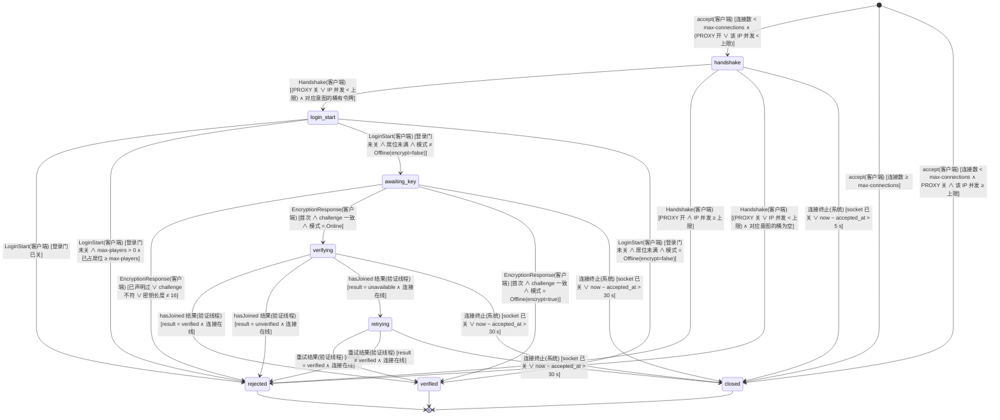

迁移表：

| 源 → 目标 | 事件 | 守卫（纯布尔） | 动作（副作用） | 谁触发 | 接口/事件 |
| --- | --- | --- | --- | --- | --- |
| [*] → handshake | accept | 连接数 < `max-connections` ∧（PROXY 开 ∨ 该 IP 并发 < 上限） | L0 计数 +1；PROXY 关时 L1 计数 +1；起读、写、登录看门狗三条虚拟线程 | 客户端 | `API-PROD-003` L0 / L1 |
| [*] → closed | accept | 连接数 ≥ `max-connections` | 立即 `close()`，不发包；拒绝计数 `closed_at_accept` +1 | 客户端 | `API-PROD-003` L0 |
| [*] → closed | accept | 连接数 < `max-connections` ∧ PROXY 关 ∧ 该 IP 并发 ≥ 上限 | 立即 `close()`，不发包；拒绝计数 `too_many` +1 | 客户端 | `API-PROD-003` L1 |
| handshake → login_start | Handshake（login / transfer 意图） | （PROXY 关 ∨ IP 并发 < 上限）∧ 对应意图的桶有令牌（白名单网段恒真） | PROXY 开时 L1 计数 +1；桶扣 1 | 客户端 | `API-PROD-003` L1 / L2 |
| handshake → rejected | Handshake | PROXY 开 ∧ IP 并发 ≥ 上限 | `LoginDisconnect synaxis:too-many-connections`（明文，此时未加密） | 客户端 | `API-PROD-003` L1 |
| handshake → rejected | Handshake | （PROXY 关 ∨ IP 并发 < 上限）∧ 对应意图的桶为空 | `LoginDisconnect synaxis:login-throttled` | 客户端 | `API-PROD-003` L2 |
| handshake → closed | 连接终止 | socket 已关 ∨ now − `accepted_at` > 5 s | 关闭 socket，释放 L0 / L1 计数；不发包 | 系统 | `API-PROD-003` 握手前超时 |
| login_start → rejected | LoginStart | 登录门已关（停机 §11.4 `gate_closed` 或管理接口 `synaxis:shard/drain`） | `LoginDisconnect synaxis:server-stopping`（明文）；排在 L3 之前，不占席位 | 客户端 | `API-PROD-007`、`API-PROD-022` |
| login_start → rejected | LoginStart | 登录门未关 ∧ `max-players` > 0 ∧ 已占席位 ≥ `max-players` | `LoginDisconnect synaxis:shard-full`；不发加密请求、不读 Cookie | 客户端 | `API-PROD-003` L3 |
| login_start → awaiting_key | LoginStart | 登录门未关 ∧ 席位未满 ∧ 模式 ≠ `Offline(encrypt=false)` | 已占席位 +1（连接关闭时 −1）；发 `EncryptionRequest`（`shouldAuthenticate` = 模式为 `Online`） | 客户端 | `API-PROD-002`、`API-PROD-003` L3 |
| login_start → verified | LoginStart | 登录门未关 ∧ 席位未满 ∧ 模式 = `Offline(encrypt=false)` | 已占席位 +1；profile = `offlineUuid(username)`（现行为） | 客户端 | `API-PROD-002`、`API-PROD-003` L3 |
| awaiting_key → rejected | EncryptionResponse | 已声明过 ∨ challenge 不符 ∨ 密钥长度 ≠ 16 | `synaxis:protocol-error`；不发 HTTP；日志按 `docs/DESIGN.md` §15 限流 | 客户端 | `API-PROD-002` |
| awaiting_key → verifying | EncryptionResponse | 首次 ∧ challenge 一致 ∧ 模式 = `Online` | 读线程上开收发 cipher；把 `(username, serverHash)` 交给验证虚拟线程，取并发许可 | 客户端 | `API-PROD-002` |
| awaiting_key → verified | EncryptionResponse | 首次 ∧ challenge 一致 ∧ 模式 = `Offline(encrypt=true)` | 开 cipher；profile = `offlineUuid(username)` | 客户端 | `API-PROD-002` |
| awaiting_key → closed | 连接终止 | socket 已关 ∨ now − `accepted_at` > 30 s | 关闭 socket，释放 L0 / L1 计数 | 系统 | 内部任务 `connection.login-timeout`（`docs/DESIGN.md` §17） |
| verifying → verified | hasJoined 结果 | `result = verified` ∧ 连接在线 | profile 取 Mojang `id`、`name`、`properties`；释放并发许可 | 验证线程 | `API-PROD-002`（sessionserver 200） |
| verifying → rejected | hasJoined 结果 | `result = unverified` ∧ 连接在线 | 加密的 `LoginDisconnect synaxis:auth-failed`；不写台账，只计数 | 验证线程 | `API-PROD-002`（sessionserver 204） |
| verifying → retrying | hasJoined 结果 | `result = unavailable` ∧ 连接在线 | 随机退避 0.5～1.5 s 后重试一次 | 验证线程 | `API-PROD-002`（超时 / 429 / 5xx） |
| verifying → closed | 连接终止 | socket 已关 ∨ now − `accepted_at` > 30 s | 丢弃验证结果，不创建 `Player`，不写台账 | 系统 | 内部任务 `connection.login-timeout` |
| retrying → verified | 重试结果 | `result = verified` ∧ 连接在线 | 同 verifying → verified | 验证线程 | `API-PROD-002`（sessionserver 200） |
| retrying → rejected | 重试结果 | `result ≠ verified` ∧ 连接在线 | `result = unverified` 时 `synaxis:auth-failed`，否则 `synaxis:auth-unavailable`（均加密） | 验证线程 | `API-PROD-002` |
| retrying → closed | 连接终止 | socket 已关 ∨ now − `accepted_at` > 30 s | 同 verifying → closed | 系统 | 内部任务 `connection.login-timeout` |

`verified` 之后回到 `docs/DESIGN.md` §11.1 的 `login → configuration`：开压缩 → `AsyncPlayerPreLoginEvent`（封禁与白名单判定，`API-PROD-009`）→ `LoginSuccess`。重复 UUID 的判定在 `LoginAcknowledged` 的 `createPlayer`（`LoginListener.java:193-212`）：离线模式仍按 `docs/DESIGN.md` §11.1 拒后来者；在线模式踢旧会话（`synaxis:logged-in-elsewhere`），然后新连接在本连接的读虚拟线程上等旧 `Player` 从实例移除（实体追踪器拒绝重复 UUID，`uuidPlayerMap` 虽已释放、旧实体要到下一 tick 才移除），上限 5 s，与 §11.3 的租约重试共用这 5 s；超时断线 `synaxis:state-unavailable`。改动落在 `LoginListener.java` 与 `ConnectionManager.java`。踢人阶段（`ConnectionManager#shutdown`）之后才到的 `LoginAcknowledged` 不再建玩家，两种模式都以 `synaxis:server-stopping` 断开、不进 configuration（§11.4 `kicking → plugins_disabled`）；判定与 `shutdown` 置位用 `ConnectionManager` 的同一把对象锁（§16）。

### 11.2 分片会话 `ENT-ShardSession`

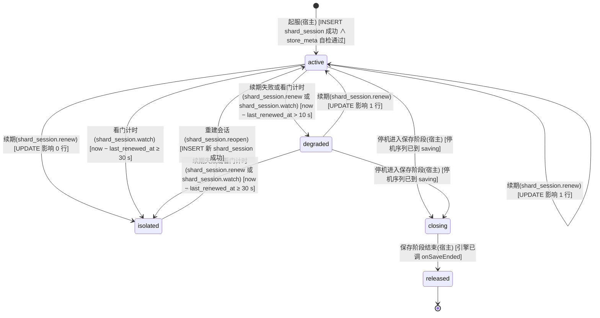

迁移表：

| 源 → 目标 | 事件 | 守卫（纯布尔） | 动作（副作用） | 谁触发 | 接口/事件 |
| --- | --- | --- | --- | --- | --- |
| [*] → active | 起服 | `INSERT shard_session` 成功 ∧ `store_meta` 自检通过（Flyway `validate` 已先通过） | 记 `session_id`；同一事务把同一 `shard_id` 的其他未过期会话置过期（`API-PROD-004` 起服语句），上一次运行持有的租约立即可被接管；前提是同一 `shard_id` 同时只有一个进程 | 宿主 | `API-PROD-004` |
| active → active | 续期 | `UPDATE` 影响 1 行 | `last_renewed_at = now` | 内部任务 `shard_session.renew` | `API-PROD-004` |
| active → degraded | 续期失败或看门计时 | now − `last_renewed_at` > 10 s | 全体在线玩家进入冻结（`isFrozen` 为 true，`API-PROD-005`）：`commitTogether` / `saveNow` 回 `UNAVAILABLE`，拾取与丢弃被取消，移动与战斗照常；`synaxis_shard_session_state` 翻转 | 内部任务 `shard_session.renew`（失败时判一次），或 `shard_session.watch`（每 250 ms 判一次：数据库不应答时续期卡在语句里直到 socket 超时 4 s，截止时刻不等它） | `API-PROD-004` |
| active → isolated | 续期 | `UPDATE` 影响 0 行（数据库判定已过期） | 自我隔离：停止一切写入，全部在线玩家 `synaxis:state-unavailable`；本会话持有的角色进 §11.3 `fenced` | 内部任务 `shard_session.renew` | `API-PROD-004` |
| active → isolated | 看门计时 | now − `last_renewed_at` ≥ 30 s | 同上一行（巡检没赶上 `degraded` 那次判定时直接隔离） | 内部任务 `shard_session.watch` | `API-PROD-004` |
| degraded → active | 续期 | `UPDATE` 影响 1 行 | 解除冻结 | 内部任务 `shard_session.renew` | `API-PROD-004` |
| degraded → isolated | 续期失败或看门计时 | now − `last_renewed_at` ≥ 30 s | 同 active → isolated | 内部任务 `shard_session.renew` 或 `shard_session.watch` | `API-PROD-004` |
| isolated → active | 重建会话 | `INSERT` 新 `shard_session` 成功 | 先把本次运行的上一个纪元置过期（`UPDATE shard_session SET expires_at = now() WHERE session_id = :旧 AND expires_at > now()`）：看门计时判隔离时上一次续期可能还在途并且成功了，不置过期的话它的租约要再等一个租约期才能被接管；再取新 `session_id`（新纪元）；恢复接受登录；旧会话留下的迟到写入被 fencing 拒掉；不把同 `shard_id` 的其他会话置过期（防双开时互相踢） | 内部任务 `shard_session.reopen` | `API-PROD-004` |
| active → closing | 停机进入保存阶段 | 停机序列已到 `saving`（§11.4） | 停止接受新的写权获取：在途的登录此后不再执行获取语句、不被准入（§11.3 `loading → offline`，判定点见本表下方）；全体在线玩家进入冻结；续期照常 | 宿主（`saveAll` 内） | `API-PROD-007` |
| degraded → closing | 停机进入保存阶段 | 停机序列已到 `saving` | 同上；保存可能全部 `UNAVAILABLE`，由租约过期兜底 | 宿主（`saveAll` 内） | `API-PROD-007` |
| closing → released | 保存阶段结束 | 引擎已调 `onSaveEnded` | 令本会话 `expires_at = now()`（只令过期，不 `DELETE`，`character.lease_session_id` 有外键指向它），使残余租约立即可被接管；停止续期；此后本分片不再发起写库：不快照、不执行释放语句；结束之前已交给写线程的写入照常收尾，写回并释放的那种失败即放弃、不再重试（§11.3 `saving → orphaned`，§11.4 `gate_closed → saving`） | 宿主（`onSaveEnded` 内） | `API-PROD-007` |

`closing` 的「停止接受新的写权获取」对在途的登录逐点生效。一次登录从载入开头到准入要等三处：载入名额、同账号在本分片的上一次登录离开（§11.3 末段）、顶号轮询的每轮间隔（§12.4）。每处等完都重查 `closing`，已置位即 §11.3 `loading → offline`（`synaxis:state-unavailable`），不再执行验票 ⑤⑥ 与获取语句。获取语句执行期间置位的，语句返回后重查，还回刚取得的写权再拒绝。准入一步（§11.3 `loading → online`）与 `closing` 置位在同一把准入锁里判定：准入在先，玩家随即被冻结、计入 `online`、进停机保存；置位在先，准入被拒，写权还回。所以保存阶段开始之后，没有登录能以本会话取得写权，也没有玩家在停机保存之外进服。剩下一处竞态：获取语句的前一刻重查未置位，而保存阶段恰在这条语句执行前走完。这时写权记在已过期的本会话上，任何分片都能立即取得，与释放等价。

`degraded` 的判据用本地单调时钟记「最后一次成功续期」，只用来提前冻结；写权是否丢失只由数据库的 `now()` 决定（`UPDATE` 影响 0 行）。`closing` 期间续期不停：否则会话在最后一次续期后 30 s 过期，而保存预算也是 30 s，末段的保存会被自己的 fencing 拒掉。续期走独占连接（`API-PROD-004`），不与批量保存争池。`closing` 期间续期影响 0 行时不换状态，未写完的角色由租约过期兜底。

### 11.3 角色写权 `ENT-CharacterLease`

取代 `docs/DESIGN-M3.md` §11.4 `ENT-StateLease`（每玩家租约）。全局一份，以 PostgreSQL 为准，Redis `presence` 只做路由提示。

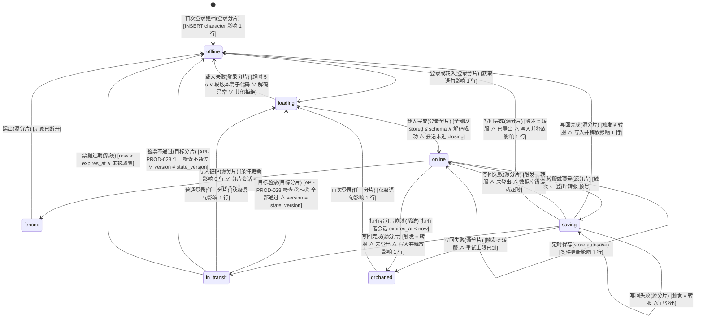

迁移表：

| 源 → 目标 | 事件 | 守卫（纯布尔） | 动作（副作用） | 谁触发 | 接口/事件 |
| --- | --- | --- | --- | --- | --- |
| [*] → offline | 首次登录建档 | `INSERT character … ON CONFLICT DO NOTHING` 影响 1 行 | 新行 `version = 0`、`lease_session_id = NULL`；紧接着执行获取语句（下一行）。插入 0 行时不走本转移，行已存在，同样直接执行获取语句 | 登录分片 | `API-PROD-004` |
| offline → loading | 登录或转入 | 获取语句影响 1 行 | Redis `SET presence:{uuid} {shard, session, loading} PX 30000`（失败不影响登录）；获取语句影响 0 行时用持有者查询拿到其 `shard_id` 发顶号（§12.4） | 登录分片 | `API-PROD-004`、`API-PROD-006` |
| loading → online | 载入完成 | 全部段 `storedVersion ≤ schemaVersion` ∧ 解码成功 ∧ 分片会话未进 `closing`（`admit` 答应之后在准入锁里判定，§11.2 表下方） | 调 `AdmissionProvider#admit`；presence 改 `online` | 登录分片 | `API-PROD-005` |
| loading → offline | 载入失败 | 超时 5 s ∨ 段版本高于代码 ∨ 解码抛异常 ∨ 其他拒绝（分片 `isolated` 或停机中（`closing` 在载入开头、每处等待之后、获取语句返回之后与准入时判定，§11.2 表下方）、载入队列或同账号上一次载入在预算内未让出、顶号超时、顶号轮询中新连接已断开、数据库错误） | 按账号执行释放语句（`API-PROD-004`），还回本会话为该账号持有的租约，含验票 ⑥ 取得的；本分片还载着该账号的另一次登录时不释放（租约是那一次的）；数据库不可达时释放也失败，租约等本会话过期才放掉；保存阶段已结束（`onSaveEnded` 之后）时不释放，会话已过期，残余写权与释放等价；断线 `synaxis:state-unavailable`；**不写任何段**，原始 JSON 不动；记 ERROR 带 `character_id` 与 `section_id` | 登录分片 | `API-PROD-005` |
| online → online | 定时保存 | 条件更新影响 1 行 | 只写脏段与当前大区位置；`version` +1 | 内部任务 `store.autosave` | `API-PROD-004` |
| online → fenced | 写入被拒 | 条件更新影响 0 行 ∨ 分片会话 = `isolated` | 停止该玩家（会话隔离时是全部玩家）的一切写入；丢弃未落库快照；写 `EVT:save_fenced` | 源分片 | `API-PROD-004` |
| fenced → offline | 踢出 | 玩家已断开 | 断线 `synaxis:state-unavailable`；不释放租约（已不属于本会话） | 源分片 | `API-PROD-004` |
| online → saving | 登出、转服或顶号 | 触发 ∈ {登出, 转服, 顶号} | 冻结该玩家（`isFrozen` 为 true，`API-PROD-005`）；tick 线程快照；登出即引擎派发 `PlayerDisconnectEvent`，包括已进 PLAY 状态、还没进世界就断开的玩家（引擎在下一个 tick 由 `ConnectionManager#updateWaitingPlayers` 派发，不等实体 tick）；顶号来自 `synaxis:kick:{shard}` 消息 | 源分片 | `API-PROD-006`（顶号）、`API-PROD-021`（转服） |
| saving → offline | 写回完成 | 触发 ≠ 转服 ∧ 写入并释放影响 1 行 | `DEL presence:{uuid}`；顶号时旧连接收 `synaxis:logged-in-elsewhere` | 源分片 | `API-PROD-004` |
| saving → in_transit | 写回完成 | 触发 = 转服 ∧ 未登出 ∧ 写入并释放影响 1 行 | presence 改 `in_transit(target)` 带 30 s TTL；签票据（带新 `state_version`）；先 `storeCookie` 再 `transfer`，之后写 `EVT:transfer_issued`（M3-E 起，`API-PROD-028` ④） | 源分片 | `API-PROD-021` |
| saving → online | 写回失败 | 触发 = 转服 ∧ 未登出 ∧ 数据库错误或超时 | 解冻；系统消息 `synaxis:transfer-failed`；不签票据；快照留着按定时保存写 | 源分片 | `API-PROD-021` |
| saving → saving | 登出 | 触发 = 转服 ∧ 尚未快照（转服已把状态置为 `saving`，下一 tick 的快照还没做） | 作废这次转服：签发端回 `SAVE_FAILED`，不签票据；触发改为登出，做登出快照、写库并释放 | 源分片 | `API-PROD-028` |
| saving → saving | 写回失败 | 触发 = 转服 ∧ 已登出（写回途中玩家断开） | 触发改为登出，保持 `saving` 与释放标记，按登出保存重试（退避同 `saving → orphaned`）：写成功即 `offline`，重试到上限或停机保存阶段已结束即 `orphaned` | 源分片 | `API-PROD-004` |
| saving → offline | 写回完成 | 触发 = 转服 ∧ 已登出 ∧ 写入并释放影响 1 行 | 同登出的 `saving → offline`：移除记录、清 presence，不进 `in_transit`；签发端照样拿到交接结果并签票（§28.2 已决，不改） | 源分片 | `API-PROD-004` |
| saving → orphaned | 写回失败 | 触发 ≠ 转服 ∧ 重试上限已到（1 s / 2 s / 4 s 退避，上限 30 s） | 丢弃快照并记 ERROR（带 `character_id` 与失败原因）；单独执行一次释放语句（不带版本号、不写段）。数据库可达而只是某段被约束拒绝（如编码后超过 64 KiB）时释放成功，玩家可在任一分片再登录；数据库不可达时释放也失败，本会话随续期失败过期，同样可接管 | 源分片 | `API-PROD-004` |
| in_transit → loading | 目标验票 | `API-PROD-028` 检查 ②～⑥ 全部通过（④ 含 `player_uuid` = 本次验证 UUID，⑤ 插入 nonce 影响 1 行，⑥ 获取语句影响 1 行）∧ 读到的 `version` = 票据 `state_version` | Redis `SET presence:{uuid} {shard, session, loading} PX 30000`；以票据 `issued_at` 记该玩家最近一次转服时刻（冷却）；调 `onClaimed`（M3-E 起，目录模式设到达点，`API-PROD-028` 到达回调）；进入与普通登录相同的载入 | 目标分片 | `API-PROD-028`、`API-PROD-004` |
| in_transit → loading | 普通登录 | 获取语句影响 1 行（写权在签票前已释放，与 `offline → loading` 同一条语句） | 同 `offline → loading`；这张票据此后到达别的分片都在检查 ⑤ 或 ⑥ 被拒，到达这次登录所在的分片而它还在时，在 ⑤ 之前就因同账号上一次登录未离开被拒（§11.3 末段） | 任一分片 | `API-PROD-004` |
| in_transit → offline | 验票不通过 | `API-PROD-028` 检查 ②～⑥ 任一不通过 ∨ 读到的 `version` ≠ 票据 `state_version` | 断线 `synaxis:transfer-rejected` 或 `synaxis:state-unavailable`（按 `reject_reason`，§14）；写 `EVT:transfer_rejected`；`version-mismatch` 时释放刚取得的写权并记 ERROR（一致性断言）；其余情况写权未被本分片取得，不动库；`lease-held` 说明角色已经由普通登录离开 `in_transit`，这时不发生状态转移，只作废这张票据。玩家之后以普通登录进任一分片都能取回角色 | 目标分片 | `API-PROD-028` |
| in_transit → offline | 票据过期 | now > 票据 `expires_at` ∧ 未被验票 | 无动作（租约早已释放），presence 自然过期 | 系统 | 内部任务 `presence` TTL（无对外 API） |
| online → orphaned | 持有者分片崩溃 | 持有者 `shard_session.expires_at` < now | 无动作；丢失窗口 = 距上次成功保存 ≤ 60 s | 系统 | 无对外 API，见 §11.2 |
| orphaned → loading | 再次登录 | 获取语句影响 1 行（它已覆盖「持有者为空」「持有者 = 本会话」「持有者会话过期」三种） | 持有者是别的会话时写 `EVT:lease_takeover`；持有者是本会话时丢弃内存里该角色的旧快照，按库里版本重新载入 | 任一分片 | `API-PROD-004` |

跨机一致性：`online → fenced` 由 §11.2 `active → isolated` / `degraded → isolated` 的动作驱动，此时本会话在库里已过期，获取语句守卫对其他分片成立。顶号时新分片先用持有者查询（`API-PROD-004`）拿到持有者的 `shard_id` 再发 `synaxis:kick:{shard_id}`，然后在 5 s 内每 250 ms 重试获取语句（`saving → offline` 释放后才成功），超时断线 `synaxis:state-unavailable`；Redis 不可达时发不出顶号消息，新登录直接 `synaxis:state-unavailable`（拒新，D7 的退化）。离线模式不发顶号，获取影响 0 行即 `synaxis:state-unavailable`（`REQ-PROD-004`）。

同一账号在同一分片上的登录串行载入：后到的登录等前一次载入结束，等待计入自己的 5 s 预算；否则两次都以本会话取得租约，被拒或被放弃的一次会把另一次的租约还掉。转入的登录也在这层保护内：`API-PROD-028` 的 ②～④ 在占位之前（读 Cookie 最长 5 s，不占位），⑤⑥ 在占位之内、同账号在本分片的上一次登录离开之后、获取语句之前执行。所以 ⑥ 取得的写权不会被同账号另一次被拒或被放弃的载入还掉；⑥ 的「持有者 = 本会话」分支也不会认下同账号另一次登录的写权，`version-mismatch` 的释放还不掉正在玩的那一次的写权。

载入之后被放弃的登录（准入被拒或 `admit` 抛异常、载入后连接已断，`PlayerStore#abandon`）已经让出了串行载入位，它的释放语句要在占位之外执行，靠的是离开的顺序：先把自己标为 `offline`（与准入通过的 `loading → online` 在同一把记录锁里判定，恰一方成立），再执行释放语句，释放提交之后才从本分片的在册表移除、完成「已离开」。后到的登录在占位里先等同账号的在册登录离开，所以它的获取语句、⑥ 的「持有者 = 本会话」分支与普通登录「持有者 = 本会话」的获取都排在这次释放之后，拿到的写权不会随后被这次释放清掉。反过来先移出在册表再释放，后到者在两步之间看不到它、不等它，就会以本会话取得写权后被它还掉：普通登录载入了却没有写权，别的分片可以同时载入同一角色；转入的登录已用掉 nonce，写权却被还掉。

### 11.4 停机顺序 `ENT-ServerProcess`（扩展 `docs/DESIGN.md` §11.2 的 `stopping`）

把 `docs/DESIGN.md` §11.2 的 `stopping` 展开成五个阶段；`started`、`stopped` 与那边同义。引擎只管阶段与计时，保存由宿主经 `ShutdownParticipant` 做（`API-PROD-007`）。

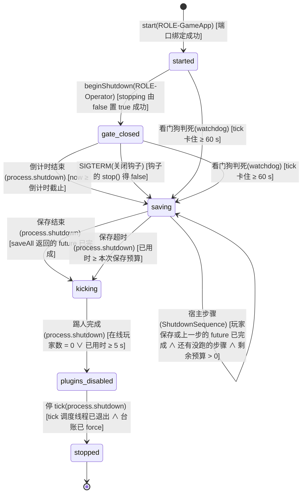

迁移表：

| 源 → 目标 | 事件 | 守卫（纯布尔） | 动作（副作用） | 谁触发 | 接口/事件 |
| --- | --- | --- | --- | --- | --- |
| [*] → started | start | 端口绑定成功 | 同 `docs/DESIGN.md` §11.2 | ROLE-GameApp | `docs/DESIGN.md` `API-003` |
| started → gate_closed | beginShutdown | `stopping` 由 false 置 true 成功（重复调用 CAS 失败，返回 false、倒计时不变） | 向调用方返回 true；序列在停机线程 `Syn-Shutdown` 上跑，`stop()` 从非 tick 线程调用时在调用线程上跑（同引擎 §11.2）；闸门 L3 置满（新 `LoginStart` 收 `synaxis:server-stopping`）；调宿主 `onGateClosed(countdown)`，宿主向服务端状态已是 PLAY 的连接广播倒计时（`synaxis:server-stopping-in`）；还在 configuration 的连接不发：play 状态的聊天包在 configuration 阶段写不出，写线程会抛异常、不带原因断开连接，这名玩家随之走登出保存、不进停机保存；`stopped` 仍为 false，`isAlive()` 仍为 true | ROLE-Operator（控制台、管理接口）/ 宿主 | `API-PROD-007`、`API-PROD-022` |
| gate_closed → saving | 倒计时结束 | now ≥ 倒计时截止 | 调宿主 `saveAll(30 s, tickAlive=true)`，以 30 s 为上限等待：宿主对全体在线玩家进入冻结（逐条在记录锁里判定，与断线事件的判定互斥，已开始登出保存的不冻结、不计入 `online`，§16）、分片会话进 `closing`，在各玩家所属 tick 线程上调插件 `onShutdownSave` 并快照，写库在虚拟线程；已准入、还没进世界（不在任何实例里）的玩家不 tick：冻结之后的下一个 tick，宿主在 tick 调度线程上以 `synaxis:server-stopping` 断开其中仍连着的（还在 configuration，等 `SelectKnownPacks` 的回答或资源包；已进 PLAY，等客户端确认 `FinishConfiguration` 或排队进世界），不等客户端；这些玩家与保存阶段内自己断开的一样，由派发其 `PlayerDisconnectEvent` 的线程调钩子并快照（已进 PLAY 的是 tick 调度线程上的 `updateWaitingPlayers`，还在 configuration 的是断开连接的线程，宿主断开的即 tick 调度线程），每人恰一次；冻结开始之后在途的登录不再取得写权、不被准入（§11.2 表下方）；快照过的玩家标记「已冲刷」，之后的 `PlayerDisconnectEvent` 不再写；保存阶段结束（`onSaveEnded`）后一律不写：断线事件不写，排在实体调度器上、到这时才轮到的停机快照不做（不调钩子），释放语句不执行；玩家存完后宿主依次跑装配时注册的停机步骤（下文 `saving → saving` 宿主步骤） | 内部任务 `process.shutdown` | `API-PROD-007` |
| started → saving | 看门狗判死 | tick 卡住 ≥ 60 s | 置 `stopping`；跳过倒计时；调 `saveAll(15 s, tickAlive=false)`：宿主跳过插件钩子，由停机线程直接读快照（数据可能不一致，记 WARN）；§11.5 同时开始 15 s halt 计时，所以这条路径的保存预算是 15 s | 内部任务 `watchdog`（判死回调线程 `Syn-Watchdog-Report`） | `API-PROD-013` |
| gate_closed → saving | 看门狗判死 | tick 卡住 ≥ 60 s | 放弃剩余倒计时；其余同 started → saving | 内部任务 `watchdog`（判死回调线程 `Syn-Watchdog-Report`） | `API-PROD-013` |
| gate_closed → saving | SIGTERM | 关闭钩子调 `stop()` 得 false（停机已由控制台、玩家命令或管理接口的 `beginShutdown` 占下） | 放弃剩余倒计时；其余同 `倒计时结束` 一行（`saveAll(30 s, tickAlive=true)`）。钩子线程等这次序列走到 `stopped` 才返回：JVM 跑完关闭钩子就 halt，不等非 daemon 的 `Syn-Shutdown`，钩子不等就会把倒计时之后的保存、踢人、插件 `onDisable` 与台账 `force` 一起截掉。信号到达时已过了倒计时的，钩子同样等到序列跑完，阶段照常推进 | ROLE-Operator（SIGTERM；关闭钩子线程） | `docs/DESIGN.md` `API-003`、`API-PROD-007` |
| saving → saving | 看门狗判死 | tick 卡住 ≥ 60 s | 阶段不变；保存截止改为 min(原截止, 判死后 15 s)；引擎再调一次 `saveAll(剩余预算, false)`，宿主尚未完成的快照改由停机线程直接读（记 WARN）；宿主 `ShutdownSequence` 等玩家存完后在停机线程上以 `false` 跑剩下的停机步骤，已以 `true` 开始、还没完成的那一步再调一次 | 内部任务 `watchdog`（判死回调线程 `Syn-Watchdog-Report`） | `API-PROD-013` |
| saving → saving | 宿主步骤 | 玩家保存或上一步的 future 已完成 ∧ 还有没跑的步骤 ∧ 剩余预算 > 0 | `ShutdownSequence` 按注册顺序调下一步 `run(剩余预算, tickAlive)`，`tickAlive` 取本次 `saveAll` 的参数：为 true 时在上一段 future 完成的线程上调，步骤只把活交给 tick；为 false 时停机线程直接调并等它。最后一步完成后 `saveAll` 返回的 future 才完成；没有注册步骤时不发生这条转移 | 宿主（`ShutdownSequence`） | `API-PROD-007` |
| saving → kicking | 保存结束 | `saveAll` 返回的 future 已完成（宿主：玩家保存与全部停机步骤都已完成） | 调宿主 `onSaveEnded(false)`：宿主写 `EVT:shutdown_saved`（`saved = online`）并驱动 §11.2 `closing → released` | 内部任务 `process.shutdown` | `API-PROD-007` |
| saving → kicking | 保存超时 | 已用时 ≥ 本次保存预算（正常 30 s，判死路径 15 s） | 调宿主 `onSaveEnded(true)`：未完成的角色逐个记 ERROR（`character_id`），写 `EVT:shutdown_saved`（`saved < online`），驱动 §11.2 `closing → released`，残余租约随会话过期立即可被接管；在跑的停机步骤不再等、由它自己记 ERROR，没轮到的步骤由 `ShutdownSequence` 各记一条 ERROR，有步骤时玩家存储只在自己的保存没完成时按超时收尾 | 内部任务 `process.shutdown` | `API-PROD-007` |
| kicking → plugins_disabled | 踢人完成 | 在线玩家数 = 0 ∨ 已用时 ≥ 5 s | `synaxis:server-stopping` 踢全部连接（`ConnectionManager#shutdown`），此后不再建玩家：停机前收到 `LoginSuccess`、踢人之后才回 `LoginAcknowledged` 的连接以 `synaxis:server-stopping` 断开，不进 configuration（与 `shutdown` 同锁判定，§16；进程随即退出，这个断线包尽力送达）；PLAY 玩家的 `PlayerDisconnectEvent` 在仍运行的 tick 线程上派发；然后 `scheduler.shutdown()` 执行宿主挂在 `buildShutdownTask` 上的 `host::disableAll`（插件 `onDisable`）：投递到 tick 调度线程在两个 tick 之间执行，1 s 没被接走或已判死时改在停机线程执行（`API-PROD-007`） | 内部任务 `process.shutdown` | `API-PROD-007` |
| plugins_disabled → stopped | 停 tick | tick 调度线程已退出 ∧ 台账已 `force` | 先置 `stopped`，`TickSchedulerThread` 的 `while (isAlive())` 在当前 tick 结束后退出并被 join；停 dispatcher；台账写线程 2 s 内排空；关 Redis 与连接池 | 内部任务 `process.shutdown` | `docs/DESIGN.md` `API-003` |

起服完成之前没有停机转移：`[*] → started` 之前（`Main` 的 `server.start` 返回之前）宿主不调 `beginShutdown`。这段时间里对外只有管理接口在监听（它排在插件启用之前，`API-PROD-022`），它的 `minecraft:server/stop` 回 −32000、不停机，`Main` 在 `server.start` 返回之后、就绪行之前才放行（`ManagementMethods#serverStarted`）；控制台读线程在就绪行之后才起，玩家要等游戏端口。引擎本身不拦：`start` 之前调 `beginShutdown` 或 `stop()` 照样跑完序列（测试里从不 `start` 的进程靠 `stop()` 收尾），而宿主的停机任务（插件 `onDisable`、台账、存储、指标与管理接口的关闭）在 `server.start` 之前的最后一步才注册，更早跑完的序列一样都没执行；`Main` 接着绑上游戏端口，进程不 tick、不退出。插件在 `onEnable` 里经 `PluginContext#process()` 停机会落进同一处，见 §28.2。

与第 3 波之前的差异：旧序是 `stop()` 一上来就置 `stopped`（`8de32ab9b4` 时的 `ServerProcessImpl.java:287`），tick 循环随即退出，然后 `joinThread(tick)` → `scheduler.shutdown()`（插件 `onDisable` 在这里）→ `connection.shutdown()` → daemon 线程补跑最后一个 tick（同一提交的 `:304-317`），插件先于玩家断线被禁用。新序里 `stopped` 推迟到最后一步置位，tick 一直运行到踢人与插件禁用之后，那条 daemon 补 tick 删除。`kicking` 与 `plugins_disabled` 期间 tick 卡死时不另设转移：§11.5 判死后 15 s halt，残余租约此时已随 `closing → released` 过期。

### 11.5 看门狗 `ENT-Watchdog`

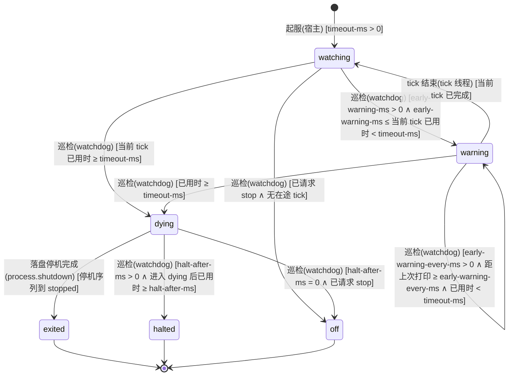

迁移表（键名省略前缀 `synaxis.watchdog.`，默认值与各键取 0 的含义见 `API-PROD-013`）：

| 源 → 目标 | 事件 | 守卫（纯布尔） | 动作（副作用） | 谁触发 | 接口/事件 |
| --- | --- | --- | --- | --- | --- |
| [*] → watching | 起服 | `timeout-ms` > 0 | 起平台线程 `Syn-Watchdog`，每 1 s 巡检一次；`timeout-ms` = 0 时不起线程，只记一行 INFO，不进入本状态机 | 宿主（`Main` 在首个 tick 之前调 `ServerProcess#watchdog().start`） | `API-PROD-013` |
| watching → warning | 巡检 | `early-warning-ms` > 0 ∧ `early-warning-ms` ≤ 当前 tick 已用时 < `timeout-ms` | 打印正在跑 tick 的线程与全部 TickThread 的栈（一条 WARN）；`synaxis_watchdog_warnings_total` +1（该指标随 5A 接上） | 内部任务 `watchdog` | `API-PROD-013` |
| warning → warning | 巡检 | `early-warning-every-ms` > 0 ∧ 距上次打印 ≥ `early-warning-every-ms` ∧ 已用时 < `timeout-ms` | 再打印一次栈 | 内部任务 `watchdog` | `API-PROD-013` |
| warning → watching | tick 结束 | 当前 tick 已完成 | 记一行 INFO「tick 恢复，卡住 N ms」 | 跑 tick 的线程（`TickerImpl.tick` 的 `finally`） | `API-PROD-013` |
| watching → dying | 巡检 | 当前 tick 已用时 ≥ `timeout-ms` | 同 warning → dying（这个 tick 还没打过警告就已到 `timeout-ms` 时走这条：`early-warning-ms` = 0、不小于 `timeout-ms`，或两者相差不足一个巡检间隔） | 内部任务 `watchdog` | `API-PROD-013` |
| warning → dying | 巡检 | 已用时 ≥ `timeout-ms` | 一条 ERROR 带正在跑 tick 的线程与全部 TickThread 的栈；在单独线程 `Syn-Watchdog-Report` 上调宿主的判死回调：写崩溃报告，第 3 波起再按停机序列当前阶段驱动 §11.4 的判死转移（`started` 或 `gate_closed` → `saving`，已在 `saving` 时 `saving → saving`，已到 `kicking` 之后不驱动）；回调卡住不影响 halt 计时。进入 `dying` 后 tick 结束也不回 `watching` | 内部任务 `watchdog` | `API-PROD-013` |
| watching → off | 巡检 | 已请求 stop ∧ 无在途 tick | 巡检线程退出。有在途 tick 时 `stop()` 不生效，直到该 tick 结束或判死 | 内部任务 `watchdog`（`stop()` 由停机任务调用） | `API-PROD-013` |
| dying → exited | 落盘停机完成 | 停机序列到 `stopped` | 进程退出码 70（第 3 波 3A 接上判死保存后才有这条路径，第 0 波判死后只能 halt） | 内部任务 `process.shutdown` | `API-PROD-013` |
| dying → halted | 巡检 | `halt-after-ms` > 0 ∧ 进入 `dying` 后已用时 ≥ `halt-after-ms` | `Runtime.halt(70)`；由 systemd 或容器重启；残余租约 ≤ 30 s 后可接管 | 内部任务 `watchdog` | `API-PROD-013` |
| dying → off | 巡检 | `halt-after-ms` = 0 ∧ 已请求 stop | 巡检线程退出，进程由停机序列正常结束 | 内部任务 `watchdog` | `API-PROD-013` |

跨机一致性：§11.4 三条判死转移的守卫「tick 卡住 ≥ 60 s」与 `watching → dying`、`warning → dying` 同一判据（默认值下）；停机序列处于 `started`、`gate_closed`、`saving` 时恰有一条成立，处于 `kicking` 及之后时不驱动，由 `dying → halted` 收尾。判死路径的保存预算是 15 s（halt 计时），不是正常停机的 30 s。`dying → halted` 先于 `onSaveEnded` 发生时 §11.2 的会话不会走到 `released`，残余租约靠 30 s 过期（§11.3 `online → orphaned`）。

## 12. 关键流程时序

### 12.1 在线模式登录：闸门 → 加密 → 验证 → 准入 → 载入

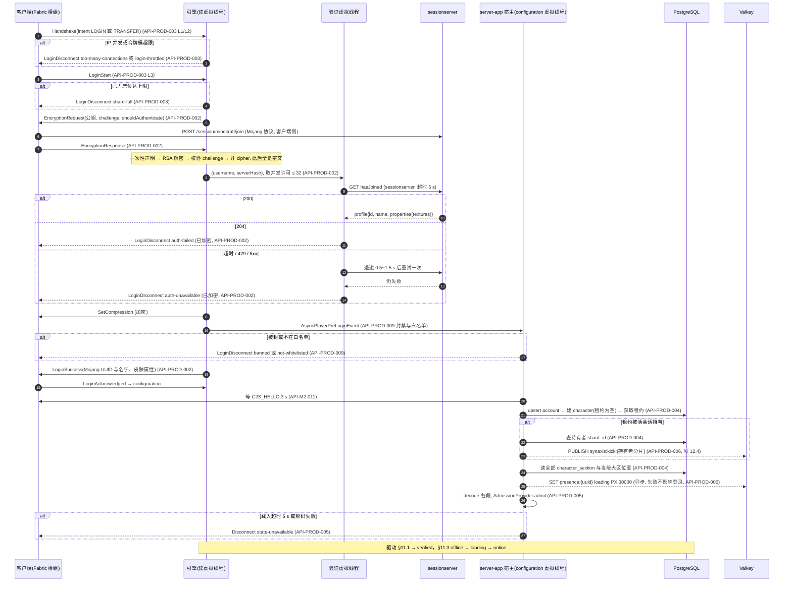

### 12.2 优雅停机

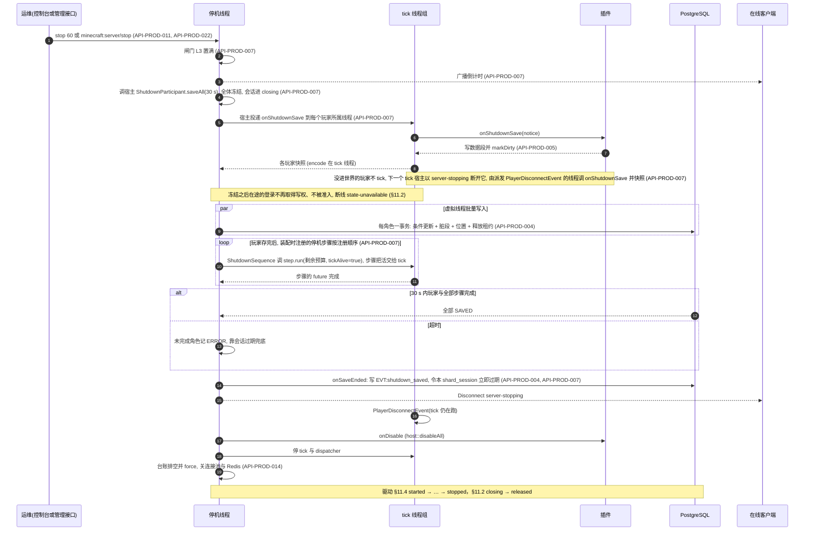

### 12.3 跨大区转服与目标分片重新验证

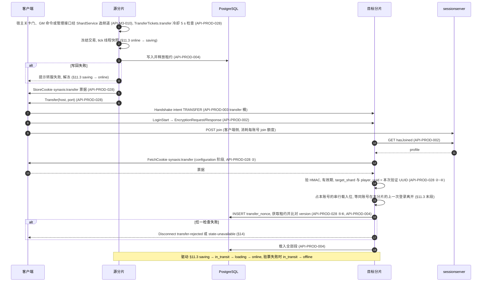

### 12.4 跨分片顶号

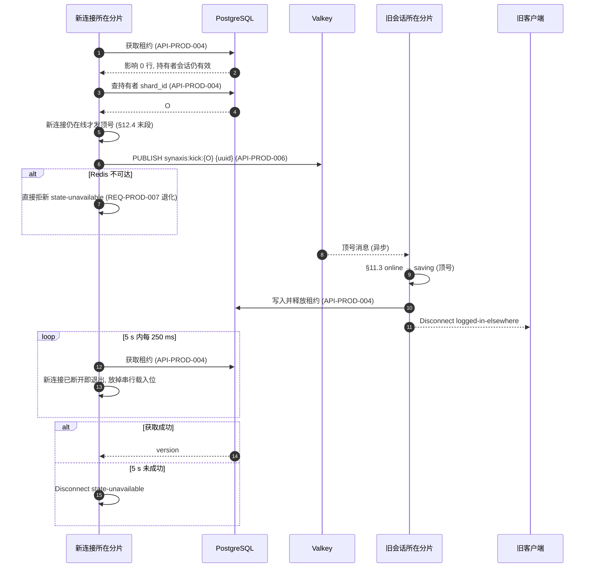

同分片内的重复 UUID 不经 Redis：引擎在 `LoginAcknowledged` 的 `createPlayer` 处直接踢旧（在线模式），等旧 `Player` 从实例移除（≤ 5 s，§11.1 末段）；旧会话在本分片走 §11.3 `online → saving → offline` 后新连接才获取租约，两段等待共用 5 s。

离线模式跨分片不走本图：获取影响 0 行直接断线 `synaxis:state-unavailable`。同一账号在同一分片的登录串行载入（§11.3 末段），一次登录停在本图的轮询里时，同账号在本分片的新登录要等它结束。所以轮询每次获取语句影响 0 行之后、发顶号之前，先查新连接是否仍在线（`isOnline()`），已断开即以 `synaxis:state-unavailable` 退出：不为一条已断开的连接去踢持有者，放掉串行载入位与载入名额；客户端断开后立刻重连的新登录不用等旧的轮询跑满 5 s，能用满自己的 5 s 预算发顶号并等持有者释放。

## 13. 页面与跳转地图

N/A — 本分册没有新页面。断线原因的文案住在客户端模组的 `assets/synaxis/lang/zh_cn.json`、`en_us.json`（§14 的每个新键都要进两份文件，§24 翻译键门禁检查）；客户端界面与跳转见 `docs/DESIGN-M2.md` §13。

## 14. 错误处理与错误码

无 HTTP，不用 RFC 9457。沿用 `docs/DESIGN.md` §14：断线原因是 `translate` 键，排障关联 ID 是 `connection_id`，每行日志携带、断线文本不携带。连接层概念的键住引擎 `network/DisconnectReasons.java`（现有 6 个），玩法与宿主概念的键住 `:plugin-api` 的 `DisconnectKeys`（现有 4 个，本分册加 `synaxis:banned`、`synaxis:not-whitelisted`、`synaxis:state-unavailable`、`synaxis:transfer-rejected`；M3 不加键，频道满的 `synaxis:shard-full` 住引擎，因为判定点 L3 在引擎里）。管理接口的鉴权失败到不了 JSON-RPC 这一层，握手即拒（`API-PROD-022`）；JSON-RPC 错误用标准错误码 −32700、−32600～−32603 与 −32000（此刻做不了），`error.data.request_id` 带本次调用的 UUID。

| 错误码（type） | 住处 | 协议动作 | 语义 | 客户端处理约定 |
| --- | --- | --- | --- | --- |
| `synaxis:too-many-connections` | 引擎 | LoginDisconnect（明文） | 同一 IP 并发连接数达上限（L1） | 提示「同一网络连接数过多」，附报障途径 |
| `synaxis:login-throttled` | 引擎 | LoginDisconnect（明文） | 同一 IP 登录或转入太频繁（L2） | 提示稍候几秒再试 |
| `synaxis:shard-full` | 引擎（`DisconnectReasons`） | LoginDisconnect（明文） | 已占席位达 `max-players`（L3），login 与 transfer 意图同一判定，不发加密请求、不读 Cookie、不消耗票据 nonce；即 `API-PROD-028` 检查 ①，configuration 阶段不再判容量 | 提示本频道已满，模组可自动换频道；频道满只有这一个键 |
| `synaxis:auth-failed` | 引擎 | LoginDisconnect（已加密） | `hasJoined` 回 204：该名字没有用正版会话加入本服 | 提示用正版启动器登录 |
| `synaxis:auth-unavailable` | 引擎 | LoginDisconnect（已加密） | `hasJoined` 超时、不可达、429 或 5xx，重试一次后仍失败 | 提示正版验证服务暂时不可用，稍后重试 |
| `synaxis:logged-in-elsewhere` | 引擎 | Disconnect（发给旧会话） | 同一 Mojang UUID 从别处登录（仅在线模式） | 提示账号在别处登录 |
| `synaxis:outbound-backlog` | 引擎 | Disconnect | 出站积压超过 `max-backlog-bytes` 且无可丢的位置包 | 提示网络过慢，重连 |
| `synaxis:keep-alive-timeout` | 引擎 | Disconnect | keep-alive 超过 `keepAliveKick` 未应答（替换纯文本 `"Timeout"`） | 提示连接超时，重连 |
| `synaxis:banned` | plugin-api | LoginDisconnect（已加密） | 该 UUID 或 IP 网段有生效的封禁；翻译参数：理由、到期说明（嵌套的 `synaxis:banned-until`，永久封禁时为空组件） | 显示理由与到期时间 |
| `synaxis:not-whitelisted` | plugin-api | LoginDisconnect（已加密） | 白名单开启且该 UUID 不在名单 | 提示内测资格 |
| `synaxis:banned-until` | `server-app`（`HostModeration`），模组两份 lang | `synaxis:banned` 的第二个翻译参数；参数：到期时间 `yyyy-MM-dd HH:mm UTC` | 有到期的封禁才带，永久封禁时第二个参数为空组件 | 显示「封禁到某时结束」 |
| `synaxis:role-granted`、`role-revoked`、`role-list`、`role-unknown`、`role-not-granted`、`role-no-target`、`role-unavailable`、`role-above-sender` | `server-app`（`RoleCommand`），模组两份 lang | 发给命令发送者的系统消息，不断线 | `role` 命令的回执：授予、收回、列出、角色不存在、未持有该角色、找不到目标、读不到角色数据、玩家发送者要动的角色有自己没有的节点（`API-PROD-010`） | 显示译文；控制台写回退文本 |
| `synaxis:ban-done`、`unban-done`、`unban-none`、`whitelist-added`、`whitelist-removed`、`moderation-no-target`、`moderation-bad-duration`、`moderation-bad-reason`、`moderation-unavailable` | `server-app`（`ModerationCommands`），模组两份 lang | 发给命令发送者的系统消息，不断线 | `ban`、`unban`、`whitelist` 的回执：成功三种、没有该编号的生效封禁、找不到目标、时长写法不对、理由长度不对、读不到封禁数据（`API-PROD-009`） | 显示译文；控制台写回退文本 |
| `synaxis:command-list`、`command-no-player`、`command-kicked`、`command-broadcast`、`command-saved`、`command-stopping`、`command-already-stopping`、`command-stop-usage`、`command-tps`、`command-profile-started`、`command-profile-done`、`command-profile-busy`、`command-profile-usage`、`command-profile-failed` | `server-app`（`HostCommands`），模组两份 lang | 发给命令发送者的系统消息，不断线 | 内置七条命令的回执（`API-PROD-011`）；`kick` 不带原因时踢人文本用原版键 `multiplayer.disconnect.kicked`，插件命令抛异常时发送者收到原版键 `command.failed` | 显示译文；控制台写回退文本 |
| `synaxis:state-unavailable` | plugin-api | Disconnect（configuration 阶段）或 Disconnect（play 中被隔离） | 玩家数据暂时拿不到，六种来源：载入超时或解码失败（§11.3 `loading → offline`）；停机保存阶段开始时仍在途的登录（§11.2 表下方）；分片会话隔离（§11.2）；顶号 5 s 内未拿到租约，或 Redis 不可达时租约被活会话持有（§11.3 末段）；转入时写权被别处持有（`API-PROD-028` ⑥ `lease-held`）；验票时数据库错误或超时（`store-unavailable`） | 提示稍后重试；30 s 后重试（会话租约最长 30 s 过期） |
| `synaxis:transfer-rejected` | plugin-api | Disconnect（configuration 阶段） | 转入的票据不可用：缺失或签名无效、已过期、目标分片或 UUID 不符、nonce 已用、版本不一致（`API-PROD-028` ②～⑤ 与一致性断言）。写权在签票前已释放，玩家重新登录任一分片都能取回角色 | 提示「切换大区失败，请重新登录」；10 分钟内第二次出现时提示报障并附时间 |
| `synaxis:transfer-failed` | `server-app`（`TicketIssuer`、`ShardGates`），模组两份 lang | 系统消息，不断线 | 转服写回失败（§11.3 `saving → online`），或快照前登出作废了转服；或关卡门发起的转服在源分片选不到频道（`ShardTransferResult` 的 `FULL`、`OFFLINE`、`DIRECTORY_UNAVAILABLE`，`docs/DESIGN-M3.md` `API-M3-010`，M3-E 起）。玩家留在源分片；关卡门的情形走出门框再走进可重试 | 显示「转服失败，请稍后再试」 |
| `synaxis:server-stopping-in` | `server-app`（`PlayerStore#onGateClosed`），模组两份 lang | 系统消息，不断线；参数：倒计时秒数 | 停机闸门关闭且倒计时不为 0 时向服务端状态已是 PLAY 的玩家广播一次，还在 configuration 的不发（§11.4 `started → gate_closed`） | 显示「服务器将在 N 秒后关闭」 |
| `synaxis:server-stopping` | 引擎（现有） | LoginDisconnect / Disconnect | 本分册加三种来源：停机闸门关闭后的新登录；保存阶段开始后的下一个 tick，已准入、还没进世界的玩家（§11.4 `gate_closed → saving`）；踢人阶段之后才回 `LoginAcknowledged` 的连接（§11.4 `kicking → plugins_disabled`） | 提示服务器维护 |
| `synaxis:protocol-error` | 引擎（现有） | Disconnect | 本分册加两种来源：加密握手非法（重复、未请求、challenge 不符、密钥长度错）、入站包速率闸 KICK | 同 `docs/DESIGN.md` §14 |

L0、L0′、accept 时的 L1 超限与握手前超时都不发包，没有键，对端看到 TCP 被关。204 与闸门拒绝不写台账、不逐条写日志，只按 10 s 汇总一行（`Connection gate rejected N connections in the last 10 s: too_many=… throttled=… full=… closed_at_accept=… handshake_timeout=…`），满足 `docs/DESIGN.md` §15 日志量行。被闸门拒的连接与 204 一样不写 `Connection closed` 行（`API-PROD-003`「拒绝的关闭方式」）；汇总行由 tick 线程驱动，tick 卡住期间不出。

## 15. 非功能需求

数字追溯 §2。标「未测」的是草案按预算推的目标，第一次压测后按实测改。

| 维度 | 场景 | 目标 |
| --- | --- | --- |
| tick 预算 | 单分片 200 机器人（walk，30 min）；500 机器人（walk，600 s）与「500 人挤在 1 个分格」 | 200 人：tick P99 < 50 ms、超 50 ms 的 tick 为 0、RSS < 4 GiB；500 人两档分别记 tick P99 与每人出口，不达标则频道 `capacity` 降到 200～300（运维草案 ⑤ 5.4 C / D，`docs/DESIGN-M3.md` §15） |
| 登录延迟 | 在线模式单客户端从 TCP 接入到 `LoginSuccess` | `hasJoined` p99 由上线前 1,000 次探测定（auth 草案 §4.3，目标机房连通性**未核实**）；登录总超时 30 s 不变 |
| 登录风暴 | 500 机器人同秒断开再重连，`max-joins-per-tick=5` | 30 s 内全部进 play；0 次 `shard-full`；风暴那一分钟 tick P99 < 50 ms（运维草案 5.4 E） |
| 闸门 | 单个攻击 IP 以 100 连接/秒开合 60 s，同时 200 机器人在线（机器人网段白名单） | 连接数 ≤ L0；机器人 0 掉线；拒绝日志 10 s 至多 1 行；台账 0 条来自攻击 IP 的会话事件（5.4 G；只在在线模式成立：离线模式下攻击 IP 通过 L2 的那几次登录（每 2 s 1 次）不经验证就进 configuration，会写会话事件） |
| 空闲占位 | 单个 IP 打开 1,024 条连接、一个字节都不发，同时 200 机器人在线 | 不开 PROXY：第 17 条起在 accept 时被关；开 PROXY：每条至多挂 5 s；机器人 0 掉线 |
| 验证前代价 | 被闸门拒绝的连接 | 0 次 RSA 解密、0 次 `hasJoined`（`ADR-PROD-002`） |
| 加密 CPU | 200 人 C 档加 `--encryption on` | 记服务端 CPU 与 tick P99 相对不加密的差值；判据首轮数据出来再定（5.4 F）；超过 1 个核的 10% 触发 `REQ-PROD-042` |
| 持久化 | 500 机器人、定时保存 60 s，与关闭持久化对照 | tick P99 增量 ≤ 1 ms；单玩家快照 P99 ≤ 0.2 ms；数据库写入 P99 ≤ 50 ms；500 人 60 s 内登录风暴全部载入成功（持久化草案 P12，全部**未测**） |
| 关键操作 | `saveNow` / `commitTogether` | 玩家可见等待 P99 ≤ 1 s（持久化草案 ③，未测） |
| 丢失窗口 | 崩溃（`kill -9`、OOM、断电） | 非关键进度 ≤ 60 s；关键操作 0（D4）；租约 ≤ 30 s 后可接管；同一 `shard_id` 重启后立即可接管（起服事务把旧会话置过期，§11.2） |
| 停机 | 500 人在线 `stop` | 保存阶段预算 30 s，所有有脏段的角色 `version` +1、全部租约为空（持久化草案 P7 的目标是总时长 < 10 s，未测）；部署 `TimeoutStopSec` ≥ 60 s |
| 数据库故障 | PostgreSQL 暂停 60 s | 新登录 ≤ 5 s 收到 `state-unavailable`（没有精确测，按超时推算最坏约 1 + 4 s）；在线玩家 10 s 冻结、30 s 踢出；恢复后 5 s 内可登录（P8） |
| Redis 故障 | Valkey 暂停 60 s | 登录成功率 100%；WARN ≤ 7 行（P9） |
| 台账 | 200 人 30 min | `ledger_dropped` 0 条；崩溃最多丢 1 s；正常停机丢 0 条（运维草案 ③ 3.3） |
| 带宽 | 200 人步行 / 骑乘 | 分片出站与 68 / 90 Mbit/s 偏差 ≤ ±20%（M3 口径，阈值归 M3）；每连接出站积压 ≤ 4 MiB |
| 可见实体 | 200 人同格 | 每玩家可见非必显实体 ≤ 100；200 人同格合计出站 < 100 Mbit/s 时才放宽上限（清单 G21） |
| 实体休眠 | 2,000 个实体散在 1,024 × 1,024 格、200 名玩家在出生点半径 64 格内，平地、有重力，1 条 tick 线程（`jmh-benchmarks` 的 `EntityDormancyBenchmark`） | 机制本身每 tick 约 0.046 ms（`API-PROD-019` 休眠开销一条）。整 tick 的 CPU 时间（基准线程加 tick 线程）实测：不设策略 977 µs；分档策略（> 32 格每 20 tick、> 64 格每 100 tick；53 个每 tick 跑、40 个每 20、1,907 个每 100）381 µs，少 61%；全体每 20 tick 419 µs；策略恒返回 1 为 1,020 µs，比不设策略多 43 µs。测时本机有别的会话在编译（`load1` 7.7～76），各档取 3 个 fork × 10 次测量迭代的最小值，中位数被负载拉高、不可比（`docs/TEST.md` TC-PROD-421） |
| 入站限流 | 单连接 | 7 s 窗口 > 582 包 KICK（200 人 walk 基线每人上行 P99 291 × 2）；解压后负载 > 4 MiB/s KICK；补全 > 20 次/秒丢弃 |
| 聊天 | 单连接 | > 1 条/秒（burst 3）丢弃；引擎默认 0 收件人，一进 0 出 |
| 管理接口 | 单连接 | 一条消息 ≤ 65,536 B，超出以 1009 断开、不执行，分片的消息在累计超出的那一片断开；一条消息 ≤ 1,024 片，第 1,025 片即以 1009 断开；握手前的请求 ≤ 8,192 B、accept 后 5 s 内完成握手，否则关 socket；出站排队未写出的 ≤ 4,096 帧，已有 1 MiB 未写出时不再入队，到限即以 1008 关闭（`API-PROD-022`，本分册定） |
| 指标端点 | 单连接 | 一次抓取从读到请求的第一个字节到写完响应 ≤ 10 s，超出即关连接；每次抓取一条虚拟线程，停住的连接不挡别的抓取（`API-PROD-015`，本分册定） |
| 看门狗 | tick 卡住 | 10～11 s 首次打印栈；60～61 s 判死（巡检间隔 1 s）；判死后 ≤ 16 s 进程退出 |
| 日志与磁盘 | 12 个月 | 服务日志总量 ≤ 10 GB、保留 14 天；台账每日 ≤ 1 GiB、保留 30 天；崩溃报告不自动删，由 `RB-PROD-003` 处理后归档；堆转储不自动删、不归档，按 §28.2 堆转储一行在本机分析完即删 |
| 数据增长 | 12 个月 | `character` 行数 = 注册角色数，按 32,000 在线 × 10 倍注册估 32 万行；`character_section` ≤ 32 万 × 段数 × 64 KiB（上界，与 M3 §15「≈ 20 GiB 上界」同口径）；`transfer_nonce` 由 `transfer_nonce.gc` 每 10 min 删过期行（行数 ≤ 转服速率 × 30 s）；`shard_session` 每小时删 1 天前过期且无引用的行；`item_ledger` 写入量未测，超过保存次数 2 倍时改为只记稀有物品（D5）；`ban` 与 `account_role` 不清理 |
| 备份 | PostgreSQL | 恢复点目标 ≤ 5 分钟（WAL 归档 + 每日基础备份；整台数据库机器丢失时是 60 s 切段 + 至多 60 s 异地同步，约 2 分钟）；恢复时间目标按端到端停服时长计（全部分片开始 drain 到第一个分片重新就绪，含 `--migrate-only`、切连接串与起服），在第 6 波 6G 用正式库副本演练后回填；本地两次演练的 1.26 s、1.76 s 只是 3 MB 库从解包到 promote，不回填（§28.2） |
| 构建与 CI | 真客户端回归 | PR 档约 4 分钟、main 与每日约 6 分钟（折算，**未实测**）；每月约 1,600 分钟（私有仓库额度**未核实**） |
| 兼容 | 客户端 | 仅 26.2 + 本项目模组；在线模式需要正版账号 |

**第 5 波实测（v0.8）**。十档都在同一台 Apple M4 Pro 12 核 / 24 GiB（macOS，JDK 25）上跑，服务端与机器人同机走回环，本机同时有别的会话在跑构建与测试；这不是上表要求的分机档（§28.1 Q11），所以 tick 与 RSS 两项只记录不判定（§28.2）。服务端一律 `server-app` 核心模式，平地 40 层石头，`chunk-view-distance=10`、`entity-view-distance=8`，内存存储，离线模式，`-Xms3G -Xmx3G`。产物在 `docs/research/production-readiness-2026-09/load/<档名>/`，每个 `summary.json` 都能由同目录的 `bots-*.json` 与 `server.json` 经 `merge` 复算；「超 50 ms」「tick P99」是 `summary.json` 判定栏的读数，线程与分配方式除 5D 两档外都是引擎默认的 `counter` + 1。

| 档（组） | 画像与人数，时长 | 本机 load1 | tick P99 / 超 50 ms | GC 暂停 P99 | RSS 最大 | 服务端出站 | 这一档要量的 |
| --- | --- | --- | --- | --- | --- | --- | --- |
| `walk200-30m`（5A 基线） | walk 200，1,830 s | 4.3～12.3 | 6.701 ms / 18 | 91.2 ms | 1,804.8 MiB（出现在 t = 0，200 人在线时 436.5～1,318.1 MiB） | 60.5 Mbit/s | 每人 7 s 上行包数 P99 291（G11 阈值 582 的来源）；区块下行预热后 0.647 KB/s/人；200 人全部登录、0 掉线；18 个慢 tick 里 17 个与 G1 年轻代暂停重叠（`docs/TEST.md` TC-PROD-271） |
| `walk200-10m`（5B） | walk 200，630 s | 14.8～69.9 | 38.0 ms / 85 | 251.2 ms | 1,444.6 MiB | 60.2 Mbit/s | 0 掉线、0 次被踢，两种入站超限日志 0 行，积压断线 0；每 7 s 窗口上行包数最大 347，占 582 的 59.6%；Tab 列表包每人每秒 20.02 → 0.205 个（TC-PROD-301） |
| `walk200-5m-ab/5a`、`/5b`（5B 对照） | walk 200，各 330 s | 9.6～25.2 / 7.4～54.4 | 18.0 ms / 16；23.3 ms / 20 | 100.5 / 253.8 ms | 554.7 / 1,613.8 MiB | 60.4 / 59.8 Mbit/s | 调度线程忙碌比 0.055 / 0.058；5B 的 20 个慢 tick 全落在 load1 升到 54 的前 2 分钟，第 3～5 分钟逐分钟 P99 4.2～6.9 ms |
| `limit250-20bots-60s`（5B 反证） | walk 20，60 s（采样 90 s），`packet-limit.max-packets=250` | 17.4～59.0 | 4.247 ms / 0 | 28.9 ms | 383.7 MiB | 0.2 Mbit/s | 20 个机器人全部以 `synaxis:protocol-error` 被踢：阈值真的在生效 |
| `town200-cap0-10m`（5C） | town 200 同格，630 s，不设上限 | 18.7～262.7 | 48.6 ms / 117 | 137.2 ms | 507.1 MiB | 124.9 Mbit/s | 每人可见实体 P50 199；每人下行 74,384.846 B/s |
| `town200-cap100-prefix-10m`（5C，合并广播未关） | 同上，上限 100 | 28.5～210.5 | 51.7 ms / 134 | 391.0 ms | 1,274.6 MiB | 124.1 Mbit/s | 可见实体已是 100，位置包一个没少：合并广播不看裁剪 |
| `town200-cap100-10m`（5C） | 同上，上限 100 | 30.9～190.3 | 54.3 ms / 144 | 132.6 ms | 517.5 MiB | 65.4 Mbit/s | 可见实体 P99 100；每人下行 38,998.414 B/s，比不设上限少 47.6%；满足上表「可见实体」行的 < 100 Mbit/s |
| `grid-walk200-10m`（5D） | walk 200，630 s，`grid` 10 条线程 | 8.6～62.0 | 28.6 ms / 50 | 171.2 ms | 1,204.2 MiB | 60.8 Mbit/s | 玩家所在 4 个格分到 0、6、7、9 号线程；10 条 tick 线程忙碌比 0.003～0.010，合计 0.062 |
| `counter-walk200-10m`（5D 对照） | walk 200，630 s，`counter` 1 条线程 | 6.9～105.1 | 30.3 ms / 58 | 161.0 ms | 1,755.0 MiB | 60.8 Mbit/s | `Syn-Tick-0` 忙碌比 0.033；与 `grid` 档出站字节差 0.0075% |

读法：十档里除 20 人的反证档都有超 50 ms 的 tick，数量跟着本机 load1 与 GC 暂停走（5B 的 A/B 与 5D 的 grid / counter 两组对照里，同机同时段的两档慢 tick 数相差 ≤ 8 个），分不出哪一波代码引入；200 人 walk 的 tick 线程忙碌比 0.028～0.033，单线程离瓶颈还远，分格的收益要在 500 人档量。500 人两档、登录风暴、闸门、台账四类在集成后补跑，见下一段；加密与持久化两档第 5 波没有跑。

**集成后复测与 `capacity`（v0.8.1）**。第 5 波四组合入 `prod/integrate-w5` 后，同一台机器上用分片入口 `bin/server-shard`（`grid` + 10 条 tick 线程），命令行补上 `ShardMain` 当时还没写的可见上限 100 与区块上限 4（v0.8.5 起它默认就写），区块视距 10，加 `max-joins-per-tick=5`、`max-players=500`，跑了六档（`docs/TEST.md` TC-PROD-360～TC-PROD-365，产物 `load/int-*/`，`summary.json` 都能由同目录的 `bots-0.json` 与 `server.json` 复算）。六档跑的时候本机 `load1` 3.1～15.0，低于上表十档（最高 262.7）；仍是同机，tick 与 RSS 同样只记录不判定。

| 档 | 画像与人数，时长 | 本机 load1 | tick P99 / 超 50 ms | 服务端出站（每人） | 读数与对应的 §15 行 |
| --- | --- | --- | --- | --- | --- |
| `int-walk200-30m` | walk 200，1,830 s | 4.3～11.8 | 6.985 ms / 6 | 40.0 Mbit/s（24,971 B/s） | tick 预算行 200 人判据只差「超 50 ms 为 0」（5A 基线 18 个）；0 掉线、0 次被踢；出站比 5A 的 60.5 Mbit/s 少 33.9%（可见上限）；上行 7 s P99 305、max 421，是 582 的 72.3%，比 5A 高出的部分是区块回执（区块上限 4 让批数变成 2.34 倍） |
| `int-walk500-10m` | walk 500，630 s | 4.0～15.0 | 12.214 ms / 6 | 145.2 Mbit/s（36,295 B/s） | tick 预算行 500 人 walk 档；500 人全部进服、0 掉线，10 条 tick 线程忙碌比最高 0.044；服务端进程 0.78 个核，机器人进程 1.04 个核 |
| `int-town500-10m` | town 500（出生点 64 格内），630 s | 4.8～14.2 | 25.541 ms / 31 | 168.4 Mbit/s（42,105 B/s） | tick 预算行的同格档，但出生点在四个分格的公共角，500 人落在 4 个格（§28.2）；逐分钟 P99 最高 42.884 ms；可见实体 P99 100；堆最高 1,885.8 / 3,072 MiB；服务端 0.87 个核，机器人 1.06 个核 |
| `int-storm200`、`int-storm500` | 200 / 500 人断开后 0.6 s 内同名重连，`max-players=500` | 3.1～7.5 | 风暴那一分钟 6.193 / 16.538 ms | — | 登录风暴行三项都满足：全部进世界 ≤ 5.5 s（500 人时与 L4 每 tick 5 人的下限 5.0 s 相符）、0 次 `shard-full`、风暴那一分钟 P99 < 50 ms |
| `int-gate200` | 200 人在线，单 IP 100 连接/s × 60 s | 3.2～4.1 | 6.015 ms / 0 | 34.6 Mbit/s | 闸门行：进程 fd 最多 301（L0 1,024）；机器人 0 掉线；拒绝 5,968 次，汇总日志 7 行、间隔 10.00～10.05 s；台账 0 条攻击方会话事件，但这一项空转：`flood` 不回 `LoginAcknowledged`，本来就进不了 configuration（§28.2） |
| 台账（六档） | — | — | — | — | 台账行：六档 `ledger_dropped` 都是 0；200 人 30 min 只写 201 行、31,149 B，核心模式没有插件事件，写入压力没有被压到（§28.2） |

`capacity` 建议值：内测期每频道 **200**（§2 的内测规模，也是唯一跑满 30 min 的档）；正式档**暂定 500**。依据：两个 500 人档的 tick P99 是 12.214 与 25.541 ms，都 < 50 ms，按 `docs/DESIGN-M3.md` §15「tick P99 ≥ 50 ms 才把 `capacity` 降到 300」不降；500 人时 10 条 tick 线程的忙碌比最高 0.077，tick 线程远没到瓶颈；每分片出站 145.2～168.4 Mbit/s，千兆网卡够一个分片。同机档的超 50 ms tick（500 人两档 6 与 31 个）不作降容依据：200 人档也有 6 个，同机分不出是分片自身还是机器负载与 GC 暂停。500 定值要等分机档：服务端一台 Linux ≥ 8 核 / 16 GiB，机器人另一台 ≥ 4 核 / 8 GiB（500 人档机器人进程实测均值 1.04～1.06 个核、最高 1.19 个核，堆上限 2 GiB），千兆内网；在那里重跑 TC-PROD-361、TC-PROD-362（town 档出生点改到格中心），town 档 tick P99 ≥ 50 ms、或任一档有一分钟 P99 ≥ 50 ms 且那一分钟的慢 tick 不与 GC 暂停重叠，正式档就降到 300；RSS 判据（< 4 GiB）也在那一档量。定下的值写在 `shards.json` 各频道的 `capacity`（`docs/DESIGN-M3.md` `API-M3-010`）：目录模式分片起服时由 `Main` 据此写 `synaxis.max-players`，命令行或 `synaxis.properties` 给了不同的值即拒启，容量只有目录一个出处。M3-E 合并验收的分机档 500 人两档读数回填到这一段；分机档到位之前 tick 与 RSS 两项不用同机档读数判定（`docs/DESIGN-M3.md` §28.1「M3-E 的 tick 与 RSS 判据能否用同机档读数关闭」一行已决：不能，用户 2026-09-28 拍板）。

压测基线的视距（v0.8.5）：`ShardMain` 默认区块视距 12，上面六档与 5A 基线都是视距 10 量的。已登记的读数不改，复跑它们时加 `-Dsynaxis.chunk-view-distance=10` 才可比（`docs/TEST.md` TC-PROD-336、TC-PROD-360 前置）。分机档起的新基线一律按 `ShardMain` 默认值（视距 12）跑：`capacity` 定的是线上分片的容量，线上用 12；视距 12 比 10 每人多 200 个区块（729 对 529：区块环半径是视距 + 1，`API-PROD-019`），进场与移动时的区块流量随之上升，所以 500 定值与降到 300 的判断都以视距 12 的分机档为准，不拿视距 10 的同机读数外推。

## 16. 并发与一致性

引擎侧见 `docs/DESIGN.md` §16，M3 见 `docs/DESIGN-M3.md` §16（其中「两个分片同时获取同一玩家租约」「首次建档」「僵尸分片写入」三行由本表对应行取代）。

| 竞态场景 | 参与方 | 期望结果 | 依据（约束/守卫） |
| --- | --- | --- | --- |
| `minecraft:key` 到达 | 读虚拟线程 | 同一线程上同步开 cipher，再处理本批剩余字节（从下一帧起点就地解密） | `claimEncryptionResponse()` 一次性声明；第二次或未发过请求 → `protocol-error`（§11.1） |
| 开 cipher 与出站队列 | 读线程 × 写虚拟线程 | 开 cipher 前出站队列为空；写线程每包读一次 volatile 的 `EncryptionContext` | 开 cipher 时断言 `packetQueue.isEmpty() && writeLeftover == null`，测试 JVM 强制开 |
| `hasJoined` 等待期间对端断开 | 验证线程 × 读线程 | 结果丢弃，不进 configuration | 结果回来先查 `isOnline()`（§11.1 `verifying → closed`） |
| 登录风暴 | N 个验证线程 | 在途 `hasJoined` ≤ 32，其余排队；排队超过登录剩余时间按 `unavailable` | `Semaphore`，等待有上限 |
| 广播包加密 | 写线程 | 共享 `FramedPacket` 先拷进每连接缓冲再加密，共享字节不被改写 | `PlayerSocketConnection` 的 `writeBuffer` 分支 |
| 闸门计数与断开 | accept / 读线程 × 断开方 | 计数不漏减、不重复减 | 与 `ConnectionManager#removePlayer` 同锁 |
| 满员附近的并发登录 | N 条连接同时 `LoginStart` | 通过 L3 的连接数 ≤ `max-players` − 已占席位，不超员 | 已占席位是原子计数，判定与 +1 是同一次 CAS；不读只数 play 态的 `getOnlinePlayerCount()` |
| 同分片重复 UUID | 新连接读线程 × 旧 `Player` 所属 tick 线程 | 旧实体移除后新玩家才生成，实体追踪器不会遇到重复 UUID | 新连接在 `createPlayer` 处等旧 `Player` 移除，上限 5 s（§11.1） |
| 同一新账号 100 线程同时登录 | 登录载入 × 100 | 恰 1 个获得租约，`character` 恰 1 行 | `INSERT … ON CONFLICT DO NOTHING` + 获取语句（持久化草案 P2） |
| 两分片同时获取同一角色 | `API-PROD-004` × 2 | 恰一个影响 1 行；另一个走顶号或 `state-unavailable` | 单行条件 `UPDATE` |
| 被接管后旧分片迟到写入 | 旧分片 × 新持有者 | 影响 0 行，`FENCED`，旧分片踢人 | `lease_session_id = :mine ∧ version = :expected`（fencing） |
| 交易时一方版本失配 | `commitTogether` | 两边都不写，`apply` 不执行 | 同一事务内逐个条件更新，任一 0 行即回滚（持久化草案 P4） |
| 同一角色定时保存与登出保存同时触发 | `store.autosave` × 登出 | 每角色同时至多一次在途写入；新快照覆盖排队中的旧快照 | 每角色单槽队列 |
| 停机保存与 `PlayerDisconnectEvent` | 停机线程 × tick 线程 × 断开连接的线程 | 每名被冻结的玩家的停机快照恰做一次：排在实体调度器上的那次，与没进世界的玩家断开时由派发断线事件的线程做的那次，谁先到谁做；没进世界、仍连着的由冻结之后下一个 tick 的宿主断开，走同一条接手路径；快照过的玩家、保存阶段结束后的断线事件、到那时才轮到的实体调度器上的快照都不再写库。冻结与断开同时发生时恰一方成立：冻结在先，断线接手这名玩家的停机快照；断线在先，它的登出保存照常写，冻结跳过它（不计入 `online`，停机保存不等它） | 每条记录一个「已快照」原子标记（CAS）与保存阶段结束标记（断线接手与实体调度器上的快照开头都查）；`saveAll` 逐条在记录锁里判定 `online` 再置 `saving`、登记停机保存，`loggedOut` 在同一把锁里读登记与状态，钩子与快照在锁外做；§11.4 `gate_closed → saving` 动作 |
| 停机冻结与在途的登录 | 停机线程 × configuration 虚拟线程（等载入名额、等同账号上一次登录离开、顶号轮询、获取语句在途、准入） | 冻结开始之后没有登录以本会话取得写权，也没有玩家在停机保存之外进服：等待中的登录醒来即拒、不执行获取语句；获取语句在途的，返回后还回写权再拒；准入与冻结恰一方在先，准入在先的被冻结、计入 `online`、进停机保存，冻结在先的准入被拒、写权还回（保存阶段已结束时不还，残余写权随会话过期） | `closing` 置位与 `loading → online` 在同一把准入锁里判定；每处等待之后与获取语句返回之后重查 `closing`（§11.2 表下方、§11.3 `loading → offline`） |
| 已保存的玩家在踢人前继续操作 | tick 线程 × 停机线程 | 保存到踢人之间（≤ 30 s + 5 s）不产生会丢的归属变更：拾取与丢弃被取消，`commitTogether` 回 `UNAVAILABLE`（`cause=frozen`，不计入 fenced）；移动与战斗的变化不再落库，属可接受损失 | `saveAll` 开头对全体进入冻结（`API-PROD-005` `isFrozen`） |
| 停机步骤与 tick 末尾写入阶段 | 停机线程 × tick 线程 | tick 活着时步骤只把最后一次落盘排进 tick 末尾阶段，停机线程不碰步骤的数据；判死后由停机线程直接做，tick 不再推进，但卡住的那一刻若正停在同一份数据的写入里，结果可能不一致（与玩家存储判死路径同一代价） | `ShutdownSequence` 的锁：以 true 调步骤与判死接管互斥，判死后异步链不再开新步骤；以 true 开始、没完成的步骤以 false 再调一次（`API-PROD-007`） |
| 顶号消息丢失（Redis 抖动） | 新分片 × 旧分片 | 新分片 5 s 后 `state-unavailable`，不会双开 | 写权只由 PostgreSQL 判定；Redis 消息只加速释放 |
| 顶号轮询中新连接断开 | 轮询的 configuration 线程 × 读线程 | 下一轮获取之后即退出，不再发顶号；同账号立刻重连的新登录拿到串行载入位，用满自己的 5 s | 每次获取影响 0 行后查 `isOnline()`（§12.4 末段） |
| 同一票据重放 | 目标分片 × 2 | 先到者成功，后到者 `transfer-rejected`（`reason=nonce-reused`） | `transfer_nonce` 主键唯一（`API-PROD-028` ⑤） |
| 插件转服与签发同时发起 | 插件线程 × 签发的写回 | 冷却的「查」与「记」不是一次原子操作，两边可能都通过冷却；客户端照第一个到达的 `Transfer` 走，另一边的包发给已离开的连接。签发那边的写回照常完成、写权已释放，票据 30 s 过期，玩家下次登录照常载入，没有数据丢失 | 同一张冷却表（`API-PROD-021`）；与签发 ③ 期间登出的「写回成功后才登出仍签票据」同一处置（§28.2 已决为不改） |
| 同账号的转入验票与普通登录在同一分片并发 | 两条 configuration 虚拟线程 | ⑤⑥ 等另一次载入结束、同账号在本分片的上一次登录离开后才执行；⑥ 取得的写权不会被另一次被拒或被放弃的载入还掉，⑥ 的 `version-mismatch` 释放也还不掉正在玩的那一次的写权 | 串行载入占位（`PlayerStore#load`），⑤⑥ 在占位之内、获取语句之前；载入后被放弃的一次先释放、再移出在册表（§11.3 末段） |
| 同账号的一次登录载入后被放弃，另一次登录同时进同一分片 | 放弃的一方（准入所在的 configuration 虚拟线程或断线事件线程）× 后到登录的 configuration 虚拟线程 | 后到者等被放弃的一次释放提交、离开在册表之后才执行获取语句（转入的是 ⑤⑥），取得的写权不被那次释放还掉；准入通过与放弃同时发生时恰一方成立 | `PlayerStore#abandon` 在记录锁里把 `loading` 改为 `offline`（`admitted` 在同一把锁里判定），再释放，再移出在册表并完成「已离开」；后到者在串行载入占位里等在册的同账号登录离开（§11.3 末段） |
| 封禁与登录同时发生 | GM × 登录分片 | 最迟 30 s（刷新周期）内生效；有 Redis 时即时。已过预登录判定、还没进入 configuration 的连接由下一次刷新踢出 | `synaxis:moderation` 触发全量重读 + 踢出覆盖的在线与 configuration 中玩家；开始得早的读取不覆盖开始得晚的（`API-PROD-009`） |
| 角色变更与登录读角色同时发生 | GM × configuration 线程 | 登录读到的旧行不覆盖变更之后的读取，收回的角色不会被带回来 | 读取开始前先以「无角色」登记玩家，读取期间的变更通知都触发重读；按读编号取大者（`API-PROD-010`） |
| 台账多线程写 | tick、configuration、准入、启动线程 | 同线程顺序不变；跨线程行序与 `ts` 可差数微秒；聚合按 `connection_id` 配对，不按相邻行 | MPSC 队列 + 单写线程（运维草案 ③ 3.4） |
| 跨格交互 | 两个 tick 线程 | 投递到目标实体调度器，下一 tick 在目标线程执行；`Acquirable.sync` 仅当 tick 必需 | `API-PROD-016` 线程契约 |
| 休眠实体与最近的玩家在不同 tick 线程 | 实体所在格的 tick 线程 × 玩家所在格的 tick 线程 | 距离取本 tick 开始时玩家的位置，同一 tick 各线程看到同一份；不读另一线程上正在改的玩家字段，结果与谁先 tick 无关 | tick 调度线程在分发前拍 `PlayerPositions` 快照、volatile 发布（`API-PROD-019` 休眠在多 tick 线程下一条） |
| 在别的线程设视距上限或休眠策略 | 任意线程 × 玩家或实体所属 tick 线程 | 下一个 tick 由所属线程应用；上限与客户端视距引起的区块环增删、`UpdateViewDistance` 与休眠状态只由所属线程改 | 设值只写 volatile 字段，应用在 `Player#update` 与 `Entity#tick`（`API-PROD-019`） |
| 改实例视距 | 调用方线程 × 该实例各玩家所属 tick 线程 | `Instance#viewDistance(int)` 在调用方线程上当场给实例里每名玩家增删区块环、发 `UpdateViewDistance`，所以只能在 tick 调度线程上调（进程调度器任务，即插件的 `PluginScheduler#scheduleTask`，或实例调度器任务），这时没有 tick 线程在跑；在 tick 线程上调会与别的 tick 线程上玩家的 `update` 同时改同一名玩家的区块环与告诉客户端的视距 | 调用方遵守，引擎不检查 |
| 分格线程号碰到 `Integer.MIN_VALUE` | dispatcher | 下标非负 | `Math.floorMod` |
| 控制台 `stop` 与管理接口 `server/stop` 同时 | 控制台线程 × 管理调用的虚拟线程 | 恰一方得「由我发起」（回执 `synaxis:command-stopping` 或结果 `true`），另一方得已在停机 | 引擎 `stopping` 的 CAS，即 `beginShutdown` 的返回值（`API-PROD-011`、`docs/DESIGN.md` `API-003`） |
| `stop` 或 `server/stop` 与 SIGTERM 同时 | SIGTERM 关闭钩子线程 × 控制台线程、玩家所属 tick 线程或管理调用的虚拟线程 | 恰一方占下停机。SIGTERM 占下时，宿主一方回 `synaxis:command-already-stopping` 或 `false`、台账记 `invalid`，停机按 0 s 走；宿主一方占下时回复它的倒计时、台账记 `ok`；钩子的 `stop()` 得 false，钩子随即结束剩余倒计时，等这次序列跑完才返回（§11.4 `gate_closed → saving` 的 SIGTERM 一行），保存、踢人与插件 `onDisable` 照常做完 | 同上一行：宿主不另设标志，引擎占下停机与阶段离开 `RUNNING` 之间没有可乘的窗口；钩子等的是序列最后一步完成的 future（`ServerProcessImpl#stopOnSignal`），JVM 在钩子返回之后才 halt |
| 占下停机的回复与停机任务 | 回复方线程 × 执行停机任务的线程（tick 调度线程，1 s 没接走时是停机线程） | `EVT:gm_command` 那一行与管理接口的回复先于台账关闭与管理连接断开 | `HostCommands` 唯一的回复许可（`Semaphore(1)`）：`beginStop` 在问引擎之前取，回复完才交还；停机任务 `awaitStopAnswers` 排在 `ledger::close` 之前，等这个许可至多 1 s（`API-PROD-011`） |
| 起服过程中的 `server/stop` | 管理调用的虚拟线程 × `main` 线程（插件启用、`server.start`） | `server.start` 返回之前的调用回 −32000、不调 `beginShutdown`，进程照常起服；之后的调用照常占下停机，这时宿主的停机任务都已注册 | `ManagementMethods` 的 volatile 标志只由 `Main` 在 `server.start` 返回之后、就绪行之前置位一次，`server/stop` 先看它再调 `beginStop`；标志只会由 false 变 true，看到 true 的调用一定在停机任务注册之后（§11.4 表下方） |
| 踢人阶段与晚到的 `LoginAcknowledged` | 停机线程（`ConnectionManager#shutdown`）× 该连接的读虚拟线程（`createPlayer` / `createPlayerReplacing`） | 恰一方在先：建玩家在先的，被 `shutdown` 以 `synaxis:server-stopping` 踢掉；`shutdown` 在先的，不建玩家，以 `synaxis:server-stopping` 断开、不进 configuration，不会在插件禁用之后以 `synaxis:match-unavailable` 被准入拒掉，也不再往已关闭的台账写行 | `ConnectionManager` 的对象锁：`shutdown` 置「已关」与登记新玩家（`trackOrPrevious`）互斥；断线原因按 `isShutDown()` 选（§11.1 末段） |
| 两个 `profile` 同时（命令或管理接口） | 任意两条线程 | 恰一个开始录制，另一个回忙 | `Profiler#start` 持对象锁判定与登记在录的路径 |
| 玩家进出与管理连接的开关 | tick 线程 × Java-WebSocket 选择器线程 | 通知只发给入队那一刻已连上的连接；tick 线程只做 JSON 编码与入队，不等网络 | Java-WebSocket 的连接集合与每连接发送队列 |
| 同一管理连接的并发回复与出站上限 | 各调用的虚拟线程 × 触发进出通知的线程 × 解码线程（pong）× 选择器线程（写 socket） | 排队未写出的至多 4,096 帧、1 MiB 加一条消息，与同时回复的调用有几条无关 | `GuardedSocket` 的四个发送入口在这条连接的对象锁里判定并入队（`API-PROD-022` 大小一条）；选择器线程在锁外累加已写出的字节，只会让积压变小 |

一致性承诺：

- read-after-write：玩家数据在本分片内以内存为准，数据库是持久化副本；跨分片以租约交接为界，目标分片读到的一定是源分片释放时写入的版本（`version` = 票据 `state_version`）。
- Redis：`presence` 与 PostgreSQL 不一致时以 PostgreSQL 为准；Redis 恢复后 10 s 内各分片重写本分片在线名单。
- 异步投递：Redis pub/sub 至多一次，丢了由 5 s 超时与 30 s 缓存兜底；台账至少写一次不保证，崩溃丢最后 1 s。

## 17. 依赖与外部系统 / SLA

| 依赖 | 用途 | SLA | 超时/重试 | 失败影响 | 降级 |
| --- | --- | --- | --- | --- | --- |
| Mojang sessionserver | 在线模式 `hasJoined`（每次登录与每次转服） | 无公开 SLA；限速未公开（**未核实**） | 5 s；`unavailable` 随机退避 0.5～1.5 s 重试 1 次；在途 ≤ 32 | 新登录与转入失败，已在线玩家不受影响 | 无：拒绝登录（U2，`RB-PROD-001`）；降级缓存默认不做，见 §28.1 Q4 |
| PostgreSQL 16（自托管单主） | 唯一权威：账号、角色、段、租约、封禁、权限、nonce | 自托管，按 99.9% 规划（与 M3 §17 同） | 取连接 2 s；语句 2 s；读 socket 4 s；定时保存失败按 1 / 2 / 4 s 退避（上限 30 s） | 新登录失败；在线玩家 10 s 冻结、30 s 踢出 | 不设游客模式；`RB-PROD-002` |
| Valkey 8（单实例） | 在线名单、顶号通知、封禁与权限变更通知 | 无要求：可丢 | Jedis 连接超时 2 s（本分册定）；不重试，下次事件再试 | 顶号退化为拒新；跨分片通知延迟到缓存过期（30 s） | 照常登录；`RB-PROD-004` |
| pgjdbc 42.7.13 / HikariCP 7.1.0 / Flyway 13.7.0 / Jedis 8.0.1 | 驱动、连接池、迁移、Redis 客户端 | Maven Central 存量 | — | 无法构建 | 版本钉死；运行时闭包 4,159,717 B，只进 `server-app`（持久化草案 ④） |
| Micrometer + Prometheus registry | 指标 | Maven Central 存量 | — | 无法构建 | 零新依赖要求出现时改 JDK `HttpServer` 手写文本格式，约多 1 人日（§28.1 Q10） |
| Prometheus 抓取方（运维侧） | 抓 `/metrics`、告警 | 运维自建 | 抓取间隔 15 s（本分册定） | 看不到指标与告警 | 日志与台账仍在 |
| Java-WebSocket 1.6.0（`org.java-websocket:Java-WebSocket`，MIT） | 管理接口 WebSocket（`API-PROD-022`、`ADR-PROD-014`） | Maven Central 存量；最近一次发布 2024-12-15 | — | 无法构建 | 版本钉死，只进 `server-app`，运行时闭包多一个 140,686 B 的 jar；它唯一的运行时依赖 slf4j-api 本来就在闭包里。管理接口默认关，库出问题时关掉它不影响对玩家服务 |
| GitHub Actions | `ci.yml`（含 PostgreSQL 16 与 Valkey 8 服务容器）、`client-gametest.yml`、4 线程 job | GitHub SLA | — | 回归不跑 | 本地 `./gradlew check`，数据库用例连本机共用容器 `synaxis-pg` / `synaxis-valkey` |
| 测试用 PostgreSQL 16 / Valkey 8 | 数据库用例：本地连共用容器，CI 用服务容器，地址经 `SYNAXIS_TEST_PG_URL`、`SYNAXIS_TEST_PG_USER`、`SYNAXIS_TEST_PG_PASSWORD`、`SYNAXIS_TEST_REDIS_URL` 传入 | — | — | 不设变量时数据库用例跳过；设了变量而连不上时失败 | CI 设了变量并检查 store 各测试类结果文件 `skipped="0"` |
| M3 分片宿主与 `shards.json` | 频道 `capacity`、心跳、转服目标 | 见 `docs/DESIGN-M3.md` §17 | — | — | 见 M3 |

世界存储相关的接口约束（交给 M3，本分册不设计）：① 世界与区块的保存挂进 §11.4 的 `saving` 阶段，顺序为「保存玩家 → 保存覆盖层 → 停 tick」，挂载方式是装配时向 `ShutdownSequence` 注册一步（`API-PROD-007`），看门狗判死路径以 `tickAlive=false` 调它、由停机线程直接落盘；② 区块卸载在所属 tick 线程上或经 `Acquirable.sync` 执行并发 `PartitionUnload`；③ CPU 密集的生成与光照走有界平台线程池，不占虚拟线程 carrier；④ 区块加载速率与本分册的发送上限（`API-PROD-020`）分开计（清单 §4）。

内部后台任务：

| 任务 | 触发 | 批量/互斥 | 超时 | 失败策略 | 对应告警 |
| --- | --- | --- | --- | --- | --- |
| `shard_session.renew` | 每 5 s，`closing` 期间照常 | 每分片单个，独占连接不进池 | 语句 2 s | 失败计入 §11.2 守卫；>10 s 冻结、≥30 s 隔离 | 见 `RB-PROD-002` |
| `shard_session.watch` | 每 250 ms | 每分片单个平台线程 | — | 按距上次成功续期的时长判 > 10 s 冻结、≥ 30 s 隔离，不等卡在语句里的续期 | 见 `RB-PROD-002` |
| `shard_session.reopen` | `isolated` 后每 5 s | 每分片单个 | 2 s | 下轮再试 | 见 `RB-PROD-002` |
| `store.autosave` | 每 60 s 一轮，每人每轮一次，按 tick 摊开：每 tick 把在线人数累加进余额，快照 ⌊余额 ÷ 1,200⌋ 人，余数结转到下一 tick；没有脏段的角色不写库 | 每角色至多一次在途写入 | 语句 2 s | 快照留内存按 1 / 2 / 4 s 退避（上限 30 s） | 见 `RB-PROD-002` |
| `store.load` | configuration 阶段每连接 | 同时在途 ≤ 2（信号量） | 整段 5 s | 断线 `state-unavailable` | 见 `RB-PROD-002` |
| `presence.refresh` | 每 10 s | 每分片单个，批量 `SET … PX 30000` | 2 s | 下轮再试 | 见 `RB-PROD-004` |
| `shard_session.cleanup` | 每小时 | 任一分片执行，advisory lock 互斥 | 30 s | 下轮补扫 | 无（量小） |
| `transfer_nonce.gc` | 每 10 min | 任一分片执行，advisory lock 互斥；`DELETE FROM transfer_nonce WHERE expires_at < now()` | 10 s | 下轮补删 | 无（只删过期行，过期票据在检查 ③ 已被拒，删掉不会让它重放成功） |
| `moderation.cache` | 每 30 s 失效 + `synaxis:moderation` 消息 | 每分片 | 2 s | 沿用旧缓存 | 见 `RB-PROD-002` |
| `ledger.writer`（`Syn-Ledger-Writer`） | 每 1 s 或缓冲 64 KiB | 单写线程 | — | 写失败经 `LogBudget` 10 s 一行；队列满丢新 | 见 `RB-PROD-007` |
| `watchdog`（`Syn-Watchdog`） | 每 1 s | 平台线程，单个；判死回调另起一个平台线程 `Syn-Watchdog-Report` | — | 见 §11.5；回调抛异常记 ERROR，不影响 halt | 见 `RB-PROD-003` |
| `connection.gate-sweep` | 每 60 s | 单个 | — | 清掉桶已满的键 | 见 `RB-PROD-005` |
| `management.call` | 管理连接的每个请求 | 每个调用一条虚拟线程，互不排队 | 无单独上限（`save` 受 `saveOnline` 的预算约束，`profile` 等于所录秒数） | 回 JSON-RPC 错误；未预料的异常经 `LogBudget` 10 s 至多一行 | 无 |
| `management.handshake-deadline` | 每个接入的管理连接 | 每连接一条虚拟线程，睡 5 s 后查一次 | 5 s | 还没完成握手就关 socket | 无 |
| `metrics.scrape`（`Syn-Metrics`） | 每次抓取（一次 HTTP 交换） | 每次一条虚拟线程，另有一条 `Syn-Metrics-Limit` 等它；互不排队 | 10 s | 中断该线程，连接随之关闭，这次抓取作废 | 无 |
| `profile.record`（`Syn-Profile`） | `profile` 命令或 `synaxis:profile` | 进程内同时一个 | 所录秒数（1～600） | 写不出文件回 `synaxis:command-profile-failed` / −32000 | 无 |
| `process.shutdown` | `stop` / `beginShutdown` / 判死 | 单实例，幂等 | 保存 30 s（判死路径 15 s），踢人 5 s，台账 2 s | 超时记 ERROR 继续下一阶段 | 见 `RB-PROD-003` |
| `backup.base` / WAL 归档（运维侧，`ops/postgres/`） | 基础备份每日 04:15（`base-backup.sh`）；WAL 由 `archive_command`（`archive-wal.sh`）持续归档，`archive_timeout = 60 s`；`check-archive.sh` 每分钟 | `pg_basebackup` + `archive_command`，同一时刻只跑一个 `base-backup.sh`；保留最新 7 份基础备份并删掉最旧一份之前的 WAL；主机侧每分钟把 `wal/`、`base/` 同步到另一台机器 | — | `check-archive.sh` 退出码非 0 即告警 | 见 `RB-PROD-008` |

## 18. ADR 决策记录

- **`ADR-PROD-001` 在线验证按原协议重写，不回滚上游代码** — Status: Accepted（U2）
  - Context：在线模式在 `5c20d1724e`（2026-09-09）被删，`MojangUtils.authenticateSession` 在 `87901a7bfa` 被删。上游实现有 5 处缺陷（auth 草案 §1.3）：失败断线包是明文而客户端已开加密（玩家看到乱码）；204 被报成「会话服务器挂了」；HTTP 调用阻塞读循环（最长 5 s + 5 s）；没有「只处理一次」的状态守卫；按用户名预查 `ALREADY_CONNECTED` 让任何人能在验证前挡住别人。上游对在线模式没有行为测试。
  - Decision：`EncryptionRequestPacket`（45 行）与 `NetworkBuffer#cipher` 原样拿回；登录监听器、会话客户端、`LoginCrypt` 重写：先开加密再验证、结果三分、独立虚拟线程并发 ≤ 32、一次性声明；在线模式行为测试全部新写（§19）。
  - Alternatives：`git revert` 两个删除提交——把 5 处缺陷一起带回，且与 REQ-013 实例化后的调用方式不兼容（`MojangCrypt` 调已删的静态门面）；接 Velocity 做验证——用户已定每分片自己验证（U2）。
  - Consequences：+ 断线原因可读、失败类型可告警；− 6～8 人日（清单 G01），比回滚多；Mojang 对 `hasJoined` 的限速未公开，公网开放前必须先有 `ADR-PROD-002` 的闸门。
- **`ADR-PROD-002` 连接闸门排在 RSA 解密与 `hasJoined` 之前** — Status: Accepted
  - Context：在线模式开了一个验证前就能触发的代价：任何对端都能用我们的公钥造出合法的 `minecraft:key`，让服务端做两次 RSA 解密（每次 103.1 µs）并替它向 Mojang 发一次 `hasJoined`，烧掉出口 IP 的 Mojang 配额（auth 草案 §4.4）。Mojang 没有公开 `hasJoined` 限速。
  - Decision：L0～L3 全部在发加密请求之前判定：L0 在 accept 后、起线程前；L1 / L2 在处理 Handshake 时（PROXY 解码已完成）；L3 在处理 `LoginStart` 时。被拒连接不进 configuration，也就不写台账。关键路径 G02 → G01（§26）。
  - Alternatives：闸门放在验证之后——每个被拒连接都花一次 RSA 与一次 Mojang 请求；只在 accept 时按 IP 计数——PROXY protocol 开启时真实地址要读到第一个包才知道（`PlayerSocketConnection.java:174-183`）。
  - Consequences：+ 台账字节与连接 churn 脱钩的真正手段就是这一条（运维草案 ③ 3.5）；− 网吧、校园网共用出口 IP 的正常玩家可能触发 `login-throttled`，靠 §28.1 Q5 的翻倍条件与白名单网段处理。
- **`ADR-PROD-003` PostgreSQL 唯一权威，Redis 只放可丢数据** — Status: Accepted（U3）
  - Context：用户定 PostgreSQL + Redis；`docs/DESIGN-M3.md` `ADR-M3-009` 当初否掉 Redis 的理由是「默认非同步落盘」。两者都对：Redis 可以用，但不能当权威。
  - Decision：租约、版本号、全部玩家数据、封禁、权限、转服 nonce 只在 PostgreSQL；Valkey 8 只放在线名单（路由提示）、顶号通知、封禁与权限变更通知。Redis 整体宕机时登录照常，顶号退化为拒新。
  - Alternatives：Redis 当写回缓冲（先写 Redis 再异步刷库，D6）——两个权威副本，AOF `everysec` 本身就有丢 1 s 的窗口；只用 PostgreSQL（Redis 只剩在线名单时改用 `shard_heartbeat` 表，清单 Q1 的切换条件）；Redis 8——RSALv2 / SSPLv1 / AGPLv3 三选一，Valkey 8 是 BSD-3-Clause（D9）。
  - Consequences：+ Redis 故障不影响数据正确性；− 多一个依赖与一套故障模式（`RB-PROD-004`）；− 跨分片通知是至多一次，靠 5 s 超时与 30 s 缓存兜底。
- **`ADR-PROD-004` 写权用分片会话租约，放在 PostgreSQL** — Status: Accepted（U4）
  - Context：`API-M3-012` 是每玩家一行租约、每 10 s 续租；正式档 32,000 人在线即 3,200 次 `UPDATE`/秒，已超过 `ADR-M3-009` 自己写的 2,000 次/秒重估线（持久化草案 ③）。
  - Decision：`shard_session` 每分片一行、每 5 s 续到 `now() + 30 s`；角色行只记 `lease_session_id`；每次写入在同一条 SQL 里校验 `lease_session_id` 与 `version`（fencing token，Kleppmann 2016）。128 个分片续期 25.6 次/秒。分片重启拿新 `session_id`，并在同一事务里把同一 `shard_id` 的旧会话置过期，所以上一次运行持有的租约立即可被接管；前提是同一 `shard_id` 同时只运行一个进程（部署单元保证，§11.2）。
  - Alternatives：每玩家租约——写入量高两个数量级；Redis 锁——写入时 PostgreSQL 仍要验一个 token，否则 GC 停顿或分区后旧持有者照样能写，而 Redis 主从异步复制切换时会丢锁（Kleppmann 2016）。
  - Consequences：+ 时间只取数据库 `now()`，不受分片时钟偏差影响；− 写权粒度是分片，出现「同分片内跨进程迁移单个玩家」这类需求时要回到每玩家租约（D3 切换条件）；− 数据库分区时一个分片的全部玩家一起被踢（§11.2）。
- **`ADR-PROD-005` 事件台账改有界队列 + 单写线程，满即丢新** — Status: Accepted
  - Context：现状每条事件一次 `Files.writeString(CREATE, APPEND)`，26 µs（`docs/DESIGN.md` §28）；500 人最坏 45,000 事件/秒 × 26 µs = 每秒 1.17 s（线性折算，未实测），单线程做不完，且在 tick 线程上。
  - Decision：`API-PROD-014`：65,536 行 MPSC 队列、`record` 永不阻塞、1 s 或 64 KiB 写一次、不逐次 `fsync`；满了丢新来的并写 `ledger_dropped` 汇总。
  - Alternatives：阻塞生产者——tick 线程被台账拖慢；丢旧的——要么加锁要么用环形覆盖，最早的会话事件（配对的起点）被丢，比丢新的更伤配对；每次写后 `force(false)`——台账用作计费或申诉证据时再改（§28.1 ops #6），代价未测。
  - Consequences：+ tick 线程上只剩一次内存拷贝；− 崩溃最多丢 1 s；− 缓冲只省系统调用、不省字节，字节上界靠 `ADR-PROD-002`；`docs/DESIGN.md` §28 那条「缓冲写入即可与 churn 脱钩」由主会话改写（§28.3）。
- **`ADR-PROD-006` tick 多线程：空间分格 + 每 tick 屏障，线程数核数 − 2，插件线程契约写死** — Status: Accepted（U5）
  - Context：`ServerProcessImpl.java:104`（`8de32ab9b4` 时）写死 `counter()`，同一片区域的区块被轮流分到不同线程，相邻交互全变成跨线程 `Acquirable`，而跨线程获取全部经过一把全局锁（`AcquirableImpl.java:23`）。上游没有空间分格实现（运维草案 ④ 4.1）。
  - Decision：`API-PROD-016`：`grid(4)`（16×16 区块一格，参照 Folia grid-exponent=4），`RefreshType.NEVER`；分片宿主 `dispatcherThreads = 核数 − 2`，给网络虚拟线程 carrier 与 GC 留 2 核；RTS 进程不开；插件契约「实体回调在所属 tick 线程、跨格影响投递到目标调度器」写进 `plugin-api`。
  - Alternatives：线程数 = 核数（`REQ-M3-015` 原文）——500 人压测中 carrier 利用率 < 50% 时再改（§28.1 Q6）；Folia 式动态区域化——估 30 人日以上（未核实），正确性问题集中在跨 region 实体；单线程——500 人下 tick 预算不够（未测）。
  - Consequences：+ 分散在多格的负载可并行；− 主城或世界 Boss 聚在一格时这一格仍单线程（压测单列「500 人挤在 1 个分格」档）；− 调度线程上的插件全局逻辑是阿姆达尔串行段，MMO 插件要按格或按实体拆。
- **`ADR-PROD-007` 删除 `Auth.Velocity` / `Auth.Bungee`** — Status: Accepted（清单 Q7 / auth ⑧ 按默认值）
  - Context：用户定每分片自己验证、不用 Velocity（U2）。`Auth.Bungee` 的 tokens 为 null 时 `validToken` 恒真，握手地址可伪造 UUID / IP / properties（`8de32ab9b4` 时的 `Auth.java:71-72`，清单 G33）；这两个模式的校验分支从未测过（攻击面 §3）。
  - Decision：`REQ-PROD-002` 落地后单独一个提交删除两个 record 及其在 `HandshakeListener`、`LoginListener` 里的 `instanceof` 分支；`Auth` 只剩 `Online` 与 `Offline`。
  - Alternatives：保留并加启动自检拒绝在生产使用——留着就是一个开错参数就能冒名的风险，且要为不用的代码维护测试。
  - Consequences：+ 攻击面少两条未测分支；− 出现代理层计划时从 git 历史复活。
- **`ADR-PROD-008` 停机先保存玩家、后禁用插件，插件用显式钩子** — Status: Accepted
  - Context：现序 `joinThread(tick)` → `scheduler.shutdown()`（插件 `onDisable`）→ 踢人 → daemon 线程补跑最后一个 tick 才派发 `PlayerDisconnectEvent`（`8de32ab9b4` 时的 `ServerProcessImpl.java:304-317`）。把登出保存写在插件断线监听器里，停机时它已被摘掉，停机那一刻在线的玩家全部不保存（持久化草案 §0）。
  - Decision：§11.4 顺序：关登录门 → 倒计时 → 全体冻结 + `onShutdownSave` 钩子 + 批量保存（30 s）→ 踢人（tick 仍在跑）→ 插件 `onDisable` → 停 tick。引擎只管阶段与计时，经 `ShutdownParticipant` 调宿主保存（`API-PROD-007`）；`stopped` 标志推迟到最后一步置位。
  - Alternatives：保留现序、只把宿主的保存任务注册在 `disableAll` 之前（持久化草案 ③ 的做法）——tick 已停，插件拿不到机会把内存状态写进数据段；Paper 的序（先 `saveAll` 再踢人）是同一思路（清单 G04）。
  - Consequences：+ 停机不漏存；− 停机最长约 30 + 5 + 2 s 加倒计时，`docs/DESIGN.md` §21「`stop()` < 10 s」SLO 与 §17 10 s join 上限要主会话改写（§28.3）。
- **`ADR-PROD-009` 引擎不广播聊天，不用签名聊天** — Status: Accepted
  - Context：`ChatMessageListener` 把每条聊天广播给全进程，50 人时出站上界 12.8 MB/s（攻击面 G5）；跨分片聊天要经服务端过滤改写，签名消息改写即失效。
  - Decision：`API-PROD-008`：引擎默认 0 收件人，插件定收件人；`enforcesSecureChat=false`，以系统消息转发；每连接限频。
  - Alternatives：保留广播只加限频——500 人分片仍是一进 500 出；签名聊天——跨进程转发要维护 last-seen 链，且 `enforce-secure-profile` 会拒掉没有签名公钥的正版账号。
  - Consequences：− 玩家无法向 Mojang 举报聊天，举报走 GM 工单与事件台账；在线模式下 `enforcesSecureChat=false` 时真客户端是否出现「聊天无法验证」提示**未核实**，由 `REQ-PROD-009` 验收。v0.9 已决，结论与证据见 §28.2「`enforcesSecureChat=false` + 系统消息转发」已决行。
- **`ADR-PROD-010` 在线模式重复登录踢旧会话** — Status: Accepted（auth ② / D7 按默认值）
  - Context：离线模式拒新的理由是「UUID 由用户名派生，踢旧等于让任何人能踢任何人」（`LoginListener.java:206-210`）；在线模式下 UUID 由 Mojang 担保，理由不成立。反过来拒新会让断线重连的玩家白等最多 15 s（`keepAliveKick`）。
  - Decision：在线模式同分片直接踢旧，跨分片经 Redis 顶号通知 + 租约重试 5 s；离线模式保持拒新。
  - Alternatives：两种模式都拒新——持久化侧做不到「旧会话先保存释放、新会话再载入」时的退路（auth ② 切换条件）。
  - Consequences：− 顶号可能被盗号者利用；运营认定为安全风险时改拒新（D7 切换条件），代价是客户端崩溃后等 ≤ 15 s。
- **`ADR-PROD-011` CFB8 用 JDK 实现，原生库条件触发** — Status: Accepted（auth ⑤ 按默认值）
  - Context：本机实测加密 11.2～11.6 ms/MiB、解密 6.2～6.9 ms/MiB，500 人约 0.21 核，不在 tick 线程上（auth 草案 §5）；Paper 与 Velocity 用 velocity-native（JNI）。
  - Decision：默认 JDK `AES/CFB8/NoPadding`；`synaxis_cipher_cpu_seconds_total` 显示加密 + 压缩超过 1 个核的 10% 时评估引入原生实现（`REQ-PROD-042`）。
  - Alternatives：一开始就引 velocity-native——引擎目前是纯 Java 构建，要为每个平台打二进制。
  - Consequences：x86 生产机型上的数字**未核实**，第一次在生产机型压测时补。
- **`ADR-PROD-012` 插件拿不到 JDBC，只见数据段** — Status: Accepted（D1 按默认值）
  - Context：fencing 必须和每一次写入在同一个事务里；插件一旦拿到 `Connection` 就能绕过版本号直接 `UPDATE`，防双写只剩约定。
  - Decision：`API-PROD-005` 只暴露数据段读写与 `commitTogether`；ArchUnit 规则禁止引擎、`plugin-api`、玩法插件依赖 `java.sql..`、`org.postgresql..`、`com.zaxxer..`、`redis.clients..`（持久化草案 P14）。
  - Alternatives：给插件一个受限 `Connection`——限不住任意 SQL。
  - Consequences：− 插件做不了跨玩家 SQL（排行榜、拍卖行）；第一个这类功能出现时单独设计成宿主服务，仍不交 `Connection`。
- **`ADR-PROD-013` 压测换 Java 机器人模块 `:loadtest`** — Status: Accepted（ops #9 按默认值）
  - Context：`soak.py` 不回 `ChunkBatchReceived`，gate-1000 那轮 50 条连接 600 s 只收到 450 个区块包（= 50 × 9），区块带宽从没量到过；Python 发包端单进程 2,880 包/秒，收包端单 selector，500 连接外推要 177%～270% 核（未测）；标准库没有 AES，加密档做不了（运维草案 ⑤ 5.1）。
  - Decision：新 Gradle 模块 `:loadtest`（不进引擎与发布物），依赖引擎包类与 `:protocol`；`soak.py` 只留给 50 人以下冒烟与攻击探针。
  - Alternatives：`soak.py` 多进程（≥ 4）+ 回执——加密档做不了。
  - Consequences：− 机器人与服务端共用编解码，编解码错误在压测里看不出，由真客户端 R1～R8 兜住（`REQ-PROD-030`）。
- **`ADR-PROD-014` 管理接口用 Java-WebSocket，鉴权在握手阶段** — Status: Accepted（§28.1 Q10，用户 2026-09-25 拍板）
  - Context：G29 要一个 WebSocket 服务端承载 SMP 兼容的 JSON-RPC。JDK 没有 WebSocket 服务端（`java.net.http.WebSocket` 只有客户端）；候选是 Java-WebSocket 与 Jetty 12 的 WebSocket 模块。
  - Decision：`org.java-websocket:Java-WebSocket` 1.6.0（写作时最新的稳定版，镜像可解析），只进 `server-app`。令牌在 `onWebsocketHandshakeReceivedAsServer` 里比较，不通过就拒掉握手，JSON-RPC 层没有鉴权失败这一种回复（`API-PROD-022`）。库缺的两道握手前约束（请求大小、完成时限）由宿主在它的连接工厂里补上。
  - Alternatives：Jetty 12 WebSocket——要带进 Jetty 的服务器、HTTP 与 IO 若干模块，运行时闭包比一个 jar 大得多，而管理接口一天只有运维几次调用；JDK `HttpServer` 手写 RFC 6455 的升级与分帧——要自己维护帧解析与分片、掩码、关闭握手，出错的代价落在一个带停机权限的端口上。
  - Consequences：+ 一个 MIT 许可的 jar，依赖只有已在闭包里的 slf4j-api；− 被拒的握手只能回 404（库写死），与原版 SMP 的 401 不同；− 该库最近一次发布是 2024-12-15，维护节奏慢，切换条件见 §28.1 Q10。

## 19. 验收 / 测试

测试分层：

| 层 | 手段 | 覆盖 | 进哪 |
| --- | --- | --- | --- |
| 单元 | JUnit | `serverHash` 格式、数据段往返与升级链、令牌桶、闸门计数、配置文件解析 | `./gradlew check` |
| 引擎集成 | 真 socket、JCE 测试客户端、测试内 `com.sun.net.httpserver` 假 sessionserver | 加密往返、204 / 503 / 超时、并发上限、恶意加密输入、验证中断开、重复登录、闸门五层；插件面 `Transfers` 的 PLAY 判定、Cookie 命名空间与应答超时（`REQ-PROD-031`） | `./gradlew check` |
| 数据库集成 | 普通 `test` 任务连 PostgreSQL 16、Valkey 8：本地是共用容器 `synaxis-pg` / `synaxis-valkey`，CI 是服务容器，地址经 `SYNAXIS_TEST_*` 传入 | 持久化草案 P2～P5、P13；封禁、权限；插件转服与票据签发共用一张冷却表（`REQ-PROD-031`） | `./gradlew check`；CI 检查 store 各测试类跳过数为 0；`SYNAXIS_TEST_*` 声明为 `:server-app:test` 的输入，设与不设变量的两次运行不互相命中 UP-TO-DATE |
| 多线程 | 4 线程严格模式跑全量（第 0 波 `counter`，5D 起加一轮 `grid`） | `REQ-PROD-019`、`REQ-PROD-020` | CI 独立 job |
| 进程级与故障注入 | 真 `server-app` 进程；数据库不应答用测试内停止转发的 TCP 代理，Redis 宕机用不可达地址（两个容器各组共用，`docker pause` 会打断别的用例，不做） | 持久化草案 P6～P9、P11 | 压测流程，每次改存储代码跑一遍 |
| 真客户端 | `client-gametest.yml` R1～R8；两分片来回转服 100 次（P10） | `REQ-PROD-030`、`REQ-PROD-031` | 常驻 CI |
| 压测 | `:loadtest` A～H 档（运维草案 ⑤ 5.4） | §15 | 压测机，报告入 `docs/research/` |
| 人工（需正版账号） | auth 草案 §6.2 六条 | 正版进服、非正版被拒、跨大区转服、sessionserver 不可达、同号两地、目标机房 1,000 次探测 | 用户执行，登记 `docs/TEST.md` 执行记录 |

闸门场景里的 `synaxis_gate_rejections_total{reason=…}` 在 5A 接上指标之前读 `ConnectionGate#rejected(Reason)`，两者同口径。

```gherkin
场景: 全局套接字超限的连接在 accept 时直接关闭 (REQ-PROD-001)
  Given synaxis.max-connections=1024 且已有 1024 条连接
  When 第 1025 条 TCP 连接接入
  Then 服务端不发任何包直接关闭它，前 1024 条连接不受影响，synaxis_gate_rejections_total{reason="closed_at_accept"} 加 1

场景: 开 PROXY 时同一 IP 第 17 条握手被拒 (REQ-PROD-001)
  Given PROXY protocol 开启、可信网段已配且 proxyProtocolRequired=true，同一真实 IP 已有 16 条连接
  When 第 17 条连接以 login 意图发 Handshake
  Then 收到 LoginDisconnect synaxis:too-many-connections，且服务端没有发 EncryptionRequest

场景: 不发握手的空闲连接占不满全局上限 (REQ-PROD-001)
  Given synaxis.max-connections=1024、max-connections-per-ip=16、handshake-timeout-ms=5000，另有 200 个机器人在线（白名单网段）
  When 单个攻击 IP 打开 1024 条连接且一个字节都不发
  Then 不开 PROXY 时第 17 条起在 accept 时被关、不发包，synaxis_gate_rejections_total{reason="too_many"} 递增；开 PROXY 时每条连接在 5 s 后被关，reason="handshake_timeout" 递增；两种情况下机器人都 0 掉线

场景: status 桶与 transfer 桶各自计数 (REQ-PROD-001)
  Given status 桶容量 10、每秒回填 1，transfer 桶容量 10、每秒回填 2，synaxis.accept-transfers=true
  When 同一 IP 在 1 s 内发 11 次 status 意图握手，再发 11 次 transfer 意图握手
  Then 第 11 次 status 连接被直接关闭、没有 StatusResponse；第 11 次 transfer 连接收到 synaxis:login-throttled；该 IP 的登录桶仍是满的，下一次 login 意图进入 login_start

场景: 同一 IP 连发 4 次登录第 4 次被节流、2 s 后恢复 (REQ-PROD-001)
  Given 登录桶容量 3、每 2 s 回填 1
  When 同一 IP 在 1 s 内发起 4 次登录，2 s 后再发起 1 次
  Then 第 4 次收到 synaxis:login-throttled，第 5 次进入 login_start

场景: 分片满员不发加密请求 (REQ-PROD-001)
  Given synaxis.max-players=2 且已有 2 人在线
  When 第 3 人发 LoginStart
  Then 收到 synaxis:shard-full，服务端 RSA 解密计数与 hasJoined 请求计数都是 0，status 响应的 max 是 2

场景: 满员附近的并发登录不超员 (REQ-PROD-001)
  Given synaxis.max-players=500，495 人在 play、0 条登录中的连接
  When 20 条连接在同一时刻发 LoginStart，假 sessionserver 每次延迟 1 s
  Then 恰好 5 条收到 EncryptionRequest，其余 15 条收到 synaxis:shard-full；全部登录结束后在线人数是 500

场景: 每 tick 入场上限分批放人 (REQ-PROD-001)
  Given synaxis.max-joins-per-tick=5 且 12 人在同一 tick 进入等待队列
  When 经过 3 个 tick
  Then 12 人分 5、5、2 进入 play，没有人被踢

场景: fd 耗尽时 accept 线程不空转 (REQ-PROD-001)
  Given 用 ulimit -n 调小的子进程把 fd 用尽
  When 继续有连接接入 30 s
  Then accept 线程 CPU 采样 < 5%，日志 10 s 至多一行汇总 WARN

场景: 在线模式完整登录拿到 Mojang 身份 (REQ-PROD-002)
  Given 服务端 Auth.Online 且 SessionServer 指向测试内假服务，假服务回 200 与 profile{id=U, name=Steve}
  When JCE 测试客户端完成加密握手
  Then 玩家 UUID 是 U 而不是 offlineUuid("Steve")，LoginSuccess 之后抓包不再有明文

场景: 204 的断线包是加密的 (REQ-PROD-002)
  Given 假服务对 hasJoined 回 204
  When 客户端完成加密握手
  Then 客户端解密后读到 LoginDisconnect synaxis:auth-failed，而不是解码异常

场景: sessionserver 不可用时重试一次 (REQ-PROD-002)
  Given 假服务依次回 503、200
  When 客户端登录
  Then 第二次请求成功并进服；若依次回 503、503，则收到 synaxis:auth-unavailable；假服务阻塞 6 s 时同样得到 synaxis:auth-unavailable

场景: 在途 hasJoined 不超过并发上限 (REQ-PROD-002)
  Given 假服务阻塞所有请求，maxInFlight=32
  When 同时发起 42 个登录
  Then 假服务侧同时在途的请求数最大值是 32

场景: 非法加密握手一律协议错误且不出网 (REQ-PROD-002)
  Given 服务端 Auth.Online
  When 客户端在没收到 EncryptionRequest 时发 minecraft:key，或发两次，或 challenge 错，或密钥解出来不是 16 字节
  Then 一律 synaxis:protocol-error，假服务请求计数为 0，日志按 docs/DESIGN.md §15 限流

场景: 验证期间对端断开 (REQ-PROD-002)
  Given 假服务阻塞 2 s
  When 客户端在此期间关闭 socket
  Then 验证结果被丢弃，不创建 Player，不写台账

场景: 正版皮肤属性进 PlayerInfo (REQ-PROD-003)
  Given 假服务返回的 profile 带 textures 属性（value 与 signature）
  When 玩家进服
  Then 其他玩家收到的 PlayerInfoUpdatePacket 带同一 textures 属性，且登录路径没有调用 PlayerSkin.fromUsername

场景: 在线模式同分片重复登录踢旧 (REQ-PROD-004)
  Given 在线模式下 UUID U 已在线
  When U 从另一客户端再次登录同一分片
  Then 旧连接收到 synaxis:logged-in-elsewhere，新连接在 5 s 内进服且其 Player 被实体追踪器正常追踪（其他玩家看得到它）；离线模式下同样操作仍是新连接收到 synaxis:duplicate-login

场景: 跨分片顶号在 5 s 内完成交接 (REQ-PROD-004)
  Given U 在分片 A 在线，Redis 可达
  When U 登录分片 B
  Then A 保存并释放租约、旧连接收到 synaxis:logged-in-elsewhere，B 在 5 s 内获取租约并载入到 A 写入的 version

场景: 顶号轮询中新连接断开即退出 (REQ-PROD-004)
  Given U 在分片 A 在线，A 没收到分片 B 上第一次登录发出的顶号消息
  When B 上的第一次登录在轮询中断开，U 马上重连 B，A 收到第二条顶号消息后 0.5 s 释放
  Then 第一次登录在下一轮退出、放掉串行载入位；重连的登录发出自己的顶号消息，在自己的载入预算内取得写权并载入

场景: 新账号首次登录直接进服 (REQ-PROD-005)
  Given 一个库里没有记录的新账号，Redis 可达
  When 它登录分片 A
  Then 进入 play；character 恰 1 行，lease_session_id 等于 A 的当前会话；A 没有向任何 synaxis:kick:* 频道 PUBLISH

场景: 首次建档竞争只产生一行 (REQ-PROD-005)
  Given 一个全新账号
  When 100 个线程同时对它走登录载入
  Then 恰好 1 个获得租约，character 恰好 1 行

场景: fencing 拒绝被接管后的迟到写入 (REQ-PROD-005)
  Given 存储实例 A 持有角色租约，随后 A 的 shard_session.expires_at 被改到过去，B 获取租约并写入
  When A 保存该角色
  Then A 得到 FENCED 并踢出玩家，库里数据等于 B 写入的版本

场景: 崩溃后丢失窗口不超过 60 s 且立即可接管 (REQ-PROD-005)
  Given 真实 server-app 进程，20 个机器人在线 90 s
  When kill -9 后同机重启
  Then 每个角色 last_saved_at 距崩溃 ≤ 60 s，重启后 10 s 内全部可登录

场景: 登出保存被约束拒绝后可再次登录 (REQ-PROD-005)
  Given 插件把某玩家的一个段写到编码后 70 KiB（超过 65,536 B 约束）
  When 该玩家登出，写回重试到上限后进入 orphaned，随后他 1 s 内重新登录同一分片，另一次登录另一分片
  Then 两次登录都在 5 s 内进服，载入的是上一次成功保存的 version；日志有一条带 character_id 的 ERROR

场景: 数据库暂停时冻结再踢出 (REQ-PROD-005)
  Given 分片在线 20 人
  When docker pause PostgreSQL 60 s 再恢复
  Then 新登录 ≤ 5 s 收到 synaxis:state-unavailable；在线玩家 10 s 后交易被拒、30 s 被踢；恢复后 5 s 内可登录

场景: 段版本高于代码或 JSON 损坏时拒绝登录且不改库 (REQ-PROD-005)
  Given 某角色 mmo:inventory 段 schema_version 高于代码，另一角色该段 JSON 损坏
  When 两人登录
  Then 都收到 synaxis:state-unavailable，库里两段原始字节不变

场景: 数据段注册与读写只在本插件命名空间内 (REQ-PROD-006)
  Given 插件 mmo 在 onEnable 里注册 mmo:inventory
  When 插件 mmo 注册 other:bag，或在 onEnable 之外注册
  Then 抛 IllegalStateException；get 返回的缺失段是 createDefault()

场景: 交易一方版本失配时整笔不写 (REQ-PROD-006)
  Given 两名同分片玩家 commitTogether 交换物品，其中一方的 version 在提交前被改
  When 提交
  Then 两边数据都不变，apply 未执行，结果是 FENCED；正常路径两边 version 各加 1

场景: Redis 宕机照常登录 (REQ-PROD-007)
  Given Valkey 被 docker pause 60 s
  When 期间有 50 次登录
  Then 登录成功率 100%，WARN 行数 ≤ 7；恢复后 10 s 内 presence 键数等于在线人数

场景: Redis 不可达时跨分片重复登录退化为拒新 (REQ-PROD-007)
  Given Valkey 不可达，U 在分片 A 在线
  When U 登录分片 B
  Then B 断线 synaxis:state-unavailable，A 上的会话不受影响

场景: 停机保存全部在线玩家后再禁用插件 (REQ-PROD-008)
  Given 500 人在线，每人都有脏段，插件注册了 onShutdownSave
  When 执行 stop
  Then onShutdownSave 对每个玩家调用一次，所有角色 version 各加 1，全部租约为空，插件 onDisable 晚于最后一个 PlayerDisconnectEvent，写出 EVT:shutdown_saved 且 saved = online

场景: 停机保存阶段冻结全体玩家 (REQ-PROD-008)
  Given 20 人在线，数据库写入被人为延迟 10 s
  When 执行 stop，在保存阶段内一名玩家拾取掉落物、两名玩家发起 commitTogether
  Then PickupItemEvent 被取消、掉落物仍在地上；commitTogether 以 UNAVAILABLE 完成，EVT:critical_commit 记 cause=frozen，§3 关键操作落库成功率的分母不含它；synaxis_store_save_total{result="fenced"} 为 0

场景: 停机期间 tick 仍在运行 (REQ-PROD-008)
  Given 10 人在线
  When 执行 stop 30
  Then 倒计时与保存阶段内 isAlive() 为 true、每线程 tick 计数持续增长；重复调用 stop 立即返回；PlayerDisconnectEvent 在 TickThread 上派发

场景: 停机保存超时靠租约兜底 (REQ-PROD-008)
  Given 数据库语句被人为阻塞
  When 执行 stop
  Then 保存阶段 30 s 后继续踢人，未完成角色逐个记 ERROR，本分片会话立即过期，另一分片登录时写 EVT:lease_takeover

场景: 没进世界的玩家在停机保存阶段断开照样保存 (REQ-PROD-008)
  Given 一名玩家已准入、有脏段，已进 PLAY 还没进世界（或还在 configuration），插件注册了 onShutdownSave
  When 执行 stop，保存阶段在它的 PlayerDisconnectEvent 派发之前开始，随后派发
  Then 派发 PlayerDisconnectEvent 的线程调 onShutdownSave 一次并快照，角色 version 加 1、租约为空，saveAll 的 future 不等预算就完成，EVT:shutdown_saved 的 saved = online = 1，日志没有 Not saved on shutdown；保存阶段结束后才派发的断线事件不调钩子、不写库

场景: 停机冻结与断线同时发生时每名玩家恰存一次 (REQ-PROD-008)
  Given 16 名玩家已准入、有脏段、还在 configuration，插件注册了 onShutdownSave
  When 每名玩家在各自的线程上断开，与此同时停机保存开始冻结（saveAll）
  Then 冻结在先的玩家由断线接手停机快照、钩子恰 1 次；断线在先的走登出保存、不计入 online；saveAll 的 future 不等预算就完成，每个角色恰写 1 次，EVT:shutdown_saved 的 failed = 0、saved = online = 钩子次数

场景: 停机保存开始后在途的登录不取写权、不在停机保存之外进服 (REQ-PROD-008)
  Given 同一账号的上一次登录正在登出保存、写入被拖住，另一次登录在等它离开；另有一次登录在等载入名额、一次在顶号轮询、一次获取语句在途、一次已载入等准入
  When 执行 stop，保存阶段开始（saveAll），保存阶段结束后才放开被拖住的写入与另一分片的写权
  Then 这些登录都断线 synaxis:state-unavailable；等待中的不再执行获取语句，获取语句在途的与等准入的还回写权；保存阶段结束后库里没有记在本会话上的写权、本分片不再写库；EVT:shutdown_saved 的 online 不含它们；准入与冻结同时发生时，每名玩家要么被冻结并存进停机保存，要么被拒，没有第三种

场景: 卡在 configuration 不回答的客户端不拖住停机 (REQ-PROD-008)
  Given 一名玩家已准入、有脏段，客户端一直不回答 SelectKnownPacks，或收到 FinishConfiguration 后一直不确认；另一名玩家已在世界里
  When 执行 stop
  Then 保存阶段开始后的下一个 tick，卡住的那名玩家断线 synaxis:server-stopping，onShutdownSave 调一次并快照；在世界里的玩家不被提前断开，照旧在所属 tick 线程上快照；saveAll 的 future 不等预算就完成，进程远在 30 s 之内退出，EVT:shutdown_saved 的 saved = online，日志没有 Not saved on shutdown

场景: 停机倒计时不把还在 configuration 的玩家带出停机保存 (REQ-PROD-008)
  Given 一名玩家已准入、有脏段，客户端一直不回答 SelectKnownPacks；另一次换成已进 PLAY、收到 FinishConfiguration 后一直不确认的客户端
  When 控制台执行 stop 2
  Then 还在 configuration 的那名收不到倒计时消息，日志没有 cannot be sent in state；已进 PLAY 的那名收到 synaxis:server-stopping-in；两种都在保存阶段开始后的下一个 tick 断线 synaxis:server-stopping，EVT:shutdown_saved 的 saved = online = 1

场景: 宿主发起的停机倒计时中收到 SIGTERM，截断倒计时、存完再退出 (REQ-PROD-008)
  Given 控制台已执行 stop 30，倒计时在走
  When 进程收到 SIGTERM
  Then 关闭钩子的 stop() 得 false，剩余倒计时作废，保存、踢人、插件 onDisable 与台账 force 照常跑完，日志有 synaxis server stopped successfully.，进程远在 30 s 之内退出、退出码 143，台账有 EVT:shutdown_saved

场景: 踢人阶段之后才确认登录的连接收到 server-stopping (REQ-PROD-008)
  Given 一条连接在停机之前收到 LoginSuccess，还没回 LoginAcknowledged
  When 停机走过踢人阶段（ConnectionManager#shutdown）之后它回 LoginAcknowledged
  Then 不建玩家、不进 configuration，断线 synaxis:server-stopping；在线模式同样，且不等 5 s 的同账号交接

场景: 玩家存完后按注册顺序跑停机步骤、共用保存预算 (REQ-PROD-008)
  Given 装配时注册了两个停机步骤，玩家保存用时约 0.4 s
  When 执行 stop
  Then 玩家的 future 完成后第一步才被调用，拿到的剩余预算 ≤ 保存预算 − 玩家用时；第二步在第一步完成后才被调用；两步都完成后才进入 kicking；进程启动之后再注册抛 IllegalStateException；不注册步骤时 saveAll 返回玩家存储自己的 future

场景: 停机步骤超时照常踢人，判死后由停机线程跑 (REQ-PROD-008)
  Given 装配时注册了一个永不完成的停机步骤和排在它后面的一步
  When 看门狗判死触发停机
  Then 第一步在停机线程上以 tickAlive=false 被调用，剩余预算约 15 s；15 s 后照常踢人与禁用插件；后一步不被调用并记一条 ERROR；玩家存储收到 onSaveEnded(false)

场景: 引擎默认不广播聊天 (REQ-PROD-009)
  Given 50 人在线且没有插件处理 PlayerChatEvent
  When 一名玩家发聊天
  Then 服务端出站聊天包数为 0；有插件设收件人时，只有收件人收到 SystemChat

场景: 聊天限频 (REQ-PROD-009)
  Given 每连接 1 条/秒、burst 3
  When 一名玩家 1 s 内发 10 条
  Then 最多 3 条进入 PlayerChatEvent，其余丢弃，连接不断开

场景: 在线模式下没有聊天验证警告 (REQ-PROD-009)
  Given 真客户端以完整正版路径档进服，JoinGame enforcesSecureChat=false
  When 插件把一条聊天以 SystemChat 转发给该客户端
  Then 客户端聊天栏没有「无法验证」类提示，进服时也没有该提示的 toast（截图归档）

场景: 被封玩家登录被拒、在线被封即时下线 (REQ-PROD-010)
  Given U 有一条生效的 uuid 封禁，V 在线
  When U 登录，GM 对 V 执行封禁
  Then U 在 Mojang 验证之后、AdmissionProvider 之前收到 synaxis:banned（含理由与到期时间），V 在 5 s 内被踢，EVT:player_banned 的 kicked_within_ms ≤ 5000

场景: 到期与撤销的封禁不生效，不能按名字封 (REQ-PROD-010)
  Given 一条 expires_at 已过的封禁与一条 revoked_at 非空的封禁
  When 对应玩家登录
  Then 正常进服；Moderation API 没有按名字封禁的入口

场景: 白名单开启时非名单玩家被拒 (REQ-PROD-010)
  Given synaxis.app.whitelist=on，W 不在名单
  When W 登录
  Then 收到 synaxis:not-whitelisted

场景: 权限节点决定命令可用，permissionLevel 不授权 (REQ-PROD-011)
  Given 玩家 G 的角色含 gm.ban，玩家 N 的 permissionLevel=4 但没有任何角色
  When G 与 N 分别执行 ban 命令
  Then G 成功并写 EVT:gm_command，N 被拒

场景: 角色变更即时生效 (REQ-PROD-011)
  Given G 在线
  When 运维撤销 G 的 gm 角色
  Then G 在 5 s 内（Redis 可达）或 30 s 内（不可达）失去 gm.ban

场景: 控制台执行内置命令 (REQ-PROD-012)
  Given server-app 已就绪
  When 控制台输入 list、tps、save
  Then 分别输出在线名单、MSPT p50/p95/p99、保存结果；输入未知命令输出一行提示，不抛栈

场景: 插件命令按命名空间注册、禁用时注销、异常限流 (REQ-PROD-012)
  Given 插件 mmo 注册命令 party，执行时必抛异常
  When 玩家执行 /mmo:party 100 次，随后插件被禁用
  Then 日志经 LogBudget 10 s 至多一行；禁用后 /mmo:party 与 /party 都不存在

场景: SIGTERM 已占下停机时 stop 5 回「已在停机」 (REQ-PROD-012)
  Given SIGTERM 的关闭钩子已在引擎里占下停机，停机阶段仍是 RUNNING
  When 控制台执行 stop 5
  Then 回执是 synaxis:command-already-stopping，EVT:gm_command 记 result=invalid；进程按 SIGTERM 的 0 s 停，不等 5 s

场景: 入站包超速被踢 (REQ-PROD-013)
  Given packet-limit 7 s 窗口 582 包、KICK
  When 一条连接 7 s 内发 600 个 PLAY 包
  Then 断线 synaxis:protocol-error；按包类型覆盖为 DROP 的包超限时只丢弃不断线

场景: 解压字节超速被踢 (REQ-PROD-013)
  Given max-inflated-bytes-per-second=4 MiB
  When 一条开了压缩的连接 1 s 内发 150 个解压后 30,000 B 的包（共 4,500,000 B）
  Then 断线 synaxis:protocol-error；1 s 内发 100 个（3,000,000 B）时不断线

场景: 补全限频 (REQ-PROD-013)
  Given 补全每连接 20 次/秒
  When 一条连接 1 s 内发 100 个 TabComplete
  Then 最多 20 个在 tick 线程上解析，其余丢弃

场景: tick 卡住 10 s 打印栈、60 s 判死 (REQ-PROD-014)
  Given 测试插件让某个 tick 阻塞 70 s
  When 看门狗巡检
  Then 第 10～11 s 打印正在跑 tick 的线程与全部 TickThread 的栈，之后每隔 5～6 s 一次；第 60～61 s 写崩溃报告并进入落盘停机

场景: 停机倒计时期间 tick 卡死仍先落盘 (REQ-PROD-014)
  Given 执行 stop 120 进入倒计时，随后测试插件让 tick 阻塞
  When 阻塞满 60 s
  Then 停机序列从 gate_closed 进入 saving，宿主 saveAll 以 tickAlive=false、预算 15 s 被调用，有脏段的角色 version 加 1；进程在判死后 16 s 内退出（halt 计时 15 s 加巡检间隔 1 s）

场景: 落盘停机 15 s 未完成即 halt (REQ-PROD-014)
  Given 看门狗已判死，停机序列被阻塞
  When 进入 dying 后 15 s
  Then 进程以退出码 70 结束（Runtime.halt）

场景: 未捕获异常走 SLF4J 并写崩溃报告 (REQ-PROD-015)
  Given server-app 已设 ExceptionManager 落点
  When tick 线程抛一个异常，随后触发一次致命错误
  Then 异常行带 tick 号与 connection_id 且 10 s 内同一异常类至多一行；致命错误（StackOverflowError 除外的 VirtualMachineError）生成 crash-reports/<时间戳>-<shard_id>.txt，含线程转储、生效配置（SYNAXIS_* 环境变量与键名含 password / secret / token / credential 的属性只写 <set>）、插件列表与 git head；同一进程第二次致命错误不再生成报告

场景: OOM 不走完整 stop (REQ-PROD-015)
  Given 用 server-app 发行包的启动脚本起服（默认参数含 -XX:+HeapDumpOnOutOfMemoryError -XX:+ExitOnOutOfMemoryError）
  When 进程 OOM
  Then 工作目录生成 java_pid<pid>.hprof，进程以退出码 3 立即退出，不执行停机序列

场景: 日志按天或按大小滚动并压缩 (REQ-PROD-016)
  Given synaxis.app.log=file，单文件上限临时改为 1 MB
  When 写入 3 MB 日志
  Then logs/ 下出现 latest.log 与至少 2 个 .gz 归档，控制台同时有全部日志；synaxis.app.log=stdout 时只写控制台、不建任何文件

场景: 台账缓冲写入且满即丢新 (REQ-PROD-017)
  Given 台账队列容量 65,536 且写线程被阻塞
  When 生产者写入 70,000 行后写线程恢复
  Then record 调用从不阻塞，文件里先出现一行 ledger_dropped reason=queue_full count=4464，之后是 65,536 行；正常 stop 后 0 行丢失；关闭之后再 record 的行不入文件，日志记 dropped_after_close

场景: 台账文件按分片与日期命名并受每日上限约束 (REQ-PROD-017)
  Given shard_id=r01-c1，ledger-max-bytes-per-day 临时改为 1 MB
  When 当天写入 2 MB 事件
  Then 文件名为 events-r01-c1-YYYYMMDD.jsonl，达到上限后只写 reason=daily_cap 的 ledger_dropped 汇总行；跨天后前一天文件被压成 .jsonl.gz；shard-id 含 / 或以 . 开头时拒启

场景: 指标端点只在内网暴露并含每线程 MSPT (REQ-PROD-018)
  Given dispatcher-threads=4 且 metrics.bind=127.0.0.1:9464
  When GET /metrics
  Then 返回 Prometheus 文本，synaxis_tick_duration_seconds 有 4 条 TickThread 与 1 条调度线程的 thread 标签，含 synaxis_db_statement_seconds 与 synaxis_auth_hasjoined_total

场景: 停住的对端不拖住指标端点 (REQ-PROD-018)
  Given 一条连接发了 GET /metrics HTTP/1.1 这一行之后不再发、也不断开；另一条连接以 1 KiB 接收缓冲流水线发 200 个请求、一个字节都不读
  When 另一方正常抓取 /metrics
  Then 5 s 内拿到 200 与 Prometheus 文本；两条停住的连接各在它那次抓取开始后约 10 s 被服务端关掉

场景: 取模不产生负下标 (REQ-PROD-019)
  Given 线程数 6
  When 以 Integer.MIN_VALUE 作线程号分配
  Then 下标在 [0, 5] 内

场景: 4 线程严格模式下全量测试绿 (REQ-PROD-019)
  Given CI job 带 -Dsynaxis.dispatcher-threads=4 -Dsynaxis.acquirable-strict=true，thread-provider 为 counter（第 0 波）；5D 落地后同一 job 再以 thread-provider=grid 跑一轮
  When 跑引擎与 server-app 全量测试
  Then 每一轮都 0 失败；setInstance 与 teleport 在非所属线程调用时抛所有权异常；未分配线程的实体在创建线程与非 TickThread 上通过断言，在其他 TickThread 上抛所有权异常

场景: 同一分格的区块归同一线程 (REQ-PROD-020)
  Given thread-provider=grid、exponent=4、dispatcher-threads=6
  When 载入区块 (0,0) 与 (15,15) 与 (16,0)
  Then 前两个在同一 TickThread，第三个所属格不同；引擎默认配置下仍是 counter 且 1 线程

场景: 分片宿主线程数取核数减 2 (REQ-PROD-020)
  Given 8 核机器，命令行未给 synaxis.dispatcher-threads
  When 分片宿主启动
  Then 生效配置 dispatcher-threads=6、thread-provider=grid；命令行给了 8 时取 8；RTS Main 启动时仍是 counter 且 1 线程

场景: runAsync 在插件禁用时被中断，runOn 回到实体线程 (REQ-PROD-021)
  Given 插件用 runAsync 起一个睡 60 s 的任务，并用 runOn(entity) 投递一个任务
  When 插件被禁用；另一次观察 runOn 任务执行时的线程
  Then 异步任务收到中断；runOn 任务在该实体所属 TickThread 上执行

场景: 事件按优先级执行且可忽略已取消 (REQ-PROD-022)
  Given 两个插件分别以 LOW 取消 PlayerChatEvent、以 NORMAL 且 ignoreCancelled=true 监听同一事件，另有一个两参监听器与一个 MONITOR 监听器
  When 事件派发
  Then 执行顺序是 LOWEST、LOW、NORMAL、HIGH、HIGHEST、MONITOR；NORMAL 且 ignoreCancelled=true 的监听器不被调用，两参监听器与 MONITOR 仍被调用；MONITOR 在 HIGHEST 之后执行

场景: 按实例作用域的监听器只收本实例事件 (REQ-PROD-022)
  Given 插件用 forInstance(A) 注册监听器
  When 实例 B 上的玩家触发同类事件
  Then 该监听器不被调用；A 上触发时在 A 所属线程被调用

场景: 实例作用域先于全局作用域，且拒绝玩家无实例时也会派发的事件 (REQ-PROD-022)
  Given 插件 p1 在全局作用域以 LOWEST 监听 PlayerChatEvent，插件 p2 用 forInstance(A) 以 MONITOR 监听同一事件
  When A 上的玩家聊天；p2 再用 forInstance(A) 注册 PlayerDisconnectEvent
  Then p2 的监听器先于 p1 的被调用；注册 PlayerDisconnectEvent 抛 IllegalArgumentException

场景: 追踪范围按实体覆盖且含 Y 轴 (REQ-PROD-023)
  Given 掉落物类别默认 24 格水平、8 格垂直，某 Boss 覆盖为 96 格
  When 玩家在掉落物水平 20 格、垂直 12 格处，在 Boss 90 格处
  Then 玩家看不到该掉落物、看得到 Boss

场景: 每玩家可见非必显实体不超过 100 (REQ-PROD-024)
  Given 分片宿主 max-visible-entities-per-player=100，玩家周围 150 个普通实体与 3 个必显实体
  When 追踪刷新
  Then 玩家可见最近的 100 个普通实体加 3 个必显实体

场景: 出站积压超限先丢位置包再断线 (REQ-PROD-025)
  Given max-backlog-bytes=4 MiB，对端接收窗口被压到 4 KB
  When 服务端持续向该连接发实体移动与其他包
  Then 积压超限时排队的实体移动包全部丢弃、不断线；丢完仍超限时断线 synaxis:outbound-backlog，synaxis_outbound_backlog_kicks_total 加 1

场景: 改过的客户端不能抬高区块下发速率 (REQ-PROD-026)
  Given 分片宿主 chunk-queue.max-per-tick=4
  When 客户端在 ChunkBatchReceived 里回报 1000 块/tick
  Then 每 tick 发给它的区块 ≤ 4；引擎默认配置下上限仍是 64

场景: 进服只收一个多条目 PlayerInfo 包 (REQ-PROD-027)
  Given 499 人在线
  When 第 500 人进服
  Then 他收到 1 个含 499 条目的 PlayerInfoUpdatePacket；30 s 内全进程 UPDATE_LATENCY 包数 ≤ 在线人数

场景: 默认 JVM 参数生效 (REQ-PROD-028)
  Given 用 server-app 发行包的启动脚本起服
  When 读 jcmd VM.flags
  Then 含 UseG1GC、InitialHeapSize=MaxHeapSize=4G、AlwaysPreTouch、MaxGCPauseMillis=50、HeapDumpOnOutOfMemoryError、ExitOnOutOfMemoryError

场景: harness 回区块回执并量出区块下行 (REQ-PROD-029)
  Given 200 机器人 walk 画像 600 s
  When 合并报告
  Then 每人收到的区块数 > 9，summary.json 含 inbound.chunks、login_latency_ms、kicks_by_reason、chunk_batch_rtt_ms

场景: 200 人稳态与 500 人两档达标或降容量 (REQ-PROD-029)
  Given 服务端与机器人各一台 ≥ 8 核 / 16 GiB
  When 跑 200 人 walk 30 min、500 人 walk 600 s 与 500 人同格 600 s
  Then 200 人 tick P99 < 50 ms、超 50 ms 的 tick 为 0、RSS < 4 GiB；500 人两档记录 tick P99 与每人出口，未达标时频道 capacity 写成 200～300 并回写 §15

场景: CI 判定不看退出码 (REQ-PROD-030)
  Given 两次运行：一次报告 8 条 PASS、台账齐，但客户端步骤退出码为 1（容器退出时 libopenal 段错误）；另一次客户端没进世界，报告 R3 为 FAIL 或整份报告缺失
  When 判定步骤读 report.txt、台账与 server.log
  Then 前一次判定通过；后一次判定失败；client_verified 行数不等于连接次数时同样判定失败

场景: 完整正版路径档进世界 (REQ-PROD-030)
  Given 服务端 Auth.Online 指向 record 模式假 sessionserver，客户端带三个 authlib host 属性
  When CI 跑 R1～R8
  Then 8 条 PASS，R3 证据带 encrypted=true；假服务记到一次 join（204）与一次回 200 的 hasJoined，二者 serverId 相同，判定步骤的两项假 sessionserver 日志检查通过

场景: 转入连接重新验证且票据 UUID 必须一致 (REQ-PROD-031)
  Given 在线模式的两个目录模式分片 A、B（夹具同下一条 P10 场景：同一张小图、同一份 shards.json 的两个频道；只有目录模式分片有 ShardService），另有一个不挂地图、加载测试插件的在线模式进程 C（挂地图的分片不加载插件，插件面 Transfers 只在不挂地图的进程上；C 用自己的工作目录，synaxis.app.port 与 synaxis.app.metrics.bind 都不与 A、B 相同，堆同 P10 夹具的 JAVA_OPTS）
  When 经管理接口 synaxis:transfer（参数 shard 为 B 的 shard_id，即 ShardService#transferTo）把玩家从 A 转服到 B，进了 B 之后 5 s 内再发起一次；另一次用改过的客户端带着别人的票据转入 B；C 上的测试插件经 Transfers#storeCookie 给连在 C 的玩家各写一次 5,121 B 与 5,120 B
  Then B 的日志有第二次 hasJoined；前者进服、后者 synaxis:transfer-rejected；5 s 内第二次转服被冷却拒绝；storeCookie 写 5,121 B 抛 IllegalArgumentException 且客户端没收到 StoreCookie 包，写 5,120 B 成功

场景: 两分片来回转服 100 次数据不重不丢 (REQ-PROD-031)
  Given client-gametest.yml 先用 :baker 烘一张 16×16 区块的小图（bake --map-id p10 --source generator:synthetic:1 --out maps --bounds 0,0,15,15 --threads 1），在 maps/p10/shards.json 写一个大区 r0（bounds 0,0,15,15，gates 为空）与它的两个频道 r0-c1、r0-c2（各一个端口，capacity 由 Main 写成 synaxis.max-players，命令行不给这个键）
  And 两个 bin/server-shard 进程在同一台 runner 上各用一个工作目录（台账 logs/ 与覆盖存储 overlay/<build_id>/ 都相对工作目录，覆盖存储不加锁，docs/DESIGN-M3.md API-M3-007 要求工作目录按 shard_id 分开），各给 synaxis.map.root=<maps/p10 的绝对路径>、synaxis.map.build=<烘出的 build_id>、synaxis.app.shard-id=r0-c1 / r0-c2、synaxis.app.store=postgres，synaxis.app.port 等于目录里本频道的 port（心跳抄的是目录里的端口），synaxis.app.metrics.bind 两个进程不同（如都写 127.0.0.1:0，由系统挑端口；都用默认 127.0.0.1:9464 时后起的那个绑不上、拒启），环境里配 SYNAXIS_TRANSFER_HMAC_KEYS 与共用的 PostgreSQL（Valkey 可选）；两个进程都在目录模式，ShardService 不为 null（少任一项时 Main 拒启，或进程不在目录模式、ShardService 为 null，synaxis:transfer 回 −32000）
  And 两个进程都用 JAVA_OPTS="-Xms1G -Xmx1G -XX:-AlwaysPreTouch" 起（启动脚本按 DEFAULT_JVM_OPTS、JAVA_OPTS、SERVER_APP_OPTS 的顺序拼，后面的 -Xms/-Xmx 覆盖 REQ-PROD-028 默认的 4G）：私有仓库的 ubuntu-latest runner 是 2 核 / 7 GB，同一个 job 里还有 Minecraft 客户端、Gradle 与 PostgreSQL，按默认堆起两三个服务端进程会被 OOM 杀掉或一直换页
  And 起服前对共用库跑一次 server-app --migrate-only --auth-mode=offline：CI 的在线模式指向假 sessionserver，按 REQ-PROD-036 有效模式算 offline，库里没有 store_meta 行或模式不一致时分片拒启
  And 经管理接口驱动时两个进程再给 synaxis.app.management.enabled=true 与各自的 synaxis.app.management.bind（如 127.0.0.1:25585 / 127.0.0.1:25586；默认同为 127.0.0.1:25585，后起的拒启），环境里配 SYNAXIS_MANAGEMENT_TOKEN（缺失或不合规时拒启）
  And 无头真客户端连在 r0-c1
  When 经管理接口 synaxis:transfer（参数 shard 为另一个频道）或 gm.transfer 命令，即 ShardService#transferTo，把它在两个频道间来回送 100 次（200 次转服），每次等它进了目标频道且离上一次转服满 5 s（冷却）再发起，所以整轮 ≥ 1,000 s
  Then 200 次都回 sent 并进了目标频道；每次转服后 character.version 都比前一次大；两个进程台账里的 EVT:transfer_issued 合计恰 200 条（地图分片不加载插件，这份夹具没有数据段与 item_ledger 写入，不重不丢按 version 与台账判）

场景: 插件转服与票据签发共用一张冷却表 (REQ-PROD-031)
  Given 一个 postgres 存储、配了 SYNAXIS_TRANSFER_HMAC_KEYS 的进程，它的插件经 transfers() 拿到 Transfers；玩家 X、Y 都在 PLAY，冷却 5 s
  When 插件 transfer(X, "lobby.example", 25565)，随即宿主 TransferTickets.transfer(X, …)；Y 刚以 issued_at = t 的票据转入，插件在 t + 3 s 与 t + 6 s 各调一次 transfer(Y, …)
  Then 对 X 返回 true，X 收到一个 Transfer 包；随后的签发回 COOLDOWN、不碰数据库；对 Y 第一次返回 false、Y 没收到 Transfer 包，第二次返回 true

场景: 插件对不在 PLAY 的玩家转服什么都不做 (REQ-PROD-031)
  Given 一名还在 configuration 的玩家与一名已断开的玩家
  When 插件对两人各调 transfer，再对 PLAY 状态的玩家以空白 host、端口 0 各调一次
  Then 前两次返回 false、没有 Transfer 包、冷却没记；后两次抛 IllegalArgumentException、没有 Transfer 包、冷却没记

场景: 插件读写不了宿主的票据 Cookie (REQ-PROD-031)
  Given plugin id 为 p 的插件，玩家在 PLAY
  When storeCookie 与 fetchCookie 各用 synaxis:transfer 与 other:k 调一次，再 storeCookie(玩家, p:k, 5,120 B)、storeCookie(玩家, p:k, 5,121 B)
  Then 前四次与 5,121 B 那次都抛 IllegalArgumentException，客户端没收到 StoreCookie 或 CookieRequest 包；5,120 B 那次客户端收到一个键为 p:k 的 StoreCookie 包

场景: fetchCookie 的三种结果 (REQ-PROD-031)
  Given plugin id 为 p 的插件，玩家在 PLAY
  When fetchCookie(玩家, p:k) 三次：客户端回 3 个字节、回「没有这个 Cookie」、一直不回
  Then 三次都发出键为 p:k 的 CookieRequest；前两个 future 以这 3 个字节与 null 完成；第三个在 5 s 后以 TimeoutException 异常完成

场景: 坏票据按检查顺序被拒且 nonce 只用一次 (REQ-PROD-045)
  Given 目标分片 B（shard_id=r1-c1，accept-transfers=true），一张用已知密钥签出、target_shard=r1-c1 的有效票据，以及改过一个字节的、expires_at 已过 1 s 的、target_shard=r2-c1 的、player_uuid 属于别人的四张坏票据
  When 分别带这五张票据以 transfer 意图连 B，之后再带那张有效票据连一次
  Then 有效票据第一次进服；四张坏票据依次断线 synaxis:transfer-rejected，EVT:transfer_rejected 的 reason 为 bad-signature、expired、wrong-target、uuid-mismatch；有效票据第二次断线 synaxis:transfer-rejected，reason=nonce-reused；transfer_nonce 恰有有效票据那一行

场景: 票据版本与库里不一致时拒绝进入 (REQ-PROD-045)
  Given 源分片签出票据后，库里该角色的 version 被改成 state_version + 1
  When 玩家带这张票据转入目标分片
  Then 断线 synaxis:transfer-rejected，reason=version-mismatch，日志有一条 ERROR，角色的 lease_session_id 为 NULL

场景: 转服冷却跨分片生效 (REQ-PROD-045)
  Given 玩家从 A 转入 B，票据 issued_at = t
  When B 上在 t + 3 s 与 t + 6 s 各调一次 TransferTickets.transfer 送回 A
  Then 第一次返回 COOLDOWN 且库里 version 不变；第二次返回 SENT

场景: 同账号的转入验票等同分片上另一次登录 (REQ-PROD-045)
  Given 同一账号的一次普通登录正在分片 B 上载入且已取得写权，同一账号带着票据转入 B
  When 两者同时进行
  Then 普通登录载入结束之前 transfer_nonce 没有这张票据的行；普通登录被放弃后转入的登录验票通过，载入到票据的 state_version 并持有写权；票据已过时（version-mismatch）而普通登录在 B 上玩时，它的写权不被释放、下一次保存不被 fencing，转入的登录断线 synaxis:state-unavailable

场景: 管理接口鉴权与只绑内网 (REQ-PROD-032)
  Given management.enabled=true、bind 取默认值 127.0.0.1、SYNAXIS_MANAGEMENT_TOKEN 已配
  When 不带令牌、带错的令牌各发一次 WebSocket 升级请求，再带正确令牌连上并调 minecraft:players/kick
  Then 前两次握手都被拒、回应逐字节相同、没有任何方法执行；后者踢人成功并写 EVT:gm_command（actor=management）；从本机的非回环地址连不上该端口

场景: 管理接口 drain 只关登录门 (REQ-PROD-032)
  Given 分片在线 10 人
  When 调 synaxis:shard/drain
  Then 新 LoginStart 收到 synaxis:server-stopping，在线 10 人不受影响

场景: SIGTERM 已占下停机时 server/stop 回 false (REQ-PROD-032)
  Given SIGTERM 的关闭钩子已在引擎里占下停机，停机阶段仍是 RUNNING
  When 调 minecraft:server/stop
  Then 结果是 false，EVT:gm_command 记 result=invalid

场景: server/stop 的回复先于管理连接断开 (REQ-PROD-032)
  Given 管理连接调 minecraft:server/stop 占下停机，它的台账那一行还没写完
  When 停机序列走到停机任务
  Then 台账与管理连接都等这次回复发出之后才关，调用方收到结果 true，台账有它的 result=ok 一行

场景: 起服过程中的 server/stop 回 −32000，进程照常起服 (REQ-PROD-032)
  Given 玩法模式起服，管理接口已在监听，插件还在启用（游戏端口没绑、就绪行没打）
  When 调 minecraft:server/stop
  Then 回 −32000，台账记 result=unavailable，日志没有 Stopping synaxis server；进程随后打出就绪行、照常 tick；此后再调一次回 true，进程走完停机、退出码 0

场景: 超长的管理消息断开且不执行 (REQ-PROD-032)
  Given 带正确令牌连上的管理连接
  When 发一条 65,537 B 的文本消息（单帧，或分成两帧）
  Then 连接以关闭码 1009 断开，这条消息没有执行，台账没有新的 gm_command

场景: 一直不发结束片的分片消息在超出上限的那一片断开 (REQ-PROD-032)
  Given 带正确令牌连上的管理连接
  When 连发三个约 30,000 B 的非结束片（累计过 65,536 B），不发结束片
  Then 第三片到达后连接即以关闭码 1009 断开，这条消息没有执行；恰 65,536 B 分三片发完的消息照常执行

场景: 一直发空续片的分片消息在第 1,025 片断开 (REQ-PROD-032)
  Given 带正确令牌连上的管理连接
  When 发一个非结束的请求开头，接着连发 1,024 个 0 字节的非结束续片
  Then 第 1,025 片到达后连接即以关闭码 1009 断开，这条消息没有执行；同一请求恰分 1,024 片发完照常执行

场景: 玩家进出推送给管理连接 (REQ-PROD-032)
  Given 带正确令牌连上的管理连接
  When 一名玩家进世界后断开
  Then 连接依次收到 minecraft:notification/players/joined 与 …/left，params 都是该玩家的 {id, name}

场景: 管理消息只按严格 JSON 读，同一对象里名字重复即拒 (REQ-PROD-032)
  Given 带正确令牌连上的管理连接，一名玩家在线
  When 以单引号、不带引号的名字、注释、=> 或 ; 分隔等宽松写法各发一条 synaxis:broadcast，再发一条写了两个 method 的请求
  Then 宽松写法各回 -32700，两个 method 的回 -32600，id 都是 null；玩家一条系统消息都没收到，台账没有新的 gm_command；之后同一请求按 RFC 8259 写照常执行

场景: 绑定键只认 host:port (REQ-PROD-032)
  Given 起服参数 -Dsynaxis.app.management.bind=127.0.0.1@0.0.0.0:25585；另一次改为 -Dsynaxis.app.metrics.bind=127.0.0.1:9464?x
  When 以 Main 起服
  Then 两次都拒绝启动，日志一行 Refusing to start 点名该键与原值，退出码 1，游戏端口没有绑；127.0.0.1:70000 同样拒启，报键名与端口范围

场景: 不读回复的管理连接被断开 (REQ-PROD-032)
  Given 带正确令牌连上的管理连接，客户端此后一个字节都不读
  When 连发 125 B 的 ping；另一条连接连发名字不存在、id 为 16 KiB 字符串的请求
  Then 排队未写出的到 4,096 帧（ping 那条）或 1 MiB（请求那条）时连接以 1008 关闭，日志一行 WARN，进程存活堆回到基线；边发边读的连接收完 10,000 个 pong（共 1,270,000 B）仍连着

场景: 同时回复的调用不越过出站上限 (REQ-PROD-032)
  Given 带正确令牌连上的管理连接，客户端此后一个字节都不读
  When 一次发出 128 条 id 为 60,000 个字符的请求，每个调用在回复之前被拦住，到齐之后一起放行
  Then 连接以 1008 关闭，日志一行 WARN，其中排队未写出的字节 < 1 MiB 加一条回复（1,048,576 + 60,041 B）

场景: bans/add 的到期时间库里存不下时回 −32602、一条都不封 (REQ-PROD-032)
  Given 一批两条，第一条 2031 年到期，第二条到期 +1000000000-12-31T23:59:59.999999999Z；另三批的第二条换成 +1000000-01-01T00:00:00Z、+294276-12-31T23:59:59Z、+10000-01-01T00:00:00Z
  When 调 minecraft:bans/add
  Then 四批都回 −32602，信息以 is not before +10000-01-01T00:00:00Z 结尾，minecraft:bans 仍为空，台账记 invalid；到期 9999-12-31T23:59:59Z 的一条写进库；插件的 Moderation#ban 传 Instant.MAX 直接抛 IllegalArgumentException

场景: 日志里的 IPv6 绑定地址带方括号 (REQ-PROD-032)
  Given synaxis.app.management.bind=[::1]:25653；指标端点绑在 [::1] 上，一次端口空闲、一次端口已被占
  When 读管理设置、起指标端点
  Then 自检行是 enabled=true bind=[0:0:0:0:0:0:0:1]:25653 token=set；指标就绪行是 Metrics endpoint listening on http://[0:0:0:0:0:0:0:1]:<端口>/metrics；端口被占时拒启信息以 synaxis.app.metrics.bind=[0:0:0:0:0:0:0:1]:<端口> cannot be bound: 开头；印出的地址写回键里读得出同一地址

场景: 配置文件优先级与未知键 (REQ-PROD-033)
  Given synaxis.properties 写 synaxis.max-players=300，命令行 -Dsynaxis.max-players=200
  When 起服
  Then 生效值 200；文件里加一行 synaxis.max-player=1 时拒绝启动，日志列出该键名与最近的已知键 synaxis.max-players，文件里的其他键一个都不生效

场景: 文件的值压过分片默认值，读一次就固化的键也取文件的值 (REQ-PROD-033)
  Given synaxis.properties 写 synaxis.chunk-view-distance=10、synaxis.compression-level=3、synaxis.app.log=stdout
  When 以分片入口 ShardMain 起服
  Then 生效视距 10（不是分片默认 12），JvmFlags 的压缩级别 3，工作目录里没有 logs/latest.log

场景: ServerConfig 的布尔键只认 true 与 false (REQ-PROD-033)
  Given synaxis.properties 写 synaxis.enforce-entity-interaction-range=true （行尾多一个空格）
  When 以分片入口起服；另以 Main 起服、命令行给 -Dsynaxis.reject-malformed-packet=yes
  Then 两次都拒绝启动，日志一行 Refusing to start 点名该键并给出带引号的原值，退出码 1，游戏端口没有绑

场景: profile 命令产出 JFR 文件 (REQ-PROD-034)
  Given server-app 已就绪
  When 控制台执行 profile 5，录制期间再调一次管理接口 synaxis:profile
  Then 5 s 后回显一个存在的 .jfr 绝对路径，jfr print 能读出 synaxis.ServerTickTime 事件，读不出任何 jdk.InitialEnvironmentVariable 事件；录制期间的那次调用回 -32000

场景: 别的 JFR 录制在跑时 profile 文件仍不带环境变量 (REQ-PROD-034)
  Given 进程里已开着一个 JDK default 设置的录制（同 jcmd JFR.start settings=default），环境变量里有 SYNAXIS_MANAGEMENT_TOKEN
  When 执行 profile 1
  Then 写出的 .jfr 读不出 jdk.InitialEnvironmentVariable 事件，SYNAXIS_MANAGEMENT_TOKEN 的值逐字节不在文件里；另一个录制自己的 dump 照样有这些事件

场景: 管理接口 profile 的秒数按数字原文精确读 (REQ-PROD-034)
  Given 带正确令牌连上的管理连接
  When 调 synaxis:profile，seconds 依次为 0.99999999999999999999、600.00000000000000000001、1.0
  Then 前两次回 -32602、不开录制、台账记 invalid、日志没有 WARN；1.0 录 1 s，结果的 seconds 为 1

场景: 1,024 个字符及以上的 JSON 数字按不是 JSON 回 −32700 (REQ-PROD-032)
  Given 带正确令牌连上的管理连接
  When 调 synaxis:profile，seconds 为 1. 后跟 1,021 个 0（1,023 个字符），再为 1. 后跟 1,022 个 0（1,024 个字符）；另以 1,024 位的数字作 id 调 minecraft:players
  Then 第一次录 1 s，结果的 seconds 为 1；后两次回 −32700、id 为 null、不执行，台账没有它们的 gm_command

场景: WAL 归档与恢复演练 (REQ-PROD-035)
  Given WAL 归档与每日基础备份已开
  When 在演练库上恢复到 5 分钟前的时间点
  Then 恢复成功，数据与该时间点的快照一致，耗时记入 RB-PROD-008

场景: 鉴权模式与库不一致拒绝起服 (REQ-PROD-036)
  Given 库里 store_meta.auth_mode=offline
  When 以 synaxis.app.auth=online 且 hasJoined 地址为 Mojang 起服
  Then 进程非零码退出、端口未 bind；Auth 只有 Online 与 Offline 两种，Velocity 与 Bungee 已不存在

场景: store_meta 只由迁移写入，空库不能直接起服 (REQ-PROD-036)
  Given 一个只执行过 Flyway 建表、没有 store_meta.auth_mode 行的库
  When 以 synaxis.app.auth=offline 起分片；随后执行 server-app --migrate-only --auth-mode=online，再以 offline 起分片，再以 online 起分片
  Then 第一次拒绝起服且库里仍没有该行；迁移写入 auth_mode=online；第二次拒绝起服；第三次起服成功；对同一库再执行 --migrate-only --auth-mode=offline 非零退出、值仍是 online

场景: 指向假 sessionserver 的在线模式按离线计 (REQ-PROD-036)
  Given 库里 store_meta.auth_mode=online
  When 以 synaxis.app.auth=online、synaxis.app.auth.session-server 指向 allow-all 假服务起服
  Then 拒绝起服；同样配置连 auth_mode=offline 的压测库时起服成功

场景: 开 PROXY protocol 必须配可信网段并要求头部 (REQ-PROD-036)
  Given PROXY protocol 开启，trusted-networks 为空或 proxyProtocolRequired=false
  When 起服
  Then 拒绝起服（ServerConfig 构造器抛 IllegalArgumentException，进程非零码、端口未 bind）；配了 10.0.0.0/8 且 proxyProtocolRequired=true 后起服成功，非该网段来源带 PROXY 头部的连接与不带头部的连接都被断开

场景: status 的 max 等于真实上限 (REQ-PROD-037)
  Given synaxis.max-players=300、motd 与 64×64 图标已配置
  When 客户端发 StatusRequest
  Then 响应 max=300、description 为配置的 MOTD、带 favicon；插件在 ServerListPingEvent 把 max 改成 100 时被拒并保持 300

场景: 图标不合规拒绝起服 (REQ-PROD-037)
  Given synaxis.server-icon 指向一张 16×16 的 PNG、一个不存在的文件或一个超过 16,384 B 的文件
  When 起服
  Then 进程非零码退出、日志 Refusing to start: synaxis.server-icon …、端口未 bind；指向 64×64 的 PNG 时起服成功

场景: 隐藏在线玩家只去样本 (REQ-PROD-037)
  Given 13 名玩家在 play 态，其中 1 名关了「允许在服务器列表中显示」
  When hide-online-players=false 与 true 各发一次 StatusRequest
  Then 前者 online=13、sample 12 条，那名玩家若在其中写作 Anonymous Player；后者 online=13、没有 sample 字段

场景: 压缩阈值与级别可配 (REQ-PROD-038)
  Given synaxis.compression-threshold=512、compression-level=3
  When 客户端登录
  Then SetCompression 的阈值为 512；包体 511 B 的帧数据长度为 0、不压缩，512 B 的帧压缩，zlib 头第二字节为 0x5E（2～5 级），以 3 级重新压缩逐字节相同；默认配置下为 256 与 6（0x9C），阈值 0 时不发 SetCompression

场景: 服务端按玩家下调视距 (REQ-PROD-039)
  Given 实例视距 12、客户端视距 16
  When 插件对该玩家 setMaxViewDistance(6)
  Then 客户端收到 UpdateViewDistance 6，区块环收缩到 6；JoinGame 里的视距是 12 而不是全局配置值

场景: 进世界前设的视距上限进 JoinGame (REQ-PROD-039)
  Given 实例视距 12，插件在 configuration 阶段对该玩家 setMaxViewDistance(6)
  When 玩家进世界
  Then JoinGame 里的视距是 6，不再另发 UpdateViewDistance；之后实例视距改为 8 也不发（仍按上限 6），改为 4 时收到 UpdateViewDistance 4

场景: 休眠实体跳过 tick (REQ-PROD-040)
  Given 一个实体的休眠策略为「最近玩家 > 32 格时每 20 tick 跑一次」
  When 最近玩家在 40 格外持续 100 tick
  Then 该实体的 tick 只执行 5 次，期间不发位置同步包

场景: 玩家走近后休眠实体 5 tick 内醒来 (REQ-PROD-040)
  Given 上一场景里已休眠的实体，它的调度器上有一个每 tick 执行的任务
  When 玩家传送到它 3 格处
  Then 5 tick 内它恢复每 tick 跑并补发一次位置同步；休眠期间那个任务也是每 tick 执行

场景: 多 tick 线程下休眠按同一份玩家位置判距 (REQ-PROD-040)
  Given grid 分格、4 条 tick 线程，169 个实体分散在各分格，都用上面的策略
  When 玩家静止 200 tick，再传送到另一分格后静止 200 tick
  Then 每一段里离玩家 32 格内的实体各跑 200 次、之外的各跑 10 次；策略总在持有该实体的 tick 线程上被调用；玩家在某个 tick 中途移动时，这一 tick 各实体拿到的距离都按移动之前的位置算

场景: 休眠中还在移动的实体照发移动包 (REQ-PROD-040)
  Given 一个实体的休眠策略为「最近玩家 > 32 格时每 4 tick 跑一次」，它每个跑的 tick 沿 x 挪 0.05 格
  When 最近玩家在 40 格外持续 400 tick
  Then 每 100 tick 里它跑 25 次、挪 1.25 格，玩家收到它 25 个相对移动包、0 个位置同步包，这些包累加的位移与 1.25 格相差不到 25/4096 格

场景: 服务端引用的翻译键在两份语言文件里都存在 (REQ-PROD-041)
  Given 翻译键门禁在 CI 中运行
  When 引擎 DisconnectReasons 新增一个键但 zh_cn.json 缺它
  Then 门禁失败并列出缺的键与缺的文件

场景: 与翻译键同命名空间的非文字标识不算键 (REQ-PROD-041)
  Given 握手频道 synaxis:handshake 与转服 Cookie 键 synaxis:transfer 都不在两份语言文件里
  When 翻译键门禁运行
  Then 门禁不报这两个名字；把 synaxis:handshake 从非文字标识名单里去掉后，门禁失败并在两份文件下各报它一次

场景: 插件声明的键缺译文 (REQ-PROD-041)
  Given 仓内插件 rts 的 translationKeys() 返回 rts:victory，两份语言文件都没有它
  When 翻译键门禁运行
  Then 门禁失败，两份文件各报一行 rts:victory，来源写 plugin rts

场景: 加密耗时按方向计入指标 (REQ-PROD-042)
  Given 200 人 C 档压测 600 s，一轮 --encryption on、一轮 --encryption off
  When 两轮结束各读一次 /metrics
  Then 加密轮 synaxis_cipher_cpu_seconds_total{direction="in"} 与 {direction="out"} 都存在且大于 0，out 大于 in；不加密轮两者都是 0；构建产物里没有任何 JNI 依赖

场景: keep-alive 超时用翻译键断线 (REQ-PROD-043)
  Given 一个进了 play 的连接停止应答 keep-alive
  When 超过 keepAliveKick
  Then 断线原因是 synaxis:keep-alive-timeout 而不是纯文本 Timeout；synaxis.socket-timeout 被设置时启动日志打一行 deprecated WARN

场景: 假 sessionserver 两种模式与故障注入 (REQ-PROD-044)
  Given record 模式运行
  When 客户端 join(Steve, H1) 后服务端查 hasJoined(Steve, H1) 与 hasJoined(Alex, H2)
  Then 前者 200、后者 204；record 只按 serverId 匹配，hasJoined(Alex, H1) 也回 200，正文 name 为 Alex、id 为 join 时的 profile；allow-all 模式下前两者都是 200；--inject status=503 时对指定序号的请求回 503
```

## 20. 埋点 / 分析事件

事件写事件台账（`API-PROD-014`），行格式沿用 `docs/DESIGN-M2.md` §20。验证失败（204）与闸门拒绝**不写台账**，只进指标与 10 s 汇总日志，台账条数因此不由未验证的对端决定。

| 事件（ID=事件名） | 触发时机 | 关键属性 | 对应指标 |
| --- | --- | --- | --- |
| `EVT:shutdown_saved` | §11.4 保存阶段结束 | `shard_id`、`online`、`saved`、`failed`、`elapsed_ms`、`timed_out` | 停机保存完整率 |
| `EVT:critical_commit` | `commitTogether` / `saveNow` 完成 | `shard_id`、`kind`（`commit` / `save_now`；宿主分不出插件用 `commitTogether` 做的是交易、邮件还是商店）、`result`（`saved` / `fenced` / `unavailable`）、`cause`（`frozen` / `db_error` / `version_mismatch` / 空）、`elapsed_ms`、`participants` | 关键操作落库成功率 |
| `EVT:player_banned` | `Moderation#ban` 成功，只在发起封禁的分片写一条 | `ban_id`、`kind`（`uuid` / `network`）、`operator`、`was_online`（本分片踢出了至少一人）、`kicked_within_ms`（本分片踢完的耗时，没人被踢时为 null） | 封禁即时生效率（其他分片的踢出不计入，§28.2） |
| `EVT:gm_command` | GM 命令或管理接口调用执行 | `actor`（`player` / `console` / `management`）、`actor_uuid`（控制台与管理接口为 null）、`command`（原样输入；管理接口为方法名，带参数时后接一个空格与紧凑 JSON）、`target`、`result`：`ok`、`invalid`（`stop` 秒数解析不了或已在停机；`profile` 秒数越界或已有录制在跑；管理接口参数不合规，或 `shard/drain` 时登录门已关）、`partial`（`save` 有人没存上）、`unavailable`（读写数据库失败、内存存储、JFR 写不出文件、起服完成之前的管理接口 `server/stop`，或管理调用抛了未预料的异常）、`no_target`（`kick` 没有踢到人）、`unknown_role`、`not_granted`、`above_sender`（玩家要授予或收回的角色有自己没有的节点）、`bad_duration`、`bad_reason`、`no_ban` | 诊断用（审计），不进 §3 |
| `EVT:lease_takeover` | §11.3 `orphaned → loading`，持有者是别的会话时 | `character_id`、`previous_session_id`、`gap_ms`（距该角色上一次成功保存 `last_saved_at` 的毫秒数，从没保存过时为空；事件名沿用 M3，属性按本分册取代 M3 的 `player_uuid`、`previous_owner`，M3 会话同步，§28.3） | 诊断用；停机保存完整率的兜底证据 |
| `EVT:save_fenced` | §11.3 `online → fenced` | `character_id`、`session_id`、`cause`（`zero_rows` / `session_isolated`） | 诊断用；与 `synaxis_store_save_total{result="fenced"}` 互证 |
| `EVT:transfer_rejected` | 目标分片验票不通过（§11.3 `in_transit → offline` 或票据作废） | `transfer_ref`、`reason`（§9 `reject_reason`）、`source_shard`、`target_shard`（票据可解析时才有）、`player_uuid`（本次验证所得） | 诊断用；`docs/DESIGN-M3.md` §3 转服成功率的失败侧明细 |
| `EVT:ledger_dropped` | 台账队列满或达每日上限后的下一次写盘，每个原因一行；关闭之后到达的行不在此列（只在日志计 `dropped_after_close`） | `reason`（`queue_full` / `daily_cap`）、`count`、`since` | 口径受损标记：出现的那天 §3 比率照算但不参与 §23 放量门槛 |

## 21. 可观测性 (SLI/SLO/告警)

指标名见 `API-PROD-015`；日志每行带 `connection_id`（有连接上下文时）与 tick 号（`docs/DESIGN.md` §14）。引擎既有 SLI（tick P99、`stop()` 用时、协议错误断线率）见 `docs/DESIGN.md` §21，其中「`stop()` < 10 s」由本分册的停机预算取代（§28.3）。第 3 波的存储指标（`synaxis_shard_session_state`、`synaxis_store_save_total`、`synaxis_db_statement_seconds`）随 `REQ-PROD-018`（5A）导出；在那之前分片会话状态看日志行（`Isolating this shard`、`Shard session reopened`），保存结果看 `EVT:critical_commit` 与 `EVT:save_fenced`。

| SLI | SLO | 告警阈值 | 对应 Runbook |
| --- | --- | --- | --- |
| 验证成功率 = `verified` ÷（`verified` + `unavailable`），排除 `unverified`（`synaxis_auth_hasjoined_total`） | ≥ 99.5%（本分册定，Mojang 无公开 SLA） | 5 分钟内 < 95% | 见 `RB-PROD-001` |
| `hasJoined` p99（`synaxis_auth_hasjoined_seconds`） | 由上线前 1,000 次探测定（未测） | 5 分钟 p99 > 3 s | 见 `RB-PROD-001` |
| 数据库语句 p99（`synaxis_db_statement_seconds{op="save"}`） | ≤ 50 ms（持久化草案 P12，未测） | 5 分钟 p99 > 200 ms | 见 `RB-PROD-002` |
| 分片会话状态（`synaxis_shard_session_state`） | 99.9% 时间为 `active` | 进入 `degraded` 即告警；进入 `isolated` 升级 | 见 `RB-PROD-002` |
| 保存 fenced 数（`synaxis_store_save_total{result="fenced"}`） | 0（非停机、非故障期间） | 10 分钟内 > 0 | 见 `RB-PROD-006` |
| 每线程 tick P99（`synaxis_tick_duration_seconds`） | < 50 ms | 连续 60 s > 50 ms；看门狗警告一次即告警 | 见 `RB-PROD-003` |
| Redis 可达（`synaxis_redis_up`） | 无 SLO（可丢） | 连续 60 s 为 0 | 见 `RB-PROD-004` |
| 闸门拒绝（`synaxis_gate_rejections_total`） | 正常玩家触发 `login-throttled` 或 `too-many-connections` 每天 ≤ 5 次 | 5 分钟内拒绝数 > 在线人数 × 2；或 `closed_at_accept` > 0 | 见 `RB-PROD-005` |
| 出站积压断线（`synaxis_outbound_backlog_kicks_total`） | 每天 < 在线人数的 1% | 5 分钟内 > 10 次 | 见 `RB-PROD-005` |
| 台账丢弃（`synaxis_ledger_dropped_total`） | 0 | > 0 | 见 `RB-PROD-007` |
| WAL 归档延迟（运维侧 `ops/postgres/check-archive.sh`，读 `pg_stat_archiver` 与 `pg_ls_archive_statusdir()`） | 最早一个待归档的 WAL 已等待 ≤ 300 s；`archive_mode = on`；最近一次归档失败早于最近一次成功；最新基础备份 ≤ 26 h。不用「最新归档距今」：空闲的库没有新段可归档时会误报 | 任一不满足（脚本每分钟跑，退出码非 0） | 见 `RB-PROD-008` |

## 22. 运维 Runbook

- **`RB-PROD-001` sessionserver 故障（验证成功率 < 95%）**：影响 新登录与转入全部失败，已在线玩家不受影响 · owner Bearisbug · 诊断 看 `synaxis_auth_hasjoined_total{result}` 是 `unavailable` 为主还是 `unverified` 为主（后者是盗版客户端或攻击，不是故障）；从分片机 `curl` 一次 `hasJoined`（固定假 `serverId`，预期 204）区分 Mojang 侧故障与本机出口故障；看是否出现 429（出口 IP 配额） · 处置 Mojang 侧故障：公告「正版验证暂不可用」，不改配置（U2 定为拒绝登录）；429：确认各分片独立出口 IP，排查是否有来源在用合法 `minecraft:key` 刷验证（闸门 L1 / L2 计数）；本机出口故障：切备用出口 · 回滚 N/A（无配置变更）；降级缓存默认不做，单次故障超过 30 分钟且运营判定停服比冒名更贵时，按 §28.1 Q4 另立需求并做成带过期时间的手动开关 · 升级 1 小时 error budget 燃烧速率 > 14.4 倍（即 1 小时耗掉 2% 的月预算）通知用户；故障超过 30 分钟触发 Q4 评估 · 恢复验证 验证成功率连续 15 分钟 ≥ 99.5%
- **`RB-PROD-002` 数据库故障（分片会话 `degraded` / `isolated`，或语句 p99 > 200 ms）**：影响 新登录 `state-unavailable`；在线玩家 10 s 冻结、30 s 被踢，丢失 ≤ 60 s + 30 s 非关键进度 · owner Bearisbug · 诊断 `synaxis_db_pool_pending` 是否堆积（慢）还是连接失败（不可达）；PostgreSQL 侧 `pg_stat_activity` 看锁等待与长事务；确认是全部分片还是单个分片（单个多半是网络分区） · 处置 慢：查长事务与索引，分片数 > 24 时确认走了 PgBouncer；不可达：恢复数据库或网络，分片会自动 `shard_session.reopen` 以新纪元恢复，不需要重启；数据损坏：走 `RB-PROD-008` · 回滚 应用层回退上一个 tag（滚动重启 + 转服）；数据层只允许「先扩后缩」的迁移，回退分片版本不需要回退表结构；迁移本身有误时手工执行该版本的 `db/rollback/V<n>__*.down.sql`（§25） · 升级 进入 `isolated` 或 1 小时燃烧速率 > 14.4 倍立即通知用户 · 恢复验证 分片会话连续 15 分钟 `active`，语句 p99 ≤ 50 ms，抽 5 个账号登录读到的 `version` 等于故障前最后一次成功保存
- **`RB-PROD-003` tick 卡死（看门狗警告或判死）**：影响 该分片全体卡顿；判死时停机重启，玩家断线 · owner Bearisbug · 诊断 读日志里看门狗第 10～11 s 起每 5 s 打印的栈，找占住 TickThread 的帧（插件任务、`Acquirable` 全局锁、同步 I/O）；判死时读 `crash-reports/`；OOM 退出时堆转储在进程工作目录（`java_pid<pid>.hprof`，未设 `HeapDumpPath`），转储里有全部环境变量的明文（含 `SYNAXIS_*` 密钥），按密钥对待：在本机分析，不附进工单、不传出本机，分析完即删（§28.2 堆转储一行）；必要时 `profile 60` 采 JFR · 处置 插件导致：禁用该插件后滚动重启；锁争用：按 `API-PROD-016` 契约把跨格 `sync` 改为投递；未恢复的进程由看门狗 halt 后 systemd 或容器重启 · 回滚 回退上一个 tag · 升级 同一分片 24 小时内判死 ≥ 2 次即 P0，通知用户 · 恢复验证 该分片每线程 tick P99 < 50 ms 持续 30 分钟，无看门狗警告
- **`RB-PROD-004` Redis 故障（`synaxis_redis_up = 0` 连续 60 s）**：影响 登录照常；跨分片顶号退化为拒新，封禁与权限变更延迟到缓存过期（≤ 30 s） · owner Bearisbug · 诊断 `valkey-cli ping`，看内存与持久化配置（本用途不需要持久化） · 处置 重启或替换 Valkey 实例；各分片 10 s 内自动重写在线名单，无需分片操作 · 回滚 N/A（Redis 不存权威数据） · 升级 连续 30 分钟不可恢复时通知用户（顶号体验受影响） · 恢复验证 `synaxis_redis_up = 1`，`presence:*` 键数与各分片在线人数之和的差 < 1%
- **`RB-PROD-005` 连接层异常（闸门拒绝激增或出站积压断线激增）**：影响 攻击时正常玩家可能被 L0 挡住；积压断线多为玩家网络差或同格实体过多 · owner Bearisbug · 诊断 看 10 s 汇总日志的四个拒绝计数与 `synaxis_connections`；按 IP 前缀聚合拒绝来源；积压断线看是否集中在同一分格（`EntityPositionSync` 字节占比） · 处置 单一来源攻击：机房防火墙封该网段；正常玩家误伤（按 `connection_id` 查到在线账号）超过每天 5 次：把对应上限翻倍或给该地区加白名单网段（§28.1 Q5）；积压集中在同格：调低该区域视距或 `max-visible-entities-per-player` · 回滚 配置键回原值后滚动重启 · 升级 L0 满（`closed_at_accept` > 0）持续 5 分钟通知用户并联系机房清洗 · 恢复验证 拒绝数回到在线人数 × 2 以下持续 30 分钟，积压断线每 5 分钟 ≤ 10 次
- **`RB-PROD-006` 非故障期间出现 fenced 写入**：影响 被 fenced 的玩家被踢，丢失距上次保存的进度 · owner Bearisbug · 诊断 读 `EVT:save_fenced` 的 `cause`；`zero_rows` 且同角色有 `EVT:lease_takeover`：两个分片同时认为自己持有写权，查持有者分片是否经历过长 GC 停顿或分区；`version` 与票据 `state_version` 不等的 ERROR 属一致性断言失败 · 处置 定位到分片后暂停该分片登录（`synaxis:shard/drain`），收集 GC 日志与网络记录；一致性断言失败时冻结相关角色并人工核对 `item_ledger` · 回滚 回退上一个 tag · 升级 出现一次一致性断言失败即 P0 通知用户 · 恢复验证 24 小时内 fenced 为 0，`item_ledger` 抽查无同一 `uid` 同时出现在两个角色
- **`RB-PROD-007` 事件台账丢弃（`synaxis_ledger_dropped_total` > 0）**：影响 当天 §3 指标口径受损（照算但不参与放量门槛） · owner Bearisbug · 诊断 读 `EVT:ledger_dropped` 的 `reason`；`queue_full`：磁盘慢或写线程异常（看 `LogBudget` WARN）；`daily_cap`：当天写入量异常（攻击或插件刷事件） · 处置 磁盘问题换盘或清空间；插件刷事件则定位插件；正常量超过 100 MB/天时按实际量 10 倍重设每日上限（§28.1 ops #7） · 回滚 N/A · 升级 连续两天出现即通知用户 · 恢复验证 连续 24 小时 `ledger_dropped` 为 0
- **`RB-PROD-008` 数据库恢复（WAL 归档延迟告警或需要时间点恢复）**：影响 恢复点目标 ≤ 5 分钟的承诺失效，或需要把库回到过去某时刻 · owner Bearisbug · 诊断 按 `ops/postgres/README.md` 第 4 节：`check-archive.sh` 的 `ALERT` 行定分支；`pg_stat_archiver` 看 `last_failed_wal` 与最近成功时间；PostgreSQL 日志里 `archive command failed` 前一行是 `archive-wal.sh` 的报错；`df -h` 看备份卷。报错 `already exists with different content` 说明另一个同在时间线 1 的集群在往同一个 `wal/` 写：重新 initdb 的库（重建了数据卷、备份卷还留着），或两个库配了同一个 `BACKUP_ROOT`；先停掉写错的库的归档，不删不覆盖已归档文件。部署约束：重建数据卷时必须同时换一个新的 `BACKUP_ROOT` · 处置 修复归档后立即补一份基础备份（`BACKUP_CHECKPOINT=fast base-backup.sh`）；时间点恢复（README 第 3 节）：全部分片 `drain` 并停机 → 选结束时间早于目标时间点的最新基础备份 → 在新实例上用 `restore-pitr.sh` 恢复到目标时间点 → 恢复出来的实例开归档、归档目录换新的 `BACKUP_ROOT`，再做一份基础备份（不做的话恢复后恢复点目标失效，而且不报警）→ `server-app --migrate-only` 校验版本 → 切连接串 → 起服（新 `shard_session`，旧租约全部过期） · 回滚 恢复前的原库保留只读 7 天（本分册定），发现恢复点选错时切回 · 升级 WAL 归档中断超过 15 分钟通知用户（`oldest WAL waiting` 首报时已中断 300 s，首报后 10 分钟未恢复即通知） · 恢复验证 时间点恢复：抽 20 个账号的 `version` 与恢复时间点一致，耗时按 §15 备份行的口径记录；归档告警：`check-archive.sh` 连续 15 分钟退出码 0，且补的基础备份已完成

## 23. 发布: Feature Flag / 灰度 / 回滚

开关是配置键，不是运行期 flag：多数值在进程创建时固化（`server-app/.../Main.java:125-129` 注释），切换走滚动重启 + 转服（清单 G30）。下表的键与其余全部键都能写进 `synaxis.properties`，命令行给了的以命令行为准；113 个键的默认值与写法见 `API-PROD-023` 的键表。

| 开关 | 默认 | 用途 | 清理计划 |
| --- | --- | --- | --- |
| `synaxis.app.auth` | `online` | 在线 / 离线 / 加密不验证（§28.1 Q3） | 长期保留（测试与压测要用离线） |
| `synaxis.app.store` | `memory`；MMO 分片必须显式设 `postgres` | 持久化后端；`memory` 给 M2 RTS 进程用，没有租约也不落库 | 长期保留 |
| `synaxis.accept-transfers` | `false`；接收转入的分片设 `true` | 接收转服；要求 `synaxis.app.store=postgres` 与 `SYNAXIS_TRANSFER_HMAC_KEYS`，缺一项拒绝起服（`API-PROD-021`） | 长期保留 |
| `synaxis.thread-provider` + `synaxis.dispatcher-threads` | 引擎 `counter` + 1；分片宿主 `grid` + 核数 − 2 | 多线程 | 长期保留 |
| `synaxis.max-players` / `max-joins-per-tick` | 引擎 0；分片宿主 `capacity` / 5 | 闸门 L3 / L4 | 长期保留 |
| `synaxis.app.whitelist` | `off`；封闭内测 `on`。只认 `on` / `off`，其他值拒绝起服；`synaxis.app.store=memory` 时开 `on` 拒绝起服 | 内测资格 | 公开内测后 `off` |
| `synaxis.app.management.enabled` | `false` | 管理接口 | 长期保留 |

灰度环（门槛引用 §3 指标与 §21 SLI，不另立口径）：

| 环 | 放量 | 进入门槛 | 回滚动作 |
| --- | --- | --- | --- |
| R0 本地与 CI | — | `./gradlew check`（含数据库用例，跳过数为 0）+ 4 线程 job + 真客户端 R1～R8 全绿 | 不合并 |
| R1 内部测试服 | 团队 ≤ 10 人，在线模式 | §26 第 0～4 波退出条件全部满足 | 回退 tag |
| R2 封闭内测 | 白名单，单分片 ≤ 50 人 | R1 运行 7 天：停机保存完整率 100%、验证成功率 ≥ 99.5%、fenced 为 0；WAL 归档已开（`REQ-PROD-035`）；挂地图的分片接上按大区的最后位置（§28.2 待办） | 回退 tag；数据层按 `RB-PROD-008` |
| R3 公开内测 | 单分片 ≤ 200 人 | §26 第 5 波 200 人档达标；R2 运行 7 天关键操作落库成功率 ≥ 99.9%、封禁即时生效率 ≥ 99% | 频道 `capacity` 降回 50；回退 tag |
| R4 正式 | 每分片 200～500 人 | 500 人两档记录在案并据此定 `capacity`；第 6 波全部完成（G28～G38） | `capacity` 降一档；回退 tag |

回滚分两层：应用层是配置键回原值或回退上一个 tag（滚动重启 + 转服）；数据层靠 Flyway「先扩后缩」——同一次发布只加列加表，删列放到下一次发布，所以回退一个版本的分片仍能连同一个库（§25），真要回到过去的数据走 `RB-PROD-008` 时间点恢复。

上线前检查单（R2 放量前逐项填写；本分册为草稿，全部待填）：

| 检查项 | 状态（过 / N-A + 证据） |
| --- | --- |
| §19 验收场景全量通过，`docs/TEST.md` 登记轮次 | 待填 |
| 告警 ↔ Runbook 双向就绪（§21 ↔ §22），Prometheus 抓取与告警规则已部署 | 待填 |
| 容量按 §15 验证：200 人档（R3 前）、500 人档（R4 前） | 待填 |
| 回滚演练：回退上一个 tag 后分片能连同一个库起服 | 待填 |
| WAL 归档已开、恢复演练做过一次（`RB-PROD-008`） | 待填：开归档要重启 PostgreSQL，建库时就开；库已在运行则在全部分片 drain 后开；演练在第 6 波 |
| 目标机房对 `sessionserver.mojang.com` 1,000 次 `hasJoined` 探测（p50 / p99 / 首次 429 位置） | 待填 |
| JVM 参数（`REQ-PROD-028`）与 `TimeoutStopSec` ≥ 60 s 已写进部署单元 | 待填 |
| 堆转储所在目录（进程工作目录）属服务用户、权限 0700；运维按密钥处理转储：不附进工单、不传出本机、分析完即删（§28.2 堆转储一行） | 待填 |
| 密钥（`SYNAXIS_STATE_DB_*`、`SYNAXIS_REDIS_URL`、`SYNAXIS_TRANSFER_HMAC_KEYS`、`SYNAXIS_MANAGEMENT_TOKEN`）只在 `.env` 与 Bitwarden，`.env.example` 已登记 | 待填 |
| 用户文档：模组 `zh_cn` / `en_us` 含 §14 全部新键；玩家须知写明「需要正版账号」 | 待填（对玩家可见，不得 N/A） |

## 24. 契约同步与防漂移机制

- **lint 口径**：`bash ~/.claude/skills/design-doc/check.sh docs/DESIGN-PROD.md` 的 ID 类机械检查对 `REQ-PROD-*` / `API-PROD-*` / `RB-PROD-*` 生效（域段正则 `[A-Z][A-Z0-9]*` 认纯字母的 `PROD`）；定义记法同 `docs/DESIGN-M2.md` §24：需求与 Runbook 是表格首格或条目，接口是 `- **`API-PROD-001`** …` 条目。回指 `docs/DESIGN.md`、M2、M3 的 ID（`API-003`、`API-M3-011` 等）由 lint 单列 ℹ️，不计警告。零警告是交付门槛。
- **ABI 门**：`:plugin-api` 新增的 `PlayerDataStore`、`Moderation`、`Permissions`、`PluginCommands`、`PluginLifecycle`、`Transfers` 与 `PluginScheduler` / `PluginEvents` 的新方法、`SynaxisPlugin#translationKeys()`（`API-PROD-029`）全部过 `checkBinaryCompatibility`（`docs/DESIGN-M2.md` §24；还没打 tag 时 CI 不传 `-PbaselineJarDir`，该任务跳过），新方法按 §8 写成默认方法；`AdmissionRequest` 加组件若被判破坏，同一 PR 把 `API_VERSION` 加到 2。
- **ArchUnit**：① 引擎、`:plugin-api`、玩法插件不依赖 `java.sql..`、`org.postgresql..`、`com.zaxxer..`、`redis.clients..`（`ADR-PROD-012`）；② 新类 `ConnectionGate`、`SessionClient` 进 `ClientDrivenLogArchitectureTest` / `ArchitectureTest` 的检查范围，豁免名单逐条写上界；第 6 波 U 组的 `ShutdownSequence` 进宿主的豁免名单，上界是每个停机步骤每次停机至多一行 ERROR（步骤只在装配时注册，客户端碰不到）；`Watchdog` 不纳入，它的日志量只随时间走（每次卡住每 5 s 一条，与客户端发什么无关）。
- **翻译键门禁**（`REQ-PROD-041`、`API-PROD-029`）：`:architecture-tests` 的 `TranslationKeyGateTest` 随 `./gradlew check` 在 CI 运行，收集本仓主类里整串是 `synaxis:<路径>` 的字符串常量（`DisconnectReasons`、`DisconnectKeys`、宿主的回执与系统消息都在其中），去掉非文字标识名单，加上插件 `translationKeys()` 声明的键，逐个核对 `client-fabric/src/main/resources/assets/synaxis/lang/zh_cn.json` 与 `en_us.json`，缺任一即失败并列出键、缺的文件与来源。加断线原因或回执的键只需在两份语言文件里各加一行；加 `synaxis:` 开头的频道、Cookie 键、数据标记的 handler 命名空间（含 `:baker`、`:synx` 里的）或 JSON-RPC 方法名要进名单。
- **配置键**（`REQ-PROD-033`、`API-PROD-023`，v0.9 按 6C 实现）：配置文件的「未知键拒绝启动」由 `ConfigFile.KEYS` 这一张键表驱动。`:architecture-tests` 的配置键门禁 `ConfigKeyGateTest` 随 `./gradlew check` 运行：收集本仓主类里整串匹配 `synaxis(\.[a-z0-9-]+)+` 的字符串常量，跳过键表所在的 `ConfigFile` 本身（它列着全部键，算进来的话「表里的键没有类读」永远查不出），去掉宿主的 Micrometer 指标名（`HostMetrics.NAMES` 里某个族名的点号写法，现有 20 个），再加上宿主 `logback.xml` 里 `${synaxis.…}` 形式的替换（`synaxis.app.log` 只由 logback 读，没有类提到它），得到的集合必须正好等于键表。代码新读了一个表外的键（文件会拒绝它），或表里的键已经没有类读，都各报一行并失败；通过时输出 `config key gate: 113 keys read, 113 in ConfigFile.KEYS, 20 meter names left out`。两条约束：键只能以完整常量或字面量出现，运行时拼出的键门禁看不见；门禁只看本仓 classpath。`ServerConfigTest` 的 `defaults() == fromSystemProperties()` 断言照旧覆盖全部进程级键。
- **数据库**：Flyway 脚本只增不改；每个版本配一份 `db/rollback/V<n>__*.down.sql`；普通 `test` 任务连 `SYNAXIS_TEST_*` 指的库跑「空库 migrate」「从上一版本 migrate」「库版本领先代码时拒绝起服」（持久化草案 P13）「migrate → 回退 SQL → migrate 正反往返」（`docs/DESIGN-M3.md` §25 口径）「`store_meta` 缺失时拒绝起服」五条（前四条在 `MigrationsDbTest`，第五条在 `MainStoreIntegrationTest`）。
- **转服票据向量**：`API-PROD-028` 的布局只有一个事实源——`server-app` 的票据编解码类；`server-app/src/test/resources/vectors/transfer/` 的一张好票据与三张坏票据由签发与验票两侧跑同一批，改布局必须同一个 PR 里升 `ver` 并重新生成向量。
- **指标名**：`MetricsNamesTest` 把 `API-PROD-015` 的名单写成常量，注册表里多一个或少一个都失败。
- **文档**：本分册与 `docs/TEST.md` 按 `CLAUDE.md` 功能开发纪律随代码同步；`docs/DESIGN.md` §1 关联与 §26、`CLAUDE.md` 的单一事实源表述要回指本分册（三处缺一必然腐坏，同 `docs/DESIGN-M2.md` §24 末条），由主会话登记（§28.3）。

## 25. 迁移 / 数据回填

仓库里没有存量玩家数据（持久化草案 §0），不需要回填。迁移分两类。

数据库（Flyway，`server-app/src/main/resources/db/migration/`，发布流程先 `--migrate-only`，分片只 `validate`）：

本表是 `db/migration` 目录的唯一版本号分配表，M3 §25 改为引用本表（§28.3），同一目录里不会出现两个 V1。

| 版本 | 内容 | 所在波次 |
| --- | --- | --- |
| V1 | `store_meta`、`account`、`character`、`character_location`、`character_section`、`shard_session`、`transfer_nonce`（结构见 `API-PROD-028`，只在这里建一次）；`character_location` 与 `character.current_region` 建了但第 3 波不读写；按 `docs/DESIGN-M3.md` §28.1「按大区的最后位置」一行，默认 M3-E 也不接，该分册 §23 内测 A 环之前由本分册接上 | 第 3 波 |
| V2 | `item_ledger` | 第 3 波 |
| V3 | `role`、`role_permission`、`account_role` | 第 4 波 |
| V4 | `ban`、`whitelist` | 第 4 波 |
| V5 | `shard_heartbeat`（结构以 `docs/DESIGN-M3.md` `API-M3-010` 为准；`V5__shard_heartbeat.sql` 与回退脚本 `V5__shard_heartbeat.down.sql` 的内容已由该分册 §25 给出，随 M3-E 第 0 步入库） | M3-E |
| V6 | `world_flag`（结构以 `docs/DESIGN-M3.md` `API-M3-013` 为准；`V6__world_flag.sql` 与回退脚本 `V6__world_flag.down.sql` 的内容已由该分册 §25 给出，随 M3-E 第 0 步入库） | M3-E |

版本号按合并顺序落地：`main` 上已有 V<n−1> 才能合并 V<n>。Flyway 默认不接受乱序（库里已有 V5 时再出现 V3，`validate` 失败），本仓库不开 `outOfOrder`。M3-E 若先于第 4 波合并，合并时把 V5、V6 与第 4 波的 V3、V4 按实际合并顺序重排编号，并同步改本表。

回退策略（与 M3 统一）分两层。发布规则是「先扩后缩」：同一次发布只加列加表，删列放到下一次发布，所以回退分片版本不需要回退表结构。每个版本另配 `db/rollback/V<n>__*.down.sql`，最后一句删掉 `flyway_schema_history` 里该版本的行，只在迁移本身有误时由 `RB-PROD-002` 手工执行；Flyway 社区版不执行 `U` undo 迁移，所以回退 SQL 不走 Flyway。CI 在 `dbTest` 里对每个版本做一次「migrate → 回退 SQL → migrate」往返（§24）。

`docs/DESIGN-M3.md` `API-M3-012` 的 `player_state` 表不建；M3 §25 的 `V1__player_state.sql` 由 M3 会话删掉，改为引用本表（§28.3）。

代码与测试的迁移（auth 草案 §2.1；表里的行号是 `8de32ab9b4` 时的代码位置）：

| 对象 | 改法 | 所在波次 |
| --- | --- | --- |
| `PacketVanilla.java:386` 的 `ReservedPacket` | 换回 `EncryptionRequestPacket`；login 表 `ReservedPacket` 由 1 个变 0 个 | 第 2 波 |
| `PacketVanillaIdTest`（TC-036）第 256 行 | `row(1, "minecraft:hello", EncryptionRequestPacket.class)` | 第 2 波 |
| `PacketRegistryLookupTest` 第 100、107 行 | 改为断言 login ID 1 是该包 | 第 2 波 |
| `PacketWriteReadRegistriesTest` | 补回删除前三个实例（`5c20d1724e^` 第 348～350 行） | 第 2 波 |
| `DuplicateUuidLoginIntegrationTest` 三条 | 按 Auth 模式分支：Online 踢旧、Offline 拒新 | 第 2 波 |
| `tools/loadtest/PacketFlood.java` | 加 `--auth offline\|offline-encrypted\|online` | 第 2 波 |
| `tools/protocol-probe/probe.py`、`soak.py` | 只打 `Offline(encrypt=false)`，不加加密（auth ⑥） | 不改 |
| 起服命令（工作流、`soak.py` 文档、探针文档） | 显式带 `-Dsynaxis.app.auth=offline` | 第 2 波 |
| `ServerProcessImpl.java:287`、`:304-317` 与 `server-app/.../Main.java:141` | 引擎按 §11.4 重排：`stopped` 推迟置位、加 `stopping`、删 daemon 补 tick；宿主在 `Main.java` 注册 `ShutdownParticipant`，`host::disableAll` 仍挂 `buildShutdownTask` | 第 3 波 |

## 26. 里程碑

按依赖分七波（第 0～6 波）。关键路径 G02 → G01 → G18 → G03：正版验证对公网开放前必须先有每 IP 登录令牌桶（`ADR-PROD-002`），持久化依赖异步调度器（清单 §1）。工作量取清单 §2 各行（人日）；标「本分册估」的是对清单一行的拆分，拆分比例**未核实**。

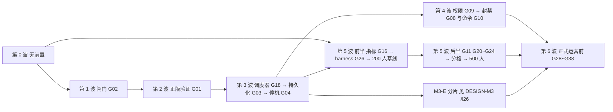

第 3 波的 3D 组（转服票据，`REQ-PROD-045`）只依赖 3A 的写权语句与 V1，不依赖 M3 的任何代码；M3-E 的转服调用 3D 的 `TransferTickets`，所以排在第 3 波之后；第 6 波 6A 里插件面 `Transfers`（`API-PROD-021` 的四个方法）只依赖 3D，`gm.transfer`、管理接口 `synaxis:transfer` 与 P10 两分片来回转服经宿主的 `ShardService`，依赖 M3-E。依赖只有 3D → M3-E → 6A 一个方向，没有环。下表与后面的文件冲突表写于开工前，其中的行号（`Player.java:355`、`AdmissionGate.java` 的 `:60-71`、`Instance.java:162`、`ServerProcessImpl.java:104`）是 `8de32ab9b4` 时的代码位置。

| 波 | REQ（差距） | 可并行的组（按改动文件分组） | 退出条件（可验证） | 工作量（人日） |
| --- | --- | --- | --- | --- |
| 0 无前置 | `REQ-PROD-014` 前半（G12：打印栈、60 s 判死、崩溃报告、15 s 后 halt）、`REQ-PROD-015`（G13）、`REQ-PROD-016`（G14）、`REQ-PROD-017`（G15）、`REQ-PROD-019` 前半（G17：floorMod、4 线程 `counter` 严格模式 CI job、三处 `Acquirable` 接线）、`REQ-PROD-028`（G25）、`REQ-PROD-030` 离线档（G27） | 0A 宿主日志线：G13 + G14 + G15（都改 `server-app/.../Main.java`，同一人做，含崩溃报告写入器）；0A 合并后 0B 看门狗 G12（新类 `Watchdog.java`、`ServerProcess.java`、`ServerProcessImpl.java`（tick 起止打点在 `TickerImpl.tick`）、`ServerConfig.java`，并在 `Main.java` 起停看门狗、复用 0A 的崩溃报告写入器，所以不与 0A 并行）；0C 线程正确性 G17 前半（`ThreadDispatcherImpl.java`、`Entity.java` / `Player.java` 的 `setInstance` / `teleport`、CI）；0D CI 断言 G27（`client-fabric/src/gametest/**`、工作流）；0E JVM 参数 G25（`server-app/build.gradle.kts`、`docs/ENGINE.md`）。0C～0E 与 0A / 0B 可并行 | §19 中这些 REQ 的场景全绿，例外是 `REQ-PROD-014` 里「进入落盘停机」「倒计时期间卡死仍先落盘」两处，这一波判死后直接 halt，落盘路径在 3A 验；4 线程 `counter` 严格模式 job 在 main 上连续 3 次绿；真客户端离线档 R1～R8 连续 5 次绿（v0.9：离线档在 `main` 上只跑了 3 次就被第 2 波 B 档取代，这一条改由 B 档判定，见表后现状） | 13.5～16.5（G17 前半 2～3 为本分册估） |
| 1 连接闸门 | `REQ-PROD-001`（G02）、`REQ-PROD-043`（G40）、`REQ-PROD-009`（G05） | 1A 闸门 G02 + G40（`Server.java`、`HandshakeListener.java`、`ConnectionManager.java`、`StatusResponse.java`、`ServerConfig.java`、`DisconnectReasons.java`、模组 lang）；1B 聊天 G05（`ChatMessageListener.java`、`Player.java:355`、`ServerConfig.java` 两个键、客户端模组 `ClientPacketListenerMixin`）——与 1A 同改 `ServerConfig.java`，1A 先合 | 闸门五层与 fd 退避的集成测试绿；§15 闸门档（单 IP 100 连接/秒 × 60 s）在 50 人规模上跑过；聊天两条场景绿，真客户端无聊天警告截图 | 6.5～7.5 |
| 2 正版验证 | `REQ-PROD-002`（G01）、`REQ-PROD-003`（G06）、`REQ-PROD-004`（G07，同分片部分）、`REQ-PROD-044`、`REQ-PROD-036`（G33）、`REQ-PROD-030` 切完整正版路径档 | 2A 一个 PR：G01 + G06 + G07 + 假 sessionserver（`Auth.java`、`LoginListener.java`、`ConnectionManager.java`（同分片踢旧后等旧 `Player` 移除）、`HandshakeListener.java`、`PlayerSocketConnection.java`、`PacketVanilla.java`、`crypto/`、`module-info.java`、`server-app/.../Main.java`）；2A 合并后串行：2B 删除 `Auth.Velocity` / `Bungee` 与 PROXY 可信网段自检（G33 的前半；又改 `Auth.java`、`HandshakeListener.java`，不能与 2A 并行；`store_meta` 自检要读第 3 波才建的表，挪到 3A）；2C 切 B 档（工作流、`client-fabric/gametest-env/judge.sh` 的两项假 sessionserver 日志检查、回归测试 `RegressionClientGameTest` 的 R3 与 gametest 源集的访问器 mixin `ConnectionAccessor`；不动引擎，可与 2B 并行） | 在线模式全部自动化场景绿（`REQ-PROD-002`～`004`、`044`）；B 档 R1～R8 连续 5 次绿；用户用正版账号完成 auth 草案 §6.2 前两条人工用例并登记 | 7.5～10（假 sessionserver 与 B 档切换含在 G01、G27 内） |
| 3 持久化 | `REQ-PROD-021`（G18）→ `REQ-PROD-005`、`006`、`007`（G03）→ `REQ-PROD-008`（G04）；`REQ-PROD-004` 跨分片部分；`REQ-PROD-022`（G19）；`REQ-PROD-035` 前半（WAL 归档与每日基础备份）；`REQ-PROD-045`（G28 前半，转服票据） | 3A 主线串行（同一人）：G18（`PluginScheduler`、`PluginSchedulerImpl`）→ G03（`server-app` 新包 `store/`、`PluginContext.java`、`AdmissionGate.java`（载入插在 `handshake.await` 与 `provider.admit` 之间，`:60-71`）、Flyway V1～V2 与回退 SQL、`--migrate-only --auth-mode` 与 `store_meta` 自检）→ G04（`ServerProcessImpl.java`、`ServerProcess.java`、`Main.java`、`ConnectionManager.java`，含看门狗判死接保存阶段）；3B 事件优先级 G19（`PluginEvents.java`、`PluginEventsImpl.java`，另改 `PluginHost.java` 建节点与收回的两处和 `LoadedPlugin.java`；与 3A 并行，`PluginHost.java` 两边都改，合并时都留）；3C 运维：WAL 归档与每日基础备份（不动 Java 代码，脚本与操作步骤在 `ops/postgres/`）；3D 转服票据 G28 前半（`REQ-PROD-045`：`server-app` 新包 `transfer/`（票据编解码、`TransferTickets`、验票）、`AdmissionGate.java`（验票插在 `store.load` 之前）、`transfer_nonce.gc`、`DisconnectKeys.java` 加 `synaxis:transfer-rejected`、模组 lang、`.env.example` 登记 `SYNAXIS_TRANSFER_HMAC_KEYS`；3A 合并后开工，改 `AdmissionGate.java` 排在 3A 之后） | 持久化草案 P1～P9、P13、P14 全绿；§19 `REQ-PROD-005`、`REQ-PROD-008` 全部场景与 `REQ-PROD-014` 两条落盘场景绿；`REQ-PROD-036` 的三条 `store_meta` 场景绿；`REQ-PROD-045` 三条场景绿（由 `server-app` 的集成测试直接调 `TransferTickets` 驱动，源与目标可以是同一进程，不需要 M3 的 `ShardService`）且票据向量测试绿；WAL 归档已开并有第一份基础备份 | 17.5～22.5（G32 前半 1、G28 前半 2～3 为本分册估；从第 0 波挪来的「判死接保存」与从第 2 波挪来的 `store_meta` 自检工作量仍计在原波次） |
| 4 治理 | `REQ-PROD-011`（G09）→ `REQ-PROD-010`（G08）、`REQ-PROD-012`（G10） | 4A 权限 G09（Flyway V3、`Permissions`）先合；之后 4B 封禁 G08（Flyway V4、`AdmissionRequest.java`、`DisconnectKeys.java`、宿主节点上的预登录判定与 `HandshakeGate.java` 的跳过判断；引擎 `ConnectionManager.java` 不用改）与 4C 命令 G10（`Main.java#readConsole`、`PluginCommands`，内置六条，`profile` 在 6B；另改引擎 `ConsoleSender.java` 的翻译回退）并行。4A～4C 都往 `PluginContext.java` 加方法，合并按 A → B → C 串行，ABI 门每次过 | 封禁、白名单、权限、命令场景全绿；`API_VERSION` 是否加到 2 已由 ABI 门判定并记入 §1 | 10～13 |
| 5 规模 | 前半：`REQ-PROD-018`（G16）→ `REQ-PROD-029` harness（G26）→ 200 人基线；后半：`REQ-PROD-013`（G11）、`REQ-PROD-023`（G20）、`REQ-PROD-024`（G21）、`REQ-PROD-025`（G22）、`REQ-PROD-026`（G23）、`REQ-PROD-027`（G24）→ `REQ-PROD-020` 分格 + `REQ-PROD-019` 后半 → 500 人压测 | 5A 指标与 harness（新模块 `:loadtest`、`server-app` 指标包、`Main.java` 指标装配）；基线之后：5B 入站 G11 + 出站 G22 + 区块 G23 + Tab G24（都改 `Player.java`，G11 与 G22 还同改 `PlayerSocketConnection.java`，同一人串行）；5C 可见性 G20 + G21（`EntityView.java`、`EntityTrackerImpl.java`、`Instance.java:162`，也改 `Player.java`，合并排在 5B 之后）；5D 分格（`ThreadProvider.java`、`ServerProcessImpl.java:104`、分片宿主），与 5B / 5C 只共用 `ServerConfig.java`，按 5B → 5C → 5D 合并 | 200 人 walk 30 min：tick P99 < 50 ms、超 50 ms 为 0、RSS < 4 GiB；G11 阈值按入站 P99 × 2 写回 `API-PROD-012`；4 线程 `grid` 严格模式 job 在 main 上连续 3 次绿（5D）；500 人两档与重连风暴、闸门、台账档记录在案，`capacity` 定值写回 §15 | 40～57（G17 后半 4～7、分格 3～4 为本分册估；分格从 M3-E 的 12 天中扣出，由 M3 会话同步） |
| 6 正式运营前 | `REQ-PROD-031`（G28）、`REQ-PROD-032`（G29）、`REQ-PROD-033`（G30）、`REQ-PROD-034`（G31）、`REQ-PROD-035` 后半（G32 恢复演练）、`REQ-PROD-037`（G34）、`REQ-PROD-038`（G35）、`REQ-PROD-039`（G36）、`REQ-PROD-040`（G37）、`REQ-PROD-041`（G38） | 6A 转服 G28 后半（插件面 `Transfers`、`gm.transfer`、管理接口 `synaxis:transfer`、`HandshakeListener.java`；票据用 3D 的。插件面只依赖 3D；`gm.transfer`、`synaxis:transfer` 与 P10 经宿主的 `ShardService`，两个分片可以是同大区的两个频道（`transferTo`），所以这三项排在 M3-E 之后）；6B 管理接口 G29 + profile G31（新 WebSocket 包、`Main.java`，6C 之前合并）；6C 配置文件 G30 + 压缩 G35（都改 `ServerConfig.java`，同一人；键表要收全本波新增的键，所以 6C 排在第 6 波最后合并）；6D 列表 G34（`StatusResponse.java`、新类 `Favicon.java` 与 `event/server/ServerListPingEvent.java`、`StatusListener.java`、`ConnectionManager.java` 在构造时读图标、`ServerConfig.java` 三个键，线程契约一条进 `plugin-api` 的 `package-info` 与 `docs/PLUGINS.md` §10）；6E 视距 G36 + 休眠 G37（`Player.java`、`Entity.java`，另有 `Instance.java` 的玩家位置快照与新类 `DormancyPolicy.java`、`PlayerPositions.java`，同一人；不改 `ServerConfig.java`，没有新配置键）；6F 翻译键门禁 G38（CI）；6G 恢复演练 G32（运维） | 各 REQ 场景全绿；两分片来回转服 100 次（P10）绿；恢复演练一次并记录耗时；§23 R4 进入门槛满足 | 17～20.5（G28 前半 2～3 已移到 3D） |
| 条件 | `REQ-PROD-042`（G39） | — | 触发条件成立时另立波次 | 2 |

合计：第 0～5 波 95～126.5 人日（清单 G01～G27 的 88～117，加上移入的 G40 0.5、G33 0.5～1、G32 前半 1、G28 前半 2～3，以及从 M3 划过来的分格 3～4），第 6 波 17～20.5 人日，条件项 2 人日。

第 0 波与第 2 波退出条件里由 CI 判定的三项（v0.9 按 `gh run list --branch main` 核对，截至 `a59639f3b1`）：

1. 第 0 波「4 线程 `counter` 严格模式 job 在 main 上连续 3 次绿」已满足。该 job 随 `ad1f0a0cb4` 进 `main`，那次工作流解析失败、一个 job 都没起（run 35853683400）；之后 `1aac280cae`、`e3e16ce3b5`、`c3f7e25083` 三次都绿（run 35853927414、35877692112、35880568896）。后来在 `af8ab12406`、`6162896349`、`5f58070651`、`a7769c1c78`、`2ae21568e1` 红过五次，红的分别是 `PlayerStoreIntegrationTest`、`ConnectionGateSocketTest`、`AcceptBackoffTest`（两次）、`SampleTest` 的偶发红，都已在 `docs/TEST.md` §7 结案；`5ccd82a9ac` 到 `a59639f3b1` 又连续 6 次绿。
2. 第 0 波「真客户端离线档 R1～R8 连续 5 次绿」按原文永远满足不了。离线档在 `main` 上只跑过 3 次，`ad1f0a0cb4`、`1aac280cae`、`e3e16ce3b5` 都绿（「Client gametest」run 35853684614、35853927446、35877692165）；第 2 波 2C 把同一个工作流换成 B 档，`c3f7e25083` 起在 `main` 上跑的都是 B 档。B 档在 R1～R8 之外还判 R3 `encrypted=true` 与假 sessionserver 的 join、`hasJoined` 计数，是离线档的超集，这一条由第 2 波的 B 档条件取代。
3. 第 2 波「B 档 R1～R8 连续 5 次绿」已满足。`c3f7e25083` 到 `a59639f3b1` 的 18 次（16 次 push、2 次每日定时带 spike）全绿，没有红过；每次两个启动器各 8 行 `PASS`、R3 `encrypted=true`、`sessionserver join 2, expected 2`（例：run 36100715708 的日志）。连同离线档，「Client gametest」在 `main` 上 21 次全绿，已满足 §28.1 ops #1「连续 20 次全绿后设为必需检查」；`main` 现在没有分支保护（`gh api repos/Bearisbug/synaxis/branches/main/protection` 回 404），设为必需检查要仓库管理员在 GitHub 上操作。

第 5 波退出条件的现状（v0.8.1，`grid` 一项 v0.9 核对）：200 人 walk 30 min 在同机档只差「超 50 ms 为 0」一项（集成后 6 个，5A 基线 18 个）；G11 阈值已写回 `API-PROD-012`（v0.7.3）；4 线程 `grid` 严格模式 job 已满足「`main` 上连续 3 次绿」：随 `5458e2d540` 进 `main` 起到 `a59639f3b1` 连续 9 次绿，没有红过（§28.2 已决行）；500 人两档、重连风暴、闸门、台账档已在同机档记录，`capacity` 建议值写回 §15「集成后复测与 `capacity`」：内测 200，正式档暂定 500，定值等分机档按该段的条件重跑。

第 6 波退出条件的现状（v0.9 验收，集成分支 `prod/integrate-w6`，`docs/TEST.md` RUN-036）：

- 已完成五组：6B（`REQ-PROD-032` 管理接口、`REQ-PROD-034` 性能剖析，`TC-PROD-380`～`TC-PROD-397`）、6C（`REQ-PROD-033` 配置文件、`REQ-PROD-038` 压缩阈值与级别，`TC-PROD-440`～`TC-PROD-445`）、6D（`REQ-PROD-037` 服务器列表，`TC-PROD-400`～`TC-PROD-405`）、6E（`REQ-PROD-039` 视距上限、`REQ-PROD-040` 实体休眠，`TC-PROD-410`～`TC-PROD-422`）、6F（`REQ-PROD-041` 翻译键门禁，`TC-PROD-430`～`TC-PROD-434`）。这八条 REQ 的 §19 场景都有用例，验收时全量 check 与两种严格模式全绿。
- 表外加做的 U 组也已完成（`TC-PROD-370`～`TC-PROD-379`）：宿主停机序列 `ShutdownSequence` 给 M3-C 的覆盖层停机落盘留出挂载点；转服验票 ⑤⑥ 进同账号串行载入；顶号轮询先查新连接是否已断开。§28.2 的三条待定项随之转已决。D 组只做文档收口，不改代码。
- 没做的三项：6A（`REQ-PROD-031`，插件面 `Transfers`、`gm.transfer` 与 P10 两分片来回转服 100 次）等 M3-E 的 `ShardService`，管理接口的 `synaxis:transfer` 随它交付；6G（`REQ-PROD-035` 后半，恢复演练）要先有一份生产数据库副本才能演练并记耗时；`REQ-PROD-042`（G39）仍按条件触发。「§23 R4 进入门槛满足」要等 6A、6G 做完才能判。
- 验收时仍开着五项：① §28.2 的停机保存缺陷（进了 PLAY、还没进世界就断开的玩家赶上停机，保存等满 30 s、这份登出保存丢失），原定本波验收前修，没有修，`docs/TEST.md` TC-GAME-034 第 3 步因此判失败；② TC-GAME-035 的第 1、3 步在现有代码与探针上做不出来，要先改写用例或给探针加改报视距的子命令；③ `stop` 与 SIGTERM 竞态（§28.2），等 `docs/DESIGN.md` `API-003` 改签名；④ 分片宿主路径上还没有覆盖层停机步骤的注册点：`Main.start` 里建的 `ShutdownSequence` 是局部变量，M3-C 在装配里加 `addAfterPlayers` 调用或一个钩子（下表 `Main.java` 一行）；⑤ §28.3 里标「主会话」的 8 行（含 v0.9 加的 `TC-GAME-034`、`TC-GAME-035` 改写一行）与标「M3 会话」的 2 行。另有一项要仓库管理员操作：`main` 没有分支保护，「Client gametest」设为必需检查的条件已满足（第 0 波与第 2 波现状第 3 条）。
- 修复轮（v0.9.9～v0.9.12，合入集成分支后的复验见 `docs/TEST.md` RUN-037）：上一条的 ① 已修（v0.9.10），§28.2 该行转已决，TC-GAME-034 第 3 步照原写法做 10 次，都在 0.45～0.51 s 内退出、0 行 ERROR（`TC-PROD-460`、`TC-PROD-461`）；② 已改写（v0.9.12：第 1 步经 `proof.never` 关掉修复的两处，第 3、4 步用探针子命令 `view-distance`），TC-GAME-035 六步都通过；⑤ 里 `TC-GAME-034` / `TC-GAME-035` 一行已完成，v0.9.11 又加一行 `docs/DESIGN.md` `REQ-014`，标「主会话」的仍是 8 行、「M3 会话」2 行；③、④ 不变。修复轮另修了验收后审查出的五个缺陷：`profile` 的 `.jfr` 带着进程环境变量、管理消息的中间分片不计长、被放弃的载入先离开再释放（v0.9.9），管理消息按宽松 JSON 读、布尔键写错静默当 false（v0.9.11）；v0.9.12 登记堆转储带环境变量明文的风险。
- RUN-037 之后的修复轮（v0.9.14）：审查报出的三个缺陷都已修，都是 v0.9.9～v0.9.10 修过的地方还留着的交错或旁路：停机冻结与断线同时发生时停机保存等满 30 s（§28.2 已决一行）、另开着别的 JFR 录制时 `profile` 的 `.jfr` 仍带环境变量明文、持令牌的一方连发空续片能把管理接口的堆攒满；用例 `TC-PROD-470`～`TC-PROD-472`。
- RUN-038 之后的 G1 组（v0.9.15）：停机保存阶段里仍在途的登录不再取得写权、不在停机保存之外进服；保存阶段开始后断开没进世界的玩家，卡在 configuration 的客户端不再让停机等满 30 s（§28.2 已决两行）；用例 `TC-PROD-480`～`TC-PROD-486`。
- G3（v0.9.16）：「验收时仍开着五项」的 ③ 已修，`docs/DESIGN.md` `API-003` 改了签名，`stop` 与管理接口 `server/stop` 只按引擎 `beginShutdown` 的返回值回复（§28.2 已决一行，`TC-PROD-495`～`TC-PROD-498`）；§28.3 的 `API-003` 一行转已完成。
- G2（v0.9.17）：G2 审查登记的三处缺陷都已修：管理接口与指标端点的绑定键只认 `host:port`、`synaxis:profile` 的秒数按数字原文精确读、管理连接排队未写出的到 4,096 帧或 1 MiB 即以 1008 断开（§28.2 已决一行，`TC-PROD-488`～`TC-PROD-494`）。
- G4（v0.9.18）：⑤ 里标「主会话」的其余 7 行已完成（`docs/DESIGN.md` v0.40、`docs/DESIGN-M2.md` v0.49、`docs/ENGINE.md` §3.4），连同 G3 的 `API-003` 一行，§28.3 标「主会话」的行已清零，只剩标「M3 会话」的 2 行；④ 不变。
- 以上四组按 G1、G3、G2、G4 的顺序合入集成分支 `prod/integrate-f`（v0.9.19），复验见 `docs/TEST.md` RUN-039。
- RUN-039 之后的修复轮（v0.9.20（RUN-039 修复））：审查报出的七处都已处理。代码六处：停机倒计时只广播给已进 PLAY 的连接；SIGTERM 在宿主发起的停机中到达时截断倒计时、等序列跑完（原风险行转已决，按该行的默认建议）；指标端点每次抓取一条虚拟线程、至多 10 s；踢人阶段之后才确认登录的连接收 `synaxis:server-stopping`；`bans/add` 与插件 `Moderation#ban` 的到期上限；日志里的 IPv6 地址带方括号（§28.2 已决两行，`TC-PROD-499`～`TC-PROD-505`）。文档一处：`docs/TEST.md` `TC-PROD-169` 第 2 步合并反证的测试数随 G1 加的一条由 31 改为 32。
- RUN-039 修复轮之后的第 2 轮（v0.9.21（RUN-039 修复第 2 轮））：审查报出三处。两处已修：起服过程中的 `server/stop` 回 −32000、不再停下一个随后照常绑端口的进程（major）；出站上限的判定与入队在连接对象锁里一起做（minor）（§28.2 已决一行，`TC-PROD-506`～`TC-PROD-508`）。1,024 个字符及以上的 JSON 数字回 −32700（minor）不改行为：设计写明这条上限，§28.2 登记 Open Question，`TC-PROD-509` 钉住现状；插件在 `onEnable` 里停机登记为风险；验证时发现的游戏端口绑不上时进程不退出登记为风险，默认下一轮修。
- RUN-039 修复第 2 轮之后的第 3 轮（v0.9.22（RUN-039 修复第 3 轮））：审查报出五处，都已处理。代码一处：rts 插件的 `onDisable` 经 `Acquirable#sync` 移除单位，所有权断言开着时停机不再报 `Plugin failed to disable`、照常写 `match_ended`（§28.2 已决一行，`TC-PROD-511`、`TC-PROD-512`）。文档四处：`API-PROD-007` 写对 `onDisable` 所在的线程；§28.2 游戏端口一行写对让 JVM 活着的线程；两轮修复的版本号改为 v0.9.20、v0.9.21；`docs/TEST.md` `TC-PROD-483` 第 2 步的红行（原先红在哪一行取决于写库是否在 5 个 tick 内完成，测试改为先断言钩子）与 `TC-PROD-510` 第 2 步的出处。游戏端口绑不上时进程不退出仍开着（§28.2 风险行）。
- M3-C 合入 `main`（v0.9.24）：「验收时仍开着五项」的 ④ 已解决，覆盖层停机步骤的注册点在 `Main` 步骤 (5) 的 `ShardWorld#start`（`API-PROD-007` 注册一条）；本分册按 `docs/DESIGN-M3.md` §28.2 交来的 ①～⑪ 同步了键数、出站积压、分片默认值、休眠与模拟距离的次序和下表。
- M3-E 的契约（v0.9.26，按 `docs/DESIGN-M3.md` v0.16）：「没做的三项」里的 6A 拆成两半。插件面 `Transfers`（`API-PROD-021` 的四个方法）只依赖 3D，现在就能开工，M3-E 不加 `shards()`、不改 `PluginContext.java`；`gm.transfer`、管理接口 `synaxis:transfer` 与 P10 经宿主的 `ShardService`，要等 M3-E 的 `app.shard` 包进 `main`，P10 的夹具见 §19。M3-E 在本分册维护的文件上的改动登记在下表。
- 6A 插件面（v0.9.27，分支 `prod/6a-plugin`）：`:plugin-api` 新接口 `Transfers`（首次提交即标 `@ApiStatus.NonExtendable`，标注的接口共 15 个）与 `PluginContext` 的默认方法 `transfers()`，宿主实现 `PluginTransfers`；`Main#openStore` 建的冷却表挂在 `StoreRuntime#cooldowns`，经 `PluginHost` 交给插件面，与 `TicketIssuer`、`TicketVerifier` 是同一个对象。`REQ-PROD-031` 的插件面用例 `docs/TEST.md` `TC-PROD-520`～`TC-PROD-529`。6A 剩下的 `gm.transfer`、管理接口 `synaxis:transfer` 与 P10 仍等 M3-E 的 `app.shard` 进 `main`。

改同一批文件、不宜并行的组（合并顺序即上表）：

| 文件 | 被哪些组改 | 处置 |
| --- | --- | --- |
| `server-app/.../Main.java` | 0A（G13、G15）、0B（G12 看门狗起停）、2A（G01 模式选择）、3A（G03 装配、G04 注册 `ShutdownParticipant`）、4A（`role` 命令与权限装配）、4B（封禁装配、`synaxis.app.whitelist`、三条 GM 命令）、4C（G10 控制台、内置命令）、5A（指标装配）、6B（G29）、6C（G30）、第 6 波 U 组（注册 `ShutdownSequence`）、M3-C（挂地图模式：步骤 (1) 读地图键、步骤 (3) `ShardWorld.prepare`、步骤 (5) `ShardWorld#start` 注册覆盖层停机步骤，M3 会话）、M3-E 第 0 步（目录模式装配：步骤 (1) 读 `shards.json` 并写 `synaxis.max-players`，(3) `prepare` 收目录，(4) `openStore` 传两个回调、建 `ShardHeartbeat`、`ShardServiceImpl` 与 `WorldFlagsImpl`，(5) 挂关卡门与到达，(7) 起心跳，M3 会话）、6A 插件面（`StoreRuntime` 加组件 `cooldowns`，`openStore` 三处构造都传，`PluginHost` 多收这一个参数；v0.9.27）、6A（`gm.transfer` 与管理接口 `synaxis:transfer` 接 `ShardService`） | 0A → 0B 串行（还共用崩溃报告写入器）；4A → 4B → 4C 串行，合并时各组的装配都留；6B → 6C 串行；U 组先于 M3-C 合入（都已合入）；M3-E 先于 6A 接 `ShardService` 的部分合入，后合者 rebase、两边的改动都留；6A 插件面与 M3-E 第 0 步改的是 `openStore` 签发端那一条 `new StoreRuntime(…)` 的相邻几行（M3-E 改 `TicketIssuer`、`TicketVerifier` 两个实参，6A 在实参末尾加 `cooldowns`），后合者照两边合起来写；其余波次内只有一个组改它 |
| `ServerConfig.java` | 0B（G12）、1A（G02、G40）、1B（G05）、2B（PROXY 两项拒启）、5B（G11、G22、G23）、5C（G21）、5D（分格）、6C（G30、G35）；6D（G34 三个键）也加键 | 1A 先于 1B；5B → 5C → 5D 合并；键表（`server-app` 的 `ConfigFile.KEYS`）是配置文件的唯一出处，6C 排在第 6 波最后，在 6D 等全部加键之后合并；此后任何组加键都在同一提交里加进键表，否则配置键门禁失败（§24） |
| `server-app/.../ShardMain.java` | 5D（建入口与线程两项）、M3 会话（视距、区块上限、可见上限与 `accept-transfers` 的默认值，`docs/DESIGN-M3.md` v0.8）、6C（`main` 先触发读 `synaxis.properties` 再写默认值，默认值本身不动）、M3-C（挂地图时写 `synaxis.app.core-mode=on`，以分片宿主身份调 `Main`，M3 会话） | 默认值归 M3 会话；6C 只改 `main` 里的先后 |
| `entity/Player.java` | 0C（接线）、1B（G05）、5B（G11、G22、G23、G24）、5C（G20、G21）、6E（G36）、M3-C（视野票据跟随区块环，M3 会话） | 5B 同一人串行，5C 排其后；M3-C 在 6E 之后合入，改区块环增删的几处都经 `moveTicketRing` |
| `entity/Entity.java` | 0C（`setInstance` / `teleport` 所有权断言）、5C（G20 追踪范围与可见上限）、6E（G37 休眠）、M3-C（模拟距离外只跑调度器，先判模拟再问休眠策略，`docs/DESIGN-M3.md` `ADR-M3-017`，M3 会话） | 按波次串行；改 `Entity#tick` 的判定时两边的用例都跑（`docs/TEST.md` `TC-PROD-414`～`TC-PROD-419` 与 `TC-WORLD-044`） |
| `PlayerSocketConnection.java` | 2A（cipher）、2B（PROXY 可信网段）、5B（G11 入站计数、G22 出站积压）、M3-C（积压只丢 `sheddable` 的 `BufferedPacket`，M3 会话） | 2A → 2B → 5B → M3-C |
| `network/packet/server/BufferedPacket.java` | M3-C（加分量 `sheddable`，`docs/DESIGN-M3.md` `ADR-M3-018`，M3 会话） | 构造它的地方都显式给 `sheddable`，只有视野广播给 true（`API-PROD-020`） |
| `network/PacketViewableUtils.java` | 5B（G22：视野广播的缓冲包是积压里可丢的部分）、M3-C（构造时给 `sheddable = true`） | 5B → M3-C；这里只许走实体移动，别的包走这里会在积压超限时被丢 |
| `HandshakeListener.java` | 1A（L1 / L2）、2A（transfer 意图鉴权）、2B（删 Velocity / Bungee 分支）、6A（G28） | 按波次串行 |
| `LoginListener.java` | 2A（G01、G06、G07）、2B | 2A → 2B |
| `ConnectionManager.java` | 1A（L3 席位、L4）、2A（G07 同分片踢旧后等旧 `Player` 移除）、3A（G04 停机）、6D（G34 构造时读图标） | 按波次串行 |
| `server-app/.../AdmissionGate.java` | 3A（载入插在 `handshake.await` 与 `provider.admit` 之间）、3D（验票插在载入之前）、4B（`AdmissionRequest` 加组件的调用点） | 3A → 3D → 4B |
| `server-app/.../PluginHost.java` | 3A（启用失败的插件收回数据段与停机钩子）、3B（事件节点的建与收回）、4A～4C（`PluginContextImpl` 的 `permissions`、`moderation`、`commands` 三个组件，4B 挂封禁判定，4C 收回命令）、6A 插件面（`PluginContextImpl` 的 `transfers` 组件与收冷却表的八参构造器，七参的另建一张表） | 同一波并行，合并时两边的改动都留 |
| `ServerProcessImpl.java` | 0B（G12）、3A（G04）、5D（`:104` 分格）、6C（G35 压缩阈值）、M3-C（每 tick 在 `updateAndAwait` 之后卸载空闲区块，M3 会话） | 按波次串行 |
| `thread/ThreadDispatcherImpl.java` | 0C（G17 `floorMod`）、M3-C（只在 `refreshType = ALWAYS` 时维护 `partitionUpdateQueue`，分区删除 O(1)，M3 会话） | 0C → M3-C |
| `thread/TickThread.java` | 5A（G16 每条 tick 线程的计时）、M3-C（`entries` 改为保持插入顺序的 `LinkedHashSet`，分区删除 O(1)、tick 顺序不变，M3 会话） | 5A → M3-C |
| `plugin-api/.../DisconnectKeys.java` | 3A（`synaxis:state-unavailable`）、3D（`synaxis:transfer-rejected`）、4B（`synaxis:banned`、`synaxis:not-whitelisted`） | 按 3A → 3D → 4B 串行，每次同步模组两份 lang |
| `plugin-api/.../PluginContext.java` | 3A（`playerData`、`lifecycle`）、4A～4C（`permissions`、`moderation`、`commands`）、5B（`tabList`，G24）、5C（`entities`，G20）、6A（`transfers`） | 每次加方法单独一个提交，ABI 门逐次过 |
| `plugin-api/.../PluginContext.java`（跨会话） | 6A（`transfers()`，本分册） | `transfers()` 是默认方法，新接口 `Transfers` 在首次提交即标 `@ApiStatus.NonExtendable`，合入跑一次 ABI 门，baseline `v0.3.0` |
| `server-app/.../transfer/TicketIssuer.java`、`TicketVerifier.java` | 3D（签发与验票）、U 组（验票 ⑤⑥ 进同账号串行载入，`TicketVerifier#claim`）、M3-E（第 0 步在两个构造器末尾各加一个回调：`TicketIssuer` 加台账 `BiConsumer<String, Map<String, ?>>`，`TicketVerifier` 加 `BiConsumer<Player, TransferTicket> onClaimed`，暂不调用；轨道 B 填实：发出 `Transfer` 之后写 `EVT:transfer_issued`，`claim` 通过时调 `onClaimed`，M3 会话） | 3D → U → M3-E；设计以 `API-PROD-028` 为准，M3-E 的改法已写进该条 |
| `server-app/.../store/RedisLink.java` | 3A（顶号与在线名单）、4A（权限变更频道）、4B（封禁频道）、M3-E（第 0 步加 `listenWorldFlags(String, Consumer<String>)` 与 `publishWorldFlag(String, String)` 两个签名，轨道 C 填实，`docs/DESIGN-M3.md` `API-M3-013`，M3 会话） | 按波次串行；M3-E 只加方法，不改已有频道 |
| `:loadtest` 的 `Bot.java`、`Profile.java`、`Args.java`、`RunCommand.java`、`BotStats.java`、`MergeCommand.java` | 5A（harness）、5C（`town` 画像与 `visible_entities`，`Args.java` 除外）、M3-E 轨道 D（转服往返、`gate` 画像、`--gates`、`--dwell`、`transfers` 与 `--min-transfers`；另新建 `ProfileTest.java`，改 `BotSocketTest.java`、`MergeTest.java`，M3 会话） | 5A → 5C → M3-E；契约见 `API-PROD-025` 转服一条 |
| `server-app/src/main/resources/db/migration/`、`db/rollback/` | 3A（V1、V2 与回退脚本）、4A（V3）、4B（V4）、M3-E 第 0 步（V5 `shard_heartbeat`、V6 `world_flag` 与两份回退脚本，内容按 `docs/DESIGN-M3.md` §25，M3 会话） | 版本号按 §25 的合并顺序取下一个空号，不开 `outOfOrder` |
| `server-app/.../store/MigrationsDbTest.java` | 3A、4A、4B（每加一个版本改版本表与表名单）、M3-E 第 0 步（版本表改为 1～6、表名单加 `shard_heartbeat`、`world_flag`，往返先回退 V6 再回退 V5，M3 会话） | 与迁移脚本同一个提交改，否则共用容器开着时 `check` 必红 |
| `server-app/.../store/TransferTicketsIntegrationTest.java`、`server-app/.../TransferAdmissionIntegrationTest.java` | 3D（前者）、U 组（后者，前者改验票进载入）、M3-E（第 0 步补构造参数：前者 8 处 `new TicketIssuer`、2 处 `new TicketVerifier`，后者 1 处 `new TicketVerifier`，都传空操作；轨道 B 加 `EVT:transfer_issued` 与 `onClaimed` 的断言，M3 会话） | 3D → U → M3-E；构造调用与两个类的签名在同一个提交里改 |

## 27. 上线后度量与复盘

N/A — 本分册尚未开工。R2 封闭内测稳定运行 7 天后按 §3 三条指标做一次实际度量（达标 / 未达标各列证据），回填 §26 各波实际人日与偏差；对任何一次「停机保存完整率 < 100%」「一致性断言失败」「看门狗判死」做无指责 postmortem（时间线、影响、根因、行动项带 owner 与截止）。

## 28. 风险与开放问题

### 28.1 拍板记录（2026-09-23）

用户同日拍板了七项方向（§1 的 U1～U7），并指示「其余待拍板点一律按草案默认值定」。下表逐项登记结果；「按默认值定」的每一行都给出切换条件与它在本分册的落点，条件成立时按 ID 变更规则改设计并在 §1 登记。清单 §7 与草案之间的重号已合并（清单 Q3 = auth ①，Q4 = auth ④，Q5 = ops #3，Q7 = auth ⑧，Q8 = ops #8，Q9 = D12，Q11 = ops #10）。

| 编号 | 问题 | 结果 | 默认值 | 切换条件 · 见 |
| --- | --- | --- | --- | --- |
| Q1 | Redis 的定位 | 用户拍板（U3） | PostgreSQL 唯一权威，Valkey 8 只放可丢数据 | Redis 最后只剩在线名单一个用途时不引入，改 `shard_heartbeat` 表 · `ADR-PROD-003` |
| Q2 / D3 | 写权租约粒度 | 用户拍板（U4） | 每分片一个会话租约 | 出现玩家粒度的写权转移需求 · `ADR-PROD-004` |
| Q3 / auth ① | `server-app` 默认模式 | 按默认值定 | `online`，离线须显式传参 | 本机开发频繁因忘传参连不上 sessionserver 时改为默认 `offline`；代价是生产部署必须显式传 `online`，忘传时正式库 `store_meta.auth_mode=online` 让分片拒绝起服，不会对外开成离线服 · `API-PROD-001` |
| Q4 / auth ④ | sessionserver 故障时 | 用户拍板（U2） | 拒绝登录，重试一次 | 单次故障 > 30 分钟且运营判定停服比冒名更贵时另立需求做手动降级开关 · `RB-PROD-001` |
| Q5 / ops #3 | 每 IP 上限数值 | 按默认值定 | 并发 16、登录桶 3 / 每 2 s 回填 1、transfer 桶 10 / 每秒 2 | 首次公开内测中正常玩家触发 `login-throttled` 或 `too-many-connections` 每天 > 5 次时翻倍；网吧集中地区加白名单网段 · `API-PROD-003`、`RB-PROD-005` |
| Q6 | 分片 `dispatcherThreads` | 用户拍板（U5） | 核数 − 2 | 500 人压测中 carrier 利用率 < 50% 时改为核数 · `API-PROD-016` |
| Q7 / auth ⑧ | `Auth.Velocity` / `Bungee` 去留 | 按默认值定 | G01 落地后单独一个提交删除 | 出现代理层计划时从 git 历史复活 · `ADR-PROD-007` |
| Q8 / ops #8 | RTS 进程是否开多线程 | 按默认值定 | 不开（`counter` + 1） | 单局 > 200 人，或 tick P99 连续 5 分钟 > 25 ms · `API-PROD-016` |
| Q9 / D12 | 数据库故障时在线玩家 | 按默认值定 | 10 s 冻结、30 s 踢出 | 运营宁可无上界丢进度也不踢人时改为只冻结，代价是分区时两边各玩各的、一边进度被 fencing 丢掉 · §11.2 |
| Q10 | 新增依赖 | 按默认值定；G29 的 WebSocket 库由用户 2026-09-25 拍板 | 接受 pgjdbc、HikariCP、Flyway、Jedis、Micrometer + Prometheus；G29 用 Java-WebSocket（`org.java-websocket:Java-WebSocket` 1.6.0） | 项目要求零新依赖时 G16 改 JDK `HttpServer` 手写文本格式，约多 1 人日；Java-WebSocket 出现影响本用法的安全公告而 30 天内没有修复版，或要求管理接口直接对内网以外开放（要 TLS 与更细的握手控制）时换 Jetty 12 WebSocket，代价是运行时闭包多出 Jetty 的服务器与 HTTP 模块 · §17、`ADR-PROD-014` |
| Q11 / ops #10 | 压测机器 | 按默认值定 | 服务端与机器人各一台 ≥ 8 核 / 16 GiB，千兆内网 | 只有本机时 500 人档只跑 A～C，D～G 等第二台机器 · `REQ-PROD-029` |
| Q12 | G28 Transfer 排期 | 按默认值定 | 票据签发与验票在第 3 波 3D（M3-E 的转服依赖它）；插件面 `Transfers` 与 P10 在正式运营前（第 6 波 6A）。6A 的插件面只依赖 3D，现在就能开工；`gm.transfer`、管理接口 `synaxis:transfer` 与 P10 经宿主的 `ShardService`，等 M3-E 的 `app.shard` 进 `main` | 内测开两个及以上大区时 6A 提前到内测前，工作量 +1.5～2 人日（3.5～5 减去已在 3D 的 2～3，本分册估） · §26 |
| auth ② / D7 | 在线模式重复登录 | 按默认值定 | 踢旧会话、放新连接；跨分片顶号 | 持久化侧做不到「旧会话先保存释放、新会话再载入」，或运营认定顶号是安全风险时改拒新 · `ADR-PROD-010` |
| auth ③ | 转服冷却 | 按默认值定 | 每玩家 5 s | Mojang 客户端 join 限额被证实不是 6 次 / 30 s 时重算 · `API-PROD-021` |
| auth ⑤ | CFB8 实现 | 按默认值定 | JDK 自带 | 生产机型上加密占用 > 1 个核的 10% · `ADR-PROD-011` |
| auth ⑥ | Python 探针与 `soak.py` 是否支持加密 | 按默认值定 | 不支持，加密由 Java 测试与 `PacketFlood` 覆盖 | 需要 `soak.py` 攻击子命令跑加密连接时在 `.venv` 用 `uv pip` 引入 `cryptography` · §25 |
| auth ⑦ | CI 真客户端档位 | 按默认值定 | B（完整正版路径 + 假 sessionserver） | B 在假 services 主机上 1 人日内进不了服时退到 A，B 挂成手动触发 · `API-PROD-026` |
| D1 | 插件能否拿到 JDBC | 按默认值定 | 不能，只见数据段 | 需要自定义表的功能出现时做成宿主服务 · `ADR-PROD-012` |
| D2 | 账号与角色 | 按默认值定 | 1:N 建表，先开 1 个角色 | 确定永远单角色才合表 · §7 |
| D4 | 崩溃安全 | 按默认值定 | 乐观版本 + 60 s 保存 + 关键操作同步 | 非关键进度丢失窗口要求 ≤ 5 s 时先把保存缩到 10 s（32,000 人即 3,200 事务/秒，先压测数据库）· §15 |
| D5 | 物品流水 | 按默认值定 | 只记带 `uid` 的物品 | 流水写入 > 保存次数 2 倍时改为只记稀有物品 · §15 |
| D6 | Redis 写回缓冲 | 按默认值定 | 不做 | 数据库写入 P99 在 500 人压测下 > 200 ms 且扩容无效 · `ADR-PROD-003` |
| D8 | Redis 客户端 | 按默认值定 | Jedis 8.0.1 | 单分片 Redis 连接 ≥ 20 时换 Lettuce · `API-PROD-006` |
| D9 | Redis 服务端 | 按默认值定 | Valkey 8 | 需要 Redis 8 独有模块时按 AGPLv3 用未修改的二进制 · `ADR-PROD-003` |
| D10 | 数据库连接 | 按默认值定 | 直连，池 4 | 分片数 > 24 加 PgBouncer（事务模式） · `API-PROD-004` |
| D11 | 迁移执行者 | 按默认值定 | 发布流程 `--migrate-only`，分片只 `validate` | 只有一个分片时可起服即迁移 · §25 |
| D13 | 本地测试容器 | 第 3 波改定 | 不用 Testcontainers：本机连共用容器 `synaxis-pg` / `synaxis-valkey`，CI 用服务容器，地址经 `SYNAXIS_TEST_*` 传入 | 共用容器上多组同时跑用例互相干扰时，改为每个测试类起自己的容器 · §19 |
| ops #1 | 真客户端 CI 的 PR 触发 | 按默认值定 | PR（路径过滤）+ main + 每日；连续 20 次全绿后设为必需检查 | 每月 Actions 分钟超预算，或 50 次里偶发失败 > 1 次时改为打标签 `needs-client-e2e` 才跑 · `API-PROD-026` |
| ops #2 | gametest 怎么拿到 `RtsClient` | 按默认值定 | 反射读 `SynaxisClientMod.RTS` | M2 阶段 6b 接上鼠标输入后改走 `TestInput` 真点击 · `API-PROD-026` |
| ops #4 | L0 超限直接关还是回 `Disconnect` | 按默认值定 | 直接关 | 运维需要从客户端区分「满了」与「网络断了」时改为 status 写满员 · `API-PROD-003` |
| ops #5 | 引擎默认是否直接开闸门 | 按默认值定 | L0 1,024、L1 16、L2 开；L3、L4 默认不限 | 要求 M2 进程完全不变时 L0～L2 也默认关，只由分片宿主开 · `API-PROD-003` |
| ops #6 | 台账写盘间隔与 fsync | 按默认值定 | 1,000 ms，不逐次 fsync | 台账用作计费或申诉证据时每次写盘后 `force(false)`，先测代价 · `ADR-PROD-005` |
| ops #7 | 台账每日上限 | 按默认值定 | 1 GiB | 正常一天超过 100 MB 时按实际量 10 倍重设 · `RB-PROD-007` |
| ops #9 | 压测 harness 语言 | 按默认值定 | Java 新模块 `:loadtest` | 不想新增模块时退回 `soak.py` 多进程 + 回执，加密档做不了 · `ADR-PROD-013` |
| ops 备份工具 | 按默认值定（第 3 波 3C） | `pg_basebackup` + `archive_command`（`ops/postgres/`），不装 pgBackRest | 库超过 50 GB、需要增量或差异备份、备份要直接写对象存储，满足任一条就换 pgBackRest，代价是多一个守护进程与一份配置 · `RB-PROD-008`、§17 |

### 28.2 风险与开放问题

| 类型 | 描述 | 负责人 | 何时需拍板 |
| --- | --- | --- | --- |
| 风险 | Mojang 对 `hasJoined` 的服务端限速未公开：minecraft.wiki「每 IP 200 次 / 2 分钟」是否覆盖它、go-mclib「约 600 次 / 10 分钟」从哪来，都**未核实**；按较严值 500 人分片重启全员重连要排 5 分钟 | Bearisbug | 上线前 1,000 次探测（§23 检查单） |
| 风险 | 目标机房（尤其中国大陆）到 `sessionserver.mojang.com` 的延迟与连通性没有数据；连不稳时 U2 的「故障即拒绝登录」会变成常态停服 | Bearisbug | 选定机房时 |
| 已决 | authlib 9.0.75 接受 `http://` 会话主机：第 2 波 2C 的完整正版路径档里，客户端带 `minecraft.api.session.host=http://…` 连 `record` 模式假 sessionserver 进服，R1～R8 全绿、R3 `encrypted=true`（`docs/TEST.md` `TC-PROD-104`、`TC-PROD-130`）；假服务不需要自签证书 | Bearisbug | — |
| 已决 | `enforcesSecureChat=false` + 系统消息转发时真客户端是否出现聊天警告（`REQ-PROD-009` 的截图判据）：原版客户端会弹「Chat messages can't be verified」，弹不弹只看服务端是否强制安全聊天，与在线离线无关（26.2 `ClientPacketListener#handleLogin`）；模组的 `ClientPacketListenerMixin` 拦掉之后不弹，转发的聊天走 `SystemChat`，聊天栏左侧没有「不安全」标记。证据是 `docs/TEST.md` TC-PROD-083（RUN-028 通过）与三张截图 `docs/research/production-readiness-2026-09/chat-evidence/secure-chat-off-*.png`（说明在同目录 `README.md`）；截图用的是离线开发账号，正版账号路径没有单独截图 | Bearisbug | — |
| 风险 | 500 人档全部数字从 50 连接 soak 与 200 人档线性外推；主城实体流量按 n² 增长，没有模型；G21 的 200 人同格 25 MB/s 是推算。v0.8.1 同机档已量到 500 人 walk 145.2 Mbit/s、town 168.4 Mbit/s（§15「集成后复测与 `capacity`」），分机档未测 | Bearisbug | 第 5 波 500 人压测 |
| 风险 | 持久化的耗时目标（tick P99 增量 ≤ 1 ms、快照 P99 ≤ 0.2 ms、写入 P99 ≤ 50 ms、载入 5 s、停机 < 10 s）全部按预算推，没有测量 | Bearisbug | 第 5 波首次压测后回写 §15 |
| 风险 | `LogBudget` 与 `GameChannel` 在多 tick 线程下的线程安全性未审（清单 §8.1 第 12 条）；`GameSession.java:22` Javadoc 的单数「the tick thread」要改 | Bearisbug | 第 0 波 0C 组 |
| 风险 | 顶号可能被盗号者利用来反复踢正主下线 | Bearisbug | 出现投诉时按 D7 切换条件改拒新 |
| 风险 | 按 IP 网段封禁会连带封掉同一 CGNAT / 网吧出口的其他玩家；`BanTarget.ByNetwork` 只给 GM 用于攻击来源 | Bearisbug | 第 4 波评审 |
| 风险 | 客户端每账号「30 s 内最多 6 次 join」只来自 minecraft.wiki，转服冷却 5 s 建在它上面 | Bearisbug | 第 6 波 6A |
| 已决 | 分片宿主区块发送上限取 4 块/tick（清单 G23）时，进场填满视距 12 的区块环（半径是视距 + 1 = 13，729 个区块，`docs/DESIGN-M3.md` §2 视距行）要 183 个 tick（729 ÷ 4 向上取整）≈ 9.15 s，是否与 M3 的进场与转服目标冲突：`docs/DESIGN-M3.md` v0.4 `API-M3-006` 答复不冲突——首批 9 块 3 个 tick 内发完，与 §15 转服行「首批 9 块 P95 < 5 s」无关；M3 对填满时间没有目标，要不要设在 M3-C 实测 P1③ 之后定 | Bearisbug（M3 会话） | 已于 M3 v0.4 答复 |
| 已决 | 分片宿主入口 `ShardMain` 的默认值：`docs/DESIGN-M3.md` v0.8（RUN-032）起在命令行没给时写 `thread-provider=grid`、线程数核数 − 2、区块视距 12、`synaxis.chunk-queue.max-per-tick=4`（`API-PROD-020`）、`synaxis.max-visible-entities-per-player=100`（`API-PROD-019`），存储为 `postgres` 时写 `accept-transfers=true`（内存存储不写，缺密钥时仍由 `Main` 拒绝起服）；用例见 `docs/TEST.md` TC-WORLD-010、TC-WORLD-011 | Bearisbug（M3 会话） | — |
| 风险 | 第 5 波十档压测都是服务端与机器人同机（§15「第 5 波实测」），200 人 walk 的超 50 ms tick 在 18～85 个之间、没有一档达到「0 个」，同时段对照档之间只差 4～8 个，跟着本机 load1（最高 262.7）与 GC 暂停走；同机数据判不了 §15 的 tick 预算与 RSS 两项 | Bearisbug | 分机档（§28.1 Q11）重跑 200 人 walk 30 min；仍不为 0 时先按 JFR 看是否全与 GC 暂停重叠，是则调 G1 暂停目标，不是再查 tick 本身 |
| 已决 | 5D 的退出判据「4 线程 `grid` 严格模式 job 在 `main` 上连续 3 次绿」：`main` 的 `5458e2d540`、`2ae21568e1`、`5ccd82a9ac` 三次 CI 的 `multithreaded-grid` 都绿 | Bearisbug | — |
| 待办 | `:loadtest` 离 §15 四行判据还差四处（v0.8.1 压测收尾发现）：① `town` 画像绕出生点走，出生点 (0, 0) 是四个分格的公共角，「500 人挤在 1 个分格」实际落在 4 个格，要加一个把圆心移到格中心的选项；② `flood` 每条连接只等第一个回包、不回 `LoginAcknowledged`，进不了 configuration，闸门行「台账 0 条来自攻击 IP 的会话事件」对它永远成立，要加一个走完登录的选项才有齿；③ 核心模式没有插件事件，台账行只压到每连接 1 行，运维草案 ③ 的「每连接 ≤ 90 事件/秒」要一个产生插件事件的画像；④ 机器人的「登录成功」计到 configuration 结束，进世界时刻只能从 `synaxis_players_online` 的 5 s 采样读，登录风暴行「30 s 内全部进 play」的分辨率是 5 s | Bearisbug | 分机档之前 |
| 技术债 | 引擎共享的包缓冲池 `PacketVanilla.PACKET_POOL` 把被大包撑大的缓冲原样放回池里，下一个借到它的人拿到的是大缓冲（审计 P2-13 按性能取舍保留，池本身没改）。放回前清掉读写下标与注册表，别的连接拿到的只是容量，写出的字节不变；受影响的是按默认 16,383 B 造包、断言写没写进同一个缓冲的测试。`SocketWriteStateTransitionIntegrationTest` 的偶发红即此，v0.9.25 查明并改为 `@Isolated`、用例开头清空池（根因与数字见 `docs/TEST.md` §7，`TC-PROD-513`）。根模块 `:test` 里撑大缓冲的 6 类：不清池的 `OnlineDuplicateLoginSocketTest`（35,532 / 35,495 B）、`PacketCompressionIntegrationTest`（200,091 / 200,004 B）、`PacketOutEventRetryIntegrationTest`（32,766 B），跑完清池的 `ViewDistanceSocketTest`（35,532 / 35,495 B）、`InboundPacketLimitIntegrationTest`（30,017 B）、`OutboundBacklogIntegrationTest`（16,411 B）。仍依赖池状态的两处：① `ObjectPoolTest` 的 `pool` 与 `autoClose` 断言池里的缓冲个数，与别的类并行时个数会变，没见过红；② `PacketOutEventRetryIntegrationTest` 用一个默认大小放不下的包测重写只派发一次出站事件，借到大缓冲时一次写完、走不到重写：让重写照样派发事件，默认大小的缓冲下它红在 `:54`（`expected: <1> but was: <2>`），池头放一个 35,532 B 的缓冲时照样绿。后三类跑完清池只让 ② 少撞上一些，前三类仍会留下大缓冲 | Bearisbug（主会话） | 下次动 `network` 包的缓冲池时；① 出现偶发红、或要补 ② 的覆盖时，照 `SocketWriteStateTransitionIntegrationTest` 的做法改 |
| Open Question | Tab 列表可见性没有按单个玩家刷新的接口：依赖别的状态的可见性要重算时，插件只能再调一次 `setVisibility`，每次向每个在线玩家各发一个带全体条目的 `UPDATE_LISTED` 包（一轮 N 个包、N² 个条目）。默认不加接口；有插件按队伍或阵营频繁切换可见性、且 500 人档实测这类包的出站字节超过 Tab 列表包总量的一半时，加 `TabList#refresh(Player subject)` | Bearisbug | 第一个用到的插件 |
| 风险 | G11 的 582 包 / 7 s 按机器人基线定：机器人每 tick 只发位置包与 `ClientTickEnd`，原版客户端的转头、挥手、挖掘、交互包没有计入，真实玩家的 7 s 上行包数 P99 未测，阈值可能偏低而误踢。另：分片宿主的区块上限 4 把区块批切小，机器人的区块回执变成 2.34 倍，集成后 200 人 walk 的 7 s 上行 P99 由 291 升到 305、max 由 345 升到 421（582 的 72.3%） | Bearisbug | 真客户端回归或内测首周；误踢按那一档的 P99 × 2 重定 `API-PROD-012` |
| 已决 | `grid` 分格下可见上限 100 偶尔被越过：集成后压测里 200 人 walk 30 min 有 301 个采样是 101、1 个是 102（共 358,890 个），500 人两档与风暴档最大 101（`docs/TEST.md` TC-PROD-360～TC-PROD-363 的实测）。v0.8.4 定位根因：`EntityView#refreshVisibility` 先取候选（`viewerOption.select`）、排出最近的 N 个，末尾再清空计数、只按这 N 个里已看得见的重建；别的 tick 线程在「取候选」与「重建」之间经追踪器收进来的实体（跨区块进入玩家的实体视距方形，`admits` 判定时计数还有空位）不在候选里，重建时被清出计数却仍然看得见，空出的名额随后被重算自己的补进或别的线程再收进占满，玩家看得见的就是 N + 1（两次叠加是 N + 2）。`admits` 与登记本身在两把视图锁里，没有「判定与登记分开」的竞态；单 tick 线程下取候选与重建之间没有别的收进，所以 `VisibleEntityLimitTest` 测不到。修法：删掉按候选重建的一段，改在重算已有的、持玩家视图锁遍历「看得见的实体」那一轮里逐个校正（算的加、不算的减），计数始终是「看得见且计数的实体」本身。没有新增锁，重算少进一次视图锁。4 线程 `grid` 严格模式下 400 个实体来回跨玩家实体视距方形的四条边，修前每 1,000 tick 有 269～865 个 tick 结束时超上限、最多 124 个（6 次），修后连跑 30 次（另 30 次在 12 个 `yes` 压满 CPU 时）全部 0 个（`docs/TEST.md` TC-PROD-320） | Bearisbug | — |
| 已决 | `docs/DESIGN.md` §17 `process.shutdown` 的 10 s join 上限与 §21「`stop()` < 10 s」SLO 与本分册 30 s 保存预算冲突：`docs/DESIGN.md` v0.37 按 §28.3 改写了 §17 `process.shutdown` 行、§21「`stop()` 到进程退出用时」行与 `RB-002` 的恢复验证（倒计时之后保存 30 s、判死路径 15 s，踢人 5 s，台账 2 s，部署侧 `TimeoutStopSec` ≥ 60 s），v0.38 删去「第 3 波落地前仍是 10 s join」一句 | Bearisbug（主会话） | — |
| 已决 | `AdmissionRequest` 加 `uuid`、`remoteAddress` 两个组件改了 record 的 canonical 构造器；第 4 波 4B 保留旧的四参构造器（`@Deprecated`，用离线 UUID 与回环地址补齐），`checkBinaryCompatibility` 不报破坏，`API_VERSION` 未因此变化（§1）。去掉旧构造器的 `public` 时 ABI 门报 `Public/protected method removed`（`docs/TEST.md` `TC-PROD-234`） | Bearisbug | — |
| 技术债 | `LegacyServerListPingPacket` 未注册，是死代码（清单 G34 附带发现），本分册不处理 | Bearisbug | 下次清理 network 包时 |
| 技术债 | `TickMonitor.acquisitionTime` 语义问题（审计 P3-3）修掉之前不导出该指标，锁争用只能从 soak `ticks.acquire_ms` 看 | Bearisbug | 第 5 波 |
| 已决 | 转服写回途中玩家登出而写回成功时，签发端仍签一张发不出去的票据并记冷却；快照前登出时向已断开的连接发 `synaxis:transfer-failed`。v0.9.1定为不改行为：① 票据与提示都写给已关闭的连接，`storeCookie`、`transfer`、系统消息一个包也发不出去，没有客户端拿得到这张票据，nonce 也从未入库；② 写权在签票前已释放，角色 `offline`，任一分片的普通登录照常取回；③ 冷却只让这个玩家 5 s 内再次转服回 `COOLDOWN`，他此时已下线，重连进服再转服通常已过 5 s；④ 登出与签票之间的窗口关不上：签发端在签票前再查一次登出，玩家照样可能在查完之后、`Transfer` 包到达之前断开，结果与现在相同。`ShardService#transfer` 这时拿到 `SENT`，玩家同时触发 `PlayerDisconnectEvent`，两者都表示「已离开本分片」，调用方按其中任一处理都对 | Bearisbug | — |
| 已决 | 转服验票 ⑥ 取租约不在「同账号在同一分片串行载入」的保护内（§11.3 末段）。v0.9.1已做，位置比原默认值「占位提前到验票开始」更靠后：`TicketVerifier` 拆成 `read`（②～④）与 `claim`（⑤⑥），`claim` 由 `PlayerStore#load` 在占位之内、同账号在本分片的上一次登录离开之后、获取语句之前执行。不照原默认值有两个原因：② 读 Cookie 最长等 5 s，放进占位会让同账号的普通登录白等；占位后立刻验票仍不够，同账号另一次登录已载入、正在玩时，⑥ 的「持有者 = 本会话」分支会认下它的写权，`version-mismatch` 再把它释放掉，那次登录下一次保存即被 fencing（`docs/TEST.md` `TC-PROD-377` 的第二条反证就是这样红的）。另一条可见变化：载入在 ⑤ 之前被拒（停机中、隔离、载入队列、上一次登录未离开）时不再消耗 nonce（`API-PROD-028` 验票段） | Bearisbug | — |
| 已决 | 顶号轮询（§12.4，最长 5 s）不检查连接是否已断开，同账号重连的新登录可能因预算用完被拒。v0.9.1已做：每次获取语句影响 0 行之后、发顶号之前查 `isOnline()`，已断开即以 `synaxis:state-unavailable` 退出，不再发顶号、放掉串行载入位与载入名额（§12.4 末段）。修前在「第一条顶号消息丢失、客户端断开后立刻重连、持有者收到第二条消息后 0.5 s 释放」这一档里，重连的登录要等旧轮询跑满预算，剩下不到一次轮询的时间，被拒 `past the handover budget`；修后在自己的预算内载入（`docs/TEST.md` `TC-PROD-378`） | Bearisbug | — |
| 技术债 | `TransferTickets` 的签发端已在分片装配时创建，`server-app` 里还没有调用方；第一个调用方是宿主内部接口 `ShardService` 的实现 `ShardServiceImpl`（`docs/DESIGN-M3.md` `API-M3-010`），M3-E 合入 `main` 后转已决 | Bearisbug（M3 会话） | M3-E 合入 `main` |
| 风险 | `account.last_name` 的 3～16 字符约束拒绝离线模式下 1～2 字符的名字，载入失败、断线 `state-unavailable`；在线模式的 Mojang 名字不受影响。默认不改；CI 或压测需要短名时用一个新迁移放宽为 1～16，不改 V1 | Bearisbug | 第 5 波压测前 |
| Open Question | 恢复时间目标的口径（§15 备份行）：默认按端到端停服时长；是否按正式库大小从演练结果外推，6G 演练后定 | Bearisbug | 第 6 波 6G |
| Open Question | `EVT:player_banned` 只在发起封禁的分片写，`was_online`、`kicked_within_ms` 只数本分片踢出的玩家，跨分片封禁时 §3「封禁即时生效率」漏计其他分片的踢出。默认接受；要准确就让每个分片在收到 `synaxis:moderation` 并踢人后各写一条，§3 按 `ban_id` 聚合 | Bearisbug | R2 封闭内测度量 §3 之前 |
| Open Question | `account_role.expires_at` 到期不发通知，已读进内存的授予最迟晚 30 s 失效（`API-PROD-010`）。默认接受；要准时就按最近一次到期时间给在线玩家各排一次重读 | Bearisbug | 出现限时角色的需求时 |
| 已决 | 第 4 波 4B 报告的缺陷：postgres 存储的 core mode 下玩家进 play 后立刻断开，角色不保存，该账号重登收到 `synaxis:state-unavailable`（日志 `the previous session of this account did not let go in time`），停机保存阶段卡满 30 s（`Not saved on shutdown … character_id=1`）。v0.7.1 在 `prod/integrate-w4` 上用真进程复现（探针 `login --hold 0` 后立刻重登被拒，10 s 后再登仍被拒，`stop` 保存阶段等满 30 s），根因是引擎对「已进 PLAY、还没进世界」的断开不派发 `PlayerDisconnectEvent`（§1 v0.7.1 行），修复后同样步骤重登成功、停机不再等待（`docs/TEST.md` `TC-PROD-214`） | Bearisbug | — |
| 已决 | 第 6 波验收登记的缺陷（v0.9.10 修复）：已准入、还没进世界的玩家（已进 PLAY、等下一个 tick 进世界，或还在 configuration）赶上停机，停机在它的 `PlayerDisconnectEvent` 派发之前进入保存阶段时，停机保存等满 30 s 预算，记两行 ERROR（`The shutdown save did not complete within its budget, going on with the shutdown.` 与 `Not saved on shutdown, its lease runs out with the session: character_id=1`），这份登出保存丢失，进程退出码仍为 0，违反 `REQ-PROD-008`「停机不漏存」与 §11.4 保存阶段的预算。v0.9 的复现（`server-app` 玩法模式、内存存储、离线）：探针 `login --hold 0` 退出后立刻在控制台 `stop`，10 次里 5 次从 `stop` 到进程退出 30.1～30.7 s，另 5 次 0.53～0.57 s，断开后隔 0.2 s 或 2 s 再 `stop` 的 4 次都在 0.54 s 内退出（`docs/TEST.md` TC-GAME-034 第 3 步，RUN-036）；6C 的真 JVM 用例 TC-PROD-442 在客户端读到 `FinishConfiguration` 就断开、7 ms 后 `stop` 时同样等满，该用例因此直接结束进程、不走停机。v0.7.1 修的是运行中这类断开，停机路径没覆盖。根因由确定性测试证实（测试自己定先后：断开 → `saveAll` → 再推进 tick）：`PlayerStore#saveAll` 把在线记录置 `saving` 后，把快照排在玩家实体的调度器上，实体调度器只随实体 tick 执行，没进世界的玩家不 tick；随后派发的断线事件在 `loggedOut` 里遇到 `saving` 又没有待快照的转服，直接返回。修复前推进 20 个 tick 后断线事件已派发 1 次、钩子 0 次、库里 `version=0`、租约仍在本会话；此时手动跑一次该玩家实体调度器的 `processTick`，保存立即完成。修法：保存阶段内，被停机冻结、还没快照的玩家断开时，由派发其 `PlayerDisconnectEvent` 的线程调插件 `onShutdownSave` 并快照，与排在实体调度器上的那次经同一个标记恰一方执行；`onSaveEnded` 之后到的断线事件照旧不写（§11.4 `gate_closed → saving`、`API-PROD-007`、§16）。修复后按 TC-GAME-034 第 3 步真进程 20 次都在 0.43～0.50 s 退出、0 行 ERROR（`docs/TEST.md` `TC-PROD-460`、`TC-PROD-461`） | Bearisbug | — |
| 已决 | 已准入、仍连着、保存阶段内一直没进世界的玩家（v0.9.15 修复；原登记为风险，只写了 `FinishConfiguration` 一种，未实测）：它的停机快照排在实体调度器上，要等它进世界才做。两种客户端都让停机保存等满 30 s：收到 `FinishConfiguration` 后既不确认也不断开（`ConnectionManager#doConfiguration` 发它之前把玩家移出 keep-alive 集合，引擎没有任何超时）；一直不回答 `SelectKnownPacks`（`synaxis.known-packs-response-timeout` 默认 300 s，远长于保存预算；客户端照常回 keep-alive 就不会因 keep-alive 超时被踢，不回的 15 s 被踢）。本轮用真进程复现（`server-app` 核心模式、内存存储、离线；测试客户端准入后停在这两处之一、照常回 keep-alive，控制台 `stop`）：两种各 1 次，从 `stop` 到进程退出 30.43 s、30.47 s，各记 `The shutdown save did not complete within its budget, going on with the shutdown.` 与 `Not saved on shutdown, its lease runs out with the session: character_id=1` 两行 ERROR（审查记的是 30.50～30.55 s）。修法：保存阶段开始后的下一个 tick，宿主在 tick 调度线程上以 `synaxis:server-stopping` 断开被冻结、仍连着、不在任何实例里的玩家，停机快照走 v0.9.10 的断线接手路径（§11.4 `gate_closed → saving`）；已进世界的玩家不断开。没选「停机线程直接快照」：这时该玩家的 configuration 虚拟线程可能还在跑（准入之后还要发注册表、等资源包、写 `FinishConfiguration`），钩子会落在第三种线程上与它并行，而且快照、释放之后玩家还能进世界、一直玩到踢人阶段，这段改动不落库；断开之后它不会再进世界，本来也要在踢人阶段断开。也没给引擎的两处等待加超时：超时要以秒计，停机仍得等它，改动还要进 `docs/DESIGN.md` §11.1。修复后同一真进程用例两种各 5 次，从 `stop` 到退出 0.42～0.49 s，台账 `online=1, saved=1, failed=0`，0 行 ERROR（`docs/TEST.md` `TC-PROD-484`、`TC-PROD-485`） | Bearisbug | — |
| 已决 | RUN-037 之后审查出的缺陷（v0.9.14 修复）：停机保存的冻结与断线同时发生时（停机线程 × tick 线程 × 断开连接的线程），v0.9.10 的接手漏了两种交错。① `loggedOut` 在记录锁外查到这名玩家还没被冻结，`saveAll` 随即把它置 `saving` 并登记停机保存，`loggedOut` 进锁后看到 `saving` 直接返回：登出保存与停机快照都没做、钩子一次没调，快照排在一个不再 tick 的调度器上。② `saveAll` 在锁外读到 `online`，`loggedOut` 随后走完 `online → saving` 并提交登出保存，`saveAll` 再登记一个永不完成的停机保存：角色已写入，却记 `Not saved on shutdown`、`failed > 0`，注册了停机步骤时步骤全被跳过。两种都让停机等满 30 s；已准入还在 configuration、已进 PLAY 等进世界、已在世界里的玩家都会遇到，违反 `REQ-PROD-008` 与上一行修好的场景。审查的真进程复现（玩法模式、内存存储、离线，150 个客户端准入后停在 configuration，写入 `stop` 后 3～6 ms 同时断开）：机器空闲时 35 次里 7 次从 `stop` 到退出 30.44～30.48 s，台账例 `online=148, saved=139, failed=9`。修法：`saveAll` 逐条在记录锁里判定 `online` 再冻结、登记；`loggedOut` 在同一把锁里读登记与状态，钩子与快照在锁外做（§16 该行、§11.4 `gate_closed → saving`）。测试（`docs/TEST.md` `TC-PROD-470`）：16 名 configuration 玩家与冻结同时断开、每轮 2 s 内停机保存没完成记为卡住，200 轮里修复前卡住 16～23 轮（本机三次，含 4 线程严格 `grid` 一次），修复后 0 轮；测试持记录锁让断线停在锁前、其间冻结，修复前停机保存 10 s 内不完成，修复后钩子 1 次、写入 1 次 | Bearisbug | — |
| 已决 | RUN-038 之后审查出的缺陷（v0.9.15 修复）：保存阶段开始（`closing` 置位）之前进了 `PlayerStore#load` 的登录，正在等载入名额、等同账号上一次登录离开或在顶号轮询里时，保存阶段开始了也照样往下走，取得写权，在保存阶段之后被准入。它不在停机保存里：`onShutdownSave` 不为它调，`EVT:shutdown_saved` 不计它，踢人阶段它的登出保存在 `onSaveEnded` 之后写库，写权记在已释放的会话上。违反 §11.2 `closing`「停止接受新的写权获取」、§11.3 载入遇到停机中应拒绝与 §11.4「保存阶段结束后的一律不写」。同源的另一处：准入一步（`loading → online`）只在记录锁里判定，`admit` 答应得晚于冻结的登录照样上线，同样在停机保存之外。确定性复现（PostgreSQL，先后由测试定）：第一次登录已准入、有脏段，断开后它的登出保存被拖住在写库途中；同账号第二次登录开始载入、等它离开；`saveAll` 以 `online=0` 完成，`onSaveEnded` 释放会话；放开拖住的写入后，第二次载入返回 true，库里租约是已释放的会话 1，在册 1 人，获取语句执行了 2 次。修法（§11.2 表下方、§11.3 两行、§16 新增一行）：两处等待之后与顶号轮询每轮睡醒之后重查 `closing`，获取语句返回后再查一次（还回写权再拒）；准入与 `closing` 置位在同一把准入锁里判定；保存阶段结束后不再执行释放语句，排在实体调度器上、到那时才轮到的停机快照也不做。拒绝仍用 `synaxis:state-unavailable`。测试 `docs/TEST.md` `TC-PROD-480`～`TC-PROD-483`，每处判定各有一条实跑的反证；准入锁本身没有能稳定变红的反证：把它换成一把不共享的锁，100 轮 × 16 次准入与冻结同时发生仍全绿，它的必要性靠 §16 该行的推理 | Bearisbug | — |
| 已决 | `stop` 与 SIGTERM 竞态（v0.9.16）：原先宿主 `HostCommands#claimStop` 自设一个标志、再看停机阶段是不是 `RUNNING`，与引擎占下停机的 CAS 是两次判定。SIGTERM 线程已在引擎里占下停机、阶段还没离开 `RUNNING` 的几条指令内执行 `stop 5`，命令回「5 s 后停」、台账记 `ok`，引擎却按 SIGTERM 的 0 s 停；管理接口 `minecraft:server/stop` 同一窗口里回 `true`、记 `ok`。现在 `ServerProcess#beginShutdown` 与 `stop()` 返回这次调用是否占下停机（`docs/DESIGN.md` `API-003` 已改签名），宿主只按这个返回值回复与记台账（`API-PROD-011`）。确定性测试在引擎 `Stopping synaxis server.` 这一行日志上拦住 SIGTERM 的 `stop()`（已占下，阶段仍是 `RUNNING`），这时执行 `stop 5` 得 `synaxis:command-already-stopping` 与 `invalid`、调 `server/stop` 得 `false` 与 `invalid`；只把实现回退到修复前，同一测试得 `synaxis:command-stopping 5` 与 `true`（`docs/TEST.md` `TC-PROD-495`、`TC-PROD-496` 第 2 步） | Bearisbug | — |
| 已决 | SIGTERM 在宿主发起的停机进行中到达（G3 实测发现，v0.9.20（RUN-039 修复）改）：原先关闭钩子的 `stop()` 得 false、立即返回，JVM 跑完关闭钩子就 halt，非 daemon 的 `Syn-Shutdown` 拦不住，倒计时之后的保存、踢人、插件 `onDisable`、台账 `force` 都不执行，玩家数据只剩上一次定时保存与会话过期兜底。实测：`server-app` 真进程（内存存储、核心模式）控制台 `stop 30`，2 s 后按 PID 发 SIGTERM，G3 与 RUN-039 的审查各一次，0.75 s、0.35 s 内退出，退出码 143，日志停在 `The server stops in 30 s`，没有 `synaxis server stopped successfully.`；管理接口 `server/stop`、玩家 `stop` 与看门狗判死路径同样受影响。按本行原先登记的默认建议定：钩子得 false 时结束剩余倒计时、等那次序列跑完才返回（`ServerProcessImpl#stopOnSignal`；§11.4 加 `gate_closed → saving` 的 SIGTERM 一行，`API-PROD-007`、`API-PROD-011`、§16、§19 与 `docs/DESIGN.md` `API-003`、§11.2、§16 同步）。截断倒计时的理由：部署侧 `TimeoutStopSec` ≥ 60 s，倒计时更长时只等不截断，照样被 SIGKILL、照样不保存；`API-PROD-011`「误输入可再发 SIGTERM」也要截断才停得下来。修后同一场景在 SIGTERM 之后约 0.1 s 走完序列，打出 `synaxis server stopped successfully.`，退出码 143（`docs/TEST.md` `TC-PROD-500`） | Bearisbug | — |
| 已决 | 管理接口对应的 SMP 版本：minecraft.wiki「Minecraft Server Management Protocol」页（2026-09-25 查）的历史表写 26.2（snap5 起）为 API 3.0.0，26.3 起 3.1.0。`API-PROD-022` 的原版方法名、参数名与 Player / Message / User Ban 结构按 3.0.0 写；与原版的差异四处（握手被拒回 404 而非 401、不收 `Sec-WebSocket-Protocol` 里的令牌、不做 TLS、没有 `rpc.discover`）写在 `API-PROD-022` | Bearisbug | — |
| 待办 | `synaxis:transfer` 没有实现：它经宿主的 `ShardService` 把玩家送到另一个分片，要等 M3-E 的 `app.shard` 进 `main`；参数是 `player` 加 `region` 或 `shard` 二选一，地址由心跳解析、不收 `host` / `port`，结果是 `ShardTransferResult` 的小写名（九个值），进程没有 `ShardService`（不在目录模式）回 −32000（`API-PROD-022`）；在那之前调用回 −32601 | Bearisbug | 6A 接 `gm.transfer` 的同一个 PR（M3-E 合入 `main` 之后）加进 `API-PROD-022` 的方法表 |
| 待办 | 按大区的最后位置与 `character.current_region` 没接：V1 建了 `character_location` 与这一列，宿主不读写，M3-E 也不接（`docs/DESIGN-M3.md` §28.1「按大区的最后位置」一行的默认值），玩家下线再上线回到大区出生点。由本分册接上：保存事务里 upsert 本分片大区的 `character_location` 并写 `current_region`，载入时读本大区那一行作出生点，宿主把本分片的 `region_id` 交给玩家存储；改 `API-PROD-004`、`REQ-PROD-005`、§7、§9、§25 V1 行与 `PlayerStore`，约 1.5 天（`docs/DESIGN-M3.md` 那一行的自估）。§23 R2 的进入门槛含这一项 | Bearisbug | `docs/DESIGN-M3.md` §23 内测 A 环（1 个大区 1 个频道、白名单 50 人，即本分册 §23 R2）开放之前 |
| 风险 | 管理接口不做 TLS：令牌在内网上明文传输，能在同一网段抓包的主机能拿到令牌，进而停服、封人。默认只绑回环地址；绑到内网地址是运维的决定 | Bearisbug | 管理接口要绑回环以外的地址时，在前面放终结 TLS 的反向代理，或按 §28.1 Q10 换库 |
| 已决 | `gm.role` 的授予范围（v0.7.1）：玩家发送者只能授予或收回每个节点都被自己的有效节点覆盖的角色，带 `*` 的角色只有持有 `*` 的发送者能动，控制台不受限（`API-PROD-010`）；代价是给别人发高权限角色只能由持有同等节点的 GM 或控制台做。切换条件：运维需要一个能发出高于自己权限角色的代理人时，改为按角色单独配置「可授予的角色」名单，而不是放开这条限制 | Bearisbug | — |
| 已决 | PostgreSQL 16 的 `pg_archivecleanup` 不删 `.backup` 标签文件，每份基础备份留一个约 200 B 的文件，不清理 | Bearisbug | — |
| Open Question | 玩家视距上限（`API-PROD-019`）只收窄区块环，不收窄实体可见范围：上限低于 `synaxis.entity-view-distance`（引擎默认 5）时，这名玩家仍收到实体视距方形里、它已没有区块的那几圈实体。默认不改：上限 ≥ 4 时区块环半径 ≥ 5，不比实体视距方形小；有插件把上限设到 2～3、且这些玩家的实体包字节超过同格玩家平均值的一半时，把实体视距方形按 min(实体视距, 玩家有效视距) 收窄 | Bearisbug | 第一个把上限设到 4 以下的插件 |
| Open Question | 命令行上拼错的 `-Dsynaxis.*` 仍然静默无效：`REQ-PROD-033` 只要求校验文件，6C 不校验命令行上的键（`API-PROD-023`）。默认不改；出现一次因命令行拼错造成的误配，或部署单元改为只用 `synaxis.properties` 时，用同一张 `ConfigFile.KEYS` 校验 `Main` 起服时系统属性里的 `synaxis.*` 键。代价：凡是给服务端 JVM 传 `synaxis.*` 属性的脚本与工具，传的键都得在表里，表外的键从此拒启 | Bearisbug | 上线前（§23 检查单） |
| Open Question | JVM 级的 10 个布尔键（`JvmFlags` 6 个、`tag.TagFlags` 2 个、`thread.AcquirableImpl` 与 `utils.collection.ConcurrentMessageQueues` 各 1 个）仍按 `Boolean.parseBoolean` 或 `Boolean.getBoolean` 读，`true` 以外的写法（含文件里行尾多一个空格的 `true `）静默当 false，与 `ServerConfig` 布尔键的拒启规则（`API-PROD-023`，v0.9.11）不一致。默认不改：这 10 个键没有一个是安全护栏，写错的后果是 `grouped-packet`、`cached-packet` 这类性能开关或测试用的 `acquirable-strict` 不生效；而它们在类初始化时读，改成拒启只能以带栈的 `ExceptionInInitializerError` 退出，没有 `Refusing to start` 一行（同 `API-PROD-020` 的压缩级别越界）。JVM 级键里加进第一个安全相关的布尔开关，或出现一次因此的误配时，改为与 `ServerConfig` 相同的只认 `true` / `false`。代价：四个类各改一处读法；要让报错落成 `Refusing to start` 一行，`Main#main` 还得在起服前先加载这几个类 | Bearisbug | 上线前（§23 检查单） |
| 风险 | 堆转储带着进程环境变量的明文：`REQ-PROD-028` 的 `-XX:+HeapDumpOnOutOfMemoryError` 在 OOM 时把整个堆写进工作目录的 `java_pid<pid>.hprof`，而宿主第一次调 `System.getenv` 时 JDK 就把全部环境变量装进了堆，`SYNAXIS_MANAGEMENT_TOKEN`、`SYNAXIS_STATE_DB_PASSWORD`、`SYNAXIS_TRANSFER_HMAC_KEYS` 等密钥都以明文在里面。实测（JDK 25，2026-09-26）：一个读过 `SYNAXIS_STATE_DB_PASSWORD` 之后 OOM 的进程，转储里 `grep -a` 得到这个值，也得到另一个它从没读过的 `SYNAXIS_*` 变量的值；HotSpot 建的转储文件权限是 0600（umask 022 下）。默认保留堆转储：`ExitOnOutOfMemoryError` 不写崩溃报告、不走停机，转储是 OOM 唯一的现场。处置规则：转储所在目录（进程工作目录，未设 `HeapDumpPath`）属服务用户、权限 0700；转储按密钥对待，不附进工单、不传出本机、分析完即删（`RB-PROD-003`、§23 上线前检查单、§15「日志与磁盘」一行） | Bearisbug | 转储必须离开本机分析时（例如交给外部支持），在部署单元的 `JAVA_OPTS` 里加 `-XX:-HeapDumpOnOutOfMemoryError`（排在启动脚本的默认参数之后，覆盖它），OOM 改靠 JFR：内存上涨期间用 `profile`（`API-PROD-011`：录制不开 `jdk.InitialEnvironmentVariable`，写文件时再按事件名滤掉一次，别的录制同时在跑也带不进来）采一段。不能换成 `-XX:StartFlightRecording` 加 JDK 自带的设置：`default` 与 `profile` 两份都开着 `jdk.InitialEnvironmentVariable`，同一批环境变量会进 `.jfr` |
| 已决 | G2 审查登记的管理接口与指标端点缺陷（v0.9.17 修复，`API-PROD-022`、`API-PROD-015`）。① 管理连接的出站队列无界：审查时只是读代码的推断，先用真客户端复现再修。复现：`server-app` 真进程（`-Xmx1G`、核心模式、管理接口开），`tools/loadtest/management_backlog.py` 以 4 KiB 接收缓冲握手后不再读，每 20 s 发一个不请自来的 pong 让库的连接探活放过它。灌 200 MiB 的 125 B ping（1,600,896 帧）后强制 GC，存活堆由 23.9 MiB 升到 364.8 MiB，堆里 1,597,174 个 `HeapByteBuffer` 与同数的 `LinkedBlockingQueue$Node`，75 s 后不降，断开后回到 23.7 MiB；灌 30 MiB 的 `minecraft:server/status`（483,968 条）后存活堆 123.7 MiB，479,509 条回复在队列里；灌 700 MiB 的 ping，进程在写出 4,686,656 帧后以 `Terminating due to java.lang.OutOfMemoryError: Java heap space` 退出。按每个排队的 pong 占 224 B 堆外推，生产的 4 GiB 堆约 2.3 GiB 的 ping 打满（未实测）。修后同样三次灌法：连接在客户端写出 22,784、66,304、19,328 帧后被关，GC 后存活堆 26.2、25.1、24.7 MiB，进程不退出。字节数不能靠遍历队列求：实测按次遍历的写法下，483,968 条 status 的回复在队列的锁上排队，GC 后存活堆 1,015 MiB。② 绑定键经 URI 读：真 JVM 以 `-Dsynaxis.app.management.bind=127.0.0.1@0.0.0.0:<端口>` 起服，自检行是 `Effective management: enabled=false bind=0.0.0.0:<端口>`，开着管理接口就绑到全部网卡；`-Dsynaxis.app.metrics.bind=127.0.0.1:<端口>?x` 照常起服，指标端点在该端口监听。③ `synaxis:profile` 的 `0.99999999999999999999` 回 −32603、写一行带栈的 WARN、台账记 `unavailable`；`600.00000000000000000001` 起一个 600 s 录制。三处的测试与反证见 `docs/TEST.md` `TC-PROD-488`～`TC-PROD-494` | Bearisbug | — |
| 已决 | RUN-039 之后审查出的缺陷（v0.9.20（RUN-039 修复））。① 停机倒计时的广播（`PlayerStore#onGateClosed`，v0.6 起）发给在册的全部玩家，还在 configuration 的连接写不出 play 状态的 `SystemChat`：写线程抛 `IllegalStateException: Packet type … SystemChatPacket cannot be sent in state SERVER_CONFIGURATION!`，记一行带栈的 ERROR，不带原因关连接，这名玩家在倒计时开始时就走登出保存，不进停机保存。审查实测：客户端不回答 `SelectKnownPacks` 时 `stop 3`，台账 `shutdown_saved online=0 saved=0`，没有 `server-stopping` 断线；40 个探针每隔 25 ms 登录、450～950 ms 时 `stop 1`，8 轮里 2 轮撞上。改为只发给服务端状态已是 PLAY 的连接（§11.4 `started → gate_closed`、§14）。② 指标端点只有一条平台线程 `Syn-Metrics`，JDK `HttpServer` 默认不设请求与响应时限：发半个请求停住的对端、或以 1 KiB 接收缓冲流水线发 50 个请求却不读的对端，让别的抓取全部超时，服务端从不断开它。审查实测：挂住 150 s 里每 15 s 一次、10 s 超时的抓取 10 次全超时，`Syn-Metrics` 阻塞在 `Request$ReadStream.read`；加 `-Dsun.net.httpserver.maxReqTime=3 -Dsun.net.httpserver.maxRspTime=3` 后两种情况都在 2.71 s、2.88 s 内恢复。改为每次抓取一条虚拟线程、至多 10 s（`API-PROD-015`、§15、§17）。没用这两个 JDK 属性：它们是 JVM 级的，只在第一次建 `HttpServer` 时读一次，模块文档写的单位是毫秒而 JDK 25 的实现按秒换算，而且单靠时限、仍只有一条线程时，每隔 10 s 挂一条连接就能一直占住它。③ 踢人阶段（`ConnectionManager#shutdown`）只踢已建玩家的连接：停机前收到 `LoginSuccess`、踢人之后才回 `LoginAcknowledged` 的连接照样建玩家，在插件禁用之后进 configuration，被 `AdmissionGate` 以 `synaxis:match-unavailable`（`no admission provider is registered`）拒，这一行与它 hello 的台账行都在台账关闭之后被丢（`dropped_after_close=1`）；没有数据后果，载入本来就按 `closing` 拒。审查在真进程上 20 轮 40 个并发登录加 `stop` 里撞上 1 轮。改为 `shutdown` 之后不建玩家、以 `synaxis:server-stopping` 断开（§11.1 末段、§11.4 `kicking → plugins_disabled`、§14、§16）。④ `minecraft:bans/add` 的 `expires` 只查在将来，库里存不下的远未来时刻到写库才失败：`Instant.MAX` 或公元 10 亿年回 −32603、一行带栈的 WARN、台账 `unavailable`；公元 294277 年到约 10 亿年回 −32000（「此刻做不了」，但重试永远不会成功）；同一批排在它前面的合法条目已经写进库。改为须早于 `+10000-01-01T00:00:00Z`，与别的条目一起在写库之前校验；插件 `Moderation#ban` 用同一上限（`API-PROD-022` 方法表、`API-PROD-009`）。⑤ 绑定键写成方括号 IPv6 时，拒启行、自检行与两个就绪行印出不带方括号的地址（`0:0:0:0:0:0:0:2:25652`），`BindAddress` 读不回来，指标就绪行也不是合法 URL；改为按键的写法写（`BindAddress#format`，`API-PROD-022` 传输一条、`API-PROD-015`）。测试见 `docs/TEST.md` `TC-PROD-499`、`TC-PROD-501`～`TC-PROD-504` | Bearisbug | — |
| Open Question | 每条管理连接的在途调用不设上限：解码线程每读出一条消息就开一条虚拟线程执行它，对方不等回复就接着发，调用能堆成任意多条；出站上限只管排队的回复，管不到还在执行的调用。即时返回的方法也会堆：每条调用开头都取一次 `UUID.randomUUID()`，经 `NativePRNG` 的同一把锁串行执行；30 MiB 的 status 洪水在代码还没热的第一次，连接关闭时还有 41,190 条待执行、约 0.43 s 排空，关闭后 0.27 s 的线程转储里 10,536 条阻塞在这把锁上。RUN-039 那次 GC 后存活堆 76,009K 就是这些还在执行的调用，排空后最高 25,229K（基线加 782K），不留存（RUN-039 证据第十六节）；等数据库的 `minecraft:server/save`、`minecraft:bans/add`、`minecraft:bans/remove` 在数据库慢时会堆。默认不改：持令牌的是运维，接口默认只绑回环。管理接口交给自动化脚本调用之前，或线程转储里出现上千条 `Syn-Management-Call` 虚拟线程时，按连接限在途调用（默认 64 条），超出的回 −32000；代价是批量工具要自己等回复再发下一条 | Bearisbug | 管理接口接入自动化之前 |
| 已决 | RUN-039 修复轮之后审查出的缺陷（v0.9.21（RUN-039 修复第 2 轮））。① 起服过程中的 `minecraft:server/stop`：管理接口排在插件启用之前监听，`server.start` 返回之前调它原先回 `true`，引擎在 `Syn-Shutdown` 上当场跑完序列（1 ms 内打出 `stopped successfully.`），这时宿主的停机任务一个都还没注册；`Main` 接着启用插件、绑游戏端口、打就绪行，进程不 tick、不退出，`synaxis:shard/status` 报 `shutdown_phase=stopped`、`tps=0.0`，再调 `server/stop` 回 `false`，只有信号结束得了它。审查两次都复现（窗口约 400 ms：`rts` 插件启用加 `rts-512` 载图）；本轮在 `d28c3f2ef4` 的 `installDist` 上照做一次，回复与日志顺序相同，20 s 后三个端口仍在监听。改为 `server.start` 返回之前回 −32000、不调 `beginShutdown`（§11.4 表下方、`API-PROD-022`、§16）。没在引擎里拦：`start` 之前的 `stop()` 是测试收尾从不 `start` 的进程的用法（`EnvImpl#cleanup`），而引擎的 `started` 标志在 `start` 的第一步就置位，拦不住绑端口到起 tick 线程之间那段；宿主的标志在 `server.start` 返回之后才置位，覆盖整段。② 管理连接出站上限的判定与入队分两步，几条调用的虚拟线程同时通过判定、各自入队：审查以 4 KiB 接收缓冲不读、8 条一批的 `bans/add`（每条回复帧 65,142 B，本轮在真进程上读出）做 8 次，记到 1,154,796 B 与 1,146,992 B，上限是 1,048,576 + 65,142 = 1,113,718 B；本轮在 `d28c3f2ef4` 上照做 8 次，1 次到 1,146,948 B。改为在这条连接的对象锁里一起做（`API-PROD-022` 大小一条、§16）。测试见 `docs/TEST.md` `TC-PROD-506`～`TC-PROD-508` | Bearisbug | — |
| 风险 | 插件在 `onEnable` 里经 `PluginContext#process()` 调 `stop()` 或 `beginShutdown`（按代码推断，未实测）：与上一行 ① 同一处，序列在宿主注册停机任务之前跑完，`Main` 接着起服。默认不改：`process()` 不作兼容承诺（`docs/PLUGINS.md` §7），插件要中止起服就在 `onEnable` 里抛异常，宿主拆掉它，玩法模式缺了准入或对局时拒绝起服。出现第一个要在起服过程中停服的插件，或出现一次这种僵死时，引擎加「起服完成」判定：`MinecraftServer#start` 起完 tick 线程之后才置位，之前的 `beginShutdown` 抛 `IllegalStateException`；`stop()` 对从没 `start` 过的进程照旧，供测试收尾 | Bearisbug | 第一个要在起服过程中停服的插件 |
| 风险 | 游戏端口绑不上时 `server-app` 不退出（RUN-039 修复第 2 轮验证时发现，`d28c3f2ef4` 上同样，本轮没修）：`MinecraftServer#start` 抛出包着 `BindException` 的 `RuntimeException`，`Main#main` 只接 `IllegalArgumentException`，主线程带着异常结束，已在监听的指标端点让 JVM 一直活着：它的 JDK `HttpServer` 由主线程起出非 daemon 的 `HTTP-Dispatcher` 线程（管理接口的选择器、解码与连接探活线程都是 daemon，调用跑在虚拟线程上，拦不住退出）；日志只有 `HostExceptionHandler` 的两行 ERROR，没有 `Refusing to start`，也没有退出码，编排方看到的是一个活着却不服务的进程。实测：先占住 0.0.0.0:25671，再以 `-Dsynaxis.app.port=25671`、核心模式起 `d28c3f2ef4` 的 `installDist`，30 s 后进程仍在；本轮一次全量跑里，一条先挑好空闲端口再起子 JVM 的测试被别的测试抢走了端口，子 JVM 同样不退出、测试等满 120 s。默认下一轮修：游戏端口绑定失败按拒启处理（`Refusing to start: synaxis.app.port=<端口> cannot be bound: …`，退出码 1），与指标端点、管理接口绑不上时一致 | Bearisbug | 下一个修复轮；部署侧出现一次端口冲突时立即 |
| Open Question | 管理消息里 1,024 个字符及以上的 JSON 数字回 −32700（`API-PROD-022` 消息一条）：Gson 2.14.0 的 `JsonReader` 缓冲是 1,024 个字符（`BUFFER_SIZE`），数字读满缓冲还没结束就改走字面量分支，STRICT 下报 `MalformedJsonException`；合法请求被当成不是 JSON，调用方也拿不回自己的 `id`。审查实测：`seconds` 为 `1.` 后跟 1,021 个 0（1,023 个字符）时录 1 s，跟 1,022 个 0 时回 −32700；1,025 位的数字 `id`、9,991 位的整数与 9,003 个字符的小数都回 −32700。所以 `ManagementMethods#wholeNumber` 注释里「长度超过 Gson 的上限回 −32602」那条路走不到（`NumberLimits` 的 10,000 个字符在 1,024 之后才轮到），注释已改正。默认不改：SMP 的参数里没有需要上千位的数字，客户端库生成的 `id` 是短整数或 UUID；要读这种数字就得自己写严格的 JSON 读法（或换库），连同 −32600 的重名判定一起重做，代价大于收益。出现一个会发上千位数字的客户端，或 Gson 升级改了这个缓冲（`TC-PROD-509` 会变红）时，换成数字长度只受 65,536 B 消息上限约束的严格读法 | Bearisbug | 出现发长数字的客户端，或升级 Gson 时 |
| 已决 | 所有权断言开着时 rts 插件的 `onDisable` 失败（RUN-039 修复第 2 轮之后审查出，`7ff65e40a8` 之前就有；v0.9.22（RUN-039 修复第 3 轮）修）：宿主在 daemon 平台线程 `plugin-disable-rts` 上调 `onDisable`，`Units#end` 在这条线程上直接调 `UnitEntity#remove`，而单位归 `Syn-Tick-*` 所有，`synaxis.acquirable-strict=true` 下抛 `AcquirableOwnershipException`；宿主记 `ERROR Plugin failed to disable: plugin_id=rts`，`Match#end` 不执行，台账没有 `match_ended`，进程照样以 0 退出。断言不开（生产默认）时同一操作不报错。审查实测：`installDist` 真进程（`grid`、4 线程、严格模式，默认地图 `rts-512`），探针登录后控制台 `stop` 或 `stop 5`，3 次都复现；不开严格模式的 `TC-GAME-034` 第 3 步 10 次都是 `reason=normal`。改为已分配给 tick 线程的单位经 `acquirable().sync(Entity::remove)` 移除、未分配的直接移除，`API-PROD-007` 写明 `onDisable` 所在的线程与这条规则。修后同一真进程 3 次：0 行 ERROR，`match_ended` 为 `reason=normal`，0.59～0.61 s 退出（`TC-PROD-511`、`TC-PROD-512`） | Bearisbug | — |

未核实事项（汇总，逐条出处见清单 §8.1 与三份草案末节）：

1. `hasJoined` 服务端限速；客户端每账号 join 限额。
2. Loom 开发环境客户端的 access token 与用户名。已决（v0.9）：`docs/TEST.md` TC-PROD-130（RUN-028 通过）里开发启动器的用户名是 `Player0`，生产启动器是随机的 `Player<n>`；两者都向 `minecraft.api.session.host` 发 join，假 sessionserver 回 204，服务端的 `hasJoined?username=Player0` 回 200。假服务不校验 access token，token 的值没有记录，B 档不依赖它。
3. `enforcesSecureChat=false` 下的聊天警告。已决（v0.9）：原版客户端会弹，模组拦掉，证据见上表对应的已决行。
4. 目标机房到 sessionserver 的连通性；x86 生产机型上 CFB8 与 RSA 的耗时；MMO 下每玩家下行速率与进服区块突发量。
5. M3 `m3/bench` 的 1,502 B/区块与 200 人 68 / 90 Mbit/s：由协调会话提供，本分册写作时 `docs/DESIGN-M3.md` 工作区尚未写入。已决（v0.9）：`docs/DESIGN-M3.md` §2 的容量表已写入，「区块包体 B」行默认 1,502 B/区块，「分片出站」行 200 人步行 8.5 MB/s（68 Mbit/s）、全员骑乘 11.2 MB/s（90 Mbit/s），出处是基准重测 §3.1、§6。
6. `synaxis.packet-limit.max-inflated-bytes-per-second` 初值 4 MiB/s、`synaxis.handshake-timeout-ms` 5 s、`synaxis.chat-burst` 3、指标端口 9464、管理接口端口 25585、恢复前原库保留 7 天、Redis 连接超时 2 s、Prometheus 抓取间隔 15 s：本分册定的初值，无外部来源。
7. SMP 的方法名、结构与 26.2 对应的 API 版本 3.0.0 只核对了 minecraft.wiki（2026-09-25），没有拿 26.2 服务端的 `rpc.discover` 或数据生成器的 `json-rpc-api-schema.json` 逐项对过。
8. Redis 7.4 许可证条款；Valkey 8 镜像体积；Jedis 8.0.1 对 Valkey 8 的兼容声明；Flyway 13 社区版对 PostgreSQL 16 的支持年限。
9. GitHub Actions 私有仓库免费分钟数；真客户端 PR 档约 4 分钟为折算值。
10. Linux `vm.dirty_expire_centisecs` 在部署机上的取值（台账掉电丢失窗口）。
11. Paper 侧若干实现细节（重复登录、白名单与封禁 API 类名、`storeCookie` / `transfer`、velocity-native 启用路径、原版实体 updateInterval、crash-reports 目录名）。

### 28.3 需要其他文档登记的改动（由主会话与 M3 会话协调）

| 文档 | 位置 | 要改成什么 | 谁改 |
| --- | --- | --- | --- |
| `docs/DESIGN.md` | §1 关联行、§26 里程碑表 | 加「生产就绪分册 `docs/DESIGN-PROD.md`」一行，范围内的需求 / 接口 / 状态机 / ADR 以分册为准 | 已完成（`docs/DESIGN.md` v0.37：§1「关联」行、§26 里程碑表「生产就绪」一行） |
| `docs/DESIGN.md` | §17 `process.shutdown` 行、§21「`stop()` 到进程退出用时」行、`RB-002` | 10 s 上限改为「保存 30 s + 踢人 5 s + 台账 2 s + 倒计时」，SLO 引用本分册 §11.4 | 已完成（`docs/DESIGN.md` v0.37 改三处，v0.38 删去「第 3 波落地前仍是 10 s join」） |
| `docs/DESIGN.md` | §28 技术债：台账逐条写、连接数无上限、`socketTimeout` 空操作、「每秒 > 500 包断线」未实现、`ExceptionManager` 默认 `printStackTrace` | 分别改为「由 `REQ-PROD-017` / `REQ-PROD-001` / `REQ-PROD-043` / `REQ-PROD-013` / `REQ-PROD-015` 承接」；台账那条「缓冲写入即可与 churn 脱钩」按 `ADR-PROD-005` 改写；§28 `Acquirable` 未分配态风险行按 `API-PROD-016` 所有权断言的未分配态语义关闭 | 已完成（`docs/DESIGN.md` v0.37：§28 四条改为由 `REQ-PROD-017` / `REQ-PROD-001` / `REQ-PROD-043` / `REQ-PROD-013` 承接，台账一条按 `ADR-PROD-005` 改写；`ExceptionManager` 一条按 `REQ-PROD-015`、`Acquirable` 未分配态一条按 `API-PROD-016` 转已决） |
| `docs/DESIGN.md` | §15 非功能表「限流」行「每秒 > 500 包或单包 > 2 MB 断线」 | 包数那半句改为「7 s 窗口 > 582 包断线 `synaxis:protocol-error`，另有解压后负载 > 4 MiB/s 断线、补全 > 20 次/秒丢弃，见 `docs/DESIGN-PROD.md` `API-PROD-012`」；单包 2 MB 不变。§28「每秒 > 500 包断线未实现」那条技术债随之关闭（第 5 波 5B 落地） | 已完成（`docs/DESIGN.md` v0.40：§15「限流」行；§28 那条转已决，初值改为 582） |
| `docs/DESIGN.md` | §28 技术债「`Auth.Velocity` / `Auth.Bungee` 代理转发模式暂留」行 | 关闭：两种模式已在第 2 波 2B 删除（`REQ-PROD-036`、`ADR-PROD-007`）；同行提到的 `MojangUtils.authenticateSession` 已随 REQ-014 删除（`87901a7bfa`），整行不留 | 已完成（`docs/DESIGN.md` v0.38 整行删去） |
| `docs/DESIGN.md` | §28 `SOAK-3` 同形状路径清点的「已决」行（约第 663 行） | ② 档「每连接至多一行、同一分支紧跟断开」删去 `HandshakeListener` BungeeGuard 一处（随 `Auth.Bungee` 删除），5 处改为 4 处；`clientDrivenPathsDoNotWriteALinePerPacket` 的豁免名单由七个类改为八个类：`PacketReading`、`PlayerSocketConnection`、`Server`、`ConnectionGate`、`SessionClient`、`ConnectionManager`、`PacketListenerManager`、`LoginListener`（`HandshakeListener` 移出；`ConnectionGate`（1A）与 `SessionClient`（2A）加入，上界都是 10 s 至多一行汇总）；已知盲点 ① 的「这七个类」同步改为「这八个类」 | 已完成（`docs/DESIGN.md` v0.38：② 档 4 处、豁免名单与已知盲点 ① 都是八个类） |
| `docs/DESIGN.md` | §8 `API-001` 鉴权行、§11.1、§14 | 鉴权行改「在线 / 离线两种，见 `API-PROD-001`」；§11.1 login 态注明展开在本分册 §11.1；§14 表尾注明新增键见本分册 §14 | 已完成（`docs/DESIGN.md` v0.37） |
| `docs/DESIGN.md` | `API-003` 与 §11.2 | 登记 `ServerProcess#beginShutdown(Duration)`、`setShutdownParticipant(ShutdownParticipant)` 与 `stop()` 的新语义：`stop()` 等于 `beginShutdown(Duration.ZERO)`；从 tick 线程调用时停机序列另起线程、调用立即返回，从其他线程调用时等进程停下再返回；重复调用直接返回；`stopped` 推迟到本分册 §11.4 最后一步。§11.2 的 `stopping` 展开引用本分册 §11.4 | 已完成（`docs/DESIGN.md` v0.38：`API-003` 约束一条与 §11.2 状态表后一段） |
| `docs/DESIGN-M2.md` | §17 末句「无网络第三方」、§21、§28.2 聊天放大（攻击面 G5） | §17 改为引用本分册 §17；§21 引用本分册验证成功率与 `hasJoined` p99；G5 改为「由 `REQ-PROD-009` 承接」 | 已完成（`docs/DESIGN-M2.md` v0.46） |
| `docs/DESIGN-M2.md` | §28.2 技术债「引擎 `network.plugin` 包名歧义」 | 仍开着，只改处置一句：原写「`docs/DESIGN.md` §28 已把 `Auth.Velocity` / `Auth.Bungee` 标为技术债，清掉它们时顺带解决」，两种模式已在第 2 波 2B 删除，但包里还有 `LoginPlugin` / `LoginPluginMessageProcessor`，服务 login 阶段的登录插件消息（`synaxis.app.handshake-phase=login` 的握手走它），包名歧义没有随之消失 | 已完成（`docs/DESIGN-M2.md` v0.48） |
| `docs/DESIGN-M2.md` | §24 ABI 门 | 写明本分册 §8（v0.7.2）已定的规则：只由宿主实现的接口标 `@ApiStatus.NonExtendable`，加抽象方法不判破坏；插件实现的接口新方法只能带默认实现；给已有接口补标注本身判破坏，只能随 `api_version` 加 1 与新 baseline tag 走。baseline 现为 `gradle/abi-baseline.tag` 指的 `v0.3.0`（本分册 v0.8.6）；该文档 §28.2 那条「只由宿主实现的接口加抽象方法算不算破坏」Open Question 随之关闭 | 已完成（`docs/DESIGN-M2.md` v0.49：§24「ABI 门」的判定口径；§28.2 那条转已决） |
| `docs/DESIGN-M2.md` | §1 元信息「最后更新」 | v0.47 改了 `API-M2-008`，「最后更新」仍是 2026-09-23，改为 2026-09-24 | 已完成（`docs/DESIGN-M2.md` v0.48） |
| `docs/DESIGN-M2.md` | `API-M2-007` 方法行 | `SynaxisPlugin` 多一个默认方法 `Set<String> translationKeys()`（默认空集合）：插件声明自己发给玩家的翻译键，宿主不调用，由翻译键门禁读（本分册 `API-PROD-029`，v0.9） | 已完成（`docs/DESIGN-M2.md` v0.49：`API-M2-007` 方法行与新加的「翻译键」一条） |
| `docs/DESIGN-M3.md` | §24 契约同步与防漂移机制 | 加一条：`:baker`、`:synx` 与游戏模块的主类都在翻译键门禁（本分册 `API-PROD-029`，v0.9）的扫描范围里，常量池里整串是 `synaxis:<路径>` 的字符串都按翻译键核对。在这些模块里新增这种形状的非文字标识（数据标记的 handler 命名空间、方块或格式里的名字；`synaxis:hidden` 已在名单）时，同一提交把它加进 `architecture-tests` 的 `TranslationKeyGateTest#NOT_TEXT` 并写明用途，否则 `./gradlew check` 按两份语言文件缺译文报它 | 已完成（M3 v0.11：§24「翻译键门禁」一条） |
| `docs/DESIGN-M3.md` | `REQ-M3-015`、`API-M3-009`、`ADR-M3-006` | 只提需求并引用 `API-PROD-016`；线程数改为核数 − 2 | 已完成（M3 v0.4） |
| `docs/DESIGN-M3.md` | §4 分片宿主 `ShardMain`、`API-M3-006`、`API-M3-009`、`API-M3-010` | 写明 `ShardMain` 已由本分册 5D 建在 `server-app`（启动脚本 `bin/server-shard`，经 `Main` 起服），目前只写线程两项；M3 往里加视距、模拟距离、卸载宽限与 `accept-transfers`，并按本分册 §28.2 那条待办写入区块上限 4 与可见上限 100。`API-M3-009` 的线程号公式引用 `API-PROD-016` 的 `3x + z`；模拟距离与卸载宽限只在挂地图模式读，键是 `synaxis.simulation-distance`、`synaxis.chunk-unload-grace-ticks` | 已完成（M3 v0.7；两个键 M3 v0.11） |
| `docs/DESIGN-M3.md` | `REQ-M3-018`、`API-M3-012`、§11.4 `ENT-StateLease`、`ADR-M3-009`、§16 租约三行、§2「外部依赖只有 PostgreSQL」、§17 PostgreSQL 行 | 引用 `API-PROD-004` / `API-PROD-005` / 本分册 §11.3 / `ADR-PROD-003` / `ADR-PROD-004`；外部依赖加 Valkey 8（可丢） | 已完成（M3 v0.4） |
| `docs/DESIGN-M3.md` | §7 ER 的 `STATE_LEASE` 实体与「`STATE_LEASE` 与玩家状态同一行（`player_state` 表）」一句；§9 `player_state.*` 各行（`version`、`lease_owner`、`lease_expires_at`、`payload`） | 删去，改为引用本分册 §7 `ENT-CharacterLease` 与 §9 | 已完成（M3 v0.4） |
| `docs/DESIGN-M3.md` | §10 行级可见性的 `API-M3-012` 行（`lease_owner = 本分片`） | 删去，改为引用本分册 §10 行级表与 `API-PROD-004` 的写入语句（写入条件是 `lease_session_id = 本会话`） | 已完成（M3 v0.7） |
| `docs/DESIGN-M3.md` | §14 `synaxis:state-unavailable` 行的语义「租约被另一分片持有且未过期」 | 改为引用本分册 §14：在线模式下被活会话持有时先顶号，5 s 内拿不到才回这个键；另有载入失败、会话隔离两种来源 | 已完成（M3 v0.4） |
| `docs/DESIGN-M3.md` | 频道容量（原 `API-M3-011` ①）、§12 时序、§14 `synaxis:shard-full` 行、§19 两条满员场景 | 由本分册 L3 取代，键 `synaxis:shard-full` 住引擎；M3 v0.4 已改完 | 已完成（M3 v0.4） |
| `docs/DESIGN-M3.md` | §19 `REQ-M3-018` 三条场景（崩溃后接管、同时建档、「租约被他人持有时拒绝登录，S1 不受影响」） | 删去，由本分册 `REQ-PROD-004`、`REQ-PROD-005`、`REQ-PROD-007` 的场景取代。第三条与本分册在线模式跨分片顶号相反：Redis 可达时 S1 被顶掉，只有 Redis 不可达时才是「S2 `state-unavailable`、S1 不受影响」 | 已完成（M3 v0.7） |
| `docs/DESIGN-M3.md` | §20 `EVT:lease_takeover` 属性 `player_uuid, previous_owner` | 改为 `character_id, previous_session_id, gap_ms`（本分册 §20） | 已完成（M3 v0.4） |
| `docs/DESIGN-M3.md` | `RB-M3-005` 外部状态存储不可用、§17 `lease.renew` / `state.autosave` 任务行、§21 状态存储可用 SLI | `RB-M3-005` 改为引用 `RB-PROD-002`；两个任务由本分册 `shard_session.renew` / `store.autosave` 取代；SLI 引用本分册 §21 分片会话状态 | 已完成（M3 v0.4 / v0.7） |
| `docs/DESIGN-M3.md` | §15 数据增长行的 `player_state` 部分 | 改为引用本分册 §15 数据增长行（`character` + `character_section`） | 已完成（M3 v0.4） |
| `docs/DESIGN-M3.md` | §17 `nonce.gc` 行、§15 数据增长行「`transfer_nonce` 由 `nonce.gc`（§17）每 10 min 删过期行」 | 删去 `nonce.gc` 行：清理改由本分册 §17 `transfer_nonce.gc`（advisory lock 互斥，不依赖 `shard_heartbeat`），这样 3D 组不依赖 M3-E；§15 那半句改指本分册 §17 | 已完成（M3 v0.6） |
| `docs/DESIGN-M3.md` | §25 `V1__player_state.sql`（建 `player_state`、`transfer_nonce`、`shard_heartbeat`）与回退 SQL 段落 | 整条改为引用本分册 §25 版本表：`transfer_nonce` 归 V1，`shard_heartbeat` 归 V5 且由 M3 提供脚本内容，`player_state` 不建；回退策略两边统一为 `db/rollback/*.down.sql` + CI 正反往返 + 发布先扩后缩 | 已完成（M3 v0.4） |
| `docs/DESIGN-M3.md` | 玩家 UUID「离线模式按用户名派生」一句、§17 sessionserver 行 | UUID 改为 Mojang 正版 UUID；sessionserver 行引用本分册 §17（票据检查 ④ 的 UUID 一致已写进本分册 `API-PROD-028`） | 已完成（M3 v0.4 / v0.6） |
| `docs/DESIGN-M3.md` | 转服票据尚未写入的六处：§1 末段「票据布局与检查顺序该分册尚未写入，见 §28.2」；§3 转服首批区块耗时行「`API-PROD-021`，布局尚未写入，见 §28.2」；`ADR-M3-008` Decision「票据布局与检查顺序该分册尚未写入，§28.2」；§12.2 时序「StoreCookie 与 Transfer (API-PROD-021)」与「验票并获取写权 (API-PROD-004)」两步；`API-M3-010` 插件面「之后的写回、Cookie 与 `Transfer` 由生产就绪分册完成（`API-PROD-021` 与 §12.3，含每玩家转服冷却 5 s）」；§14 首段两个键「归该分册 §14」 | 票据布局、密钥、检查 ①～⑥、`transfer_nonce` 一律改指本分册 `API-PROD-028`（`issued_at` 在布局里，即 §3 耗时起点）；`ShardService#transfer` 选好频道后调宿主接口 `TransferTickets#transfer(player, targetShardId, host, port)`（`API-PROD-028`），`COOLDOWN` / `NOT_ONLINE` / `SAVE_FAILED` 三种结果由 `ShardService` 返回给插件；§12.2 两步改引 `API-PROD-028`；§14 两个键的定义见本分册 §14（`synaxis:transfer-rejected` 与 `synaxis:state-unavailable` 两行）；`EVT:transfer_rejected` 由本分册 §20 定义 | 已完成（M3 v0.6） |
| `docs/DESIGN-M3.md` | `API-M3-013` 存储段与 §25「`world_flag` 尚未分到版本号」、§26 M3-E 行「转服的票据与冷却在该分册第 6 波（6A）完成」、§1 关联行「`docs/DESIGN-PROD.md`（v0.3）」、§28.2 两条技术债（「生产就绪分册仍有按本文档 v0.2 引用的位置」「`world_flag` 表不在该分册 §25 的版本表里」） | `world_flag` = V6（本分册 §25，与 V5 同在 M3-E，合并顺序规则见 §25）；M3-E 依赖改为「该分册第 3 波 3D 组（`REQ-PROD-045` 转服票据）」，不再依赖 6A；关联行改 v0.5；两条技术债关闭 | 已完成（M3 v0.6） |
| `docs/DESIGN-M3.md` | `API-M3-007` 停机段、§11.1 `overlay → overlay` 停机落盘行、§17 `overlay.shutdown-flush` 任务行、§28.2 Open Question「覆盖层停机落盘在新关闭顺序下怎么挂」 | 挂载方式定为本分册 `API-PROD-007` 的 `ShutdownSequence` 步骤（v0.9.1）：分片宿主路径（`ShardMain` → `Main`）装配时 `addAfterPlayers` 注册一步，排在玩家保存之后、踢人之前，共用 `saving` 阶段 30 s（判死路径 15 s）的预算；`tickAlive=true` 时只把最后一次落盘排进 tick 末尾写入阶段（与 `overlay.flush` 同一个单写者），`false` 时停机线程直接落盘；自限 min(2 s, 剩余预算)，超时自己记 ERROR（剩余脏区块数）；判死发生在这一步进行中时会以 `false` 再被调一次。写明语义边界：落盘之后到停 tick 之前（`kicking` 阶段 tick 仍在跑）的方块改动不保证落盘。§28.2 那条 Open Question 关闭 | 已完成（M3 v0.11：`API-M3-007` 停机段、§12.5 时序，§28.2 那条转已决） |
| `docs/DESIGN.md` | `API-003` `ServerProcess#beginShutdown` | 返回值由 `void` 改为 `boolean`：是否由本次调用把 `stopping` 由 false 置为 true（本分册 §11.4 `started → gate_closed` 的守卫）；`stop()` 同。`beginShutdown` 从任何线程调用都在停机线程上跑序列、立即返回，宿主先拿到结果再回复。宿主据此回「已在停机」，关闭本分册 §28.2 的 `stop` 与 SIGTERM 竞态一行。改签名是引擎公开接口的破坏性变更，由主会话按 `docs/DESIGN.md` 的版本规则处置 | 已完成（`docs/DESIGN.md` v0.39：`API-003` 方法与约束、§11.2 状态图与迁移表、§16 一行；只丢弃返回值的调用照常编译，只有从非 tick 线程调 `beginShutdown` 的调用方不再被阻塞到进程停下；方法描述符变了，按旧引擎编译的类（包括经 `PluginContext#process()` 调用的插件）要重编，否则运行时抛 `NoSuchMethodError`） |
| `docs/DESIGN.md` | `API-003` 约束、§11.2 状态图与迁移表、§16 两线程同时发起停机一行 | SIGTERM 的关闭钩子在 `stop()` 得 false 时结束剩余倒计时、等正在跑的序列跑完才返回（本分册 §11.4 `gate_closed → saving` 的 SIGTERM 一行，§28.2 该行转已决）；`Syn-Shutdown` 不是 daemon 只在非信号的退出里拦得住 JVM，信号触发的退出里拦住它的是这个钩子；§16 那一行原先以「SIGTERM 的关闭钩子与控制台 `stop 5`」为例写「停机按占下者的倒计时走」，钩子后到时不成立 | 已完成（`docs/DESIGN.md` v0.41（RUN-039 修复）；引擎只多一个包内方法 `ServerProcessImpl#stopOnSignal`，`ServerProcess` 接口不变） |
| `docs/DESIGN.md` | §11.1 连接 `ENT-Connection`（`PlayerDisconnectEvent` 的派发） | 登记引擎保证：每个被创建的玩家离开时恰好派发一次 `PlayerDisconnectEvent`；已进 PLAY 状态、还没进世界就断开的玩家由下一个 tick 的 `ConnectionManager#updateWaitingPlayers` 在 tick 线程上派发（本分册 v0.7.1） | 已完成（`docs/DESIGN.md` v0.38：§11.1 状态表后的「断线口径」段） |
| `docs/DESIGN.md` | `REQ-005` 删除清单的 `ping` 一项 | 注明服务器列表的 MOTD、图标、玩家样本与可改事件已由本分册 `REQ-PROD-037` / `API-PROD-024` 以新形态加回（`network/StatusResponse`、`network/Favicon`、`event/server/ServerListPingEvent`，第 6 波 6D）；`ping` 包本身与多版本响应格式、legacy ping 不恢复 | 已完成（`docs/DESIGN.md` v0.40：`REQ-005` 一行） |
| `docs/DESIGN.md` | `REQ-014`（配置对象）与 §28「开关结构上是 JVM 级」已决行 | 登记第 6 波 6C 的两处：`ServerConfig` 加进程级键 `synaxis.compression-threshold`（默认 256，原先是 `ServerProcessImpl` 里写死的初值）；`JvmFlags` 加 JVM 级键 `synaxis.compression-level`（默认 6，理由是 `Deflater` 池是全 JVM 共用的静态池），`JvmFlags` 现有 12 项、另 4 项归各自的包。另注明 `server-app` 起服前读 `synaxis.properties`，键与系统属性逐字相同（本分册 `API-PROD-023`） | 已完成（`docs/DESIGN.md` v0.40：`REQ-014` 一行与 §28「开关结构上是 JVM 级」已决行） |
| `docs/DESIGN.md` | `REQ-014`（配置对象） | 登记 v0.9.11：`ServerConfig#fromSystemProperties` 的 15 个布尔键只认小写的 `true` / `false`，与值逐字比较，别的写法（带尾随空格的 `true `、`TRUE`、`yes`、空值）抛 `IllegalArgumentException`，不再当 false；嵌入方经 `ServerProcess.of()` 以 `-D` 传这些键时同样生效。`JvmFlags` 等 JVM 级布尔键不变（本分册 `API-PROD-023`、§28.2） | 已完成（`docs/DESIGN.md` v0.40：`REQ-014` 一行） |
| `docs/ENGINE.md` | `server-app` 启动一节「端口与插件选择走系统属性」一句 | 加一句：同样的键可以写进工作目录的 `synaxis.properties`（或 `-Dsynaxis.config-file` 指的文件），命令行优先；文件里有键表外的键时拒绝起服并给出最近的已知键（本分册 `API-PROD-023`） | 已完成（`docs/ENGINE.md` §3.4：端口与插件一段之后加 `synaxis.properties` 一段，含优先级、拒启与先于 `JvmFlags` 类加载；同节停服一句由「插件 5 秒 + 引擎 10 秒」改为本分册 §11.4 的阶段与预算） |
| `CLAUDE.md` | 功能开发纪律段的单一事实源表述 | 加「生产就绪分册 `docs/DESIGN-PROD.md`」 | 已完成（`CLAUDE.md`「功能开发纪律」段已列 `docs/DESIGN-PROD.md` 与它的范围） |
| `docs/TEST.md` | TC-036 第 1 步期望值；§3 探针表；新增用例 | TC-036 login ID 1 改为 `EncryptionRequestPacket`；探针表注明只打 `Offline(encrypt=false)`；按 §19 场景新增 TC 并追溯到 `REQ-PROD-*` | 已完成（TC-036 的六张表在 `PacketVanillaIdTest` 里，login ID 1 是 `EncryptionRequestPacket`（`PacketVanillaIdTest.java:257`），ID 1 的恢复由 `TC-PROD-091` 判；§3「启动」一条写明起服必须带 `-Dsynaxis.app.auth=offline`（即 `Auth.Offline(false)`，`server-app` `Main.java:711`），探针、压测机器人与无头客户端都没有正版账号，探针收到加密请求即退出（`probe.py:679-680`）；§4 生产就绪各节的 `TC-PROD-*` 追溯到 `REQ-PROD-*`） |
| `docs/TEST.md` | §4「第 3 波 3A」节末与「第 3 波 3B」节首的口径差异段 | v0.6 已把这些差异写进设计（§17、§19、§24 的测试设施与 `docker pause`；`API-PROD-018` 四处）：删去 3B 节首整段与 3A 节末的前两处（第三处是用例覆盖说明，保留），并登记一轮 RUN | 已完成（`42a66ef18d`，与本分册 v0.6.1 同批：删去 3B 节首整段与 3A 节末前两处，覆盖说明保留；这批用例由 RUN-029 执行） |
| `docs/TEST.md` | `TC-GAME-034` 第 4 步、`TC-GAME-035` 第 1、3、4 步 | `TC-GAME-034` 第 4 步的判据「unregisterInstance 完成行」stdout 里没有，改为按台账 `match_ended` 的 `reason=normal` 一行判（rts 插件禁用时 `Match#end` 先 `unregisterInstance` 再写这一行）；`TC-GAME-035` 第 1 步整文件回退 `Player.java` 到 `a5ec60b43f^` 已编不过，改为只回退修复那几行，第 3、4 步要的「以视距 12 登录、再改报视距 4」先给 `tools/protocol-probe/probe.py` 加子命令或改用 gametest。依据是第 6 波 D 组的执行结果（`docs/TEST.md` RUN-036 明细） | 已完成（修复轮：`TC-GAME-034` 第 4 步按台账那一行判；`TC-GAME-035` 第 1 步改为经 `proof.never` 关掉修复的两处，第 3、4 步用探针新子命令 `view-distance`，真进程上另有一条反证） |
