# Synaxis 设计文档 · 生产就绪分册「正版验证、持久化、运维与规模」

## 1. 元信息 / 变更记录

| 字段 | 值 |
| --- | --- |
| 状态 | 草稿（2026-09-23 初稿，同日按第 1 轮两份评审意见修订为 v0.2，再按第 0 波五个组（0A～0E）的实现回写为 v0.3，再按第 1 波（1A、1B）与第 2 波（2A～2C）的实现回写为 v0.4，再收回转服票据的定义、拆出不依赖 M3 的票据组为 v0.5，再按第 3 波（3A～3D）的实现回写为 v0.6，再改存储冻结节点的优先级为 v0.6.1，再按第 4 波（4A～4C）的实现回写为 v0.7，再修第 4 波集成时登记的缺陷、堵上 `gm.role` 的提权为 v0.7.1，再给只由宿主实现的插件接口标 `@ApiStatus.NonExtendable`、把 `PluginApi.API_VERSION` 升到 2 为 v0.7.2，再按第 5 波 5B 的实现回写为 v0.7.3，再按第 5 波四组（5A～5D）合入后的集成结果回写为 v0.8，再按集成后的压测收尾补 §15 的 500 人档与 `capacity` 建议值为 v0.8.1，再登记压测中可见实体超上限的缺陷为 v0.8.2，再按 `docs/DESIGN-M3.md` v0.7 核对 §28.3 与 `API-PROD-020` 的引用为 v0.8.3，再修 `grid` 下可见上限被越过的缺陷为 v0.8.4，再按 `ShardMain` 写上分片默认值关闭两条待办、定压测基线的视距为 v0.8.5，再把 ABI baseline 换成 `v0.3.0` 为 v0.8.6，再按第 6 波七组（U、D、6B～6F）的实现与集成验收回写为 v0.9（逐组为 v0.9.1～v0.9.8；6A、6G 未做，见 §26），再修验收后审查与复核出的缺陷为 v0.9.9～v0.9.12，修复轮合入集成分支复验后为 v0.9.13，再修复验中发现的停机冻结与断线竞态、`profile` 文件带出别的录制的环境变量、管理消息无限空续片三处缺陷为 v0.9.14，再修停机保存阶段里仍在途的登录与卡在 configuration 的客户端两处为 v0.9.15，再让 `stop` 与管理接口 `server/stop` 只按引擎占下停机的结果回复为 v0.9.16，再给管理接口与指标端点加固绑定键、`profile` 秒数与出站队列为 v0.9.17，再收口 §28.3 委托的文档行、核对代码行号为 v0.9.18，四组合入集成分支复验后为 v0.9.19，再修 RUN-039 之后三轮审查出的缺陷为 v0.9.20～v0.9.22，再更正管理接口在途调用一行的实测为 v0.9.23，再按 M3-C 合入 `main` 后交来的改动同步键数、出站积压、停机步骤注册点、分片默认值、模拟距离、文件表与代码行号为 v0.9.24，再查明 `SocketWriteStateTransitionIntegrationTest` 偶发红的根因、让它独占 JVM 跑为 v0.9.25，再按 `docs/DESIGN-M3.md` v0.16 交来的 M3-E 契约同步转服入口、管理接口 `synaxis:transfer`、目录模式的配置键约束、P10 夹具与文件表为 v0.9.26，再按第 6 波 6A 插件面（`Transfers`）的实现回写为 v0.9.27，再按 M3-E 合入 `main` 后的代码登记 `EVT:transfer_refused`、核对代码行号为 v0.9.28，再按第 6 波 6A 其余部分（`transfer` 命令与管理接口 `synaxis:transfer`）的实现回写、同步 M3-E 合入后交来的文件表、豁免名单、压测口径与过时的用例为 v0.9.29，再按第 6 波 6A 的 P10（两分片来回转服 100 次）写定 `client-gametest.yml` 的 job、客户端、驱动与判定为 v0.9.30，再按 `docs/DESIGN-M3.md` v0.20 合入后交来的改动同步签发 ④ 的线程、写回之后离开的玩家不签票、`EVT:transfer_refused` 已实现与代码行号为 v0.9.31，再按 P10 在 CI 上首跑通过记 6A 完成为 v0.9.32，再在 §28.2 登记 `Entity#runOwned` 整段续延拿着全局锁的风险为 v0.9.33，再按 M3-D 合入 `main` 后交来的改动同步配置键、停机步骤、光照装回的线程契约、光照用例的开关、文件表与代码行号为 v0.9.34，再按用户 2026-09-30 的拍板把入站包速率闸的默认值由 582 提到 750 为 v0.9.35，再修审计 P3-3、导出每 tick 的获取等待为 v0.9.36，再按用户 2026-09-30 的拍板把 `EVT:transfer_refused` 扩到关卡门的六种拒绝结果为 v0.9.37，再修管理连接出站队列里没人写的帧为 v0.9.38，再按用户 2026-10-01 的拍板修安全审查的登录路径四条（超长服务器地址照常过闸、席位挪到认证之后、429 按 Retry-After 停发、play 态即时包进入站闸）为 v0.9.39，再修签票后不走的客户端与 `gm.role` 授予的时效为 v0.9.40，再加固两个运维端口、游戏端口绑不上即退出、写明管理接口的部署前提与每分片一个令牌为 v0.9.41，再修机密进日志与落盘权限、登记 CVE-2026-90584 不影响本用法为 v0.9.42，再修跨格拾取与合并在别的 tick 线程上移除掉落物、处理四组的评审跟进、登记不修与延后的条目为 v0.9.43，再按 `docs/DESIGN-M3.md` v0.31 同步关卡门的行号与文件表为 v0.9.44，再按 `docs/DESIGN-M3.md` v0.32 同步 M3-G 合入带来的键数、文件表、gametest 用例与代码行号为 v0.9.45，再修光照会话 M3 侧安全审查里归本会话的位置包与方块操作三条（S1-V01、S1-02、S1-01）、新增 `API-PROD-030` 与 `ADR-PROD-016` 为 v0.9.47，再修同一审查面 3「`grid` 下玩家能驱动的竞态」里的冻结顺序与跨格合并（S3-V01、S3-01）为 v0.9.48，再给不回执区块批次的客户端的待发队列设上界（不超过区块环的块数）为 v0.9.49，再按 §28.1 Q11、工作流与规则代码改正几处过时的文档（压测机器人机规格、`docs/ENGINE.md` §7 与 §8）为 v0.9.50，再把这四组合入集成分支、RUN-070 门禁改在 GitHub Actions 的草稿 PR 上跑为 v0.9.51，再修踢人时出站队列没写完就关连接、写线程自己断开时起关闭线程，给 P10 夹具的 `shards.json` 设 0644，收口光照会话交接行 M3 v0.38 的五项为 v0.9.52，再给核心模式的平坦世界设边长 4,096 格的世界边界、载具移动包判单包 64 格与世界边界、分片宿主写连接闸门的两项默认值为 v0.9.53，再在区块写锁里取包交给连接、一批共用 1 ms 的等锁预算、区块的观察者按区块环判为 v0.9.54，再移植上游 Minestom 的五条（世界边界过渡时间按 tick 发与五个包按 26.2 改字段、两处编解码器改 final、全空的装备槽不发包、悬停物品按缓冲区注册表编码、导出 `item.predicate`）并把 logback 升到 1.6.5 为 v0.9.55，再把这四组合入集成分支、RUN-071 门禁在 GitHub Actions 的草稿 PR 上跑为 v0.9.56，再让 `client-gametest.yml` 的假 sessionserver 一步先建日志再后台起服务、P10 job 先跑 `p10.py` 的单测为 v0.9.57，再把取包抛异常的区块推到下一个 tick、不再丢掉为 v0.9.58，再把驶向未载入区块的载具移动包拉回为 v0.9.59，再给分片闸门两项「`synaxis.properties` 优先于分片默认值」补一条启动测试为 v0.9.60，再把这五组与 Dependabot PR #10（Gradle 9.8.0 等五项依赖升级）合入集成分支、RUN-072 门禁在 GitHub Actions 的草稿 PR 上跑为 v0.9.61，再把 `README.md` 写死的 Gradle 版本改为 9.8.0 为 v0.9.62，再按用户 2026-10-11 拍板的验收标准「服务端核心完全正常游玩」定下宿主默认玩法层、玩家持久化段 `synaxis:player`、可玩项 P1～P11 与正式档的内存判据为 v0.9.63，再让没有节点的玩家执行 `list`、给未知命令回一行可翻译的回执为 v0.9.64，再给平坦核心世界换上 `LightingChunk`、起服前照亮出生点一圈为 v0.9.65，再加真客户端可玩项剧本、在 job `gametest` 里多起一台平坦核心为 v0.9.66，再让 P10 判转服前后的背包、加跑 PR 的可玩项 P11 冒烟 job `p11-smoke` 为 v0.9.67，再把这四组合入集成分支、在 GitHub Actions 的草稿 PR 上跑 RUN-073 为 v0.9.68，再在平坦核心与 RTS 的宿主节点上挂默认玩法层（平坦核心七项全开，RTS 只开聊天）为 v0.9.69，再把组 A 合入集成分支、重跑草稿 PR 的门禁为 v0.9.70，再由宿主持久化段 `synaxis:player` 存下玩家的位置与朝向、背包、选中格与生命值并在首次出生时应用为 v0.9.71，再把组 D 合入集成分支、重跑草稿 PR 的门禁为 v0.9.72，再给挂地图的分片注册 `synaxis:player`、把转服冻结扩到放方块、方块交互与用物品为 v0.9.73，再让 P10 job 与 job `p11-smoke` 先给客户端的角色写好背包与位置的存档、判每个世界都等于它为 v0.9.74，再把组 M、P 合入集成分支、在 GitHub Actions 的草稿 PR 上跑 RUN-075 为 v0.9.75，再把 `Main` 步骤 (5) 设位置规则的表达式提成包内方法 `Main#positionRule`、在进程内测挂地图分片的规则为 v0.9.76，再让 R1～R8 的失败只进报告、测试本身不抛出，R 行有 `FAIL` 时可玩项剧本照跑为 v0.9.77，再把组 X、R 合入集成分支、重跑草稿 PR 的门禁为 v0.9.78，再在等传送到存档位置的窗口里照常捕获 `synaxis:player`、位置取存档位置为 v0.9.79，再把组 W 合入集成分支、在 GitHub Actions 的草稿 PR 上跑 RUN-076 为 v0.9.80，再新建玩法架构分册 `docs/DESIGN-PLAY.md` 并随它签字为 v0.9.81，再给样板插件 `rush` 加五个配置键为 v0.9.82，再按 RUN-077 集成分支的实测改两道门禁的读数、把「尚未建」的三处改为指向玩法架构分册、补交光照会话的行为 v0.9.83，再给 §28.3 交给光照会话已完成的六处写上完成情况与出处、续上 RUN-078 之后的工作流行号为 v0.9.84，再修包长被 TCP 截断时误判畸形帧、连接断开后读线程照常解码与踢人、`FinishConfiguration` 发出后到客户端确认之间没有超时三处缺陷为 v0.9.85，再让 dispatcher 只在全局锁里给元素换 tick 线程、`sync` 与 `lock` 拿到锁后复读元素的线程，首次出生结束或失败时才告诉 dispatcher，在实体所属线程上等传送与换实例的 future 当场抛出，属性只在所属线程上改，区块读锁不能升为写锁为 v0.9.86，再修放置规则返回 null 时仍放下空气、首次出生中途失败不派发断线事件两处引擎缺陷为 v0.9.87，再让光标物品的哈希编得出 map 组件、编不出 NBT 的标签值移除它的键、`synaxis:player` 的物品改存 SNBT（`schema_version` 2）为 v0.9.88，再修物品与聊天组件写给 26.2 客户端的四处断线为 v0.9.89，再让建命令包时抛异常的 condition 只隐藏节点、不挡玩家进世界，宿主把插件的 condition 与参数回调包进这条命令的 `LogBudget`，包装的参数按被包装者写进命令包，目标选择器拒收没实现的原版参数，参数的错误回调只在它单独失败、语法对发送者可见时调用为 v0.9.90，再把 presence 写入移出登录、准入与登出路径，Redis 连接池借连接至多等 2 s，载入名额只包住语句，`commitTogether` 的 `apply` 改在下一个 tick 的串行段跑，插件段回调抛 `Error` 不再留住写权或漏写登出为 v0.9.91，再把 RUN-080 八组合入集成分支 `prod/integrate-080`、门禁在 GitHub Actions 的草稿 PR 上跑为 v0.9.92（已集成，等 CI）。用户同日已拍板七项方向（下表）；其余待拍板点一律按三份草案的默认值定，逐项见 §28.1 |
| 项目画像 | 生产产品（对外真实玩家：内测单分片 50～200 人，正式档每分片 200～500 人，见 §2；全部 `[核心]` 节生效） |
| Owner | Bearisbug |
| 评审人 | Bearisbug |
| 插件 API 版本 | `PluginApi.API_VERSION` = 2（v0.7.2 起）。1 → 2 是一次性的破坏性升级：`3914650305`（3B）给 `PluginEvents` 加了两个抽象方法，对 `gradle/abi-baseline.tag` 当时指的 `v0.1.0` 报 `New abstract method added to interface`，`main` 的 ABI 门从那个提交起一直红；处置是给只由宿主实现的 12 个接口标 `@ApiStatus.NonExtendable`（清单与规则见 §8），而标注本身对 `v0.1.0` 也是违例。对 `v0.1.0` 实跑共 7 条：`PluginAdmission`、`PluginAnalytics`、`PluginChannels`、`PluginContext`、`PluginEvents`、`PluginScheduler` 各一条 `Class made non-extendable`（另 6 个接口 `v0.1.0` 里还没有），加 `API_VERSION` 常量值 1 → 2 一条；`PluginEvents` 那两条随标注消失。新 baseline 为 `v0.2.0`（`gradle/abi-baseline.tag`），对它 0 条违例。4A～4C 给 `PluginContext` 加的 `permissions()`、`moderation()`、`commands()` 与 5B 的 `tabList()`、5C 的 `entities()` 是默认方法，`AdmissionRequest` 加组件时保留了旧的四参构造器（`@Deprecated`）。第 5 波新加的两个接口 `TabList`、`PluginEntities` 只由宿主实现，集成时补标 `@ApiStatus.NonExtendable`（`v0.2.0` 里没有它们，补标不算违例），标注的接口共 14 个。第 5 波集成分支 `prod/integrate-w5` 实跑 ABI 门：对 `v0.2.0`（release 资产与由该 tag 构建的 jar 各一次）两个 `checkBinaryCompatibility` 都真执行、0 条违例；对 `af8ab12406` 的 jar 是 13 条，全部来自 `v0.2.0` 那次升级（12 条 `Class made non-extendable` 加 `API_VERSION` 1 → 2），第 5 波没有新增。v0.8.6 起 baseline 为 `v0.3.0`（第 6 波开工前在 `main` 上打，含 `TabList`、`PluginEntities` 与 14 个标注），`API_VERSION` 仍为 2：`v0.2.0` → `v0.3.0` 只有新增，对 `v0.2.0` 0 条违例，不是破坏性升级。第 6 波 6F 给插件实现的 `SynaxisPlugin` 加了默认方法 `translationKeys()`（`API-PROD-029`），集成分支 `prod/integrate-w6` 对 `v0.3.0` 的 release 资产实跑 ABI 门，两个 `checkBinaryCompatibility` 都真执行、0 条违例（`docs/TEST.md` RUN-036）；6A 加了只由宿主实现的新接口 `Transfers`（首次提交即标 `@ApiStatus.NonExtendable`，标注的接口共 15 个）与 `PluginContext` 的默认方法 `transfers()`（`API-PROD-021`），分支 `prod/6a-plugin` 对 `v0.3.0` 的 release 资产实跑 ABI 门，两个任务都真执行、0 条违例（`docs/TEST.md` TC-PROD-529）。两次都只有新增，`API_VERSION` 仍为 2 |
| 最后更新 | 2026-10-18 |
| 关联 | 引擎单一事实源 `docs/DESIGN.md` · M2 分册 `docs/DESIGN-M2.md` · M3 分册 `docs/DESIGN-M3.md`（大世界：区块存储、流送、远景、光照烘焙） · 差距清单 `docs/research/production-readiness-2026-09/README.md`（下称「清单」，G01～G40 是本分册的输入） · 草案 `design-auth.md`、`design-persistence.md`、`design-ops-scale.md`（同目录，下称「auth 草案」「持久化草案」「运维草案」） · 攻击面盘点 `docs/research/attack-surface-2026-09/README.md` · 测试文档 `docs/TEST.md` · 仓库 `https://github.com/Bearisbug/synaxis`（基线 `main` `4f686b87f6`） |

本文档是 `docs/DESIGN.md` 的「生产就绪」分册，与 `docs/DESIGN-M2.md`、`docs/DESIGN-M3.md` 同为分册形态，写法与防腐坏机制沿用 `docs/DESIGN-M2.md` §24 最后一条：只管生产就绪新增的东西，引擎侧、M2、M3 的事实一律用「见 `docs/DESIGN.md` §N」「见 `docs/DESIGN-M3.md` §N」引用，不复制。ID 用纯字母域段：需求 `REQ-PROD-*`、接口 `API-PROD-*`、决策 `ADR-PROD-*`、Runbook `RB-PROD-*`；实体 `ENT-*`、事件 `EVT:*` 用语义命名，已核对不与 M1～M3 重名。

与 M3 的边界：世界存储（`.synx`）、区块流送、自动卸载、覆盖层、远景、光照烘焙归 `docs/DESIGN-M3.md`，本分册只写接口约束并引用。两处归属调整已与 M3 会话对齐（2026-09-23）：① 空间分格 `ThreadProvider.grid` 的引擎侧设计归本分册（`API-PROD-016`），`REQ-M3-015` / `API-M3-009` 改为只提需求并引用这里；② 玩家状态存储由本分册 `API-PROD-004`、§11.3 取代 `REQ-M3-018` / `API-M3-012` / M3 §11.4 / `ADR-M3-009` 的对应部分，M3 会话把那几处改为引用；③ 转服票据（Cookie 布局、签名密钥、验票顺序、`transfer_nonce` 表与清理、`synaxis:transfer-rejected` 与 `synaxis:state-unavailable` 两个断线键）由本分册 `REQ-PROD-045`、`API-PROD-028` 与 §14 定义，`docs/DESIGN-M3.md` v0.3 起已删去原 `API-M3-011` 与其 §14 的这两行，M3 只保留选频道、容量与首批区块（`REQ-M3-017`），经 `API-PROD-028` 的宿主接口发起转服。本分册已登记进 `docs/DESIGN.md` §1 关联行与 §26 里程碑表（`docs/DESIGN.md` v0.37）、`CLAUDE.md` 的功能开发纪律段与 `docs/TEST.md`（元信息的关联设计文档与 §4 的 `TC-PROD-*` 用例）；其他文档里还要跟着改的位置与完成情况见 §28.3。

用户 2026-09-23 拍板（本分册所有设计的前提）：

| # | 拍板 | 本分册据此做的事 |
| --- | --- | --- |
| U1 | 清单三档全做：开服阻断 G01～G05、内测前必需 G06～G27、正式运营前 G28～G38；G39、G40 按清单写的条件触发 | §5 每个 G 项落一条或几条 `REQ-PROD-*`，§26 按依赖分波 |
| U2 | 恢复加密与 Mojang 正版验证；每个分片自己验证，不用 Velocity；跨大区 Transfer 后重新验证；sessionserver 故障时拒绝登录、重试一次 | `REQ-PROD-002`～`REQ-PROD-004`、`ADR-PROD-001`、`ADR-PROD-007`、§11.1 |
| U3 | 玩家数据 PostgreSQL + Redis：PostgreSQL 是唯一权威（租约、版本号、全部玩家数据），Redis（Valkey 8）只放可丢数据（在线名单、跨分片消息、顶号通知），Redis 整体宕机照常登录 | `REQ-PROD-005`～`REQ-PROD-007`、`ADR-PROD-003` |
| U4 | 写权租约每分片一个会话租约 | `ADR-PROD-004`、§11.2、§11.3 |
| U5 | `dispatcherThreads` 默认核数 − 2 | `API-PROD-016`、`ADR-PROD-006` |
| U6 | 真客户端端到端回归常驻 CI | `REQ-PROD-030`、`API-PROD-026` |
| U7 | 200～500 人真实压测 | `REQ-PROD-029`、`API-PROD-025`、§15 |

变更记录：

| 日期 | 版本 | 改动 | 作者 |
| --- | --- | --- | --- |
| 2026-09-23 | v0.1 | 初稿：把清单 G01～G40 与三份草案落成 44 条 `REQ-PROD`、27 条 `API-PROD`、13 条 `ADR-PROD`、8 条 `RB-PROD`；五台状态机（登录验证、分片会话、角色写权、停机顺序、看门狗）；§26 分七波。**其余待拍板点按草案默认值定**：清单 §7 的 Q3、Q5～Q12，auth 草案 ①～⑧，持久化草案 D1～D13，运维草案 §6 #1～#10，逐项结果与切换条件见 §28.1。**相对草案的三处更正**：① G28 的一次性 nonce 记在 PostgreSQL `transfer_nonce`（与 `API-M3-011` ⑤、持久化草案 ② 一致），不按清单 G28 写的「Redis 记已用」——nonce 丢了就能重放，不属于可丢数据（U3）；② 停机保存预算取清单 G04 的 30 s，不取持久化草案 ③ 的 8 s，`docs/DESIGN.md` §17 `process.shutdown` 的 10 s join 上限与 §21「`stop()` < 10 s」SLO 需主会话改写（§28.3）；③ 区块发送的引擎兜底上限保持 64 块/tick（现默认值 `ServerConfig.java:208`；「保持不变」是协调会话 2026-09-23 的口径，M3 工作区未写入，**未核实**），清单 G23 的「4 块/tick」改为分片宿主默认值（`API-PROD-020`） | Bearisbug |
| 2026-09-23 | v0.2 | 第 1 轮评审修订。**正确性**：首次建档 `INSERT` 时 `lease_session_id` 写 NULL，再走获取语句（原写法让新玩家拿不到自己的租约）；获取语句加「持有者 = 本会话」分支，`saving → orphaned` 显式释放租约；起服事务把同 `shard_id` 的旧会话置过期，前提「同一 `shard_id` 同时只有一个进程」；`closing` 期间续期照常且续期用独占连接；会话释放只令其过期（`DELETE` 与外键冲突），另加过期会话清理任务。**停机**：新增引擎—宿主契约 `ShutdownParticipant`（`API-PROD-007`），引擎计时、宿主保存；`stopped` 标志推迟到最后一步置位，另设内部 `stopping` 标志；保存阶段全体冻结，冻结期间 `commitTogether` 回 `UNAVAILABLE` 且不计入 §3；补 `gate_closed` / `saving` 期间的看门狗判死转移。**闸门**：L3 改按「已占席位」计数（含登录中的连接）；不开 PROXY 时 L1 在 accept 判定，另加握手前 5 s 超时；L3 断线键统一为 M3 已定的 `synaxis:shard-full`，M3 `API-M3-011` ① 由 L3 取代。**G33**：`store_meta.auth_mode` 只由 `--migrate-only` 按发布参数写入，分片只读、空值拒绝起服，正式库按 `online` 迁移，因此生产分片只能跑在线模式（恢复清单 G33 原意）。**其他**：冻结接口 `PlayerDataStore#isFrozen`；同分片踢旧后等旧 `Player` 移除；白名单、封禁、角色授予不建账号外键；`MONITOR` 只读改为文档约定；沿用现有键 `synaxis.entity-synchronization-ticks`；验证指标按每次登录的最终结果计数；`transfer_nonce` 清理归 M3 `nonce.gc`（每 10 min）；Flyway 回退采用 M3 的 `db/rollback/*.down.sql` + CI 正反往返，发布仍守「先扩后缩」；§26 第 0 波退出条件改为 counter 严格模式、看门狗判死接保存与 `store_meta` 自检挪到 3A、并行冲突表补全；§28.3 补齐交给 M3 的改动清单 | Bearisbug |
| 2026-09-23 | v0.3 | 按第 0 波实现回写设计。**0A**（`REQ-PROD-015`～`017`）：`API-PROD-014` 日志改为控制台恒在、`file` 模式另加滚动文件；新增配置键 `synaxis.app.shard-id`（字符规则）并写明 `synaxis.app.log`、`synaxis.app.ledger-max-bytes-per-day` 的取值规则；`API-PROD-013` 写明「致命错误」的范围与密钥脱敏判定；`EVT:ledger_dropped` 的原因属性定名 `reason`（原写 `cause`），另加关闭之后到达的行不入台账、只在日志计 `dropped_after_close`；tick 号由宿主提供，引擎默认落点改为全局 10 s 一行带累计数。**0B**（`REQ-PROD-014` 前半）：`ServerProcess#watchdog()` 内部访问器；tick 起止打点在 `ServerProcessImpl.TickerImpl.tick`；四个看门狗键各自取 0 的含义；`stop()` 不撤回在途 tick 的判决；判死回调跑在单独线程 `Syn-Watchdog-Report`（3A 驱动保存的挂载点）；`synaxis_watchdog_warnings_total` 推迟到 5A；§24 ② 不把 `Watchdog` 纳入客户端驱动日志规则；首条警告实际落在 10～11 s。§11.5 状态机相应加 `watching → dying`、`off` 两处。**0C**（`REQ-PROD-019` 前半）：`API-PROD-016` 写明 `Acquirable` 未分配态语义与严格模式两个开关由 build-src 约定插件转发给测试 JVM。**0D**（`REQ-PROD-030` 离线档）：`client_verified` 的期望值改为连接次数 C（不跑 spike 时 C = N，带 spike 跑时 C = 2N）；新增 `SYNAXIS_SPIKES` 语义（不设只跑 R1～R8，`all` 或逗号列举才跑 spike，CI 只有每日任务设 `all`）；§19「CI 判定不看退出码」的 Given 改为退出码非 0 而报告全 PASS、没进世界而报告缺 R3 两次运行（回归 gametest 遇 FAIL 以断言失败结束，原 Given「S1 断线但 Gradle 退出码 0」不再能构造）；判定只做 `API-PROD-026` 列出的四项台账与日志检查，运维草案 R3 交叉验证用的 `player_entered_play` 代码里不存在；写明 R5 选中规则、R6 射线与目标点的取法；触发列表不含草案的 push `client-gametest-ci`。**0E**（`REQ-PROD-028`）：OOM 两个参数统一由 `server-app/build.gradle.kts` 的 `applicationDefaultJvmArgs` 提供，`REQ-PROD-015` 不另加；默认参数同时作用于 `:server-app:run` 与启动脚本；未设 `HeapDumpPath`，堆转储写在进程工作目录，`RB-PROD-003` 相应改写 | Bearisbug |
| 2026-09-23 | v0.4 | 按第 1、2 波实现回写设计。**1A**（`REQ-PROD-001`、`REQ-PROD-043`）：`API-PROD-003` 加取值规则——`max-connections`、`max-connections-per-ip`、`handshake-timeout-ms` ≥ 1，三只桶的速率 > 0、容量 ≥ 1，L0～L2 的键都不接受 0，放行某些来源用可信网段；`max-players`、`max-joins-per-tick` 取 0 表示不限。被闸门拒的连接经新增的 `PlayerConnection#disconnectTurnedAway` 静默关闭，不写 `Connection closed` 行。计数释放改用每连接 `ConnectionGate.Ticket` 的锁（原写与 `ConnectionManager#removePlayer` 同锁），防孤儿的做法是释放之后该连接再占的计数一律不记；开 PROXY 时 L1 按 `compute` 里自增后的值比上限。accept 失败汇总行按实现写出句式；闸门汇总行由 tick 线程驱动，tick 卡住期间不出；`ConnectionGate` 进 `ArchitectureTest` 的日志豁免名单并登记上界。`synaxis_gate_rejections_total` 随 `REQ-PROD-018` 导出，本波只有 `ConnectionGate#rejected(Reason)`，§19 场景在 5A 之前读它。§15 闸门档「台账 0 条来自攻击 IP 的会话事件」注明只在在线模式成立。**1B**（`REQ-PROD-009`）：`REQ-PROD-009` 与 `API-PROD-008` 写明聊天默认收件人为空集合、发给谁由玩法插件定，每连接令牌桶 `synaxis.chat-rate-per-second` 默认 1、`synaxis.chat-burst` 默认 3，`JoinGame` 的 `enforcesSecureChat=false`，另加客户端模组拦掉进服聊天提示 toast 的 mixin。**2A**（`REQ-PROD-002`～`004`、`044`）：`REQ-PROD-044`、`API-PROD-027` 与 §19 场景改为 `record` 模式只按 serverId 匹配（join 请求体里没有用户名）。**2B**（`REQ-PROD-036` 前半）：开 PROXY 必须同时配可信网段且 `proxyProtocolRequired=true`，`API-PROD-001` 与 §19 补上；拒启在 `ServerConfig` 构造器里做；没发 PROXY 头的连接与头部来自可信网段外的连接都断开；§8 deprecated 清单去掉已删除的两种模式。§28.3 补 `docs/DESIGN.md` §28 两处（代理转发模式技术债关闭；`SOAK-3` 清点行的 `HandshakeListener` BungeeGuard 与豁免名单）与 `docs/DESIGN-M2.md` `network.plugin` 包名歧义仍开着的一条。**2C**（`REQ-PROD-030` 完整正版路径档）：`API-PROD-026` 的 R3 在正版档还要求 `encrypted=true`，判定步骤加两项假 sessionserver 日志检查（每连接一次 join、一次 hasJoined）；§26 第 2 波 2C 组补上实际改动的 `judge.sh`、回归测试 R3 与一个访问器 mixin；§28.2「authlib 是否接受 `http://` 会话主机」已证实可以，关闭 | Bearisbug |
| 2026-09-23 | v0.5 | 收回转服票据的定义。`docs/DESIGN-M3.md` v0.3 按分工删了 `API-M3-011` 与其 §14 的 `synaxis:transfer-rejected`、`synaxis:state-unavailable` 两行，本分册却仍把它们当 M3 的定义引用，成了循环引用。以 M3 v0.2（`7daab2623c`）原文为底写成本分册自己的定义：新增 `REQ-PROD-045`（票据签发与验票）与 `API-PROD-028`（Cookie 布局、`SYNAXIS_TRANSFER_HMAC_KEYS`、宿主接口 `TransferTickets`、检查 ①～⑥：① 由 L3 取代，④ 加「票据 `player_uuid` = 本次验证 UUID」、拒绝原因 `uuid-mismatch`，`transfer_nonce` 表结构），相对 v0.2 布局加 `character_id u64`（写权与版本按角色计），一致性断言失败定名 `version-mismatch`；冷却以转入票据的 `issued_at` 起算，来回转服也受冷却。`API-PROD-004` 密钥段、`API-PROD-021`、§4 术语、§7 `ENT-TransferNonce`、§9（`transfer_nonce.expires_at`、`reject_reason`）、§10 矩阵与行级可见性、§11.3（`in_transit → loading` 改引 `API-PROD-028`，补 `in_transit → loading` 普通登录与 `in_transit → offline` 验票不通过两条）、§12.3、§14（两个键改由本分册定义，`synaxis:state-unavailable` 列全五种来源）、§16、§19 三条场景、§20 `EVT:transfer_rejected`、§24 票据向量、§25 V1 改指本分册。`transfer_nonce` 清理从 M3 `nonce.gc` 收回为本分册 `transfer_nonce.gc`（advisory lock 互斥，不依赖 M3 的 `shard_heartbeat`）。**排期**：原 6A 依赖 M3-E 的票据、M3-E 又依赖 6A；票据签发与验票拆成第 3 波 3D 组，只依赖 3A，M3-E 只依赖 3D，6A 留插件面与 P10 并排在 3D、M3-E 之后；第 3 波工作量 +2～3、第 6 波 −2～3 人日，§28.1 Q12 同步。**迁移**：§25 给 M3 的 `world_flag` 分 V6，并写明版本号按合并顺序落地、不开 `outOfOrder`。§28.3 的 `docs/DESIGN-M3.md` 行改写为 M3 要改的引用清单 | Bearisbug |
| 2026-09-24 | v0.6 | 按第 3 波实现回写设计。**3A**（`REQ-PROD-021`、`005`～`008`、`004` 跨分片部分）：§8 首段改为「`:plugin-api` 接口加方法写成默认方法才是兼容变更」，`API-PROD-005`、`007`、`017` 的新方法标为默认方法；`API-PROD-004` 补驱动参数（`connectTimeout` 2 s、`loginTimeout` 2 s、`socketTimeout` 4 s、`validationTimeout` 1 s）、按账号释放语句，并写明载入语句组在一个事务里；`API-PROD-005` 补「读取早于某次 `commitTogether` 的段不写库、重新标脏」与 `:testing` 内存版的语义；`API-PROD-007` 补判死时第二次 `saveAll`、引擎内部方法 `shutdownAfterWatchdogDeath()` / `shutdownPhase()` 与插件 `onDisable` 的执行线程（投递到 tick 调度线程，1 s 没被接走改在停机线程）；§11.2 `active → degraded`、`→ isolated` 加看门计时触发，`isolated → active` 先把本次运行的上一个纪元置过期；§11.3 补转服写回期间登出的三条转移（快照前登出作废转服、写回失败按登出重试、写回成功以 `offline` 收尾），`loading → offline` 改为任何原因被拒都按账号释放租约，写明同账号在同一分片串行载入与离线模式跨分片拒新；§12.4 补串行载入与轮询；§14 补 `synaxis:transfer-failed`、`synaxis:server-stopping-in` 两个系统消息键；§15 数据库故障行注明「≤ 5 s」未精确测；§17 `store.autosave` 改为每人每周期一次、余数跨 tick 结转，新增 `shard_session.watch`；§17、§19、§23、§24 与 §28.1 D13 的测试设施由 Testcontainers 与 `dbTest` 改为共用容器 / CI 服务容器 + `SYNAXIS_TEST_*`，`docker pause` 改为停止转发的 TCP 代理与不可达地址；§20 `EVT:critical_commit.kind` 只取 `commit` / `save_now`，`EVT:lease_takeover.gap_ms` 定为距上次保存的毫秒数；§21 注明存储指标随 5A 导出；§23 `synaxis.app.store` 默认改为 `memory`，新增 `synaxis.accept-transfers`（要求 postgres 存储）；§7、§9、§25 注明 `character_location` 与 `current_region` 第 3 波不读写；§28.2 登记 `last_name` 约束拒绝离线短名、`TransferTickets` 尚无调用方、验票不在串行载入保护内、顶号轮询不查断线、写回成功后才登出仍签票据五条，另登记集成时发现的一条：存储冻结节点排在插件 `MONITOR` 之后；§28.3 补 `docs/DESIGN.md` `API-003` 与 §11.2 的停机接口。**3B**（`REQ-PROD-022`）：`REQ-PROD-022`、`API-PROD-018` 写明两参形式相对 M2 由跳过已取消事件改为收到、`forInstance` 的拒绝清单与三条先后规则，回指 `docs/DESIGN-M2.md` `API-M2-008`（M2 v0.47）；§19 优先级场景改为 Paper 顺序（原文「HIGH 先于 NORMAL」与「MONITOR 在 HIGHEST 之后」矛盾），新增实例作用域先后与拒绝的场景；§26 3B 组补上实际改动的 `PluginHost.java`、`LoadedPlugin.java`；§28.3 请 `docs/DESIGN-M2.md` §24 写明只由宿主实现的接口加抽象方法算不算破坏。**3C**（`REQ-PROD-035` 前半）：工具定为 `pg_basebackup` + `archive_command`（`ops/postgres/`），§28.1 新增换 pgBackRest 的条件；`REQ-PROD-035` 与 §23 改为建库时开归档（开归档要重启 PostgreSQL），写明基础备份保留 7 份、每分钟异地同步；§17 `backup.base` 行、§21「WAL 归档延迟」改为最早待归档段的等待时间（阈值 300 s）与 `archive_mode` 检查；`RB-PROD-008` 诊断指向 `ops/postgres/`，补 `already exists with different content` 的成因与「重建数据卷必须换 `BACKUP_ROOT`」、恢复实例先开归档换目录再做基础备份一步、归档告警的恢复判据；§15 备份行定恢复时间目标按端到端停服时长计，本地演练数不回填 | Bearisbug |
| 2026-09-24 | v0.6.1 | 存储冻结节点排到插件 `MONITOR` 之前（v0.6 §28.2 登记的技术债）：插件档位 `MONITOR` 的引擎优先级由 3 改为 4，`LOWEST`～`HIGHEST` 仍为 −2～2；冻结节点由 `Integer.MAX_VALUE` 改为 3。`API-PROD-018` 写出档位到引擎优先级的映射，`API-PROD-005` 冻结一条改写为 `HIGHEST` 撤销取消不生效、`MONITOR` 读到取消后的结果；删去 §28.2 该行 | Bearisbug |
| 2026-09-24 | v0.7 | 按第 4 波实现回写设计。**§1**：新增「插件 API 版本」行，`API_VERSION` 仍为 1，ABI 门以 `main` `3914650305` 为 baseline 按 A → B → C 每合一组跑一次，三次都真执行、0 条违例。**4A**（`REQ-PROD-011`）：`API-PROD-010` 写明节点通配与非法节点、角色未读进来时的返回值、登录读取前先以「无角色」登记（读取期间的变更都触发重读，读编号大者胜出）、每 30 s 重读全部在线玩家、读取失败保留已有角色、内存存储没有角色、`expires_at` 到期不发通知最迟晚 30 s 失效、`role` 命令语法、`grant` 不带到期、`role` 与 `role_permission` 由运维用 SQL 维护；§16 加「角色变更与登录读角色同时发生」一行。**4B**（`REQ-PROD-010`）：`API-PROD-009` 写出四个方法的返回类型与线程、`activeBan` 的 `ip` 可空与多条命中取最晚到期、`BanTarget.ByNetwork` 的前缀范围、判定挂在宿主节点并排在登录阶段握手之前（引擎 `ConnectionManager.java` 不用改）、`synaxis:banned` 的第二个参数、`AdmissionRequest` 保留旧四参构造器、缓存的三种重读时机与重读后踢人、首次读取失败拒绝起服、白名单开关取值与内存存储、移出白名单不踢人、三条 GM 命令语法；§7 ER 与 `ENT-Ban`、§9 补 `reason`、`created_at`、`created_by`、`revoked_by` 与 `whitelist.added_at`；`API-PROD-006` 写出 `synaxis:moderation` 的 `kind` 取值、收到后全量重读；§14 补 `synaxis:banned-until` 与九个回执键；§16 封禁行改写；§20 `EVT:player_banned` 注明只在发起分片写；§23 `synaxis.app.whitelist` 补取值规则；§26 第 4 波与冲突表去掉 4B 改 `ConnectionManager.java`，`Main.java`、`PluginHost.java` 两行补上 4A～4C。**4C**（`REQ-PROD-012`）：`API-PROD-011` 写出 `unregister`、名字含冒号与重名的异常、收回之后再注册静默丢弃、执行器所在线程与 `command.failed`、控制台接受前导 `/` 与一行抛异常只记一行 ERROR、`ConsoleSender` 的翻译回退、内置命令先于插件注册、`kick` 的原版默认键、`tps` 取最近 1,200 个 tick，`readConsole` 行号改为 `Main.java:632`；`stop` 秒数按默认不设上限，已在停机时回 `synaxis:command-already-stopping` 并记 `result=invalid`；§14 补 `role-*` 七个、`command-*` 九个回执键；§20 `EVT:gm_command` 列出 `result` 全部取值。**§28.2**：删去 `stop` 秒数上限与已在停机回执两条（已写进 `API-PROD-011`、§20）；`AdmissionRequest` 加组件一条改为已决；新增 `EVT:player_banned` 跨分片漏计、角色到期延迟两条 Open Question，与 4B 报告的 3A 缺陷（core mode 立刻断开不保存）一条风险 | Bearisbug |
| 2026-09-24 | v0.7.1 | **§28.2 风险「core mode 进 play 后立刻断开不保存」定位并修复，改为已决**。根因在引擎而不在 `PlayerStore`：服务端写出 `FinishConfigurationPacket` 时连接已是 PLAY 状态，玩家要到之后某个 tick 才由 `ConnectionManager#updateWaitingPlayers` 放进世界；这段时间里断开，`PlayerConnection#disconnect` 按 PLAY 玩家的做法把移除排在实体调度器上，而实体不在实例里就没有 tick，`PlayerDisconnectEvent` 永不派发，存储的记录停在 `online`、租约不放、停机保存排在同一个调度器上也永不执行。修法：这样断开的玩家由下一个 tick 的 `updateWaitingPlayers` 在 tick 线程上派发断线事件，已开始进世界的仍由实体移除派发，恰好一次。§11.3 `online → saving` 行写明「登出」即该事件及这一来源；§28.3 加 `docs/DESIGN.md` 登记这条引擎保证。**`gm.role` 提权堵上**：原先持有 `gm.role` 的玩家能把任何角色授予任何人，包括自己、包括带 `*` 的角色，`gm.role` 等于全部节点。现在玩家发送者只能授予或收回「角色的每个节点都被自己的有效节点覆盖」的角色，带 `*` 的角色只有自己持有 `*` 的发送者能动，控制台不受限；越权回新键 `synaxis:role-above-sender`，`EVT:gm_command` 记 `result=above_sender`。`API-PROD-010`、§10 权限矩阵、§14、§20 同步，§28.2 登记为已决并写切换条件 | Bearisbug |
| 2026-09-24 | v0.7.2 | **插件 API 升到 2，ABI baseline 换成 `v0.2.0`**。`main` 自 `3914650305` 起 ABI 门红：3B 给 `PluginEvents` 加的四参 `addListener` 与 `forInstance` 是抽象方法，对 `v0.1.0` 报 `New abstract method added to interface`。`PluginEvents` 只由宿主实现，对插件不是破坏，于是按「谁实现」给 `:plugin-api` 的接口分两类：只由宿主实现、插件拿来调用的 12 个标 `@ApiStatus.NonExtendable`，之后加抽象方法是兼容变更；插件实现的 4 个不标，新方法只能带默认实现（§8）。标注本身与常量值变化对 `v0.1.0` 报 7 条违例（逐条见 §1），由新 baseline `v0.2.0` 吸收；`PluginDescriptorsTest` 拒绝的版本号由 0、2 改为 1、3。§1「插件 API 版本」行改写，§8 首段改写，§28.2 `AdmissionRequest` 一行的「`API_VERSION` 仍为 1」改为「未因此变化」，§28.3 `docs/DESIGN-M2.md` §24 一行改为已定的规则。同批改的其他文档：`docs/DESIGN-M2.md` §8 版本方案的当前值、`docs/PLUGINS.md` §3、`docs/ENGINE.md` §7.1（加标注本身报违例、每次合入后看 `main` 的 ABI 门）、`gradle/abi-baseline.tag` | Bearisbug |
| 2026-09-24 | v0.7.3 | 按第 5 波 5B 的实现回写设计。**G11**（`REQ-PROD-013`）：`API-PROD-012` 的 `max-packets` 由初值 500 改为 582（5A 的 200 人 walk 基线每人 7 s 上行包数 P99 291 × 2，`docs/TEST.md` TC-PROD-271 第 5 步）；计数位置写实为 `PlayerSocketConnection` 交给 `Player#addPacketToQueue` 之前（只数 socket 上来的、进入站队列的包，握手登录配置期的 11 个即时处理包与模拟包不计）；滑动窗口分 20 格；`overrides` 的包类型写引擎客户端包类简名（原写「包资源名」，引擎注册表里没有资源名）；解压字节在解码回调计、只在开了压缩之后计；各键须 ≥ 1。§15 入站限流行与 §19 两条场景同步（解压场景改为 150 / 100 个解压后 30,000 B 的包：原写的 64 KiB 超过插件消息 32,767 B 的上限，造不出来）。**G22**（`REQ-PROD-025`）：`API-PROD-020` 写明积压的计法（已成帧的按实际字节，还是对象的每个按 64 B）与超限处置——丢掉队列里全部实体移动包（不是「同实体只留最新一条」），丢掉的包被写线程取完前新的移动包不入队，靠下一次 `EntityPositionSync` 拉回；新键 `synaxis:outbound-backlog` 住引擎 `DisconnectReasons`，模组两份 lang 加文案；§19 场景同步。**G23**（`REQ-PROD-026`）：引擎兜底 64 块/tick 的「未核实」去掉（`docs/DESIGN-M3.md` v0.4 `API-M3-006` 已写入同一口径）；引擎本来就在两处夹住（回报与每次待发额度），本波只补测试；分片宿主还不存在，4 块/tick 没有写入点，§28.2 那条开放问题按 M3 v0.4 的答复关闭，另登记「分片宿主写 4」的待办。**G24**（`REQ-PROD-027`）：`API-PROD-020` Tab 列表段写明自己的条目广播、已在线全体合一包、延迟按 `synaxis.tab-latency-interval-ms` 批量、可见性每进程一份（`PluginContext#tabList()`，默认方法）与收回、判定抛异常按列出。§28.3 加 `docs/DESIGN.md` §15 限流行的改法 | Bearisbug |
| 2026-09-24 | v0.8 | 按第 5 波四组（5A～5D）与偶发红修复（`prod/w5-flake`）合入后的集成结果回写设计，各组交付说明的 design_issues 逐条对照集成分支代码核实。**§1**：「插件 API 版本」行加 5C 的 `entities()`、`TabList` 与 `PluginEntities` 补标 `@ApiStatus.NonExtendable`（§8 清单由 12 个改为 14 个）与集成分支的 ABI 门结果。**5A**（`REQ-PROD-018`、`REQ-PROD-029`）：`API-PROD-015` 写明出站包数按可发送单元计、`synaxis_connections` 的 `login` 由差值得出、积压断线计数随 5B 接上真实值；`API-PROD-025` 写明画像是 `walk` / `ride` / `fly` / `town`（没有 `rts`）、`chunk_batch_rtt_ms` 的区间、`inbound.chunks` 的 `steady_*` 一组、`ticks.acquire_ms` 写 `null`、`visible_entities`。**5C**（`REQ-PROD-023`、`REQ-PROD-024`）：`API-PROD-019` 写明范围的几何（水平按圆、垂直按绝对差）、只在 `entity-view-distance` 方形内收窄、每 5 tick 重算、满额拒收、按三维距离裁剪、乘客随载具、有范围或上限时不再合并广播、插件禁用不收回。**5D**（`REQ-PROD-020`、`REQ-PROD-019` 后半）：`API-PROD-016` 的签名改为 `grid(exponent, chunkX, chunkZ)`，线程号写明 `3 × 格x + 格z` 与依据，写明各实例共用一张格网、分片宿主 `ShardMain` 与 `bin/server-shard` 已落地（只写线程两项）。**§15**：新增「第 5 波实测」表，列 5A 的 30 min 基线与 5B、5C、5D 的九档同机读数；200 人档 tick 判据在同机上一档都没过，只记录不判定。**§28.2**：分片宿主写入点一条由「还不存在」改为「`ShardMain` 已有、4 块/tick 与可见上限 100 都还没写」；新增同机压测判不了 tick 预算的风险、5D 退出判据待 CI、包缓冲池被大包撑大、Tab 可见性没有按单人刷新的接口四条。**§28.3**：`docs/DESIGN-M3.md` 加一行，`ShardMain` 已由本分册 5D 建出 | Bearisbug |
| 2026-09-24 | v0.8.1 | 按第 5 波集成后的压测收尾（`docs/TEST.md` TC-PROD-360～TC-PROD-365，产物 `load/int-*/`）回写。**§15**：「第 5 波实测」的读法末句改为指向新增的「集成后复测与 `capacity`」一段：分片入口 `grid` + 10 线程、可见上限 100、区块上限 4 同机跑了 200 人 walk 30 min、500 人 walk 与 town 各 10 min、200 / 500 人重连风暴、闸门、台账六档；`capacity` 建议值内测 200、正式档暂定 500，写明降到 300 的条件与分机档的机器规格（机器人一侧按 500 人实测 1.04～1.06 个核）。**§26**：合计之后加第 5 波退出条件的现状。**§28.2**：「500 人档全部数字外推」一行补同机实测；G11 阈值一行补区块上限 4 让上行 7 s P99 由 291 升到 305、max 421；新增一条待办：`town` 画像落在 4 个分格、`flood` 进不了 configuration、没有产生插件事件的画像、机器人「进 play」计到 configuration 结束 | Bearisbug |
| 2026-09-24 | v0.8.2 | 第 5 波验收时登记一条缺陷。**§28.2** 新增「缺陷」行：`grid` 分格下每玩家可见的非必显实体偶尔到 101、102，超出 `REQ-PROD-024` 的上限 100；`API-PROD-019` 的设计不变，是实现追不上设计 |
| 2026-09-24 | v0.8.3 | 按 `docs/DESIGN-M3.md` v0.7 核对引用。**§28.3**：指向 `docs/DESIGN-M3.md` 的各行「谁改」栏改为已完成，并注明在 M3 v0.4、v0.6、v0.7 中哪一版完成；§10 那一行改为引用本分册 §10 行级表与 `API-PROD-004` 的写入语句（`API-PROD-005` 行现在是插件段权限）。**`API-PROD-020`** 区块段：同一口径的出处由 M3 v0.4 改为 v0.7，写明 4 与 64 是同一个键 `synaxis.chunk-queue.max-per-tick`，引擎默认 64、分片宿主写 4，没有第二道限速 |
| 2026-09-24 | v0.8.4 | 修 v0.8.2 登记的缺陷。**§28.2**：「缺陷」行改为已决，写明根因（玩家每 5 tick 重算末尾按「这一轮的候选」重建计数，丢掉别的 tick 线程在取候选之后收进来的实体）与修法（计数改为按玩家此刻看得见的实体校正），4 线程 `grid` 严格模式下的复现测试修前 1,000 tick 里 269～865 个 tick 超上限、最多 124 个（6 次），修后 0 个（`docs/TEST.md` TC-PROD-320）。**`API-PROD-019`** 判定规则加一句并发保证：计数只在玩家自己的视图锁里改，与收进、撤走同一把锁，任何时刻玩家看得见的计数实体都不超过上限，与收进来自哪条 tick 线程无关；重算不再加锁，比修前少进一次视图锁 |
| 2026-09-24 | v0.8.5 | 跟进 `docs/DESIGN-M3.md` v0.8（`ShardMain` 写分片默认值，RUN-032）。**`API-PROD-016`** 配置段：`ShardMain` 除线程两项外还写区块视距 12、区块上限 4、可见上限 100，`postgres` 存储时写 `accept-transfers=true`。**`API-PROD-020`** 区块段：删去「`ShardMain` 还没写、只能在命令行给」。**§15**：集成后复测一段注明当时视距 10；新增压测基线视距一段——已登记读数按视距 10 复跑，分机档新基线按 `ShardMain` 默认视距 12，`capacity` 的 500 / 300 判断以它为准。**§28.2**：`ShardMain` 待办与 5D「`main` 上连续 3 次绿」待办转已决 |
| 2026-09-25 | v0.8.6 | **ABI baseline 换成 `v0.3.0`**（用户同日拍板：第 6 波开工前打）。§1「插件 API 版本」行写明新 baseline 含第 5 波的 `TabList`、`PluginEntities`，标注接口 14 个，`API_VERSION` 仍为 2；`v0.2.0` 到 `v0.3.0` 只有新增，对 `v0.2.0` 0 条违例。之后第 6 波给 `PluginContext` 加的 `transfers()` 与 M3-E 的 `shards()` 按「默认方法 + 新接口首次提交即标注」过门，以 `v0.3.0` 为准 |
| 2026-09-25 | v0.9 | 第 6 波（正式运营前）七组合入集成分支 `prod/integrate-w6` 并验收。逐组的设计改动按合入顺序编为 v0.9.1（U）、v0.9.2（D）、v0.9.3（6D）、v0.9.4（6E）、v0.9.5（6F）、v0.9.6（6B）、v0.9.7（集成时的连带修正）、v0.9.8（6C）；正文里只写「v0.9」的地方指本波。本行只记验收时改的：**§1** 状态行；「插件 API 版本」行补本波的插件面（只加 `SynaxisPlugin#translationKeys()` 一个默认方法）与 ABI 门对 `v0.3.0` 0 条违例。**§26** 表后加第 6 波现状一段：6B～6F 与 U 组已完成；6A 等 M3-E，6G 等一份生产数据库副本，G39 仍按条件触发；另列验收时仍开着的五项。**§28.2**：停机保存缺陷一行的期限原定本波验收前，验收时未修，改为指向 §26 的现状段；转服冷却一行的期限由「第 6 波」改为 6A；Tab 列表可见性一行去掉已过去的「第 6 波」。**§28.3**：标「主会话」「M3 会话」的 9 行对照 `origin/main` `a59639f3b1` 的 `docs/DESIGN.md`、`docs/DESIGN-M2.md`、`docs/DESIGN-M3.md`、`docs/ENGINE.md` 逐行核对，都还没改，状态不变；另加一行给主会话：`docs/TEST.md` `TC-GAME-034` 第 4 步的判据与 `TC-GAME-035` 第 1、3、4 步的改写。验收记录见 `docs/TEST.md` RUN-036 | Bearisbug |
| 2026-09-25 | v0.9.1 | 第 6 波 U 组：给 M3-C 的覆盖层停机落盘留出挂载点，并关掉 §28.2 转服与顶号的三条待定项。**停机**：引擎仍只收一个 `ShutdownParticipant`，接口不变；`server-app` 新增 `ShutdownSequence` 作为这唯一的参与者，先让玩家存储照旧保存，再按注册顺序跑装配时用 `addAfterPlayers(name, step)` 注册的停机步骤，共用保存阶段的 30 s（判死路径 15 s）预算。步骤拿到剩余预算与 `tickAlive`；`tickAlive=true` 只把活交给 tick，判死后由停机线程直接做，已按 `true` 开始、还没完成的步骤再以 `false` 调一次（与玩家存储的第二次 `saveAll(false)` 对称）；预算用完时引擎照常进 `kicking`，在跑的步骤自己记 ERROR，没轮到的步骤各记一条 ERROR；进程启动之后注册抛 `IllegalStateException`；没有步骤时 `saveAll` 返回玩家存储自己的 future、三个回调原样转交，RTS 的 `Main` 路径与改动前相同。`API-PROD-007` 新增宿主停机序列一段；§11.4 状态图与迁移表加 `saving → saving`（宿主步骤）一条，`gate_closed → saving`、`saving → saving`（判死）、两条 `saving → kicking` 的动作同步；§12.2 时序、§16 一行、§17 世界存储约束 ①、§19 两条场景、§24 ArchUnit ② 的宿主日志豁免名单同步。`EVT:shutdown_saved.timed_out` 仍只说玩家：有步骤时玩家存储只在自己的保存没完成时按超时收尾。§28.3 请 `docs/DESIGN-M3.md` `API-M3-007` 写明挂载方式与语义边界（落盘之后到停 tick 之前的方块改动不保证落盘）。**转服验票**：`TicketVerifier` 拆成 `read`（②～④，载入之前）与 `claim`（⑤⑥），`claim` 由 `PlayerStore#load` 在同账号串行载入的占位之内、同账号在本分片的上一次登录离开之后、获取语句之前执行；`API-PROD-028` 验票段、§11.3 末段与 `in_transit → loading`（普通登录）一行、§12.3、§16、§19 同步；§28.2 该行转已决，写明没有照原默认值「占位提前到验票开始」的原因（读 Cookie 最长等 5 s，不该占着位；占位后立刻验票，同账号另一次登录正在玩时仍会按 `version-mismatch` 还掉它的写权）。**顶号轮询**：每轮获取之后、发顶号之前查新连接 `isOnline()`，已断开即以 `synaxis:state-unavailable` 退出，不再发顶号、放掉占位与载入名额；§11.3 `loading → offline`、§12.4 时序与末段、§16、§19 同步，§28.2 该行转已决。**写回途中登出而写回成功**：§28.2 该行转已决，不改行为，理由写在该行；`API-PROD-028` 签发段与 §11.3 `saving → offline`（转服且已登出）一行同步。**§26**：`Main.java` 行加本组与 M3-C；新增一行登记 `PluginContext.java` 的跨会话冲突（M3-E `shards()` 与 6A `transfers()`，都是默认方法，先合者先进、后合者 rebase，ABI 门以 `v0.3.0` 为准）。测试见 `docs/TEST.md` `TC-PROD-370`～`TC-PROD-379` | Bearisbug |
| 2026-09-25 | v0.9.2 | 第 6 波 D 组：文档收口，不改设计结论、不改代码。**§26**：按 `main` 的 CI 记录（截至 `a59639f3b1`）补第 0 波与第 2 波退出条件里由 CI 判定的三项——`counter` 严格模式 job 连续 3 次绿已满足；离线档「连续 5 次绿」在 `main` 上只跑了 3 次就被 B 档取代，改由 B 档判定；B 档连续 18 次绿已满足，「Client gametest」连同离线档 21 次全绿，达到 §28.1 ops #1 设为必需检查的条件（`main` 还没有分支保护）。第 5 波现状一段里「`grid` 严格模式 job 待连续 3 次绿」与 §28.2 已决行矛盾，改为连续 9 次绿。**§2**：规模画像「区块下行」行的依据改为引用 `docs/DESIGN-M3.md` §2「区块包体 B」「分片出站」两行，去掉「M3 工作区还是 v0.2、未核实」。**§28.2**：聊天警告一行按 `docs/TEST.md` TC-PROD-083 的截图转已决；`docs/DESIGN.md` 停机 10 s 与 30 s 冲突一行按 `docs/DESIGN.md` v0.37、v0.38 转已决；未核实事项第 2、3、5 条注明已决与证据，`ADR-PROD-009` 的 Consequences 末尾补一句指向该已决行；新增一条缺陷：停机在进世界前断开的玩家派发断线事件之前开始保存时，保存等满 30 s、这份登出保存丢失（`docs/TEST.md` TC-GAME-034 第 3 步复现 10 次中 5 次）。**§28.3**：逐行对照目标文档，14 行标已完成并写明在哪一版完成；`docs/DESIGN.md` §15 限流行与 `docs/DESIGN-M2.md` §24 ABI 门两行仍未改，写明核对结果，`docs/DESIGN-M2.md` 一行的 baseline 改为 `v0.3.0`；节标题去掉「本次未改」。**过时表述**：§1「最后更新」改为 2026-09-25；§1 后与 M3 边界一段的「本次未改」改为已登记的位置；`API-PROD-019`～`API-PROD-021` 的代码行号按现行代码改（`Player.java:349` → `:365-367`，`ServerConfig.java:94`、`:184` → `:219`、`:376`，`ServerProcessImpl.java:77` → `:101`，`HandshakeListener.java:53-57` → `:33-38`；`NetworkBufferImpl.java:301` 未变）。同批改的其他文档：`docs/PLUGINS.md` §6 的起服命令加 `-Dsynaxis.app.auth=offline`（`server-app` 默认在线模式，照原命令起服，第 8 节的探针收到加密请求就退出，`docs/TEST.md` TC-GAME-016 走不通），§5 自己工程的构建命令由 `gradle build` 改为借服务端仓库的 `gradlew`（前置只要求 JDK 25，本机没有 `gradle` 命令） | Bearisbug |
| 2026-09-25 | v0.9.3 | 按第 6 波 6D 的实现回写 `REQ-PROD-037`（G34）。**`API-PROD-024`** 加「响应」一段：每个 status 请求由 `StatusResponse` 填默认值、派发一次 `ServerListPingEvent`（`AsyncEvent`，读线程上派发，不可取消）、按事件的值写 JSON；五个字段的默认值与改法列表——MOTD 按字面进文本组件，样本取 play 态前 12 人、关了「允许在服务器列表中显示」的写作 `Anonymous Player`，`hide-online-players` 只去样本（与原版同义），`setMaxPlayers` 低于真实上限抛 `IllegalArgumentException`；图标校验（PNG 签名、首块 `IHDR`、64×64、≤ 16,384 B，依据是 26.2 客户端读 status JSON 的 32,767 字符上限），配置的图标在进程创建时读一次，不合规拒绝起服；响应超过 32,767 字符时引擎不截断；`:plugin-api` 没有新类型与方法。**`API-PROD-016`** 线程契约加服务器列表事件的线程一条（`package-info` 与 `docs/PLUGINS.md` §10 同步）。§5 `REQ-PROD-037` 行补图标拒启、样本与 max 不得改低；§19 加「图标不合规拒绝起服」「隐藏在线玩家只去样本」两条场景；§26 6D 组写出实际改动的文件，冲突表 `ConnectionManager.java` 行加 6D；§28.3 加 `docs/DESIGN.md` `REQ-005` 删除清单 `ping` 一项的改法 | Bearisbug |
| 2026-09-25 | v0.9.4 | 按第 6 波 6E 的实现回写视距与休眠。**G36**（`REQ-PROD-039`）：`API-PROD-019` 加「视距的规则」一条：玩家上限取 2～32、默认 32 即不限；告诉客户端的视距 = min(实例视距, 玩家上限)，`JoinGame` 发出生实例的这个值，之后它一变就先于区块环增删发 `UpdateViewDistance`（上限改了、实例视距改了、换到视距不同的实例三种来源）；上限在任何线程设、由玩家下一个 tick 应用，`Instance#viewDistance(int)` 在调用方线程上当场改各玩家、只能在 tick 调度线程上调；原「视距」一条的 `JoinGamePacket` 改指这条规则；插件经转导出的引擎 `Player` 调用，`PluginContext` 不加方法。**G37**（`REQ-PROD-040`）：`API-PROD-019` 加休眠的规则、多 tick 线程与开销三条：`DormancyPolicy#tickInterval(entity, 最近玩家距离)` 就是钩子，在实体自己的 tick 线程上、设策略后第一个 tick 与之后每 5 tick 调用；跳过的 tick 不跑移动、方块接触、`update`、`EntityTickEvent` 与药水，调度器照跑；间隔大于 1 期间不发定时位置同步、醒来补发一次，跑的 tick 上的移动照发相对移动包；玩家不能休眠；距离取 tick 调度线程在分发前拍的 `PlayerPositions` 快照，`grid` 下各 tick 线程读同一份；2,000 实体 × 200 玩家实测机制本身每 tick 约 0.046 ms。§5 两条 REQ 按实现改写；§15 新增「实体休眠」行（整 tick CPU 977 → 381 µs）；§16 加三行（休眠判距、别的线程设上限或策略、改实例视距）；§19 加四条场景（上限进 `JoinGame`、5 tick 内醒来、多 tick 线程判距、休眠中移动照发移动包）；§26 6E 组补上实际改动的文件、写明不改 `ServerConfig.java`；§28.2 新增玩家上限不收窄实体可见范围一条 Open Question，包缓冲池一条技术债补上 `SocketWriteStateTransitionIntegrationTest` 偶发红的一个来源（与真 socket 测试并行时借到撑大的缓冲） | Bearisbug |
| 2026-09-25 | v0.9.5 | 按第 6 波 6F（`REQ-PROD-041`，G38 翻译键门禁）的实现回写设计。新增 **`API-PROD-029`**：插件面给 `SynaxisPlugin` 加默认方法 `translationKeys()`（默认空集合，插件实现的接口只能加默认方法，`API_VERSION` 仍为 2），门禁是 `:architecture-tests` 的 `TranslationKeyGateTest`，随 `./gradlew check` 在 CI 跑。键的来源比原 §24 写的「`DisconnectReasons`、`DisconnectKeys` 与插件声明的键」宽：取 classpath 上本仓全部主类常量池里整串是 `synaxis:<路径>` 的字符串常量，宿主命令回执、`synaxis:banned-until`、`synaxis:server-stopping-in` 这类不住在两个键类里的键也在内；去掉 7 个非文字标识（两个插件消息频道、两个 Redis 频道、转服 Cookie 键、维度类型、烘焙器的标记方块），名单里的名字没有类再用时门禁也失败；再加插件声明的键。现有 51 个键两份语言文件都有。写明两条约束：键只能以完整常量或字面量出现，运行时拼出的键门禁看不见；门禁只看本仓 classpath 上的插件。语言目录经参数提供器传给门禁，缓存键里只有它的相对路径。模组测试里手写的服务端键清单（按功能的六个测试类与 `ClientHandshakeTest` 的一条）删除，由门禁取代。§5 `REQ-PROD-041` 的接口列、§10 权限矩阵加 `API-PROD-029` 一行、§19 加两条场景（同命名空间的非文字标识不算键、插件声明的键缺译文）、§24 翻译键门禁与 ABI 门两条同步；§28.3 加两行：`docs/DESIGN-M2.md` `API-M2-007` 的新方法；`docs/DESIGN-M3.md` §24 写明 `:baker`、`:synx` 与游戏模块里新增的 `synaxis:` 非文字标识（如数据标记的 handler 命名空间）要同一提交进门禁名单。同批改 `docs/PLUGINS.md`，新增 §11「发给玩家的文字」 | Bearisbug |
| 2026-09-25 | v0.9.6 | 按第 6 波 6B 的实现回写设计（`REQ-PROD-032` 管理接口、`REQ-PROD-034` 性能剖析）。**`API-PROD-022`** 由三行扩成完整契约：库定为 Java-WebSocket 1.6.0（§28.1 Q10 由用户同日拍板，新增 `ADR-PROD-014` 与 §17 依赖行）；鉴权移到握手阶段，令牌不对就拒掉升级请求（库固定回 404，原版 SMP 回 401），JSON-RPC 层不再有鉴权失败这种回复，−32000 改作「此刻做不了」（§14 同步）；`enabled=true` 而令牌缺失或不合规时拒绝起服；一条消息 ≤ 65,536 B（超出以 1009 断开、不执行），握手前的请求 ≤ 8,192 B、5 s 内完成；方法表写出每个方法的参数、结果与本分片语义（`bans` 只列按 UUID 的封禁，`bans/add` 先校验全部条目再写，`server/stop` 先回复再停机，`shard/drain` 与停机关的是同一扇登录门、不可撤销）；进出通知只发给进过世界的玩家；`synaxis:transfer` 随 6A 交付，此前调用回 −32601；审计与日志各一条（`org.java_websocket` 钉在 INFO）。**`API-PROD-011`**：`profile [秒数]` 写出秒数 1～600、JFR 自带的 `profile` 设置、文件位置与名字、进程内同时只有一个录制、五个回执键（§14 同步）；「已在停机」判定由控制台、玩家命令与管理接口共用（`HostCommands#claimStop`）。**§11.1**：补上登录门已关时的 `login_start → rejected`（停机或 drain，回 `synaxis:server-stopping`），其余三条 `LoginStart` 转移的守卫加「登录门未关」。§15 加管理接口一行，§16 加三行竞态，§17 加三个后台任务，§19 改写鉴权场景、加超长消息与进出通知两条、profile 场景加管理接口，§20 `gm_command` 补管理接口的 `command` 写法与 `result` 取值。**§28.2**：`stop` 与 SIGTERM 竞态一行保持开着，写明 `server/stop` 同样受影响，关闭条件改为 `API-003` 改签名；新增 SMP 版本（已决：minecraft.wiki 核对 26.2 对应 API 3.0.0，未核实事项第 7 条随之改写）、`synaxis:transfer` 参数（待办，6A 触发）、不做 TLS（风险）三行。**§28.3**：新增 `docs/DESIGN.md` `API-003` 一行（`beginShutdown` 返回是否由本次调用发起） | Bearisbug |
| 2026-09-25 | v0.9.7 | 第 6 波集成：六个分支（U、D、6D、6E、6F、6B）合入后的连带修正，不改设计结论。**`API-PROD-029`** ②：6B 的四个 JSON-RPC 方法名 `synaxis:shard/drain`、`synaxis:shard/status`、`synaxis:broadcast`、`synaxis:profile` 按 6F 写好的约定进非文字标识名单，名单由 7 个变为 11 个；门禁通过时的输出行改为 `56 keys …, 11 identifiers left out`（多出的 5 个键是 6B 的 `synaxis:command-profile-*` 回执）。**代码行号**：D 组按 `main` 写的三处引用被别组的改动挪了位置，按合入后的代码改：`API-PROD-020` 的 `ServerConfig.java:219`、`:376` → `:226`、`:386`（6D 加了三个键）；§28.2 停机保存缺陷行的 `PlayerStore.java:1013` → `:1035`、`:932`～`:934` → `:954`～`:956`（U 改了 `PlayerStore`）；§28.3 `docs/TEST.md` TC-036 一行的 `Main.java:580` → `:594`（U 与 6B 都改了 `Main`） | Bearisbug |
| 2026-09-25 | v0.9.8 | 按第 6 波 6C 的实现回写 `REQ-PROD-033`（G30 配置文件）与 `REQ-PROD-038`（G35 压缩阈值与级别）。**`API-PROD-023`** 由一行扩成完整契约：文件位置与只从命令行读的 `-Dsynaxis.config-file`；按 UTF-8 读的 `java.util.Properties` 格式，值原样取；四层优先级（命令行 > 文件 > 启动器默认 > 引擎与宿主默认）；拒启三种情形（未知键连同编辑距离最近的已知键一次列全、同一键写两次、文件里写 `synaxis.config-file`），被拒的文件一个键都不设；读取时机是 `Main` 类初始化的第一件事，早于 logback 读 `synaxis.app.log`、`JvmFlags` 类加载与 `ServerConfig` 建进程，`ShardMain` 先触发它再写分片默认值；起服自检行 `Effective config file: …`；写出全部 105 个键的键表，加载器校验的唯一出处是 `server-app` 的 `ConfigFile.KEYS`。**`API-PROD-020`** 压缩一条：阈值是进程级键 `ServerConfig#compressionThreshold`（默认 256、须 ≥ 0，0 关闭压缩且不发 `SetCompression`，与原版取 0 全部压缩不同），级别是 JVM 级键 `JvmFlags.COMPRESSION_LEVEL`（默认 6、取 0～9，因为 `Deflater` 池是全 JVM 共用的静态池），默认值写出的字节与改动前逐字节相同；线上按 zlib 头第二字节看级别。**§24** 配置键一条改为已实现的配置键门禁 `ConfigKeyGateTest`（`:architecture-tests`，收集主类里 `synaxis.*` 形状的常量，跳过 `ConfigFile` 本身、去掉 20 个指标名，加上 `logback.xml` 的替换，须正好等于键表）。**`API-PROD-016`**：`ShardMain` 的默认值改为「命令行与 `synaxis.properties` 都没给才写」。**§19** 两条场景按实现改写、另加一条（文件压过分片默认值、读一次就固化的键也取文件的值）；**§23** 首段指向键表；**§26** 文件表的 `ServerConfig.java` 一行写明键表的位置与此后加键的规则，另加 `ShardMain.java` 一行；**§28.2** 新增 Open Question「命令行上拼错的键不校验」，停机保存缺陷行补 6C 真 JVM 用例撞上的一次；**§28.3** 加 `docs/DESIGN.md` `REQ-014` 与 `docs/ENGINE.md` 两行。代码行号：`API-PROD-020` 的 `ServerConfig.java:226`、`:386` → `:231`、`:392`，§28.3 TC-036 一行的 `Main.java:594` → `:618`（6C 在两个文件前部加了行）。`:plugin-api` 没有改动 | Bearisbug |
| 2026-09-25 | v0.9.9 | 修第 6 波集成分支验收后审查出的三个缺陷，三处都是实现没做到已写的约束，这里把约束写细。**`API-PROD-011`**：`profile` 用 JDK `profile` 设置的副本，关掉 `jdk.InitialEnvironmentVariable`；原先照搬 JDK 设置，写出的 `.jfr` 带着进程全部环境变量的明文（含 `SYNAXIS_MANAGEMENT_TOKEN`、`SYNAXIS_STATE_DB_PASSWORD`、`SYNAXIS_TRANSFER_HMAC_KEYS`），违反 `API-PROD-022`「令牌不进任何日志与台账」与 `API-PROD-013` 的脱敏规则；写明系统属性与 JVM 参数照录，所以密钥不用 `-D` 传。**`API-PROD-022`** 大小约束与 §15 管理接口行：分片的消息每到一片就比一次累计长度，拼到超出的那一片即以 1009 断开；Java-WebSocket 1.6.0 只在首片与结束片上比，一直不发结束片的一方能让服务端把中间片攒到堆满，发行版带 `-XX:+ExitOnOutOfMemoryError` 时进程会不经停机保存直接退出。**§11.3 末段**加一段、§16 转入验票一行补机制并新增一行：载入后被放弃的登录（`PlayerStore#abandon`）先在记录锁里标 `offline`、再释放、再移出在册表；原先先移出、再释放，同账号后到的登录在两步之间看不到它、不等它，以本会话取得写权后被它还掉（普通登录载入了却没有写权、别的分片可同时载入；转入的登录用掉 nonce 却丢了写权）。§19 加分片不结束一条场景，profile 场景加「读不出 `jdk.InitialEnvironmentVariable`」。**代码行号**：§28.2 停机保存缺陷行引用的 `PlayerStore.java:1035`、`:954`～`:956` 随 `abandon` 与 `admitted` 的改动改为 `:1047`、`:966`～`:968` | Bearisbug |
| 2026-09-25 | v0.9.10 | 修 §28.2 登记的停机保存缺陷，该行转已决并写明由确定性测试证实的根因：`PlayerStore#saveAll` 把快照排在玩家实体的调度器上，没进世界的玩家不 tick，快照永不执行，随后的断线事件又遇到 `saving` 直接返回。**行为**：保存阶段内，被停机冻结、还没快照的玩家断开时，由派发其 `PlayerDisconnectEvent` 的线程调插件 `onShutdownSave` 并快照，与实体调度器上的那次恰一方执行；`onSaveEnded` 之后到的断线事件照旧不写。**§11.4** `gate_closed → saving` 动作、**`API-PROD-007`** 插件一条（钩子线程）、**§12.2** 时序加一条注释、**§16** 停机保存与断线事件一行（并发方加断开连接的线程，机制写 CAS 与保存阶段结束标记）、**§19** 新增一条场景同步；状态图不变。§26 第 6 波现状加修复轮一条。§28.2 新增一条风险：仍连着、保存阶段内一直没进世界的玩家照旧等它进世界，客户端收到 `FinishConfiguration` 后不确认也不断开时停机保存等满 30 s（读代码推出，未实测）。测试见 `docs/TEST.md` `TC-PROD-460`、`TC-PROD-461` | Bearisbug |
| 2026-09-25 | v0.9.11 | 修第 6 波集成分支上审查出的两个安全缺陷，两处都改了对外行为。**`API-PROD-022`**：管理接口原先用 Gson 默认的 `JsonParser.parseString`（宽松模式）读消息，单引号、不带引号的名字、注释、`=>` 与 `;` 分隔等写法都被当成请求执行，与「不是 JSON 回 −32700」不符。「消息」一条写明按 `Strictness.STRICT` 读一个值、之后只能是空白，列出回 −32700 的写法；同一对象里名字重复（任何一层）定为 −32600、不执行（原先后一个生效），两种回复的 `id` 为 null；「错误」一条同步。**`API-PROD-023`**：`ServerConfig` 的布尔键原先按 `Boolean.parseBoolean` 读，文件行尾一个空格（`synaxis.enforce-entity-interaction-range=true `）就把默认开着的护栏静默关掉。改为只认小写的 `true` / `false`、与值逐字比较，别的写法拒启并报键名与带引号的原值，命令行 `-D` 同一规则；`yes` 由 false 变为拒启、`TRUE` 由 true 变为拒启，写明是有意的变化。「文件」一条的尾随空格一句加上布尔键；键表 15 个 `ServerConfig` 布尔键的取值列写 `true` / `false`，10 个 JVM 级布尔键写明仍是 `true` 不分大小写、其余为 false。宿主布尔键 `synaxis.app.management.enabled` 本来就是去首尾空白后只认 `true` / `false`，不改。**§19** 加两条场景；**§28.2** 加 Open Question「JVM 级布尔键仍按 `Boolean.parseBoolean` 读」；**§28.3** 加 `docs/DESIGN.md` `REQ-014` 一行。代码行号：`API-PROD-020` 引用的 `ServerConfig.java:392` → `:403`（读布尔键的方法多了 11 行） | Bearisbug |
| 2026-09-26 | v0.9.12 | 登记一条风险，不改设计结论。**§28.2** 新增「风险」行：`REQ-PROD-028` 的 `-XX:+HeapDumpOnOutOfMemoryError` 写出的堆转储带着 `System.getenv()` 的全部明文，`SYNAXIS_MANAGEMENT_TOKEN`、`SYNAXIS_STATE_DB_PASSWORD`、`SYNAXIS_TRANSFER_HMAC_KEYS` 都在内（JDK 25 实测：读过其中一个变量后 OOM，转储里 `grep -a` 得到它和另一个没读过的 `SYNAXIS_*` 变量的值；HotSpot 建的文件是 0600）。默认保留堆转储（OOM 唯一的现场）；处置规则是转储目录属服务用户、权限 0700，转储按密钥对待（不附进工单、不传出本机、分析完即删）；转储必须离开本机时关掉堆转储、改用 `profile` 采 JFR，不能用 JDK 自带的两份 JFR 设置（都记 `jdk.InitialEnvironmentVariable`）。处置规则同时写进 `RB-PROD-003` 诊断一段的 OOM 那一句与 §23 上线前检查单（新增一行）；**§15** 非功能需求表「日志与磁盘」一行拆开：崩溃报告仍由 `RB-PROD-003` 处理后归档，堆转储不归档、分析完即删。**§28.3**：`docs/TEST.md` `TC-GAME-034` / `TC-GAME-035` 一行标为已完成 | Bearisbug |
| 2026-09-26 | v0.9.13 | 第 6 波修复轮合入集成分支 `prod/integrate-w6` 并复验，不改设计结论。**本表**：修复轮原记作「v0.9（集成修复）」与三行「v0.9.9（修复轮）」，按合入顺序编为 v0.9.9（集成修复：`profile` 的 `.jfr` 不带环境变量、管理消息按片计长、被放弃的载入先释放再离开）、v0.9.10（F1：没进世界的玩家赶上停机保存）、v0.9.11（F2：管理消息只按严格 JSON 读、`ServerConfig` 布尔键只认 `true` / `false`）、v0.9.12（F3：堆转储带环境变量明文的风险）；正文里写「v0.9.9」的五处（`API-PROD-023` 键表说明、§26 修复轮一条、§28.2 两行、§28.3 一行）按所属版本改号。**§1** 状态行补修复轮。**§26** 第 6 波现状的修复轮一条改写：验收时开着的五项里 ① 已修、② 已改写且复验通过，⑤ 标「主会话」的仍是 8 行（`TC-GAME-034` / `TC-GAME-035` 一行已完成，v0.9.11 加了 `docs/DESIGN.md` `REQ-014` 一行）。复验记录见 `docs/TEST.md` RUN-037 | Bearisbug |
| 2026-09-26 | v0.9.14 | 修 RUN-037 之后审查出的三个缺陷，三处都是实现没做到已写的保证，这里把机制写进设计。**§16** 停机保存与断线事件一行：冻结与断开同时发生时恰一方成立，机制写明 `saveAll` 逐条在记录锁里判定 `online` 再冻结、登记，`loggedOut` 在同一把锁里读登记与状态；**§11.4** `gate_closed → saving` 动作同步；§19 加一条场景；§28.2 新增一行已决（两种交错、审查的真进程复现与测试读数）；状态图不变。**`API-PROD-011`** `profile`：写文件时再按事件名滤掉 `jdk.InitialEnvironmentVariable`（先 dump 到只有属主可读的临时文件，再经 `RecordingFile#write` 写成最终文件）；原先只在本录制的设置里关掉它，而 JFR 各录制共用 chunk，别的录制（`jcmd JFR.start settings=default`、`-XX:StartFlightRecording`、JMC）开着它时 `.jfr` 照样带全部环境变量的明文；§19 加一条场景，§28.2 堆转储一行里 `profile` 的说明同步。**`API-PROD-022`** 大小约束与 §15 管理接口行：一条消息至多 1,024 片，第 1,025 片即以 1009 断开；原先只比累计长度，0 字节的续片不加长度，库却每片留一个缓冲，持令牌的一方连发空续片能把堆攒满；§19 加一条场景。**§26** 第 6 波现状加一条。测试见 `docs/TEST.md` `TC-PROD-470`～`TC-PROD-472` | Bearisbug |
| 2026-09-26 | v0.9.15 | 修停机保存阶段的两处缺陷，§28.2 新增一行已决、一行风险转已决。**在途的登录**（RUN-038 之后审查出）：§11.2 `active → closing`、`closing → released` 的动作与表下方新增一段：`closing` 在两处等待之后、顶号轮询每轮之后、获取语句返回之后与准入时判定，准入与置位用同一把准入锁，写明剩下的一处竞态与释放等价；§11.3 状态图 `loading → online` 守卫加「会话未进 closing」，迁移表 `loading → online`、`loading → offline`（保存阶段结束后不释放）同步；§11.4 `gate_closed → saving` 动作；§12.2 时序加一条注释；§14 `synaxis:state-unavailable` 来源加一种；§16 停机保存与断线事件一行同步，新增「停机冻结与在途的登录」一行；§19 新增一条场景。拒绝用的键仍是 §11.3 原定的 `synaxis:state-unavailable`，台账 `client_rejected` 不加新的 `reason`。**没进世界的玩家**（原 §28.2 风险，只写了 `FinishConfiguration` 一种、未实测；本轮实测两种客户端都等满 30 s）：保存阶段开始后的下一个 tick，宿主以 `synaxis:server-stopping` 断开被冻结、仍连着、不在任何实例里的玩家，停机快照走 v0.9.10 的断线接手路径；§11.4 `gate_closed → saving`、`API-PROD-007` 插件一条、§12.2、§14 `synaxis:server-stopping`、§16、§19 新增一条场景同步。§26 第 6 波现状加一条。引擎、`plugin-api` 与配置键都不变。测试见 `docs/TEST.md` `TC-PROD-480`～`TC-PROD-486` | Bearisbug |
| 2026-09-26 | v0.9.16 | 关闭 §28.2「`stop` 与 SIGTERM 竞态」：「停机由谁发起」只由引擎判定。原先宿主 `HostCommands#claimStop` 自设一个标志、再看停机阶段是不是 `RUNNING`，SIGTERM 线程已在引擎里占下停机、阶段还没离开 `RUNNING` 的几条指令内执行 `stop 5`，命令回「5 s 后停」、台账记 `ok`，引擎却按 SIGTERM 的 0 s 停；管理接口 `minecraft:server/stop` 同一窗口里回 `true`。**引擎**（`docs/DESIGN.md` v0.39，`API-003`、§11.2、§16）：`ServerProcess#stop()` 与 `beginShutdown(Duration)` 返回 `boolean`，即这次调用是否占下停机；`beginShutdown` 从任何线程调用都在非 daemon 线程 `Syn-Shutdown` 上跑序列、立即返回，调用方先拿到结果再回复。**`API-PROD-011`** `stop` 一条：宿主按 `beginShutdown` 的返回值回 `synaxis:command-stopping` / `synaxis:command-already-stopping`、台账记 `ok` / `invalid`，不再自设标志；控制台、玩家命令与管理接口都经 `HostCommands#beginStop`。回复与台账那一行仍先于台账关闭与管理连接断开：`beginStop` 在问引擎之前取宿主唯一的回复许可，回复完才交还，装配在 `ledger::close` 之前挂停机任务 `HostCommands#awaitStopAnswers`，等这个许可至多 1 s（原先靠「先回复、再起停机线程」保证，现在引擎一占下就开始跑序列）。**`API-PROD-022`** `server/stop` 一行、**`API-PROD-007`** 引擎一条与进程标志一条、**§11.4** `started → gate_closed` 行同步；§16 改一行、加两行，§19 加三条场景，§26 第 6 波现状加一条；**§28.2** 该行转已决，另新增一行风险：SIGTERM 在宿主发起的停机进行中到达时钩子的 `stop()` 得 false、JVM 随即退出，保存被截断（本组实测发现，未改）；**§28.3** `docs/DESIGN.md` `API-003` 一行转已完成。测试见 `docs/TEST.md` `TC-PROD-495`～`TC-PROD-498` | Bearisbug |
| 2026-09-26 | v0.9.17 | 修 G2 审查出的管理接口与指标端点三处缺陷，三处都改了对外行为。**绑定键**（`API-PROD-022` 键一条、`API-PROD-015`、`API-PROD-023` 键表两行）：`synaxis.app.management.bind` 与 `synaxis.app.metrics.bind` 原先拼成 `ws://`、`http://` 开头的 URI，只查主机、端口与路径，`127.0.0.1@0.0.0.0:25585` 被读成用户信息 `127.0.0.1` 加主机 `0.0.0.0`，绑到全部网卡（管理接口不做 TLS，指标端点不鉴权）；`?x`、`#y` 后缀静默丢掉；端口越界报 JDK 的 `port out of range:70000`，不带键名。现在整串只认「主机:端口」，主机是 IPv4 点分十进制、RFC 1123 主机名或方括号里不带区域 ID 的 IPv6，端口 0～65535，别的写法一律拒启，`Refusing to start` 一行点名键与原值；两个键共用 `server-app` 的 `BindAddress`。**`synaxis:profile` 的秒数**（`API-PROD-022` 方法表与「错误」一条）：原先按 `getAsDouble()` 判断、按 `getAsInt()` 取值，`0.99999999999999999999` 过了 1～600 的检查又被截成 0，回 −32603、写一行带栈的 WARN、台账记 `unavailable`；`600.00000000000000000001` 起一个 600 s 录制。现在按数字原文精确读（`BigDecimal#intValueExact`），这两个值都回 −32602、台账记 `invalid`，`1.0`、`1e0` 仍是 1；其余方法没有数值参数（`id` 原样回送，`translatableParams` 的数字按原文转成文本）。**管理连接的出站队列**（`API-PROD-022` 大小约束一条、§15 管理接口行）：Java-WebSocket 把回复、进出通知与 pong 放进无界队列，对方不读就一直攒；真进程实测一条不读的连接灌 200 MiB 的 ping，1 GiB 堆的存活量由 23.9 MiB 涨到 364.8 MiB，灌 700 MiB 时进程因 `OutOfMemoryError` 退出。现在要入队的消息遇到排队未写出的已有 4,096 帧或 1 MiB，连接即以 1008 关闭、不发关闭帧；帧数与字节数都由计数器得出，不遍历队列。§19 加三条场景；§28.2 新增一行已决（三处缺陷的复现与修后读数）、一行 Open Question（每条连接的在途调用不设上限）。测试见 `docs/TEST.md` `TC-PROD-488`～`TC-PROD-494` | Bearisbug |
| 2026-09-26 | v0.9.18 | 收口 §28.3 里委托给本会话的文档行，并核对本分册的代码行号，不改设计结论。**§28.3**：七行由「主会话」改为已完成——`docs/DESIGN.md` v0.40（§15「限流」行改为 7 s 窗口 > 582 包、§28 速率闸那条转已决；`REQ-005` 注明 6D 以新形态加回服务器列表；`REQ-014` 与 §28「开关结构上是 JVM 级」已决行登记 6C 的两个压缩键、`synaxis.properties` 与 v0.9.11 的布尔键规则）、`docs/DESIGN-M2.md` v0.49（§24 ABI 门写入 §8 的规则、§28.2 那条 Open Question 转已决；`API-M2-007` 加 `translationKeys()`）、`docs/ENGINE.md` §3.4（`synaxis.properties` 一段，停服一句改为 §11.4 的阶段）；完成的两行删去「v0.9 核对」的现状句。其余行按目标文档核对，状态不变：`docs/DESIGN.md` `API-003` 返回值一行（代码仍是 `void`）、`docs/DESIGN-M3.md` §24 翻译键一行与 `API-M3-007` 停机段一行仍未改。**代码行号**：逐个对照今天的 `main`，漂移的改到现在的位置——`API-PROD-002` 的 `PacketVanilla.java:386`、`:286` → `:387`、`:287`，`ServerConfig.java:187` → `:408`；`API-PROD-003` 的 `ConnectionManager.java:100-102` → `:210-212`、`ServerConfig.java:205` → `:455`，`StatusResponse.java:26-28`（原先的 `online + 1`）改指现在写 `max` 的 `:73`；`API-PROD-007` 的 `Main.java:141` → `:261`、`ServerProcessImpl.java:354` → `:571`、`:235` → `:275`；`API-PROD-008` 的 `Player.java:355-357` 改指现在写 false 的 `:386-388`；`API-PROD-011` 的 `Main.java:632` → `:700`；`API-PROD-016` 的 `ServerProcessImpl.java:104` 改指现在按配置二选一的 `:129-131`；`API-PROD-019` 的 `Player.java:365-367` 改指现在的 `:378-381`；§11.1 与 `ADR-PROD-010` 的 `LoginListener.java:140-148` → `:193-212`、`:206-210`；`ADR-PROD-002` 的 `PlayerSocketConnection.java:126-131` → `:173-182`；`ADR-PROD-006` 的 `AcquirableImpl.java:20` → `:23`；§23 的 `Main.java:53-57` → `:119-123`；§28.3 TC-036 一行的 `probe.py:661` → `:679-680`。指向已经不存在的旧代码的引用（§11.4 末段与 `ADR-PROD-006`、`ADR-PROD-007`、`ADR-PROD-008` 的 Context、§25 迁移表、§26 波次表与冲突表）保留原行号，注明是 `8de32ab9b4` 时的位置；§11.4 末段的「现状」「现序」改为「第 3 波之前」「旧序」。其余引用核对无误 | Bearisbug |
| 2026-09-26 | v0.9.19 | RUN-038 之后的四组合入集成分支 `prod/integrate-f` 并复验，不改设计结论。**本表**：四组原都记作「v0.9.15（组名）」，按合入顺序编为 v0.9.15（G1：停机保存阶段里在途的登录与没进世界的玩家）、v0.9.16（G3：`stop` 与 SIGTERM 竞态）、v0.9.17（G2：绑定键、`profile` 秒数与管理连接的出站上限）、v0.9.18（G4：§28.3 委托行收口与代码行号核对）；正文里写「v0.9.15」的七处（§26 两条、§28.2 五行）按所属版本改号。`docs/DESIGN.md` 的 G3、G4 两行原都记作 v0.39，按合入顺序 G3 为 v0.39、G4 为 v0.40，本分册引用 G4 那一版的五处（v0.9.18 一行、§28.3 四行）改为 v0.40。**§1** 状态行补四组。**§26** 第 6 波现状加 G2、G4 两条与合入一条。**§28.2** 管理连接在途调用那条 Open Question 补 RUN-039 的一次例外读数（`TC-PROD-494` 第 3 步）。**代码行号**：G4 按 `main` 核对的引用里有三处被 G3 的代码改动挪了位置，按合入后的代码改：`API-PROD-007` 进程标志一条的 `ServerProcessImpl.java:571` → `:581`（`:275` 不变）、`API-PROD-011` 控制台一条的 `Main.java:700` → `:702`、§28.3 `docs/TEST.md` TC-036 一行的 `Main.java:618` → `:620`；其余引用按各行最后改动时的代码逐条映射到合入后的代码，没有别的漂移。复验记录见 `docs/TEST.md` RUN-039 | Bearisbug |
| 2026-09-26 | v0.9.20（RUN-039 修复） | 修 RUN-039 之后审查出的七处缺陷，§28.2 一行风险转已决、新增一行已决。**停机倒计时的广播**（§11.4 `started → gate_closed`、§14 `synaxis:server-stopping-in`）：只发给服务端状态已是 PLAY 的连接；原先发给在册的全部玩家，还在 configuration 的连接写不出 play 状态的聊天包，写线程抛异常、不带原因断开，玩家落到登出保存、不进停机保存。**SIGTERM 在宿主发起的停机中到达**（原 §28.2 风险行，按该行登记的默认建议）：关闭钩子的 `stop()` 得 false 时结束剩余倒计时、等那次序列跑完才返回；§11.4 状态图与迁移表加 `gate_closed → saving` 的 SIGTERM 一行，`API-PROD-007` 引擎一条、`API-PROD-011` `stop` 一条、§16 SIGTERM 一行、§19 加一条场景；`docs/DESIGN.md` v0.41（RUN-039 修复）改 `API-003`、§11.2、§16（§28.3 加一行，已完成）。**指标端点**（`API-PROD-015` 加应答一条、§15 加一行、§17 加 `metrics.scrape`、§19 加一条场景）：每次抓取一条虚拟线程，至多 10 s，到时中断、关连接；原先一条平台线程、没有时限，一条停住的连接挡住全部抓取。**踢人阶段之后才确认登录的连接**（§11.1 末段、§11.4 `kicking → plugins_disabled`、§14 `synaxis:server-stopping`、§16 加一行、§19 加一条场景）：`ConnectionManager#shutdown` 之后不再建玩家，以 `synaxis:server-stopping` 断开；原先照样建玩家、在插件禁用之后以 `synaxis:match-unavailable` 被拒。**`bans/add` 的到期时间**（`API-PROD-022` 方法表、`API-PROD-009`、§19 加一条场景）：须早于 `+10000-01-01T00:00:00Z`，与别的条目一起在写库之前校验，插件 `Moderation#ban` 同一上限（`:plugin-api` 只改 Javadoc）；原先库存不下的时刻回 −32603 或 −32000，同批前面的条目已写进库。**日志里的地址**（`API-PROD-022` 传输一条、`API-PROD-015`、§19 加一条场景）：拒启行、自检行与就绪行按键的写法写，IPv6 带方括号。§26 第 6 波现状加一条。配置键不变；引擎新增 `ConnectionManager#isShutDown()`（`@ApiStatus.Internal`）。测试见 `docs/TEST.md` `TC-PROD-499`～`TC-PROD-505`，另改 `TC-PROD-169` 第 2 步 | Bearisbug |
| 2026-09-26 | v0.9.21（RUN-039 修复第 2 轮） | 修第 1 轮修复之后审查出的三处缺陷，§28.2 新增一行已决、两行风险、一行 Open Question（其中一行风险是本轮验证时发现的游戏端口绑不上时进程不退出，没修）。**起服过程中的 `minecraft:server/stop`**（§11.4 表下方新增一段、`API-PROD-022` 方法表 `server/stop` 一行与错误一条、§16 加一行、§19 加一条场景、§20 `gm_command` 的 `unavailable`）：`server.start` 返回之前回 −32000、不调 `beginShutdown`、台账记 `unavailable`。原先回 `true`，引擎当场跑完整个停机序列，而宿主的停机任务还没注册；`Main` 接着启用插件、绑游戏端口、打就绪行，进程不 tick、不退出，三个端口都在监听，只有信号结束得了它（审查实测窗口约 400 ms：插件启用加 `rts-512` 载图）。**管理连接出站上限的判定与入队**（`API-PROD-022` 大小一条、§16 加一行、§19 加一条场景）：两步在这条连接的对象锁里一起做；原先分开，几条调用的虚拟线程同时通过判定，排队的超过「1 MiB 加一条消息」（审查实测多出 41,078 B）。**1,024 个字符及以上的 JSON 数字**（`API-PROD-022` 消息一条、方法表 `synaxis:profile` 一行、错误一条，§19 加一条场景）：写明这是 Gson 读法的上限，整条消息回 −32700、`id` 为 null；只改代码注释，不改行为，默认与触发条件见 §28.2。**`API-PROD-015` 应答一条**补一句：不读回复的对端要到两端的 socket 缓冲被填满才占住线程，缓冲被内核涨到装下全部回复时连接不在 10 s 时关；`TC-PROD-501` 的对应测试原先按固定时刻去读，在别的测试类同时跑时约一半次数红，改为反复写请求直到写失败。配置键、`:plugin-api` 与引擎都不变。测试见 `docs/TEST.md` `TC-PROD-506`～`TC-PROD-510`，另改 `TC-PROD-501` | Bearisbug |
| 2026-09-27 | v0.9.22（RUN-039 修复第 3 轮） | 修第 2 轮修复之后审查出的五处缺陷：一处在插件代码，连带 `API-PROD-007` 写错的线程；四处在文档，其中 `TC-PROD-483` 一处连带调了所测的断言顺序。§28.2 新增一行已决、改写一行风险。**本表**：RUN-039 之后的两轮修复原记作「v0.9.15（RUN-039 修复）」「v0.9.15（RUN-039 修复第 2 轮）」，与 v0.9.19 编给 G1 的 v0.9.15 重号，按下一个空号改为 v0.9.20、v0.9.21；正文五处（§26 两条、§28.2 三行）、`docs/DESIGN.md` v0.41 一行与 `docs/TEST.md` 的引用同步，§1 状态行补这三轮。`docs/test-runs/RUN-039/acceptance.txt` 是执行证据，仍写原来的记法。**`API-PROD-007` 插件 `onDisable` 的线程**：原写 `onDisable` 在 tick 调度线程（或停机线程）上执行；实际在那里跑的是 `PluginHost#disableAll`，它给每个插件新起一条 daemon 平台线程 `plugin-disable-<id>` 跑 `onDisable`、join 等它。这条线程不属于任何 tick 线程，本版写明插件在这里移除或改动实体要经 `Acquirable#sync`，还没分配给 tick 线程的实体直接操作。rts 插件原先在这条线程上直接调 `UnitEntity#remove`，所有权断言开着时（`synaxis.acquirable-strict=true`，或测试 JVM 的 `-ea`）抛 `AcquirableOwnershipException`，宿主记 `Plugin failed to disable: plugin_id=rts`，`Match#end` 不执行、台账没有 `match_ended`；`Units#end` 改为按上面的规则移除单位，与引擎 `InstanceContainer#unloadChunk` 的写法相同（§28.2 已决一行）。`docs/DESIGN-M2.md` 只写了 `onDisable` 由 `scheduler.shutdown()` 驱动，没写线程，不用改。**§28.2「游戏端口绑不上时 `server-app` 不退出」**：让 JVM 活着的是指标端点，它的 JDK `HttpServer` 由主线程起出非 daemon 的 `HTTP-Dispatcher`；管理接口的线程都是 daemon，原写两者都是。配置键、`:plugin-api` 与引擎都不变。测试见 `docs/TEST.md` `TC-PROD-511`、`TC-PROD-512`，另改 `TC-PROD-483` 第 2 步（连同所测的断言顺序）与 `TC-PROD-510` 第 2 步 | Bearisbug |
| 2026-09-27 | v0.9.23 | 更正 §28.2「每条管理连接的在途调用不设上限」一行的事实陈述：原写「即时返回的方法堆不起来」、RUN-039 那次 76,009K「未查明」，实测是即时方法在 `UUID.randomUUID()` 的锁上排队、排空后不留存（RUN-039 证据第十六节）。默认处置与触发条件不变 |
| 2026-09-27 | v0.9.24 | M3-C 合入 `main`（`362f8f50a4`）后，按 `docs/DESIGN-M3.md` §28.2「交给生产就绪会话的改动（M3 v0.11）」一行的 ①～⑪（含 v0.12 核对）同步，逐条对照 `main` 的代码，不改本分册的设计结论。**配置键**（①）：`API-PROD-023` 键表引导句、§23 首段、§24 配置键门禁的输出行由 105 个键改为 113 个（`ConfigKeyGateTest` 实跑 `113 keys read, 113 in ConfigFile.KEYS, 20 meter names left out`）；键表前的说明加一句：`:synx` 的布尔键 `synaxis.world-writable` 与 `ServerConfig` 的布尔键同一规则（`SynxOptions#from`，拒启文案同形）。**出站积压**（②，`API-PROD-020`）：只丢 `sheddable` 为真的 `BufferedPacket`，引擎里只有视野广播（`PacketViewableUtils`）这样构造；句柄区块的区块包（`SynxChunkLoader`）以 `sheddable = false` 构造，不丢，按实际字节计入积压，积压由它们撑满时照旧断线。代码与 `docs/DESIGN-M3.md` `ADR-M3-018` 一致。**停机**（③，`API-PROD-007`）：注册点写实为 `Main` 步骤 (5) 的 `ShardWorld#start`，`OverlayStore.open` 之后随即 `addAfterPlayers("overlay", overlay::finalFlush)`；RTS 路径与不挂地图的分片不注册。**分片默认值**（④，`API-PROD-016`、`API-PROD-023`）：`ShardMain` 在两个地图键都给了、核心模式没给时写 `synaxis.app.core-mode=on`。**休眠**（⑤，`API-PROD-019`）：模拟距离外先于休眠判定，不问策略、休眠时钟不走，调度器照跑（`ADR-M3-017`）。**§2**（⑥）非目标一行改写：模拟距离是 M3 的按实例能力，引擎默认不限，只有挂地图的分片开启。**§28.2**（⑦）区块上限一行：区块环半径是视距 + 1，视距 12 进场是 729 个区块，4 块/tick 要 183 个 tick（约 9.15 s）；§15「压测基线的视距」一段的「625 对 441」按同一口径改为 729 对 529。**§26**（⑧）：文件表的 `Main.java`、`ShardMain.java`、`Player.java`、`PlayerSocketConnection.java`、`ServerProcessImpl.java` 各行补 M3-C，新增 `Entity.java`、`BufferedPacket.java`、`PacketViewableUtils.java`、`ThreadDispatcherImpl.java`、`TickThread.java` 五行；第 6 波现状加一条：「验收时仍开着五项」的 ④ 随 M3-C 解决。**§28.3**（⑨）：指向 `docs/DESIGN-M3.md` §24 翻译键门禁与 `API-M3-007` 停机段的两行改为已完成（M3 v0.11）；§4 `ShardMain` 一行补模拟距离与卸载宽限的两个键。**`API-PROD-029`**（⑩）②：名单加 `synaxis:map`、`synaxis:door`、`synaxis:loot`，由 11 个变为 14 个，门禁输出行改为 `14 identifiers left out`（`TranslationKeyGateTest` 实跑 56 个键、14 个标识）。**代码行号**：M3-C 改过的文件里挪了位置的引用按 `main` 改：`Main.java:87` → `:93`、`:119-123` → `:125-129`、`:262` → `:290`、`:623` → `:706`、`:705` → `:788`，`ShardMain.java:35` → `:41`，`Player.java:378-381` → `:385-388`、`:386-388` → `:393-395`，`PlayerSocketConnection.java:173-182` → `:174-183`，`ThreadDispatcherImpl.java:141` → `:145`；其余引用核对无误。⑪ 的测试数与红行见 `docs/TEST.md` 同日一行 | Bearisbug |
| 2026-09-27 | v0.9.25 | 关闭 §28.2 包缓冲池一行里 `SocketWriteStateTransitionIntegrationTest` 的偶发红，不改产品代码，池的设计不变。**根因在测试**：`PacketVanilla.PACKET_POOL` 按设计把被大包撑大的缓冲原样放回，放回前清掉读写下标与注册表，下一个连接拿到的只是容量，写出的字节不变；这条用例却按默认的 16,383 B 造包：填充包占 16,381 B，`FinishConfiguration` 要 8 B 空位（3 B 长度加 `VAR_INT` 写前预留的 5 B），只有 flush 借到的缓冲 ≤ 16,388 B 时它才被拒；池头放 16,388 B 的缓冲绿，放 16,389 B 就红在原第 65 行。根模块 `:test` 里撑大缓冲的有 6 类，v0.9.4 的 `@ResourceLock` 只挡住其中 `ViewDistanceSocketTest` 一类与它并行，大缓冲还有两条路到它手里：先跑完、不清池的类留下的（`OnlineDuplicateLoginSocketTest`、`PacketCompressionIntegrationTest`、`PacketOutEventRetryIntegrationTest`），与并行中的类在它 flush 之前刚放回的（`network` 包 4 线程 `grid` 严格模式并行跑 20 次红 2 次，两次都是并行中的 `OnlineDuplicateLoginSocketTest` 放回的 35,532 B 排在池头）。**处置**：该类改为 `@Isolated`（JUnit 保证它跑时没有别的类在跑），用例开头清空池，flush 借到的是新建的默认大小缓冲；删去它的 `@ResourceLock` 与 `ViewDistanceSocketTest` 上配对的那把。修后按类名顺序串行跑它与上面三类连续 20 次全绿（修前 3 次红 3 次），`network` 包并行连续 30 次全绿（`docs/TEST.md` §7 该条结案、`TC-PROD-513`）。**§28.2** 该行改写为池仍被依赖的两处：`ObjectPoolTest` 数个数，`PacketOutEventRetryIntegrationTest` 借到大缓冲时测不到它要测的重写 | Bearisbug |
| 2026-09-28 | v0.9.26 | 按 `docs/DESIGN-M3.md` v0.16（分支 `m3e/design` `6b79667b07`）§28.2「交给生产就绪会话的改动（M3 v0.16）」一行的 ①～⑬ 同步 M3-E 的契约，按该分册 §28.1 由用户 2026-09-28 拍板的四条已决项写：关卡门由宿主 `ShardGates` 发起、挂地图的分片不加载插件（`core-mode=on`）、只有目录模式分片（挂地图 + PostgreSQL）有 `ShardService`、tick 与 RSS 判据只在分机档判定、不用同机档读数关闭。本分册维护的现有代码逐处对照 `main`（`12d3839493`）。**转服票据**（①，`API-PROD-028`）：签发 ④ 在发出 `Transfer` 之后写 `EVT:transfer_issued`，台账回调由 `TicketIssuer` 构造器传入（现为四参，`TicketIssuer.java:32`，M3-E 第 0 步在末尾加）；验票加「到达回调」一条：`claim` 通过时在记冷却（`TicketVerifier.java:168`）之后调 `onClaimed`，目录模式传 `ShardArrivals::claimed`，其余进程传空操作；§11.3 `saving → in_transit`、`in_transit → loading`（目标验票）两行的动作同步。**插件面**（②，`API-PROD-021`）：插件只有 `transfers()` 一个入口，`Transfers` 只含四个方法，跨大区转服经宿主内部接口 `ShardService`；M3 §28.1 与插件相关的两条已决项改判后才加 `toRegion` / `toShard`；`REQ-PROD-031` 的描述同步写明跨大区转服由 `ShardService` 发起、插件面的 `transfer` 是原版转服，§28.2「写回途中登出」一行已决的末句由「插件」改为「调用方」。**管理接口**（③，`API-PROD-022` 与 §28.2 待办）：`synaxis:transfer` 的契约定为 `player` 加 `region` 或 `shard` 二选一、不收 `host` / `port`、结果是 `ShardTransferResult` 的小写名、没有 `ShardService` 回 −32000，仍随 6A 交付、在那之前回 −32601。**文件表**（④，§26）：`PluginContext.java`（跨会话）一行去掉 M3-E；`Main.java` 行加 M3-E 第 0 步与 6A；新增 `TicketIssuer.java` / `TicketVerifier.java`、`RedisLink.java`、`:loadtest` 六个文件（M3-E 另新建 `ProfileTest.java`、改 `BotSocketTest.java` 与 `MergeTest.java`）、`db/migration` 与 `db/rollback`、`MigrationsDbTest.java`、`TransferTicketsIntegrationTest.java` / `TransferAdmissionIntegrationTest.java` 六行；第 6 波行、依赖段与第 6 波现状写明 6A 的插件面只依赖 3D、现在就能开工，`gm.transfer`、`synaxis:transfer` 与 P10 等 M3-E 的 `app.shard` 进 `main`，§28.1 Q12 同步。**配置键**（⑤，`API-PROD-023`）：`synaxis.max-players`、`synaxis.app.shard-id`、`synaxis.accept-transfers` 三行加目录模式的约束，键数仍是 113。**压测**（⑥，`API-PROD-025`）：新增转服一条（往返、`gate` 画像与 `--gates` / `--dwell`、`transfers` 与 `--min-transfers` 判定，M3-E 轨道 D）。**按大区位置**（⑦）：`REQ-PROD-005`、§7 `ENT-CharacterLocation`、§9 `current_region`、§25 V1 行改为默认 M3-E 不接、玩家下线再上线回到大区出生点、M3 §23 内测 A 环之前由本分册接上，§28.2 新增一行待办跟踪，§23 R2 的进入门槛加这一项；§25 V5、V6 两行改为脚本与回退 SQL 已由 M3 §25 给出。**P10**（⑧，§19）：经 `ShardService#transferTo` 驱动，100 次来回即 200 次转服、≥ 1,000 s；夹具是一张 16×16 区块的小图、一个大区两个频道的 `shards.json` 与两个目录模式的 `bin/server-shard`，另写明同机起两个进程要分开的几项：各用一个工作目录（覆盖存储不加锁，M3 `API-M3-007`），`synaxis.app.port` 等于目录里本频道的端口（心跳抄的是目录里的端口），`synaxis.app.metrics.bind` 不同（都用默认 `127.0.0.1:9464` 时后起的拒启），经管理接口驱动时再开管理接口、`synaxis.app.management.bind` 各不相同并配 `SYNAXIS_MANAGEMENT_TOKEN`；Then 按 `sent`、`character.version` 与台账 `EVT:transfer_issued` 判（地图分片不加载插件，这份夹具没有数据段与 `item_ledger` 写入）。同节「转入连接重新验证」一条的转服经同一份夹具的 `ShardService#transferTo` 驱动，`storeCookie` 的两次写在一个不挂地图、加载测试插件的进程上做，它的工作目录、游戏端口与指标端口都与两个分片分开。**容量**（⑨，§15）：`capacity` 写在 `shards.json`，M3-E 分机档的 500 人两档读数回填「集成后复测与 `capacity`」一段。**时序**（⑩，§12.3）：第一步改为宿主关卡门、GM 命令或管理接口经 `ShardService` 选频道。**权限**（⑪，§10）：`API-PROD-028` 行插件作者一列改为地图分片不加载插件（M3 §28.1 已决）；`gm.transfer` 与管理接口 `synaxis:transfer` 经 `ShardService` 签发票据，GM 与运维两列的这两项从 `API-PROD-021` 行移到 `API-PROD-028` 行，`API-PROD-021` 行运维一列改为配置键 `synaxis.accept-transfers`。**错误码**（⑫，§14）：`synaxis:transfer-failed` 来源加 `ShardGates`，含义加选不到频道的 `FULL`、`OFFLINE`、`DIRECTORY_UNAVAILABLE`。**技术债**（⑬，§28.2）：`TransferTickets` 的第一个调用方改指 `ShardServiceImpl`，M3-E 合入 `main` 后转已决；`REQ-PROD-045` 与 `API-PROD-028` 的同一句同步 | Bearisbug 另：P10 夹具与转入重新验证的进程 C 写明堆（`JAVA_OPTS="-Xms1G -Xmx1G -XX:-AlwaysPreTouch"`，runner 2 核 / 7 GB 放不下两三个默认 4G 的进程）与起服前的 `--migrate-only --auth-mode=offline`；`API-PROD-022` 的 −32000 原因加「进程没有 `ShardService` 时的 `synaxis:transfer`」 |
| 2026-09-28 | v0.9.27 | 第 6 波 6A 的插件面（`REQ-PROD-031`，分支 `prod/6a-plugin`），`gm.transfer`、管理接口 `synaxis:transfer` 与 P10 仍等 M3-E。**`API-PROD-021`** 写定四个方法的行为：`transfer` 返回 `CompletableFuture<Boolean>`，只对在线且处于 PLAY 的玩家发；调用线程只校验参数与 PLAY，判定、`OutgoingTransferEvent` 与发包排到玩家的下一个 tick、在玩家所属 tick 线程上做，监听器可以读写这名玩家，事件没被取消才记冷却、按事件里的 host 与 port 发包；不在 PLAY、还在冷却或被取消时以 false 完成、什么都不发、冷却不记（与签发 ② `NOT_ONLINE` 同一口径），5 s 内玩家没有 tick 也以 false 完成，空白 host 或端口不在 1～65535 抛 `IllegalArgumentException`；`wasTransferred` 是客户端握手里自报的 transfer 意图；Cookie 键只能在本插件的命名空间里，宿主的 `synaxis:` 因此整个碰不到，票据 Cookie `synaxis:transfer` 读写都拒（写会覆盖票据，读会与验票抢同一个应答：引擎按键只记一个在等的请求），插件之间也不会互相覆盖；`storeCookie` 的 5,120 B 由引擎 `CookieStorePacket` 的构造检查执行；`fetchCookie` 客户端没有时以 null 完成，5 s 没回以 `TimeoutException` 完成。冷却一张表：`Main#openStore` 建 `TransferCooldowns`，挂在 `StoreRuntime#cooldowns`，同一个对象交给 `TicketIssuer`、`TicketVerifier` 与 `PluginHost`；没有签发端的进程也建，`synaxis.app.transfer-cooldown-ms` 因此每个进程都读、写错拒启（§8 键表同步）。`API-PROD-028` 签发 ① 的「最近一次」含插件发的原版转服。**§8** 首段标注接口 14 → 15（`Transfers`）；§1「插件 API 版本」行补 6A 的 ABI 门实跑（对 `v0.3.0` 0 条违例，`API_VERSION` 仍为 2）。**§5** `REQ-PROD-031` 写明 PLAY 与命名空间两条约束。**§10** 矩阵 `API-PROD-021` 行插件列注明 Cookie 命名空间、运维列加冷却键，行级可见性加 `API-PROD-021` 一行。**`API-PROD-016`** 线程契约加一句：宿主因插件的调用而派发的玩家事件也在该玩家所属 tick 线程上（`Transfers#transfer` 的 `OutgoingTransferEvent`），`plugin-api` 的 `package-info` 与 `docs/PLUGINS.md` §10 同步。**§16** 加「插件在非 tick 线程上转服」（tick 任务与 5 s 超时以一次 CAS 抢判定）与「插件转服与签发同时发起」（冷却的查与记不原子，两边都通过时无害）两行。**§19** 测试分层两行补插件面，新增六条 `REQ-PROD-031` 场景：冷却一张表（含验票端）、不在 PLAY 不发、转服事件在玩家所属 tick 线程上派发、被取消的转服不发包不记冷却、读写不了票据 Cookie、`fetchCookie` 的三种结果。**§28.2** 新增一行待办：签发 ④ 在 `Syn-Store-Write` 线程上派发 `OutgoingTransferEvent`，同一线程契约，交 M3-E 轨道 B。**§26** 第 6 波现状加 6A 插件面一条，文件表 `Main.java`（`StoreRuntime` 加 `cooldowns`，与 M3-E 第 0 步改的是 `openStore` 签发端同一条构造的相邻几行）与 `PluginHost.java` 两行补 6A。代码行号随 `StoreRuntime` 多一个组件后移：`API-PROD-028` 的 `Main.java:558`、`:559` → `:563`、`:564`，§28.3 `docs/TEST.md` 一行的 `Main.java:706` → `:711`。同批改的其他文档：`docs/DESIGN-M2.md` v0.50（§24 与 §28.2 已决行的标注个数 14 → 15）、`docs/PLUGINS.md` 新增「转服与 Cookie」一节（跨分片转服写明 M3-E 起由宿主的关卡门、`gm.transfer` 与 `synaxis:transfer` 发起），§7、§10 两处同步 `transfer` 的线程 | Bearisbug 另补：`transfer` 的 future 不能在 tick 线程上 `join` / `get`；插件禁用时已排上的转服对还在载入出生区块的玩家至多 5 s（`API-PROD-021`、PLUGINS.md §7 / §12、`Transfers` Javadoc）。 |
| 2026-09-28 | v0.9.28 | M3-E 合入 `main`（`80b16dfe09`）后的同步，按 `docs/DESIGN-M3.md` v0.19 与 `docs/test-runs/RUN-046/90-post-merge-6a.txt` 逐处对照 `main` 的代码。**§20** 新增 `EVT:transfer_refused`（用户 2026-09-28 拍板，`docs/DESIGN-M3.md` §28.1「选频道失败是否留痕」已决行；登在本分册、与 M3 会话约定）：关卡门 `ShardGates` 选不到频道（`FULL`、`OFFLINE`、`DIRECTORY_UNAVAILABLE`）时在源分片写，在签票据之前，不写库、不记冷却；属性 `player_uuid`、`source_shard`、`target_region`、`result`（三个值取小写）；与目标分片验票不通过的 `EVT:transfer_rejected` 分开。`main` 的 `ShardGates` 还不写它，由 M3 会话在 M3-E 合入之后的下一轮实现。**§28.2** 签发 ④ 在 `Syn-Store-Write` 上派发 `OutgoingTransferEvent` 一行：`TicketIssuer.java:57` → `:67`；写明关卡门签出的票据都走这条路径、挂地图的分片眼下没有监听器碰得到玩家；时点改为 M3-E 合入之后 M3 会话的下一轮，与 `EVT:transfer_refused` 同一轮。**代码行号**：`API-PROD-028` 签发端 `TicketIssuer` 的构造器写成现在的五参（`TicketIssuer.java:32` → `:40-41`），`Main.java:563` → `:713`；验票端记冷却 `TicketVerifier.java:168` → `:174`，构造器写成现在的七参（`:96-97` → `:99-101`），`onClaimed` 写实为 `Main#start` 传给 `openStore`（`Main.java:251-252`）、再交给 `TicketVerifier`（`Main.java:564` → `:714-715`）；§26 第 3 波一行 `Main.java:141` → `:261`（`setShutdownParticipant`）；`API-PROD-007` 的 `Main.java:290` → `:314`，`API-PROD-011` 的 `:788` → `:944`（`readConsole`），`API-PROD-023` 的 `:93` → `:105`，§23 的 `:125-129` → `:138-142`，§28.3 `docs/TEST.md` 一行的 `:711` → `:862`。同批改 `docs/TEST.md`：6A 一节的 `Main.java` 行号与 `TC-PROD-533` 第 2 步；`TC-PROD-486`、`TC-PROD-505`、`TC-PROD-510`、`TC-PROD-529` 的 `:server-app:test` 425 → 498（M3-E 加 73 个） | Bearisbug 另：`API-PROD-028` 签发段删去「`server-app` 里还没有调用方」，改为唯一调用方 `ShardServiceImpl`（`Main.java:476` / `:500`）。 |
| 2026-09-28 | v0.9.29 | 第 6 波 6A 其余部分（`REQ-PROD-031` 与 `REQ-PROD-032` 的 `synaxis:transfer`，分支 `prod/6a-rest`），并按 `docs/DESIGN-M3.md` §28.2 交接行同步 M3-E 合入后的 ⑬、⑯～⑲。**`API-PROD-011`** 加 GM 命令 `transfer`：`transfer region\|shard <玩家名\|UUID> <目标>` 分别调 `ShardService#transfer` / `transferTo`，节点 `gm.transfer`、控制台恒有权限；每个进程都注册，不在目录模式回 `synaxis:command-transfer-unavailable`，找不到本分片在线玩家回 `…-no-target`，future 完成才回 `…-result`（结果的小写名），异常完成时拆掉 `CompletionException` 记一行 ERROR、回 `…-error`。**`API-PROD-010`** 列出宿主的四个 GM 节点。**`API-PROD-022`** 方法表加 `synaxis:transfer`（参数按名字，或按位置 `[player, region, shard]`），写定检查顺序：没有 `ShardService` 回 −32000、不读参数；`region` 与 `shard` 不是恰好一个、玩家不在本分片回 −32602；future 异常完成回 −32603，那一行按 `docs/DESIGN-M3.md` `API-M3-010` 记 ERROR、带 `request_id`（管理接口别的 −32603 仍是 WARN）。**§5** `REQ-PROD-031` 写明三个调用方与锚点。**§10** 矩阵改两行，行级可见性加 `API-PROD-028` 的 GM / 运维一行。**§14** 加四个回执键。**§19** 测试分层改两行，新增五条场景（`transfer` 命令两条、`synaxis:transfer` 三条）。**§20** `gm_command` 的 `result` 加九个小写名，`invalid`、`unavailable`、`no_target` 补转服入口的来源；`EVT:transfer_refused` 写明两个新入口不写它。**§24** ArchUnit ② 的宿主豁免名单补 `ShardWorld`、`ShardHeartbeat`，共 11 个类（交接 ⑰）。**`API-PROD-025`** 补轨道 D 的口径：`--gates` / `--dwell` 只给 `gate` 画像，`bots-<n>.json` 的 `transfers` 与 `connections`，`merge` 的两项判定，一趟转服失败后以 intent=login 重连、不算掉线，跨连接的计数口径（交接 ⑱；`LoadTest` 的用法注释同批补）。**§26** 第 6 波现状加一条（6A 还剩 P10）；文件表 `Main.java` 行写实 6A，`:loadtest` 行补两份测试，新增 `ClientDrivenLogArchitectureTest.java` 一行（交接 ⑯）。**§28.2** 签发端调用方一行转已决（交接 ⑬），`synaxis:transfer` 待办转已决；签发 ④ 线程一行改时点：原定「最晚在两个入口接上 `ShardService` 之前」完成，本轮与 M3 会话的那一轮并行、先接上了，因为两个入口只在目录模式分片上有 `ShardService`，那里没有这个事件的监听器；改为「第一个在挂地图的分片上监听 `OutgoingTransferEvent` 的代码合入之前必须已决」。**§28.3** 加一行交给 M3 会话（交接行末栏与 `API-M3-010`「GM 与运维」一条）。**代码行号**（`Main` 多一行导入、两行装配）：`Main.java:314` → `:317`、`:944` → `:947`、`:105` → `:106`、`:713` → `:716`、`:476` / `:500` → `:479` / `:503`、`:251-252` → `:252-253`、`:714-715` → `:717-718`、`:138-142` → `:139-143`、`:261` → `:262`、`:862` → `:865`。同批改 `docs/TEST.md`：新增 `TC-PROD-540`～`TC-PROD-549`；按重跑结果改 13 条随 M3-E 过时的 `TC-PROD`；6A 插件面一节的 `Main.java` 行号；`TC-PROD-385` 的未知方法改用 `synaxis:teleport`（`synaxis:transfer` 已在方法表里）；`TC-PROD-486`、`505`、`510`、`529` 的 `:server-app:test` 498 → 510 | Bearisbug |
| 2026-09-28 | v0.9.30 | 第 6 波 6A 的 P10（§19「两分片来回转服 100 次」，`REQ-PROD-031`，分支 `prod/6a-rest`）。**`API-PROD-026`** 加 P10 一条：`client-gametest.yml` 的第二个 job `p10`，只跑 push `main`、`schedule` 与 `workflow_dispatch`（驱动一步约 1,100 s；切换到 PR 的条件写在该条），`timeout-minutes: 60`、驱动一步 45；夹具的端口、管理接口绑定、服务容器 PostgreSQL 16 与 Valkey 8、在线模式指向本 job 的假 sessionserver；HMAC 密钥与管理令牌每个 job 现生成，`::add-mask::` 后经只有属主可读的文件交给用到的步骤。客户端是 gametest 源集的 `TransferRoundTripClientGameTest`（`SYNAXIS_P10_SERVER` 设了才跑，此时 `RegressionClientGameTest` 直接返回；连上后不操作，原版客户端跟着 `Transfer` 重连，每进一个世界记一行，`SYNAXIS_P10_DONE` 的文件出现即离开，报告 `synaxis-gametest/p10.txt`；视距 2、帧率上限 20）。驱动与判定是 `client-fabric/gametest-env/p10.py`（只用标准库）：`shards` 写目录，`drive` 经两个分片的管理接口调 `synaxis:transfer` 200 次、每次等目标分片的 `minecraft:players` 列出玩家并读 `character.version`，间隔从上一次 `sent` 回复起 ≥ 5.5 s，首处不符即停；`judge` 读 `drive.json`、两份台账的 `transfer_issued` 与客户端报告。**§19** 测试分层「真客户端」一行注明 job 与不跑 PR。**§26** 第 6 波现状加 P10 一条（首跑待 CI）。**§28.1** ops #1 一行注明 P10 不跑 PR。`docs/TEST.md` 新增 `TC-PROD-550`（`TC-PROD-540`～`TC-PROD-549` 已由 6A 其余部分占满，取下一个空号），`TC-PROD-131` 第 2 步补上 job `p10` 多出的 `grep` 行 | Bearisbug 另：`API-PROD-011` 的 `transfer` 命令回复线程改为「在完成 future 的线程上」，不列具体线程（`transfer shard` 的 `UNKNOWN_TARGET` 与签发端的 `COOLDOWN` / `NOT_ONLINE` 实际在读心跳的线程上完成）；§19「管理接口 `synaxis:transfer` 经 `ShardService` 送人」场景回 `sent` 的调用改为与 `TC-PROD-548` 第 4 步相同的按名字写法。 另：用户拍板 `p10` 只每周日定时与手动（输入 `p10: true`）运行，不跑 push `main`（Actions 分钟数的费用）。 |
| 2026-09-28 | v0.9.31 | 合入 `main` `702169831f`（`docs/DESIGN-M3.md` v0.20，RUN-048）后，按该分册 §28.2「交给生产就绪会话的改动（M3 v0.20）」一行同步，逐处对照合入后的代码。**`API-PROD-028`** 签发 ④：写回完成后排到玩家的下一个 tick，在玩家所属 tick 线程上按原顺序签票、记冷却、`storeCookie`、`transfer`、写 `EVT:transfer_issued`，future 在那条线程上完成；玩家不 tick 时每 5 s 看一次连接，断开才回 `NOT_ONLINE`，连接还开着就一直等（插件面 5 s 就放弃，这里写权已交还，不照搬）。行为变化：写回途中登出而写回成功的玩家，以及写回完成之后、那个 tick 之前离开的玩家，回 `NOT_ONLINE`，不签票、不发包、不记冷却、不写 `EVT:transfer_issued`，此前签一张发不出去的票据、记冷却、写事件并回 `SENT`。构造器行号 `TicketIssuer.java:40-41` → `:47-48`。**§11.3** `saving → in_transit` 与 `saving → offline`（转服且已登出）两行同步；`in_transit → offline`（票据过期）一行与状态图的守卫补上没签出票据时 presence 的 30 s TTL 到期。**§16**「插件转服与签发同时发起」一行按新行为重写：竞争方改为签发 ① 的调用线程与玩家所属 tick 线程（插件转服的任务与签发 ④ 都在这条线程上）；签发的冷却 ① 查、④ 记，插件的任务落在两者之间时两边都通过冷却，之后的 ④ 见连接已断开就不签票，角色靠 presence 的 30 s TTL 离开 `in_transit`，连接还开着才签出一张客户端用不上的票据；末栏改为与 §28.2「写回途中登出」已决行现在的处置相同。**§20** `EVT:transfer_refused` 由「尚未实现」改为已实现（`ShardGates.java:60` 的台账回调，`Main#serveMap` 传 `ledger::record`，`docs/TEST.md` `TC-WORLD-089`）。**§28.2** 签发 ④ 线程一行转已决（证据 `docs/TEST.md` `TC-WORLD-090` 与 RUN-048），v0.9.29 改写的时点随之删去；「写回途中登出」已决行按现在的行为改写，快照前登出的系统消息与查完连接之后才断开时签出的票据两处仍不改。**§28.3** 加一行交给 M3 会话（交接行末栏与 `TC-WORLD-089` 第 2 步的行号）。**代码行号**（`Main#serveMap` 的 Javadoc 多一行）：`Main.java:503` → `:504`、`:716` → `:717`、`:717-718` → `:718-719`、`:865` → `:866`、`:947` → `:948`；其余 `Main.java` 行号在那一行之前，不变。同批改 `docs/TEST.md`：`TC-PROD-157` 第 3、5 步的改法锚到 `TicketIssuer#send` 并重跑；6A 插件面一节三处与 `TC-PROD-498` 第 3 步的 `Main.java` 行号；`TC-PROD-486`、`505`、`510`、`529`、`549` 的 `:server-app:test` 510 → 514 | Bearisbug |
| 2026-09-28 | v0.9.32 | §26 第 6 波现状加一条：6A 完成，P10 在 GitHub Actions run 36431726931 上第一次执行即通过（`docs/TEST.md` RUN-050），第 6 波退出条件剩 6G 恢复演练与 §23 R4 |
| 2026-09-28 | v0.9.33 | §28.2 新增风险一条：`Entity#runOwned` 在 `Acquirable#sync` 里跑完整段 `teleport` / `setInstance` 续延，全程拿着 JVM 共用的全局锁与实体所属 tick 线程的锁；测试里量到 81.3～227.5 ms（`docs/TEST.md` §7 `AcquirableTest` 结案一条），生产负载下的时长留给 §19 压测量 | Bearisbug |
| 2026-09-30 | v0.9.34 | M3-D 合入 `main`（`28a6e1bcf6`，`docs/DESIGN-M3.md` v0.26）后，按该分册 §28.2「交给生产就绪会话的改动」的 M3 v0.22 / v0.23 与 v0.24 两行同步，并补上同批进 `main` 的 M3 v0.21 一行，逐条对照 `main` 的代码。**配置键**（①）：`API-PROD-023` 键表加 `synaxis.relight-threads`（`SynxOptions`，默认 max(1, 核数 / 4)，不是整数或小于 1 拒启）与 `synaxis.relight.resend-light`（`SynxOptions`，默认 `false`，与 `synaxis.world-writable` 同一布尔规则，开之前回到用户），键表前的说明改为 `:synx` 的两个布尔键；键表引导句、§23 首段、§24 配置键门禁的输出行由 113 个键改为 115 个（`ConfigKeyGateTest` 实跑 `115 keys read, 115 in ConfigFile.KEYS, 20 meter names left out`）。**停机**（④，`API-PROD-007`）：挂地图的分片在 `ShardWorld#start` 里 `OverlayStore.open` 之后先登记 `relight`、再登记 `overlay`（`ShardWorld.java:302-303`；原写的 `:202` 在 M3-E 之后就已不对）；`relight` 与玩家存储、覆盖层共用保存预算，自身封顶 min(500 ms, `remaining`)，到时没装完的目标以旧光照落盘、记一行 WARN；新增一条：排空期间光照装回不受每 tick 64 个目标条目与 1 ms 的上限约束（M3 v0.26，`SynxRelight#installPhase`）。**线程契约**（⑤，`API-PROD-016`）：新增一条，挂地图分片的光照装回在 `TICK_END` 由 tick 调度线程做，与覆盖存储的写入阶段同一个任务，不经 `Acquirable`；前提是改方块只发生在 tick 线程与 tick 调度线程的调度阶段（`WorldFlagsImpl` 经 `scheduleNextTick`），靠挂地图的分片不加载插件成立；插件面的线程契约不变。**真客户端回归**（③，`API-PROD-026`）：新增一条，`LightClientGameTest` 只在设了 `SYNAXIS_LIGHT_SERVER` 时连服务器，`client-gametest.yml` 不设它，CI 的判定不变。**文件表**（②，§26）：`ServerConfig.java` 行加 M3-D；新增 `server-app/build.gradle.kts`（`lightFixtureArgs`）与 `client-fabric` gametest 源集加 `run.sh`（`SYNAXIS_LIGHT_SERVER`、`SYNAXIS_LIGHT_MODE`、`SYNAXIS_LIGHT_MARKER`）两行，此前改过它们的组按 git 历史列出；`TicketIssuer.java`、`TicketVerifier.java` 行加 M3 v0.21（`TRANSFER_FAILED` 改为 public，`cf1a359794`），处置列加「→ M3 v0.21」。⑥ 已由 M3 会话作废（RUN-054 判 P1① 逐 nibble 成立），`ShardMain` 与本分册的分片默认值不改。**代码行号**：§20 `EVT:transfer_refused` 的 `ShardGates.java:60` → `:59`（M3 v0.21 在构造器之前删了一个常量、加了一行导入）；`Main.java` 自 v0.9.31 以来没有改动，本分册正文引的行号不变，`TicketIssuer.java:47-48` 也不变。同批改 `docs/TEST.md`：`TC-PROD-486`、`505`、`510`、`529`、`549` 的 `:server-app:test` 516 → 520（`--rerun` 实跑 97 个类 520 个，0 失败 0 跳过），`TC-PROD-441` 与 `TC-PROD-547` 的配置键门禁 113 → 115 | Bearisbug 另：排空装回的第二个停点（编码池持写锁的目标等下一个 tick）与超时一条里 `relight` 记 WARN 而不是 ERROR。 |
| 2026-09-30 | v0.9.35 | 按用户 2026-09-30 的拍板重定 G11 阈值（§28.2 风险一行的处置），`synaxis.packet-limit.max-packets` 默认 582 → 750，窗口 7 s、动作 `KICK`、计数位置与其余键不变。**依据**：规则仍是「压测机器人每人 7 s 上行包数 P99 × 2」，数据换成 `docs/TEST.md` RUN-057 的六档（`docs/test-runs/RUN-057/10-limit-readings.txt`：200～500 人，walk 与 ride 两种画像，7 s P99 309～374、max 420～425），最高的 374 × 2 = 748，取整到 750；582 取自 5A 基线的 P99 291，那一轮还没有分片宿主的区块上限 4 带来的区块回执，也没有 ride 画像。750 / 7 s 约 107 包/秒，盖住 `docs/DESIGN.md` §15 入站包目标的每连接 100 包/秒（7 s 700 个）与 `docs/DESIGN-M2.md` §2 游戏消息正常峰值 95 包/秒的 665 个；665 只数游戏消息，加上客户端每 tick 一个 `ClientTickEnd` 是 805 个，写进 `API-PROD-012` 与 §28.2 G11 行。**改动**：`ServerConfig` 默认值；`API-PROD-012` 的键与来源一条；`API-PROD-023` 键表；§15 入站限流行；§19「入站包超速被踢」场景（750 包，751 个断线、750 个不断线）；§28.2 G11 风险行；§28.3 新增两行：`docs/DESIGN.md` v0.42 改 §15「限流」行与 §28 速率闸已决行，`docs/DESIGN-M2.md` v0.52 改 §2 请求量、§14 `synaxis:game-flood`、§15 限流三行与 §19「只有真正的洪水才断线」的 Then，并把 §28.2「限流行是未实现的目标」转已决。**没有改的**：§15「第 5 波实测」「集成后复测」两张表里与 582 比的读数是那几轮的，照旧 | Bearisbug |
| 2026-09-30 | v0.9.36 | 修审计 P3-3（`minestom-audit/04-threading-events.md:819`），导出每 tick 的获取等待，§28.2 技术债一行转已决。**`API-PROD-016`** 新增「获取等待」一条：只记获取协议的锁上阻塞的墙钟时间（`AcquirableImpl#enter` 的全局锁与目标线程锁、tick 线程在 tick 开始时与让出之后拿回自己的锁），先 `tryLock`、没拿到才读时钟；记在阻塞的那条引擎线程自己的计数上（`EngineThread#acquireWaitNanos`），别的线程不记；每条 tick 线程每 tick 一个读数，整 tick 取串行段加等待最久的一条 tick 线程，≤ tick 时长；删去全局 `AtomicLong` 与 `Acquirable.resetAcquiringTime()`。`TickThread#observeTicks` 的观察者改为 `TickObserver`（tick 时长与获取等待一起给）。**`API-PROD-015`**：指标表加 `synaxis_tick_acquire_seconds`（summary，`thread` 标签，调度线程那一组是整 tick 的读数），名单 21 → 22 个；JFR `synaxis.ServerTickTime` 加字段 `acquisitionTime`；原「修掉之前不导出」一句改为导出口径。**`API-PROD-025`**：`ticks.acquire_ms` 由 `null` 改为取该字段的每 tick 分布（`count`、`mean_ms`、`p50_ms`、`p99_ms`、`max_ms`、`over_50ms`），录制里没有这个字段时写 `null`。**§5** `REQ-PROD-018` 一行加「获取等待」。**§15**：tick 预算行 500 人两档的读数加 `ticks.acquire_ms`；「集成后复测与 `capacity`」段写明 RUN-057 的 `TC-WORLD-082`、`TC-WORLD-083` 缺这一项的原因与读法；新增「获取等待」开销一行（实测）。**§16** 加「获取等待的计数与每 tick 的读数」一行。**§19**：「指标端点」场景加 `synaxis_tick_acquire_seconds`，新增「每 tick 的获取等待记在等的那条线程上，整 tick 取最长的一条」场景。**§24** 配置键门禁去掉的指标名 20 → 21 个。**§26** 文件表 `ServerProcessImpl.java`、`thread/TickThread.java` 两行加本组。**§28.3** 加一行交给 M3 会话（`TC-WORLD-082`、`TC-WORLD-083` 重跑，`TC-WORLD-041` 第 1 步与 `TC-WORLD-098` 第 2 步的门禁输出）。用例 `docs/TEST.md` `TC-PROD-565`～`TC-PROD-569` | Bearisbug |
| 2026-09-30 | v0.9.37 | 按用户 2026-09-30 拍板扩大 `EVT:transfer_refused`：关卡门 `ShardGates` 收到 `ShardService#transfer` 的六种拒绝结果都写一条，在原有的 `FULL`、`OFFLINE`、`DIRECTORY_UNAVAILABLE` 之外加上 `COOLDOWN`、`NOT_ONLINE`、`SAVE_FAILED`（原先关卡门对这三种什么都不记，`SAVE_FAILED` 只有存储层自己的日志，`docs/TEST.md` RUN-057 的转服档数不出它们）。**§20** 该行改写：触发条件、`result` 的六个取值，逐种写明停在签发的哪一步、有没有写库与记冷却（对照 `TicketIssuer` 与 `PlayerStore#transferOut` 核过）；与 `EVT:transfer_rejected` 的区别不变。给玩家的系统消息不变：`synaxis:transfer-failed` 仍是选不到频道时由关卡门发、`SAVE_FAILED` 时由签发端发，§14 该行不改。§21、§22 没有引用这个事件，不改。**代码**：`ShardGates` 只改写事件的那一处（抽成私有方法 `refused`，六种结果都调它）与类注释，构造器因注释多一行由 `:59` 移到 `:60`；该文件属 M3 会话，改动经它同意。**§26** 文件表加 `ShardGates.java` 一行。**§28.2** 新增风险一条：`cooldown` 由玩家随时能触发，按入站闸（v0.9.35 起 750 包 / 7 s）算每人每秒至多 53 行，默认不限，写明切换条件。`docs/DESIGN-M3.md` 写着只有三种的七处（`API-M3-010` 关卡门条、§12.2 时序、§15 转服行、§19 关卡门场景、§20、`RB-M3-001`、§28.1「选频道失败是否留痕」已决行）由 M3 会话同步。用例 `docs/TEST.md` `TC-PROD-570`～`TC-PROD-573` |
| 2026-10-01 | v0.9.38 | 修管理连接出站队列里没人写的帧。起因：CI run `36740800681`（`main` `c46578d24f`）第 1 次尝试的 4 线程严格 `grid` job，`ManagementBacklogIntegrationTest > aPeerThatReadsWhatItIsSentKeepsItsConnection` 在 `:211` 读一轮 100 个 pong 等满 10 s（`docs/TEST.md` §7）。**根因**在 Java-WebSocket 1.6.0：选择器线程把一条连接的队列写空后以 `key.interestOps(OP_READ)` 撤掉写兴趣，撤之前不再看队列；发送线程入队后经 `onWriteDemand` 登记写兴趣，入队与登记落在选择器最后一次看到空队列与撤兴趣之间时，登记被覆盖，帧留在队列里，直到这条连接再有东西入队，安静的连接要等库 60 s 一次的探活 ping。出站上限的锁不在这条路径上，不是死锁。**`API-PROD-022`** 大小一条末尾补这一段与补登记：虚拟线程 `Syn-Management-Writes` 每 100 ms（`ManagementServer.WRITE_RECHECK`）给队列非空而没有写兴趣的连接经 `onWriteDemand` 补登记，这样留下的帧至多晚约 100 ms 写出；线程一条加这条虚拟线程。§16 加一行竞态，§17 加后台任务 `management.write-recheck`，§19 加一个场景，§28.2 加一行已决。出站上限、关闭码与日志不变 | Bearisbug |
| 2026-10-01 | v0.9.39 | 安全审查登录路径组（分支 `sec/login-path`，审查条目 A-01～A-04，用户 2026-10-01 拍板）。**A-01**：握手里超过 255 个字符的服务器地址原先在过闸之前抛异常，读线程吞掉异常、连接留着，同一批里的 `LoginStart` 照常处理，L1（开 PROXY 时）、L2、转服与协议版本判定、5 s 握手前超时全部被跳过；改为先过闸（照常扣令牌、计 L1），通过之后经 `disconnectTurnedAway` 关闭、不发包。纵深防御：一批包的起始状态早于 configuration 时，监听器抛异常一律断开，不看 `rejectMisusedPacket`；`LoginListener` 对陌生登录插件回应自己写的 ERROR 行删去，只交异常处理器（宿主经 `LogBudget` 限量）。`API-PROD-003` 加「握手里的服务器地址」「登录前的监听器异常」两条，§14 表后一段、§15 闸门行、§16 一行、§19 两个场景，§28.3 交主会话一行（`docs/DESIGN.md` §28 与 `docs/ENGINE.md` §8 里「监听器抛异常只靠 `rejectMisusedPacket` 断开」的两处）。**A-02**：L3 拆成两处，`LoginStart` 只判满、不占席位（`ConnectionGate#seatFree`），席位在认证之后由 `ConnectionManager#transitionLoginToConfig` 开头占（开压缩与 `AsyncPlayerPreLoginEvent` 之前），占不到发 `synaxis:shard-full`；在线、离线、转服三条路径都经这一处。新增 `ADR-PROD-015`；改 §4 两个术语、`REQ-PROD-001`、`API-PROD-002` 顺序、`API-PROD-003` 的表与席位一条、§9 `login_state` 加 `seated`、§11.1 状态图与迁移表（`login_start` 三行的动作，新增 `verified → seated / rejected`）、§12.1 时序、§14 `shard-full` 行、§15 两行与新增「认证前占位」一行、§16 并发登录一行、§19 并发登录场景改写并新增两个场景、`ADR-PROD-002` 加注、§28.2 网段封禁一行与新增「认证前的连接」残余风险一行、§28.3 交 M3 会话一行，`API-PROD-028` 检查 ① 一句。认证前按网段封禁这次不做。**A-03**：`SessionClient` 收到 429 不重试，按 `Retry-After` 停发（只认整数秒，缺省或不合法 10 s，上限 60 s），窗口内 `verify` 不发请求、直接得 `Unavailable`；不加配置键，不设进程级令牌桶。改 `REQ-PROD-002`、`API-PROD-002` 加 429 一条、§11.1 `verifying` 两行、§12.1、§14 `auth-unavailable` 行、§15 一行、§16 一行、§17 sessionserver 行、§19 一个场景、`RB-PROD-001`、§28.2 `hasJoined` 限速一行。**A-04**：play 态的即时包（ping、keep-alive、cookie 回应）也经入站闸计数，DROP 时丢掉、不交给监听器，KICK 断线；登录前各状态不变。改 `REQ-PROD-013`、`API-PROD-012` 的位置一条并新增超限动作一条、§15 入站限流行、§19 一个场景。**代码**：`HandshakeListener`、`LoginListener`、`ConnectionGate`、`ConnectionManager`、`PlayerSocketConnection`、`SessionClient`，`InboundPacketLimits` 只改 Javadoc；§26 文件表四行加本组。**代码行号**：`ConnectionManager.java:212-214` → `:213-215`（`API-PROD-003` 席位一条）、`:405` → `:415`（压缩一条）、`HandshakeListener.java:33-38` → `:36-41`（`accept-transfers` 一条），`LoginListener.java` 正文引的两处不变。用例 `docs/TEST.md` `TC-PROD-576`～`TC-PROD-585` | Bearisbug |
| 2026-10-01 | v0.9.40 | 修安全审查的 B-01（签票后不走的客户端）与 C-02（`gm.role` 的授予判定只看本分片内存），用户 2026-10-01 定 now 与 next 两档一起修。**B-01**：签发 ④ 发出 `Transfer` 之后源分片原先不再管这条连接，改过的客户端不走、照回 keep-alive 就一直停在冻结的 `in_transit`，占 L3 席位、计入心跳 `online`、同账号在经过的每个分片各留一条连接，`not_online` 台账能一直写；插件取消 `OutgoingTransferEvent` 时同样停住。`API-PROD-028` 签发 ④ 加 10 s 的延时任务（`TicketIssuer.LEAVE_WITHIN`），到期连接还开着就以 `synaxis:transfer-rejected` 断开，沿用已有的键、模组 lang 不改；② 写明同一判定公开为 `PlayerStore#isOnline(Player)`；构造器行号 `TicketIssuer.java:47-48` → `:57-58`。§8 `presence` 与 §17 `presence.refresh`：刷新对 `in_transit` 的记录写 `in_transit`（原先写成 `online`）。§11.3 `saving → in_transit` 的动作补断开一句，状态图不变（断开只移除源分片的记录，角色仍是 `in_transit`、票据照常可用）。§14 `synaxis:transfer-rejected` 加源分片这种来源。§16 加「签票后的断开与客户端自己断开」。§17 加 `transfer.leave-within`。§19 加一个场景。§28.2：`transfer_refused` 风险一行补 `not_online` 不受冷却窗口限制、幽灵这条路径与修后的上界（每分片每账号仍是 53 次 / s），切换做法改为每张票据之后 `cooldown` 与 `not_online` 合计只写第一条；新增一行已决。`ShardGates#moved` 的加固（不是 `online` 直接返回）由光照会话在本版合入后做。**C-02**：玩家的 `role grant` 原先按本分片内存判定，授予语句清掉 `expires_at`：持有者能把自己的限时授予改成永久、把过期行复活，Redis 不可达时能在 30 s 内把撤掉的角色授回给自己。`API-PROD-010` GM 命令一条改写：玩家发送者当场读库，库里的有效授予要覆盖 `gm.role` 与角色的每个节点；授出的授予随发送者最早到期的那条有效授予到期，目标已有、尚未到期的授予原样保留，已到期的换成新的到期；有效授予全都不到期的玩家仍写得出不到期的授予，也能先 `revoke` 再 `grant` 换掉别人的到期；控制台不变。§10 权限矩阵与行级可见性各改一行，§16 加一行竞态，§19 加三个场景，§28.2 的 30 s 失效一行改写、新增一行已决。另做了一项只读核查：多 tick 线程下玩家借跨格拾取或丢弃在转服冻结与保存之间刷物品，不成立；顺带查出跨格拾取在拾取者的线程上直接移除别的 tick 线程的掉落物，§28.2 新增一行风险（探针实测，本版不修）。不新增 REQ：B-01 挂 `REQ-PROD-045` 与 `REQ-PROD-004`，C-02 挂 `REQ-PROD-011`。§26 文件表 `TicketIssuer.java` 一行补本版。用例 `docs/TEST.md` `TC-PROD-590`～`TC-PROD-597`，`TC-PROD-215` 第 4 步按改后的 `RoleCommand` 改写 | Bearisbug |
| 2026-10-01 | v0.9.41 | 安全审查 ops 组（运维端口加固与起服退出，分支 `sec/ops-ports`）：修 C-01、C-05、C-03，C-V01 按用户 2026-10-01 的拍板只改文档与 `.env.example`。**C-01**（`API-PROD-022` 鉴权一条，§10 矩阵与 ROLE-Operator 的凭据，§19 一条场景）：带 `Origin` 头的升级请求在看令牌之前就拒掉，回应与不带令牌时逐字节相同。原先的理由「浏览器页面带不上令牌，所以不需要 `allowed-origins`」只在令牌由客户端自己出示时成立，令牌由反向代理代加时不成立；运维命令行客户端都不发这个头（Python `websocket-client` 要 `suppress_origin=True`），不加 `allowed-origins` 键。**C-05**（`API-PROD-015` 两处、`API-PROD-022` 传输与大小两条，§15 两行、§16 一行、§17 一行，§19 两条场景）：两个运维端口绑通配地址（`0.0.0.0`、`::`）时 `Main` 在起服自检写一行 WARN，绑具体的内网地址不报；指标端点同时打开的连接至多 64 条，经 `jdk.httpserver.maxConnections` 在第一次建 `HttpServer` 之前写入（命令行给了的以命令行为准，JDK 25 上实测第 65 条在 accept 后即关）；管理接口握手未完成的连接至多 64 条，第 65 条 accept 后即关并记一行 WARN。**C-03**（§28.2「游戏端口绑不上时不退出」一行由风险转已决，§11.4 表下方补一句，`API-PROD-015` 连接数与线程一条，§19 一条场景）：`Main` 步骤 (6) 接住原因为 `IOException` 的起服异常，先跑已注册的停机任务，再以 `Refusing to start: synaxis.app.port=<端口> cannot be bound: …` 拒启、退出码 1；指标端点改由 daemon 线程起，`HTTP-Dispatcher` 不再拦着 JVM 退出。别的起服异常不接，作为残余记在已决一行。**C-V01**（§23 检查单加一行、密钥一行注明管理令牌的位置，§28.2「管理接口不做 TLS」一行补同机一面与切换条件，`API-PROD-022` 鉴权一条）：开管理接口的主机上没有不受信任的系统用户，或者每个分片有独立的网络命名空间；令牌每分片一个，这一条只约束部署（CI 的 P10 夹具两个分片共用一个每 job 现生成的令牌），`.env.example` 把管理令牌移到每分片一份的 `.env.<shard_id>`；默认端口不变；前提做不到时改用 1024 以下的回环端口，这要求主机的 `net.ipv4.ip_unprivileged_port_start` 仍是默认的 1024。§26 文件表 `Main.java` 一行加本组。**代码行号**（`Main` 步骤 (4) 多 5 行、步骤 (6) 多 9 行、新方法 17 行）：`Main.java:317` → `:322`、`:948` → `:978`、`:717` → `:747`、`:479` → `:493`、`:504` → `:518`、`:718-719` → `:748-749`、`:866` → `:896`。用例 `docs/TEST.md` `TC-PROD-600`～`TC-PROD-607` | Bearisbug |
| 2026-10-01 | v0.9.42 | 修安全审查（2026-10-01）登记的机密进日志与落盘权限七条（secrets 组：D-01、D-02、D-03、C-04、D-V02、D-V01、D-05），按用户同日拍板代码侧与部署侧两层都做，六处改了对外行为。**`API-PROD-001`**：`SessionServer#isMojang` 由只比主机名改为规范化后整串比 `https://sessionserver.mojang.com/session/minecraft/hasJoined`（端口缺省或 443），http 或别的端口指向 Mojang 主机算非 Mojang，启动打 WARN、正式库拒启（D-02）。**`API-PROD-004`**：起服自检行 `Effective store` 里的 JDBC URL 只印主机、端口与库名，参数与 userinfo 去掉（D-01）。**`API-PROD-006`**：`SYNAXIS_REDIS_URL` 解析不出、没有主机或库号不是整数时的拒启信息只写变量名与写法，不带原串、不挂 cause；口令保留字符按百分号编码写（D-01）。**`API-PROD-011`**：`profile` 关掉并滤掉的事件由 1 个扩到 7 个（加 `jdk.SystemProcess`、`jdk.SocketRead`、`jdk.SocketWrite`、`synaxis.PlayerChat`、`synaxis.PlayerCommand`、`synaxis.ServerPing`），写文件时再按 `ConfigFile#isSecret` 去掉键名像机密的 `jdk.InitialSystemProperty` 与带这种 `-D` 参数的 `jdk.JVMInformation`；最终文件 0600，`profiles/` 0700（C-04、D-V02）。**`API-PROD-013`、`API-PROD-014`**：崩溃报告、台账与它压缩出的 `.jsonl.gz` 建成 0600，宿主建的 `crash-reports/`、`logs/` 为 0700；键名规则只留 `ConfigFile#isSecret` 一处（D-V01）。**`API-PROD-023`**：配置文件组或他人可写、或所在目录组或他人可写而没有 sticky 位时拒启，信息写明路径与权限位；不看属主，只查文件直接所在的目录；文件系统没有 POSIX 权限时不查、自检行写明（D-03）。**§10** 行级可见性加一行（落盘文件只有服务用户读得到）；**§15** 日志与磁盘一行补权限；**§17** Java-WebSocket 一行指向 CVE 判定；**§19** 加五个场景；**§23** 上线前检查单加一行：`UMask=0077`、工作目录属服务用户 0700、`.env` 属服务用户 0600（`install -m 600`，`.env.example` 开头同步）、`synaxis.properties` 与它所在的目录组与他人不可写；**§26** 文件表 `RedisLink.java` 一行补本组；**§28.2** 新增两行已决（六处修复；CVE-2026-90584 按 §28.1 Q10 判为不影响本用法，依据是 `BoundedDraft` 逐片比累计长度与片数、`maxFrameSize` 65,536、帧只在令牌校验之后解析，上游 PR #1509 只修 #1507，升级后两道上限也保留，D-05），堆转储一行第四列重写「转储要离开本机就改用 `profile`」的评估：写明 `profile` 文件里仍有什么，结论是按个人数据对待、只交给做分析的一方 | Bearisbug |
| 2026-10-01 | v0.9.43 | 安全修复轮的集成（分支 `prod/integrate-062`，基于 `main` `c820bc65f2`，依次合入 `sec/login-path`、`sec/transfer-ghost`、`sec/ops-ports`、`sec/secrets-files`）。**合并**：§23 检查单与 `.env.example` 按「管理令牌放在每分片的 `.env.<shard_id>`」统一，两组的行都留：`.env.example` 开头改为先 `install -m 600 /dev/null .env` 建出空文件再填（`.env.<shard_id>` 同样），共享键进 `.env`、最后一段进 `.env.<shard_id>`；§23 落盘权限一行的建法与验收随之加上 `.env.<shard_id>`。**跨格拾取**（transfer 组只读核查查出，§28.2 风险行转已决）：`LivingEntity` 的拾取与 `ItemEntity` 的合并在事件放行后直接移除别的 tick 线程的掉落物，开断言或严格模式时抛 `AcquirableOwnershipException`、掉落物留在世界里再也拾不起来；改为 `ItemEntity#removeConsumed`，当前线程拥有它时当场移除，否则经掉落物自己的调度器在它所属的线程上移除；同一行补上 `ShardGates` 与 `HostPermissions` 两处的核查结论（`docs/TEST.md` `TC-PROD-620`～`TC-PROD-623`）。**评审跟进**：§28.2 A-02 残余一行补认证之后的占法（拿到 `LoginSuccess` 不发 `LoginAcknowledged` 占到 30 s，同一账号可并行占多个，处置是按账号封禁）；§28.3 交 M3 会话的一行补 `docs/DESIGN-M3.md` `API-M3-010`「选频道」条本身；§19「429 按 Retry-After 停发」的窗口由 2 s 改为 5 s（测试同步，拉开墙钟余量）；`API-PROD-022` 鉴权一条写明前置反向代理不得删改 `Origin` 头；§23 部署前提一行把「哪个值生效取决于加载方式」改为后读的文件生效，并指向人工用例 `TC-PROD-606`；`API-PROD-006` 与拒启信息改为「除字母、数字和 `-._~` 之外一律百分号编码」（`^`、空格不属保留字符，只编码保留字符照样拒启），§19 场景同步；§28.2 机密已决行 ① 的 `URI` 报错按 JDK 25.0.4.1 实测改写（`^` 报 `Illegal character in authority`，只有不成对的 `%` 报 `Malformed escape pair`），③ 补上符号链接所指文件的目录。**登记**（§28.2 新增六行）：数据段大小口径与 jsonb 拒收 U+0000、NaN（B-02、B-V01，用户定不修，第一个存玩家输入的数据段插件接入前按默认修法修）；依赖与构建链完整性（D-04，生产包在哪构建待用户定）；`item_ledger` 没有写入而 `RB-PROD-006` 依赖它（待用户定）；secrets 组的五项残留；`TC-PROD-606` 待在 Linux 部署主机上人工做；经验球的拾取同样跨格直接移除（主代码现在不生成经验球，开始生成之前照 `removeConsumed` 改）。**引用**：§20 与 §28.3 指向 `TC-WORLD-089` 的两处改指取代它的 `TC-WORLD-100`；`Main.java` 行号按合并后的代码重写：§28.3 那一行与 `API-PROD-028` 签发一条（`new ShardGates(` 在 `:518`）；§28.2 CVE-2026-90584 已决行的 `ManagementServer.java` 行号按 ops 组在前面加的 10 行改写（`:201`、`:317-329`、`:326`、`:327`、`:308`），`docs/TEST.md` `TC-PROD-617` 第 2 步同改。**审查报告**：20 条 finding 的复核结论与处置、跨面利用链、没覆盖的 12 个面与残余风险汇总在 `docs/research/security-review-2026-10/README.md`。没有新 REQ 与新接口 | Bearisbug |
| 2026-10-01 | v0.9.44 | 合入 `main` `4a40af2835`（`docs/DESIGN-M3.md` v0.31，RUN-065）后按该分册 §28.2「M3 v0.31」一行同步：`ShardGates` 的构造器多收在线判定，§20 `EVT:transfer_refused` 一行引的台账回调参数 `ShardGates.java:60` → `:67`，§28.2 跨格拾取已决行引的 `inside`、`underWay` `:51`、`:53` → `:56`、`:58`；§26 文件表的 `ShardGates.java` 与 `Main.java` 两行补 M3 v0.31，前者的用例指针 `TC-WORLD-089` 改为取代它的 `TC-WORLD-100`。不改接口与需求 | Bearisbug |
| 2026-10-02 | v0.9.45 | 合入 `main` `494605595a`（M3-G 合入，`docs/DESIGN-M3.md` v0.32，`docs/TEST.md` RUN-064）后按该分册 §28.2「交给生产就绪会话的改动」M3 v0.30、v0.31、v0.32 三行同步，逐项对照合入后的代码；不改接口与需求。CDN 运维（v0.30 ③）要用户先定部署目标与选型，不在本版。**键数**（v0.30 ①）：键表那一行已由 M3-G 第 0 步写进，与 `ConfigFile.KEYS` 逐个比过；`API-PROD-023` 引导句、§23 首段与 §24 配置键门禁输出行 115 → 116。**`API-PROD-029`**：`NOT_TEXT` 多了 `synaxis:farview`，② 的名单与个数 14 → 15，通过时的输出行改为 `15 identifiers left out`，`N` 的注记补上 6A 其余部分之后是 60（交接行只提 §26，这两处以代码为准）。**`API-PROD-026`**：加 M3-G 远景用例一条：`FarViewClientGameTest` 的位置与返回条件、`client` 入口 `DhUpdaterOff`、`run.sh` 透传的五个变量与 `SYNAXIS_DH_SHADERPACKS`、`-Dfabric.addMods`、`http.nonProxyHosts`；R1～R8 与 `judge.sh` 不变。**§26 文件表**：`Main.java` 一行补 M3 v0.31 的 `PlayerStore store` 参数与 M3-G 第 0 步的远景宣告，处置栏写合入时 `serveMap` 冲突的处理；交接行要的 `ConfigFile.java` 一行表里没有，按 M3-D 的先例记在 `ServerConfig.java` 一行；`TranslationKeyGateTest.java` 表里也没有，新增一行（6F、第 6 波集成、M3-C、6A 其余部分、M3-G 第 0 步，按 `git log` 核过）；`server-app/build.gradle.kts` 补 `farviewFixtureArgs`；gametest 一行补 M3-G 轨道 C，交接行写的「拷进 `farview-vectors/`」按 `run.sh` 改写：拷进容器的是 `protocol` 测试资源的 `farview-vectors/`，DH 放在 `/dh/mods`。**代码行号**（v0.32 ④：`Main.java` 多一行导入，`serveMap` 的监听多 7 行）：`API-PROD-028` 的 `:747`、`:493`、`:518`、`:268`、`:252-253`、`:748-749` → `:755`、`:494`、`:526`、`:269`、`:253-254`、`:756-757`，`API-PROD-007` 的 `:322` → `:323`，`API-PROD-011` 的 `:978` → `:986`，`API-PROD-023` 读取时机的 `:106` → `:107`，§20 `EVT:transfer_refused` 的 `:518` → `:526`，§23 的 `:139-143` → `:140-144`，§25 第 3 波一行的 `:262` → `:263`，§28.2 签发端调用方已决行的 `:493`、`:268` → `:494`、`:269`，§28.3 `docs/TEST.md` 一行的 `:896` → `:904`；`API-PROD-007` 注册停机步骤一条的 `ShardWorld.java:302-303` → `:437-438`（M3-G 给 `ShardWorld` 加了远景宣告，交接行没有列）。**§28.3**：指向 `docs/DESIGN-M3.md` 七处的一行（v0.9.39）按 M3 v0.31 标已完成；`docs/DESIGN.md`、`docs/ENGINE.md` 一行的 `docs/ENGINE.md` 部分由本版做完（§8「由连接数决定」一档里 `LoginListener` 的例子改为只交 `handleException`、由宿主经 `LogBudget` 限量，盲点 5 改为登录前已封、configuration 与 play 态仍敞着），`docs/DESIGN.md` 部分仍待光照会话。**§28.2 加一行待办**：远景瓦片的对象存储与 CDN 运维（M3 v0.30 ③），用户 2026-10-02 定等部署目标定了一起定，时点是内测 B 开远景之前。**`API-PROD-026`** 远景一条按 `run.sh` 改为 `SYNAXIS_FARVIEW_MODS` 不为空时取 DH。同批改 `docs/TEST.md`（RUN-067） | Bearisbug |
| 2026-10-06 | v0.9.47 | 修光照会话 M3 侧安全审查里归生产就绪的引擎监听器三条（分支 `prod/m3fix-authority`，用户 2026-10-06 批准）：S1-V01 位置包不判世界边界、S1-02 一个位置包走 208 格、S1-01 挖掘不判距离。**新增 `API-PROD-030`**：位置包在原有的「目标区块未载入」之外，单包位移超过 64 格、越过世界边界的同样拉回到原位，不载入、不生成区块：边界内的玩家不许出去，服务端放到边界外的玩家不许离边界更远（x、z 两轴各自超出边界的量都不许变大，转头、沿边界走、走回边界内照常），边沿按原版客户端的碰撞墙向外取整到整格；拉回照常派发 `EntityTeleportEvent`、给 viewer 发位置同步；挖掘（`STARTED_DIGGING` 与 `FINISHED_DIGGING`）与使用方块按原版判法拒绝眼睛到方块立方体不小于方块交互距离 + 1 格的，挖掘只回 ack、不补发方块实体，使用方块走世界边界外那条拒绝路径；写明复现代价：原 PoC 在挖掘前后各加 5 个不超过 64 格的位置包照样成立，上限约 6,860 格/秒。**新增 `ADR-PROD-016`**（只判三条硬上界，不做原版的速度、碰撞与挖掘时长校验）。不新增 REQ：`REQ-PROD-013` 补写这两句、差距列加审查编号、锚点加 `API-PROD-030`。§10 权限矩阵与行级可见性各加一行，§15 加「位置与方块操作」一行，§19 加三个场景。§28.2 加三行：已决一行（三条的修法、证据与复现代价），待办一行（挖掘时长），风险一行（载具移动包不经这几条判定）。§28.3 加两行交光照会话：`docs/DESIGN.md` §15 加一行；`docs/DESIGN-M3.md` 的审查记录与光照会话的四处测试（`MapShardPlayerAuthorityTest` 按「漏洞成立时为绿」写，合入后变红，翻转时用不超过 64 格的小跳、在 `acquirable().sync` 里调监听器；`LightClientGameTest` 的 L7 点 8.43 格外的方块；`FarViewClientGameTest#walk` 一包竖直 116 格；`SynxChunkLoaderIntegrationTest` 的只读一条改为被距离判定拒掉）与小图上的 `:loadtest` 画像（画像出界的那段机器人停在出界处、每包被拉回）。**代码**：`PlayerPositionListener`（新增 `outwards`）、`PlayerActionListener`（新增包内方法 `outOfReach`）、`BlockPlacementListener`；`PlayerPositionListener.java` 第 1～63 行未动，`docs/DESIGN.md` §28 引的 `PlayerPositionListener:61` 仍对。发位置包的压测工具改走法（`API-PROD-030` 末条）：`tools/loadtest/PacketFlood.java`、`tools/loadtest/soak.py`、真客户端 S5 spike `TerrainSpike` 与 `:loadtest` 的 `Bot` 每包至多 32 格。测试：`PlayerMovementAuthorityIntegrationTest`、`PlayerBlockReachIntegrationTest` 两个新类与 `:loadtest` 的 `BotStallTest`；`PlayerBlockPlacementIntegrationTest#placeIntoUnloadedChunkIsIgnored` 把玩家放到点击的方块旁（原先 1,607 格外，修后会先被距离判定拒掉，测不到未载入的放置区块），并断言没有 `BlockChange`。`docs/DESIGN-M2.md` §28.2 攻击面 G3、G4 两行按现状改写（该分册 v0.56）。用例 `docs/TEST.md` `TC-PROD-630`～`TC-PROD-638`。评审第二轮的五条非阻断意见随后补上：`:loadtest` 的 `Bot` 回 `ClientConfigurationAck` 与切到配置态放进同一把写锁（原先发包线程能在两步之间发出一个 play 态位置包，服务端已在配置态、断开连接，`BotSocketTest` 门框配置那条偶发红；两步分开写来自 `d1b83681f3`、`e87d3ea74c`，`TC-PROD-638`）；`BotStallTest` 在时钟跳过之后由服务端把玩家传送回停顿处一次，断言之后第一个被判定的位置包离传送点不超过 32 格（`TC-PROD-637`）；`PlayerMovementAuthorityIntegrationTest#theBorderEndsAtTheWallOfTheVanillaClient` 补 z 方向两组（`TC-PROD-630`）；`API-PROD-030`「世界边界」一条与 `PlayerPositionListener#outwards` 的 Javadoc 写明插值收缩期间服务端判定用的边沿领先客户端的墙、贴墙走的玩家会间歇被拉回；§28.2 加一行风险（挖掘的其余失败路径照旧把方块实体数据补发给全部 viewer） | Bearisbug |
| 2026-10-06 | v0.9.48 | 修「Synaxis 光照」会话 M3 侧安全审查（2026-10-02，面 3「`grid` 下玩家能驱动的竞态」）里归本会话的两条，用户 2026-10-06 批准（分支 `prod/m3fix-items`，基于 `main` `14437d0b78`）。**S3-V01**（low，潜伏）：存储冻结原先只在宿主节点下优先级 3 取消拾取与丢弃，根节点先派发映射节点、后派发子节点，实例作用域任一档与全局 `LOWEST`～`HIGHEST` 的插件监听器先于它执行、看到放行，插件按惯例在那里发放，冻结随后取消、掉落物留在地上，转服或保存带走发放的那份（探针 5 颗变 10 颗）。改为 `PlayerStore#attach` 在根节点自身挂一个判定冻结的监听器：它在 `PluginHost` 构造时挂上、早于启用任何插件，先于每个作用域、每一档的插件监听器；每个事件只在这里读一次冻结（到达时已取消的事件同样判定），读到就取消并按对象身份记在弱键集合里（派发在两次取消之间被异常打断时不留住事件）。优先级 3 的冻结节点保留，只对根节点取消过的事件再取消一次，挡住 `HIGHEST` 的撤销；它不自己再读冻结：关卡门、管理接口与 `transfer` 命令转服时冻结在心跳读取完成的虚拟线程上落地，`degraded` 由看门线程置，落在两次读之间的冻结会取消插件已发放的拾取或丢弃，同样复制（`GateFreezeEarlyGrantTest` 在监听器里让心跳读取完成，两条 5 颗变 10 颗）。冻结在派发中途落地的那一次照根节点的判定放行到底，在玩家线程上执行完，tick 存活时进转服或停机的快照。`API-PROD-005` 冻结一条改写，`API-PROD-018` 先后规则 ① 注明根节点上的这一次取消；`PluginEvents` 的类注释写明冻结按派发时判定一次、取消两次，发放监听器以事件是否已取消为准、不另查 `isFrozen`，撤销不支持，`EventPriority#MONITOR` 的「看到最终状态」限定为全局作用域（实例作用域的 `MONITOR` 先于全局作用域执行），`PlayerDataStore#isFrozen` 同步。撤销冻结的取消不支持（用户按复核默认），§28.2 加一行风险，切换条件是第一个用 `forInstance` 监听拾取或丢弃、且会撤销取消的插件接入。**S3-01**（info，潜伏）：`ItemEntity#update` 的合并先读邻居的物品数、后占两把 claim，其间邻居在自己的 tick 线程上并掉第三堆、放开 claim，合并按旧数写入、第三堆的物品丢失（探针 70 颗剩 50）；改为占到两把 claim 之后再读一次，与先读的不是同一个 `ItemStack` 就放开两把、等下一次检查。窗口自 F22 给合并加 claim 起就在，与 v0.9.43 的 `removeConsumed` 无关：v0.9.43 之前的 `fa5cad4055` 上同一探针不开断言时同样 70 剩 50。**§28.2**：「`grid` 下跨格拾取与合并」已决行的「结论是不能」补前提「分片不加载插件」，并指向新增的已决行（两条的交错、修法与证据），行号 `PlayerStore.java:245-251` → `:254-282`、`:296-303`，`ItemEntity.java:106` → `:114`；新增撤销冻结的取消一行风险、插件消费掉落物的 claim 约定一行待办。§16 加「冻结在拾取或丢弃的派发中途落地」「跨格合并与邻居的吞并」两行，§19 加三个场景，§28.3 加交光照会话的一行（三个探针已改写为回归测试，`m3/sec-r3` 合入 `main` 时不带）。`docs/research/security-review-2026-10/README.md` §5 第 3 行「没有刷物品路径」按 M3 侧审查改正。`docs/PLUGINS.md` §7 `events()` 一行写明冻结的判定、两次取消与撤销不支持，§10 写明插件消费掉落物的 claim 约定尚未定（§28.2 待办）。用例 `docs/TEST.md` `TC-PROD-640`～`TC-PROD-649`，证据 `docs/test-runs/RUN-070/items/`。没有新 REQ 与新接口 | Bearisbug |
| 2026-10-06 | v0.9.49 | 光照会话 M3 侧安全审查的 ⑥（分支 `prod/m3fix-chunks`，用户 2026-10-06 批准由生产就绪会话修）：客户端不回 `ChunkBatchReceived` 时，服务端发完首批就停发，但区块环扫过的区块照样进待发队列、不出队，队列随移动一直增长，之后一次回执让那一次发送在一个 tick 里逐条出队、每条线性扫一遍整个队列（实测 8 万条 6,643 ms）。改为 `Player#sendPendingChunks` 开头修剪：条目多于区块环的块数 (2r + 1)² 时丢掉已出环的条目，只在持有该玩家的线程上、区块环与中心一致的这一处做，有效视距为负时不修剪；不断开不回执的客户端，不加配置键。**`REQ-PROD-026`** 补上「不回执时发完首批即停、待发队列不超过区块环的块数」；**`API-PROD-020`** 区块一条之后新增「区块待发队列」一条（不回执时的行为、上界、只在这一处修剪的理由）；**§15** 新增「区块待发队列」行；**§16** 新增「区块待发队列的修剪与入队」一行；**§19** 新增「不回执的客户端发完首批即停，待发队列不超过区块环」场景；**§26** 文件表 `entity/Player.java` 一行补本组；**§28.2** 新增一行已决（修前修后的实测、与安全审查 ① 的关系、残余）；**§28.3** 新增一行交光照会话：`docs/DESIGN-M3.md` `API-M3-010` 引的 `Player.java:950`、`:955` 因本版多一行改为 `:951`、`:956`；本分册原先引的 `Player.java` 行号都在第 507 行之前，不变。`docs/research/security-review-2026-10/README.md` §5 第 11 行去向改为已处理。用例 `docs/TEST.md` `TC-PROD-650`～`TC-PROD-654`、`TC-PROD-658`、`TC-PROD-659` | Bearisbug |
| 2026-10-06 | v0.9.50 | 光照会话 M3 侧安全审查里归生产就绪的 ⑦⑧（chores 组，分支 `prod/m3fix-chores`），连同本会话之前登记的几处文档滞后；只改文档，不改接口、需求与代码。**§15**（⑦-1）：「`capacity` 建议值」一段的分机档机器人机原写 4 核、8 GiB，与 §28.1 Q11、§2 机器行和 `docs/DESIGN-M3.md` §15 分机档的 ≥ 8 核 / 16 GiB 矛盾，按 Q11 改，同机实测的机器人进程占用照留。**`API-PROD-015`** 获取等待一条：补 `ticks.acquire_ms` 的取整，`sample` 把每 tick 的获取等待换成毫秒后按 0.001 ms 一档四舍五入（`SampleCommand.java:181`、`:198`，`Histogram.java:27`、`:122-124`），所以分位读数 0 表示不到 0.5 µs；`docs/DESIGN-M3.md` v0.37 在 §15 正式档行引的就是这里。**`API-PROD-026`** P10 一条：首句「与 R1～R8 的 job 并行」与其下的触发矛盾（P10 只在每周定时与手动 `p10: true` 时跑，这两种触发都不跑 `gametest`），改为两者不在同一次运行里跑。**§17** pgjdbc / HikariCP / Flyway / Jedis 一行（⑧-3，Dependabot PR #6 的核对）：写明 Flyway 只经 HikariCP 的池拿连接，Flyway 自建连接时才加的默认参数（13.8.0 起的 `ApplicationName`、`assumeMinServerVersion`）对本库不起作用。**§28.2** 依赖与构建链一行（D-04）：补 Dependabot 的更新范围（Gradle 依赖只管根目录，`client-fabric` 的 wrapper 不跟着升；Actions 另由每月的 `all-actions` 组更新），PR #6 换进的 wrapper jar 与 Gradle 公布的 SHA-256 一致。版本号等 PR #6 合入后再改。**§28.3**：交 M3 会话的 `ticks.acquire_ms` 一行改为已完成（`docs/DESIGN-M3.md` v0.34 与 `docs/TEST.md` RUN-063）；新增一行交光照会话：`docs/TEST.md` `TC-GAME-066` 第 3 步的模组测试条数 90 → 184、`TC-GAME-017` 第 4 步的 `FrozenVectorTest` 条数 20 → 40（都是 M3-G 轨道 C 加的测试）。**同批**（⑧-1、⑧-2）：`docs/ENGINE.md` §7 原写「三个工作流」，补上 `client-gametest.yml` 与它的两个 job、`ci.yml` 的两个 4 线程严格 job，七个 job 都写出 job 名，`check` 的命令与本地等价补上 `-Dsynaxis.synx.require-frozen-zlib=true`，`diff-cover` 的 `--src-roots` 补上 `synx`、`baker`，`ci.yml` 三个 job 的本地等价写明要数据库变量；§8 的两份豁免名单按规则代码改为引擎八个类、宿主十一个类，盲点 1 随之改；两节的工作流、job 与豁免类只列名字、不写个数（名字由 `TC-PROD-656`、`TC-PROD-657` 逐个核对，个数没有检查核对，名单一改就会落后）；`docs/research/security-review-2026-10/README.md` §8 的 B-01 一条按 RUN-062 的 `TC-PROD-548` 与合入 `main` 后的两次 job `p10`（run 36836899026、37238375047）改为已实跑。用例 `docs/TEST.md` `TC-PROD-655`～`TC-PROD-657`，`TC-PROD-430` 第 5 步改条数，证据 `docs/test-runs/RUN-070/chores/` | Bearisbug |
| 2026-10-06 | v0.9.51 | M3 侧安全审查修复轮的集成（分支 `prod/integrate-070`，基于 `main` `d123627b18`，依次合入 `prod/m3fix-authority`（v0.9.47）、`prod/m3fix-items`（v0.9.48）、`prod/m3fix-chunks`（v0.9.49）、`prod/m3fix-chores`（v0.9.50）），不改接口、需求与代码。**合并**：四组改的代码与测试文件互不重叠（三个监听器、`:loadtest` 的 `Bot` 与压测工具只有 authority 组改，`PlayerStore`、`PluginEventsImpl`、`ItemEntity` 与插件 API 的 Javadoc 只有 items 组改，`Player.java` 只有 chunks 组改，chores 组只改文档），合并后这些文件与各组分支逐字相同；冲突只在本分册的变更记录、§28.2 与 §28.3 末尾，以及 `docs/TEST.md` 的变更记录、§4 末尾与 §5 映射，两边都留，本分册四个版本按 v0.9.47～v0.9.50 接在 v0.9.45 之后，`docs/TEST.md` §4 的四节按合并顺序排；`docs/DESIGN-M2.md` v0.56 不与 `main` 冲突（`main` 上最新是 v0.55）。**§28.3**：交光照会话的五行按目标合并为四行：`docs/DESIGN.md` §15 一行不变；`docs/DESIGN-M3.md` 一行合并审查记录（S1-V01、S1-02、S1-01 与 S3-V01、S3-01）与 `API-M3-010`「首批区块」引的行号，`Player.java:950`、`:955` 按合入后的代码核定为 `:951`、`:956`；「光照会话的测试与分支」一行合并四处测试与 `m3/sec-r3` 的三个探针；`docs/TEST.md` 一行合并 `TC-GAME-066`、`TC-GAME-017` 的条数与用 `:loadtest` 画像跑小图的 TC-WORLD。状态行续写 v0.9.47～v0.9.51。**门禁**：本轮只编译，全部模块的 `compileJava`、`compileTestJava` 通过；RUN-070 的全量门禁在 GitHub Actions 的草稿 PR #7 上对 `2442f4d7e2` 跑（本机 2026-10-06 过载重启后改为只跑单个测试类）：Check、4 线程严格、严格 grid 三种模式各 616 个类 4,267 个、0 失败，jcstress、模组构建、真客户端回归通过，`workflow_dispatch` 的 P10 两分片 100 次往返通过；`docs/TEST.md` 写死的全量条数按 Check 的实数改，RUN-070 通过 41/41 | Bearisbug |
| 2026-10-06 | v0.9.52 | RUN-071 的 ops 组（分支 `prod/r071-ops`，基线 `main` `8b18922130`，用户 2026-10-06 批准）：真客户端回归 R8 偶发红的排查，与光照会话 `docs/DESIGN-M3.md` §28.2 交接行 M3 v0.38（随 M3-S 进 `main`）的 ⑫⑬⑮⑯⑱；不改接口与需求。**断开时的出站冲刷**（R8 排查查实的引擎缺陷）：写线程看到连接下线后只再 `flushSync` 一次，一次至多写一个写缓冲（池里的缓冲默认 16,383 B），断线包前面排的包多于这个量时 channel 在断线包写出之前关掉，客户端只读到连接关闭；改为 `Server#playerWriteLoop` 调新增的 `PlayerSocketConnection#flushRemaining`，把出站队列与没写完的缓冲写空再关，对端不读的仍由关闭线程在 1 s 后关。断开发生在写线程自己身上时（写循环捕到非 IO 异常、写线程上的 `PlayerPacketOutEvent` 监听器踢人），`disconnect` 不起关闭线程；写线程原先退出前只再写一个缓冲，改为写空整个队列后，遇上不读的对端会一直卡在写里，所以 `flushRemaining` 在写之前起同一条关闭线程（`PlayerSocketConnection#startCloser`，`closeOnceFlushed` 首行的守卫不动）。§16 新增「断开与出站队列」一行。复现：回环上的真 socket 客户端，写线程停在一次冲刷当中时排进 1,573 个各 4,000 B 的登录插件请求再踢人，修前对端读到 9 个包就是连接关闭、没有断线包，修后读完 1,574 个包与断线包；改由写线程自己踢人、对端接收缓冲 4 KB 且一个字节都不读时，`flushRemaining` 不起关闭线程的写法 5 s 后写线程仍卡在写里，修后 1 s 左右退出（`docs/TEST.md` `TC-PROD-661`）。**R8 偶发红不结案**：CI run `37423439285` 第 1 次尝试的 `clientGameTest` 报 `R8 FAIL screen: Connection Lost. Disconnected`，服务端台账两次 `protocol-error` 踢人照常。`Disconnected` 是原版客户端没有断开原因时的默认文案（`multiplayer.disconnect.generic`）：断线包没到，或客户端网络线程关 channel 与写下原因之间渲染线程先读到 channel 已关，都得出这一句，产物里没有能区分两者的记录；上面的缺陷是前一种的一条确定路径，修后再出现同一签名就指向后一种或 1 s 冲刷预算用完（`docs/TEST.md` §7、`TC-PROD-663`）。**P10 夹具**（⑯，`API-PROD-026`）：`p10.py shards` 写完 `shards.json` 设 0644，不随 runner 的 umask；新增标准库单测 `client-fabric/gametest-env/test_p10.py`（`TC-PROD-660`）。**§23**（⑬）：R2 的进入门槛加「M3-S 已合入 `main`」「光照会话 M3 侧安全审查归本会话的 ①②③⑥ 已在引擎落地并合入 `main`」两条，后一条写明到 RUN-070 为止合入的部分（①②③ 的位置与方块判定、⑥ 的区块待发队列修剪）与随 RUN-071 的部分（① 里平坦实例的世界边界与载具两判、⑥ 的交包窗口）。**§28.3**：监听器异常一行（⑫）转已完成，`docs/DESIGN.md` 那一半由 `docs/DESIGN.md` v0.43（`8babd09aa1`，随 M3-S 合入 `main`）完成；方法名按该文档写 `processPackets`，判断在它调用的私有方法 `processBatch` 里（`PlayerSocketConnection.java:281-282`），两个方法都在；㉑ 一行（⑮）转已决：⑬⑯⑰⑱⑲ 由 M3 v0.38（`0b554bb0ed`，随 M3-S 合入 `main`）写进该分册 v0.16 交接行末栏，㉑ 由 `cf1a359794` 完成，「GM 与运维」一条是可选改写；新增两行交光照会话（交接行末栏写明 ⑫⑬⑮⑯⑱ 已完成，`docs/DESIGN-M2.md` 有两份 v0.56；`docs/DESIGN.md` §16 关闭线程的两个起点与 `TC-GAME-069` 第 2、5 步的反证）。**同批**（⑱）：`docs/DESIGN-M2.md` v0.57 把 §28.2「原版聊天是一进 N 出的放大面」由风险转已决，逐项核对 `REQ-PROD-009` 的四项都已落地。用例 `docs/TEST.md` `TC-PROD-660`～`TC-PROD-664`，证据 `docs/test-runs/RUN-071/ops/` | Bearisbug |
| 2026-10-06 | v0.9.53 | RUN-071 authority2 组（分支 `prod/r071-authority`，基于 `main` `8b18922130`，用户 2026-10-06 批准 RUN-071 的范围）：RUN-070 越界与位移判定的两处补充，加分片的连接闸门默认值。**核心模式的平坦世界**（`docs/DESIGN-M2.md` §28.2 G3）：`CoreMode#start` 给平坦实例设世界边界，以原点为中心、边长 4,096 格（256 个区块），不开空闲卸载。边长按堆定：平坦实例实测每区块 9,013 B（连同缓存的区块包），(D ÷ 16)² × 9,013 B ≤ 默认堆 4 GiB 的 25% 得 D ≤ 5,522，取 4,096，连同视距 10 的区块环伸出边界的部分共 77,284 块、0.70 GB（堆的 16.2%；以 512 MB 堆起的核心模式装不下，见 §28.2 对应的已决行）。`:loadtest` 各画像、`soak.py` 与 `PacketFlood` 离出生点至多 1,536 格，碰不到边界，核心模式的压测与同机基线不变。RTS 进程不需要边界：比赛实例载完整张地图后关自动载入，区块总数就是地图的块数。选边界不选空闲卸载的理由与这几项的实测见 §28.2 对应的已决行。**载具移动包**：`PlayerVehicleListener#vehicleMoveListener` 加 `API-PROD-030` 的单包 64 格与世界边界两条（`PlayerPositionListener#outwards` 改为包内可见），拉回时载具与骑手不动，给骑手发载具此刻位置的 `VehicleMovePacket`，与原版 26.2 同一做法；「目标区块未载入」仍不判，登记为风险。**分片的连接闸门**：`API-PROD-003` 设计表分片宿主一列的 L0 = 3 × `capacity`、L4 = 5（§23 同）由分片宿主写，分片宿主入口是 `ShardMain`（`API-PROD-016`），v0.8.5 写分片默认值时漏了这两项，分片跑的是引擎默认（L0 1,024、L4 不限）。新增 `ShardMain#gateDefaults`：命令行与 `synaxis.properties` 都没给时写 `synaxis.max-connections` = 3 × `synaxis.max-players`、`synaxis.max-joins-per-tick=5`，由 `Main` 步骤 (1) 在读完分片目录（目录模式在那里把 `capacity` 写进 `max-players`）之后、只对分片宿主调；先后颠倒时目录模式的 L0 退回 1,024，由 `TC-PROD-672` 守。改：`REQ-PROD-001`、`REQ-PROD-013` 两行各补一句，`API-PROD-003`（表的分片宿主一列，新增「分片宿主的两项默认值」一条，含对 §15 分片六档与 M3 目录模式用例的影响）、`API-PROD-016` 配置段、`API-PROD-023` 键表两行、`API-PROD-030`（世界边界一条的取值，新增载具一条，不做一条）、`ADR-PROD-016`、§10 两行、§15「位置与方块操作」一行、§19 四个场景、§26 文件表 `Main.java` 与 `ShardMain.java` 两行、§28.2（载具风险行转已决，新增两行已决、一行风险，S1-V01 已决行与 `ShardMain` 默认值已决行各补一句）、§28.3 加四行交光照会话（其中 `TC-WORLD-100`、`TC-WORLD-101` 第 2 步一行含 `new ShardGates(` 的 `:526` → `:528` 与 `TC-WORLD-101` 后半句的 `:305` → `:307`；第四行是复跑旧反证时读到的 `ShardWorldTest` 行号偏差，基线上就有）。**代码行号**：`Main` 步骤 (1) 多两行，本分册引的 `Main.java` 第 219 行之后的行号 +2：`API-PROD-007` 的 `:323`、`API-PROD-011` 的 `:986`、`API-PROD-028` 的 `:755`、`:494`、`:526`、`:269`、`:253-254`、`:756-757`，§20 的 `:526`，§25 的 `:263`，§28.2 的 `:494`、`:269`、`:291`，§28.3 的 `:904`；`API-PROD-023` 读取时机的 `ShardMain.java:41` → `:45`。用例 `docs/TEST.md` `TC-PROD-665`～`TC-PROD-672` | Bearisbug |
| 2026-10-06 | v0.9.54 | 光照会话交来的补充项（RUN-071 chunks2 组，分支 `prod/r071-chunks`，用户 2026-10-06 批准）：区块包与同一区块的方块更新错序，客户端永久看到旧方块（`docs/DESIGN-M3.md` §28.2 交包窗口一行）。**读清的事实**：`InstanceContainer#setBlock` 在区块写锁里改方块，仍在锁里把 `BlockChange` 发给区块的观察者；观察者原先是位置离区块不超过 `effectiveViewDistance()` 的玩家，不按「这个区块发给了谁」算；客户端丢掉自己没有的区块的方块更新。玩家在区块入队时就已是观察者，所以区块包必须带上它交给连接之前的每次改动：`DynamicChunk` 在 socket 连接上做到了（写线程轮到它才序列化），`SynxChunk` 覆盖层的快照与句柄区块的段① 在交给连接之前就定下内容，两步之间被世界标志或任何 `setBlock` 改的方块丢失。另查出同一症状的第二处：区块更新限流器不移区块环中心时，环另一侧的区块在客户端手里、玩家却不是它的观察者。**改法**：`Player#sendPendingChunks` 在区块写锁里取包并交给连接（锁次序仍是队列锁在外、区块写锁在内），至多等 1 ms，等不到就把区块放回队列、结束这一批；`PlayerChunkLoadEvent` 仍在放锁之后派发；区块的观察者改为区块环里有它的玩家（`Player#isChunkInRing`）。每 tick 的区块上限与 v0.9.49 的待发队列上界不变。**`REQ-PROD-026`** 补一句；**`API-PROD-020`** 区块待发队列之后新增「区块包与方块更新的先后」一条（谁收方块更新、取包与交给连接、锁次序与等锁、对上限与性能）；**§15** 新增一行；**§16** 新增「区块包的取包、入队与改方块」「持区块锁的线程给玩家排区块，与这名玩家发同一个区块」「改方块与区块环中心落后于位置」三行；**§19** 新增三条场景；**§26** 文件表 `entity/Player.java` 一行补本组，新增 `instance/EntityTrackerImpl.java` 一行；**§28.2** 新增一行已决（修前修后的实测、取舍与三条残余）；**§28.3** 交光照会话的 `Player.java` 两处行号改为 `:968`、`:973`，另加一行：`docs/DESIGN-M3.md` 里区块环、观察者与交包窗口的五处。**代码行号**：本版在 `Player.java` 第 181 行前加两行常量，本分册引的 `Player.java:385-388`、`:393-395`、`:503-504`、`:505`、`:506` 改为 `:387-390`、`:395-397`、`:505-506`、`:507`、`:508`（变更记录里的旧行号是当时的，不改）。同批改 `docs/PLUGINS.md` §10（区块观察者的判据与持区块锁时排区块）。用例 `docs/TEST.md` `TC-PROD-675`～`TC-PROD-678`，证据 `docs/test-runs/RUN-071/chunks2/`。**同日按评审返工**（代码 `c193a22479`）：先前的写法每个区块各等 1 ms、等不到就结束这一批，一名玩家一个 tick 等锁的上界是（本批块数 + 1）× 1 ms（引擎默认 64 块/tick 约 65 ms，分片宿主 4 块/tick 约 5 ms），总被占锁的区块离环心最近、每次先出队，挡住这名玩家后面所有区块；改为一批共用 1 ms 的等锁预算，等不到的区块推到下一个 tick、批末放回队列，这一批接着发后面的区块，首批一个区块都没发出时不再提前用掉位置同步。`API-PROD-020` 区块包与方块更新的先后一条改「锁次序与等锁」「对上限与性能」两点，前提一句改为更新包在内容改完、缓存失效之后发（生成分叉 `applyFork` 放锁之后才失效，结果仍对）；§15、§16、§19（改一条、加两条）、§26、§28.2（残余 ① 改写、新增 ④）、§28.3 跟随；`docs/PLUGINS.md` §10 补监听器里改方块的例外；用例 `TC-PROD-675` 加交给连接时持锁的断言，新增 `TC-PROD-679`。**同日按第二轮评审**（代码 `68d6b07ea2`）：批末放回推后的区块原先不查是否已在队列里，也不在 `finally` 里。`PlayerChunkLoadEvent` 在发送线程上、队列锁里派发，监听器对一个已推后的区块调 `sendChunk`，这一批会再出队、再推后它，放回两份（`chunkQueue` 比 `queuedChunks` 多一条，这个区块发两次）；取包或交给连接抛异常时，已推后的区块丢失。改为在放开队列锁的 `finally` 里放回、已在队列里的跳过。`API-PROD-020` 区块包与方块更新的先后一条：「取包与交给连接」的前提补一句（取包时就定下内容的区块，失效也要在区块写锁里做，`applyFork` 不满足、目前没有路径触发），「锁次序与等锁」写明只放回一次、抛异常也放回；§15 一行补这两种情形；§28.2 已决行新增残余 ⑤（抛异常的那个区块不放回）；§28.3 交光照会话的两处改为 `:974`、`:979`；`docs/PLUGINS.md` §10「晚一个 tick 发」改为锁空出来的那个 tick 发；用例 `TC-PROD-679` 加第 9～14 步 | Bearisbug |
| 2026-10-06 | v0.9.55 | 上游 Minestom 移植五条（RUN-071 upstream 组，分支 `prod/r071-upstream`，用户 2026-10-06 批准；上游 master 核对到 `fcd35c05d9`），每条先对照 26.2 客户端（Loom 缓存的 `minecraft-merged.jar`，`javap -c`，`docs/test-runs/RUN-071/upstream/01-decompile-26.2.txt`）再改。**① #3382（`89399c65ce`）**：世界边界的过渡时间改按 tick 发。26.2 客户端把 `WorldBorderLerpSize` 与 `InitializeWorldBorder` 里的过渡时间读成 VarLong 交给 `WorldBorder#lerpSizeBetween`，`WorldBorder$MovingBorderExtent#update` 每个客户端 tick 减一；`Instance` 原先发毫秒，客户端的墙走得比服务端慢 50 倍（§28.2 已决一行）。`WorldBorder#createLerpSizePacket`、`#createInitializePacket` 的参数改为 tick；`API-PROD-030`「世界边界」一条的插值估算写明两边插值的 tick 数相同。同一提交里五个只注册、引擎不收不发的包按 26.2 改字段：`ClientChangeDifficultyPacket` 去掉多读的 `locked`（锁难度是 `ClientLockDifficultyPacket`）；`ClientSetBeaconEffectPacket` 按 `PotionEffect`（mob_effect 注册表）解码，原先按药水注册表；`ClientUpdateStructureBlockPacket` 的 seed 改 VarLong；`DeleteChatPacket` 改为 `MessageSignature.Packed`（缓存下标或完整签名），按完整签名的构造器保留；`MoveMinecartPacket` 每步的 yaw、pitch 改为角度字节，26.2 是 `ByteBufCodecs.ROTATION_BYTE`（上游提交说明写 LP_FLOAT、代码写角度字节，以反编译为准；取整照引擎其他实体包截断，原版 `Mth.packDegrees` 向下取整，负角度不在整格上时差 1/256 圈）。#3382 的其余部分本仓不用移植：debug 包已随 `REQ-005` 整包删掉（`dfadb0731d`），`ItemStackTemplate` 早已写 component patch（`6507294e3e`）。其余保留包的逐字段核对登记 §28.2 待办。**② #3304 的一项**：`FilteredText` 的四个编解码器与 `DataComponentPredicate.Damage.CODEC` 改 `final`，原先为二进制兼容留成可赋值，硬 fork 不承担；`ArchitectureTest#publicStaticFieldsAreFinal` 要求引擎的 public static 字段都是 final，只豁免 `EngineAdventure.COMPONENT_TRANSLATOR`（服务器有意替换它来翻译组件）。#3304 的其余各项（`PreferredInterfaceType` 抑制下为二进制兼容保留的宽类型，引擎里 8 处）不在本版。**③ #3249（`024de826c7`）**：全空的装备槽不发包，与原版 `ServerEntity#sendPairingData` 相同。`EquipmentHandler#getEquipmentsPacket` 只带有物品的槽，全空时返回 null；`LivingEntity#updateNewViewer`、`Player#refreshAfterTeleport`、`Player#showPlayer` 拿到 null 就不发；只对生物类型发的保护（`c8597a4f99`）照旧。`PlayerInventory#clear` 不再在逐槽同步之后补发八个槽的全量包，viewer 原先每次收到两个。**④ #3400（`268866b01b`）与 #3388**：悬停物品的数据组件原先经 Adventure 的 `dataComponentsAs(NbtDataComponentValue.class)` 转换，转换器只认 `AdventureRegistries.vanilla()`，也没有 Gson 到 NBT 的转换，`GsonDataComponentValue` 一律抛 `IllegalArgumentException`。改为 `ComponentNetworkBufferTypeImpl#writeHoverEvent` 自己处理引擎值与 Gson 值，经缓冲区注册表的 `RegistryTranscoder` 编码，NBT 值原样写，移除标记照旧；缓冲区没有注册表时引擎值与 Gson 值抛 `NullPointerException`（与上游相同，引擎写包的缓冲区都带进程的注册表）。本仓与上游不同的一点：`RegistryKey` 的编解码器编码时不查注册表，引擎值里引用进程自注册的条目（如自定义伤害类型）修前就能编码；修前抛异常的是 Gson 值，自注册条目只在 Gson 值的解码上用到缓冲区的注册表。`NbtComponentSerializer` 加 `nbt(Registries)`（照 #3388）；`nbt()` 照旧用原版快照，`ComponentCodecs` 目前没有查注册表的部分，两者输出相同。**⑤** logback 1.6.3 → 1.6.5，只升 logback，Gradle wrapper 与 Dependabot PR #6 的其他项不动；`module-info.java` 补导出 `io.github.bearisbug.synaxis.item.predicate`（#3373），`ModuleExportsTest` 要求引擎的每个包都导出。**§26** 文件表 `entity/Player.java` 一行补本组；**§28.2** 新增已决一行（过渡时间）、待办一行（其余包的逐字段核对）；**§28.3** 新增两行交光照会话（`docs/DESIGN.md` `REQ-017` 的移植记录与 §28 的 Adventure 注册表技术债）。`docs/ENGINE.md` 没有记上游核对点，不改。改动的源文件里被文档按行号引用的 `Player.java`、`LivingEntity.java`、`PlayerInventory.java`、`ComponentNetworkBufferTypeImpl.java`、`module-info.java`，受影响的行号只出现在 `docs/research/` 与 `docs/test-runs/` 的历史记录里，不改；`Instance.java` 行数不变。用例 `docs/TEST.md` `TC-PROD-680`～`TC-PROD-687`，`TC-PROD-121` 的条数 7 → 8 | Bearisbug |
| 2026-10-06 | v0.9.56 | RUN-071 四组的集成（分支 `prod/integrate-071`，基于 `main` `8b18922130`，依次合入 `prod/r071-ops`（v0.9.52）、`prod/r071-authority`（v0.9.53）、`prod/r071-chunks`（v0.9.54）、`prod/r071-upstream`（v0.9.55）），不改接口、需求与代码。**合并**：四组改的代码与测试文件只有 `entity/Player.java` 重叠：chunks 组改 `sendPendingChunks` 并新增 `isChunkInRing`，upstream 组改 `refreshAfterTeleport` 与 `showPlayer` 里的装备包（合并后第 1,837 行与第 2,772 行），两处不相交，git 自动合并；其余代码与测试文件合并后与各组分支逐字相同。冲突都在文档：本分册的变更记录、`API-PROD-030`「世界边界」一条、§26 文件表 `ShardMain.java` 与 `entity/Player.java` 两行、§28.2 与 §28.3 末尾，`docs/TEST.md` 的变更记录、§4 末尾、§5 映射与 §7，`docs/DESIGN-M2.md` 的变更记录。两边都留：本分册四个版本按 v0.9.52～v0.9.55 接在 v0.9.51 之后；「世界边界」一条同时写 authority 组的核心模式边界与 upstream 组的插值 tick 数；文件表 `Player.java` 一行两组的说明都留；`docs/TEST.md` §4 的四节按合并顺序整节取自各组分支，变更记录按合并的倒序排在顶部。`docs/DESIGN-M2.md` 的 ops 组与 authority 组都写了 v0.57，后合的 authority 组改为 v0.58，`docs/TEST.md` 该组一节节首引的版本号与 §28.3 ops 组「`docs/DESIGN-M3.md`、`docs/DESIGN-M2.md`」一行的 ② 随之改。**跨组行号**：chunks 组在 `Player.java` 第 181 行前加了两行，ops 组引的 `Player.java:396`（`JoinGame` 的 `true, false);`）在合并后的代码上是 `:398`，`docs/DESIGN-M2.md` 聊天一行与 `docs/TEST.md` `TC-PROD-664` 的 `CLOSE_OUT` 照改，`TC-PROD-664` 第 1 步「改动前」一句随之改；各组在文档里新引的其余代码行号在合并后的代码上逐个比过，没有移动。**§28.3**：交光照会话的行按目标合并：`docs/DESIGN.md` 四行合为一行（§15 那一行 v0.9.47 加、v0.9.53 补，§5 `REQ-017`，§28 技术债）；`docs/DESIGN-M3.md` 三行合为一行，`API-M3-010`「首批区块」引的 `Player.java:974`、`:979` 按合并后的代码复核未变；`docs/TEST.md` 三行合为一行；带两个目标文档的两行（ops 组）不动。状态行续写 v0.9.52～v0.9.56。**门禁**：本机只编译，全部模块的 `compileJava`、`compileTestJava` 通过；RUN-071 的全量门禁在 GitHub Actions 的草稿 PR #9 上对 `d9dd575019` 跑，都是第 1 次尝试：Check、4 线程严格、严格 grid 三种模式各 624 个类 4,304 个、0 失败，jcstress、模组构建、真客户端回归（R1～R8）通过，`workflow_dispatch` 的 P10 两分片 100 次往返通过；`docs/TEST.md` 写死的全量条数按 Check 的实数改，RUN-071 通过 48/49、跳过 1（`TC-PROD-548` 第 7 步要起两个分片进程，本机不起服务端） | Bearisbug |
| 2026-10-07 | v0.9.57 | RUN-072 的 ci 组（分支 `prod/r072-ci`，基线 `main` `f7a9756f7b`，用户 2026-10-07 批准）：`client-gametest.yml` 的两处修整，只改工作流与文档，不改需求与代码。**假 sessionserver 一步的日志竞态**：两个 job 的「Start the fake sessionserver in record mode」原先 `(java … > sessionserver.log 2>&1 &)` 后紧接着用 `sed` 读日志，日志由后台子进程自己打开，`sed` 先跑时文件还不存在，在 GitHub 默认的 `bash -e` 下以 `sed` 的退出码（runner 上是 2）结束整步（`main` `f7a9756f7b` 的 push 运行 `37495680948` 第 2 次尝试）；两处都改为后台启动之前先 `: > sessionserver.log`。**`API-PROD-026` P10 夹具**加一句：job 在第一次用 `p10.py`（写 `shards.json`）之前先跑它的单元测试，只用标准库，红了 job 即停。用例 `docs/TEST.md` `TC-PROD-688` 与 `TC-PROD-660` 的一句，证据 `docs/test-runs/RUN-072/ci/` | Bearisbug |
| 2026-10-07 | v0.9.58 | RUN-072 chunks 组（分支 `prod/r072-chunks`，基线 `main` `f7a9756f7b`，用户 2026-10-07 批准，RUN-071 评审残留 ⑤）：`Player#sendPendingChunks` 取包抛异常的区块原先已出队、没发给客户端，客户端一直缺它；改为与等不到锁的区块一样推到下一个 tick，异常带连接号交给 `ExceptionManager`，这一批接着发后面的区块并照常写 `ChunkBatchFinished`。**`API-PROD-020`** 区块包与方块更新的先后一条：「抛异常的那个区块不放回」改为取包抛异常的区块也推后，写明交给连接之后的步骤为什么不放回。**§19** 区块包与方块更新的先后一行补取包抛异常。**§26** 文件表 `entity/Player.java` 一行补本组。**§28.2** v0.9.54 已决行的残余 ⑤ 改为已处理，新增一行已决（读清的事实、没选的写法、两条残余）。**§28.3**：`docs/DESIGN-M3.md` 一行里 `API-M3-010`「首批区块」的目标行号由 `Player.java:974`、`:979` 改为 `:985`、`:990`。用例 `docs/TEST.md` `TC-PROD-690`、`TC-PROD-691`，证据 `docs/test-runs/RUN-072/chunks/`。**同日按评审**：`TC-PROD-679` 废弃、由 `TC-PROD-691` 取代，它中途抛异常的那个方法改为交给连接时抛，覆盖 `finally` 里放回推后区块那一支；§28.2 v0.9.58 已决行的残余 ① 补 `overlaySent` 计数，`API-PROD-020`、§28.2、§28.3 引的 `TC-PROD-679` 改为 `TC-PROD-691` | Bearisbug |
| 2026-10-07 | v0.9.59 | RUN-072 vehicle 组（分支 `prod/r072-vehicle`，基线 `main` `f7a9756f7b`，用户 2026-10-07 批准）：载具移动包补「目标区块未载入」，结掉 §28.2 v0.9.53 登记的风险行；不改接口，不加配置键。`PlayerVehicleListener#vehicleMoveListener` 在单包 64 格与世界边界两条之前加位置包 ① 的同一条件（`!current.sameChunk(position) && !ChunkUtils.isLoaded(instance, position)`，`instance` 取载具所在的实例），走同一拉回路径：给骑手发载具此刻位置的 `VehicleMovePacket`，载具与骑手不动，不载入区块。修前实测：载具从 (0.5, 40, 0.5) 一包到 (64.5, 40, 0.5)（区块 4 未载入），载具位置变成 x = 64.5，异常处理器收到乘客 `Entity#refreshCoordinate` 抛的 `NullPointerException`。改 §5 `REQ-PROD-013`、§9 `API-PROD-030` 载具与「不做」两条、§10 两行、§15 一行、§18 `ADR-PROD-016` 的 Decision、§19 加一个场景、§28.2 两行（风险行转已决）；用例 `docs/TEST.md` `TC-PROD-692`。 |
| 2026-10-07 | v0.9.60 | RUN-072 gate 组（分支 `prod/r072-gate`，基于 `main` `f7a9756f7b`，用户 2026-10-07 批准），只加测试与文档，不改接口、需求与产品代码。RUN-071 authority2 复审的非阻塞项：`API-PROD-003`「分片宿主的两项默认值」写命令行与 `synaxis.properties` 都没给时才写，`ShardMainGateTest` 只用属性查找表验证了命令行优先；配置文件由 `Main` 类初始化时写进系统属性，早于步骤 (1) 调 `ShardMain#gateDefaults`，这条链原先只有 `ConfigFileLaunchTest` 守，那里没有这两项的断言。`ShardGateLaunchTest` 加第 3 条：`synaxis.properties` 给 `max-players=200`、`max-connections=450`、`max-joins-per-tick=2`，以 `ShardMain` 起的子 JVM 自检行是 450 与 2（分片默认值是 600 与 5）；反证是 `gateDefaults` 两处空值判断改成恒真，这一条红，自检行是 600 与 5。**§19** 新增一个场景；**§28.2** 分片闸门的已决行补这条用例；**§28.3** 新增一行交光照会话：`LightShardFixture`、`FarViewShardFixture` 照抄 `ShardMain` 默认值的一段缺闸门两项。用例 `docs/TEST.md` `TC-PROD-695`，证据 `docs/test-runs/RUN-072/gate/` | Bearisbug |
| 2026-10-07 | v0.9.61 | RUN-072 五组的集成（分支 `prod/integrate-072`，基于 `main` `f7a9756f7b`，依次合入 `prod/r072-ci`（v0.9.57）、`prod/r072-chunks`（v0.9.58）、`prod/r072-vehicle`（v0.9.59）、`prod/r072-gate`（v0.9.60）、`prod/r072-flake`（只改测试与 `docs/TEST.md`，不占版本号），再合入 Dependabot PR #10（`9904b22a2e`）），不改接口与需求。**合并**：五组改的代码、测试与工作流文件互不重叠（ci 改 `client-gametest.yml`，chunks 改 `entity/Player.java` 与两个测试类，vehicle 改 `listener/PlayerVehicleListener.java` 与一个测试类，gate 改 `ShardGateLaunchTest`，flake 改 `ConnectionGateSocketTest`），合并后与各组分支逐字相同，各组文档引的行号不受别组影响（`API-M3-010`「首批区块」的 `Player.java:985`、`:990` 在合并后的代码上复核过）。冲突都在文档：本分册的变更记录，`docs/TEST.md` 的变更记录、§4 末尾、§5 映射与 `TC-PROD-671` 第 1、2 步。两边都留：四个版本按 v0.9.57～v0.9.60 接在 v0.9.56 之后；`docs/TEST.md` §4 的五节按合并顺序整节取自各组分支，变更记录按合并的倒序排在顶部；`TC-PROD-671` 第 1 步取 vehicle 组的条数（3 个类 12 个），第 2 步取 gate 组的条数（7 个类 54 个）。合入 PR #10 之前，`compileJava compileTestJava` 在全部模块上通过（Gradle 9.7.1）。**PR #10**：Gradle wrapper 9.7.1 → 9.8.0（另改 `gradlew.bat` 与 `gradle-wrapper.jar`）、`slf4j-api` 2.0.19 → 2.0.20、`archunit-junit5` 1.5.0 → 1.5.1、`flyway-core` 与 `flyway-database-postgresql` 13.7.0 → 13.9.0、`org.graalvm.buildtools.native` 1.1.8 → 1.1.14；本机不编译（要下载 Gradle 9.8.0 发行包），由草稿 PR 的 CI 验。随之改 §17 依赖表 pgjdbc 一行的 Flyway 版本，运行时闭包 4,159,717 B 注明是 13.7.0 时量得；`docs/ENGINE.md` §1 wrapper 一句与 §5 版本钉死口径一句改为 9.8.0（`client-fabric` 的独立 wrapper 仍是 9.7.1，`docs/DESIGN-M2.md` §17 Fabric Loom 一行不变）。**§28.3** 新增一行：`docs/DESIGN.md` 三处与 `README.md` 一处写死的 Gradle 9.7.1。**门禁**：RUN-072 的全量门禁在 GitHub Actions 的草稿 PR #13 上对 `e32f0e2d1a` 跑，都是第 1 次尝试：Check（Gradle 9.8.0，PR #10 由此验过）、4 线程严格、严格 grid 三种模式各 625 个类 4,307 个、0 失败，jcstress、模组构建、真客户端回归（R1～R8）通过，`workflow_dispatch` 的 P10 两分片 100 次往返通过，同一 job 先跑的 `p10.py` 单测通过；`docs/TEST.md` 写死的全量条数按 Check 的实数改，RUN-072 通过 24/31、跳过 7（七条旧用例随各组改了行号或条数的反证没有复跑）。**同日按评审**：§16 并发表「持区块锁的线程给玩家排区块，与这名玩家发同一个区块」一行引的 `TC-PROD-679` 改为 `TC-PROD-691`；§28.2 v0.9.58 已决行的残余 ① 补一句：每次取包都抛的区块在环内时，每个 tick 给这名玩家一对批次包、换一次回执与一次异常上报，与 v0.9.54 的残余 ① 同类；§28.2 新增一行待办：载具贴着已载入范围的边沿时，乘客偏移把乘客带进相邻的未载入区块，乘客的 `Entity#refreshCoordinate` 仍抛异常（v0.9.59 只判载具自己的目标区块） | Bearisbug |
| 2026-10-07 | v0.9.62 | `README.md` 第 22 行「JDK 25 / Gradle 9.7.1」改为 9.8.0：v0.9.61 合入 Dependabot PR #10 之后根构建的 wrapper 是 9.8.0。`README.md` 不在两个会话的文档归属表里，光照会话 2026-10-07 同意由本会话改；§28.3 Gradle 版本一行随之只剩 `docs/DESIGN.md` 三处。不改接口、需求与代码 | Bearisbug |
| 2026-10-11 | v0.9.63 | RUN-073 docs 组（分支 `prod/r073-docs`，基于 `main` `8220ef9d0f`），按用户 2026-10-11 的拍板（验收标准「服务端核心完全正常游玩」）落定本轮契约，只改文档，代码由同轮其余各组照此实现。**新增**：`REQ-PROD-046` / `API-PROD-031` 宿主默认玩法层（包 `app.play`，挂在宿主节点上；平坦核心全开，RTS 只开聊天，挂地图的分片不挂；判定在宿主节点自身的监听器里、先于全局作用域的插件，生成物品实体与物品进背包在宿主节点下优先级 5 的子节点里、只对派发到那里仍未取消的事件做；三条丢弃路径中关背包那条要一处引擎改动：`Player#closeInventory` 关自己的背包（窗口 0）时照 `removeViewer` 的规则处理光标物品；近战按 `PLAYER_ATTACK` 伤害；平坦核心世界改用 `LightingChunk`，绑定端口之前预载并照亮出生点一圈区块；训练假人状态机 §11.6，死后 20 tick 由宿主移除，掉出世界按死亡处理）；`REQ-PROD-047` / `API-PROD-032` 玩家持久化段 `synaxis:player`（位置与朝向及世界标识、46 格背包加选中格、生命值；三种模式都注册，挂地图的分片那一支等 `ShardWorld` 的三个访问器；宿主节点上首次 `PlayerSpawnEvent` 时应用，位置按模式取舍；`PlayerStore` 在应用之后每次快照开头捕获、有变化才标脏，应用之前断开不改库；转服随写回进库、目标分片凭票据载入）；`ADR-PROD-017`；§12.5 进世界的时序；§19 可玩项 P1～P11 验收矩阵与 `API-PROD-026` 的剧本步骤 G1～G10（平坦核心服务端用 `installDist` 的启动脚本、在自己的工作目录里起，改世界的步骤落在固定方位）；§4 四个术语，§7 两个实体，§9 六个字段，§10 三行，§16 四行，§28.2 一行风险（断开时光标上的物品不保存）。**改**：`REQ-PROD-005` 推迟位置持久化的一句改为由 `REQ-PROD-047` 实现（`character_location` 与 `current_region` 仍不读写，跨大区送回待做，§28.2 待办行与 §23 R2 门槛随之改）；`REQ-PROD-009` / `API-PROD-008` 挂了默认玩法层的模式默认收件人是同一实例的玩家；`REQ-PROD-012` / `API-PROD-011` `list` 不要求节点、玩家执行的不写 `EVT:gm_command`，未知命令回 `synaxis:command-unknown`（§14 加键，翻译键门禁 60 → 61，不进台账；`synaxis:player` 进 `API-PROD-029` 的非文字标识名单，15 → 16）；`REQ-PROD-022` / `API-PROD-018` 写明默认玩法层的生效节点（优先级 5）排在 `MONITOR` 之后，以及 `MONITOR` 读到的取消状态的两处例外与切换条件；内存判据按用户 2026-10-11 的拍板（光照会话转述，`docs/DESIGN-M3.md` §28.1「正式档的 RSS 判据与分片默认堆」一行）改为「堆 4 GiB、RSS ≤ 堆上限 + 1 GiB、压测末段老年代回收后占用 ≤ 堆上限的 50%」，改 §15 tick 预算行与 `capacity` 一段、§19 对应场景、§26 第 5 波退出条件，§28.1 加 Q13（已决），即 `docs/DESIGN-M3.md` §28.2 交接行 M3 v0.44；§26 加「可玩」一行；§28.3 交光照会话四行（`ShardWorld` 三个访问器、`docs/DESIGN-M3.md` §28.1 按大区位置一行、交接行 M3 v0.44 转已完成、默认玩法层是否挂地图分片）。同步改 `docs/DESIGN-M2.md` v0.65 与 `docs/ENGINE.md` 核心模式一段**同日按复审**：`API-PROD-032`「JSON 编码」改为物品经 `RegistryTranscoder` 包装的 JSON 编解码，`PlayerStateSection` 构造时传入进程注册表（裸 `Transcoder.JSON` 遇到附魔等引用注册表的组件会编码失败，整段写不进库），§19 加带附魔物品的往返场景；`STARTER_KIT` 与 `isFresh` 的线程改为 tick 调度线程（串行段）；Cookie 的 5,120 B 上限出处改为 `API-PROD-021`；§28.3 交 `docs/DESIGN-M3.md` 的措辞改为「已设计，挂地图的分片那一支等访问器落地后接上」。 | Bearisbug |
| 2026-10-11 | v0.9.64 | RUN-073 组 B（分支 `prod/r073-B`，基线 `15b5487edc`）照 v0.9.63 `API-PROD-011`「`list` 与未知命令」实现，设计已覆盖；本版不改接口与需求。模组两份语言文件多了 `synaxis:command-unknown`，翻译键门禁核对的键由 60 个变为 61 个；`docs/TEST.md` 写死 60 的三处里 `TC-WORLD-032` 第 1 步归光照会话，**§28.3** 加一行：同一行的标识数按 `API-PROD-029` 的名单在持久化段 `synaxis:player` 合入后变为 16，两数以 RUN-073 集成后的实跑为准；`TC-PROD-430`、`TC-PROD-547` 第 1 步由集成轮同批改 | Bearisbug |
| 2026-10-11 | v0.9.65 | RUN-073 C 组（分支 `prod/r073-C`，基于 `prod/r073-docs` `15b5487edc`；代码提交 `10946bbcd9`、`969cf2ce3b`），按 v0.9.63 `API-PROD-031`「平坦核心世界本身」一条实现平坦核心世界的光照：`CoreMode#start` 在 `setGenerator` 之前 `setChunkSupplier(LightingChunk::new)`，绑定端口之前载入出生点区块周围半径「区块视距 + 1」的区块并调 `LightingChunk.relight`。**与设计的出入，按代码事实改设计**：`API-PROD-031` 原写环外后生成的区块「第一次发出时可能还没有光」，实测平坦世界上这些区块第一次发出的包就带天空光，与环内区块逐字节相同（`docs/TEST.md` `TC-PROD-720`），改为写明代价：算光落在建包的线程上、走懒算路径，持实例锁期间整个服务端 tick 等它，相邻区块后生成时 20 tick 后重发；半径补上以 `ShardMain` 起的核心模式（视距 12，729 块）。**§19** 加一个场景（环外后生成的区块第一次发出就带光照）。**§15** 第 5 波与集成后两段之后加一段：以后同机核心模式压测不与旧基线直接比。**§28.2** 加两行风险：每区块堆与压测基线按有光照的世界重量（本机重跑 `TC-PROD-666` 的探针：每区块 9,013 → 14,629 B，边长 4,096 仍满足原规则，连同区块环伸出的部分占默认堆 26.3%，`CoreMode#start` 在测试 JVM 里冷启动多约 0.43 s）；`LightingChunk` 的懒算路径在核心模式上可达（`docs/DESIGN-M3.md` §5 ①②③⑥）：写线程算光时持实例锁，`InstanceContainer#tick` 每个 tick 进同一个监视器，整个服务端 tick 等它，一次持锁覆盖全部相连的待算 section；本机读数（`docs/TEST.md` `TC-PROD-720` 第 5 步）走进一列 23 块新区块 tick 最长等 0.5～4.3 ms，一次载入 529 块等 34～39 ms、JVM 里第一次 236～286 ms，并写明对核心模式压测「超 50 ms 的 tick 为 0」的影响与改走 `LightEngine.relightArea` 的条件。「核心模式的平坦世界的区块总数」已决行末尾指向新风险行，`docs/DESIGN-M2.md` §28.2 G3「核心模式下区块加载由对端驱动」已决行同步加同样的指向（并入该分册 v0.65，不另占版本号）。**§28.3** 加一行交光照会话（`docs/DESIGN-M3.md` §5 ①②③⑥ 四行补上核心模式，② 行补上实例锁对 tick 的影响、漏了建包 `createLightData` 这个调用方；该分册 §28.2 技术债行的触发条件已由核心模式的挖与放满足）。`CoreMode` 边界常量的 Javadoc 按新的每区块字节改。接口、需求编号与配置键不变 | Bearisbug |
| 2026-10-11 | v0.9.66 | RUN-073 组 F（分支 `prod/r073-F`，基于 `15b5487edc`），按 v0.9.63 实现可玩项剧本与 CI，不改需求与插件面。**实现**：`PlayableClientGameTest`、gametest 源集 mixin `DisconnectReasonMixin`（记下每次断线的原因）、`judge.sh` 的 `CORE_CONNECTIONS`、`client-gametest.yml` job `gametest` 起平坦核心那台（`installDist` 的启动脚本、`$RUNNER_TEMP/playable`）。**按代码事实更正**（`API-PROD-026` 可玩项剧本）：① 两次客户端启动是两个账号（开发 mod 那次叫 `Player0`，生产 mod jar 那次按原版默认取 `Player` 加毫秒数除以 1000 的余数，`net.minecraft.client.main.Main`），第二次是新角色、从出生点出发，原写「第二次启动的 G2 从 G10 留下的位置朝南走」会让 G3、G4 落在第一次改过的格上（run `38091153993` 实测第二次的 `core G3` 记 `air already`）；改为按启动分道，G2 开发 mod 朝南、生产 mod jar 朝北，步骤表 G2 行随之改；② 平坦核心那台的 `SERVER_APP_OPTS` 补 `-Dsynaxis.app.metrics.bind=127.0.0.1:0`（默认 `127.0.0.1:9464` 已被 R1～R8 那台占着，第二个进程绑不上）与 `-Dsynaxis.app.shard-id=core`；③ 平坦核心那台的 `server.log` 与 `logs/` 原写直接随产物上传，上传列表里的 `$RUNNER_TEMP` 路径会把产物的根上移到它与工作区的公共祖先，原有条目都挪到 `synaxis/synaxis/` 下（run `38089821415` 的产物实测），改为上传之前拷进工作区的 `playable/`，判定一段随之改。**补写**：剧本的实现约定一条（输入路径、收消息的事件与 G7 的「译文」判据、连上之后的静止等待、走到某点的写法、G3/G8/G9 用什么工具、G8「第二下不再下降」的两处判据、RTS 的 G2 朝向与 G10 的计数、`SKIP` 与 `FAIL` 的规则与证据只带当前这次连接的断线原因、固定等待只有观察窗）；步骤表 G1 行补上完整正版路径档要求连接已加密（§19 矩阵的 `rts G1` 写的是「与 R3 同一判据」，v0.9.63 的步骤表没写）；R1～R8 判定步骤的 C 补一句指向可玩项剧本的 3N / 4N；排在 R1～R8 之后的代价（R1～R8 有 `FAIL` 时剧本不跑）；`installDist` 单独一步、排在起 R1～R8 那台之前；两个 job 的 `runs-on` 钉成 `ubuntu-24.04`（`ubuntu-latest` 2026-10-19 起指向 Ubuntu 26），job `gametest` 打印 `nproc` 与 `free -m`；runner 实测 4 核 / 15,989 MiB（run `38089821415`），§19 P10 场景与本条的 runner 规格句各补一句；`judge.sh` 读 `playable.txt` 的写法与 `CONNECTIONS_PER_LAUNCH` 3（带 spike 4）；§26 gametest 源集一行；§28.3 交光照会话一行（`docs/DESIGN-M3.md` 交接行 M3 v0.38 ⑯ 引的工作流行号）。`docs/TEST.md` 的 `TC-PROD-042`、`TC-PROD-131` 随本版的工作流与判定脚本改。基线（服务端修复合入前，草稿 PR #15）见 `docs/TEST.md` `TC-PROD-732`，两次启动分道的红绿见 `TC-PROD-733` | Bearisbug |
| 2026-10-11 | v0.9.67 | RUN-073 G 组（分支 `prod/r073-G`，基于 `prod/r073-docs` `15b5487edc`）：转服携带数据的断言，可玩项 P11。**`API-PROD-026`** P10 一条：`TransferRoundTripClientGameTest` 离开每个世界时补一行 `state <n> pos=… yaw=… pitch=… held=<选中格> inventory=<格号>:<物品 ID>*<数量>,…`（背包菜单的格号，空背包写 `empty`），取该世界最后一个客户端 tick；`p10.py judge` 多判两项：每个世界都有 `state` 行，相邻两个世界的 `held` 与 `inventory` 相同。新增「可玩项 P11 冒烟」一条：job `p11-smoke` 照抄 job `p10` 的服务容器、`env` 与 18 个步骤，驱动与判定加 `--round-trips 2`，PR 与 push `main` 时与 job `gametest` 并行跑；两个 job 的 `runs-on` 钉在 `ubuntu-24.04`。派单要求「每次 JOIN 时记位置与背包摘要」，按代码改为离开时记：服务端先发加入游戏包（`Player.java:399`），背包内容（`:402` 的 `addViewer`，首次出生时 `:888` 再发一次）与位置同步（`:876`）都排在它之后，客户端的 `JOIN` 事件在处理加入游戏包时触发，那一刻两样都还是默认值。派单写「组 D 合入后断言才有实际意义」，按代码核对还差两条：挂地图的分片注册 `synaxis:player` 等 `ShardWorld` 三个访问器（§28.3），分片上也没有物品来源（不挂默认玩法层，`ADR-PROD-017`），三条齐了才有判别力，写在冒烟那一条。光照与远景两条的「两个 job 都不设」改为「各 job 都不设」（job `p11-smoke` 也不设这些变量）。**§19** 测试分层「真客户端」一行、P10 场景的 Then、可玩项矩阵 P11 一行；**§26**「可玩」一行的分组与退出条件；**§28.1** ops #1；**§28.3** `ShardWorld` 三个访问器一行补一句。同批改 `docs/ENGINE.md` §7（job `p11-smoke` 一条，`docs/TEST.md` `TC-PROD-656` 的 `CI_LIST` 随之无输出）。用例 `docs/TEST.md` `TC-PROD-740`～`TC-PROD-743`，证据 `docs/test-runs/RUN-073/G/` | Bearisbug |
| 2026-10-11 | v0.9.68 | RUN-073 四组的集成（分支 `prod/integrate-073`，基于 `prod/r073-docs` `15b5487edc`，它已含 `main` `a1bc25fea5`，即 M3-S；依次合入 `prod/r073-B`（v0.9.64）、`prod/r073-C`（v0.9.65）、`prod/r073-F`（v0.9.66）、`prod/r073-G`（v0.9.67）），不改接口与需求。组 A（默认玩法层）与组 D（持久化段）这次不合入，§26「可玩」一行的退出条件（A～D 与 F 都合入）这次不满足。**版本号**：四组在各自分支上占的是 v0.9.65、v0.9.66、v0.9.68、v0.9.69，A、D 的号空出，按合入顺序改为 v0.9.64～v0.9.67，本分册、`docs/TEST.md`、`docs/DESIGN-M2.md`（C 组并入该分册 v0.65 的一句）与三组证据目录 `00-index.txt` 里的引用同批改。**合并**：四组改的代码、测试与工作流文件只有 `client-gametest.yml` 重叠：F 改 job `gametest`（打印 `nproc` 与 `free -m`、`installDist`、起平坦核心那台、拷它的日志），G 在文件末尾加 job `p11-smoke`，两组都把 job `p10` 的 `runs-on` 改成同一行 `ubuntu-24.04`；git 自动合并，合并后对 `prod/r073-docs` 的改动是两组改动之和（F +60 −8、G +223 −1、合并后 +282 −8，重合的是 `runs-on` 那一行），其余文件与各组分支逐字相同。F 在 §28.3 引的 `client-gametest.yml:300-307` 在合并后的文件上复核过，仍是 job `p10`「Bake the map and write the shard directory」一步；各组引的其他源码行号所在的文件只有本组改过。冲突都在文档：本分册的变更记录、§28.3 末尾与 `API-PROD-026` 判定一条及其后光照、远景两条（判定一条取 F，后两条取 G 的「各 job 都不设」），`docs/ENGINE.md` §7 `client-gametest.yml` 的 job 列表（job `gametest` 一条取 F，`p10` 与 `p11-smoke` 两条取 G），`docs/TEST.md` 的变更记录、§4 末尾、§5 映射与 `TC-PROD-131` 第 2 步（F 的平坦核心两行与 G 的 job `p11-smoke` 一句都留）。两边都留：四个版本按 v0.9.64～v0.9.67 接在 v0.9.63 之后；`docs/TEST.md` §4 的四节按合并顺序整节取自各组分支，变更记录按合并的倒序排在顶部。**M3-S 的同步**（光照会话交来）：M3-S 随 `main` 改了本分册 `API-PROD-023` 的键表，`ConfigFile.KEYS` 116 → 117 个键，新键 `synaxis.overlay.max-bytes`（`:synx` `OverlayOptions`，默认 4 GiB），`synaxis.world-writable` 一行补上分片宿主挂地图时写 `false`；§23 首段的键数随之改；键表引导句（`main` 上第 754 行一带）引的 `ConfigFile.java:50` 改为 `:47`，因为 `writableByOthers` 与它的两个常量搬进了 `FileTrust.java`；本版补记这几处。三处行号对合并后的代码核过改：`API-PROD-023`「读取时机」的 `ShardMain.java:45` → `:47`，`API-PROD-007` 注册一条的 `ShardWorld.java:437-438` → `:603-604`，§28.2 S3-V01 已决行的 `ShardServiceImpl.java:97-103` → `:150-156`；S3-V01 那一句按 `send()` 先 `handle` 心跳读取的结果、再 `thenCompose` 到 `TransferTickets#transfer` 的写法重写，补上同一大区的心跳读在 1 s 内复用、读取已完成时，`transferOut` 在关卡门那条 tick 线程上、`PlayerMoveEvent` 派发中途同步置 `SAVING` 的情形。**runner 规格**：`API-PROD-026` P10 一条的客户端与平坦核心那台、§19 P10 场景原写私有仓库的 2 核 / 7 GB runner，改为公开仓库标准 runner 的实测：`ubuntu-24.04` 镜像，`nproc` 4，`free -m` 总内存 15,989 MiB、交换 3,071 MiB（job `gametest` 的打印，run `38089821415`）；job `p10` 与 `p11-smoke` 没有这一步，按同一标签推定，写明未核实。**翻译键门禁的数**：`docs/TEST.md` `TC-PROD-430`、`TC-PROD-547` 第 1 步的键数 60 → 61（组 B 的 `synaxis:command-unknown`），`TC-PROD-430` 第 3 步反证的键数 61 → 62；标识数仍是 15，持久化组没合入，`synaxis:player` 还不在代码里。**§28.3**：交光照会话的行按目标文档合并，`docs/DESIGN-M3.md` 的五行（§28.1 按大区的最后位置、交接行 M3 v0.44 的内存判据、地图分片的玩法边界、C 组的 `LightingChunk` 问题表与技术债行、F 组的交接行 M3 v0.38 ⑯ 行号）并成一行；`TC-WORLD-032` 一行按上面的数改写；`ShardWorld` 三个访问器一行不变。元信息「最后更新」改为 2026-10-11。本机在合并后的树上编译全部模块的主源集与测试源集、`client-fabric` 的 gametest 源集；全量门禁、真客户端与 P10 交 GitHub Actions 的草稿 PR，结果随 RUN-073 登记 | Bearisbug |
| 2026-10-11 | v0.9.69 | RUN-073 组 A（分支 `prod/r073-A`，基于 `prod/r073-docs` `15b5487edc`）按 `API-PROD-031` 实现宿主默认玩法层（新包 `app.play`：`DefaultPlay`、`TrainingDummy`），回写实现口径，接口契约与行为不变。**`API-PROD-031`**：`Main` 步骤 (5) 的特性集由 `Main#defaultPlay(mode, mapMounted)` 给出（平坦核心全部七项，RTS 只有 `CHAT`，挂地图的分片与拒启为空集），空集时不调 `attach`，挂载在模式分支之后、绑定端口之前；关自己的背包处理光标物品的共用方法是引擎的 `Player#dropCursorItem()`（`@ApiStatus.Internal`），`AbstractInventory#removeViewer` 与 `Player#closeInventory` 窗口 0 那一支都调它，该条的行号随之改为改动后的；线程一条写明 `MELEE` 用 `Acquirable#sync` 而不投递到目标调度器的理由：冷却判定与伤害结果决定是否击退，属于 `API-PROD-016`「必须当 tick 读到对方状态」的场合。`freshCharacter` 本组按派单先传 `Main#emptyInventory`（首次出生时背包为空即新角色），`synaxis:player` 注册之后改传 `PlayerStateSection#isFresh`（`API-PROD-032`）；平坦核心世界改用 `LightingChunk` 的一条归组 C，`CoreMode` 本组未动。§28.2 加一行风险：`isFresh` 落地之前初始物品按「背包为空」判，丢空背包、重进、再领一份可以反复做，组 D 落地后消失。**按设计复审顺手改**：§2 目标 1「聊天不再一进 N 出」加注挂了默认玩法层的模式由宿主填收件人、放大倍数受每连接聊天令牌桶约束；§19「不挂默认玩法层的进程不广播聊天」去掉「有插件设收件人时」的一半（挂地图的分片不加载插件），另起一条引擎层场景，平坦核心与 RTS 上插件改收件人的情形由紧随其后的场景覆盖；`docs/DESIGN-M2.md` §28.2「原版聊天是一进 N 出的放大面」已决行同样加注，记在该分册 v0.65。**行号**：`Main.java` 加了四行导入、步骤 (5) 六行与两个静态方法，§8、§20、§23、§25、§28.2、§28.3 引的 `Main.java` 行号随之后移（`:325` → `:335`、`:988` → `:1027`、`:107` → `:111`、`:496` → `:506`、`:528` → `:538`、`:757` → `:767`、`:255-256` → `:259-260`、`:758-759` → `:768-769`、`:140-144` → `:144-148`、`:265` → `:269`、`:271` → `:275`、`:293` → `:297`、`:906` → `:945`）；写明「在某版代码上」的历史行号不改；`docs/TEST.md` `TC-WORLD-100`、`TC-WORLD-101` 第 2 步引的 `Main.java:528` 与 `TC-WORLD-101` 第 2 步后半句的 `:307` 归光照会话，§28.3 加一行 | Bearisbug |
| 2026-10-11 | v0.9.70 | RUN-073 集成分支（`prod/integrate-073`）再合入组 A（`prod/r073-A`，分支头 `67c7a17e93`，跟进 v0.9.69），不改接口与需求。组 D（持久化段）没通过、这次仍不合入，§26「可玩」一行的退出条件（A～D 与 F 都合入）仍不满足。**合入前的分支状态**：v0.9.68 推送之后，集成分支本地已有合并提交 `b83ca98354`，合入 G 组的跟进 `6b07085d31`、`7ec3baad12`（修草稿 PR #16 run `38096423208` 上 job `p11-smoke` 的 `state 1 none`：`p10.py drive` 首次转服之前、创建结束文件之前各等 5.5 s，`API-PROD-026` P10 驱动一条随之改，没占版本号），本版与它一起推送。**版本号**：组 A 分支上占的 v0.9.64 在集成分支上已是组 B 的号，改为 v0.9.69；本分册（变更记录行、`API-PROD-031` 的 `hostNode` 一段与关背包、线程两条、§28.2 初始物品反复领的风险行、§28.3 `docs/TEST.md` 一行）、`docs/TEST.md`（A 节首段、§5、变更记录与 A 补过行号说明的五处旧用例）、`docs/DESIGN-M2.md` v0.65 行里引的号同批改。**合并**：A 改的代码与测试文件（`Main.java`、`PluginHost.java`、包 `app.play`、引擎 `entity/Player.java`、`inventory/AbstractInventory.java` 与各自的测试）别组都没改过，合并后与 `prod/r073-A` 逐字相同。行号复核：A 在 `Player.java` 第 2278 行之后共加 21 行、把 `AbstractInventory.java` 第 126～139 行换成 1 行、在 `PluginHost.java` 第 276 行之后加 10 行，别组文档引这三个文件的只有 G 的 `Player.java:399` 与 `docs/TEST.md` 的 `PluginHost.java:102`，都在改动之前，不受影响；`Main.java` 只有 A 改过，A 引的 `Main.java:538`、`:313`、`:111` 在合并后的代码上核过。冲突都在文档，两边都留：本分册的变更记录（v0.9.69 接在 v0.9.68 之后）；`API-PROD-023`「读取时机」一行，A 把 `Main.java:107` 改为 `:111`，v0.9.68 把 `ShardMain.java:45` 改为 `:47`，合成一行；`API-PROD-031` 相邻三条，关背包的引擎改动与线程两条取 A，平坦核心世界本身一条取 C；§28.3 末尾，A 新加的 `docs/TEST.md` 一行（`TC-WORLD-100`、`TC-WORLD-101` 的 `Main.java` 行号）与 v0.9.68 的 `TC-WORLD-032` 一行目标文档相同，并成一行；`docs/DESIGN-M2.md` v0.65 行，C 的 G3 一句与 A 的聊天一句都留；`docs/TEST.md` 的变更记录、§4 末尾（A 节排在 G 节之后）与 §5 映射。**门禁的数不变**：A 不加翻译键、配置键与标识（A 分支上翻译键门禁 60 个键、15 个标识，配置键门禁 117 个键），`docs/TEST.md` `TC-PROD-430`、`TC-PROD-547` 的 61 个键、15 个标识与 §28.3 交给光照会话的 `TC-WORLD-032` 一行不变。本机在合并后的树上编译全部模块的主源集与测试源集、`client-fabric` 的 gametest 源集；全量门禁与真客户端（job `gametest` 两道、手动触发的 P10）交 GitHub Actions 的草稿 PR #16，结果随 RUN-073 登记 | Bearisbug |
| 2026-10-11 | v0.9.71 | RUN-073 组 D（分支 `prod/r073-D`，基于 `prod/r073-A` `67c7a17e93`）按 `API-PROD-032` 实现玩家持久化段 `synaxis:player`：`server-app` 包 `app.store` 新增 `PlayerState`、`PositionRule`、`PlayerStateSection`，`PlayerStore` 加宿主段接口 `registerHostSection` / `hostValue` 与快照开头的捕获，`Main` 步骤 (4)、(5) 接上，`STARTER_KIT` 改问 `PlayerStateSection#isFresh`；回写实现口径，接口契约不变。**包**：放在 `app.store` 而不是 `app.play`，三个类型只经 `PlayerStore` 的宿主接口读写，编码与解码拒收的规则与数据段同属存储；`app.play` 只用 `isFresh` 一个方法。**标脏**：照本条在每次快照开头捕获、与当前值不等才标脏，不另挂移动与背包事件。写库量：站着不动的玩家定时保存不写库；走动或动过背包的玩家每个定时保存周期 60 s 至多写一次，加登出、转服、停机各一次，与按事件标脏的写库次数相同，但不用在每个移动包上挂监听器；每次快照都标脏的写法会让每名在线玩家每 60 s 必写一次，500 人在线时稳态约 8.3 次/s。**挂地图的分片**：开工时 `origin/main` 上的 `ShardWorld` 还没有 `mapId()`、`buildId()`、`bounds()`（光照会话的分支 `m3/shard-accessors` `52ab98dc40` 已加、未合入），照本条写的过渡做法，挂了地图的进程不构造这一段（`Main` 的 `playerState` 为 null），不调 `install` 也不调 `useRule`；`PositionRule.MapShard` 的三条判据与凭票据到达不传送已实现，在平坦实例上测过，访问器进 `main` 之后由生产就绪会话在 `Main` 两处接上（§28.3 访问器一行）。**与代码事实不符、按事实改的两处**：① 应用的线程：首次出生的 `PlayerSpawnEvent` 由 tick 调度线程在串行段里派发（`Player.java:895`），与 `STARTER_KIT`、`isFresh` 是同一处，不是玩家所属 tick 线程；应用一条与 §16「快照与首次出生的应用」一行改为这个线程，两者串行的依据改为：玩家这时还没分到 tick 线程，它的登出快照在同一串行段（`updateWaitingPlayers` 末尾处理出生前离开的玩家）或之后它所属的 tick 线程上。② §19「准入之后、首次出生之前断开不改库」的「两人的角色 version 都不变」不成立：已准入的玩家断开时，登出保存照旧写一次放租约，这次写入的 `FENCE` 语句本身加 `version`（`PostgresBackend`），与改动前相同；改为「`synaxis:player` 不写、version 各加 1」，§12.5 末段同改。**其余回写**：到达回调由 `Main#claimedBy(arrivals, playerState)` 给出（`API-PROD-028` 到达回调一条）；捕获失败的 ERROR 用 `PlayerStore` 单独一份 `LogBudget`（`section captures`），不与写库失败那份共用；生命值上限由 `LivingEntity#setHealth` 钳位（`LivingEntity.java:447`），宿主不另取 min；§28.2「过渡期的初始物品可以反复领」转已决。**行号**：`Main.java` 导入净多一行、步骤 (4) 多六行、步骤 (5) 多四行、`claimedBy` 取代 `emptyInventory` 多四行，§8、§20、§23、§25、§28.2、§28.3 引的 `Main.java` 行号随之后移（`:335` → `:346`、`:1027` → `:1042`、`:111` → `:112`、`:767` → `:778`、`:506` → `:517`、`:538` → `:549`、`:275` → `:282`、`:259-260` → `:263-264`、`:768-769` → `:779-780`、`:144-148` → `:145-149`、`:269` → `:273`、`:297` → `:304`、`:945` → `:960`）；`PlayerStore.java` 导入一行、字段五行、宿主段接口三十三行、捕获二十二行，`API-PROD-032` 与 §28.2 引的随之后移（`:536-557` → `:575-596`、`:1043-1046` → `:1104-1107`、`:807-810` → `:847-850`、`:254-282` → `:260-288`、`:296-303` → `:302-309`、`:267-269` → `:273-275`）；写明「在某版代码上」的历史行号不改；`docs/TEST.md` `TC-WORLD-100`、`TC-WORLD-101` 第 2 步的读数归光照会话，§28.3 那一行改为 `:549` 与 `:320`。用例 `docs/TEST.md` `TC-PROD-721`～`TC-PROD-728`，证据 `docs/test-runs/RUN-073/D/`。**同日按评审**（代码提交 `5b6aeab02d`）：① 应用只做一次，玩家已有标签就返回：`Player#startConfigurationPhase` 往返一次，引擎回到 play 时再派发一次 `isFirstSpawn()` 为 true 的 `PlayerSpawnEvent`（`Player.java:733-734`），再应用会把背包、选中格、生命值与位置退回上一次快照；② 用存档位置时，标签在传送完成之后才打：目标区块要载入时 `Entity#teleport` 在载入完成之后才改位置（`Entity.java:505-507`），原先这期间的登出或停机快照会把重生点写回、盖掉存档位置；`API-PROD-032` 应用一条、§12.5 时序图一行、§16「快照与首次出生的应用」一行随之改，§19 加两条场景；③ §28.2 加「转服冻结要一并拦放方块与交互」待办：挂地图的分片接上这一段时，`transferOut` 之后最长 10 s 的 `in_transit` 里放下的方块会让物品多出一份，本轮挂地图的分片不注册这一段，口子还不存在；§28.3 访问器一行补上这一项与两条要补的测试。**同日按复审**（代码提交 `d4603e9998`）：① §19「从 configuration 回来再出生，不再应用存档」两处与代码事实不符，改正：平坦核心不加载插件（`CoreMode.java:128-131`、`Main.java:304`），能调 `Player#startConfigurationPhase` 的只有加载了插件的进程里的插件，前提改为 RTS 进程；真走一次往返时引擎把位置清成零点（`ConnectionManager.java:722` 的 `remove(false)`，`Entity.java:1941`），回到 play 在重生点出生（`Player.java:812`），并把生命值回满（`Player.java:445` 的 `refreshHealth`），Then 改为背包与选中格是送回之前的、位置由重生点定、生命值是引擎回满的，宿主不从库里重新应用；`API-PROD-032` 应用一条同改，注明位置只在会用存档位置的规则（`Core`、`MapShard`）下才会被退回。② 往返落在等传送到存档位置的窗口里时原先会再应用一次：标签多一个 false 值，传送之前打 false、传送完成改成 true，捕获只认 true，应用见到标签有值就返回；那次传送回到 play 之后才完成时仍把玩家挪到存档位置。③ 送回 configuration 期间断开原先会把 (0, 0, 0) 写进库：玩家不在任何实例里时捕获取重生点，§19 加一条场景。④ `API-PROD-032` 补一句：传送异常结束时标签同样改成 true，作为兜底。⑤ §28.2 加两行风险：等传送窗口里丢出的物品多出一份；插件送回 configuration 时 `AdmissionGate` 重走载入与准入、`STARTER_KIT` 可能再发一份。§16「快照与首次出生的应用」一行随②改。`PlayerStateSection.java` 第 144 行一行换成四行、第 178 行一行换成三行，`docs/TEST.md` 引的 `:173` → `:176`、`:193` → `:198`、`:195` → `:200`、`:197` → `:202`、`:203` → `:208`、`:276` → `:281`，`:67`、`:119`、`:136` 不变；用例 `docs/TEST.md` `TC-PROD-727` 加三条真往返的测试 | Bearisbug |
| 2026-10-11 | v0.9.72 | RUN-073 集成分支（`prod/integrate-073`）再合入组 D（`prod/r073-D`，分支头 `514e68e300`，基于 `prod/r073-A` `67c7a17e93`，跟进 v0.9.71），不改接口与需求。A～D 与 F 都已合入，§26「可玩」一行退出条件里要求的合入这次满足，其余几项（job `gametest` 每次启动 `core` 10 行、`rts` 5 行 PASS，两种严格模式，job `p11-smoke` 与手动触发的 P10）由草稿 PR #16 的 CI 判。**版本号**：组 D 分支上占的 v0.9.67 与组 G 撞号，改为 v0.9.71。只改「行出自组 D、不在合并前的集成分支里」的引用：本分册的变更记录行，`API-PROD-028` 到达回调一条，`API-PROD-032` 的类型说明、注册时机、捕获、应用四条，§16「快照与首次出生的应用」一行，§19 四条场景，§28.2 组 D 的四行，§28.3 访问器一行；`docs/TEST.md` 里组 D 的变更记录行、节首、`TC-PROD-725` 前置、`TC-PROD-710` 前置、§5 组 D 一行与四节节首的行号沿革。组 G 的 v0.9.67 不动，组 D 的证据目录没有版本号引用。**冲突**：只有本分册与 `docs/TEST.md`，代码由 git 自动合并，组 D 改过的 110 个非文档文件与 `prod/r073-D` 逐字相同。本分册五处：① 变更记录 v0.9.71 接在 v0.9.70 之后，再加本行；② `API-PROD-023`「读取时机」一行取集成分支的写法（`ShardMain.java:47`），`Main.java:111` 按组 D 改为 `:112`；③ §28.2 取组 D 的四行（初始物品一行转已决，加转服冻结待办与两行风险）；④ §28.2 S3-V01 已决行取集成分支的写法（`ShardServiceImpl` 两步在哪条线程上跑），`PlayerStore.java:267-269` 按组 D 改为 `:273-275`；⑤ §28.3 访问器一行在集成分支的写法（job `p11-smoke` 与背包摘要一句）后面接组 D 加的「宿主侧已就绪」一段和负责方，交 `docs/TEST.md` 的一行与集成分支的 `TC-WORLD-032` 一行目标文档相同，合成一行。`docs/TEST.md` 七处都两边保留（见该文档变更记录）；组 A 的 `TC-PROD-710` 前置与第 1、4 步由组 D 改写（`Main#emptyInventory` 与它的测试删去，第 4 步改打 `PlayerStateSection.java:119`），以组 D 为准。**门禁**：组 D 在 `TranslationKeyGateTest` 的 `NOT_TEXT` 加了 `synaxis:player`，集成分支实跑 `translation key gate: 61 keys checked against [en_us.json, zh_cn.json], 16 identifiers left out` 与 `config key gate: 117 keys read, 117 in ConfigFile.KEYS, 21 meter names left out`，与 `API-PROD-029`（v0.9.63 起写 16 个）一致；`docs/TEST.md` `TC-PROD-430`、`TC-PROD-547`、`TC-PROD-717` 第 1 步的标识数 15 → 16，`TC-PROD-432` 第 1 步的 grep 加 `player`。门禁断言随名单多的一行由 `:91` 移到 `:92`，组 D 改了带文件名的十处，集成时补上其余几处：`TC-PROD-068` 第 2 步夹具那条 `:102` → `:103`，`TC-PROD-430` 第 3 步、`TC-PROD-431` 第 1 步、`TC-PROD-433` 第 2 步 `:91` → `:92`，组 B 的 `TC-PROD-717` 第 2 步 `TranslationKeyGateTest.java:91` → `:92`，`TC-PROD-432` 第 2、3 步的行号与读数，`TC-PROD-433` 第 2 步的键数 61 → 62（组 B 加键时没改）；这些反证读数按增减推算，没有重跑。**`API-PROD-031`**：正文的 `freshCharacter` 已写传 `PlayerStateSection#isFresh`，与合并后的 `Main.java:340-341` 一致，不改。§28.2「过渡期的初始物品可以反复领」由组 D 转已决，补记 v0.9.72 随组 D 合入集成分支。**§28.3**：交 `docs/TEST.md` 的一行写上 `TC-WORLD-032` 第 1 步标识数 15 → 16（实跑）与第 2、3 步的断言行 `:91`、读数 `62 keys …, 15 identifiers left out`（按增减推算），`TC-WORLD-100`、`TC-WORLD-101` 的读数取组 D 的 `Main.java:549` 与 `:320`；三行各对一个目标。**行号复核**：组 D 改的 `Main.java`、`PlayerStore.java`、`TranslationKeyGateTest.java`、`DefaultPlayHostIntegrationTest.java` 在集成分支上别组都没改过（`Main.java` 与 `DefaultPlayHostIntegrationTest.java` 另由组 A 改，组 D 基于组 A）；别组文档新引这几个文件的只有 `Main.java:111`、`PlayerStore.java:267-269` 与组 B 的 `TranslationKeyGateTest.java:91` 三处，已按合并后的代码改。证据 `docs/test-runs/RUN-073/integrate/`。**全量门禁**：RUN-073 的全量门禁在 GitHub Actions 的草稿 PR #16 上对 `a628f6f19c` 跑，都是第 1 次尝试：Check、4 线程严格、严格 grid 三种模式各 649 个类 4,447 个、0 失败（合入 `main` `52ab98dc40`（RUN-074）之后在 `6cc506c2f0` 上 CI run `38112075211` 实测三种模式各 649 个类 4,448 个、0 失败，`server-app` 134 个类 696 个；同一提交的真客户端剧本 `core` 10 行、`rts` 5 行 PASS，job `p11-smoke` 绿），jcstress、模组构建通过；真客户端回归 R1～R8 与可玩项剧本在 PR（`LAUNCHES=1`）与六次 `workflow_dispatch`（`LAUNCHES=2`，其中五次是偶发基线）共 13 次客户端启动上都是 8 行与 `core` 10 行、`rts` 5 行 PASS；job `p11-smoke` 通过，`workflow_dispatch` 的 P10 两分片 100 次往返通过，两者比较的都是空背包；`docs/TEST.md` 写死的全量条数按 Check 的实数改（连同 M3-S 合入 `main` 时没改的 13 个类 82 个），RUN-073 通过 75/96、跳过 21（20 条旧用例随各组改了条数或行号的反证本轮没人复跑，`TC-PROD-548` 第 7 步要起两个分片进程）。§26「可玩」一行的退出条件只差挂地图分片的位置规则。**同日按终审**合入 `main` `52ab98dc40`（RUN-074：`ShardWorld` 公开 `mapId()`、`buildId()`、`bounds()`，`docs/DESIGN-M3.md` v0.45），不改接口与需求：冲突只在 `docs/TEST.md` 三处，都两边保留；`docs/TEST.md` 写死的条数随 `ShardWorldTest` 多的 1 条改，`server-app` 695 → 696、全部模块 4,447 → 4,448，类数不变（134、649），是推算，要等新 head 上的 CI 核实，上面全量门禁一句同样注明；§26「可玩」一行与 §28.3 访问器一行改为访问器已在 `main`，挂地图分片注册 `synaxis:player`、在 `Main` 里接上 `MapShard` 规则、同一提交里把转服冻结扩到放方块与交互、补 `claimedBy` 与真分片上的测试都放到 RUN-073 合入后的下一轮，本轮仍不注册；`API-PROD-032` 应用一条的 `CoreMode.java:128-131` 改为 `:133-136`（组 C 在该文件加了 5 行 import，返回 `CORE` 的两处在 133～136 行），v0.9.71 一行写的是组 D 分支当时的代码，不改 | Bearisbug |
| 2026-10-11 | v0.9.73 | RUN-075 组 M（分支 `prod/r075-M`，基于 `origin/main` `940ebcbced`，用户 2026-10-11 拍板）给挂地图的分片接上 `synaxis:player`，同一个提交里把转服冻结扩到放方块与交互。**契约**：`REQ-PROD-047` 的注册一句改为挂地图的分片那一支 v0.9.73 接上；`API-PROD-032` 注册时机一条改写：`Main` 不看 `map` 就构造并 `install`，步骤 (5) 选定模式之后的同一行设规则，挂了地图设 `MapShard(shardWorld.mapId(), shardWorld.buildId(), shardWorld.bounds())`；凭票据到达一条补上目录模式的挂地图分片上 `Main#claimedBy` 两个参数都非空、`playerState` 不再可空，两者只改内存、先后不影响结果；位置规则表 `MapShard` 一行写明区块号是 `Pos#chunkX()`、`chunkZ()` 的 `floor(x) >> 4`、`bounds` 两端都含，给出 127.9 / 128.0 与 −128.0 / −128.1 两对边界；`API-PROD-005` 冻结一条加上 `PlayerBlockPlaceEvent`、`PlayerBlockInteractEvent`、`PlayerUseItemEvent`，同在根节点取消、同在优先级 3 再取消，写明转服冻结从 `transferOut` 置 `saving` 起、经 `in_transit`、到玩家断开（客户端照 `Transfer` 离开或 10 s 后被 `synaxis:transfer-rejected` 断开）为止，写库失败回 `online` 时解冻，范围与拾取、丢弃一致（会话 `degraded`、`closing` 期间同样拦）；同一条开头一句与 §4 术语表「冻结」写全单个玩家冻结的两个状态 `saving`、`in_transit`（`PlayerStore#isFrozen`），拦不住的三条路（冻结之前已打开的容器里点格子、`PlayerUseItemOnBlockEvent`、冻结之前开始而冻结中用完的物品）收进 §28.2 新加的一行风险，§16「已保存的玩家在踢人前继续操作」一行指向它；§4 术语表「冻结」、§11.2 `active → degraded` 一行与 §16「已保存的玩家在踢人前继续操作」一行列出的被取消操作随之加三项；§19 加「存档位置落在 bounds 的边界区块上」「转服冻结期间放方块、方块交互与用物品被取消」两条场景；§26「可玩」一行第四项改为实现完成、待 CI；§28.2「转服冻结要一并拦放方块与交互」转已决；§28.2「等传送到存档位置的窗口里丢出的物品会多出一份」一行补上挂地图分片上的现状（默认配置下到不了；设 `synaxis.world-writable=true` 时窗口里放方块同样多出一份），它的期限「挂地图的分片注册 `synaxis:player` 之前」随本版到期，标为待用户定；`API-PROD-026`「可玩项 P11 冒烟」一条的背包摘要两句跟上：挂地图的分片已注册（待 CI），比较的仍是空背包，原因只剩分片上没有物品来源；§28.3 访问器一行改为已完成，另加交光照会话的两行（`docs/DESIGN-M3.md` §28.1「按 `current_region` 把登录的玩家送回上次所在的大区」一行在 RUN-075 合入后改为「同大区记位置已做（RUN-075），跨大区送回待做」；`docs/TEST.md` `TC-WORLD-100`、`TC-WORLD-101` 第 2 步的读数 `:549` → `:550`）。**读清的代码事实**：三个访问器在步骤 (3) `ShardWorld.prepare` 返回之后就可调（清单在 `prepare` 里读完，目录在步骤 (1) 读完），`useRule` 仍放在步骤 (5)，让三种模式在同一处定规则；挂地图的进程模式恒为 `CORE`（`ShardMain` 写 `synaxis.app.core-mode=on`，`Main#mapMount` 拒绝别的值）；`PlayerStateSection#inside` 用的 `Pos#chunkX()` 是 `CoordConversion#globalToSection(globalToBlock(x))`，已向下取整，`PlayerStateSection` 不改；只取消 `PlayerBlockInteractEvent` 拦不住放置，引擎 `BlockPlacementListener` 在它被取消时只跳过方块处理器、照样派发 `PlayerBlockPlaceEvent`。**测试**：`docs/TEST.md` `TC-PROD-745`～`TC-PROD-749`，证据 `docs/test-runs/RUN-075/M/`；`FrozenBlockUseIntegrationTest` 的放置与用物品都走引擎的监听器（`BlockPlacementListener`、`UseItemListener`），`MapShardPlayerStateLaunchTest` 的客户端每次读包都带 30 s 截止；`ShardMain` 子 JVM 只用了 `MapFixture` 的公开成员与 `:baker` 的 `Baker.bake`，光照会话的夹具不用开放成员。**行号**：`Main.java` 第 337～339 行 +2、第 342～900 行 +1，`API-PROD-007` 的 `:346` → `:347`，`API-PROD-028` 的 `:778` → `:779`、`:517` → `:518`、`:549` → `:550`、`:779-780` → `:780-781`，§20 `EVT:transfer_refused` 一行的 `:549` → `:550`，§28.2 签发端调用方一行的 `:517` → `:518`；`PlayerStore.java` 第 15 行起 +4～+24，`API-PROD-032` 的 `:575-596` → `:599-620`、`:1104-1107` → `:1128-1131`、`:847-850` → `:871-874`，§28.2 的 `:528` → `:552`、`:260-288`、`:302-309` → `:265-305`、`:326-333`、`:273-275` → `:278-280`；写明「在某版代码上」的历史行号与变更记录不改，`docs/DESIGN-M3.md` 引的 `Main.java:518` 是当时的行号，不改。状态行留给集成轮 | Bearisbug |
| 2026-10-11 | v0.9.74 | RUN-075 组 P（分支 `prod/r075-P`，基于 `main` `940ebcbced`）：P10 job 与 job `p11-smoke` 真正验背包随转服携带。v0.9.74 之前两者比较的是 201 个与 5 个空背包，挂地图的分片上没有物品来源。**`API-PROD-026`** P10 一条：新增「存档」一条，`p10.py` 加子命令 `seed`，在迁移之后、客户端首次进服之前用 `psql` 给客户端的账号建 `account` 与 `character`（`version` 0、不持租约，已有就不动），再写 `synaxis:player`（清单的 `map_id` 与 `build_id`，位置 (100.5, 79.0, 120.5) 在 `r0` 的 `bounds` 里、离大区出生点 20 格，三格物品，选中格 1，生命值 16），写库成功才写 `seed.json`；判定一条改为每个世界的背包摘要都等于写入的那一份且那一份非空、第 1 个世界离开时的位置与存档位置相距 ≤ 0.5 格，判定读 `--seed`；夹具与客户端两条：两个 job 的 `env` 设 `SYNAXIS_GAMETEST_USERNAME: SynaxisP10`，`client-fabric/build.gradle.kts` 把它转成 `runProductionClientGameTest` 的 `--username`。派单写「测试账号是在线模式假 sessionserver 下的固定名字」，按代码与 CI 记录核对不成立：Loom 的生产启动不传 `--username`，原版取名 `Player` 加当前毫秒数除以 1000 的余数（RUN-073 的 CI 上依次是 `Player125`、`Player59`、`Player998`），账号每次不同，所以加了这个变量；job `gametest` 不设。可玩项 P11 冒烟一条：步骤 18 → 19，空背包一段改为本条的存档与组 M 的接线两件事齐了才绿。**§19** P10 场景的 Given 加存档一句，Then 的背包一句改为等于存档、第 1 个世界在存档位置；可玩项矩阵 P11 一行同改。**§26**「可玩」一行的退出条件注明两个 job 判的是写入的存档。**§28.3**：加 `docs/ENGINE.md` §7 job `p10` 一句一行（本组的文件范围不含该文档）；交接行 M3 v0.38 ⑯ 的工作流行号 `client-gametest.yml:300-307` → `:303-310`（本版在 job `p10` 那一步之前加了三行）。用例 `docs/TEST.md` `TC-PROD-753`～`TC-PROD-756`，证据 `docs/test-runs/RUN-075/P/`；CI 上的两条（`TC-PROD-742` 与 `TC-PROD-756`）要等组 M 合入，由集成轮在草稿 PR 上跑 | Bearisbug |
| 2026-10-11 | v0.9.75 | RUN-075 集成分支 `prod/integrate-075`（基于 `origin/main` `fd7b8b211d`）依次 `--no-ff` 合入组 M（`prod/r075-M`，分支头 `1caa5d472d`，v0.9.73）与组 P（`prod/r075-P`，分支头 `7daee0dbea`，v0.9.74），不改接口与需求。**版本号**：两组分支上占的 v0.9.73、v0.9.74 正好接在 `main` 的 v0.9.72 之后，不改号；状态行补上 v0.9.73、v0.9.74 与本版三句（两组都把状态行留给集成轮）。**合并**：两组改的代码、测试、工作流与证据互不重叠，合并后与各自的分支逐字相同（`git diff prod/r075-M HEAD -- server-app docs/test-runs/RUN-075/M` 与 `git diff prod/r075-P HEAD -- .github client-fabric docs/test-runs/RUN-075/P` 都为空）。冲突都在文档，两边都留。本分册五处：变更记录 v0.9.73、v0.9.74 按版本升序；`API-PROD-026` P10 的判定与本机跑法两条只有 P 改过，取 P；可玩项 P11 冒烟一条两组都改了空背包那几句，以 P 的为底，「v0.9.74 之前……挂地图的分片不注册 `synaxis:player`」改为「挂地图的分片 v0.9.73 之前不注册」；§26「可玩」一行，第四项的现状取 M，P 在退出条件里加的「v0.9.74 起两者判每个世界的背包等于写入的非空存档」也留；§28.3 访问器一行取 M，`docs/DESIGN-M3.md` 一行取 P 改的工作流行号 `:303-310`，表尾 M 加的两行与 P 加的 `docs/ENGINE.md` 一行都留。`docs/TEST.md` 五处：变更记录、RUN-073 G 组节首的判别力一句、§4 末尾的新节（M 在前、P 在后）、§5（组 D 一行取 M 的改写，M、P 各加一行）、§7「可玩项 P11 的背包摘要断言」一条（M 改的结案条件二与 P 加的一段）。**`main` 上的 `fd7b8b211d`**（光照会话按 §28.3 改的 `docs/DESIGN-M3.md` v0.46 与 `docs/TEST.md` 的 `TC-WORLD-*`）在两组分叉之后：§28.3 交光照会话的 `docs/DESIGN-M3.md` 一行（v0.9.63 至 v0.9.66 的各项）与 `docs/TEST.md` 一行（`TC-WORLD-032`、`TC-WORLD-100`、`TC-WORLD-101`）标为已完成，例外是交接行 M3 v0.38 ⑯：光照会话改成的 `client-gametest.yml:300-307` 在 v0.9.74 之后是 `:303-310`；它写进的 `Main.java:549`（`TC-WORLD-100`、`TC-WORLD-101`）在 v0.9.73 之后是 `:550`，M 已在 §28.3 登了一行；`docs/DESIGN-M3.md` §28.1 新加的 Open Question 引的 `Main.java:887` 在 v0.9.73 之后是 `:888`，§28.3 加一行交光照会话。**行号复核**：M 只改 `server-app`，P 只改工作流、`client-fabric/build.gradle.kts` 与 `gametest-env`，两组文档引对方文件的只有 P 引的 `client-gametest.yml` 行号，都在合并后的文件上核过；`docs/ENGINE.md` 一行不在本轮的文件范围里，没改。**门禁的数不变**：两组都不加翻译键、配置键与标识；写死的全量测试条数（`server-app` 134 个类 696 个，全部模块 649 个类 4,448 个）不改，M 新加 3 个类 3 条、`PlayerStateSectionIntegrationTest` 15 → 17 条，等草稿 PR 的 CI 实测后随 RUN-075 一起改。本机在合并后的树上编译全部模块的主源集与测试源集（`compileJava compileTestJava :server-app:compileTestJava :architecture-tests:compileTestJava`）与 `client-fabric` 的 gametest 源集（P 改了 `build.gradle.kts`，没改 Java），都通过，`test_p10.py` 12 条通过；全量门禁、job `gametest`（PR 触发时客户端启动 1 次，另手动触发一次、启动 2 次）、job `p11-smoke`（`TC-PROD-742`，PR 触发）与手动触发的 P10 job（`p10=true`，`TC-PROD-756`）交 GitHub Actions 的草稿 PR，结果随 RUN-075 登记 | Bearisbug |
| 2026-10-11 | v0.9.76 | RUN-075 组 X（分支 `prod/r075-M` 上续做，在 `1caa5d472d` 之上），不改接口与需求。PR #18 的 CI run `38120198898` job `Check` 在「Gate coverage of newly added lines」一步红：新增 19 行覆盖 68%（门槛 80%），缺的 6 行都在 `Main.java`（260、278、336～338、342），只有起子 JVM 的启动测试（`*LaunchTest`）跑到，JaCoCo 只记测试 JVM 自己执行的行。**`API-PROD-032`** 注册时机一条：步骤 (5) 设规则的表达式原样提成包内方法 `Main#positionRule(mode, shardWorld)`，`useRule` 那一处改为调它，三种模式的结果不变。测试 `MainPositionRuleTest`（`docs/TEST.md` `TC-PROD-750`）在进程内用烘好的 `MapFixture` 地图准备 `ShardWorld`，判挂地图的规则取三个访问器的 map id、build id 与 bounds，没挂地图时平坦核心 `Core`、RTS `Rts`；本机只取 `server-app` 一份报告的 diff-cover 是 20 行缺 4 行、80%（`TC-PROD-751`），剩下的 `Main.java` 260（构造）、278（`install`）、335（`useRule`）、339（`DefaultPlay#attach`）是 `Main#start` 里的调用处，进程内的测试跑不到 `Main#start`。这四行之外再多一行没覆盖的新增行，门禁就会再红（16 / 21 = 76%）。**代码行号**（`Main` 第 334～338 行五行换成两行，第 339～893 行 −3，第 894 行起 +12）：`API-PROD-007` 的 `Main.java:347` → `:344`，`API-PROD-011` 的 `:1042` → `:1054`，`API-PROD-028` 的 `:779` → `:776`、`:518` → `:515`、`:550` → `:547`、`:780-781` → `:777-778`，§20 `EVT:transfer_refused` 一行的 `:550` → `:547`，§28.2 签发端调用方一行的 `:518` → `:515`，§28.3 TC-036 一行的 `:960` → `:972`，§28.3 交给光照会话的 `new ShardGates(` 读数改为 `:547`；写明「在某版代码上」的历史行号与变更记录不改 | Bearisbug |
| 2026-10-11 | v0.9.77 | RUN-075 组 R（分支 `prod/r075-R`，代码提交 `a374b9f257`，基于 `main` `fd7b8b211d`），不改需求与插件面，状态行留给集成轮。**`API-PROD-026`**：「报告」一条写明 `RegressionClientGameTest` 的 `FAIL` 与步骤抛出的异常只进报告、测试本身不抛出，`finally` 里照样断线回到标题屏、`level` 为空；可玩项剧本一条「排在 R1～R8 之后的代价」改为 R 行有 `FAIL` 时剧本照跑；P10 一条里它直接返回的理由改为没有服务端可连、P10 的判定不读 `report.txt`；§26 文件表 gametest 源集一行同改。原因：`main` `fd7b8b211d` 的 push 运行 `38118309531`（Client gametest）第 1 次尝试，第二次启动 `R8 FAIL screen: Connection Lost. Disconnected`，`RegressionClientGameTest` 以 `AssertionError` 结束；Fabric 的 runner 按入口表逐个跑，一条测试抛出、或结束时不在标题屏，后面的就不再跑（`fabric-client-gametest-api-v1` 6.0.2 的 `FabricClientGameTestRunner`），于是这次启动不跑 `PlayableClientGameTest`、不写 `playable.txt`，判定在 R8 那一行之外连带红了五项（缺可玩项报告、可玩项报告份数、`client_verified 4, expected 6`、假 sessionserver 的 join 与 hasJoined）；第 2 次尝试转绿。`judge.sh` 读报告判 R 行，不用改：报告里有 `FAIL` 照样判红，缺报告照样判红（`docs/TEST.md` `TC-PROD-758`）。R8 本身的偶发红仍未结案，见 `docs/TEST.md` §7。**§28.3**：交光照会话的八行核对后标已完成，每行写上完成的提交：`fd7b8b211d`（M3 v0.46）补的是 M3 v0.20 交接行末栏的五处行号，并把 `TC-WORLD-100`、`TC-WORLD-101` 的行号改到 `:549`、`:320`；其余各项在 M3-S 合入前后已经完成（`b70c6b7f54`、`ec9fd2b741`、`daa9370385`、`61c8d55c8c`）。交 `docs/DESIGN-M3.md` 的 v0.9.63 至 v0.9.66 各项一行与交 `docs/TEST.md` 的 `TC-WORLD-032` 一行由 RUN-075 集成分支 v0.9.75 标，本组不动；访问器一行与光照会话的测试一行不动。**`docs/ENGINE.md`** §7 job `p10` 一句的括注改为 v0.9.74 的判法（先写存档，每个世界的背包等于存档，第 1 个世界在存档位置）。用例 `docs/TEST.md` `TC-PROD-757`～`TC-PROD-759`，证据 `docs/test-runs/RUN-075/R/` | Bearisbug |
| 2026-10-11 | v0.9.78 | RUN-075 集成分支 `prod/integrate-075`（在 v0.9.75 的 `ef6a1f15a8` 之上）再依次 `--no-ff` 合入 `prod/r075-M` 上续做的组 X（分支头 `576586ba7e`，v0.9.76）与组 R（`prod/r075-R`，分支头 `0a151faaaf`，基于 `main` `fd7b8b211d`，v0.9.77），不改接口与需求。**起因**：v0.9.75 在草稿 PR #18 上的 CI，可玩项剧本每次客户端启动 `core` 10 行、`rts` 5 行 PASS，job `p11-smoke` 与手动触发的 P10 都判每个世界的背包等于写入的存档、第 1 个世界离存档位置 0.00 格，4 线程严格与严格 grid 都绿；只有 run `38120198898` 的 job `Check` 红在新增行覆盖（19 行 68%，门槛 80%），组 X 修的就是这一项。**版本号**：两组占的 v0.9.76、v0.9.77 正好接在 v0.9.75 之后，不改号；状态行补上 v0.9.76、v0.9.77 与本版三句（两组都把状态行留给集成轮）。**合并**：两组改的代码、测试与证据互不重叠，合并后与各自的分支逐字相同（`git diff prod/r075-M HEAD -- server-app docs/test-runs/RUN-075/M` 与 `git diff prod/r075-R HEAD -- client-fabric/src docs/ENGINE.md docs/test-runs/RUN-075/R` 都为空），组 P 的工作流、`client-fabric/build.gradle.kts`、`gametest-env` 与证据也与 `prod/r075-P` 逐字相同。冲突都在文档，两边都留。合 X 时本分册两处：变更记录 v0.9.76 排在 v0.9.75 之后；§28.3 交光照会话的 `new ShardGates(` 读数一行取 X 的 `:547`，其后 v0.9.75 加的 `docs/ENGINE.md` 与 `docs/DESIGN-M3.md` §28.1 两行都留。`docs/TEST.md` 三处：变更记录；§4 RUN-075 M 节末尾 X 加的 `TC-PROD-750`、`TC-PROD-751` 留在 M 节，排在 P 节之前；§5 组 M 一行取 X 的改写。合 R 时本分册三处：变更记录 v0.9.77 排在 v0.9.76 之后；`API-PROD-026` P10 一条，「夹具」与「存档」两句取 P，「客户端」一句以 P 的为底，换上 R 改的「直接返回、不写 `report.txt`」那半句；§28.3 冲突段里 R 标已完成的五行取 R，v0.9.75 改的三行与表尾四行取集成分支。`docs/TEST.md` 三处：变更记录；§4 末尾 R 节排在 P 节之后；§5 R 一行排在 P 一行之后。**行号与交接**：组 X 把 `Main.java` 第 334～338 行五行换成两行，v0.9.75 在 §28.3 交光照会话的两行随之改：`docs/DESIGN-M3.md` §28.1 那一行引的 `Main#defaultPlay` 由 `:888` 改为 `:885`，交 `docs/TEST.md` 的一行把 `TC-WORLD-100`、`TC-WORLD-101` 的去向补上 v0.9.76 之后的 `:547`，都在合并后的文件上核过；组 R 已照 v0.9.75 交集成轮的那一行改了 `docs/ENGINE.md` §7 job `p10` 的括注，该行标已完成。R 的文档引的 `Main.java` 行号都是写明版本的历史行号，M、P、X 的文档不引 `RegressionClientGameTest.java` 的行号。**门禁的数不变**：写死的全量条数（`server-app` 134 个类 696 个，全部模块 649 个类 4,448 个）仍不改，X 新加 1 个类 2 条，等 CI 实测后随 RUN-075 一起改。本机在合并后的树上编译全部模块的主源集与测试源集（`compileJava compileTestJava :server-app:compileTestJava :architecture-tests:compileTestJava`）与 `client-fabric` 的 gametest 源集（R 改了 `RegressionClientGameTest`），都通过；全量门禁与 job `gametest`（PR 触发时客户端启动 1 次，另手动触发一次、启动 2 次）交草稿 PR #18，结果随 RUN-075 登记。`docs/TEST.md` `TC-PROD-759`（R8 判红时剧本照跑）要一条故意让 R8 红的临时分支，这次不跑。**全量门禁**（RUN-075 登记时补）：草稿 PR #18 对 `8e6abbd618` 的第 1 次尝试全绿：CI run `38126114631` 的 Check、4 线程严格、严格 grid 三种模式各 653 个类 4,455 个 0 失败，新增行覆盖 20 行缺 4 行、80%（门槛 80%，再多一行没覆盖就降到 76%），jcstress、模组构建通过；job `gametest` 在 PR（`LAUNCHES=1`）与一次 `workflow_dispatch`（`LAUNCHES=2`）共 3 次客户端启动上都是 R1～R8 8 行、`core` 10 行、`rts` 5 行 PASS；job `p11-smoke` 判 5 个世界的背包都是写入的存档，第 1 个世界离存档位置 0.00 格；手动触发的 P10 在 `ef6a1f15a8` 上的 run `38120210047` 判 201 个世界都是写入的存档（之后 X 只把规则表达式原样提成方法，R 只改 `RegressionClientGameTest`，转服链路相同）；`TC-PROD-759` 在基于 `8e6abbd618`、只删 `synaxis:protocol-error` 译文一行的临时分支上以 `workflow_dispatch` 跑（run `38126240916`，`LAUNCHES=2`）：两次启动 R8 都 `FAIL`，剧本照跑、都是 `core` 10 行与 `rts` 5 行 PASS，判定只红两份报告，分支已删。`docs/TEST.md` 写死的全量条数按 Check 的实数改为 `server-app` 138 个类 703 个、全部模块 653 个类 4,455 个（组 M 3 个新类 3 个与 `PlayerStateSectionIntegrationTest` 15 → 17，组 X 1 个新类 2 个），RUN-075 通过 33/51、跳过 18；§26「可玩」一行四项都满足，这一行完成；`docs/TEST.md` §7 可玩项 P11 一条结案 | Bearisbug |
| 2026-10-11 | v0.9.79 | RUN-076 组 W（分支 `prod/r076-W`，基于 `origin/main` `0ad495d079`，用户 2026-10-11 拍板现在就堵），关闭 §28.2「等传送到存档位置的窗口里丢出的物品会多出一份」，不改需求与插件面，状态行留给集成轮。**契约**：`API-PROD-032` 捕获一条：标签为空（还没应用）时返回 null；标签是 false（还在等传送到存档位置）时照常捕获，位置取这一段当前值里的位置，即存档位置、那次传送的目标，不论玩家在不在实例里。应用一条：窗口里背包、选中格与生命值照常捕获，什么都没动的不写库，动了的写下窗口之后的值与存档位置；传送异常结束改 true 的兜底理由改为「不然整段会话的位置都按存档位置写」；标签与快照之间的一句改为读到 false 或 true 写下的位置都对。§12.5 时序图第 10 步写明先打 false、传送完成改 true，图下一段补上 false 时的捕获；§16「快照与首次出生的应用」一行同改；§19「存档位置所在区块还没载入完就断开」改为什么都没动的不改这一段，另加「等传送到存档位置的窗口里丢出物品再断开，物品不会多出一份」；§28.2 那一行转已决。这一版推翻 RUN-073 组 D（v0.9.71 按评审）定下的「窗口里不捕获」：那样窗口里的改动随断开丢失，丢出或放下的物品多出一份。组 D 定下的其余几条不变：准入之后、首次出生之前断开不改库（标签为空），从 configuration 回来再出生不再应用（标签有值），往返落在窗口里时那次传送照样落地，传送异常结束改成 true。**位置的出处**：取这一段当前值，不另记传送目标：窗口里的每次捕获都沿用这个位置，它一直是载入的存档位置，往返时 `AdmissionGate` 从库里重新载入的也是它。已知边角（按代码读，没实跑）：转服的快照已排到下一 tick、这一 tick 里会话被隔离把记录围栏摘下时，窗口里的捕获读不到当前值，`hostValue` 抛 `IllegalStateException`，按捕获抛异常处理记一条 ERROR；这次快照被围栏挡住，本来就不写库。**代码与行号**：`PlayerStateSection.java` 第 136 行一行换成两行、第 144～146 行三行换成五行，其后行号加 3；本分册引的 `PlayerStateSection.java:119` 不变；`docs/TEST.md` `TC-PROD-722`、`TC-PROD-723`、`TC-PROD-725`～`TC-PROD-727`、`TC-PROD-746`、`TC-PROD-747` 引的行号随之改。用例 `docs/TEST.md` `TC-PROD-760`～`TC-PROD-762`，证据 `docs/test-runs/RUN-076/W/` | Bearisbug |
| 2026-10-11 | v0.9.80 | RUN-076 集成分支 `prod/integrate-076`（基于 `origin/main` `0ad495d079`）`--no-ff` 合入组 W（`prod/r076-W`，分支头 `fe3d32668c`，v0.9.79），不改接口与需求。**版本号**：组 W 占的 v0.9.79 接在 `main` 的 v0.9.78 之后，不改号；状态行补上 v0.9.79 与本版两句（组 W 把状态行留给集成轮）。**合并**：组 W 从 `main` 的 `0ad495d079` 分出，之后 `main` 没有新提交，合并没有冲突，合并后的树与 `prod/r076-W` 逐字相同（`git diff prod/r076-W HEAD` 为空）；本版只改本分册的状态行与本行、`docs/TEST.md` 的变更记录。**行号与交接**：组 W 只改 `PlayerStateSection.java` 与 `PlayerStateSectionIntegrationTest.java`，`docs/DESIGN.md`、`docs/DESIGN-M3.md`、`docs/ENGINE.md` 与 `docs/TEST.md` 的 `TC-WORLD-*`、`TC-GAME-*` 都不引这两个文件，也没写过窗口里不捕获的说法，§28.3 不加行；本分册引的 `PlayerStateSection.java:119`（`hostValue(player, this).isDefault()`）与 `docs/TEST.md` 各用例引的 `<PS>` 行号，在合并后的文件上与组 W 核过的相同。**门禁的数不变**：写死的全量条数（`server-app` 138 个类 703 个，全部模块 653 个类 4,455 个）不改，组 W 给 `PlayerStateSectionIntegrationTest` 加 1 条（17 → 18），等 CI 实测后随 RUN-076 一起改。本机在合并后的树上编译全部模块的主源集与测试源集（`compileJava compileTestJava :server-app:compileTestJava`），通过；全量门禁、job `gametest`（PR 触发时客户端启动 1 次）与 job `p11-smoke` 交 GitHub Actions 的草稿 PR，结果随 RUN-076 登记。同日加强窗口捕获的测试：`docs/TEST.md` `TC-PROD-760` 的 `whatThePlayerDrops…` 在窗口里另放进 63 个石头、选中格 4 → 2、生命值 9 → 5，整串比对库里那一段；窗口里选中格与生命值取存档值的变异红在 `PlayerStateSectionIntegrationTest.java:507`，`HEAD` 上本类 18 条全绿（证据 `docs/test-runs/RUN-076/W/07-strengthen/`）；§28.2 已决一行补上分片上的修后行为，那一行引的 `:502`、`:503` 是加强前测试体的行号。**全量门禁**（RUN-076 登记时补）：草稿 PR #20 对 `0cb791cd50` 的第 1 次尝试全绿：CI run `38145713518` 的 Check、4 线程严格、严格 grid 三种模式各 653 个类 4,456 个 0 失败，新增行覆盖 4 行缺 0 行、100%，jcstress（run `38145713548`）、模组构建（run `38145713466`）通过；job `gametest`（run `38145713477`，`LAUNCHES=1`）是 R1～R8 8 行、`core` 10 行、`rts` 5 行 PASS；job `p11-smoke` 判 5 个世界的背包都是写入的存档，第 1 个世界离存档位置 0.00 格；转服链路没改，没有手动触发 P10。`docs/TEST.md` 写死的全量条数按 Check 的实数改为 `server-app` 138 个类 704 个、全部模块 653 个类 4,456 个（组 W `PlayerStateSectionIntegrationTest` 17 → 18），RUN-076 通过 14/20、跳过 6 | Bearisbug |
| 2026-10-11 | v0.9.81 | 新建玩法架构分册 `docs/DESIGN-PLAY.md` v0.1（分支 `prod/play-design`，基于 `main` `0a73f035a0`；草稿，待用户签字）：玩法插件怎么写、宿主托管的玩法实例与生命周期、四种形态（MMO 开放世界、RTS 对局、副本或小游戏、限时活动）的落点、客户端协作（按通道协商版本、服务端驱动的场景与 HUD）、样板玩法「信标速攻」（先做最小档 S1，再补完整档 S2）。本分册只在 **§28.3** 加一行：`docs/DESIGN.md` §1「关联」行加上该分册，交光照会话改。不改接口、需求与代码；`ADR-PROD-017`、`API-PROD-031` 与 §28.3 里写着玩法架构分册「尚未建」的三处，以及该分册 §28.3 列给本分册的 `API-PROD-023` 键表与 §28.2 `item_ledger` 一行，等该分册签字或对应的波次再改。**版本号**：v0.9.79、v0.9.80 是 RUN-076（组 W 与它的集成，已合入 `main`），本版取 v0.9.81；合入 `main` 时按先合先占再核一次，号被占就顺延，并同步改该分册里引这个号的两处（§1 说明段与 §28.3 第一行）**同日按签字**（用户 2026-10-12）：`docs/DESIGN-PLAY.md` 改为已签字，D1、D5、D9 拍板；§28.3 交光照会话的三行（`TC-WORLD-100`、`TC-WORLD-101` 的 `:547` 与 `:320`，`docs/DESIGN-M3.md` §28.1 的 `current_region` 与 `Main.java:885`）对照 `main` `0a73f035a0` 核过，标为已完成。**同版补记**（2026-10-12，RUN-077 文档基线，分支 `prod/r077-docs`，基于 `main` `f9e002917b`）：§28.3 `docs/DESIGN.md` §1「关联」一行对照 `main` `f9e002917b`（`docs/DESIGN.md` v0.46）核过，标为已完成。 | Bearisbug |
| 2026-10-12 | v0.9.82 | RUN-077 组 R（分支 `prod/r077-R`，基于 `prod/integrate-077` `3cd20ff777`，跟进 `docs/DESIGN-PLAY.md` v0.7）：`API-PROD-023` 键表加样板插件 `:game-rush` 读的五个键 `synaxis.rush.min-players`、`synaxis.rush.lobby-wait-seconds`、`synaxis.rush.round-seconds`、`synaxis.rush.result-seconds`、`synaxis.rush.target-score`（默认值、取值范围与 CI 值见该分册 §6.7.5 与 `API-PLAY-010`）。键表与键数改在设计提交 `f30440e694`，`ConfigFile.KEYS` 的五个键与 `RushConfig` 的常量加在其后的骨架提交 `e07fb8b58a`。键数 117 → 122：键表的引导句、§23 首段与 §24 配置键门禁的通过输出跟着改，门禁输出 `config key gate: 122 keys read, 122 in ConfigFile.KEYS, 21 meter names left out` 是本组分支上实跑的。`docs/TEST.md` 里写着 117 的门禁读数（`TC-PROD-441`、`TC-PROD-547`、`TC-PROD-569`）由 RUN-077 集成轮按 CI 输出改，光照会话的 `TC-WORLD-041`、`TC-WORLD-098` 由集成轮写进 §28.3 交接。不改接口与需求 | Bearisbug |
| 2026-10-12 | v0.9.83 | RUN-077 集成分支 `prod/integrate-077`（八组 P、K、V、H、I、R、C、G 合入之后，跟进 `docs/DESIGN-PLAY.md` v0.10）。**两道门禁的读数**（集成分支上实跑，`docs/test-runs/RUN-077/integrate/`）：翻译键门禁 `translation key gate: 75 keys checked against [en_us.json, zh_cn.json], 17 identifiers left out`，配置键门禁 `config key gate: 122 keys read, 122 in ConfigFile.KEYS, 21 meter names left out`。`API-PROD-029` ① 写明 `:play-kit`、`:game-rush` 也在扫描的 classpath 上；② 的名单加宿主场景层通道 `synaxis:play`（组 P、K 加的同一行），16 → 17 个，通过输出与键数的沿革接上 RUN-077 的 14 个键（`synaxis:action-cooldown` 与 13 个 `rush.*`）；§28.3 跨组文件表的 `NOT_TEXT` 一行补上组 P、K。**玩法架构分册的回指**：`API-PROD-031`「不做」一条、`ADR-PROD-017` 的 Alternatives 与 §28.3 `docs/DESIGN-M3.md` 一行里写着该分册「暂名 DESIGN-PLAY，尚未建」或「后续的玩法架构分册」的三处，改为指向 `docs/DESIGN-PLAY.md` §6.5 与 §28.1 D3（挂地图的分片的玩法规则随 W5）。**交光照会话的行**：§28.3 加四行：`TC-WORLD-032` 的翻译键读数与红行（`:92`、`76 keys …, 16 identifiers left out`，同形状的两次反证实跑），`TC-WORLD-041`、`TC-WORLD-098` 的配置键读数 122，`TC-GAME-001` 第 7 步的 `pkgdeps` 命令与读数（`:protocol`、`:plugin-api` 不再只有一个包），`TC-WORLD-100`、`TC-WORLD-101` 与 `docs/DESIGN-M3.md` §28.1 的 `Main.java` 读数（再核一次，不用改）；`docs/DESIGN-M3.md` 一行的 ⑯ 现值改为 `client-gametest.yml:515-522`（RUN-077 在 job `p10` 之前加了 `pull_request.paths` 两行与 job `rush` 210 行）。**v0.9.82 一行改正**：`ConfigFile.KEYS` 与键表不在同一个提交里，改为如实写两个提交。`docs/TEST.md` 里本会话写死门禁读数与红行的用例同批改（`TC-PROD-068`、`105`、`162`、`210`、`233`、`250`、`295`、`396`、`430`～`433`、`441`、`547`、`569`、`717`），见该文档变更记录。**门禁结果**（登记为 RUN-077，`docs/TEST.md` §6）：集成分支 `e7483eaeb0` 上草稿 PR #26 的 CI、Concurrency、Client mod 与 Client gametest 四个工作流第 1 次尝试全绿，CI 三种模式 682 个类 4,702 个 0 失败，两道门禁的 CI 输出与上面的实跑读数相同，job `rush` 两次启动全部 PASS；两条端到端反证各自打红，far view gametest 四组全绿。不改接口与需求**同日按终审**：§28.3 加一行交光照会话，`TC-GAME-066` 第 3 步的模组测试条数 17 个类 199 → 25 个类 276；`docs/TEST.md` `TC-PROD-430` 第 5 步同改。 | Bearisbug |
| 2026-10-14 | v0.9.84 | RUN-078 登记时收尾 §28.3 交给光照会话的行（分支 `prod/integrate-078`），只改本节，接口与需求不改。**已完成的五处**：光照会话 PR #27 已合入 `main` `630abbc142`（`docs/DESIGN-M3.md` v0.49 与 `docs/TEST.md`），`docs/DESIGN-M3.md` 一行的 ⑯（P10 烘图一步改为 `client-gametest.yml:515-522`）、`TC-WORLD-032` 的翻译键门禁读数、`TC-WORLD-041` 与 `TC-WORLD-098` 的配置键门禁读数、`TC-GAME-001` 第 7 步、`TC-GAME-066` 第 3 步，这五处的「谁改」一栏写上这个出处；`Main.java` 三处那一行是「不用改」，不动。**光照会话的测试与分支**一行的「谁改」一栏换成随 M3-S 合入 `main` `a1bc25fea5` 的完成情况（①～⑤ 各自的提交与去向）。**工作流行号**：RUN-078 组 J（`docs/DESIGN-PLAY.md` v0.16）去掉 job `rush` 里 judge 之前的 `sleep 3` 一行，job `p10` 的烘图一步由第 515～522 行移到第 514～521 行（在 `9d73d8d9e8` 上核过），⑯ 那一行的「要改成什么」续上这一次移动，`docs/DESIGN-M3.md` 引的 `:515-522` 待光照会话再改。本分册别处引这个文件行号的只有变更记录（v0.9.83 等各行），记的是当版的事实，不改。§28.3 末尾加一行交给光照会话：`TC-GAME-066` 第 3 步的模组测试条数 276 → 288，`docs/DESIGN-M3.md` ⑯ 引的 `client-gametest.yml:515-522` 改为 `:514-521` | Bearisbug |
| 2026-10-18 | v0.9.85 | RUN-080 组 NET（分支 `prod/r080-NET`，基于 `main` `cb969826b7`）修连接读路径与 configuration 收尾的三处缺陷，`:plugin-api` 与 `:protocol` 不动。**包长被 TCP 截断**（实现追上设计，设计不改）：`PacketReading#readPacket` 在连接的读缓冲上直接读包长，`VarIntType#read` 只受段的容量约束、不看写下标，写下标之后是先前的帧留下的字节（`compact()` 只搬可读部分，在线模式下是就地解密后的明文）。一次读只收到 ≥ 128 B 帧的包长前 1～2 个字节、其后 3～4 个旧字节的高位又都是 1 时，凑满 5 个续位字节抛「VarInt too long」，原判据只看 `beginMark + 5 ≤ capacity` 就判畸形，按默认 `synaxis.reject-malformed-packet=true` 以 `synaxis:protocol-error` 踢掉正常客户端。改为按收到的字节判：写下标之前已有 5 个字节、全带续位才是畸形，不足 5 个是不完整，容量放得下就等下一次读，放不下照旧要求扩容。**断开之后的读线程**（§16 新增一行）：读循环只看 `stop`，`PlayerSocketConnection#read` 不看连接在不在线，解码出错的一批不 compact，下一次读从同一处接着解，每读一次就再踢一次、再写一行 `Kicking`（login 态起另有一行 `Protocol error` 与一个断线包）；读缓冲写满之后读不再等 socket，空转到写线程关 channel（login 态队列一直有包，要等 `Syn-Socket-Closer` 的 1 s）。改为 `read` 读完 socket 先查连接，已下线就清空读缓冲返回，照样把内核接收缓冲读空、不解码不派发；`PlayerConnection#kick` 对已下线的连接什么都不做（Javadoc 写明），迟到的踢人（解码器、出站积压检查、顶号）不再写行、不再排断线包。**`FinishConfiguration` 的确认**（§14 `synaxis:keep-alive-timeout` 一行、§16 新增一行、§19 新增一个场景、§28.2 已决行补注）：`ConnectionManager#doConfiguration` 发它之前把玩家移出 keep-alive 集合，确认之后进世界时才加回，这段时间引擎没有任何超时；客户端收到并在 TCP 层确认之后断网、不发 RST 时，服务端此后不写包、socket 没开 `SO_KEEPALIVE`，读线程一直阻塞，席位、L1 计数与宿主存储的在线记录占到重启。改为发包之前（与 `removePlayer` 同锁）记下时刻，确认（`transitionConfigToPlay`）与断开（`removePlayer`）时摘除，tick 在 keep-alive 之后把记下已满 `synaxis.keep-alive-kick`（默认 15 s）还没确认的玩家以 `synaxis:keep-alive-timeout` 断开；这段时间仍不发 keep-alive。**§28.3** 加三行交给主会话：`docs/DESIGN.md` §11.1 状态图与迁移表加 `configuration → disconnected`（确认超时）、§28「读超时」技术债一行补这段截止与后移的行号，§28 `SOAK-3` 清点行的 ② 档前提补上批与批之间，`docs/TEST.md` `TC-GAME-070` 第 2 步后移的红行。**代码行号**：正文引的 `ConnectionManager.java:213-215`、`:415`、`:722` 与 `PlayerSocketConnection.java:174-183` 随本组的改动后移，改为 `:217-219`、`:419`、`:731` 与 `:181-190`。用例 `docs/TEST.md` `TC-PROD-770`～`TC-PROD-774` | Bearisbug |
| 2026-10-18 | v0.9.86 | RUN-080 组 THREAD（分支 `prod/r080-THREAD`，基于 `main` `a211a45ca1`），修 tick 多线程的四处缺陷，接口签名不变，状态行留给集成轮。**元素换线程与非 tick 线程的获取**：dispatcher 改派元素原先不拿任何锁，非 tick 线程持着旧线程的锁跨过 tick 边界时，新线程在持有期间照常 tick 这个元素；在全局锁上排队的获取方拿到锁时元素可能已换线程，锁的是旧线程；首次出生的续延开头就告诉 dispatcher，实体在出生途中被 tick。现在分发处理更新与 `refreshThreads` 改派时持全局锁，`sync`、`lock` 拿到锁后复读线程，`trySync` 在全局锁里读，`acquireSync` 逐个核对，首次出生的续延（玩家经 `Player#spawnPlayer` 也走这里）出生结束时才告诉 dispatcher，出生失败时也告诉（`API-PROD-016` 新增「元素换线程与外来获取」，「获取等待」加 ④；§16 加两行，§19 加四个场景，§28.2 `runOwned` 风险行写明持锁跨 tick 推迟下一个 tick 的分发）。**在实体所属线程上等跨区块传送**：原先整个进程停止 tick，现在 `Entity#teleport` 的两条异步分支与非玩家 `setInstance` 返回的 future 在拥有实体的线程上、未完成时 `join`、`get` 抛 `IllegalStateException`；持着别的线程的元素时等另一个实体的这两个 future 同样锁死，引擎拦不住，契约写成任何 `sync` 或 `lock` 回调里都不等（`API-PROD-016` 新增一条，§16、§19 各一；为什么不在等待线程上驱动续延写在那一条）。**实体属性的线程**：`AttributeInstance` 的类注释原写不必占有实体就能改，降最大生命值却在修改线程上 `setHealth`；注释改为在所属线程上改，按所有权断言不能写生命值的线程降上限时，压生命值排到实体下一个 tick，其余线程当场压（`API-PROD-016` 新增一条，§16 一行，§19 两个场景）。**区块读锁升写锁**：原先只有 `assert`，生产 JVM 卡死；`Chunk#lockWriteLock` 改为常开检查、抛 `IllegalStateException`，`tryLockWriteLock` 不变（`API-PROD-020` 新增一条，§16、§19 各一）。`docs/PLUGINS.md` §10 加三段。**代码行号**：`API-PROD-016` `ThreadDispatcherImpl.java:145` → `:158`；`API-PROD-031` `AcquirableImpl.java:122-125` → `:124-127`、`Entity.java:1915` → `:1978`；`API-PROD-032` `Entity.java:1941` → `:2004`、`:1945-1948` → `:2008-2011`、`:505-507` → `:512-514`；§28.2 `runOwned` 一行 `:1119-1123` → `:1126-1130`，跨格拾取已决行与经验球待办行 `:1915` → `:1978`，乘客偏移待办行 `:1744`、`:1761-1768`、`:1765-1767`、`:1772-1782`、`:1780` → `:1807`、`:1824-1831`、`:1828-1830`、`:1835-1845`、`:1843`；`LivingEntity.java` 加了一行导入，其后的行号加 1：`API-PROD-031` 的 `:244`、`:195-217`、`:292-309` → `:245`、`:196-218`、`:293-310`，`API-PROD-032` 的 `:447` → `:448`，§28.2 跨格拾取已决行与插件消费掉落物待办行的 `:237`、`:242` → `:238`、`:243`；变更记录不改。**§28.3** 加两行：`docs/DESIGN-M3.md` 的 `Chunk#lockWriteLock` 与 `Entity.java` 行号交光照会话，`docs/DESIGN-PLAY.md` 的两处 `Entity.java` 行号待改。用例 `docs/TEST.md` `TC-PROD-780`～`TC-PROD-786`，证据 `docs/test-runs/RUN-080/THREAD/` | Bearisbug |
| 2026-10-18 | v0.9.87 | RUN-080 组 WORLD（分支 `prod/r080-WORLD`，基于 `main` `cb969826b7`）修两处引擎缺陷，需求、接口签名与插件面不改。① `BlockPlacementRule#blockPlace` 返回 null 照它的 Javadoc 取消放置：在区块收到 `setBlock` 之前返回，世界、邻居与观察者都不变，`Instance#placeBlock` 返回 false，`BlockPlacementListener` 按拒绝放置回滚该格与手里那一格、不扣物品；原先换成空气照常放下并扣物品。规则改了方块时，新方块 handler 的 `onPlace` 收到改后的方块。② 首次出生在进实例之前失败（`Player#UNSAFE_init` 同步抛出，或出生区块载入失败）的玩家以 `synaxis:internal-error` 断开，离开时由 `ConnectionManager#updateWaitingPlayers` 恰好派发一次 `PlayerDisconnectEvent`，并从在线玩家的 Tab 列表撤掉；原先同步抛出时不踢人，两种失败都永不派发。§28.3 加一行交 `docs/DESIGN.md` §11.1 断线口径。**代码行号**：`Player.java`、`InstanceContainer.java`、`Instance.java` 多了行，本分册正文引这三个文件的 15 处改为新行号，变更记录、§26 开工前的表与 §28.3 已完成的行记的是当时的，不改；`docs/DESIGN.md`、`docs/DESIGN-M3.md`、`docs/DESIGN-PLAY.md`、`docs/DESIGN-M2.md` 引的交 §28.3。用例在 `docs/TEST.md`「生产就绪 · RUN-080：WORLD」一节 | Bearisbug |
| 2026-10-18 | v0.9.88 | RUN-080 组 CODEC（分支 `prod/r080-CODEC`，基于 `origin/main` `cb969826b7`）修三处物品数据的缺陷，需求与插件面不变，线格式不变，状态行留给集成轮。**`API-PROD-032`「JSON 编码」（库里的格式变了）**：`synaxis:player` 的 `schema_version` 由 1 升到 2，`inventory[].item` 由物品 JSON 改为物品 NBT 的 SNBT 字符串（`ItemStack.CODEC` 经 `RegistryTranscoder` 包装的 NBT transcoder 编出，再由 `EngineAdventure.tagStringIO()` 写成文本），1 版的对象照读。起因：JSON 只有一种数字，`custom_data` 这类原样 NBT 经 JSON 往返后 byte、short、float 变成 int 或 double，int 范围内的 long 变成 int，int 数组变成列表，插件用 `withTag` 存进物品的 `Tag.Boolean`、`Tag.Byte`、`Tag.Short`、`Tag.Float`、`Tag.Long`、`Tag.UUID` 存一次库就读回 null（`TagImpl#read` 吞掉类型不符），物品与新造的同款不再相等、不能堆叠，全程没有日志。回退到只认 1 的构建时，写过 2 的角色登录被拒（§9「数据段格式版本」只增），§23 回滚一段补这一句。§9「玩家持久化段」「背包格」两行改，§19 加一个场景。**引擎（`docs/DESIGN.md` 的范围）**：① 窗口点击带的光标物品哈希（`ItemStack.Hash`）遇到经 map codec 编码的组件（附魔、存储附魔、方块状态、调试棒状态、地图装饰）必抛：`mapValue` 的实现编码时用 `getString` 回读每个键，CRC32 transcoder 什么都读不回，于是光标上拿着附魔物品时每次点击都抛出监听器、交一次 `handleException`，客户端光标不同步时也不补发 `SetCursorItemPacket`（开 `synaxis.reject-misused-packet` 时被踢）。改为由各格式的 `Transcoder.MapBuilder#put(D, D)` 拒收非字符串键：NBT、Java、JSON 三种抛 `IllegalArgumentException`，map codec 转成 `Result.Error`，CRC32 照收（原版的哈希也接受任意键）。`mapValue` 与 `mapValueTyped` 原是两份几乎逐行相同、已经分叉的实现，后者在 NBT 与 Java 下静默丢掉非字符串键、在 JSON 下把数字键写成字符串，现在合成一个，值解不出时错误都带键名；哈希失败时异常带组件名。`MapBuilder#put(D, D)` 的 Javadoc 写明抛异常的条件，签名不变。② 给物品、方块或 `CustomData` 写 `Tag.Transient`（或编码失败的文本组件 tag）时 compound 里留下键 → null，发这件物品的包与存档的编码各抛 `NullPointerException`（发包断线；`synaxis:player` 的捕获失败，这一段停在上次保存）；改为与 `TagHandler` 一样移除这个键，`Tag.Transient` 与两个 `withTag` 的 Javadoc 写明。§19 加两个场景、P5 一行补服务端测试，§28.3 加一行交 `docs/DESIGN.md` §28 的 F49 已决行。用例 `docs/TEST.md` `TC-PROD-800`～`TC-PROD-804` | Bearisbug |
| 2026-10-18 | v0.9.89 | RUN-080 组 ITEMNET（分支 `prod/r080-ITEMNET`，基于 `main` `cb969826b7`）：引擎写给 26.2 客户端的物品与聊天组件有四处让收件人断线，按 26.2 的线格式改实现；不改需求、插件面与 `synaxis:*` 线格式。26.2 的读法取自 Mojang 发布的 26.2 客户端 jar（sha1 `2dc72797acbc1b63fc16a11c4ac393605f453754`，`javap -c`），摘录在 `docs/test-runs/RUN-080/ITEMNET/01-javap-26.2.txt`。**① 悬停物品**：`ItemStack#asHoverEvent` 把补丁里每一项都包成引擎值：移除项包成值为 null 的引擎值，没有编解码器的 `creative_slot_lock`、`additional_trade_cost`、`map_post_processing` 也照包。写悬停事件时前者编码失败，后者在 `DataComponentImpl#encode` 抛 `NullPointerException`；异常在收件人的写线程上，`Server` 的写循环捕获后断开连接，广播时每个收件人都断（例：`ItemStack.of(DIAMOND_SWORD).without(ATTRIBUTE_MODIFIERS)` 做悬停）。改为没有编解码器的组件不进悬停事件，移除项给 `EngineDataComponentValue.removed()`；`ComponentNetworkBufferTypeImpl` 把值为 null 的引擎值（插件经 `dataComponentValue(null)` 造的）也写成移除。**② 物品模板里的空气**：26.2 的 `ItemStackTemplate` 构造器在数量为 0 或物品为空气时抛 `IllegalStateException("Item must be non-empty")`；物品粒子 `ItemParticleOption` 与 `use_remainder`、`sulfur_cube_content`、`bundle_contents`、`charged_projectiles` 都按模板读。引擎照写空气（id 0、数量 0），收到的客户端解码失败断线，`Particle.ITEM` 的默认物品就是空气。改为 `Particle.ITEM` 默认石头，`Particle.Item` 的构造器拒收空气（`withItem`、读包与编解码器都经过它，抛 `IllegalArgumentException`）；四个组件在设置时（`with`、builder 的 `set`）拒收空气，消息带组件名，列表另带下标。网络与编解码器的解码不经设置路径，不加判定。`container` 不加，它的空格就是空气（③）。**③ `container` 的线格式与 NBT 形状**：26.2 的 `ItemContainerContents` 在网络上是至多 256 个可选模板（每格先写一个布尔，空格只有一个 false），NBT 是只列有物品的格的 `{slot: 0～255, item: 模板}` 列表；引擎写的是不带布尔的模板列表与物品列表。装了东西的潜影盒发给客户端时整段错位、断线，按编解码器算的组件哈希与悬停事件的 NBT 也和 26.2 不同。Java 类型仍是 `List<ItemStack>`、空格是空气，`DataComponentPredicate.Container` 不变；网络改为可选模板（空气写成 false），NBT 改为 slot 列表，解码按最大下标补空气，下标越界与编码超过 256 格返回 `Result.Error`；按 slot 列表解不出时再按物品列表读，`synaxis:player` 里存过的旧 JSON 照样读回。**④ custom 点击事件的负载**：26.2 的 `ClickEvent$Custom` 的 `payload` 是可选字段、可以是任意标签，Adventure 5.2 的 `ClickEvent.custom(Key)` 负载为 null。`EngineAdventure#unwrapNbt` 遇 null 抛 `NullPointerException`，遇非 compound 的 SNBT（如 `5`）抛不带原文的 `RuntimeException`，异常在写线程上，收到消息的玩家全部断线。改为 `unwrapNbt` 收 null 返回 null（签名只加 `@Nullable`）、按任意标签解析、解析失败抛带原文的 `IllegalArgumentException`；网络与 `ComponentCodecs` 编码时负载为 null 就不写 `payload`，解码缺 `payload` 得 `ClickEvent.custom(id)`。**公开签名**：根模块没有改签名（`unwrapNbt` 只加注解，`Particle.Item` 加紧凑构造器），`:plugin-api` 与 `:protocol` 不动；`synx`、`baker`、`game-rts`、`game-rush`、`client-fabric`、`example-plugin`、`server-app` 都不调用这些接口。**§28.3** 加一行交光照会话（`docs/DESIGN.md` §28 记一条已决）。用例 `docs/TEST.md` `TC-PROD-810`～`TC-PROD-814`，`TC-PROD-685` 的条数与行号随之改 | Bearisbug |
| 2026-10-18 | v0.9.90 | RUN-080 CMD 组（分支 `prod/r080-CMD`，基线 `main` `cb969826b7`）修命令面四处缺陷，状态行留给集成轮。**插件命令的 condition 抛异常让玩家进不了世界**：`Player#UNSAFE_init` 在 `setInstance` 之前调 `refreshCommands`（`Player.java:440`），引擎 `GraphConverter#append` 建命令包时对每个节点调 condition，不接异常，异常经 `ConnectionManager.java:744` 重抛出 `updateWaitingPlayers`：玩家已进 PLAY 态、没有实例，客户端停在载入画面，同一 tick 余下的 keep-alive、闸门维护与 configuration 包处理被跳过，之后每个入场的玩家都一样。宿主只包了插件的执行器（`PluginCommandsImpl#guard`），condition 原样交给引擎；`Permissions#has` 收到不是小写点分的节点（`rush:admin`、`rush.Admin`）每次都抛 `IllegalArgumentException`，出生那一次读 `getInstance()` 的 condition 抛 `NullPointerException`。在线时注册带这种 condition 的命令，`register` 末尾逐个重发命令树，第一名玩家就把异常抛给插件，后面的玩家收不到。处置：**`API-PROD-011`** 第一条末尾加一段，condition 与参数的错误回调由宿主在 `register` 时原地包一层，与执行器共用这条命令的 `LogBudget`，condition 抛异常按不放行处理（命令或语法对该玩家不可见，执行时按前置条件不满足取消）；引擎建命令包时也接住 condition 的 `RuntimeException`，按不可见处理、每次一行 WARN，执行时的前置条件判定不变（仍是 `docs/DESIGN.md` §28 第 703 行的技术债），交接见 §28.3。**`API-PROD-010`**：查询节点一句写全，不是小写点分或含 `*` 时每次调用都抛，命令的 condition 在每名玩家出生与每次重发命令树时求值，节点写成常量；`Permissions#has` 的 javadoc 同步，签名与 `IllegalArgumentException` 的契约不变。**引擎的三处**只改实现与 javadoc（`docs/DESIGN.md` 没有写到参数这一层，选择器的限制由 §28.3 交给它的 §28 登成技术债）：`map()`、`filter()` 包装的枚举、字面量、命令参数进命令树时 parser 为 null，写线程上 NPE、断开玩家，改为按 `Argument#unwrap()`（新增，`@ApiStatus.Internal`）取节点形状，包装类保留被包装者的建议类型；`parser()` 返回 null 而又不是这几种形状的自定义参数，节点不写进命令包，每次建包一行 ERROR（命令名、参数 id 与参数类名），不抛异常：命令包也在玩家出生时建，抛出去玩家就停在载入画面；目标选择器只实现 6 个参数，其余 15 个原版参数解析成功后静默丢弃（`@e[tag=boss]` 选中全部实体，`name`、`nbt` 的值读到右括号、吞掉后面的参数），改为报 `INVALID_ARGUMENT_NAME`；`Argument#setCallback` 与 `Command#setArgumentCallback` 注册的错误回调从不被调用，改为最深的失败只落在一个设了回调的参数上、且持有它的语法的 condition 放行这名发送者时调用（结果 `INVALID_SYNTAX`，不执行任何执行器），回调抛的异常与执行器同样处理。根模块的公开签名只多一个 `Argument#unwrap()`，`Argument#parser()` 标 `@Nullable`；`:plugin-api` 只改 javadoc，ABI 门不受影响。用例 `docs/TEST.md` `TC-PROD-820`～`TC-PROD-826`，`TC-PROD-254` 第 1 步随之改 | Bearisbug |
| 2026-10-18 | v0.9.91 | RUN-080 组 STORE（分支 `prod/r080-STORE`，基于 `main` `cb969826b7`），修玩家存储主路径上的四处缺陷，状态行留给集成轮。**`API-PROD-006`**：`presence` 的两个重载与 `clearPresence` 排进单独一条守护线程 `Syn-Presence-Write`，入队即返回，一条线程保证同一账号 `loading → online → 删除` 的先后；队列 4,096 条，满了丢最旧、经 `LogBudget` 10 s 一行 WARN，丢掉的与写失败的由 10 s 刷新补上；连接池借连接至多等 2 s（`maxWait`，原先是 commons-pool2 的默认值 −1，无限等）。起因：Redis 接受连接却不应答（容器暂停、主机失联）时，载入末尾的 `presence(loading)` 在载入名额之内等满 2 s 读超时，同时 20 次登录只进来 6 次（`docs/TEST.md` `TC-PROD-830`），违反 `REQ-PROD-007`「Redis 整体宕机时登录照常」与 §19 对应场景；`TC-PROD-168` 只测了当场被拒的 `127.0.0.1:1`。登出时清 presence 与放行下一次登录的先后不变，`API-PROD-006` 写明不能换序。**载入名额**（`API-PROD-028` 验票一句、§11.2 表下方、§12.4 末段、§17 `store.load`，§28.2 v0.9.1 已决行加注）：名额只在验票 ⑤⑥ 与每次获取语句执行期间持有，取到之后重查 `closing`；等同账号上一次登录离开、发顶号与轮询间隔都不占。起因：另一分片卡住时，它的玩家重连到本分片、抱着名额在轮询里睡满 5 s，2 个名额被占满，无关登录在名额上等了 4,965 ms（`TC-PROD-833`）。§17 的「同时在途 ≤ 2」限制的是数据库并发，改后写明指语句。**`API-PROD-005` 提交**：`commitTogether` 的 `apply` 改在下一个 tick 的串行段执行一次（进程调度器），可以碰每个参与者；参与者可能已离开，`apply` 里先查 `isRemoved()`。`PlayerDataStore#commitTogether` 与 `:plugin-api` 的 `package-info` Javadoc、`docs/PLUGINS.md` §10 线程表同步，签名不变，ABI 不受影响。起因：原先排在角色 ID 最小的参与者的实体调度器上，这人在写库期间离开、实体被移除，`apply` 一次也不执行而结果照样 `SAVED`（`TC-PROD-836`）；`apply` 也总跑在一名参与者的 tick 线程上，grid 下改另一格的参与者不经获取（`TC-PROD-835`）。写库前不复查参与者的状态：写库在每名参与者的 `writeLock` 里按当前 `version` 做，登出快照早于提交的段由 `committedAt` 丢弃；写库后、`apply` 前登出的参与者，宿主段写的是 `apply` 之前的值，登记为 §28.2 风险。**`API-PROD-005` 段回调**：`createDefault()`、`decode` 与 `encode` 抛出的任何 `Throwable` 由宿主接住，前两者拒绝登录、还回写权，`encode` 让该段保持脏、本次不写、记一行 ERROR，同一次快照的其余段照常写；`DataSection` 的 Javadoc 同步。起因：快照只接 `RuntimeException`，`encode` 抛 `StackOverflowError` 时登出与转服的写回不提交、写权不还；`createDefault()` 在 `try` 之外，抛异常时穿出 `load`，载入取得的写权留到会话结束（`TC-PROD-837`、`TC-PROD-838`）。捕获口径照宿主在插件边界的现有写法（`PluginSchedulerImpl`、`PluginEventsImpl`、`SceneService` 都接 `Throwable`、记一行、不重抛）。**§19** 加三个场景：交易写库期间参与者离开、插件段回调抛异常、顶号轮询中的登录不占名额。`:testing` 的 `InMemoryPlayerDataStore` 仍当场执行 `apply`，类注释与 `API-PROD-005` 插件测试一条写明宿主延到下一个 tick。`docs/DESIGN.md` 不用改：引擎接口不变，改动都在宿主与 `:plugin-api` 的文档面 |
| 2026-10-18 | v0.9.92 | RUN-080 集成（分支 `prod/integrate-080`，基于 `main` `a211a45ca1`，即 `cb969826b7` 之上的 `docs/DESIGN-M3.md` v0.51；依次 `--no-ff` 合入 `prod/r080-NET`（v0.9.85）、`prod/r080-THREAD`（v0.9.86）、`prod/r080-WORLD`（v0.9.87）、`prod/r080-CODEC`（v0.9.88）、`prod/r080-ITEMNET`（v0.9.89）、`prod/r080-CMD`（v0.9.90）、`prod/r080-STORE`（v0.9.91）与 `prod/r080-HOST`（只占 `docs/DESIGN-PLAY.md` v0.19）），不改需求与接口。**版本号**：七组占的 v0.9.85～v0.9.91 连续接在 v0.9.84 之后，不用前移；状态行 NET、WORLD、ITEMNET 三组自己续了，THREAD、CODEC、CMD、STORE 四组留给集成轮，补上这四句与本版一句。**合并**：代码与测试文件里两组都改的只有两个：`network/ConnectionManager.java`（NET 加 `FinishConfiguration` 的确认截止，WORLD 在 `exceptionally` 里补一次 `leftBeforeSpawn`、改离开队列的注释）与 `item/ItemStack.java`（CODEC 给 `withTag` 加 Javadoc，ITEMNET 改 `asHoverEvent`），git 自动合并，改动不相交；`docs/PLUGINS.md` 的 THREAD 两段与 STORE 一行也自动合并；其余代码、测试与证据文件与各组分支逐字相同。冲突都在文档，两边都留：本分册的状态行、变更记录（按版本升序）、`API-PROD-032`「捕获、标脏与写回」「应用」两条、默认玩法层表 `DROP`、`PICKUP`、`MELEE`、`VOID_DAMAGE` 四行与表后「关自己的背包」「平坦核心世界本身」「线程」三条、§28.2 已决与待办各一行（几组改的行号在同一行里，按词合并，各取各的）、§28.2 STORE 加的风险一行、§28.3 表尾；`docs/TEST.md` 的见该文档变更记录。合并后逐组核对：各组分支新增的行都在，不在的只有上面按词合并的几行。**组间的测试冲突**：WORLD 的 `PlayerSpawnFailureIntegrationTest` 第一条用命令的 condition 抛异常让首次出生同步失败；CMD 合入后建命令包接住 condition 的异常、只隐藏节点，出生照常，这一条在三种线程模式下都红在 `:70`（`expected: <[synaxis:internal-error]> but was: <[]>`）。主代码不改，测试改用 Tab 列表的可见性抛异常：出生在进实例之前对每个在线玩家问一次 `ConnectionManager#setTabListVisibility` 设的可见性。改后默认与严格 grid 下本类 3 条全绿；把 `Player#UNSAFE_init` 的接住改回抛出，这一条红在 `:67`、消息同上（`docs/TEST.md` `TC-PROD-793` 第 5 步）。**行号**：§28.3 交 `docs/DESIGN.md` 的 keep-alive 踢人行号，NET 按本组分支写 `:803`、WORLD 写 `:797`，合并后是 `:806`；WORLD 那一行的离开队列 `:777-781` 合并后是 `:786-790`，两行照改。WORLD 交光照会话的 `docs/DESIGN-M3.md` 一行在集成分支上核过，不变。WORLD 与 THREAD 交 `docs/DESIGN-PLAY.md` 的两行由该分册 v0.20 改完（同批跟进 NET、CODEC、STORE、HOST 在它引的文件里移动的行），标已完成；`docs/DESIGN-M2.md` 聊天一行是 2026-10-06 那次核对的记录，不改。本分册正文里 STORE 移动的 `PlayerStore.java` 行号（`API-PROD-032`「捕获、标脏与写回」一条的 `:630-651`、`:1163-1166`，JSON 编码一段的 `:904-909`，§28.2 四行）与 CODEC 移动的 `PlayerStateSection.java` 行号（§28.2 一行的 `:144-145`、`:156-157`）照合并后的代码改；变更记录各行与 `docs/TEST.md` 各组节的行号按各组提交，不改。CMD 交 `docs/DESIGN.md` §28 第 703 行的一行仍待改，本集成分支不改 `docs/DESIGN.md`。**本机门禁**（`--max-workers=2`，证据 `docs/test-runs/RUN-080/integrate/`）：全部模块的 `compileJava`、`compileTestJava`、`testNamingCheck`、`forbiddenImportsCheck` 与 `:architecture-tests:test` 过（翻译键门禁 75 个键、17 个标识，配置键门禁 122 个键、21 个指标名）；`:plugin-api`、`:protocol` 的 `checkBinaryCompatibility` 对 release `v0.3.0` 的两个 jar 过；`client-fabric` 用本分支发布到临时目录的 `:protocol` 跑 `compileJava`、`compileTestJava`、`compileGametestJava` 过；两组相遇处的 14 个类在三种线程模式下各跑一次，除上面那一条全绿。全量测试、Concurrency、Client mod 与 Client gametest 交草稿 PR 的 CI，跑完再登记 RUN-080 | Bearisbug |

## 2. 背景 / 目标 / 非目标

- 背景：Synaxis 离「内测可开服」还差清单 §1 列出的 5 项开服阻断（正版验证与加密已删、accept 循环不计数、仓库里没有一行存储代码、停机时插件先于玩家断线被禁用、聊天默认全进程广播且不限频）和 22 项内测前必需，合计 88～117 人日；正式运营前另有 11 项，20.5～25.5 人日（清单 §1）。世界存储与区块不在这个数里，归 `docs/DESIGN-M3.md`。
- 目标：
  1. 开服阻断 G01～G05 全部落地：正版玩家经加密与 `hasJoined` 验证后进服，连接数与登录速率在验证之前受控，玩家数据落 PostgreSQL，停机不漏存，聊天不再一进 N 出（挂了默认玩法层的平坦核心与 RTS 由宿主把收件人填成发送者所在实例的玩家，`API-PROD-031`，放大倍数受每连接聊天令牌桶约束：1 条/秒、burst 3，`API-PROD-008`）。
  2. 内测前必需 G06～G27 全部落地，并用 200 人与 500 人两档压测给出数字（tick P99、每玩家出站、登录风暴）。
  3. 正式运营前 G28～G38 全部落地：跨大区 Transfer、管理接口、配置文件、备份恢复演练等。
  4. G39、G40 按清单的触发条件处理：G39 在「加密 + 压缩占用超过 1 个核的 10%」时启用，G40 只收尾两条技术债。
- 非目标（清单 §5，本可成为目标、明确排除）：
  - 世界存储、区块流送、自动卸载、覆盖层、远景、光照烘焙：归 `docs/DESIGN-M3.md`，本分册只写接口约束（§6、§17）。
  - 签名聊天、Mojang 聊天举报、`enforce-secure-profile`：跨分片聊天要经服务端过滤改写，签名改写即失效；举报走自家 GM 工单与事件台账。出现接入 Mojang 举报的合规要求时重评。
  - Velocity / BungeeCord 接入：每分片自己验证（U2），`Auth.Velocity` / `Auth.Bungee` 删除（`ADR-PROD-007`）。出现代理层计划时从 git 历史复活。
  - Folia 式区域化（动态合并拆分、无主线程）：单进程 200～500 人用空间分格 + 每 tick 屏障（`ADR-PROD-006`）。单分片压测中单格 tick P99 > 35 ms 且无法再拆频道时重评（清单 §5.2）。
  - `prevent-proxy-connections`、`require-resource-pack`、query 协议、RCON、ViaVersion 类跨版本兼容、计分板 Sidebar / Team 包、spark、LuckPerms / Vault、独立反机器人模块、插件配置 API、引擎与插件热重载、按名字封禁、Paper `max-tick-time` 式截断：理由与重评条件逐条见清单 §5.2。
  - 原版的统计与进度：原版玩法已删（清单 §5.1）。模拟距离不在此列：它是 `docs/DESIGN-M3.md` `API-M3-006` 提供的按实例能力（`Instance#setSimulationDistance`），引擎默认不限，只有挂地图的分片开启（`synaxis.simulation-distance`，默认 4）。
  - 世界频道的跨分片聊天（经 Redis pub/sub）：属 MMO 社交系统，另计 5～8 人日（清单 G05），本分册只保证引擎不广播、每连接限频。

规模画像（下游 §8 / §15 / §17 / §21 数字的唯一来源）：

| 维度 | 估算 | 依据 / 假设（未知则写假设 + 重估阈值） |
| --- | --- | --- |
| 在线人数 | 内测单分片 50～200 人；正式档每分片 200～500 人，64 个大区；按每大区 2 个频道假设 128 个分片，全服约 32,000 人在线 | `docs/DESIGN-M3.md` §2 用户量行；「128 个分片」是持久化草案 ③ 的假设，M3 只写「每个大区 1～N 个频道」。分片数超过 24 时连接池改走 PgBouncer（`API-PROD-004`） |
| 登录速率 | 分片重启后 500 人全员重连，每 tick 入场 5 人 = 100 人/秒，约 5 s 进完 | 运维草案 ② L4；Mojang 对 `hasJoined` 的限速未公开，minecraft.wiki 的「每 IP 200 次 / 2 分钟」按较严值估 500 人重连要排 5 分钟（auth 草案 §4.3，**未核实**）。实测到 429 时重估 |
| 数据库写入 | 分片会话续期 128 ÷ 5 s = 25.6 次/秒；自动保存 32,000 ÷ 60 s ≈ 533 次/秒；单个数据段 ≤ 64 KiB | 持久化草案 ③、`docs/DESIGN-M3.md` §2 玩家状态行。写入超过 2,000 次/秒时重估（沿用 M3 的重估线） |
| 区块下行 | 高 256 自然地形压缩包体 1,502 B/区块；200 人分片出站 68 Mbit/s（步行）/ 90 Mbit/s（骑乘）；500 人按线性外推 170 / 225 Mbit/s | `docs/DESIGN-M3.md` §2「区块包体 B」行（默认 1,502 B/区块）与「分片出站」行（200 人步行 8.5 MB/s、全员骑乘 11.2 MB/s），出处是基准重测 §3.1、§6；500 人档是本分册按人数线性外推，M3 同一行按 MB/s 折算为 171 / 224 Mbit/s，差 1 Mbit/s 来自取整。超过 800 Mbit/s 需重估网卡与频道上限（M3 §2） |
| 实体下行 | 50 人 RTS 画像 14.5～32.5 KB/s/人；200 人同格按平均 31.7 B/包推算每玩家约 126 KB/s、合计约 25 MB/s | `soak-2026-09-22/report.md`；200 人同格是清单 G21 的推算，**不是实测**。500 人压测（`REQ-PROD-029`）后替换 |
| 加密 CPU | 500 人按 4,000 单位档每人下行折算约 0.21 核；每次登录 2 次 RSA-1024 解密，各 103.1 µs | auth 草案 §5（Apple M4 Pro 实测；x86 生产机型**未核实**）。加密 + 压缩超过 1 个核的 10% 时触发 `REQ-PROD-042` |
| 事件台账 | 每行约 158 B，每连接 2～3 行约 315 B；500 人最坏 45,000 事件/秒（按每连接 ≤ 90 事件/秒） | `docs/DESIGN.md` §28 第一行；运维草案 ③ 3.1。正常一天超过 100 MB 时重设每日上限（`API-PROD-014`） |
| 机器 | 服务端与压测机器人各一台 ≥ 8 核 / 16 GiB，千兆内网；8 核机 `dispatcherThreads` = 6 | 运维草案 ⑤ 5.3、清单 Q11；核数 − 2（U5）。只有本机时 500 人档只跑部分画像（§28.1） |
| 堆 | G1，`-Xms4G -Xmx4G`；存活堆 43.0～64.1 MiB（50 人三档） | 清单 G25；堆上限要超过 8 GiB 或 GC 暂停 P99 > 10 ms 时改分代 ZGC |

## 3. 成功指标 / 验收阈值

指标全部由 §20 的 `EVT:*` 事件计数算，事件写本地 JSONL（事件台账，`API-PROD-014`）。接口可用性类 SLI（验证成功率、`hasJoined` 延迟、数据库写入延迟）在 §21。

| 指标 | 定义（分子 ÷ 分母） | 当前 | 目标 | 由哪些事件算 |
| --- | --- | --- | --- | --- |
| 停机保存完整率 | 各次 `EVT:shutdown_saved` 的 Σ`saved` ÷ Σ`online` | 无（现状停机时在线玩家全部不保存，持久化草案 §0） | 100%（超出 30 s 预算的差额必须由 `EVT:lease_takeover` 在下次登录时接管，不得丢写权） | 见 `EVT:shutdown_saved` |
| 关键操作落库成功率 | `EVT:critical_commit` 中 `result=saved` 计数 ÷ `cause ≠ frozen` 的 `EVT:critical_commit` 计数（冻结期间被直接拒绝、没有尝试写库的请求不计） | 无 | ≥ 99.9%（`fenced` 与 `unavailable` 合计 ≤ 0.1%） | 见 `EVT:critical_commit` |
| 封禁即时生效率 | `EVT:player_banned` 中 `kicked_within_ms ≤ 5000` 或 `was_online=false` 的计数 ÷ 全部 `EVT:player_banned` 计数 | 无（现状没有封禁） | ≥ 99% | 见 `EVT:player_banned` |

## 4. 术语表 / 统一语言

引擎术语见 `docs/DESIGN.md` §4，M2 见 `docs/DESIGN-M2.md` §4，M3（大区、频道、分片、分格）见 `docs/DESIGN-M3.md` §4；本表只登记本分册新增的。

| 术语 | 定义 | 代码/字段标识 | 对应实体 |
| --- | --- | --- | --- |
| 在线模式 | 每条连接经 RSA 交换、AES/CFB8 加密并向 sessionserver `hasJoined` 验证身份；UUID 与名字取自 Mojang profile | `Auth.Online` | `ENT-LoginAttempt` |
| 离线模式 | 身份不经验证，UUID 由服务端按用户名派生；`encrypt=true` 时仍做加密但不验证（「加密不验证」） | `Auth.Offline(encrypt)` | `ENT-LoginAttempt` |
| sessionserver | Mojang 的会话服务；本分册只调 `hasJoined` | `SessionServer` | — |
| serverHash | `SHA-1(serverId ‖ 共享密钥 ‖ 公钥)` 的有符号十六进制，客户端 `join` 与服务端 `hasJoined` 用同一个值 | `serverHash` | — |
| 连接闸门 | accept 到认证完成之间的四层计数检查（L0 全局套接字、L1 每 IP 并发、L2 每 IP 令牌桶、L3 分片席位）与 play 入场节流 L4；L0～L2 与 L3 的满员判断在发加密请求之前，L3 占席位在认证之后（`ADR-PROD-015`） | `ConnectionGate` | `ENT-LoginAttempt` |
| 已占席位 | 认证之后占到席位、尚未关闭的连接数（认证之后的 login 余下阶段、configuration、play 都算，认证前的连接不算），连接关闭时释放；L3 按它判满 | `seats` | `ENT-LoginAttempt` |
| 分片会话 | 分片进程一次运行在 PostgreSQL 里的一行，`session_id` 即纪元号，定期续期 | `shard_session` | `ENT-ShardSession` |
| 会话租约 | 角色行上的 `lease_session_id`，指向持有该角色写权的分片会话；只有分片会话续期，角色行不续期 | `character.lease_session_id` | `ENT-CharacterLease` |
| fencing | 每次写入在同一条 SQL 里校验 `lease_session_id = 本会话 ∧ version = 期望值`，影响 0 行即失去写权 | `FENCED` | `ENT-CharacterLease` |
| 数据段 | 插件定义的一块玩家数据（背包、任务……），按段存 jsonb、按段标脏、按段升级 | `DataSection` | `ENT-CharacterSection` |
| 关键操作 | 必须先落库后生效的操作（交易、邮件领取、商店购买） | `commitTogether` | — |
| 冻结 | 分片会话 `degraded`（续期失败超过 10 s）或 `closing`（停机保存）期间对全体在线玩家、以及单个玩家处于 `saving` 或 `in_transit` 期间，禁止改变物品归属的操作（拾取、丢弃、放方块、方块交互、用物品、交易、邮件、商店；放方块、方块交互与用物品 v0.9.73 起），移动与战斗照常 | `PlayerDataStore#isFrozen` | `ENT-ShardSession` |
| 自我隔离 | 分片会话过期（30 s）后停止一切写入、踢出全部在线玩家 | `isolated` | `ENT-ShardSession` |
| 顶号 | 同一 Mojang UUID 再次登录时把旧会话踢掉、新连接进来 | `logged-in-elsewhere` | `ENT-CharacterLease` |
| 转服票据 | 源分片写回并释放写权后签发、存进客户端 Cookie `synaxis:transfer` 的 HMAC-SHA256 签名数据，目标分片验票后才获取写权；30 s 过期，nonce 一次性 | `TransferTicket` | `ENT-TransferNonce`、`ENT-CharacterLease` |
| 在线名单 | Redis 里 `presence:{uuid}` 的路由提示，可丢，以 PostgreSQL 租约为准 | `presence` | — |
| 事件台账 | 宿主写的本地 JSONL 分析日志 | `EventLedger` | — |
| 看门狗 | 独立线程，检测 tick 卡住并打印栈、判死后落盘停机或 `Runtime.halt` | `Watchdog` | `ENT-Watchdog` |
| tick 线程契约 | 实体回调在实体所属 tick 线程上执行，跨实体访问必须经 `Acquirable` 或投递到目标的调度器 | — | — |
| 必显实体 | 插件标记为不受每玩家可见上限裁剪的实体（队友、目标、Boss） | `alwaysVisible` | — |
| 出站积压 | 每连接出站队列里尚未写进 socket 的字节数 | `outbound_backlog_bytes` | — |
| 假 sessionserver | 单文件 JDK HTTP 服务，`record` 模式供 CI、`allow-all` 模式供压测 | `tools/fake-sessionserver` | — |
| 压测机器人 | `:loadtest` 模块里的 Java 客户端，回区块回执、可加密、可分机 | `:loadtest` | — |
| 管理接口 | 原版 Server Management Protocol（WebSocket 上的 JSON-RPC 2.0）的兼容子集加 `synaxis:` 扩展 | `ManagementServer` | — |
| 宿主默认玩法层 | 宿主挂在宿主节点上的一组原版式行为：同实例聊天、丢弃生成物品实体、拾取进背包、近战、虚空伤害、首次出生的初始物品、训练假人；按模式开关，全局作用域的插件可以改或取消 | `DefaultPlay` | — |
| 玩家持久化段 | 宿主自己注册的数据段，存玩家的位置与朝向（带世界标识）、46 格背包加选中格、生命值 | `synaxis:player`、`PlayerStateSection` | `ENT-PlayerState` |
| 训练假人 | 平坦核心世界出生点旁一个无 AI、可受伤、死后 5 s 重生的实体 | `TRAINING_DUMMY` | `ENT-TrainingDummy` |
| 可玩项 | 用户 2026-10-11 定的「服务端核心完全正常游玩」验收项 P1～P11（§19 矩阵）。与 `API-PROD-026` 的「P10 job」（两分片来回转服 100 次）不是一回事，正文一律写全「可玩项 P10」 | P1～P11 | — |

## 5. 功能清单与需求 ID

「档」列：阻断 = 开服阻断，内测 = 内测前必需，运营 = 正式运营前，条件 = 条件触发，可玩 = 用户 2026-10-11 定的「服务端核心完全正常游玩」（可玩项 P1～P11，§19）。工作量取清单 §2 各行，只在 §26 汇总，这里不重复。无对外 API 的需求在锚点列写明状态机、时序或门禁。

| ID | 功能 | 差距 | 档 | 优先级 | 锚点 |
| --- | --- | --- | --- | --- | --- |
| REQ-PROD-001 | 连接闸门：全局套接字上限、accept 失败退避、每 IP 并发上限（不开 PROXY 时在 accept 判定）、握手前 5 s 超时、每 IP 登录 / status / transfer 三只令牌桶、按已占席位判满的分片容量、每 tick 入场上限；L0～L2 与 L3 的满员判断排在 RSA 解密与 `hasJoined` 之前，席位在认证之后才占（`ADR-PROD-015`）；握手里超长的服务器地址照常过闸；status 响应的 max 写真实上限；L0～L2 的键不接受 0，放行某些来源用可信网段；分片宿主按容量写 L0、写 L4 = 5（v0.9.53） | G02 | 阻断 | P0 | `API-PROD-003`；状态机 §11.1 |
| REQ-PROD-002 | 正版验证与 AES/CFB8 加密：`Auth.Online` 重写（不回滚上游），先开加密再验证，`hasJoined` 结果三分，故障时退避重试一次后拒绝登录，429 按 `Retry-After` 停发、不重试；验证在独立虚拟线程上、并发 ≤ 32；`server-app` 默认在线模式 | G01 | 阻断 | P0 | `API-PROD-001`、`API-PROD-002`；状态机 §11.1 |
| REQ-PROD-003 | 皮肤：`hasJoined` 返回的签名 `textures` 属性原样进 profile 与 PlayerInfo，登录路径不另调 `PlayerSkin.fromUsername` | G06 | 内测 | P0 | `API-PROD-002`；时序 §12.1 |
| REQ-PROD-004 | 同一 UUID 重复登录：在线模式踢旧会话、放新连接（旧会话收 `synaxis:logged-in-elsewhere`）；离线模式保持拒新，跨分片同样拒新、不发顶号；在线模式跨分片由会话租约与 Redis 顶号通知处理 | G07 | 内测 | P0 | `API-PROD-006`；状态机 §11.3、时序 §12.4 |
| REQ-PROD-005 | 玩家数据持久化：PostgreSQL 是唯一权威（账号、角色、数据段、会话租约、版本号；玩家的位置由 `REQ-PROD-047` 的宿主数据段 `synaxis:player` 记，挂地图的分片上同一地图版本、落在本分片 `bounds` 里才用；按大区位置表 `character_location` 与 `current_region` 第 3 波建表，仍不读写，跨大区送回待做，见 `docs/DESIGN-M3.md` §28.1「按大区的最后位置」一行与本分册 §28.2 待办）；登录载入（同一账号在同一分片串行载入）、60 s 定时保存（每人每周期一次，按 tick 摊开）、登出保存、关键操作先落库后生效；数据库故障时 10 s 冻结、30 s 踢出 | G03 | 阻断 | P0 | `API-PROD-004`；状态机 §11.2、§11.3 |
| REQ-PROD-006 | 插件存储 API：`PlayerDataStore` 按数据段读写，插件看不见 JDBC、SQL、Redis 与租约 | G03 | 阻断 | P0 | `API-PROD-005` |
| REQ-PROD-007 | Redis（Valkey 8）只放可丢数据：在线名单、跨分片消息、顶号通知；Redis 整体宕机时登录照常，顶号退化为拒新，恢复后各分片重写本分片在线名单 | G03、G07 | 阻断 | P0 | `API-PROD-006` |
| REQ-PROD-008 | 优雅停机：关登录门 → 广播倒计时 → 批量保存全部在线玩家（30 s 预算，超时记 ERROR、靠租约过期兜底）→ 踢人 → 插件 onDisable → 停 tick；插件拿「停机前保存」钩子，不依赖断线事件 | G04 | 阻断 | P0 | `API-PROD-007`；状态机 §11.4、时序 §12.2 |
| REQ-PROD-009 | 聊天：引擎发出的聊天事件收件人为空集合，发给谁由玩法插件定；挂了宿主默认玩法层的模式（平坦核心、RTS）由宿主在全局作用域的插件之前填成同一实例的玩家，插件可改（`REQ-PROD-046`，v0.9.63）；每连接令牌桶（`synaxis.chat-rate-per-second` 默认 1、`synaxis.chat-burst` 默认 3）；`JoinGame` 的 `enforcesSecureChat` 改为 false，聊天一律以系统消息转发；客户端模组拦掉进服时的聊天验证提示 toast | G05 | 阻断 | P0 | `API-PROD-008` |
| REQ-PROD-010 | 白名单与封禁：按 UUID 与 IP，带理由与到期；存 PostgreSQL 全大区共享、进程内 30 s 缓存、变更经 Redis 通知在线玩家即时下线；判定在 Mojang 验证之后、`AdmissionProvider` 之前 | G08 | 内测 | P1 | `API-PROD-009` |
| REQ-PROD-011 | 权限与 GM 角色：PostgreSQL 角色表（玩家 → 角色 → 权限串），`has(player, node)`；`permissionLevel` 只控制客户端显示，不作授权依据；GM 命令写审计事件 | G09 | 内测 | P1 | `API-PROD-010` |
| REQ-PROD-012 | 控制台命令与插件命令：控制台输入交给 `CommandManager`；`PluginContext#commands()` 按插件命名空间注册、禁用时注销、异常走 `LogBudget`；内置 list、kick、broadcast、save、stop、tps 六条（`profile` 属 `REQ-PROD-034`）；`list` 不要求节点（原版 `/list` 是 0 级），未知命令回一行可翻译的回执（v0.9.63） | G10 | 内测 | P1 | `API-PROD-011` |
| REQ-PROD-013 | 入站包速率闸与补全限频：读线程入队处滑动窗口计数（全部包 + 按包类型覆盖，play 态的即时包同样计数），动作 DROP / KICK；解压字节/秒上限；补全每连接 20 次/秒。位置包与方块操作的服务端判定（v0.9.47）：越过世界边界（由内向外，或在边界外离边界更远）、单包位移超过 64 格的位置包与「目标区块未加载」同样拉回；挖掘与使用方块离眼睛不小于方块交互距离 + 1 格的拒绝；载具移动包同样判世界边界与单包 64 格，核心模式的平坦世界设有限边界（v0.9.53）；载具移动包也判「目标区块未加载」（v0.9.59） | G11；M3 侧安全审查 S1-V01、S1-02、S1-01 | 内测 | P1 | `API-PROD-012`、`API-PROD-030` |
| REQ-PROD-014 | tick 卡死看门狗：卡 10 s 打印全部 TickThread 与调度线程栈、之后每 5 s 一次；60 s 判死先尝试落盘停机，15 s 未完成 `Runtime.halt` 非零退出 | G12 | 内测 | P0 | `API-PROD-013`；状态机 §11.5 |
| REQ-PROD-015 | 崩溃报告与未捕获异常：`ExceptionManager` 走 SLF4J 带上下文并保留限流；致命路径写 `crash-reports/<时间戳>-<shard_id>.txt`；OOM 由 `REQ-PROD-028` 默认参数里的 `ExitOnOutOfMemoryError` 结束进程，本需求不另加启动参数 | G13 | 内测 | P1 | `API-PROD-013` |
| REQ-PROD-016 | 日志文件与轮转：每天或单文件 256 MB 滚动、gzip、保留 14 天、总量 10 GB，外包 `AsyncAppender`（`neverBlock`、队列 8,192）；控制台输出始终保留，容器部署用启动参数关掉文件 | G14 | 内测 | P1 | `API-PROD-014` |
| REQ-PROD-017 | 事件台账缓冲写入：65,536 行有界队列 + 单写线程，1 s 或 64 KiB 刷一次，满即丢新并计数；按天 gzip、保留 30 天、文件名带 `shard_id`、每日上限 1 GiB | G15 | 内测 | P0 | `API-PROD-014` |
| REQ-PROD-018 | 运行指标导出：Micrometer + Prometheus 文本格式，内网端口 `/metrics`；MSPT 与获取等待按 TickThread 分别导出；在线人数、各阶段连接数、包数与字节、实体与区块数、GC 与堆、数据库连接池与语句延迟 | G16 | 内测 | P0 | `API-PROD-015` |
| REQ-PROD-019 | tick 多线程引擎侧正确性：`ThreadDispatcherImpl` 取模改 `Math.floorMod`；`setInstance` / `teleport` 三处 `Acquirable` 接线；全量测试加一轮 4 线程严格模式（先 `counter`，`REQ-PROD-020` 落地后再加一轮 `grid`）；`LogBudget` 与 `GameChannel` 线程安全审过；插件线程契约写进 `plugin-api` 与 `docs/PLUGINS.md` | G17 | 内测 | P0 | `API-PROD-016` |
| REQ-PROD-020 | 空间分格 `ThreadProvider.grid`：16×16 区块一格，`RefreshType.NEVER`；分片宿主选用并把 `dispatcherThreads` 设为核数 − 2；引擎默认仍 `counter` + 1；RTS 进程不开 | G17（承接 `REQ-M3-015`） | 内测 | P1 | `API-PROD-016` |
| REQ-PROD-021 | 插件调度器：`runAsync`（虚拟线程，插件禁用时中断）与 `runOn(Schedulable)`（回到实例或实体所属线程）；持久化的标准路径是「异步查库 → 结果回实体线程应用」 | G18 | 内测 | P0 | `API-PROD-017` |
| REQ-PROD-022 | 插件事件 API：六档优先级（Paper 顺序，`LOWEST` 先、`MONITOR` 末；平坦核心上宿主默认玩法层的生效节点排在 `MONITOR` 之后，v0.9.63）、忽略已取消（两参形式相对 M2 改为收到已取消事件）、按实例作用域监听（拒绝玩家没有实例时也会派发的事件；实例作用域先于全局作用域的插件监听器） | G19 | 内测 | P1 | `API-PROD-018` |
| REQ-PROD-023 | 按实体的追踪范围（含 Y 轴）：实体类型默认值 + 每实体覆盖，类别由插件定 | G20 | 内测 | P1 | `API-PROD-019` |
| REQ-PROD-024 | 每玩家可见实体上限：默认 100 个非必显实体，超出按距离裁剪，插件可标必显 | G21 | 内测 | P1 | `API-PROD-019` |
| REQ-PROD-025 | 出站积压上限：每连接 4 MiB，超限先丢可合并的位置包，仍超限断线；同步间隔与移动包频率可配 | G22 | 内测 | P1 | `API-PROD-020` |
| REQ-PROD-026 | 区块下发的服务端硬上限：引擎兜底 64 块/tick 不变，分片宿主默认每玩家 4 块/tick，与客户端回报取小；客户端不回执时发完首批即停，每玩家的待发队列不超过区块环的区块数（v0.9.49）；区块包带上它交给连接之前同一区块的每次改动，区块环里的区块都把方块更新发给这名玩家（v0.9.54）；区块内容与加载速率归 M3 | G23 | 内测 | P1 | `API-PROD-020` |
| REQ-PROD-027 | Tab 玩家列表去 O(N²)：进服合并为一个多条目 `PlayerInfoUpdatePacket`；延迟每 30 s 批量一包；可见集合由插件设 | G24 | 内测 | P1 | `API-PROD-020` |
| REQ-PROD-028 | JVM 与 GC 默认参数：G1、`-Xms4G -Xmx4G`、`AlwaysPreTouch`、`MaxGCPauseMillis=50`、`HeapDumpOnOutOfMemoryError`、`ExitOnOutOfMemoryError`；同时作用于 `:server-app:run` 与发行包启动脚本 | G25 | 内测 | P1 | 无对外 API，见 §15 与 §23 上线前检查单 |
| REQ-PROD-029 | 200～500 人压测：Java 模块 `:loadtest`（回区块回执、可分机、可加密）；画像为主城 200 人同格、分散 500 人、传送涌入、重连风暴、闸门攻击；200 人档 tick P99 < 50 ms，500 人两档记录 tick P99 与每人出口、不达标则频道 `capacity` 降到 200～300（运维草案 ⑤ 5.4 D） | G26 | 内测 | P0 | `API-PROD-025` |
| REQ-PROD-030 | 真客户端端到端回归常驻 CI：R1～R8 八条断言，判定读报告与台账、退出码只记录不判定；PR（路径过滤）+ push main + 每日；连续 20 次全绿后设为必需检查；G01 落地后切完整正版路径档 | G27 | 内测 | P0 | `API-PROD-026` |
| REQ-PROD-031 | 跨大区 Transfer 由宿主内部接口 `ShardService` 发起（`docs/DESIGN-M3.md` `API-M3-010`），调用方是关卡门、GM 命令 `transfer`（节点 `gm.transfer`）与管理接口 `synaxis:transfer`；插件面是 `transfer`（不带票据的原版转服，只对 PLAY 状态的玩家）、`wasTransferred`、store / fetch cookie（只限插件自己的命名空间，碰不到宿主的票据 Cookie）；转入连接照常走加密与 `hasJoined`，票据 UUID 必须等于本次验证出的 UUID；每玩家转服冷却 5 s；票据本身的签发与验票见 `REQ-PROD-045` | G28 | 运营 | P1 | `API-PROD-021`、`API-PROD-011`（`transfer` 命令）、`API-PROD-022`（`synaxis:transfer`）；时序 §12.3 |
| REQ-PROD-032 | 管理接口：SMP 兼容子集（players 列表与踢人、server status / save / stop、bans、进出通知）+ `synaxis:` 扩展（drain、分片状态、广播、转服、profile）；默认只绑内网，Bearer 鉴权 | G29 | 运营 | P1 | `API-PROD-022` |
| REQ-PROD-033 | 配置文件：`synaxis.properties`，键名与 `synaxis.*` 一一对应，优先级 `-D` > 文件 > 默认，未知键拒绝启动；不做热重载 | G30 | 运营 | P2 | `API-PROD-023` |
| REQ-PROD-034 | 性能剖析命令：内置命令 `profile <秒数>`（默认 60 s）开 JFR，产出 .jfr 路径；对应管理接口方法 | G31 | 运营 | P2 | `API-PROD-011`、`API-PROD-022` |
| REQ-PROD-035 | 数据库备份与恢复演练：WAL 归档 + 每日基础备份（`pg_basebackup` + `archive_command`，脚本在 `ops/postgres/`；基础备份保留 7 份，`wal/` 与 `base/` 每分钟同步到另一台机器），恢复点目标 ≤ 5 分钟；开归档要重启 PostgreSQL，所以建库时就开，已在运行的库放到全部分片 drain 之后开；做一次恢复演练写成 Runbook | G32 | 运营 | P1 | 无对外 API，见 `RB-PROD-008` 与 §23 检查单 |
| REQ-PROD-036 | 启动自检：`store_meta.auth_mode` 只由发布流程 `--migrate-only --auth-mode` 写入，分片只读；库里为空或与本进程有效模式不一致时拒绝起服；正式库按 `online` 迁移，所以生产分片只能以 `Auth.Online` + Mojang sessionserver 起服（清单 G33）；删除 `Auth.Velocity` / `Auth.Bungee`；开 PROXY protocol 时必须同时配可信网段且 `proxyProtocolRequired=true`，缺一项在 `ServerConfig` 构造器里拒绝；没发 PROXY 头的连接与头部来自可信网段外的连接都断开 | G33 | 运营 | P1 | `API-PROD-001` |
| REQ-PROD-037 | 服务器列表 ping：MOTD、64×64 图标（不合规拒绝起服）、max 读配置且等于真实上限、至多 12 人的玩家样本（`hide-online-players` 只去样本），事件可改，max 不得改低 | G34 | 运营 | P2 | `API-PROD-024` |
| REQ-PROD-038 | 压缩阈值与级别可配：默认阈值 256、级别 6 | G35 | 运营 | P2 | `API-PROD-020` |
| REQ-PROD-039 | 每玩家服务端视距上限（2～32）：区块环按 min(客户端, 实例, 玩家上限)；JoinGame 改发实例视距与玩家上限的小者，之后它一变就发 UpdateViewDistance；插件经 `:plugin-api` 转导出的 `Player` 调用 | G36 | 运营 | P2 | `API-PROD-019` |
| REQ-PROD-040 | 实体休眠机制：每实体的休眠开关（设或清休眠策略）+ 按最近玩家距离分档的钩子（在实体自己的 tick 线程上调用），`grid` 多 tick 线程下同一 tick 各线程按同一份玩家位置判距；AI 降频由插件在钩子里做 | G37 | 运营 | P2 | `API-PROD-019` |
| REQ-PROD-041 | 多语言约定与翻译键检查：服务端只发翻译键与参数；CI 检查服务端引用的 `synaxis:*` 与插件键在 `zh_cn`、`en_us` 都存在 | G38 | 运营 | P2 | `API-PROD-029`；§24 翻译键门禁 |
| REQ-PROD-042 | 原生 AES-CFB8 / 压缩（velocity-native）：生产机型上加密 + 压缩占用超过 1 个核的 10% 时才引入 | G39 | 条件 | P3 | 无对外 API，见 `ADR-PROD-011` 与 §21 `synaxis_cipher_cpu_seconds_total` |
| REQ-PROD-043 | keep-alive 收尾：`socketTimeout` 对 `SocketChannel` 无效，走弃用流程删除；keep-alive 超时断线改用 `synaxis:keep-alive-timeout` 键 | G40 | 条件 | P2 | `API-PROD-003` |
| REQ-PROD-044 | 假 sessionserver：`record` 模式只对客户端 `join` 过的 serverId 回 200（join 请求体里没有用户名，不按用户名匹配），`allow-all` 模式对任何用户名回 200；两种模式都能注入延迟、204、429、503 与超时；供 CI 与压测 | G01、G26、G27 | 阻断 | P0 | `API-PROD-027` |
| REQ-PROD-045 | 转服票据的签发与验票：源分片写回并释放写权后签 HMAC-SHA256 票据（30 s 过期、16 B 一次性 nonce、带 `state_version`），先 `StoreCookie` 再 `Transfer`；目标分片在 configuration 阶段按固定顺序验票（签名 → 有效期 → 目标分片与 UUID → nonce → 写权），nonce 记 PostgreSQL `transfer_nonce`；每玩家冷却 5 s；以宿主内部接口交给 M3 `ShardService` 的实现 `ShardServiceImpl` 调用，不依赖 M3 的任何代码 | G28 | 运营 | P1 | `API-PROD-028`；状态机 §11.3、时序 §12.3 |
| REQ-PROD-046 | 宿主默认玩法层：`server-app` 新包 `app.play`，挂在宿主节点上，判定先于全局作用域的插件、插件可以改或取消；平坦核心全开（同实例聊天、三条丢弃路径都生成物品实体、拾取进背包、近战伤害与击退、虚空伤害、首次出生的初始物品、出生点旁的训练假人），RTS 只开聊天，挂地图的分片不挂；平坦核心世界有光照；不补原版生存内容（合成、怪物 AI、饥饿、红石） | 无（用户 2026-10-11 拍板） | 可玩 | P0 | `API-PROD-031`；状态机 §11.6、时序 §12.5 |
| REQ-PROD-047 | 玩家持久化段 `synaxis:player`：宿主注册，三种模式（平坦核心、RTS、挂地图的分片）都注册（挂地图的分片那一支用 §28.3 的三个 `ShardWorld` 访问器，v0.9.73 接上）；存位置与朝向及世界标识（挂地图的分片另记 `map_id`、`build_id`）、46 格背包加选中格、生命值；首次出生时应用，应用之后每次快照开头捕获、有变化才写（应用之前断开不改库）；位置按模式取舍：平坦核心用存档位置，RTS 由 `RtsPlugin` 的出生点决定，挂地图的分片要同一 `map_id`、存档位置落在本分片 `bounds` 里、同一 `build_id` 三条都满足才用，否则回本大区出生点，凭转服票据到达时用门框落点；转服时随写回带到目标分片；`character.current_region` 不写 | 无（用户 2026-10-11 拍板） | 可玩 | P0 | `API-PROD-032`；时序 §12.5、§12.3 |

## 6. 总体架构

逻辑视图。一个分片进程 = 引擎 + `server-app` 宿主 + 玩法插件；引擎不依赖 `java.sql`、驱动或 Redis 客户端（`module-info` 不加 `requires java.sql` 本身就是编译期门禁，持久化草案 ①），数据库与 Redis 只进宿主。

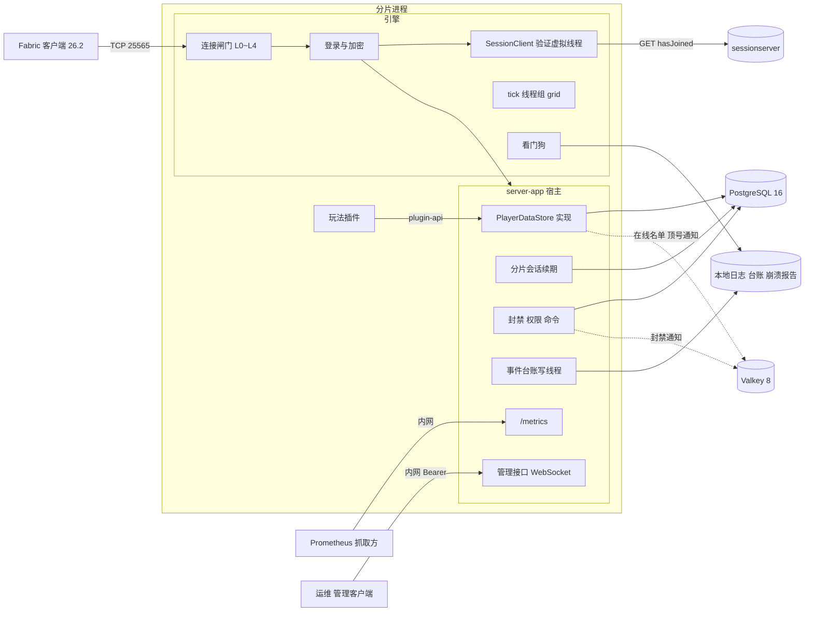

外部依赖与 §17 一一对应：sessionserver、PostgreSQL、Valkey、Prometheus 抓取方、管理客户端。世界存储（`.synx` 发布目录、覆盖存储）与分片目录 `shards.json` 属 M3，见 `docs/DESIGN-M3.md` §6，不在本图。

## 7. 数据模型 / 领域实体

宿主拥有全部表，Flyway 管理（§25）。字段完整定义以 §9 为准，ER 只列关键字段。


| 实体 | 表 | 说明 |
| --- | --- | --- |
| `ENT-Account` | `account` | Mojang 正版 UUID 为键；名字可在 Mojang 改，只做展示 |
| `ENT-Character` | `character` | 账号与角色 1:N（`unique(account_uuid, slot)`），首个版本只开 `slot = 0`（D2）；写权见 `ENT-CharacterLease` |
| `ENT-CharacterLease` | `character.lease_session_id` + `character.version` | 不是独立的表，是角色行上的写权投影；状态机见 §11.3 |
| `ENT-CharacterSection` | `character_section` | 插件数据段；单段编码后 ≤ 64 KiB（沿用 `API-M3-012` 的 65,536 B） |
| `ENT-CharacterLocation` | `character_location` | 每个大区各记一个最后位置；V1 已建表，宿主仍不读写（`character.current_region` 同）。同一大区里的最后位置由 `ENT-PlayerState` 记（v0.9.63）；跨大区送回（玩家在 A 大区下线、连到 B 大区的分片时送回 A）没做，见 §28.2 待办与 `docs/DESIGN-M3.md` §28.1「按大区的最后位置」一行 |
| `ENT-PlayerState` | `character_section`（`section_id = 'synaxis:player'` 的一行） | 宿主的玩家持久化段，字段见 §9，编码与读写时机见 `API-PROD-032`；不是独立的表，与插件数据段同表、同一个 `version`、同一次写入 |
| `ENT-ShardSession` | `shard_session` | 分片每次起服新建一行；状态机见 §11.2 |
| `ENT-TransferNonce` | `transfer_nonce` | 转服票据用过的 nonce，一行一张票据；目标分片验票检查 ⑤ 插入（`API-PROD-028`），过期行由 `transfer_nonce.gc` 每 10 min 删除（§17） |
| `ENT-StoreMeta` | `store_meta` | `auth_mode = online / offline`，防离线 UUID 写进正式库；只由 `--migrate-only --auth-mode` 写入（`API-PROD-004`），分片只读 |
| `ENT-Ban` | `ban` | 按 UUID 或 IP 网段；`subject_uuid` 不建到 `account` 的外键（预先封禁的 UUID 可能从未登录）；是否生效由 `expires_at`、`revoked_at` 派生（§11 免建理由）；`created_by`、`revoked_by` 记 `Moderation#ban` / `unban` 的操作者，控制台是全零 UUID |
| `ENT-Whitelist` | `whitelist` | 白名单开关 `synaxis.app.whitelist` 打开时才判定；`account_uuid` 不建外键（受邀者加白名单时还没登录过） |
| `ENT-Role` / `ENT-AccountRole` | `role`、`role_permission`、`account_role` | 权限串形如 `gm.ban`、`synaxis.command.kick`；`account_role.account_uuid` 不建到 `account` 的外键（可预先授予），`role_id` 建到 `role` 的外键 |
| `ENT-ItemLedger` | `item_ledger` | 只记带 `uid` 的物品的产生、销毁与跨角色转移（D5） |
| `ENT-LoginAttempt` | 无表（内存） | 一条 login / transfer 意图连接从 accept 到进 configuration 的过程；状态机见 §11.1 |
| `ENT-Watchdog` | 无表（内存） | 看门狗；状态机见 §11.5 |
| `ENT-TrainingDummy` | 无表（内存） | 平坦核心世界的训练假人（`API-PROD-031`），停机即消失、不存档；状态机见 §11.6 |

`shard_heartbeat`（在线人数心跳）属 `API-M3-010`，不在本表。`docs/DESIGN-M3.md` `API-M3-012` 的 `player_state(… payload bytea …)` 表**不建**，由 `character` + `character_section` 取代（§25）。

## 8. 接口契约 (API-first)

本分册没有 HTTP 业务接口。对外契约五类：引擎 Java API（`Auth`、线程）、原版协议的登录段、`:plugin-api` 新增面、宿主的数据库与 Redis 布局、运维面（配置键、指标、管理接口、CI 报告格式）。插件面的破坏性判定沿用 `docs/DESIGN-M2.md` §8 与 §24 的 ABI 门，`:plugin-api` 的接口按谁实现分两类（v0.7.2）。**只由宿主实现、插件拿来调用**的 15 个标 `@ApiStatus.NonExtendable`：`PluginContext`、`PluginScheduler`、`PluginEvents`、`PluginChannels`、`PluginAdmission`、`PluginAnalytics`、`PluginLifecycle`、`ShutdownNotice`、`PlayerDataStore`、`Permissions`、`Moderation`、`PluginCommands`，第 5 波新加的 `TabList`、`PluginEntities`（v0.8），以及第 6 波 6A 新加的 `Transfers`（v0.9.27，`API-PROD-021`）；给它们加方法（抽象或默认）是兼容变更，ABI 门不报，仓内自写实现的测试替身（`game-rts` 测试里的 `ProbeContext`、`RecordedChannels`、`RecordedEvents` 与匿名 `PluginEvents`，`:testing` 的 `InMemoryPlayerDataStore`）随宿主一起补实现。**由插件实现**的 `SynaxisPlugin`、`AdmissionProvider`、`PayloadHandler`、`DataSection<T>` 不标，新方法只能带默认实现，写成抽象方法 ABI 门报 `New abstract method added to interface`；`Admission`、`BanTarget` 是 sealed 接口，插件本来就实现不了。新接口按这条规则在第一次提交时就定好标不标：给已有接口补标注本身报 `Class made non-extendable`，只能随 `API_VERSION` 加 1 与新 baseline tag 一起走（`docs/ENGINE.md` §7.1）。第 3 波 3A 给 `PluginContext` 加的 `playerData()`、`lifecycle()` 与给 `PluginScheduler` 加的 `runAsync`、`runOn` 是默认方法（默认实现抛 `UnsupportedOperationException`，宿主覆盖），已发布，改成抽象方法对 `v0.2.0` 报 `Method made abstract`；给 record 加组件会改 canonical 构造器签名，由 `checkBinaryCompatibility` 判定，判为破坏就把 `PluginApi.API_VERSION` 加 1（`plugin-api/.../PluginApi.java:17`）。

- **`API-PROD-001` `Auth` 与 `SessionServer`（引擎 Java API）** — 实现 `REQ-PROD-002`、`REQ-PROD-036`
  - 签名（auth 草案 §3.1，`Velocity` / `Bungee` 按 `ADR-PROD-007` 删除）：

    ```java
    public sealed interface Auth {
        record Offline(boolean encrypt) implements Auth { public Offline() { this(false); } }
        record Online(KeyPair keyPair, SessionServer sessionServer) implements Auth {
            public Online() { this(LoginCrypt.generateKeyPair(), SessionServer.mojang()); }
        }
    }
    public record SessionServer(URI hasJoinedUrl, boolean sendClientIp, Duration timeout, int maxInFlight) {
        public static SessionServer mojang() { /* https://sessionserver.mojang.com/session/minecraft/hasJoined, false, 5 s, 32 */ }
    }
    ```
  - 语义：身份是否可信只看 `Online` / `Offline`，`encrypt` 是正交开关；`Online` 的 RSA-1024 密钥对每进程生成一次（9.9 ms，auth 草案 §5）。`ServerProcess.of()` 与 `MinecraftServer.init()` 的无参重载继续默认 `new Auth.Offline()`（只给测试与嵌入用）。
  - 落点：`LoginCrypt`（RSA 解密、`serverHash`、CFB8 `Cipher` 工厂）进 `crypto` 包；`SessionClient`（`java.net.http.HttpClient` 异步、结果三分）放 `network/player` 旁；`module-info.java` 加 `requires java.net.http;`。
  - 宿主配置：`synaxis.app.auth` = `online`（默认）| `offline` | `offline-encrypted`；`synaxis.app.auth.session-server` 覆盖 `hasJoined` 地址（只给 CI 与压测），地址不是 Mojang 的 `hasJoined` 端点时启动日志打 WARN。是不是 Mojang 的端点由 `SessionServer#isMojang` 判（v0.9.42）：地址经 `URI#normalize` 后与 `https://sessionserver.mojang.com/session/minecraft/hasJoined` 逐段比，scheme 与主机不分大小写，端口只认缺省或 443，不能带 userinfo、query 与 fragment。同一主机走 `http://`、别的端口或别的路径都不算：明文 http 的应答可由出站路径上的任何一方伪造，对任意 `username` 回 200 就能冒充任意正版账号（安全审查 D-02）。
  - 启动自检（`REQ-PROD-036`）：本进程的有效模式 = `online` 当且仅当 `synaxis.app.auth=online` 且 `hasJoined` 地址按上一条是 Mojang 的端点，其余（两种离线、指向假 sessionserver 的在线、以 http 或别的端口指向 Mojang 主机的在线）一律算 `offline`，所以 CI 与压测的机器人身份进不了正式库。分片起服时读 `store_meta.auth_mode`：该行不存在（库没按发布流程迁移过）或与有效模式不一致时拒绝起服（进程非零码、端口不 bind）。分片从不写这一行，写入者只有 `--migrate-only`（`API-PROD-004`）。开 PROXY protocol 时必须同时配 `synaxis.proxy-protocol.trusted-networks`（负载均衡器所在网段，写法同闸门可信网段）并设 `synaxis.proxy-protocol.required=true`，缺一项 `ServerConfig` 构造器就抛 `IllegalArgumentException`，`server-app` 以 `Refusing to start` 退出、端口不 bind。运行中，没发 PROXY 头的连接与头部来自可信网段外的连接都在解码 PROXY 头时断开、不发包，对端在头部里写的地址不被采用。
- **`API-PROD-002` 登录段协议（加密握手与会话验证）** — 实现 `REQ-PROD-002`、`REQ-PROD-003`
  - 包：clientbound login ID 1 恢复为 `EncryptionRequestPacket`（`serverId = ""`、公钥 X.509 DER、4 字节 challenge、`shouldAuthenticate`；`PacketVanilla.java:387`，替换原先占位的 `ReservedPacket`）；serverbound login ID 1 `ClientEncryptionResponsePacket`（现存，`PacketVanilla.java:287`）注册监听器。
  - 顺序：`LoginStart` → 闸门 L3 满员快速拒绝（不占席位）→ 发加密请求 → 收 `minecraft:key` → 读线程上同步完成「一次性声明 `claimEncryptionResponse()` → RSA 解密 → 校验 challenge → 开收发 cipher，本批剩余字节就地解密」→ 之后一切出站包都是密文（含失败时的 `LoginDisconnect`）→ 在线模式把 `(username, serverHash, ip)` 交给验证虚拟线程 → 验证通过后 L3 占席位（`ConnectionManager#transitionLoginToConfig` 开头，`ADR-PROD-015`）→ 开压缩 → `AsyncPlayerPreLoginEvent`。压缩在加密与占席位之后开。
  - `hasJoined`：GET `{hasJoinedUrl}?username=…&serverId=<serverHash>`，`sendClientIp` 默认 false 不带 `ip`；并发 ≤ `maxInFlight`，排队加请求超过登录总超时剩余部分的按 `Unavailable` 处理。
  - 结果三分：`Verified(GameProfile)`（200，`id`、`name`、`properties[{name,value,signature}]` 原样进 profile，皮肤随之进 PlayerInfo）/ `Unverified`（204）/ `Unavailable`（连接失败、超时、429、5xx、200 但 JSON 不合法）；`Unavailable` 随机退避 0.5～1.5 s 重试一次。
  - 429（v0.9.39）：sessionserver 要求本出口地址等待。`SessionClient` 按响应的 `Retry-After` 秒数停发（只认非负整数秒；缺省、不是整数秒、HTTP 日期写法都取 10 s；上限 60 s），停发窗口内 `verify` 不发请求、直接得 `Unavailable`，这次与窗口内的其他登录都不重试；窗口内排队等许可的请求拿到许可后再查一次窗口。`Retry-After: 0` 不停发，照常退避重试一次。窗口是进程级的（一个 `SessionClient`），不加配置键；不另设进程级 `hasJoined` 令牌桶，每 IP 的速率由闸门 L2 约束。
  - 超时：计入 login 阶段 30 s 总超时（`ServerConfig.java:408`），不占 configuration 阶段 `C2S_HELLO` 的 3 s（`ADR-M2-010` 不变）。
  - 错误：`synaxis:auth-failed`、`synaxis:auth-unavailable`、`synaxis:protocol-error`（§14）。
- **`API-PROD-003` 连接闸门与连接级配置键** — 实现 `REQ-PROD-001`、`REQ-PROD-043`
  - 引擎默认值与分片宿主设置（运维草案 ② 2.3；引擎默认的 L0～L2 开启、L3 / L4 为 0 即不限，M2 进程除 L0～L2 外不变，§28.1 ops #5）：

    | 层 | 检查点 | 键 | 引擎默认 | 分片宿主 | 超限行为 |
    | --- | --- | --- | --- | --- | --- |
    | L0 全局套接字 | `Server#start` accept 之后、起线程之前 | `synaxis.max-connections` | 1,024 | 3 × `capacity`（500 人档 1,500），`ShardMain` 写（v0.9.53） | 立即 `close()`，不发包 |
    | L0′ accept 退避 | accept 抛 `IOException` | `synaxis.accept-backoff-ms` | 100 | 同 | sleep 后重试；10 s 一行汇总 WARN |
    | L1 每 IP 并发 | 不开 PROXY：accept 之后、起线程之前，按对端地址；开 PROXY：处理 `ClientHandshakePacket` 时（PROXY 解码已完成） | `synaxis.max-connections-per-ip` | 16（IPv4 /32，IPv6 /64） | 同 | accept 时超限：立即 `close()`，不发包；握手时超限：status 意图直接关，login / transfer 意图 `synaxis:too-many-connections` |
    | 握手前超时 | accept 到收到 `ClientHandshakePacket` | `synaxis.handshake-timeout-ms` | 5,000（本分册定） | 同 | 立即 `close()`，不发包；与 30 s 登录总超时并存 |
    | L2 登录桶 | 同上，login 意图 | `synaxis.login-rate-per-ip` / `synaxis.login-burst-per-ip` | 0.5/s / 3 | 同 | `synaxis:login-throttled` |
    | L2 status 桶 | 同上，status 意图 | `synaxis.status-rate-per-ip` / `synaxis.status-burst-per-ip` | 1/s / 10 | 同 | 直接关 |
    | L2 transfer 桶 | 同上，transfer 意图 | `synaxis.transfer-rate-per-ip` / `synaxis.transfer-burst-per-ip` | 2/s / 10 | 同 | `synaxis:login-throttled` |
    | 白名单网段 | L1 / L2 之前 | `synaxis.connection-gate.trusted-networks` | 空 | 压测机器人网段 | 命中者跳过 L1 / L2 |
    | L3 分片席位 | 两处，login 与 transfer 意图都判：① 处理 `LoginStart` 时、发加密请求之前，只判满、不占席位；② 认证之后、开压缩与 `AsyncPlayerPreLoginEvent` 之前（`ConnectionManager#transitionLoginToConfig` 开头）占席位（`ADR-PROD-015`） | `synaxis.max-players` | 0（不限） | = 频道 `capacity`（`API-M3-010`，200～500） | 已占席位 ≥ 上限时 `synaxis:shard-full`，① 是明文，② 在在线与加密离线模式下是密文；两处都计 `full` |
    | L4 每 tick 入场 | `updateWaitingPlayers` 的 drain | `synaxis.max-joins-per-tick` | 0（不限） | 5，`ShardMain` 写（v0.9.53） | 留在队列，下一 tick 继续，不踢 |
  - 分片宿主的两项默认值（v0.9.53）：L0 与 L4 由 `ShardMain#gateDefaults` 写，命令行与 `synaxis.properties` 都没给时才写：`synaxis.max-connections` = 3 × `synaxis.max-players`（即 `capacity`；`max-players` 没给、为 0 或不是整数时不写，L0 取引擎的 1,024，不是整数的 `max-players` 随后由 `ServerConfig` 拒启），`synaxis.max-joins-per-tick=5`。目录模式的 `capacity` 由 `Main` 步骤 (1) 读 `shards.json` 时写进 `max-players`（`docs/DESIGN-M3.md` `API-M3-010`），所以这两项不在 `ShardMain#main` 里与其余分片默认值一起写，而由 `Main` 步骤 (1) 在读完分片目录之后、只对分片宿主写；`bin/server-app`（`Main`）与 RTS 进程不写，仍是引擎默认。v0.8.5～v0.9.52 的分片漏了这两项，跑的是 L0 1,024、L4 不限（`docs/TEST.md` `TC-PROD-670` 的修前读数）。对压测：§15 的分片六档在命令行给了 `max-joins-per-tick=5`、`max-players=500`，L4 与现在的默认值相同，L0 由 1,024 变 1,500，机器人至多 500 个，两者都够；`:loadtest` 默认每秒登录 20 个，低于 L4 的每秒 100 人，进服节奏不变。走 `bin/server-shard` 的 M3 用例命令行不给这两项，原先跑的是 L0 1,024、L4 不限，转服进入与登录一样排进 L4 的队列；按用例写的参数推算（本组没有重跑这几档），都碰不到新的上限：目录模式 `docs/TEST.md` `TC-WORLD-081` 一个频道 `capacity` 200、200 个机器人（L0 600），`TC-WORLD-082`、`TC-WORLD-083` `capacity` 500、500 个（L0 1,500），`TC-WORLD-084` 两个频道各 200、r0 上 200 个（L0 各 600）；两进程夹具的 `r0-c1` `capacity` 2，L0 为 6，`TC-WORLD-076`、`TC-WORLD-077` 同时连它的至多 3 个，`TC-WORLD-077` 的第三个照旧由 L3 以 `synaxis:shard-full` 拒；入场是机器人每秒 20 个登录，加 `TC-WORLD-084` 的 20 个 `gate` 机器人（`--dwell 6s`，每个两次转服之间至少停 6 s）每秒至多约 3.3 次转入，合计每 tick 约 1.2 人，低于 5。不在目录模式、命令行不给 `max-players` 的挂地图分片（`TC-WORLD-052`、`TC-WORLD-053`、`TC-WORLD-099`，至多 200 个机器人）L0 仍是 1,024，只多了 L4 = 5。
  - 席位：在线数 `getOnlinePlayerCount()` 只数 play 态（`ConnectionManager.java:217-219`），并发登录时会超员（上限 500、在线 495、20 条连接同时 `LoginStart` 会全部通过），所以 L3 不读它，改用进程内原子计数「已占席位」：认证之后占席位时 +1（判定与 +1 是同一次 CAS），连接关闭时 −1。认证前的连接不占席位（v0.9.39，`ADR-PROD-015`）：v0.2～v0.9.38 在 `LoginStart` 就占，认证前握手加 `LoginStart` 后静默的连接每条占一个席位挂满 30 s 登录超时，约 13 个 IPv4（`capacity` 200）或 32 个（500）就能占满。「认证」按模式算：在线模式是 `hasJoined` 回 200，加密离线是开 cipher，不加密的离线是 `LoginStart` 本身；三条路径（在线、离线、转服）都经 `transitionLoginToConfig`。`LoginStart` 时的满员判断只读计数，满员附近通过它的连接可能在认证之后才因 CAS 失败被拒，这些连接已花了一次 RSA 解密（在线模式还有一次 `hasJoined`）。
  - 握手里的服务器地址（v0.9.39）：原版客户端至多发 255 个字符，超过的照常先过 L1（开 PROXY 时）与 L2（扣令牌、计数），通过之后经 `disconnectTurnedAway` 关闭，不发包、不写行、不计拒绝原因（`HandshakeListener`）。v0.9.38 及以前在过闸之前抛异常，异常被读线程吞掉而连接留着，同一批里的 `LoginStart` 照常处理，L1（开 PROXY 时）、L2、转服判定、协议版本判定与 5 s 握手前超时全部被跳过。
  - 登录前的监听器异常（v0.9.39）：一批包的起始状态在 configuration 之前（handshake、status、login）时，任一监听器抛异常即断开连接，不看 `rejectMisusedPacket`（`PlayerSocketConnection#processBatch`）；本批剩下的帧不再处理。异常照旧按 `suppressMisusedPacketErrorLevel` 交给异常处理器。configuration 与 play 态不变。
  - 取值规则（`ServerConfig` 构造器校验，不合规抛 `IllegalArgumentException`，`server-app` 拒绝起服）：`max-connections`、`max-connections-per-ip`、`handshake-timeout-ms` ≥ 1；三只桶的速率 > 0（`NaN` 同样拒绝）、容量 ≥ 1；L0～L2 的键都不接受 0，要让某些来源不受 L1 / L2 约束，就把它们写进 `synaxis.connection-gate.trusted-networks`（逗号分隔的字面地址，可带前缀长度，主机名拒绝）；`max-players`、`max-joins-per-tick` 取 0 表示不限；`accept-backoff-ms` ≥ 0。本机起多个机器人或连续跑探针时要把 `127.0.0.0/8` 写进可信网段，否则同一地址第 4 次登录就收到 `synaxis:login-throttled`（`docs/TEST.md` §3）。
  - 拒绝的关闭方式：被闸门拒的连接一律经 `PlayerConnection#disconnectTurnedAway` 关闭，要发断线包的（握手时 L1 超限、L2 的 login / transfer、L3，以及第 2 波的 `auth-failed` / `auth-unavailable`）先发 `LoginDisconnect` 再关。它不写 `Connection closed` 行：被拒多少次由对端决定，只由闸门计数、进 10 s 汇总行。
  - 计数释放：每条连接持有一张 `ConnectionGate.Ticket`，记着它占的 L0 套接字、L1 地址计数与 L3 席位；连接关闭时 `release()` 在这张票自己的锁里一次性归还，不与 `ConnectionManager#removePlayer` 同锁。防 SOAK-2 式孤儿靠同一把锁：释放之后这条连接再来占 L1 或 L3（关闭途中才处理到的握手或 `LoginStart`），票据一律不记（`takeSeat` 返回 true 但不占席位），计数活不过连接。开 PROXY 时 L1 在握手线程上计数，按 `compute` 里自增后的值比上限，同一地址两条握手同时到达、上限只剩一个时恰好拒一条。令牌桶表以 IP 前缀为键，上限 65,536 个键，满时淘汰最久未用，每 60 s 清掉桶已满的键。
  - status 响应的 `max` 写 `synaxis.max-players`（为 0 时写 L0 上限，`StatusResponse.java:73`），不再写 `online + 1`。
  - 汇总行：闸门汇总行（句式见 §14）由 tick 线程在 `ConnectionManager#tick` 里驱动，按 tick 时间每满 10 s 至多一行、窗口内没有拒绝就不写；tick 卡住期间不出，恢复后的第一行带上这段时间累计的拒绝数。accept 失败汇总行在 accept 线程上写，10 s 至多一行，句式 `Accepting a connection failed N times since the last report, retrying every B ms`，`synaxis.suppress-connection-accept-errors` 只决定是否附带栈。`ConnectionGate` 进引擎 `ArchitectureTest#boundedReporters` 的日志豁免名单，登记的上界是「10 s 至多一行，带这段时间的拒绝计数」。
  - 计数出口：`synaxis_gate_rejections_total` 随 `REQ-PROD-018`（5A）导出；第 1 波只有进程内的 `ConnectionGate#rejected(Reason)`，`Reason` 的五个取值与该指标的 `reason` 标签一一对应。
  - `synaxis.socket-timeout`（`ServerConfig.java:455`）标 deprecated：对 `SocketChannel#read` 无效（攻击面 G2），sunset 见本节「演进与弃用」。keep-alive 超时断线改用 `synaxis:keep-alive-timeout`（`REQ-PROD-043`）。
- **`API-PROD-004` PostgreSQL 表结构与写权语句（宿主）** — 实现 `REQ-PROD-005`、`REQ-PROD-010`、`REQ-PROD-011`、`REQ-PROD-035`
  - 表：§7 与 §9 所列；Flyway 脚本 `server-app/src/main/resources/db/migration/V<n>__*.sql`，迁移顺序见 §25。
  - 写权语句（持久化草案 ③，时间只取数据库 `now()`）：

    ```sql
    -- 获取（登录或转入）：持有者为空、持有者就是本会话，或持有者的会话已过期
    UPDATE character c SET lease_session_id = :mine
     WHERE c.character_id = :id
       AND (c.lease_session_id IS NULL
            OR c.lease_session_id = :mine
            OR NOT EXISTS (SELECT 1 FROM shard_session s
                            WHERE s.session_id = c.lease_session_id AND s.expires_at > now()))
    RETURNING version;
    -- 获取影响 0 行时查持有者所在分片，用于发顶号消息
    SELECT s.shard_id FROM character c JOIN shard_session s ON s.session_id = c.lease_session_id
     WHERE c.character_id = :id;
    -- 保存：同一事务里先做这一句，再写脏段与位置；影响 0 行 → 回滚，返回 FENCED
    UPDATE character SET version = version + 1, last_saved_at = now()
     WHERE character_id = :id AND lease_session_id = :mine AND version = :expected;
    -- 释放：保存语句之后同一事务
    UPDATE character SET lease_session_id = NULL WHERE character_id = :id AND lease_session_id = :mine;
    -- 按账号释放（被拒的登录还回本会话可能为该账号持有的租约，含验票 ⑥ 取得的）
    UPDATE character SET lease_session_id = NULL WHERE account_uuid = :uuid AND slot = 0 AND lease_session_id = :mine;
    -- 分片会话续期：影响 0 行说明会话已过期
    UPDATE shard_session SET expires_at = now() + interval '30 seconds'
     WHERE session_id = :mine AND expires_at > now();
    -- 起服（§11.2 [*] → active）：同一事务里插入新会话，并把同一 shard_id 的旧会话置过期
    INSERT INTO shard_session (shard_id, started_at, expires_at)
         VALUES (:shard_id, now(), now() + interval '30 seconds') RETURNING session_id;
    UPDATE shard_session SET expires_at = now()
     WHERE shard_id = :shard_id AND session_id <> :mine AND expires_at > now();
    -- 会话释放（停机）：只令其过期，不 DELETE（character.lease_session_id 有外键指向它）
    UPDATE shard_session SET expires_at = now() WHERE session_id = :mine;
    ```
  - 首次建档：`INSERT INTO account … ON CONFLICT DO UPDATE SET last_login_at`；`INSERT INTO character (account_uuid, slot, version, lease_session_id) VALUES (…, 0, 0, NULL) ON CONFLICT (account_uuid, slot) DO NOTHING`。无论插入 1 行还是 0 行（另一分片同时建档），下一步都执行获取语句；租约只由获取语句写，建档不写。载入的语句组（建档、获取、读段）在一个事务里，获取之后读段失败时整体回滚，不留租约。实现里获取语句按 `account_uuid` + `slot = 0` 定位角色，并先以 `FOR UPDATE` 读出原持有会话与 `last_saved_at`，供 `EVT:lease_takeover` 使用。
  - 起服前提：同一 `shard_id` 同时只运行一个进程（systemd 单实例或 StatefulSet 副本数 1 保证）。起服时的置过期语句让同机重启立即可接管上一次运行的租约；违反前提双开时，后起者把先起者置过期、先起者进 `isolated` 后经 `reopen` 以新会话恢复。`reopen` 不执行置过期语句，所以两个进程不会来回互相踢，但它们会同时接受登录，数据正确性仍由逐角色 fencing 保证。
  - 连接：pgjdbc 42.7.13 + HikariCP 7.1.0，`maximumPoolSize = 4`、`connectionTimeout = 2000`、`validationTimeout = 1000`、`statement_timeout = 2s`；驱动参数 `connectTimeout = 2`、`loginTimeout = 2`、`socketTimeout = 4`（秒）：数据库不应答又不断开连接时，语句卡在读 socket 上，服务端执行的 `statement_timeout` 管不到，要靠 `socketTimeout` 让它在 4 s 内失败；分片会话续期用一条不进池的独占连接（断开即重连），登录风暴或停机批量保存占满池时续期不排队；分片数 ≤ 24 直连，超过 24 加 PgBouncer（事务模式），不调大 `max_connections`（D10）。
  - 账号：分片用的数据库账号只有 DML 权限；DDL 只给发布流程 `server-app --migrate-only --auth-mode=online|offline` 用的账号，分片起服只 `validate`（D11）。`--migrate-only` 在迁移之后写 `store_meta(auth_mode)`：该行不存在时按 `--auth-mode` 插入；已存在且值不同时迁移失败、非零退出，不改库。正式库用 `online`，CI、压测、本机开发库用 `offline`。
  - 过期会话清理：`shard_session.cleanup` 每小时删 `expires_at < now() − 1 天` 且没有角色行引用的会话行（起服与 `reopen` 每次都新增一行）。
  - 密钥：`SYNAXIS_STATE_DB_URL`（JDBC URL，形如 `jdbc:postgresql://host:5432/synaxis`）、`SYNAXIS_STATE_DB_USER`、`SYNAXIS_STATE_DB_PASSWORD`，按 `CLAUDE.md` 密钥纪律只进 `.env` 与 Bitwarden，`.env.example` 登记键名、用途与获取方式。起服自检行 `Effective store: mode=postgres auth_mode=… StoreSettings[…]` 里的 JDBC URL 只留 scheme、主机、端口与库名（v0.9.42，安全审查 D-01）：`?` 或 `#` 之后的参数整段去掉，客户端证书私钥的 `sslpassword=` 只能写在那里；`@` 之前的 userinfo 也去掉。口令与 Redis URL 照旧只写 `<set>`。
- **`API-PROD-005` `PlayerDataStore`（`:plugin-api` 新增）** — 实现 `REQ-PROD-006`
  - `PluginContext` 增加默认方法 `PlayerDataStore playerData()`（默认实现抛 `UnsupportedOperationException`，宿主的上下文覆盖它）。签名（持久化草案 ①）：

    ```java
    public interface PlayerDataStore {
        <T> void register(DataSection<T> section);            // 只能在 onEnable 内；id 以 "<plugin_id>:" 开头
        <T> T get(Player player, DataSection<T> section);      // 玩家所属 tick 线程上调用
        void markDirty(Player player, DataSection<?> section);
        CompletableFuture<SaveResult> saveNow(Player player);  // future 在虚拟线程上完成
        CompletableFuture<SaveResult> commitTogether(Map<Player, Map<DataSection<?>, Object>> staged, Runnable apply);
        boolean isFrozen(Player player);                        // 任意线程可调
    }
    public interface DataSection<T> {
        String id(); int schemaVersion(); T createDefault();
        T decode(JsonElement json, int storedVersion);        // 含升级链
        JsonElement encode(T value);                           // tick 线程上调用
    }
    public enum SaveResult { SAVED, FENCED, UNAVAILABLE }
    ```
  - 语义：玩家进世界前宿主已载入全部已注册段，缺失的段给 `createDefault()`；**任何路径都不得用 `createDefault()` 覆盖一个解码失败的段**。插件的段回调抛出的任何 `Throwable`（`Error` 也算，比如带环对象让 JSON 编码器抛的 `StackOverflowError`）由宿主接住、按回调分两种结局（v0.9.91）：`createDefault()` 与 `decode` 抛出时拒绝这次登录（`synaxis:state-unavailable`），载入取得的写权还回；`encode` 抛出时这一段保持脏、这一次不写，记一行 ERROR（`character_id`、`section_id`），同一次快照的其余段照常写，登出、转服与停机的写回照常走完。`commitTogether` 在一个事务里带全部参与者的版本校验写入，成功后在下一个 tick 的串行段（tick 调度线程，`docs/PLUGINS.md` §10）执行一次 `apply`（v0.9.91）：串行段里可以碰本分片的每个参与者，不论他们分在哪条 tick 线程；参与者这时可能已经离开，`apply` 里先查 `Player#isRemoved()`。任一校验失败整笔不写、`apply` 不执行；参与者必须都在本分片。定时保存或登出保存的快照里，读取早于某次 `commitTogether` 的段不写库、重新标脏，交给下一次保存：旧快照不能覆盖交易结果，代价是多写一次、`version` 多涨 1。
  - 冻结：`isFrozen` 在分片会话 `degraded` 或 `closing`（§11.2）期间对全体在线玩家为 true，在该玩家处于 §11.3 `saving` 或 `in_transit` 时为 true。冻结期间 `commitTogether` 与 `saveNow` 不访问数据库，直接以 `UNAVAILABLE` 完成（`EVT:critical_commit` 记 `cause=frozen`）；宿主监听引擎的 `PickupItemEvent`、`ItemDropEvent`、`PlayerBlockPlaceEvent`、`PlayerBlockInteractEvent` 与 `PlayerUseItemEvent`（后三个 v0.9.73），每个事件只在根节点读一次冻结，读到冻结就取消两次（v0.9.48）：先在根节点自身的监听器里取消，`PlayerStore#attach` 在 `PluginHost` 构造时挂上、早于启用任何插件，到达时已取消的事件同样判定（监听器按 `ignoreCancelled=false` 建：两参 `addListener` 跳过已取消的事件，这样的事件不记下，插件之后撤销取消时优先级 3 不再取消），根节点按添加顺序跑完自身的监听器，再派发映射节点（实例与实体作用域），最后按优先级派发子节点（宿主节点），所以派发开始时已冻结的拾取与丢弃，每个作用域、每一档的插件监听器拿到的都是已取消的事件，`ignoreCancelled=true` 的发放监听器不会被调用；再在宿主节点下的 `synaxis-store-freeze` 子节点对根节点取消过的同一个事件取消一次（按对象身份记在按线程的弱键集合里，监听器里再派发的拾取或丢弃顶替不了它，派发被异常打断时集合也不留住它，§28.2），它的引擎优先级是 3，排在全局作用域插件 `LOWEST`～`HIGHEST`（−2～2）之后、`MONITOR`（4）之前：`HIGHEST` 撤销取消也不生效，全局 `MONITOR` 读到的是取消后的结果（`API-PROD-018`）。放方块、方块交互与用物品（v0.9.73，§28.2「转服冻结要一并拦放方块与交互」已决行）走同一套：同在根节点读一次冻结并取消，同在优先级 3 对根节点取消过的同一个事件再取消一次，本条下文说拾取与丢弃之处对这三个同样成立。拦它们是为了转服冻结：从 `PlayerStore#transferOut` 把记录由 `online` 置为 `saving` 起（在调用线程上，早于排在玩家下一个 tick 的快照），经 §11.3 `in_transit`，到玩家断开为止（客户端照 `Transfer` 离开，或 10 s 后被 `synaxis:transfer-rejected` 断开，`TicketIssuer` 的 `LEAVE_WITHIN`），写库失败回到 `online` 时就此解冻；这期间目标分片按这次写回恢复背包，世界可写的地图分片上放下的方块却已进了覆盖层，物品多出一份；冻结之后打开容器往里放东西、开始用物品同理。冻结之前已打开的容器里点格子、手里不是方块时对方块用物品（`PlayerUseItemOnBlockEvent`）、冻结之前开始而冻结中用完的物品（`PlayerFinishItemUseEvent`）这里不拦，现在没有默认玩法消费它们（§28.2「冻结拦不住的三条物品路径」一行）。只取消 `PlayerBlockInteractEvent` 拦不住放置：引擎 `BlockPlacementListener` 在它被取消时只跳过方块处理器，照样往下走到 `PlayerBlockPlaceEvent`，所以三个都取消。范围与拾取、丢弃一致，冻结的其余来源（会话 `degraded`、`closing`，登出的 `saving`）同样拦这三个：这期间玩家放不了方块、开不了门与容器、吃不了东西，移动与战斗照常。冻结在派发中途落地时（关卡门转服的心跳读取在虚拟线程上完成，`degraded` 由会话看门线程置，都不在玩家的线程上），这一次照根节点的判定放行到底、下一次起取消：它在玩家所属 tick 线程上执行完，tick 存活时转服与停机的快照经 `scheduleNextTick` 排在同一线程上、在它之后，带走它的结果；看门狗判 tick 死之后，停机快照改在停机线程上直接读（`API-PROD-007`），这一次的结果可能不在快照里，地上的掉落物随进程退出，只会丢、不会复制（按代码推断，没有实测）。优先级 3 不能再读一次冻结：两次读之间落地的冻结会取消一个前面的插件监听器已当作放行、已经发放了的事件，与先于冻结发放同样复制（§28.2）。撤销冻结的取消（`setCancelled(false)`）不支持：撤销之后、优先级 3 之前执行的监听器（实例作用域与全局作用域都有）看到的是放行，在那里发放仍会复制（§28.2）；插件自己的归属变更操作（交易、邮件、商店）必须先查 `isFrozen`，这一条是文档约定，宿主无法替插件判断哪些操作改变归属；拾取与丢弃的监听器例外，以事件是否已取消为准、不另查 `isFrozen`：冻结在派发中途落地时这一次放行而 `isFrozen` 已是 true，按它拒绝发放，物品会丢。
  - 插件测试：`:testing` 模块提供内存版 `InMemoryPlayerDataStore`：保存恒得 `SAVED`；`freeze(player, true)` 之后 `commitTogether` 与 `saveNow` 得 `UNAVAILABLE`，`apply` 不执行。内存版的 `commitTogether` 在调用线程上当场执行 `apply`，宿主延到下一个 tick 的串行段，参与者在这之间离开的情形内存版测不到。
  - 插件看不见 `Connection`、SQL、Redis 类型与租约（`ADR-PROD-012`）。
- **`API-PROD-006` Redis 键空间与消息（宿主，Valkey 8，Jedis 8.0.1）** — 实现 `REQ-PROD-004`、`REQ-PROD-007`、`REQ-PROD-010`
  - `presence:{uuid}`：值 `{shard_id, session_id, state}`，`state` ∈ `loading / online / in_transit`；`PX 30000`，在线期间每 10 s 刷新，刷新按本分片记录的状态写，签发之后还连着的玩家写 `in_transit`。只做路由提示，以 PostgreSQL 租约为准。写与删都排进单独的一条守护线程 `Syn-Presence-Write`，调用方入队即返回（v0.9.91）：载入、准入、转服签发与登出都不等 Redis 往返；一条线程按入队先后执行，同一账号的 `loading → online → 删除` 不乱序。队列上限 4,096 条，满了丢最旧的一条、经 `LogBudget` 10 s 一行 WARN，丢掉的与写失败的由下一次 10 s 刷新补上。登出时先排删除、再放行同账号在本分片的下一次登录（§11.3 末段），这个先后不能换：换了，下一次登录排进的 `loading` 会被旧记录的删除删掉。
  - 频道 `synaxis:kick:{shard_id}`：顶号通知，载荷 `{uuid, requester_shard, reason}`。
  - 频道 `synaxis:moderation`：封禁与白名单变更，载荷 `{kind, subject, ban_id}`，`kind` ∈ `ban / unban / whitelist-add / whitelist-remove`，`subject` 是账号 UUID 或网段，白名单变更的 `ban_id` 为 null；各分片收到后不看载荷，全量重读生效的封禁与白名单，再踢出被覆盖的在线玩家（`API-PROD-009`）。
  - 频道 `synaxis:permission`：角色变更，载荷 `{account_uuid}`；各分片重载该账号角色。
  - 不放进 Redis 的：租约、版本号、玩家数据、转服 nonce、登录令牌桶（闸门是进程内计数）。
  - 连接：`SYNAXIS_REDIS_URL`（密钥纪律同上），写法 `redis://[user:password@]host:port[/database]`，口令里除字母、数字和 `-._~` 之外的字符一律按百分号编码写（`/` 写成 `%2F`，`openssl rand -base64` 生成的口令常带它；只编码 RFC 3986 的保留字符不够：`^`、空格这类既非保留也非不保留的字符 `URI` 同样拒收，Bitwarden 生成口令的默认特殊字符里就有 `^`；`.env.example` 有说明）；不可达时每 10 s 一行 WARN（`LogBudget`）。连接池用 Jedis 的默认上限 8 条，每个订阅（`synaxis:kick:{shard_id}`、`synaxis:permission`、`synaxis:moderation` 与世界状态标志的频道，`docs/DESIGN-M3.md` `API-M3-013`）订阅期间各占一条；借连接至多等 2 s（`maxWait`，与连接、读超时同值，v0.9.91），借不到按 Redis 不可达处理，不无限等。URL 解析不出（`URI` 报错）、解析后没有主机（口令里未编码的 `/` 或 `#` 让 `URI` 退成没有主机的注册型 authority）或库号不是整数时拒启，信息只有变量名与写法 `SYNAXIS_REDIS_URL is not redis://[user:password@]host:port[/database]; percent-encode every character of the password but letters, digits and -._~`，不带原串、不挂 cause：`Refusing to start` 那一行连 cause 链一起记，而 `URI` 与 `Integer#parseInt` 的报错都引原串，口令会随之进日志（v0.9.42，安全审查 D-01）。
- **`API-PROD-007` 停机阶段与插件钩子** — 实现 `REQ-PROD-008`
  - 引擎：`ServerProcess#stop()` 的关闭序列改为 §11.4 的顺序；新方法 `ServerProcess#beginShutdown(Duration countdown)` 关登录门并开始倒计时，倒计时结束后进入保存阶段。两者都返回 `boolean`：这次调用是否占下了停机（下文「进程标志」）。`beginShutdown` 从任何线程调用都在停机线程 `Syn-Shutdown` 上跑序列、立即返回；`stop()` 以 0 s 倒计时占下停机，从 tick 线程调用时同样交给 `Syn-Shutdown`，从其他线程调用时在调用线程上跑完才返回（SIGTERM 的关闭钩子，`docs/DESIGN.md` `API-003`、§11.2）。关闭钩子（`ServerProcessImpl#stopOnSignal`）先调 `stop()`：得 true 就在钩子线程上跑完序列；得 false（停机已由控制台、玩家命令、管理接口或看门狗判死占下）时结束剩余倒计时（§11.4 `gate_closed → saving` 的 SIGTERM 一行），再等那次序列跑完才返回。JVM 跑完关闭钩子就 halt，不等非 daemon 的 `Syn-Shutdown`，所以钩子必须等。
  - 引擎与宿主之间的保存契约（引擎不依赖 `java.sql`，角色与存储都在宿主，所以引擎只管阶段与计时，保存由宿主做）：

    ```java
    public interface ShutdownParticipant {
        void onGateClosed(Duration countdown);                    // 停机线程上调用；宿主广播倒计时
        CompletableFuture<?> saveAll(Duration budget, boolean tickAlive); // 停机线程上调用；future 完成 = 未完成角色数为 0
        void onSaveEnded(boolean timedOut);                       // 保存阶段结束时调用一次，timedOut = 超时或判死截断
    }
    // ServerProcess 新增：只能在 start() 之前设置一次，未设置时保存阶段立即结束
    void setShutdownParticipant(ShutdownParticipant participant);
    ```

    引擎在 §11.4 `gate_closed → saving` 调 `saveAll(30 s, true)` 并以 30 s 为上限等待 future；判死路径调 `saveAll(剩余预算, false)`，宿主据 `tickAlive=false` 在停机线程上直接快照、跳过插件钩子。判死发生在保存阶段中途时，引擎对同一参与者再调一次 `saveAll(剩余预算, false)`，没有专门的接口，宿主据这次调用把尚未完成的快照改由停机线程读。引擎另有两个内部方法（`@ApiStatus.Internal`）：`shutdownAfterWatchdogDeath()` 由看门狗判死回调线程调用，驱动 §11.4 的判死路径；`shutdownPhase()` 返回 `RUNNING / GATE_CLOSED / SAVING / KICKING / PLUGINS_DISABLED / STOPPED`，供宿主与测试读停机阶段。宿主在 `server-app/.../Main.java` 装配时注册的参与者是 `ShutdownSequence`（下一条）；`host::disableAll` 仍挂在 `buildShutdownTask` 上（`Main.java:344`），新顺序里它在踢人之后随 `scheduler.shutdown()` 执行。
  - 宿主停机序列（`server-app` 类 `ShutdownSequence`，第 6 波 U 组）：引擎只收一个参与者，接口不变；宿主注册的这一个先让玩家存储保存，再跑装配时注册的停机步骤。

    ```java
    public final class ShutdownSequence implements ShutdownParticipant {
        public ShutdownSequence(ServerProcess process, ShutdownParticipant players);
        // 只能在进程启动之前调用（isAlive() 为 false 且 shutdownPhase() = RUNNING），否则抛 IllegalStateException
        public void addAfterPlayers(String name, Step step);
        @FunctionalInterface
        public interface Step {
            CompletableFuture<?> run(Duration remaining, boolean tickAlive); // future 完成 = 步骤结束（成败都算）
        }
    }
    ```

    - 注册：只在 `server-app` 的装配代码里、进程启动之前调用，不经 `PluginContext`，插件拿不到。分片宿主路径（`ShardMain` → `Main`）挂地图时注册两步：`Main` 步骤 (5) 的 `ShardWorld#start` 在 `OverlayStore.open` 之后先调 `addAfterPlayers("relight", …)`，再调 `addAfterPlayers("overlay", overlay::finalFlush)`（`ShardWorld.java:603-604`）。`relight` 是 M3-D 运行时光照的停机排空（`SynxRelight#drain`，`docs/DESIGN-M3.md` `API-M3-005` 运行时光照条的「停机」），排在覆盖层之前，最终落盘写的才是装回之后的光照；`SynxRelight` 建在实例之后，这一步经一个持有者转给它，建之前被调即刻完成。`overlay` 是覆盖层的最终落盘（`overlay.shutdown-flush`，`API-M3-007`）。RTS 的 `Main` 路径与不挂地图的分片不注册，保存阶段只有玩家存储。
    - 顺序：`onGateClosed` 原样转给玩家存储。`saveAll(budget, tickAlive)` 先以同样的参数调玩家存储的 `saveAll`；它的 future 完成后按注册顺序逐个调步骤，上一步的 future 完成才调下一步；最后一步完成后返回给引擎的 future 才完成，引擎随后进 `kicking`。没有注册步骤时 `saveAll` 直接返回玩家存储自己的 future，`onSaveEnded` 原样转交，与只注册玩家存储时相同。
    - 预算：步骤与玩家共用这一次 `saveAll` 的预算（正常 30 s，判死路径 15 s）；`remaining` = 本次保存截止 − 调用时刻，玩家与前面的步骤用掉的都已扣除。步骤自己按 `remaining` 封顶：`relight` 取 min(500 ms, `remaining`)，覆盖层取 min(2 s, `remaining`)。`relight` 到时没装完的目标以旧光照落盘，它记一行 WARN（带剩余目标数），序列照常调下一步。
    - `tickAlive=true`：tick 仍在跑，步骤只把活交给 tick（`relight` 定下排空的截止时刻，由 tick 末尾的光照装回做完；覆盖层把最后一次落盘排进 tick 末尾写入阶段），调用不得阻塞；这一调用在上一段 future 完成的线程上、持序列的锁进行。`tickAlive=false`：看门狗已判 tick 死，由停机线程（跑停机序列的线程，停机开始之前就判死时是 `Syn-Watchdog-Report`）在自己线程上直接调步骤并等它，步骤就在这个线程上把活做完（`relight` 在这个线程上自己跑装回）。这与玩家存储得知 tick 已死的方式相同：都来自这一次 `saveAll` 的 `tickAlive` 参数。
    - 光照排空不受装回上限约束：平时光照装回每 tick 至多 64 个目标条目、累计满 1 ms 即停；排空期间（`drain` 已开始、还没完成）这两个上限都不看，一次装回处理当时已算完的全部结果，只在排空的截止时刻或碰上编码池正持某个目标的写锁时停（那个目标与排在它后面的等下一个 tick；`SynxRelight#installPhase`，`docs/DESIGN-M3.md` v0.26）。这时玩家已冻结、保存完即被踢出，tick 变长可以接受；500 ms 按平时的上限只装得下约 640 个目标条目（约 10 个 tick × 64）。
    - 保存中途判死（引擎第二次调 `saveAll(剩余预算, false)`）：先转给玩家存储；玩家还没存完时停机线程等它，再以 `false` 依次跑全部步骤；已以 `true` 开始、future 还没完成的步骤再以 `(剩余预算, false)` 调一次，第二次调用的 future 代表这一步，此后的步骤都以 `false` 在停机线程上跑。以 `true` 开始的那次调用之后才完成的 future 不再推进序列。
    - 超时：预算用完时引擎不再等（§11.4 `saving → kicking` 保存超时），照常踢人；正在跑的步骤自己记日志（覆盖层记 ERROR 与剩余脏区块数，`relight` 记一行 WARN `Relight drain did not finish within … ms`），没轮到的步骤由序列在 `onSaveEnded` 里各记一条 `The shutdown step {name} did not run, the save budget was used up`；此后完成的 future 不再调下一步。步骤调用本身抛异常时记 ERROR 并按已结束处理。
    - `onSaveEnded(timedOut)`：有步骤时只在玩家存储自己的 future 还没完成时向它传 `true`，所以 `EVT:shutdown_saved.timed_out` 与 `saved` 仍只说玩家；步骤超时不计入。
    - 语义边界：保存阶段与踢人阶段 tick 仍在跑，步骤落盘之后到停 tick 之前发生的方块改动不保证落盘；覆盖层一侧的写法由 `docs/DESIGN-M3.md` `API-M3-007` 登记（§28.3）。
  - 进程标志：新增内部标志 `stopping`，`beginShutdown` / `stop()` 以 CAS 置位，返回值就是这次 CAS 的结果：只有占下停机的那次调用得 true，之后的调用立即返回 false，不等那次停机、不改它的倒计时；看门狗判死路径（`shutdownAfterWatchdogDeath`）用同一个标志；`stopped` 推迟到 §11.4 `plugins_disabled → stopped` 才置位。`isAlive()`（`ServerProcessImpl.java:598`，`started ∧ ¬stopped`）因此在 `gate_closed`、`saving`、`kicking`、`plugins_disabled` 四个阶段都返回 true：`TickSchedulerThread` 的 `while (isAlive())` 循环一直跑到踢人与插件禁用之后，`setCompressionThreshold` 的「起服后不可改」检查（`:279`）语义不变。
  - 插件：`PluginContext#lifecycle()`（默认方法，同 `playerData()`）返回 `PluginLifecycle`，`onShutdownSave(Consumer<ShutdownNotice> hook)` 由宿主在 `saveAll` 内、在每个玩家所属 tick 线程上调一次；已准入、还没进世界的玩家没有所属 tick 线程：保存阶段开始后的下一个 tick，宿主以 `synaxis:server-stopping` 断开其中仍连着的，钩子在派发其 `PlayerDisconnectEvent` 的线程上调（宿主断开的都在 tick 调度线程上），同样恰一次（§11.4 `gate_closed → saving`）。插件在这里把内存状态写进数据段并 `markDirty`；插件不得依赖停机时的 `PlayerDisconnectEvent` 做保存。插件 `onDisable` 的线程：停机线程把 `scheduler.shutdown()` 投递到 tick 调度线程，在两个 tick 之间执行；1 s 内没被接走（tick 卡住）或看门狗已判死时改在停机线程上执行，整体等待上限 15 s，超时记 WARN 继续停机。`scheduler.shutdown()` 在那里跑的是宿主的 `PluginHost#disableAll`：按启用逆序给每个插件新起一条 daemon 平台线程 `plugin-disable-<id>` 跑 `onDisable`，自己 join 等它，全部插件共用 5 s，用完记 ERROR、收回该插件的能力、不再等。所以 `onDisable` 不与 tick 并行，但它所在的线程不属于任何 tick 线程：移除或改动实体要经 `Acquirable#sync` 拿到实体所属的 tick 线程；还没分配给 tick 线程的实体（`assignedThread()` 为 null）直接操作，因为未分配元素上的 `sync` 只认创建线程（`API-PROD-016` 所有权断言一条）。在这条线程上直接调 `Entity#remove` 这类带所有权断言的方法，断言开或 `synaxis.acquirable-strict=true` 时抛 `AcquirableOwnershipException`。
  - 预算：保存阶段 30 s；部署侧 systemd `TimeoutStopSec` 或 Kubernetes `terminationGracePeriodSeconds` ≥ 60 s（清单 G04）。控制台 `stop [秒数]` 与管理接口 `server/stop` 的倒计时默认 0 s（本分册定，无外部来源）。
- **`API-PROD-008` 聊天** — 实现 `REQ-PROD-009`
  - 引擎发出的 `PlayerChatEvent` 收件人是空集合（`ChatMessageListener` 不再取全进程在线玩家）。挂了宿主默认玩法层 `CHAT` 一项的模式（平坦核心、RTS，`API-PROD-031`，v0.9.63）由宿主在宿主节点自身的监听器里把空的收件人填成发送者所在实例的全部玩家（含发送者），排在全局作用域的插件监听器之前，插件可以增删收件人或取消；挂地图的分片不挂默认玩法层，收件人仍为空。没挂的模式里发给谁由玩法插件决定：按频道、同实例或私聊填收件人，没有插件填时一条也不发。
  - `synaxis.chat-rate-per-second` 默认 1、`synaxis.chat-burst` 默认 3（burst 为本分册定，清单只给了 1 条/秒）；两个键取整数且 ≥ 1。限频排在 `PlayerChatEvent` 之前，每连接一只令牌桶（`ChatRateLimiter`，只由解释该玩家包的线程使用）；超限的消息丢弃并计入该桶的 `dropped()`，不断线。
  - `JoinGamePacket` 的 `enforcesSecureChat` 由写死的 true 改为 false（`Player.java:424-426`）；聊天以 `SystemChatPacket` 转发。
  - 客户端模组：原版客户端进入不强制安全聊天的服务器时弹「聊天消息无法验证」toast，而 Synaxis 服务器恒为 false；`client-fabric` 的 `ClientPacketListenerMixin` 拦掉 `handleLogin` 里唯一的 `addToast` 调用，玩家不会为服务器按设计工作而收到警告。
- **`API-PROD-009` 封禁与白名单** — 实现 `REQ-PROD-010`
  - `PluginContext#moderation()`（默认方法）返回 `Moderation`：`CompletableFuture<Ban> ban(BanTarget target, String reason, @Nullable Instant expiresAt, UUID operator)`、`CompletableFuture<Boolean> unban(long banId, UUID operator)`（没有这条生效的封禁时为 false）、`Optional<Ban> activeBan(UUID uuid, @Nullable InetAddress ip)`、`CompletableFuture<Void> whitelist(UUID account, boolean listed)`。任何线程都可调用：写库在虚拟线程上做，失败的 future 带 `IllegalStateException`；理由为空或超过 256 字符、到期时间不在将来或不早于 `+10000-01-01T00:00:00Z`（`HostModeration.EXPIRY_LIMIT`，理由见 `API-PROD-022` `bans/add` 一行）时 `ban` 直接抛 `IllegalArgumentException`，不进库。`activeBan` 同步读本分片内存，`ip` 为 null 时只看 UUID 封禁，同时命中几条时取最晚到期的一条。`operator` 写进 `ban.created_by` / `revoked_by`，控制台传全零 UUID。`Ban` 是 `(banId, target, reason, expiresAt)`。`BanTarget` 只有 `ByUuid` 与 `ByNetwork(cidr)` 两种，不按名字封；`ByNetwork` 只收字面地址，清掉主机位，前缀 IPv4 /8～/32、IPv6 /32～/128。
  - 判定点：宿主节点上的 `AsyncPlayerPreLoginEvent` 监听器，在 Mojang 验证之后、`AdmissionProvider` 之前，排在登录阶段握手之前（`HandshakeGate` 跳过已被踢的连接）。引擎 `transitionLoginToConfig` 本来就在验证之后触发该事件，踢人走已加密的 `LoginDisconnect`，`ConnectionManager.java` 不用改。拒绝键 `synaxis:banned`（翻译参数：理由；到期时为嵌套的 `synaxis:banned-until`，时间写成 `yyyy-MM-dd HH:mm UTC`，永久封禁时为空组件）、`synaxis:not-whitelisted`。
  - `AdmissionRequest` 增加 `uuid`（验证所得）与 `remoteAddress`（连接的 IP）两个组件。旧的四参构造器保留并标 `@Deprecated`，用用户名的离线 UUID 与回环地址补齐新组件，所以 ABI 门不判破坏。
  - 缓存：生效的封禁与整张白名单放在进程内存里，三种时机各全量重读一次：每 30 s、本分片每次变更之后、收到 `synaxis:moderation` 时（`API-PROD-006`）；开始得早的读取不覆盖开始得晚的。每次重读之后踢出被覆盖的在线玩家与 configuration 中的玩家，这是 Redis 不可达时「≤ 30 s 生效」成立的前提。到期在内存里判定，不需要重读。首次读取在绑定端口之前做，失败就拒绝起服；之后的读取失败保留旧数据，10 s 至多一行 WARN。
  - 开关 `synaxis.app.whitelist` 只认 `on` / `off`（默认 `off`），其他值拒绝起服；`synaxis.app.store=memory` 时没有封禁，`ban` / `unban` / `whitelist` 的 future 失败，此时开白名单拒绝起服。移出白名单不踢在线玩家。登录已过判定、还没进入 configuration 时下的封禁，由下一次 30 s 刷新踢出。
  - GM 命令（宿主注册，控制台恒有权限，每次执行一条 `EVT:gm_command`）：`ban <玩家名|UUID|地址[/前缀]> <perm|<n>m|<n>h|<n>d> <理由>`（玩家名只在本分片在线玩家里找）、`unban <封禁编号>`（只收编号）、`whitelist add|remove <玩家名|UUID>`；节点 `gm.ban`（`ban`、`unban`）与 `gm.whitelist`（§10）。回执键见 §14。
- **`API-PROD-010` 权限** — 实现 `REQ-PROD-011`
  - `PluginContext#permissions()`（默认方法）返回 `Permissions`：`boolean has(Player player, String node)`、`Set<String> roles(Player player)`，任何线程都可调用。节点小写点分，授予的节点末段可为 `*`（`gm.*` 覆盖 `gm.` 之下全部节点，单独一个 `*` 覆盖全部）；查询的节点不是小写点分（`rush:admin`、`rush.Admin` 都不是）或含 `*` 时，每次调用都抛 `IllegalArgumentException`；命令的 condition 在每名玩家出生时与每次重发命令树时求值（`API-PROD-011`），节点写成常量。角色还没读进来的玩家 `has` 为 false、`roles` 为空。
  - 角色在登录载入时读进内存（`AdmissionGate`，configuration 线程）。读取开始之前玩家先以「无角色」登记，读取期间到来的变更通知（Redis 的与本分片自己的）都会让该玩家再读一次，读编号大的结果胜出。变更经 `synaxis:permission` 重读该账号；另外每 30 s 重读全部在线玩家，Redis 不可达时变更最迟 30 s 生效。读取失败时玩家保留已有角色（登录时的失败即无角色），等下一次读取。`synaxis.app.store=memory` 时没有角色，玩家一律无节点，控制台照常可用。
  - 到期：`account_role.expires_at` 由每次读取的查询条件 `expires_at > now()` 判定，到期不发通知，已读进内存的授予最迟晚一个刷新周期（30 s）失效。节点集合变化时给该玩家重发命令树（`API-PROD-011`）。`role` 命令对玩家发送者不用这份内存，见下一条。
  - GM 命令 `role grant|revoke <玩家名|UUID> <角色>` 与 `role list <玩家名|UUID>`，节点 `gm.role`；玩家名只在本分片在线玩家里找，别处或从未登录的账号用 UUID。控制台的 `grant` 写入不到期的授予（`expires_at` 为 null），目标已有这条授予时清掉它的到期；角色不存在时回 `synaxis:role-unknown`。发送者是玩家时，判定当场读库（`HostPermissions#grantsOf`，与 `RoleStore#load` 同一条查询，不用本分片内存里的那份）：发送者此刻在库里的有效授予要覆盖 `gm.role`，并且覆盖「角色在 `role_permission` 里的每个节点」，对自己也一样：节点本身、`*` 或按整段的前缀通配覆盖它，`gm.*` 这样的通配节点要发送者持有它本身、更短前缀的通配或 `*`，单独一个 `*` 只有持有 `*` 的发送者覆盖；没有节点的角色只要求 `gm.role`。不满足时回 `synaxis:role-above-sender`、不写库。玩家的 `grant` 写入的授予随发送者最早到期的那条有效授予到期，发送者的授予都不到期时为 null；目标已有这条授予而尚未到期时原样保留、不改到期，已到期时换成新的到期（`RoleStore#handOut`：`ON CONFLICT … DO UPDATE SET expires_at = EXCLUDED.expires_at WHERE account_role.expires_at <= now()`）。所以玩家授出的授予不晚于自己最早到期的那条有效授予，授给自己、授给别人、经小号转手都一样；不到期的授予只有控制台与有效授予全都不到期的玩家写得出。玩家的 `grant` 不改目标尚未到期的授予，但有效授予全都不到期的玩家可以先 `revoke` 再 `grant`，把别人的限时授予换成不到期的；持有者先 `revoke` 掉自己的限时授予、余下的有效授予全都不到期时，再给自己 `grant` 也写成不到期的，这时角色的节点已由它不到期的授予覆盖，不多出权限。撤销到达本分片之前，玩家不能把撤掉的角色授回给自己。「最早到期」按发送者全部有效授予取，不只看覆盖这个角色所需的那几条：同时持有不到期的 `gm.*` 与一条限时角色的发送者，授出的授予也随那条限时角色到期，要授不到期的用控制台。控制台不受这些限制。`role` 与 `role_permission` 的行没有命令或接口维护，由 ROLE-Operator 用 SQL 写。`Player#permissionLevel` 只决定客户端调试界面与补全显示，不作授权依据。
  - GM 命令执行一次写一条 `EVT:gm_command`（`API-PROD-014`，`result` 取值见 §20）。
  - 宿主的 GM 节点共四个：`gm.role`（本条）、`gm.ban` 与 `gm.whitelist`（`API-PROD-009`）、`gm.transfer`（`API-PROD-011` 的 `transfer` 命令，6A）；内置命令的节点是 `synaxis.command.<名>`（`API-PROD-011`），`list` 除外（不要求节点，v0.9.63）。节点只在命令的 condition 里查，控制台恒有权限。
- **`API-PROD-011` 命令** — 实现 `REQ-PROD-012`、`REQ-PROD-034`
  - `PluginContext#commands()`（默认方法）返回 `PluginCommands`：`register(Command command)`，名字与每个别名自动加 `<plugin_id>:` 命名空间并注册无前缀别名（冲突时别名让给先注册者），名字或别名含 `:` 抛 `IllegalArgumentException`，本插件已注册过同名时抛 `IllegalStateException`；`boolean unregister(Command command)` 只收回本插件注册过的命令，别人的返回 false 且不动。插件禁用时宿主注销它全部命令，之后再调 `register` 静默丢弃。谁能执行由命令自己的 condition 决定（同时决定补全里是否可见），condition 里查 `Permissions`，不查 `permissionLevel`。执行器在发送者所在 tick 线程上跑，控制台的在控制台读线程上跑；执行异常经 `LogBudget` 输出（每条命令 10 s 至多一行），发送者收到原版键 `command.failed`。condition（命令自身、各级子命令与每个语法的）与语法里参数的错误回调（`Argument#setCallback`）在 `register` 时同样原地包一层，与执行器共用这条命令的 `LogBudget`：condition 抛出的 `RuntimeException` 记 `Plugin command condition failed: plugin_id=… command=<plugin_id>:<名>`，按不放行处理，所以建命令树时（玩家出生时与每次重发；出生那一次玩家还没有实例，`getInstance()` 为 null）这条命令或语法对他不可见，执行时按前置条件不满足取消；错误回调抛出的与执行器同样记一行 `Plugin command failed`，发送者收到 `command.failed`。引擎自己建命令树时也接住 condition 的异常，每次一行 WARN；插件的 condition 先由宿主这一层接住，进不到引擎那一行。
  - 控制台：`Main#readConsole`（`server-app/.../Main.java:1054`）把每个非空行交给 `Main#runConsoleCommand`（`CommandManager` + `ConsoleSender`，接受前导 `/`）；一行抛出的 `RuntimeException` 记一行 ERROR 带栈，接着读下一行；未知或不完整的命令只写一行 INFO、不带栈。控制台线程是 daemon。引擎 `ConsoleSender` 把翻译组件写成回退文本，开着 `synaxis.automatic-component-translation` 时写服务端译文，译文由去掉子组件的组件求得，子组件由扁平化器接着写。
  - 内置命令（宿主在插件启用之前注册，所以无前缀名归宿主；权限节点 `synaxis.command.<名>`，`list` 不要求节点（见下一条），控制台恒有权限）：`REQ-PROD-012` 六条 `list`、`kick <玩家> [原因]`（不带原因时用原版键 `multiplayer.disconnect.kicked`）、`broadcast <文本>`、`save`、`stop [秒数]`、`tps`（最近 1,200 个 tick 的 TPS 与 MSPT p50 / p95 / p99）；`REQ-PROD-034` 加 `profile [秒数]`（第 6 波 6B）。回执键见 §14。
  - `list` 与未知命令（v0.9.63，`REQ-PROD-012`）：`list` 的 condition 恒放行，补全里人人可见：原版 `/list` 是 0 级权限，而内存存储的进程里玩家一律没有节点（`HostPermissions#withoutDatabase`，`API-PROD-010`），原先谁都执行不了。玩家执行的 `list` 不写 `EVT:gm_command`：它已不是 GM 命令，命令包只受入站闸 750 包 / 7 s 约束，每次都写的话台账条数由客户端决定（§20 开头的原则）；控制台执行的照旧写一条。未知命令：`HostCommands#register` 调 `CommandManager#setUnknownCommandCallback`，引擎判出 `UNKNOWN`（根命令不存在）时回调；发送者是玩家时回一条系统消息 `synaxis:command-unknown`（参数：输入的第一个词，不带前导 `/`；回退文本 `Unknown command: %s`），发送者是控制台时什么都不发（`Main#runConsoleCommand` 已为未知命令写一行 INFO，见上面控制台一条）；不写日志、不进台账（客户端驱动，按 `docs/DESIGN.md` §28 `SOAK-3` 的规则不按包写行）。不变的两处：命令存在而 condition 不放行（没有节点的玩家执行 `stop`）由引擎判 `PRECONDITION_FAILED`、按 `CANCELLED` 静默取消，不走这个回调；参数写错（`INVALID_SYNTAX`）同样没有这条回执。`HostCommands` 每个进程都注册，挂地图的分片同样生效。
  - `stop [秒数]`：秒数为不小于 0 的整数，不设上限（误输入可再发 SIGTERM：剩余倒计时作废，照常保存后退出，§11.4）；解析不了时回 `synaxis:command-stop-usage`、不停机。停机是不是这次 `stop` 发起的，只由引擎判定：宿主调 `ServerProcess#beginShutdown(秒数)`，得 true 回 `synaxis:command-stopping`、`EVT:gm_command` 记 `result=ok`；得 false（引擎已在停机，占下它的是 SIGTERM、看门狗判死、更早的 `stop` 或管理接口 `minecraft:server/stop`）回 `synaxis:command-already-stopping`、记 `result=invalid`，引擎的倒计时不变。控制台、玩家命令与管理接口都经 `HostCommands#beginStop` 调这一次，宿主不另设标志：另设的标志与引擎的 CAS 是两次判定，两次之间 SIGTERM 占下停机时宿主会回「5 s 后停」而引擎按 0 s 停（§28.2 已决一行）。停机序列跑在引擎的非 daemon 线程 `Syn-Shutdown` 上。回复与台账那一行先于台账关闭与管理连接断开：`beginStop` 在问引擎之前取宿主唯一的回复许可（`Semaphore(1)`），调用方回复完（管理接口是回复发出之后）调 `HostCommands#stopAnswered` 交还；装配在 `ledger::close` 之前挂停机任务 `HostCommands#awaitStopAnswers`，等这个许可至多 1 s，过时不再等。
  - `profile [秒数]`：秒数 1～600（本分册定），默认 60；越界或解析不了回 `synaxis:command-profile-usage`、不录。用 JDK 自带的 `profile` 设置（`jdk.jfr.Configuration.getConfiguration("profile")`）的副本开一个 JFR 录制。这个文件要交给别人分析（`RB-PROD-003`），副本关掉下表七个事件（`Profiler.LEFT_OUT`），它们会把表中内容明文写进文件，与 `API-PROD-022`「令牌不进任何日志与台账」和 `API-PROD-013` 崩溃报告的脱敏规则相悖；第一行以外是 v0.9.42 加的（安全审查 C-04、D-V02）：

    | 事件 | 写进文件的内容 | JDK 25 `lib/jfr/profile.jfc` |
    | --- | --- | --- |
    | `jdk.InitialEnvironmentVariable` | 进程的全部环境变量，`SYNAXIS_*` 密钥在内 | 开 |
    | `jdk.SystemProcess` | 本机每个进程的 pid 与完整命令行，同机进程在命令行上带的口令在内（如 `valkey-server --requirepass`） | 开，每个 chunk 结束时写一次 |
    | `jdk.SocketRead`、`jdk.SocketWrite` | 每次超过 1 ms 的套接字读写，带对端地址与端口 | 开，阈值 1 ms |
    | `synaxis.PlayerChat` | 玩家 UUID 与聊天原文，在决定收件人之前记，插件做的私聊在内 | 没写，按注解默认开 |
    | `synaxis.PlayerCommand` | 玩家 UUID 与命令原文，在权限判定之前记，被拒的命令与 GM 命令的参数在内 | 没写，按注解默认开 |
    | `synaxis.ServerPing` | 每个 status 请求的来源地址 | 没写，按注解默认开 |

    写文件时再按事件名把这七个滤掉一次（`Profiler#handedOver`）：同一 JVM 里的 JFR 录制共用同一组 chunk，`Recording#dump` 会把录制期间别的录制打开的事件一起写出。一个事件只要有一个录制在设置里打开就照录，`profile` 副本里的关闭挡不住它；JDK 自带的 `default` 与 `profile` 两份设置都开着 `jdk.InitialEnvironmentVariable`，`profile` 还开着进程表与两个套接字事件，`jcmd <pid> JFR.start settings=default`（`tools/loadtest/soak.py` 压测时就这样开）、`-XX:StartFlightRecording` 与连着的 JMC 都会把它们带进 chunk。反过来，别的录制设置里没写这三个引擎事件时，`profile` 录制期间它们也录不到。写文件这一步还去掉两类：键名像机密的系统属性（`jdk.InitialSystemProperty` 的 `key` 经 `ConfigFile#isSecret` 判，与 `API-PROD-013` 崩溃报告同一条键名规则），以及 JVM 参数（`jdk.JVMInformation` 的 `jvmArguments`）里有一个 `-D` 参数名字像机密时的整条 `jdk.JVMInformation`。整条去掉而不是只去掉值：`RecordingFile#write` 只能按事件取舍，改不了字段。所以录满后先 dump 到 `java.io.tmpdir` 下只有属主可读（0600）的临时文件 `synaxis-profile-*.jfr`，再经 `RecordingFile#write` 写成最终文件，临时文件在 `finally` 里删掉；进程在这两步之间被杀时它留在临时目录里、带着同样的明文，删掉即可。其余系统属性与不带机密的 JVM 参数照录；密钥仍只放环境变量、不用 `-D` 传（`API-PROD-004` 的密钥纪律），键名规则只兜底按名字认得出的那些。录满秒数后写到工作目录的 `profiles/profile-<shard_id>-<UTC yyyyMMdd-HHmmss-SSS>.jfr`：最终文件先以 0600 建出再写入，`profiles/` 由录制建时为 0700，都不随进程 umask；`profiles/` 已存在时不改它的权限（v0.9.42）。回执两次：开始时 `synaxis:command-profile-started`（秒数、绝对路径），写完后 `synaxis:command-profile-done`（绝对路径）。进程里同时只有一个录制（`Profiler`，命令与管理接口 `synaxis:profile` 共用），已有录制在跑时回 `synaxis:command-profile-busy`（在录的路径）；JFR 开不起来或文件写不出回 `synaxis:command-profile-failed`。等待与写文件在虚拟线程 `Syn-Profile` 上；停机时还没录完的录制随进程结束丢弃，不写文件。文件不自动删，由 `RB-PROD-003` 取走后删。`EVT:gm_command` 在写完（`ok`）、失败（`unavailable`）或被拒（`invalid`）时各写一条。
  - GM 命令 `transfer`（第 6 波 6A，`REQ-PROD-031`）：`transfer region <玩家名|UUID> <大区>` 调 `ShardService#transfer`，`transfer shard <玩家名|UUID> <分片>` 调 `ShardService#transferTo`（`docs/DESIGN-M3.md` `API-M3-010`），目标地址由心跳解析，命令不收 host 与端口。节点 `gm.transfer`，控制台恒有权限；不持节点的玩家由引擎按前置条件不满足拒绝，补全里也看不到。宿主在插件启用之前注册（`server-app` 的 `app.command.TransferCommand`，`Main` 步骤 (4) 紧跟封禁命令），每个进程都注册：不在目录模式的进程没有 `ShardService`，回 `synaxis:command-transfer-unavailable`，不找玩家。玩家名或 UUID 只在本分片在线玩家里找，找不到回 `synaxis:command-transfer-no-target`（参数：原样的名字或 UUID）。找到就交给 `ShardService`，执行器不等结果：future 完成后才回 `synaxis:command-transfer-result`（参数：玩家名、原样的大区或分片、`ShardTransferResult` 的小写名，九个值同 `synaxis:transfer`），回复与台账在完成 future 的线程上做（在完成那个 future 的线程上，随结果从哪一步判出而不同，不承诺具体线程）。future 异常完成时照 `docs/DESIGN-M3.md` `API-M3-010` 拆掉 `CompletionException`，经 `LogBudget` 记一行 ERROR（10 s 至多一行），回 `synaxis:command-transfer-error`（参数：玩家名）。每次执行写一条 `EVT:gm_command`：`target` 是玩家的 UUID（没找到时为 null），`result` 是那个小写名、`no_target` 或 `unavailable`（§20）。
- **`API-PROD-012` 入站包速率闸** — 实现 `REQ-PROD-013`
  - 位置：`PlayerSocketConnection#processBatch` 把包交给 `Player#addPacketToQueue` 之前（读线程），数客户端从 socket 发来、要进 `Player` 入站队列的包；`IMMEDIATE_PROCESS_PACKETS` 里的 11 个即时处理包在 play 态同样计数（v0.9.39：play 态能收到的是 `ClientPingRequestPacket`、`ClientKeepAlivePacket`、`ClientCookieResponsePacket` 三个），计数在交给监听器之前，通过的仍立即处理、不进队列；其余状态的即时包不计数，宿主或测试直接调 `addPacketToQueue` 模拟的包也不计。v0.9.38 及以前 play 态的即时包不计数，一个已认证的连接每发一个 ping 就得一个 pong，不受 750 包 / 7 s 约束。handshake、status、login、configuration 态不变：login 阶段还没有 `Player`，login 段的洪泛由 L2 登录桶、握手前 5 s 超时与 30 s 登录总超时约束（`API-PROD-003`）。
  - 即时包的超限动作与入队的包同一语义：KICK 断线；DROP 丢掉这个包、不交给任何监听器（ping 不回 pong，keep-alive 回应不算回应，cookie 回应不完成等待），丢掉的仍计数。DROP 模式下一直超限的连接因此会在 `keepAliveKick`（15 s）后以 `synaxis:keep-alive-timeout` 断开。`overrides` 可以写这三个类型，v0.9.39 起对它们生效。原版客户端在 play 态每 10 s 回一个 keep-alive（`synaxis.keep-alive-delay` 默认 10,000 ms），7 s 窗口里至多多 1 个；750 的依据（RUN-057 压测机器人每人 7 s 上行包数）是否含 keep-alive 与 ping 本分册没有核实。解压字节/秒上限挂在同一读线程的解码回调（`PlayerSocketConnection#readClientPacket`），按连接计，连接开了压缩之后每个帧解出的负载字节（去掉包 ID）都计入；超限的那一帧已经解压完，同一批里排在它后面的帧不再解压。
  - 计数：每连接一组滑动窗口计数器，窗口分 20 格（7 s 窗口每格 350 ms），读数覆盖最近 19/20～20/20 个窗口。全部包计入 `max-packets`；`overrides` 列出的类型另计各自的上限（同一窗口），同时照样计入全部包；补全另有 1 s 窗口，超出的一律丢弃、不断线。任一条超限且动作为 KICK 即断线，否则丢掉这个包（丢掉的包仍计数）。
  - 键：`synaxis.packet-limit.window-ms` 7,000、`synaxis.packet-limit.max-packets` 750、`synaxis.packet-limit.action` `KICK`（`DROP` 可选）、`synaxis.packet-limit.overrides`（`<包类型>=<窗口内上限>:<DROP|KICK>` 逗号分隔；包类型写引擎客户端包的类简名，如 `ClientTabCompletePacket=40:DROP`，须是 configuration 或 play 状态的包；写错、上限 < 1、同一类型写两次都拒启）、`synaxis.packet-limit.max-inflated-bytes-per-second` 4 MiB（本分册定，**未核实**）、`synaxis.tab-complete-rate-per-second` 20。窗口、上限、解压字节、补全速率都须 ≥ 1，否则拒启。
  - 750 = 压测机器人每人 7 s 窗口上行包数 P99 × 2（清单 G11），P99 取 `docs/TEST.md` RUN-057 六档里最高的一档：六档是 TC-WORLD-054 的 walk 与 ride（各 200 人 600 s）、TC-WORLD-081（200 人 walk 1,800 s）、TC-WORLD-082 与 TC-WORLD-083（各 500 人）、TC-WORLD-084（两分片共 200 人），7 s 窗口 P99 309～374、max 420～425（`docs/test-runs/RUN-057/10-limit-readings.txt`），最高的是 ride 档 374，× 2 = 748，取整到 750（用户 2026-09-30 拍板）。此前是 582（2026-09-24，5A 的 200 人 walk 基线 TC-PROD-271 第 5 步的 P99 291 × 2），再往前是初值 Paper 的 500 包 / 7 s。750 / 7 s 约 107 包/秒，盖住 `docs/DESIGN.md` §15 入站包目标的每连接 100 包/秒（7 s 700 个）。机器人每 tick 发一个位置包加一个 `ClientTickEnd`，另有区块回执与传送确认，原版客户端还会发转头、动作与使用物品的包，这个 P99 是下限。`docs/DESIGN-M2.md` §2 的游戏消息正常峰值 95 包/秒只数 `rts:game` 消息，7 s 是 665 个；客户端每 tick 还发一个 `ClientTickEnd`（7 s 140 个），连续 7 s 停在这个峰值合计 805 个，会被踢。M2 客户端只做单选，下令每操作 1 包，游戏消息峰值 25 包/秒，加上 `ClientTickEnd` 是 7 s 315 个。真客户端回归或内测里出现误踢时，或客户端多选（每操作 ≤ 8 包）上线之前，按那一档的 P99 × 2 重定（§28.2）。KICK 用既有 `synaxis:protocol-error`（与 `docs/DESIGN.md` §15 限流行同一语义），断线前写一行 INFO `Inbound packet limit exceeded: connection_id=… limit=…`，每连接至多一行、紧跟断开。
- **`API-PROD-013` 看门狗、崩溃报告与异常落点** — 实现 `REQ-PROD-014`、`REQ-PROD-015`
  - 看门狗键（引擎 `ServerConfig`，负数拒启）：`synaxis.watchdog.early-warning-ms` 10,000、`synaxis.watchdog.early-warning-every-ms` 5,000、`synaxis.watchdog.timeout-ms` 60,000、`synaxis.watchdog.halt-after-ms` 15,000。判死后退出码 70。各键取 0 的含义：

    | 键 = 0 | 效果 |
    | --- | --- |
    | `timeout-ms` | 不起 `Syn-Watchdog` 线程，启动日志记一行「watchdog off」；其余三键不再生效 |
    | `early-warning-ms` | 不打早期警告，tick 卡住到 `timeout-ms` 直接判死 |
    | `early-warning-every-ms` | 每次卡住只打第一条警告，不重复 |
    | `halt-after-ms` | 照常判死、写崩溃报告，但不 `Runtime.halt` |

  - 引擎接线：看门狗由引擎每进程持有一个，宿主经 `ServerProcess#watchdog()`（`@ApiStatus.Internal`）取得并起停；tick 起止打点在 `ServerProcessImpl.TickerImpl.tick` 的首尾（`finally` 里打结束点），覆盖调度线程上的整个 tick。巡检每 1 s 一次，所以首条警告实际落在卡住后 10～11 s、重复警告间隔 5～6 s、判死落在 60～61 s。警告内容是正在跑 tick 的线程与全部 TickThread 的栈。
  - 判死：`Watchdog#start(onDeath)` 的回调在单独的平台线程 `Syn-Watchdog-Report` 上执行，宿主在里面写崩溃报告；halt 计时由 `Syn-Watchdog` 自己走，回调卡住也不拦 halt。第 3 波 3A 在同一回调里驱动 §11.4 的判死保存。已判死的进程不会因 tick 结束而恢复。`stop()` 在没有在途 tick 时结束巡检；有在途 tick 时继续看到它结束，已判死的照常 halt，所以卡在 tick 后面的停机序列仍以 halt 收尾。
  - 崩溃报告：`crash-reports/<yyyyMMdd-HHmmss>-<shard_id>.txt`（同一秒第二份起加 `-2`、`-3` 后缀），内容为触发原因、线程转储、生效配置、插件列表与版本、`git head`（构建时写入，IDE 里跑写 `unknown`）。生效配置的脱敏规则：`SYNAXIS_*` 环境变量一律只写 `<set>`；`synaxis.*` 系统属性与 JVM 的 `-D` 参数中，键名含 `password`、`secret`、`token`、`credential`（不分大小写）的只写 `<set>`，其余原样写；这条键名规则只有一处，`ConfigFile#isSecret`，`profile` 写文件时用的是同一条（`API-PROD-011`）。报告文件建成 0600（建文件时带权限，不随进程 umask），`crash-reports/` 由写报告的一方建时为 0700，已存在的目录不改（v0.9.42，安全审查 D-V01）。
  - 宿主异常落点 `HostExceptionHandler` 同时接 `ExceptionManager` 与全部线程的默认未捕获异常处理器：每条异常一行 ERROR 带栈、tick 号与 `connection_id`，按异常类各一个 `LogBudget`（10 s 一行）。「致命错误」指 `VirtualMachineError` 中除 `StackOverflowError` 以外的（单个监听器就能触发栈溢出且进程能活下来）；致命错误每进程只写第一份崩溃报告，不停进程。
  - tick 号由宿主提供：引擎没有进程级 tick 计数，宿主在调度器上挂每 tick 自增的任务，异常行读它。宿主未设落点时，引擎默认落点是一行 SLF4J ERROR，全局 10 s 至多一行，带这段时间的累计条数与 `connection_id`，不带 tick 号。
  - OOM 不走完整 stop：`-XX:+ExitOnOutOfMemoryError` 在异常落点之前结束进程（退出码 3），参数由 `REQ-PROD-028` 的默认 JVM 参数提供。
- **`API-PROD-014` 日志与事件台账** — 实现 `REQ-PROD-016`、`REQ-PROD-017`、`REQ-PROD-011`
  - 日志：`logback.xml` 的控制台 appender 在两种模式下都挂着（就绪行、测试、soak 与 CI 都读 stdout），`-Dsynaxis.app.log` 决定另外加什么：`file`（默认）另挂 `RollingFileAppender` + `SizeAndTimeBasedRollingPolicy`（`logs/latest.log`，每天或 256 MB 滚动成 `logs/YYYY-MM-DD.N.log.gz`，`maxHistory` 14，`totalSizeCap` 10 GB），外包 `AsyncAppender`（`neverBlock=true`，`queueSize` 8,192）；`stdout` 只有控制台，不建任何文件，给由运行时收集 stdout 的容器用。其他值按 `logback-<值>.xml` 找不到资源处理：logback 在控制台报一行找不到，效果同 `stdout`。
  - 分片 ID：`synaxis.app.shard-id` 默认 `local`，进台账与崩溃报告的文件名；去掉首尾空白后必须匹配 `[A-Za-z0-9][A-Za-z0-9._-]*`（字母或数字开头，只含字母、数字、`.`、`_`、`-`，因此不能跳出目录），否则拒启。
  - 台账：`EventLedger#record` 在调用线程拼好整行后 `offer` 进 65,536 行有界 MPSC 队列，永不阻塞；写线程 `Syn-Ledger-Writer` 持有 `FileChannel`，距上次写盘满 1,000 ms 或缓冲满 64 KiB 写一次，不逐次 `fsync`，关闭时 `force(true)`。文件 `logs/events-<shard_id>-YYYYMMDD.jsonl`，跨天后压成 `.jsonl.gz`，保留 30 天。台账逐行记着谁在何时从哪里登录，所以文件建成 0600，压缩出的 `.jsonl.gz`（先写 `.gz.partial` 再改名，残留的 `.gz.partial` 先删再建）同样 0600；`logs/` 由台账建时为 0700。`file` 模式下 logback 先建 `logs/` 与 `latest.log`，两者随进程 umask，所以部署单元设 `UMask=0077`（§23）（v0.9.42，安全审查 D-V01）。`synaxis.app.ledger-max-bytes-per-day` 默认 1 GiB（1,073,741,824），必须是正整数字节数，否则拒启；当天文件到达上限后只写 `ledger_dropped` 汇总行。
  - 丢弃：队列满时丢新来的那条并计数；下一次写盘先按原因各写一行 `{"ts":…,"event":"ledger_dropped","reason":"queue_full|daily_cap","count":N,"since":…}`，`since` 是这一批里第一次丢弃的时刻。
  - 关闭：停机时连接还在服务，`record` 可能与关闭竞争。写线程先封口、等已过封口检查的 `record` 全部入队，再做最后一次排空，所以每一行要么落盘、要么被看到封口的 `record` 拒掉。封口之后到达的行不入台账（已没有文件可写汇总行），只在日志经 `LogBudget` 计数 `dropped_after_close=N`。
  - 事件行格式沿用 `docs/DESIGN-M2.md` §20（`ts` 在事件发生线程上取）。
- **`API-PROD-015` 指标导出** — 实现 `REQ-PROD-018`、`REQ-PROD-042`
  - Micrometer + `micrometer-registry-prometheus`；JDK `com.sun.net.httpserver` 在 `synaxis.app.metrics.bind`（默认 `127.0.0.1:9464`，本分册定）暴露 `GET /metrics`，不鉴权，只绑内网。这个键与 `synaxis.app.management.bind` 同一写法，整串只认「主机:端口」，别的写法拒启（`API-PROD-022` 传输一条）。就绪行 `Metrics endpoint listening on http://<地址>/metrics`，地址写法同那一条（IPv6 带方括号）。绑到通配地址（`0.0.0.0`、`::`，即 `InetAddress#isAnyLocalAddress`）时，起服自检多一行 WARN `synaxis.app.metrics.bind=<键的值> is the wildcard address: every interface of this host serves the metrics, which ask for no authentication`（`Main` 写，每进程一行）；绑具体的内网地址是本条预期的部署，不报。
  - 应答：每次抓取（一次 HTTP 交换）在自己的虚拟线程 `Syn-Metrics` 上跑，从读到请求的第一个字节起至多 10 s（`HostMetrics.EXCHANGE_LIMIT`，与 Prometheus 默认的 `scrape_timeout` 相同，过了这个时间 Prometheus 已经放弃这次抓取）；到时由等它的虚拟线程 `Syn-Metrics-Limit` 中断它，阻塞在 socket 通道上的读写一中断就关通道，这是结束它的唯一办法。发半个请求就停住的对端、流水线发请求却不读回复的对端，都只占住自己那条线程至多 10 s，别的抓取不排在它后面。不读回复的对端要到回复把两端的 socket 缓冲填满、某次交换写不出去才占住线程：内核可能把缓冲涨到兆字节级，200 个回复（每个约 14 KB，共约 2.8 MB）能全部装进去，这时没有交换被卡住，也就没有线程被占，连接不在 10 s 时关（RUN-039 修复第 2 轮加诊断看到）。JDK `HttpServer` 自带的请求与响应时限（`sun.net.httpserver.maxReqTime` / `maxRspTime`）默认不限，又是 JVM 级属性、只在第一次建 `HttpServer` 时读，所以不用。只建连、一个字节都不发的连接不起线程，由 JDK 的空闲计时关掉（默认 30 s）。
  - 连接数与线程（v0.9.41）：同时打开的连接（含一个字节都没发的）至多 64 条（`HostMetrics.MAX_CONNECTIONS`，本分册定）。第 65 条由 JDK 在 accept 之后直接关掉，不读不写，也不写日志；关掉或断开的连接不再计入。上限经 JVM 级属性 `jdk.httpserver.maxConnections` 设：JDK 25 的默认值 −1 即不限，`sun.net.httpserver.ServerImpl` 在类初始化时读它一次，所以 `HostMetrics#serve` 在建 `HttpServer` 之前写入 64，命令行已给了这个属性的以命令行为准。上一条不用 JVM 级的请求与响应时限，是因为每次交换的时限另有做法（`Syn-Metrics-Limit`）；连接数没有别的做法，JDK 的 accept 循环不对外开放，而宿主进程里只有这一个 `HttpServer`。代价：端口被不受信的对端连得到时，它占满 64 条，Prometheus 的抓取也被关掉，换来的是 socket 与线程有上界（原先不限，每条连接占一个文件描述符）。压测采样器 `LT sample` 每次抓取新建一个客户端，留下的空闲连接要等 JDK 30 s 的空闲计时才关，按这个写法推算（未实测），`--every` 不小于 1 s 时同时至多约 30 条，用不满上限。JDK 的分发线程 `HTTP-Dispatcher` 继承起它的那条线程的 daemon 属性；端点由一次性的 daemon 平台线程 `Syn-Metrics-Start` 起，所以它也是 daemon，拦不住 JVM 退出。原先由主线程起，是非 daemon 线程，起服在它之后失败时进程活着却不服务（§28.2）。
  - 指标名（本分册定义；`jvm_*` 与 `process_*` 用 Micrometer 自带 binder）：

    | 名 | 类型 | 标签 | 含义 |
    | --- | --- | --- | --- |
    | `synaxis_tick_duration_seconds` | summary（p50 / p95 / p99） | `thread` | 每条 TickThread 与调度线程的单 tick 耗时 |
    | `synaxis_tick_acquire_seconds` | summary（p50 / p95 / p99） | `thread` | 每条 TickThread 一个 tick 里的获取等待；调度线程这一组是整 tick 的获取等待，与 `TickMonitor#getAcquisitionTime` 同值（`API-PROD-016`「获取等待」） |
    | `synaxis_players_online` | gauge | — | 在线玩家数 |
    | `synaxis_connections` | gauge | `state` | 各协议状态的连接数 |
    | `synaxis_gate_rejections_total` | counter | `reason`（`closed_at_accept` / `too_many` / `throttled` / `full` / `handshake_timeout`） | 闸门拒绝数（第 1 波只有 `ConnectionGate#rejected(Reason)`，随 5A 接上） |
    | `synaxis_packets_total`、`synaxis_bytes_total` | counter | `direction` | 入站与出站包数、线上字节 |
    | `synaxis_entities`、`synaxis_chunks_loaded` | gauge | — | 实体数、已载入区块数 |
    | `synaxis_auth_hasjoined_total` | counter | `result`（`verified` / `unverified` / `unavailable`） | 每次登录按最终结果计一次（`unavailable` 后重试成功记 `verified`，不重复计） |
    | `synaxis_auth_hasjoined_retries_total` | counter | — | `unavailable` 后的重试次数 |
    | `synaxis_auth_hasjoined_seconds` | summary | — | `hasJoined` 单次耗时 |
    | `synaxis_db_statement_seconds` | summary | `op`（`load` / `save` / `renew` / `commit`） | 语句耗时 |
    | `synaxis_db_pool_active`、`synaxis_db_pool_pending` | gauge | — | 连接池占用与排队 |
    | `synaxis_store_save_total` | counter | `result`（`saved` / `fenced` / `unavailable`） | 保存结果 |
    | `synaxis_shard_session_state` | gauge | `state` | 分片会话当前状态（§11.2），当前态为 1 |
    | `synaxis_redis_up` | gauge | — | Redis 可达为 1 |
    | `synaxis_ledger_dropped_total` | counter | — | 台账丢弃行数 |
    | `synaxis_outbound_backlog_kicks_total` | counter | — | 出站积压超限断线数 |
    | `synaxis_watchdog_warnings_total` | counter | — | 看门狗早期警告次数（第 0 波没有注册表，随 5A 接上） |
    | `synaxis_cipher_cpu_seconds_total` | counter | `direction` | 加解密耗时累计（`REQ-PROD-042` 的触发判据） |
  - 获取等待（v0.9.36，审计 P3-3 `minestom-audit/04-threading-events.md:819` 修掉之后导出）：口径见 `API-PROD-016`「获取等待」。每条 TickThread 在自己的 tick 结束后把 tick 时长与这一 tick 的获取等待一起交给观察者（`TickThread#observeTicks`，同一个回调），两个 summary 按同一个 `thread` 标签各记一次；调度线程那一组取 `ServerTickMonitorEvent` 里的两个值。同一个整 tick 的读数还写进 JFR 事件 `synaxis.ServerTickTime` 的字段 `acquisitionTime`（纳秒，`@Timespan`），`:loadtest` 的 `sample` 从这里读（`API-PROD-025`）。summary 的分位数是 Micrometer 最近约 2 分钟的滑动窗口，只能看近况；整段压测的分布看 `summary.json` 的 `ticks.acquire_ms`。`sample` 把每个事件的 `acquisitionTime` 换成毫秒（`:loadtest` 的 `SampleCommand.java:181`），记进 0.001 ms 一档的直方图（`SampleCommand.java:198`），记入时按 `Math.round(value / resolution)` 四舍五入到档（`Histogram.java:27`）；`p50_ms`、`p99_ms`、`max_ms` 都是档值，`mean_ms` 再取三位小数（`Histogram.java:122-124`）。所以分位读数为 0 表示等待不到 0.5 µs：`max_ms` 为 0 即每个 tick 的获取等待都不到 0.5 µs，`p99_ms` 为 0 即至少 99% 的 tick 不到 0.5 µs。
  - 计数口径（v0.8，按 5A 实现）：`synaxis_packets_total{direction="out"}` 数的是写进连接缓冲的可发送单元，视野广播每 tick 按区块攒成的一个缓冲包算 1 个，不拆成其中的原版包（`docs/TEST.md` TC-PROD-271 那一轮服务端计 527,088,737 个，机器人收到的原版包 694,899,581 个，是前者的 1.32 倍）；`synaxis_connections{state}` 的 `configuration`、`play` 取两个集合的大小，`login` = 闸门计数的套接字数减去这两者，握手、状态查询与登录阶段合在一起；`synaxis_outbound_backlog_kicks_total` 读引擎 `TrafficCounters#backlogKicks`（5B 接上，5A 时是恒 0 的占位）；调度线程的 tick 时长取 `ServerTickMonitorEvent`，标签 `thread="Syn-TickScheduler"`；实体数与已载入区块数由调度器每 20 tick 数一次；`synaxis.app.metrics.bind` 绑不上时拒启，此时游戏端口还没绑。
- **`API-PROD-016` 空间分格与 tick 线程契约** — 实现 `REQ-PROD-019`、`REQ-PROD-020`
  - `ThreadProvider.grid(int exponent, ToIntFunction<? super T> chunkX, ToIntFunction<? super T> chunkZ)`：区块 (cx, cz) 归格 `(cx >> exponent, cz >> exponent)`，格 (x, z) 的线程号 = `3x + z`，下标 `Math.floorMod(线程号, 线程数)`；`RefreshType.NEVER`。多两个取坐标的参数，是因为 `thread` 包在 ArchUnit 分层的底层集合里，不能依赖 `instance.Chunk`，由调用方（`ServerProcessImpl` 传 `Chunk::getChunkX`、`Chunk::getChunkZ`）告诉它坐标怎么取。系数取 3：从 6 条线程起，相邻（含斜对角）的两格一定不同线程，从 10 条起隔一格的两格也不同线程（6、10 是 8 核、12 核分片的线程数）；不能用 `31x + z`，线程数整除 30 时（6、10 都是）每一格都与斜对角的邻格同线程，5D 第一轮压测里 12 核分片的 10 条线程有 3 条闲置（`docs/TEST.md` TC-PROD-336 第 4 步）。所有实例共用一张格网，不同实例同坐标的区块在同一条线程上。
  - 配置：`ServerProcessImpl` 不再写死 `counter()`（现按配置二选一，`ServerProcessImpl.java:133-135`），读 `synaxis.thread-provider=grid|counter`（默认 `counter`）、`synaxis.thread-grid-exponent`（默认 4，16×16 区块）、`synaxis.dispatcher-threads`（引擎默认 1）。MMO 分片宿主启动时写入 `thread-provider=grid` 与 `dispatcher-threads = max(1, Runtime.availableProcessors() − 2)`（U5），命令行或 `synaxis.properties` 给了的值优先；M2 `Main` 与 RTS 进程不设（§28.1 Q8）。`synaxis.thread-provider` 只认小写的 `counter`、`grid`，别的值拒启；`synaxis.thread-grid-exponent` 取 0～31。分片宿主入口是 `server-app` 的 `ShardMain`（发行版脚本 `bin/server-shard`，JVM 默认参数与 `bin/server-app` 相同），除线程这两项外，还写区块视距 12、区块上限 4（`API-PROD-020`）、可见上限 100（`API-PROD-019`），存储为 `postgres` 时再写 `accept-transfers=true`，挂地图时（`synaxis.map.root` 与 `synaxis.map.build` 都给了）再写 `synaxis.app.core-mode=on`（挂地图的分片不加载插件，`Main` 对别的核心模式拒启，`docs/DESIGN-M3.md` `API-M3-006`），都是命令行与 `synaxis.properties` 都没给才写（`API-PROD-023`），再交给 `Main` 起服；这几项的取值与理由归 M3（`docs/DESIGN-M3.md` v0.8 `API-M3-006`、`API-M3-010`）。连接闸门的 L0 = 3 × `synaxis.max-players` 与 L4 = 5 也由分片宿主写（v0.9.53，取值与理由在 `API-PROD-003`），在 `Main` 步骤 (1) 读完分片目录之后写。
  - `ThreadDispatcherImpl.java:158` 的 `Math.abs(threadId) % threads.size()` 改为 `Math.floorMod(threadId, threads.size())`。
  - 所有权断言（`Acquirable#assertOwnership`，断言开或 `synaxis.acquirable-strict=true` 时生效）的未分配态：dispatcher 还没给元素分配 tick 线程时，放行创建它的线程与任何非 `TickThread` 的线程（玩家在连接线程上构造、由调度线程 spawn），其他 tick 线程判越权抛 `AcquirableOwnershipException`，因为 `setInstance` 之后到下一次 dispatcher 更新之前，元素已能经追踪器与观察者被 tick 线程碰到。未分配元素上的 `lock()` / `sync()` 仍只认创建线程。
  - 元素换线程与外来获取（v0.9.86）：dispatcher 只在持有全局锁 `AcquirableImpl.GLOBAL_LOCK` 时给元素改派线程：`ThreadDispatcherImpl#updateAndAwait` 处理排队的更新，`refreshThreads` 给分区换线程时改派其中的元素。经 `Acquirable#sync`、`#lock`、`#applySync`、`#trySync` 与 `AcquirableCollection#acquireSync` 持有元素的线程从拿到全局锁起到放开一直持着它，所以持有期间元素不换线程；持有跨过 tick 边界时，下一个 tick 的分发等它放手，所有 tick 线程一起等，等的时间记为下面「获取等待」的 ④。原先 dispatcher 改派不拿任何锁：非 tick 线程（区块载入完成的续延、插件 `runAsync` 里的 `sync`、`InstanceContainer#unloadChunk` 的逐个移除）持着旧线程的锁跨过 tick 边界时，元素被交给新线程，新线程在持有期间照常 tick 它，两边同时读写（`docs/TEST.md` `TC-PROD-780`）。
    - 拿锁之前读到的线程可能已经过时（读完之后在全局锁上排队，dispatcher 在这期间改派）：`sync` 与 `lock` 拿到全局锁与所读线程的锁之后再读一次元素的线程，变了就放开、改进新线程，回调只在最后进的那条线程的锁里跑一次（`AcquirableImpl#enterAssigned`）；`trySync` 拿到全局锁之后才读元素的线程；`acquireSync` 按线程分组，逐组进锁后逐个核对，已换线程的放锁之后各自 `sync`（`TC-PROD-781`）。
    - 首次出生：`Entity#setInstance` 的续延（玩家经 `Player#spawnPlayer` 也走这里）在实体还没分到 tick 线程时不拿锁跑（`Entity#runOwned`），续延先只写 `currentChunk`，出生结束时才告诉 dispatcher 实体所在的区块，读的是那一刻的 `currentChunk`：监听器把实体挪到别的区块，按挪到的区块分线程；移除了或送去了别的实例，不告诉。出生失败时同样告诉（追踪器拒收、`spawn()` 或监听器抛异常，告诉之后再把异常交给 future）：撤销出生要靠这个实体的 tick，被断开的玩家由它自己的调度器移除、派发 `PlayerDisconnectEvent`，不进 dispatcher 就永远不被移除（`TC-PROD-782` 第 5 步）。出生区块没有载入（续延拿到 null）时 `currentChunk` 没写，不告诉。原先续延开头就告诉 dispatcher，下一次分发把实体交给 tick 线程，它在 `spawn()` 与 `EntitySpawnEvent` 的监听器还在跑时就被 tick（`TC-PROD-782`）。
    - 全局锁每个 JVM 一把：同一 JVM 里有多个进程时（测试），一个进程的分发也等另一个进程里的持有方。
  - 在实体所属线程上等传送与换实例（v0.9.86）：`Entity#teleport` 要等区块载入的两条分支（给了 `chunks`，或目标在别的区块）与非玩家 `Entity#setInstance` 返回的 future，在拥有这个实体的线程上（它所属的 tick 线程，或经 `sync` 持有它的线程）、还没完成时被 `join()`、`get()` 或 `get(timeout, unit)`，抛 `IllegalStateException`，不阻塞。续延要拿这条线程的锁，等下去永远完成不了：原先 tick 线程停在这一个 tick 里，latch 不倒数，别的 tick 线程跨线程 `sync` 时在全局锁上自旋，整个进程停止 tick，直到看门狗判死（`TC-PROD-783`）。实体还没分到 tick 线程时续延不拿锁，照常等。只拦得住方法直接返回的那个 future，在它上面 `thenRun` 等派生出的 future 照样锁死，契约是在这两处只用 `thenRun` 接后续（`docs/PLUGINS.md` §10）。持着别的线程的元素（经 `sync` 或 `lock` 跨线程取到，持着全局锁）去等另一个已分到 tick 线程的实体的这两个 future，同样锁死：续延先要拿全局锁。引擎只判当前线程是否拥有被等的实体，拦不住这一种，契约是任何 `sync` 或 `lock` 回调里都不等这两个 future。这里不能照 `Player#setInstance` 那样在等待线程上驱动续延：续延所在的载入线程这时持着全局锁、等在这条线程的锁上，等待线程能否先醒取决于 `CompletableFuture` 内部依赖弹出的次序。`Player#setInstance` 的 future 另有自己的 `join`（在调用线程上驱动调度器），不变。
  - 实体属性的线程（v0.9.86）：`LivingEntity#getAttribute` 取到的 `AttributeInstance` 在任意线程可读；修改（`setBaseValue`、`addModifier`、`removeModifier`、`clearModifiers`）在实体所属线程上做：每次修改都在修改线程上同步回调实体，发 `EntityAttributesPacket`，最大生命值降到当前生命值以下时压低生命值。修改线程按所有权断言（`Acquirable#assertOwnership`）不能写这个实体的生命值时，即实体已分到 tick 线程而修改线程不拥有它，或实体还没分到 tick 线程而修改线程是另一条 tick 线程，压生命值排到实体调度器的下一个 tick、在它所属线程上做，上限在那时重读；其余线程当场压，例如首次出生时派发 `PlayerSpawnEvent` 的 tick 调度线程，玩家这时还没分到 tick 线程（`TC-PROD-784` 第 4 步）。原先在修改线程上直接 `setHealth`：断言开或严格模式下抛 `AcquirableOwnershipException`，缓存值已改、属性包没发、生命值没压；生产环境里在别的线程上写 `health`，与所属线程上的 `damage` 互相覆盖（`TC-PROD-784`）。`max_health` 的下限是 1，压生命值不会致死。没有监听器的独立 `AttributeInstance` 任意线程可改。监听器要留在 `refreshCachedValue` 的监视器里调：挪到监视器外，两次修改的广播次序就可能与缓存值的发布次序不一致。
  - 严格模式 job：`-Dsynaxis.dispatcher-threads=4 -Dsynaxis.acquirable-strict=true` 写在 Gradle 命令行上，由 build-src 约定插件 `synaxis.java-library` 转发给每个测试 JVM（不给时测试 JVM 不带这两个属性）。
  - 获取等待（v0.9.36，修审计 P3-3）：一条线程在获取协议的锁上阻塞的墙钟时间，只记四处。① `AcquirableImpl#enter`（`sync`、`lock`、`applySync` 与 `AcquirableCollection#acquireSync` 都经它）：先对全局锁、再对元素所属 tick 线程的锁各试一次 `tryLock`，哪一把没拿到才读时钟、改为阻塞地拿，直到两把都在手；tick 线程为拿全局锁而放开又拿回自己的锁的自旋算在内；两把都一次拿到的获取记 0，不读时钟。② tick 线程开始一个 tick 时拿自己的锁：别的线程在两个 tick 之间获取了它的元素、还没放，`tryLock` 失败后阻塞的时间。③ tick 线程在两个元素之间把自己的锁让给排队的获取方之后，拿回来时阻塞的时间（锁是非公平的，它常在排队方醒来之前就拿回来，这时记 0）。④ dispatcher 改派元素之前取全局锁（v0.9.86，上面「元素换线程与外来获取」一条）：`ThreadDispatcherImpl#updateAndAwait` 处理更新、`refreshThreads` 改派时，全局锁被别的线程的获取占着，阻塞到它放手的时间（`AcquirableImpl#lockGlobal`）。`trySync` 不等，不记。
    - 记在谁身上：记在阻塞的那条线程自己的计数上（`EngineThread#acquireWaitNanos`，自启动起的累计纳秒），只有引擎线程记，即 tick 线程与 tick 调度线程。别的线程（连接的虚拟线程、插件的 `runAsync`、测试线程）上的等待不在 tick 路径上、不记；它们持锁让 tick 线程等的那部分由 ②③ 记在 tick 线程上，持锁跨过 tick 边界、让分发等的那部分由 ④ 记在 tick 调度线程上。计数是线程自己的普通 `long` 字段，只由这条线程写，每次获取不写共享变量、不分配对象；审计 P3-3 指出的全局 `AtomicLong`（所有获取线程共用、调度线程读时别的线程还在往里加）与 `Acquirable.resetAcquiringTime()` 删除。
    - 每条 tick 线程每 tick 的读数：它这一 tick 里 ①②③ 的和，由它自己在 tick 结束后算出（本 tick 前后两次读自己的计数），交给 `TickThread#observeTicks` 的观察者；≤ 这条线程这一 tick 的时长。
    - 整 tick 的读数（`TickMonitor#getAcquisitionTime()`，毫秒）：跑这个 tick 的线程在串行段（调度器任务、连接 tick、实例 tick、tick 末尾任务、刷包，以及分发之前 dispatcher 处理更新的那一段）的 ① 与 ④，加上这一 tick 里等待最久的那一条 tick 线程的读数。调度线程在并行段只等各 tick 线程的 latch、不获取，两段时间上不重叠，所以整 tick 的读数 ≤ 整 tick 的时长，可以直接与 `getTickTime()` 比：它是这个 tick 里任何一条线程路径上获取等待的上界，读数远小于 tick 时长就说明慢 tick 不是锁争用造成的；0 表示这一 tick 没有任何一次获取等过。串行段只在跑 tick 的是引擎线程时计入（生产上是 tick 调度线程）；测试线程手动 `ticker().tick(…)` 时只有并行段。各 tick 线程的读数由 `ServerProcessImpl` 的 `TickerImpl` 在 `updateAndAwait` 返回之后读各线程的累计值、减去上一个 tick 记下的值得出，latch 保证读在这些线程本 tick 的写之后。
    - 开销：见 §15「获取等待」行。
  - 线程契约（写进 `plugin-api` 的 `package-info` 与 `docs/PLUGINS.md`）：实体与玩家的回调在该实体所属 tick 线程上执行，宿主因插件的调用而派发的玩家事件也在这条线程上，与插件从哪条线程调用无关：`Transfers#transfer` 排到玩家下一个 tick，在玩家所属 tick 线程上派发 `OutgoingTransferEvent`（v0.9.27，`API-PROD-021`）；跨格影响（攻击、交易）优先投递到目标实体的调度器（`runOn`，`API-PROD-017`），由目标所在线程下一 tick 执行；`Acquirable.sync` 只用于必须当 tick 读到对方状态的场合；插件每 tick 的全局逻辑跑在调度线程上，是串行段；服务器列表事件 `ServerListPingEvent` 跑在发请求那条连接的读线程（虚拟线程）上，只改事件本身（v0.9，`API-PROD-024`）。
  - 挂地图分片的光照装回（M3-D，`docs/DESIGN-M3.md` `ADR-M3-019`）：在 `TICK_END` 由 tick 调度线程做，与覆盖存储的写入阶段是同一个任务（`ShardWorld#start` 经 `scheduleWritePhase` 挂上，先装回、后写入），不经实体的 `Acquirable`：区块没有 `Acquirable`，而这个时点全部 tick 线程都已结束本 tick。前提：挂地图分片上改方块只发生在 tick 线程（玩家的放置与挖掘）与 tick 调度线程的调度阶段（世界状态标志的应用，`WorldFlagsImpl` 经 `scheduleNextTick` 排进去）；起服时的标志重放在启动线程上，那时 tick 还没开始。挂地图的分片不加载插件（`synaxis.app.core-mode=on`，上面配置一条），前提因此成立；将来地图分片加载插件、插件在虚拟线程上改方块，前提就被破坏（`docs/DESIGN-M3.md` §28.2「改方块只在 tick 线程与 tick 调度线程上」一行）。插件面的线程契约（上一条）不因此改变。
- **`API-PROD-017` 插件调度器** — 实现 `REQ-PROD-021`
  - `PluginScheduler` 增加两个默认方法（默认实现抛 `UnsupportedOperationException`，宿主覆盖）：`Task runAsync(Runnable task)`（虚拟线程；插件禁用时中断未完成任务）与 `Task runOn(Schedulable target, Runnable task, TaskSchedule delay)`（投递到实例或实体所属线程）；现有 `scheduleTask(task, delay, repeat)` 不变。
- **`API-PROD-018` 插件事件优先级与作用域** — 实现 `REQ-PROD-022`
  - `PluginEvents#addListener(Class<E> type, EventPriority priority, boolean ignoreCancelled, Consumer<E> listener)`；`EventPriority` 六档 `LOWEST / LOW / NORMAL / HIGH / HIGHEST / MONITOR`，映射到引擎 `EventNode#setPriority`（`event/EventNode.java:227-230`）：`LOWEST`～`HIGHEST` 为 −2～2（`NORMAL` 为 0，与其他节点的默认优先级相同），`MONITOR` 为 4，中间的 3 是存储冻结节点（`API-PROD-005`），两处先后不靠同优先级时的挂载顺序；`MONITOR` 监听器不得修改事件，这是写进 Javadoc 的约定，不做运行时拦截（引擎事件是带 setter 的可变对象，无法通用地拦住修改）。宿主节点下还有一个子节点在 `MONITOR` 之后：默认玩法层的生效节点 `synaxis-play-apply`，优先级 5（v0.9.63，`API-PROD-031`），只在平坦核心挂。`MONITOR` 读到的是插件改完、宿主还没生效的事件（物品实体还没生成、拾取的物品还没进背包）；取消状态只有两处例外，事件在 `MONITOR` 之后才被取消：丢弃时玩家没有实例，拾取时生效一段的 `ALL_OR_NOTHING` 放不下（判定之后、生效之前有监听器往背包里加了东西）。默认接受这两处例外；出现要靠 `MONITOR` 读到最终结果的插件时，把 `MONITOR` 改为 5、生效节点改为 4，`MONITOR` 就排在生效之后，代价是改 `PluginEventsImpl#tier` 的常量，以及 `docs/TEST.md` `TC-PROD-180`、`TC-PROD-189` 引用这些优先级的反证行。
  - `PluginEvents#forInstance(Instance instance)` 返回挂在该实例事件节点下的 `PluginEvents`，监听器在实例所属线程上触发。
  - 两参 `addListener` 等价于 `NORMAL`、`ignoreCancelled=false`。这是相对 M2 的行为变更：M2 的两参形式走引擎 `EventNode#addListener(Class, Consumer)`，对可取消的事件跳过已取消的，相当于 `ignoreCancelled=true`；现在改为收到已取消事件。
  - `forInstance` 返回的作用域拒绝这些事件类型，违反时抛 `IllegalArgumentException`：不是 `InstanceEvent` 的；`PlayerPluginMessageEvent`、`PlayerCustomClickEvent`、`PlayerDisconnectEvent`、`PlayerPacketEvent` 与这四个的超类型，它们在玩家没有实例时（配置阶段、非 PLAY 状态下断开）也可能派发。
  - 先后规则：① 实例作用域的监听器先于全局作用域的全部插件监听器（引擎先派发映射节点、后派发子节点），宿主或引擎直接挂在根节点上的监听器仍排在它前面（存储冻结的第一次取消就挂在这里，`API-PROD-005`）；② 同档内不同插件按各自首次注册该档的先后执行；③ 同一插件对同一实例多次调用 `forInstance` 共用同一组档位节点，逐个监听器调一次 `forInstance` 也保持 ②。
  - 节点布局与禁用时的收回写在 `docs/DESIGN-M2.md` `API-M2-008` 的 `events()` 一条（M2 v0.47）：按插件、按档位在首次用到时建节点，全局作用域的挂在宿主节点下，`forInstance` 的挂在实例的 `eventNode()` 下；禁用时逐个收回，之后再注册的监听器丢弃。
- **`API-PROD-019` 实体可见性、视距与休眠** — 实现 `REQ-PROD-023`、`REQ-PROD-024`、`REQ-PROD-039`、`REQ-PROD-040`
  - 追踪范围：`EntityType` 级默认值表（插件经 `PluginContext#entities().setDefaultTrackingRange(category, horizontal, vertical)` 设），每实体 `Entity#setTrackingRange(horizontal, vertical)` 覆盖；单位为格，含 Y 轴。引擎默认沿用现行 `entityViewDistance` 换算的方形范围，M2 行为不变。
  - 可见上限：`synaxis.max-visible-entities-per-player` 引擎默认 0（不限），分片宿主 100；超出按与玩家距离裁剪；`Entity#setAlwaysVisible(boolean)` 的实体不计入、不裁剪。
  - 判定规则（v0.8，按 5C 实现）：范围是 `TrackingRange(horizontal, vertical)`，两个值须为正，水平按圆（`dx² + dz² ≤ h²`）、垂直按 `|dy| ≤ v`；类型默认表每进程一张（`ServerProcess#trackingRanges()`），插件禁用时不收回；范围只能在 `synaxis.entity-view-distance` 的方形区块范围里收窄，不能放大，所以范围超出方形的类型要同时调大 `entity-view-distance`。必显实体不计数、不裁剪，但仍受追踪范围约束。实体经追踪器进入玩家视野时（跨区块、生成、规则变更）先过范围与上限两道判定，满额时新来的一律拒收；玩家每 5 tick 在自己的 tick 线程上重算一次（按实体 ID 错开），先撤走出了范围或被更近者挤掉的，再补进进了范围或排进前 N 的，距离按三维欧氏距离排序；已移除的实体不收。上限在多 tick 线程下是硬约束（v0.8.4）：收进与计数在玩家与实体两把视图锁里一起完成，撤走时同样在锁里减计数，重算只按玩家此刻看得见的实体校正计数、不按它取的候选重建，所以别的 tick 线程在重算途中收进来的实体照样占名额，任何时刻玩家看得见的计数实体不超过上限（`docs/TEST.md` TC-PROD-320）。乘客不单独计数、不单独判范围：玩家看得见载具（或载具就是玩家本人、玩家自己骑的）才看得见乘客，乘客骑上一个玩家看不见的载具时由重算收回；玩家自己的载具不会被撤走。进程里既没有范围也没有上限时跳过重算，M2 行为不变；有范围或上限时实体不再按「区块周围的玩家」合并广播（`hasPredictableViewers` 为 false），改为按各自的观察者发——合并广播不看裁剪，开着它时被裁掉的实体照样收到移动包（`docs/TEST.md` TC-PROD-313、TC-PROD-318）。
  - 视距：`Player#setMaxViewDistance(int)`，有效视距 = min(客户端, 实例, 玩家上限)，变更时发 `UpdateViewDistance`；`JoinGamePacket` 发 min(实例视距, 玩家上限)，见下一条。
  - 视距的规则（v0.9.4，按 6E 实现）：玩家上限取 2～32（客户端视距的取值范围），越界抛 `IllegalArgumentException`，默认 32 即不限，`getMaxViewDistance()` 读回。区块环半径 = min(客户端视距, 实例视距, 玩家上限) + 1；告诉客户端的视距 = min(实例视距, 玩家上限)，客户端按 min(自己的设置, 这个值) 渲染。`JoinGamePacket` 的视距字段发出生实例的这个值（`Player.java:416-419`；原来发的是全局 `synaxis.chunk-view-distance`），之后它一变就发 `UpdateViewDistance`，有三种来源：玩家上限改了、所在实例的 `Instance#viewDistance(int)` 改了（只能在 tick 调度线程上调，§16）、换到视距不同的实例；包排在区块环的增删之前（与原版相同：客户端先调好区块存储，再收区块或卸载）。上限可以在任何线程设，与客户端改视距同一做法，由玩家下一个 tick 在它自己的 tick 线程上应用，一个 tick 里设多次只按最后一次算一回区块环；进世界之前设的在出生时应用，`JoinGame` 就带着它。插件经 `:plugin-api` 转导出的引擎 `Player` 调用，与 5C 的 `Entity#setTrackingRange` 同一做法，`PluginContext` 不加方法；插件禁用时不收回。实体可见范围仍按 `synaxis.entity-view-distance` 算，不随玩家上限收窄（§28.2）。
  - 休眠：`Entity#setDormancyPolicy(DormancyPolicy)`，按最近玩家距离分档返回「每 N tick 跑一次」；休眠实体跳过的 tick 不跑物理，休眠期间不发定时位置同步，AI 降频由插件在钩子里做。引擎默认不休眠。
  - 休眠的规则（v0.9.4，按 6E 实现）：设策略即开，`setDormancyPolicy(null)` 即关，任何线程都可以设，实体下一个 tick 应用；玩家不能休眠，对 `Player` 设非空策略抛 `IllegalArgumentException`。`DormancyPolicy` 是引擎 `entity` 包里由插件实现的函数式接口 `int tickInterval(Entity entity, double nearestPlayerDistance)`：给出实体到所在实例最近一名玩家的三维距离（格；实例里没有玩家为 `+∞`），返回每 N tick 跑一次，≤ 1 按每 tick。分档写在这个函数里（例 `(e, d) -> d > 64 ? 100 : d > 32 ? 20 : 1`）；它就是钩子：在该实体的 tick 线程上、持有该实体时被调用，插件自己的 AI 要一起降频就在这里读距离。调用时机是设了策略之后的第一个 tick，之后是「时钟 + 实体 ID」为 5 的倍数的 tick（每 5 tick 一次、按 ID 错开），所以玩家走近后至多 5 tick 恢复每 tick 跑。间隔为 N 时实体只跑「时钟 + 实体 ID」为 N 的倍数的 tick，恰好每 N tick 一次，各实体错开。跳过的 tick 不跑移动与物理、方块接触、`update`、`EntityTickEvent` 与药水效果，`getAliveTicks()` 只数跑了的 tick（药水按它计时，所以休眠期间的药水在真实时间里拉长 N 倍）；实体调度器每 tick 照跑，`runOn` 投递、`scheduleNextTick` 与 `setInstance` / `teleport` 的续延不被推迟。N > 1 期间一条定时位置同步（`EntityPositionSync` 与速度包）都不发，`synchronizeNextTick()` 的请求也留到醒来；恢复每 tick 跑的那一个 tick 补发一次，之后按原间隔。跑的 tick 上位置变了照发相对移动包（`EntityPositionAndRotation`，任一轴超过 8 格发 `EntityTeleport`），与每 tick 跑的实体走同一条路径，所以休眠中还在动的实体（重力、速度、插件寻路调 `moveTo`）观察者看得见它每个跑的 tick 挪一步，不会停在原地、醒来才跳到位。相对移动包的位移按 1/4096 格截断，休眠期间没有定时同步来纠正，客户端每一步至多偏 1/4096 格，醒来那次补发拉回。掉落物、投射物、下落方块、TNT 这些平时只靠定时同步的类型休眠期间没有移动包，客户端按最后收到的速度自行外推，同样到醒来那次补发才对齐。与模拟距离的次序（M3-C，`docs/DESIGN-M3.md` `API-M3-006`、`ADR-M3-017`）：实例设了模拟距离时，`Entity#tick` 先判实体所在区块在不在模拟距离内，再问休眠策略；在模拟距离外的实体不问策略、休眠时钟不走，tick 体不跑，调度器照跑，回到模拟距离内的第一个 tick 补发一次位置同步。引擎默认不限模拟距离，只有挂地图的分片开启（§2）。
  - 休眠在多 tick 线程下（v0.9.4）：距离不读别的 tick 线程上正在变的玩家对象。每个 tick 在 tick 调度线程上、分发给各 tick 线程之前，`Instance#tick` 最后一步把本实例全体玩家的位置拍成一份不可变快照（`PlayerPositions`，volatile 发布），这一 tick 所有 tick 线程上的实体读同一份，拿到的是「本 tick 开始时玩家站在哪」，与实体、玩家各在哪条线程、谁先 tick 无关。快照只在实例里有实体问过它之后才拍（之前不花任何时间）；第一次问的那个 tick 还没有快照，实体照常跑，下一个 tick 再问策略。实体的休眠状态（时钟、当前间隔、已采用的策略）只由 tick 该实体的线程读写，实体换格换线程由 dispatcher 在两个 tick 之间交接；策略本身是 volatile 字段。
  - 休眠的开销（v0.9.4，实测）：2,000 个实体、200 名玩家、1 条 tick 线程。机制本身（策略恒返回 1、没有实体休眠）每实体每 tick 约 22 ns，含每 5 tick 一次对 200 名玩家的判距（`jmh-benchmarks` 的 `DormancyOverheadBenchmark.entityTick`，3 个 fork × 10 次迭代：有策略中位 224.3 ns、无策略 201.7 ns），2,000 个实体合约 45 µs；实例每 tick 拍一次 200 名玩家的快照 1.33 µs（`snapshot` 中位）。合计每 tick 约 0.046 ms，是 50 ms tick 预算的 0.09%；整 tick 对照里策略恒返回 1 比不设策略多 43 µs，与此相符（§15「实体休眠」行）。
- **`API-PROD-020` 出站与发送节流** — 实现 `REQ-PROD-025`、`REQ-PROD-026`、`REQ-PROD-027`、`REQ-PROD-038`
  - `synaxis.outbound.max-backlog-bytes` 引擎默认 4 MiB（须 ≥ 1）。积压 = 交给写线程、还没被写线程取走的字节：已成帧的（`BufferedPacket`、`FramedPacket`）按实际字节，还是对象的（`ServerPacket`、`CachedPacket`，写线程才序列化）每个按 64 B 计。超限时先丢队列里全部实体移动包，即 `sheddable` 为真的 `BufferedPacket`（这个分量由 M3-C 加上，`docs/DESIGN-M3.md` `ADR-M3-018`）：只有视野广播每 tick 按区块攒成的缓冲包这样构造，引擎只让实体位置、转头与位置同步走这条路（`PacketViewableUtils`）。别的 `BufferedPacket` 不丢：句柄区块的区块包直接包住 `.synx` 映射里的段①（`SynxChunkLoader`，`sheddable = false`），客户端缺了区块服务端不会重发，所以它们留在队列里、按实际字节计入积压，积压由它们撑满时照下文断线。写线程把这批丢掉的移动包取完之前，新的移动包也不入队（区块包照常入队）；各实体下一次 `EntityPositionSync`（至多 `synaxis.entity-synchronization-ticks` 之后，默认 20 tick）把客户端上的位置拉回来。丢完仍超限断线 `synaxis:outbound-backlog`，`synaxis_outbound_backlog_kicks_total` 加 1，断线前写一行 INFO `Outbound backlog exceeded: connection_id=… backlog_bytes=… limit=…`。不做「同实体只留最新一条」：移动包在视野缓冲里已按区块拼成字节，拆出单个实体要逐帧解析，而且相对移动包丢掉一条客户端就已经偏了，只留最新一条并不比全丢准。
  - 实体位置同步间隔沿用现有键 `synaxis.entity-synchronization-ticks`（默认 20，`ServerConfig.java:231`、`:403`），不新增键；默认值改动前先用 soak 的 `EntityPositionSync` 字节占比验证收益。
  - 区块：`synaxis.chunk-queue.max-per-tick`（`ServerConfig` 的 `maxChunksPerTick`）引擎默认 64 保持不变（`docs/DESIGN-M3.md` v0.7 `API-M3-006` 已写入同一口径：4 与 64 是同一个键，引擎默认 64、分片宿主写 4，没有第二道限速），这是不随客户端回报抬高的兜底：客户端 `ChunkBatchReceived` 的回报被夹到这个值（`Player#onChunkBatchReceived`），每次发送前的待发额度也不超过它（`Player#sendPendingChunks`），首批 9 块同样受它约束。分片宿主写 4（清单 G23 默认值，80 块/s，首批 9 块 3 个 tick 发完）；分片宿主入口 `ShardMain` 在命令行没给时写这个值（`docs/DESIGN-M3.md` v0.8）。
  - 区块待发队列（v0.9.49，光照会话 M3 侧安全审查 ⑥）：
    - 不回执时：服务端每发一批（`ChunkBatchStart` 到 `ChunkBatchFinished`）记一批在途，客户端每回一个 `ChunkBatchReceived` 减一批，在途达到上限就不发（首次回执之前 1 批，之后 10 批，`Player#sendPendingChunks`）。从不回执的客户端因此只收到首批（引擎默认 9 块，分片宿主 4 块），之后服务端停发、不断开：连接死活仍只看 keep-alive（15 s 没有应答以 `synaxis:keep-alive-timeout` 断开），回执只决定它能不能拿到后面的区块，不加配置键。按最低速率回执（回报夹到 `synaxis.chunk-queue.min-per-tick` 的 0.01 块/tick，100 个 tick 才攒够 1 块）效果相同。
    - 上界：区块环移动或变大时，进环的区块照样入队（区块环请求加载，加载完成即入队）；出环的区块原先只在出队时丢弃，停发时不出队，队列就随区块环扫过的区块一直增长（实测见 §28.2 对应的已决行）。现在玩家每个 tick 发送之前先修剪（`sendPendingChunks` 开头的 `trimChunkQueue`）：条目多于区块环的区块数 (2r + 1)² 时（r 为区块环半径 `effectiveViewDistance()`，即 min(客户端视距, 实例视距, 玩家上限) + 1），丢掉已出区块环的条目，判据与出队时的丢弃相同（`isOutOfClientRange`）。剩下的都在环里且互不重复，所以每次发送之前队列 ≤ (2r + 1)²：分片宿主视距 12 时 729 条，视距 32 时 4,489 条；回执之后的那次发送至多出队这么多条。两次修剪之间多出的只有区块环这期间扫过的区块（一个 tick 至多处理 50 个包，`synaxis.packet-per-tick`）与区块环离开之后才加载完成的区块。修剪只减条数、不缩数组：队列的数组（`LongArrayPriorityQueue`）停在出现过的最大单 tick 峰值，直到断线；索引的表（`LongOpenHashSet`）要等回执之后出队把它排空才缩回，从不回执就同样留到断线。r = 13、一个 tick 50 个 64 格的移动包时，沿一个轴走峰值约 6,129 条、两者合计约 130 KB/人，斜着走约 8,000 条、约 230 KB/人（推算，见 §28.2 对应的已决行）。
    - 只在这一处修剪：区块环移动时先让进环的区块入队、后移中心（`Player#sendChunkUpdates`），加载完成的回调在虚拟线程上入队、看到的中心可能已经过时，在这两处按中心判出环，会把环里的区块当作出环丢掉，客户端就一直缺这些区块（`docs/TEST.md` `TC-PROD-652` 的反证）。正常回执的客户端最后拿到的区块不变：修剪只丢当时已出环的条目，它们重新进环时区块环会再让它们入队。
  - 区块包与方块更新的先后（v0.9.54，光照会话交来的补充项，`docs/DESIGN-M3.md` §28.2 交包窗口一行）：
    - 谁收方块更新：`InstanceContainer#setBlock` 持实例监视器与区块写锁改方块（`DynamicChunk#setBlock` 在同一把锁里让区块包的缓存失效），仍在锁里把 `BlockChange` 发给区块的观察者（`Chunk#getViewers`）。观察者是区块环里有这个区块的玩家（`Player#isChunkInRing`：环心是客户端最后被 `UpdateViewPosition` 告知的区块 `chunksLoadedByClient`，半径 `effectiveViewDistance()`），与待发队列判出环同一个判据（`isOutOfClientRange`）。不按玩家位置算：区块更新限流器（`synaxis.player.chunk-update-limiter-history-size`，默认 5）在玩家走回最近 5 个区块之一时不移环心，环心可以落后玩家所在区块几格，环另一侧的区块在客户端手里、离位置却超过半径。客户端丢掉自己没有的区块的方块更新，而区块进环（入队）时玩家就已是它的观察者，所以区块包必须带上它交给连接之前的每次改动。
    - 取包与交给连接：`Player#sendPendingChunks` 在区块写锁里取包（`Chunk#getFullDataPacket`）并交给连接，放锁之后才派发 `PlayerChunkLoadEvent`（监听器不在区块锁里跑）。一次改动要么在取包之前（包里有），要么在交给连接之后（`BlockChange` 排在区块包后面）。前提是改内容的一方在区块写锁里改内容，等内容改完、区块包缓存失效之后才发更新包（锁内锁外都可以）：发送若在改动之后、缓存失效之前取包，拿到的是旧包，之后发的更新包排在它后面补上。`InstanceContainer#setBlock`（锁里改、锁里失效、锁里发）、生成分叉 `applyFork`（锁里改，放锁之后失效、再发分段更新）、`SynxChunk` 的物化与装回光照都满足。取包时就定下内容的区块还多一条，失效也要在区块写锁里做：`SynxChunk` 覆盖层的快照按失效次数（`invalidations`）缓存，失效若在放锁之后，发送可能在改动之后、失效之前取到旧快照，而改的一方失效之后发更新包不用等区块锁，更新包就可能插在取包与交给连接之间，先于区块包到客户端被丢掉。`SynxChunk` 的物化与装回光照在锁里失效，满足这一条；`applyFork` 不满足，目前没有路径触发：`.synx` 实例不设生成器（`ShardWorld`）。`DynamicChunk` 在 socket 连接上原本就成立（交出的是 `CachedPacket`，写线程轮到它才序列化），这一条补上取包时就定下内容的区块：`SynxChunk` 覆盖层的快照与句柄区块的段①。
    - 锁次序与等锁：队列锁在外、区块写锁在内（`SynxChunk#getFullDataPacket` 自己取写锁，此前就是这个次序，现在是重入）。一批里等区块写锁的时间合计至多 1 ms（`Player` 的常量 `CHUNK_LOCK_WAIT`，不是配置键）：每次 `tryLockWriteLock` 只等这一批剩下的预算，预算用完之后只试一次、不等。等不到的区块推到下一个 tick：这一批接着发它后面的区块，批末才把推后的区块放回队列（马上放回的话它离环心最近，下一次出队又是它）。取包（`getFullDataPacket`，`SynxChunk` 在这里冻结并序列化覆盖层）抛异常的区块已出队、没交给连接，同样推到下一个 tick：异常带连接号交给 `ExceptionManager`，这一批接着发它后面的区块，它也占一个名额（v0.9.58）。交给连接之后的步骤不放回：`PlayerChunkLoadEvent` 监听器的异常由 `EventNodeImpl.Handle#call` 接住交给 `ExceptionManager`，不传出；socket 连接的 `sendPacket` 先把包放进出站队列，之后积压超限只会踢人。放回在放开队列锁的 `finally` 里，这一批别处抛异常中途退出时，已推后的区块照样放回。每个区块只放回一次：`PlayerChunkLoadEvent` 在发送线程上、队列锁里派发，监听器对一个已推后的区块调 `sendChunk` 会把它重新排进队列，这一批再出队、再推后一次，放回时已在队列里的跳过，否则同一个区块在队列里有两条、发两次。推后的区块占这一批一个名额，一批至多试它能发的块数（`pendingChunkCount` 取整）。持着某个区块的锁、同时给这名玩家排区块（`Chunk#sendChunk` 要它的队列锁）的线程因此不会与发送互等，它至多等这一批的 1 ms 等锁加上发其余区块的时间。一批一个区块都没发出（都被推后）时，首批之后的位置同步（`needsChunkPositionSync`）留给第一个发出区块的批次，不在任何区块到达之前发。
    - 对上限与性能：`synaxis.chunk-queue.max-per-tick`（引擎 64、分片宿主 4）不变，没发出去的额度留在 `pendingChunkCount`，下一个 tick 仍夹到上限，不会突发；放回的区块刚从队列里取出、在环里，待发队列 ≤ (2r + 1)² 不变。每发一个区块多一次写锁的取放；socket 连接下锁里只有取包（`DynamicChunk` 读一个字段，`SynxChunk` 本来就在同一把锁里拍快照）与入队，不序列化。会让发送等锁的是同时持这个区块读锁或写锁的线程：方块查询（`Instance#getBlock` 每次取读锁，物理与碰撞都走它）、区块 tick 取方块处理器的快照、写线程第一次序列化区块包、光照快照（`SynxRelight`）与覆盖层编码（`SynxChunk#encodeOverlay` 编码期间持写锁，`docs/DESIGN-M3.md` 估约 0.5 ms）。上界：一名玩家一个 tick 等区块写锁合计至多 1 ms，加一次限时等待的调度误差，与这一批有多少块无关（块数只决定试锁的次数，引擎默认至多 64 次、分片宿主至多 4 次）；同一条 tick 线程上的玩家各算各的，N 名玩家合计至多 N ms。一个区块每个 tick 都被别的线程持锁时一直推后，但不挡同批后面的区块，每个 tick 占这一批一个名额、至多 1 ms 等锁。实测（本机）：`docs/TEST.md` `TC-PROD-691`（取代 `TC-PROD-679`）里 7 块中 6 块被另一条线程持锁，这一批只在 1 把锁上排过队，整批 1,179～2,101 µs（6 次，含发出第 7 块与调度）；`TC-PROD-676` 里另一条线程等到队列锁用了 1,296～1,413 µs（6 次）。压测下推后的频度本版没有测。
  - 区块读锁不能升级为写锁（v0.9.86）：`Chunk#lockWriteLock` 在调用线程持这个区块的读锁、不持写锁时抛 `IllegalStateException`（`Chunk.java:351`），不再等下去：`ReentrantReadWriteLock` 不能把读锁升为写锁，这个线程会一直等自己放读锁。原先只有 `assert`，生产 JVM 不开 `-ea`，插件先 `lockReadLock()` 再 `Instance#setBlock` 就永久卡住；`InstanceContainer#UNSAFE_setBlock` 是 `synchronized`，同一实例别的线程改方块与卸载区块也跟着卡住（`TC-PROD-785`）。异常从实例监视器里抛出，监视器照常放开。`Chunk#tryLockWriteLock` 不改：持读锁时等满时限、返回 false（测试 JVM 开着断言时断言失败），光照会话的五处调用靠 false 走「下一个 tick 再试」或「跳过」。先查后改要从一开始就拿写锁（`docs/PLUGINS.md` §10）。引擎与 M3 现有的读锁段都是拿了读锁就放，锁里不取写锁。
  - Tab 列表：新人进服时自己的条目广播给全体（含自己），已在线的全体条目合成一个多条目 `PlayerInfoUpdatePacket` 发给新人。延迟只由 keep-alive 应答存进 `Player`，每 `synaxis.tab-latency-interval-ms`（默认 30,000，须 ≥ 1）由调度线程把全体在线玩家的延迟合成一个 `UPDATE_LATENCY` 包发给每个人，一轮 N 个包（原先每个 keep-alive 周期 N² 个）。`PluginContext#tabList().setVisibility(BiPredicate<Player, Player>)`（`(viewer, subject) -> 是否列出`，默认方法）决定谁出现在谁的列表里：不在列表里的仍发 PlayerInfo（皮肤渲染依赖）但 `listed=false`；只对本身 `isListed()` 的玩家调用，玩家总是列出自己；可见性每进程一份，由设它的插件持有，别的插件再设抛 `IllegalStateException`，持有者禁用时宿主收回、全体恢复列出；设置与收回时每个在线玩家收到一个 `UPDATE_LISTED` 包（一轮 N 个），依赖别的状态的可见性要重算时插件再调一次 `setVisibility`；判定抛异常按列出处理，经 `LogBudget` 10 s 至多一行。引擎侧入口 `ConnectionManager#setTabListVisibility` / `isListedFor`。
  - 压缩（v0.9，按 6C 实现）：阈值 `synaxis.compression-threshold` 是进程级键（`ServerConfig#compressionThreshold`，默认 256，须 ≥ 0），进程创建时成为 `ServerProcess#compressionThreshold()` 的初值（`ServerProcessImpl.java:114`），`start` 之前仍可用 `setCompressionThreshold` 改。阈值 > 0 时，服务端在 `LoginSuccess` 之前发 `SetCompression(阈值)`，此后每帧的包体（包 ID + 内容）≥ 阈值就压缩并写原长，< 阈值不压缩、数据长度写 0（`PacketWriting.java:101`）；取 0 关闭压缩，不发 `SetCompression`（`ConnectionManager.java:419`）。与原版 `network-compression-threshold` 的差异：原版取负数关闭、取 0 全部压缩，这里 0 即关闭，要全部压缩写 1。级别 `synaxis.compression-level` 是 JVM 级键（`JvmFlags.COMPRESSION_LEVEL`，默认 6，取 0～9；越界时与其余 JVM 级键一样，进程在 `JvmFlags` 类初始化处以 `ExceptionInInitializerError` 退出，退出码 1、什么都没绑，cause 是带键名与范围的 `IllegalArgumentException`，没有 `Refusing to start` 那一行）。它不能按进程分：`Deflater` 放在 `NetworkBufferImpl` 的静态池里（`NetworkBufferImpl.java:303`），同一 JVM 的全部进程共用，与 `JvmFlags` 其余各项同一条理由。6 就是 zlib 的默认级别，写出的字节与改动前的 `new Deflater()` 逐字节相同。线上看得出级别：zlib 头的第二字节在 0～1 级是 `0x01`、2～5 级是 `0x5E`、6 级是 `0x9C`、7～9 级是 `0xDA`（RFC 1950 的 FLEVEL 两位）。`docs/TEST.md` TC-PROD-442、TC-PROD-444 按这个字节与「同级别重新压缩逐字节相同」判定。
- **`API-PROD-021` 转服与 Cookie 插件面** — 实现 `REQ-PROD-031`
  - `Player`（经 `PluginContext#transfers()` 的 `Transfers`）：`CompletableFuture<Boolean> transfer(Player, String host, int port)`、`boolean wasTransferred(Player)`、`storeCookie(Player, Key, byte[])`（≤ 5,120 B，超过抛 `IllegalArgumentException`，不发包）、`CompletableFuture<byte @Nullable []> fetchCookie(Player, Key)`（`Key` 是 Adventure 的 `net.kyori.adventure.key.Key`）。这里的 `transfer` 是不带票据的原版转服（送往外部服务器）。插件只有 `PluginContext#transfers()` 这一个入口，`Transfers` 只含这四个方法。`transfers()` 是默认方法，默认实现抛 `UnsupportedOperationException`（同 `playerData()`，插件自写的测试替身不用改），宿主的上下文覆盖它；`Transfers` 只由宿主实现，首次提交即标 `@ApiStatus.NonExtendable`（§8 首段）。宿主给每个插件建一份（`server-app` 的 `PluginTransfers`，包 `app.transfer`），四个方法任意线程可调，`transfer` 的判定、事件与发包都在玩家所属 tick 线程上做（下文「`transfer` 的线程」一条）。跨大区转服经宿主内部接口 `ShardService`（`docs/DESIGN-M3.md` `API-M3-010`，调用方是宿主的关卡门 `ShardGates`、GM 命令 `gm.transfer` 与管理接口 `synaxis:transfer`），它经 `API-PROD-028` 的宿主接口签发票据。插件发起不了跨大区转服：`docs/DESIGN-M3.md` §28.1 两条已决项定了关卡门由宿主发起、挂地图的分片不加载插件（用户 2026-09-28 拍板）。这两条改判后，`Transfers` 才加两个默认方法 `toRegion(Player, String)` / `toShard(Player, String)`，返回 `CompletableFuture<ShardTransferResult>`，委托给 `ShardService`，届时 `ShardTransferResult` 从 `app.shard` 移进 `:plugin-api`、枚举值不变。
  - `transfer` 只对在线且处于 PLAY 状态的玩家发（`PlayerConnection#getServerState() == PLAY`）。不在 PLAY 不发，与签发入口 ② 的 `NOT_ONLINE` 同一口径：进 PLAY 之前宿主还在准入（验票、载入角色），这时的转服由宿主的准入流程决定，不交给插件。`host` 为空白或 `port` 不在 1～65535 在调用线程上抛 `IllegalArgumentException`，什么都不发、冷却不记。它不写回、不签票据：客户端断开后宿主按普通登出保存（§11.3 `online → saving` 的登出一支）。目标是外部服务器，Synaxis 分片收不下这种转入：`accept-transfers=false` 的进程在握手就踢掉 transfer 意图的连接，为 true 的进程验票时读不到 `synaxis:transfer`，按 `bad-signature` 拒。
  - `transfer` 的线程：`OutgoingTransferEvent` 是玩家事件，按 `API-PROD-016` 在该玩家所属 tick 线程上派发，不能在调用线程上派发：调用方多半不是那条线程（插件的 `runAsync`、别的玩家的 tick 线程），监听器一碰这名玩家，严格模式抛 `AcquirableOwnershipException`。调用线程只校验参数与 PLAY，调用时玩家不在 PLAY 的，future 当场以 false 完成；否则把转服排进玩家实体调度器的下一个 tick（`scheduleNextTick`）。在玩家所属 tick 线程上依次：再判一次在线与 PLAY、查冷却、派发 `OutgoingTransferEvent`，监听器与别的玩家事件一样可以读写这名玩家；事件没被取消才记冷却、按事件里的 host 与 port（监听器可以改）发 `Transfer` 包，future 以 true 完成。不在 PLAY、还在冷却里或被取消，以 false 完成，什么都没发、冷却没记，所以被取消的转服不占 5 s 冷却。宿主自己派发事件、自己发包，不经 `PlayerConnection#transfer`：那个方法不告诉调用方事件是否被取消。已进 PLAY、还没进世界的玩家（出生区块在载入）没有 tick，转服等它进世界后的第一个 tick。5 s（`PluginTransfers.TICK_TIMEOUT_MILLIS`）内玩家没有 tick（已断开被移除，或在载入中卡住），future 以 false 完成；tick 与超时只有先到的一方生效（一个 `AtomicBoolean` 判定），超时之后再轮到的任务什么都不做。future 在玩家所属 tick 线程上完成；调用时就不在 PLAY 的是调用线程上已完成的 future，超时的在 JDK 计时线程上完成。插件禁用时已排上的转服照常在玩家下一个 tick 做完，宿主不收回：已在世界里的玩家至多晚一个 tick，还在载入出生区块的玩家要等进世界后的第一个 tick，至多 5 s（超时以 `false` 完成）。在 tick 线程上不能 `join` / `get` 这个 future：转服要等玩家的下一个 tick，而下一个 tick 要等当前 tick 结束，阻塞会让这条 tick 线程停 5 s、最后以 `false` 完成，只能用 `thenAccept` 等回调。
  - 冷却一张表：`Transfers#transfer` 与 `API-PROD-028` 的签发 ①、验票通过时记的转入时刻用同一个 `TransferCooldowns`。每进程一份，由 `Main#openStore` 建，挂在 `StoreRuntime#cooldowns`，同一个对象交给 `TicketIssuer`、`TicketVerifier` 与 `PluginHost`。插件转服后 5 s 内签发回 `COOLDOWN`；本分片签发过、或玩家以票据转入（按票据 `issued_at`）后 5 s 内插件转服以 false 完成。没有签发端的进程（内存存储，或 postgres 存储没配 `SYNAXIS_TRANSFER_HMAC_KEYS`）也建这张表，只有插件面用它；所以 `synaxis.app.transfer-cooldown-ms` 每个进程都读，不是 ≥ 0 的整数即拒启（`TransferCooldowns#fromSystemProperties`）。
  - `wasTransferred` 即 `PlayerConnection#wasTransferred()`：客户端在握手里声明的 transfer 意图，只说明客户端这么报，不证明它从哪来。`accept-transfers=false` 的进程收不到这种连接，恒为 false；为 true 的进程里，玩家到插件手上之前已过验票（`API-PROD-028`）。
  - Cookie 键只能在本插件的命名空间里：`key.namespace()` 必须等于 plugin id（与通道、命令同一规则，`docs/DESIGN-M2.md` `API-M2-008`），否则 `storeCookie` 与 `fetchCookie` 都抛 `IllegalArgumentException`、不发包。插件 id 不能是 `synaxis`（`API-M2-007`），所以宿主的 `synaxis:` 命名空间插件一个键都碰不到，其中就有票据 Cookie `synaxis:transfer`（`API-PROD-028`）：写它会覆盖宿主存在客户端上的票据，目标分片按 `bad-signature` 拒；读它会与验票抢同一个应答，因为引擎按键只记一个在等的请求（`PlayerConnection#fetchCookie`），后发的顶掉先发的，验票 5 s 等不到同样按 `bad-signature` 拒。插件之间也因此不会互相覆盖或顶掉请求。
  - `storeCookie` 的 5,120 B 上限由引擎 `CookieStorePacket` 的构造检查执行（`MAX_VALUE_LENGTH`），包构造失败即抛，什么都不发。`fetchCookie` 发 `CookieRequest`，future 以客户端回的值完成，客户端没有这个 Cookie 时以 null 完成；5 s 内没有回答（与验票等票据的时长相同）以 `TimeoutException` 异常完成：玩家已断开、客户端不答，或同一插件对同一玩家的同一个键在回答之前又问了一次（前一次的等待被顶掉，回答只完成后一次）。future 在读到回答的连接线程上完成，超时则在 JDK 的计时线程上完成，后续动作要碰实体时经 `scheduler().runOn` 送回实体所属的线程（`API-PROD-016`）。
  - 分片宿主启动时写 `synaxis.accept-transfers=true`（引擎既有键，默认 false；为 false 时 `HandshakeListener.java:36-41` 直接踢掉 transfer 意图的连接）。设为 `true` 的进程必须同时用 postgres 存储（`synaxis.app.store=postgres`，验票要查库）并配 `SYNAXIS_TRANSFER_HMAC_KEYS`，缺一项拒绝起服。
  - 本分册加的约束：转入连接照常走 §11.1 全程（加密 + `hasJoined`），不因 `wasTransferred` 跳过鉴权；票据检查 ④ 要求「票据 `player_uuid` = 本次验证出的 UUID」（`API-PROD-028`）；每玩家转服冷却 `synaxis.app.transfer-cooldown-ms` 默认 5,000（客户端每账号 30 s 内最多 6 次 join，**未核实**），`Transfers#transfer` 与 `API-PROD-028` 的签发入口共用同一张冷却表（上文「冷却一张表」）。
- **`API-PROD-022` 管理接口（SMP 兼容子集）** — 实现 `REQ-PROD-032`、`REQ-PROD-034`
  - 传输：WebSocket 上的 JSON-RPC 2.0，只收文本帧；库为 Java-WebSocket 1.6.0（`ADR-PROD-014`，§28.1 Q10），代码在 `server-app` 包 `management/`。键：`synaxis.app.management.enabled` 只认 `true` / `false`（默认 `false`），`synaxis.app.management.bind` 为 `host:port`（默认 `127.0.0.1:25585`，本分册定；端口 0 由系统挑），两个键写错都拒绝起服，都进 6C 配置文件的键表。`host:port` 按整串读，去掉首尾空白后只能是主机、冒号与端口：主机是 IPv4 点分十进制（四段、每段 0～255、不带前导 0）、RFC 1123 主机名（起服时解析一次）或方括号里的 IPv6（不带区域 ID），端口 0～65535。用户信息（`127.0.0.1@0.0.0.0:25585`）、路径、查询（`?x`）、片段（`#y`）、不带方括号的 IPv6、缺主机或端口都拒启，日志 `Refusing to start: <键>=<原值> is not host:port: …`；端口越界是 `Refusing to start: <键>=<原值>: the port <端口> is not 0 to 65535`。不能拿 URI 解析器读这个值：`ws://127.0.0.1@0.0.0.0:25585` 的主机是 `0.0.0.0`，看着是回环的值会绑到全部网卡。指标端点的 `synaxis.app.metrics.bind` 同一规则，两个键共用 `server-app` 的 `BindAddress`。`enabled=false` 时不绑端口、不读令牌；`enabled=true` 而令牌缺失或不合规时拒绝起服，所以管理接口不存在「无令牌运行」这种形态。绑定排在游戏端口之前（与指标端口同一处），绑不上拒绝起服（`Refusing to start: <键>=<地址> cannot be bound: …`）；就绪行 `Management interface listening on <地址>`。`enabled=true` 而绑到通配地址（`0.0.0.0`、`::`）时，起服自检多一行 WARN `synaxis.app.management.bind=<键的值> is the wildcard address: every interface of this host serves the management interface, whose token crosses the network in clear text (no TLS)`（`Main` 写）；绑具体的内网地址不报。日志里的地址（拒启行、自检行 `Effective management: … bind=<地址>`、两个端点的就绪行）都按键的写法写（`BindAddress#format`）：IPv6 地址带方括号，写成 JDK 的完整形式（`[::1]:25585` 印作 `[0:0:0:0:0:0:0:1]:25585`），抄回键里读得出同一地址。
  - 鉴权：令牌取环境变量 `SYNAXIS_MANAGEMENT_TOKEN`（密钥纪律同 `API-PROD-004`，`.env.example` 登记），须为 32～512 个 RFC 6750 `b64token` 字符（`A-Z a-z 0-9 - . _ ~ + /`，末尾可跟 `=`），用 `openssl rand -hex 32` 生成；进程只留它的 SHA-256。每个分片一个令牌，分片之间不共用，从一个分片拿到的令牌开不了别的分片（`.env.example` 的写法，§23 部署前提）。这一条约束部署：CI 的 P10 job（`API-PROD-026` P10 的夹具）在一次性的 runner 上给两个分片同一个每 job 现生成的令牌，不在此列。WebSocket 升级请求须带 `Authorization: Bearer <令牌>`（方案名不分大小写），比较的是两边的 SHA-256（`MessageDigest.isEqual`，耗时与令牌内容、长度都无关）。不通过就在握手阶段拒掉：不建 WebSocket、不读任何帧，没有令牌的一方看不到方法表，也分不出某个方法存不存在。拒绝的回应是 Java-WebSocket 对任何被拒握手的固定回应 `HTTP/1.1 404 WebSocket Upgrade Failure`，与请求根本不是 WebSocket 升级时逐字节相同（原版 SMP 回 401，这是本实现与原版的差异）。只认 `Authorization` 头：原版还接受 `Sec-WebSocket-Protocol: minecraft-v1,<令牌>`，本实现不收。带 `Origin` 头的升级请求（头名不分大小写，值不论，含 `null`）在看令牌之前就拒掉，令牌对也一样，回应仍是上面那一个，逐字节相同。浏览器页面自己带不上令牌，但令牌可以由反向代理在转发时代加，代理凭来源 IP、cookie 或浏览器缓存的 HTTP 认证放行；这时管理员浏览器里打开的任何网页都能连上来调全部方法（WebSocket 不受 CORS 约束），而浏览器发起的 WebSocket 一定带 `Origin`。所以管理接口前面的反向代理不得删除或改写 `Origin` 头：为绕开后端的来源校验而写 `proxy_set_header Origin "";` 一类配置的代理会让这一道拒绝失效。运维用的命令行客户端不发这个头：JDK `HttpClient` 的 WebSocket、`client-fabric/gametest-env/p10.py` 与 `tools/loadtest/management_backlog.py` 的裸 socket、`curl` 都不发；Python 的 `websocket-client` 默认发，要传 `suppress_origin=True`。所以不提供原版的 `allowed-origins`；要做浏览器端管理面板时，放行名单与这一条一起重定。不做 TLS：只绑内网，要开到内网以外须在前面放终结 TLS 的反向代理（§28.2）。
  - 大小与握手前约束：一条消息（分片的按拼起来的总长）≤ 65,536 B，超出即以关闭码 1009 断开，这条消息不执行；分片的消息每到一片就把累计长度比一次上限，拼到超出的那一片就断开，不等结束片（Java-WebSocket 1.6.0 只在首片与结束片上比，中间片只往缓冲里攒，一直不发结束片的一方能让它攒到堆满，所以由 `Draft_6455` 的子类逐片补上这一比）。同一个子类还数片：一条消息至多 1,024 片（首片算第 1 片），第 1,025 片到达即以 1009 断开，不管这一片多长。库对每一片都在缓冲表里留一个 `ByteBuffer`，0 字节的续片却不增加累计长度，只比长度拦不住一直发空续片的一方（实测 300 万个空续片、18 MB 线上字节让堆涨 222～223 MiB，每片约 78 B）；1,024 片的缓冲表约 78 KiB，与 64 KiB 的长度上限同一量级，正常客户端一条消息只发一片或几片；二进制帧以 1003 断开。握手完成之前，请求累计超过 8,192 B，或 accept 之后 5 s 还没完成握手，直接关 socket（本分册定；Java-WebSocket 本身对握手既不限大小也不限时）。握手未完成的连接合计至多 64 条（`ManagementServer.MAX_UNFINISHED_HANDSHAKES`，本分册定）：选择器线程每 accept 一条连接，先把已经升级、被拒或已关的从计数里去掉，剩下的满 64 条时，这一条在拿到通道时就关，不回任何字节，也不起 5 s 计时的虚拟线程；经 `LogBudget` 写一行 WARN `Management connection closed at once: remote=<地址> arrived with 64 handshakes unfinished`，10 s 至多一行。没有令牌的一方因此至多占住 64 个 socket 与 64 条等 5 s 的虚拟线程，而且全部握手都经同一条解码线程；代价是它不停补满 64 条时，持令牌的运维连接也会被关，要等它停下，或在防火墙上挡掉它。出站：每条连接排队未写出的至多 4,096 帧、1 MiB（1,048,576 B，两个数本分册定）。要入队的消息（回复、进出通知、pong、库的连接探活 ping、关闭帧）遇到队列里已有 4,096 帧，或已有 ≥ 1 MiB 没写进 socket，就不入队，连接以 1008 关闭：直接关 TCP、不发关闭帧，关闭帧只会排在对方不读的积压后面；经 `LogBudget` 写一行 WARN `Management connection closed with 1008: remote=<地址> has <帧数> frames and <字节数> bytes queued that it does not read`，10 s 至多一行。检查在入队之前，所以队列空时一条大于 1 MiB 的回复（如上万条封禁的 `minecraft:bans`）照样发出，每条连接至多占 1 MiB 加一条消息，外加 4,096 个缓冲的对象开销（一个 127 B 的 pong 在堆上约 224 B）。判定与入队在这条连接的对象锁里一起做：回复出自每个调用各自的虚拟线程，两步分开时几条回复能同时通过判定、再各自入队，超出的就不止一条消息（审查实测每条回复帧 65,142 B、8 条一批不读时到 1,154,796 B，比 1 MiB 加一条多 41,078 B）。用的是 Java-WebSocket 自己的那把锁：它的 `close` 持着这把锁发关闭帧，`closeConnection` 也要这把锁，换一把别的锁，超限时在判定里关连接的线程会与正在 `close` 的线程互等。帧数取队列自带的计数，字节数是本连接编码出的字节减去已写进 socket 的字节，两者都不遍历队列：`LinkedBlockingQueue` 的遍历每一步都拿锁，并发的回复多时会在锁上互相排队（§28.2）。Java-WebSocket 1.6.0 自己不限这个队列，它的连接探活（每 60 s 发 ping，1.5 个间隔内没收到 pong 就断）也拦不住：对方隔 20 s 发一个不请自来的 pong 就算活着。正常客户端边收边读，队列里只有几帧；1 MiB 是 16 条最长消息。写出另补一处：Java-WebSocket 1.6.0 的选择器线程把一条连接的队列写空之后，以 `interestOps(OP_READ)` 撤掉这条连接的写兴趣，撤之前不再看队列；发送线程（解码线程的 pong、调用的回复、进出通知）入队之后经 `onWriteDemand` 登记写兴趣，这两步落在选择器最后一次看到空队列与撤兴趣之间时，登记被覆盖，帧留在队列里没人写，要等这条连接再有东西入队；安静的连接上最后一条回复要等库每 60 s 一次的探活 ping。所以另有一条虚拟线程 `Syn-Management-Writes`，每 100 ms（`ManagementServer.WRITE_RECHECK`）查一遍连接，队列非空而没有写兴趣的经 `onWriteDemand` 补登记并唤醒选择器，这样留下的帧至多晚约 100 ms 写出。这个窗口只有几条指令宽，选择器线程恰好在里面被抢占才会撞上（`docs/TEST.md` §7）；库改掉这一处之前补登记不能去掉。
  - 线程：Java-WebSocket 的一条选择器线程与一条解码线程（都是 daemon）；一条虚拟线程 `Syn-Management-Writes` 每 100 ms 给没人写的队列补登记写兴趣（上一条末尾），停机时中断；每个调用在一条虚拟线程上执行，回复按完成先后发出，靠 `id` 对应。停机时由停机任务（§11.4 插件禁用之后）以关闭码 1001 断开全部连接。
  - 消息：一条消息须是一段 RFC 8259 JSON 文本，按 Gson 的 `Strictness.STRICT` 读出一个值，之后只能是空白。单引号、不带引号的名字、注释（`//`、`/* */`、`#`）、以 `=` 或 `=>` 分隔名与值、以 `;` 分隔成员、数组末尾多一个逗号、`)]}'` 前缀、字符串里未转义的控制字符与 `\'` 转义、`NaN` 与 `Infinity`、值后面还有别的内容，都算不是 JSON，回 −32700、不执行。这里不能用 Gson 默认的 `JsonParser.parseString`：它是宽松模式，上面这些写法都会被读成一个请求照常执行。同一个对象里同一个名字出现两次（任何一层，如两个 `method`，或 `params` 里的两个 `literal`）回 −32600、不执行：宽松读法留下后一个，而审计、前置代理或客户端库可能按前一个理解这条请求；不同对象里的同名键互不相干。这两种回复的 `id` 都是 null，因为请求没有读出来。JSON 数字的原文至多 1,023 个字符：Gson 的 `JsonReader` 把一个数字整个读进它 1,024 个字符的缓冲，读满还没到数字的结尾就放弃，STRICT 下再当作非法字面量报错，所以一条消息里任何位置（`id`、`params` 里）出现 1,024 个字符及以上的数字，整条回 −32700、`id` 为 null、不执行。这些是合法的 RFC 8259 文本，被当成不是 JSON 是本实现的限制（§28.2）；字符串不受这个限制。请求须是 JSON 对象，`jsonrpc` = `"2.0"`，`method` 是字符串，`id` 是字符串、数字或 null；`params` 可省略，给出时按位置（数组，原版的写法，如 `"params":[[{"name":"jeb_"}]]`）或按名字（对象，名字见下表）。没有 `id` 的请求是通知，照常执行、不回复。批量请求（顶层是数组）回 −32600。
  - 方法：原版部分的名字与结构按 minecraft.wiki「Minecraft Server Management Protocol」页（2026-09-25 核对：26.2 对应该协议的 API 版本 3.0.0）。Player 是 `{id?: UUID 字符串, name?: 字符串}`；Message 是 `{literal?, translatable?, translatableParams?}`，`literal` 与 `translatable` 至少给一个，两个都给时 `literal` 作翻译的回退文本。

    | 方法 | 参数（按名字时的名字） | 结果 | 说明 |
    | --- | --- | --- | --- |
    | `minecraft:players` | — | Player 数组 | 本分片 play 态玩家，`id` 与 `name` 都给 |
    | `minecraft:players/kick` | `kick`：`[{player, message?}]` | 被踢的 Player 数组 | 按 `id`（优先）或 `name` 在本分片在线玩家里找，找不到的跳过；不给 `message` 时用原版键 `multiplayer.disconnect.kicked`（同 `kick` 命令） |
    | `minecraft:server/status` | — | `{started, players, version: {name, protocol}}` | `started` 取 `ServerProcess#isAlive()`，`version` 为 `26.2` 与 776 |
    | `minecraft:server/save` | `flush`（可省，不影响行为） | 布尔：在线玩家是否全部存上 | 同 `save` 命令（`PlayerStore#saveOnline`），存完才回复 |
    | `minecraft:server/stop` | — | 布尔：停机是否由这次调用发起 | 倒计时 0 s；与控制台 `stop` 同一判定，即引擎 `beginShutdown` 的返回值（`API-PROD-011`），已在停机回 `false`；先得到引擎的答复再回复，回复发出之前（至多等 1 s）台账与本连接不关（`HostCommands#awaitStopAnswers`）。起服完成之前（`Main` 的 `server.start` 返回之前：管理接口已在监听，插件还在启用、地图还在载入）回 −32000 `The server is still starting; stop it once it has started`、不调 `beginShutdown`、台账记 `unavailable`（§11.4 表下方） |
    | `minecraft:bans` | — | User Ban 数组 | 本分片内存里生效的按 UUID 封禁（`API-PROD-009`），每条 `{player: {id}, reason, expires?}`，`expires` 为 ISO-8601，永久封禁不给；按网段的封禁不列（原版 `ip_bans` 不在子集里） |
    | `minecraft:bans/add` | `add`：User Ban 数组 | 之后的 User Ban 数组 | `player` 给 `id` 时按该 UUID 封（可以是从没登录过的账号），只给 `name` 时只在本分片在线玩家里找；`reason` 可省（默认 `Banned by an operator.`），1～256 字符；`expires` 可省（永久），给了须在将来、早于 `+10000-01-01T00:00:00Z`（`ban.expires_at` 是 PostgreSQL `timestamptz`，存不下公元 294276 年以后的时刻；给玩家看的到期时间是四位年）。先校验全部条目，任一条不合规回 −32602、一条都不封；校验过后逐条写库，中途数据库失败时已写的保留、回 −32000；操作者记全零 UUID（同控制台） |
    | `minecraft:bans/remove` | `remove`：Player 数组 | 之后的 User Ban 数组 | 撤销这些玩家名下全部生效的按 UUID 封禁；`name` 同样只在在线玩家里找，找不到回 −32602 |
    | `minecraft:notification/players/joined`、`…/left` | 服务端发出，`params` = `[Player]` | — | 玩家首次进世界（首次出生的 `PlayerSpawnEvent`）时发 joined；发过 joined 的玩家离开（`PlayerDisconnectEvent`）时发 left，没进过世界就断开的两条都不发。发给当时已连上的全部管理连接，在触发事件的线程上入队 |
    | `synaxis:shard/drain` | — | 布尔：登录门是否由这次调用关上 | 关登录门（`ConnectionGate#close`，与 §11.4 `gate_closed` 同一扇门），此后新 `LoginStart` 收 `synaxis:server-stopping`（§11.1），在线玩家不受影响；不可撤销，重开要重启进程 |
    | `synaxis:shard/status` | — | `{shard_id, session, online, draining, shutdown_phase, tps, mspt: {p50, p95, p99}}` | `session` 为 §11.2 分片会话状态的小写名（内存存储为 null），`shutdown_phase` 为 §11.4 阶段的小写名，`tps` 与 `mspt` 同 `tps` 命令（最近 1,200 个 tick） |
    | `synaxis:broadcast` | `message`：Message | 发出的人数 | 同 `broadcast` 命令，发给本分片全部在线玩家 |
    | `synaxis:profile` | `seconds`（可省，默认 60） | `{path, seconds}` | 同 `profile` 命令（`API-PROD-011`，与它共用一个录制），录完才回复；秒数须恰为 1～600 的整数，按 JSON 数字的原文精确判断（`1.0`、`1e0` 是 1，`0.99999999999999999999`、`600.00000000000000000001` 不是整数），不是就回 −32602；原文 1,024 个字符及以上的（如 `1.` 后跟 1,022 个 0）整条消息回 −32700（「消息」一条）；已有录制在跑回 −32000 |
    | `synaxis:transfer` | `player`：Player；`region`：大区 id，或 `shard`：`shard_id`，两者恰好给一个（按位置时依次是 `[player, region, shard]`，不用的那个给 null） | `ShardTransferResult` 的小写名 | 经宿主的 `ShardService` 把本分片在线的这名玩家送到大区里选出的频道（`transfer`）或指定的频道（`transferTo`，`docs/DESIGN-M3.md` `API-M3-010`），地址由心跳解析；结果知道了才回复，同 `transfer` 命令（`API-PROD-011`） |

  - `synaxis:transfer`（第 6 波 6A）的检查顺序，第一个不过的决定回复：① 进程没有 `ShardService`（不在目录模式：没挂地图或不是 PostgreSQL 存储）回 −32000 `This shard cannot send players to other shards: it is not in the directory mode`，不读参数；② `player` 不是 Player 对象，或 `region` 与 `shard` 不是恰好给一个、给的那个不是字符串，回 −32602；③ 玩家按 `id`（优先）或 `name` 在本分片在线玩家里找，找不到回 −32602 `the player is not online here`。之后在本调用的虚拟线程上等 `ShardService` 的 future，结果是九个值之一：`sent`、`cooldown`、`not_online`、`save_failed`、`unknown_target`、`same_target`、`full`、`offline`、`directory_unavailable`（`docs/DESIGN-M3.md` §9 与 `API-M3-010`）。future 异常完成时拆掉 `CompletionException`，经 `LogBudget` 记一行 ERROR（级别照 `docs/DESIGN-M3.md` `API-M3-010`，带原异常的栈与本次的 `request_id`），回 −32603 `Internal error`。方法名与票据 Cookie 同为 `synaxis:transfer`，翻译键门禁的非文字名单里只有一条（`API-PROD-029` ②）。
  - 错误：−32700（不是 JSON，按「消息」一条的严格读法判，含 1,024 个字符及以上的数字）；−32600（不是对象、同一对象里名字重复、`jsonrpc` 不对、`method` 不是字符串、`params` 既不是数组也不是对象、`id` 类型不对、批量请求）；−32601（没有这个方法）；−32602（参数缺失或类型不对、玩家找不到、理由长度或到期时间不对、秒数不是 1～600 的整数、`synaxis:transfer` 的 `region` 与 `shard` 不是恰好一个）；−32603（执行时抛了未预料的异常，或 `synaxis:transfer` 的 `ShardService` future 异常完成）；−32000（此刻做不了：数据库失败、内存存储下改封禁、已有录制在跑、JFR 写不出文件、起服完成之前的 `server/stop`、进程没有 `ShardService`（不在目录模式）时的 `synaxis:transfer`）。`error.message` 是一句说明，`error.data.request_id` 是本次调用的 UUID；−32603 时服务端经 `LogBudget` 写一行带栈的 WARN、带同一个 `request_id`（`synaxis:transfer` 的那一行是 ERROR，见上一条），栈与异常类名不进回复。
  - 审计：落到已有方法的每个调用写一条 `EVT:gm_command`：`actor=management`、`actor_uuid=null`、`command` 为方法名（带 `params` 时后接一个空格与紧凑 JSON）、`target` 为只点名一个玩家时的 UUID，`result` 见 §20。解析不了的请求、不存在的方法与服务端发出的通知不写。
  - 日志：令牌不进任何日志与台账；Java-WebSocket 在 TRACE 级会把收到的握手原文（含 `Authorization`）写进日志，所以 `logback.xml` 把 `org.java_websocket` 钉在 INFO，根日志级别调低也不放开。
  - RCON 不做。
- **`API-PROD-023` 配置文件** — 实现 `REQ-PROD-033`
  - 文件（v0.9，按 6C 实现）：默认是工作目录下的 `synaxis.properties`；`-Dsynaxis.config-file=<路径>` 改指别的文件，这个键只从命令行读，写进文件拒启。格式是 `java.util.Properties`，按 UTF-8 读：`键=值`（也认 `键: 值` 与 `键 值`），`#`、`!` 开头的行是注释，行尾 `\` 续行，认 `\n`、`\uXXXX` 转义。值原样取、行尾空白不去掉，数值键与 `ServerConfig` 的布尔键带尾随空格时由读它的一方拒启（布尔键的规则见键表前的说明）。默认位置没有文件时照常起服；文件在却读不出或不是合法 UTF-8 时拒启，`-Dsynaxis.config-file` 指的文件不存在也拒启。只有 `server-app` 的两个入口 `Main`、`ShardMain` 读这个文件；引擎的 `ServerProcess.of()`、`MinecraftServer.init()` 不读，嵌入与测试照旧只认系统属性。
  - 优先级：键名与 `synaxis.*` 系统属性逐字相同。文件里的键，命令行没给的就设成系统属性，之后各处照旧从系统属性读，取值校验与报错也照旧（报错带键名）。于是一共四层：命令行 `-D` > 文件 > 启动器默认（`ShardMain` 的分片默认值与 `Main` 的 RTS 视野默认值，都只填还没有的键）> 引擎与宿主的默认值。
  - 拒启：文件里出现键表外的键时，一次列出全部未知键，每个带编辑距离（Levenshtein）最近的已知键，同距离取字典序在前的，多条以 `; ` 连接；同一个键写两次时报 `<键> is given twice`（`java.util.Properties` 会静默留下后一个）；文件里写了 `synaxis.config-file` 也拒启。日志是一行 ERROR，如 `Refusing to start: <文件绝对路径>: unknown key synaxis.max-player (nearest known key synaxis.max-players)`，退出码 1。这时进程还没创建，什么端口都没绑；被拒的文件一个键都不设。文件决定登录模式、闸门与白名单，所以服务用户以外的人能写它时也拒启（v0.9.42，安全审查 D-03）：文件的权限位里组或他人可写，报 `Refusing to start: <文件绝对路径>: writable by group or others (rw-rw-r--); only the service user may write it`；文件直接所在的目录组或他人可写而没有 sticky 位（他们能删掉或改名这个文件，再放一份自己的），报 `Refusing to start: <文件绝对路径>: its directory <目录> is writable by group or others without the sticky bit (rwxrwxr-x); they may replace the file`。括号里是实际的权限位。不看属主：root 所有、服务用户只读的 0644 文件，放在组与他人不可写的目录里照常读。代码挡不住两种情形，靠 §23 检查单落盘权限一行（工作目录属服务用户、0700，上级目录只许 root 或服务用户写）挡：带 sticky 位的目录（如 `/tmp` 的 1777）里文件还不存在时，别人可以先建一份自己的，代码不看属主所以照读；上级目录与符号链接所指文件的目录不查，能写上级目录的人可以把整个目录换掉。容器里挂 Kubernetes ConfigMap 时用 `subPath` 挂单个文件：按目录挂载时卷根目录若是 0777，会按目录一条拒启（卷根权限未在 Kubernetes 上核实）。文件系统没有 POSIX 权限（JDK 不提供 `unix` 属性视图，如 Windows 与 zip 文件系统）时不查，起服自检行末尾加 ` permissions=unchecked (the file system has no POSIX permissions)`。
  - 读取时机：`Main` 类初始化的第一件事（`Main.java:112`，这个静态字段排在 `LOGGER` 之前）。它必须早于三处「读一次就固化」的取值：logback 建第一个 logger 时读 `synaxis.app.log`，`JvmFlags`、`TagFlags` 等 JVM 级开关在类加载时读，`ServerConfig` 在进程创建时读。所以 `ConfigFile` 自己不建 logger、不引用引擎类。`ShardMain#main` 先调 `Main.configFile()` 触发这一步，再写分片默认值（`ShardMain.java:47`）；文件被拒时不写默认值，由 `Main#main` 在日志建好之后报拒启。起服自检多一行 `Effective config file: path=<绝对路径> keys=<键数> overridden_by_command_line=[<命令行也给了的键>]`，没有文件时是 `Effective config file: none, <默认位置的绝对路径> does not exist`。
  - 不热重载：进程生命周期里只读这一次，改了文件要重启（滚动重启 + 转服，§23）。
  - 键表：下表 122 个键是文件能写的全部键，加载器校验的唯一出处是 `server-app` 的 `ConfigFile.KEYS`（`ConfigFile.java:47`）。防漂移靠 §24 的配置键门禁：代码读了表外的 `synaxis.*` 键，或者表里的键已经没有类读，`./gradlew check` 都失败。第三方插件自己读的系统属性不在表里，只能从命令行给。「读取处」写「进程」的键在进程创建时读、每个进程一份；写「JVM」的在类加载时读、同一 JVM 的全部进程共用。`ServerConfig` 的 15 个布尔键只认小写的 `true` 与 `false`，与值逐字比较，不去空白、不认别的写法：`TRUE`、`True`、`yes`、`1`、`on`、空值和行尾多一个空格的 `true ` 都拒启，报 `Refusing to start: Property '<键>' is not true or false: "<原值>"`，原值带引号，尾随空格看得见；命令行 `-D` 与文件同一规则。这是 v0.9.11 有意的行为变化：此前按 `Boolean.parseBoolean` 读，`true` 以外的写法一律静默当 false，文件里 `synaxis.enforce-entity-interaction-range=true ` 多出的一个空格就关掉了默认开着的交互距离检查，`reject-malformed-packet` 同理，`hide-online-players=true ` 则照旧公开玩家样本；原先 `TRUE`、`True` 读作 true、`yes` 读作 false，现在都拒启。不去空白、分大小写，与同一个 `ServerConfig` 的其余键一致：数值键带空格即拒，`synaxis.thread-provider` 只认小写。`:synx` 的两个布尔键 `synaxis.world-writable` 与 `synaxis.relight.resend-light`（`SynxOptions`，挂地图时在 `Main` 步骤 (1) 读）与 `ServerConfig` 的布尔键同一规则，拒启行是 `Refusing to start: Property '<键>' is not true or false: "<原值>"`。JVM 级的 10 个布尔键仍按 `Boolean.parseBoolean` 或 `Boolean.getBoolean` 读（`true` 不分大小写，其余一律是 false，§28.2）。整数与小数写的不是数时拒启（`ServerConfig` 与宿主键报 `Refusing to start: …`，JVM 级键是 `ExceptionInInitializerError`，见 `API-PROD-020` 压缩一条）。宿主的布尔键只有 `synaxis.app.management.enabled`：先去掉首尾空白，再只认 `true` / `false`，别的值拒启（`API-PROD-022`）；其余宿主键的写法各自校验，见「取值与出处」一列。

    | 键 | 读取处 | 默认值 | 取值与出处 |
    | --- | --- | --- | --- |
    | `synaxis.shutdown-on-signal` | `ServerConfig`（进程） | `true` | `true` / `false`；引擎既有 |
    | `synaxis.max-tick-catch-up` | `ServerConfig`（进程） | 5 | 引擎既有，单位 tick |
    | `synaxis.chunk-view-distance` | `ServerConfig`（进程） | 8 | `Main` 写 10、`ShardMain` 写 12（`API-PROD-016`） |
    | `synaxis.entity-view-distance` | `ServerConfig`（进程） | 5 | `Main` 写 8 |
    | `synaxis.entity-synchronization-ticks` | `ServerConfig`（进程） | 20 | `API-PROD-020` |
    | `synaxis.dispatcher-threads` | `ServerConfig`（进程） | 1 | ≥ 1；`ShardMain` 写核数 − 2（`API-PROD-016`） |
    | `synaxis.thread-provider` | `ServerConfig`（进程） | `counter` | `counter` / `grid`；`ShardMain` 写 `grid`（`API-PROD-016`） |
    | `synaxis.thread-grid-exponent` | `ServerConfig`（进程） | 4 | 0～31（`API-PROD-016`） |
    | `synaxis.send-light-after-block-placement-delay` | `ServerConfig`（进程） | 100 | 引擎既有 |
    | `synaxis.login-timeout` | `ServerConfig`（进程） | 30,000 ms | 引擎既有（`API-PROD-002`） |
    | `synaxis.login-plugin-message-timeout` | `ServerConfig`（进程） | 5,000 ms | 引擎既有 |
    | `synaxis.known-packs-response-timeout` | `ServerConfig`（进程） | 300,000 ms | 引擎既有 |
    | `synaxis.accept-transfers` | `ServerConfig`（进程） | `false` | `true` / `false`；`ShardMain` 在 `postgres` 存储时写 `true`（`API-PROD-021`）；目录模式下不能是 `false`，给了即拒启（`docs/DESIGN-M3.md` `API-M3-010`） |
    | `synaxis.packet-per-tick` | `ServerConfig`（进程） | 50 | 引擎既有 |
    | `synaxis.packet-queue-size` | `ServerConfig`（进程） | 1,000 | 引擎既有 |
    | `synaxis.keep-alive-delay` | `ServerConfig`（进程） | 10,000 ms | 引擎既有 |
    | `synaxis.keep-alive-kick` | `ServerConfig`（进程） | 15,000 ms | `REQ-PROD-043` |
    | `synaxis.player.chunk-update-limiter-history-size` | `ServerConfig`（进程） | 5 | ≥ 0；`Main` 写 0 |
    | `synaxis.max-connections` | `ServerConfig`（进程） | 1,024 | `API-PROD-003`；`ShardMain` 写 3 × `synaxis.max-players`（`max-players` 大于 0 时） |
    | `synaxis.accept-backoff-ms` | `ServerConfig`（进程） | 100 | `API-PROD-003` |
    | `synaxis.max-connections-per-ip` | `ServerConfig`（进程） | 16 | `API-PROD-003` |
    | `synaxis.handshake-timeout-ms` | `ServerConfig`（进程） | 5,000 | `API-PROD-003` |
    | `synaxis.login-rate-per-ip` | `ServerConfig`（进程） | 0.5 | `API-PROD-003` |
    | `synaxis.login-burst-per-ip` | `ServerConfig`（进程） | 3 | `API-PROD-003` |
    | `synaxis.status-rate-per-ip` | `ServerConfig`（进程） | 1 | `API-PROD-003` |
    | `synaxis.status-burst-per-ip` | `ServerConfig`（进程） | 10 | `API-PROD-003` |
    | `synaxis.transfer-rate-per-ip` | `ServerConfig`（进程） | 2 | `API-PROD-003` |
    | `synaxis.transfer-burst-per-ip` | `ServerConfig`（进程） | 10 | `API-PROD-003` |
    | `synaxis.connection-gate.trusted-networks` | `ServerConfig`（进程） | 空 | `API-PROD-003` |
    | `synaxis.max-players` | `ServerConfig`（进程） | 0（不限） | `API-PROD-003`；目录模式由 `Main` 步骤 (1) 按 `shards.json` 本分片的 `capacity` 写，命令行或文件给了不同的值拒启（`docs/DESIGN-M3.md` `API-M3-010`） |
    | `synaxis.max-joins-per-tick` | `ServerConfig`（进程） | 0（不限） | `API-PROD-003`；`ShardMain` 写 5 |
    | `synaxis.motd` | `ServerConfig`（进程） | `synaxis` | `API-PROD-024` |
    | `synaxis.server-icon` | `ServerConfig`（进程） | 空（不发图标） | `API-PROD-024` |
    | `synaxis.hide-online-players` | `ServerConfig`（进程） | `false` | `true` / `false`；`API-PROD-024` |
    | `synaxis.chat-rate-per-second` | `ServerConfig`（进程） | 1 | `API-PROD-008` |
    | `synaxis.chat-burst` | `ServerConfig`（进程） | 3 | `API-PROD-008` |
    | `synaxis.packet-limit.window-ms` | `ServerConfig`（进程） | 7,000 | `API-PROD-012` |
    | `synaxis.packet-limit.max-packets` | `ServerConfig`（进程） | 750 | `API-PROD-012` |
    | `synaxis.packet-limit.action` | `ServerConfig`（进程） | `KICK` | `DROP` / `KICK`（`API-PROD-012`） |
    | `synaxis.packet-limit.overrides` | `ServerConfig`（进程） | 空 | `API-PROD-012` |
    | `synaxis.packet-limit.max-inflated-bytes-per-second` | `ServerConfig`（进程） | 4,194,304 | `API-PROD-012` |
    | `synaxis.tab-complete-rate-per-second` | `ServerConfig`（进程） | 20 | `API-PROD-012` |
    | `synaxis.outbound.max-backlog-bytes` | `ServerConfig`（进程） | 4,194,304 | `API-PROD-020` |
    | `synaxis.tab-latency-interval-ms` | `ServerConfig`（进程） | 30,000 | `API-PROD-020` |
    | `synaxis.compression-threshold` | `ServerConfig`（进程） | 256 | ≥ 0，0 关闭压缩（`API-PROD-020`） |
    | `synaxis.suppress-connection-accept-errors` | `ServerConfig`（进程） | `true` | `true` / `false`；`API-PROD-003` |
    | `synaxis.suppress-connection-io-errors` | `ServerConfig`（进程） | `true` | `true` / `false`；引擎既有 |
    | `synaxis.suppress-malformed-packet-error-level` | `ServerConfig`（进程） | 0 | 引擎既有 |
    | `synaxis.suppress-misused-packet-error-level` | `ServerConfig`（进程） | 0 | 引擎既有 |
    | `synaxis.reject-malformed-packet` | `ServerConfig`（进程） | `true` | `true` / `false`；引擎既有 |
    | `synaxis.reject-misused-packet` | `ServerConfig`（进程） | `false` | `true` / `false`；引擎既有 |
    | `synaxis.send-buffer-size` | `ServerConfig`（进程） | 262,143 B | 引擎既有 |
    | `synaxis.receive-buffer-size` | `ServerConfig`（进程） | 32,767 B | 引擎既有 |
    | `synaxis.tcp-no-delay` | `ServerConfig`（进程） | `true` | `true` / `false`；引擎既有 |
    | `synaxis.socket-timeout` | `ServerConfig`（进程） | 15,000 | 已弃用、不起作用，给了起服时 WARN（`API-PROD-003`、`REQ-PROD-043`） |
    | `synaxis.pooled-buffer-size` | `ServerConfig`（进程） | 16,383 B | 引擎既有 |
    | `synaxis.chunk-queue.min-per-tick` | `ServerConfig`（进程） | 0.01 | 引擎既有 |
    | `synaxis.chunk-queue.max-per-tick` | `ServerConfig`（进程） | 64 | `ShardMain` 写 4（`API-PROD-020`） |
    | `synaxis.chunk-queue.multiplier` | `ServerConfig`（进程） | 1 | 引擎既有 |
    | `synaxis.viewable-packet` | `ServerConfig`（进程） | `true` | `true` / `false`；引擎既有 |
    | `synaxis.enforce-entity-interaction-range` | `ServerConfig`（进程） | `true` | `true` / `false`；引擎既有 |
    | `synaxis.max-visible-entities-per-player` | `ServerConfig`（进程） | 0（不限） | `ShardMain` 写 100（`API-PROD-019`） |
    | `synaxis.watchdog.early-warning-ms` | `ServerConfig`（进程） | 10,000 | 0 关闭这一段（`API-PROD-013`） |
    | `synaxis.watchdog.early-warning-every-ms` | `ServerConfig`（进程） | 5,000 | `API-PROD-013` |
    | `synaxis.watchdog.timeout-ms` | `ServerConfig`（进程） | 60,000 | `API-PROD-013` |
    | `synaxis.watchdog.halt-after-ms` | `ServerConfig`（进程） | 15,000 | `API-PROD-013` |
    | `synaxis.registry.unsafe-ops` | `ServerConfig`（进程） | `false` | `true` / `false`；引擎既有 |
    | `synaxis.inside-test` | `ServerConfig`（进程） | `false` | `true` / `false`；只给测试 |
    | `synaxis.new-socket-write-lock` | `ServerConfig`（进程） | `false` | `true` / `false`；引擎既有 |
    | `synaxis.proxy-protocol` | `ServerConfig`（进程） | `false` | `true` / `false`；`API-PROD-001` |
    | `synaxis.proxy-protocol.required` | `ServerConfig`（进程） | `false` | `true` / `false`；`API-PROD-001` |
    | `synaxis.proxy-protocol.trusted-networks` | `ServerConfig`（进程） | 空 | `API-PROD-001` |
    | `synaxis.tps` | `JvmFlags`（JVM） | 20 | 引擎既有 |
    | `synaxis.automatic-component-translation` | `JvmFlags`（JVM） | `false` | `true` 不分大小写，其余为 false；引擎既有 |
    | `synaxis.grouped-packet` | `JvmFlags`（JVM） | `true` | `true` 不分大小写，其余为 false；引擎既有 |
    | `synaxis.cached-packet` | `JvmFlags`（JVM） | `true` | `true` 不分大小写，其余为 false；引擎既有 |
    | `synaxis.max-packet-size` | `JvmFlags`（JVM） | 2,097,151 B | 引擎既有 |
    | `synaxis.max-packet-size-pre-auth` | `JvmFlags`（JVM） | 8,192 B | 引擎既有 |
    | `synaxis.warn-unread-bytes-packet` | `JvmFlags`（JVM） | `true` | `true` 不分大小写，其余为 false；引擎既有 |
    | `synaxis.event.multiple-parents` | `JvmFlags`（JVM） | `false` | `true` 不分大小写，其余为 false；引擎既有 |
    | `synaxis.template-compiler` | `JvmFlags`（JVM） | `false` | `true` 不分大小写，其余为 false；引擎既有 |
    | `synaxis.nbt.max-depth` | `JvmFlags`（JVM） | 512 | ≥ 1 |
    | `synaxis.nbt.max-bytes` | `JvmFlags`（JVM） | 2,097,152 | ≥ 1 |
    | `synaxis.compression-level` | `JvmFlags`（JVM） | 6 | 0～9（`API-PROD-020`） |
    | `synaxis.serialization.serialize-empty-nbt-compound` | `tag.TagFlags`（JVM） | `false` | `true` 不分大小写，其余为 false；引擎既有 |
    | `synaxis.tag-handler-cache` | `tag.TagFlags`（JVM） | `true` | `true` 不分大小写，其余为 false；引擎既有 |
    | `synaxis.acquirable-strict` | `thread.AcquirableImpl`（JVM） | `false` | `true` 不分大小写，其余为 false；严格模式（`API-PROD-016`） |
    | `synaxis.unsafe-collections` | `utils.collection.ConcurrentMessageQueues`（JVM） | `false` | `true` 不分大小写，其余为 false；引擎既有 |
    | `synaxis.app.port` | `Main` | 25565 | 端口号，不是数时拒启 |
    | `synaxis.app.plugins` | `Main` | 空（全部启用） | 逗号分隔的插件 id |
    | `synaxis.app.shard-id` | `Main` | `local` | 字母或数字开头，只含字母、数字、`.`、`_`、`-`（`API-PROD-014`）；目录模式下必须是 `shards.json` `channels[]` 里的一个，形如 `<region_id>-c<channel>`，默认值 `local` 同样拒启（`docs/DESIGN-M3.md` `API-M3-010`） |
    | `synaxis.app.ledger-max-bytes-per-day` | `Main` | 1,073,741,824 | > 0（`API-PROD-014`） |
    | `synaxis.app.auth` | `Main` | `online` | `online` / `offline` / `offline-encrypted`（`API-PROD-001`） |
    | `synaxis.app.auth.session-server` | `Main` | Mojang 的 `hasJoined` | http 或 https 地址（`API-PROD-001`） |
    | `synaxis.app.store` | `Main` | `memory` | `memory` / `postgres`（§23） |
    | `synaxis.app.whitelist` | `Main` | `off` | `on` / `off`（§23） |
    | `synaxis.app.core-mode` | `CoreMode` | `auto` | `auto` / `on` / `off`（`docs/DESIGN-M2.md` `API-M2-010`）；`ShardMain` 挂地图时写 `on`（`API-PROD-016`） |
    | `synaxis.app.handshake-phase` | `HandshakeGate` | `configuration` | `configuration` / `login`（`docs/DESIGN-M2.md` `API-M2-002`） |
    | `synaxis.app.metrics.bind` | `HostMetrics` | `127.0.0.1:9464` | `host:port`，只认 IPv4、主机名或方括号里的 IPv6 加端口 0～65535，别的写法拒启（`API-PROD-015`、`API-PROD-022` 传输一条） |
    | `synaxis.app.management.enabled` | `ManagementSettings` | `false` | `true` / `false`（`API-PROD-022`） |
    | `synaxis.app.management.bind` | `ManagementSettings` | `127.0.0.1:25585` | `host:port`，写法同上（`API-PROD-022`） |
    | `synaxis.app.transfer-cooldown-ms` | `TransferCooldowns` | 5,000 | ≥ 0 的整数；每个进程都读，写错拒启（`API-PROD-021` 冷却一张表） |
    | `synaxis.map.root` | `ShardSettings`（宿主，`Main` 步骤 (1)） | 空（不挂地图） | `<maps_root>/<map_id>`；与 `synaxis.map.build` 同给或同不给，只由 `bin/server-shard` 读（`docs/DESIGN-M3.md` `API-M3-006`） |
    | `synaxis.map.build` | `ShardSettings` | 空 | `<map_id>-<12 位 hex>-p<协议号>`（同上） |
    | `synaxis.simulation-distance` | `ShardSettings` | 4（只在挂地图时读） | 1～区块视距（`docs/DESIGN-M3.md` `API-M3-006`） |
    | `synaxis.chunk-unload-grace-ticks` | `ShardSettings` | 100（只在挂地图时读） | `-1` 或 ≥ 1（`docs/DESIGN-M3.md` `API-M3-006`） |
    | `synaxis.farview.url-root` | `ShardSettings` | 空（只在挂地图时读；空即不宣告远景） | `http://` 或 `https://` 开头、不以 `/` 结尾，否则拒启（`Refusing to start: synaxis.farview.url-root must be an http(s) URL without a trailing slash: <值>`）；远景包的地址根，挂地图的分片按它在 configuration 阶段宣告远景瓦片（`docs/DESIGN-M3.md` §9、`API-M3-015`，M3-G） |
    | `synaxis.world-writable` | `:synx` `SynxOptions` | `true` | `true` / `false`，只认小写；分片宿主 `ShardMain` 挂地图时写 `false`（M3 v0.38），命令行或配置文件给的值优先（`docs/DESIGN-M3.md` `API-M3-005`、`API-M3-006`） |
    | `synaxis.synx.section-cache-bytes` | `:synx` `SynxOptions` | 268,435,456 | ≥ 1（`docs/DESIGN-M3.md` `API-M3-005`） |
    | `synaxis.overlay.cap` | `:synx` `OverlayOptions` | 16,384 | ≥ 1；正式档 24,576；软上限（`docs/DESIGN-M3.md` `API-M3-007`） |
    | `synaxis.overlay.flush-interval-s` | `:synx` `OverlayOptions` | 10 | 1～60（`docs/DESIGN-M3.md` `API-M3-007`） |
    | `synaxis.overlay.max-bytes` | `:synx` `OverlayOptions` | 4,294,967,296 | 整数字节 ≥ 1，不是整数报 `is not a number of bytes: <值>`、小于 1 报 `is below 1: <值>`，都拒启；每频道覆盖存储的已写字节到这个数即全部区块对玩家与插件只读，世界状态标志照常（`docs/DESIGN-M3.md` `API-M3-007` 磁盘上限条，M3 v0.38） |
    | `synaxis.relight-threads` | `:synx` `SynxOptions` | max(1, 核数 / 4) | 整数 ≥ 1，不是整数或小于 1 拒启；运行时光照重算线程池的线程数，与覆盖层编码池分开（`docs/DESIGN-M3.md` `API-M3-005`，M3-D） |
    | `synaxis.relight.resend-light` | `:synx` `SynxOptions` | `false` | `true` / `false`，只认小写（同 `synaxis.world-writable`）；`ADR-M3-002` 的退路，装回后向全部已交付的客户端发变了的 section，开之前回到用户（`docs/DESIGN-M3.md` §23，M3-D） |
    | `synaxis.app.log` | logback（`logback.xml`） | `file` | `file` / `stdout`（`API-PROD-014`） |
    | `synaxis.app.map` | RTS 插件 `RtsPlugin` | `rts-512` | 地图预设 id（`docs/DESIGN-M2.md` §23） |
    | `synaxis.app.units` | RTS 插件 `Roster` | 67 | > 3（`docs/DESIGN-M2.md`） |
    | `synaxis.rush.min-players` | 样板插件 `RushConfig`（`:game-rush`） | 2 | 1～8，CI 用 1（`docs/DESIGN-PLAY.md` §6.7.5、`API-PLAY-010`） |
    | `synaxis.rush.lobby-wait-seconds` | 样板插件 `RushConfig` | 10 | 0～3,600，单位秒，CI 用 3 |
    | `synaxis.rush.round-seconds` | 样板插件 `RushConfig` | 240 | 1～3,600，单位秒，CI 用 45 |
    | `synaxis.rush.result-seconds` | 样板插件 `RushConfig` | 15 | 1～600，单位秒，CI 用 10 |
    | `synaxis.rush.target-score` | 样板插件 `RushConfig` | 150 | 1～1,000,000，CI 用 150 |
- **`API-PROD-024` 服务器列表** — 实现 `REQ-PROD-037`
  - 键：`synaxis.motd`（默认 `synaxis`）、`synaxis.server-icon`（64×64 PNG 路径，缺省不发）、`synaxis.hide-online-players`（默认 false）；`max` 见 `API-PROD-003`。
  - 事件 `ServerListPingEvent` 可改 MOTD、人数、图标、玩家样本；改后的 `max` 仍不得低于真实上限（负载均衡读它）。
  - 响应（v0.9，按 6D 实现）：每个 status 请求（一条连接只答第一个，原有）由 `StatusResponse` 按下表填好默认值，派发一次 `ServerListPingEvent`，再把事件里的值写成 JSON 发出；没有监听器时响应就是默认值。字段顺序 `version`、`players`、`description`、`favicon`，`version` 固定为 26.2 / 776。

    | 字段 | 默认值 | 事件里怎么改 |
    | --- | --- | --- |
    | `description` | `synaxis.motd` 按字面作为一个文本组件，不解析 JSON、MiniMessage 或 `§` 代码（值里的换行符就是第二行） | `setDescription(Component)`：带颜色或翻译键的 MOTD 在这里设 |
    | `players.online` | play 态人数（`ConnectionManager#getOnlinePlayerCount`） | `setOnlinePlayers(int)` |
    | `players.max` | 真实上限：`synaxis.max-players`，为 0 时写 L0 上限 `synaxis.max-connections`（`API-PROD-003`） | `setMaxPlayers(int)`：低于真实上限抛 `IllegalArgumentException`、值不变；高于它允许 |
    | `players.sample` | play 态玩家按进入 play 的先后取前 12 个（原版的个数；原版取随机的一段，这里不随机）；客户端设置关了「允许在服务器列表中显示」（`ClientSettings#allowServerListings`）的玩家写作名字 `Anonymous Player`、全零 UUID（与原版同）；`synaxis.hide-online-players=true` 时为空，在线人数照发（与原版同义）；为空时整个字段不写 | `setSample(List<SamplePlayer>)`，`SamplePlayer(name, uuid)` |
    | `favicon` | `synaxis.server-icon` 的文件，写成 `data:image/png;base64,…`；键为空时不写 | `setFavicon(Favicon)`，传 null 不写 |

  - 图标校验：同一套规则用在配置的文件与 `Favicon.of(byte[])` 上——以 PNG 签名开头、第一个块是长 13 的 `IHDR`、宽高恰为 64×64、整个文件 ≤ 16,384 B；只读文件头，不解码像素。配置的文件在进程创建时读一次（`ConnectionManager` 构造时，`ServerProcess.of` / `MinecraftServer.init` 抛 `IllegalArgumentException`，信息以 `synaxis.server-icon` 开头并带路径与原因），读不出或不合规时 `server-app` 以 `Refusing to start` 退出、端口不 bind；不退回「不发图标」，写错的键要在起服时暴露。16,384 B 的依据：26.2 客户端读 status JSON 的上限是 32,767 字符（`ClientboundStatusResponsePacket` 的 `ByteBufCodecs.lenientJson(32767)`），16,384 B 的 base64 是 21,848 字符，余下约 1.1 万字符给 MOTD 与样本；64×64 RGBA 的像素本身就是 16,384 B，压缩过的图标都在它之下。
  - 事件：`io.github.bearisbug.synaxis.event.server.ServerListPingEvent`（`AsyncEvent`，不可取消），在该连接的读线程（虚拟线程）上派发，`getConnection()` 给出发请求的连接。插件经 `PluginContext#events()` 监听（`API-PROD-018`），监听器抛的异常（含 `setMaxPlayers` 的拒绝）由宿主按插件记一行、10 s 至多一行，响应照发，已设的其他字段保留。`Favicon` 是不可变值，插件在 `onEnable` 里建一次、每次 ping 复用。整个响应超过 32,767 字符时客户端读不了、列表里显示连不上，引擎不截断也不记日志（status 路径由客户端驱动，`docs/DESIGN.md` §15 的日志约束）：监听器设的描述与样本自己控制长度。
  - `:plugin-api` 没有新类型与方法：插件本来就按引擎事件类型注册监听器。线程契约（`API-PROD-016`）加一条「服务器列表事件跑在发请求那条连接的读线程上」，同时写进 `plugin-api` 的 `package-info` 与 `docs/PLUGINS.md` §10，只改 Javadoc，对 `v0.3.0` 的 ABI 门 0 条违例。
- **`API-PROD-025` 压测 harness `:loadtest`** — 实现 `REQ-PROD-029`
  - 命令行：`run --host --port --bots N --bot-offset K --profile rts|walk|ride --encryption on|off --chunks-per-tick 9.0 --duration 600s --out bots-<n>.json`；`sample --pid P --out server.json`（服务端主机上跑）；`merge bots-*.json server.json --out summary.json`；`flood --ip-rate 100/s`（闸门攻击档）。
  - `summary.json` 字段沿用 `soak-2026-09-22` 口径，新增 `inbound.chunks`（`REQ-M3-014` 已定名）、`login_latency_ms`（按加密开关分栏）、`kicks_by_reason`、`chunk_batch_rtt_ms`、`connection_gate`、`ticks.acquire_ms`、`dispatcher_busy_ratio`（每线程）。
  - 实现口径（v0.8，按 5A、5C 实现）：画像是 `walk`（4.317 格/s）、`ride`（10）、`fly`（30）、`town`（4.317 格/s，绕 4～32 格半径的圆，全体在出生点 64 格内互相看得见），没有 `rts`，默认 `walk`；每个机器人每 tick 发一个位置包与一个 `ClientTickEnd`。`chunk_batch_rtt_ms` 取机器人从收到 `ChunkBatchStart` 到收到 `ChunkBatchFinished` 的间隔，与原版 `ChunkBatchSizeCalculator` 计时的区间相同，回环上两包常在同一次读里到达（TC-PROD-271 那一轮 P50 0.0 ms、P99 0.1 ms）。`inbound.chunks.<画像>` 另给 `steady_*` 一组，只算进 play 满 `--warmup`（默认 60 s）之后收到的区块包。`ticks.acquire_ms`（v0.9.36 起有值）取每个 `synaxis.ServerTickTime` 事件的 `acquisitionTime` 字段，即每 tick 的整 tick 获取等待（`API-PROD-016`「获取等待」），形状与 `ticks.overall` 相同：`count`、`mean_ms`、`p50_ms`、`p99_ms`、`max_ms`、`over_50ms`，0.001 ms 一档；不从指标端点读，Micrometer summary 的分位数只是最近约 2 分钟的窗口，拼不出整段的 P99。录到的事件没有这个字段（v0.9.36 之前构建的服务端）时写 `null`。5C 加 `visible_entities`：机器人按 `SpawnEntity` / `DestroyEntities` 数自己看得见的实体，每秒采样一次；没有这一项的旧文件合并结果逐字节不变。`sample` 用 `jcmd JFR.start` 录 `synaxis.ServerTickTime` 与 GC，读完即删（`--keep-jfr on` 保留）；`merge` 判定不通过时退出码 2。
  - 转服（M3-E 轨道 D 加，`docs/DESIGN-M3.md` §15 转服行与 §26 轨道 D；只依赖协议包，不依赖 `server-app`）：
    - 往返：play 态收到 `CookieStore` 就存下，收到 `Transfer` 就断开并以 intent=transfer 连新地址；login 与 configuration 态的 `CookieRequest` 按存下的值回；新连接沿用同一个机器人的统计。
    - 画像 `gate`：以 10 格/s 直走到最近一扇门框的中心，每次（重新）出生后先停 `--dwell` 秒（默认 6 s，避开 5 s 冷却）；「在门框内」按向下取整的方块坐标判，与宿主 `ShardGates` 相同；进门后 30 s 没收到 `Transfer` 记一次 `no-transfer`，走出门框 3 格再走回。门框由 `--gates "minX,minY,minZ,maxX,maxY,maxZ;…"` 给。
    - 判定：`summary.json` 加 `transfers`（`count`、`completed`、`failed_by_reason`、`transfer_ms` 的 P50 / P95 / P99 / max），`transfer_ms` 从机器人第一次在门框内发位置包起算、到新连接收到第 9 个区块包止；`merge` 加 `--min-transfers`，`transfer_ms` P95 < 5,000 ms 且 `count` ≥ `--min-transfers` 才通过，否则退出码 2。
    - 命令行：`--gates` 与 `--dwell` 只给 `gate` 画像，别的画像给了即拒；`gate` 画像不给 `--gates` 也拒。`LoadTest` 的用法注释列全 `town`、`gate`、`--gates`、`--dwell` 与 `--min-transfers`（v0.9.29 补）。
    - 机器人文件：`bots-<n>.json` 加 `transfers`（`count`、`completed`、`failed_by_reason`、`transfer_ms`）与 `connections`（每条连接一项：怎么打开的、服务端让机器人出生在哪、连接上存下的 Cookie）；`merge` 的判定加 `transfers_completed` 与 `transfer_ms_p95` 两项。
    - 一趟转服失败（目标拒绝或连不上，只有 `gate` 画像从门框里第一个位置包起算的那一趟）按原因记进 `failed_by_reason`，清掉存下的 Cookie，以 intent=login 连回起始地址，不算掉线（`docs/DESIGN-M3.md` §28.1 待签字）；不在一趟里的连接断开照旧算掉线。
    - 跨连接的统计口径：`bots_in_play` 与 `visible_entities` 只数已在当前连接上出生的机器人，首次出生之前、从 `Transfer` 到下一次出生之间、重连途中都不算。
  - 加密档连 `API-PROD-027` 的 `allow-all` 模式；机器人库 `store_meta.auth_mode = offline`，正式分片连它会拒绝起服。
- **`API-PROD-026` 真客户端回归的报告与判定** — 实现 `REQ-PROD-030`
  - 报告：每次客户端启动写 `report.txt`，每条断言一行 `R<n> PASS|FAIL <证据>`，写报告放进 `try/finally`。`FAIL` 只进报告，`RegressionClientGameTest` 本身不抛出：步骤抛出的异常也只记进报告，没走到的断言记 `FAIL not reached: the test threw <异常>`；`finally` 里写完报告照样断线回到标题屏（`level` 为空），Fabric 的 gametest runner 在一条测试抛异常、或测试结束时不在标题屏时不再跑后面的，可玩项剧本排在它之后（v0.9.77）。R1～R8 定义见运维草案 ① 1.2（模组加载、握手通过、进世界、收到单位、选中、下令后位移 ≥ 2.0 格、光照非零、断线原因可读），本分册的口径差异两条：
    - 草案每条断言后的「台账交叉验证」列只落实下面判定步骤的四项；草案给 R3 用的 `player_entered_play` 在代码里不存在，R3 只看客户端 `level` 与 `player` 非空。
    - R5 按绑定顺序逐个检查本方可指挥单位，选第一个满足「从相机指向其碰撞箱中心的射线最先打中的就是它」（`UnitPicker.pick`）的单位；R6 的射线从目标点正上方 16 格竖直向下（地图障碍高 3 格），目标点取单位当前位置沿 +x、+z、−x、−z 依次偏 8 格，第一个回 `OK` 的即为下令，之后等 100 tick 内水平位移 ≥ 2.0 格。
  - 判定步骤（CI）：报告份数 = 客户端启动次数 N；每份 `^R[1-8] PASS` 恰 8 行、`FAIL` 0 行；台账 `client_verified` = 连接次数 C、`client_rejected` = 0、`unit_order_issued` ≥ N；`server.log` 中 `reason=synaxis:protocol-error` 的 kick 行 = N；完整正版路径档另读假 sessionserver 的日志（`judge.sh` 的 `SESSION_LOG`）两项：`POST /session/minecraft/join -> 204` 行数 = C（每条连接一次 join），`GET /session/minecraft/hasJoined` 行数 = C 且全部 `-> 200`（每条连接一次 hasJoined，`record` 模式只对 join 过的 serverId 回 200）；Gradle 客户端步骤 `continue-on-error: true`，退出码只记录。不跑 spike 时 C = N；带 spike 跑时 spike 的 S1 每次启动多连一次，C = 2N。job `gametest` 跑可玩项剧本时 C 另加剧本的连接（3N，带 spike 4N），见下面「可玩项剧本」一条的判定。
  - spike 开关：环境变量 `SYNAXIS_SPIKES`，不设或为空时每次启动只跑回归 R1～R8；`all` 跑 S0～S5，逗号列举（如 `s2,s5`）跑 S0、S1 加所列项；spike 结果追加在报告的 R 行之后。CI 只有 `schedule` 设 `all`，PR 与 push `main` 不跑 spike。
  - 触发：`pull_request`（路径过滤 `client-fabric/**`、`protocol/**`、`server-app/**`、`game-rts/**`、`plugin-api/**`、`src/main/java/**/network/**`、`src/main/java/**/listener/**`、工作流文件）、push `main`、`schedule` 每日 UTC 18:00，另有手动 `workflow_dispatch`（可选握手阶段）；运维草案原有的 push `client-gametest-ci` 分支触发去掉。
  - 档位：`REQ-PROD-002` 落地前跑离线档；落地后跑完整正版路径档（`Auth.Online` + `API-PROD-027` `record` 模式，客户端 JVM 带 `minecraft.api.session.host` / `services.host` / `profiles.host` 三个属性）。正版档的 R3 除进世界外还要求连接已加密：证据带 `encrypted=true`，即客户端 netty 管线里有 `decrypt` 与 `encrypt` 两个 handler，由 gametest 源集的访问器 mixin `ConnectionAccessor` 读 `Connection` 的 channel；没设 `minecraft.api.session.host` 时不要求加密。
  - P10（`REQ-PROD-031`，§19「两分片来回转服 100 次」）：同一工作流的第二个 job `p10`，与 R1～R8 的 job `gametest` 不在同一次运行里跑（见下面的触发），夹具按该场景的 Given。
    - 触发：每周一次（`schedule` 的 `0 19 * * 0`，周日）与手动（`workflow_dispatch` 且输入 `p10: true`，此时不跑回归 job `gametest`）；不跑 `pull_request`，也不跑 push `main`（用户 2026-09-28 拍板：私有仓库的 Actions 分钟数超出免费额度要收费，每次约 45～60 分钟）。改动转服链路的提交合入前手动触发一次。200 次转服之间的 199 个间隔各 ≥ 5.5 s，驱动一步就占 runner 约 1,100 s，另加构建与客户端启动。切换条件：`main` 上 P10 红、而引入那次改动的 PR 在 `ci.yml` 全绿，这种情况出现第 2 次时，P10 加进 PR（沿用上面的路径过滤）。
    - 时限：job `timeout-minutes: 60`（R1～R8 的 job 是 40）。驱动按每个间隔 5.5 s 推算约 1,100 s，到达慢于 5.5 s 的那几次另加；构建、客户端启动、停服与判定按 R1～R8 的 job 推算约 15 分钟。驱动一步单独限 45 分钟，驱动卡住时停服、判定与上传产物仍在 job 时限之内。
    - 夹具：服务容器 PostgreSQL 16 与 Valkey 8（与 `ci.yml` 同配置）；`r0-c1` 游戏端口 25611、管理接口 `127.0.0.1:25585`，`r0-c2` 为 25612、`127.0.0.1:25586`，指标都绑 `127.0.0.1:0`；在线模式，会话服务指向本 job 起的假 sessionserver（`record` 模式，`API-PROD-027`）；`shards.json` 由 `client-fabric/gametest-env/p10.py shards` 写（`capacity` 200，`host` 127.0.0.1），写完设 0644，不随 runner 的 umask：M3-S 起分片按真实路径查地图文件的权限，组或他人可写即拒启（`docs/DESIGN-M3.md` §28.2 交接行 M3 v0.38 ⑯）。写之前 job 先跑 `p10.py` 的单元测试（`client-fabric/gametest-env/test_p10.py`，标准库 `unittest`，runner 自带的 `python3`，`docs/TEST.md` `TC-PROD-660`），红了 job 即停。`SYNAXIS_TRANSFER_HMAC_KEYS`（`1:` 加 32 个随机字节的 Base64）与 `SYNAXIS_MANAGEMENT_TOKEN`（`openssl rand -hex 32`）每个 job 现生成：先 `::add-mask::`，再写进 `$RUNNER_TEMP` 下只有属主可读的文件，用到的步骤读文件注入进程环境，不写进 `GITHUB_ENV`、不打印。迁移之后、起两个分片之前跑 `p10.py seed`（下面「存档」一条）；job 的 `env` 设 `SYNAXIS_GAMETEST_USERNAME: SynaxisP10`，客户端以这个名字进服（v0.9.74）。
    - 客户端：gametest 源集的 `TransferRoundTripClientGameTest`，只在设了 `SYNAXIS_P10_SERVER`（首个分片的 `host:port`）时跑。这时 `RegressionClientGameTest` 直接返回、不写 `report.txt`：没有 `SYNAXIS_GAMETEST_SERVER` 可连，P10 的判定只读 `p10.txt`；spike 只在设了 `SYNAXIS_SPIKES` 时跑。它连上首个分片后不做任何操作，`Transfer` 包由原版客户端处理（带着 Cookie 重连目标）；每进一个世界记一行 `join <n> port=<对端端口> at=<Unix ms>`。`SYNAXIS_P10_DONE` 指的文件出现、出现断线屏、或 60 分钟到时即离开，末行记 `end done`、`end disconnected: <屏幕文字>` 或 `end timeout`，写进运行目录的 `synaxis-gametest/p10.txt`。离开每个世界时（下一次进世界或结束时）在该世界的 `join` 行之后补一行 `state <n> pos=<x>,<y>,<z> yaw=<yaw> pitch=<pitch> held=<选中的快捷栏格> inventory=<格号>:<物品 ID>*<数量>,…`，取该世界最后一个客户端 tick 的状态；没有物品写 `inventory=empty`，格号是背包菜单的编号（即线上窗口 0 的 0～45，与 `API-PROD-032` 段里 `PlayerInventory` 的格号不同），一个 tick 都没取到写 `state <n> none`（v0.9.67）。不在进世界那一刻取：那时服务端还没发位置与背包；客户端不做任何操作，离开时的背包就是到达时服务端给的。视距设 2、帧率上限设 20：gametest 下每帧恰一个 tick，runner 只有 4 核（公开仓库的标准 runner `ubuntu-24.04`，job `gametest` 打印的 `nproc`，run `38089821415`；本 job 不打印，未核实），还要带两个分片。CI 用生产 mod jar（`runProductionClientGameTest`），在后台跑，退出码只记录。生产 mod jar 那次的名字由环境变量 `SYNAXIS_GAMETEST_USERNAME` 定（v0.9.74）：`client-fabric/build.gradle.kts` 把它转成 `runProductionClientGameTest` 的程序参数 `--username <名字>`，不设时不加。Loom 的生产启动自己只传 `--assetIndex`、`--assetsDir`、`--gameDir`（Loom 1.17.21 `ClientProductionRunTask`），原版没拿到 `--username` 就取名 `Player` 加当前毫秒数除以 1000 的余数（`net.minecraft.client.main.Main`；RUN-073 的 CI 上依次是 `Player125`、`Player59`、`Player998`），账号每次不同，驱动没法在进服之前给它写存档。给了 `--username` 而没给 `--uuid` 时，原版取这个名字的离线 UUID（同一处的 `UUIDUtil.createOfflinePlayerUUID`）；假 sessionserver 的 `record` 模式把客户端 join 时带的这个 UUID 交给分片，分片按它载入角色。job `gametest` 不设这个变量：可玩项剧本靠两次启动是两个账号（下面「可玩项剧本」一条）。
    - 存档（v0.9.74）：`p10.py seed --name <名字> --manifest maps/p10/<build_id>/manifest.json --psql <psql 命令行> --out seed.json`，在迁移之后、客户端首次进服之前，对共用库跑一次 `psql -c`（一条命令里的三句是同一个事务）：照分片自己载入时的写法（`PostgresBackend`）建 `account`（`last_name` 为名字）与 `character`（`slot` 0、`version` 0、不持租约），两行已有就不动；再在这名角色上写 `character_section` 的 `synaxis:player`（`schema_version` 1），已有就覆盖。账号是名字的离线 UUID（Java `UUID.nameUUIDFromBytes("OfflinePlayer:<名字>")`，即原版的 `UUIDUtil.createOfflinePlayerUUID`）。段内容照 `API-PROD-032`「JSON 编码」：`world` 为 `{"kind": "map", "map_id", "build_id"}`，两项取清单的（即 `ShardWorld#mapId`、`#buildId`；目录模式下 `map_id` 与 `shards.json` 的相同，分片起服时已校验）；`pos` 为 (100.5, 79.0, 120.5)、`yaw` 90、`pitch` 0，站在 `generator:synthetic:1` 第 100、120 列的草方块上（该列与周围 24 列的顶面方块都在 y 78、3 格内没有树，`SyntheticTerrain#surface`），在区块 6、7，落在 `r0` 的 `bounds` 0,0,15,15 里，离大区出生点 (120.5, 78.0, 120.5) 20 格，所以第 1 个世界的位置看得出用没用存档；`inventory` 三格：0 号 32 个 `minecraft:stone`、1 号 1 把 `minecraft:iron_pickaxe`、9 号 16 个 `minecraft:oak_log`；`held_slot` 1；`health` 16.0。写库成功之后才写 `seed.json`（名字、账号与段内容）；写库失败时以非 0 退出、不写这个文件，这一步失败 job 即停。换图（种子、烘焙范围或生成器）时要重选位置：`pos` 是按这张图算出来的，落到空中、水里或方块里时，第 1 个世界离开时的位置就不再等于它。
    - 驱动：`p10.py drive`，只用 Python 标准库。对两个分片的管理接口各开一条 WebSocket 连接跑完全程，连接空闲 20 s 发一个不请自来的 pong，否则 Java-WebSocket 的断线计时器会关掉它。先等首个分片的 `minecraft:players` 恰列出一名玩家（至多 900 s，含客户端的构建与启动），用 `psql` 读它的 `character.version`（`account_uuid` 为该玩家、`slot = 0`）。之后 200 次，每次：对玩家所在分片调 `synaxis:transfer`，参数 `{"player":{"id":…},"shard":<另一频道>}`，结果必须是 `sent`；每 0.5 s 问一次目标分片的 `minecraft:players`，60 s 内要列出这名玩家；再读一次 `version`，必须比上一次大。下一次转服不早于上一次 `sent` 回复之后 5.5 s：回复在票据 `issued_at` 之后才发出，所以离冷却起点至少 5.5 s。第 1 次转服不早于读到首个 `version` 之后 5.5 s，200 次都通过时结束文件也在末次 `sent` 回复之后 5.5 s 才创建：分片在客户端处理加入游戏包之前就已列出玩家，不等的话客户端可能在第一个世界一个 tick 都没有、记成 `state 1 none`（RUN-073 集成分支 CI run `38096423208`），或在进最后一个世界之前就看到结束文件而收尾。任一处不符即停。结果写 `drive.json`（每次的结果、回复与到达的耗时、`version` 序列、失败原因）；无论成败，都创建 `SYNAXIS_P10_DONE` 指的文件。
    - 判定：客户端退出、两个分片按 pid 收 SIGTERM 退出之后，`p10.py judge` 读四处（v0.9.74 加 `--seed` 指的 `seed.json`）。`drive.json` 没有失败原因，200 次都回 `sent` 且都到达，`version` 读到 201 个且逐个变大；两个工作目录下 `logs/events-*.jsonl` 里的 `transfer_issued` 合计恰 200 行，跨天压缩的 `.jsonl.gz` 一并计；`p10.txt` 恰 201 行 `join`，相邻两行的端口不同，末行 `end done`；每个 `join` 都有本世界的 `state` 行（`none` 不算）；每个世界的背包摘要（`held` 与 `inventory` 两项）都等于 `seed.json` 那一份换成背包菜单格号之后的摘要，且那一份非空（v0.9.74；v0.9.67 判的是相邻两个世界相同，两个世界都空也算过）：`PlayerInventory` 的快捷栏 0～8 是背包菜单的 36～44，主背包 9～35 格号不变，所以写入的那份是 `held=1 inventory=9:minecraft:oak_log*16,36:minecraft:stone*32,37:minecraft:iron_pickaxe*1`；第 1 个世界 `state` 行的位置与存档位置相距 ≤ 0.5 格（v0.9.74）：首次进服不凭票据，存档的 `map_id`、`build_id` 与本分片的相同、位置所在区块在 `bounds` 里，`MapShard` 规则用存档位置（`API-PROD-032`）。其余世界的位置只记录、不判：凭票据到达的落点由分片定（同一位置规则）。`seed.json` 不在时记一行 `FAIL no seed record at <路径>`。
    - 可玩项 P11 冒烟（v0.9.67）：同一工作流的 job `p11-smoke`，`pull_request`（沿用工作流的路径过滤）与 push `main` 时跑，与 job `gametest` 并行（不设 `needs`）。服务容器、`env` 与 19 个步骤（v0.9.74 两个 job 各加存档一步）照抄 job `p10`，只改四处：驱动与判定都加 `--round-trips 2`（4 次转服、5 个世界），驱动一步限 20 分钟（其中至多 900 s 是等客户端首次进服），job 限 40 分钟，产物名 `client-gametest-p11-smoke`。两个 job 的 `runs-on` 都钉在 `ubuntu-24.04`，冒烟与每周那次跑在同一镜像上。加它的原因：P10 job 只在每周与手动时跑，转服链路的回归最晚一周后才红。上面不跑 PR 的理由是私有仓库的 Actions 分钟数费用，仓库现已公开（`gh repo view` 2026-10-11 读到 `PUBLIC`），公开仓库用标准 runner 不计分钟；P10 job 本身的触发不变。v0.9.74 之前背包摘要断言比较的是 5 个空背包：挂地图的分片 v0.9.73 之前不注册 `synaxis:player`，也不挂默认玩法层（`ADR-PROD-017`），分片上没有物品来源。v0.9.74 起物品来源是上面「存档」一条：客户端首次进服之前往库里写好非空背包，判定要求 5 个世界（P10 job 是 201 个）都是这份背包、第 1 个世界在存档位置。两件事齐了 job 才绿：本条的存档，与挂地图的分片注册 `synaxis:player`、在 `Main` 里接上 `MapShard` 规则（RUN-075 组 M，§28.3 `ShardWorld` 访问器一行）。只有存档时分片不应用它，判定红在两行：`FAIL the client stood 20.02 blocks from the saved position 100.50,79.00,120.50 in world 1, at 120.50,78.00,120.50 (0.5 at most)` 与 `FAIL the inventory in world 1 is held=0 inventory=empty, the seeded one is …`（`docs/TEST.md` `TC-PROD-753` 第 3 步按 RUN-073 CI 的记录布局实跑）。
    - 本机跑法见 `docs/TEST.md` `TC-PROD-550`：客户端在 `client-fabric/gametest-env/run.sh` 的容器里，`run.sh` 透传 `SYNAXIS_P10_SERVER` 与 `SYNAXIS_P10_DONE`；`shards.json` 的 `host` 写 `host.docker.internal`，否则容器里的客户端照 `Transfer` 去连 127.0.0.1，连到的是容器自己。`run.sh` 跑的是开发启动 `runClientGameTest`，名字固定是 `Player0`（下面「可玩项剧本」一条的实测），存档以 `--name Player0` 写（v0.9.74）。
  - 可玩项剧本（v0.9.63，`REQ-PROD-046`、`REQ-PROD-047`，§19 可玩项矩阵）：
    - 客户端：gametest 源集新增 `PlayableClientGameTest`，入口表里排在 `RegressionClientGameTest` 之后，只在设了 `SYNAXIS_PLAYABLE_SERVER`（平坦核心服务端的 `host:port`）时跑；RTS 那五步连 `SYNAXIS_GAMETEST_SERVER`（R1～R8 那台）。它自己捕获全部异常、不抛出（Fabric 的 gametest runner 在一条测试抛异常后不再跑后面的），每步写一行进运行目录的 `synaxis-gametest/playable.txt`：`<模式> G<n> PASS|FAIL|SKIP <证据>`，模式是 `core` 或 `rts`；写报告放进 `try/finally`，一步失败时其后依赖它的步骤记 `SKIP`。P10 job 不设 `SYNAXIS_PLAYABLE_SERVER`，它直接返回。它排在 R1～R8 之后。R1～R8 只写报告、不抛出（上面「报告」一条），有 `FAIL` 时剧本照跑，R 行的 `FAIL` 由判定读报告判红（v0.9.77；之前 `RegressionClientGameTest` 遇 `FAIL` 以断言失败结束，这次启动不跑剧本、不写 `playable.txt`，判定连带红在缺可玩项报告与连接计数上）。
    - 剧本的实现约定（v0.9.66，上表没写到的部分，`PlayableClientGameTest`）：
      - 输入走玩家的路径：走路、挖、放、丢、选快捷栏、开关背包都用 `TestInput` 按键；背包界面里点格子调 `MultiPlayerGameMode#handleContainerInput`（界面点格子时调的就是它），背包外点击传 `AbstractContainerMenu.SLOT_CLICKED_OUTSIDE`（−999）；聊天与命令按 T 打开聊天界面、`typeChars` 输入、回车发出。收到的行取自 Fabric `ClientReceiveMessageEvents` 的 `GAME`（不含 actionbar）与 `CHAT`。G7 的「译文」三条同时成立：行里有该键的 `TranslatableContents`（递归查参数与兄弟节点）、模组语言文件有这个键（`Language#has`）、渲染出的文字里没有 `synaxis:`。
      - 每次连上之后先等玩家站在地上、没有打开的界面、连续 10 tick 不动（至多 200 tick），把服务端在首次出生之后传送到存档位置的那一下也等进去；G1 的证据带这一项，不计入判定。
      - 走到某点：每 tick 转向目标、按住前进，速度 × 1.3（滑行距离的估计）够到目标时松开，直到离目标不超过容差且水平速度 < 0.01 格/tick。G8 先沿 x = 0.5 走回出生点再去假人西侧 2 格：G3 的坑与 G4 的石头在 G2 路线两侧各一格，斜着走过去可能整个落进 1 格深的坑、出不来。
      - 工具：G3 快捷栏里有铁镐就用铁镐，没有就空手（石头空手约 150 tick，等 300 tick）；G9 没有铁镐记 `FAIL`、不走动（空手挖穿 40 层约 6,000 tick）；G8 有铁镐时手持铁镐。G8 的第二下在第一下发出后 2 个客户端 tick 发出。gametest 下客户端每帧至多跑一个 tick（Fabric 的 `MinecraftMixin#captureTicksPerFrame`），tick 不快于实时：12 个客户端 tick 不短于 600 ms，长过服务端 10 tick 的冷却；第二下的 2 tick 在帧率不低于每秒 4 帧时短于 500 ms，落在冷却之内。「第二下不再下降」看两处：第一下的降幅出现后 20 tick 内生命值不再变；这一降幅小于之后单独一击降幅的 1.5 倍，单独一击取循环里第一下没打死它的那一击（打之前与 20 tick 内降下之后的差）。只看前一处没有齿：两下若在服务端同一 tick 落地，客户端只收到一次合并的降幅，等到的就是两下之和。
      - RTS：地图上有 3 格高的柱子（`game-rts` `MapTerrain`），G2 的朝向取南、东、北、西里第一个前方 16 格脚下与头部都空、地面不空的方向（地图由种子定，每次选同一个）；G10 先走回 G1 的位置，等可指挥单位数连续 20 tick 不变再记下，重连后玩家回到同一个出生点，比的是同一处看到的单位。
      - 跳过与失败：G1 没进世界时该模式其余步骤记 `SKIP`；一步开始时客户端已不在世界里记 `SKIP`；G9 之后玩家死着或还在虚空里，`core G10` 记 `SKIP`；一步抛出 `RuntimeException` 或 `AssertionError` 记 `FAIL`（证据是异常），接着跑下一步。gametest 源集的 mixin `DisconnectReasonMixin`（`ClientCommonPacketListenerImpl#onDisconnect` 开头）记下每次断线的原因，这些 `SKIP` 与 `FAIL` 的证据带上当前这次连接开始之后的最近一次（更早连接的断线，如 R8 的 `synaxis:protocol-error` 踢人，不带）。
      - 等待一律等条件；固定的只有上表写的观察窗：保持 40 tick（G3、G4）、背包操作后 20 tick（G5 ③）、拾取延迟 40 tick（G5 ⑥）、12 tick 一击（G8）。
    - 服务端：job `gametest` 多起一台 `server-app` 平坦核心，照 P10 job 的做法用 `installDist` 的启动脚本、在自己的工作目录里起：先 `./gradlew :server-app:installDist`（单独一步，排在起 R1～R8 那台之前，免得与后台 `:server-app:run` 占着的构建同时再跑一个 Gradle 构建，v0.9.66），再在 `$RUNNER_TEMP/playable` 里以 `nohup` 后台跑 `$GITHUB_WORKSPACE/server-app/build/install/server-app/bin/server-app`，标准输入接 `/dev/null`，输出写这个目录的 `server.log`，记下 pid。参数经 `SERVER_APP_OPTS`：`-Dsynaxis.app.core-mode=on -Dsynaxis.app.port=25566 -Dsynaxis.app.shard-id=core -Dsynaxis.app.metrics.bind=127.0.0.1:0 -Dsynaxis.app.auth=online -Dsynaxis.app.auth.session-server=<本 job 假 sessionserver 的 hasJoined 地址>`，与 R1～R8 那台共用本 job 的假 sessionserver（`record` 模式），存储取默认的内存存储；指标端点绑任意空闲端口：默认的 `127.0.0.1:9464`（`HostMetrics.DEFAULT_BIND`）已被 R1～R8 那台占着，同一台机器上的第二个进程绑不上（v0.9.66 按代码补上，v0.9.63 漏写）；分片 ID 写 `core`，上传的台账行看得出出自哪一台；`JAVA_OPTS="-Xms1G -Xmx1G -XX:-AlwaysPreTouch"`（理由同 P10 job：job `gametest` 的 `ubuntu-24.04` runner 是公开仓库的标准 runner，4 核、`free -m` 总内存 15,989 MiB（run `38089821415` 的打印），同机还有客户端、Gradle 与按 4 GiB 默认堆起的 R1～R8 那台）。同样等到 `server.log` 出现 `server-app listening` 再起客户端（至多 180 s，进程先退出即判这一步失败）。job `gametest` 与 `p10` 的 `runs-on` 钉成 `ubuntu-24.04`：`ubuntu-latest` 从 2026-10-19 起指向 Ubuntu 26，钉住免得 runner 镜像在仓库没改时换掉；job `gametest` 在检出之后打印 `nproc` 与 `free -m`，两台服务端与客户端同在一台 runner 上，慢的那次读得出机器的规格（v0.9.66）。不用 `:server-app:run`：它的工作目录固定是仓库根（`server-app/build.gradle.kts:102`），与 R1～R8 那台共写仓库根的 `logs/events-*.jsonl`，核心模式同样记 `client_verified`（`HandshakeGate.java:384`），判定读 `LEDGER_DIR=logs` 时就会多数平坦核心那台的连接；`JAVA_OPTS` 也只对 `bin/` 启动脚本生效。两次客户端启动（开发 mod 与生产 mod jar）连同一台，世界与内存存储都留着，所以每一步都要在「世界已被上一次启动改过」时同样成立。两次启动是两个账号（v0.9.66 按实测更正：开发 mod 那次的名字是 `Player0`，生产 mod jar 那次不传 `--username`，原版按 `Player` 加当前毫秒数除以 1000 的余数取名（`net.minecraft.client.main.Main`），UUID 都是按名字算的离线 UUID；run `38090480829` 是 `Player0` 与 `Player449`，run `38091153993` 是 `Player0` 与 `Player332`。原写「第二次启动的 G2 从 G10 留下的 (0.5, 40, −5.5) 朝南走」以为两次是同一个账号），第二次启动是新角色、从出生点出发，照原写法 G2 会走到第一次的终点，G3 要挖的格已是空气、G4 要放的格已是石头。所以改世界的步骤按启动分道：G2 在开发 mod 那次朝南（yaw 0）、生产 mod jar 那次朝北（yaw 180），各走约 13 格，G3、G4 落在各自 G2 终点的东西两侧（剧本用 `FabricLoader#isDevelopmentEnvironment` 区分两次启动；PR 只跑生产 jar，走北道）；G9 的竖井在出生点西北，两次共用，第二次走到井口即掉下去；G5 两道都朝南丢、朝南走去拾取，G8 先回出生点那一行再去假人西侧，都不经过另一道改过的格。名字碰巧相同（生产那次取到 `Player0`，千分之一）时第二次启动从 G10 留下的 (0.5, 40, −5.5) 朝北走，终点更靠北，同样不重叠。分道之前的红：run `38091153993`（`24a85974c8`，两次启动）生产 mod jar 那份 `core G3 FAIL the block to dig at 1, 39, 13 is air already`。job 时限 40 分钟不变，实测不够时再调。
    - 步骤（平坦核心十步；RTS 只跑 G1、G2、G6、G7、G10）：

      | 步骤 | 操作 | PASS 的条件 |
      | --- | --- | --- |
      | G1 进服 | 连上服务端 | 60 s 内 `level` 与 `player` 非空，完整正版路径档（客户端带 `minecraft.api.session.host`）另要求连接已加密，与 R3 同一判据；平坦核心另要求游戏模式是生存、生命值 > 0 |
      | G2 移动与区块加载 | 平坦核心先转到本次启动的方向（开发 mod 朝南 yaw 0、生产 mod jar 朝北 yaw 180，见上面「服务端」一条，v0.9.66）；按住前进 3 s（`TestInput`） | 水平位移 ≥ 3 格；脚下那格不是空气、所在区块客户端已载入；脚上一格的天空光是 15 |
      | G3 挖 | 看向脚下那格东侧（+x）相邻的地面石头（y 39）的顶面，按住攻击直到客户端那格变成空气 | 变成空气后 40 tick 里一直是空气（服务端没有回弹） |
      | G4 放 | 选中有石头的快捷栏格，对脚下那格西侧（−x）相邻地面石头的顶面按使用 | 那格上方（y 40）出现石头并保持 40 tick；该格石头数减 1 |
      | G5 背包与物品 | 先转到 yaw 0、平视（丢出的物品往南飞，落在没被改过的地面上）。① 看背包；② 切到铁镐所在的快捷栏格；③ 打开背包，右键快捷栏里一组 ≥ 2 个的石头（拿起一半），左键主背包的一个空格放下，关背包；④ 选中快捷栏里有石头的格按 Q；⑤ 打开背包，右键主背包里一组 ≥ 2 个的石头（拿起一半），在背包外右键一次（丢出 1 个），带着光标上其余的石头关背包；⑥ 等 40 tick 后朝南走到这三个物品实体上 | ① 有 ≥ 2 个石头与 1 把铁镐；② 主手是铁镐；③ 20 tick 后两格的内容与操作一致、光标为空、没有回弹；④ 20 tick 内出现一个石头物品实体，石头数减 1；⑤ 背包外右键与关背包之后各在 20 tick 内出现一个石头物品实体（关背包那个是光标上剩下的全部），关背包后光标为空；⑥ 100 tick 内三个物品实体都消失、石头总数回到 ④ 之前 |
      | G6 聊天 | 发一条带随机串的聊天 | 40 tick 内聊天栏出现含该串的一行 |
      | G7 命令 | 发 `/list`，再发 `/synaxisnosuchcommand` | 40 tick 内各出现一行：前者是 `synaxis:command-list` 的译文、含本玩家名，后者是 `synaxis:command-unknown` 的译文、含 `synaxisnosuchcommand` |
      | G8 打实体 | 找 (3.5, 40, 0.5) 附近的僵尸（训练假人），从它西侧走到 2.5 格内、面朝东（击退把它往东推，离开出生点与 G9 的竖井），手持铁镐打一下，5 tick 内再打一下，之后每 12 tick 走回 2.5 格内打一下直到它死 | 第一下后 20 tick 内客户端看到它的生命值下降；第二下不再下降；它死后 140 tick 内 (3.5, 40, 0.5) 附近重新出现一个生命值满的僵尸 |
      | G9 死亡与重生 | 走到 (−8.5, 40, −8.5)（离格中心 ≤ 0.2 格；在出生点西北，不在 G2 的路线上，也不在 G8 的击退方向上），低头（pitch 90），手持铁镐按住攻击，一路挖穿 y = 0 掉下去；第二次客户端启动时竖井已在，走到井口即掉下去 | 掉到 y < −64 之后 200 tick 内出现死亡界面；点重生后 100 tick 内位置离 (0.5, 40, 0.5) ≤ 1 格、生命值 20 |
      | G10 退出重进 | 平坦核心：走到 (0.5, 40, −5.5)（出生点北 6 格），转到 yaw 45，选中快捷栏 2 格，记下位置、朝向、46 格背包与选中格，断开回标题屏，再连同一台。RTS：记下 R4 那样数出的可指挥单位数，断开再连 | 平坦核心：位置差 ≤ 0.5 格、yaw 差 ≤ 1°，选中格相同，46 格背包逐格相同（没有多出一份初始物品）；RTS：重连后 60 s 内可指挥单位数与断开前相同 |

    - 判定（CI，接在 R1～R8 的判定步骤之后）：报告份数 = 客户端启动次数 N；每份 `^core G([1-9]|10) PASS` 恰 10 行、`^rts G(1|2|6|7|10) PASS` 恰 5 行，`FAIL` 与 `SKIP` 0 行。R1～R8 那台的台账判定随之改一项：剧本每次启动在那台多连 2 次（`rts G1` 一次、`rts G10` 重连一次），`client_verified` = C 的 C 不带 spike 时是 3N、带 spike 时 4N；`client_rejected` = 0、`unit_order_issued` ≥ N 与 `reason=synaxis:protocol-error` 的 kick 行 = N 不变（剧本步骤不下令、不触发协议错误）；完整正版路径档读假 sessionserver 日志的两项按两台服务端的连接合计（平坦核心那台每次启动 2 次连接）。平坦核心那台的 `$RUNNER_TEMP/playable/server.log` 与 `logs/` 在上传之前拷进工作区的 `playable/`，随产物上传，不另判定：上传列表里有工作区以外的路径时，产物的根变成所有路径的公共祖先，原有条目（`client-fabric/build/run/…`、`server.log` 等）整体挪到 `synaxis/synaxis/` 下（run `38089821415` 的产物）。`judge.sh` 的写法（v0.9.66）：设了 `CORE_CONNECTIONS`（平坦核心那台的连接数，工作流传每次启动 2）才查可玩项报告，读每份 `report.txt` 同目录的 `playable.txt`，并把这个数加进假 sessionserver 两项的期望值；工作流的 `CONNECTIONS_PER_LAUNCH` 为 3，带 spike 为 4。
  - M3-D 的光照用例（`docs/DESIGN-M3.md` §19 容器场景与 §26 M3-D 第 4 步，`docs/TEST.md` `TC-WORLD-095`～`TC-WORLD-097`）：gametest 源集另有 `light/LightClientGameTest`，排在入口表首位，只在设了 `SYNAXIS_LIGHT_SERVER` 时连服务器，否则直接返回，R1～R8 照旧在它之后跑。`client-gametest.yml` 的各 job 都不设 `SYNAXIS_LIGHT_*`，CI 的报告份数、`R` 行与判定步骤不变。本机经 `run.sh` 跑（透传 `SYNAXIS_LIGHT_SERVER` 与 `SYNAXIS_LIGHT_MODE`，固定传 `SYNAXIS_LIGHT_MARKER=/out/light-ready`）。
  - M3-G 的远景用例（`docs/DESIGN-M3.md` §26 M3-G 轨道 C，`docs/TEST.md` `TC-WORLD-117`～`TC-WORLD-124`）：gametest 源集另有 `farview/FarViewClientGameTest`，排在 `LightClientGameTest` 之后、R1～R8 之前，只在设了 `SYNAXIS_FARVIEW_SERVER` 时连服务器，否则立即返回；`client` 入口在 `LightProbe` 之后另有 `farview/DhUpdaterOff`：装了 DH 时在客户端启动后关掉它的自动更新（较新的 DH 发布后，它的更新界面会挡在标题屏上），没装时什么也不做。`client-gametest.yml` 的各 job 都不设 `SYNAXIS_FARVIEW_*`（DH 只是编译期依赖，不加 `-Dfabric.addMods` 时客户端里没有它），CI 的报告份数、`R` 行与判定步骤不变。本机经 `run.sh` 跑：透传 `SYNAXIS_FARVIEW_SERVER`、`SYNAXIS_FARVIEW_HTTP`、`SYNAXIS_FARVIEW_MODE`、`SYNAXIS_FARVIEW_MODS` 与 `SYNAXIS_GAMETEST_ARGS`（作 Gradle 的 `--args`，如 `--width 1920 --height 1080`），固定传 `SYNAXIS_DH_SHADERPACKS=/dh/shaderpacks`；`SYNAXIS_FARVIEW_MODS` 不为空时（取 `dh` 或 `dh-iris`）在容器里按 SHA-1 取 DH（`dh-iris` 另取 Sodium、Iris 与光影包），客户端 JVM 加 `-Dfabric.addMods=/dh/mods`；`http.nonProxyHosts` 加 `host.docker.internal`，容器里的客户端连宿主上的远景夹具不经代理。
- **`API-PROD-027` 假 sessionserver** — 实现 `REQ-PROD-044`
  - `tools/fake-sessionserver/FakeSessionServer.java`：单文件，只用 JDK `com.sun.net.httpserver`，`java FakeSessionServer.java --mode record|allow-all --port P` 直接跑，不打镜像。
  - 端点：`POST /session/minecraft/join`（`record` 模式按 serverId 记下 join 时的 `selectedProfile`）、`GET /session/minecraft/hasJoined`（`record` 模式只对 join 过的 serverId 回 200，正文 `id` 是 join 时的 profile、`name` 是查询里的用户名，其余 204——join 请求体只有 `accessToken`、`selectedProfile`、`serverId`，没有用户名可比；每次登录的 serverId 都是新算的，按 serverId 已能把 join 与 hasJoined 对上；`allow-all` 对任何用户名回 200，profile UUID 按用户名派生）。
  - 故障注入：`--inject delay=<ms>|status=204|429|503|timeout`，可按请求序号指定。
- **`API-PROD-028` 转服票据（Cookie 布局、签发与验票，宿主）** — 实现 `REQ-PROD-045`
  - Cookie 键 `synaxis:transfer`，值 ≤ 5,120 B（`CookieStorePacket.MAX_VALUE_LENGTH`）。布局，整数一律大端：`ver u8 = 1`、`key_id u8`、`player_uuid 16 B`、`character_id u64`、`source_shard`（UTF-8，u8 长度前缀）、`target_shard`（同）、`state_version u64`、`nonce 16 B`、`issued_at u64`（Unix ms）、`expires_at u64`（= `issued_at` + 30,000）、`hmac 32 B`（HMAC-SHA256，覆盖前面全部字节）。`character_id` 指明写权交接的是哪个角色（写权与 `version` 按角色计，§7）；`issued_at` 同时是 `docs/DESIGN-M3.md` §3 转服首批区块耗时的起点，与 M3 事件 `EVT:transfer_issued` 的 `issued_at` 属性同值（该事件由 M3 定义，`docs/DESIGN-M3.md` §20）。票据只带版本号，不带玩家数据。
  - 密钥：环境变量 `SYNAXIS_TRANSFER_HMAC_KEYS`，`key_id:base64` 逗号分隔，1～2 项，`key_id` ∈ 0～255 且不重复，每把密钥解码后恰 32 B；签发用第一项，验票按票据的 `key_id` 取对应一项。轮换：新密钥加为第二项滚动重启全部分片 → 调到第一项再滚动一次 → 30 s 后删旧项。`synaxis.accept-transfers=true` 时变量缺失或格式不符拒绝起服；变量缺失且不接收转入的进程（M2 的 `Main`）不创建签发端。密钥纪律同 `API-PROD-004`。
  - 宿主内部接口（`server-app` 包 `io.github.bearisbug.synaxis.app.transfer`，不进 `:plugin-api`；M3 `ShardService` 的实现 `ShardServiceImpl`（包 `app.shard`）在同一模块内经构造器拿到它）：

    ```java
    public interface TransferTickets {
        // 任意线程可调；future 在 Transfer 包发出或确定失败后完成
        CompletableFuture<TransferOutcome> transfer(Player player, String targetShardId, String host, int port);
    }
    public enum TransferOutcome { SENT, COOLDOWN, NOT_ONLINE, SAVE_FAILED }
    ```

  - 签发（源分片）：① 冷却：该玩家最近一次转服时刻距今 < `synaxis.app.transfer-cooldown-ms`（默认 5,000）回 `COOLDOWN`，不碰数据库；「最近一次」取本分片发出的上一次（含本进程插件经 `Transfers#transfer` 发的原版转服，`API-PROD-021`），或转入本分片那张票据的 `issued_at`，所以 A → B → A 的来回也受冷却。② 玩家不在 §11.3 `online` 回 `NOT_ONLINE`；同一判定公开为 `PlayerStore#isOnline(Player)`，供发起转服之前还要做别的事的调用方先问（关卡门读心跳之前，§28.2）。③ 走 §11.3 `online → saving`，写入并释放（`API-PROD-004`），失败走 `saving → online` 回 `SAVE_FAILED`。④ 成功走 `saving → in_transit`。写回在 `Syn-Store-Write` 线程上完成，④ 排到玩家的下一个 tick，在玩家所属 tick 线程上按下面的顺序做，future 也在那条线程上完成：`transfer` 同步派发玩家事件 `OutgoingTransferEvent`，监听器可能碰这名玩家（`API-PROD-016`），排法照 `API-PROD-021` 插件面 `transfer` 的线程一条。那个 tick 上连接已断开回 `NOT_ONLINE`；否则 `nonce` 取 `SecureRandom` 16 B，`state_version` = 写入后的 `version`，`source_shard` / `target_shard` 为 `synaxis.app.shard-id` 与入参 `targetShardId`，签票、记冷却，先 `storeCookie("synaxis:transfer", 票据)` 再 `transfer(host, port)`，之后写 `EVT:transfer_issued`（`transfer_ref` = 票据的 `reference()`，`issued_at` 与 Cookie 里的值相同，属性见 `docs/DESIGN-M3.md` §20；M3-E 起），回 `SENT`。`transfer` 之后紧接着在玩家的调度器上排一个 10 s 的延时任务（`TicketIssuer.LEAVE_WITHIN`，小于票据寿命 30 s），到期时在玩家所属 tick 线程上看连接，还开着就以 `synaxis:transfer-rejected` 断开（§14），断开走登出的 `in_transit` 分支、移除记录（§11.3）。原版客户端收到 `Transfer` 当场断开，任务什么都不做；改过的客户端不走、照回 keep-alive，或监听器取消了 `OutgoingTransferEvent`（`Transfer` 没发出去，签发端照样回 `SENT`），玩家都会被这个任务断开，不会在源分片上一直停在 `in_transit`（§28.2 已决行）；票据在寿命内照样能用。被移除的玩家不再 tick，排上的 ④ 不会再跑，所以计时线程每 5 s（沿用 `PluginTransfers.TICK_TIMEOUT_MILLIS`）看一次连接：已断开回 `NOT_ONLINE`，tick 与这次查看以一次 CAS 抢判定；连接还开着就一直等 tick。插件面 5 s 没有 tick 就以 false 放弃，这里不照搬：插件面放弃时还什么都没做，这里写权已经交还，放弃会让在线的玩家拿不到票据、停在 `in_transit`（冻结、不自动存档、登出时不再写库；`docs/DESIGN-M3.md` `API-M3-010`「签发 ④ 的线程」一条）。③ 期间玩家登出按 §11.3 的三条转移处理：快照前登出，转服作废，回 `SAVE_FAILED`；写回途中登出而写回失败，按登出保存重试；写回途中登出而写回成功，角色走 `saving → offline`，签发端照样拿到交接结果，④ 在 tick 上或在那次连接查看里见连接已断开，回 `NOT_ONLINE`，不签票、不发包、不记冷却、不写 `EVT:transfer_issued`。写回完成之后、那个 tick 之前离开的玩家同样回 `NOT_ONLINE`，角色已写回、写权已释放（§28.2 已决行）。回 `SAVE_FAILED` 时向玩家发系统消息 `synaxis:transfer-failed`（§14）。写 `EVT:transfer_issued` 的台账回调由构造器传入：`TicketIssuer` 的构造器是 `(PlayerStore, TransferKeys, TransferCooldowns, String shardId, BiConsumer<String, Map<String, ?>> analytics)`（`TicketIssuer.java:57-58`，最后一个参数由 M3-E 第 0 步加），`Main#openStore` 传 `ledger::record`（`Main.java:776`）。事件只能在签发端写：`transfer_ref` 与 `issued_at` 只在这里有，`TransferOutcome` 不带它们；GM 与管理接口发起的转服同样经它，每张发出的票据恰一条。`TransferTickets` 的签发端在分片装配时创建，唯一的调用方是宿主内部接口 `ShardService` 的实现 `ShardServiceImpl`（`docs/DESIGN-M3.md` `API-M3-010`；`Main.java:515` 用签发端构造它，`:547` 挂上 `ShardGates`；`:282` 把它交给 `transfer` 命令与 `synaxis:transfer`）。
  - 验票（目标分片）：只对握手意图为 transfer（`PlayerConnection#wasTransferred()`）的连接做；在 configuration 阶段的准入虚拟线程上按固定顺序检查，第一个不通过的检查决定结果。分两段：②～④ 只读 Cookie 与内存，在 `store.load` 之前（`TicketVerifier#read`）；⑤⑥ 碰库，由 `store.load` 在同账号串行载入的占位之内、同账号在本分片的上一次登录离开之后、获取语句之前执行（`TicketVerifier#claim`，§11.3 末段），与载入共用 5 s 预算，执行期间占一个载入名额（§17 `store.load`）。载入在 ⑤ 之前就被拒（分片停机中或隔离、载入队列或同账号上一次载入在预算内未让出、同账号在本分片的上一次登录未离开）时断线 `synaxis:state-unavailable`，不消耗 nonce、不写 `EVT:transfer_rejected`：
    - ① 频道容量：由连接闸门 L3 判定（`API-PROD-003`）：`LoginStart` 时判满，早于加密请求；认证之后占席位，早于 `AsyncPlayerPreLoginEvent`（v0.9.39，`ADR-PROD-015`）。这里不再检查；满员的连接到不了这一步，不读 Cookie、不消耗 nonce。
    - ② `fetchCookie("synaxis:transfer")`（5 s 未回按缺失）；Cookie 缺失、长度或 `ver` 不符、`key_id` 不在密钥表、HMAC 不符（常数时间比较）→ `bad-signature`。
    - ③ now > `expires_at` → `expired`。
    - ④ `target_shard` ≠ 本分片 `shard_id` → `wrong-target`；`player_uuid` ≠ 本次登录验证得到的 UUID（在线模式是 Mojang `hasJoined` 返回的 UUID）→ `uuid-mismatch`。
    - ⑤ `INSERT INTO transfer_nonce (nonce, expires_at) VALUES (:nonce, to_timestamp(:expires_at / 1000.0)) ON CONFLICT DO NOTHING`，影响 0 行 → `nonce-reused`；数据库错误或超时 → `store-unavailable`。nonce 单独提交，后面的检查失败也不回滚，一张票据只能被验一次。
    - ⑥ 对 `character_id` 执行获取语句（`API-PROD-004`，另加条件 `account_uuid = player_uuid`），影响 0 行 → `lease-held`（转入不发顶号）；数据库错误 → `store-unavailable`。获取成功后读到的 `version` ≠ `state_version` 时释放写权并以 `version-mismatch` 拒绝（一致性断言，记 ERROR）。
    - 断线键：②③④⑤ 与 `version-mismatch` 回 `synaxis:transfer-rejected`；`lease-held` 与 `store-unavailable` 回 `synaxis:state-unavailable`（§14）。每次拒绝写一条 `EVT:transfer_rejected`（§20），日志带 `transfer_ref`（nonce 前 8 位 hex）。全部通过走 §11.3 `in_transit → loading`，之后与普通登录同一条载入路径。
    - 到达回调（M3-E 起）：`claim` 通过时，在记冷却（`TicketVerifier.java:174`）之后、返回 true 之前调构造器传入的 `BiConsumer<Player, TransferTicket> onClaimed`：目录模式的挂地图分片里它调 `ShardArrivals::claimed`（按来源大区设到达点、记下首批区块的计时起点，`docs/DESIGN-M3.md` `API-M3-010`），注册了 `synaxis:player` 的进程里它再调 `PlayerStateSection#claimed`。`TicketVerifier` 的构造器是 `(DataSource, LongSupplier sessionId, String shardId, TransferKeys, TransferCooldowns, BiConsumer<String, Map<String, ?>> analytics, BiConsumer<Player, TransferTicket> onClaimed)`（`TicketVerifier.java:99-101`，最后一个参数由 M3-E 第 0 步加）；`Main#start` 把 `Main#claimedBy(arrivals, playerState)` 交给 `Main#openStore`（`Main.java:263-264`），由它交给 `TicketVerifier`（`Main.java:777-778`）：目录模式先调 `ShardArrivals::claimed`，有 `synaxis:player` 的进程再调 `PlayerStateSection#claimed`（`API-PROD-032`，v0.9.71），两者都没有时什么都不做。
  - 表：`transfer_nonce(nonce bytea PRIMARY KEY CHECK (octet_length(nonce) = 16), expires_at timestamptz NOT NULL)`，属 Flyway V1（§25）；清理任务 `transfer_nonce.gc`（§17）。
  - 测试向量：`server-app/src/test/resources/vectors/transfer/` 放一张已知密钥签出的票据与改过 `player_uuid`、过期、`ver` 错三张坏票据，编码与验票两侧跑同一批（§24）。
- **`API-PROD-029` 翻译键声明（`:plugin-api`）与翻译键门禁** — 实现 `REQ-PROD-041`
  - 插件面：`SynaxisPlugin` 加默认方法 `Set<String> translationKeys()`，默认返回空集合，列出插件发给玩家、又不是 `DisconnectKeys` 常量的翻译键（断线原因、准入拒绝、系统消息），命名空间不限。宿主不调用它；门禁在按宿主的做法（`ServiceLoader`、无参构造器）建出的实例上调用。`SynaxisPlugin` 由插件实现，按 §8 只能加默认方法。
  - 门禁：`:architecture-tests` 的 `TranslationKeyGateTest`，随 `./gradlew check` 在 CI 的 `check` job 里跑（两个严格模式 job 的 `test` 也带上它）。放在这个项目，是因为只有它的 classpath 上同时有引擎、`:plugin-api`、宿主与插件。键集合按三步得出：
    - ① 该 classpath 上 `io.github.bearisbug.synaxis` 包下的全部主类（引擎、`:plugin-api`、`:protocol`、`:server-app`、`:game-rts`、`:synx`、`:baker`；测试类不算）常量池里整串匹配 `synaxis:[a-z0-9_./-]+` 的字符串常量（RUN-077 起 `:play-kit`、`:game-rush` 也在这个 classpath 上）。引擎 `DisconnectReasons`、`DisconnectKeys`、宿主各命令的回执与系统消息（§14）都在此列；别的类内联的常量在两处都出现，报错时两处都列。
    - ② 去掉非文字标识：插件消息频道 `synaxis:handshake`、`synaxis:main`，Redis 频道 `synaxis:permission`、`synaxis:moderation`（`API-PROD-006`），Cookie 键 `synaxis:transfer`（`API-PROD-028`），维度类型 `synaxis:match`，烘焙器 Anvil 源里的标记方块 `synaxis:hidden`，管理接口的 JSON-RPC 方法名 `synaxis:shard/drain`、`synaxis:shard/status`、`synaxis:broadcast`、`synaxis:profile`（`API-PROD-022`），挂地图的分片的维度类型 `synaxis:map`（`docs/DESIGN-M3.md` `API-M3-006`），挂地图的分片在 configuration 阶段宣告远景的插件消息频道 `synaxis:farview`（`docs/DESIGN-M3.md` `API-M3-015`），`:game-rts` 数据标记的方块 handler 键 `synaxis:door`、`synaxis:loot`（`docs/DESIGN-M3.md` `API-M3-003`），宿主的玩家持久化段 ID `synaxis:player`（`API-PROD-032`，v0.9.63），宿主场景层的插件消息频道 `synaxis:play`（`docs/DESIGN-PLAY.md` `API-PLAY-002`，RUN-077），共 17 个。名单写在门禁类里，名单上的名字没有任何类再用时门禁同样失败，名单只能跟着代码减，不会留着挡住以后同名的键。新增 `synaxis:` 开头的频道、Cookie 键、数据标记的 handler 命名空间（`docs/DESIGN-M3.md` `API-M3-003`；`:baker`、`:synx` 与游戏模块的主类同在 ① 的扫描范围）、宿主数据段 ID（`API-PROD-032`）或管理接口的 JSON-RPC 方法名时把它加进名单，否则门禁按缺译文报它；`synaxis:transfer` 同时是 Cookie 键与方法名，已在名单里。
    - ③ 加上 `ServiceLoader` 找到的每个插件 `translationKeys()` 的返回值。
  - 核对：把 `client-fabric/src/main/resources/assets/synaxis/lang/en_us.json` 与 `zh_cn.json` 按 JSON 解析成键集合，每个键缺一处报一行 `<文件> has no text for <键> (from <类名或 plugin <id>>)`，全部列完再失败。语言目录由 `architecture-tests/build.gradle.kts` 的参数提供器 `ModLanguageFiles`（`CommandLineArgumentProvider`）以系统属性 `synaxis.lang.dir` 传给测试 JVM。目录是 `test` 任务的输入（`@InputDirectory`，按相对路径取指纹）：只改语言文件时门禁也重跑，不会被判为 up-to-date。绝对路径只进 JVM 参数、不进构建缓存的键：同一提交检出在不同路径（另一份 clone、CI runner）时，门禁命中同一条缓存。通过时标准输出一行 `translation key gate: <N> keys checked against [en_us.json, zh_cn.json], 17 identifiers left out`（v0.9 时 N = 56，M3-C 合入后仍是 56，6A 其余部分加 `transfer` 命令的 4 个回执键后是 60；M3-G 加的 `synaxis:farview` 是标识，N 仍是 60；v0.9.63 加未知命令的回执键 `synaxis:command-unknown` 后是 61，`synaxis:player` 是数据段 ID、不出现在给玩家的文字里，加进非文字标识名单，名单 15 → 16 个；RUN-077 加了宿主的冷却回执键 `synaxis:action-cooldown` 与样板插件 `rush` 经 `translationKeys()` 声明的 13 个 `rush.*` 键，N = 75，通道 `synaxis:play` 进名单，16 → 17 个，v0.9.83 在集成分支上实跑）。
  - 约束：键必须以完整的字符串常量或字面量出现，运行时拼出来的键（如 `"synaxis:command-" + name`）门禁看不见，不允许这样写。原版键（`multiplayer.disconnect.kicked`、`command.failed`）由原版语言文件提供，不在门禁范围。门禁只核对本仓 classpath 上的插件；仓外插件的键由插件作者把译文提交到模组的两份语言文件。模组自己选的键（`OrderFeedback` 的 `synaxis.order.*`，由带内结果码映射）不是服务端发的，仍由模组的 `OrderFeedbackTest` 核对。
  - 取代：模组测试里手写的服务端键清单删除，即按功能写的六个测试类（`ConnectionGateTextTest`、`LoginVerificationTextTest`、`PlayerStoreTextTest`、`RoleCommandTextTest`、`ModerationTextTest`、`HostCommandTextTest`）与 `ClientHandshakeTest` 里查握手三个键的一条。它们查的每个键都在门禁的集合里；新键要有人记得手动加进清单，漏加时它们照样绿。
- **`API-PROD-030` 位置包与方块操作的服务端判定（引擎监听器，v0.9.47）** — 实现 `REQ-PROD-013`
  - 起因：光照会话 M3 侧安全审查（2026-10）的三条，引擎监听器原先只判有限值、坐标上限与「目标区块已载入」。S1-V01：位置包不判世界边界，挂地图的分片上每 tick 往 x 方向跳 13 个区块、共 200 次，玩家到 x = 41,720.5（边界在 x = 256），实例载入 70,929、卸载 25,856 个区块，持有的区块 729 → 45,073，堆增 142,284,680 B；S1-02：一个位置包把玩家带过 13 个区块（208 格）直接进门框；S1-01：生存模式、空手、不发 `STARTED_DIGGING`，一包 `FINISHED_DIGGING` 挖掉眼睛 293.45 格外的方块，改动进覆盖层、重启照样载入。三条判定对所有实例一样：挂地图的分片、核心模式的平坦世界、RTS 进程。
  - 位置包（`PlayerPositionListener#processMovement`，处理位置包与位置朝向包；只改朝向的包坐标不变，不受影响）：有限值与 `Entity.MAX_COORDINATE`（不过即踢）、坐标没变即返回、玩家没有实例即返回、有未确认的传送即丢弃，这四条照旧在前；之后下面三条任一成立就拉回：① 目标在另一个区块且该区块未载入（原有）；② 单包位移超过 64 格（三维直线距离，恰 64 格放行）；③ 越过世界边界（`PlayerPositionListener#outwards`）：玩家此刻在边界内、目标在边界外，或玩家此刻在边界外、目标在 x 或 z 任一轴上超出边界的量比此刻大；x、z 都在 [floor(中心 − 半径), ceil(中心 + 半径)) 内算在边界内（取整见下面「世界边界」一条）。拉回即 `Player#teleport(当前位置)`：同一区块，当场完成，发一个带新传送 id 的 `PlayerPositionAndLook`，照常派发 `EntityTeleportEvent`，并经 `Entity#synchronizePosition` 给全部 viewer 发 `EntityPositionSync`；不派发 `PlayerMoveEvent`，不载入、不生成区块；客户端确认这次传送之前发来的位置包按「有未确认的传送」丢弃。修前「目标区块未载入」那条就走这条路径，这个事件与这两种包不是新开销；监听 `EntityTeleportEvent` 的插件会看到每一次拉回，仓里目前只有 `game-rts` 的一个测试监听它。
  - 64 格：4 个区块，小于区块环的半径（视距 + 1 个区块，分片视距 12 时 13 个），一个包跨不过区块环，也进不了 64 格外的门框。原版 26.2 `ServerGamePacketListenerImpl#handleMovePlayer` 的「moved too quickly」是位移平方减速度平方大于 100 × 本 tick 收到的包数（鞘翅 300），约每包 10 格；本条只挡客户端自己瞬移，不当速度校验（`ADR-PROD-016`）。
  - 世界边界：服务端把玩家放在边界外（传送、出生点或到达点、边界缩小越过玩家）时，玩家可以转头、沿边界走、走回边界内，但 x、z 两轴各自超出边界的量都不许比此刻大，一轴拉近而另一轴越出边界的同样拉回。目标在边界外就一律拉回的话，这样的玩家连转头都被拉回、动不了；只挡由内向外的话，它能接着往外走、照样载入区块，S1-V01 对它依然成立。边沿取原版客户端的碰撞墙：26.2 `WorldBorder$StaticBorderExtent#updateBox` 把最小值向下、最大值向上取整到整格。边长不是整数格时（插件设的任意小数，或 `Instance#setWorldBorder(…, transitionTime)` 插值期间每 tick 的小数直径），原版客户端贴墙能站到精确边界外：边长 63 即 [−31.5, 31.5)，墙在 x = ±32，脚下到 ±31.7；按精确边界判，贴墙走的玩家每包都被拉回。现有部署的边界都在整格上（挂地图分片的边沿是 8 的倍数，核心模式的平坦世界 ±2,048，默认边界 ±29,999,984），取整不改变它们的判定。插值收缩期间取整也对不齐：服务端从 `Instance#setWorldBorder(…, transitionTime)` 调用起每 tick 插值，客户端收到 `WorldBorderLerpSize` 才开始插值，两边插值的 tick 数相同（包里的过渡时间按 tick 发，26.2 客户端每 tick 减一，v0.9.55），服务端判定用的边沿约领先客户端的墙「边沿内移速度（直径收缩速度的一半）× RTT」，走进客户端墙内、服务端边沿外那一窄条的位置包被拉回，贴墙走的玩家会间歇被拉回（按代码推算，未实跑）。现有部署不用插值：挂地图分片的 `ShardWorld` 与核心模式的 `CoreMode` 各只调一次不带过渡时间的 `setWorldBorder`，RTS 进程不改边界；插值扩大时客户端的墙落在服务端边沿之内，不会被多拉回。旁观模式与原版不同：原版旁观模式没有碰撞，能飞出世界边界，这里同样按上面的规则拉回。创造与旁观模式的飞行，按原版 26.2 的飞行加速度（`Abilities` 飞行速度，冲刺 × 2）与空中阻力 0.91 折算，每 tick 至多约 4 格（旁观模式滚轮调到最快 0.2 并冲刺；默认 0.05 冲刺约 1 格），远小于 64 格。边界的值：挂地图的分片按它服务的 `bounds`（目录模式是本大区的，否则是整个地图版本的）取长边（`docs/DESIGN-M3.md` `API-M3-006`），出生点是 `bounds` 中心的那一列，到达点在大区 `bounds` 内（`ShardDirectory` 解析时判）；核心模式的平坦世界以原点为中心、边长 4,096 格（v0.9.53，`CoreMode#start`；边长的依据见 §28.2 对应的已决行）。RTS 进程用默认边界（中心 0、半径 29,999,984），只有 ① 与 ② 起作用：比赛实例载完整张地图后关自动载入（`Match`），区块环不载入地图外的区块，走出地图的位置包按 ① 拉回。
  - 方块操作：挖掘（`PlayerActionListener` 的 `STARTED_DIGGING` 与 `FINISHED_DIGGING`，包括创造模式与瞬间破坏只发的那一包 `STARTED_DIGGING`）与使用方块（`BlockPlacementListener`：放置与同方块交互）在方块所在区块已载入之后判距离：眼睛（`位置 + Player#getEyeHeight()`，站立 1.62、潜行 1.27、游泳与滑翔 0.4）到方块立方体最近点的距离平方 ≥ (`Attribute.BLOCK_INTERACTION_RANGE` + 1)² 即拒绝，与原版 26.2 `Player#isWithinBlockInteractionRange(pos, 1.0)` 同一判法。属性默认 4.5，即 5.5 格以内（不含 5.5）放行；插件改了属性按改后的值。客户端挑方块用的也是这个属性：原版创造模式的 + 0.5 是服务端 `ServerPlayer#updatePlayerAttributes` 加的修饰符，引擎不加，创造模式的客户端同样只够到 4.5 格，余量与原版一样是 1 格。
  - 拒绝时的回写：挖掘只回 `AcknowledgeBlockChange`，不补发方块实体数据（给自己与 viewer 都不发），不派发挖掘与破坏事件；原版 26.2 `ServerPlayerGameMode#handleBlockBreakAction` 的「too far」分支同样只回 ack，客户端按 ack 把预测的那几格还原成服务端状态。旁观、冒险、`WorldFlags` 取消等其他失败路径照旧把方块实体数据补发给自己与全部 viewer。距离不够时也补发的话，任意已载入区块里的任意方块实体都成了可无限重复的触发点，进 1 个包、出 viewer 数 + 1 个（评审在补发的写法上实测：对 30 格外的箱子发 10 包 `FINISHED_DIGGING`，旁边的第二名玩家收到 10 个 `BlockEntityDataPacket`）；正常客户端挑不到 4.5 格外的方块，这份补发只对改过的客户端有意义。使用方块走世界边界外那条拒绝路径：回写点击的格与点击面外的相邻格（`BlockChange`，相邻格的区块已载入时），刷新所用那只手的格子，回 ack，不派发 `PlayerBlockInteractEvent`。`CANCELLED_DIGGING` 不破坏方块，不判距离。
  - 载具移动包（v0.9.53，`PlayerVehicleListener#vehicleMoveListener`）：有限值与 `Entity.MAX_COORDINATE`（不过即踢）照旧在前；之后以载具此刻的位置为起点判 ①、② 与 ③，规则与位置包相同（目标在另一个区块且该区块未载入，v0.9.59；三维直线距离超过 64 格；`PlayerPositionListener#outwards`，边沿取整同上）。拉回：载具与骑手都不动，给骑手发一个 `VehicleMovePacket`，带载具此刻的位置与朝向。这是原版 26.2 `ServerGamePacketListenerImpl#handleMoveVehicle` 的「moved too quickly」的做法（发 `ClientboundMoveVehiclePacket.fromEntity`），原版客户端 `ClientPacketListener#handleMoveVehicle` 把它控制的载具放到这个位置，再回一个载具移动包。① 不载入区块：`ChunkUtils#isLoaded` 只查实例里已有的区块；载具此刻所在的区块总是载入的，同一区块内的移动不受 ① 影响。v0.9.59 之前不判 ① 时的行为见 §28.2 对应的已决行。引擎里让玩家骑乘只能由服务端调 `Entity#addPassenger`，宿主、`game-rts` 与挂地图的分片目前都不调。
  - 不做：挖掘时长校验（`FINISHED_DIGGING` 不看挖了多久，§28.2 待办）；速度与碰撞校验（`ADR-PROD-016`）。选取方块（`ClientPickItemFromBlockPacket`）与告示牌编辑（`ClientUpdateSignPacket`）只派发事件、引擎不改方块，处理这两个事件的插件要自己判距离。
  - 复现代价：本条挡住的是一包直达，不是距离本身。位置包仍不校验速度与碰撞，挖掘距离只相对服务端此刻的位置判：S1-01 的原 PoC 在挖掘前后各加 5 个不超过 64 格的位置包即可复现（评审实测：生存模式、空手的玩家从 (8.5, 40, 8.5) 发 5 个各 58.5 格的位置包走到石头旁，发一包 `FINISHED_DIGGING`，再发 5 包走回，共 11 包、不 tick，离出生点的眼睛 293.45 格的石头被挖掉，玩家回到原处）；S1-02 的 208 格拆成 4 包，同一 tick 内进门框（按同一规则推算，没有单独实跑）。目标区块都已载入时，上限是 `ADR-PROD-016` 算出的约 6,860 格/秒。
  - 没有配置键。拉回与拒绝都不写日志：频率由客户端决定，按 `docs/DESIGN.md` §28 `SOAK-3` 的规则 `listener` 包不按包写行。
  - 发位置包的压测工具按 64 格改了走法：`tools/loadtest/PacketFlood.java` 与 `soak.py` 的 `run` 绕出生点画半径 16～72 格的圆，第一个包从出生点直接落到圆上（最远 72 格）；`soak.py play` 每次报告镜头锚点时把玩家挪到锚点，第一个锚点可以在地图另一头（`rts-512` 上最远约 350 格）。三处改为每包至多走 32 格（`STEP_LIMIT`），从服务端最后放下玩家的位置（出生、拉回的 `PlayerPositionAndLook`）走向目标点，到了之后照旧。在修后的服务端上，改之前的 `PacketFlood` 按 `TC-GAME-060` 第 5 步跑 50 条连接、每条 100 包/秒，半径 72 格的 6 条每个位置包都被拉回、每次多回一个传送确认，7 s 窗口到 751 个被入站闸踢掉；改之前的 `soak.py play` 5 名玩家 20 s 发 490 个位置包、收到 432 个拉回，玩家一直被拉回出生点（`docs/TEST.md` `TC-PROD-635`）。真客户端 S5 spike（`TerrainSpike`）把玩家一次放到 216 格外的地图边缘，改为每 tick 32 格走过去。`:loadtest` 的 `Bot` 稳态每 tick 只走 0.2～1.5 格，但位置按经过的时间推算：发包线程停顿超过「64 ÷ 画像速度」秒（walk 14.8 s，ride 与 gate 6.4 s，fly 2.1 s）之后，下一包离服务端的位置超过 64 格被拉回，之后每包照旧按画像位置发、每包被拉回，直到画像回到停顿处 64 格以内；gate 画像停在门框中心，这一程再也进不了门框。`Bot` 同样改为每包至多走 32 格（`STEP_LIMIT`），从服务端放下它的位置（它发出的上一包，或传送、拉回的 `PlayerPositionAndLook`）走向画像位置（`docs/TEST.md` `TC-PROD-637`）。另，发包循环按截止时间追赶，停顿之后把落下的 tick 一口气补发：停顿超过约 18.75 s 时，这一串（每 tick 一个位置包与一个 tick 结束包）本身就超过入站闸的 750 包 / 7 s，机器人被踢（按代码推算，没有实跑）。
- **`API-PROD-031` 宿主默认玩法层（`server-app` 包 `io.github.bearisbug.synaxis.app.play`，v0.9.63）** — 实现 `REQ-PROD-046`
  - 入口：

    ```java
    public final class DefaultPlay {
        public enum Feature { CHAT, DROP, PICKUP, MELEE, VOID_DAMAGE, STARTER_KIT, TRAINING_DUMMY }
        // 启动线程上、Main 步骤 (5) 定下模式之后、绑定端口之前调用，每个进程至多一次
        public static void attach(ServerProcess process, EventNode<Event> hostNode, Set<Feature> features,
                                  Predicate<Player> freshCharacter, @Nullable Instance coreWorld);
    }
    ```

    `hostNode` 是 `PluginHost` 的宿主节点 `synaxis-host`，由新加的包内访问器 `PluginHost#hostNode()` 交给 `Main`；`freshCharacter` 传 `PlayerStateSection#isFresh`（`API-PROD-032`）；`features` 含 `TRAINING_DUMMY` 时 `coreWorld` 为 null 抛 `IllegalArgumentException`。`Main` 步骤 (5) 按模式传参，特性集由 `Main#defaultPlay(mode, mapMounted)` 给出，空集时不调 `attach`（v0.9.69）：

    | 模式 | 怎么判 | `features` | `coreWorld` |
    | --- | --- | --- | --- |
    | 平坦核心 | `CoreMode.decide` 得 `CORE` 且没挂地图（`bin/server-app -Dsynaxis.app.core-mode=on`，或 `auto` 下没有插件参与启动） | 全部七项 | `CoreMode#start` 返回的平坦实例 |
    | RTS | 得 `GAMEPLAY` | 只有 `CHAT` | null |
    | 挂地图的分片 | 得 `CORE` 且挂了地图（`bin/server-shard`） | 不调用 `attach` | — |
    | 拒启 | 得 `REFUSED` | 不调用，进程退出 | — |

  - 两段挂载（`ADR-PROD-017`）：
    - 判定：宿主节点自身的监听器，用两参 `addListener`（可取消的事件到达时已取消就跳过）。一个事件的派发次序是：根节点自身的监听器（存储冻结在这里取消拾取与丢弃，`API-PROD-005`）→ 映射节点（实例与实体作用域，含任一档的实例作用域插件监听器）→ 根节点的子节点按优先级，其中宿主节点（0）先跑自身的监听器，再按优先级跑它的子节点：全局作用域插件 `LOWEST`～`HIGHEST`（−2～2）、`synaxis-store-freeze`（3）、`MONITOR`（4）。所以默认结果先于全局作用域的插件定下，插件看到的是默认结果，可以改或取消；实例作用域的插件监听器排在宿主之前，它取消的事件宿主不再处理，它填过的聊天收件人宿主不覆盖。
    - 生效：宿主节点的子节点 `synaxis-play-apply`，优先级 5（排在 `MONITOR` 之后），同样用两参 `addListener`；`features` 含 `DROP` 或 `PICKUP` 时才建（平坦核心），RTS 没有这个节点。可取消事件上改世界的动作（丢弃生成物品实体、拾取放进背包）只在这里做，只对派发到这里仍未取消的事件做：放进判定一段的话，插件之后取消丢弃时引擎把物品留在背包里、地上已多出一份，拾取同理，都是复制。不可取消的事件（攻击、玩家 tick、出生）没有「做完之后又被取消」的问题，在判定一段里直接做，插件靠取消随之派发的伤害事件或在之后改状态来覆盖。`MONITOR` 监听器看到的是插件改完、宿主还没生效的事件；生效一段在两种情况下才取消事件，这时取消发生在 `MONITOR` 之后：`DROP` 时玩家没有实例，`PICKUP` 时放不下（判定之后、生效之前有监听器往背包里加了东西）。这是 `API-PROD-018`「`MONITOR` 读到最终的取消状态」的例外，写在那一条里。
    - 冻结：`ItemDropEvent` 与 `PickupItemEvent` 冻结时由根节点取消，两段都跳过，宿主不另查 `isFrozen`；冻结在派发中途落地的那一次照根节点的判定放行到底（`API-PROD-005` 冻结一条）。其余五项不受冻结影响：冻结只禁止改变物品归属的操作，移动与战斗照常。
  - 逐项行为（数值都是本分册定，不加配置键）：

    | 项 | 事件，挂在哪段 | 行为 |
    | --- | --- | --- |
    | `CHAT` | `PlayerChatEvent`，判定 | 收件人为空时填成发送者 `getInstance().getPlayers()`（含发送者）；已不为空（实例作用域的插件填过）不动；发送者没有实例时不填。限频照旧在事件之前（`API-PROD-008`），格式用引擎默认的 `chat.type.text` |
    | `DROP` | `ItemDropEvent`，生效 | 三条丢弃路径都经 `Player#dropItem` 派发这一个事件（`Player.java:1708-1713`），一处处理：快捷栏的 Q 键（`PlayerActionListener` 的 `dropStack` / `dropSingle`）与背包里的 Q 键（`InventoryClickProcessor#drop`，格号不是 −999），背包外点击（同一方法，格号 −999，`InventoryClickProcessor.java:299`、`:307`），关背包时光标上的物品（关容器时 `AbstractInventory#removeViewer` 已经这样做；关自己的背包要靠下面「引擎改动」一条）。在玩家的实例里于 `位置 + (0, Player#getEyeHeight(), 0)` 生成 `ItemEntity`，物品取事件的物品，速度 = `getPosition().direction()` × 6 格/秒（引擎的速度按格/秒计，合每 tick 0.3 格），拾取延迟 40 tick（2 s）；之后引擎照事件未取消把物品从手、格子或光标上拿走。玩家没有实例时取消事件，物品留在原处 |
    | `PICKUP` | `PickupItemEvent`（拾取者是玩家），判定 + 生效 | 判定：背包放不下整组（`addItemStack(物品, TransactionOption.DRY_RUN)` 为 false）就取消，物品实体留在地上、claim 释放（`LivingEntity.java:245`）；生效：`addItemStack(物品, TransactionOption.ALL_OR_NOTHING)`，得 false（判定之后插件动了背包）再取消。拾取者不是玩家的不管（引擎里只有玩家默认能拾取，`Player.java:334`） |
    | `MELEE` | `EntityAttackEvent`（不可取消，`UseEntityListener.java:34`），判定 | 攻击者是玩家、目标是没死的 `LivingEntity` 且不是攻击者自己时：在攻击者的 tick 线程上读伤害 = 攻击者 `Attribute.ATTACK_DAMAGE` 的值（空手 1，手持铁镐 4：引擎按手持物品的属性修饰符改属性，`LivingEntity.java:196-218`）与攻击者的偏航角；再经 `target.acquirable().sync` 在目标所属 tick 线程上（`API-PROD-016`）：目标的 `getAliveTicks()` 距它上次被本项命中不足 10 tick 就什么都不做（冷却按目标计、与攻击者无关，记在目标实体的 `Tag<Long>` `default-play.melee-tick` 上；标签名不用 `synaxis:` 与 `synaxis.` 开头，免得被翻译键门禁与配置键门禁当成键）；否则 `target.damage(new Damage(DamageType.PLAYER_ATTACK, 攻击者, 攻击者, null, 伤害))`（这里不能用 `Damage.fromPlayer`：它返回的 `EntityDamage` 类型固定是 `MOB_ATTACK`，`EntityDamage.java:11`），返回 true（伤害事件没被取消）才记下命中的 tick 并 `target.takeKnockback(0.4f, sin(yaw), −cos(yaw))`（yaw 按弧度）。插件要换掉近战，取消伤害类型为 `PLAYER_ATTACK`、攻击者是该玩家的 `EntityDamageEvent` 即可，这时也不击退 |
    | `VOID_DAMAGE` | `PlayerTickEvent`，判定 | 玩家没死且 `getInstance().isInVoid(位置)`（y < 维度 minY − 64，`InstanceContainer.java:631-634`；平坦核心维度 minY 0，即 y < −64）时，每 tick `player.damage(DamageType.OUT_OF_WORLD, 4)`；插件取消这个伤害事件即免伤。地面是 y 0～39 的 40 层石头、没有基岩，挖穿 y = 0 那层就掉进虚空 |
    | `STARTER_KIT` | `PlayerSpawnEvent`，判定，排在持久化段的应用监听器之后 | `isFirstSpawn()` 且 `freshCharacter` 为 true（该角色的 `synaxis:player` 还是默认值、从没被捕获过）时：快捷栏 0 格 64 个石头、1 格 1 把铁镐（`setItemStack`），游戏模式不改（引擎默认生存）。下一次快照捕获之后段就不再是默认值，同一角色只发一次；登出保存写不进库（§11.3 `orphaned`）时库里还没有这一段，下次登录会再发一次 |
    | `TRAINING_DUMMY` | `attach` 时生成，死亡与重生见 §11.6 | 在 `coreWorld` 的 (3.5, 40, 0.5)（出生点东侧 3 格）生成 `LivingEntity(EntityType.ZOMBIE)`：普通 `LivingEntity` 没有 AI，偏航角 90°（面朝出生点），生命值取它的 `MAX_HEALTH` 属性（20），不设无敌，受近战伤害与击退。普通 `LivingEntity` 的 `kill` 只置死、派发 `EntityDeathEvent`，不移除实体（`LivingEntity.java:293-310`；死后自动移除只写在 `EntityCreature#kill` 里，`EntityCreature.java:32-42`），所以由宿主在假人死后 20 tick 移除它；`VOID_DAMAGE` 只打玩家，假人掉到 minY − 64 以下由它自己的每 tick 检查按死亡处理。实例里至多一个假人 |

  - 引擎改动，关自己的背包时处理光标物品（`DROP` 第三条路径的前提）：玩家关自己的背包（窗口 0，平坦核心世界里唯一打得开的界面）走 `Player#closeInventory(boolean, byte)`（`Player.java:2289-2319`）。v0.9.63 之前打开的界面就是自己的背包时不调 `removeViewer`，光标物品留在服务端的光标上，不派发 `ItemDropEvent`、不生成物品实体，随后的 `inventory.update()` 还把它作为光标物品发回客户端（`PlayerInventory.java:167`），与关容器时的处理不一致。现在窗口 0 那一支在 `inventory.update()`（`:2283`）之前调 `Player#dropCursorItem()`（`:2297-2308`，`@ApiStatus.Internal`）：在背包的锁里取出光标物品并置空，先 `dropItem`，丢不掉再 `addItemStack`，再不行放回光标；关容器的 `AbstractInventory#removeViewer`（`AbstractInventory.java:122-133`）调同一个方法，两处不各写一份（v0.9.69）。这是引擎行为，不随默认玩法层开关：挂地图的分片上关背包丢出的光标物品与那里的 Q 键一样只派发事件、没人生成物品实体，物品随之消失（挂地图的分片目前没有物品来源）。断开不经 `closeInventory`（`Player#remove` 只对打开的容器调 `removeViewer`），开着自己的背包断开时光标物品的去向见 §28.2 风险行。
  - 平坦核心世界本身（`CoreMode#start`，可玩项 P2 的前提）：实例改用 `setChunkSupplier(LightingChunk::new)`（原先用默认的 `DynamicChunk`，没有光照）；在启动线程上、绑定端口之前载入出生点区块 (0, 0) 周围半径 `synaxis.chunk-view-distance` + 1 的区块（半径取进程配置的区块视距：`Main` 写 10 时 23 × 23 = 529 块，以 `ShardMain` 起的核心模式写 12 时 27 × 27 = 729 块），再对它们调 `LightingChunk.relight`，照 `Match` 的做法（`Match.java:195-202`）。走出这一圈之后才生成的区块由 `LightingChunk` 在第一次建包时算光：平坦世界上这些区块第一次发出的包就带天空光，与环内区块的天空光逐字节相同（v0.9.65 实测，`docs/TEST.md` `TC-PROD-720`）；代价是算光落在建包的那条线程上（socket 连接上是写线程），走 `relightSection` 的懒算路径，在 `synchronized (instance)` 里算（`docs/DESIGN-M3.md` §5 ②）。`InstanceContainer#tick` 每个 tick 都进同一个监视器（`InstanceContainer.java:799-801`），服务端 tick 在派发区块与实体之前先 tick 实例（`ServerProcessImpl.java:681-683`），所以算光期间整个服务端 tick 停下来等它，与有没有人挖放无关。一次持锁不止算一块：`collectRequiredNearby`（`LightingChunk.java:603-622`）从起点 section 按 3 × 3 × 3 邻域扩开，收进所有已载入、仍待算的相连 section（块光不按高度筛，`:587` 只筛天空光），一片同时生成的新区块在一次持锁里算完。本机读数（`docs/TEST.md` `TC-PROD-720` 第 5 步）：走进一列 23 块新区块，最长一次 tick 等 0.5～4.3 ms；一次载入 23 × 23 = 529 块再建包，等 34～39 ms，JVM 里第一次走这条路径时 236～286 ms。服务器重启后玩家按存档位置回到环外，最坏就是区块环 529 块全部载入之后才建第一个包。相邻区块后生成时这一块的光照作废、20 tick 后以 `UpdateLightPacket` 重发给看得见它的玩家（`LightingChunk#onGenerate`，`docs/DESIGN-M3.md` §5 ③）。玩家挖与放（可玩项 P3、P4）改的方块走同一条懒算路径，`synaxis.send-light-after-block-placement-delay`（默认 100 tick）后重发周围 3 × 3 区块的光照。世界边界、自动载入区块、出生点与重生点不变；启动多出的耗时、每区块多占的堆与懒算路径的已知问题见 §28.2 v0.9.65 两行。
  - 线程：`CHAT`、`DROP`、`PICKUP`、`VOID_DAMAGE` 的事件都在玩家所属 tick 线程上派发；`STARTER_KIT` 所在的首次出生 `PlayerSpawnEvent` 由 tick 调度线程在串行段里派发，这时玩家还没分到 tick 线程（`Player.java:924`、`AcquirableImpl.java:124-127`）；它们都只碰这名玩家与新生成的实体；`MELEE` 跨实体的部分按上表经 `Acquirable#sync`，不投递到目标的调度器（`runOn`）：冷却判定与伤害结果（伤害事件是否被取消）决定是否击退，三者要在同一次持有目标时读写，属于 `API-PROD-016` 线程契约里「`Acquirable.sync` 只用于必须当 tick 读到对方状态的场合」，攻击由客户端逐包驱动，每次攻击至多获取一次目标（v0.9.69）；训练假人的移除与掉出世界的检查排在它自己的调度器上（`Entity#scheduler()`，在它所属 tick 线程上跑：`Entity#remove` 要求调用方拥有这个实体，`Entity.java:1978`），重生任务排在进程调度器上，在 tick 调度线程上生成新实体。平坦核心与 RTS 用引擎默认的 `counter` + 1 条线程，`grid` 下这几条同样成立。
  - 不做：合成、怪物 AI、饥饿、红石、摔落伤害、经验、死亡掉落（死亡不掉背包，与改动前相同）；挂地图的分片的玩法规则由玩法架构分册 `docs/DESIGN-PLAY.md` §6.5 定（`ADR-PROD-017`；随 W5，见该分册 §28.1 D3）。没有配置键；不写日志（全部由客户端驱动）；不进台账。
- **`API-PROD-032` 玩家持久化段 `synaxis:player`（`server-app` 包 `io.github.bearisbug.synaxis.app.store`，v0.9.63）** — 实现 `REQ-PROD-047`、`REQ-PROD-005`。下面三个类型各是包里的顶层类型（v0.9.71）：它们只经 `PlayerStore` 的宿主接口读写，编码与解码拒收的规则与数据段同属存储，所以放 `app.store`；默认玩法层（`app.play`）只用 `isFresh`
  - 值、段与位置规则：

    ```java
    public record PlayerState(@Nullable World world, @Nullable Pos position, Map<Integer, ItemStack> inventory,
                              int heldSlot, float health) {
        public sealed interface World permits Core, Rts, MapShard {}
        public record Core() implements World {}
        public record Rts() implements World {}
        public record MapShard(String mapId, String buildId) implements World {}
        public static final PlayerState DEFAULT = new PlayerState(null, null, Map.of(), 0, 20f);
        public boolean isDefault() { return world == null; }   // 从没被捕获过
    }
    public final class PlayerStateSection implements DataSection<PlayerState> {
        public static final String ID = "synaxis:player";      // schemaVersion() = 2（v0.9.88），createDefault() = PlayerState.DEFAULT
        public PlayerStateSection(Registries registries);     // 进程的注册表，物品编解码用（见「JSON 编码」）
        public void install(PlayerStore store, EventNode<Event> hostNode); // 启动线程，Main 步骤 (4)
        public void useRule(PositionRule rule);                 // 启动线程，Main 步骤 (5)，绑定端口之前，恰一次
        public boolean isFresh(Player player);                  // 首次出生时在 tick 调度线程（串行段）上调；hostValue(...).isDefault()
        public void claimed(Player player);                     // 验票通过时，configuration 线程
    }
    public sealed interface PositionRule {
        record Core() implements PositionRule {}
        record Rts() implements PositionRule {}
        record MapShard(String mapId, String buildId, SynxManifest.Bounds bounds) implements PositionRule {}
    }
    ```

    `inventory` 的键是 `PlayerInventory` 的格号 0～45（引擎 `PlayerInventory.INVENTORY_SIZE` = 46 的布局：0～8 快捷栏，9～35 主背包，其余是盔甲、副手与合成格），只放非空气的格；`heldSlot` 0～8；光标上的物品不在段里（拍板只存 46 格，断开时的光标物品见 §28.2）。
  - `PlayerStore` 新增的宿主内部接口（不进 `:plugin-api`，ABI 门不涉及）：

    ```java
    // 启动线程上、绑定端口之前；id 不以 "synaxis:" 开头抛 IllegalArgumentException，重复注册抛 IllegalStateException
    // capture 返回 null 表示这次不捕获：这一段保留当前值、不标脏
    public <T> void registerHostSection(DataSection<T> section, Function<Player, @Nullable T> capture);
    // 这名玩家这一段当前的值（载入的值，或最近一次捕获的值）；没载入时抛 IllegalStateException
    public <T> T hostValue(Player player, DataSection<T> section);
    ```

    宿主段与插件段同表（`character_section`）、同一次写入、同一个 `version`，解码失败同样拒绝登录、不用默认值覆盖（`API-PROD-005` 语义一条；生产代码里原先没有任何 `DataSection` 实现，`PlayerStore` 的载入（`decode`）与快照（`snapshot`）从这里起第一次有宿主自己的段）。`synaxis` 是宿主保留的插件 id（`PluginDescriptors.RESERVED_ID`），插件注册不到 `synaxis:` 开头的段，`PluginPlayerData` 的 `owned` 判定也让插件读写不到这一段（§10 行级可见性）。
  - 注册时机：`Main` 步骤 (4)。`openStore` 之前 `new PlayerStateSection(process.registries())`（验票的到达回调要引用它，见下面「凭票据到达」）；`openStore` 与 `new PluginHost(…)` 之后、`host.enable` 之前调 `install(store.store(), host.hostNode())`：`registerHostSection(this, 捕获)`，并在宿主节点上加 `PlayerSpawnEvent` 的应用监听器与 `PlayerDisconnectEvent` 的清理监听器。排在插件启用与默认玩法层之前，是因为同一节点自身的监听器按添加顺序执行：应用监听器在步骤 (4) 加，默认玩法层在步骤 (5) 加，`STARTER_KIT` 的判定（`API-PROD-031`）因此在应用存档之后。模式在步骤 (5) 才定（`auto` 下要看插件留下了什么），所以位置规则由 `useRule` 在步骤 (5) 设：平坦核心 `Core()`，RTS `Rts()`，挂地图的分片 `MapShard(shardWorld.mapId(), shardWorld.buildId(), shardWorld.bounds())`。这三个 `ShardWorld` 访问器由光照会话加，已在 `main` `52ab98dc40`（RUN-074，§28.3）：`map_id` 与 `build_id` 取地图版本清单（`SynxManifest#mapId`、`#buildId`，目录模式下与 `shards.json` 的 `map_id` 相同，`ShardDirectory#checkAgainst` 已校验），`bounds` 是本分片服务的范围（目录模式是本大区的，否则是整个地图版本的，与 `API-PROD-030` 世界边界同一出处）。三种模式都注册；拒启的进程不设规则，它不绑端口。端口绑定之前没有玩家，规则设下之前不会有捕获或应用，真被调到时抛 `IllegalStateException`。`Main` 不看 `map` 就构造这一段、在步骤 (4) `install`（v0.9.73；v0.9.71～v0.9.72 挂了地图的进程等这三个访问器，不构造）。步骤 (5) 选定模式之后的同一行设规则，规则由包内方法 `Main#positionRule(mode, shardWorld)` 给（v0.9.76 把原来写在这一行里的表达式原样提出来，让进程内的测试跑得到它，`docs/TEST.md` `TC-PROD-750`）：`GAMEPLAY` 设 `Rts()`，`CORE` 且没挂地图设 `Core()`，挂了地图设 `MapShard(shardWorld.mapId(), shardWorld.buildId(), shardWorld.bounds())`；挂地图的进程模式恒为 `CORE`（`ShardMain` 写 `synaxis.app.core-mode=on`，`Main#mapMount` 拒绝别的值）。三个访问器在步骤 (3) `ShardWorld.prepare` 返回之后就可调：清单在 `prepare` 里读完，目录在步骤 (1) 读完，不依赖步骤 (5) 的 `ShardWorld#start`；仍放在步骤 (5)，是让三种模式在同一处定规则，那时端口还没绑。
  - 捕获、标脏与写回：`PlayerStore#snapshot`（定时保存、登出、转服、停机、`save` 命令与插件的 `saveNow` 共用它）开头先对每个宿主段调一次捕获，就在快照所在的线程上：tick 活着时都在玩家所属 tick 线程上，看门狗判死之后的停机快照在停机线程上直接读（与插件段同一已知代价，`API-PROD-007`）。捕获返回 null 时这一段这次不捕获；捕获结果与当前值 `equals` 就不动，否则替换当前值并标脏，随后照常编码脏段；捕获抛异常时记一条 ERROR（经 `PlayerStore` 单独一份 `LogBudget` `section captures`，10 s 至多一行，不与写库失败那份共用），这一段保留原值、不标脏，其余段照常。所以没动过的玩家定时保存不写库、`version` 不涨（`PlayerStore#write` 原有的空快照判断），丢失窗口与其他段一样是一个定时保存周期 60 s（§15 丢失窗口行）。`synaxis:player` 的捕获：玩家没有标签（下面应用一条打的）时返回 null，即还没有首次出生应用；标签是 false（还在等传送到存档位置）时照常捕获，只有位置不取玩家身上的（见下）。从准入到首次出生之间玩家身上是引擎给的初始状态（空背包、重生点或零点、满血），不是存档：`AdmissionGate` 在 configuration 阶段就调 `store.admitted`（`AdmissionGate.java:133`），记录随即由 `loading` 变 `online`（`PlayerStore.java:630-651`），这期间断开（客户端崩溃、转入后没走完 configuration）的登出快照照常做（`PlayerStore.java:1163-1166`），停机时还没进世界的玩家被以 `synaxis:server-stopping` 断开，同样在断开时做快照（`PlayerStore#disconnectOutsideTheWorld`）；照实捕获的话与载入值不等、标脏写库，存档的背包被清空，新角色被写成「捕获过」、以后拿不到初始物品。应用之后的捕获：`world` 按位置规则（`Core` → `Core()`，`Rts` → `Rts()`，`MapShard` → `MapShard(mapId, buildId)`），`position` = `Player#getPosition()`（含 yaw 与 pitch），玩家不在任何实例里时取 `Player#getRespawnPoint()`（v0.9.71 按复审：插件把玩家送回 configuration 时引擎把它移出实例、位置清成零点，`ConnectionManager.java:731` 的 `remove(false)`、`Entity.java:2004`；回到 play 时它在重生点出生，`Player.java:841`；这期间断开的登出快照照实捕获的话，会把 (0, 0, 0) 写进库，以后用存档位置的规则把玩家传送进地下）；标签是 false 时取这一段当前值里的位置，即存档位置、那次传送的目标，不论玩家在不在实例里（v0.9.79）：玩家这时站在重生点，或被送回了 configuration，那次传送照样会把它挪到存档位置；这期间的捕获都沿用这个位置，所以它一直是载入的存档位置（往返时 `AdmissionGate` 从库里重新载入的也是它），`inventory` = 0～45 格里非空气的，`heldSlot` = `Player#getHeldSlot()`，`health` = `Player#getHealth()`。捕获只在快照里做，不另起定时器，也不在每次移动或改背包时标脏。写库量（v0.9.71）：站着不动的玩家不写；走动或动过背包的玩家每个定时保存周期至多写一次，加登出、转服、停机各一次，与按移动、背包事件标脏的写法次数相同，又不用在每个移动包上挂监听器；每次快照都标脏的写法会让每名在线玩家每 60 s 必写一次，500 人在线时稳态约 8.3 次/s。
  - 应用：宿主节点自身的 `PlayerSpawnEvent` 监听器，只在 `isFirstSpawn()` 时，在 tick 调度线程的串行段上（首次出生的事件由它派发，`Player.java:924`，玩家这时还没分到 tick 线程；v0.9.71 按代码改正，原写玩家所属 tick 线程）。段是默认值（新角色）时什么都不改，玩家保持引擎给的初始状态（重生点、空背包、选中格 0、满血）。否则依次：背包 46 格逐格写（段里没有的格写空气）；`setHeldItemSlot(heldSlot)`；生命值：存的 > 0 时取 min(存的, 当前 `MAX_HEALTH`)（`setHealth` 自己钳位到 `MAX_HEALTH`，`LivingEntity.java:448`，宿主直接传存的值），存的是 0（在死亡界面上断开）时取满、并且不应用位置（按重生处理，留在重生点）；位置按下表，用 `Player#teleport(存档位置)`（带朝向）。玩家先在引擎给的出生位置（重生点）出生、收到那一圈区块，再传送过去，已知代价是出生点那一圈区块多发一次。应用的最后（段是默认值、什么都没改时同样）给玩家打上标签 `player-state.applied` = true（`Tag<Boolean>`，只在内存里，随这个 `Player` 对象消失，不需要断开时清理；标签名不用 `synaxis:` 与 `synaxis.` 开头，理由同 `API-PROD-031` 的近战标签），之后的快照才捕获这一段（标签是下面的 false 时同样捕获）。用存档位置时，传送之前先把标签打成 false，传送完成之后才改成 true（v0.9.71 按评审，打 false 按复审）：存档位置不在玩家所在区块、那个区块又还没载入时，`Entity#teleport` 先载入区块，在载入完成的回调里才改位置（`Entity.java:512-514`），这期间玩家站在重生点；标签打早了，这期间的登出或停机快照会把重生点当作位置写回，盖掉存档位置。这期间（窗口是载入一个区块的时间）背包、选中格与生命值已经写进玩家，捕获照常取它们，位置取存档位置（上面捕获一条，v0.9.79）：什么都没动的玩家捕获结果与载入值相等，不标脏、不写库；丢出物品、放下方块或受了伤再断开的，库里是窗口之后的背包、选中格与生命值，位置仍是存档位置，下次进服照样被传送过去。v0.9.71～v0.9.78 这期间捕获返回 null，库里保留载入的值，窗口里丢出的物品再断开会多出一份（§28.2 已决一行）。传送异常结束（区块载入失败）时同样改成 true：玩家还在重生点，之后的捕获把重生点当作位置写回、盖掉存档位置；作为兜底接受，不然这名玩家整段会话的位置都按存档位置写，走到哪里都不记。标签有值（true 或 false）时应用什么都不做（v0.9.71 按评审，同日按复审改正往返的事实）：`Player#startConfigurationPhase` 把玩家送回 configuration 时，引擎把它移出实例、位置清成零点、实例置空（`ConnectionManager.java:731` 的 `remove(false)`，`Entity.java:2004`、`:2008-2011`）；回到 play 时 `Player#UNSAFE_init` 先把生命值回满（`Player.java:474` 的 `refreshHealth`），再按实例为空让它在重生点出生（`Player.java:841`），这次出生算作首次出生（`Player.java:762-763`），再派发一次 `isFirstSpawn()` 为 true 的事件。这时段里是库里最近一次写下的值（`AdmissionGate` 在这次 configuration 里重走一遍载入，§28.2），再应用一次会把背包、选中格与生命值退回到那时，最多退一个定时保存周期 60 s，物品可能多出或丢掉；会用存档位置的规则（`Core`、`MapShard`）还会把玩家传送回存档位置，`Rts` 不涉及位置。所以往返之后背包与选中格是内存里的，生命值是引擎回满的，位置是重生点。往返落在等传送到存档位置的窗口里时标签是 false，同样不再应用；那次传送不因玩家移出实例而作废，回到 play 之后才完成的话，玩家仍被它挪到存档位置，标签随之改成 true（`docs/TEST.md` `TC-PROD-727`）。能调 `startConfigurationPhase` 的只有加载了插件的进程（RTS）里的插件：平坦核心不加载插件（`CoreMode.java:133-136`、`Main.java:304`），生产代码与 `game-rts` 都不调。应用与这名玩家的快照不会同时跑：应用时它还没分到 tick 线程，出生前离开的登出快照在同一串行段（`updateWaitingPlayers` 末尾）上，之后的快照都排在它所属的 tick 线程上；传送完成之后把标签改成 true 的那一步在载入区块的线程上，与快照之间只隔着标签本身：`Tag` 的读写是线程安全的，快照读到 false 时位置取存档位置，读到 true 时取玩家身上的，传送完成的那一刻两者相同（那次传送挪到的就是存档位置）。

    | 规则 | 用存档位置的条件 | 不用时玩家在哪 |
    | --- | --- | --- |
    | `Core` | 存的 `world` 是 `Core()` | 平坦核心的出生点 (0.5, 40, 0.5)（`CoreMode` 设的重生点） |
    | `Rts` | 从不 | `RtsPlugin` 设的出生点（`RtsPlugin.java:69-70`） |
    | `MapShard` | 不是凭票据到达，且存的 `world` 是 `MapShard`、`map_id` 与 `build_id` 都等于本分片的，且存档位置所在区块（`floor(x / 16)`、`floor(z / 16)`，即 `Pos#chunkX()`、`chunkZ()` 算的 `floor(x) >> 4`，负坐标同样向下取整）落在 `bounds` 里（区块坐标，两端都含：`bounds` 0..7 时 x = 127.9 在界内、128.0 在界外，−8..−1 时 x = −128.0 在界内、−128.1 在界外，v0.9.73） | 凭票据到达：门框落点（`ShardArrivals#claimed` 设的重生点；没有通回来源大区的门时是大区出生点，`docs/DESIGN-M3.md` `API-M3-010`，光照会话 2026-10-11 确认）；其余：本大区出生点 |

    `Core` 规则也比对 `world`：同一个数据库可能先后被挂地图的分片与平坦核心用到，地图上的坐标放进平坦世界没有意义。实例作用域的插件监听器排在应用之前（`API-PROD-031` 的派发次序），在那里给的物品、改的生命值与位置会被应用覆盖；要在应用之后动手，在全局作用域任一档监听 `PlayerSpawnEvent`。
  - 为什么不在 configuration 阶段应用：`CoreMode` 设重生点的监听器挂在根节点上（`CoreMode#start`），先于宿主节点上 `AdmissionGate` 的载入执行，那时段还没读出来；`RtsPlugin` 设出生点的监听器（`RtsPlugin.java:69-70`）在插件子节点里、晚于宿主执行，宿主在那里设的位置会被它盖掉；再者引擎拿重生点当首次出生的位置，在那里设存档位置等于把死后的重生点也改成存档位置。所以在首次出生之后传送。
  - 凭票据到达：`Main` 交给 `openStore` 的到达回调（`API-PROD-028` 到达回调一条）改为先照旧调 `ShardArrivals#claimed`（目录模式），再调 `PlayerStateSection#claimed`；后者按 `Player` 对象把这名玩家记进一个集合，首次出生应用时或 `PlayerDisconnectEvent` 时移出。只有 `MapShard` 规则看这个集合。目录模式的挂地图分片上两者都在（v0.9.73 起 `Main#claimedBy` 的 `playerState` 参数不再可空，`arrivals` 只在目录模式非空），平坦核心与 RTS 只有后者。两者都在验票通过时的 configuration 线程上、只改内存，互不读对方，先后不影响结果：前者把重生点改成门框落点（没有通回来源大区的门时不改，留在大区出生点），重生点就是首次出生的位置；后者让首次出生时的应用不传送，背包、选中格与生命值照段里的写进玩家。
  - 转服：源分片签发 ③ 的写回（`PlayerStore#transferOut` 排在玩家下一个 tick 的快照）同样先捕获，`synaxis:player` 随这次写入进库；票据只带 `state_version`、不带段内容（`API-PROD-028`），目标分片凭票据取得写权后照普通载入读出这一段，`state_version` 保证读到的就是这次写回。目标分片应用背包、选中格与生命值，位置按上表取门框落点。拍板原话是「转服时随票据带到目标分片」，这里按效果实现：段内容不放进 Cookie，因为票据作为 Cookie 受 5,120 B 上限（`API-PROD-021` 的 `storeCookie`，引擎 `CookieStorePacket` 检查），而这一段按 §9 可以到 64 KiB（46 格带组件的物品）；票据带的 `state_version` 把目标读到的段钉在这次写回上，玩家到达时手里的东西与离开时相同。
  - JSON 编码（`schema_version` 2，v0.9.88；`encode` 在快照的线程上调用）：

    ```json
    {"world": {"kind": "map", "map_id": "demo", "build_id": "b20261011"},
     "pos": {"x": 1024.5, "y": 71.0, "z": -12.25, "yaw": 90.0, "pitch": 12.5},
     "inventory": [{"slot": 0, "item": "{count:63,id:\"minecraft:stone\"}"},
                   {"slot": 1, "item": "{count:1,components:{\"minecraft:damage\":3},id:\"minecraft:iron_pickaxe\"}"}],
     "held_slot": 1,
     "health": 17.5}
    ```

    `kind` 取 `core`、`rts`、`map`，只有 `map` 带 `map_id` 与 `build_id`；物品先经 `ItemStack.CODEC` 与 `new RegistryTranscoder<>(Transcoder.NBT, registries)` 编成原版物品 NBT（`id`、`count`、`components`；`registries` 是构造时传入的进程注册表），再由 `EngineAdventure.tagStringIO()` 写成 SNBT 字符串（键序是 adventure-nbt 复合标签的迭代顺序），解码反过来。不存成物品 JSON（1 版的写法）：JSON 只有一种数字，`custom_data`、`bucket_entity_data` 与 `entity_data` / `block_entity_data` 里的原样 NBT 经 JSON 往返后 byte、short、float 变成 int 或 double，int 范围内的 long 变成 int，`[B;…]`、`[I;…]`、`[L;…]` 变成列表，`Tag.Boolean`、`Tag.Byte`、`Tag.Short`、`Tag.Float`、`Tag.Long`、`Tag.UUID` 这类按标签类型读的 tag 读回默认值（`TagImpl#read` 吞掉类型不符），物品与新造的同款不再相等、不能堆叠，全程没有日志；SNBT 带着类型后缀（`1b`、`12s`、`0.5f`、`5L`、`[I;…]`）。`schema_version` 1 的行（v0.9.63～v0.9.87 写的，以及 `p10.py seed` 写的种子）物品是 JSON 对象，照读：解码按元素类型分，字符串按 SNBT 读，对象按 1 版的 JSON 读；1 版行里已经丢掉的类型读不回来，这一段下次标脏时按 2 版重写。回退到只认 1 的构建时，写过 2 的角色登录被拒（§9「数据段格式版本」只增、库里高于代码时拒绝登录），没有降级路径。这里不能用不带注册表的 transcoder：引用注册表的组件（例如附魔走 `EnchantmentList.CODEC` 的 `RegistryKey.codec`）在没有注册表的 transcoder 上直接返回「Missing registries in transcoder」（`RegistryCodecs.java:154-155`、`:168-169`），背包里有一件附魔物品，这名玩家的整段就每次快照都编码失败、再也写不进库（`PlayerStore.java:904-909`）；`inventory` 按格号升序。解码拒收（按 `API-PROD-005` 拒绝登录、不改库）：缺字段、`kind` 不是这三个值、数值不是有限值、格号不在 0～45 或重复、物品解不出（含未知物品 id、不是 SNBT 的字符串）、`held_slot` 不在 0～8、`health` < 0。默认值不会写库：只有捕获过的值才标脏。编码后受 `character_section` 的 64 KiB 约束（§9）：46 格都是带大量组件的物品时可能超出，超出时整名角色写不进，与 §28.2 数据段写不进库一行同一风险。改存 SNBT 不吃掉余量：按 `jsonb` 的文本（`octet_length(data::text)`，冒号与逗号后带空格）计，上面的样例 1 版 357 B、2 版 348 B，63 个石头、耗损 3 的铁镐、锋利 V 铁剑三件的 `item` 分别是 38、83、112 B 与 35、77、107 B（v0.9.88 用 Python `json.dumps` 的默认分隔符算）：SNBT 内部不带空格，简单键名不加引号，抵掉了字符串引号转义多出的 2 B。
  - 不写 `character.current_region`，不读写 `character_location`（§7）；跨大区送回待做（§28.2）。没有配置键。

演进与弃用：

- 版本方案：`:plugin-api` 沿用 `docs/DESIGN-M2.md` §8 的 `API_VERSION` 整数 + SemVer 工件版本；数据库用 Flyway 版本号；配置键与指标名只增不改义；断线原因键只增不改义。
- 弃用期：`:plugin-api` 破坏性变更走 `docs/DESIGN-M2.md` §8 流程；配置键弃用期一个发布周期（下一次滚动发布后删除）。
- 兼容承诺对象：本仓库内的插件与客户端模组。
- 当前 deprecated 清单：`synaxis.socket-timeout`（无替代，读超时由 `loginTimeout` 与 `keepAliveKick` 承担；在 `REQ-PROD-043` 所在波次的下一次发布删除）；`docs/DESIGN-M3.md` `API-M3-012` 的 `PlayerStateStore` 与 `player_state` 表（未实现，由 `API-PROD-004` / `API-PROD-005` 取代）。

## 9. 数据字典

引擎字段（`connection_id`、`protocol_state`、`remote_address` 等）见 `docs/DESIGN.md` §9，M3 字段见 `docs/DESIGN-M3.md` §9。

| 字段 | API 名 | DB 名 | 类型 | 必填 | 枚举/约束 | 单位/精度 | PII |
| --- | --- | --- | --- | --- | --- | --- | --- |
| 账号 UUID | `account_uuid` | `account.account_uuid` | uuid | 是 | Mojang 正版 UUID；离线库里是 `OfflinePlayer:<name>` 的 name-UUID，两类库由 `store_meta.auth_mode` 隔开 | — | 是（假名标识） |
| 最后名字 | `last_name` | `account.last_name` | text | 是 | 3～16 字符（`CHECK` 约束），只做展示；引擎接受 1～16 字符的名字，离线模式下 1～2 字符的名字被这条约束拒绝、载入失败（§28.2） | — | 是 |
| 角色 ID | `character_id` | `character.character_id` | bigint | 是 | identity | — | 否 |
| 角色槽位 | `slot` | `character.slot` | smallint | 是 | `unique(account_uuid, slot)`；首版只用 0 | — | 否 |
| 角色版本 | `version` | `character.version` | bigint | 是 | ≥ 0，每次成功保存 +1 | — | 否 |
| 租约持有会话 | `lease_session_id` | `character.lease_session_id` | bigint | 否 | 指向 `shard_session.session_id`；null = 无人持有 | — | 否 |
| 当前大区 | `current_region` | `character.current_region` | text | 否 | M3 `region_id`；宿主仍不读写（用户 2026-10-11 定这一轮不写），做跨大区送回时再接（§28.2 待办，`docs/DESIGN-M3.md` §28.1「按大区的最后位置」一行） | — | 否 |
| 数据段 ID | `section_id` | `character_section.section_id` | text | 是 | `<plugin_id>:<name>` | — | 否 |
| 数据段格式版本 | `schema_version` | `character_section.schema_version` | int | 是 | 只增；库里高于代码时拒绝登录 | — | 否 |
| 数据段内容 | `data` | `character_section.data` | jsonb | 是 | 编码后 ≤ 65,536 B | 字节 | 视插件内容 |
| 按大区位置 | `x` / `y` / `z` / `yaw` / `pitch` | `character_location.*` | double / real | 是 | 有限值；表在，宿主不读写（§7） | 格 / 度 | 否 |
| 玩家持久化段 | `synaxis:player` | `character_section`（`section_id = 'synaxis:player'`） | jsonb | 否（新角色没有这一行） | 布局见 `API-PROD-032`，`schema_version` 2（v0.9.88，1 版的行照读）；默认值不写库 | 字节 | 否 |
| 存档世界 | `world.kind` / `world.map_id` / `world.build_id` | `character_section.data` 内 | text | 是（`map_id`、`build_id` 只在 `map` 时有） | `kind` ∈ `core / rts / map`；`map_id`、`build_id` 是地图版本清单的值 | — | 否 |
| 存档位置与朝向 | `pos.x` / `pos.y` / `pos.z` / `pos.yaw` / `pos.pitch` | `character_section.data` 内 | double / float | 是 | 有限值；用不用按 `API-PROD-032` 的位置规则 | 格 / 度 | 否 |
| 背包格 | `inventory[].slot` / `inventory[].item` | `character_section.data` 内 | int / SNBT 字符串（1 版是物品 JSON） | 否（空背包为空数组） | 格号 0～45、不重复、升序；物品是 `ItemStack.CODEC` 经 `RegistryTranscoder` 包装的 NBT transcoder 编出的 SNBT（v0.9.88；1 版是同一 codec 编出的 JSON，照读），只存非空气的格 | 个 | 否 |
| 选中格 | `held_slot` | `character_section.data` 内 | int | 是 | 0～8 | — | 否 |
| 生命值 | `health` | `character_section.data` 内 | float | 是 | 有限值且 ≥ 0；应用时大于 `MAX_HEALTH` 取上限，0 按重生处理 | 点（原版单位，1 点 = 半颗心） | 否 |
| 分片会话 ID | `session_id` | `shard_session.session_id` | bigint | 是 | identity，即纪元号 | — | 否 |
| 分片 ID | `shard_id` | `shard_session.shard_id` | text | 是 | M3 `shards.json` 的 `shard_id` | — | 否 |
| 会话到期 | `expires_at` | `shard_session.expires_at` | timestamptz | 是 | 每 5 s 续期到 `now() + 30 s` | UTC | 否 |
| 分片会话状态 | `state` | —（内存，指标 `synaxis_shard_session_state`） | enum | 是 | `active / degraded / isolated / closing / released` | — | 否 |
| 角色写权状态 | `lease_state` | —（由 `lease_session_id`、会话到期与内存态派生） | enum | 是 | `offline / loading / online / saving / in_transit / fenced / orphaned` | — | 否 |
| 登录尝试状态 | `login_state` | —（内存） | enum | 是 | `handshake / login_start / awaiting_key / verifying / retrying / verified / seated / rejected / closed` | — | 否 |
| 验证结果 | `result` | — | enum | 是 | `verified / unverified / unavailable`；客户端遇未知值按 `unavailable` 处理 | — | 否 |
| 保存结果 | `SaveResult` | — | enum | 是 | `SAVED / FENCED / UNAVAILABLE` | — | 否 |
| 鉴权模式 | `auth_mode` | `store_meta(key='auth_mode').value` | enum | 是 | `online / offline`（`offline-encrypted` 记 `offline`） | — | 否 |
| 封禁类型 | `kind` | `ban.kind` | enum | 是 | `uuid / network` | — | 否 |
| 封禁 / 白名单 / 角色授予的 UUID | `subject_uuid` / `account_uuid` | `ban.subject_uuid`、`whitelist.account_uuid`、`account_role.account_uuid` | uuid | `ban` 在 `kind=uuid` 时是，其余是 | 不建到 `account` 的外键：受邀加白名单、预先封禁、预先授予角色时该 UUID 可能从未登录 | — | 是（假名标识） |
| 封禁 IP 网段 | `subject_ip` | `ban.subject_ip` | cidr | `kind=network` 时是 | IPv4 /32～/8，IPv6 /128～/32 | — | 是 |
| 封禁理由 | `reason` | `ban.reason` | text | 是 | 1～256 字符（`CHECK`） | — | 否 |
| 封禁时间 | `created_at` | `ban.created_at` | timestamptz | 是 | 默认 `now()` | UTC | 否 |
| 封禁操作者 | `operator` | `ban.created_by` | uuid | 是 | `Moderation#ban` 的 `operator`；控制台为全零 UUID | — | 是（假名标识） |
| 封禁到期 | `expires_at` | `ban.expires_at` | timestamptz | 否 | null = 永久 | UTC | 否 |
| 封禁撤销 | `revoked_at` | `ban.revoked_at` | timestamptz | 否 | 非 null 即失效 | UTC | 否 |
| 撤销操作者 | `operator` | `ban.revoked_by` | uuid | 否 | `Moderation#unban` 的 `operator`；控制台为全零 UUID | — | 是（假名标识） |
| 白名单加入时间 | `added_at` | `whitelist.added_at` | timestamptz | 是 | 默认 `now()` | UTC | 否 |
| 权限节点 | `node` | `role_permission.node` | text | 是 | 小写点分，末段可为 `*` | — | 否 |
| 物品 uid | `item_uid` | `item_ledger.item_uid` | uuid | 是 | UUIDv7，服务端产生 | — | 否 |
| 转服 nonce | `nonce` | `transfer_nonce.nonce` | bytea | 是 | 16 B，主键唯一；过期行由 `transfer_nonce.gc` 每 10 min 删 | — | 否 |
| 转服 nonce 到期 | `expires_at` | `transfer_nonce.expires_at` | timestamptz | 是 | = 票据 `expires_at` | UTC | 否 |
| 票据拒绝原因 | `reject_reason` | `EVT:transfer_rejected.reason` | enum | 是 | `bad-signature` / `expired` / `wrong-target` / `uuid-mismatch` / `nonce-reused` / `lease-held` / `store-unavailable` / `version-mismatch`（依次对应 `API-PROD-028` 检查 ②～⑥ 与一致性断言）；统计遇未知值按 `store-unavailable` 计 | — | 否 |
| 断线原因 | `disconnect_reason` | — | enum | 是 | 见 §14 与 `docs/DESIGN.md` §14 | — | 否 |
| 远端 IP 前缀 | `ip_prefix` | — | string | 是 | IPv4 /32、IPv6 /64；闸门计数键 | — | 是（日志脱敏到 /24） |

## 10. 权限与角色

`ROLE-Client` 与 `ROLE-GameApp` 沿用 `docs/DESIGN.md` §10。本分册新增的主体：

| 角色 | 是谁 | 凭据 |
| --- | --- | --- |
| ROLE-Client | 任意客户端连接 | 在线模式下是 Mojang 会话；离线模式无凭据 |
| ROLE-Plugin | 进程内玩法插件，经 `:plugin-api` 调用 | 进程内，按 plugin id 命名空间 |
| ROLE-Host | `server-app` 宿主代码 | 进程内 |
| ROLE-GM | 持有权限节点的玩家（经游戏内命令） | Mojang 身份 + `account_role` |
| ROLE-Operator | 运维：控制台、管理接口、发布流程 | 机器登录；管理接口 Bearer 令牌（每分片一个）；DDL 数据库账号 |
| ROLE-Tooling | CI 与压测工具（假 sessionserver、`:loadtest`、gametest 判定脚本） | 只在 CI runner 或压测机上运行 |

权限矩阵（行 = 接口，列 = 角色；✓ 允许，✗ 不允许，「节点」= 需 `Permissions#has` 通过）：

| 接口 \ 角色 | ROLE-Client | ROLE-Plugin | ROLE-Host | ROLE-GM | ROLE-Operator | ROLE-Tooling |
| --- | --- | --- | --- | --- | --- | --- |
| `API-PROD-001` Auth 与自检 | ✗ | ✗ | ✓（选模式） | ✗ | ✓（启动参数） | ✓（CI 覆盖地址） |
| `API-PROD-002` 登录段协议 | ✓（受 §11.1 守卫） | ✗ | ✗ | ✗ | ✗ | ✓（机器人） |
| `API-PROD-003` 闸门配置 | ✗ | ✗ | ✓ | ✗ | ✓ | ✗ |
| `API-PROD-004` 表结构与语句 | ✗ | ✗ | ✓（DML） | ✗ | ✓（DDL，仅 `--migrate-only`） | ✗ |
| `API-PROD-005` `PlayerDataStore` | ✗ | ✓（只见本插件注册的段） | ✓ | ✗ | ✗ | ✗ |
| `API-PROD-006` Redis 键空间 | ✗ | ✗ | ✓ | ✗ | ✓（只读排障） | ✗ |
| `API-PROD-007` 停机与钩子 | ✗ | ✓（注册钩子） | ✓ | 节点 `synaxis.command.stop` | ✓ | ✗ |
| `API-PROD-008` 聊天 | ✓（发，受限频） | ✓（定收件人） | ✓ | ✗ | ✗ | ✗ |
| `API-PROD-009` 封禁与白名单 | ✗ | ✓ | ✓ | 节点 `gm.ban` / `gm.whitelist` | ✓ | ✗ |
| `API-PROD-010` 权限 | ✗ | ✓（查询） | ✓ | 节点 `gm.role`（授予与收回角色，只限节点都被自己此刻在库里的有效授予覆盖的角色；授出的授予随自己最早到期的授予到期） | ✓ | ✗ |
| `API-PROD-011` 命令 | ✓（执行，受节点；`list` 不受） | ✓（注册） | ✓ | 节点 `synaxis.command.<名>`，`list` 不要求节点；`transfer` 为 `gm.transfer` | ✓（控制台） | ✗ |
| `API-PROD-012` 包速率闸配置 | ✗ | ✗ | ✓ | ✗ | ✓ | ✗ |
| `API-PROD-013` 看门狗与崩溃报告 | ✗ | ✗ | ✓ | ✗ | ✓（读报告） | ✗ |
| `API-PROD-014` 日志与台账 | ✗ | ✓（经 `analytics()` 写） | ✓ | ✗ | ✓（读） | ✓（CI 读台账） |
| `API-PROD-015` 指标 | ✗ | ✗ | ✓ | ✗ | ✓（内网抓取） | ✓（压测采样） |
| `API-PROD-016` 分格与线程契约 | ✗ | ✓（遵守契约） | ✓（选 provider） | ✗ | ✓（启动参数） | ✓（CI 4 线程 job） |
| `API-PROD-017` 调度器 | ✗ | ✓ | ✓ | ✗ | ✗ | ✗ |
| `API-PROD-018` 事件优先级 | ✗ | ✓ | ✓ | ✗ | ✗ | ✗ |
| `API-PROD-019` 可见性、视距与休眠 | ✗ | ✓ | ✓ | ✗ | ✓（配置键） | ✗ |
| `API-PROD-020` 出站与发送节流 | ✗ | ✓（Tab 可见性） | ✓ | ✗ | ✓（配置键） | ✗ |
| `API-PROD-021` 转服与 Cookie | ✗ | ✓（Cookie 只限本插件命名空间） | ✓ | ✗ | ✓（配置键 `synaxis.accept-transfers`、`synaxis.app.transfer-cooldown-ms`） | ✗ |
| `API-PROD-022` 管理接口 | ✗ | ✗ | ✓ | ✗ | ✓（Bearer，升级请求不带 `Origin`） | ✗ |
| `API-PROD-023` 配置文件 | ✗ | ✗ | ✓ | ✗ | ✓ | ✗ |
| `API-PROD-024` 服务器列表 | ✓（status 请求，受 L2 status 桶） | ✓（改事件） | ✓ | ✗ | ✓ | ✗ |
| `API-PROD-025` 压测 harness | ✗ | ✗ | ✗ | ✗ | ✓ | ✓ |
| `API-PROD-026` 真客户端回归 | ✗ | ✗ | ✗ | ✗ | ✗ | ✓ |
| `API-PROD-027` 假 sessionserver | ✗ | ✗ | ✗ | ✗ | ✗ | ✓（生产配置禁止指向它：地址非 Mojang 时启动 WARN） |
| `API-PROD-028` 转服票据 | ✓（只保存与回传 Cookie，无法解读或伪造） | ✗（地图分片不加载插件，`docs/DESIGN-M3.md` §28.1 已决；与插件相关的两条已决项改判后经 `Transfers#toRegion` / `toShard` 间接发起） | ✓（签发与验票，持有密钥） | 节点 `gm.transfer`（`transfer` 命令，经宿主的 `ShardService`） | ✓（配置密钥；控制台 `transfer` 命令与管理接口 `synaxis:transfer` 经 `ShardService`） | ✗ |
| `API-PROD-029` 翻译键声明与门禁 | ✗ | ✓（声明自己发的键） | ✗（宿主不调用） | ✗ | ✗ | ✓（CI 门禁读） |
| `API-PROD-030` 位置包与方块操作判定 | ✓（发位置、挖掘与使用方块的包，按三条判定；载具移动包按其中两条与「目标区块未载入」） | ✓（改玩家的 `BLOCK_INTERACTION_RANGE`、实例的世界边界，判定随之变；`PlayerMoveEvent` 在判定通过之后才派发） | ✓（挂地图的分片按大区 `bounds` 设世界边界，核心模式的平坦世界设边长 4,096 格） | ✗ | ✗ | ✓（压测工具与 gametest 每包至多走 32 格） |
| `API-PROD-031` 宿主默认玩法层 | ✓（聊天、丢弃、拾取、攻击，按该条的规则） | ✓（全局作用域任一档改事件或取消；实例作用域排在宿主之前） | ✓（按模式挂载） | ✗ | ✗ | ✓（可玩项剧本） |
| `API-PROD-032` 玩家持久化段 | ✗（只经玩法间接改变自己的状态） | ✗（读写不到 `synaxis:` 开头的段） | ✓（注册、捕获、应用） | ✗ | ✗ | ✗ |

行级可见性：

| 接口 | 主体 | 可见 / 可写范围 |
| --- | --- | --- |
| `API-PROD-005` | ROLE-Plugin | 只能 `get` / `markDirty` 本插件 `register` 过的段；`register` 的 id 前缀必须等于自己的 plugin id，否则 `IllegalStateException` |
| `API-PROD-032` | ROLE-Plugin | `synaxis:player` 不在任何插件的 `owned` 里，`get`、`markDirty` 与 `commitTogether` 碰它抛 `IllegalStateException`；`synaxis` 是宿主保留的插件 id，插件注册不到 `synaxis:` 开头的段 |
| `API-PROD-010` | ROLE-GM | `role grant` 判定当场读库，授出的授予不晚于自己最早到期的那条有效授予；不改目标尚未到期的授予，已到期的换成新的到期。不到期的授予只有控制台与有效授予全都不到期的玩家写得出，后者可以先 `revoke` 再 `grant`，把别人的限时授予换成不到期的 |
| `API-PROD-011` | ROLE-Plugin | 只能注销自己注册的命令 |
| `API-PROD-021` | ROLE-Plugin | Cookie 只能读写 `<plugin_id>:` 命名空间里的键，别的命名空间（含宿主的 `synaxis:transfer`）抛 `IllegalArgumentException`、不发包；`transfer` 只对 PLAY 状态的玩家发，受每进程一张的转服冷却表约束 |
| `API-PROD-022` | ROLE-Operator | `synaxis:shard/*` 只作用于本分片；跨分片操作由运维对每个分片各调一次 |
| `API-PROD-030` | ROLE-Client | 位置包只能把自己的玩家挪到 64 格以内、已载入的区块里，不能越过世界边界，在边界外时不能离边界更远；载具移动包同样只能把载具挪到 64 格以内（v0.9.53）、已载入的区块里（v0.9.59），不能越过世界边界（v0.9.53）；挖掘与使用方块只够得着眼睛 `BLOCK_INTERACTION_RANGE` + 1 格以内的方块 |
| `API-PROD-028` | ROLE-GM、ROLE-Operator | `transfer` 命令与 `synaxis:transfer` 只能送本分片在线的玩家，目标由本分片的目录与心跳判定；不在目录模式的进程没有 `ShardService`，一个都送不走 |
| `API-PROD-028` | ROLE-Client | 目标分片只接受 `target_shard` = 自己且 `player_uuid` = 本连接验证所得 UUID 的票据（检查 ④） |
| `API-PROD-011`、`API-PROD-013`、`API-PROD-014`、`API-PROD-023` | ROLE-Operator | 只有服务用户（进程的属主）读得到宿主写的 `profile` 文件、崩溃报告与台账：文件 0600，宿主建的 `profiles/`、`crash-reports/`、`logs/` 为 0700；配置文件只许服务用户写，组或他人可写、或所在目录组或他人可写而没有 sticky 位时拒启（v0.9.42）。机器上的其他用户与组都不在 ROLE-Operator 里 |

## 11. 状态机

数据字典里 ≥ 2 态的枚举：`login_state`（§11.1 建机）、`state`（分片会话，§11.2 建机）、`lease_state`（§11.3 建机）、停机阶段（§11.4 建机，扩展 `docs/DESIGN.md` §11.2 的 `stopping` 态）、看门狗（§11.5 建机）、训练假人（§11.6 建机，`ENT-TrainingDummy` 没有枚举字段，生死由实体本身体现）。免建：`synaxis:player` 段的「默认 / 捕获过」是 `world` 是否为 null 的派生态，只有一次性的翻转（首次捕获），不建机；`result`、`SaveResult` 与 `reject_reason` 是单次调用或单次验票的结果，没有生命周期（票据本身的生命周期即 §11.3 的 `in_transit`）；`ban` 的「生效 / 到期 / 撤销」是纯派生态（`revoked_at IS NULL ∧ (expires_at IS NULL ∨ expires_at > now())`），产生转移只有 `API-PROD-009` 的 `ban`（→ 生效）、`unban`（→ 撤销）与时间流逝（→ 到期），三条都已在 `API-PROD-009` 与 §9 核到；Redis `presence.state` 是 §11.3 的投影，随 §11.3 迁移表的动作列翻转。

### 11.1 登录验证 `ENT-LoginAttempt`

覆盖 `docs/DESIGN.md` §11.1 的 `handshake → login → configuration` 之间，把 login 态展开。status 意图仍走引擎 §11.1 的 `status` 分支，只多一次 L1 / L2 status 桶检查（不通过直接关），不在本机。

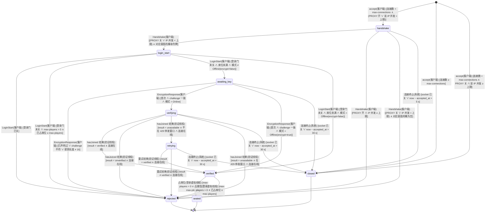

迁移表：

| 源 → 目标 | 事件 | 守卫（纯布尔） | 动作（副作用） | 谁触发 | 接口/事件 |
| --- | --- | --- | --- | --- | --- |
| [*] → handshake | accept | 连接数 < `max-connections` ∧（PROXY 开 ∨ 该 IP 并发 < 上限） | L0 计数 +1；PROXY 关时 L1 计数 +1；起读、写、登录看门狗三条虚拟线程 | 客户端 | `API-PROD-003` L0 / L1 |
| [*] → closed | accept | 连接数 ≥ `max-connections` | 立即 `close()`，不发包；拒绝计数 `closed_at_accept` +1 | 客户端 | `API-PROD-003` L0 |
| [*] → closed | accept | 连接数 < `max-connections` ∧ PROXY 关 ∧ 该 IP 并发 ≥ 上限 | 立即 `close()`，不发包；拒绝计数 `too_many` +1 | 客户端 | `API-PROD-003` L1 |
| handshake → login_start | Handshake（login / transfer 意图） | （PROXY 关 ∨ IP 并发 < 上限）∧ 对应意图的桶有令牌（白名单网段恒真） | PROXY 开时 L1 计数 +1；桶扣 1 | 客户端 | `API-PROD-003` L1 / L2 |
| handshake → rejected | Handshake | PROXY 开 ∧ IP 并发 ≥ 上限 | `LoginDisconnect synaxis:too-many-connections`（明文，此时未加密） | 客户端 | `API-PROD-003` L1 |
| handshake → rejected | Handshake | （PROXY 关 ∨ IP 并发 < 上限）∧ 对应意图的桶为空 | `LoginDisconnect synaxis:login-throttled` | 客户端 | `API-PROD-003` L2 |
| handshake → closed | 连接终止 | socket 已关 ∨ now − `accepted_at` > 5 s | 关闭 socket，释放 L0 / L1 计数；不发包 | 系统 | `API-PROD-003` 握手前超时 |
| login_start → rejected | LoginStart | 登录门已关（停机 §11.4 `gate_closed` 或管理接口 `synaxis:shard/drain`） | `LoginDisconnect synaxis:server-stopping`（明文）；排在 L3 之前，不占席位 | 客户端 | `API-PROD-007`、`API-PROD-022` |
| login_start → rejected | LoginStart | 登录门未关 ∧ `max-players` > 0 ∧ 已占席位 ≥ `max-players` | `LoginDisconnect synaxis:shard-full`（明文）；拒绝计数 `full` +1；不发加密请求、不读 Cookie；只读已占席位，不占 | 客户端 | `API-PROD-003` L3 ① |
| login_start → awaiting_key | LoginStart | 登录门未关 ∧ 席位未满 ∧ 模式 ≠ `Offline(encrypt=false)` | 不占席位（v0.9.39，`ADR-PROD-015`）；发 `EncryptionRequest`（`shouldAuthenticate` = 模式为 `Online`） | 客户端 | `API-PROD-002`、`API-PROD-003` L3 ① |
| login_start → verified | LoginStart | 登录门未关 ∧ 席位未满 ∧ 模式 = `Offline(encrypt=false)` | 不占席位；profile = `offlineUuid(username)`（现行为） | 客户端 | `API-PROD-002`、`API-PROD-003` L3 ① |
| awaiting_key → rejected | EncryptionResponse | 已声明过 ∨ challenge 不符 ∨ 密钥长度 ≠ 16 | `synaxis:protocol-error`；不发 HTTP；日志按 `docs/DESIGN.md` §15 限流 | 客户端 | `API-PROD-002` |
| awaiting_key → verifying | EncryptionResponse | 首次 ∧ challenge 一致 ∧ 模式 = `Online` | 读线程上开收发 cipher；把 `(username, serverHash)` 交给验证虚拟线程，取并发许可 | 客户端 | `API-PROD-002` |
| awaiting_key → verified | EncryptionResponse | 首次 ∧ challenge 一致 ∧ 模式 = `Offline(encrypt=true)` | 开 cipher；profile = `offlineUuid(username)` | 客户端 | `API-PROD-002` |
| awaiting_key → closed | 连接终止 | socket 已关 ∨ now − `accepted_at` > 30 s | 关闭 socket，释放 L0 / L1 计数 | 系统 | 内部任务 `connection.login-timeout`（`docs/DESIGN.md` §17） |
| verifying → verified | hasJoined 结果 | `result = verified` ∧ 连接在线 | profile 取 Mojang `id`、`name`、`properties`；释放并发许可 | 验证线程 | `API-PROD-002`（sessionserver 200） |
| verifying → rejected | hasJoined 结果 | `result = unverified` ∧ 连接在线 | 加密的 `LoginDisconnect synaxis:auth-failed`；不写台账，只计数 | 验证线程 | `API-PROD-002`（sessionserver 204） |
| verifying → retrying | hasJoined 结果 | `result = unavailable` ∧ 不在 429 停发窗口 ∧ 连接在线 | 随机退避 0.5～1.5 s 后重试一次 | 验证线程 | `API-PROD-002`（超时 / 5xx / `Retry-After: 0` 的 429） |
| verifying → rejected | hasJoined 结果 | `result = unavailable` ∧ 在 429 停发窗口 ∧ 连接在线 | 加密的 `LoginDisconnect synaxis:auth-unavailable`；不重试；窗口里的登录不发请求、直接得这个结果（v0.9.39） | 验证线程 | `API-PROD-002`（429） |
| verifying → closed | 连接终止 | socket 已关 ∨ now − `accepted_at` > 30 s | 丢弃验证结果，不创建 `Player`，不写台账 | 系统 | 内部任务 `connection.login-timeout` |
| retrying → verified | 重试结果 | `result = verified` ∧ 连接在线 | 同 verifying → verified | 验证线程 | `API-PROD-002`（sessionserver 200） |
| retrying → rejected | 重试结果 | `result ≠ verified` ∧ 连接在线 | `result = unverified` 时 `synaxis:auth-failed`，否则 `synaxis:auth-unavailable`（均加密） | 验证线程 | `API-PROD-002` |
| retrying → closed | 连接终止 | socket 已关 ∨ now − `accepted_at` > 30 s | 同 verifying → closed | 系统 | 内部任务 `connection.login-timeout` |
| verified → seated | 占席位 | `max-players` = 0 ∨ 已占席位 < `max-players` | 已占席位 +1（判定与 +1 是同一次 CAS，连接关闭时 −1）；在 `transitionLoginToConfig` 开头，开压缩与 `AsyncPlayerPreLoginEvent` 之前 | 系统（在线模式是验证线程，离线模式是登录虚拟线程） | `API-PROD-003` L3 ②、`ADR-PROD-015` |
| verified → rejected | 占席位 | `max-players` > 0 ∧ 已占席位 ≥ `max-players` | `LoginDisconnect synaxis:shard-full`（在线与加密离线模式已开 cipher，是密文；不加密的离线是明文）；拒绝计数 `full` +1；不开压缩、不派发 `AsyncPlayerPreLoginEvent`、不读 Cookie | 系统 | `API-PROD-003` L3 ②、`ADR-PROD-015` |

`seated` 之后回到 `docs/DESIGN.md` §11.1 的 `login → configuration`：开压缩 → `AsyncPlayerPreLoginEvent`（封禁与白名单判定，`API-PROD-009`）→ `LoginSuccess`。重复 UUID 的判定在 `LoginAcknowledged` 的 `createPlayer`（`LoginListener.java:193-212`）：离线模式仍按 `docs/DESIGN.md` §11.1 拒后来者；在线模式踢旧会话（`synaxis:logged-in-elsewhere`），然后新连接在本连接的读虚拟线程上等旧 `Player` 从实例移除（实体追踪器拒绝重复 UUID，`uuidPlayerMap` 虽已释放、旧实体要到下一 tick 才移除），上限 5 s，与 §11.3 的租约重试共用这 5 s；超时断线 `synaxis:state-unavailable`。改动落在 `LoginListener.java` 与 `ConnectionManager.java`。踢人阶段（`ConnectionManager#shutdown`）之后才到的 `LoginAcknowledged` 不再建玩家，两种模式都以 `synaxis:server-stopping` 断开、不进 configuration（§11.4 `kicking → plugins_disabled`）；判定与 `shutdown` 置位用 `ConnectionManager` 的同一把对象锁（§16）。

### 11.2 分片会话 `ENT-ShardSession`

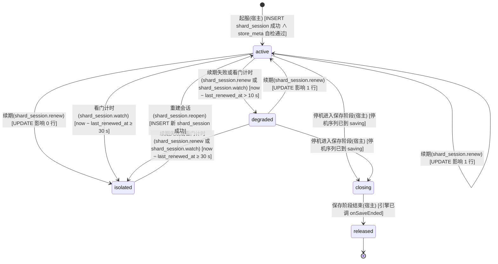

迁移表：

| 源 → 目标 | 事件 | 守卫（纯布尔） | 动作（副作用） | 谁触发 | 接口/事件 |
| --- | --- | --- | --- | --- | --- |
| [*] → active | 起服 | `INSERT shard_session` 成功 ∧ `store_meta` 自检通过（Flyway `validate` 已先通过） | 记 `session_id`；同一事务把同一 `shard_id` 的其他未过期会话置过期（`API-PROD-004` 起服语句），上一次运行持有的租约立即可被接管；前提是同一 `shard_id` 同时只有一个进程 | 宿主 | `API-PROD-004` |
| active → active | 续期 | `UPDATE` 影响 1 行 | `last_renewed_at = now` | 内部任务 `shard_session.renew` | `API-PROD-004` |
| active → degraded | 续期失败或看门计时 | now − `last_renewed_at` > 10 s | 全体在线玩家进入冻结（`isFrozen` 为 true，`API-PROD-005`）：`commitTogether` / `saveNow` 回 `UNAVAILABLE`，拾取、丢弃、放方块、方块交互与用物品被取消，移动与战斗照常；`synaxis_shard_session_state` 翻转 | 内部任务 `shard_session.renew`（失败时判一次），或 `shard_session.watch`（每 250 ms 判一次：数据库不应答时续期卡在语句里直到 socket 超时 4 s，截止时刻不等它） | `API-PROD-004` |
| active → isolated | 续期 | `UPDATE` 影响 0 行（数据库判定已过期） | 自我隔离：停止一切写入，全部在线玩家 `synaxis:state-unavailable`；本会话持有的角色进 §11.3 `fenced` | 内部任务 `shard_session.renew` | `API-PROD-004` |
| active → isolated | 看门计时 | now − `last_renewed_at` ≥ 30 s | 同上一行（巡检没赶上 `degraded` 那次判定时直接隔离） | 内部任务 `shard_session.watch` | `API-PROD-004` |
| degraded → active | 续期 | `UPDATE` 影响 1 行 | 解除冻结 | 内部任务 `shard_session.renew` | `API-PROD-004` |
| degraded → isolated | 续期失败或看门计时 | now − `last_renewed_at` ≥ 30 s | 同 active → isolated | 内部任务 `shard_session.renew` 或 `shard_session.watch` | `API-PROD-004` |
| isolated → active | 重建会话 | `INSERT` 新 `shard_session` 成功 | 先把本次运行的上一个纪元置过期（`UPDATE shard_session SET expires_at = now() WHERE session_id = :旧 AND expires_at > now()`）：看门计时判隔离时上一次续期可能还在途并且成功了，不置过期的话它的租约要再等一个租约期才能被接管；再取新 `session_id`（新纪元）；恢复接受登录；旧会话留下的迟到写入被 fencing 拒掉；不把同 `shard_id` 的其他会话置过期（防双开时互相踢） | 内部任务 `shard_session.reopen` | `API-PROD-004` |
| active → closing | 停机进入保存阶段 | 停机序列已到 `saving`（§11.4） | 停止接受新的写权获取：在途的登录此后不再执行获取语句、不被准入（§11.3 `loading → offline`，判定点见本表下方）；全体在线玩家进入冻结；续期照常 | 宿主（`saveAll` 内） | `API-PROD-007` |
| degraded → closing | 停机进入保存阶段 | 停机序列已到 `saving` | 同上；保存可能全部 `UNAVAILABLE`，由租约过期兜底 | 宿主（`saveAll` 内） | `API-PROD-007` |
| closing → released | 保存阶段结束 | 引擎已调 `onSaveEnded` | 令本会话 `expires_at = now()`（只令过期，不 `DELETE`，`character.lease_session_id` 有外键指向它），使残余租约立即可被接管；停止续期；此后本分片不再发起写库：不快照、不执行释放语句；结束之前已交给写线程的写入照常收尾，写回并释放的那种失败即放弃、不再重试（§11.3 `saving → orphaned`，§11.4 `gate_closed → saving`） | 宿主（`onSaveEnded` 内） | `API-PROD-007` |

`closing` 的「停止接受新的写权获取」对在途的登录逐点生效。一次登录从载入开头到准入要等三处：同账号在本分片的上一次登录离开（§11.3 末段）、载入名额、顶号轮询的每轮间隔（§12.4）。载入名额只在验票 ⑤⑥ 与每次获取语句执行期间持有（§17 `store.load`，v0.9.91），每次取名额都是一处等待；等上一次登录离开、发顶号与轮询间隔都不占名额。每处等完都重查 `closing`（取到名额之后、执行语句之前也查），已置位即 §11.3 `loading → offline`（`synaxis:state-unavailable`），不再执行验票 ⑤⑥ 与获取语句。获取语句执行期间置位的，语句返回后重查，还回刚取得的写权再拒绝。准入一步（§11.3 `loading → online`）与 `closing` 置位在同一把准入锁里判定：准入在先，玩家随即被冻结、计入 `online`、进停机保存；置位在先，准入被拒，写权还回。所以保存阶段开始之后，没有登录能以本会话取得写权，也没有玩家在停机保存之外进服。剩下一处竞态：获取语句的前一刻重查未置位，而保存阶段恰在这条语句执行前走完。这时写权记在已过期的本会话上，任何分片都能立即取得，与释放等价。

`degraded` 的判据用本地单调时钟记「最后一次成功续期」，只用来提前冻结；写权是否丢失只由数据库的 `now()` 决定（`UPDATE` 影响 0 行）。`closing` 期间续期不停：否则会话在最后一次续期后 30 s 过期，而保存预算也是 30 s，末段的保存会被自己的 fencing 拒掉。续期走独占连接（`API-PROD-004`），不与批量保存争池。`closing` 期间续期影响 0 行时不换状态，未写完的角色由租约过期兜底。

### 11.3 角色写权 `ENT-CharacterLease`

取代 `docs/DESIGN-M3.md` §11.4 `ENT-StateLease`（每玩家租约）。全局一份，以 PostgreSQL 为准，Redis `presence` 只做路由提示。

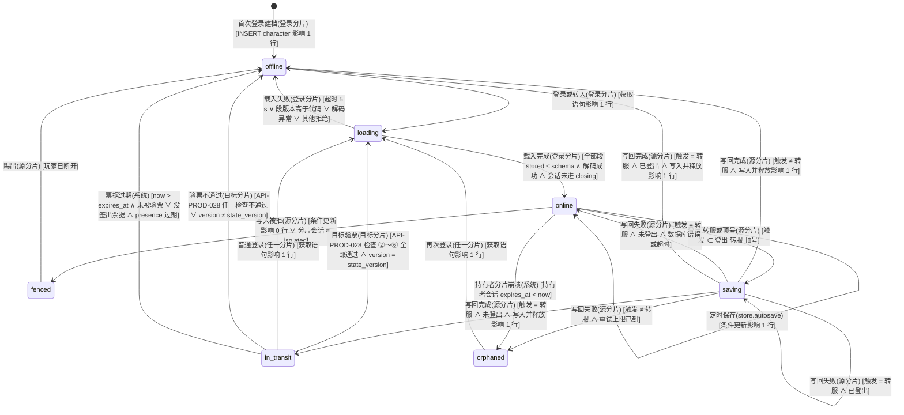

迁移表：

| 源 → 目标 | 事件 | 守卫（纯布尔） | 动作（副作用） | 谁触发 | 接口/事件 |
| --- | --- | --- | --- | --- | --- |
| [*] → offline | 首次登录建档 | `INSERT character … ON CONFLICT DO NOTHING` 影响 1 行 | 新行 `version = 0`、`lease_session_id = NULL`；紧接着执行获取语句（下一行）。插入 0 行时不走本转移，行已存在，同样直接执行获取语句 | 登录分片 | `API-PROD-004` |
| offline → loading | 登录或转入 | 获取语句影响 1 行 | Redis `SET presence:{uuid} {shard, session, loading} PX 30000`（失败不影响登录）；获取语句影响 0 行时用持有者查询拿到其 `shard_id` 发顶号（§12.4） | 登录分片 | `API-PROD-004`、`API-PROD-006` |
| loading → online | 载入完成 | 全部段 `storedVersion ≤ schemaVersion` ∧ 解码成功 ∧ 分片会话未进 `closing`（`admit` 答应之后在准入锁里判定，§11.2 表下方） | 调 `AdmissionProvider#admit`；presence 改 `online` | 登录分片 | `API-PROD-005` |
| loading → offline | 载入失败 | 超时 5 s ∨ 段版本高于代码 ∨ 解码抛异常 ∨ 其他拒绝（分片 `isolated` 或停机中（`closing` 在载入开头、每处等待之后、获取语句返回之后与准入时判定，§11.2 表下方）、载入队列或同账号上一次载入在预算内未让出、顶号超时、顶号轮询中新连接已断开、数据库错误） | 按账号执行释放语句（`API-PROD-004`），还回本会话为该账号持有的租约，含验票 ⑥ 取得的；本分片还载着该账号的另一次登录时不释放（租约是那一次的）；数据库不可达时释放也失败，租约等本会话过期才放掉；保存阶段已结束（`onSaveEnded` 之后）时不释放，会话已过期，残余写权与释放等价；断线 `synaxis:state-unavailable`；**不写任何段**，原始 JSON 不动；记 ERROR 带 `character_id` 与 `section_id` | 登录分片 | `API-PROD-005` |
| online → online | 定时保存 | 条件更新影响 1 行 | 只写脏段与当前大区位置；`version` +1 | 内部任务 `store.autosave` | `API-PROD-004` |
| online → fenced | 写入被拒 | 条件更新影响 0 行 ∨ 分片会话 = `isolated` | 停止该玩家（会话隔离时是全部玩家）的一切写入；丢弃未落库快照；写 `EVT:save_fenced` | 源分片 | `API-PROD-004` |
| fenced → offline | 踢出 | 玩家已断开 | 断线 `synaxis:state-unavailable`；不释放租约（已不属于本会话） | 源分片 | `API-PROD-004` |
| online → saving | 登出、转服或顶号 | 触发 ∈ {登出, 转服, 顶号} | 冻结该玩家（`isFrozen` 为 true，`API-PROD-005`）；tick 线程快照；登出即引擎派发 `PlayerDisconnectEvent`，包括已进 PLAY 状态、还没进世界就断开的玩家（引擎在下一个 tick 由 `ConnectionManager#updateWaitingPlayers` 派发，不等实体 tick）；顶号来自 `synaxis:kick:{shard}` 消息 | 源分片 | `API-PROD-006`（顶号）、`API-PROD-021`（转服） |
| saving → offline | 写回完成 | 触发 ≠ 转服 ∧ 写入并释放影响 1 行 | `DEL presence:{uuid}`；顶号时旧连接收 `synaxis:logged-in-elsewhere` | 源分片 | `API-PROD-004` |
| saving → in_transit | 写回完成 | 触发 = 转服 ∧ 未登出 ∧ 写入并释放影响 1 行 | presence 改 `in_transit(target)` 带 30 s TTL；在玩家的下一个 tick、玩家所属 tick 线程上签票据（带新 `state_version`）、记冷却，先 `storeCookie` 再 `transfer`，之后写 `EVT:transfer_issued`（M3-E 起）；那个 tick 之前玩家已离开时不签，回 `NOT_ONLINE`（`API-PROD-028` ④）。票据发出 10 s 后连接还开着（客户端不照 `Transfer` 走，或 `OutgoingTransferEvent` 被取消）就以 `synaxis:transfer-rejected` 断开，本分片移除记录，角色仍是 `in_transit`，票据照常可用；`presence.refresh` 对这条记录写 `in_transit` | 源分片 | `API-PROD-021` |
| saving → online | 写回失败 | 触发 = 转服 ∧ 未登出 ∧ 数据库错误或超时 | 解冻；系统消息 `synaxis:transfer-failed`；不签票据；快照留着按定时保存写 | 源分片 | `API-PROD-021` |
| saving → saving | 登出 | 触发 = 转服 ∧ 尚未快照（转服已把状态置为 `saving`，下一 tick 的快照还没做） | 作废这次转服：签发端回 `SAVE_FAILED`，不签票据；触发改为登出，做登出快照、写库并释放 | 源分片 | `API-PROD-028` |
| saving → saving | 写回失败 | 触发 = 转服 ∧ 已登出（写回途中玩家断开） | 触发改为登出，保持 `saving` 与释放标记，按登出保存重试（退避同 `saving → orphaned`）：写成功即 `offline`，重试到上限或停机保存阶段已结束即 `orphaned` | 源分片 | `API-PROD-004` |
| saving → offline | 写回完成 | 触发 = 转服 ∧ 已登出 ∧ 写入并释放影响 1 行 | 同登出的 `saving → offline`：移除记录、清 presence，不进 `in_transit`；签发端照样拿到交接结果，但不签票：④ 见连接已断开，回 `NOT_ONLINE`，不发包、不记冷却、不写 `EVT:transfer_issued`（`API-PROD-028` ④，§28.2 已决） | 源分片 | `API-PROD-004` |
| saving → orphaned | 写回失败 | 触发 ≠ 转服 ∧ 重试上限已到（1 s / 2 s / 4 s 退避，上限 30 s） | 丢弃快照并记 ERROR（带 `character_id` 与失败原因）；单独执行一次释放语句（不带版本号、不写段）。数据库可达而只是某段被约束拒绝（如编码后超过 64 KiB）时释放成功，玩家可在任一分片再登录；数据库不可达时释放也失败，本会话随续期失败过期，同样可接管 | 源分片 | `API-PROD-004` |
| in_transit → loading | 目标验票 | `API-PROD-028` 检查 ②～⑥ 全部通过（④ 含 `player_uuid` = 本次验证 UUID，⑤ 插入 nonce 影响 1 行，⑥ 获取语句影响 1 行）∧ 读到的 `version` = 票据 `state_version` | Redis `SET presence:{uuid} {shard, session, loading} PX 30000`；以票据 `issued_at` 记该玩家最近一次转服时刻（冷却）；调 `onClaimed`（M3-E 起，目录模式设到达点，`API-PROD-028` 到达回调）；进入与普通登录相同的载入 | 目标分片 | `API-PROD-028`、`API-PROD-004` |
| in_transit → loading | 普通登录 | 获取语句影响 1 行（写权在签票前已释放，与 `offline → loading` 同一条语句） | 同 `offline → loading`；这张票据此后到达别的分片都在检查 ⑤ 或 ⑥ 被拒，到达这次登录所在的分片而它还在时，在 ⑤ 之前就因同账号上一次登录未离开被拒（§11.3 末段） | 任一分片 | `API-PROD-004` |
| in_transit → offline | 验票不通过 | `API-PROD-028` 检查 ②～⑥ 任一不通过 ∨ 读到的 `version` ≠ 票据 `state_version` | 断线 `synaxis:transfer-rejected` 或 `synaxis:state-unavailable`（按 `reject_reason`，§14）；写 `EVT:transfer_rejected`；`version-mismatch` 时释放刚取得的写权并记 ERROR（一致性断言）；其余情况写权未被本分片取得，不动库；`lease-held` 说明角色已经由普通登录离开 `in_transit`，这时不发生状态转移，只作废这张票据。玩家之后以普通登录进任一分片都能取回角色 | 目标分片 | `API-PROD-028` |
| in_transit → offline | 票据过期 | now > 票据 `expires_at` ∧ 未被验票；没签出票据（玩家在签发 ④ 的 tick 之前离开）时为 presence 的 30 s TTL 到期 | 无动作（租约早已释放），presence 自然过期 | 系统 | 内部任务 `presence` TTL（无对外 API） |
| online → orphaned | 持有者分片崩溃 | 持有者 `shard_session.expires_at` < now | 无动作；丢失窗口 = 距上次成功保存 ≤ 60 s | 系统 | 无对外 API，见 §11.2 |
| orphaned → loading | 再次登录 | 获取语句影响 1 行（它已覆盖「持有者为空」「持有者 = 本会话」「持有者会话过期」三种） | 持有者是别的会话时写 `EVT:lease_takeover`；持有者是本会话时丢弃内存里该角色的旧快照，按库里版本重新载入 | 任一分片 | `API-PROD-004` |

跨机一致性：`online → fenced` 由 §11.2 `active → isolated` / `degraded → isolated` 的动作驱动，此时本会话在库里已过期，获取语句守卫对其他分片成立。顶号时新分片先用持有者查询（`API-PROD-004`）拿到持有者的 `shard_id` 再发 `synaxis:kick:{shard_id}`，然后在 5 s 内每 250 ms 重试获取语句（`saving → offline` 释放后才成功），超时断线 `synaxis:state-unavailable`；Redis 不可达时发不出顶号消息，新登录直接 `synaxis:state-unavailable`（拒新，D7 的退化）。离线模式不发顶号，获取影响 0 行即 `synaxis:state-unavailable`（`REQ-PROD-004`）。

同一账号在同一分片上的登录串行载入：后到的登录等前一次载入结束，等待计入自己的 5 s 预算；否则两次都以本会话取得租约，被拒或被放弃的一次会把另一次的租约还掉。转入的登录也在这层保护内：`API-PROD-028` 的 ②～④ 在占位之前（读 Cookie 最长 5 s，不占位），⑤⑥ 在占位之内、同账号在本分片的上一次登录离开之后、获取语句之前执行。所以 ⑥ 取得的写权不会被同账号另一次被拒或被放弃的载入还掉；⑥ 的「持有者 = 本会话」分支也不会认下同账号另一次登录的写权，`version-mismatch` 的释放还不掉正在玩的那一次的写权。

载入之后被放弃的登录（准入被拒或 `admit` 抛异常、载入后连接已断，`PlayerStore#abandon`）已经让出了串行载入位，它的释放语句要在占位之外执行，靠的是离开的顺序：先把自己标为 `offline`（与准入通过的 `loading → online` 在同一把记录锁里判定，恰一方成立），再执行释放语句，释放提交之后才从本分片的在册表移除、完成「已离开」。后到的登录在占位里先等同账号的在册登录离开，所以它的获取语句、⑥ 的「持有者 = 本会话」分支与普通登录「持有者 = 本会话」的获取都排在这次释放之后，拿到的写权不会随后被这次释放清掉。反过来先移出在册表再释放，后到者在两步之间看不到它、不等它，就会以本会话取得写权后被它还掉：普通登录载入了却没有写权，别的分片可以同时载入同一角色；转入的登录已用掉 nonce，写权却被还掉。

### 11.4 停机顺序 `ENT-ServerProcess`（扩展 `docs/DESIGN.md` §11.2 的 `stopping`）

把 `docs/DESIGN.md` §11.2 的 `stopping` 展开成五个阶段；`started`、`stopped` 与那边同义。引擎只管阶段与计时，保存由宿主经 `ShutdownParticipant` 做（`API-PROD-007`）。

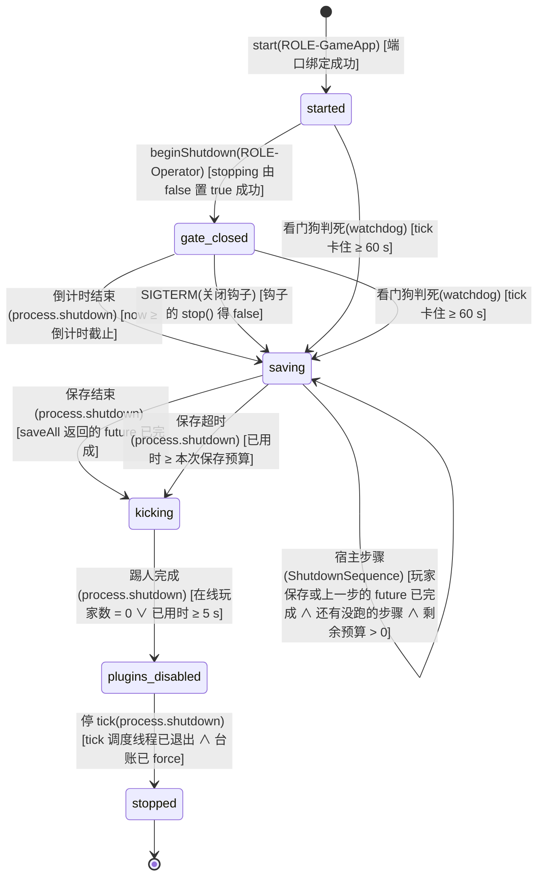

迁移表：

| 源 → 目标 | 事件 | 守卫（纯布尔） | 动作（副作用） | 谁触发 | 接口/事件 |
| --- | --- | --- | --- | --- | --- |
| [*] → started | start | 端口绑定成功 | 同 `docs/DESIGN.md` §11.2 | ROLE-GameApp | `docs/DESIGN.md` `API-003` |
| started → gate_closed | beginShutdown | `stopping` 由 false 置 true 成功（重复调用 CAS 失败，返回 false、倒计时不变） | 向调用方返回 true；序列在停机线程 `Syn-Shutdown` 上跑，`stop()` 从非 tick 线程调用时在调用线程上跑（同引擎 §11.2）；闸门 L3 置满（新 `LoginStart` 收 `synaxis:server-stopping`）；调宿主 `onGateClosed(countdown)`，宿主向服务端状态已是 PLAY 的连接广播倒计时（`synaxis:server-stopping-in`）；还在 configuration 的连接不发：play 状态的聊天包在 configuration 阶段写不出，写线程会抛异常、不带原因断开连接，这名玩家随之走登出保存、不进停机保存；`stopped` 仍为 false，`isAlive()` 仍为 true | ROLE-Operator（控制台、管理接口）/ 宿主 | `API-PROD-007`、`API-PROD-022` |
| gate_closed → saving | 倒计时结束 | now ≥ 倒计时截止 | 调宿主 `saveAll(30 s, tickAlive=true)`，以 30 s 为上限等待：宿主对全体在线玩家进入冻结（逐条在记录锁里判定，与断线事件的判定互斥，已开始登出保存的不冻结、不计入 `online`，§16）、分片会话进 `closing`，在各玩家所属 tick 线程上调插件 `onShutdownSave` 并快照，写库在虚拟线程；已准入、还没进世界（不在任何实例里）的玩家不 tick：冻结之后的下一个 tick，宿主在 tick 调度线程上以 `synaxis:server-stopping` 断开其中仍连着的（还在 configuration，等 `SelectKnownPacks` 的回答或资源包；已进 PLAY，等客户端确认 `FinishConfiguration` 或排队进世界），不等客户端；这些玩家与保存阶段内自己断开的一样，由派发其 `PlayerDisconnectEvent` 的线程调钩子并快照（已进 PLAY 的是 tick 调度线程上的 `updateWaitingPlayers`，还在 configuration 的是断开连接的线程，宿主断开的即 tick 调度线程），每人恰一次；冻结开始之后在途的登录不再取得写权、不被准入（§11.2 表下方）；快照过的玩家标记「已冲刷」，之后的 `PlayerDisconnectEvent` 不再写；保存阶段结束（`onSaveEnded`）后一律不写：断线事件不写，排在实体调度器上、到这时才轮到的停机快照不做（不调钩子），释放语句不执行；玩家存完后宿主依次跑装配时注册的停机步骤（下文 `saving → saving` 宿主步骤） | 内部任务 `process.shutdown` | `API-PROD-007` |
| started → saving | 看门狗判死 | tick 卡住 ≥ 60 s | 置 `stopping`；跳过倒计时；调 `saveAll(15 s, tickAlive=false)`：宿主跳过插件钩子，由停机线程直接读快照（数据可能不一致，记 WARN）；§11.5 同时开始 15 s halt 计时，所以这条路径的保存预算是 15 s | 内部任务 `watchdog`（判死回调线程 `Syn-Watchdog-Report`） | `API-PROD-013` |
| gate_closed → saving | 看门狗判死 | tick 卡住 ≥ 60 s | 放弃剩余倒计时；其余同 started → saving | 内部任务 `watchdog`（判死回调线程 `Syn-Watchdog-Report`） | `API-PROD-013` |
| gate_closed → saving | SIGTERM | 关闭钩子调 `stop()` 得 false（停机已由控制台、玩家命令或管理接口的 `beginShutdown` 占下） | 放弃剩余倒计时；其余同 `倒计时结束` 一行（`saveAll(30 s, tickAlive=true)`）。钩子线程等这次序列走到 `stopped` 才返回：JVM 跑完关闭钩子就 halt，不等非 daemon 的 `Syn-Shutdown`，钩子不等就会把倒计时之后的保存、踢人、插件 `onDisable` 与台账 `force` 一起截掉。信号到达时已过了倒计时的，钩子同样等到序列跑完，阶段照常推进 | ROLE-Operator（SIGTERM；关闭钩子线程） | `docs/DESIGN.md` `API-003`、`API-PROD-007` |
| saving → saving | 看门狗判死 | tick 卡住 ≥ 60 s | 阶段不变；保存截止改为 min(原截止, 判死后 15 s)；引擎再调一次 `saveAll(剩余预算, false)`，宿主尚未完成的快照改由停机线程直接读（记 WARN）；宿主 `ShutdownSequence` 等玩家存完后在停机线程上以 `false` 跑剩下的停机步骤，已以 `true` 开始、还没完成的那一步再调一次 | 内部任务 `watchdog`（判死回调线程 `Syn-Watchdog-Report`） | `API-PROD-013` |
| saving → saving | 宿主步骤 | 玩家保存或上一步的 future 已完成 ∧ 还有没跑的步骤 ∧ 剩余预算 > 0 | `ShutdownSequence` 按注册顺序调下一步 `run(剩余预算, tickAlive)`，`tickAlive` 取本次 `saveAll` 的参数：为 true 时在上一段 future 完成的线程上调，步骤只把活交给 tick；为 false 时停机线程直接调并等它。最后一步完成后 `saveAll` 返回的 future 才完成；没有注册步骤时不发生这条转移 | 宿主（`ShutdownSequence`） | `API-PROD-007` |
| saving → kicking | 保存结束 | `saveAll` 返回的 future 已完成（宿主：玩家保存与全部停机步骤都已完成） | 调宿主 `onSaveEnded(false)`：宿主写 `EVT:shutdown_saved`（`saved = online`）并驱动 §11.2 `closing → released` | 内部任务 `process.shutdown` | `API-PROD-007` |
| saving → kicking | 保存超时 | 已用时 ≥ 本次保存预算（正常 30 s，判死路径 15 s） | 调宿主 `onSaveEnded(true)`：未完成的角色逐个记 ERROR（`character_id`），写 `EVT:shutdown_saved`（`saved < online`），驱动 §11.2 `closing → released`，残余租约随会话过期立即可被接管；在跑的停机步骤不再等、由它自己记 ERROR，没轮到的步骤由 `ShutdownSequence` 各记一条 ERROR，有步骤时玩家存储只在自己的保存没完成时按超时收尾 | 内部任务 `process.shutdown` | `API-PROD-007` |
| kicking → plugins_disabled | 踢人完成 | 在线玩家数 = 0 ∨ 已用时 ≥ 5 s | `synaxis:server-stopping` 踢全部连接（`ConnectionManager#shutdown`），此后不再建玩家：停机前收到 `LoginSuccess`、踢人之后才回 `LoginAcknowledged` 的连接以 `synaxis:server-stopping` 断开，不进 configuration（与 `shutdown` 同锁判定，§16；进程随即退出，这个断线包尽力送达）；PLAY 玩家的 `PlayerDisconnectEvent` 在仍运行的 tick 线程上派发；然后 `scheduler.shutdown()` 执行宿主挂在 `buildShutdownTask` 上的 `host::disableAll`（插件 `onDisable`）：投递到 tick 调度线程在两个 tick 之间执行，1 s 没被接走或已判死时改在停机线程执行（`API-PROD-007`） | 内部任务 `process.shutdown` | `API-PROD-007` |
| plugins_disabled → stopped | 停 tick | tick 调度线程已退出 ∧ 台账已 `force` | 先置 `stopped`，`TickSchedulerThread` 的 `while (isAlive())` 在当前 tick 结束后退出并被 join；停 dispatcher；台账写线程 2 s 内排空；关 Redis 与连接池 | 内部任务 `process.shutdown` | `docs/DESIGN.md` `API-003` |

起服完成之前没有停机转移：`[*] → started` 之前（`Main` 的 `server.start` 返回之前）宿主不调 `beginShutdown`。这段时间里对外只有管理接口在监听（它排在插件启用之前，`API-PROD-022`），它的 `minecraft:server/stop` 回 −32000、不停机，`Main` 在 `server.start` 返回之后、就绪行之前才放行（`ManagementMethods#serverStarted`）；控制台读线程在就绪行之后才起，玩家要等游戏端口。引擎本身不拦：`start` 之前调 `beginShutdown` 或 `stop()` 照样跑完序列（测试里从不 `start` 的进程靠 `stop()` 收尾），而宿主的停机任务（插件 `onDisable`、台账、存储、指标与管理接口的关闭）在 `server.start` 之前的最后一步才注册，更早跑完的序列一样都没执行；`Main` 接着绑上游戏端口，进程不 tick、不退出。插件在 `onEnable` 里经 `PluginContext#process()` 停机会落进同一处，见 §28.2。`[*] → started` 的守卫不成立（游戏端口绑不上）时同样不进本节的阶段：`Main` 在主线程上把已注册的停机任务跑一遍（`SchedulerManager#shutdown`，这时还没有玩家要存），再以 `Refusing to start: synaxis.app.port=<端口> cannot be bound: …` 拒启、退出码 1（v0.9.41，§28.2 已决一行）。

与第 3 波之前的差异：旧序是 `stop()` 一上来就置 `stopped`（`8de32ab9b4` 时的 `ServerProcessImpl.java:287`），tick 循环随即退出，然后 `joinThread(tick)` → `scheduler.shutdown()`（插件 `onDisable` 在这里）→ `connection.shutdown()` → daemon 线程补跑最后一个 tick（同一提交的 `:304-317`），插件先于玩家断线被禁用。新序里 `stopped` 推迟到最后一步置位，tick 一直运行到踢人与插件禁用之后，那条 daemon 补 tick 删除。`kicking` 与 `plugins_disabled` 期间 tick 卡死时不另设转移：§11.5 判死后 15 s halt，残余租约此时已随 `closing → released` 过期。

### 11.5 看门狗 `ENT-Watchdog`

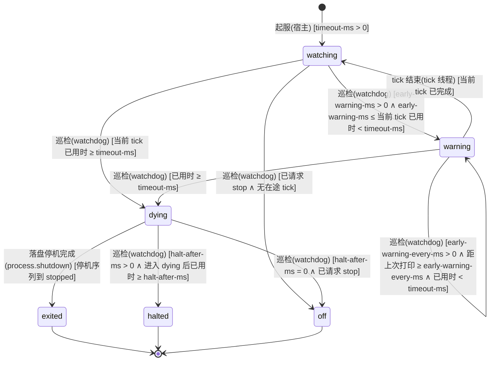

迁移表（键名省略前缀 `synaxis.watchdog.`，默认值与各键取 0 的含义见 `API-PROD-013`）：

| 源 → 目标 | 事件 | 守卫（纯布尔） | 动作（副作用） | 谁触发 | 接口/事件 |
| --- | --- | --- | --- | --- | --- |
| [*] → watching | 起服 | `timeout-ms` > 0 | 起平台线程 `Syn-Watchdog`，每 1 s 巡检一次；`timeout-ms` = 0 时不起线程，只记一行 INFO，不进入本状态机 | 宿主（`Main` 在首个 tick 之前调 `ServerProcess#watchdog().start`） | `API-PROD-013` |
| watching → warning | 巡检 | `early-warning-ms` > 0 ∧ `early-warning-ms` ≤ 当前 tick 已用时 < `timeout-ms` | 打印正在跑 tick 的线程与全部 TickThread 的栈（一条 WARN）；`synaxis_watchdog_warnings_total` +1（该指标随 5A 接上） | 内部任务 `watchdog` | `API-PROD-013` |
| warning → warning | 巡检 | `early-warning-every-ms` > 0 ∧ 距上次打印 ≥ `early-warning-every-ms` ∧ 已用时 < `timeout-ms` | 再打印一次栈 | 内部任务 `watchdog` | `API-PROD-013` |
| warning → watching | tick 结束 | 当前 tick 已完成 | 记一行 INFO「tick 恢复，卡住 N ms」 | 跑 tick 的线程（`TickerImpl.tick` 的 `finally`） | `API-PROD-013` |
| watching → dying | 巡检 | 当前 tick 已用时 ≥ `timeout-ms` | 同 warning → dying（这个 tick 还没打过警告就已到 `timeout-ms` 时走这条：`early-warning-ms` = 0、不小于 `timeout-ms`，或两者相差不足一个巡检间隔） | 内部任务 `watchdog` | `API-PROD-013` |
| warning → dying | 巡检 | 已用时 ≥ `timeout-ms` | 一条 ERROR 带正在跑 tick 的线程与全部 TickThread 的栈；在单独线程 `Syn-Watchdog-Report` 上调宿主的判死回调：写崩溃报告，第 3 波起再按停机序列当前阶段驱动 §11.4 的判死转移（`started` 或 `gate_closed` → `saving`，已在 `saving` 时 `saving → saving`，已到 `kicking` 之后不驱动）；回调卡住不影响 halt 计时。进入 `dying` 后 tick 结束也不回 `watching` | 内部任务 `watchdog` | `API-PROD-013` |
| watching → off | 巡检 | 已请求 stop ∧ 无在途 tick | 巡检线程退出。有在途 tick 时 `stop()` 不生效，直到该 tick 结束或判死 | 内部任务 `watchdog`（`stop()` 由停机任务调用） | `API-PROD-013` |
| dying → exited | 落盘停机完成 | 停机序列到 `stopped` | 进程退出码 70（第 3 波 3A 接上判死保存后才有这条路径，第 0 波判死后只能 halt） | 内部任务 `process.shutdown` | `API-PROD-013` |
| dying → halted | 巡检 | `halt-after-ms` > 0 ∧ 进入 `dying` 后已用时 ≥ `halt-after-ms` | `Runtime.halt(70)`；由 systemd 或容器重启；残余租约 ≤ 30 s 后可接管 | 内部任务 `watchdog` | `API-PROD-013` |
| dying → off | 巡检 | `halt-after-ms` = 0 ∧ 已请求 stop | 巡检线程退出，进程由停机序列正常结束 | 内部任务 `watchdog` | `API-PROD-013` |

跨机一致性：§11.4 三条判死转移的守卫「tick 卡住 ≥ 60 s」与 `watching → dying`、`warning → dying` 同一判据（默认值下）；停机序列处于 `started`、`gate_closed`、`saving` 时恰有一条成立，处于 `kicking` 及之后时不驱动，由 `dying → halted` 收尾。判死路径的保存预算是 15 s（halt 计时），不是正常停机的 30 s。`dying → halted` 先于 `onSaveEnded` 发生时 §11.2 的会话不会走到 `released`，残余租约靠 30 s 过期（§11.3 `online → orphaned`）。

### 11.6 训练假人 `ENT-TrainingDummy`（v0.9.63）

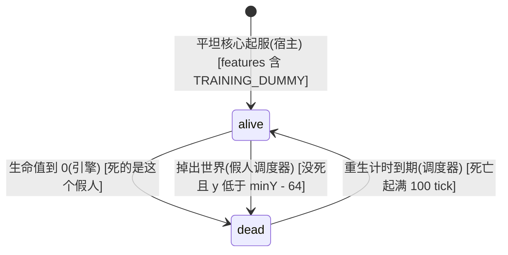

迁移表：

| 源 → 目标 | 事件 | 守卫（纯布尔） | 动作（副作用） | 谁触发 | 接口/事件 |
| --- | --- | --- | --- | --- | --- |
| [*] → alive | 平坦核心起服 | `features` 含 `TRAINING_DUMMY` | 在 (3.5, 40, 0.5) 生成 `LivingEntity(EntityType.ZOMBIE)`，偏航角 90°，生命值 20；在它自己的调度器上挂一个每 tick 一次的掉出世界检查（`repeat(TaskSchedule.nextTick())`） | 宿主（`DefaultPlay#attach`，启动线程，绑定端口之前） | `API-PROD-031` |
| alive → dead | 生命值到 0 | 引擎 `EntityDeathEvent` 的实体就是当前这个假人 | 引擎置死、播死亡动画（`LivingEntity#kill` 不移除实体）；宿主节点上的 `EntityDeathEvent` 监听器在假人自己的调度器上排 20 tick 后移除（`scheduleRemove(20, TimeUnit.SERVER_TICK)`，留出死亡动画，与 `EntityCreature` 默认的 1000 ms 相同），在进程调度器上排 100 tick 后的重生任务 | 引擎（`LivingEntity#kill`，在打死它的近战所在的目标 tick 线程上，或在下一行的检查里）；宿主的死亡监听器在同一线程上 | `API-PROD-031` |
| alive → dead | 掉出世界 | 假人没死，且 `getInstance().isInVoid(位置)`（y < minY − 64，平坦核心即 y < −64） | 调 `kill()`，引擎派发 `EntityDeathEvent`，之后的移除与重生同上一行 | 假人调度器上的每 tick 检查（它所属 tick 线程） | `API-PROD-031` |
| dead → alive | 重生计时到期 | 死亡起满 100 tick（5 s） | 在 (3.5, 40, 0.5) 生成一个新的假人：新实体，满血，偏航角 90°，挂上它自己的掉出世界检查。旧实体在死亡后第 20 tick 已被移除 | 内部任务（进程调度器，tick 调度线程） | `API-PROD-031` |

受伤不是状态转移：生命值是属性，近战命中只改它与位置（击退）。被击退的假人留在被推到的地方，掉进没挖穿的坑里也照旧活着；重生时回到 (3.5, 40, 0.5)。实例里至多一个假人：移除在死亡后 20 tick、重生在 100 tick，两者都按 tick 计，卡顿时一起推迟、先后不变；平坦核心世界不自动卸载区块（`chunkUnloadGraceTicks` 为 −1），假人所在区块一直载入，它自己的调度器一直在跑。停机时随进程消失，不存档，下次起服重新生成。

## 12. 关键流程时序

### 12.1 在线模式登录：闸门 → 加密 → 验证 → 准入 → 载入

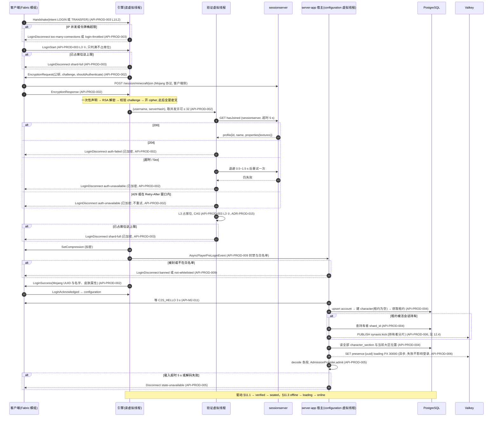

### 12.2 优雅停机

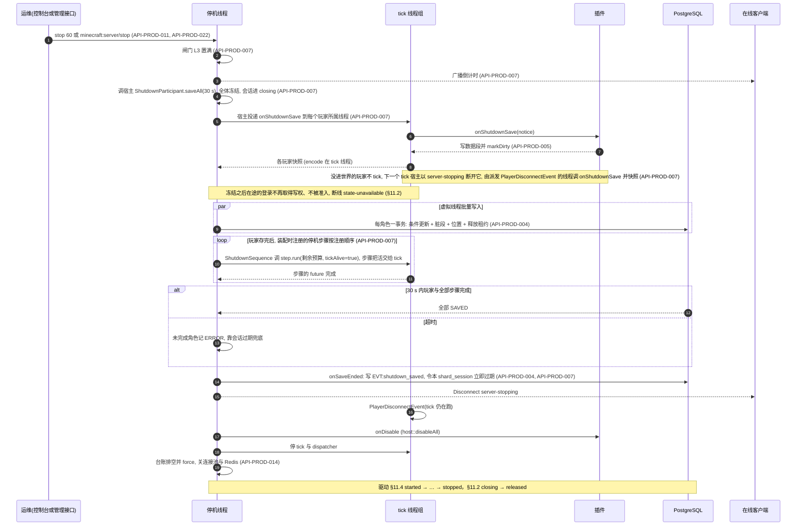

### 12.3 跨大区转服与目标分片重新验证

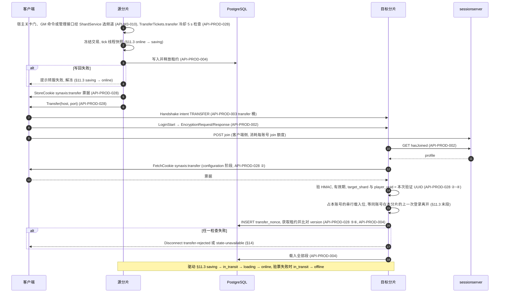

### 12.4 跨分片顶号

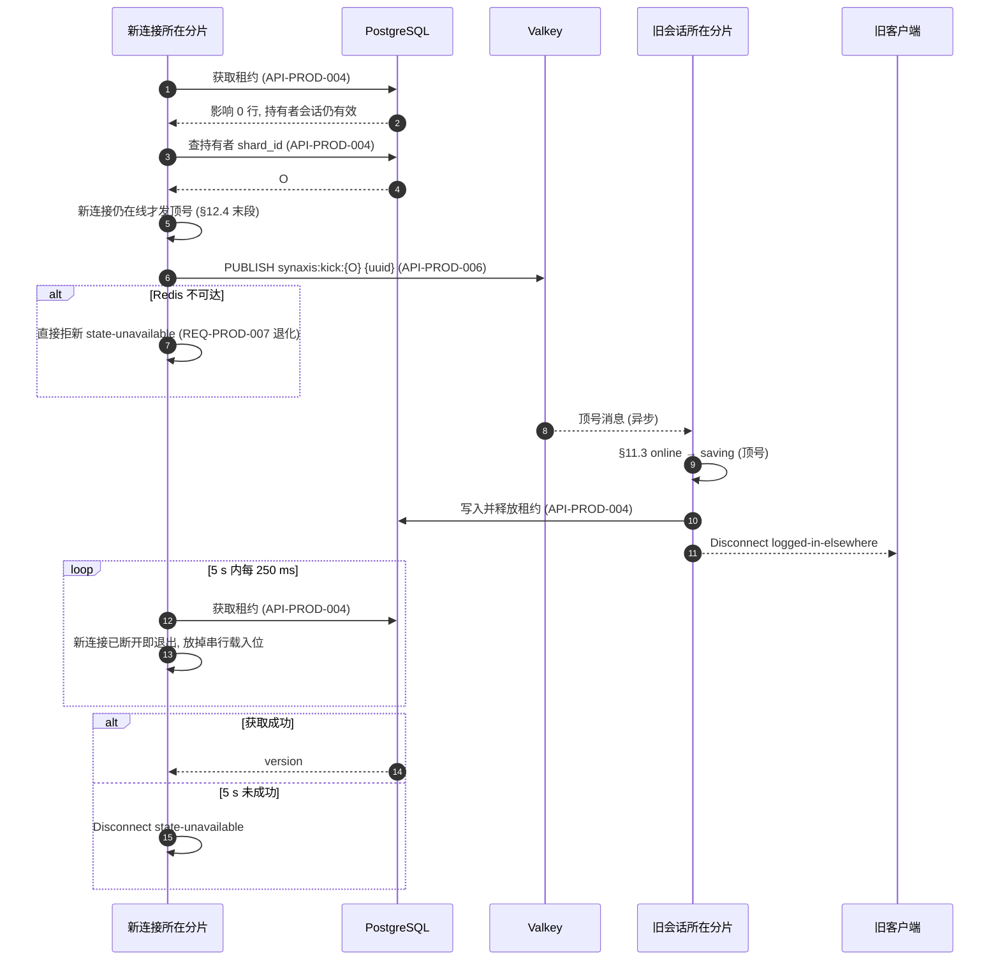

轮询期间不占载入名额（v0.9.91）：名额只在每次获取语句执行期间持有，发顶号与每轮间隔都在名额之外。一个分片卡住或崩溃时，它的玩家重连到本分片、在轮询里等它释放，本分片与之无关的登录照常取名额载入。

同分片内的重复 UUID 不经 Redis：引擎在 `LoginAcknowledged` 的 `createPlayer` 处直接踢旧（在线模式），等旧 `Player` 从实例移除（≤ 5 s，§11.1 末段）；旧会话在本分片走 §11.3 `online → saving → offline` 后新连接才获取租约，两段等待共用 5 s。

离线模式跨分片不走本图：获取影响 0 行直接断线 `synaxis:state-unavailable`。同一账号在同一分片的登录串行载入（§11.3 末段），一次登录停在本图的轮询里时，同账号在本分片的新登录要等它结束。所以轮询每次获取语句影响 0 行之后、发顶号之前，先查新连接是否仍在线（`isOnline()`），已断开即以 `synaxis:state-unavailable` 退出：不为一条已断开的连接去踢持有者，放掉串行载入位；客户端断开后立刻重连的新登录不用等旧的轮询跑满 5 s，能用满自己的 5 s 预算发顶号并等持有者释放。

### 12.5 进世界：载入 → 首次出生 → 应用存档 → 初始物品（v0.9.63）

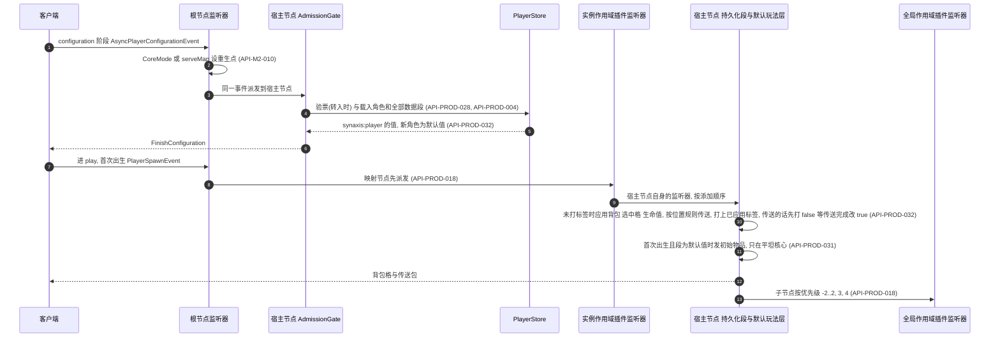

RTS 下 `RtsPlugin` 设出生点的监听器在 configuration 事件的插件子节点里，晚于 `AdmissionGate`；挂地图的分片设重生点的是 `Main#serveMap` 的根节点监听器，凭票据到达时验票（`AdmissionGate` 里）通过后 `ShardArrivals#claimed` 把重生点改成门框落点，`PlayerStateSection#claimed` 记下这名玩家，应用时不传送。准入（第 4 步的载入之后 `store.admitted`）到第 10 步打上标签之间的快照不捕获 `synaxis:player`，这期间断开不改这一段（登出保存照旧写一次放租约，`version` 加 1）；打上标签之后的每次快照（定时保存、登出、转服、停机）都先捕获，有变化才写（`API-PROD-032`）；标签还是 false（等传送到存档位置）时位置取存档位置，背包、选中格与生命值取玩家身上的（v0.9.79）。

## 13. 页面与跳转地图

N/A — 本分册没有新页面。断线原因的文案住在客户端模组的 `assets/synaxis/lang/zh_cn.json`、`en_us.json`（§14 的每个新键都要进两份文件，§24 翻译键门禁检查）；客户端界面与跳转见 `docs/DESIGN-M2.md` §13。

## 14. 错误处理与错误码

无 HTTP，不用 RFC 9457。沿用 `docs/DESIGN.md` §14：断线原因是 `translate` 键，排障关联 ID 是 `connection_id`，每行日志携带、断线文本不携带。连接层概念的键住引擎 `network/DisconnectReasons.java`（现有 6 个），玩法与宿主概念的键住 `:plugin-api` 的 `DisconnectKeys`（现有 4 个，本分册加 `synaxis:banned`、`synaxis:not-whitelisted`、`synaxis:state-unavailable`、`synaxis:transfer-rejected`；M3 不加键，频道满的 `synaxis:shard-full` 住引擎，因为判定点 L3 在引擎里）。管理接口的鉴权失败到不了 JSON-RPC 这一层，握手即拒（`API-PROD-022`）；JSON-RPC 错误用标准错误码 −32700、−32600～−32603 与 −32000（此刻做不了），`error.data.request_id` 带本次调用的 UUID。

| 错误码（type） | 住处 | 协议动作 | 语义 | 客户端处理约定 |
| --- | --- | --- | --- | --- |
| `synaxis:too-many-connections` | 引擎 | LoginDisconnect（明文） | 同一 IP 并发连接数达上限（L1） | 提示「同一网络连接数过多」，附报障途径 |
| `synaxis:login-throttled` | 引擎 | LoginDisconnect（明文） | 同一 IP 登录或转入太频繁（L2） | 提示稍候几秒再试 |
| `synaxis:shard-full` | 引擎（`DisconnectReasons`） | LoginDisconnect（`LoginStart` 时明文；认证之后占席位失败时，在线与加密离线模式是密文） | 已占席位达 `max-players`（L3），login 与 transfer 意图同一判定，两处：`LoginStart` 时不发加密请求；认证之后占席位失败时已做过 RSA 与 `hasJoined`（`ADR-PROD-015`）；两处都不读 Cookie、不消耗票据 nonce；即 `API-PROD-028` 检查 ①，configuration 阶段不再判容量 | 提示本频道已满，模组可自动换频道；频道满只有这一个键 |
| `synaxis:auth-failed` | 引擎 | LoginDisconnect（已加密） | `hasJoined` 回 204：该名字没有用正版会话加入本服 | 提示用正版启动器登录 |
| `synaxis:auth-unavailable` | 引擎 | LoginDisconnect（已加密） | `hasJoined` 超时、不可达或 5xx，重试一次后仍失败；或回了 429，以及之后 `Retry-After` 窗口（缺省 10 s、至多 60 s）里的每次登录，不重试、窗口里不发请求（v0.9.39） | 提示正版验证服务暂时不可用，稍后重试 |
| `synaxis:logged-in-elsewhere` | 引擎 | Disconnect（发给旧会话） | 同一 Mojang UUID 从别处登录（仅在线模式） | 提示账号在别处登录 |
| `synaxis:outbound-backlog` | 引擎 | Disconnect | 出站积压超过 `max-backlog-bytes` 且无可丢的位置包 | 提示网络过慢，重连 |
| `synaxis:keep-alive-timeout` | 引擎 | Disconnect | keep-alive 超过 `keepAliveKick` 未应答（替换纯文本 `"Timeout"`）；服务端发出 `FinishConfiguration` 之后 `keepAliveKick` 内没收到确认（v0.9.85，这段时间不发 keep-alive） | 提示连接超时，重连 |
| `synaxis:banned` | plugin-api | LoginDisconnect（已加密） | 该 UUID 或 IP 网段有生效的封禁；翻译参数：理由、到期说明（嵌套的 `synaxis:banned-until`，永久封禁时为空组件） | 显示理由与到期时间 |
| `synaxis:not-whitelisted` | plugin-api | LoginDisconnect（已加密） | 白名单开启且该 UUID 不在名单 | 提示内测资格 |
| `synaxis:banned-until` | `server-app`（`HostModeration`），模组两份 lang | `synaxis:banned` 的第二个翻译参数；参数：到期时间 `yyyy-MM-dd HH:mm UTC` | 有到期的封禁才带，永久封禁时第二个参数为空组件 | 显示「封禁到某时结束」 |
| `synaxis:role-granted`、`role-revoked`、`role-list`、`role-unknown`、`role-not-granted`、`role-no-target`、`role-unavailable`、`role-above-sender` | `server-app`（`RoleCommand`），模组两份 lang | 发给命令发送者的系统消息，不断线 | `role` 命令的回执：授予、收回、列出、角色不存在、未持有该角色、找不到目标、读不到角色数据、玩家发送者要动的角色有自己没有的节点（`API-PROD-010`） | 显示译文；控制台写回退文本 |
| `synaxis:ban-done`、`unban-done`、`unban-none`、`whitelist-added`、`whitelist-removed`、`moderation-no-target`、`moderation-bad-duration`、`moderation-bad-reason`、`moderation-unavailable` | `server-app`（`ModerationCommands`），模组两份 lang | 发给命令发送者的系统消息，不断线 | `ban`、`unban`、`whitelist` 的回执：成功三种、没有该编号的生效封禁、找不到目标、时长写法不对、理由长度不对、读不到封禁数据（`API-PROD-009`） | 显示译文；控制台写回退文本 |
| `synaxis:command-list`、`command-no-player`、`command-kicked`、`command-broadcast`、`command-saved`、`command-stopping`、`command-already-stopping`、`command-stop-usage`、`command-tps`、`command-profile-started`、`command-profile-done`、`command-profile-busy`、`command-profile-usage`、`command-profile-failed`、`command-unknown` | `server-app`（`HostCommands`），模组两份 lang | 发给命令发送者的系统消息，不断线 | 内置七条命令的回执（`API-PROD-011`）；`command-unknown` 是玩家输入不存在的命令时的回执（参数：输入的第一个词，不带前导 `/`；控制台不发，v0.9.63）；`kick` 不带原因时踢人文本用原版键 `multiplayer.disconnect.kicked`，插件命令抛异常时发送者收到原版键 `command.failed` | 显示译文；控制台写回退文本 |
| `synaxis:command-transfer-result`、`command-transfer-no-target`、`command-transfer-unavailable`、`command-transfer-error` | `server-app`（`TransferCommand`），模组两份 lang | 发给命令发送者的系统消息，不断线 | `transfer` 命令的回执（`API-PROD-011`，6A）：转服的结果（参数：玩家名、大区或分片、`ShardTransferResult` 的小写名）、本分片没有这名在线玩家（参数：原样的名字或 UUID）、进程不在目录模式没有 `ShardService`、`ShardService` 的 future 异常完成（参数：玩家名） | 显示译文；控制台写回退文本 |
| `synaxis:state-unavailable` | plugin-api | Disconnect（configuration 阶段）或 Disconnect（play 中被隔离） | 玩家数据暂时拿不到，六种来源：载入超时或解码失败（§11.3 `loading → offline`）；停机保存阶段开始时仍在途的登录（§11.2 表下方）；分片会话隔离（§11.2）；顶号 5 s 内未拿到租约，或 Redis 不可达时租约被活会话持有（§11.3 末段）；转入时写权被别处持有（`API-PROD-028` ⑥ `lease-held`）；验票时数据库错误或超时（`store-unavailable`） | 提示稍后重试；30 s 后重试（会话租约最长 30 s 过期） |
| `synaxis:transfer-rejected` | plugin-api | Disconnect（configuration 阶段；源分片的那种在 play 中） | 转入的票据不可用：缺失或签名无效、已过期、目标分片或 UUID 不符、nonce 已用、版本不一致（`API-PROD-028` ②～⑤ 与一致性断言）。另一种来源在源分片：票据发出 10 s 后连接还开着（客户端没照 `Transfer` 走，或监听器取消了 `OutgoingTransferEvent`，`API-PROD-028` ④）。写权在签票前已释放，玩家重新登录任一分片都能取回角色 | 提示「切换大区失败，请重新登录」；10 分钟内第二次出现时提示报障并附时间 |
| `synaxis:transfer-failed` | `server-app`（`TicketIssuer`、`ShardGates`），模组两份 lang | 系统消息，不断线 | 转服写回失败（§11.3 `saving → online`），或快照前登出作废了转服；或关卡门发起的转服在源分片选不到频道（`ShardTransferResult` 的 `FULL`、`OFFLINE`、`DIRECTORY_UNAVAILABLE`，`docs/DESIGN-M3.md` `API-M3-010`，M3-E 起）。玩家留在源分片；关卡门的情形走出门框再走进可重试 | 显示「转服失败，请稍后再试」 |
| `synaxis:server-stopping-in` | `server-app`（`PlayerStore#onGateClosed`），模组两份 lang | 系统消息，不断线；参数：倒计时秒数 | 停机闸门关闭且倒计时不为 0 时向服务端状态已是 PLAY 的玩家广播一次，还在 configuration 的不发（§11.4 `started → gate_closed`） | 显示「服务器将在 N 秒后关闭」 |
| `synaxis:server-stopping` | 引擎（现有） | LoginDisconnect / Disconnect | 本分册加三种来源：停机闸门关闭后的新登录；保存阶段开始后的下一个 tick，已准入、还没进世界的玩家（§11.4 `gate_closed → saving`）；踢人阶段之后才回 `LoginAcknowledged` 的连接（§11.4 `kicking → plugins_disabled`） | 提示服务器维护 |
| `synaxis:protocol-error` | 引擎（现有） | Disconnect | 本分册加两种来源：加密握手非法（重复、未请求、challenge 不符、密钥长度错）、入站包速率闸 KICK | 同 `docs/DESIGN.md` §14 |

L0、L0′、accept 时的 L1 超限、握手前超时与过闸之后才判出的超长服务器地址（> 255 个字符，v0.9.39）都不发包，没有键，对端看到 TCP 被关；登录前监听器抛异常断开的连接同样不发包（`API-PROD-003`）。204 与闸门拒绝不写台账、不逐条写日志，只按 10 s 汇总一行（`Connection gate rejected N connections in the last 10 s: too_many=… throttled=… full=… closed_at_accept=… handshake_timeout=…`），满足 `docs/DESIGN.md` §15 日志量行。被闸门拒的连接与 204 一样不写 `Connection closed` 行（`API-PROD-003`「拒绝的关闭方式」）；汇总行由 tick 线程驱动，tick 卡住期间不出。

## 15. 非功能需求

数字追溯 §2。标「未测」的是草案按预算推的目标，第一次压测后按实测改。

| 维度 | 场景 | 目标 |
| --- | --- | --- |
| tick 预算 | 单分片 200 机器人（walk，30 min）；500 机器人（walk，600 s）与「500 人挤在 1 个分格」 | 200 人：tick P99 < 50 ms、超 50 ms 的 tick 为 0；内存三条（用户 2026-10-11 拍板，§28.1 Q13）：堆维持 4 GiB（`REQ-PROD-028` 默认参数不改），RSS ≤ 堆上限 + 1 GiB（4 GiB 堆时 5 GiB），压测末段老年代回收后占用 ≤ 堆上限的 50%（4 GiB 堆时 2 GiB；末段取最后 5 min、读 `-Xlog:gc` 的日志，读法同 `docs/DESIGN-M3.md` §15 tick 预算（M3-E）行）；500 人两档分别记 tick P99、`ticks.acquire_ms`（每 tick 获取等待的分布，v0.9.36 起有值）与每人出口，不达标则频道 `capacity` 降到 200～300（运维草案 ⑤ 5.4 C / D，`docs/DESIGN-M3.md` §15） |
| 登录延迟 | 在线模式单客户端从 TCP 接入到 `LoginSuccess` | `hasJoined` p99 由上线前 1,000 次探测定（auth 草案 §4.3，目标机房连通性**未核实**）；登录总超时 30 s 不变 |
| 登录风暴 | 500 机器人同秒断开再重连，`max-joins-per-tick=5` | 30 s 内全部进 play；0 次 `shard-full`；风暴那一分钟 tick P99 < 50 ms（运维草案 5.4 E） |
| 闸门 | 单个攻击 IP 以 100 连接/秒开合 60 s，同时 200 机器人在线（机器人网段白名单） | 连接数 ≤ L0；机器人 0 掉线；拒绝日志 10 s 至多 1 行；台账 0 条来自攻击 IP 的会话事件（5.4 G；只在在线模式成立：离线模式下攻击 IP 通过 L2 的那几次登录（每 2 s 1 次）不经验证就进 configuration，会写会话事件）；握手里写超长服务器地址的连接同样受 L1 / L2 约束，不能绕过（v0.9.39） |
| 认证前占位 | 多个 IP 各开满 L1 的 16 条连接，握手加 `LoginStart` 后不再发字节，同时有正版玩家登录（v0.9.39，`ADR-PROD-015`） | 已占席位不含这些连接，正版玩家在席位未满时照常进服、不收 `shard-full`；占位连接各在 30 s 登录超时时关闭。离线模式不认证，不在此列 |
| 空闲占位 | 单个 IP 打开 1,024 条连接、一个字节都不发，同时 200 机器人在线 | 不开 PROXY：第 17 条起在 accept 时被关；开 PROXY：每条至多挂 5 s；机器人 0 掉线 |
| 验证前代价 | 被闸门拒绝的连接 | 0 次 RSA 解密、0 次 `hasJoined`（`ADR-PROD-002`）；L3 在认证之后占席位失败的连接除外，各 1 次 RSA 解密与 1 次 `hasJoined`，只出现在满员附近（`ADR-PROD-015`） |
| `hasJoined` 429 | sessionserver 回 429 | 按 `Retry-After` 停发（缺省 10 s，至多 60 s），窗口里 0 次请求、0 次重试，登录得 `auth-unavailable`（`API-PROD-002`） |
| 加密 CPU | 200 人 C 档加 `--encryption on` | 记服务端 CPU 与 tick P99 相对不加密的差值；判据首轮数据出来再定（5.4 F）；超过 1 个核的 10% 触发 `REQ-PROD-042` |
| 持久化 | 500 机器人、定时保存 60 s，与关闭持久化对照 | tick P99 增量 ≤ 1 ms；单玩家快照 P99 ≤ 0.2 ms；数据库写入 P99 ≤ 50 ms；500 人 60 s 内登录风暴全部载入成功（持久化草案 P12，全部**未测**） |
| 关键操作 | `saveNow` / `commitTogether` | 玩家可见等待 P99 ≤ 1 s（持久化草案 ③，未测） |
| 丢失窗口 | 崩溃（`kill -9`、OOM、断电） | 非关键进度 ≤ 60 s；关键操作 0（D4）；租约 ≤ 30 s 后可接管；同一 `shard_id` 重启后立即可接管（起服事务把旧会话置过期，§11.2） |
| 停机 | 500 人在线 `stop` | 保存阶段预算 30 s，所有有脏段的角色 `version` +1、全部租约为空（持久化草案 P7 的目标是总时长 < 10 s，未测）；部署 `TimeoutStopSec` ≥ 60 s |
| 数据库故障 | PostgreSQL 暂停 60 s | 新登录 ≤ 5 s 收到 `state-unavailable`（没有精确测，按超时推算最坏约 1 + 4 s）；在线玩家 10 s 冻结、30 s 踢出；恢复后 5 s 内可登录（P8） |
| Redis 故障 | Valkey 暂停 60 s | 登录成功率 100%；WARN ≤ 7 行（P9） |
| 台账 | 200 人 30 min | `ledger_dropped` 0 条；崩溃最多丢 1 s；正常停机丢 0 条（运维草案 ③ 3.3） |
| 带宽 | 200 人步行 / 骑乘 | 分片出站与 68 / 90 Mbit/s 偏差 ≤ ±20%（M3 口径，阈值归 M3）；每连接出站积压 ≤ 4 MiB |
| 可见实体 | 200 人同格 | 每玩家可见非必显实体 ≤ 100；200 人同格合计出站 < 100 Mbit/s 时才放宽上限（清单 G21） |
| 区块待发队列 | 单个客户端不回 `ChunkBatchReceived`（或按最低 0.01 块/tick 回执），持续移动、一个 tick 多个移动包、反复改视距（v0.9.49） | 不回执的发完首批即停发，按最低速率回执的首批之后每 100 tick 至多 1 块，都不断开；每个 tick 发送之前它的待发队列 ≤ (2r + 1)²（视距 12 为 729 条，视距 32 为 4,489 条，r 为区块环半径），随后的一次发送至多出队这么多条；之后正常回执，它手里的区块恰是当时的区块环（`API-PROD-020` 区块待发队列一条） |
| 区块包与方块更新的先后 | 区块包取包之后、交给连接之前另一条线程改了同一区块的方块；区块更新限流器留住区块环中心时改环另一侧区块的方块；持区块锁的线程给正要发这个区块的玩家排区块；一批里有区块被别的线程持锁；`PlayerChunkLoadEvent` 的监听器把推后的区块重新排进队列，或这一批中途抛异常（v0.9.54）；取包抛异常（v0.9.58） | 客户端最终看到的方块都与服务端相同；发送等区块写锁每名玩家每个 tick 合计至多 1 ms（同一条 tick 线程上 N 名玩家合计至多 N ms），等不到的区块推到下一个 tick、只发一次，这一批中途抛异常也不丢，取包抛异常的区块下一个 tick 发、只发一次，不挡同批后面的区块，不与持锁的线程互等；每 tick 的区块上限与待发队列上界不变（`API-PROD-020` 区块包与方块更新的先后一条） |
| 实体休眠 | 2,000 个实体散在 1,024 × 1,024 格、200 名玩家在出生点半径 64 格内，平地、有重力，1 条 tick 线程（`jmh-benchmarks` 的 `EntityDormancyBenchmark`） | 机制本身每 tick 约 0.046 ms（`API-PROD-019` 休眠开销一条）。整 tick 的 CPU 时间（基准线程加 tick 线程）实测：不设策略 977 µs；分档策略（> 32 格每 20 tick、> 64 格每 100 tick；53 个每 tick 跑、40 个每 20、1,907 个每 100）381 µs，少 61%；全体每 20 tick 419 µs；策略恒返回 1 为 1,020 µs，比不设策略多 43 µs。测时本机有别的会话在编译（`load1` 7.7～76），各档取 3 个 fork × 10 次测量迭代的最小值，中位数被负载拉高、不可比（`docs/TEST.md` TC-PROD-421） |
| 获取等待 | 每次跨线程获取与每个 tick 上的计量开销（`API-PROD-016`「获取等待」，v0.9.36） | 每次获取不分配对象、不写共享变量；两把锁都一次拿到时不读时钟。实测（`jmh-benchmarks` 的 `AcquireWaitBenchmark`，一个没在 tick 的 tick 线程的元素，3 个 fork × 10 次迭代，前后两版各跑两轮、顺序对调，本机 `load1` 40～52）：普通线程 `sync` 一次改前中位 129.9 / 233.4 ns、最小 49.8 / 47.0 ns，改后中位 21.0 / 42.3 ns、最小 12.7 / 15.0 ns；另一条 tick 线程持着自己的锁 `sync` 一次改前中位 90.6 / 69.8 ns、最小 53.1 / 40.1 ns，改后中位 19.7 / 18.4 ns、最小 13.3 / 15.1 ns；`gc.alloc.rate.norm` 前后都 ≤ 0.002 B/op（0 字节，余数是 JMH 自己的）。省下的是改前每次获取必读的两次时钟与全局 `AtomicLong` 的一次原子加。真等上了的获取多读 2～4 次时钟，相对于等待本身（微秒到毫秒）可忽略。每个 tick：引擎多读各 tick 线程的计数、写进一个预先分配的 `long[]`，不分配；宿主每条 tick 线程与调度线程每 tick 各多一次 `Timer.record`，单次最好 149.6 ns（15 轮各 200 万次取后 10 轮最小，本机 `load1` 180～215），10 条 tick 线程的分片每 tick 约 1.6 µs，是 50 ms 预算的 0.003%（`docs/TEST.md` `TC-PROD-569`） |
| 入站限流 | 单连接 | 7 s 窗口 > 750 包 KICK（RUN-057 压测机器人每人 7 s 上行 P99 最高 374 × 2，取整；play 态的 ping、keep-alive、cookie 回应也计入，v0.9.39）；解压后负载 > 4 MiB/s KICK；补全 > 20 次/秒丢弃 |
| 聊天 | 单连接 | > 1 条/秒（burst 3）丢弃；引擎默认 0 收件人，一进 0 出 |
| 位置与方块操作 | 单连接 | 一个位置包至多走 64 格、不能越过世界边界（在边界外时不能离边界更远），越限的拉回原位、不载入区块；挖掘与使用方块只到眼睛 `BLOCK_INTERACTION_RANGE` + 1 格以内（默认 5.5 格）（`API-PROD-030`，v0.9.47）；载具移动包同样判 64 格与世界边界，核心模式的平坦世界边长 4,096 格，区块总数视距 10 时至多 77,284 块（v0.9.53）；载具移动包也判目标区块未载入，拉回不载入区块（v0.9.59） |
| 管理接口 | 单连接 | 一条消息 ≤ 65,536 B，超出以 1009 断开、不执行，分片的消息在累计超出的那一片断开；一条消息 ≤ 1,024 片，第 1,025 片即以 1009 断开；握手前的请求 ≤ 8,192 B、accept 后 5 s 内完成握手，否则关 socket；出站排队未写出的 ≤ 4,096 帧，已有 1 MiB 未写出时不再入队，到限即以 1008 关闭；全体：握手未完成的连接 ≤ 64 条，第 65 条 accept 后即关（`API-PROD-022`，本分册定） |
| 指标端点 | 单连接 | 一次抓取从读到请求的第一个字节到写完响应 ≤ 10 s，超出即关连接；每次抓取一条虚拟线程，停住的连接不挡别的抓取；全体：同时打开的连接 ≤ 64 条（含空闲的），第 65 条 accept 后即关（`API-PROD-015`，本分册定） |
| 看门狗 | tick 卡住 | 10～11 s 首次打印栈；60～61 s 判死（巡检间隔 1 s）；判死后 ≤ 16 s 进程退出 |
| 日志与磁盘 | 12 个月 | 服务日志总量 ≤ 10 GB、保留 14 天；台账每日 ≤ 1 GiB、保留 30 天；崩溃报告不自动删，由 `RB-PROD-003` 处理后归档；堆转储不自动删、不归档，按 §28.2 堆转储一行在本机分析完即删；台账、崩溃报告与 `profile` 文件建成 0600，宿主建的 `logs/`、`crash-reports/`、`profiles/` 为 0700，logback 的日志文件随进程 umask（§23 `UMask=0077`，v0.9.42） |
| 数据增长 | 12 个月 | `character` 行数 = 注册角色数，按 32,000 在线 × 10 倍注册估 32 万行；`character_section` ≤ 32 万 × 段数 × 64 KiB（上界，与 M3 §15「≈ 20 GiB 上界」同口径）；`transfer_nonce` 由 `transfer_nonce.gc` 每 10 min 删过期行（行数 ≤ 转服速率 × 30 s）；`shard_session` 每小时删 1 天前过期且无引用的行；`item_ledger` 写入量未测，超过保存次数 2 倍时改为只记稀有物品（D5）；`ban` 与 `account_role` 不清理 |
| 备份 | PostgreSQL | 恢复点目标 ≤ 5 分钟（WAL 归档 + 每日基础备份；整台数据库机器丢失时是 60 s 切段 + 至多 60 s 异地同步，约 2 分钟）；恢复时间目标按端到端停服时长计（全部分片开始 drain 到第一个分片重新就绪，含 `--migrate-only`、切连接串与起服），在第 6 波 6G 用正式库副本演练后回填；本地两次演练的 1.26 s、1.76 s 只是 3 MB 库从解包到 promote，不回填（§28.2） |
| 构建与 CI | 真客户端回归 | PR 档约 4 分钟、main 与每日约 6 分钟（折算，**未实测**）；每月约 1,600 分钟（私有仓库额度**未核实**） |
| 兼容 | 客户端 | 仅 26.2 + 本项目模组；在线模式需要正版账号 |

**第 5 波实测（v0.8）**。十档都在同一台 Apple M4 Pro 12 核 / 24 GiB（macOS，JDK 25）上跑，服务端与机器人同机走回环，本机同时有别的会话在跑构建与测试；这不是上表要求的分机档（§28.1 Q11），所以 tick 与 RSS 两项只记录不判定（§28.2）。服务端一律 `server-app` 核心模式，平地 40 层石头，`chunk-view-distance=10`、`entity-view-distance=8`，内存存储，离线模式，`-Xms3G -Xmx3G`。产物在 `docs/research/production-readiness-2026-09/load/<档名>/`，每个 `summary.json` 都能由同目录的 `bots-*.json` 与 `server.json` 经 `merge` 复算；「超 50 ms」「tick P99」是 `summary.json` 判定栏的读数，线程与分配方式除 5D 两档外都是引擎默认的 `counter` + 1。

| 档（组） | 画像与人数，时长 | 本机 load1 | tick P99 / 超 50 ms | GC 暂停 P99 | RSS 最大 | 服务端出站 | 这一档要量的 |
| --- | --- | --- | --- | --- | --- | --- | --- |
| `walk200-30m`（5A 基线） | walk 200，1,830 s | 4.3～12.3 | 6.701 ms / 18 | 91.2 ms | 1,804.8 MiB（出现在 t = 0，200 人在线时 436.5～1,318.1 MiB） | 60.5 Mbit/s | 每人 7 s 上行包数 P99 291（G11 阈值 582 的来源）；区块下行预热后 0.647 KB/s/人；200 人全部登录、0 掉线；18 个慢 tick 里 17 个与 G1 年轻代暂停重叠（`docs/TEST.md` TC-PROD-271） |
| `walk200-10m`（5B） | walk 200，630 s | 14.8～69.9 | 38.0 ms / 85 | 251.2 ms | 1,444.6 MiB | 60.2 Mbit/s | 0 掉线、0 次被踢，两种入站超限日志 0 行，积压断线 0；每 7 s 窗口上行包数最大 347，占 582 的 59.6%；Tab 列表包每人每秒 20.02 → 0.205 个（TC-PROD-301） |
| `walk200-5m-ab/5a`、`/5b`（5B 对照） | walk 200，各 330 s | 9.6～25.2 / 7.4～54.4 | 18.0 ms / 16；23.3 ms / 20 | 100.5 / 253.8 ms | 554.7 / 1,613.8 MiB | 60.4 / 59.8 Mbit/s | 调度线程忙碌比 0.055 / 0.058；5B 的 20 个慢 tick 全落在 load1 升到 54 的前 2 分钟，第 3～5 分钟逐分钟 P99 4.2～6.9 ms |
| `limit250-20bots-60s`（5B 反证） | walk 20，60 s（采样 90 s），`packet-limit.max-packets=250` | 17.4～59.0 | 4.247 ms / 0 | 28.9 ms | 383.7 MiB | 0.2 Mbit/s | 20 个机器人全部以 `synaxis:protocol-error` 被踢：阈值真的在生效 |
| `town200-cap0-10m`（5C） | town 200 同格，630 s，不设上限 | 18.7～262.7 | 48.6 ms / 117 | 137.2 ms | 507.1 MiB | 124.9 Mbit/s | 每人可见实体 P50 199；每人下行 74,384.846 B/s |
| `town200-cap100-prefix-10m`（5C，合并广播未关） | 同上，上限 100 | 28.5～210.5 | 51.7 ms / 134 | 391.0 ms | 1,274.6 MiB | 124.1 Mbit/s | 可见实体已是 100，位置包一个没少：合并广播不看裁剪 |
| `town200-cap100-10m`（5C） | 同上，上限 100 | 30.9～190.3 | 54.3 ms / 144 | 132.6 ms | 517.5 MiB | 65.4 Mbit/s | 可见实体 P99 100；每人下行 38,998.414 B/s，比不设上限少 47.6%；满足上表「可见实体」行的 < 100 Mbit/s |
| `grid-walk200-10m`（5D） | walk 200，630 s，`grid` 10 条线程 | 8.6～62.0 | 28.6 ms / 50 | 171.2 ms | 1,204.2 MiB | 60.8 Mbit/s | 玩家所在 4 个格分到 0、6、7、9 号线程；10 条 tick 线程忙碌比 0.003～0.010，合计 0.062 |
| `counter-walk200-10m`（5D 对照） | walk 200，630 s，`counter` 1 条线程 | 6.9～105.1 | 30.3 ms / 58 | 161.0 ms | 1,755.0 MiB | 60.8 Mbit/s | `Syn-Tick-0` 忙碌比 0.033；与 `grid` 档出站字节差 0.0075% |

读法：十档里除 20 人的反证档都有超 50 ms 的 tick，数量跟着本机 load1 与 GC 暂停走（5B 的 A/B 与 5D 的 grid / counter 两组对照里，同机同时段的两档慢 tick 数相差 ≤ 8 个），分不出哪一波代码引入；200 人 walk 的 tick 线程忙碌比 0.028～0.033，单线程离瓶颈还远，分格的收益要在 500 人档量。500 人两档、登录风暴、闸门、台账四类在集成后补跑，见下一段；加密与持久化两档第 5 波没有跑。

**集成后复测与 `capacity`（v0.8.1）**。第 5 波四组合入 `prod/integrate-w5` 后，同一台机器上用分片入口 `bin/server-shard`（`grid` + 10 条 tick 线程），命令行补上 `ShardMain` 当时还没写的可见上限 100 与区块上限 4（v0.8.5 起它默认就写），区块视距 10，加 `max-joins-per-tick=5`、`max-players=500`，跑了六档（`docs/TEST.md` TC-PROD-360～TC-PROD-365，产物 `load/int-*/`，`summary.json` 都能由同目录的 `bots-0.json` 与 `server.json` 复算）。六档跑的时候本机 `load1` 3.1～15.0，低于上表十档（最高 262.7）；仍是同机，tick 与 RSS 同样只记录不判定。

| 档 | 画像与人数，时长 | 本机 load1 | tick P99 / 超 50 ms | 服务端出站（每人） | 读数与对应的 §15 行 |
| --- | --- | --- | --- | --- | --- |
| `int-walk200-30m` | walk 200，1,830 s | 4.3～11.8 | 6.985 ms / 6 | 40.0 Mbit/s（24,971 B/s） | tick 预算行 200 人判据只差「超 50 ms 为 0」（5A 基线 18 个）；0 掉线、0 次被踢；出站比 5A 的 60.5 Mbit/s 少 33.9%（可见上限）；上行 7 s P99 305、max 421，是 582 的 72.3%，比 5A 高出的部分是区块回执（区块上限 4 让批数变成 2.34 倍） |
| `int-walk500-10m` | walk 500，630 s | 4.0～15.0 | 12.214 ms / 6 | 145.2 Mbit/s（36,295 B/s） | tick 预算行 500 人 walk 档；500 人全部进服、0 掉线，10 条 tick 线程忙碌比最高 0.044；服务端进程 0.78 个核，机器人进程 1.04 个核 |
| `int-town500-10m` | town 500（出生点 64 格内），630 s | 4.8～14.2 | 25.541 ms / 31 | 168.4 Mbit/s（42,105 B/s） | tick 预算行的同格档，但出生点在四个分格的公共角，500 人落在 4 个格（§28.2）；逐分钟 P99 最高 42.884 ms；可见实体 P99 100；堆最高 1,885.8 / 3,072 MiB；服务端 0.87 个核，机器人 1.06 个核 |
| `int-storm200`、`int-storm500` | 200 / 500 人断开后 0.6 s 内同名重连，`max-players=500` | 3.1～7.5 | 风暴那一分钟 6.193 / 16.538 ms | — | 登录风暴行三项都满足：全部进世界 ≤ 5.5 s（500 人时与 L4 每 tick 5 人的下限 5.0 s 相符）、0 次 `shard-full`、风暴那一分钟 P99 < 50 ms |
| `int-gate200` | 200 人在线，单 IP 100 连接/s × 60 s | 3.2～4.1 | 6.015 ms / 0 | 34.6 Mbit/s | 闸门行：进程 fd 最多 301（L0 1,024）；机器人 0 掉线；拒绝 5,968 次，汇总日志 7 行、间隔 10.00～10.05 s；台账 0 条攻击方会话事件，但这一项空转：`flood` 不回 `LoginAcknowledged`，本来就进不了 configuration（§28.2） |
| 台账（六档） | — | — | — | — | 台账行：六档 `ledger_dropped` 都是 0；200 人 30 min 只写 201 行、31,149 B，核心模式没有插件事件，写入压力没有被压到（§28.2） |

`capacity` 建议值：内测期每频道 **200**（§2 的内测规模，也是唯一跑满 30 min 的档）；正式档**暂定 500**。依据：两个 500 人档的 tick P99 是 12.214 与 25.541 ms，都 < 50 ms，按 `docs/DESIGN-M3.md` §15「tick P99 ≥ 50 ms 才把 `capacity` 降到 300」不降；500 人时 10 条 tick 线程的忙碌比最高 0.077，tick 线程远没到瓶颈；每分片出站 145.2～168.4 Mbit/s，千兆网卡够一个分片。同机档的超 50 ms tick（500 人两档 6 与 31 个）不作降容依据：200 人档也有 6 个，同机分不出是分片自身还是机器负载与 GC 暂停。500 定值要等分机档：服务端一台 Linux ≥ 8 核 / 16 GiB，机器人另一台 ≥ 8 核 / 16 GiB（§28.1 Q11，与 `docs/DESIGN-M3.md` §15 分机档相同；同机 500 人档的机器人进程实测均值 1.04～1.06 个核、最高 1.19 个核，堆上限 2 GiB），千兆内网；在那里重跑 TC-PROD-361、TC-PROD-362（town 档出生点改到格中心），town 档 tick P99 ≥ 50 ms、或任一档有一分钟 P99 ≥ 50 ms 且那一分钟的慢 tick 不与 GC 暂停重叠，正式档就降到 300；内存三条（堆 4 GiB、RSS ≤ 堆上限 + 1 GiB、末段老年代回收后 ≤ 堆上限的 50%，上表 tick 预算行）也在那一档量。定下的值写在 `shards.json` 各频道的 `capacity`（`docs/DESIGN-M3.md` `API-M3-010`）：目录模式分片起服时由 `Main` 据此写 `synaxis.max-players`，命令行或 `synaxis.properties` 给了不同的值即拒启，容量只有目录一个出处。M3-E 合并验收的分机档 500 人两档读数回填到这一段；这两档按 `docs/DESIGN-M3.md` §15 要五项读数，其中 `ticks.acquire_ms` 在 v0.9.36 之前恒为 `null`（审计 P3-3 未修，不导出），`docs/TEST.md` RUN-057 的同机两档（`TC-WORLD-082`、`TC-WORLD-083`）因此只有四项；v0.9.36 起 `sample` 给出它的分布，重跑即齐。读法：整 tick 的获取等待不超过 tick 时长，是 tick 里任何一条线程路径上等锁时间的上界（`API-PROD-016`「获取等待」），它的 P99 远小于 tick P99 时慢 tick 不来自锁争用，单分格档该看 `dispatcher_busy_ratio` 里那一条线程；两者接近时按 `synaxis_tick_acquire_seconds` 的每线程 `_sum` 找等锁的线程。分机档到位之前 tick 与 RSS 两项不用同机档读数判定（`docs/DESIGN-M3.md` §28.1「M3-E 的 tick 与 RSS 判据能否用同机档读数关闭」一行已决：不能，用户 2026-09-28 拍板）。

压测基线的视距（v0.8.5）：`ShardMain` 默认区块视距 12，上面六档与 5A 基线都是视距 10 量的。已登记的读数不改，复跑它们时加 `-Dsynaxis.chunk-view-distance=10` 才可比（`docs/TEST.md` TC-PROD-336、TC-PROD-360 前置）。分机档起的新基线一律按 `ShardMain` 默认值（视距 12）跑：`capacity` 定的是线上分片的容量，线上用 12；视距 12 比 10 每人多 200 个区块（729 对 529：区块环半径是视距 + 1，`API-PROD-019`），进场与移动时的区块流量随之上升，所以 500 定值与降到 300 的判断都以视距 12 的分机档为准，不拿视距 10 的同机读数外推。

核心世界的光照（v0.9.65）：上面十档、集成后六档与 5A 基线量的都是改动前的平坦核心世界（`DynamicChunk`，没有光照，没有默认玩法层）。v0.9.65 起核心世界用 `LightingChunk`，区块包带光照，每区块的堆约多 60%，环外区块第一次建包时多一次算光，算光时持实例锁、服务端 tick 等它；`REQ-PROD-046` 另加默认玩法层。以后同机核心模式压测的读数不与这些档直接比，要对比就在同一台机器上对改动前后的提交各跑一次（数字与理由见 §28.2 v0.9.65 两行）。

## 16. 并发与一致性

引擎侧见 `docs/DESIGN.md` §16，M3 见 `docs/DESIGN-M3.md` §16（其中「两个分片同时获取同一玩家租约」「首次建档」「僵尸分片写入」三行由本表对应行取代）。

| 竞态场景 | 参与方 | 期望结果 | 依据（约束/守卫） |
| --- | --- | --- | --- |
| `minecraft:key` 到达 | 读虚拟线程 | 同一线程上同步开 cipher，再处理本批剩余字节（从下一帧起点就地解密） | `claimEncryptionResponse()` 一次性声明；第二次或未发过请求 → `protocol-error`（§11.1） |
| 开 cipher 与出站队列 | 读线程 × 写虚拟线程 | 开 cipher 前出站队列为空；写线程每包读一次 volatile 的 `EncryptionContext` | 开 cipher 时断言 `packetQueue.isEmpty() && writeLeftover == null`，测试 JVM 强制开 |
| 断开与出站队列 | 断开方（tick、读、configuration 线程、登录看门线程与写线程自己）× 写虚拟线程 | 断线包排在断开之前已入队的包后面：对端在断开后 1 s 内读完这些包的，读到断线包，再读到连接关闭；1 s 内读不完的（对端不读，或链路慢、对端读得慢），断开后 ≤ 1 s 关闭，断线包可能没写出去（`docs/DESIGN.md` §16「对端停止读取」一行） | 写线程看到连接下线后经 `PlayerSocketConnection#flushRemaining` 把出站队列与没写完的缓冲写空，再关 channel。一次 `flushSync` 至多写一个写缓冲（池里的缓冲默认 16,383 B，扩容过的至多 `synaxis.max-packet-size`），不能当作最后一次冲刷。断开发生在写线程自己身上时（写循环捕到非 IO 异常、写线程上的 `PlayerPacketOutEvent` 监听器踢人），`disconnect` 不起关闭线程，由 `flushRemaining` 在写之前起同一条 `Syn-Socket-Closer`，所以 1 s 的上界对每个断开方都成立（v0.9.52，`docs/TEST.md` `TC-PROD-661`） |
| `hasJoined` 等待期间对端断开 | 验证线程 × 读线程 | 结果丢弃，不进 configuration | 结果回来先查 `isOnline()`（§11.1 `verifying → closed`） |
| 登录风暴 | N 个验证线程 | 在途 `hasJoined` ≤ 32，其余排队；排队超过登录剩余时间按 `unavailable` | `Semaphore`，等待有上限 |
| 广播包加密 | 写线程 | 共享 `FramedPacket` 先拷进每连接缓冲再加密，共享字节不被改写 | `PlayerSocketConnection` 的 `writeBuffer` 分支 |
| 闸门计数与断开 | accept / 读线程 × 断开方 | 计数不漏减、不重复减 | 与 `ConnectionManager#removePlayer` 同锁 |
| 满员附近的并发登录 | N 条连接同时 `LoginStart`、随后同时认证完成 | 占到席位的连接数 ≤ `max-players` − 已占席位，不超员；`LoginStart` 时的满员判断只读计数，都通过之后在占席位处多出来的那些收 `shard-full` | 已占席位是原子计数，占席位时判定与 +1 是同一次 CAS（`ADR-PROD-015`）；不读只数 play 态的 `getOnlinePlayerCount()` |
| 429 与在途验证 | N 个验证线程 × 回 429 的那一个 | 429 之后才开始的查询不发请求；已在等许可的查询拿到许可后再查一次停发窗口，也不发；已经发出去的照常等回应 | `SessionClient` 的停发截止时刻是一个 `AtomicLong`，多个 429 取更晚的那个（`API-PROD-002`） |
| 登录前监听器抛异常与同一批后面的帧 | 读线程 | 抛异常即断开，同一批后面的帧（如紧跟握手的 `LoginStart`）不再处理 | 批内循环每帧先查 `isOnline()`；断开不看 `rejectMisusedPacket`（`API-PROD-003`） |
| 断开之后的读线程与迟到的踢人 | 断开方（读、tick、写、configuration 线程）× 读虚拟线程 × 其后再踢的线程 | 读线程照样读 socket 到 channel 被关（把内核接收缓冲读空，关闭时不因未读数据发 RST 冲掉断线包），读到的字节丢掉，不再解码、派发或踢人，缓冲满时也不空转；同一条连接只排一个断线包、只写一行 `Kicking` | `PlayerSocketConnection#read` 读完 socket 先查 `isOnline()`，下线即清空读缓冲返回；`PlayerConnection#kick` 对已下线的连接直接返回（v0.9.85） |
| `FinishConfiguration` 的确认与超时 | 读虚拟线程（确认）× tick 调度线程（超时判定）× 断开方 | 发出后 `keepAliveKick` 内确认的照常进世界；没确认的在满期之后的第一个 tick 以 `synaxis:keep-alive-timeout` 断开；确认与满期撞在一起时恰一方成立：判定先读到记录的，连接下线，进世界那一步见它不在线就跳过；确认先摘掉记录的，判定读不到它 | 发包之前在 `trackPlayer` 里记时刻（与 `removePlayer` 同锁，断开在先的不记）；确认先摘记录、再排进世界；进世界之前查 `isOnline()`（`ConnectionManager#updateWaitingPlayers`，v0.9.85） |
| 同分片重复 UUID | 新连接读线程 × 旧 `Player` 所属 tick 线程 | 旧实体移除后新玩家才生成，实体追踪器不会遇到重复 UUID | 新连接在 `createPlayer` 处等旧 `Player` 移除，上限 5 s（§11.1） |
| 同一新账号 100 线程同时登录 | 登录载入 × 100 | 恰 1 个获得租约，`character` 恰 1 行 | `INSERT … ON CONFLICT DO NOTHING` + 获取语句（持久化草案 P2） |
| 两分片同时获取同一角色 | `API-PROD-004` × 2 | 恰一个影响 1 行；另一个走顶号或 `state-unavailable` | 单行条件 `UPDATE` |
| 被接管后旧分片迟到写入 | 旧分片 × 新持有者 | 影响 0 行，`FENCED`，旧分片踢人 | `lease_session_id = :mine ∧ version = :expected`（fencing） |
| 交易时一方版本失配 | `commitTogether` | 两边都不写，`apply` 不执行 | 同一事务内逐个条件更新，任一 0 行即回滚（持久化草案 P4） |
| 同一角色定时保存与登出保存同时触发 | `store.autosave` × 登出 | 每角色同时至多一次在途写入；新快照覆盖排队中的旧快照 | 每角色单槽队列 |
| 停机保存与 `PlayerDisconnectEvent` | 停机线程 × tick 线程 × 断开连接的线程 | 每名被冻结的玩家的停机快照恰做一次：排在实体调度器上的那次，与没进世界的玩家断开时由派发断线事件的线程做的那次，谁先到谁做；没进世界、仍连着的由冻结之后下一个 tick 的宿主断开，走同一条接手路径；快照过的玩家、保存阶段结束后的断线事件、到那时才轮到的实体调度器上的快照都不再写库。冻结与断开同时发生时恰一方成立：冻结在先，断线接手这名玩家的停机快照；断线在先，它的登出保存照常写，冻结跳过它（不计入 `online`，停机保存不等它） | 每条记录一个「已快照」原子标记（CAS）与保存阶段结束标记（断线接手与实体调度器上的快照开头都查）；`saveAll` 逐条在记录锁里判定 `online` 再置 `saving`、登记停机保存，`loggedOut` 在同一把锁里读登记与状态，钩子与快照在锁外做；§11.4 `gate_closed → saving` 动作 |
| 停机冻结与在途的登录 | 停机线程 × configuration 虚拟线程（等载入名额、等同账号上一次登录离开、顶号轮询、获取语句在途、准入） | 冻结开始之后没有登录以本会话取得写权，也没有玩家在停机保存之外进服：等待中的登录醒来即拒、不执行获取语句；获取语句在途的，返回后还回写权再拒；准入与冻结恰一方在先，准入在先的被冻结、计入 `online`、进停机保存，冻结在先的准入被拒、写权还回（保存阶段已结束时不还，残余写权随会话过期） | `closing` 置位与 `loading → online` 在同一把准入锁里判定；每处等待之后与获取语句返回之后重查 `closing`（§11.2 表下方、§11.3 `loading → offline`） |
| 已保存的玩家在踢人前继续操作 | tick 线程 × 停机线程 | 保存到踢人之间（≤ 30 s + 5 s）不产生会丢的归属变更：拾取、丢弃、放方块、方块交互与用物品被取消（拦不住的三条路见 §28.2「冻结拦不住的三条物品路径」），`commitTogether` 回 `UNAVAILABLE`（`cause=frozen`，不计入 fenced）；移动与战斗的变化不再落库，属可接受损失 | `saveAll` 开头对全体进入冻结（`API-PROD-005` `isFrozen`） |
| 冻结在拾取或丢弃的派发中途落地 | 玩家所属 tick 线程（派发事件）× 置冻结的线程（关卡门、管理接口与 `transfer` 命令转服时心跳读取完成的虚拟线程，会话看门线程） | 每个事件按根节点读到的冻结判定一次：读到冻结的，每个插件监听器拿到的都已取消，派发完仍是取消；没读到的放行到底，在同一线程上执行完，tick 存活时转服与停机的快照排在它之后、带走它的结果。不会出现插件已经发放、事件随后又被取消 | 根节点的监听器读一次 `isFrozen`，取消的事件记进按线程、按对象身份的集合，优先级 3 只对集合里的事件再取消（`PlayerStore#attach`，`API-PROD-005`，v0.9.48，§28.2） |
| 停机步骤与 tick 末尾写入阶段 | 停机线程 × tick 线程 | tick 活着时步骤只把最后一次落盘排进 tick 末尾阶段，停机线程不碰步骤的数据；判死后由停机线程直接做，tick 不再推进，但卡住的那一刻若正停在同一份数据的写入里，结果可能不一致（与玩家存储判死路径同一代价） | `ShutdownSequence` 的锁：以 true 调步骤与判死接管互斥，判死后异步链不再开新步骤；以 true 开始、没完成的步骤以 false 再调一次（`API-PROD-007`） |
| 顶号消息丢失（Redis 抖动） | 新分片 × 旧分片 | 新分片 5 s 后 `state-unavailable`，不会双开 | 写权只由 PostgreSQL 判定；Redis 消息只加速释放 |
| 顶号轮询中新连接断开 | 轮询的 configuration 线程 × 读线程 | 下一轮获取之后即退出，不再发顶号；同账号立刻重连的新登录拿到串行载入位，用满自己的 5 s | 每次获取影响 0 行后查 `isOnline()`（§12.4 末段） |
| 同一票据重放 | 目标分片 × 2 | 先到者成功，后到者 `transfer-rejected`（`reason=nonce-reused`） | `transfer_nonce` 主键唯一（`API-PROD-028` ⑤） |
| 插件在非 tick 线程上转服 | 调用线程（插件的 `runAsync`、别的玩家的 tick 线程）× 玩家所属 tick 线程 | 调用线程只校验参数与 PLAY、排任务；PLAY 复查、冷却、`OutgoingTransferEvent` 与发包都在玩家所属 tick 线程上、玩家的下一个 tick 做，监听器可以读写这名玩家；被取消的转服不记冷却；5 s 内玩家没有 tick 以 false 完成，之后才轮到的任务什么都不做 | 玩家实体调度器的 `scheduleNextTick`；tick 任务与 5 s 超时各做一次 `AtomicBoolean` 的 CAS，只有抢到的一方完成 future（`API-PROD-021` 线程一条） |
| 插件转服与签发同时发起 | 签发 ① 的调用线程 × 玩家所属 tick 线程（插件转服的任务与签发 ④） | 签发的冷却在 ① 查、在 ④ 记，插件转服在同一个 tick 任务里先查后记。插件的任务在签发 ① 之后、④ 之前跑时，两边都通过冷却；插件在签发 ① 之前记下冷却，签发 ① 回 `COOLDOWN`；④ 先跑，插件的任务见冷却、以 false 完成。两边都通过时插件的 `Transfer` 先发，客户端照它走，之后的 ④ 分两种：连接已断开（那个 tick 上，或每 5 s 的连接查看里）回 `NOT_ONLINE`，不签票、不发包、不记冷却、不写 `EVT:transfer_issued`，角色按 §11.3 在 presence 的 30 s TTL 到期时离开 `in_transit`（写回途中就断开的走 `saving → offline`）；连接还开着就照签、回 `SENT`，Cookie 与 `Transfer` 跟在插件的 `Transfer` 之后，客户端不会拿这张票据转入，票据到 `expires_at`（签发后 30 s）作废。两种情况写回都已完成、写权已释放，玩家下次登录照常载入，没有数据丢失 | 同一张冷却表（`API-PROD-021`）；插件的任务与签发 ④ 都经玩家实体调度器的 `scheduleNextTick` 排在同一条 tick 线程上，先后执行、不交错，④ 不再查冷却；④ 按那一刻的连接决定签不签，与 §28.2「写回途中登出」已决行同一处置（`API-PROD-028` ④） |
| 签票后的断开与客户端自己断开 | 玩家所属 tick 线程（签发 ④ 排的 10 s 延时任务）× 连接的读线程 | 恰一次登出处理：客户端先断开，任务见连接已关、什么都不做（被移除的玩家不再 tick，任务也可能根本不跑）；任务先断开，客户端之后的关闭不再派发第二次 `PlayerDisconnectEvent` | 任务在玩家所属 tick 线程上先查 `isOnline()` 再踢；已进世界的玩家，断线事件只由 `Player#remove` 派发，该方法同步且先查 `isRemoved()`，两次断开排上的两次移除只派发一次 |
| 同账号的转入验票与普通登录在同一分片并发 | 两条 configuration 虚拟线程 | ⑤⑥ 等另一次载入结束、同账号在本分片的上一次登录离开后才执行；⑥ 取得的写权不会被另一次被拒或被放弃的载入还掉，⑥ 的 `version-mismatch` 释放也还不掉正在玩的那一次的写权 | 串行载入占位（`PlayerStore#load`），⑤⑥ 在占位之内、获取语句之前；载入后被放弃的一次先释放、再移出在册表（§11.3 末段） |
| 同账号的一次登录载入后被放弃，另一次登录同时进同一分片 | 放弃的一方（准入所在的 configuration 虚拟线程或断线事件线程）× 后到登录的 configuration 虚拟线程 | 后到者等被放弃的一次释放提交、离开在册表之后才执行获取语句（转入的是 ⑤⑥），取得的写权不被那次释放还掉；准入通过与放弃同时发生时恰一方成立 | `PlayerStore#abandon` 在记录锁里把 `loading` 改为 `offline`（`admitted` 在同一把锁里判定），再释放，再移出在册表并完成「已离开」；后到者在串行载入占位里等在册的同账号登录离开（§11.3 末段） |
| 封禁与登录同时发生 | GM × 登录分片 | 最迟 30 s（刷新周期）内生效；有 Redis 时即时。已过预登录判定、还没进入 configuration 的连接由下一次刷新踢出 | `synaxis:moderation` 触发全量重读 + 踢出覆盖的在线与 configuration 中玩家；开始得早的读取不覆盖开始得晚的（`API-PROD-009`） |
| 角色变更与登录读角色同时发生 | GM × configuration 线程 | 登录读到的旧行不覆盖变更之后的读取，收回的角色不会被带回来 | 读取开始前先以「无角色」登记玩家，读取期间的变更通知都触发重读；按读编号取大者（`API-PROD-010`） |
| 玩家的 `role grant` 与别处撤销该玩家的角色同时发生 | `Syn-Role-Command` 虚拟线程 × 别的分片或运维的 `DELETE` | 撤销在这次读库之前落库：回 `above_sender`、不写库；落在读库与写入之间（一次查询往返）：这次授予照写，判定与到期都按读到的授予 | 读库与写入不在一个事务里，不加锁；窗口只有一次查询往返，Redis 不可达时的 30 s 窗口已由当场读库关掉（`API-PROD-010`，§28.2 已决行） |
| 台账多线程写 | tick、configuration、准入、启动线程 | 同线程顺序不变；跨线程行序与 `ts` 可差数微秒；聚合按 `connection_id` 配对，不按相邻行 | MPSC 队列 + 单写线程（运维草案 ③ 3.4） |
| 跨格交互 | 两个 tick 线程 | 投递到目标实体调度器，下一 tick 在目标线程执行；`Acquirable.sync` 仅当 tick 必需 | `API-PROD-016` 线程契约 |
| 跨格合并与邻居的吞并 | 合并方所属 tick 线程 × 邻居所属 tick 线程 | 合并写入的邻居物品是两把 claim 都占到之后的；先读后占之间邻居在自己的线程上并掉了别的掉落物、放开了 claim 的，这次合并作罢，等下一次检查，物品数守恒 | 两把 claim 按实体 ID 的次序占；占到之后再读一次邻居的物品，与先读的不是同一个 `ItemStack` 就放开两把（`ItemEntity#update`，v0.9.48，§28.2） |
| 获取等待的计数与每 tick 的读数 | 各 tick 线程与 tick 调度线程（各写自己的计数）× tick 调度线程（每 tick 读全部） | 每个 tick 读到的是各 tick 线程写完这一 tick 的累计值，不读到正在累加的值；一次等待只记在等的那条线程上、只算进一个 tick | 计数是线程自己的普通字段，只由它自己写；调度线程在 `updateAndAwait` 等到全部 latch 之后读（`CountDownLatch` 的 happens-before），tick 线程倒数 latch 之后到下一个 tick 开始之前不获取（`API-PROD-016`「获取等待」） |
| 元素换线程与非 tick 线程的获取（v0.9.86） | 持有元素的非 tick 线程（区块载入完成的续延、插件 `runAsync` 里的 `sync`、卸载区块的移除）× tick 调度线程（分发前改派）× 新旧两条 tick 线程 | 持有期间元素不换线程，新线程不在持有期间 tick 它；读到旧线程、在全局锁上排队的获取方拿到锁时元素已换线程的，改进新线程，回调只跑一次，跑在拥有元素的那把锁里 | dispatcher 改派前取全局锁，持有方从拿到全局锁起一直持着它；`sync`、`lock` 拿到锁后复读线程，`trySync` 在全局锁里读，`acquireSync` 逐个核对（`API-PROD-016` 元素换线程一条） |
| 首次出生的续延与分发（v0.9.86） | 载入出生区块的虚拟线程（实体还没分到 tick 线程，续延不拿锁）× tick 调度线程（分发）× tick 线程 | `spawn()` 与 `EntitySpawnEvent` 跑完之前没有 tick 线程 tick 这个实体；监听器挪过它的，按挪到的区块分线程；出生失败的同样分到 tick 线程，被断开的玩家下一个 tick 被移除 | 续延（玩家经 `Player#spawnPlayer` 也走这里）出生结束时才告诉 dispatcher，失败时也告诉，读那一刻的 `currentChunk`（同上一条） |
| 在实体所属线程上等它的跨区块传送或换实例（v0.9.86） | 拥有实体的线程（它的 tick 线程，或经 `sync` 持有它的线程）× 载入区块的虚拟线程（续延要这条线程的锁） | 等待当场抛 `IllegalStateException`，tick 照常结束，续延在这条线程放锁之后落地；原先整个进程停止 tick | `Entity` 返回的 future 覆写 `join` 与两个 `get`；派生的 future、持别的线程的元素时等别的实体的 future 都不在保护内，契约只许 `thenRun`，任何 `sync` 或 `lock` 回调里都不等（`API-PROD-016` 等传送一条） |
| 别的线程改实体属性（v0.9.86） | 修改线程 × 实体所属 tick 线程 | 生命值只由所有权断言放行的线程写，压到新上限排在实体下一个 tick | `LivingEntity#onAttributeChanged` 按所有权断言的口径判，判不过的 `scheduleNextTick`（`API-PROD-016` 实体属性一条） |
| 休眠实体与最近的玩家在不同 tick 线程 | 实体所在格的 tick 线程 × 玩家所在格的 tick 线程 | 距离取本 tick 开始时玩家的位置，同一 tick 各线程看到同一份；不读另一线程上正在改的玩家字段，结果与谁先 tick 无关 | tick 调度线程在分发前拍 `PlayerPositions` 快照、volatile 发布（`API-PROD-019` 休眠在多 tick 线程下一条） |
| 在别的线程设视距上限或休眠策略 | 任意线程 × 玩家或实体所属 tick 线程 | 下一个 tick 由所属线程应用；上限与客户端视距引起的区块环增删、`UpdateViewDistance` 与休眠状态只由所属线程改 | 设值只写 volatile 字段，应用在 `Player#update` 与 `Entity#tick`（`API-PROD-019`） |
| 区块待发队列的修剪与入队 | 持有该玩家的线程（区块环增删、发送前修剪：通常是它所属的 tick 线程；进服或换实例时是调 `setInstance` 的线程，要等区块加载时是经 `runOwned` 持有它的 tick 调度线程）× 区块加载完成的虚拟线程（区块环请求的加载完成后入队） | 修剪只丢已出区块环的条目，客户端手里不留洞；修剪之后才完成的加载入队的出环条目留到下一次修剪或出队时丢 | 修剪只在 `Player#sendPendingChunks` 开头、持有该玩家的线程上做，这时区块环与客户端被告知的中心一致；区块环移动时先让进环的区块入队、后移中心，加载完成的回调读不到一致的中心，两处都不修剪；入队与修剪都持队列锁，修剪做到一半时别的线程入队要等它做完（`docs/TEST.md` `TC-PROD-659`）（`API-PROD-020` 区块待发队列一条，v0.9.49） |
| 区块包的取包、入队与改方块 | 持有该玩家的线程（`sendPendingChunks`，通常是它所属的 tick 线程）× 改方块的线程（tick 线程、世界标志所在的 tick 调度线程、插件的虚拟线程） | 客户端最终看到的方块与服务端相同：改动在区块包里，或它的 `BlockChange` 在连接的队列里排在区块包之后；`PlayerChunkLoadEvent` 的监听器不在区块写锁里跑 | 取包与交给连接在区块写锁里做；改方块在同一把写锁里改内容、让区块包缓存失效、发 `BlockChange`（`InstanceContainer#setBlock`），先后由写锁定（`API-PROD-020` 区块包与方块更新的先后一条，v0.9.54，`docs/TEST.md` `TC-PROD-675`） |
| 持区块锁的线程给玩家排区块，与这名玩家发同一个区块 | 持某区块读锁或写锁、调 `Chunk#sendChunk` 或 `Player#sendChunk` 的线程 × 持这名玩家队列锁、要取该区块写锁的发送线程 | 不互等：一批里等区块写锁合计至多 1 ms，等不到的区块推到批末放回队列，这一批发完其余区块就放开队列锁，另一方拿到队列锁；这个区块下一个 tick 照常发出、只发一次 | 队列锁在外、区块写锁在内，内层只 `tryLockWriteLock`，等的时长是这一批剩下的预算（`TC-PROD-676`、`TC-PROD-691`） |
| 持区块读锁再取写锁（v0.9.86） | 持读锁的线程自己（插件先查后改） | 抛 `IllegalStateException`，方块不改，实例监视器放开；原先永久卡住，同一实例的改方块与卸载跟着卡住 | `Chunk#lockWriteLock` 常开检查；`tryLockWriteLock` 照旧等满时限、返回 false（`API-PROD-020` 区块读锁一条） |
| 改方块与区块环中心落后于位置 | 改方块的线程（读观察者）× 玩家所属 tick 线程（移动；区块更新限流器不移环心） | 区块环里的每个区块都把方块更新发给这名玩家，不论他站在环心的哪一侧 | 观察者按区块环判（`Player#isChunkInRing`），与待发队列判出环同一判据。环心与位置一样不加锁读：进环的区块要等这名玩家在区块写锁里发出，改方块的线程取得同一把锁之后读到的是移过的环心；出环的区块多收的 `BlockChange` 到客户端时它已卸载，被丢掉（`TC-PROD-677`） |
| 改实例视距 | 调用方线程 × 该实例各玩家所属 tick 线程 | `Instance#viewDistance(int)` 在调用方线程上当场给实例里每名玩家增删区块环、发 `UpdateViewDistance`，所以只能在 tick 调度线程上调（进程调度器任务，即插件的 `PluginScheduler#scheduleTask`，或实例调度器任务），这时没有 tick 线程在跑；在 tick 线程上调会与别的 tick 线程上玩家的 `update` 同时改同一名玩家的区块环与告诉客户端的视距 | 调用方遵守，引擎不检查 |
| 分格线程号碰到 `Integer.MIN_VALUE` | dispatcher | 下标非负 | `Math.floorMod` |
| 控制台 `stop` 与管理接口 `server/stop` 同时 | 控制台线程 × 管理调用的虚拟线程 | 恰一方得「由我发起」（回执 `synaxis:command-stopping` 或结果 `true`），另一方得已在停机 | 引擎 `stopping` 的 CAS，即 `beginShutdown` 的返回值（`API-PROD-011`、`docs/DESIGN.md` `API-003`） |
| `stop` 或 `server/stop` 与 SIGTERM 同时 | SIGTERM 关闭钩子线程 × 控制台线程、玩家所属 tick 线程或管理调用的虚拟线程 | 恰一方占下停机。SIGTERM 占下时，宿主一方回 `synaxis:command-already-stopping` 或 `false`、台账记 `invalid`，停机按 0 s 走；宿主一方占下时回复它的倒计时、台账记 `ok`；钩子的 `stop()` 得 false，钩子随即结束剩余倒计时，等这次序列跑完才返回（§11.4 `gate_closed → saving` 的 SIGTERM 一行），保存、踢人与插件 `onDisable` 照常做完 | 同上一行：宿主不另设标志，引擎占下停机与阶段离开 `RUNNING` 之间没有可乘的窗口；钩子等的是序列最后一步完成的 future（`ServerProcessImpl#stopOnSignal`），JVM 在钩子返回之后才 halt |
| 占下停机的回复与停机任务 | 回复方线程 × 执行停机任务的线程（tick 调度线程，1 s 没接走时是停机线程） | `EVT:gm_command` 那一行与管理接口的回复先于台账关闭与管理连接断开 | `HostCommands` 唯一的回复许可（`Semaphore(1)`）：`beginStop` 在问引擎之前取，回复完才交还；停机任务 `awaitStopAnswers` 排在 `ledger::close` 之前，等这个许可至多 1 s（`API-PROD-011`） |
| 起服过程中的 `server/stop` | 管理调用的虚拟线程 × `main` 线程（插件启用、`server.start`） | `server.start` 返回之前的调用回 −32000、不调 `beginShutdown`，进程照常起服；之后的调用照常占下停机，这时宿主的停机任务都已注册 | `ManagementMethods` 的 volatile 标志只由 `Main` 在 `server.start` 返回之后、就绪行之前置位一次，`server/stop` 先看它再调 `beginStop`；标志只会由 false 变 true，看到 true 的调用一定在停机任务注册之后（§11.4 表下方） |
| 踢人阶段与晚到的 `LoginAcknowledged` | 停机线程（`ConnectionManager#shutdown`）× 该连接的读虚拟线程（`createPlayer` / `createPlayerReplacing`） | 恰一方在先：建玩家在先的，被 `shutdown` 以 `synaxis:server-stopping` 踢掉；`shutdown` 在先的，不建玩家，以 `synaxis:server-stopping` 断开、不进 configuration，不会在插件禁用之后以 `synaxis:match-unavailable` 被准入拒掉，也不再往已关闭的台账写行 | `ConnectionManager` 的对象锁：`shutdown` 置「已关」与登记新玩家（`trackOrPrevious`）互斥；断线原因按 `isShutDown()` 选（§11.1 末段） |
| 两个 `profile` 同时（命令或管理接口） | 任意两条线程 | 恰一个开始录制，另一个回忙 | `Profiler#start` 持对象锁判定与登记在录的路径 |
| 玩家进出与管理连接的开关 | tick 线程 × Java-WebSocket 选择器线程 | 通知只发给入队那一刻已连上的连接；tick 线程只做 JSON 编码与入队，不等网络 | Java-WebSocket 的连接集合与每连接发送队列 |
| 同一管理连接的并发回复与出站上限 | 各调用的虚拟线程 × 触发进出通知的线程 × 解码线程（pong）× 选择器线程（写 socket） | 排队未写出的至多 4,096 帧、1 MiB 加一条消息，与同时回复的调用有几条无关 | `GuardedSocket` 的四个发送入口在这条连接的对象锁里判定并入队（`API-PROD-022` 大小一条）；选择器线程在锁外累加已写出的字节，只会让积压变小 |
| 管理连接的入队与选择器写空队列 | 各发送线程（解码线程的 pong、调用的回复、进出通知）× 选择器线程（写 socket、撤写兴趣） | 入队的帧至多约 100 ms 后开始写，不等这条连接的下一次入队或 60 s 的探活 ping | Java-WebSocket 撤写兴趣之前不再看队列，入队方登记的写兴趣可能被它覆盖；`Syn-Management-Writes` 每 100 ms 给队列非空而没有写兴趣的连接补登记（`API-PROD-022` 大小一条） |
| 握手未完成的计数与连接的升级、关闭 | 选择器线程（accept）× 解码线程（升级或拒掉）× 握手计时的虚拟线程与对端（关） | 同时未完成握手的连接至多 64 条。计数只会多算：在去掉已结束的连接与判满之间刚升级或关闭的那一条仍算在内，至多让这一次 accept 的连接被关 | 计数集合只由选择器线程在 accept 时增删，判据是 `WebSocketImpl` 的 volatile `readyState` 是否仍为 `NOT_YET_CONNECTED`（`API-PROD-022` 大小一条） |
| 丢弃或拾取与冻结同时发生（v0.9.63） | 玩家 tick 线程 × 关卡门心跳的虚拟线程或会话看门线程（置冻结） | 派发开始前已冻结：根节点取消，默认玩法层判定与生效两段都跳过，引擎把物品留在原处；派发中途才冻结：这一次照根节点的判定放行到底，生效一段照常生成物品实体或放进背包，下一次起取消；这一次的结果在玩家所属线程上完成，排在它之后的转服或停机快照带走它 | 两段都用两参 `addListener`，只看事件是否已取消，不另读 `isFrozen`（`API-PROD-031`、`API-PROD-005` 冻结一条） |
| 近战的攻击者与目标分属两条 tick 线程（`grid`，v0.9.63） | 攻击者 tick 线程 × 目标 tick 线程 | 伤害、击退与冷却判定都在目标所属线程上做；同一 tick 两名攻击者打同一目标，先到的命中、后到的落在 10 tick 冷却里 | `Acquirable#sync`（`API-PROD-016`），冷却记在目标实体上（`API-PROD-031` `MELEE`） |
| 快照捕获与玩家改背包、移动（v0.9.63） | 快照所在线程 × 玩家 tick 线程 | tick 活着时快照排在玩家所属线程上，捕获与改动串行，捕获到的是某个 tick 之间的完整状态；看门狗判死之后停机线程直接读，可能读到改了一半的背包（与插件段同一已知代价） | `PlayerStore#snapshot` 的线程（`API-PROD-032`、`API-PROD-007`） |
| 快照与首次出生的应用（v0.9.63） | 断开或停机时做快照的线程（玩家还没有 tick 线程在跑它）× tick 调度线程的串行段（应用，v0.9.71 按代码改正）× 载入区块的线程（传送到存档位置完成、打标签，v0.9.71 按评审） | 准入之后、首次出生应用之前的快照不捕获 `synaxis:player`，这一段保留载入的值、不标脏，库里的存档不被引擎给的初始状态覆盖；应用之后的快照照常捕获，用存档位置时到传送完成为止位置取存档位置，库里的存档位置不被重生点覆盖，这期间对背包、选中格与生命值的改动照常写下（v0.9.79）；再来一次首次出生（从 configuration 回来，含落在等传送的窗口里）不再应用 | 玩家标签 `player-state.applied`：应用的最后才打上 true，用存档位置时传送之前打 false、在传送完成的回调里改成 true；捕获在标签为空时返回 null，为 false 时位置取这一段当前值里的存档位置，为 true 时取玩家身上的；应用见到它有值就返回（`API-PROD-032` 捕获与应用两条；false 这个值是 v0.9.71 按复审加的，v0.9.79 起 false 时照常捕获）；应用时玩家还没分到 tick 线程，出生前离开的登出快照在同一串行段上，之后的快照排在它所属的 tick 线程上，都不与应用并行；回调打标签与快照之间只隔着标签，`Tag` 的读写线程安全，快照读到 false 或 true，写下的位置都是存档位置或玩家已经到达的位置 |

一致性承诺：

- read-after-write：玩家数据在本分片内以内存为准，数据库是持久化副本；跨分片以租约交接为界，目标分片读到的一定是源分片释放时写入的版本（`version` = 票据 `state_version`）。
- Redis：`presence` 与 PostgreSQL 不一致时以 PostgreSQL 为准；Redis 恢复后 10 s 内各分片重写本分片在线名单。
- 异步投递：Redis pub/sub 至多一次，丢了由 5 s 超时与 30 s 缓存兜底；台账至少写一次不保证，崩溃丢最后 1 s。

## 17. 依赖与外部系统 / SLA

| 依赖 | 用途 | SLA | 超时/重试 | 失败影响 | 降级 |
| --- | --- | --- | --- | --- | --- |
| Mojang sessionserver | 在线模式 `hasJoined`（每次登录与每次转服） | 无公开 SLA；限速未公开（**未核实**） | 5 s；`unavailable` 随机退避 0.5～1.5 s 重试 1 次；429 不重试，按 `Retry-After` 停发（缺省 10 s，至多 60 s）；在途 ≤ 32 | 新登录与转入失败，已在线玩家不受影响 | 无：拒绝登录（U2，`RB-PROD-001`）；降级缓存默认不做，见 §28.1 Q4 |
| PostgreSQL 16（自托管单主） | 唯一权威：账号、角色、段、租约、封禁、权限、nonce | 自托管，按 99.9% 规划（与 M3 §17 同） | 取连接 2 s；语句 2 s；读 socket 4 s；定时保存失败按 1 / 2 / 4 s 退避（上限 30 s） | 新登录失败；在线玩家 10 s 冻结、30 s 踢出 | 不设游客模式；`RB-PROD-002` |
| Valkey 8（单实例） | 在线名单、顶号通知、封禁与权限变更通知 | 无要求：可丢 | Jedis 连接超时 2 s（本分册定）；不重试，下次事件再试 | 顶号退化为拒新；跨分片通知延迟到缓存过期（30 s） | 照常登录；`RB-PROD-004` |
| pgjdbc 42.7.13 / HikariCP 7.1.0 / Flyway 13.9.0 / Jedis 8.0.1 | 驱动、连接池、迁移、Redis 客户端 | Maven Central 存量 | — | 无法构建 | 版本钉死；运行时闭包 4,159,717 B（Flyway 13.7.0 时量得，13.9.0 未复量），只进 `server-app`（持久化草案 ④）。Flyway 只经 HikariCP 的池拿连接（`Migrations.java:114` 交的是 `dataSource`），连接参数只由 `Database` 设（`Database.java:102` 的 `ApplicationName=synaxis`）；Flyway 自建连接时才加的默认参数（13.8.0 起是 `ApplicationName=Redgate_Flyway` 与 `assumeMinServerVersion=9.1`，见它的 `PostgreSQLDatabaseType#setDefaultConnectionProps`）对本库的连接不起作用 |
| Micrometer + Prometheus registry | 指标 | Maven Central 存量 | — | 无法构建 | 零新依赖要求出现时改 JDK `HttpServer` 手写文本格式，约多 1 人日（§28.1 Q10） |
| Prometheus 抓取方（运维侧） | 抓 `/metrics`、告警 | 运维自建 | 抓取间隔 15 s（本分册定） | 看不到指标与告警 | 日志与台账仍在 |
| Java-WebSocket 1.6.0（`org.java-websocket:Java-WebSocket`，MIT） | 管理接口 WebSocket（`API-PROD-022`、`ADR-PROD-014`） | Maven Central 存量；最近一次发布 2024-12-15 | — | 无法构建 | 版本钉死，只进 `server-app`，运行时闭包多一个 140,686 B 的 jar；它唯一的运行时依赖 slf4j-api 本来就在闭包里。管理接口默认关，库出问题时关掉它不影响对玩家服务。CVE-2026-90584（影响 1.6.0、1.6.1，2026-09-13 公开，上游未修）按 §28.1 Q10 判为不影响本用法，依据与升级时的要求见 §28.2（v0.9.42） |
| GitHub Actions | `ci.yml`（含 PostgreSQL 16 与 Valkey 8 服务容器）、`client-gametest.yml`、4 线程 job | GitHub SLA | — | 回归不跑 | 本地 `./gradlew check`，数据库用例连本机共用容器 `synaxis-pg` / `synaxis-valkey` |
| 测试用 PostgreSQL 16 / Valkey 8 | 数据库用例：本地连共用容器，CI 用服务容器，地址经 `SYNAXIS_TEST_PG_URL`、`SYNAXIS_TEST_PG_USER`、`SYNAXIS_TEST_PG_PASSWORD`、`SYNAXIS_TEST_REDIS_URL` 传入 | — | — | 不设变量时数据库用例跳过；设了变量而连不上时失败 | CI 设了变量并检查 store 各测试类结果文件 `skipped="0"` |
| M3 分片宿主与 `shards.json` | 频道 `capacity`、心跳、转服目标 | 见 `docs/DESIGN-M3.md` §17 | — | — | 见 M3 |

世界存储相关的接口约束（交给 M3，本分册不设计）：① 世界与区块的保存挂进 §11.4 的 `saving` 阶段，顺序为「保存玩家 → 保存覆盖层 → 停 tick」，挂载方式是装配时向 `ShutdownSequence` 注册一步（`API-PROD-007`），看门狗判死路径以 `tickAlive=false` 调它、由停机线程直接落盘；② 区块卸载在所属 tick 线程上或经 `Acquirable.sync` 执行并发 `PartitionUnload`；③ CPU 密集的生成与光照走有界平台线程池，不占虚拟线程 carrier；④ 区块加载速率与本分册的发送上限（`API-PROD-020`）分开计（清单 §4）。

内部后台任务：

| 任务 | 触发 | 批量/互斥 | 超时 | 失败策略 | 对应告警 |
| --- | --- | --- | --- | --- | --- |
| `shard_session.renew` | 每 5 s，`closing` 期间照常 | 每分片单个，独占连接不进池 | 语句 2 s | 失败计入 §11.2 守卫；>10 s 冻结、≥30 s 隔离 | 见 `RB-PROD-002` |
| `shard_session.watch` | 每 250 ms | 每分片单个平台线程 | — | 按距上次成功续期的时长判 > 10 s 冻结、≥ 30 s 隔离，不等卡在语句里的续期 | 见 `RB-PROD-002` |
| `shard_session.reopen` | `isolated` 后每 5 s | 每分片单个 | 2 s | 下轮再试 | 见 `RB-PROD-002` |
| `store.autosave` | 每 60 s 一轮，每人每轮一次，按 tick 摊开：每 tick 把在线人数累加进余额，快照 ⌊余额 ÷ 1,200⌋ 人，余数结转到下一 tick；没有脏段的角色不写库 | 每角色至多一次在途写入 | 语句 2 s | 快照留内存按 1 / 2 / 4 s 退避（上限 30 s） | 见 `RB-PROD-002` |
| `store.load` | configuration 阶段每连接 | 同时在途的获取语句与验票 ⑤⑥ ≤ 2（信号量，每条语句前取、执行完即还；等同账号上一次登录离开、发顶号与轮询间隔不占，v0.9.91） | 整段 5 s | 断线 `state-unavailable` | 见 `RB-PROD-002` |
| `presence.refresh` | 每 10 s | 每分片单个，批量 `SET … PX 30000`；`state` 按记录取 `loading`、`in_transit` 或 `online`；与单个账号的写、删同排在 `Syn-Presence-Write` 一条线程上，队列 ≤ 4,096 条、满了丢最旧（`API-PROD-006`） | 2 s | 下轮再试 | 见 `RB-PROD-004` |
| `transfer.leave-within` | 每张发出的票据，签发 ④ 之后 10 s 执行一次 | 每名玩家一个，排在玩家的调度器上，跑在玩家所属 tick 线程上；玩家已被移除时不跑 | — | 连接已断开就什么都不做；还开着就以 `synaxis:transfer-rejected` 断开（`API-PROD-028` ④） | 无（引擎的 `Kicking … reason=synaxis:transfer-rejected` 一行） |
| `shard_session.cleanup` | 每小时 | 任一分片执行，advisory lock 互斥 | 30 s | 下轮补扫 | 无（量小） |
| `transfer_nonce.gc` | 每 10 min | 任一分片执行，advisory lock 互斥；`DELETE FROM transfer_nonce WHERE expires_at < now()` | 10 s | 下轮补删 | 无（只删过期行，过期票据在检查 ③ 已被拒，删掉不会让它重放成功） |
| `moderation.cache` | 每 30 s 失效 + `synaxis:moderation` 消息 | 每分片 | 2 s | 沿用旧缓存 | 见 `RB-PROD-002` |
| `ledger.writer`（`Syn-Ledger-Writer`） | 每 1 s 或缓冲 64 KiB | 单写线程 | — | 写失败经 `LogBudget` 10 s 一行；队列满丢新 | 见 `RB-PROD-007` |
| `watchdog`（`Syn-Watchdog`） | 每 1 s | 平台线程，单个；判死回调另起一个平台线程 `Syn-Watchdog-Report` | — | 见 §11.5；回调抛异常记 ERROR，不影响 halt | 见 `RB-PROD-003` |
| `connection.gate-sweep` | 每 60 s | 单个 | — | 清掉桶已满的键 | 见 `RB-PROD-005` |
| `management.call` | 管理连接的每个请求 | 每个调用一条虚拟线程，互不排队 | 无单独上限（`save` 受 `saveOnline` 的预算约束，`profile` 等于所录秒数） | 回 JSON-RPC 错误；未预料的异常经 `LogBudget` 10 s 至多一行 | 无 |
| `management.handshake-deadline` | 每个计入上限的管理连接（握手未完成的至多 64 条，超出的 accept 后即关、不起线程） | 每连接一条虚拟线程，睡 5 s 后查一次 | 5 s | 还没完成握手就关 socket | 无 |
| `management.write-recheck`（`Syn-Management-Writes`） | 每 100 ms | 每个管理接口一条虚拟线程，停机时中断 | — | 队列非空而没有写兴趣的连接经库的 `onWriteDemand` 补登记并唤醒选择器；连接已关（key 已取消）的跳过 | 无 |
| `metrics.scrape`（`Syn-Metrics`） | 每次抓取（一次 HTTP 交换） | 每次一条虚拟线程，另有一条 `Syn-Metrics-Limit` 等它；互不排队 | 10 s | 中断该线程，连接随之关闭，这次抓取作废 | 无 |
| `profile.record`（`Syn-Profile`） | `profile` 命令或 `synaxis:profile` | 进程内同时一个 | 所录秒数（1～600） | 写不出文件回 `synaxis:command-profile-failed` / −32000 | 无 |
| `process.shutdown` | `stop` / `beginShutdown` / 判死 | 单实例，幂等 | 保存 30 s（判死路径 15 s），踢人 5 s，台账 2 s | 超时记 ERROR 继续下一阶段 | 见 `RB-PROD-003` |
| `backup.base` / WAL 归档（运维侧，`ops/postgres/`） | 基础备份每日 04:15（`base-backup.sh`）；WAL 由 `archive_command`（`archive-wal.sh`）持续归档，`archive_timeout = 60 s`；`check-archive.sh` 每分钟 | `pg_basebackup` + `archive_command`，同一时刻只跑一个 `base-backup.sh`；保留最新 7 份基础备份并删掉最旧一份之前的 WAL；主机侧每分钟把 `wal/`、`base/` 同步到另一台机器 | — | `check-archive.sh` 退出码非 0 即告警 | 见 `RB-PROD-008` |

## 18. ADR 决策记录

- **`ADR-PROD-001` 在线验证按原协议重写，不回滚上游代码** — Status: Accepted（U2）
  - Context：在线模式在 `5c20d1724e`（2026-09-09）被删，`MojangUtils.authenticateSession` 在 `87901a7bfa` 被删。上游实现有 5 处缺陷（auth 草案 §1.3）：失败断线包是明文而客户端已开加密（玩家看到乱码）；204 被报成「会话服务器挂了」；HTTP 调用阻塞读循环（最长 5 s + 5 s）；没有「只处理一次」的状态守卫；按用户名预查 `ALREADY_CONNECTED` 让任何人能在验证前挡住别人。上游对在线模式没有行为测试。
  - Decision：`EncryptionRequestPacket`（45 行）与 `NetworkBuffer#cipher` 原样拿回；登录监听器、会话客户端、`LoginCrypt` 重写：先开加密再验证、结果三分、独立虚拟线程并发 ≤ 32、一次性声明；在线模式行为测试全部新写（§19）。
  - Alternatives：`git revert` 两个删除提交——把 5 处缺陷一起带回，且与 REQ-013 实例化后的调用方式不兼容（`MojangCrypt` 调已删的静态门面）；接 Velocity 做验证——用户已定每分片自己验证（U2）。
  - Consequences：+ 断线原因可读、失败类型可告警；− 6～8 人日（清单 G01），比回滚多；Mojang 对 `hasJoined` 的限速未公开，公网开放前必须先有 `ADR-PROD-002` 的闸门。
- **`ADR-PROD-002` 连接闸门排在 RSA 解密与 `hasJoined` 之前** — Status: Accepted
  - Context：在线模式开了一个验证前就能触发的代价：任何对端都能用我们的公钥造出合法的 `minecraft:key`，让服务端做两次 RSA 解密（每次 103.1 µs）并替它向 Mojang 发一次 `hasJoined`，烧掉出口 IP 的 Mojang 配额（auth 草案 §4.4）。Mojang 没有公开 `hasJoined` 限速。
  - Decision：L0～L3 全部在发加密请求之前判定：L0 在 accept 后、起线程前；L1 / L2 在处理 Handshake 时（PROXY 解码已完成）；L3 在处理 `LoginStart` 时。被拒连接不进 configuration，也就不写台账。关键路径 G02 → G01（§26）。v0.9.39 起 L3 在 `LoginStart` 只判满、不占席位，席位在认证之后占（`ADR-PROD-015`）；判满仍在加密请求之前，本条的「被拒连接 0 次 RSA、0 次 `hasJoined`」对 `LoginStart` 时的拒绝照旧成立。
  - Alternatives：闸门放在验证之后——每个被拒连接都花一次 RSA 与一次 Mojang 请求；只在 accept 时按 IP 计数——PROXY protocol 开启时真实地址要读到第一个包才知道（`PlayerSocketConnection.java:181-190`）。
  - Consequences：+ 台账字节与连接 churn 脱钩的真正手段就是这一条（运维草案 ③ 3.5）；− 网吧、校园网共用出口 IP 的正常玩家可能触发 `login-throttled`，靠 §28.1 Q5 的翻倍条件与白名单网段处理。
- **`ADR-PROD-003` PostgreSQL 唯一权威，Redis 只放可丢数据** — Status: Accepted（U3）
  - Context：用户定 PostgreSQL + Redis；`docs/DESIGN-M3.md` `ADR-M3-009` 当初否掉 Redis 的理由是「默认非同步落盘」。两者都对：Redis 可以用，但不能当权威。
  - Decision：租约、版本号、全部玩家数据、封禁、权限、转服 nonce 只在 PostgreSQL；Valkey 8 只放在线名单（路由提示）、顶号通知、封禁与权限变更通知。Redis 整体宕机时登录照常，顶号退化为拒新。
  - Alternatives：Redis 当写回缓冲（先写 Redis 再异步刷库，D6）——两个权威副本，AOF `everysec` 本身就有丢 1 s 的窗口；只用 PostgreSQL（Redis 只剩在线名单时改用 `shard_heartbeat` 表，清单 Q1 的切换条件）；Redis 8——RSALv2 / SSPLv1 / AGPLv3 三选一，Valkey 8 是 BSD-3-Clause（D9）。
  - Consequences：+ Redis 故障不影响数据正确性；− 多一个依赖与一套故障模式（`RB-PROD-004`）；− 跨分片通知是至多一次，靠 5 s 超时与 30 s 缓存兜底。
- **`ADR-PROD-004` 写权用分片会话租约，放在 PostgreSQL** — Status: Accepted（U4）
  - Context：`API-M3-012` 是每玩家一行租约、每 10 s 续租；正式档 32,000 人在线即 3,200 次 `UPDATE`/秒，已超过 `ADR-M3-009` 自己写的 2,000 次/秒重估线（持久化草案 ③）。
  - Decision：`shard_session` 每分片一行、每 5 s 续到 `now() + 30 s`；角色行只记 `lease_session_id`；每次写入在同一条 SQL 里校验 `lease_session_id` 与 `version`（fencing token，Kleppmann 2016）。128 个分片续期 25.6 次/秒。分片重启拿新 `session_id`，并在同一事务里把同一 `shard_id` 的旧会话置过期，所以上一次运行持有的租约立即可被接管；前提是同一 `shard_id` 同时只运行一个进程（部署单元保证，§11.2）。
  - Alternatives：每玩家租约——写入量高两个数量级；Redis 锁——写入时 PostgreSQL 仍要验一个 token，否则 GC 停顿或分区后旧持有者照样能写，而 Redis 主从异步复制切换时会丢锁（Kleppmann 2016）。
  - Consequences：+ 时间只取数据库 `now()`，不受分片时钟偏差影响；− 写权粒度是分片，出现「同分片内跨进程迁移单个玩家」这类需求时要回到每玩家租约（D3 切换条件）；− 数据库分区时一个分片的全部玩家一起被踢（§11.2）。
- **`ADR-PROD-005` 事件台账改有界队列 + 单写线程，满即丢新** — Status: Accepted
  - Context：现状每条事件一次 `Files.writeString(CREATE, APPEND)`，26 µs（`docs/DESIGN.md` §28）；500 人最坏 45,000 事件/秒 × 26 µs = 每秒 1.17 s（线性折算，未实测），单线程做不完，且在 tick 线程上。
  - Decision：`API-PROD-014`：65,536 行 MPSC 队列、`record` 永不阻塞、1 s 或 64 KiB 写一次、不逐次 `fsync`；满了丢新来的并写 `ledger_dropped` 汇总。
  - Alternatives：阻塞生产者——tick 线程被台账拖慢；丢旧的——要么加锁要么用环形覆盖，最早的会话事件（配对的起点）被丢，比丢新的更伤配对；每次写后 `force(false)`——台账用作计费或申诉证据时再改（§28.1 ops #6），代价未测。
  - Consequences：+ tick 线程上只剩一次内存拷贝；− 崩溃最多丢 1 s；− 缓冲只省系统调用、不省字节，字节上界靠 `ADR-PROD-002`；`docs/DESIGN.md` §28 那条「缓冲写入即可与 churn 脱钩」由主会话改写（§28.3）。
- **`ADR-PROD-006` tick 多线程：空间分格 + 每 tick 屏障，线程数核数 − 2，插件线程契约写死** — Status: Accepted（U5）
  - Context：`ServerProcessImpl.java:104`（`8de32ab9b4` 时）写死 `counter()`，同一片区域的区块被轮流分到不同线程，相邻交互全变成跨线程 `Acquirable`，而跨线程获取全部经过一把全局锁（`AcquirableImpl.java:23`）。上游没有空间分格实现（运维草案 ④ 4.1）。
  - Decision：`API-PROD-016`：`grid(4)`（16×16 区块一格，参照 Folia grid-exponent=4），`RefreshType.NEVER`；分片宿主 `dispatcherThreads = 核数 − 2`，给网络虚拟线程 carrier 与 GC 留 2 核；RTS 进程不开；插件契约「实体回调在所属 tick 线程、跨格影响投递到目标调度器」写进 `plugin-api`。
  - Alternatives：线程数 = 核数（`REQ-M3-015` 原文）——500 人压测中 carrier 利用率 < 50% 时再改（§28.1 Q6）；Folia 式动态区域化——估 30 人日以上（未核实），正确性问题集中在跨 region 实体；单线程——500 人下 tick 预算不够（未测）。
  - Consequences：+ 分散在多格的负载可并行；− 主城或世界 Boss 聚在一格时这一格仍单线程（压测单列「500 人挤在 1 个分格」档）；− 调度线程上的插件全局逻辑是阿姆达尔串行段，MMO 插件要按格或按实体拆。
- **`ADR-PROD-007` 删除 `Auth.Velocity` / `Auth.Bungee`** — Status: Accepted（清单 Q7 / auth ⑧ 按默认值）
  - Context：用户定每分片自己验证、不用 Velocity（U2）。`Auth.Bungee` 的 tokens 为 null 时 `validToken` 恒真，握手地址可伪造 UUID / IP / properties（`8de32ab9b4` 时的 `Auth.java:71-72`，清单 G33）；这两个模式的校验分支从未测过（攻击面 §3）。
  - Decision：`REQ-PROD-002` 落地后单独一个提交删除两个 record 及其在 `HandshakeListener`、`LoginListener` 里的 `instanceof` 分支；`Auth` 只剩 `Online` 与 `Offline`。
  - Alternatives：保留并加启动自检拒绝在生产使用——留着就是一个开错参数就能冒名的风险，且要为不用的代码维护测试。
  - Consequences：+ 攻击面少两条未测分支；− 出现代理层计划时从 git 历史复活。
- **`ADR-PROD-008` 停机先保存玩家、后禁用插件，插件用显式钩子** — Status: Accepted
  - Context：现序 `joinThread(tick)` → `scheduler.shutdown()`（插件 `onDisable`）→ 踢人 → daemon 线程补跑最后一个 tick 才派发 `PlayerDisconnectEvent`（`8de32ab9b4` 时的 `ServerProcessImpl.java:304-317`）。把登出保存写在插件断线监听器里，停机时它已被摘掉，停机那一刻在线的玩家全部不保存（持久化草案 §0）。
  - Decision：§11.4 顺序：关登录门 → 倒计时 → 全体冻结 + `onShutdownSave` 钩子 + 批量保存（30 s）→ 踢人（tick 仍在跑）→ 插件 `onDisable` → 停 tick。引擎只管阶段与计时，经 `ShutdownParticipant` 调宿主保存（`API-PROD-007`）；`stopped` 标志推迟到最后一步置位。
  - Alternatives：保留现序、只把宿主的保存任务注册在 `disableAll` 之前（持久化草案 ③ 的做法）——tick 已停，插件拿不到机会把内存状态写进数据段；Paper 的序（先 `saveAll` 再踢人）是同一思路（清单 G04）。
  - Consequences：+ 停机不漏存；− 停机最长约 30 + 5 + 2 s 加倒计时，`docs/DESIGN.md` §21「`stop()` < 10 s」SLO 与 §17 10 s join 上限要主会话改写（§28.3）。
- **`ADR-PROD-009` 引擎不广播聊天，不用签名聊天** — Status: Accepted
  - Context：`ChatMessageListener` 把每条聊天广播给全进程，50 人时出站上界 12.8 MB/s（攻击面 G5）；跨分片聊天要经服务端过滤改写，签名消息改写即失效。
  - Decision：`API-PROD-008`：引擎默认 0 收件人，插件定收件人；`enforcesSecureChat=false`，以系统消息转发；每连接限频。
  - Alternatives：保留广播只加限频——500 人分片仍是一进 500 出；签名聊天——跨进程转发要维护 last-seen 链，且 `enforce-secure-profile` 会拒掉没有签名公钥的正版账号。
  - Consequences：− 玩家无法向 Mojang 举报聊天，举报走 GM 工单与事件台账；在线模式下 `enforcesSecureChat=false` 时真客户端是否出现「聊天无法验证」提示**未核实**，由 `REQ-PROD-009` 验收。v0.9 已决，结论与证据见 §28.2「`enforcesSecureChat=false` + 系统消息转发」已决行。
- **`ADR-PROD-010` 在线模式重复登录踢旧会话** — Status: Accepted（auth ② / D7 按默认值）
  - Context：离线模式拒新的理由是「UUID 由用户名派生，踢旧等于让任何人能踢任何人」（`LoginListener.java:206-210`）；在线模式下 UUID 由 Mojang 担保，理由不成立。反过来拒新会让断线重连的玩家白等最多 15 s（`keepAliveKick`）。
  - Decision：在线模式同分片直接踢旧，跨分片经 Redis 顶号通知 + 租约重试 5 s；离线模式保持拒新。
  - Alternatives：两种模式都拒新——持久化侧做不到「旧会话先保存释放、新会话再载入」时的退路（auth ② 切换条件）。
  - Consequences：− 顶号可能被盗号者利用；运营认定为安全风险时改拒新（D7 切换条件），代价是客户端崩溃后等 ≤ 15 s。
- **`ADR-PROD-011` CFB8 用 JDK 实现，原生库条件触发** — Status: Accepted（auth ⑤ 按默认值）
  - Context：本机实测加密 11.2～11.6 ms/MiB、解密 6.2～6.9 ms/MiB，500 人约 0.21 核，不在 tick 线程上（auth 草案 §5）；Paper 与 Velocity 用 velocity-native（JNI）。
  - Decision：默认 JDK `AES/CFB8/NoPadding`；`synaxis_cipher_cpu_seconds_total` 显示加密 + 压缩超过 1 个核的 10% 时评估引入原生实现（`REQ-PROD-042`）。
  - Alternatives：一开始就引 velocity-native——引擎目前是纯 Java 构建，要为每个平台打二进制。
  - Consequences：x86 生产机型上的数字**未核实**，第一次在生产机型压测时补。
- **`ADR-PROD-012` 插件拿不到 JDBC，只见数据段** — Status: Accepted（D1 按默认值）
  - Context：fencing 必须和每一次写入在同一个事务里；插件一旦拿到 `Connection` 就能绕过版本号直接 `UPDATE`，防双写只剩约定。
  - Decision：`API-PROD-005` 只暴露数据段读写与 `commitTogether`；ArchUnit 规则禁止引擎、`plugin-api`、玩法插件依赖 `java.sql..`、`org.postgresql..`、`com.zaxxer..`、`redis.clients..`（持久化草案 P14）。
  - Alternatives：给插件一个受限 `Connection`——限不住任意 SQL。
  - Consequences：− 插件做不了跨玩家 SQL（排行榜、拍卖行）；第一个这类功能出现时单独设计成宿主服务，仍不交 `Connection`。
- **`ADR-PROD-013` 压测换 Java 机器人模块 `:loadtest`** — Status: Accepted（ops #9 按默认值）
  - Context：`soak.py` 不回 `ChunkBatchReceived`，gate-1000 那轮 50 条连接 600 s 只收到 450 个区块包（= 50 × 9），区块带宽从没量到过；Python 发包端单进程 2,880 包/秒，收包端单 selector，500 连接外推要 177%～270% 核（未测）；标准库没有 AES，加密档做不了（运维草案 ⑤ 5.1）。
  - Decision：新 Gradle 模块 `:loadtest`（不进引擎与发布物），依赖引擎包类与 `:protocol`；`soak.py` 只留给 50 人以下冒烟与攻击探针。
  - Alternatives：`soak.py` 多进程（≥ 4）+ 回执——加密档做不了。
  - Consequences：− 机器人与服务端共用编解码，编解码错误在压测里看不出，由真客户端 R1～R8 兜住（`REQ-PROD-030`）。
- **`ADR-PROD-014` 管理接口用 Java-WebSocket，鉴权在握手阶段** — Status: Accepted（§28.1 Q10，用户 2026-09-25 拍板）
  - Context：G29 要一个 WebSocket 服务端承载 SMP 兼容的 JSON-RPC。JDK 没有 WebSocket 服务端（`java.net.http.WebSocket` 只有客户端）；候选是 Java-WebSocket 与 Jetty 12 的 WebSocket 模块。
  - Decision：`org.java-websocket:Java-WebSocket` 1.6.0（写作时最新的稳定版，镜像可解析），只进 `server-app`。令牌在 `onWebsocketHandshakeReceivedAsServer` 里比较，不通过就拒掉握手，JSON-RPC 层没有鉴权失败这一种回复（`API-PROD-022`）。库缺的两道握手前约束（请求大小、完成时限）由宿主在它的连接工厂里补上。
  - Alternatives：Jetty 12 WebSocket——要带进 Jetty 的服务器、HTTP 与 IO 若干模块，运行时闭包比一个 jar 大得多，而管理接口一天只有运维几次调用；JDK `HttpServer` 手写 RFC 6455 的升级与分帧——要自己维护帧解析与分片、掩码、关闭握手，出错的代价落在一个带停机权限的端口上。
  - Consequences：+ 一个 MIT 许可的 jar，依赖只有已在闭包里的 slf4j-api；− 被拒的握手只能回 404（库写死），与原版 SMP 的 401 不同；− 该库最近一次发布是 2024-12-15，维护节奏慢，切换条件见 §28.1 Q10。
- **`ADR-PROD-015` L3 席位在认证之后占，`LoginStart` 只做不占位的满员快速拒绝** — Status: Accepted（用户 2026-10-01 拍板，安全审查 A-02）
  - Context：v0.2 起 L3 在 `LoginStart` 占席位、连接关闭才还，认证前的连接也占（`ADR-PROD-002`）。分片对公网开放时，一个 IP 开满 L1 的 16 条连接，各发握手加 `LoginStart` 后静默，每条占一个席位挂满 30 s 登录超时；带 PostgreSQL 的分片默认 `accept-transfers=true`，transfer 桶（2/s、burst 10）补位比超时释放快，每个 IP 稳态能占 16 个席位，`capacity` 200 约 13 个 IPv4 占满、500 约 32 个，期间新登录与转入全部 `synaxis:shard-full`。占位者不进任何拒绝计数，计成 `full` 的是正常玩家，`RB-PROD-005`「按 IP 前缀聚合拒绝来源」会指向受害者；`BanTarget.ByNetwork` 在 `AsyncPlayerPreLoginEvent` 里判，认证前的连接到不了那里。
  - Decision：L3 拆成两处。`LoginStart` 只读已占席位，≥ `max-players` 时 `synaxis:shard-full`、计 `full`，不发加密请求、不做 RSA 与 `hasJoined`，保住「满员不花验证代价」；席位在认证之后占：`ConnectionManager#transitionLoginToConfig` 开头，开压缩与 `AsyncPlayerPreLoginEvent` 之前，CAS 失败发 `synaxis:shard-full`（在线与加密离线模式已开 cipher，是密文）、计 `full`、关闭。在线、离线、转服三条登录路径都经这一处。不加配置键。
  - Alternatives：保留认证前预占，另设「已占席位且未认证」的上限（如 `capacity` 的 10%，再按前缀限到 L1 以下）——多两个配置键，上限之内的占位照样挤掉正常玩家的认证名额；认证前按网段封禁（宿主向引擎注入 accept 阶段的地址判定钩子，判 `ByNetwork`）——这次不做，生产上对单一来源的处置是机房防火墙（`RB-PROD-005`），残余风险登记在 §28.2。
  - Consequences：+ 没有正版账号的对端占不到席位，多 IP 静默占位失效；− 满员附近，`LoginStart` 时判得未满的连接可能在认证之后才被拒，这些连接各花了一次 RSA 解密与一次 `hasJoined`，数量与同时在认证的连接同量级；− 认证前的连接仍能消耗 RSA 与 `hasJoined`（每个 IP 受 L2 约束），只是不再占席位（§28.2）；− 分片心跳的 `online`（= 已占席位，`docs/DESIGN-M3.md` `API-M3-010`）不再含认证中的连接，源分片选频道看到的数比以前低至多「目标分片正在认证的连接数」，目标 L3 仍是权威判断；− 离线模式本来不认证，按收到 `LoginStart`（不加密）或开 cipher（加密）算认证完成，离线模式只给测试与压测用。
- **`ADR-PROD-016` 位置包与方块操作只判三条硬上界，不做原版的速度、碰撞与挖掘时长校验** — Status: Accepted（用户 2026-10-06 批准修 M3 侧安全审查归生产就绪的发现，v0.9.47）
  - Context：引擎监听器沿用上游写法，位置包只判有限值、坐标上限与目标区块已载入，挖掘与使用方块不判距离。光照会话 M3 侧安全审查在挂地图的分片上实测了三条（`API-PROD-030` 起因一条）：跳出地图边界让持有的区块 729 → 45,073，一包进 208 格外的门框，一包挖掉 293.45 格外的方块并写进覆盖层。原版 26.2 服务端对移动有两层校验：每包位移（「moved too quickly」，约 10 格）与服务端重算移动后的位置差（「moved wrongly」，差的平方 > 0.0625 即拉回）；挖掘按破坏进度判时长。
  - Decision：`API-PROD-030` 三条：越过世界边界的位置包拉回（边界内的玩家不许出去，边界外的玩家不许离边界更远，边沿按原版客户端的碰撞墙取整）；单包位移超过 64 格的拉回；挖掘与使用方块按原版的距离判法（方块交互距离属性 + 1 格）拒绝。拉回与「目标区块未加载」同一路径，不加配置键。载具移动包按单包位移与世界边界两条（v0.9.53）与「目标区块未加载」（v0.9.59）同样拉回（`API-PROD-030` 载具一条）。
  - Alternatives：照搬原版的每包约 10 格——上限要按本 tick 收到的包数与速度折算，玩法加的速度效果、击退与将来的载具都要跟着算进去，算漏一处就是正常玩家被拉回，压测机器人与 gametest 的走法也得按它重写；服务端重算移动与碰撞（moved wrongly）——每个位置包在 tick 线程上做一次碰撞，开销未测，插件施加的速度要由服务端同样算出来；挖掘时长——要按硬度、工具、效果、水下与离地算进度并给延迟留容差，原版的容差规则未核实，这次登记 §28.2。
  - Consequences：+ 玩家走不出世界边界，服务端放到边界外的玩家也不能离边界更远：区块环至多伸出边界一个环半径，边界外的玩家再加它被放下处离边界的距离；一包至多 64 格，进不了 64 格外的门框；够不着的方块挖不到、用不了。− 64 格以内的瞬移、穿墙、飞行与秒挖照旧可行：目标区块都已载入时，按入站闸 750 包 / 7 s 折算一秒至多约 6,860 格；S1-01 的原 PoC 在挖掘前后各加 5 个位置包照样成立（`API-PROD-030`「复现代价」）。+ 核心模式的平坦世界 v0.9.53 起有边长 4,096 格的边界，区块总数的上界是 (256 + 2 × (视距 + 1))²，视距 10 时 77,284 块（§28.2 对应的已决行，`docs/DESIGN-M2.md` §28.2 G3）。− 发位置包的压测工具不能再一包落到远处，`PacketFlood`、`soak.py`、S5 spike 与 `:loadtest` 的 `Bot` 已改（`API-PROD-030` 末条）。
- **`ADR-PROD-017` 默认玩法层放在宿主、挂在宿主节点上，地图分片暂不挂** — Status: Accepted（用户 2026-10-11 拍板，v0.9.63）
  - Context：用户 2026-10-11 定验收标准「服务端核心完全正常游玩」：装了模组的真客户端在平坦核心世界走通可玩项 P1～P10。原版玩法已删（清单 §5.1），引擎发出的聊天事件收件人为空（`ADR-PROD-009`），丢弃只派发事件就把物品清掉，拾取不进背包，攻击只派发事件、没有伤害，虚空判定没有调用方；平坦核心与 RTS 都没有插件补这些。事件树的派发次序是根节点自身 → 映射节点（实例与实体作用域）→ 子节点按优先级，插件的全局作用域节点挂在宿主节点下（`API-PROD-018`）。
  - Decision：宿主新包 `app.play` 提供默认玩法层（`API-PROD-031`），由 `Main` 按模式挂：平坦核心全开，RTS 只开聊天，挂地图的分片不挂。判定挂在宿主节点自身，生效（生成物品实体、物品进背包）挂在宿主节点下优先级 5 的子节点，只对派发到那里仍未取消的事件做。
  - Alternatives：
    - 放进引擎（在 `Player`、监听器里直接生成物品实体、加进背包、扣血）：引擎不含玩法（`CLAUDE.md`、清单 §5.1），每个使用方都得先接受再关掉这套规则，RTS 与将来的 MMO 规则首当其冲；引擎在事件之后直接动手，插件只能靠取消事件来换规则。
    - 挂在根节点：根节点自身的监听器排在实例作用域与全部插件之前，两参 `addListener` 看不到插件的取消；生效动作也在插件之前发生，插件随后取消丢弃时地上多一份、背包里还在，等于复制。
    - 判定与生效都放在宿主节点自身：生效仍先于全局作用域的插件，插件取消丢弃或拾取同样复制物品。
    - 地图分片一起挂：地图分片是 MMO 的大区，丢弃、拾取、近战与死亡的规则（掉落归属、PvP 区域、物品流水 `item_ledger`）要由玩法架构分册 `docs/DESIGN-PLAY.md` 定（§6.5 MMO 的分阶段规则，随 W5、按该分册 §28.1 D3 改判）；现在挂上，地图分片先跑一套以后要拆的规则。
  - Consequences：+ 引擎仍不含玩法；平坦核心可以完整游玩；`game-rts` 一行不改就有同实例聊天；全局作用域的插件可以改或取消任一项。− 实例作用域的插件监听器排在宿主之前，它对 `PlayerSpawnEvent` 做的改动会被持久化段的应用覆盖（`API-PROD-032`）；生效排在 `MONITOR` 之后，`MONITOR` 看到的事件还没生效，丢弃时玩家没有实例、拾取时放不下这两种情况下事件在 `MONITOR` 之后才被取消（`API-PROD-018` 写明的例外与切换条件）。− 挂地图的分片上没有聊天收件人、拾取与伤害，等玩法架构分册定下规则（§28.3）。

## 19. 验收 / 测试

测试分层：

| 层 | 手段 | 覆盖 | 进哪 |
| --- | --- | --- | --- |
| 单元 | JUnit | `serverHash` 格式、数据段往返与升级链、令牌桶、闸门计数、配置文件解析 | `./gradlew check` |
| 引擎集成 | 真 socket、JCE 测试客户端、测试内 `com.sun.net.httpserver` 假 sessionserver | 加密往返、204 / 503 / 超时、并发上限、恶意加密输入、验证中断开、重复登录、闸门五层；插件面 `Transfers` 的 PLAY 判定、转服事件在玩家所属 tick 线程上派发（4 线程 `grid` 严格模式）、取消不记冷却、Cookie 命名空间与应答超时（`REQ-PROD-031`）；`transfer` 命令与 `synaxis:transfer` 对替身 `ShardService` 的调用、结果名、节点、异常与没有 `ShardService` 的回复（`REQ-PROD-031`、`REQ-PROD-032`） | `./gradlew check` |
| 数据库集成 | 普通 `test` 任务连 PostgreSQL 16、Valkey 8：本地是共用容器 `synaxis-pg` / `synaxis-valkey`，CI 是服务容器，地址经 `SYNAXIS_TEST_*` 传入 | 持久化草案 P2～P5、P13；封禁、权限；插件转服与票据签发、验票共用一张冷却表（`REQ-PROD-031`） | `./gradlew check`；CI 检查 store 各测试类跳过数为 0；`SYNAXIS_TEST_*` 声明为 `:server-app:test` 的输入，设与不设变量的两次运行不互相命中 UP-TO-DATE |
| 多线程 | 4 线程严格模式跑全量（第 0 波 `counter`，5D 起加一轮 `grid`） | `REQ-PROD-019`、`REQ-PROD-020` | CI 独立 job |
| 进程级与故障注入 | 真 `server-app` 进程；数据库不应答用测试内停止转发的 TCP 代理，Redis 宕机用不可达地址（两个容器各组共用，`docker pause` 会打断别的用例，不做） | 持久化草案 P6～P9、P11；目录模式分片上的 `transfer` 命令与 `synaxis:transfer`（一个分片、一个机器人，另一频道的心跳行由测试写进库） | 压测流程，每次改存储代码跑一遍；转服入口改动时跑一遍 |
| 真客户端 | `client-gametest.yml` R1～R8；可玩项剧本 G1～G10（平坦核心十步、RTS 五步，同在 job `gametest`，v0.9.63）；两分片来回转服 100 次（P10 job，job `p10`，不跑 PR，`API-PROD-026`）与来回 2 次（可玩项 P11 冒烟，job `p11-smoke`，跑 PR 与 push `main`，v0.9.67） | `REQ-PROD-030`、`REQ-PROD-031`、`REQ-PROD-046`、`REQ-PROD-047`；可玩项 P1～P11 见本节末的矩阵 | 常驻 CI |
| 压测 | `:loadtest` A～H 档（运维草案 ⑤ 5.4） | §15 | 压测机，报告入 `docs/research/` |
| 人工（需正版账号） | auth 草案 §6.2 六条 | 正版进服、非正版被拒、跨大区转服、sessionserver 不可达、同号两地、目标机房 1,000 次探测 | 用户执行，登记 `docs/TEST.md` 执行记录 |

闸门场景里的 `synaxis_gate_rejections_total{reason=…}` 在 5A 接上指标之前读 `ConnectionGate#rejected(Reason)`，两者同口径。

```gherkin
场景: 全局套接字超限的连接在 accept 时直接关闭 (REQ-PROD-001)
  Given synaxis.max-connections=1024 且已有 1024 条连接
  When 第 1025 条 TCP 连接接入
  Then 服务端不发任何包直接关闭它，前 1024 条连接不受影响，synaxis_gate_rejections_total{reason="closed_at_accept"} 加 1

场景: 开 PROXY 时同一 IP 第 17 条握手被拒 (REQ-PROD-001)
  Given PROXY protocol 开启、可信网段已配且 proxyProtocolRequired=true，同一真实 IP 已有 16 条连接
  When 第 17 条连接以 login 意图发 Handshake
  Then 收到 LoginDisconnect synaxis:too-many-connections，且服务端没有发 EncryptionRequest

场景: 不发握手的空闲连接占不满全局上限 (REQ-PROD-001)
  Given synaxis.max-connections=1024、max-connections-per-ip=16、handshake-timeout-ms=5000，另有 200 个机器人在线（白名单网段）
  When 单个攻击 IP 打开 1024 条连接且一个字节都不发
  Then 不开 PROXY 时第 17 条起在 accept 时被关、不发包，synaxis_gate_rejections_total{reason="too_many"} 递增；开 PROXY 时每条连接在 5 s 后被关，reason="handshake_timeout" 递增；两种情况下机器人都 0 掉线

场景: status 桶与 transfer 桶各自计数 (REQ-PROD-001)
  Given status 桶容量 10、每秒回填 1，transfer 桶容量 10、每秒回填 2，synaxis.accept-transfers=true
  When 同一 IP 在 1 s 内发 11 次 status 意图握手，再发 11 次 transfer 意图握手
  Then 第 11 次 status 连接被直接关闭、没有 StatusResponse；第 11 次 transfer 连接收到 synaxis:login-throttled；该 IP 的登录桶仍是满的，下一次 login 意图进入 login_start

场景: 同一 IP 连发 4 次登录第 4 次被节流、2 s 后恢复 (REQ-PROD-001)
  Given 登录桶容量 3、每 2 s 回填 1
  When 同一 IP 在 1 s 内发起 4 次登录，2 s 后再发起 1 次
  Then 第 4 次收到 synaxis:login-throttled，第 5 次进入 login_start

场景: 分片满员不发加密请求 (REQ-PROD-001)
  Given synaxis.max-players=2 且已有 2 人在线
  When 第 3 人发 LoginStart
  Then 收到 synaxis:shard-full，服务端 RSA 解密计数与 hasJoined 请求计数都是 0，status 响应的 max 是 2

场景: 满员附近的并发登录不超员 (REQ-PROD-001)
  Given synaxis.max-players=500，495 人在 play、0 条登录中的连接
  When 20 条连接在同一时刻发 LoginStart 并完成加密握手，假 sessionserver 每次延迟 1 s
  Then 20 条都收到 EncryptionRequest；验证通过后恰好 5 条占到席位，其余 15 条收到加密的 synaxis:shard-full；已占席位任何时刻不超过 500，全部登录结束后在线人数是 500

场景: 认证前的连接不占席位 (REQ-PROD-001)
  Given 在线模式，synaxis.max-players=2，假 sessionserver 回 200
  When 两条连接发握手加 LoginStart、收到 EncryptionRequest 后不再发字节，第三条连接完成在线登录
  Then 第三条收到 LoginSuccess，已占席位是 1；前两条在 30 s 登录超时时关闭，期间不占席位

场景: 认证之后才满员的登录收到加密的 shard-full (REQ-PROD-001)
  Given 在线模式，synaxis.max-players=1、synaxis.accept-transfers=true
  When 一条 transfer 意图的连接收到 EncryptionRequest 后，另一条连接完成登录占满席位，前者再发 minecraft:key
  Then 前者解密后读到 LoginDisconnect synaxis:shard-full，之后连接关闭；AsyncPlayerPreLoginEvent 只派发 1 次；synaxis_gate_rejections_total{reason="full"} 加 1；加密离线模式同样在收到密钥之后才占席位

场景: 超长服务器地址照常过闸 (REQ-PROD-001)
  Given 引擎默认的登录桶（容量 3、每 2 s 回填 1），同一 IP 刚完成 3 次登录
  When 第 4 条连接发 serverAddress 为 256 个字符的握手，同一次写入里紧跟 LoginStart
  Then 不进入 login_start、不派发 AsyncPlayerPreLoginEvent，synaxis_gate_rejections_total{reason="throttled"} 加 1；桶里有令牌时这样的握手扣掉一个令牌后被关闭、不发包；开 PROXY 时它计入该地址的 L1 并发，超限即关，不再挂到登录超时

场景: 登录前的监听器抛异常即断开 (REQ-PROD-001)
  Given 握手监听器抛出异常
  When 同一次读里握手后面紧跟 LoginStart
  Then 连接被断开，LoginStart 不被处理；rejectMisusedPacket 为 false 时同样如此

场景: 每 tick 入场上限分批放人 (REQ-PROD-001)
  Given synaxis.max-joins-per-tick=5 且 12 人在同一 tick 进入等待队列
  When 经过 3 个 tick
  Then 12 人分 5、5、2 进入 play，没有人被踢

场景: 分片宿主按容量写闸门的套接字上限与每 tick 入场上限 (REQ-PROD-001)
  Given 以分片入口 ShardMain 起服，synaxis.max-players=200，命令行与配置文件都没给 synaxis.max-connections 与 synaxis.max-joins-per-tick
  When 起服自检打出 Effective ServerConfig
  Then 其中 maxConnections=600、maxJoinsPerTick=5；同样的键以 bin/server-app（Main）起服时是引擎默认的 1024 与 0；命令行给了的值不被改写，max-players 没给、为 0 或不是整数时 maxConnections 取 1024

场景: 目录模式的分片按分片目录里本频道的容量写套接字上限 (REQ-PROD-001)
  Given 以 ShardMain 起目录模式的分片（挂地图、synaxis.app.store=postgres），shards.json 里本频道 capacity 200，命令行与配置文件都没给 synaxis.max-players、synaxis.max-connections 与 synaxis.max-joins-per-tick
  When 起服自检打出 Effective ServerConfig
  Then 其中 maxPlayers=200、maxConnections=600、maxJoinsPerTick=5

场景: 分片宿主的闸门两项取配置文件的值 (REQ-PROD-001)
  Given 以 ShardMain 起服，synaxis.properties 给 synaxis.max-players=200、synaxis.max-connections=450、synaxis.max-joins-per-tick=2，命令行没给这三项
  When 起服自检打出 Effective ServerConfig
  Then 其中 maxConnections=450、maxJoinsPerTick=2，不是分片默认值 600 与 5

场景: fd 耗尽时 accept 线程不空转 (REQ-PROD-001)
  Given 用 ulimit -n 调小的子进程把 fd 用尽
  When 继续有连接接入 30 s
  Then accept 线程 CPU 采样 < 5%，日志 10 s 至多一行汇总 WARN

场景: 在线模式完整登录拿到 Mojang 身份 (REQ-PROD-002)
  Given 服务端 Auth.Online 且 SessionServer 指向测试内假服务，假服务回 200 与 profile{id=U, name=Steve}
  When JCE 测试客户端完成加密握手
  Then 玩家 UUID 是 U 而不是 offlineUuid("Steve")，LoginSuccess 之后抓包不再有明文

场景: 204 的断线包是加密的 (REQ-PROD-002)
  Given 假服务对 hasJoined 回 204
  When 客户端完成加密握手
  Then 客户端解密后读到 LoginDisconnect synaxis:auth-failed，而不是解码异常

场景: sessionserver 不可用时重试一次 (REQ-PROD-002)
  Given 假服务依次回 503、200
  When 客户端登录
  Then 第二次请求成功并进服；若依次回 503、503，则收到 synaxis:auth-unavailable；假服务阻塞 6 s 时同样得到 synaxis:auth-unavailable

场景: 429 按 Retry-After 停发 (REQ-PROD-002)
  Given 假服务对 hasJoined 回 429、Retry-After: 5，之后回 200
  When 客户端登录，5 s 内第二个客户端登录，5 s 之后第三个客户端登录
  Then 前两个都收到 synaxis:auth-unavailable，假服务只收到第一个的 1 次请求（429 不重试，窗口内不发）；第三个进服；没有 Retry-After 或不是整数秒时窗口是 10 s，大于 60 s 的按 60 s

场景: 在途 hasJoined 不超过并发上限 (REQ-PROD-002)
  Given 假服务阻塞所有请求，maxInFlight=32
  When 同时发起 42 个登录
  Then 假服务侧同时在途的请求数最大值是 32

场景: 非法加密握手一律协议错误且不出网 (REQ-PROD-002)
  Given 服务端 Auth.Online
  When 客户端在没收到 EncryptionRequest 时发 minecraft:key，或发两次，或 challenge 错，或密钥解出来不是 16 字节
  Then 一律 synaxis:protocol-error，假服务请求计数为 0，日志按 docs/DESIGN.md §15 限流

场景: 验证期间对端断开 (REQ-PROD-002)
  Given 假服务阻塞 2 s
  When 客户端在此期间关闭 socket
  Then 验证结果被丢弃，不创建 Player，不写台账

场景: 正版皮肤属性进 PlayerInfo (REQ-PROD-003)
  Given 假服务返回的 profile 带 textures 属性（value 与 signature）
  When 玩家进服
  Then 其他玩家收到的 PlayerInfoUpdatePacket 带同一 textures 属性，且登录路径没有调用 PlayerSkin.fromUsername

场景: 在线模式同分片重复登录踢旧 (REQ-PROD-004)
  Given 在线模式下 UUID U 已在线
  When U 从另一客户端再次登录同一分片
  Then 旧连接收到 synaxis:logged-in-elsewhere，新连接在 5 s 内进服且其 Player 被实体追踪器正常追踪（其他玩家看得到它）；离线模式下同样操作仍是新连接收到 synaxis:duplicate-login

场景: 跨分片顶号在 5 s 内完成交接 (REQ-PROD-004)
  Given U 在分片 A 在线，Redis 可达
  When U 登录分片 B
  Then A 保存并释放租约、旧连接收到 synaxis:logged-in-elsewhere，B 在 5 s 内获取租约并载入到 A 写入的 version

场景: 顶号轮询中新连接断开即退出 (REQ-PROD-004)
  Given U 在分片 A 在线，A 没收到分片 B 上第一次登录发出的顶号消息
  When B 上的第一次登录在轮询中断开，U 马上重连 B，A 收到第二条顶号消息后 0.5 s 释放
  Then 第一次登录在下一轮退出、放掉串行载入位；重连的登录发出自己的顶号消息，在自己的载入预算内取得写权并载入

场景: 新账号首次登录直接进服 (REQ-PROD-005)
  Given 一个库里没有记录的新账号，Redis 可达
  When 它登录分片 A
  Then 进入 play；character 恰 1 行，lease_session_id 等于 A 的当前会话；A 没有向任何 synaxis:kick:* 频道 PUBLISH

场景: 首次建档竞争只产生一行 (REQ-PROD-005)
  Given 一个全新账号
  When 100 个线程同时对它走登录载入
  Then 恰好 1 个获得租约，character 恰好 1 行

场景: fencing 拒绝被接管后的迟到写入 (REQ-PROD-005)
  Given 存储实例 A 持有角色租约，随后 A 的 shard_session.expires_at 被改到过去，B 获取租约并写入
  When A 保存该角色
  Then A 得到 FENCED 并踢出玩家，库里数据等于 B 写入的版本

场景: 崩溃后丢失窗口不超过 60 s 且立即可接管 (REQ-PROD-005)
  Given 真实 server-app 进程，20 个机器人在线 90 s
  When kill -9 后同机重启
  Then 每个角色 last_saved_at 距崩溃 ≤ 60 s，重启后 10 s 内全部可登录

场景: 登出保存被约束拒绝后可再次登录 (REQ-PROD-005)
  Given 插件把某玩家的一个段写到编码后 70 KiB（超过 65,536 B 约束）
  When 该玩家登出，写回重试到上限后进入 orphaned，随后他 1 s 内重新登录同一分片，另一次登录另一分片
  Then 两次登录都在 5 s 内进服，载入的是上一次成功保存的 version；日志有一条带 character_id 的 ERROR

场景: 数据库暂停时冻结再踢出 (REQ-PROD-005)
  Given 分片在线 20 人
  When docker pause PostgreSQL 60 s 再恢复
  Then 新登录 ≤ 5 s 收到 synaxis:state-unavailable；在线玩家 10 s 后交易被拒、30 s 被踢；恢复后 5 s 内可登录

场景: 段版本高于代码或 JSON 损坏时拒绝登录且不改库 (REQ-PROD-005)
  Given 某角色 mmo:inventory 段 schema_version 高于代码，另一角色该段 JSON 损坏
  When 两人登录
  Then 都收到 synaxis:state-unavailable，库里两段原始字节不变

场景: 数据段注册与读写只在本插件命名空间内 (REQ-PROD-006)
  Given 插件 mmo 在 onEnable 里注册 mmo:inventory
  When 插件 mmo 注册 other:bag，或在 onEnable 之外注册
  Then 抛 IllegalStateException；get 返回的缺失段是 createDefault()

场景: 交易一方版本失配时整笔不写 (REQ-PROD-006)
  Given 两名同分片玩家 commitTogether 交换物品，其中一方的 version 在提交前被改
  When 提交
  Then 两边数据都不变，apply 未执行，结果是 FENCED；正常路径两边 version 各加 1

场景: 交易写库期间参与者离开，apply 照样执行一次 (REQ-PROD-006)
  Given 两名同分片玩家 commitTogether，写库期间角色 ID 较小的一方断开并被移除
  When 写库成功
  Then 结果是 SAVED，apply 在下一个 tick 的串行段执行恰 1 次，不在任何 tick 线程上

场景: 插件段回调抛异常不卡住写权 (REQ-PROD-006)
  Given 一个插件段的 createDefault 抛 IllegalStateException，另一个插件段的 encode 抛 StackOverflowError
  When 一个新账号登录；另一名在线玩家登出，或被转服
  Then 登录被拒 synaxis:state-unavailable，库里没有记在本会话上的写权；登出与转服照常写回其余段并还回写权，出错的段保持脏，同账号随即能在本分片再登录

场景: Redis 宕机照常登录 (REQ-PROD-007)
  Given Valkey 被 docker pause 60 s
  When 期间有 50 次登录
  Then 登录成功率 100%，WARN 行数 ≤ 7；恢复后 10 s 内 presence 键数等于在线人数

场景: 顶号轮询中的登录不占载入名额 (REQ-PROD-004)
  Given 在线模式、Redis 可达，两个账号的角色被另一分片的活会话持有，两次登录已发顶号、在轮询里
  When 一个与之无关的账号登录
  Then 它 1 s 内载入成功；两次轮询的登录在 5 s 预算用完后被拒 synaxis:state-unavailable

场景: Redis 不可达时跨分片重复登录退化为拒新 (REQ-PROD-007)
  Given Valkey 不可达，U 在分片 A 在线
  When U 登录分片 B
  Then B 断线 synaxis:state-unavailable，A 上的会话不受影响

场景: 连接串里的口令不进日志 (REQ-PROD-005、REQ-PROD-007)
  Given SYNAXIS_STATE_DB_URL 带 ?sslmode=verify-full&sslpassword=<值>；另一次 SYNAXIS_REDIS_URL 是 redis://:<口令>@valkey:6379，口令里有未编码的 /、% 或 #
  When 起服
  Then 前者的自检行 Effective store 只印 jdbc:postgresql://<主机>:<端口>/<库名>；后者拒绝起服，Refusing to start 一行只有 SYNAXIS_REDIS_URL is not redis://[user:password@]host:port[/database]; percent-encode every character of the password but letters, digits and -._~，没有 cause 与栈，口令的任何一段都不在日志里；口令按百分号编码写后照常起服

场景: 停机保存全部在线玩家后再禁用插件 (REQ-PROD-008)
  Given 500 人在线，每人都有脏段，插件注册了 onShutdownSave
  When 执行 stop
  Then onShutdownSave 对每个玩家调用一次，所有角色 version 各加 1，全部租约为空，插件 onDisable 晚于最后一个 PlayerDisconnectEvent，写出 EVT:shutdown_saved 且 saved = online

场景: 停机保存阶段冻结全体玩家 (REQ-PROD-008)
  Given 20 人在线，数据库写入被人为延迟 10 s
  When 执行 stop，在保存阶段内一名玩家拾取掉落物、两名玩家发起 commitTogether
  Then PickupItemEvent 被取消、掉落物仍在地上；commitTogether 以 UNAVAILABLE 完成，EVT:critical_commit 记 cause=frozen，§3 关键操作落库成功率的分母不含它；synaxis_store_save_total{result="fenced"} 为 0

场景: 停机期间 tick 仍在运行 (REQ-PROD-008)
  Given 10 人在线
  When 执行 stop 30
  Then 倒计时与保存阶段内 isAlive() 为 true、每线程 tick 计数持续增长；重复调用 stop 立即返回；PlayerDisconnectEvent 在 TickThread 上派发

场景: 停机保存超时靠租约兜底 (REQ-PROD-008)
  Given 数据库语句被人为阻塞
  When 执行 stop
  Then 保存阶段 30 s 后继续踢人，未完成角色逐个记 ERROR，本分片会话立即过期，另一分片登录时写 EVT:lease_takeover

场景: 没进世界的玩家在停机保存阶段断开照样保存 (REQ-PROD-008)
  Given 一名玩家已准入、有脏段，已进 PLAY 还没进世界（或还在 configuration），插件注册了 onShutdownSave
  When 执行 stop，保存阶段在它的 PlayerDisconnectEvent 派发之前开始，随后派发
  Then 派发 PlayerDisconnectEvent 的线程调 onShutdownSave 一次并快照，角色 version 加 1、租约为空，saveAll 的 future 不等预算就完成，EVT:shutdown_saved 的 saved = online = 1，日志没有 Not saved on shutdown；保存阶段结束后才派发的断线事件不调钩子、不写库

场景: 停机冻结与断线同时发生时每名玩家恰存一次 (REQ-PROD-008)
  Given 16 名玩家已准入、有脏段、还在 configuration，插件注册了 onShutdownSave
  When 每名玩家在各自的线程上断开，与此同时停机保存开始冻结（saveAll）
  Then 冻结在先的玩家由断线接手停机快照、钩子恰 1 次；断线在先的走登出保存、不计入 online；saveAll 的 future 不等预算就完成，每个角色恰写 1 次，EVT:shutdown_saved 的 failed = 0、saved = online = 钩子次数

场景: 停机保存开始后在途的登录不取写权、不在停机保存之外进服 (REQ-PROD-008)
  Given 同一账号的上一次登录正在登出保存、写入被拖住，另一次登录在等它离开；另有一次登录在等载入名额、一次在顶号轮询、一次获取语句在途、一次已载入等准入
  When 执行 stop，保存阶段开始（saveAll），保存阶段结束后才放开被拖住的写入与另一分片的写权
  Then 这些登录都断线 synaxis:state-unavailable；等待中的不再执行获取语句，获取语句在途的与等准入的还回写权；保存阶段结束后库里没有记在本会话上的写权、本分片不再写库；EVT:shutdown_saved 的 online 不含它们；准入与冻结同时发生时，每名玩家要么被冻结并存进停机保存，要么被拒，没有第三种

场景: 卡在 configuration 不回答的客户端不拖住停机 (REQ-PROD-008)
  Given 一名玩家已准入、有脏段，客户端一直不回答 SelectKnownPacks，或收到 FinishConfiguration 后一直不确认；另一名玩家已在世界里
  When 执行 stop
  Then 保存阶段开始后的下一个 tick，卡住的那名玩家断线 synaxis:server-stopping，onShutdownSave 调一次并快照；在世界里的玩家不被提前断开，照旧在所属 tick 线程上快照；saveAll 的 future 不等预算就完成，进程远在 30 s 之内退出，EVT:shutdown_saved 的 saved = online，日志没有 Not saved on shutdown

场景: 停机倒计时不把还在 configuration 的玩家带出停机保存 (REQ-PROD-008)
  Given 一名玩家已准入、有脏段，客户端一直不回答 SelectKnownPacks；另一次换成已进 PLAY、收到 FinishConfiguration 后一直不确认的客户端
  When 控制台执行 stop 2
  Then 还在 configuration 的那名收不到倒计时消息，日志没有 cannot be sent in state；已进 PLAY 的那名收到 synaxis:server-stopping-in；两种都在保存阶段开始后的下一个 tick 断线 synaxis:server-stopping，EVT:shutdown_saved 的 saved = online = 1

场景: 收到 FinishConfiguration 后一直不确认的客户端在 keepAliveKick 之后断开 (REQ-PROD-043)
  Given 一名玩家走完 configuration，服务端已发 FinishConfiguration，客户端此后一个包也不发（故意不回，或确认之后断网、没发 RST）
  When 自服务端发出 FinishConfiguration 起满 synaxis.keep-alive-kick（默认 15 s）
  Then 满期之后的第一个 tick 以 synaxis:keep-alive-timeout 断开它，它离开 configuration 集合，席位与连接计数随断开归还；差 1 ns 满期的那个 tick 不断开；满期之前确认的客户端照常进世界，不因此断开

场景: 宿主发起的停机倒计时中收到 SIGTERM，截断倒计时、存完再退出 (REQ-PROD-008)
  Given 控制台已执行 stop 30，倒计时在走
  When 进程收到 SIGTERM
  Then 关闭钩子的 stop() 得 false，剩余倒计时作废，保存、踢人、插件 onDisable 与台账 force 照常跑完，日志有 synaxis server stopped successfully.，进程远在 30 s 之内退出、退出码 143，台账有 EVT:shutdown_saved

场景: 踢人阶段之后才确认登录的连接收到 server-stopping (REQ-PROD-008)
  Given 一条连接在停机之前收到 LoginSuccess，还没回 LoginAcknowledged
  When 停机走过踢人阶段（ConnectionManager#shutdown）之后它回 LoginAcknowledged
  Then 不建玩家、不进 configuration，断线 synaxis:server-stopping；在线模式同样，且不等 5 s 的同账号交接

场景: 玩家存完后按注册顺序跑停机步骤、共用保存预算 (REQ-PROD-008)
  Given 装配时注册了两个停机步骤，玩家保存用时约 0.4 s
  When 执行 stop
  Then 玩家的 future 完成后第一步才被调用，拿到的剩余预算 ≤ 保存预算 − 玩家用时；第二步在第一步完成后才被调用；两步都完成后才进入 kicking；进程启动之后再注册抛 IllegalStateException；不注册步骤时 saveAll 返回玩家存储自己的 future

场景: 停机步骤超时照常踢人，判死后由停机线程跑 (REQ-PROD-008)
  Given 装配时注册了一个永不完成的停机步骤和排在它后面的一步
  When 看门狗判死触发停机
  Then 第一步在停机线程上以 tickAlive=false 被调用，剩余预算约 15 s；15 s 后照常踢人与禁用插件；后一步不被调用并记一条 ERROR；玩家存储收到 onSaveEnded(false)

场景: 不挂默认玩法层的进程不广播聊天 (REQ-PROD-009)
  Given 挂地图的分片 50 人在线（挂地图的分片不加载插件，没有监听器处理 PlayerChatEvent）
  When 一名玩家发聊天
  Then 服务端出站聊天包数为 0

场景: 引擎只把聊天发给监听器设下的收件人 (REQ-PROD-009)
  Given 引擎层（不经宿主），三名玩家在同一实例，一个监听器把其中一名设为收件人
  When 另一名玩家发聊天
  Then 只有那名收件人收到 SystemChat，发送者与第三名都收不到；平坦核心与 RTS 上插件改收件人的情形见下一条

场景: 挂了默认玩法层的进程把聊天发给同一实例 (REQ-PROD-009、REQ-PROD-046)
  Given 平坦核心与 RTS 进程各有 A、B 两名玩家在同一实例，另一实例里有 C（测试里另建的实例），没有插件处理 PlayerChatEvent
  When A 发一条聊天；再让一个全局作用域 NORMAL 档的插件监听器把收件人清空后 A 再发一条
  Then 第一条 A、B 各收到一次、C 收不到；第二条谁都收不到；实例作用域的插件监听器先填了收件人时宿主不覆盖

场景: 聊天限频 (REQ-PROD-009)
  Given 每连接 1 条/秒、burst 3
  When 一名玩家 1 s 内发 10 条
  Then 最多 3 条进入 PlayerChatEvent，其余丢弃，连接不断开

场景: 在线模式下没有聊天验证警告 (REQ-PROD-009)
  Given 真客户端以完整正版路径档进服，JoinGame enforcesSecureChat=false
  When 插件把一条聊天以 SystemChat 转发给该客户端
  Then 客户端聊天栏没有「无法验证」类提示，进服时也没有该提示的 toast（截图归档）

场景: 被封玩家登录被拒、在线被封即时下线 (REQ-PROD-010)
  Given U 有一条生效的 uuid 封禁，V 在线
  When U 登录，GM 对 V 执行封禁
  Then U 在 Mojang 验证之后、AdmissionProvider 之前收到 synaxis:banned（含理由与到期时间），V 在 5 s 内被踢，EVT:player_banned 的 kicked_within_ms ≤ 5000

场景: 到期与撤销的封禁不生效，不能按名字封 (REQ-PROD-010)
  Given 一条 expires_at 已过的封禁与一条 revoked_at 非空的封禁
  When 对应玩家登录
  Then 正常进服；Moderation API 没有按名字封禁的入口

场景: 白名单开启时非名单玩家被拒 (REQ-PROD-010)
  Given synaxis.app.whitelist=on，W 不在名单
  When W 登录
  Then 收到 synaxis:not-whitelisted

场景: 权限节点决定命令可用，permissionLevel 不授权 (REQ-PROD-011)
  Given 玩家 G 的角色含 gm.ban，玩家 N 的 permissionLevel=4 但没有任何角色
  When G 与 N 分别执行 ban 命令
  Then G 成功并写 EVT:gm_command，N 被拒

场景: 角色变更即时生效 (REQ-PROD-011)
  Given G 在线
  When 运维撤销 G 的 gm 角色
  Then G 在 5 s 内（Redis 可达）或 30 s 内（不可达）失去 gm.ban

场景: 持 gm.role 的玩家授出的授予不比自己的授予活得久 (REQ-PROD-011)
  Given 角色 helper = gm.role、mod = gm.ban；Alice 持有 helper（不到期）与 mod（1 天后到期），Carol 持有两者且都不到期；Redis 不可达，30 s 刷新还没到
  When Alice 给自己授 mod，Carol 给 Alice 授 mod，Alice 给 Bob 授 mod 与 helper；再把库里 Alice 的 mod 改成已到期（本分片不重读），Alice 又给自己授 mod
  Then 前四次都回 ok，Alice 的 mod 仍是原来的到期时间，Bob 的两条授予都在 Alice 的 mod 到期那一刻到期；最后一次回 above_sender，过期的那一行不复活

场景: 撤销到达本分片之前，被撤的角色授不回来 (REQ-PROD-011)
  Given Alice 持有 helper 与 mod，已读进本分片内存；Redis 不可达，30 s 刷新还没到
  When 库里删掉 Alice 的 helper，Alice 执行 role grant <自己> helper 与 role grant <Bob> mod
  Then 命令条件按内存放行，两次都回 above_sender、不写库；Alice 只剩 mod，Bob 没有任何授予

场景: 已到期的授予被再授一次，随授予者最早的到期 (REQ-PROD-011)
  Given Alice 持有 helper（不到期）与 mod（1 天后到期）；Bob 的 mod 1 天前已到期
  When Alice 执行 role grant <Bob> mod
  Then 回 ok，Bob 的 mod 在 Alice 的 mod 到期那一刻到期

场景: 控制台执行内置命令 (REQ-PROD-012)
  Given server-app 已就绪
  When 控制台输入 list、tps、save
  Then 分别输出在线名单、MSPT p50/p95/p99、保存结果；输入未知命令输出一行提示，不抛栈

场景: 没有角色的玩家能执行 list，未知命令有回执 (REQ-PROD-012)
  Given 内存存储的 server-app，玩家 N 没有任何节点
  When N 执行 /list、/stop 与 /synaxisnosuchcommand
  Then /list 回 synaxis:command-list 且台账没有这一条 EVT:gm_command；/stop 照旧静默取消；/synaxisnosuchcommand 回一条 synaxis:command-unknown，参数是 synaxisnosuchcommand，台账与日志都不多一行；控制台输入同一个未知命令时不发这条回执、只有原先那一行 INFO

场景: 插件命令按命名空间注册、禁用时注销、异常限流 (REQ-PROD-012)
  Given 插件 mmo 注册命令 party，执行时必抛异常
  When 玩家执行 /mmo:party 100 次，随后插件被禁用
  Then 日志经 LogBudget 10 s 至多一行；禁用后 /mmo:party 与 /party 都不存在

场景: SIGTERM 已占下停机时 stop 5 回「已在停机」 (REQ-PROD-012)
  Given SIGTERM 的关闭钩子已在引擎里占下停机，停机阶段仍是 RUNNING
  When 控制台执行 stop 5
  Then 回执是 synaxis:command-already-stopping，EVT:gm_command 记 result=invalid；进程按 SIGTERM 的 0 s 停，不等 5 s

场景: 入站包超速被踢 (REQ-PROD-013)
  Given packet-limit 7 s 窗口 750 包、KICK
  When 一条连接 7 s 内发 751 个 PLAY 包
  Then 断线 synaxis:protocol-error；恰好 750 个时不断线；按包类型覆盖为 DROP 的包超限时只丢弃不断线

场景: play 态的 ping 计入入站闸 (REQ-PROD-013)
  Given packet-limit 7 s 窗口 750 包，一名玩家在 play 态
  When 该连接一次写入 1,000 个 ClientPingRequestPacket
  Then 动作为 KICK 时以 synaxis:protocol-error 断线，断线前回了 750 个 PingResponsePacket；动作为 DROP 时不断线，同样只回 750 个，超出的 ping 不交给监听器

场景: 解压字节超速被踢 (REQ-PROD-013)
  Given max-inflated-bytes-per-second=4 MiB
  When 一条开了压缩的连接 1 s 内发 150 个解压后 30,000 B 的包（共 4,500,000 B）
  Then 断线 synaxis:protocol-error；1 s 内发 100 个（3,000,000 B）时不断线

场景: 补全限频 (REQ-PROD-013)
  Given 补全每连接 20 次/秒
  When 一条连接 1 s 内发 100 个 TabComplete
  Then 最多 20 个在 tick 线程上解析，其余丢弃

场景: 越过世界边界的位置包被拉回、不载入区块 (REQ-PROD-013)
  Given 世界边界以原点为中心、边长 64 格，玩家在 (0.5, 40, 0.5)，x = 40.5 所在的区块已载入
  When 客户端发一个到 (40.5, 40, 0.5) 的位置包
  Then 玩家仍在 (0.5, 40, 0.5)，客户端收到一个位置为 (0.5, 40, 0.5) 的 PlayerPositionAndLook，等区块环载完之后实例持有的区块数不变（同样的等待之后，一个被采信、进入下一个区块的移动让区块数变多）；服务端传送到边界外 10 格 (42, 40, 0.5) 的玩家往外再走 5 格被拉回，转头、沿边界走、往回走都被采信；边长 63（[−31.5, 31.5)）时从 31.0 走到 31.6 被采信、走到 32.1 被拉回

场景: 一个位置包至多走 64 格 (REQ-PROD-013)
  Given 玩家在 (0.5, 40, 0.5)，65 格外的区块已载入
  When 客户端发一个到 (65.5, 40, 0.5) 的位置包，确认拉回后发一个到 (0.5, 105, 0.5) 的，再确认后发一个到 (64.5, 40, 0.5) 的
  Then 前两个被拉回，第三个被采信；服务端自己的出生、传送、重生与换实例之后，客户端确认传送后的第一个位置包离原处几百格也照样被采信

场景: 够不着的方块挖不掉、用不了 (REQ-PROD-013)
  Given 生存模式、空手的玩家站在 (8.5, 40, 8.5)，方块交互距离属性 4.5
  When 客户端只发一包 FINISHED_DIGGING 挖 (216, 39, 216) 的石头，再对 (20, 39, 8) 的顶面放一块石头
  Then 两块石头都在、(20, 40, 8) 仍是空气，没有破坏事件与 PlayerBlockInteractEvent；挖掘只回 ack（对 30.5 格外的箱子也只回 ack，旁边的第二名玩家收不到方块实体数据），放置回两格的 BlockChange 与 ack；眼睛 5.49 格外的方块挖得掉、5.51 格外的挖不掉，属性改成 10 之后 9.49 格外的挖得掉

场景: 载具移动包同样判单包 64 格与世界边界 (REQ-PROD-013)
  Given 玩家骑在 (0.5, 40, 0.5) 的载具上（服务端调 addPassenger），世界边界以原点为中心、边长 64 格，目标区块都已载入
  When 客户端发载具移动包到 (40.5, 40, 0.5)、(65.5, 40, 0.5)、(0.5, 105, 0.5) 与 (37.5, 77, 37.5)
  Then 载具与骑手都不动，每个包换来一个带载具此刻位置的 VehicleMovePacket；到 (31.5, 40, 0.5) 与 (64.5, 40, 0.5) 的被采信；服务端放到边界外 10 格的载具往外再走 5 格被拉回，沿边界走、走回边界内被采信；边长 63 时走到 31.6 被采信、走到 32.1 被拉回

场景: 载具移动包驶向未载入的区块被拉回 (REQ-PROD-013)
  Given 玩家骑在 (0.5, 40, 0.5) 的载具上（服务端调 addPassenger），实例视距 2，出生点的区块环（半径 3）已载入，区块 (4, 0) 未载入
  When 客户端发载具移动包到 (64.5, 40, 0.5)，再发到 (8.5, 40, 8.5) 与 (24.5, 40, 8.5)
  Then 第一个包之后载具与骑手都不动、区块 (4, 0) 仍未载入，客户端收到一个带 (0.5, 40, 0.5) 的 VehicleMovePacket；同一区块内的 (8.5, 40, 8.5) 与已载入区块 (1, 0) 里的 (24.5, 40, 8.5) 都被采信

场景: 核心模式的平坦世界有边长 4,096 格的世界边界 (REQ-PROD-013)
  Given server-app 以核心模式起服
  When 站在 (2040.5, 40, 0.5) 的玩家发一个到 (2050.5, 40, 0.5) 的位置包（目标区块已载入），确认拉回后再发一个到 (2047.5, 40, 0.5) 的
  Then 核心世界的边界以原点为中心、边长 4,096；第一个包被拉回，第二个被采信

场景: tick 卡住 10 s 打印栈、60 s 判死 (REQ-PROD-014)
  Given 测试插件让某个 tick 阻塞 70 s
  When 看门狗巡检
  Then 第 10～11 s 打印正在跑 tick 的线程与全部 TickThread 的栈，之后每隔 5～6 s 一次；第 60～61 s 写崩溃报告并进入落盘停机

场景: 停机倒计时期间 tick 卡死仍先落盘 (REQ-PROD-014)
  Given 执行 stop 120 进入倒计时，随后测试插件让 tick 阻塞
  When 阻塞满 60 s
  Then 停机序列从 gate_closed 进入 saving，宿主 saveAll 以 tickAlive=false、预算 15 s 被调用，有脏段的角色 version 加 1；进程在判死后 16 s 内退出（halt 计时 15 s 加巡检间隔 1 s）

场景: 落盘停机 15 s 未完成即 halt (REQ-PROD-014)
  Given 看门狗已判死，停机序列被阻塞
  When 进入 dying 后 15 s
  Then 进程以退出码 70 结束（Runtime.halt）

场景: 未捕获异常走 SLF4J 并写崩溃报告 (REQ-PROD-015)
  Given server-app 已设 ExceptionManager 落点
  When tick 线程抛一个异常，随后触发一次致命错误
  Then 异常行带 tick 号与 connection_id 且 10 s 内同一异常类至多一行；致命错误（StackOverflowError 除外的 VirtualMachineError）生成 crash-reports/<时间戳>-<shard_id>.txt，含线程转储、生效配置（SYNAXIS_* 环境变量与键名含 password / secret / token / credential 的属性只写 <set>）、插件列表与 git head；同一进程第二次致命错误不再生成报告

场景: OOM 不走完整 stop (REQ-PROD-015)
  Given 用 server-app 发行包的启动脚本起服（默认参数含 -XX:+HeapDumpOnOutOfMemoryError -XX:+ExitOnOutOfMemoryError）
  When 进程 OOM
  Then 工作目录生成 java_pid<pid>.hprof，进程以退出码 3 立即退出，不执行停机序列

场景: 日志按天或按大小滚动并压缩 (REQ-PROD-016)
  Given synaxis.app.log=file，单文件上限临时改为 1 MB
  When 写入 3 MB 日志
  Then logs/ 下出现 latest.log 与至少 2 个 .gz 归档，控制台同时有全部日志；synaxis.app.log=stdout 时只写控制台、不建任何文件

场景: 台账缓冲写入且满即丢新 (REQ-PROD-017)
  Given 台账队列容量 65,536 且写线程被阻塞
  When 生产者写入 70,000 行后写线程恢复
  Then record 调用从不阻塞，文件里先出现一行 ledger_dropped reason=queue_full count=4464，之后是 65,536 行；正常 stop 后 0 行丢失；关闭之后再 record 的行不入文件，日志记 dropped_after_close

场景: 台账文件按分片与日期命名并受每日上限约束 (REQ-PROD-017)
  Given shard_id=r01-c1，ledger-max-bytes-per-day 临时改为 1 MB
  When 当天写入 2 MB 事件
  Then 文件名为 events-r01-c1-YYYYMMDD.jsonl，达到上限后只写 reason=daily_cap 的 ledger_dropped 汇总行；跨天后前一天文件被压成 .jsonl.gz；shard-id 含 / 或以 . 开头时拒启

场景: 台账与崩溃报告只有属主读得到 (REQ-PROD-015、REQ-PROD-017)
  Given 进程 umask 022，logs/ 与 crash-reports/ 都还不存在
  When 台账写下一行，跨天压缩前一天的文件，再写一份崩溃报告
  Then 台账文件、.jsonl.gz 与崩溃报告都是 0600（rw-------），台账建的 logs/ 与写报告时建的 crash-reports/ 都是 0700（rwx------）

场景: 指标端点只在内网暴露并含每线程 MSPT (REQ-PROD-018)
  Given dispatcher-threads=4 且 metrics.bind=127.0.0.1:9464
  When GET /metrics
  Then 返回 Prometheus 文本，synaxis_tick_duration_seconds 与 synaxis_tick_acquire_seconds 各有 4 条 TickThread 与 1 条调度线程的 thread 标签，含 synaxis_db_statement_seconds 与 synaxis_auth_hasjoined_total

场景: 每 tick 的获取等待记在等的那条线程上，整 tick 取最长的一条 (REQ-PROD-018、REQ-PROD-019)
  Given thread-provider=grid、dispatcher-threads=4；两条 tick 线程在一个 tick 里同步第三条 tick 线程上的实体，而那个实体的 tick 占着锁、等到有线程排上它的锁后再睡 50 ms；另有一次跨线程同步发生在目标线程已放开锁之后
  When 这两个 tick 走完，采样器录下同一段的 synaxis.ServerTickTime
  Then 两条同步线程这一 tick 的获取等待中较长的一条 ≥ 那次睡眠，整 tick 的读数恰好等于它（不是两者之和）且 ≤ tick 时长；没有等的那次获取与占锁的线程读数都是 0；不是引擎线程的线程在两个 tick 之间等的时间不进任何 tick；summary.json 的 ticks.acquire_ms 有 count、p50_ms、p99_ms、max_ms

场景: 停住的对端不拖住指标端点 (REQ-PROD-018)
  Given 一条连接发了 GET /metrics HTTP/1.1 这一行之后不再发、也不断开；另一条连接以 1 KiB 接收缓冲流水线发 200 个请求、一个字节都不读
  When 另一方正常抓取 /metrics
  Then 5 s 内拿到 200 与 Prometheus 文本；两条停住的连接各在它那次抓取开始后约 10 s 被服务端关掉

场景: 取模不产生负下标 (REQ-PROD-019)
  Given 线程数 6
  When 以 Integer.MIN_VALUE 作线程号分配
  Then 下标在 [0, 5] 内

场景: 4 线程严格模式下全量测试绿 (REQ-PROD-019)
  Given CI job 带 -Dsynaxis.dispatcher-threads=4 -Dsynaxis.acquirable-strict=true，thread-provider 为 counter（第 0 波）；5D 落地后同一 job 再以 thread-provider=grid 跑一轮
  When 跑引擎与 server-app 全量测试
  Then 每一轮都 0 失败；setInstance 与 teleport 在非所属线程调用时抛所有权异常；未分配线程的实体在创建线程与非 TickThread 上通过断言，在其他 TickThread 上抛所有权异常

场景: 别的线程持有元素时 dispatcher 不给它换线程 (REQ-PROD-019)
  Given 两条 tick 线程；元素在 0 号线程的分区里、tick 过一次；一条平台线程经 sync 持有它，把它挪到 1 号线程的分区后不放手
  When 一条引擎线程走下一个 tick，持有方等 dispatcher 排上全局锁之后才放手
  Then 持有期间 1 号线程没有 tick 它；放手后它归 1 号线程、由 1 号线程 tick；dispatcher 等全局锁的时间记在走 tick 的引擎线程上

场景: 读到旧线程的获取拥有元素 (REQ-PROD-019)
  Given 同上的两条 tick 线程；dispatcher 停在处理更新的中途，已持全局锁、还没改派元素
  When 一条平台线程经 sync、lock 或 AcquirableCollection#acquireSync 获取元素，读到 0 号线程后排在全局锁上；dispatcher 随后把元素改派给 1 号线程并放开全局锁
  Then 回调里元素归 1 号线程，获取方拥有它

场景: 首次出生跑完之前没有 tick 线程 tick 这个实体 (REQ-PROD-019)
  Given 还没分到 tick 线程的实体出生在未载入的区块，EntitySpawnEvent 的监听器在载入区块的线程上停住
  When 监听器停住时走完一整个 tick
  Then 这个 tick 没有 tick 线程 tick 它；出生完成后它分到 tick 线程、被 tick；监听器把它挪到别的区块的，出生区块卸载后它照常被 tick

场景: 首次出生失败的玩家照常断开并离开世界 (REQ-PROD-019)
  Given 实例里已有一个与玩家同一 UUID 的实体，玩家走完 configuration 进 play
  When 他的首次出生在登记追踪器时失败
  Then 他收到 synaxis:internal-error 被断开；下一个 tick 他被移除，PlayerDisconnectEvent 派发恰一次

场景: 在实体所属 tick 线程上等它的跨区块传送当场失败 (REQ-PROD-019)
  Given 实体已分到 tick 线程，目标区块没有载入
  When 实体自己的 tick 里传送过去，再对返回的 future 调 join、get、get(1 s)
  Then 三次都立即抛 IllegalStateException，tick 照常结束，传送在这个 tick 之后落地

场景: 别的线程降低最大生命值，生命值在所属线程上压低 (REQ-PROD-019)
  Given 实体已分到 tick 线程，生命值 20
  When 不拥有它的线程把 MAX_HEALTH 的基础值改为 5
  Then 不抛所有权异常，生命值暂时还是 20；下一个 tick 之后是 5，压低它的是实体所属的 tick 线程

场景: 还没分到 tick 线程的实体被 tick 线程以外的线程降最大生命值，当场压低 (REQ-PROD-019)
  Given 实体还没分到 tick 线程，生命值 20
  When 既不是创建它的线程、也不是 tick 线程的线程把 MAX_HEALTH 的基础值改为 5
  Then 改完时生命值已是 5

场景: 持区块读锁再取写锁抛异常 (REQ-PROD-019)
  Given 一条线程持区块 (0, 0) 的读锁
  When 它调 Chunk#lockWriteLock，或经 Instance#setBlock 改这个区块的方块
  Then 都抛 IllegalStateException，方块不改；它仍持着读锁时，另一条线程 1 s 内改完另一个区块的方块

场景: 同一分格的区块归同一线程 (REQ-PROD-020)
  Given thread-provider=grid、exponent=4、dispatcher-threads=6
  When 载入区块 (0,0) 与 (15,15) 与 (16,0)
  Then 前两个在同一 TickThread，第三个所属格不同；引擎默认配置下仍是 counter 且 1 线程

场景: 分片宿主线程数取核数减 2 (REQ-PROD-020)
  Given 8 核机器，命令行未给 synaxis.dispatcher-threads
  When 分片宿主启动
  Then 生效配置 dispatcher-threads=6、thread-provider=grid；命令行给了 8 时取 8；RTS Main 启动时仍是 counter 且 1 线程

场景: 跨格合并不吞物品 (REQ-PROD-020)
  Given thread-provider=grid、4 线程、2×2 区块一格，40、10、20 颗钻石的掉落物 A、B、C 依次在 x = 31.7、32.3、32.9（A 与 B、C 分属两条 tick 线程，A 与 C 相距超过合并范围 1 格）
  When A 读了 B 的物品数之后、占 claim 之前，B 在自己的线程上并掉 C、放开 claim
  Then A 的这次合并作罢，地上仍是 70 颗；之后 A 与 B 合起来超过一组 64，不再合并

场景: runAsync 在插件禁用时被中断，runOn 回到实体线程 (REQ-PROD-021)
  Given 插件用 runAsync 起一个睡 60 s 的任务，并用 runOn(entity) 投递一个任务
  When 插件被禁用；另一次观察 runOn 任务执行时的线程
  Then 异步任务收到中断；runOn 任务在该实体所属 TickThread 上执行

场景: 事件按优先级执行且可忽略已取消 (REQ-PROD-022)
  Given 两个插件分别以 LOW 取消 PlayerChatEvent、以 NORMAL 且 ignoreCancelled=true 监听同一事件，另有一个两参监听器与一个 MONITOR 监听器
  When 事件派发
  Then 执行顺序是 LOWEST、LOW、NORMAL、HIGH、HIGHEST、MONITOR；NORMAL 且 ignoreCancelled=true 的监听器不被调用，两参监听器与 MONITOR 仍被调用；MONITOR 在 HIGHEST 之后执行

场景: 按实例作用域的监听器只收本实例事件 (REQ-PROD-022)
  Given 插件用 forInstance(A) 注册监听器
  When 实例 B 上的玩家触发同类事件
  Then 该监听器不被调用；A 上触发时在 A 所属线程被调用

场景: 实例作用域先于全局作用域，且拒绝玩家无实例时也会派发的事件 (REQ-PROD-022)
  Given 插件 p1 在全局作用域以 LOWEST 监听 PlayerChatEvent，插件 p2 用 forInstance(A) 以 MONITOR 监听同一事件
  When A 上的玩家聊天；p2 再用 forInstance(A) 注册 PlayerDisconnectEvent
  Then p2 的监听器先于 p1 的被调用；注册 PlayerDisconnectEvent 抛 IllegalArgumentException

场景: 冻结玩家的拾取与丢弃在每个作用域都已先被取消 (REQ-PROD-006)
  Given 插件在全局作用域与 forInstance(A) 的六档、A 上一名玩家自己的事件节点与根节点上，各有一个拾取与丢弃的监听器
  When 该玩家被冻结之后拾取掉落物、丢弃物品
  Then 每个监听器拿到的事件都已取消，ignoreCancelled=true 的发放监听器一个都不被调用；事件派发完仍是取消，掉落物还在地上；冻结之前同一批监听器拿到的都是放行

场景: 冻结在拾取或丢弃的派发中途落地不复制 (REQ-PROD-006)
  Given thread-provider=grid、4 线程，关卡门转服的心跳读取挂起；全局 NORMAL 的插件监听器先让这次读取在虚拟线程上完成（关卡门随即冻结玩家），再发放
  When 玩家一个位置包走进门框、踩上 5 颗钻石；或同一批包里接着丢出手里的 5 颗钻石
  Then 根节点判定时还没冻结，事件放行到底，全局 MONITOR 读到放行：拾取的 5 颗随转服写入、地上不剩；丢弃的手里清空、地上 5 颗。两种都只有 5 颗

场景: 转服冻结期间放方块、方块交互与用物品被取消 (REQ-PROD-006、REQ-PROD-047)
  Given 玩家手里 2 块石头；实例作用域、全局 HIGHEST（撤销取消）与 MONITOR 各有一个放方块、方块交互与用物品的监听器
  When 冻结之前放一块、用物品；PlayerStore#transferOut 之后、快照之前与写库完成之后各再放一块、用物品
  Then 冻结之前方块放下、手里剩 1 块，各监听器拿到的都是放行；冻结之后实例作用域拿到的已取消，MONITOR 读到的仍是取消，方块没放下，手里还是 1 块（v0.9.73）

场景: 追踪范围按实体覆盖且含 Y 轴 (REQ-PROD-023)
  Given 掉落物类别默认 24 格水平、8 格垂直，某 Boss 覆盖为 96 格
  When 玩家在掉落物水平 20 格、垂直 12 格处，在 Boss 90 格处
  Then 玩家看不到该掉落物、看得到 Boss

场景: 每玩家可见非必显实体不超过 100 (REQ-PROD-024)
  Given 分片宿主 max-visible-entities-per-player=100，玩家周围 150 个普通实体与 3 个必显实体
  When 追踪刷新
  Then 玩家可见最近的 100 个普通实体加 3 个必显实体

场景: 出站积压超限先丢位置包再断线 (REQ-PROD-025)
  Given max-backlog-bytes=4 MiB，对端接收窗口被压到 4 KB
  When 服务端持续向该连接发实体移动与其他包
  Then 积压超限时排队的实体移动包全部丢弃、不断线；丢完仍超限时断线 synaxis:outbound-backlog，synaxis_outbound_backlog_kicks_total 加 1

场景: 改过的客户端不能抬高区块下发速率 (REQ-PROD-026)
  Given 分片宿主 chunk-queue.max-per-tick=4
  When 客户端在 ChunkBatchReceived 里回报 1000 块/tick
  Then 每 tick 发给它的区块 ≤ 4；引擎默认配置下上限仍是 64

场景: 不回执的客户端发完首批即停，待发队列不超过区块环 (REQ-PROD-026)
  Given 玩家视距 12（区块环半径 13，729 块），客户端从不回 ChunkBatchReceived，或每次只按最低速率回执
  When 它持续移动（每个移动包 ≤ 64 格，一个 tick 可以有多个），其间反复改视距
  Then 从不回执时它只收到首批区块，按最低速率回执时首批之后每 100 tick 至多再收 1 块；每个 tick 发送之前它的待发队列 ≤ 当时区块环的区块数；之后正常回执时，它手里的区块恰是当时的区块环，没有洞

场景: 区块包取包之后、交给连接之前被改的方块照样到客户端 (REQ-PROD-026)
  Given 区块包在取包时就定下内容（如 SynxChunk 覆盖层的快照），玩家已是这个区块的观察者
  When 发送取了这个区块的包、还没交给连接时，另一条线程经 InstanceContainer#setBlock 改了这个区块的一格方块
  Then 那条线程等发送把区块包交给连接、放开区块写锁之后才改得了；客户端先收区块包、再收这次 BlockChange，最终看到的方块与服务端相同

场景: 持着区块锁给玩家排区块的线程不与发送互等 (REQ-PROD-026)
  Given 一条线程持着某区块的写锁，并要给一名玩家排区块（要这名玩家的队列锁）
  When 这名玩家的发送正要发这个区块
  Then 发送等这把锁至多用掉这一批的 1 ms 预算，等不到就把这个区块推到批末放回队列，发完这一批其余区块就放开队列锁，那条线程拿到队列锁；锁放开之后这个区块照常发出，只发一次

场景: 一批里被别的线程持锁的区块不挡后面的区块 (REQ-PROD-026)
  Given 玩家往东走一个区块，进环的一列 7 块里离新环心最近的 6 块被另一条线程持着写锁
  When 这一个 tick 发这一批
  Then 第 7 块照常发出；这一批只在其中一把锁上等、合计至多 1 ms，那 6 块推到下一个 tick；锁放开之后 7 块各发一次

场景: 首批的区块都被推后时，位置同步等到有区块的那一批 (REQ-PROD-026)
  Given 玩家进服时，离出生区块 x、z 距离之和不超过 2 的 13 块被另一条线程持着写锁
  When 首批发出、一块都没有
  Then 首批之后不发位置同步；锁放开后下一批发出区块，位置同步排在这一批的区块后面

场景: 区块更新限流器留住区块环中心时，区块环里的区块照样收到方块更新 (REQ-PROD-026)
  Given 玩家走进区块 1（区块环中心随之移到区块 1）再走回区块 0（限流器记得它，中心不动），区块环另一侧的区块在客户端手里、离玩家位置比区块环半径多 1
  When 那个区块里改了一格方块
  Then 这名玩家收到这次 BlockChange，客户端看到的方块与服务端相同

场景: 进服只收一个多条目 PlayerInfo 包 (REQ-PROD-027)
  Given 499 人在线
  When 第 500 人进服
  Then 他收到 1 个含 499 条目的 PlayerInfoUpdatePacket；30 s 内全进程 UPDATE_LATENCY 包数 ≤ 在线人数

场景: 默认 JVM 参数生效 (REQ-PROD-028)
  Given 用 server-app 发行包的启动脚本起服
  When 读 jcmd VM.flags
  Then 含 UseG1GC、InitialHeapSize=MaxHeapSize=4G、AlwaysPreTouch、MaxGCPauseMillis=50、HeapDumpOnOutOfMemoryError、ExitOnOutOfMemoryError

场景: harness 回区块回执并量出区块下行 (REQ-PROD-029)
  Given 200 机器人 walk 画像 600 s
  When 合并报告
  Then 每人收到的区块数 > 9，summary.json 含 inbound.chunks、login_latency_ms、kicks_by_reason、chunk_batch_rtt_ms

场景: 200 人稳态与 500 人两档达标或降容量 (REQ-PROD-029)
  Given 服务端与机器人各一台 ≥ 8 核 / 16 GiB
  When 跑 200 人 walk 30 min、500 人 walk 600 s 与 500 人同格 600 s
  Then 200 人 tick P99 < 50 ms、超 50 ms 的 tick 为 0；堆 4 GiB 时 RSS ≤ 5 GiB（堆上限 + 1 GiB），最后 5 min 里每次老年代回收后的占用 ≤ 2 GiB（堆上限的 50%，读 -Xlog:gc）；500 人两档记录 tick P99 与每人出口，未达标时频道 capacity 写成 200～300 并回写 §15

场景: CI 判定不看退出码 (REQ-PROD-030)
  Given 两次运行：一次报告 8 条 PASS、台账齐，但客户端步骤退出码为 1（容器退出时 libopenal 段错误）；另一次客户端没进世界，报告 R3 为 FAIL 或整份报告缺失
  When 判定步骤读 report.txt、台账与 server.log
  Then 前一次判定通过；后一次判定失败；client_verified 行数不等于连接次数时同样判定失败

场景: 完整正版路径档进世界 (REQ-PROD-030)
  Given 服务端 Auth.Online 指向 record 模式假 sessionserver，客户端带三个 authlib host 属性
  When CI 跑 R1～R8
  Then 8 条 PASS，R3 证据带 encrypted=true；假服务记到一次 join（204）与一次回 200 的 hasJoined，二者 serverId 相同，判定步骤的两项假 sessionserver 日志检查通过

场景: 转入连接重新验证且票据 UUID 必须一致 (REQ-PROD-031)
  Given 在线模式的两个目录模式分片 A、B（夹具同下一条 P10 场景：同一张小图、同一份 shards.json 的两个频道；只有目录模式分片有 ShardService），另有一个不挂地图、加载测试插件的在线模式进程 C（挂地图的分片不加载插件，插件面 Transfers 只在不挂地图的进程上；C 用自己的工作目录，synaxis.app.port 与 synaxis.app.metrics.bind 都不与 A、B 相同，堆同 P10 夹具的 JAVA_OPTS）
  When 经管理接口 synaxis:transfer（参数 shard 为 B 的 shard_id，即 ShardService#transferTo）把玩家从 A 转服到 B，进了 B 之后 5 s 内再发起一次；另一次用改过的客户端带着别人的票据转入 B；C 上的测试插件经 Transfers#storeCookie 给连在 C 的玩家各写一次 5,121 B 与 5,120 B
  Then B 的日志有第二次 hasJoined；前者进服、后者 synaxis:transfer-rejected；5 s 内第二次转服被冷却拒绝；storeCookie 写 5,121 B 抛 IllegalArgumentException 且客户端没收到 StoreCookie 包，写 5,120 B 成功

场景: 两分片来回转服 100 次数据不重不丢 (REQ-PROD-031)
  Given client-gametest.yml 先用 :baker 烘一张 16×16 区块的小图（bake --map-id p10 --source generator:synthetic:1 --out maps --bounds 0,0,15,15 --threads 1），在 maps/p10/shards.json 写一个大区 r0（bounds 0,0,15,15，gates 为空）与它的两个频道 r0-c1、r0-c2（各一个端口，capacity 由 Main 写成 synaxis.max-players，命令行不给这个键）
  And 两个 bin/server-shard 进程在同一台 runner 上各用一个工作目录（台账 logs/ 与覆盖存储 overlay/<build_id>/ 都相对工作目录，覆盖存储不加锁，docs/DESIGN-M3.md API-M3-007 要求工作目录按 shard_id 分开），各给 synaxis.map.root=<maps/p10 的绝对路径>、synaxis.map.build=<烘出的 build_id>、synaxis.app.shard-id=r0-c1 / r0-c2、synaxis.app.store=postgres，synaxis.app.port 等于目录里本频道的 port（心跳抄的是目录里的端口），synaxis.app.metrics.bind 两个进程不同（如都写 127.0.0.1:0，由系统挑端口；都用默认 127.0.0.1:9464 时后起的那个绑不上、拒启），环境里配 SYNAXIS_TRANSFER_HMAC_KEYS 与共用的 PostgreSQL（Valkey 可选）；两个进程都在目录模式，ShardService 不为 null（少任一项时 Main 拒启，或进程不在目录模式、ShardService 为 null，synaxis:transfer 回 −32000）
  And 两个进程都用 JAVA_OPTS="-Xms1G -Xmx1G -XX:-AlwaysPreTouch" 起（启动脚本按 DEFAULT_JVM_OPTS、JAVA_OPTS、SERVER_APP_OPTS 的顺序拼，后面的 -Xms/-Xmx 覆盖 REQ-PROD-028 默认的 4G）：runner 是公开仓库的标准 runner（runs-on: ubuntu-24.04），4 核、总内存 15,989 MiB（job gametest 打印的 nproc 与 free -m，run 38089821415；P10 job 不打印，按同一标签推定，未核实），同一个 job 里还有 Minecraft 客户端、Gradle 与 PostgreSQL，两个分片按默认堆就占去 8 GiB
  And 起服前对共用库跑一次 server-app --migrate-only --auth-mode=offline：CI 的在线模式指向假 sessionserver，按 REQ-PROD-036 有效模式算 offline，库里没有 store_meta 行或模式不一致时分片拒启
  And 经管理接口驱动时两个进程再给 synaxis.app.management.enabled=true 与各自的 synaxis.app.management.bind（如 127.0.0.1:25585 / 127.0.0.1:25586；默认同为 127.0.0.1:25585，后起的拒启），环境里配 SYNAXIS_MANAGEMENT_TOKEN（缺失或不合规时拒启）
  And 起客户端之前，p10.py seed 往共用库给客户端的账号写好 synaxis:player：清单的 map_id 与 build_id、r0 的 bounds 里离出生点 20 格的存档位置、三格物品与选中格（API-PROD-026「存档」一条；客户端以 SYNAXIS_GAMETEST_USERNAME 给的名字进服，v0.9.74）
  And 无头真客户端连在 r0-c1
  When 经管理接口 synaxis:transfer（参数 shard 为另一个频道）或 gm.transfer 命令，即 ShardService#transferTo，把它在两个频道间来回送 100 次（200 次转服），每次等它进了目标频道且离上一次转服满 5 s（冷却）再发起，所以整轮 ≥ 1,000 s
  Then 200 次都回 sent 并进了目标频道；每次转服后 character.version 都比前一次大；两个进程台账里的 EVT:transfer_issued 合计恰 200 条（地图分片不加载插件，这份夹具没有数据段与 item_ledger 写入，不重不丢按 version 与台账判）；客户端在每个世界记下的背包（选中格与各非空格）都等于写入的存档、且存档非空，第 1 个世界的位置与存档位置相距 ≤ 0.5 格（v0.9.74；v0.9.67 判的是与离开上一个世界时相同）

场景: 插件转服与票据签发、验票共用一张冷却表 (REQ-PROD-031)
  Given 一个 postgres 存储、配了 SYNAXIS_TRANSFER_HMAC_KEYS 的进程，它的插件经 transfers() 拿到 Transfers；玩家 X、Y、Z 都在世界里、处于 PLAY，冷却 5 s
  When 插件 transfer(X, "lobby.example", 25565)，随即宿主 TransferTickets.transfer(X, …)；Y 刚以 issued_at = t 的票据转入，插件在 t + 3 s 与 t + 6 s 各调一次 transfer(Y, …)；这个进程的 TicketVerifier#claim 刚收下 Z 的票据，随即插件 transfer(Z, …)、宿主 TransferTickets.transfer(Z, …)
  Then 对 X 的 future 以 true 完成，X 收到一个 Transfer 包；随后的签发回 COOLDOWN、不碰数据库；对 Y 第一次以 false 完成、Y 没收到 Transfer 包，第二次以 true 完成；对 Z 插件以 false 完成、签发回 COOLDOWN，Z 没收到 Transfer 包

场景: 插件对不在 PLAY 的玩家转服什么都不做 (REQ-PROD-031)
  Given 一名还在 configuration 的玩家与一名已断开的玩家
  When 插件对两人各调 transfer，再对 PLAY 状态的玩家以空白 host、端口 0 各调一次
  Then 前两次的 future 返回时已以 false 完成、没有 Transfer 包、冷却没记；后两次在调用线程上抛 IllegalArgumentException、没有 Transfer 包、冷却没记

场景: 转服事件在玩家所属 tick 线程上派发，监听器可以动这名玩家 (REQ-PROD-031)
  Given 4 线程 grid 严格模式（synaxis.acquirable-strict=true），一名在世界里、已分给某条 tick 线程的玩家；OutgoingTransferEvent 的一个监听器把这名玩家 teleport 到别处
  When 插件在一条虚拟线程（不是 tick 线程）上调 transfer(玩家, "lobby.example", 25565)
  Then 监听器在这名玩家所属的那条 tick 线程上执行、没有抛 AcquirableOwnershipException，玩家到了新位置；future 在同一条线程上以 true 完成，客户端收到一个 Transfer 包，冷却已记

场景: 被取消的转服不发包、不记冷却 (REQ-PROD-031)
  Given 一名在世界里、处于 PLAY 的玩家；OutgoingTransferEvent 的一个监听器先取消事件，之后改为把端口改成 25566
  When 插件 transfer(玩家, "lobby.example", 25565) 两次，第二次在第一次完成之后立刻调
  Then 第一次以 false 完成、客户端没收到 Transfer 包、冷却没记；第二次不被冷却拒，以 true 完成，客户端收到一个 port=25566 的 Transfer 包

场景: 插件读写不了宿主的票据 Cookie (REQ-PROD-031)
  Given plugin id 为 p 的插件，玩家在 PLAY
  When storeCookie 与 fetchCookie 各用 synaxis:transfer 与 other:k 调一次，再 storeCookie(玩家, p:k, 5,120 B)、storeCookie(玩家, p:k, 5,121 B)
  Then 前四次与 5,121 B 那次都抛 IllegalArgumentException，客户端没收到 StoreCookie 或 CookieRequest 包；5,120 B 那次客户端收到一个键为 p:k 的 StoreCookie 包

场景: fetchCookie 的三种结果 (REQ-PROD-031)
  Given plugin id 为 p 的插件，玩家在 PLAY
  When fetchCookie(玩家, p:k) 三次：客户端回 3 个字节、回「没有这个 Cookie」、一直不回
  Then 三次都发出键为 p:k 的 CookieRequest；前两个 future 以这 3 个字节与 null 完成；第三个在 5 s 后以 TimeoutException 异常完成

场景: GM 命令 transfer 经 ShardService 送人，结果知道了才回复 (REQ-PROD-031)
  Given 目录模式分片 r0-c1（ShardService 不为 null），玩家 P 在线；玩家 G 的角色含 gm.transfer，玩家 N 没有角色
  When 控制台执行 transfer shard P r1-c1 与 transfer region <P 的 UUID> r1；G 执行 transfer shard P r1-c1；N 执行同一条
  Then 前三次各调一次 ShardService（shard 调 transferTo，region 调 transfer），future 完成之前发送者什么都没收到，完成后收到 synaxis:command-transfer-result（玩家名、目标、ShardTransferResult 的小写名），EVT:gm_command 的 target 为 P 的 UUID、result 为那个小写名；N 的命令被引擎拒绝，ShardService 没被调用，不写台账

场景: 不在目录模式、找不到玩家与转服抛异常时 transfer 命令的回复 (REQ-PROD-031)
  Given 一个不在目录模式的进程（不挂地图，或挂地图的内存存储分片；ShardService 为 null），与一个目录模式分片
  When 前者的控制台执行 transfer shard P r0-c2；后者的控制台执行 transfer region Nobody r1，再执行一次 ShardService future 异常完成的 transfer
  Then 依次回 synaxis:command-transfer-unavailable（result=unavailable）、synaxis:command-transfer-no-target（result=no_target）、synaxis:command-transfer-error（result=unavailable，经 LogBudget 记一行 ERROR，栈是拆掉 CompletionException 之后的原异常）；前两次都没调用 ShardService

场景: 坏票据按检查顺序被拒且 nonce 只用一次 (REQ-PROD-045)
  Given 目标分片 B（shard_id=r1-c1，accept-transfers=true），一张用已知密钥签出、target_shard=r1-c1 的有效票据，以及改过一个字节的、expires_at 已过 1 s 的、target_shard=r2-c1 的、player_uuid 属于别人的四张坏票据
  When 分别带这五张票据以 transfer 意图连 B，之后再带那张有效票据连一次
  Then 有效票据第一次进服；四张坏票据依次断线 synaxis:transfer-rejected，EVT:transfer_rejected 的 reason 为 bad-signature、expired、wrong-target、uuid-mismatch；有效票据第二次断线 synaxis:transfer-rejected，reason=nonce-reused；transfer_nonce 恰有有效票据那一行

场景: 票据版本与库里不一致时拒绝进入 (REQ-PROD-045)
  Given 源分片签出票据后，库里该角色的 version 被改成 state_version + 1
  When 玩家带这张票据转入目标分片
  Then 断线 synaxis:transfer-rejected，reason=version-mismatch，日志有一条 ERROR，角色的 lease_session_id 为 NULL

场景: 转服冷却跨分片生效 (REQ-PROD-045)
  Given 玩家从 A 转入 B，票据 issued_at = t
  When B 上在 t + 3 s 与 t + 6 s 各调一次 TransferTickets.transfer 送回 A
  Then 第一次返回 COOLDOWN 且库里 version 不变；第二次返回 SENT

场景: 收到 Transfer 不走的客户端 10 s 后被源分片断开 (REQ-PROD-045, REQ-PROD-004)
  Given 源分片 A 上的玩家 P 签发得 SENT，客户端不断开、照回 keep-alive；另一名玩家 Q 的 OutgoingTransferEvent 被插件取消，签发同样回 SENT
  When 从票据发出起等 10 s，期间 presence 刷新跑一次
  Then 9 s 时两人仍连着、处于冻结的 in_transit，PlayerStore#isOnline 为 false，presence 是 in_transit；10 s 后两人都以 synaxis:transfer-rejected 断开，A 不再持有他们的记录、库里写权为空；P 的票据随后在目标分片 B 验票通过并取得写权

场景: 同账号的转入验票等同分片上另一次登录 (REQ-PROD-045)
  Given 同一账号的一次普通登录正在分片 B 上载入且已取得写权，同一账号带着票据转入 B
  When 两者同时进行
  Then 普通登录载入结束之前 transfer_nonce 没有这张票据的行；普通登录被放弃后转入的登录验票通过，载入到票据的 state_version 并持有写权；票据已过时（version-mismatch）而普通登录在 B 上玩时，它的写权不被释放、下一次保存不被 fencing，转入的登录断线 synaxis:state-unavailable

场景: 管理接口鉴权与只绑内网 (REQ-PROD-032)
  Given management.enabled=true、bind 取默认值 127.0.0.1、SYNAXIS_MANAGEMENT_TOKEN 已配
  When 不带令牌、带错的令牌各发一次 WebSocket 升级请求，再带正确令牌连上并调 minecraft:players/kick
  Then 前两次握手都被拒、回应逐字节相同、没有任何方法执行；后者踢人成功并写 EVT:gm_command（actor=management）；从本机的非回环地址连不上该端口

场景: 管理接口 drain 只关登录门 (REQ-PROD-032)
  Given 分片在线 10 人
  When 调 synaxis:shard/drain
  Then 新 LoginStart 收到 synaxis:server-stopping，在线 10 人不受影响

场景: SIGTERM 已占下停机时 server/stop 回 false (REQ-PROD-032)
  Given SIGTERM 的关闭钩子已在引擎里占下停机，停机阶段仍是 RUNNING
  When 调 minecraft:server/stop
  Then 结果是 false，EVT:gm_command 记 result=invalid

场景: server/stop 的回复先于管理连接断开 (REQ-PROD-032)
  Given 管理连接调 minecraft:server/stop 占下停机，它的台账那一行还没写完
  When 停机序列走到停机任务
  Then 台账与管理连接都等这次回复发出之后才关，调用方收到结果 true，台账有它的 result=ok 一行

场景: 起服过程中的 server/stop 回 −32000，进程照常起服 (REQ-PROD-032)
  Given 玩法模式起服，管理接口已在监听，插件还在启用（游戏端口没绑、就绪行没打）
  When 调 minecraft:server/stop
  Then 回 −32000，台账记 result=unavailable，日志没有 Stopping synaxis server；进程随后打出就绪行、照常 tick；此后再调一次回 true，进程走完停机、退出码 0

场景: 超长的管理消息断开且不执行 (REQ-PROD-032)
  Given 带正确令牌连上的管理连接
  When 发一条 65,537 B 的文本消息（单帧，或分成两帧）
  Then 连接以关闭码 1009 断开，这条消息没有执行，台账没有新的 gm_command

场景: 一直不发结束片的分片消息在超出上限的那一片断开 (REQ-PROD-032)
  Given 带正确令牌连上的管理连接
  When 连发三个约 30,000 B 的非结束片（累计过 65,536 B），不发结束片
  Then 第三片到达后连接即以关闭码 1009 断开，这条消息没有执行；恰 65,536 B 分三片发完的消息照常执行

场景: 一直发空续片的分片消息在第 1,025 片断开 (REQ-PROD-032)
  Given 带正确令牌连上的管理连接
  When 发一个非结束的请求开头，接着连发 1,024 个 0 字节的非结束续片
  Then 第 1,025 片到达后连接即以关闭码 1009 断开，这条消息没有执行；同一请求恰分 1,024 片发完照常执行

场景: 玩家进出推送给管理连接 (REQ-PROD-032)
  Given 带正确令牌连上的管理连接
  When 一名玩家进世界后断开
  Then 连接依次收到 minecraft:notification/players/joined 与 …/left，params 都是该玩家的 {id, name}

场景: 管理接口 synaxis:transfer 经 ShardService 送人 (REQ-PROD-032)
  Given 目录模式分片 r0-c1 开着管理接口，一个机器人 P 在线；目录里还有 r0-c2 与 r1-c1，r1 的频道都没有活着的心跳
  When 调 synaxis:transfer {player:{name:P}, shard:"r0-c1"}、{player:{name:P}, region:"r1"}、{player:{name:P}, shard:"r1-c1"}；再往 shard_heartbeat 写一行活着、未满的 r1-c1，调 {player:{name:P}, shard:"r1-c1"}（按位置、以 id 指定玩家的写法由 TC-PROD-544 的单测覆盖）
  Then 依次回 same_target、offline、unknown_target、sent，结果知道了才回复；sent 那次源分片台账有一条 EVT:transfer_issued（target_shard=r1-c1）；每次一条 EVT:gm_command（actor=management、target 为 P 的 UUID、result 为那个小写名）

场景: synaxis:transfer 参数不对、玩家不在本分片或进程没有 ShardService (REQ-PROD-032)
  Given 同上一条，另有一个不在目录模式的进程也开着管理接口
  When 在目录模式分片上调 region 与 shard 都给、都不给、region 不是字符串、player 找不到的四次；在另一个进程上调一次合规的
  Then 前四次回 −32602，ShardService 没被调用，台账 result=invalid；后一次回 −32000 This shard cannot send players to other shards: it is not in the directory mode，台账 result=unavailable

场景: synaxis:transfer 的 ShardService 抛异常时回 −32603 并记 ERROR (REQ-PROD-032)
  Given 目录模式分片开着管理接口，ShardService 的 future 以包着 IllegalStateException 的 CompletionException 异常完成
  When 调 synaxis:transfer
  Then 回 −32603 Internal error，error.data.request_id 是本次调用的 UUID；ManagementMethods 经 LogBudget 记一行 ERROR，带同一个 request_id，栈是 IllegalStateException，没有 WARN；台账 result=unavailable

场景: 管理消息只按严格 JSON 读，同一对象里名字重复即拒 (REQ-PROD-032)
  Given 带正确令牌连上的管理连接，一名玩家在线
  When 以单引号、不带引号的名字、注释、=> 或 ; 分隔等宽松写法各发一条 synaxis:broadcast，再发一条写了两个 method 的请求
  Then 宽松写法各回 -32700，两个 method 的回 -32600，id 都是 null；玩家一条系统消息都没收到，台账没有新的 gm_command；之后同一请求按 RFC 8259 写照常执行

场景: 绑定键只认 host:port (REQ-PROD-032)
  Given 起服参数 -Dsynaxis.app.management.bind=127.0.0.1@0.0.0.0:25585；另一次改为 -Dsynaxis.app.metrics.bind=127.0.0.1:9464?x
  When 以 Main 起服
  Then 两次都拒绝启动，日志一行 Refusing to start 点名该键与原值，退出码 1，游戏端口没有绑；127.0.0.1:70000 同样拒启，报键名与端口范围

场景: 不读回复的管理连接被断开 (REQ-PROD-032)
  Given 带正确令牌连上的管理连接，客户端此后一个字节都不读
  When 连发 125 B 的 ping；另一条连接连发名字不存在、id 为 16 KiB 字符串的请求
  Then 排队未写出的到 4,096 帧（ping 那条）或 1 MiB（请求那条）时连接以 1008 关闭，日志一行 WARN，进程存活堆回到基线；边发边读的连接收完 10,000 个 pong（共 1,270,000 B）仍连着

场景: 同时回复的调用不越过出站上限 (REQ-PROD-032)
  Given 带正确令牌连上的管理连接，客户端此后一个字节都不读
  When 一次发出 128 条 id 为 60,000 个字符的请求，每个调用在回复之前被拦住，到齐之后一起放行
  Then 连接以 1008 关闭，日志一行 WARN，其中排队未写出的字节 < 1 MiB 加一条回复（1,048,576 + 60,041 B）

场景: 选择器写空队列时入队的回复照样写出 (REQ-PROD-032)
  Given 带正确令牌连上的管理连接，握手的回应已写出，选择器只等读
  When 一条回复进了这条连接的发送队列而写兴趣没有登记（Java-WebSocket 的选择器在写空队列与撤写兴趣之间有帧入队时留下的样子）
  Then 客户端收到这条回复，至多晚约 100 ms，不等 60 s 的探活 ping

场景: bans/add 的到期时间库里存不下时回 −32602、一条都不封 (REQ-PROD-032)
  Given 一批两条，第一条 2031 年到期，第二条到期 +1000000000-12-31T23:59:59.999999999Z；另三批的第二条换成 +1000000-01-01T00:00:00Z、+294276-12-31T23:59:59Z、+10000-01-01T00:00:00Z
  When 调 minecraft:bans/add
  Then 四批都回 −32602，信息以 is not before +10000-01-01T00:00:00Z 结尾，minecraft:bans 仍为空，台账记 invalid；到期 9999-12-31T23:59:59Z 的一条写进库；插件的 Moderation#ban 传 Instant.MAX 直接抛 IllegalArgumentException

场景: 日志里的 IPv6 绑定地址带方括号 (REQ-PROD-032)
  Given synaxis.app.management.bind=[::1]:25653；指标端点绑在 [::1] 上，一次端口空闲、一次端口已被占
  When 读管理设置、起指标端点
  Then 自检行是 enabled=true bind=[0:0:0:0:0:0:0:1]:25653 token=set；指标就绪行是 Metrics endpoint listening on http://[0:0:0:0:0:0:0:1]:<端口>/metrics；端口被占时拒启信息以 synaxis.app.metrics.bind=[0:0:0:0:0:0:0:1]:<端口> cannot be bound: 开头；印出的地址写回键里读得出同一地址

场景: 浏览器发起的管理握手带着令牌也被拒 (REQ-PROD-032)
  Given management.enabled=true、令牌已配，升级请求带正确的 Authorization: Bearer <令牌>
  When 请求另带 Origin: https://evil.example，或 origin: null
  Then 回应与不带令牌时逐字节相同（HTTP/1.1 404 WebSocket Upgrade Failure），不建 WebSocket；同一请求去掉 Origin 得 101

场景: 握手未完成的管理连接与指标端点的连接都有上限 (REQ-PROD-032、REQ-PROD-018)
  Given 管理接口上 64 条已 accept、一个字节都没发的连接；指标端点上另有 64 条这样的连接
  When 两个端口各再来一条连接
  Then 这一条在 1 s 内被关、收不到任何字节，管理接口记一行 WARN Management connection closed at once；先来的 64 条照旧开着；它们关掉之后，持令牌的管理客户端连得上，GET /metrics 回 200

场景: 运维端口绑到通配地址时起服告警 (REQ-PROD-032、REQ-PROD-018)
  Given synaxis.app.metrics.bind=0.0.0.0:0；management.enabled=true、synaxis.app.management.bind=[::]:0
  When 以 Main 起服到就绪行
  Then 日志各一行 WARN，分别以 synaxis.app.metrics.bind=0.0.0.0:0 is the wildcard address 与 synaxis.app.management.bind=[0:0:0:0:0:0:0:0]:0 is the wildcard address 开头；两个端口绑 127.0.0.1 时一行都没有

场景: 游戏端口绑不上时拒启并退出 (REQ-PROD-036、REQ-PROD-018)
  Given 另一个进程占着 0.0.0.0:<端口>
  When 以 -Dsynaxis.app.port=<端口> 起 Main，指标端点照常先绑上
  Then 先跑已注册的停机任务（台账关闭、指标端点与管理接口停止），日志一行 Refusing to start: synaxis.app.port=<端口> cannot be bound: Address already in use，退出码 1，没有就绪行；指标端点的分发线程 HTTP-Dispatcher 是 daemon

场景: 配置文件优先级与未知键 (REQ-PROD-033)
  Given synaxis.properties 写 synaxis.max-players=300，命令行 -Dsynaxis.max-players=200
  When 起服
  Then 生效值 200；文件里加一行 synaxis.max-player=1 时拒绝启动，日志列出该键名与最近的已知键 synaxis.max-players，文件里的其他键一个都不生效

场景: 文件的值压过分片默认值，读一次就固化的键也取文件的值 (REQ-PROD-033)
  Given synaxis.properties 写 synaxis.chunk-view-distance=10、synaxis.compression-level=3、synaxis.app.log=stdout
  When 以分片入口 ShardMain 起服
  Then 生效视距 10（不是分片默认 12），JvmFlags 的压缩级别 3，工作目录里没有 logs/latest.log

场景: ServerConfig 的布尔键只认 true 与 false (REQ-PROD-033)
  Given synaxis.properties 写 synaxis.enforce-entity-interaction-range=true （行尾多一个空格）
  When 以分片入口起服；另以 Main 起服、命令行给 -Dsynaxis.reject-malformed-packet=yes
  Then 两次都拒绝启动，日志一行 Refusing to start 点名该键并给出带引号的原值，退出码 1，游戏端口没有绑

场景: 服务用户以外的人能写的配置文件拒绝起服 (REQ-PROD-033)
  Given synaxis.properties 写 synaxis.app.auth=offline，权限依次为 rw-rw-r--、rw-r--rw-；另两次文件是 rw-r--r--，所在目录依次是 rwxrwxr-x、rwxrwxrwx
  When 起服
  Then 都拒绝启动，Refusing to start 一行写明文件路径、原因与实际权限位，一个键都不设；目录加上 sticky 位（1777，即 /tmp 的权限）或文件改回只有属主可写后照常起服；文件在没有 POSIX 权限的文件系统上时照常读，自检行末尾是 permissions=unchecked (the file system has no POSIX permissions)

场景: profile 命令产出 JFR 文件 (REQ-PROD-034)
  Given server-app 已就绪
  When 控制台执行 profile 5，录制期间再调一次管理接口 synaxis:profile
  Then 5 s 后回显一个存在的 .jfr 绝对路径，jfr print 能读出 synaxis.ServerTickTime 事件，读不出任何 jdk.InitialEnvironmentVariable 事件；录制期间的那次调用回 -32000

场景: 别的 JFR 录制在跑时 profile 文件仍不带环境变量 (REQ-PROD-034)
  Given 进程里已开着一个 JDK default 设置的录制（同 jcmd JFR.start settings=default），环境变量里有 SYNAXIS_MANAGEMENT_TOKEN
  When 执行 profile 1
  Then 写出的 .jfr 读不出 jdk.InitialEnvironmentVariable 事件，SYNAXIS_MANAGEMENT_TOKEN 的值逐字节不在文件里；另一个录制自己的 dump 照样有这些事件

场景: profile 文件不带玩家说的话、进程表、套接字对端与机密属性，只有属主读得到 (REQ-PROD-034)
  Given JVM 以 -Dsynaxis.test.profile-password=<值> 启动；另一次进程里已开着一个打开全部七个事件的录制
  When 执行 profile 1，录制期间有一条聊天、一条命令与一次 status 请求
  Then 写出的 .jfr 里 synaxis.PlayerChat、synaxis.PlayerCommand、synaxis.ServerPing、jdk.SystemProcess、jdk.SocketRead、jdk.SocketWrite 都是 0 个，聊天与命令原文、请求来源地址逐字节不在文件里；键为 synaxis.test.profile-password 的 jdk.InitialSystemProperty 与带它的 jdk.JVMInformation 都不在，那个值逐字节不在，其余系统属性照录；文件是 0600，录制建的 profiles/ 是 0700

场景: 管理接口 profile 的秒数按数字原文精确读 (REQ-PROD-034)
  Given 带正确令牌连上的管理连接
  When 调 synaxis:profile，seconds 依次为 0.99999999999999999999、600.00000000000000000001、1.0
  Then 前两次回 -32602、不开录制、台账记 invalid、日志没有 WARN；1.0 录 1 s，结果的 seconds 为 1

场景: 1,024 个字符及以上的 JSON 数字按不是 JSON 回 −32700 (REQ-PROD-032)
  Given 带正确令牌连上的管理连接
  When 调 synaxis:profile，seconds 为 1. 后跟 1,021 个 0（1,023 个字符），再为 1. 后跟 1,022 个 0（1,024 个字符）；另以 1,024 位的数字作 id 调 minecraft:players
  Then 第一次录 1 s，结果的 seconds 为 1；后两次回 −32700、id 为 null、不执行，台账没有它们的 gm_command

场景: WAL 归档与恢复演练 (REQ-PROD-035)
  Given WAL 归档与每日基础备份已开
  When 在演练库上恢复到 5 分钟前的时间点
  Then 恢复成功，数据与该时间点的快照一致，耗时记入 RB-PROD-008

场景: 鉴权模式与库不一致拒绝起服 (REQ-PROD-036)
  Given 库里 store_meta.auth_mode=offline
  When 以 synaxis.app.auth=online 且 hasJoined 地址为 Mojang 起服
  Then 进程非零码退出、端口未 bind；Auth 只有 Online 与 Offline 两种，Velocity 与 Bungee 已不存在

场景: store_meta 只由迁移写入，空库不能直接起服 (REQ-PROD-036)
  Given 一个只执行过 Flyway 建表、没有 store_meta.auth_mode 行的库
  When 以 synaxis.app.auth=offline 起分片；随后执行 server-app --migrate-only --auth-mode=online，再以 offline 起分片，再以 online 起分片
  Then 第一次拒绝起服且库里仍没有该行；迁移写入 auth_mode=online；第二次拒绝起服；第三次起服成功；对同一库再执行 --migrate-only --auth-mode=offline 非零退出、值仍是 online

场景: 指向假 sessionserver 的在线模式按离线计 (REQ-PROD-036)
  Given 库里 store_meta.auth_mode=online
  When 以 synaxis.app.auth=online、synaxis.app.auth.session-server 指向 allow-all 假服务起服
  Then 拒绝起服；同样配置连 auth_mode=offline 的压测库时起服成功

场景: 以 http 或别的端口指向 Mojang 主机的在线模式按离线计 (REQ-PROD-036)
  Given 库里 store_meta.auth_mode=online
  When 以 synaxis.app.auth=online、synaxis.app.auth.session-server=http://sessionserver.mojang.com/session/minecraft/hasJoined 起服；另一次端口写 8443
  Then 两次启动日志都先有 Effective auth … is not Mojang's session server 那条 WARN，随后拒绝起服；写成 https://SessionServer.Mojang.com:443/session/minecraft/./hasJoined 时按 Mojang 计，起服成功

场景: 开 PROXY protocol 必须配可信网段并要求头部 (REQ-PROD-036)
  Given PROXY protocol 开启，trusted-networks 为空或 proxyProtocolRequired=false
  When 起服
  Then 拒绝起服（ServerConfig 构造器抛 IllegalArgumentException，进程非零码、端口未 bind）；配了 10.0.0.0/8 且 proxyProtocolRequired=true 后起服成功，非该网段来源带 PROXY 头部的连接与不带头部的连接都被断开

场景: status 的 max 等于真实上限 (REQ-PROD-037)
  Given synaxis.max-players=300、motd 与 64×64 图标已配置
  When 客户端发 StatusRequest
  Then 响应 max=300、description 为配置的 MOTD、带 favicon；插件在 ServerListPingEvent 把 max 改成 100 时被拒并保持 300

场景: 图标不合规拒绝起服 (REQ-PROD-037)
  Given synaxis.server-icon 指向一张 16×16 的 PNG、一个不存在的文件或一个超过 16,384 B 的文件
  When 起服
  Then 进程非零码退出、日志 Refusing to start: synaxis.server-icon …、端口未 bind；指向 64×64 的 PNG 时起服成功

场景: 隐藏在线玩家只去样本 (REQ-PROD-037)
  Given 13 名玩家在 play 态，其中 1 名关了「允许在服务器列表中显示」
  When hide-online-players=false 与 true 各发一次 StatusRequest
  Then 前者 online=13、sample 12 条，那名玩家若在其中写作 Anonymous Player；后者 online=13、没有 sample 字段

场景: 压缩阈值与级别可配 (REQ-PROD-038)
  Given synaxis.compression-threshold=512、compression-level=3
  When 客户端登录
  Then SetCompression 的阈值为 512；包体 511 B 的帧数据长度为 0、不压缩，512 B 的帧压缩，zlib 头第二字节为 0x5E（2～5 级），以 3 级重新压缩逐字节相同；默认配置下为 256 与 6（0x9C），阈值 0 时不发 SetCompression

场景: 服务端按玩家下调视距 (REQ-PROD-039)
  Given 实例视距 12、客户端视距 16
  When 插件对该玩家 setMaxViewDistance(6)
  Then 客户端收到 UpdateViewDistance 6，区块环收缩到 6；JoinGame 里的视距是 12 而不是全局配置值

场景: 进世界前设的视距上限进 JoinGame (REQ-PROD-039)
  Given 实例视距 12，插件在 configuration 阶段对该玩家 setMaxViewDistance(6)
  When 玩家进世界
  Then JoinGame 里的视距是 6，不再另发 UpdateViewDistance；之后实例视距改为 8 也不发（仍按上限 6），改为 4 时收到 UpdateViewDistance 4

场景: 休眠实体跳过 tick (REQ-PROD-040)
  Given 一个实体的休眠策略为「最近玩家 > 32 格时每 20 tick 跑一次」
  When 最近玩家在 40 格外持续 100 tick
  Then 该实体的 tick 只执行 5 次，期间不发位置同步包

场景: 玩家走近后休眠实体 5 tick 内醒来 (REQ-PROD-040)
  Given 上一场景里已休眠的实体，它的调度器上有一个每 tick 执行的任务
  When 玩家传送到它 3 格处
  Then 5 tick 内它恢复每 tick 跑并补发一次位置同步；休眠期间那个任务也是每 tick 执行

场景: 多 tick 线程下休眠按同一份玩家位置判距 (REQ-PROD-040)
  Given grid 分格、4 条 tick 线程，169 个实体分散在各分格，都用上面的策略
  When 玩家静止 200 tick，再传送到另一分格后静止 200 tick
  Then 每一段里离玩家 32 格内的实体各跑 200 次、之外的各跑 10 次；策略总在持有该实体的 tick 线程上被调用；玩家在某个 tick 中途移动时，这一 tick 各实体拿到的距离都按移动之前的位置算

场景: 休眠中还在移动的实体照发移动包 (REQ-PROD-040)
  Given 一个实体的休眠策略为「最近玩家 > 32 格时每 4 tick 跑一次」，它每个跑的 tick 沿 x 挪 0.05 格
  When 最近玩家在 40 格外持续 400 tick
  Then 每 100 tick 里它跑 25 次、挪 1.25 格，玩家收到它 25 个相对移动包、0 个位置同步包，这些包累加的位移与 1.25 格相差不到 25/4096 格

场景: 服务端引用的翻译键在两份语言文件里都存在 (REQ-PROD-041)
  Given 翻译键门禁在 CI 中运行
  When 引擎 DisconnectReasons 新增一个键但 zh_cn.json 缺它
  Then 门禁失败并列出缺的键与缺的文件

场景: 与翻译键同命名空间的非文字标识不算键 (REQ-PROD-041)
  Given 握手频道 synaxis:handshake 与转服 Cookie 键 synaxis:transfer 都不在两份语言文件里
  When 翻译键门禁运行
  Then 门禁不报这两个名字；把 synaxis:handshake 从非文字标识名单里去掉后，门禁失败并在两份文件下各报它一次

场景: 插件声明的键缺译文 (REQ-PROD-041)
  Given 仓内插件 rts 的 translationKeys() 返回 rts:victory，两份语言文件都没有它
  When 翻译键门禁运行
  Then 门禁失败，两份文件各报一行 rts:victory，来源写 plugin rts

场景: 加密耗时按方向计入指标 (REQ-PROD-042)
  Given 200 人 C 档压测 600 s，一轮 --encryption on、一轮 --encryption off
  When 两轮结束各读一次 /metrics
  Then 加密轮 synaxis_cipher_cpu_seconds_total{direction="in"} 与 {direction="out"} 都存在且大于 0，out 大于 in；不加密轮两者都是 0；构建产物里没有任何 JNI 依赖

场景: keep-alive 超时用翻译键断线 (REQ-PROD-043)
  Given 一个进了 play 的连接停止应答 keep-alive
  When 超过 keepAliveKick
  Then 断线原因是 synaxis:keep-alive-timeout 而不是纯文本 Timeout；synaxis.socket-timeout 被设置时启动日志打一行 deprecated WARN

场景: 假 sessionserver 两种模式与故障注入 (REQ-PROD-044)
  Given record 模式运行
  When 客户端 join(Steve, H1) 后服务端查 hasJoined(Steve, H1) 与 hasJoined(Alex, H2)
  Then 前者 200、后者 204；record 只按 serverId 匹配，hasJoined(Alex, H1) 也回 200，正文 name 为 Alex、id 为 join 时的 profile；allow-all 模式下前两者都是 200；--inject status=503 时对指定序号的请求回 503

场景: 三条丢弃路径都在眼睛高度生成物品实体 (REQ-PROD-046)
  Given 平坦核心进程，玩家快捷栏 0 格 64 个石头、朝 +x 平视
  When 按 Q 丢 1 个；打开背包，把一组石头拿到光标上，在背包外左键；再把 1 个石头拿到光标上直接关背包（客户端发窗口 0 的 CloseWindow）
  Then 三次各在玩家实例里多一个 ItemEntity，出生位置 = 玩家位置 + (0, 眼睛高度, 0)，速度沿 +x 6 格/秒，40 tick 内不可拾取；背包里的石头按丢出的数量减少，没有复制；关背包之后服务端的光标是空气

场景: 插件取消丢弃时不生成物品实体 (REQ-PROD-046)
  Given 平坦核心进程，一个全局作用域 HIGHEST 档的插件监听器取消 ItemDropEvent
  When 玩家按 Q
  Then 实例里没有新的 ItemEntity，物品留在手上；冻结中的玩家按 Q 同样如此（根节点取消，API-PROD-005）

场景: 拾取进背包，放不下就留在地上 (REQ-PROD-046)
  Given 地上一个 40 tick 前丢出的石头物品实体
  When 背包有空位的玩家走上去；另一次背包 36 格全满（都不是石头）的玩家走上去
  Then 前者背包多 1 个石头、物品实体移除；后者 PickupItemEvent 被取消、物品实体留在原处、claim 已释放，换一名有空位的玩家能捡起

场景: 光标上拿着附魔物品点背包，光标哈希照常比对 (REQ-PROD-046)
  Given 玩家光标上与背包 1 格各是一把带「锋利 V」的钻石剑
  When 玩家点 1 格，客户端带的光标哈希是空的；再点一次，带的是这把剑的哈希
  Then 两次点击都不抛异常；第一次服务端补发一次 SetCursorItemPacket（光标是这把剑），第二次不发；带方块状态的物品同样算得出哈希，摘要与按原版规则逐项算的相同（v0.9.88；修前每次点击都抛 IllegalArgumentException、不补发）

场景: 物品与方块上写 transient 标签 (REQ-PROD-046、REQ-PROD-047)
  Given 插件给一件物品写 Tag.Transient("kit") = true，给一个石头方块写同一个 tag
  When 把这件物品发给玩家、存进 synaxis:player
  Then 物品的 custom_data 里没有 kit 这个键，发包与编码都不抛异常；方块的 NBT 是 null；同一个键原有的值被移除（v0.9.88；修前 compound 里留下键 → null，发包与存档各抛 NullPointerException）

场景: 近战按攻击力扣血与击退，每个目标 10 tick 冷却 (REQ-PROD-046)
  Given 平坦核心进程的训练假人生命值 20，玩家手持铁镐（攻击力 4）
  When 玩家在第 0 tick、第 5 tick、第 12 tick 各打它一下
  Then 第一下后生命值 16 并被击退，第二下不扣血、不击退，第三下后 12；EntityDamageEvent 的伤害类型是 minecraft:player_attack、攻击者与来源都是这名玩家；插件取消这个伤害事件时既不扣血也不击退

场景: 训练假人死后 5 s 原处重生 (REQ-PROD-046)
  Given 训练假人在 (3.5, 40, 0.5) 被击退到 (6.0, 40, 0.5)
  When 打到生命值 0
  Then 假人死亡，死亡后第 20 tick 从实例里移除；死亡起满 100 tick 时 (3.5, 40, 0.5) 出现一个新的、生命值 20 的假人；实例里的僵尸始终至多一个（死亡后第 20～100 tick 之间为 0 个）

场景: 训练假人掉出世界按死亡处理 (REQ-PROD-046)
  Given 平坦核心进程，训练假人被击退进一口挖穿 y = 0 的竖井
  When 它落到 y < -64
  Then 当 tick 死亡，死亡后第 20 tick 移除，死亡起满 100 tick 时在 (3.5, 40, 0.5) 重生、生命值 20；没有插件也不会有一个永远往下掉的假人

场景: 掉出世界底部每 tick 受 4 点伤害 (REQ-PROD-046)
  Given 平坦核心进程，维度 minY 0
  When 玩家挖穿 y = 0 掉下去
  Then y ≥ -64 时不受伤；y < -64 起每 tick 一次 OUT_OF_WORLD 伤害 4 点，生命值 20 的玩家 5 tick 内死亡、出现死亡界面，重生后回到 (0.5, 40, 0.5)、生命值 20

场景: 初始物品只在新角色首次出生时发一次 (REQ-PROD-046、REQ-PROD-047)
  Given 平坦核心进程，账号 A 从没进过服
  When A 进服、断开、再进服
  Then 第一次出生后快捷栏 0 格 64 个石头、1 格 1 把铁镐，游戏模式生存；第二次出生时背包与断开时一致，没有再多一份初始物品；RTS 与挂地图的分片进服时不发

场景: 平坦核心世界出生点一圈有光照 (REQ-PROD-046)
  Given 平坦核心进程已绑定端口
  When 客户端在出生点进服
  Then 首批区块里地面以上天空光 15、石头里 0，不必等光照补算；出生点周围半径 chunk-view-distance + 1 的区块在绑定端口之前已载入

场景: 平坦核心世界出生点一圈之外后生成的区块第一次发出就带光照 (REQ-PROD-046)
  Given 平坦核心进程已绑定端口
  When 出生点一圈之外的一个区块在启动之后才第一次生成，随后建它的区块包
  Then 包里地面以上天空光 15、石头里 0，天空光掩码与每个天空光数组都与出生区块的相同（v0.9.65）

场景: 退出重进背包、选中格、生命值与位置都还在 (REQ-PROD-047)
  Given 平坦核心进程（内存存储，或 PostgreSQL 存储），玩家走到 (8.5, 40, -3.5)、朝向 yaw 45 / pitch 10，选中格 2，生命值 13，背包里有 63 个石头、1 把耗损 3 的铁镐与 9 格的一组泥土
  When 玩家断开再进服
  Then 首次出生后被传送到 (8.5, 40, -3.5)、朝向不变，选中格 2，生命值 13，46 格背包与断开时逐格相同；角色 version 只在断开那次加 1

场景: 带注册表引用组件的物品往返 (REQ-PROD-047)
  Given 平坦核心进程（PostgreSQL 存储），玩家背包 3 格是一把带「锋利 V」附魔的铁剑，4 格是一本存储了「效率 III」的附魔书
  When 定时保存写一次，玩家断开再进服
  Then 编码不报错、日志里没有「Encoding a section failed」；进服后两格的物品与附魔逐项相同

场景: 物品 custom_data 里带类型的标签往返 (REQ-PROD-047)
  Given 平坦核心进程（内存存储，或 PostgreSQL 存储），玩家背包 10 格是一颗钻石，插件用 withTag 给它写了 Tag.Boolean("soulbound") = true 与 Tag.Float("bonus") = 0.5
  When 玩家断开再进服
  Then 两个 tag 读回 true 与 0.5，物品与断开前的相等、能与新造的同款堆叠；库里这一格的 item 是 SNBT 字符串，custom_data 里写作 soulbound:1b、bonus:0.5f；存在 schema_version 1 的行照读（v0.9.88；1 版存成物品 JSON 时两个 tag 读回 null）

场景: 准入之后、首次出生之前断开不改库 (REQ-PROD-047)
  Given PostgreSQL 存储的平坦核心进程；账号 A 的角色存过 synaxis:player（背包里 63 个石头、位置 (8.5, 40, -3.5)），账号 B 从没进过服
  When A 与 B 都在准入之后、首次出生之前断开（客户端在 configuration 阶段断开；另一次是停机时还没进世界、被以 synaxis:server-stopping 断开）
  Then 两人的 synaxis:player 都不写库：A 那一行原样不变，B 库里仍没有这一行；登出保存照旧各写一次放租约，两人的角色 version 各加 1（v0.9.71 按代码改正）；A 下次进服背包与位置照存档，B 下次首次出生照常发初始物品

场景: 存档位置所在区块还没载入完就断开，什么都没动的不改这一段 (REQ-PROD-047)
  Given 平坦核心进程（内存存储）；账号 A 的 synaxis:player 存在 (1000.5, 40, 1000.5)，那个区块还没载入完
  When A 进服，背包、选中格与生命值已照存档写进玩家，还站在重生点 (0.5, 40, 0.5)，什么都没动就断开
  Then A 那一段原样不变，没有被重生点覆盖；另一名同样存在那里的玩家等区块载入完被传送过去，从那时起位置才取它身上的（v0.9.71 按评审，v0.9.79 改写）

场景: 等传送到存档位置的窗口里丢出物品再断开，物品不会多出一份 (REQ-PROD-047)
  Given 平坦核心进程（内存存储）；账号 A 的 synaxis:player 存在 (1000.5, 40, 1000.5)、4 格 1 个泥土、选中格 4、生命值 9，那个区块还没载入完
  When A 进服，背包、选中格与生命值已照存档写进玩家，还站在重生点，这时把 4 格的泥土丢出去，再断开
  Then 库里 A 那一段的背包没有这个泥土，位置仍是 (1000.5, 40, 1000.5)，选中格 4、生命值 9；下次进服被传送到存档位置，背包里没有泥土，地上丢出的那个是唯一一份（v0.9.79）

场景: 从 configuration 回来再出生，不再应用存档 (REQ-PROD-047)
  Given RTS 进程（平坦核心不加载插件，能调 Player#startConfigurationPhase 的只有加载了插件的进程里的插件），玩家进服时已应用存档，之后改了背包、选中格与生命值，走到了别处
  When 插件调 Player#startConfigurationPhase 把它送回 configuration 再回到 play，引擎再派发一次 isFirstSpawn 为 true 的 PlayerSpawnEvent
  Then 宿主不从库里重新应用任何一项：46 格背包与选中格是送回之前的样子；位置由引擎定，送回时被清成零点，回到 play 在重生点出生（RTS 下是 RtsPlugin 在 configuration 事件里设的出生点）；生命值是引擎回到 play 时回满的值（v0.9.71 按评审，同日按复审改正）

场景: 送回 configuration 期间断开，存下的位置是重生点 (REQ-PROD-047)
  Given RTS 进程，玩家进服时已应用存档，插件把它送回了 configuration，引擎已把它移出实例、位置清成零点
  When 它在 configuration 阶段断开
  Then 登出快照照常写下背包、选中格与生命值，位置写的是重生点，不是 (0, 0, 0)（v0.9.71 按复审）

场景: 没变化的玩家定时保存不写库 (REQ-PROD-047)
  Given PostgreSQL 存储的进程，玩家进服后站着不动、不碰背包
  When 一个定时保存周期 60 s 过去
  Then synaxis:player 的捕获结果与当前值相等、不标脏，角色 version 不变；玩家动了一下之后的下一次定时保存写一次、version 加 1

场景: 死亡界面上断开，重进按重生处理 (REQ-PROD-047)
  Given 平坦核心进程，玩家在虚空里死亡、停在死亡界面
  When 断开再进服
  Then 生命值取满，位置是重生点 (0.5, 40, 0.5)，不传送到死亡处

场景: 地图分片三条都满足才用存档位置 (REQ-PROD-047)
  Given 两个挂地图的分片：同一 map_id、同一 build_id 的大区 r0 与 r1；玩家的 synaxis:player 存在 r0 的 (40.5, 70, 40.5)
  When 玩家不凭票据登录 r0；再分别登录 r1、换了 build_id 的 r0
  Then 第一次传送到 (40.5, 70, 40.5)；后两次留在各自大区的出生点；背包、选中格与生命值三次都照存档应用

场景: 存档位置落在 bounds 的边界区块上 (REQ-PROD-047)
  Given 挂地图的分片 bounds 为区块 0..7，另一个为 −8..−1；存档的 map_id、build_id 与本分片相同
  When 存档位置的 x（或 z）分别是 127.9、128.0；另一个分片上是 −128.0、−128.1
  Then 127.9 与 −128.0 传送到存档位置；128.0 与 −128.1 留在大区出生点（区块号向下取整，两端都含）

场景: 转服带走背包与生命值，到达点是门框落点 (REQ-PROD-047、REQ-PROD-045)
  Given 目录模式的两个分片 r0-c1、r1-c1，玩家在 r0-c1 背包里有 5 个泥土、生命值 15
  When 玩家走进通往 r1 的门框
  Then 签发 ③ 的写回里有 synaxis:player，Cookie 里只有 state_version；玩家到 r1-c1 后背包 5 个泥土、生命值 15，位置是 r1 通回 r0 那扇门的到达点，不是存档里 r0 的坐标

场景: 解码不了的 synaxis:player 拒绝登录且不改库 (REQ-PROD-047)
  Given 库里该角色的 synaxis:player 有一格物品 id 是 minecraft:no_such_item，或 held_slot 为 9
  When 玩家登录
  Then 断线 synaxis:state-unavailable，日志一行 ERROR 写明 section_id=synaxis:player；库里这一行原样不变
```

**可玩项 P1～P11 验收矩阵**（v0.9.63，用户 2026-10-11 拍板）。验收只靠自动化：真客户端剧本在 GitHub Actions 的 `client-gametest.yml` 上跑（`API-PROD-026` 可玩项剧本一条，`core G<n>` / `rts G<n>` 是剧本步骤的编号），服务端测试补真客户端看不到的部分（上面带 `REQ-PROD-046`、`REQ-PROD-047` 的场景）。平坦核心是 `bin/server-app -Dsynaxis.app.core-mode=on`；RTS 按 `docs/DESIGN-M2.md` `ADR-M2-013` 自身的设计，只验 P1、P2、P6、P7 与 P10（重连后队伍单位还在），`game-rts` 一行不改；可玩项 P11 在挂地图的分片（`bin/server-shard`）上验。不补原版生存内容，矩阵里没有合成、怪物、饥饿与红石。

| 可玩项 | 平坦核心 | RTS | 挂地图的分片 | 服务端测试补的部分 |
| --- | --- | --- | --- | --- |
| P1 进服 | `core G1` | `rts G1`（与 R3 同一判据） | — | — |
| P2 移动与区块加载 | `core G2` | `rts G2` | — | 平坦核心出生点一圈有光照 |
| P3 挖 | `core G3` | 不验 | — | — |
| P4 放 | `core G4` | 不验 | — | — |
| P5 背包与物品 | `core G5`（快捷栏、背包内移动、Q 键丢弃、背包外点击丢弃、关背包时丢出光标物品、拾取） | 不验 | — | 三条丢弃路径的出生位置与速度、关背包后服务端光标为空、背包满时不拾取、插件取消丢弃时不生成实体、冻结、光标上是附魔物品时的光标哈希与物品上的 transient 标签（v0.9.88） |
| P6 聊天 | `core G6` | `rts G6` | — | 收件人只到同一实例、插件可改 |
| P7 命令 | `core G7` | `rts G7` | — | 无节点玩家的 `list`、未知命令回执、控制台不回执 |
| P8 打实体与受伤 | `core G8` | 不验 | — | 攻击力、伤害类型 `player_attack`、10 tick 冷却、击退、插件取消、假人死后 20 tick 移除与 5 s 重生、假人掉出世界按死亡处理 |
| P9 死亡与重生 | `core G9` | 不验 | — | 每 tick 4 点、阈值 minY − 64 |
| P10 退出重进数据还在 | `core G10` | `rts G10`（重连后队伍单位还在） | — | 生命值不满时的往返、没变化不写库、首次出生之前断开不改库、死亡界面上断开、解码失败拒绝登录、初始物品只发一次 |
| P11 转服 | — | — | job `p11-smoke`（PR 与 push `main`，来回 2 次）与 P10 job（每周与手动，来回 100 次），`API-PROD-026` P10 一条；两者都判每个世界的背包等于客户端首次进服之前写入的非空存档、第 1 个世界在存档位置（v0.9.74；v0.9.67 判的是每次到达后与离开上一个分片时相同） | 转服带走背包与生命值、到达点是门框落点、三条都满足才用存档位置 |

## 20. 埋点 / 分析事件

事件写事件台账（`API-PROD-014`），行格式沿用 `docs/DESIGN-M2.md` §20。验证失败（204）与闸门拒绝**不写台账**，只进指标与 10 s 汇总日志，台账条数因此不由未验证的对端决定。

| 事件（ID=事件名） | 触发时机 | 关键属性 | 对应指标 |
| --- | --- | --- | --- |
| `EVT:shutdown_saved` | §11.4 保存阶段结束 | `shard_id`、`online`、`saved`、`failed`、`elapsed_ms`、`timed_out` | 停机保存完整率 |
| `EVT:critical_commit` | `commitTogether` / `saveNow` 完成 | `shard_id`、`kind`（`commit` / `save_now`；宿主分不出插件用 `commitTogether` 做的是交易、邮件还是商店）、`result`（`saved` / `fenced` / `unavailable`）、`cause`（`frozen` / `db_error` / `version_mismatch` / 空）、`elapsed_ms`、`participants` | 关键操作落库成功率 |
| `EVT:player_banned` | `Moderation#ban` 成功，只在发起封禁的分片写一条 | `ban_id`、`kind`（`uuid` / `network`）、`operator`、`was_online`（本分片踢出了至少一人）、`kicked_within_ms`（本分片踢完的耗时，没人被踢时为 null） | 封禁即时生效率（其他分片的踢出不计入，§28.2） |
| `EVT:gm_command` | GM 命令或管理接口调用执行；内置命令 `list` 只在控制台执行时写，玩家执行的不写（v0.9.63，`API-PROD-011`） | `actor`（`player` / `console` / `management`）、`actor_uuid`（控制台与管理接口为 null）、`command`（原样输入；管理接口为方法名，带参数时后接一个空格与紧凑 JSON）、`target`、`result`：`ok`、`invalid`（`stop` 秒数解析不了或已在停机；`profile` 秒数越界或已有录制在跑；管理接口参数不合规（含 `synaxis:transfer` 找不到玩家），或 `shard/drain` 时登录门已关）、`partial`（`save` 有人没存上）、`unavailable`（读写数据库失败、内存存储、JFR 写不出文件、起服完成之前的管理接口 `server/stop`，管理调用抛了未预料的异常，或 `transfer` 命令与 `synaxis:transfer` 在不在目录模式的进程上、`ShardService` 的 future 异常完成）、`no_target`（`kick` 没有踢到人，`transfer` 命令找不到本分片的在线玩家）、`sent`、`cooldown`、`not_online`、`save_failed`、`unknown_target`、`same_target`、`full`、`offline`、`directory_unavailable`（`transfer` 命令与 `synaxis:transfer`：`ShardTransferResult` 的小写名）、`unknown_role`、`not_granted`、`above_sender`（玩家要授予或收回的角色有自己没有的节点）、`bad_duration`、`bad_reason`、`no_ban` | 诊断用（审计），不进 §3 |
| `EVT:lease_takeover` | §11.3 `orphaned → loading`，持有者是别的会话时 | `character_id`、`previous_session_id`、`gap_ms`（距该角色上一次成功保存 `last_saved_at` 的毫秒数，从没保存过时为空；事件名沿用 M3，属性按本分册取代 M3 的 `player_uuid`、`previous_owner`，M3 会话同步，§28.3） | 诊断用；停机保存完整率的兜底证据 |
| `EVT:save_fenced` | §11.3 `online → fenced` | `character_id`、`session_id`、`cause`（`zero_rows` / `session_isolated`） | 诊断用；与 `synaxis_store_save_total{result="fenced"}` 互证 |
| `EVT:transfer_rejected` | 目标分片验票不通过（§11.3 `in_transit → offline` 或票据作废） | `transfer_ref`、`reason`（§9 `reject_reason`）、`source_shard`、`target_shard`（票据可解析时才有）、`player_uuid`（本次验证所得） | 诊断用；`docs/DESIGN-M3.md` §3 转服成功率的失败侧明细 |
| `EVT:transfer_refused` | 关卡门发起的一次转服没有发出票据：`ShardGates` 收到 `ShardService#transfer` 的六种拒绝结果之一时写一条。`FULL`、`OFFLINE`、`DIRECTORY_UNAVAILABLE` 是选不到频道（用户 2026-09-28 拍板），`COOLDOWN`、`NOT_ONLINE`、`SAVE_FAILED` 是签发端没发出票据（用户 2026-09-30 拍板加上）；`SENT` 不写，`UNKNOWN_TARGET`、`SAME_TARGET` 与 future 异常完成记 ERROR、也不写。六种结果各停在签发的哪一步（`API-PROD-028` 签发 ①～④，`TicketIssuer`、`PlayerStore#transferOut`）：选不到频道的三种没进签发端，不写库、不记冷却，`ShardGates` 同时给玩家发 `synaxis:transfer-failed`（§14）；`COOLDOWN` 在 ① 就回了，不写库、不记冷却（已有的冷却不顺延），不发消息；`NOT_ONLINE` 多数在 ② 回，玩家不在 §11.3 `online`（读心跳期间已离开、停机保存已开始、`transfer` 命令发起的另一次转服在途），不写库；另一种是写回成功而玩家在 ④ 之前离开，这时角色已写回、写权已释放，但不签票、不记冷却；两种都不发消息，玩家已离开时照样写这一条；`SAVE_FAILED` 有两种来源，都不记冷却：多数在 ③ 试过写回之后回，写库失败（玩家没登出就回 `online`，快照留给下一次普通保存）或被 fenced（玩家被踢，另有 `EVT:save_fenced`）；另一种是快照之前玩家就登出，转服自己的 ③ 没有跑，断线时直接回（`PlayerStore` 把登出保存交出去后就完成转服的 future），写库的是登出保存；`TicketIssuer` 已发过 `synaxis:transfer-failed`，关卡门不再发。六种都没签票据，所以没有 `transfer_ref`。与 `EVT:transfer_rejected` 的区别：那是票据已由源分片签发、目标分片验票不通过；本事件写的时候目标分片没用过任何票据。签发成功的一侧写 `EVT:transfer_issued`（`docs/DESIGN-M3.md` §20）。每名玩家同时至多一次在途的关卡门转服，走出门框再走进才再触发。`transfer` 命令与 `synaxis:transfer` 得到这六种结果时不写它，结果记在它们的 `EVT:gm_command` 的 `result` 里。已实现：`ShardGates` 的构造器收台账回调 `BiConsumer<String, Map<String, ?>> events`（`ShardGates.java:67`），`Main#serveMap` 传 `ledger::record`（`Main.java:547`）；选不到频道的三种由 `docs/DESIGN-M3.md` v0.20 实现（`docs/TEST.md` `TC-WORLD-100`，取代 `TC-WORLD-089`，M3 会话登记），另三种由 v0.9.37 实现（`TC-PROD-570`～`TC-PROD-573`） | `player_uuid`、`source_shard`（本分片 `synaxis.app.shard-id`）、`target_region`（门的目标大区）、`result`（`full` / `offline` / `directory_unavailable` / `cooldown` / `not_online` / `save_failed`，即 `ShardTransferResult` 的枚举名取小写） | 诊断用；`docs/DESIGN-M3.md` `RB-M3-001` 按 `result` 分出选不到频道的三种原因；压测时按 `result` 数关卡门进门后没发出票据的次数（机器人一侧只有 `no-transfer` 一栏，分不出原因） |
| `EVT:ledger_dropped` | 台账队列满或达每日上限后的下一次写盘，每个原因一行；关闭之后到达的行不在此列（只在日志计 `dropped_after_close`） | `reason`（`queue_full` / `daily_cap`）、`count`、`since` | 口径受损标记：出现的那天 §3 比率照算但不参与 §23 放量门槛 |

## 21. 可观测性 (SLI/SLO/告警)

指标名见 `API-PROD-015`；日志每行带 `connection_id`（有连接上下文时）与 tick 号（`docs/DESIGN.md` §14）。引擎既有 SLI（tick P99、`stop()` 用时、协议错误断线率）见 `docs/DESIGN.md` §21，其中「`stop()` < 10 s」由本分册的停机预算取代（§28.3）。第 3 波的存储指标（`synaxis_shard_session_state`、`synaxis_store_save_total`、`synaxis_db_statement_seconds`）随 `REQ-PROD-018`（5A）导出；在那之前分片会话状态看日志行（`Isolating this shard`、`Shard session reopened`），保存结果看 `EVT:critical_commit` 与 `EVT:save_fenced`。

| SLI | SLO | 告警阈值 | 对应 Runbook |
| --- | --- | --- | --- |
| 验证成功率 = `verified` ÷（`verified` + `unavailable`），排除 `unverified`（`synaxis_auth_hasjoined_total`） | ≥ 99.5%（本分册定，Mojang 无公开 SLA） | 5 分钟内 < 95% | 见 `RB-PROD-001` |
| `hasJoined` p99（`synaxis_auth_hasjoined_seconds`） | 由上线前 1,000 次探测定（未测） | 5 分钟 p99 > 3 s | 见 `RB-PROD-001` |
| 数据库语句 p99（`synaxis_db_statement_seconds{op="save"}`） | ≤ 50 ms（持久化草案 P12，未测） | 5 分钟 p99 > 200 ms | 见 `RB-PROD-002` |
| 分片会话状态（`synaxis_shard_session_state`） | 99.9% 时间为 `active` | 进入 `degraded` 即告警；进入 `isolated` 升级 | 见 `RB-PROD-002` |
| 保存 fenced 数（`synaxis_store_save_total{result="fenced"}`） | 0（非停机、非故障期间） | 10 分钟内 > 0 | 见 `RB-PROD-006` |
| 每线程 tick P99（`synaxis_tick_duration_seconds`） | < 50 ms | 连续 60 s > 50 ms；看门狗警告一次即告警 | 见 `RB-PROD-003` |
| Redis 可达（`synaxis_redis_up`） | 无 SLO（可丢） | 连续 60 s 为 0 | 见 `RB-PROD-004` |
| 闸门拒绝（`synaxis_gate_rejections_total`） | 正常玩家触发 `login-throttled` 或 `too-many-connections` 每天 ≤ 5 次 | 5 分钟内拒绝数 > 在线人数 × 2；或 `closed_at_accept` > 0 | 见 `RB-PROD-005` |
| 出站积压断线（`synaxis_outbound_backlog_kicks_total`） | 每天 < 在线人数的 1% | 5 分钟内 > 10 次 | 见 `RB-PROD-005` |
| 台账丢弃（`synaxis_ledger_dropped_total`） | 0 | > 0 | 见 `RB-PROD-007` |
| WAL 归档延迟（运维侧 `ops/postgres/check-archive.sh`，读 `pg_stat_archiver` 与 `pg_ls_archive_statusdir()`） | 最早一个待归档的 WAL 已等待 ≤ 300 s；`archive_mode = on`；最近一次归档失败早于最近一次成功；最新基础备份 ≤ 26 h。不用「最新归档距今」：空闲的库没有新段可归档时会误报 | 任一不满足（脚本每分钟跑，退出码非 0） | 见 `RB-PROD-008` |

## 22. 运维 Runbook

- **`RB-PROD-001` sessionserver 故障（验证成功率 < 95%）**：影响 新登录与转入全部失败，已在线玩家不受影响 · owner Bearisbug · 诊断 看 `synaxis_auth_hasjoined_total{result}` 是 `unavailable` 为主还是 `unverified` 为主（后者是盗版客户端或攻击，不是故障）；从分片机 `curl` 一次 `hasJoined`（固定假 `serverId`，预期 204）区分 Mojang 侧故障与本机出口故障；看是否出现 429（出口 IP 配额） · 处置 Mojang 侧故障：公告「正版验证暂不可用」，不改配置（U2 定为拒绝登录）；429：分片收到 429 后按 `Retry-After` 停发（缺省 10 s，至多 60 s，`API-PROD-002`），窗口里本分片的在线模式登录全部 `auth-unavailable`、不发请求，窗口过后自动恢复，不需要操作；持续出现时确认各分片独立出口 IP，排查是否有来源在用合法 `minecraft:key` 刷验证（闸门 L1 / L2 计数）；本机出口故障：切备用出口 · 回滚 N/A（无配置变更）；降级缓存默认不做，单次故障超过 30 分钟且运营判定停服比冒名更贵时，按 §28.1 Q4 另立需求并做成带过期时间的手动开关 · 升级 1 小时 error budget 燃烧速率 > 14.4 倍（即 1 小时耗掉 2% 的月预算）通知用户；故障超过 30 分钟触发 Q4 评估 · 恢复验证 验证成功率连续 15 分钟 ≥ 99.5%
- **`RB-PROD-002` 数据库故障（分片会话 `degraded` / `isolated`，或语句 p99 > 200 ms）**：影响 新登录 `state-unavailable`；在线玩家 10 s 冻结、30 s 被踢，丢失 ≤ 60 s + 30 s 非关键进度 · owner Bearisbug · 诊断 `synaxis_db_pool_pending` 是否堆积（慢）还是连接失败（不可达）；PostgreSQL 侧 `pg_stat_activity` 看锁等待与长事务；确认是全部分片还是单个分片（单个多半是网络分区） · 处置 慢：查长事务与索引，分片数 > 24 时确认走了 PgBouncer；不可达：恢复数据库或网络，分片会自动 `shard_session.reopen` 以新纪元恢复，不需要重启；数据损坏：走 `RB-PROD-008` · 回滚 应用层回退上一个 tag（滚动重启 + 转服）；数据层只允许「先扩后缩」的迁移，回退分片版本不需要回退表结构；迁移本身有误时手工执行该版本的 `db/rollback/V<n>__*.down.sql`（§25） · 升级 进入 `isolated` 或 1 小时燃烧速率 > 14.4 倍立即通知用户 · 恢复验证 分片会话连续 15 分钟 `active`，语句 p99 ≤ 50 ms，抽 5 个账号登录读到的 `version` 等于故障前最后一次成功保存
- **`RB-PROD-003` tick 卡死（看门狗警告或判死）**：影响 该分片全体卡顿；判死时停机重启，玩家断线 · owner Bearisbug · 诊断 读日志里看门狗第 10～11 s 起每 5 s 打印的栈，找占住 TickThread 的帧（插件任务、`Acquirable` 全局锁、同步 I/O）；判死时读 `crash-reports/`；OOM 退出时堆转储在进程工作目录（`java_pid<pid>.hprof`，未设 `HeapDumpPath`），转储里有全部环境变量的明文（含 `SYNAXIS_*` 密钥），按密钥对待：在本机分析，不附进工单、不传出本机，分析完即删（§28.2 堆转储一行）；必要时 `profile 60` 采 JFR · 处置 插件导致：禁用该插件后滚动重启；锁争用：按 `API-PROD-016` 契约把跨格 `sync` 改为投递；未恢复的进程由看门狗 halt 后 systemd 或容器重启 · 回滚 回退上一个 tag · 升级 同一分片 24 小时内判死 ≥ 2 次即 P0，通知用户 · 恢复验证 该分片每线程 tick P99 < 50 ms 持续 30 分钟，无看门狗警告
- **`RB-PROD-004` Redis 故障（`synaxis_redis_up = 0` 连续 60 s）**：影响 登录照常；跨分片顶号退化为拒新，封禁与权限变更延迟到缓存过期（≤ 30 s） · owner Bearisbug · 诊断 `valkey-cli ping`，看内存与持久化配置（本用途不需要持久化） · 处置 重启或替换 Valkey 实例；各分片 10 s 内自动重写在线名单，无需分片操作 · 回滚 N/A（Redis 不存权威数据） · 升级 连续 30 分钟不可恢复时通知用户（顶号体验受影响） · 恢复验证 `synaxis_redis_up = 1`，`presence:*` 键数与各分片在线人数之和的差 < 1%
- **`RB-PROD-005` 连接层异常（闸门拒绝激增或出站积压断线激增）**：影响 攻击时正常玩家可能被 L0 挡住；积压断线多为玩家网络差或同格实体过多 · owner Bearisbug · 诊断 看 10 s 汇总日志的四个拒绝计数与 `synaxis_connections`；按 IP 前缀聚合拒绝来源；积压断线看是否集中在同一分格（`EntityPositionSync` 字节占比） · 处置 单一来源攻击：机房防火墙封该网段；正常玩家误伤（按 `connection_id` 查到在线账号）超过每天 5 次：把对应上限翻倍或给该地区加白名单网段（§28.1 Q5）；积压集中在同格：调低该区域视距或 `max-visible-entities-per-player` · 回滚 配置键回原值后滚动重启 · 升级 L0 满（`closed_at_accept` > 0）持续 5 分钟通知用户并联系机房清洗 · 恢复验证 拒绝数回到在线人数 × 2 以下持续 30 分钟，积压断线每 5 分钟 ≤ 10 次
- **`RB-PROD-006` 非故障期间出现 fenced 写入**：影响 被 fenced 的玩家被踢，丢失距上次保存的进度 · owner Bearisbug · 诊断 读 `EVT:save_fenced` 的 `cause`；`zero_rows` 且同角色有 `EVT:lease_takeover`：两个分片同时认为自己持有写权，查持有者分片是否经历过长 GC 停顿或分区；`version` 与票据 `state_version` 不等的 ERROR 属一致性断言失败 · 处置 定位到分片后暂停该分片登录（`synaxis:shard/drain`），收集 GC 日志与网络记录；一致性断言失败时冻结相关角色并人工核对 `item_ledger` · 回滚 回退上一个 tag · 升级 出现一次一致性断言失败即 P0 通知用户 · 恢复验证 24 小时内 fenced 为 0，`item_ledger` 抽查无同一 `uid` 同时出现在两个角色
- **`RB-PROD-007` 事件台账丢弃（`synaxis_ledger_dropped_total` > 0）**：影响 当天 §3 指标口径受损（照算但不参与放量门槛） · owner Bearisbug · 诊断 读 `EVT:ledger_dropped` 的 `reason`；`queue_full`：磁盘慢或写线程异常（看 `LogBudget` WARN）；`daily_cap`：当天写入量异常（攻击或插件刷事件） · 处置 磁盘问题换盘或清空间；插件刷事件则定位插件；正常量超过 100 MB/天时按实际量 10 倍重设每日上限（§28.1 ops #7） · 回滚 N/A · 升级 连续两天出现即通知用户 · 恢复验证 连续 24 小时 `ledger_dropped` 为 0
- **`RB-PROD-008` 数据库恢复（WAL 归档延迟告警或需要时间点恢复）**：影响 恢复点目标 ≤ 5 分钟的承诺失效，或需要把库回到过去某时刻 · owner Bearisbug · 诊断 按 `ops/postgres/README.md` 第 4 节：`check-archive.sh` 的 `ALERT` 行定分支；`pg_stat_archiver` 看 `last_failed_wal` 与最近成功时间；PostgreSQL 日志里 `archive command failed` 前一行是 `archive-wal.sh` 的报错；`df -h` 看备份卷。报错 `already exists with different content` 说明另一个同在时间线 1 的集群在往同一个 `wal/` 写：重新 initdb 的库（重建了数据卷、备份卷还留着），或两个库配了同一个 `BACKUP_ROOT`；先停掉写错的库的归档，不删不覆盖已归档文件。部署约束：重建数据卷时必须同时换一个新的 `BACKUP_ROOT` · 处置 修复归档后立即补一份基础备份（`BACKUP_CHECKPOINT=fast base-backup.sh`）；时间点恢复（README 第 3 节）：全部分片 `drain` 并停机 → 选结束时间早于目标时间点的最新基础备份 → 在新实例上用 `restore-pitr.sh` 恢复到目标时间点 → 恢复出来的实例开归档、归档目录换新的 `BACKUP_ROOT`，再做一份基础备份（不做的话恢复后恢复点目标失效，而且不报警）→ `server-app --migrate-only` 校验版本 → 切连接串 → 起服（新 `shard_session`，旧租约全部过期） · 回滚 恢复前的原库保留只读 7 天（本分册定），发现恢复点选错时切回 · 升级 WAL 归档中断超过 15 分钟通知用户（`oldest WAL waiting` 首报时已中断 300 s，首报后 10 分钟未恢复即通知） · 恢复验证 时间点恢复：抽 20 个账号的 `version` 与恢复时间点一致，耗时按 §15 备份行的口径记录；归档告警：`check-archive.sh` 连续 15 分钟退出码 0，且补的基础备份已完成

## 23. 发布: Feature Flag / 灰度 / 回滚

开关是配置键，不是运行期 flag：多数值在进程创建时固化（`server-app/.../Main.java:145-149` 注释），切换走滚动重启 + 转服（清单 G30）。下表的键与其余全部键都能写进 `synaxis.properties`，命令行给了的以命令行为准；122 个键的默认值与写法见 `API-PROD-023` 的键表。

| 开关 | 默认 | 用途 | 清理计划 |
| --- | --- | --- | --- |
| `synaxis.app.auth` | `online` | 在线 / 离线 / 加密不验证（§28.1 Q3） | 长期保留（测试与压测要用离线） |
| `synaxis.app.store` | `memory`；MMO 分片必须显式设 `postgres` | 持久化后端；`memory` 给 M2 RTS 进程用，没有租约也不落库 | 长期保留 |
| `synaxis.accept-transfers` | `false`；接收转入的分片设 `true` | 接收转服；要求 `synaxis.app.store=postgres` 与 `SYNAXIS_TRANSFER_HMAC_KEYS`，缺一项拒绝起服（`API-PROD-021`） | 长期保留 |
| `synaxis.thread-provider` + `synaxis.dispatcher-threads` | 引擎 `counter` + 1；分片宿主 `grid` + 核数 − 2 | 多线程 | 长期保留 |
| `synaxis.max-players` / `max-joins-per-tick` | 引擎 0；分片宿主 `capacity` / 5 | 闸门 L3 / L4 | 长期保留 |
| `synaxis.app.whitelist` | `off`；封闭内测 `on`。只认 `on` / `off`，其他值拒绝起服；`synaxis.app.store=memory` 时开 `on` 拒绝起服 | 内测资格 | 公开内测后 `off` |
| `synaxis.app.management.enabled` | `false` | 管理接口 | 长期保留 |

灰度环（门槛引用 §3 指标与 §21 SLI，不另立口径）：

| 环 | 放量 | 进入门槛 | 回滚动作 |
| --- | --- | --- | --- |
| R0 本地与 CI | — | `./gradlew check`（含数据库用例，跳过数为 0）+ 4 线程 job + 真客户端 R1～R8 全绿 | 不合并 |
| R1 内部测试服 | 团队 ≤ 10 人，在线模式 | §26 第 0～4 波退出条件全部满足 | 回退 tag |
| R2 封闭内测 | 白名单，单分片 ≤ 50 人 | R1 运行 7 天：停机保存完整率 100%、验证成功率 ≥ 99.5%、fenced 为 0；WAL 归档已开（`REQ-PROD-035`）；挂地图的分片记同一大区的最后位置（`REQ-PROD-047`，v0.9.63；R2 只有一个大区，跨大区送回不在这一门槛里，§28.2 待办）；M3-S 已合入 `main`（`docs/DESIGN-M3.md` §26 M3-S 行标完成）；光照会话 M3 侧安全审查里归本会话的 ①②③⑥ 已在引擎落地并合入 `main`（编号见 `docs/DESIGN-M3.md` §28.2 交接行 M3 v0.38，随 M3-S 进 `main`）。后一条到 RUN-070 为止合入 `main` 的是 ①②③ 的位置与方块判定（v0.9.47）与 ⑥ 的区块待发队列修剪（v0.9.49）；① 里平坦实例的世界边界与载具两判、⑥ 的交包窗口随 RUN-071 | 回退 tag；数据层按 `RB-PROD-008` |
| R3 公开内测 | 单分片 ≤ 200 人 | §26 第 5 波 200 人档达标；R2 运行 7 天关键操作落库成功率 ≥ 99.9%、封禁即时生效率 ≥ 99% | 频道 `capacity` 降回 50；回退 tag |
| R4 正式 | 每分片 200～500 人 | 500 人两档记录在案并据此定 `capacity`；第 6 波全部完成（G28～G38） | `capacity` 降一档；回退 tag |

回滚分两层：应用层是配置键回原值或回退上一个 tag（滚动重启 + 转服）；数据层靠 Flyway「先扩后缩」——同一次发布只加列加表，删列放到下一次发布，所以回退一个版本的分片仍能连同一个库（§25），真要回到过去的数据走 `RB-PROD-008` 时间点恢复。数据段的内容不在「先扩后缩」之内：某段的 `schema_version` 高于回退到的构建时，那名角色登录被拒（§9）。`synaxis:player` 在 v0.9.88 由 1 升到 2，回退到 v0.9.88 之前的构建，之后存过这一段的角色都进不来，直到再升回来。

上线前检查单（R2 放量前逐项填写；本分册为草稿，全部待填）：

| 检查项 | 状态（过 / N-A + 证据） |
| --- | --- |
| §19 验收场景全量通过，`docs/TEST.md` 登记轮次 | 待填 |
| 告警 ↔ Runbook 双向就绪（§21 ↔ §22），Prometheus 抓取与告警规则已部署 | 待填 |
| 容量按 §15 验证：200 人档（R3 前）、500 人档（R4 前） | 待填 |
| 回滚演练：回退上一个 tag 后分片能连同一个库起服 | 待填 |
| WAL 归档已开、恢复演练做过一次（`RB-PROD-008`） | 待填：开归档要重启 PostgreSQL，建库时就开；库已在运行则在全部分片 drain 后开；演练在第 6 波 |
| 目标机房对 `sessionserver.mojang.com` 1,000 次 `hasJoined` 探测（p50 / p99 / 首次 429 位置） | 待填 |
| JVM 参数（`REQ-PROD-028`）与 `TimeoutStopSec` ≥ 60 s 已写进部署单元 | 待填 |
| 堆转储所在目录（进程工作目录）属服务用户、权限 0700；运维按密钥处理转储：不附进工单、不传出本机、分析完即删（§28.2 堆转储一行） | 待填 |
| 密钥（`SYNAXIS_STATE_DB_*`、`SYNAXIS_REDIS_URL`、`SYNAXIS_TRANSFER_HMAC_KEYS`、`SYNAXIS_MANAGEMENT_TOKEN`）只在 `.env`（管理令牌在每分片的 `.env.<shard_id>`）与 Bitwarden，`.env.example` 已登记 | 待填 |
| 管理接口的部署前提（开了 `synaxis.app.management.enabled` 的分片）：所在主机上没有不受信任的系统用户，或者每个分片有独立的网络命名空间（每分片一个容器、不用 host 网络）。回环上 1024 及以上的端口谁先绑就是谁的，分片不在监听的窗口里（发版重启、崩溃后拉起、看门狗判死、拒启），同机任何用户都能先占住管理端口，收下运维客户端或健康检查先发出的令牌（§28.2）。令牌每分片一个，写在该分片自己的 `.env.<shard_id>` 里、不写进共享的 `.env`（两个文件里都有时后读的文件生效：systemd 是后一行 `EnvironmentFile=`，docker 是后一个 `--env-file`），分片之间不共用（`.env.example`）；默认端口 `127.0.0.1:25585` 不变。验收：`docs/TEST.md` `TC-PROD-606`（人工，在 Linux 部署主机上做） | 待填 |
| 落盘权限（v0.9.42，安全审查 D-V01）：部署单元设 `UMask=0077`（systemd 写进 `[Service]`；容器在入口脚本里先 `umask 077`），logback 建的 `logs/`、`latest.log` 与滚动出的 `.gz` 不经宿主代码，只靠它落成 0700 / 0600；工作目录属服务用户、权限 0700（台账、崩溃报告、`profiles/` 与堆转储都在它下面）；`.env` 与每分片的 `.env.<shard_id>`（或 `EnvironmentFile=` 指的文件）属服务用户、权限 0600，照 `.env.example` 开头先用 `install -m 600 -o <服务用户> /dev/null .env` 建出空文件再填（`.env.<shard_id>` 同样），不用裸 `cp`（`cp` 照源文件的 0644 与 umask 建出 0644，四类密钥对同机用户可读）；`synaxis.properties` 与它所在的目录组与他人不可写（否则拒启，`API-PROD-023`），所在目录的各级上级目录只许 root 或服务用户写（代码只查直接所在的目录，也不看属主，上级目录可写的人能把整个目录换掉）；升级到 v0.9.42 之前写下的台账、崩溃报告与 `profile` 文件不会被代码改权限，升级时对 `logs/`、`crash-reports/`、`profiles/` 下的文件执行一次 `chmod 600`、目录 `chmod 700`。验收：`stat -c '%a %U'` 读工作目录、`.env`、`.env.<shard_id>`、`logs/latest.log`，依次为 `700`、`600`、`600`、`600`，属主都是服务用户 | 待填 |
| 用户文档：模组 `zh_cn` / `en_us` 含 §14 全部新键；玩家须知写明「需要正版账号」 | 待填（对玩家可见，不得 N/A） |

## 24. 契约同步与防漂移机制

- **lint 口径**：`bash ~/.claude/skills/design-doc/check.sh docs/DESIGN-PROD.md` 的 ID 类机械检查对 `REQ-PROD-*` / `API-PROD-*` / `RB-PROD-*` 生效（域段正则 `[A-Z][A-Z0-9]*` 认纯字母的 `PROD`）；定义记法同 `docs/DESIGN-M2.md` §24：需求与 Runbook 是表格首格或条目，接口是 `- **`API-PROD-001`** …` 条目。回指 `docs/DESIGN.md`、M2、M3 的 ID（`API-003`、`API-M3-011` 等）由 lint 单列 ℹ️，不计警告。零警告是交付门槛。
- **ABI 门**：`:plugin-api` 新增的 `PlayerDataStore`、`Moderation`、`Permissions`、`PluginCommands`、`PluginLifecycle`、`Transfers` 与 `PluginScheduler` / `PluginEvents` 的新方法、`SynaxisPlugin#translationKeys()`（`API-PROD-029`）全部过 `checkBinaryCompatibility`（`docs/DESIGN-M2.md` §24；还没打 tag 时 CI 不传 `-PbaselineJarDir`，该任务跳过），新方法按 §8 写成默认方法；`AdmissionRequest` 加组件若被判破坏，同一 PR 把 `API_VERSION` 加到 2。
- **ArchUnit**：① 引擎、`:plugin-api`、玩法插件不依赖 `java.sql..`、`org.postgresql..`、`com.zaxxer..`、`redis.clients..`（`ADR-PROD-012`）；② 新类 `ConnectionGate`、`SessionClient` 进 `ClientDrivenLogArchitectureTest` / `ArchitectureTest` 的检查范围，豁免名单逐条写上界；第 6 波 U 组的 `ShutdownSequence` 进宿主的豁免名单，上界是每个停机步骤每次停机至多一行 ERROR（步骤只在装配时注册，客户端碰不到）；M3-C 的 `ShardWorld`（挂地图分片起服时固定几行）与 M3-E 轨道 A 的 `ShardHeartbeat`（连续 3 次写失败一行 WARN，按每 5 s 写一次算至多 15 s 一行；`close()` 等写超过 2 s 时一行；都由数据库驱动，客户端碰不到）也在名单里，名单共 11 个类；`Watchdog` 不纳入，它的日志量只随时间走（每次卡住每 5 s 一条，与客户端发什么无关）。
- **翻译键门禁**（`REQ-PROD-041`、`API-PROD-029`）：`:architecture-tests` 的 `TranslationKeyGateTest` 随 `./gradlew check` 在 CI 运行，收集本仓主类里整串是 `synaxis:<路径>` 的字符串常量（`DisconnectReasons`、`DisconnectKeys`、宿主的回执与系统消息都在其中），去掉非文字标识名单，加上插件 `translationKeys()` 声明的键，逐个核对 `client-fabric/src/main/resources/assets/synaxis/lang/zh_cn.json` 与 `en_us.json`，缺任一即失败并列出键、缺的文件与来源。加断线原因或回执的键只需在两份语言文件里各加一行；加 `synaxis:` 开头的频道、Cookie 键、数据标记的 handler 命名空间（含 `:baker`、`:synx` 里的）、宿主数据段 ID 或 JSON-RPC 方法名要进名单。
- **配置键**（`REQ-PROD-033`、`API-PROD-023`，v0.9 按 6C 实现）：配置文件的「未知键拒绝启动」由 `ConfigFile.KEYS` 这一张键表驱动。`:architecture-tests` 的配置键门禁 `ConfigKeyGateTest` 随 `./gradlew check` 运行：收集本仓主类里整串匹配 `synaxis(\.[a-z0-9-]+)+` 的字符串常量，跳过键表所在的 `ConfigFile` 本身（它列着全部键，算进来的话「表里的键没有类读」永远查不出），去掉宿主的 Micrometer 指标名（`HostMetrics.NAMES` 里某个族名的点号写法，现有 21 个，v0.9.36 加 `synaxis.tick.acquire`），再加上宿主 `logback.xml` 里 `${synaxis.…}` 形式的替换（`synaxis.app.log` 只由 logback 读，没有类提到它），得到的集合必须正好等于键表。代码新读了一个表外的键（文件会拒绝它），或表里的键已经没有类读，都各报一行并失败；通过时输出 `config key gate: 122 keys read, 122 in ConfigFile.KEYS, 21 meter names left out`。两条约束：键只能以完整常量或字面量出现，运行时拼出的键门禁看不见；门禁只看本仓 classpath。`ServerConfigTest` 的 `defaults() == fromSystemProperties()` 断言照旧覆盖全部进程级键。
- **数据库**：Flyway 脚本只增不改；每个版本配一份 `db/rollback/V<n>__*.down.sql`；普通 `test` 任务连 `SYNAXIS_TEST_*` 指的库跑「空库 migrate」「从上一版本 migrate」「库版本领先代码时拒绝起服」（持久化草案 P13）「migrate → 回退 SQL → migrate 正反往返」（`docs/DESIGN-M3.md` §25 口径）「`store_meta` 缺失时拒绝起服」五条（前四条在 `MigrationsDbTest`，第五条在 `MainStoreIntegrationTest`）。
- **转服票据向量**：`API-PROD-028` 的布局只有一个事实源——`server-app` 的票据编解码类；`server-app/src/test/resources/vectors/transfer/` 的一张好票据与三张坏票据由签发与验票两侧跑同一批，改布局必须同一个 PR 里升 `ver` 并重新生成向量。
- **指标名**：`MetricsNamesTest` 把 `API-PROD-015` 的名单写成常量，注册表里多一个或少一个都失败。
- **文档**：本分册与 `docs/TEST.md` 按 `CLAUDE.md` 功能开发纪律随代码同步；`docs/DESIGN.md` §1 关联与 §26、`CLAUDE.md` 的单一事实源表述要回指本分册（三处缺一必然腐坏，同 `docs/DESIGN-M2.md` §24 末条），由主会话登记（§28.3）。

## 25. 迁移 / 数据回填

仓库里没有存量玩家数据（持久化草案 §0），不需要回填。迁移分两类。

数据库（Flyway，`server-app/src/main/resources/db/migration/`，发布流程先 `--migrate-only`，分片只 `validate`）：

本表是 `db/migration` 目录的唯一版本号分配表，M3 §25 改为引用本表（§28.3），同一目录里不会出现两个 V1。

| 版本 | 内容 | 所在波次 |
| --- | --- | --- |
| V1 | `store_meta`、`account`、`character`、`character_location`、`character_section`、`shard_session`、`transfer_nonce`（结构见 `API-PROD-028`，只在这里建一次）；`character_location` 与 `character.current_region` 建了但第 3 波不读写；按 `docs/DESIGN-M3.md` §28.1「按大区的最后位置」一行，默认 M3-E 也不接，该分册 §23 内测 A 环之前由本分册接上 | 第 3 波 |
| V2 | `item_ledger` | 第 3 波 |
| V3 | `role`、`role_permission`、`account_role` | 第 4 波 |
| V4 | `ban`、`whitelist` | 第 4 波 |
| V5 | `shard_heartbeat`（结构以 `docs/DESIGN-M3.md` `API-M3-010` 为准；`V5__shard_heartbeat.sql` 与回退脚本 `V5__shard_heartbeat.down.sql` 的内容已由该分册 §25 给出，随 M3-E 第 0 步入库） | M3-E |
| V6 | `world_flag`（结构以 `docs/DESIGN-M3.md` `API-M3-013` 为准；`V6__world_flag.sql` 与回退脚本 `V6__world_flag.down.sql` 的内容已由该分册 §25 给出，随 M3-E 第 0 步入库） | M3-E |

版本号按合并顺序落地：`main` 上已有 V<n−1> 才能合并 V<n>。Flyway 默认不接受乱序（库里已有 V5 时再出现 V3，`validate` 失败），本仓库不开 `outOfOrder`。M3-E 若先于第 4 波合并，合并时把 V5、V6 与第 4 波的 V3、V4 按实际合并顺序重排编号，并同步改本表。

回退策略（与 M3 统一）分两层。发布规则是「先扩后缩」：同一次发布只加列加表，删列放到下一次发布，所以回退分片版本不需要回退表结构。每个版本另配 `db/rollback/V<n>__*.down.sql`，最后一句删掉 `flyway_schema_history` 里该版本的行，只在迁移本身有误时由 `RB-PROD-002` 手工执行；Flyway 社区版不执行 `U` undo 迁移，所以回退 SQL 不走 Flyway。CI 在 `dbTest` 里对每个版本做一次「migrate → 回退 SQL → migrate」往返（§24）。

`docs/DESIGN-M3.md` `API-M3-012` 的 `player_state` 表不建；M3 §25 的 `V1__player_state.sql` 由 M3 会话删掉，改为引用本表（§28.3）。

代码与测试的迁移（auth 草案 §2.1；表里的行号是 `8de32ab9b4` 时的代码位置）：

| 对象 | 改法 | 所在波次 |
| --- | --- | --- |
| `PacketVanilla.java:386` 的 `ReservedPacket` | 换回 `EncryptionRequestPacket`；login 表 `ReservedPacket` 由 1 个变 0 个 | 第 2 波 |
| `PacketVanillaIdTest`（TC-036）第 256 行 | `row(1, "minecraft:hello", EncryptionRequestPacket.class)` | 第 2 波 |
| `PacketRegistryLookupTest` 第 100、107 行 | 改为断言 login ID 1 是该包 | 第 2 波 |
| `PacketWriteReadRegistriesTest` | 补回删除前三个实例（`5c20d1724e^` 第 348～350 行） | 第 2 波 |
| `DuplicateUuidLoginIntegrationTest` 三条 | 按 Auth 模式分支：Online 踢旧、Offline 拒新 | 第 2 波 |
| `tools/loadtest/PacketFlood.java` | 加 `--auth offline\|offline-encrypted\|online` | 第 2 波 |
| `tools/protocol-probe/probe.py`、`soak.py` | 只打 `Offline(encrypt=false)`，不加加密（auth ⑥） | 不改 |
| 起服命令（工作流、`soak.py` 文档、探针文档） | 显式带 `-Dsynaxis.app.auth=offline` | 第 2 波 |
| `ServerProcessImpl.java:287`、`:304-317` 与 `server-app/.../Main.java:273` | 引擎按 §11.4 重排：`stopped` 推迟置位、加 `stopping`、删 daemon 补 tick；宿主在 `Main.java` 注册 `ShutdownParticipant`，`host::disableAll` 仍挂 `buildShutdownTask` | 第 3 波 |

## 26. 里程碑

按依赖分七波（第 0～6 波），另有用户 2026-10-11 定的「可玩」一行（RUN-073，v0.9.63）。关键路径 G02 → G01 → G18 → G03：正版验证对公网开放前必须先有每 IP 登录令牌桶（`ADR-PROD-002`），持久化依赖异步调度器（清单 §1）。工作量取清单 §2 各行（人日）；标「本分册估」的是对清单一行的拆分，拆分比例**未核实**。

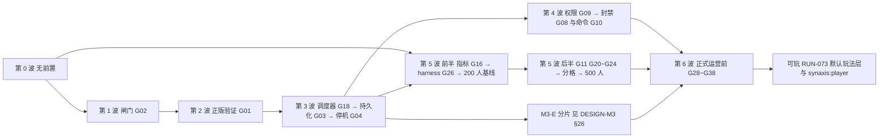

第 3 波的 3D 组（转服票据，`REQ-PROD-045`）只依赖 3A 的写权语句与 V1，不依赖 M3 的任何代码；M3-E 的转服调用 3D 的 `TransferTickets`，所以排在第 3 波之后；第 6 波 6A 里插件面 `Transfers`（`API-PROD-021` 的四个方法）只依赖 3D，`gm.transfer`、管理接口 `synaxis:transfer` 与 P10 两分片来回转服经宿主的 `ShardService`，依赖 M3-E。依赖只有 3D → M3-E → 6A 一个方向，没有环。下表与后面的文件冲突表写于开工前，其中的行号（`Player.java:355`、`AdmissionGate.java` 的 `:60-71`、`Instance.java:162`、`ServerProcessImpl.java:104`）是 `8de32ab9b4` 时的代码位置。

| 波 | REQ（差距） | 可并行的组（按改动文件分组） | 退出条件（可验证） | 工作量（人日） |
| --- | --- | --- | --- | --- |
| 0 无前置 | `REQ-PROD-014` 前半（G12：打印栈、60 s 判死、崩溃报告、15 s 后 halt）、`REQ-PROD-015`（G13）、`REQ-PROD-016`（G14）、`REQ-PROD-017`（G15）、`REQ-PROD-019` 前半（G17：floorMod、4 线程 `counter` 严格模式 CI job、三处 `Acquirable` 接线）、`REQ-PROD-028`（G25）、`REQ-PROD-030` 离线档（G27） | 0A 宿主日志线：G13 + G14 + G15（都改 `server-app/.../Main.java`，同一人做，含崩溃报告写入器）；0A 合并后 0B 看门狗 G12（新类 `Watchdog.java`、`ServerProcess.java`、`ServerProcessImpl.java`（tick 起止打点在 `TickerImpl.tick`）、`ServerConfig.java`，并在 `Main.java` 起停看门狗、复用 0A 的崩溃报告写入器，所以不与 0A 并行）；0C 线程正确性 G17 前半（`ThreadDispatcherImpl.java`、`Entity.java` / `Player.java` 的 `setInstance` / `teleport`、CI）；0D CI 断言 G27（`client-fabric/src/gametest/**`、工作流）；0E JVM 参数 G25（`server-app/build.gradle.kts`、`docs/ENGINE.md`）。0C～0E 与 0A / 0B 可并行 | §19 中这些 REQ 的场景全绿，例外是 `REQ-PROD-014` 里「进入落盘停机」「倒计时期间卡死仍先落盘」两处，这一波判死后直接 halt，落盘路径在 3A 验；4 线程 `counter` 严格模式 job 在 main 上连续 3 次绿；真客户端离线档 R1～R8 连续 5 次绿（v0.9：离线档在 `main` 上只跑了 3 次就被第 2 波 B 档取代，这一条改由 B 档判定，见表后现状） | 13.5～16.5（G17 前半 2～3 为本分册估） |
| 1 连接闸门 | `REQ-PROD-001`（G02）、`REQ-PROD-043`（G40）、`REQ-PROD-009`（G05） | 1A 闸门 G02 + G40（`Server.java`、`HandshakeListener.java`、`ConnectionManager.java`、`StatusResponse.java`、`ServerConfig.java`、`DisconnectReasons.java`、模组 lang）；1B 聊天 G05（`ChatMessageListener.java`、`Player.java:355`、`ServerConfig.java` 两个键、客户端模组 `ClientPacketListenerMixin`）——与 1A 同改 `ServerConfig.java`，1A 先合 | 闸门五层与 fd 退避的集成测试绿；§15 闸门档（单 IP 100 连接/秒 × 60 s）在 50 人规模上跑过；聊天两条场景绿，真客户端无聊天警告截图 | 6.5～7.5 |
| 2 正版验证 | `REQ-PROD-002`（G01）、`REQ-PROD-003`（G06）、`REQ-PROD-004`（G07，同分片部分）、`REQ-PROD-044`、`REQ-PROD-036`（G33）、`REQ-PROD-030` 切完整正版路径档 | 2A 一个 PR：G01 + G06 + G07 + 假 sessionserver（`Auth.java`、`LoginListener.java`、`ConnectionManager.java`（同分片踢旧后等旧 `Player` 移除）、`HandshakeListener.java`、`PlayerSocketConnection.java`、`PacketVanilla.java`、`crypto/`、`module-info.java`、`server-app/.../Main.java`）；2A 合并后串行：2B 删除 `Auth.Velocity` / `Bungee` 与 PROXY 可信网段自检（G33 的前半；又改 `Auth.java`、`HandshakeListener.java`，不能与 2A 并行；`store_meta` 自检要读第 3 波才建的表，挪到 3A）；2C 切 B 档（工作流、`client-fabric/gametest-env/judge.sh` 的两项假 sessionserver 日志检查、回归测试 `RegressionClientGameTest` 的 R3 与 gametest 源集的访问器 mixin `ConnectionAccessor`；不动引擎，可与 2B 并行） | 在线模式全部自动化场景绿（`REQ-PROD-002`～`004`、`044`）；B 档 R1～R8 连续 5 次绿；用户用正版账号完成 auth 草案 §6.2 前两条人工用例并登记 | 7.5～10（假 sessionserver 与 B 档切换含在 G01、G27 内） |
| 3 持久化 | `REQ-PROD-021`（G18）→ `REQ-PROD-005`、`006`、`007`（G03）→ `REQ-PROD-008`（G04）；`REQ-PROD-004` 跨分片部分；`REQ-PROD-022`（G19）；`REQ-PROD-035` 前半（WAL 归档与每日基础备份）；`REQ-PROD-045`（G28 前半，转服票据） | 3A 主线串行（同一人）：G18（`PluginScheduler`、`PluginSchedulerImpl`）→ G03（`server-app` 新包 `store/`、`PluginContext.java`、`AdmissionGate.java`（载入插在 `handshake.await` 与 `provider.admit` 之间，`:60-71`）、Flyway V1～V2 与回退 SQL、`--migrate-only --auth-mode` 与 `store_meta` 自检）→ G04（`ServerProcessImpl.java`、`ServerProcess.java`、`Main.java`、`ConnectionManager.java`，含看门狗判死接保存阶段）；3B 事件优先级 G19（`PluginEvents.java`、`PluginEventsImpl.java`，另改 `PluginHost.java` 建节点与收回的两处和 `LoadedPlugin.java`；与 3A 并行，`PluginHost.java` 两边都改，合并时都留）；3C 运维：WAL 归档与每日基础备份（不动 Java 代码，脚本与操作步骤在 `ops/postgres/`）；3D 转服票据 G28 前半（`REQ-PROD-045`：`server-app` 新包 `transfer/`（票据编解码、`TransferTickets`、验票）、`AdmissionGate.java`（验票插在 `store.load` 之前）、`transfer_nonce.gc`、`DisconnectKeys.java` 加 `synaxis:transfer-rejected`、模组 lang、`.env.example` 登记 `SYNAXIS_TRANSFER_HMAC_KEYS`；3A 合并后开工，改 `AdmissionGate.java` 排在 3A 之后） | 持久化草案 P1～P9、P13、P14 全绿；§19 `REQ-PROD-005`、`REQ-PROD-008` 全部场景与 `REQ-PROD-014` 两条落盘场景绿；`REQ-PROD-036` 的三条 `store_meta` 场景绿；`REQ-PROD-045` 三条场景绿（由 `server-app` 的集成测试直接调 `TransferTickets` 驱动，源与目标可以是同一进程，不需要 M3 的 `ShardService`）且票据向量测试绿；WAL 归档已开并有第一份基础备份 | 17.5～22.5（G32 前半 1、G28 前半 2～3 为本分册估；从第 0 波挪来的「判死接保存」与从第 2 波挪来的 `store_meta` 自检工作量仍计在原波次） |
| 4 治理 | `REQ-PROD-011`（G09）→ `REQ-PROD-010`（G08）、`REQ-PROD-012`（G10） | 4A 权限 G09（Flyway V3、`Permissions`）先合；之后 4B 封禁 G08（Flyway V4、`AdmissionRequest.java`、`DisconnectKeys.java`、宿主节点上的预登录判定与 `HandshakeGate.java` 的跳过判断；引擎 `ConnectionManager.java` 不用改）与 4C 命令 G10（`Main.java#readConsole`、`PluginCommands`，内置六条，`profile` 在 6B；另改引擎 `ConsoleSender.java` 的翻译回退）并行。4A～4C 都往 `PluginContext.java` 加方法，合并按 A → B → C 串行，ABI 门每次过 | 封禁、白名单、权限、命令场景全绿；`API_VERSION` 是否加到 2 已由 ABI 门判定并记入 §1 | 10～13 |
| 5 规模 | 前半：`REQ-PROD-018`（G16）→ `REQ-PROD-029` harness（G26）→ 200 人基线；后半：`REQ-PROD-013`（G11）、`REQ-PROD-023`（G20）、`REQ-PROD-024`（G21）、`REQ-PROD-025`（G22）、`REQ-PROD-026`（G23）、`REQ-PROD-027`（G24）→ `REQ-PROD-020` 分格 + `REQ-PROD-019` 后半 → 500 人压测 | 5A 指标与 harness（新模块 `:loadtest`、`server-app` 指标包、`Main.java` 指标装配）；基线之后：5B 入站 G11 + 出站 G22 + 区块 G23 + Tab G24（都改 `Player.java`，G11 与 G22 还同改 `PlayerSocketConnection.java`，同一人串行）；5C 可见性 G20 + G21（`EntityView.java`、`EntityTrackerImpl.java`、`Instance.java:162`，也改 `Player.java`，合并排在 5B 之后）；5D 分格（`ThreadProvider.java`、`ServerProcessImpl.java:104`、分片宿主），与 5B / 5C 只共用 `ServerConfig.java`，按 5B → 5C → 5D 合并 | 200 人 walk 30 min：tick P99 < 50 ms、超 50 ms 为 0、内存三条（堆 4 GiB、RSS ≤ 堆上限 + 1 GiB、末段老年代回收后 ≤ 堆上限的 50%，§15 tick 预算行，用户 2026-10-11 拍板）；G11 阈值按入站 P99 × 2 写回 `API-PROD-012`；4 线程 `grid` 严格模式 job 在 main 上连续 3 次绿（5D）；500 人两档与重连风暴、闸门、台账档记录在案，`capacity` 定值写回 §15 | 40～57（G17 后半 4～7、分格 3～4 为本分册估；分格从 M3-E 的 12 天中扣出，由 M3 会话同步） |
| 6 正式运营前 | `REQ-PROD-031`（G28）、`REQ-PROD-032`（G29）、`REQ-PROD-033`（G30）、`REQ-PROD-034`（G31）、`REQ-PROD-035` 后半（G32 恢复演练）、`REQ-PROD-037`（G34）、`REQ-PROD-038`（G35）、`REQ-PROD-039`（G36）、`REQ-PROD-040`（G37）、`REQ-PROD-041`（G38） | 6A 转服 G28 后半（插件面 `Transfers`、`gm.transfer`、管理接口 `synaxis:transfer`、`HandshakeListener.java`；票据用 3D 的。插件面只依赖 3D；`gm.transfer`、`synaxis:transfer` 与 P10 经宿主的 `ShardService`，两个分片可以是同大区的两个频道（`transferTo`），所以这三项排在 M3-E 之后）；6B 管理接口 G29 + profile G31（新 WebSocket 包、`Main.java`，6C 之前合并）；6C 配置文件 G30 + 压缩 G35（都改 `ServerConfig.java`，同一人；键表要收全本波新增的键，所以 6C 排在第 6 波最后合并）；6D 列表 G34（`StatusResponse.java`、新类 `Favicon.java` 与 `event/server/ServerListPingEvent.java`、`StatusListener.java`、`ConnectionManager.java` 在构造时读图标、`ServerConfig.java` 三个键，线程契约一条进 `plugin-api` 的 `package-info` 与 `docs/PLUGINS.md` §10）；6E 视距 G36 + 休眠 G37（`Player.java`、`Entity.java`，另有 `Instance.java` 的玩家位置快照与新类 `DormancyPolicy.java`、`PlayerPositions.java`，同一人；不改 `ServerConfig.java`，没有新配置键）；6F 翻译键门禁 G38（CI）；6G 恢复演练 G32（运维） | 各 REQ 场景全绿；两分片来回转服 100 次（P10）绿；恢复演练一次并记录耗时；§23 R4 进入门槛满足 | 17～20.5（G28 前半 2～3 已移到 3D） |
| 可玩（RUN-073） | `REQ-PROD-046`、`REQ-PROD-047`；`REQ-PROD-009`、`REQ-PROD-012` 的改动 | 按改动文件分组（组名以 RUN-073 的编排为准）：默认玩法层（新包 `app.play`、`CoreMode.java` 的光照与预载、`PluginHost#hostNode`，以及引擎 `Player#closeInventory` 关自己背包时处理光标）；持久化段（`PlayerStore` 两个新方法、`PlayerStateSection`、`Main` 步骤 (4)(5) 与到达回调）；命令（`HostCommands`、模组两份 lang、翻译键门禁名单）；真客户端剧本与 CI（`PlayableClientGameTest`、`client-gametest.yml`）；转服携带数据的断言（`TransferRoundTripClientGameTest`、`client-fabric/gametest-env/p10.py`、job `p11-smoke`，v0.9.67）。前两组都改 `Main.java`：持久化段的应用监听器在步骤 (4) 加、默认玩法层在步骤 (5) 加，同一节点自身的监听器按添加顺序执行，所以先后由这两处在 `Main` 里的代码位置决定，与两组分支谁先合入无关；解合并冲突时保持步骤 (4) 的 `install` 在步骤 (5) 的 `DefaultPlay.attach` 之前 | §19 可玩项矩阵全绿：job `gametest` 每次客户端启动 `core` 10 行、`rts` 5 行 PASS（GitHub Actions）；带 `REQ-PROD-046`、`REQ-PROD-047` 的服务端场景默认模式与两种严格模式都绿；job `p11-smoke` 绿、P10 job 手动触发一次绿（可玩项 P11；v0.9.74 起两者判每个世界的背包等于写入的非空存档）；挂地图分片的位置规则接上（§28.3，`ShardWorld` 三个访问器已在 `main` `52ab98dc40`）。现状（v0.9.78，`docs/TEST.md` RUN-075，集成分支 `8e6abbd618`，草稿 PR #18）：四项都满足，这一行完成。job `gametest` 在 PR（run `38126114632`，`LAUNCHES=1`）与 `workflow_dispatch`（run `38126119040`，`LAUNCHES=2`）共 3 次客户端启动上都是 `core` 10 行、`rts` 5 行 PASS；CI run `38126114631` 的 Check、4 线程严格、严格 grid 三种模式各 653 个类 4,455 个 0 失败；job `p11-smoke`（run `38126114632`）与手动触发的 P10（run `38120210047`，在组 M、P 合入后的 `ef6a1f15a8` 上）都绿，每个世界的背包都等于写入的非空存档，第 1 个世界离存档位置 0.00 格（`docs/TEST.md` §7 那一条已结案）；第四项满足（v0.9.73 RUN-075 组 M，v0.9.76 组 X 把规则提成 `Main#positionRule`）：挂地图的分片构造并注册 `synaxis:player`，`Main` 步骤 (5) 设 `MapShard` 规则，同一提交里转服冻结扩到放方块、方块交互与用物品，`docs/TEST.md` `TC-PROD-745`～`TC-PROD-751` 在 RUN-075 通过，真分片上凭票据到达的背包由上面的 job `p11-smoke` 与 P10 判，到达后的位置（门框落点）只在 `p10.txt` 的 `state` 行里记录、判定不判 | 未估（用户直接定的一轮，不在清单 §2） |
| 条件 | `REQ-PROD-042`（G39） | — | 触发条件成立时另立波次 | 2 |

合计：第 0～5 波 95～126.5 人日（清单 G01～G27 的 88～117，加上移入的 G40 0.5、G33 0.5～1、G32 前半 1、G28 前半 2～3，以及从 M3 划过来的分格 3～4），第 6 波 17～20.5 人日，条件项 2 人日。

第 0 波与第 2 波退出条件里由 CI 判定的三项（v0.9 按 `gh run list --branch main` 核对，截至 `a59639f3b1`）：

1. 第 0 波「4 线程 `counter` 严格模式 job 在 main 上连续 3 次绿」已满足。该 job 随 `ad1f0a0cb4` 进 `main`，那次工作流解析失败、一个 job 都没起（run 35853683400）；之后 `1aac280cae`、`e3e16ce3b5`、`c3f7e25083` 三次都绿（run 35853927414、35877692112、35880568896）。后来在 `af8ab12406`、`6162896349`、`5f58070651`、`a7769c1c78`、`2ae21568e1` 红过五次，红的分别是 `PlayerStoreIntegrationTest`、`ConnectionGateSocketTest`、`AcceptBackoffTest`（两次）、`SampleTest` 的偶发红，都已在 `docs/TEST.md` §7 结案；`5ccd82a9ac` 到 `a59639f3b1` 又连续 6 次绿。
2. 第 0 波「真客户端离线档 R1～R8 连续 5 次绿」按原文永远满足不了。离线档在 `main` 上只跑过 3 次，`ad1f0a0cb4`、`1aac280cae`、`e3e16ce3b5` 都绿（「Client gametest」run 35853684614、35853927446、35877692165）；第 2 波 2C 把同一个工作流换成 B 档，`c3f7e25083` 起在 `main` 上跑的都是 B 档。B 档在 R1～R8 之外还判 R3 `encrypted=true` 与假 sessionserver 的 join、`hasJoined` 计数，是离线档的超集，这一条由第 2 波的 B 档条件取代。
3. 第 2 波「B 档 R1～R8 连续 5 次绿」已满足。`c3f7e25083` 到 `a59639f3b1` 的 18 次（16 次 push、2 次每日定时带 spike）全绿，没有红过；每次两个启动器各 8 行 `PASS`、R3 `encrypted=true`、`sessionserver join 2, expected 2`（例：run 36100715708 的日志）。连同离线档，「Client gametest」在 `main` 上 21 次全绿，已满足 §28.1 ops #1「连续 20 次全绿后设为必需检查」；`main` 现在没有分支保护（`gh api repos/Bearisbug/synaxis/branches/main/protection` 回 404），设为必需检查要仓库管理员在 GitHub 上操作。

第 5 波退出条件的现状（v0.8.1，`grid` 一项 v0.9 核对）：200 人 walk 30 min 在同机档只差「超 50 ms 为 0」一项（集成后 6 个，5A 基线 18 个）；G11 阈值已写回 `API-PROD-012`（v0.7.3）；4 线程 `grid` 严格模式 job 已满足「`main` 上连续 3 次绿」：随 `5458e2d540` 进 `main` 起到 `a59639f3b1` 连续 9 次绿，没有红过（§28.2 已决行）；500 人两档、重连风暴、闸门、台账档已在同机档记录，`capacity` 建议值写回 §15「集成后复测与 `capacity`」：内测 200，正式档暂定 500，定值等分机档按该段的条件重跑。

第 6 波退出条件的现状（v0.9 验收，集成分支 `prod/integrate-w6`，`docs/TEST.md` RUN-036）：

- 已完成五组：6B（`REQ-PROD-032` 管理接口、`REQ-PROD-034` 性能剖析，`TC-PROD-380`～`TC-PROD-397`）、6C（`REQ-PROD-033` 配置文件、`REQ-PROD-038` 压缩阈值与级别，`TC-PROD-440`～`TC-PROD-445`）、6D（`REQ-PROD-037` 服务器列表，`TC-PROD-400`～`TC-PROD-405`）、6E（`REQ-PROD-039` 视距上限、`REQ-PROD-040` 实体休眠，`TC-PROD-410`～`TC-PROD-422`）、6F（`REQ-PROD-041` 翻译键门禁，`TC-PROD-430`～`TC-PROD-434`）。这八条 REQ 的 §19 场景都有用例，验收时全量 check 与两种严格模式全绿。
- 表外加做的 U 组也已完成（`TC-PROD-370`～`TC-PROD-379`）：宿主停机序列 `ShutdownSequence` 给 M3-C 的覆盖层停机落盘留出挂载点；转服验票 ⑤⑥ 进同账号串行载入；顶号轮询先查新连接是否已断开。§28.2 的三条待定项随之转已决。D 组只做文档收口，不改代码。
- 没做的三项：6A（`REQ-PROD-031`，插件面 `Transfers`、`gm.transfer` 与 P10 两分片来回转服 100 次）等 M3-E 的 `ShardService`，管理接口的 `synaxis:transfer` 随它交付；6G（`REQ-PROD-035` 后半，恢复演练）要先有一份生产数据库副本才能演练并记耗时；`REQ-PROD-042`（G39）仍按条件触发。「§23 R4 进入门槛满足」要等 6A、6G 做完才能判。
- 验收时仍开着五项：① §28.2 的停机保存缺陷（进了 PLAY、还没进世界就断开的玩家赶上停机，保存等满 30 s、这份登出保存丢失），原定本波验收前修，没有修，`docs/TEST.md` TC-GAME-034 第 3 步因此判失败；② TC-GAME-035 的第 1、3 步在现有代码与探针上做不出来，要先改写用例或给探针加改报视距的子命令；③ `stop` 与 SIGTERM 竞态（§28.2），等 `docs/DESIGN.md` `API-003` 改签名；④ 分片宿主路径上还没有覆盖层停机步骤的注册点：`Main.start` 里建的 `ShutdownSequence` 是局部变量，M3-C 在装配里加 `addAfterPlayers` 调用或一个钩子（下表 `Main.java` 一行）；⑤ §28.3 里标「主会话」的 8 行（含 v0.9 加的 `TC-GAME-034`、`TC-GAME-035` 改写一行）与标「M3 会话」的 2 行。另有一项要仓库管理员操作：`main` 没有分支保护，「Client gametest」设为必需检查的条件已满足（第 0 波与第 2 波现状第 3 条）。
- 修复轮（v0.9.9～v0.9.12，合入集成分支后的复验见 `docs/TEST.md` RUN-037）：上一条的 ① 已修（v0.9.10），§28.2 该行转已决，TC-GAME-034 第 3 步照原写法做 10 次，都在 0.45～0.51 s 内退出、0 行 ERROR（`TC-PROD-460`、`TC-PROD-461`）；② 已改写（v0.9.12：第 1 步经 `proof.never` 关掉修复的两处，第 3、4 步用探针子命令 `view-distance`），TC-GAME-035 六步都通过；⑤ 里 `TC-GAME-034` / `TC-GAME-035` 一行已完成，v0.9.11 又加一行 `docs/DESIGN.md` `REQ-014`，标「主会话」的仍是 8 行、「M3 会话」2 行；③、④ 不变。修复轮另修了验收后审查出的五个缺陷：`profile` 的 `.jfr` 带着进程环境变量、管理消息的中间分片不计长、被放弃的载入先离开再释放（v0.9.9），管理消息按宽松 JSON 读、布尔键写错静默当 false（v0.9.11）；v0.9.12 登记堆转储带环境变量明文的风险。
- RUN-037 之后的修复轮（v0.9.14）：审查报出的三个缺陷都已修，都是 v0.9.9～v0.9.10 修过的地方还留着的交错或旁路：停机冻结与断线同时发生时停机保存等满 30 s（§28.2 已决一行）、另开着别的 JFR 录制时 `profile` 的 `.jfr` 仍带环境变量明文、持令牌的一方连发空续片能把管理接口的堆攒满；用例 `TC-PROD-470`～`TC-PROD-472`。
- RUN-038 之后的 G1 组（v0.9.15）：停机保存阶段里仍在途的登录不再取得写权、不在停机保存之外进服；保存阶段开始后断开没进世界的玩家，卡在 configuration 的客户端不再让停机等满 30 s（§28.2 已决两行）；用例 `TC-PROD-480`～`TC-PROD-486`。
- G3（v0.9.16）：「验收时仍开着五项」的 ③ 已修，`docs/DESIGN.md` `API-003` 改了签名，`stop` 与管理接口 `server/stop` 只按引擎 `beginShutdown` 的返回值回复（§28.2 已决一行，`TC-PROD-495`～`TC-PROD-498`）；§28.3 的 `API-003` 一行转已完成。
- G2（v0.9.17）：G2 审查登记的三处缺陷都已修：管理接口与指标端点的绑定键只认 `host:port`、`synaxis:profile` 的秒数按数字原文精确读、管理连接排队未写出的到 4,096 帧或 1 MiB 即以 1008 断开（§28.2 已决一行，`TC-PROD-488`～`TC-PROD-494`）。
- G4（v0.9.18）：⑤ 里标「主会话」的其余 7 行已完成（`docs/DESIGN.md` v0.40、`docs/DESIGN-M2.md` v0.49、`docs/ENGINE.md` §3.4），连同 G3 的 `API-003` 一行，§28.3 标「主会话」的行已清零，只剩标「M3 会话」的 2 行；④ 不变。
- 以上四组按 G1、G3、G2、G4 的顺序合入集成分支 `prod/integrate-f`（v0.9.19），复验见 `docs/TEST.md` RUN-039。
- RUN-039 之后的修复轮（v0.9.20（RUN-039 修复））：审查报出的七处都已处理。代码六处：停机倒计时只广播给已进 PLAY 的连接；SIGTERM 在宿主发起的停机中到达时截断倒计时、等序列跑完（原风险行转已决，按该行的默认建议）；指标端点每次抓取一条虚拟线程、至多 10 s；踢人阶段之后才确认登录的连接收 `synaxis:server-stopping`；`bans/add` 与插件 `Moderation#ban` 的到期上限；日志里的 IPv6 地址带方括号（§28.2 已决两行，`TC-PROD-499`～`TC-PROD-505`）。文档一处：`docs/TEST.md` `TC-PROD-169` 第 2 步合并反证的测试数随 G1 加的一条由 31 改为 32。
- RUN-039 修复轮之后的第 2 轮（v0.9.21（RUN-039 修复第 2 轮））：审查报出三处。两处已修：起服过程中的 `server/stop` 回 −32000、不再停下一个随后照常绑端口的进程（major）；出站上限的判定与入队在连接对象锁里一起做（minor）（§28.2 已决一行，`TC-PROD-506`～`TC-PROD-508`）。1,024 个字符及以上的 JSON 数字回 −32700（minor）不改行为：设计写明这条上限，§28.2 登记 Open Question，`TC-PROD-509` 钉住现状；插件在 `onEnable` 里停机登记为风险；验证时发现的游戏端口绑不上时进程不退出登记为风险，默认下一轮修。
- RUN-039 修复第 2 轮之后的第 3 轮（v0.9.22（RUN-039 修复第 3 轮））：审查报出五处，都已处理。代码一处：rts 插件的 `onDisable` 经 `Acquirable#sync` 移除单位，所有权断言开着时停机不再报 `Plugin failed to disable`、照常写 `match_ended`（§28.2 已决一行，`TC-PROD-511`、`TC-PROD-512`）。文档四处：`API-PROD-007` 写对 `onDisable` 所在的线程；§28.2 游戏端口一行写对让 JVM 活着的线程；两轮修复的版本号改为 v0.9.20、v0.9.21；`docs/TEST.md` `TC-PROD-483` 第 2 步的红行（原先红在哪一行取决于写库是否在 5 个 tick 内完成，测试改为先断言钩子）与 `TC-PROD-510` 第 2 步的出处。游戏端口绑不上时进程不退出仍开着（§28.2 风险行）。
- M3-C 合入 `main`（v0.9.24）：「验收时仍开着五项」的 ④ 已解决，覆盖层停机步骤的注册点在 `Main` 步骤 (5) 的 `ShardWorld#start`（`API-PROD-007` 注册一条）；本分册按 `docs/DESIGN-M3.md` §28.2 交来的 ①～⑪ 同步了键数、出站积压、分片默认值、休眠与模拟距离的次序和下表。
- M3-E 的契约（v0.9.26，按 `docs/DESIGN-M3.md` v0.16）：「没做的三项」里的 6A 拆成两半。插件面 `Transfers`（`API-PROD-021` 的四个方法）只依赖 3D，现在就能开工，M3-E 不加 `shards()`、不改 `PluginContext.java`；`gm.transfer`、管理接口 `synaxis:transfer` 与 P10 经宿主的 `ShardService`，要等 M3-E 的 `app.shard` 包进 `main`，P10 的夹具见 §19。M3-E 在本分册维护的文件上的改动登记在下表。
- 6A 插件面（v0.9.27，分支 `prod/6a-plugin`）：`:plugin-api` 新接口 `Transfers`（首次提交即标 `@ApiStatus.NonExtendable`，标注的接口共 15 个）与 `PluginContext` 的默认方法 `transfers()`，宿主实现 `PluginTransfers`，`transfer` 在玩家所属 tick 线程上判定、派发 `OutgoingTransferEvent` 与发包；`Main#openStore` 建的冷却表挂在 `StoreRuntime#cooldowns`，经 `PluginHost` 交给插件面，与 `TicketIssuer`、`TicketVerifier` 是同一个对象。`REQ-PROD-031` 的插件面用例 `docs/TEST.md` `TC-PROD-520`～`TC-PROD-533`。6A 剩下的 `gm.transfer`、管理接口 `synaxis:transfer` 与 P10 仍等 M3-E 的 `app.shard` 进 `main`。
- 6A 其余部分（v0.9.29，分支 `prod/6a-rest`）：GM 命令 `transfer`（`app.command.TransferCommand`，节点 `gm.transfer`）与管理接口 `synaxis:transfer` 接到目录模式的 `ShardService`，`Main` 步骤 (4) 把 `DirectoryMode#service` 交给两者，不在目录模式时交 null；回执的四个新键进模组两份 lang，翻译键门禁由 56 个键变为 60 个。用例 `docs/TEST.md` `TC-PROD-540`～`TC-PROD-549`，其中 `TC-PROD-548` 是一个目录模式分片加一个机器人的真进程（另一频道的心跳行由测试写进库，严格 grid）。6A 还剩 P10（两个目录模式分片、真客户端来回 100 次，`client-gametest.yml`），第 6 波的退出条件仍差它与 6G。同批按 `docs/DESIGN-M3.md` §28.2 交接行同步 ⑬、⑯～⑲：§28.2 签发端调用方一行转已决，本节文件表补三份测试，§24 豁免名单写成 11 个类，`API-PROD-025` 补轨道 D 的口径，`docs/TEST.md` 里随 M3-E 过时的 13 条 `TC-PROD` 逐条重跑、按实跑结果改写（`TC-PROD-378` 与原文相同）；⑳ 未到时点；㉑ 要改 `TicketIssuer.java`，该文件在 M3 会话手上，本轮没改。
- 6A 的 P10（v0.9.30，分支 `prod/6a-rest`）：`client-gametest.yml` 新增 job `p10`，gametest 源集新增 `TransferRoundTripClientGameTest`（`RegressionClientGameTest` 在它跑时直接返回），驱动与判定是 `client-fabric/gametest-env/p10.py`，`run.sh` 透传两个环境变量（`API-PROD-026` P10 一条）；用例 `docs/TEST.md` `TC-PROD-550`。写成时本机内存不够同时起两个分片与真客户端，本机只跑了烘焙、目录校验与判定的反证；P10 首跑待 CI（push `main`，或把分支推上去后 `gh workflow run client-gametest.yml --ref <分支>`）。第 6 波的退出条件仍差 P10 首跑变绿与 6G。
- 6A 完成（v0.9.32）：P10 第一次执行在 GitHub Actions run 36431726931 上通过（`docs/TEST.md` RUN-050：200 次转服都回 `sent` 并到达目标分片，`transfer_issued` 两分片各 100，客户端交替进了 201 个世界，job 23 min 18 s）。第 6 波退出条件里「两分片来回转服 100 次（P10）绿」已满足；还差 6G 恢复演练一次与 §23 R4 进入门槛。P10 按用户 2026-09-28 拍板只每周日定时与手动运行。

改同一批文件、不宜并行的组（合并顺序即上表）：

| 文件 | 被哪些组改 | 处置 |
| --- | --- | --- |
| `server-app/.../Main.java` | 0A（G13、G15）、0B（G12 看门狗起停）、2A（G01 模式选择）、3A（G03 装配、G04 注册 `ShutdownParticipant`）、4A（`role` 命令与权限装配）、4B（封禁装配、`synaxis.app.whitelist`、三条 GM 命令）、4C（G10 控制台、内置命令）、5A（指标装配）、6B（G29）、6C（G30）、第 6 波 U 组（注册 `ShutdownSequence`）、M3-C（挂地图模式：步骤 (1) 读地图键、步骤 (3) `ShardWorld.prepare`、步骤 (5) `ShardWorld#start` 注册覆盖层停机步骤，M3 会话）、M3-E 第 0 步（目录模式装配：步骤 (1) 读 `shards.json` 并写 `synaxis.max-players`，(3) `prepare` 收目录，(4) `openStore` 传两个回调、建 `ShardHeartbeat`、`ShardServiceImpl` 与 `WorldFlagsImpl`，(5) 挂关卡门与到达，(7) 起心跳，M3 会话）、6A 插件面（`StoreRuntime` 加组件 `cooldowns`，`openStore` 三处构造都传，`PluginHost` 多收这一个参数；v0.9.27）、6A（步骤 (4) 注册 `transfer` 命令、`ManagementMethods` 多收 `ShardService`，两者都取 `DirectoryMode#service`，不在目录模式为 null；v0.9.29）、安全修复 ops 组（步骤 (4) 两个运维端口绑通配地址时各写一行 WARN，步骤 (6) 游戏端口绑不上时先跑停机任务再拒启；v0.9.41）、M3 v0.31（`serveMap` 多一个参数 `PlayerStore store`，建 `ShardGates` 时多传 `store::isOnline`，M3 会话）、M3 v0.30（M3-G 第 0 步：`serveMap` 的 `AsyncPlayerConfigurationEvent` 监听里 `world.farView()` 不为 null 且是首次 configuration 时发 `synaxis:farview`，排在 `FinishConfiguration` 之前；多一行导入，监听多 7 行，`new ShardGates(` 由 `:518` 移到 `:526`，M3 会话）、RUN-071 authority2（步骤 (1) 读完分片目录之后对分片宿主调 `ShardMain#gateDefaults`，多两行，第 219 行之后后移 2 行；v0.9.53） | 0A → 0B 串行（还共用崩溃报告写入器）；4A → 4B → 4C 串行，合并时各组的装配都留；6B → 6C 串行；U 组先于 M3-C 合入（都已合入）；M3-E 先于 6A 接 `ShardService` 的部分合入，后合者 rebase、两边的改动都留；6A 插件面与 M3-E 第 0 步改的是 `openStore` 签发端那一条 `new StoreRuntime(…)` 的相邻几行（M3-E 改 `TicketIssuer`、`TicketVerifier` 两个实参，6A 在实参末尾加 `cooldowns`），后合者照两边合起来写；M3-G 合入 `main` 时只有 `serveMap` 冲突（M3 v0.31 改了签名，M3-G 改了监听），保留 `main` 的签名（`PlayerStore store`，关卡门取 `store::isOnline`），再把远景宣告放进监听体；其余波次内只有一个组改它 |
| `ServerConfig.java` | 0B（G12）、1A（G02、G40）、1B（G05）、2B（PROXY 两项拒启）、5B（G11、G22、G23）、5C（G21）、5D（分格）、6C（G30、G35）；6D（G34 三个键）也加键；M3-D（`ConfigFile.KEYS` 加 `synaxis.relight-threads`、`synaxis.relight.resend-light` 两个键，M3 会话）、M3 v0.30（M3-G 第 0 步：`ConfigFile.KEYS` 加 `synaxis.farview.url-root`，读取处 `ShardSettings`，合入 `main` 时与键表自动合并，M3 会话） | 1A 先于 1B；5B → 5C → 5D 合并；键表（`server-app` 的 `ConfigFile.KEYS`）是配置文件的唯一出处，6C 排在第 6 波最后，在 6D 等全部加键之后合并；此后任何组加键都在同一提交里加进键表，否则配置键门禁失败（§24） |
| `server-app/.../ShardMain.java` | 5D（建入口与线程两项）、M3 会话（视距、区块上限、可见上限与 `accept-transfers` 的默认值，`docs/DESIGN-M3.md` v0.8）、6C（`main` 先触发读 `synaxis.properties` 再写默认值，默认值本身不动）、M3-C（挂地图时写 `synaxis.app.core-mode=on`，以分片宿主身份调 `Main`，M3 会话）、RUN-071 authority2（`gateDefaults` 写连接闸门 L0、L4 的默认值，由 `Main` 步骤 (1) 调；本分册 v0.9.53） | 默认值归 M3 会话，闸门两项的取值归本分册 `API-PROD-003`；6C 只改 `main` 里的先后 |
| `entity/Player.java` | 0C（接线）、1B（G05）、5B（G11、G22、G23、G24）、5C（G20、G21）、6E（G36）、M3-C（视野票据跟随区块环，M3 会话）、M3 侧安全审查修复 chunks 组（v0.9.49：`sendPendingChunks` 开头修剪待发队列）、RUN-071 chunks2 组（v0.9.54：在区块写锁里取包交给连接，一批等锁合计至多 1 ms、等不到的区块批末放回，新增 `isChunkInRing`）、RUN-072 chunks 组（v0.9.58：取包抛异常的区块推后、批末放回）、RUN-071 upstream 组（v0.9.55：`refreshAfterTeleport`、`showPlayer` 全空的装备槽不发包） | 5B 同一人串行，5C 排其后；M3-C 在 6E 之后合入，改区块环增删的几处都经 `moveTicketRing` |
| `entity/Entity.java` | 0C（`setInstance` / `teleport` 所有权断言）、5C（G20 追踪范围与可见上限）、6E（G37 休眠）、M3-C（模拟距离外只跑调度器，先判模拟再问休眠策略，`docs/DESIGN-M3.md` `ADR-M3-017`，M3 会话） | 按波次串行；改 `Entity#tick` 的判定时两边的用例都跑（`docs/TEST.md` `TC-PROD-414`～`TC-PROD-419` 与 `TC-WORLD-044`） |
| `instance/EntityTrackerImpl.java` | RUN-071 chunks2 组（v0.9.54：`ChunkView` 的观察者按区块环判，`Player#isChunkInRing`） | 区块观察者与 `Player` 待发队列判出环用同一判据（`isOutOfClientRange`），改一处要同时看另一处 |
| `PlayerSocketConnection.java` | 2A（cipher）、2B（PROXY 可信网段）、5B（G11 入站计数、G22 出站积压）、M3-C（积压只丢 `sheddable` 的 `BufferedPacket`，M3 会话）、安全修复 login 组（v0.9.39：登录前监听器抛异常即断开、play 态即时包计数） | 2A → 2B → 5B → M3-C → login 组 |
| `network/packet/server/BufferedPacket.java` | M3-C（加分量 `sheddable`，`docs/DESIGN-M3.md` `ADR-M3-018`，M3 会话） | 构造它的地方都显式给 `sheddable`，只有视野广播给 true（`API-PROD-020`） |
| `network/PacketViewableUtils.java` | 5B（G22：视野广播的缓冲包是积压里可丢的部分）、M3-C（构造时给 `sheddable = true`） | 5B → M3-C；这里只许走实体移动，别的包走这里会在积压超限时被丢 |
| `HandshakeListener.java` | 1A（L1 / L2）、2A（transfer 意图鉴权）、2B（删 Velocity / Bungee 分支）、6A（G28）、安全修复 login 组（v0.9.39：超长地址先过闸） | 按波次串行 |
| `LoginListener.java` | 2A（G01、G06、G07）、2B、安全修复 login 组（v0.9.39：L3 只判满、去掉自己的 ERROR 行） | 2A → 2B → login 组 |
| `ConnectionManager.java` | 1A（L3 席位、L4）、2A（G07 同分片踢旧后等旧 `Player` 移除）、3A（G04 停机）、6D（G34 构造时读图标）、安全修复 login 组（v0.9.39：`transitionLoginToConfig` 开头占席位） | 按波次串行 |
| `server-app/.../AdmissionGate.java` | 3A（载入插在 `handshake.await` 与 `provider.admit` 之间）、3D（验票插在载入之前）、4B（`AdmissionRequest` 加组件的调用点） | 3A → 3D → 4B |
| `server-app/.../PluginHost.java` | 3A（启用失败的插件收回数据段与停机钩子）、3B（事件节点的建与收回）、4A～4C（`PluginContextImpl` 的 `permissions`、`moderation`、`commands` 三个组件，4B 挂封禁判定，4C 收回命令）、6A 插件面（`PluginContextImpl` 的 `transfers` 组件与收冷却表的八参构造器，七参的另建一张表） | 同一波并行，合并时两边的改动都留 |
| `ServerProcessImpl.java` | 0B（G12）、3A（G04）、5D（`:104` 分格）、6C（G35 压缩阈值）、M3-C（每 tick 在 `updateAndAwait` 之后卸载空闲区块，M3 会话）、P3-3（v0.9.36，`TickerImpl` 算整 tick 的获取等待） | 按波次串行 |
| `thread/ThreadDispatcherImpl.java` | 0C（G17 `floorMod`）、M3-C（只在 `refreshType = ALWAYS` 时维护 `partitionUpdateQueue`，分区删除 O(1)，M3 会话） | 0C → M3-C |
| `thread/TickThread.java` | 5A（G16 每条 tick 线程的计时）、M3-C（`entries` 改为保持插入顺序的 `LinkedHashSet`，分区删除 O(1)、tick 顺序不变，M3 会话）、P3-3（v0.9.36，拿自己的锁先 `tryLock`、阻塞才计时，观察者改为 `TickObserver` 带获取等待） | 5A → M3-C → P3-3 |
| `plugin-api/.../DisconnectKeys.java` | 3A（`synaxis:state-unavailable`）、3D（`synaxis:transfer-rejected`）、4B（`synaxis:banned`、`synaxis:not-whitelisted`） | 按 3A → 3D → 4B 串行，每次同步模组两份 lang |
| `plugin-api/.../PluginContext.java` | 3A（`playerData`、`lifecycle`）、4A～4C（`permissions`、`moderation`、`commands`）、5B（`tabList`，G24）、5C（`entities`，G20）、6A（`transfers`） | 每次加方法单独一个提交，ABI 门逐次过 |
| `plugin-api/.../PluginContext.java`（跨会话） | 6A（`transfers()`，本分册） | `transfers()` 是默认方法，新接口 `Transfers` 在首次提交即标 `@ApiStatus.NonExtendable`，合入跑一次 ABI 门，baseline `v0.3.0` |
| `server-app/.../transfer/TicketIssuer.java`、`TicketVerifier.java` | 3D（签发与验票）、U 组（验票 ⑤⑥ 进同账号串行载入，`TicketVerifier#claim`）、M3-E（第 0 步在两个构造器末尾各加一个回调：`TicketIssuer` 加台账 `BiConsumer<String, Map<String, ?>>`，`TicketVerifier` 加 `BiConsumer<Player, TransferTicket> onClaimed`，暂不调用；轨道 B 填实：发出 `Transfer` 之后写 `EVT:transfer_issued`，`claim` 通过时调 `onClaimed`，M3 会话）、M3 v0.21（`TicketIssuer.TRANSFER_FAILED` 改为 public，`ShardGates` 改用它、删掉自己那份同值常量，`docs/DESIGN-M3.md` §28.2 交接行 ㉑，`cf1a359794`，M3 会话）、v0.9.40（签发 ④ 之后 10 s 断开还连着的玩家，安全审查 B-01，本分册） | 3D → U → M3-E → M3 v0.21 → v0.9.40；设计以 `API-PROD-028` 为准，M3-E 的改法已写进该条 |
| `server-app/.../shard/ShardGates.java` 与 `ShardGatesTest.java` | M3-E（建；`docs/DESIGN-M3.md` v0.20 加 `EVT:transfer_refused` 的三种，M3 v0.21 改用 `TicketIssuer.TRANSFER_FAILED`，M3 会话）、v0.9.37（六种拒绝结果都写 `EVT:transfer_refused`，用户 2026-09-30 拍板，本分册）、M3 v0.31（安全审查 B-01 的加固：构造器多收在线判定 `Predicate<Player>`，`moved` 对不在线的玩家不调 `ShardService`、不写台账，新类 `ShardGatesOnlineTest`，M3 会话） | 属 M3 会话；本分册只改写事件的那一处与它的测试，diff 先交 M3 会话；`docs/TEST.md` `TC-WORLD-064`、`TC-WORLD-100` 引的测试名与红行由 M3 会话按改后的代码改 |
| `server-app/.../store/RedisLink.java` | 3A（顶号与在线名单）、4A（权限变更频道）、4B（封禁频道）、M3-E（第 0 步加 `listenWorldFlags(String, Consumer<String>)` 与 `publishWorldFlag(String, String)` 两个签名，轨道 C 填实，`docs/DESIGN-M3.md` `API-M3-013`，M3 会话）、安全修复 secrets 组（v0.9.42：`connect` 的 URL 解析失败时拒启信息不带原串、补主机为空的判定，本分册） | 按波次串行；M3-E 只加方法，不改已有频道 |
| `:loadtest` 的 `Bot.java`、`Profile.java`、`Args.java`、`RunCommand.java`、`BotStats.java`、`MergeCommand.java`，测试 `BotSocketTest.java`、`MergeTest.java` | 5A（harness 与这两份测试）、5C（`town` 画像与 `visible_entities`，`Args.java` 除外）、M3-E 轨道 D（转服往返、`gate` 画像、`--gates`、`--dwell`、`transfers` 与 `--min-transfers`；另新建 `ProfileTest.java`，改 `BotSocketTest.java`、`MergeTest.java`，M3 会话） | 5A → 5C → M3-E；契约见 `API-PROD-025` 转服一条 |
| `server-app/src/main/resources/db/migration/`、`db/rollback/` | 3A（V1、V2 与回退脚本）、4A（V3）、4B（V4）、M3-E 第 0 步（V5 `shard_heartbeat`、V6 `world_flag` 与两份回退脚本，内容按 `docs/DESIGN-M3.md` §25，M3 会话） | 版本号按 §25 的合并顺序取下一个空号，不开 `outOfOrder` |
| `server-app/.../store/MigrationsDbTest.java` | 3A、4A、4B（每加一个版本改版本表与表名单）、M3-E 第 0 步（版本表改为 1～6、表名单加 `shard_heartbeat`、`world_flag`，往返先回退 V6 再回退 V5，M3 会话） | 与迁移脚本同一个提交改，否则共用容器开着时 `check` 必红 |
| `server-app/.../store/TransferTicketsIntegrationTest.java`、`server-app/.../TransferAdmissionIntegrationTest.java` | 3D（前者）、U 组（后者，前者改验票进载入）、M3-E（第 0 步补构造参数：前者 8 处 `new TicketIssuer`、2 处 `new TicketVerifier`，后者 1 处 `new TicketVerifier`，都传空操作；轨道 B 加 `EVT:transfer_issued` 与 `onClaimed` 的断言，M3 会话） | 3D → U → M3-E；构造调用与两个类的签名在同一个提交里改 |
| `server-app/.../ClientDrivenLogArchitectureTest.java`（宿主日志门禁） | 0A（建门禁与豁免名单）、第 6 波 U 组（`ShutdownSequence`）、M3-C（`ShardWorld`，M3 会话）、M3-E 轨道 A（`ShardHeartbeat`，M3 会话） | 往名单加类的组在同一提交里写上界，§24 ArchUnit ② 同步名单与类数 |
| `architecture-tests/.../TranslationKeyGateTest.java`（翻译键门禁的非文字标识名单 `NOT_TEXT`） | 6F（建门禁与名单，7 个）、第 6 波集成（6B 的四个 JSON-RPC 方法名，v0.9.7）、M3-C（`synaxis:map`、`synaxis:door`、`synaxis:loot`，M3 会话）、6A 其余部分（`synaxis:transfer` 一条的说明加上它也是 JSON-RPC 方法名，v0.9.29）、M3 v0.30（M3-G 第 0 步：`synaxis:farview`，M3 会话）、RUN-077 组 P 与组 K（`synaxis:play`，两组加的是同一行） | 新增频道、Cookie 键、handler 命名空间或 JSON-RPC 方法名的组在同一提交里把它加进名单，`API-PROD-029` ② 同步名单与个数；合并时两边加的行都留 |
| `server-app/build.gradle.kts` | 0A（崩溃报告的 `buildInfo`）、0E（`applicationDefaultJvmArgs` 的生产 JVM 默认参数）、3A（PostgreSQL、Valkey 依赖；`test` 任务把 `SYNAXIS_TEST_*` 记为输入）、5A（Micrometer）、5D（`bin/server-shard` 启动脚本）、6B（管理接口的 WebSocket 依赖）、M3-C（依赖 `:synx`，测试依赖 `:baker`，M3 会话）、M3-D（新任务 `lightFixtureArgs`：把 `test` 源集的运行 classpath 写成 `build/light-fixture.args`，光照夹具 `LightShardFixture` 用 `java @…` 起，不留 Gradle 进程，M3 会话）、M3-G 第 0 步（新任务 `farviewFixtureArgs`，照 `lightFixtureArgs` 写 `build/farview-fixture.args`，远景夹具 `FarViewShardFixture` 同样用 `java @…` 起，M3 会话） | 各组只追加依赖或任务；M3-D、M3-G 不动既有任务 |
| `client-fabric` 的 gametest 源集（`fabric.mod.json` 入口表、`synaxis-gametest.mixins.json`）与 `client-fabric/gametest-env/run.sh` | 0D（回归 R1～R8 与 `judge.sh`）、2A（`run.sh` 透传 `SYNAXIS_GAMETEST_SESSION_HOST`）、2C（正版档 R3 的访问器 mixin `ConnectionAccessor`）、6A 的 P10（`TransferRoundTripClientGameTest`，`run.sh` 透传 `SYNAXIS_P10_SERVER`、`SYNAXIS_P10_DONE`）、M3-D（`light/LightClientGameTest`、`light/LightProbe`、`mixin/LightUpdateCounterMixin`；入口表首位加 `LightClientGameTest`，另加一个 `client` 入口 `LightProbe`；`run.sh` 透传 `SYNAXIS_LIGHT_SERVER`、`SYNAXIS_LIGHT_MODE`，固定传 `SYNAXIS_LIGHT_MARKER=/out/light-ready`，M3 会话）、M3-G 轨道 C（`farview/FarViewClientGameTest` 排在 `LightClientGameTest` 之后、R1～R8 之前，没设 `SYNAXIS_FARVIEW_SERVER` 时立即返回；`client` 入口在 `LightProbe` 之后加 `farview/DhUpdaterOff`；mixin 表加帧时间 mixin `FrameTimeMixin`；`run.sh` 透传 `SYNAXIS_FARVIEW_SERVER`、`SYNAXIS_FARVIEW_HTTP`、`SYNAXIS_FARVIEW_MODE`、`SYNAXIS_FARVIEW_MODS` 与 `SYNAXIS_GAMETEST_ARGS`（作 Gradle 的 `--args`），固定传 `SYNAXIS_DH_SHADERPACKS=/dh/shaderpacks`，把 `protocol` 测试资源的 `farview-vectors/` 与 `vectors/` 一起拷进容器；`SYNAXIS_FARVIEW_MODS` 不为空时在容器里按 SHA-1 取 DH（`dh-iris` 时另取 Sodium、Iris 与光影包），客户端 JVM 加 `-Dfabric.addMods=/dh/mods`；`http.nonProxyHosts` 加 `host.docker.internal`；结束时把 `synaxis/farview/` 的文件清单与各库的 `synaxis-library.json` 拷到 `$OUT/farview/`，M3 会话）、RUN-073 F（可玩项剧本 `PlayableClientGameTest` 排在 `RegressionClientGameTest` 之后，没设 `SYNAXIS_PLAYABLE_SERVER` 或设了 `SYNAXIS_P10_SERVER` 时直接返回；mixin 表加 `DisconnectReasonMixin`；`RegressionClientGameTest` 的 `staticField`、`inWorld`、`encrypted`、`screenText`、`sky`、`leaveToTitle` 与常量 `SESSION_HOST_PROPERTY` 改为包内可见供它复用；`judge.sh` 加 `CORE_CONNECTIONS`，v0.9.66）、RUN-075 R（`RegressionClientGameTest` 的 `FAIL` 与步骤抛出的异常只进报告，测试本身不抛出，v0.9.77） | 入口表的先后决定谁先跑：Fabric 的 gametest runner 在一条测试抛异常后不再跑后面的，排在 R1～R8 之前的用例（`LightClientGameTest`、`FarViewClientGameTest`）没设自己的环境变量时必须直接返回；M3-D、M3-G 没动 R1～R8 与 `judge.sh`（`API-PROD-026`）；R1～R8 有 `FAIL` 时可玩项剧本照跑（v0.9.77），判定读报告判红 |

## 27. 上线后度量与复盘

N/A — 本分册尚未开工。R2 封闭内测稳定运行 7 天后按 §3 三条指标做一次实际度量（达标 / 未达标各列证据），回填 §26 各波实际人日与偏差；对任何一次「停机保存完整率 < 100%」「一致性断言失败」「看门狗判死」做无指责 postmortem（时间线、影响、根因、行动项带 owner 与截止）。

## 28. 风险与开放问题

### 28.1 拍板记录（2026-09-23）

用户同日拍板了七项方向（§1 的 U1～U7），并指示「其余待拍板点一律按草案默认值定」。下表逐项登记结果；「按默认值定」的每一行都给出切换条件与它在本分册的落点，条件成立时按 ID 变更规则改设计并在 §1 登记。清单 §7 与草案之间的重号已合并（清单 Q3 = auth ①，Q4 = auth ④，Q5 = ops #3，Q7 = auth ⑧，Q8 = ops #8，Q9 = D12，Q11 = ops #10）。

| 编号 | 问题 | 结果 | 默认值 | 切换条件 · 见 |
| --- | --- | --- | --- | --- |
| Q1 | Redis 的定位 | 用户拍板（U3） | PostgreSQL 唯一权威，Valkey 8 只放可丢数据 | Redis 最后只剩在线名单一个用途时不引入，改 `shard_heartbeat` 表 · `ADR-PROD-003` |
| Q2 / D3 | 写权租约粒度 | 用户拍板（U4） | 每分片一个会话租约 | 出现玩家粒度的写权转移需求 · `ADR-PROD-004` |
| Q3 / auth ① | `server-app` 默认模式 | 按默认值定 | `online`，离线须显式传参 | 本机开发频繁因忘传参连不上 sessionserver 时改为默认 `offline`；代价是生产部署必须显式传 `online`，忘传时正式库 `store_meta.auth_mode=online` 让分片拒绝起服，不会对外开成离线服 · `API-PROD-001` |
| Q4 / auth ④ | sessionserver 故障时 | 用户拍板（U2） | 拒绝登录，重试一次 | 单次故障 > 30 分钟且运营判定停服比冒名更贵时另立需求做手动降级开关 · `RB-PROD-001` |
| Q5 / ops #3 | 每 IP 上限数值 | 按默认值定 | 并发 16、登录桶 3 / 每 2 s 回填 1、transfer 桶 10 / 每秒 2 | 首次公开内测中正常玩家触发 `login-throttled` 或 `too-many-connections` 每天 > 5 次时翻倍；网吧集中地区加白名单网段 · `API-PROD-003`、`RB-PROD-005` |
| Q6 | 分片 `dispatcherThreads` | 用户拍板（U5） | 核数 − 2 | 500 人压测中 carrier 利用率 < 50% 时改为核数 · `API-PROD-016` |
| Q7 / auth ⑧ | `Auth.Velocity` / `Bungee` 去留 | 按默认值定 | G01 落地后单独一个提交删除 | 出现代理层计划时从 git 历史复活 · `ADR-PROD-007` |
| Q8 / ops #8 | RTS 进程是否开多线程 | 按默认值定 | 不开（`counter` + 1） | 单局 > 200 人，或 tick P99 连续 5 分钟 > 25 ms · `API-PROD-016` |
| Q9 / D12 | 数据库故障时在线玩家 | 按默认值定 | 10 s 冻结、30 s 踢出 | 运营宁可无上界丢进度也不踢人时改为只冻结，代价是分区时两边各玩各的、一边进度被 fencing 丢掉 · §11.2 |
| Q10 | 新增依赖 | 按默认值定；G29 的 WebSocket 库由用户 2026-09-25 拍板 | 接受 pgjdbc、HikariCP、Flyway、Jedis、Micrometer + Prometheus；G29 用 Java-WebSocket（`org.java-websocket:Java-WebSocket` 1.6.0） | 项目要求零新依赖时 G16 改 JDK `HttpServer` 手写文本格式，约多 1 人日；Java-WebSocket 出现影响本用法的安全公告而 30 天内没有修复版，或要求管理接口直接对内网以外开放（要 TLS 与更细的握手控制）时换 Jetty 12 WebSocket，代价是运行时闭包多出 Jetty 的服务器与 HTTP 模块 · §17、`ADR-PROD-014` |
| Q11 / ops #10 | 压测机器 | 按默认值定 | 服务端与机器人各一台 ≥ 8 核 / 16 GiB，千兆内网 | 只有本机时 500 人档只跑 A～C，D～G 等第二台机器 · `REQ-PROD-029` |
| Q12 | G28 Transfer 排期 | 按默认值定 | 票据签发与验票在第 3 波 3D（M3-E 的转服依赖它）；插件面 `Transfers` 与 P10 在正式运营前（第 6 波 6A）。6A 的插件面只依赖 3D，现在就能开工；`gm.transfer`、管理接口 `synaxis:transfer` 与 P10 经宿主的 `ShardService`，等 M3-E 的 `app.shard` 进 `main` | 内测开两个及以上大区时 6A 提前到内测前，工作量 +1.5～2 人日（3.5～5 减去已在 3D 的 2～3，本分册估） · §26 |
| Q13 | 正式档的内存判据 | 用户拍板（2026-10-11，光照会话转述，见 `docs/DESIGN-M3.md` §28.1「正式档的 RSS 判据与分片默认堆」一行；v0.9.63 登记） | 堆维持 4 GiB（`REQ-PROD-028`，启动脚本不改）；RSS ≤ 堆上限 + 1 GiB；另加 GC 判据：压测末段（最后 5 min，读 `-Xlog:gc`）老年代回收后的占用 ≤ 堆上限的 50%。原写的「RSS < 4 GiB」在 `AlwaysPreTouch` 下按默认参数一定判失败：起服时把整个 4 GiB 堆逐页写一遍、全部计入 RSS；RSS 看堆外开销，GC 判据看堆压力 | 一台机器放 n 个分片时每个分片的份额 =（单机内存 − 1 GiB 系统预留）÷ n；份额 < 5 GiB 时改为堆 3 GiB、RSS < 4 GiB，代价是本分册改启动脚本的默认堆（`REQ-PROD-028`）；份额 < 4 GiB 时两种都装不下，只能减少每台的分片数；1 GiB 预留只在这台机器不跑 PostgreSQL、Valkey 或机器人时成立 · §15 tick 预算行、§19、§26 第 5 波 |
| auth ② / D7 | 在线模式重复登录 | 按默认值定 | 踢旧会话、放新连接；跨分片顶号 | 持久化侧做不到「旧会话先保存释放、新会话再载入」，或运营认定顶号是安全风险时改拒新 · `ADR-PROD-010` |
| auth ③ | 转服冷却 | 按默认值定 | 每玩家 5 s | Mojang 客户端 join 限额被证实不是 6 次 / 30 s 时重算 · `API-PROD-021` |
| auth ⑤ | CFB8 实现 | 按默认值定 | JDK 自带 | 生产机型上加密占用 > 1 个核的 10% · `ADR-PROD-011` |
| auth ⑥ | Python 探针与 `soak.py` 是否支持加密 | 按默认值定 | 不支持，加密由 Java 测试与 `PacketFlood` 覆盖 | 需要 `soak.py` 攻击子命令跑加密连接时在 `.venv` 用 `uv pip` 引入 `cryptography` · §25 |
| auth ⑦ | CI 真客户端档位 | 按默认值定 | B（完整正版路径 + 假 sessionserver） | B 在假 services 主机上 1 人日内进不了服时退到 A，B 挂成手动触发 · `API-PROD-026` |
| D1 | 插件能否拿到 JDBC | 按默认值定 | 不能，只见数据段 | 需要自定义表的功能出现时做成宿主服务 · `ADR-PROD-012` |
| D2 | 账号与角色 | 按默认值定 | 1:N 建表，先开 1 个角色 | 确定永远单角色才合表 · §7 |
| D4 | 崩溃安全 | 按默认值定 | 乐观版本 + 60 s 保存 + 关键操作同步 | 非关键进度丢失窗口要求 ≤ 5 s 时先把保存缩到 10 s（32,000 人即 3,200 事务/秒，先压测数据库）· §15 |
| D5 | 物品流水 | 按默认值定 | 只记带 `uid` 的物品 | 流水写入 > 保存次数 2 倍时改为只记稀有物品 · §15 |
| D6 | Redis 写回缓冲 | 按默认值定 | 不做 | 数据库写入 P99 在 500 人压测下 > 200 ms 且扩容无效 · `ADR-PROD-003` |
| D8 | Redis 客户端 | 按默认值定 | Jedis 8.0.1 | 单分片 Redis 连接 ≥ 20 时换 Lettuce · `API-PROD-006` |
| D9 | Redis 服务端 | 按默认值定 | Valkey 8 | 需要 Redis 8 独有模块时按 AGPLv3 用未修改的二进制 · `ADR-PROD-003` |
| D10 | 数据库连接 | 按默认值定 | 直连，池 4 | 分片数 > 24 加 PgBouncer（事务模式） · `API-PROD-004` |
| D11 | 迁移执行者 | 按默认值定 | 发布流程 `--migrate-only`，分片只 `validate` | 只有一个分片时可起服即迁移 · §25 |
| D13 | 本地测试容器 | 第 3 波改定 | 不用 Testcontainers：本机连共用容器 `synaxis-pg` / `synaxis-valkey`，CI 用服务容器，地址经 `SYNAXIS_TEST_*` 传入 | 共用容器上多组同时跑用例互相干扰时，改为每个测试类起自己的容器 · §19 |
| ops #1 | 真客户端 CI 的 PR 触发 | 按默认值定 | PR（路径过滤）+ main + 每日；连续 20 次全绿后设为必需检查。P10 的 job 不跑 PR（v0.9.30），它的来回 2 次冒烟 job `p11-smoke` 跑 PR 与 push `main`（v0.9.67） | 每月 Actions 分钟超预算，或 50 次里偶发失败 > 1 次时改为打标签 `needs-client-e2e` 才跑；P10 的切换条件见 `API-PROD-026` P10 一条 · `API-PROD-026` |
| ops #2 | gametest 怎么拿到 `RtsClient` | 按默认值定 | 反射读 `SynaxisClientMod.RTS` | M2 阶段 6b 接上鼠标输入后改走 `TestInput` 真点击 · `API-PROD-026` |
| ops #4 | L0 超限直接关还是回 `Disconnect` | 按默认值定 | 直接关 | 运维需要从客户端区分「满了」与「网络断了」时改为 status 写满员 · `API-PROD-003` |
| ops #5 | 引擎默认是否直接开闸门 | 按默认值定 | L0 1,024、L1 16、L2 开；L3、L4 默认不限 | 要求 M2 进程完全不变时 L0～L2 也默认关，只由分片宿主开 · `API-PROD-003` |
| ops #6 | 台账写盘间隔与 fsync | 按默认值定 | 1,000 ms，不逐次 fsync | 台账用作计费或申诉证据时每次写盘后 `force(false)`，先测代价 · `ADR-PROD-005` |
| ops #7 | 台账每日上限 | 按默认值定 | 1 GiB | 正常一天超过 100 MB 时按实际量 10 倍重设 · `RB-PROD-007` |
| ops #9 | 压测 harness 语言 | 按默认值定 | Java 新模块 `:loadtest` | 不想新增模块时退回 `soak.py` 多进程 + 回执，加密档做不了 · `ADR-PROD-013` |
| ops 备份工具 | 按默认值定（第 3 波 3C） | `pg_basebackup` + `archive_command`（`ops/postgres/`），不装 pgBackRest | 库超过 50 GB、需要增量或差异备份、备份要直接写对象存储，满足任一条就换 pgBackRest，代价是多一个守护进程与一份配置 · `RB-PROD-008`、§17 |

### 28.2 风险与开放问题

| 类型 | 描述 | 负责人 | 何时需拍板 |
| --- | --- | --- | --- |
| 风险 | Mojang 对 `hasJoined` 的服务端限速未公开：minecraft.wiki「每 IP 200 次 / 2 分钟」是否覆盖它、go-mclib「约 600 次 / 10 分钟」从哪来，都**未核实**；按较严值 500 人分片重启全员重连要排 5 分钟。v0.9.39 起收到 429 按 `Retry-After` 停发、不重试（`API-PROD-002`），不再在配额耗尽时加压 | Bearisbug | 上线前 1,000 次探测（§23 检查单） |
| 风险 | 认证前的连接仍能消耗 RSA 解密与 `hasJoined`，只是不再占席位（v0.9.39，`ADR-PROD-015`，安全审查 A-02 的残余）：每次加密握手一次 RSA 解密（103.1 µs），在线模式再一次 `hasJoined`；每个 IP 受 L2 约束（login 0.5/s、transfer 2/s），多个 IP 叠加没有进程级上限，在途 `hasJoined` ≤ 32，Mojang 回 429 时本分片停发、窗口里在线模式登录全部 `auth-unavailable`。认证前按网段封禁（宿主向引擎注入 accept 阶段的地址判定钩子，判 `BanTarget.ByNetwork`）这次不做，生产处置以机房防火墙为准（`RB-PROD-005`）。认证之后还有一种占法：拿到 `LoginSuccess` 的对端不发 `LoginAcknowledged`，席位一直占到 30 s 登录超时；重复 UUID 到 `LoginAcknowledged`（`createPlayer` / `createPlayerReplacing`）才判，所以同一个正版账号先后多次 join → `hasJoined`，可以并行占多个席位，每个 IP 受 L1=16 与 L2 约束。处置是按账号封禁（`API-PROD-010`）：`AsyncPlayerPreLoginEvent` 在占席位之后、发 `LoginSuccess` 之前派发，封禁在这里判（`HostModeration`），被封的账号每次占到席位都随即断开、席位释放。默认不做；同一分片 24 小时内因多来源驱动出现两次以上 429 停发，或 RSA 解密占到一个核的 10% 时做这个钩子 | Bearisbug | 出现多来源驱动的 429 时 |
| 风险 | 目标机房（尤其中国大陆）到 `sessionserver.mojang.com` 的延迟与连通性没有数据；连不稳时 U2 的「故障即拒绝登录」会变成常态停服 | Bearisbug | 选定机房时 |
| 已决 | authlib 9.0.75 接受 `http://` 会话主机：第 2 波 2C 的完整正版路径档里，客户端带 `minecraft.api.session.host=http://…` 连 `record` 模式假 sessionserver 进服，R1～R8 全绿、R3 `encrypted=true`（`docs/TEST.md` `TC-PROD-104`、`TC-PROD-130`）；假服务不需要自签证书 | Bearisbug | — |
| 已决 | `enforcesSecureChat=false` + 系统消息转发时真客户端是否出现聊天警告（`REQ-PROD-009` 的截图判据）：原版客户端会弹「Chat messages can't be verified」，弹不弹只看服务端是否强制安全聊天，与在线离线无关（26.2 `ClientPacketListener#handleLogin`）；模组的 `ClientPacketListenerMixin` 拦掉之后不弹，转发的聊天走 `SystemChat`，聊天栏左侧没有「不安全」标记。证据是 `docs/TEST.md` TC-PROD-083（RUN-028 通过）与三张截图 `docs/research/production-readiness-2026-09/chat-evidence/secure-chat-off-*.png`（说明在同目录 `README.md`）；截图用的是离线开发账号，正版账号路径没有单独截图 | Bearisbug | — |
| 风险 | 500 人档全部数字从 50 连接 soak 与 200 人档线性外推；主城实体流量按 n² 增长，没有模型；G21 的 200 人同格 25 MB/s 是推算。v0.8.1 同机档已量到 500 人 walk 145.2 Mbit/s、town 168.4 Mbit/s（§15「集成后复测与 `capacity`」），分机档未测 | Bearisbug | 第 5 波 500 人压测 |
| 风险 | 持久化的耗时目标（tick P99 增量 ≤ 1 ms、快照 P99 ≤ 0.2 ms、写入 P99 ≤ 50 ms、载入 5 s、停机 < 10 s）全部按预算推，没有测量 | Bearisbug | 第 5 波首次压测后回写 §15 |
| 风险 | `LogBudget` 与 `GameChannel` 在多 tick 线程下的线程安全性未审（清单 §8.1 第 12 条）；`GameSession.java:22` Javadoc 的单数「the tick thread」要改 | Bearisbug | 第 0 波 0C 组 |
| 风险 | 顶号可能被盗号者利用来反复踢正主下线 | Bearisbug | 出现投诉时按 D7 切换条件改拒新 |
| 风险 | 按 IP 网段封禁会连带封掉同一 CGNAT / 网吧出口的其他玩家；`BanTarget.ByNetwork` 只给 GM 用于攻击来源。它在 `AsyncPlayerPreLoginEvent` 里判，挡不住认证之前的连接；v0.9.39 起这些连接不再占席位，剩下的代价见上面「认证前的连接」一行 | Bearisbug | 第 4 波评审 |
| 风险 | 客户端每账号「30 s 内最多 6 次 join」只来自 minecraft.wiki，转服冷却 5 s 建在它上面 | Bearisbug | 第 6 波 6A |
| 已决 | 分片宿主区块发送上限取 4 块/tick（清单 G23）时，进场填满视距 12 的区块环（半径是视距 + 1 = 13，729 个区块，`docs/DESIGN-M3.md` §2 视距行）要 183 个 tick（729 ÷ 4 向上取整）≈ 9.15 s，是否与 M3 的进场与转服目标冲突：`docs/DESIGN-M3.md` v0.4 `API-M3-006` 答复不冲突——首批 9 块 3 个 tick 内发完，与 §15 转服行「首批 9 块 P95 < 5 s」无关；M3 对填满时间没有目标，要不要设在 M3-C 实测 P1③ 之后定 | Bearisbug（M3 会话） | 已于 M3 v0.4 答复 |
| 已决 | 分片宿主入口 `ShardMain` 的默认值：`docs/DESIGN-M3.md` v0.8（RUN-032）起在命令行没给时写 `thread-provider=grid`、线程数核数 − 2、区块视距 12、`synaxis.chunk-queue.max-per-tick=4`（`API-PROD-020`）、`synaxis.max-visible-entities-per-player=100`（`API-PROD-019`），存储为 `postgres` 时写 `accept-transfers=true`（内存存储不写，缺密钥时仍由 `Main` 拒绝起服）；用例见 `docs/TEST.md` TC-WORLD-010、TC-WORLD-011。v0.9.53 起另写连接闸门的 `synaxis.max-connections` = 3 × `synaxis.max-players` 与 `synaxis.max-joins-per-tick=5`（`API-PROD-003`，`TC-PROD-669`、`TC-PROD-670`） | Bearisbug（M3 会话） | — |
| 风险 | 第 5 波十档压测都是服务端与机器人同机（§15「第 5 波实测」），200 人 walk 的超 50 ms tick 在 18～85 个之间、没有一档达到「0 个」，同时段对照档之间只差 4～8 个，跟着本机 load1（最高 262.7）与 GC 暂停走；同机数据判不了 §15 的 tick 预算与 RSS 两项 | Bearisbug | 分机档（§28.1 Q11）重跑 200 人 walk 30 min；仍不为 0 时先按 JFR 看是否全与 GC 暂停重叠，是则调 G1 暂停目标，不是再查 tick 本身 |
| 已决 | 5D 的退出判据「4 线程 `grid` 严格模式 job 在 `main` 上连续 3 次绿」：`main` 的 `5458e2d540`、`2ae21568e1`、`5ccd82a9ac` 三次 CI 的 `multithreaded-grid` 都绿 | Bearisbug | — |
| 待办 | `:loadtest` 离 §15 四行判据还差四处（v0.8.1 压测收尾发现）：① `town` 画像绕出生点走，出生点 (0, 0) 是四个分格的公共角，「500 人挤在 1 个分格」实际落在 4 个格，要加一个把圆心移到格中心的选项；② `flood` 每条连接只等第一个回包、不回 `LoginAcknowledged`，进不了 configuration，闸门行「台账 0 条来自攻击 IP 的会话事件」对它永远成立，要加一个走完登录的选项才有齿；③ 核心模式没有插件事件，台账行只压到每连接 1 行，运维草案 ③ 的「每连接 ≤ 90 事件/秒」要一个产生插件事件的画像；④ 机器人的「登录成功」计到 configuration 结束，进世界时刻只能从 `synaxis_players_online` 的 5 s 采样读，登录风暴行「30 s 内全部进 play」的分辨率是 5 s | Bearisbug | 分机档之前 |
| 技术债 | 引擎共享的包缓冲池 `PacketVanilla.PACKET_POOL` 把被大包撑大的缓冲原样放回池里，下一个借到它的人拿到的是大缓冲（审计 P2-13 按性能取舍保留，池本身没改）。放回前清掉读写下标与注册表，别的连接拿到的只是容量，写出的字节不变；受影响的是按默认 16,383 B 造包、断言写没写进同一个缓冲的测试。`SocketWriteStateTransitionIntegrationTest` 的偶发红即此，v0.9.25 查明并改为 `@Isolated`、用例开头清空池（根因与数字见 `docs/TEST.md` §7，`TC-PROD-513`）。根模块 `:test` 里撑大缓冲的 6 类：不清池的 `OnlineDuplicateLoginSocketTest`（35,532 / 35,495 B）、`PacketCompressionIntegrationTest`（200,091 / 200,004 B）、`PacketOutEventRetryIntegrationTest`（32,766 B），跑完清池的 `ViewDistanceSocketTest`（35,532 / 35,495 B）、`InboundPacketLimitIntegrationTest`（30,017 B）、`OutboundBacklogIntegrationTest`（16,411 B）。仍依赖池状态的两处：① `ObjectPoolTest` 的 `pool` 与 `autoClose` 断言池里的缓冲个数，与别的类并行时个数会变，没见过红；② `PacketOutEventRetryIntegrationTest` 用一个默认大小放不下的包测重写只派发一次出站事件，借到大缓冲时一次写完、走不到重写：让重写照样派发事件，默认大小的缓冲下它红在 `:54`（`expected: <1> but was: <2>`），池头放一个 35,532 B 的缓冲时照样绿。后三类跑完清池只让 ② 少撞上一些，前三类仍会留下大缓冲 | Bearisbug（主会话） | 下次动 `network` 包的缓冲池时；① 出现偶发红、或要补 ② 的覆盖时，照 `SocketWriteStateTransitionIntegrationTest` 的做法改 |
| Open Question | Tab 列表可见性没有按单个玩家刷新的接口：依赖别的状态的可见性要重算时，插件只能再调一次 `setVisibility`，每次向每个在线玩家各发一个带全体条目的 `UPDATE_LISTED` 包（一轮 N 个包、N² 个条目）。默认不加接口；有插件按队伍或阵营频繁切换可见性、且 500 人档实测这类包的出站字节超过 Tab 列表包总量的一半时，加 `TabList#refresh(Player subject)` | Bearisbug | 第一个用到的插件 |
| 风险 | G11 的 750 包 / 7 s 按压测机器人定（v0.9.35 由 582 提上来：RUN-057 六档的 7 s 上行 P99 最高 374 × 2，取整）：机器人每 tick 只发位置包与 `ClientTickEnd`，原版客户端的转头、挥手、挖掘、交互包没有计入，真实玩家的 7 s 上行包数 P99 未测，阈值仍可能偏低而误踢。RTS 客户端已知会越过：`docs/DESIGN-M2.md` §2 的游戏消息正常峰值 95 包/秒连续 7 s 是 665 个，加上每 tick 一个 `ClientTickEnd`（140 个）共 805 个，超过 750；M2 客户端只做单选，峰值合计 7 s 315 个，碰不到 | Bearisbug | 真客户端回归或内测首周，以及客户端多选（每操作 ≤ 8 包）上线之前；出现误踢、或那一档的 P99 × 2 超过 750 时按它重定 `API-PROD-012` |
| 已决 | `grid` 分格下可见上限 100 偶尔被越过：集成后压测里 200 人 walk 30 min 有 301 个采样是 101、1 个是 102（共 358,890 个），500 人两档与风暴档最大 101（`docs/TEST.md` TC-PROD-360～TC-PROD-363 的实测）。v0.8.4 定位根因：`EntityView#refreshVisibility` 先取候选（`viewerOption.select`）、排出最近的 N 个，末尾再清空计数、只按这 N 个里已看得见的重建；别的 tick 线程在「取候选」与「重建」之间经追踪器收进来的实体（跨区块进入玩家的实体视距方形，`admits` 判定时计数还有空位）不在候选里，重建时被清出计数却仍然看得见，空出的名额随后被重算自己的补进或别的线程再收进占满，玩家看得见的就是 N + 1（两次叠加是 N + 2）。`admits` 与登记本身在两把视图锁里，没有「判定与登记分开」的竞态；单 tick 线程下取候选与重建之间没有别的收进，所以 `VisibleEntityLimitTest` 测不到。修法：删掉按候选重建的一段，改在重算已有的、持玩家视图锁遍历「看得见的实体」那一轮里逐个校正（算的加、不算的减），计数始终是「看得见且计数的实体」本身。没有新增锁，重算少进一次视图锁。4 线程 `grid` 严格模式下 400 个实体来回跨玩家实体视距方形的四条边，修前每 1,000 tick 有 269～865 个 tick 结束时超上限、最多 124 个（6 次），修后连跑 30 次（另 30 次在 12 个 `yes` 压满 CPU 时）全部 0 个（`docs/TEST.md` TC-PROD-320） | Bearisbug | — |
| 已决 | `docs/DESIGN.md` §17 `process.shutdown` 的 10 s join 上限与 §21「`stop()` < 10 s」SLO 与本分册 30 s 保存预算冲突：`docs/DESIGN.md` v0.37 按 §28.3 改写了 §17 `process.shutdown` 行、§21「`stop()` 到进程退出用时」行与 `RB-002` 的恢复验证（倒计时之后保存 30 s、判死路径 15 s，踢人 5 s，台账 2 s，部署侧 `TimeoutStopSec` ≥ 60 s），v0.38 删去「第 3 波落地前仍是 10 s join」一句 | Bearisbug（主会话） | — |
| 已决 | `AdmissionRequest` 加 `uuid`、`remoteAddress` 两个组件改了 record 的 canonical 构造器；第 4 波 4B 保留旧的四参构造器（`@Deprecated`，用离线 UUID 与回环地址补齐），`checkBinaryCompatibility` 不报破坏，`API_VERSION` 未因此变化（§1）。去掉旧构造器的 `public` 时 ABI 门报 `Public/protected method removed`（`docs/TEST.md` `TC-PROD-234`） | Bearisbug | — |
| 技术债 | `LegacyServerListPingPacket` 未注册，是死代码（清单 G34 附带发现），本分册不处理 | Bearisbug | 下次清理 network 包时 |
| 已决 | `TickMonitor.acquisitionTime` 语义问题（审计 P3-3）：原先所有获取线程往一个全局 `AtomicLong` 里加、调度线程读时别的线程还在加，读数是跨线程之和、与 tick 时长不可比，还算进连接线程与插件线程上的等待，所以不导出，`summary.json` 的 `ticks.acquire_ms` 恒为 `null`（`docs/TEST.md` RUN-057 的 `TC-WORLD-082`、`TC-WORLD-083` 因此缺一项）。v0.9.36 改为每条引擎线程记自己的阻塞时间，整 tick 取串行段加等待最久的一条 tick 线程，≤ tick 时长（`API-PROD-016`「获取等待」）；导出为 `synaxis_tick_acquire_seconds`（`API-PROD-015`），写进 JFR `synaxis.ServerTickTime` 的 `acquisitionTime`，`sample` 由此给出 `ticks.acquire_ms` 的分布（`API-PROD-025`）；证据 `docs/TEST.md` `TC-PROD-565`～`TC-PROD-569` | Bearisbug | — |
| 已决 | 转服写回途中玩家登出而写回成功时签发端签不签票据；快照前登出时向已断开的连接发 `synaxis:transfer-failed` 改不改。v0.9.31 起（`docs/DESIGN-M3.md` v0.20 把签发 ④ 移到玩家所属 tick 线程上）不签：④ 在玩家的 tick 上或在每 5 s 的连接查看里见连接已断开，回 `NOT_ONLINE`，不签票、不发包、不记冷却、不写 `EVT:transfer_issued`；写回完成之后、那个 tick 之前离开的玩家同样处理（`API-PROD-028` ④）。v0.9.1 定为不改、至今不变的两处：快照前登出时的系统消息，与 tick 上查完连接之后、`Transfer` 包到达之前才断开时签出的票据。① 前者写给已关闭的连接，一个包也发不出去；后者的 Cookie 与 `Transfer` 在查过连接之后紧接着由同一条线程写出，Cookie 可能先到客户端，但客户端在 `Transfer` 到达之前已断开，不会拿这张票据转入，nonce 也从未入库；② 写权在签票前已释放，角色 `offline`，任一分片的普通登录照常取回；③ 后者记下的冷却只让这个玩家 5 s 内再次转服回 `COOLDOWN`，他此时已下线，重连进服再转服通常已过 5 s；④ 后者的窗口关不上：查连接与包到达之间总有间隔。后者 `ShardService#transfer` 拿到 `SENT`，玩家同时触发 `PlayerDisconnectEvent`，两者都表示「已离开本分片」，调用方按其中任一处理都对 | Bearisbug | — |
| 已决 | 转服验票 ⑥ 取租约不在「同账号在同一分片串行载入」的保护内（§11.3 末段）。v0.9.1已做，位置比原默认值「占位提前到验票开始」更靠后：`TicketVerifier` 拆成 `read`（②～④）与 `claim`（⑤⑥），`claim` 由 `PlayerStore#load` 在占位之内、同账号在本分片的上一次登录离开之后、获取语句之前执行。不照原默认值有两个原因：② 读 Cookie 最长等 5 s，放进占位会让同账号的普通登录白等；占位后立刻验票仍不够，同账号另一次登录已载入、正在玩时，⑥ 的「持有者 = 本会话」分支会认下它的写权，`version-mismatch` 再把它释放掉，那次登录下一次保存即被 fencing（`docs/TEST.md` `TC-PROD-377` 的第二条反证就是这样红的）。另一条可见变化：载入在 ⑤ 之前被拒（停机中、隔离、载入队列、上一次登录未离开）时不再消耗 nonce（`API-PROD-028` 验票段） | Bearisbug | — |
| 已决 | 顶号轮询（§12.4，最长 5 s）不检查连接是否已断开，同账号重连的新登录可能因预算用完被拒。v0.9.1已做：每次获取语句影响 0 行之后、发顶号之前查 `isOnline()`，已断开即以 `synaxis:state-unavailable` 退出，不再发顶号、放掉串行载入位与载入名额（§12.4 末段；v0.9.91 起轮询本来就不占载入名额）。修前在「第一条顶号消息丢失、客户端断开后立刻重连、持有者收到第二条消息后 0.5 s 释放」这一档里，重连的登录要等旧轮询跑满预算，剩下不到一次轮询的时间，被拒 `past the handover budget`；修后在自己的预算内载入（`docs/TEST.md` `TC-PROD-378`） | Bearisbug | — |
| 已决 | `TransferTickets` 签发端的调用方（v0.9.29 转已决）：M3-E 合入 `main` 后唯一的调用方是宿主内部接口 `ShardService` 的实现 `ShardServiceImpl`（`docs/DESIGN-M3.md` `API-M3-010`；`Main.java:515` 用签发端构造它），经它发起转服的是关卡门 `ShardGates`、`transfer` 命令与管理接口 `synaxis:transfer`（`Main.java:282` 把同一个 `ShardService` 交给后两者） | Bearisbug（M3 会话） | — |
| 风险 | `account.last_name` 的 3～16 字符约束拒绝离线模式下 1～2 字符的名字，载入失败、断线 `state-unavailable`；在线模式的 Mojang 名字不受影响。默认不改；CI 或压测需要短名时用一个新迁移放宽为 1～16，不改 V1 | Bearisbug | 第 5 波压测前 |
| Open Question | 恢复时间目标的口径（§15 备份行）：默认按端到端停服时长；是否按正式库大小从演练结果外推，6G 演练后定 | Bearisbug | 第 6 波 6G |
| Open Question | `EVT:player_banned` 只在发起封禁的分片写，`was_online`、`kicked_within_ms` 只数本分片踢出的玩家，跨分片封禁时 §3「封禁即时生效率」漏计其他分片的踢出。默认接受；要准确就让每个分片在收到 `synaxis:moderation` 并踢人后各写一条，§3 按 `ban_id` 聚合 | Bearisbug | R2 封闭内测度量 §3 之前 |
| Open Question | `account_role.expires_at` 到期不发通知，已读进内存的授予最迟晚 30 s 失效（`API-PROD-010`）：插件经 `Permissions#has` 与命令条件看到的节点晚至多 30 s 变。`role` 命令对玩家发送者当场读库，不吃这 30 s（下一行已决），所以内存里还没失效的授予不能让持有者借 `gm.role` 延长或复活授予；剩下的代价是被撤权、到期的 GM 在这 30 s 里还能执行 `ban`、`transfer` 这类按命令条件放行的命令。默认接受；要准时就按最近一次到期时间给在线玩家各排一次重读 | Bearisbug | 出现限时角色的需求时 |
| 已决 | `gm.role` 的授予判定只看本分片内存（v0.9.40，安全审查 C-02）：`role` 命令对玩家发送者原先用本分片内存里的节点判定，授予语句是 `ON CONFLICT … DO UPDATE SET expires_at = NULL`。持有限时授予的 GM 给自己再授一次同一角色就成了永久，到期之后、下一次 30 s 重读之前再授也能把过期行复活；Redis 不可达时，在别的分片被撤权的 GM 能在 30 s 内把撤掉的角色授回给自己；限时 `gm.role` 的持有者还能把角色永久授给小号，到期后再由小号授回。所以上一行「最迟晚 30 s 失效」的评估不成立：到期能被持有者本人取消。改为玩家发送者当场读库判定（库里的有效授予要覆盖 `gm.role` 与角色的每个节点），授出的授予随发送者最早到期的那条有效授予到期，目标已有、尚未到期的授予原样保留，已到期的换成新的到期（`API-PROD-010`）；控制台不变。有效授予全都不到期的玩家仍写得出不到期的授予，也能先 `revoke` 再 `grant` 把别人的限时授予换成不到期的：它授出的节点由它不到期的授予覆盖，没有越过自己的时限。目前限时授予只能由运维手写 SQL 产生，修之前这条路径处于潜伏状态。剩下的竞态：读库与写入不在一个事务里，别处的撤销落在这一次查询往返之内时这次授予照写（§16）。证据 `docs/TEST.md` `TC-PROD-594`～`TC-PROD-597` | Bearisbug | — |
| 已决 | 第 4 波 4B 报告的缺陷：postgres 存储的 core mode 下玩家进 play 后立刻断开，角色不保存，该账号重登收到 `synaxis:state-unavailable`（日志 `the previous session of this account did not let go in time`），停机保存阶段卡满 30 s（`Not saved on shutdown … character_id=1`）。v0.7.1 在 `prod/integrate-w4` 上用真进程复现（探针 `login --hold 0` 后立刻重登被拒，10 s 后再登仍被拒，`stop` 保存阶段等满 30 s），根因是引擎对「已进 PLAY、还没进世界」的断开不派发 `PlayerDisconnectEvent`（§1 v0.7.1 行），修复后同样步骤重登成功、停机不再等待（`docs/TEST.md` `TC-PROD-214`） | Bearisbug | — |
| 已决 | 第 6 波验收登记的缺陷（v0.9.10 修复）：已准入、还没进世界的玩家（已进 PLAY、等下一个 tick 进世界，或还在 configuration）赶上停机，停机在它的 `PlayerDisconnectEvent` 派发之前进入保存阶段时，停机保存等满 30 s 预算，记两行 ERROR（`The shutdown save did not complete within its budget, going on with the shutdown.` 与 `Not saved on shutdown, its lease runs out with the session: character_id=1`），这份登出保存丢失，进程退出码仍为 0，违反 `REQ-PROD-008`「停机不漏存」与 §11.4 保存阶段的预算。v0.9 的复现（`server-app` 玩法模式、内存存储、离线）：探针 `login --hold 0` 退出后立刻在控制台 `stop`，10 次里 5 次从 `stop` 到进程退出 30.1～30.7 s，另 5 次 0.53～0.57 s，断开后隔 0.2 s 或 2 s 再 `stop` 的 4 次都在 0.54 s 内退出（`docs/TEST.md` TC-GAME-034 第 3 步，RUN-036）；6C 的真 JVM 用例 TC-PROD-442 在客户端读到 `FinishConfiguration` 就断开、7 ms 后 `stop` 时同样等满，该用例因此直接结束进程、不走停机。v0.7.1 修的是运行中这类断开，停机路径没覆盖。根因由确定性测试证实（测试自己定先后：断开 → `saveAll` → 再推进 tick）：`PlayerStore#saveAll` 把在线记录置 `saving` 后，把快照排在玩家实体的调度器上，实体调度器只随实体 tick 执行，没进世界的玩家不 tick；随后派发的断线事件在 `loggedOut` 里遇到 `saving` 又没有待快照的转服，直接返回。修复前推进 20 个 tick 后断线事件已派发 1 次、钩子 0 次、库里 `version=0`、租约仍在本会话；此时手动跑一次该玩家实体调度器的 `processTick`，保存立即完成。修法：保存阶段内，被停机冻结、还没快照的玩家断开时，由派发其 `PlayerDisconnectEvent` 的线程调插件 `onShutdownSave` 并快照，与排在实体调度器上的那次经同一个标记恰一方执行；`onSaveEnded` 之后到的断线事件照旧不写（§11.4 `gate_closed → saving`、`API-PROD-007`、§16）。修复后按 TC-GAME-034 第 3 步真进程 20 次都在 0.43～0.50 s 退出、0 行 ERROR（`docs/TEST.md` `TC-PROD-460`、`TC-PROD-461`） | Bearisbug | — |
| 已决 | 已准入、仍连着、保存阶段内一直没进世界的玩家（v0.9.15 修复；原登记为风险，只写了 `FinishConfiguration` 一种，未实测）：它的停机快照排在实体调度器上，要等它进世界才做。两种客户端都让停机保存等满 30 s：收到 `FinishConfiguration` 后既不确认也不断开（`ConnectionManager#doConfiguration` 发它之前把玩家移出 keep-alive 集合，引擎没有任何超时）；一直不回答 `SelectKnownPacks`（`synaxis.known-packs-response-timeout` 默认 300 s，远长于保存预算；客户端照常回 keep-alive 就不会因 keep-alive 超时被踢，不回的 15 s 被踢）。本轮用真进程复现（`server-app` 核心模式、内存存储、离线；测试客户端准入后停在这两处之一、照常回 keep-alive，控制台 `stop`）：两种各 1 次，从 `stop` 到进程退出 30.43 s、30.47 s，各记 `The shutdown save did not complete within its budget, going on with the shutdown.` 与 `Not saved on shutdown, its lease runs out with the session: character_id=1` 两行 ERROR（审查记的是 30.50～30.55 s）。修法：保存阶段开始后的下一个 tick，宿主在 tick 调度线程上以 `synaxis:server-stopping` 断开被冻结、仍连着、不在任何实例里的玩家，停机快照走 v0.9.10 的断线接手路径（§11.4 `gate_closed → saving`）；已进世界的玩家不断开。没选「停机线程直接快照」：这时该玩家的 configuration 虚拟线程可能还在跑（准入之后还要发注册表、等资源包、写 `FinishConfiguration`），钩子会落在第三种线程上与它并行，而且快照、释放之后玩家还能进世界、一直玩到踢人阶段，这段改动不落库；断开之后它不会再进世界，本来也要在踢人阶段断开。也没给引擎的两处等待加超时：超时要以秒计，停机仍得等它，改动还要进 `docs/DESIGN.md` §11.1。修复后同一真进程用例两种各 5 次，从 `stop` 到退出 0.42～0.49 s，台账 `online=1, saved=1, failed=0`，0 行 ERROR（`docs/TEST.md` `TC-PROD-484`、`TC-PROD-485`）。v0.9.85 起 `FinishConfiguration` 之后那一处等待有了截止：发出后 `keepAliveKick`（默认 15 s）内没确认的，tick 以 `synaxis:keep-alive-timeout` 断开（§16「`FinishConfiguration` 的确认与超时」），起因是稳态下确认之后断网、不发 RST 的半开连接，与停机无关；停机仍走本行的修法，`SelectKnownPacks` 那一处仍不加超时 | Bearisbug | — |
| 已决 | RUN-037 之后审查出的缺陷（v0.9.14 修复）：停机保存的冻结与断线同时发生时（停机线程 × tick 线程 × 断开连接的线程），v0.9.10 的接手漏了两种交错。① `loggedOut` 在记录锁外查到这名玩家还没被冻结，`saveAll` 随即把它置 `saving` 并登记停机保存，`loggedOut` 进锁后看到 `saving` 直接返回：登出保存与停机快照都没做、钩子一次没调，快照排在一个不再 tick 的调度器上。② `saveAll` 在锁外读到 `online`，`loggedOut` 随后走完 `online → saving` 并提交登出保存，`saveAll` 再登记一个永不完成的停机保存：角色已写入，却记 `Not saved on shutdown`、`failed > 0`，注册了停机步骤时步骤全被跳过。两种都让停机等满 30 s；已准入还在 configuration、已进 PLAY 等进世界、已在世界里的玩家都会遇到，违反 `REQ-PROD-008` 与上一行修好的场景。审查的真进程复现（玩法模式、内存存储、离线，150 个客户端准入后停在 configuration，写入 `stop` 后 3～6 ms 同时断开）：机器空闲时 35 次里 7 次从 `stop` 到退出 30.44～30.48 s，台账例 `online=148, saved=139, failed=9`。修法：`saveAll` 逐条在记录锁里判定 `online` 再冻结、登记；`loggedOut` 在同一把锁里读登记与状态，钩子与快照在锁外做（§16 该行、§11.4 `gate_closed → saving`）。测试（`docs/TEST.md` `TC-PROD-470`）：16 名 configuration 玩家与冻结同时断开、每轮 2 s 内停机保存没完成记为卡住，200 轮里修复前卡住 16～23 轮（本机三次，含 4 线程严格 `grid` 一次），修复后 0 轮；测试持记录锁让断线停在锁前、其间冻结，修复前停机保存 10 s 内不完成，修复后钩子 1 次、写入 1 次 | Bearisbug | — |
| 已决 | RUN-038 之后审查出的缺陷（v0.9.15 修复）：保存阶段开始（`closing` 置位）之前进了 `PlayerStore#load` 的登录，正在等载入名额、等同账号上一次登录离开或在顶号轮询里时，保存阶段开始了也照样往下走，取得写权，在保存阶段之后被准入。它不在停机保存里：`onShutdownSave` 不为它调，`EVT:shutdown_saved` 不计它，踢人阶段它的登出保存在 `onSaveEnded` 之后写库，写权记在已释放的会话上。违反 §11.2 `closing`「停止接受新的写权获取」、§11.3 载入遇到停机中应拒绝与 §11.4「保存阶段结束后的一律不写」。同源的另一处：准入一步（`loading → online`）只在记录锁里判定，`admit` 答应得晚于冻结的登录照样上线，同样在停机保存之外。确定性复现（PostgreSQL，先后由测试定）：第一次登录已准入、有脏段，断开后它的登出保存被拖住在写库途中；同账号第二次登录开始载入、等它离开；`saveAll` 以 `online=0` 完成，`onSaveEnded` 释放会话；放开拖住的写入后，第二次载入返回 true，库里租约是已释放的会话 1，在册 1 人，获取语句执行了 2 次。修法（§11.2 表下方、§11.3 两行、§16 新增一行）：两处等待之后与顶号轮询每轮睡醒之后重查 `closing`，获取语句返回后再查一次（还回写权再拒）；准入与 `closing` 置位在同一把准入锁里判定；保存阶段结束后不再执行释放语句，排在实体调度器上、到那时才轮到的停机快照也不做。拒绝仍用 `synaxis:state-unavailable`。测试 `docs/TEST.md` `TC-PROD-480`～`TC-PROD-483`，每处判定各有一条实跑的反证；准入锁本身没有能稳定变红的反证：把它换成一把不共享的锁，100 轮 × 16 次准入与冻结同时发生仍全绿，它的必要性靠 §16 该行的推理 | Bearisbug | — |
| 已决 | `stop` 与 SIGTERM 竞态（v0.9.16）：原先宿主 `HostCommands#claimStop` 自设一个标志、再看停机阶段是不是 `RUNNING`，与引擎占下停机的 CAS 是两次判定。SIGTERM 线程已在引擎里占下停机、阶段还没离开 `RUNNING` 的几条指令内执行 `stop 5`，命令回「5 s 后停」、台账记 `ok`，引擎却按 SIGTERM 的 0 s 停；管理接口 `minecraft:server/stop` 同一窗口里回 `true`、记 `ok`。现在 `ServerProcess#beginShutdown` 与 `stop()` 返回这次调用是否占下停机（`docs/DESIGN.md` `API-003` 已改签名），宿主只按这个返回值回复与记台账（`API-PROD-011`）。确定性测试在引擎 `Stopping synaxis server.` 这一行日志上拦住 SIGTERM 的 `stop()`（已占下，阶段仍是 `RUNNING`），这时执行 `stop 5` 得 `synaxis:command-already-stopping` 与 `invalid`、调 `server/stop` 得 `false` 与 `invalid`；只把实现回退到修复前，同一测试得 `synaxis:command-stopping 5` 与 `true`（`docs/TEST.md` `TC-PROD-495`、`TC-PROD-496` 第 2 步） | Bearisbug | — |
| 已决 | SIGTERM 在宿主发起的停机进行中到达（G3 实测发现，v0.9.20（RUN-039 修复）改）：原先关闭钩子的 `stop()` 得 false、立即返回，JVM 跑完关闭钩子就 halt，非 daemon 的 `Syn-Shutdown` 拦不住，倒计时之后的保存、踢人、插件 `onDisable`、台账 `force` 都不执行，玩家数据只剩上一次定时保存与会话过期兜底。实测：`server-app` 真进程（内存存储、核心模式）控制台 `stop 30`，2 s 后按 PID 发 SIGTERM，G3 与 RUN-039 的审查各一次，0.75 s、0.35 s 内退出，退出码 143，日志停在 `The server stops in 30 s`，没有 `synaxis server stopped successfully.`；管理接口 `server/stop`、玩家 `stop` 与看门狗判死路径同样受影响。按本行原先登记的默认建议定：钩子得 false 时结束剩余倒计时、等那次序列跑完才返回（`ServerProcessImpl#stopOnSignal`；§11.4 加 `gate_closed → saving` 的 SIGTERM 一行，`API-PROD-007`、`API-PROD-011`、§16、§19 与 `docs/DESIGN.md` `API-003`、§11.2、§16 同步）。截断倒计时的理由：部署侧 `TimeoutStopSec` ≥ 60 s，倒计时更长时只等不截断，照样被 SIGKILL、照样不保存；`API-PROD-011`「误输入可再发 SIGTERM」也要截断才停得下来。修后同一场景在 SIGTERM 之后约 0.1 s 走完序列，打出 `synaxis server stopped successfully.`，退出码 143（`docs/TEST.md` `TC-PROD-500`） | Bearisbug | — |
| 已决 | 管理接口对应的 SMP 版本：minecraft.wiki「Minecraft Server Management Protocol」页（2026-09-25 查）的历史表写 26.2（snap5 起）为 API 3.0.0，26.3 起 3.1.0。`API-PROD-022` 的原版方法名、参数名与 Player / Message / User Ban 结构按 3.0.0 写；与原版的差异四处（握手被拒回 404 而非 401、不收 `Sec-WebSocket-Protocol` 里的令牌、不做 TLS、没有 `rpc.discover`）写在 `API-PROD-022` | Bearisbug | — |
| 已决 | `synaxis:transfer`（v0.9.29 实现，与 `transfer` 命令同一批）：经宿主的 `ShardService` 把本分片在线的玩家送到另一个分片，参数是 `player` 加 `region` 或 `shard` 二选一，地址由心跳解析、不收 `host` / `port`，结果是 `ShardTransferResult` 的小写名（九个值），进程没有 `ShardService`（不在目录模式）回 −32000；检查顺序与异常的回复见 `API-PROD-022` | Bearisbug | — |
| 已决 | 签发 ④ 的 `OutgoingTransferEvent` 不在玩家所属 tick 线程上（v0.9.31 转已决，M3 会话按本行给的做法在 `docs/DESIGN-M3.md` v0.20 修复）：`TicketIssuer#transfer` 原先在写回完成的 `Syn-Store-Write` 虚拟线程上调 `PlayerConnection#transfer`，事件在那条线程上同步派发，与 `API-PROD-016` 线程契约不符，监听器在那里碰玩家时严格模式抛 `AcquirableOwnershipException`，断言关时是跨线程写；关卡门、`transfer` 命令与 `synaxis:transfer` 签出的票据都走这条路径。现在 `TicketIssuer` 照 `API-PROD-021` 插件面 `transfer` 的线程一条，把签票、记冷却、`storeCookie`、`transfer` 与写 `EVT:transfer_issued` 排到玩家的下一个 tick，在玩家所属 tick 线程上做，future 也在那里完成；玩家不 tick 时每 5 s 看一次连接，断开才回 `NOT_ONLINE`，不照插件面 5 s 放弃（`API-PROD-028` ④，`docs/DESIGN-M3.md` `API-M3-010`「签发 ④ 的线程」一条）。证据：`docs/TEST.md` `TC-WORLD-090` 与 RUN-048（修复前事件在 `Syn-Store-Write` 虚拟线程上派发，测试红；修复后 `check` 与两种严格模式都绿） | Bearisbug | — |
| 待办 | 跨大区送回没做（v0.9.63 起同一大区里的最后位置由 `REQ-PROD-047` 的 `synaxis:player` 记，挂地图的分片同一 `map_id`、同一 `build_id`、存档位置落在本分片 `bounds` 里才用，否则回本大区出生点）：V1 建的 `character_location` 与 `character.current_region` 仍不读写（用户 2026-10-11 定这一轮不写），玩家在 A 大区下线、上线时连到 B 大区的分片，留在 B 的出生点。要做时：保存事务里写 `current_region`（或改用 `character_location` 每大区一行），登录进世界后按存档的大区多一次转服送回（登录多 2～3 s），并要一个固定的入口地址（`docs/DESIGN-M3.md` §28.1「按大区的最后位置」一行的代价）；改 `API-PROD-004`、`API-PROD-032`、§7、§9 与 `PlayerStore`。§23 R2 只有一个大区，不含这一项 | Bearisbug | 两个及以上大区对真人开放之前（`docs/DESIGN-M3.md` §23 的内测 A、B 都只有一个大区） |
| 风险 | 断开时光标上的物品不保存（v0.9.63，拍板只存 46 格）：登出快照在 `PlayerDisconnectEvent` 里做，`Player#remove` 先派发这个事件、后处理界面（`Player.java:705-712`）。开着容器断开时 `removeViewer` 把光标物品经 `Player#dropItem` 丢出，而这时玩家已在 §11.3 `saving`、冻结，根节点取消丢弃，引擎改把它放回背包，放回发生在快照之后；开着自己的背包断开时，`Player#remove` 不经 `closeInventory`（关自己背包时处理光标的引擎改动只在 `closeInventory` 里，`API-PROD-031`），光标物品留在服务端的光标上，也不在段里。两种情形这件物品都随断开丢失；正常关背包（客户端发 CloseWindow）时光标物品照 `DROP` 丢出，不丢失。默认接受：只在断开那一刻光标上有物品时发生；出现玩家申诉或插件依赖光标暂存时，在捕获里把光标物品并进第一个空格 | Bearisbug | 第一次相关申诉时 |
| 已决 | 过渡期的初始物品可以反复领（v0.9.69；v0.9.71 关闭，v0.9.72 随组 D 合入集成分支：组 D 落地之后 `Main` 步骤 (5) 给 `freshCharacter` 传 `PlayerStateSection#isFresh`，丢空背包退出重进的角色段已不是默认值，不再发，`docs/TEST.md` `TC-PROD-728`）：组 D 落地 `PlayerStateSection#isFresh`（`API-PROD-032`）之前，`Main` 步骤 (5) 给 `freshCharacter` 传的是 `Main#emptyInventory`，首次出生时背包为空就算新角色，而背包这时还不持久化。玩家把背包丢空、退出重进，就再领一份 64 个石头加一把铁镐，可以反复做；`ItemEntity` 没有消失计时（只合并），丢在地上的物品实体只增不减，增速只受登录限速约束（每个 IP 登录 0.5 次/s，L2）。组 D 改传 `isFresh`（段为默认值才算新角色）之后这条不再成立 | Bearisbug | 组 D 合入集成分支时 |
| 已决 | 挂地图的分片注册 `synaxis:player` 之前，转服冻结要一并拦放方块与交互（v0.9.71 评审发现；v0.9.73 关闭，与挂地图的分片注册这一段在同一个提交里，RUN-075 组 M）：`TicketIssuer` 调 `PlayerStore#transferOut` 写完快照之后，玩家在源分片停在 `in_transit`，最长 10 s（`TicketIssuer` 的 `LEAVE_WITHIN`）才被断开；冻结原先只取消拾取与丢弃（`940ebcbced` 上的 `PlayerStore.java:260-288`），不拦放方块。世界可写的地图分片上，这期间放下的方块进覆盖层，目标分片却按快照恢复放之前的背包，物品多出一份。v0.9.71～v0.9.72 挂地图的分片不注册这一段，口子还不存在。修法：`PlayerStore#attach` 在根节点与优先级 3 两处同样取消 `PlayerBlockPlaceEvent`、`PlayerBlockInteractEvent`、`PlayerUseItemEvent`（`PlayerStore.java:282-287`、`:300-305`，`API-PROD-005` 冻结一条）；只取消交互拦不住放置（引擎 `BlockPlacementListener` 在交互被取消时照样往下走到放置），所以三个都取消。范围与拾取、丢弃一致：会话 `degraded`、`closing` 与登出的 `saving` 期间同样拦，玩家放不了方块、开不了门与容器、吃不了东西，移动与战斗照常。`docs/TEST.md` `TC-PROD-748`：修前转服期间照样放得下方块；修后三个事件到达实例作用域时已取消，插件在 `HIGHEST` 撤销之后 `MONITOR` 读到的仍是取消，方块没放下、手里的石头不少；只在根节点取消的反证让 `MONITOR` 读到放行 | Bearisbug | — |
| 风险 | 冻结拦不住的三条物品路径（v0.9.73 评审时按代码读，没实跑），冻结的各个来源（会话 `degraded`、`closing`，单个玩家的 `saving`、`in_transit`）都一样：① 冻结之前已打开的容器里点格子：`WindowListener` 派发的 `InventoryPreClickEvent`（`WindowListener.java:55-56`）冻结不取消，点击照常在容器与背包之间搬物品；② 手里不是方块时对方块用物品：方块交互被取消之后，`BlockPlacementListener` 照样派发 `PlayerUseItemOnBlockEvent`（`BlockPlacementListener.java:91-92`），这个事件在引擎里不可取消；③ 冻结之前开始、冻结中用完的物品：玩家的 tick 派发 `PlayerFinishItemUseEvent`（`Player.java:547-548`），同样不可取消。现在宿主（含默认玩法层 `app.play`）、挂地图的分片与 `game-rts` 都不打开容器、不监听这三个事件，引擎用完物品也不扣数量，复制路径到不了；插件监听它们改变物品归属时，按 `API-PROD-005` 的约定先查 `isFrozen` | Bearisbug | 宿主第一次打开容器或监听这三个事件之一时：同一个提交里补上冻结（进入冻结时关掉打开的容器、取消 `InventoryPreClickEvent`，② ③ 的监听器先查 `isFrozen`），并补冻结期间的测试 |
| 已决 | 等传送到存档位置的窗口里丢出的物品会多出一份（v0.9.71 复审时按代码读，没实跑；v0.9.79 关闭，RUN-076 组 W，用户 2026-10-11 拍板现在就堵）：存档位置所在区块还没载入时，玩家先在重生点出生，背包、选中格与生命值已照存档写进玩家，标签是 false，v0.9.71～v0.9.78 这期间捕获返回 null（`API-PROD-032` 应用一条）。玩家这时丢出物品再断开，物品实体留在世界里，库里的背包仍是载入的值，下次进服物品还在。触发条件：存档位置所在区块当时不在内存里（平坦核心只预载出生点周围半径 chunk-view-distance + 1 的区块），丢弃包在玩家分到 tick 线程之后、那个区块载入完之前被处理，玩家随即断开；窗口是载入一个区块的时间。挂地图的分片 v0.9.73 起注册这一段，默认配置下这条路在分片上到不了：分片不挂默认玩法层（`ADR-PROD-017`），`Player#dropItem` 只派发 `ItemDropEvent`，生成掉落物的是 `DefaultPlay` 的 `DROP`，窗口里丢出的物品就此消失、库里的背包还有它，不会多出，v0.9.79 起重进后也不会再回到背包；分片默认 `synaxis.world-writable=false`，窗口里放方块被只读区块退回。分片设 `synaxis.world-writable=true` 时，窗口里放下的方块进覆盖层、库里的背包不变，同样多出一份（按代码读，没实跑）。修法：窗口里照常捕获，只把位置换成存档位置（`API-PROD-032` 捕获与应用两条）：`PlayerStateSection#capture` 在标签为空时返回 null，为 false 时背包、选中格与生命值取玩家身上的，位置取这一段当前值里的位置（`PlayerStateSection.java:144-145`、`:156-157`）；窗口里什么都没动的玩家捕获结果与载入值相等，照旧不写库；世界可写的分片上窗口里放下方块同样堵住（捕获只读背包，物品怎么离开背包不影响结果，按代码读）；「准入之后、首次出生之前断开不改库」与往返、传送异常结束的处理不变。`docs/TEST.md` `TC-PROD-760`：修前窗口里把 4 格的泥土拿走再断开，库里那一段仍是种进去的原文、泥土还在（`PlayerStateSectionIntegrationTest.java:502`，第一次实跑证实这条风险）；修后库里是窗口里改过的状态（`0cb791cd50` 加强测试后：0 格 63 个石头、没有泥土、选中格 2、生命值 5），位置是存档位置 (1000.5, 40, 1000.5)，再进服被传送过去、逐项与窗口里的一致；窗口里的捕获改回返回 null 的反证照样红（加强前在 `:502`，加强后整串比对在 `:507`）。`TC-PROD-761`：窗口里什么都没动就断开，那一段逐字不变；窗口里位置取玩家此刻位置的反证让它红在 `:353`（重生点盖掉存档位置），也让 `TC-PROD-760` 红（加强前在 `:503`，加强后在 `:507`） | Bearisbug | — |
| 风险 | 插件把玩家送回 configuration 时宿主的两处边角（v0.9.71 复审时按代码读，没实跑）：① `AdmissionGate` 的 configuration 监听器不看 `isFirstConfig()`（`AdmissionGate.java:66`），往返时重走一遍载入与准入：`PlayerStore#load` 以同一会话重新取得租约，按库里的值新建记录、换掉在线的那条（`PlayerStore.java:576`），插件段没写库的改动丢掉，最多一个定时保存周期 60 s；`synaxis:player` 不受影响（标签还在、不再应用，下一次快照按内存里的状态捕获）。② `STARTER_KIT` 问的 `isFresh` 读的是这条新记录，新角色在第一次写库之前往返一次，回来时再发一份初始物品（`DefaultPlay.java:234`）。另有一处是引擎行为：回到 play 时 `Player#UNSAFE_init` 把生命值回满（`Player.java:474`），往返一次等于回满血。触发条件：加载了插件的进程里有插件调 `Player#startConfigurationPhase`；平坦核心不加载插件，`game-rts` 不调，本轮触发不了，② 还要求同一进程挂 `STARTER_KIT`（目前只有平坦核心挂）。要处理时：`AdmissionGate` 按 `isFirstConfig()` 区分，往返时不重新载入；`isFresh` 改看这次会话里是否已经应用过；各带回归测试 | Bearisbug | 第一个调 `startConfigurationPhase` 的插件落地之前 |
| 风险 | 管理接口不做 TLS，服务端也从不先证明自己：令牌在升级请求里由客户端先发出。① 网络一面：令牌在内网上明文传输，能在同一网段抓包的主机能拿到令牌，进而停服、封人；默认只绑回环地址，绑到内网地址是运维的决定。② 同机一面：回环挡不住同机的其他系统用户。回环上 1024 及以上的 TCP 端口没有属主校验，谁先 bind 就是谁的；分片不在监听的窗口里（发版重启、崩溃后拉起、看门狗判死、`drain` 之后 `stop`、拒启），同机任何非特权用户都能先占住 `127.0.0.1:25585`，收下运维客户端或健康检查在第一次写入里带出的 `Authorization: Bearer <令牌>`，再放开端口让分片起来。缓解是 §23 的部署前提（v0.9.41）：开管理接口的主机上没有不受信任的系统用户，或者每个分片有独立的网络命名空间（别人的 127.0.0.1 不是这个分片的）；令牌每分片一个，拿到一个只开一个分片。默认端口不变 | Bearisbug | 管理接口要绑回环以外的地址时，在前面放终结 TLS 的反向代理，或按 §28.1 Q10 换库；部署前提做不到（裸机或 systemd 部署、同机有别的用户）又要开管理接口时，把 `synaxis.app.management.bind` 改到 1024 以下的回环端口（如 `127.0.0.1:585`，Linux 上非 root 进程绑不上；前提是主机网络命名空间的 `net.ipv4.ip_unprivileged_port_start` 仍是默认的 1024，部署时用 `sysctl` 核对。这个值每个网络命名空间各一份，Docker 把容器的设为 0，那种部署已满足 §23 的另一条前提），服务单元加 `AmbientCapabilities=CAP_NET_BIND_SERVICE` |
| 已决 | `gm.role` 的授予范围（v0.7.1）：玩家发送者只能授予或收回每个节点都被自己的有效节点覆盖的角色，带 `*` 的角色只有持有 `*` 的发送者能动，控制台不受限（`API-PROD-010`）；代价是给别人发高权限角色只能由持有同等节点的 GM 或控制台做。切换条件：运维需要一个能发出高于自己权限角色的代理人时，改为按角色单独配置「可授予的角色」名单，而不是放开这条限制 | Bearisbug | — |
| 已决 | PostgreSQL 16 的 `pg_archivecleanup` 不删 `.backup` 标签文件，每份基础备份留一个约 200 B 的文件，不清理 | Bearisbug | — |
| Open Question | 玩家视距上限（`API-PROD-019`）只收窄区块环，不收窄实体可见范围：上限低于 `synaxis.entity-view-distance`（引擎默认 5）时，这名玩家仍收到实体视距方形里、它已没有区块的那几圈实体。默认不改：上限 ≥ 4 时区块环半径 ≥ 5，不比实体视距方形小；有插件把上限设到 2～3、且这些玩家的实体包字节超过同格玩家平均值的一半时，把实体视距方形按 min(实体视距, 玩家有效视距) 收窄 | Bearisbug | 第一个把上限设到 4 以下的插件 |
| Open Question | 命令行上拼错的 `-Dsynaxis.*` 仍然静默无效：`REQ-PROD-033` 只要求校验文件，6C 不校验命令行上的键（`API-PROD-023`）。默认不改；出现一次因命令行拼错造成的误配，或部署单元改为只用 `synaxis.properties` 时，用同一张 `ConfigFile.KEYS` 校验 `Main` 起服时系统属性里的 `synaxis.*` 键。代价：凡是给服务端 JVM 传 `synaxis.*` 属性的脚本与工具，传的键都得在表里，表外的键从此拒启 | Bearisbug | 上线前（§23 检查单） |
| Open Question | JVM 级的 10 个布尔键（`JvmFlags` 6 个、`tag.TagFlags` 2 个、`thread.AcquirableImpl` 与 `utils.collection.ConcurrentMessageQueues` 各 1 个）仍按 `Boolean.parseBoolean` 或 `Boolean.getBoolean` 读，`true` 以外的写法（含文件里行尾多一个空格的 `true `）静默当 false，与 `ServerConfig` 布尔键的拒启规则（`API-PROD-023`，v0.9.11）不一致。默认不改：这 10 个键没有一个是安全护栏，写错的后果是 `grouped-packet`、`cached-packet` 这类性能开关或测试用的 `acquirable-strict` 不生效；而它们在类初始化时读，改成拒启只能以带栈的 `ExceptionInInitializerError` 退出，没有 `Refusing to start` 一行（同 `API-PROD-020` 的压缩级别越界）。JVM 级键里加进第一个安全相关的布尔开关，或出现一次因此的误配时，改为与 `ServerConfig` 相同的只认 `true` / `false`。代价：四个类各改一处读法；要让报错落成 `Refusing to start` 一行，`Main#main` 还得在起服前先加载这几个类 | Bearisbug | 上线前（§23 检查单） |
| 风险 | 堆转储带着进程环境变量的明文：`REQ-PROD-028` 的 `-XX:+HeapDumpOnOutOfMemoryError` 在 OOM 时把整个堆写进工作目录的 `java_pid<pid>.hprof`，而宿主第一次调 `System.getenv` 时 JDK 就把全部环境变量装进了堆，`SYNAXIS_MANAGEMENT_TOKEN`、`SYNAXIS_STATE_DB_PASSWORD`、`SYNAXIS_TRANSFER_HMAC_KEYS` 等密钥都以明文在里面。实测（JDK 25，2026-09-26）：一个读过 `SYNAXIS_STATE_DB_PASSWORD` 之后 OOM 的进程，转储里 `grep -a` 得到这个值，也得到另一个它从没读过的 `SYNAXIS_*` 变量的值；HotSpot 建的转储文件权限是 0600（umask 022 下）。默认保留堆转储：`ExitOnOutOfMemoryError` 不写崩溃报告、不走停机，转储是 OOM 唯一的现场。处置规则：转储所在目录（进程工作目录，未设 `HeapDumpPath`）属服务用户、权限 0700；转储按密钥对待，不附进工单、不传出本机、分析完即删（`RB-PROD-003`、§23 上线前检查单、§15「日志与磁盘」一行） | Bearisbug | 转储必须离开本机分析时（例如交给外部支持），在部署单元的 `JAVA_OPTS` 里加 `-XX:-HeapDumpOnOutOfMemoryError`（排在启动脚本的默认参数之后，覆盖它），OOM 改靠 JFR：内存上涨期间用 `profile` 采一段。v0.9.42 按安全审查 D-V02、C-04 重新评估了这个文件能不能离开本机：原先的评估只排除了环境变量，文件里还有本机全部进程的命令行、`-D` 系统属性与 JVM 参数、套接字对端、聊天与命令原文和 status 来源地址，最终文件随 umask 建成 0644。现在 `profile` 录制不开、写文件时也滤掉环境变量、进程表、两个套接字事件与三个引擎事件，去掉键名像机密的系统属性和带这种 `-D` 参数的 `jdk.JVMInformation`，文件 0600（`API-PROD-011` 的表）。文件里仍有：其余系统属性（`java.class.path`、`user.name`、`user.home` 等本机路径与账号名）与不带机密的 JVM 参数；线程名与栈、每 60 s 一份线程转储（`jdk.ThreadDump`）；超过 1 ms 的文件读写的路径（`jdk.FileRead`、`jdk.FileWrite`）；本 JVM 起的子进程的命令行（`jdk.ProcessStart`，宿主不起子进程，插件起的会进来）；进出服与换世界的玩家 UUID（`synaxis.PlayerJoin`、`synaxis.PlayerLeave`、`synaxis.InstanceJoin`、`synaxis.InstanceLeave`）。结论：`profile` 文件可以离开本机，按个人数据对待，只交给做这次分析的一方、分析完即删，交出前用 `jfr summary <文件>` 核一遍事件种类；插件起子进程且命令行带口令时先不交，改在本机分析。不能换成 `-XX:StartFlightRecording` 加 JDK 自带的设置：`default` 与 `profile` 两份都开着 `jdk.InitialEnvironmentVariable`，`profile` 还开着进程表与两个套接字事件，这些会原样进 `.jfr` |
| 已决 | G2 审查登记的管理接口与指标端点缺陷（v0.9.17 修复，`API-PROD-022`、`API-PROD-015`）。① 管理连接的出站队列无界：审查时只是读代码的推断，先用真客户端复现再修。复现：`server-app` 真进程（`-Xmx1G`、核心模式、管理接口开），`tools/loadtest/management_backlog.py` 以 4 KiB 接收缓冲握手后不再读，每 20 s 发一个不请自来的 pong 让库的连接探活放过它。灌 200 MiB 的 125 B ping（1,600,896 帧）后强制 GC，存活堆由 23.9 MiB 升到 364.8 MiB，堆里 1,597,174 个 `HeapByteBuffer` 与同数的 `LinkedBlockingQueue$Node`，75 s 后不降，断开后回到 23.7 MiB；灌 30 MiB 的 `minecraft:server/status`（483,968 条）后存活堆 123.7 MiB，479,509 条回复在队列里；灌 700 MiB 的 ping，进程在写出 4,686,656 帧后以 `Terminating due to java.lang.OutOfMemoryError: Java heap space` 退出。按每个排队的 pong 占 224 B 堆外推，生产的 4 GiB 堆约 2.3 GiB 的 ping 打满（未实测）。修后同样三次灌法：连接在客户端写出 22,784、66,304、19,328 帧后被关，GC 后存活堆 26.2、25.1、24.7 MiB，进程不退出。字节数不能靠遍历队列求：实测按次遍历的写法下，483,968 条 status 的回复在队列的锁上排队，GC 后存活堆 1,015 MiB。② 绑定键经 URI 读：真 JVM 以 `-Dsynaxis.app.management.bind=127.0.0.1@0.0.0.0:<端口>` 起服，自检行是 `Effective management: enabled=false bind=0.0.0.0:<端口>`，开着管理接口就绑到全部网卡；`-Dsynaxis.app.metrics.bind=127.0.0.1:<端口>?x` 照常起服，指标端点在该端口监听。③ `synaxis:profile` 的 `0.99999999999999999999` 回 −32603、写一行带栈的 WARN、台账记 `unavailable`；`600.00000000000000000001` 起一个 600 s 录制。三处的测试与反证见 `docs/TEST.md` `TC-PROD-488`～`TC-PROD-494` | Bearisbug | — |
| 已决 | RUN-039 之后审查出的缺陷（v0.9.20（RUN-039 修复））。① 停机倒计时的广播（`PlayerStore#onGateClosed`，v0.6 起）发给在册的全部玩家，还在 configuration 的连接写不出 play 状态的 `SystemChat`：写线程抛 `IllegalStateException: Packet type … SystemChatPacket cannot be sent in state SERVER_CONFIGURATION!`，记一行带栈的 ERROR，不带原因关连接，这名玩家在倒计时开始时就走登出保存，不进停机保存。审查实测：客户端不回答 `SelectKnownPacks` 时 `stop 3`，台账 `shutdown_saved online=0 saved=0`，没有 `server-stopping` 断线；40 个探针每隔 25 ms 登录、450～950 ms 时 `stop 1`，8 轮里 2 轮撞上。改为只发给服务端状态已是 PLAY 的连接（§11.4 `started → gate_closed`、§14）。② 指标端点只有一条平台线程 `Syn-Metrics`，JDK `HttpServer` 默认不设请求与响应时限：发半个请求停住的对端、或以 1 KiB 接收缓冲流水线发 50 个请求却不读的对端，让别的抓取全部超时，服务端从不断开它。审查实测：挂住 150 s 里每 15 s 一次、10 s 超时的抓取 10 次全超时，`Syn-Metrics` 阻塞在 `Request$ReadStream.read`；加 `-Dsun.net.httpserver.maxReqTime=3 -Dsun.net.httpserver.maxRspTime=3` 后两种情况都在 2.71 s、2.88 s 内恢复。改为每次抓取一条虚拟线程、至多 10 s（`API-PROD-015`、§15、§17）。没用这两个 JDK 属性：它们是 JVM 级的，只在第一次建 `HttpServer` 时读一次，模块文档写的单位是毫秒而 JDK 25 的实现按秒换算，而且单靠时限、仍只有一条线程时，每隔 10 s 挂一条连接就能一直占住它。③ 踢人阶段（`ConnectionManager#shutdown`）只踢已建玩家的连接：停机前收到 `LoginSuccess`、踢人之后才回 `LoginAcknowledged` 的连接照样建玩家，在插件禁用之后进 configuration，被 `AdmissionGate` 以 `synaxis:match-unavailable`（`no admission provider is registered`）拒，这一行与它 hello 的台账行都在台账关闭之后被丢（`dropped_after_close=1`）；没有数据后果，载入本来就按 `closing` 拒。审查在真进程上 20 轮 40 个并发登录加 `stop` 里撞上 1 轮。改为 `shutdown` 之后不建玩家、以 `synaxis:server-stopping` 断开（§11.1 末段、§11.4 `kicking → plugins_disabled`、§14、§16）。④ `minecraft:bans/add` 的 `expires` 只查在将来，库里存不下的远未来时刻到写库才失败：`Instant.MAX` 或公元 10 亿年回 −32603、一行带栈的 WARN、台账 `unavailable`；公元 294277 年到约 10 亿年回 −32000（「此刻做不了」，但重试永远不会成功）；同一批排在它前面的合法条目已经写进库。改为须早于 `+10000-01-01T00:00:00Z`，与别的条目一起在写库之前校验；插件 `Moderation#ban` 用同一上限（`API-PROD-022` 方法表、`API-PROD-009`）。⑤ 绑定键写成方括号 IPv6 时，拒启行、自检行与两个就绪行印出不带方括号的地址（`0:0:0:0:0:0:0:2:25652`），`BindAddress` 读不回来，指标就绪行也不是合法 URL；改为按键的写法写（`BindAddress#format`，`API-PROD-022` 传输一条、`API-PROD-015`）。测试见 `docs/TEST.md` `TC-PROD-499`、`TC-PROD-501`～`TC-PROD-504` | Bearisbug | — |
| Open Question | 每条管理连接的在途调用不设上限：解码线程每读出一条消息就开一条虚拟线程执行它，对方不等回复就接着发，调用能堆成任意多条；出站上限只管排队的回复，管不到还在执行的调用。即时返回的方法也会堆：每条调用开头都取一次 `UUID.randomUUID()`，经 `NativePRNG` 的同一把锁串行执行；30 MiB 的 status 洪水在代码还没热的第一次，连接关闭时还有 41,190 条待执行、约 0.43 s 排空，关闭后 0.27 s 的线程转储里 10,536 条阻塞在这把锁上。RUN-039 那次 GC 后存活堆 76,009K 就是这些还在执行的调用，排空后最高 25,229K（基线加 782K），不留存（RUN-039 证据第十六节）；等数据库的 `minecraft:server/save`、`minecraft:bans/add`、`minecraft:bans/remove` 在数据库慢时会堆。默认不改：持令牌的是运维，接口默认只绑回环。管理接口交给自动化脚本调用之前，或线程转储里出现上千条 `Syn-Management-Call` 虚拟线程时，按连接限在途调用（默认 64 条），超出的回 −32000；代价是批量工具要自己等回复再发下一条 | Bearisbug | 管理接口接入自动化之前 |
| 已决 | RUN-039 修复轮之后审查出的缺陷（v0.9.21（RUN-039 修复第 2 轮））。① 起服过程中的 `minecraft:server/stop`：管理接口排在插件启用之前监听，`server.start` 返回之前调它原先回 `true`，引擎在 `Syn-Shutdown` 上当场跑完序列（1 ms 内打出 `stopped successfully.`），这时宿主的停机任务一个都还没注册；`Main` 接着启用插件、绑游戏端口、打就绪行，进程不 tick、不退出，`synaxis:shard/status` 报 `shutdown_phase=stopped`、`tps=0.0`，再调 `server/stop` 回 `false`，只有信号结束得了它。审查两次都复现（窗口约 400 ms：`rts` 插件启用加 `rts-512` 载图）；本轮在 `d28c3f2ef4` 的 `installDist` 上照做一次，回复与日志顺序相同，20 s 后三个端口仍在监听。改为 `server.start` 返回之前回 −32000、不调 `beginShutdown`（§11.4 表下方、`API-PROD-022`、§16）。没在引擎里拦：`start` 之前的 `stop()` 是测试收尾从不 `start` 的进程的用法（`EnvImpl#cleanup`），而引擎的 `started` 标志在 `start` 的第一步就置位，拦不住绑端口到起 tick 线程之间那段；宿主的标志在 `server.start` 返回之后才置位，覆盖整段。② 管理连接出站上限的判定与入队分两步，几条调用的虚拟线程同时通过判定、各自入队：审查以 4 KiB 接收缓冲不读、8 条一批的 `bans/add`（每条回复帧 65,142 B，本轮在真进程上读出）做 8 次，记到 1,154,796 B 与 1,146,992 B，上限是 1,048,576 + 65,142 = 1,113,718 B；本轮在 `d28c3f2ef4` 上照做 8 次，1 次到 1,146,948 B。改为在这条连接的对象锁里一起做（`API-PROD-022` 大小一条、§16）。测试见 `docs/TEST.md` `TC-PROD-506`～`TC-PROD-508` | Bearisbug | — |
| 风险 | 插件在 `onEnable` 里经 `PluginContext#process()` 调 `stop()` 或 `beginShutdown`（按代码推断，未实测）：与上一行 ① 同一处，序列在宿主注册停机任务之前跑完，`Main` 接着起服。默认不改：`process()` 不作兼容承诺（`docs/PLUGINS.md` §7），插件要中止起服就在 `onEnable` 里抛异常，宿主拆掉它，玩法模式缺了准入或对局时拒绝起服。出现第一个要在起服过程中停服的插件，或出现一次这种僵死时，引擎加「起服完成」判定：`MinecraftServer#start` 起完 tick 线程之后才置位，之前的 `beginShutdown` 抛 `IllegalStateException`；`stop()` 对从没 `start` 过的进程照旧，供测试收尾 | Bearisbug | 第一个要在起服过程中停服的插件 |
| 已决 | 游戏端口绑不上时 `server-app` 不退出（RUN-039 修复第 2 轮验证时发现，v0.9.41 修）。原先：`MinecraftServer#start` 抛出包着 `BindException` 的 `RuntimeException`，`Main#main` 只接 `IllegalArgumentException`，主线程带着异常结束；已在监听的指标端点让 JVM 一直活着，因为它的 JDK `HttpServer` 由主线程起出非 daemon 的 `HTTP-Dispatcher` 线程（管理接口的选择器、解码与连接探活线程都是 daemon，调用跑在虚拟线程上，拦不住退出）。日志只有 `HostExceptionHandler` 的两行 ERROR，没有 `Refusing to start`，也没有退出码；`minecraft:server/status` 回 `started:true`（引擎在 bind 之前就把 `started` 置位），`minecraft:server/stop` 一直回 −32000，编排方看到的是一个活着、两个运维端口都应答却不服务的进程。实测：先占住 0.0.0.0:25671，再以 `-Dsynaxis.app.port=25671`、核心模式起 `d28c3f2ef4` 的 `installDist`，30 s 后进程仍在；一次全量跑里，一条先挑好空闲端口再起子 JVM 的测试被别的测试抢走了端口，子 JVM 同样不退出、测试等满 120 s。现在：`Main` 在步骤 (6) 接住原因为 `IOException` 的 `RuntimeException`，先跑已注册的停机任务（插件 `onDisable`、台账关闭、存储、指标端点、管理接口、看门狗），再按拒启处理：日志一行 `Refusing to start: synaxis.app.port=<端口> cannot be bound: …`，退出码 1，与指标端点、管理接口绑不上时一致。引擎自己报的那一行 ERROR（`HostExceptionHandler` 记下 `BindException`）照旧在它之前，原先第二行未捕获的 `RuntimeException` 没有了。指标端点改由 daemon 线程 `Syn-Metrics-Start` 起，`HTTP-Dispatcher` 随之是 daemon，起服在它之后的别的失败也不再被它拦着（`API-PROD-015` 连接数与线程一条）。残余：接住的只有原因为 `IOException` 的那一种，`server.start` 里别的失败仍以未捕获异常离开 `main`，不跑停机任务，台账丢掉最近至多 1 s 的行（与崩溃时相同，写线程每 1 s 写出一次）；核心模式下进程照样以 1 退出（`TC-PROD-604` 第 2 步去掉接住时实测），存储模式下没有验证。用例 `docs/TEST.md` `TC-PROD-604`、`TC-PROD-605` | Bearisbug | — |
| Open Question | 管理消息里 1,024 个字符及以上的 JSON 数字回 −32700（`API-PROD-022` 消息一条）：Gson 2.14.0 的 `JsonReader` 缓冲是 1,024 个字符（`BUFFER_SIZE`），数字读满缓冲还没结束就改走字面量分支，STRICT 下报 `MalformedJsonException`；合法请求被当成不是 JSON，调用方也拿不回自己的 `id`。审查实测：`seconds` 为 `1.` 后跟 1,021 个 0（1,023 个字符）时录 1 s，跟 1,022 个 0 时回 −32700；1,025 位的数字 `id`、9,991 位的整数与 9,003 个字符的小数都回 −32700。所以 `ManagementMethods#wholeNumber` 注释里「长度超过 Gson 的上限回 −32602」那条路走不到（`NumberLimits` 的 10,000 个字符在 1,024 之后才轮到），注释已改正。默认不改：SMP 的参数里没有需要上千位的数字，客户端库生成的 `id` 是短整数或 UUID；要读这种数字就得自己写严格的 JSON 读法（或换库），连同 −32600 的重名判定一起重做，代价大于收益。出现一个会发上千位数字的客户端，或 Gson 升级改了这个缓冲（`TC-PROD-509` 会变红）时，换成数字长度只受 65,536 B 消息上限约束的严格读法 | Bearisbug | 出现发长数字的客户端，或升级 Gson 时 |
| 已决 | 所有权断言开着时 rts 插件的 `onDisable` 失败（RUN-039 修复第 2 轮之后审查出，`7ff65e40a8` 之前就有；v0.9.22（RUN-039 修复第 3 轮）修）：宿主在 daemon 平台线程 `plugin-disable-rts` 上调 `onDisable`，`Units#end` 在这条线程上直接调 `UnitEntity#remove`，而单位归 `Syn-Tick-*` 所有，`synaxis.acquirable-strict=true` 下抛 `AcquirableOwnershipException`；宿主记 `ERROR Plugin failed to disable: plugin_id=rts`，`Match#end` 不执行，台账没有 `match_ended`，进程照样以 0 退出。断言不开（生产默认）时同一操作不报错。审查实测：`installDist` 真进程（`grid`、4 线程、严格模式，默认地图 `rts-512`），探针登录后控制台 `stop` 或 `stop 5`，3 次都复现；不开严格模式的 `TC-GAME-034` 第 3 步 10 次都是 `reason=normal`。改为已分配给 tick 线程的单位经 `acquirable().sync(Entity::remove)` 移除、未分配的直接移除，`API-PROD-007` 写明 `onDisable` 所在的线程与这条规则。修后同一真进程 3 次：0 行 ERROR，`match_ended` 为 `reason=normal`，0.59～0.61 s 退出（`TC-PROD-511`、`TC-PROD-512`） | Bearisbug | — |
| 风险 | `Entity#runOwned`（`Entity.java:1126-1130`）把 `teleport` 与 `Player#setInstance` 在区块载入之后的续延整段放进 `Acquirable#sync` 跑（`setInstance` 的续延是 `spawnPlayer`）：从拿到 JVM 共用的全局锁 `AcquirableImpl.GLOBAL_LOCK` 与实体所属 tick 线程的锁起，到续延跑完才放。持锁期间别的线程经 `sync` / `lock` 跨线程取元素都要等，别的线程的 `trySync` 对它自己不拥有的元素一律返回 false；v0.9.86 起 dispatcher 改派前取全局锁，续延持锁跨过 tick 边界时下一个 tick 的分发等它放锁，所有 tick 线程一起等（`API-PROD-016` 元素换线程一条）。时长只在测试里量过：根模块 `:test` 4 线程 `grid` 严格模式全量里，`AcquirableStrictIntegrationTest.ownedPlayerChangesInstanceAcrossUnloadedChunks` 的续延持锁 81.3～227.5 ms，时长全花在回调里、等目标 tick 线程锁 ≤ 0.002 ms（`docs/TEST.md` §7 `AcquirableTest` 结案一条）；生产负载下多长没有量过 | Bearisbug | §19 的 200～500 人压测时量换实例与跨区块传送的续延持锁时长；单次超过 50 ms（一个 tick）就拍板改法，默认把续延排到实体所属 tick 线程的下一个 tick 执行，不在 `sync` 里整段跑 |
| 风险 | `EVT:transfer_refused` 的 `cooldown` 与 `not_online` 由玩家随时能触发（v0.9.37 起）：转服到达后的 5 s 冷却里，客户端在门框边来回走，每走进一次就读一次心跳、得 `COOLDOWN`、写一行台账；签发之后还连着源分片的玩家（客户端不照 `Transfer` 走）在冷却过后每走进一次得 `NOT_ONLINE`，同样写一行。上界按入站闸 750 包 / 7 s（v0.9.35）、每走进一次要出框与进框两个位置包算，每人每秒至多 53 次；位置包在 `Player#update` 里按 tick 批处理，`ShardGates` 在心跳读返回之前挡住同一玩家的下一次走进，按代码推算多为每 tick 一次、约 20 次 / s，未测。一行约 181 B（`EventLedger` 的写法，属性按示例目录），一名玩家整天按 53 次 / s 写约 829 MB（790 MiB），按 20 次 / s 约 313 MB，两到四名就能让当天的台账撞上 1 GiB 上限（`RB-PROD-007`，当天 §3 比率口径受损）。v0.9.40 之前「冷却只在每次转服之后 5 s 内有效，要续上得再转一次，实际上界更低」这句不成立：`not_online` 不受冷却窗口限制，不走的客户端在源分片上停在 `in_transit`、没有期限，一次转服之后就能一直写，原定的切换做法也挡不住它（下一行已决）。v0.9.40 起源分片在票据发出 10 s 后断开还连着的玩家，一张票据之后它在源分片上至多写 5 s `cooldown` 加 5 s `not_online`；要一直写就得每 5 s 转一次服（转入后等满 5 s 冷却再转出），这样做的账号在每个经过的分片上仍能接着写，同一账号在同一分片上同时至多一条连接（再登录先踢掉旧的），所以每分片每账号的上界仍是上面的 53 次 / s，不比它低。选不到频道的三种一直有同样的写法，但要目标大区真的满员或下线才触发。默认不限：用户 2026-09-30 定六种都写。`ShardGates#moved` 的加固（玩家在本分片不是 `online` 就直接返回，不读心跳、不写台账，经 `PlayerStore#isOnline` 判定）已由光照会话在 v0.9.40 合入后做完（分支 `m3/sec-followup`，代码提交 `072d45b790`，`docs/DESIGN-M3.md` v0.31，`docs/TEST.md` `TC-WORLD-101` 与 RUN-065）：`in_transit` 的玩家不再写 `not_online`，冷却行只来自转入后 5 s 内在线的玩家。切换条件：出现 `reason=daily_cap` 的 `EVT:ledger_dropped`，或某个 `player_uuid` 一天的 `transfer_refused` 超过 1,000 行；切换做法是同一玩家每张票据之后的 `cooldown` 与 `not_online` 合计只写第一条，代价是压测按台账数不全 `COOLDOWN` 的次数 | Bearisbug | 切换条件任一成立时 |
| 已决 | 签票后不走的客户端（v0.9.40，安全审查 B-01）：签发 ④ 发出 `Transfer` 之后，源分片原先不再管这条连接。改过的客户端不断开、照回 keep-alive，另开连接带 Cookie 进目标分片，源分片上的记录就一直停在 `in_transit`：冻结、不自动存档、登出不写库，租约与 `version` 挡住写入，没有刷物品或双写的路径；但它占一个 L3 席位、计入心跳的 `online`（K 个账号能在经过的每个分片各占 K 席，选频道可能把频道判成 `FULL`），`presence` 每 10 s 被刷成 `online`，同一账号能在经过的每个分片各留一条连接（`REQ-PROD-004` 在分片之间失效；同一分片上同账号再登录会先以 `synaxis:logged-in-elsewhere` 踢掉它，封禁的踢人也覆盖它），关卡门的 `not_online` 台账能一直写（上一行）。插件取消 `OutgoingTransferEvent` 时 `Transfer` 没发出，签发端照样回 `SENT`，玩家同样停在 `in_transit`。改为签发 ④ 之后在玩家的调度器上排一个 10 s 的延时任务（`transfer.leave-within`，§17），到期时连接还开着就以 `synaxis:transfer-rejected` 断开（沿用已有的键，模组两份 lang 不改），断开走登出的 `in_transit` 分支移除记录；`presence.refresh` 对 `in_transit` 的记录写 `in_transit`。原版客户端收到 `Transfer` 当场断开，不受影响；票据寿命 30 s，断开之后票据照样能用。只在目录模式（挂地图、PostgreSQL、`SYNAXIS_TRANSFER_HMAC_KEYS`）且攻击者有正版账号时成立；GM 的 `transfer` 命令与管理接口 `synaxis:transfer` 送走的玩家同样适用。证据 `docs/TEST.md` `TC-PROD-590`～`TC-PROD-593` | Bearisbug | — |
| 已决 | `grid` 下跨格拾取与合并在别的 tick 线程上移除掉落物（v0.9.40 安全修复 transfer 组只读核查时发现，v0.9.43 修）。核查的问题是多 tick 线程下玩家能否借跨格拾取或丢弃，在转服冻结与保存之间刷物品，结论是不能，前提是分片不加载插件（挂地图时 `ShardMain` 写 `synaxis.app.core-mode=on`，`Main.java:304` 这时不启用插件），这一前提当时没有写出：M3 侧安全审查查出，插件在实例作用域任一档或全局 `LOWEST`～`HIGHEST` 发放时冻结排在它们之后，能复制（S3-V01，v0.9.48 修，见下面「M3 侧安全审查」已决行）。线程上的理由成立：拾取事件由拾取者的 `LivingEntity#update` 派发，丢弃由 `Player#update` 的包处理派发，都在玩家所属 tick 线程上；冻结监听器（`PlayerStore.java:266-306`、`:327-334`）在同一线程上读 `isFrozen`，每个事件只在根节点读一次，优先级 3 照用这次的结论，它读的 `closing` 与记录状态都是 volatile；`transferOut` 与 `saveAll` 先把状态置为 `SAVING` 或置 `closing`，再经 `scheduleNextTick` 把快照排进玩家的调度器（`saveAll` 限 tick 存活时，`API-PROD-005`），快照在玩家所属 tick 线程上执行，之后同一线程上的拾取与丢弃都读到冻结，之前判定为放行的已执行完、进了快照（冻结在一次派发中途落地也一样，见同一已决行）；玩家跨格换线程只在 tick 之间。同一个掉落物先经 `ItemEntity#claim` 的 CAS 才派发事件（拾取 `LivingEntity.java:238`，合并 `ItemEntity.java:97-98`），至多被消费一次；合并另有一处先读后占 claim 的窗口，会吞物品（S3-01，v0.9.48 修，见同一已决行）。核查范围里另两处：关卡门 `ShardGates` 的 `inside` 与 `underWay`（`ShardGates.java:56`、`:58`）是 `ConcurrentHashMap`，多条 tick 线程同时进出门框不会读写坏；`HostPermissions.java:142` 在虚拟线程上调 `Player#refreshCommands`，它只发一个 `DeclareCommands` 包，不碰物品与实体状态，与刷物品无关。顺带查出的缺陷：事件放行后，拾取者的线程直接调 `itemEntity.remove()`（`LivingEntity.java:243`），合并的一方也直接移除被并掉的邻居（`ItemEntity.java:114`），都不经 `Acquirable`，与 `API-PROD-016`「跨格影响投递到目标调度器」不符。实测（4 线程 `grid`、2×2 区块一格，拾取者或另一个掉落物在 x = 31.7、掉落物在 x = 32.3，分属 `Syn-Tick-0` 与 `Syn-Tick-3`）：第 1 个 tick 里事件派发一次，随后 `Entity#remove` 的 `assertOwnership`（`Entity.java:1978`）抛 `AcquirableOwnershipException`，掉落物没被移除，claim 不释放，之后再也拾不起来；测试 JVM 开着断言，默认模式与严格模式结果相同；生产不开断言、默认也不开 `synaxis.acquirable-strict`，这一步原先照常执行，是一次跨线程的移除，后果没有测。物品不会因此复制，claim 挡住了第二次消费。现在：两处都改调 `ItemEntity#removeConsumed`，当前线程拥有这个掉落物（同一格，或掉落物还没分到 tick 线程而当前线程是建它的线程）时当场移除，行为与原先相同；否则经掉落物自己的调度器（`scheduleNextTick`）在它所属的线程上、它的下一个 tick 移除。claim 一直不释放，这一个 tick 里别的拾取者与合并都拿不到它，晚一个 tick 移除不会多给物品；`CollectItemPacket` 照旧当场发出。用例 `docs/TEST.md` `TC-PROD-620`～`TC-PROD-623`；证据 `docs/test-runs/RUN-062/transfer/05-gap-grid-probe.txt`（探针）与 `docs/test-runs/RUN-062/integrate/01-gap-grid-red-before-fix.txt`、`02-gap-grid-green-and-proofs.txt` | Bearisbug | — |
| 待办 | 经验球的拾取同样跨格直接移除，没有修（v0.9.43 集成评审发现，与上一行同类）：`Player#update` 在玩家所属 tick 线程上对附近的经验球派发 `PickupExperienceEvent`（`Player.java:534-535`），放行后直接调 `experienceOrb.remove()`（`Player.java:537`），前面没有掉落物那样的 claim CAS。`grid` 下经验球在邻格时，开断言或 `synaxis.acquirable-strict` 时 `Entity#remove` 的 `assertOwnership`（`Entity.java:1978`）抛 `AcquirableOwnershipException`，不开时是一次跨线程移除；分属两格的两名玩家可能对同一个经验球各派发一次事件（读代码推断，没有实测）。现在没有可利用的路径：各模块 `src/main` 下都不生成 `ExperienceOrb`（`rg 'new ExperienceOrb\('` 无命中），拾到的经验也不发给玩家（`Player.java:536` 是 TODO） | Bearisbug | 插件或宿主开始生成经验球、或把经验发给玩家之前。默认修法照上一行：经验球加 claim 的 CAS，派发事件之前先抢；移除照 `ItemEntity#removeConsumed`，当前线程拥有它时当场移除，否则排进它自己的调度器；补一条 2×2 区块一格的跨格测试，严格模式下修前红、修后绿 |
| 已决 | M3 侧安全审查（光照会话，2026-10-02，面 3「`grid` 下玩家能驱动的竞态」）查出、「`grid` 下跨格拾取与合并」已决行没覆盖的两处，用户 2026-10-06 批准修（v0.9.48）。**① S3-V01**（low，潜伏）：存储冻结原先只在宿主节点下的 `synaxis-store-freeze`（优先级 3）取消拾取与丢弃。根节点的派发次序是自身的监听器、映射节点（`Instance#eventNode()`、`Entity#eventNode()`）、按优先级排的子节点（`EventNodeImpl.Handle#createConsumer`），实例作用域任一档的插件监听器因此先于宿主节点执行，全局 `LOWEST`～`HIGHEST`（−2～2）也排在 3 之前；它们看到的拾取是放行，插件在 `ignoreCancelled=true` 的监听器里按惯例发放，冻结随后取消，`LivingEntity#update` 放开 claim，掉落物留在地上，转服快照或下一次保存带走发放的那份。复现：4 线程 `grid` 下玩家一个位置包走进门框（关卡门在包处理里经 `transferOut` 冻结它）、踩上 5 颗钻石，同一次 `update` 里的拾取由实例作用域 `MONITOR` 或全局 `NORMAL` 发放，随转服写入 5 颗、地上还剩 5 颗（探针 `7062cfecd2`，两种发放各 20 次全红）；分片会话 `degraded` 期间全体冻结，拾取每 5 tick 试一次，插件每次都发放（按代码推断，没有实测）。修法：`PlayerStore#attach` 在根节点自身挂一个判定冻结的监听器（`PlayerStore.java:279-281`），`PluginHost` 构造时调它、早于启用任何插件；它按 `ignoreCancelled=false` 建，到达时已取消的事件同样判定（v0.9.48 评审指出：两参 `addListener` 跳过已取消的事件，这样的事件不进集合，插件之后在 `HIGHEST` 撤销取消，优先级 3 不再取消；引擎新建的拾取与丢弃都没取消，存储的监听器又先于插件挂上，现在走不到）；根节点自身的监听器按添加顺序执行，所以它先于每个作用域、每一档的插件监听器，也先于插件以后直接加在根节点上的监听器。它读到冻结就取消，并把这个事件记进按线程、按对象身份的集合（`:168-169`、`:297-300`）；优先级 3 的冻结节点保留（`:278-283`），只对集合里的事件再取消一次（`:302-304`），挡住 `HIGHEST` 的撤销。集合是弱键的（`WeakHashMap`；只有这两个事件类本身到得了这两个监听器，它们都不覆写 `equals` 与 `hashCode`，弱键照样按身份比较）：根节点到优先级 3 之间有异常逃出时，`EventNodeImpl.Handle#call` 在根部接住、跳过其余监听器，事件不经优先级 3 离开集合，弱键让它随派发结束就能被回收，不把 `Player`、`ItemEntity` 留在长寿的 tick 线程上（v0.9.48 评审指出）。能在这一段抛异常的只有绕过插件包装、直接挂在根节点上的监听器，插件的监听器由 `PluginEventsImpl` 包了 try/catch。这里不能改成在 finally 里清：派发由引擎驱动，存储看不到一次派发的结束。优先级 3 不能自己再读一次冻结：关卡门、管理接口与 `transfer` 命令转服时，`ShardServiceImpl#send` 先 `handle` 心跳读取的结果、再 `thenCompose` 到 `TransferTickets#transfer`（`ShardServiceImpl.java:150-156`），`transferOut` 在这一步里置 `SAVING`。读取还没完成时，这一步在读取完成的那条虚拟线程上跑（`ShardHeartbeat.java:183-191`）；同一大区的心跳读在 1 s 内复用、读取已经完成时（`ShardServiceImpl#region`），两步在调用线程上同步跑完，关卡门的 `transferOut` 就在它那条 tick 线程上、`PlayerMoveEvent` 派发中途置 `SAVING`。会话 `degraded` 由看门线程置。冻结可以落在两次读之间：根节点放行，全局 `NORMAL` 发放，优先级 3 再取消，拾取同样 5 颗变 10 颗，丢弃时手里留着 5 颗、地上又多 5 颗（`GateFreezeEarlyGrantTest` 的两条在监听器里让心跳读取完成，定死这个交错；丢弃包可以与走进门框的位置包排在同一批，`synaxis.packet-per-tick` 默认 50）。按身份记，是因为监听器可能在一次派发里再派发拾取或丢弃，只记一个事件会被内层的顶掉。撤销冻结的取消不支持，见下面的风险行。**② S3-01**（info，潜伏）：`ItemEntity#update` 的合并先读邻居的物品数（`ItemEntity.java:87`）、求和，之后才按实体 ID 的次序占两把 claim（`:97-98`），合并完只有被并掉的一方一直占着 claim。两条 tick 线程这样交错：合并方 A 在自己格的线程上读了邻居 B 的物品数之后、占 claim 之前，B 在邻格的线程上占住自己与第三堆 C、并掉 C、改自己的物品、放开自己的 claim；A 接着占到两把 claim，按读到的旧数写自己的物品、并掉 B，C 的物品随 B 一起没了（探针 `7219ce342d`：40、10、20 颗，70 剩 50，20 次全红）。只吞不复制。窗口自 F22（`c8c908ad76`）给合并加 claim 起就在，与 v0.9.43 无关：v0.9.43 只把移除 B 改为 `removeConsumed`（B 在它自己的线程上、它的下一个 tick 才移除，其间一直占着 claim，别的拾取与合并拿不到它）；在 v0.9.43 之前的 `fa5cad4055` 上跑同一探针，不开断言（生产的样子）同样 20 次都是 70 剩 50，测试 JVM 开着断言时 A 跨线程调 `remove()` 先抛 `AcquirableOwnershipException`（当时的 `ItemEntity.java:106`）。修法：占到两把 claim 之后再读一次邻居的物品，与先读的不是同一个 `ItemStack` 对象就放开两把、等下一次合并检查（`ItemEntity.java:105-109`）。物品是不可变对象，引擎只在合并的存活方占着自己的 claim 时改它，占着两把 claim 时两边都不会再变，所以合并的读与写对两件掉落物都是原子的；先读后占保留，相邻而叠不了的掉落物每 10 tick 的检查就不必占放一次 claim（占着时别的线程上对它的拾取会落空一次）。两处都要有插件生成或发放 `ItemEntity` 才可达：主代码不生成 `ItemEntity`，挂地图的分片不加载插件。用例 `docs/TEST.md` `TC-PROD-640`～`TC-PROD-649`；修前（`main` 的 `PlayerStore.java` 与 `ItemEntity.java`）的红：`FreezeBeforePluginListenersIntegrationTest.java:109`（26 个插件监听器看到放行）、`GateFreezeEarlyGrantTest.java:287`（经 `:152`、`:161`，5 颗变 10 颗）、`:196`（同一批包里的丢弃到达实例作用域 `LOWEST` 时是放行，手里 5 颗、地上又生成 5 颗）与 `:212`、`:251`（冻结在派发中途落地，5 颗变 10 颗；优先级 3 再读一次冻结时这两条同样红）、`GridItemRaceTest.java:148`（70 剩 50）；根节点跳过到达时已取消的事件、集合强引用事件这两处的红在 `1ad4db8579` 的 `PlayerStore.java` 上：`FreezeBeforePluginListenersIntegrationTest.java:186`（`HIGHEST` 撤销之后 `MONITOR` 看到放行）、`:217`（派发被异常打断的拾取回收不掉）；证据 `docs/test-runs/RUN-070/items/` | Bearisbug | — |
| 风险 | 插件撤销冻结的取消（`setCancelled(false)`）不受支持（v0.9.48，用户 2026-10-06 按复核默认）：根节点那一次取消之后，实例作用域某一档或全局 `LOWEST`～`HIGHEST` 撤销，排在撤销者之后、优先级 3 之前的监听器（同一档里排在撤销者后面的，同档按各插件首次在这一档注册的先后执行；同一实例节点下更晚的档；全局作用域更晚的档；撤销发生在实例作用域时还有全局 `LOWEST`～`HIGHEST`）看到的是放行，在那里发放仍会复制；优先级 3 再取消一次，事件最终仍是取消、物品不会交出，全局 `MONITOR` 读到的是取消。默认只写进 `PluginEvents` 与 `PlayerDataStore` 的 Javadoc、`API-PROD-005` 和 `docs/PLUGINS.md` §7 | Bearisbug | 第一个用 `forInstance` 监听 `PickupItemEvent` 或 `ItemDropEvent`、且会撤销取消的插件接入时：改为 `PluginEventsImpl` 的 `InstanceScope#check` 拒绝这两个事件（约 3 行），代价是这类插件只能在全局作用域按实例自己过滤；全局作用域里的撤销仍只靠约定 |
| 待办 | 插件消费掉落物没有 claim 约定（v0.9.48 评审发现，F22 起就是这样；读代码推断，没有实测）：拾取与合并都先经 `ItemEntity#claim` 的 CAS 才消费（`LivingEntity.java:238`、`ItemEntity.java:97-98`），合并占到两把 claim 之后只复读邻居的 `ItemStack`（`ItemEntity.java:105`），不再查 `isRemoved()`；`claim()` 与 `releaseClaim()` 标着 `@ApiStatus.Internal`（`ItemEntity.java:181-190`），`docs/PLUGINS.md` §10 教插件用 `scheduler().runOn` 在物品自己的线程上处理它，没有提 claim。照这个写的吸取或自动拾取插件在物品的线程上查 `isRemoved()`、交出物品、调 `remove()`，邻格线程上的合并或拾取不经它的同意就能占到 claim，同一个掉落物被消费两次，物品复制。现在没有可利用的路径：主代码不生成 `ItemEntity`，挂地图的分片不加载插件 | Bearisbug | 第一个生成或消费掉落物的插件接入之前。默认做法：`claim()`、`releaseClaim()` 去掉 `@ApiStatus.Internal`，`API-PROD-016` 与 `docs/PLUGINS.md` §10 写明插件消费掉落物要先 `claim()`、拿不到就不消费、在物品自己的线程上消费完再 `remove()`；约定管不住时（出现第二个不守约的插件）改由宿主提供消费接口 |
| 已决 | 管理连接出站队列里没人写的帧（v0.9.38）：CI run `36740800681` 第 1 次尝试的 4 线程严格 `grid` job 红在 `ManagementBacklogIntegrationTest.java:211`（一轮 100 个 pong 10 s 没到齐，连接没关、没有 WARN）。Java-WebSocket 1.6.0 的选择器写空队列后撤写兴趣、撤之前不再看队列，其间入队的帧登记的写兴趣被覆盖（`API-PROD-022` 大小一条末尾）。复现：把这个窗口拉宽 2 ms（`GuardedSocket` 覆写只在窗口里被调的 `isFlushAndClose`）后第 0 轮就停住，连接上 `outQueue=100`、`interestOps=1`（只等读），选择器停在 `select`、解码线程空闲；不拉宽时 4 线程严格 `grid` 下 50 次 × 100 轮没停过，每轮最长 8.8 ms。修为每 100 ms 补登记：同样拉宽时每轮都被留下、至多 110.9 ms 后写出，该测试 11.4～11.6 s 通过。`docs/TEST.md` §7 与 `TC-PROD-574`、`TC-PROD-575` | Bearisbug | — |
| 已决 | 安全审查登记的机密进日志与落盘权限六处（v0.9.42 修复，安全审查 D-01、D-02、D-03、C-04、D-V02、D-V01，均为 low）。① 连接串里的口令进日志：`StoreSettings#toString` 原样拼 JDBC URL，`?sslpassword=` 或 `password=` 的值随起服自检行 `Effective store` 每次起服进 INFO；`SYNAXIS_REDIS_URL` 的口令带未编码的 `/` 时 `Integer#parseInt` 报 `For input string: "<口令后半段>@valkey:6379"`，带 `^`、空格这类字符时 `URI.create` 报 `Illegal character in authority at index N: <整串>`，带不成对的 `%`（如 `%zz`）时报 `Malformed escape pair at index N: <整串>`（JDK 25.0.4.1 实测，`docs/test-runs/RUN-062/integrate/04-secrets-follow-ups.txt`），`Refusing to start` 连消息带栈记下。改为自检行只印主机、端口与库名，Redis URL 坏了只报变量名与写法、不挂 cause（`API-PROD-004` 密钥一条、`API-PROD-006` 连接一条）。② `SessionServer#isMojang` 只比主机名，`http://sessionserver.mojang.com/…` 被当成正版验证，不打 WARN、能过 `REQ-PROD-036` 的库模式自检，明文应答可被路上任何一方伪造；改为规范化后整串比，http、别的端口、别的路径都算非 Mojang，正式库因此拒启（`API-PROD-001`）。③ `synaxis.properties` 读的时候不看权限，同机能写工作目录的用户可以新建或改它，打开 PROXY 可信网段 `0.0.0.0/0`、关白名单或指向 http 会话服务器；改为文件组或他人可写、或所在目录组或他人可写而无 sticky 位时拒启（`API-PROD-023`）；sticky 位目录里抢先新建、上级目录可写与符号链接所指文件所在的目录这三种代码不查，由 §23 检查单落盘权限一行挡。④ `profile` 文件带全体玩家的聊天与命令原文、status 来源地址、本机进程命令行、`-D` 机密属性，且以 0644 写出；改为录制不开、写文件时滤掉，机密属性按 `ConfigFile#isSecret` 去掉，文件 0600、目录 0700（`API-PROD-011`，§28.2 堆转储一行重新评估）。⑤ 台账与崩溃报告随 umask 建成 0644，`.env.example` 教的 `cp` 得到 0644 的 `.env`；改为代码侧建文件 0600、建目录 0700，部署侧 §23 检查单要求 `UMask=0077`、`.env` 0600、工作目录 0700。已有文件的权限不追改：升级前写下的台账、崩溃报告按 §23 检查单那一行手工收紧。用例 `docs/TEST.md` `TC-PROD-610`～`TC-PROD-616` | Bearisbug | — |
| 已决 | Java-WebSocket 1.6.0 的 CVE-2026-90584（2026-09-13 公开，影响 1.6.0 与 1.6.1；osv.dev 记的修复是 PR #1509，截至 2026-10-01 未合并）：对端先发一个非结束的 TEXT 帧、再发大量 CONTINUOUS 帧，库只在首片与结束片上比累计长度，中间片一直攒进缓冲（issue #1508）；PR #1509 同时处理的 issue #1507 是 `maxFrameSize` 默认不设上限、库按帧头声明的长度分配内存。按 §28.1 Q10 的条款判为**不影响本用法**（v0.9.42，安全审查 D-05，严重度 info），依据三条：① 分帧只在令牌校验通过之后开始，握手在 `onWebsocketHandshakeReceivedAsServer` 里比对 `SYNAXIS_MANAGEMENT_TOKEN`，不通过就拒掉握手、不读任何帧（`ManagementServer.java:201`）；② `BoundedDraft#processFrame`（`:317-329`）每到一片就比累计长度 65,536 B 与片数 1,024（`:326`、`:327`），超出即以 1009 断开，不等结束片；③ 构造时 `super(List.of(), MAX_MESSAGE_BYTES)`（`:308`）把 `maxFrameSize` 设为 65,536，1.6.0 的 `Draft_6455#translateSingleFrame` 先比帧长、再 `ByteBuffer.allocate`（审查者与复核者各用 javap 反汇编核过），所以 #1507 也够不着。回归是 `ManagementFragmentsIntegrationTest` 与 `ManagementFragmentCountIntegrationTest`：让 `:326`、`:327` 两道上限失效时两个类都红（`docs/TEST.md` `TC-PROD-617`）。PR #1509 的标题与描述只修 #1507（`maxFrameSize` 默认 16 MiB、分配前检查），不碰中间片的累计，所以升到含它的版本之后 `BoundedDraft` 的两道上限也要保留，不能当成库已经兜住而删掉 | Bearisbug | 切换条件按 §28.1 Q10 原文：Java-WebSocket 出现影响本用法的安全公告而 30 天内没有修复版，或要求管理接口直接对内网以外开放（要 TLS 与更细的握手控制）时换 Jetty 12 WebSocket。上游发布修 #1508 的版本时升级，升级后重跑 `TC-PROD-617` 并保留两道上限 |
| 待办 | 数据段写不进库时整名角色都存不进，且这期间不冻结（安全审查 B-02、B-V01，均为 low；用户 2026-10-01 定这一轮不修，登记在此）。① 大小口径：契约是「编码后 ≤ 65,536 B」（§9 数据字典、`ENT-CharacterSection`），库约束 `octet_length(data::text) <= 65536`（`V1__player_store.sql:56`）量的是 jsonb 规范化文本，jsonb 在 `:` 与 `,` 后加空格：30,000 个 0 的数组紧凑编码 60,001 B、jsonb 文本 90,000 B，守契约的插件也会被库拒。② 内容：段里有 U+0000（jsonb 报 22P05），或浮点数是 NaN、Infinity（`JsonElement#toString` 以 LENIENT 写出字面量，jsonb 报 22P02）时同样被拒；引擎对聊天与命令字符串不滤控制字符，玩家发一个字符就能让插件存进 U+0000。两种都让 FENCE、全部段与释放所在的事务整体回滚，`PlayerStore#write` 把任何 `SQLException` 当数据库不可用（`UNAVAILABLE`），定时保存按退避无限重试，转服恒 `SAVE_FAILED`，登出 30 s 后 orphan、回到上一次成功的存档；期间 `isFrozen` 为 false，掉落与拾取照常，插件的物品流转不走 `commitTogether` 时就是回滚复制。当前 `game-rts` 与 `example-plugin` 都不注册数据段，挂地图的分片不加载插件，没有可利用路径 | Bearisbug | 第一个注册 `DataSection` 并把玩家输入（玩家给的字符串，或由玩家行为算出的浮点数）存进去的插件接入之前修，接入时这两条升为 medium。默认修法（安全审查的修复分组）：`PlayerStore#encode` 在 tick 线程上逐段校验，紧凑编码的 UTF-8 字节数 ≤ 65,536、不含 U+0000、以 `Strictness.STRICT` 写出（遇 NaN 与 Infinity 抛异常），不合格的段走已有的「Encoding a section failed, it stays dirty」分支，只卡这一段，其余段照常写；`write` 把 SQLState 22xxx、23xxx 的数据错误与连接错误分开，数据错误记一行带 `section_id` 的 ERROR，不按不可用退避；同一角色从第一次 `UNAVAILABLE` 到下一次 `SAVED` 之间 `isFrozen` 为 true，掉落、拾取与 `commitTogether` 一并拒绝；新迁移 V7 把库约束放宽到 196,608 B 作兜底，§15 `character_section` 的容量上界按 jsonb 膨胀 1.5 倍重算；`DataSection#encode` 的 Javadoc 写明 U+0000 与非有限数存不进。要保持 §15 的 64 KiB 上界不变时，改把契约定为 jsonb 文本口径，代价是按紧凑编码计算大小的插件会被拒 |
| Open Question | 依赖与构建链没有完整性锚点（安全审查 D-04，low；用户 2026-10-01 定延后）：开发机按 `docs/ENGINE.md` 的规定经 `gradle/init/aliyun-mirror.init.gradle.kts` 先走阿里云镜像，仓库里没有 `gradle/verification-metadata.xml`，镜像给什么 jar 就收什么；根目录与 `client-fabric` 两份 `gradle-wrapper.properties` 都没有 `distributionSha256Sum`；四个 workflow 的 `uses:` 都按可移动的 tag 引用，`ci.yml` 的 `pip install diff-cover` 不钉版本。被投毒时恶意代码在分片 JVM 里拿得到全部 `SYNAXIS_*` 机密，`client-fabric` 的构建产物是发给玩家的模组 jar。目前没有已知投毒。依赖更新由 Dependabot 每周对根目录开一个 minor / patch 合并 PR（`.github/dependabot.yml` 的 `directory: "/"`，含根目录的 wrapper），Actions 另由每月的 `all-actions` 组更新（同一文件的 `github-actions` 生态）；`client-fabric` 的 wrapper、Loom 与 Fabric 依赖不在它的范围，根目录 wrapper 升级时那一份不会跟着升；PR #6 换进的 9.8.0 `gradle-wrapper.jar` 与 Gradle 公布的 SHA-256 一致（2026-10-06 比对），`distributionSha256Sum` 它没有加 | Bearisbug | 定生产包在哪构建时（待用户定），最晚在第一次对外发布服务端或模组之前。默认（安全审查建议）：生产包只在 GitHub Actions 上直连 Maven Central 构建，引擎与 `client-fabric` 各提交一份由 `--write-verification-metadata sha256,pgp` 生成的 `verification-metadata.xml`，两份 wrapper 配 `distributionSha256Sum`，`uses:` 改为 40 位提交 SHA，`diff-cover` 钉版本，并把「生产包在 CI 上构建」写进 §23 检查单；镜像只用于开发。CI 连不上 Central、必须在国内机器上构建时，保留镜像，但带同一份 verification-metadata（哈希由一次直连 Central 的构建生成），两份 wrapper 也都配哈希 |
| Open Question | 物品台账 `item_ledger` 没有写入（D5）：V2 建了表，主代码里没有任何写入（`rg item_ledger` 只命中 `MigrationsDbTest`），而 `RB-PROD-006` 的处置与恢复验证都写着「人工核对 / 抽查 `item_ledger`」，Runbook 依赖一张空表；回滚复制真发生时（上一行的数据段两条）也没有事后检测手段 | Bearisbug | 待用户定。默认（安全审查建议）：在第一个产生带 `uid` 的物品、或注册 `DataSection` 的插件接入之前把写入实现；在那之前把 `RB-PROD-006` 里的「核对 / 抽查 `item_ledger`」改为按 `character.version` 与 `EVT:save_fenced` 判断。决定不做 D5 时，删掉 V2 表与 `RB-PROD-006` 里的这一步，并在本表把「刷物品没有事后检测」登记为已接受的风险 |
| 风险 | 机密与落盘权限修复（v0.9.42，安全审查 secrets 组）之后的残留，评审认可不在本轮修。① `SYNAXIS_STATE_DB_URL` 格式坏掉时，pgjdbc 经 JUL 向 stderr 打出整条 URL（宿主的 `Effective store` 一行已不带它），URL 里带 `password=` 或 `sslpassword=` 时口令随之进容器日志。② 非 POSIX 文件系统上建台账文件要的 POSIX 属性抛 `UnsupportedOperationException`，`EventLedger` 的写线程因此结束、台账不再写；服务端只支持 POSIX 文件系统（Linux 与 macOS 的本地盘），部署到别的文件系统不在支持范围。③ `profile` 文件仍带 `jdk.ProcessStart`、`jdk.FileRead`/`jdk.FileWrite`、`jdk.ThreadDump` 与玩家 UUID，处置见上面堆转储一行。④ `synaxis.properties` 所在的 sticky 位目录里抢先新建、上级目录可写、符号链接所指文件所在的目录，代码都不查，靠 §23 检查单落盘权限一行。⑤ `API-PROD-023` 对 ConfigMap 只承诺 `subPath` 挂载：按目录挂载时卷根是否组或他人可写（会被拒启）没有在 Kubernetes 上核实 | Bearisbug | ① 默认：口令一律放 `SYNAXIS_STATE_DB_PASSWORD`，URL 里不带口令参数（§23 密钥一行）；部署必须在 URL 里带 `sslpassword`（客户端证书私钥的口令）时，在宿主解析 URL 之前自己校验格式、坏了只报变量名，或把 `org.postgresql` 的 JUL 级别设成 OFF。② 默认不改代码；要支持 Windows 或别的文件系统时，在 `supportedFileAttributeViews()` 没有 `posix` 时不带属性建文件并打一行 WARN。④ 默认靠检查单；出现一次多用户共用的部署目录时，`ConfigFile` 加属主比较（文件与目录属主须是服务用户或 root）。⑤ 第一次部署到 Kubernetes 时，以 `subPath` 与按目录两种挂法各起一次，记下卷根权限与是否拒启 |
| 待办 | `TC-PROD-606`（§23 管理接口部署前提的人工核对，含以 `nobody` 抢先占端口的反证）要在 Linux 部署主机上做：第 1 步的循环 v0.9.41 与 v0.9.43（跳过没有这个键的文件）都只在开发机的假目录上试过（`docs/test-runs/RUN-062/integrate/05-doc-checks.txt`）。另，`C-03` 的残余（`server.start` 里原因不是 `IOException` 的失败仍不跑停机任务）见上面游戏端口一行 | Bearisbug | 第一次在 Linux 主机上部署开了 `synaxis.app.management.enabled` 的分片时做，§23 部署前提一行据此填「过」；第 3 步的反证只在不对外的测试主机上做 |
| 待办 | 远景瓦片的对象存储与 CDN 运维（`docs/DESIGN-M3.md` §28.2「交给生产就绪会话的改动（M3 v0.30）」③）：选型、域名与 HTTPS；`baker farview-export` 目录的同步（每个瓦片两个对象，整包 `<sha256>.hfp` 与粗层前缀 `<coarse_sha256>.hfp`，正式档每个地图版本约 0.56 GiB，按块压缩前）；对象响应头 `Cache-Control: public, max-age=31536000, immutable` 与 `Range` 支持；`retire` 之后按引用清理（不再被任何已发布版本的清单引用的对象保留 30 天再删）；费用上限与告警（流量按每名玩家首次进一个四周都有大区的大区约 12.5 MiB 估，未压缩上界）；写进 §22 Runbook 与 §17 外部依赖。用户 2026-10-02 定：等部署目标定了一起定，在那之前远景只在本地与 CI 容器里用 HTTP 夹具 | Bearisbug | 内测 B 开远景之前 |
| 已决 | M3 侧安全审查（光照会话，2026-10）里归生产就绪的引擎监听器三条，v0.9.47 修（`API-PROD-030`、`ADR-PROD-016`）：S1-V01 位置包不判世界边界（复核建议 high；修前 200 次跳跃让挂地图的分片持有的区块 729 → 45,073、堆增 142,284,680 B）、S1-02 一个位置包走 208 格进门框（low）、S1-01 挖掘不判距离（medium，一包 `FINISHED_DIGGING` 挖掉 293.45 格外的方块）。修后：越过世界边界（由内向外，或在边界外离边界更远）与单包超过 64 格的位置包按「目标区块未加载」同一路径拉回，挖掘与使用方块按原版判法（方块交互距离 + 1 格）拒绝；回归测试与反证见 `docs/TEST.md` `TC-PROD-630`～`TC-PROD-637`。复现代价：修掉的是一包直达，不是距离本身，原 PoC 在挖掘前后各加 5 个不超过 64 格的位置包即可复现，S1-02 的 208 格拆成 4 包同一 tick 内进门框，上限是 `ADR-PROD-016` 算出的约 6,860 格/秒（`API-PROD-030`「复现代价」）。没修的三处：挖掘时长是本表下面一行；载具移动包与核心模式平坦世界的区块总数 v0.9.53 修，见本表「载具移动包」与「核心模式的平坦世界」两行已决（`docs/DESIGN-M2.md` §28.2 G3）。光照会话的复现测试 `MapShardPlayerAuthorityTest`（`m3/sec-r1` `de82c5720a`）按「漏洞成立时为绿」写，合入本版后变红，由光照会话翻转（§28.3） | Bearisbug | — |
| 待办 | 挖掘时长不校验（M3 侧安全审查 S1-01 的另一半，v0.9.47 不做）：`PlayerActionListener#finishDigging` 不看玩家从 `STARTED_DIGGING` 起挖了多久（代码里原有一条 TODO），够得着的方块一包 `FINISHED_DIGGING` 就挖掉，生存模式等于秒挖。要做是按方块硬度、工具、效果、水下与离地算破坏进度，给网络延迟留容差；原版的容差规则未核实。挂地图的分片上受 `WorldFlagsImpl` 管辖的格子照旧取消破坏（`docs/DESIGN-M3.md` `API-M3-013`），其余格子的改动进覆盖层 | Bearisbug | 玩法开始依赖挖掘时长（生存挖矿、采集）之前 |
| 已决 | 载具移动包不经 `API-PROD-030` 的位置判定（v0.9.47 登记为风险，v0.9.53 修）：`PlayerVehicleListener` 原先只判有限值与 `Entity.MAX_COORDINATE`，载具连同乘客按包里的位置挪，不判世界边界与单包位移（修前实测：载具一包走 65 格、越过边长 64 的边界走到 x = 40.5 都被采信，`docs/TEST.md` `TC-PROD-667`、`TC-PROD-668` 的修前红）。修后按单包 64 格（三维直线距离，恰 64 放行）与世界边界（与位置包同一个 `outwards`）拉回，给骑手发载具此刻位置的 `VehicleMovePacket`，载具与骑手不动（`API-PROD-030` 载具一条）。引擎里让玩家骑乘只能由服务端调 `Entity#addPassenger`，宿主、`game-rts` 与挂地图的分片目前都不调；骑乘时客户端的位置包只带朝向，不受这几条影响。残余「目标区块未载入」是下一行，v0.9.59 修 | Bearisbug | — |
| 已决 | 载具移动包不判「目标区块未载入」（v0.9.53 只补了单包位移与世界边界两条，登记为风险；v0.9.59 修）：64 格以内、边界以内而目标区块还没载入时（区块环刚扫到、加载未完成，或视距 2 时区块环只有 3 个区块），`vehicle.refreshPosition` 先改载具与乘客的位置，再由乘客的 `Entity#refreshCoordinate` 抛 `NullPointerException`（`The entity … tried to move in an unloaded chunk at …`），`PacketListenerManager` 把异常交给异常处理器。探针实测（视距 2、区块环半径 3，载具从 (0.5, 40, 0.5) 走到 (64.4, 40, 0.5)，区块 4 未载入）：玩家仍在线，载具与骑手的位置是 x = 64.4、所在区块仍是 (0, 0)，之后 20 个 tick 实例的区块数 49 不变、区块 4 没有载入；不载入区块，所以不是 S1-V01 那种放大，坏的是这一对实体的位置与所在区块不一致（`docs/test-runs/RUN-071/authority2/`）。修后与位置包的 ① 同一条件（目标在另一个区块且该区块未载入）、同一路径拉回：给骑手发载具此刻位置的 `VehicleMovePacket`，载具与骑手不动，不载入区块（`API-PROD-030` 载具一条；`docs/TEST.md` `TC-PROD-692`，修前红：载具一包到 (64.5, 40, 0.5) 之后位置是 x = 64.5，异常处理器收到 `The entity 1 tried to move in an unloaded chunk at …`） | Bearisbug | — |
| 待办 | 载具贴着已载入范围的边沿时，乘客偏移把乘客带进相邻的未载入区块，乘客的 `Entity#refreshCoordinate` 仍抛 `NullPointerException`（v0.9.61 集成评审发现，读代码推断，没有实测）：v0.9.59 的拉回只判载具自己的目标位置，目标与载具在同一区块或目标区块已载入就放行。`vehicle.refreshPosition` 进 `Entity#refreshCoordinate`（`Entity.java:1824-1831`），先把每名乘客挪到载具位置加 `EntityUtils#getPassengerPositionOffset` 的偏移（`Entity.java:1807`），再由乘客自己的 `refreshCoordinate` 查新区块，落进未载入的区块就在 `Entity.java:1843` 抛 `The entity … tried to move in an unloaded chunk at …`；异常从乘客的循环（`:1828-1830`）里抛出，载具自己的跟踪器移动与换区块（`:1835-1845`）都跳过，坏法与 v0.9.59 修的那种相同：这一对实体的位置与所在区块不一致。区块是整列，只有水平偏移能换区块：马的 `PASSENGER` 挂点是 (0, 1.44, 0)、玩家的 `VEHICLE` 挂点是 (0, 0.6, 0)，只有竖直分量，骑马碰不到；骆驼的偏移按载具 yaw 旋转，第一名乘客水平 0.5 格、第二名 0.7 格（`EntityUtils.java:43-47`，乘客是动物时两者都往前挪 0.2 格），载具离未载入的区块不到这个距离时就可能碰到；同样带水平偏移的还有快乐恶魂（四个座位各 1.7 格）、羊驼（0.3 格）、坐两人的船（0.2、0.6 格）与竹筏（只坐一人也有 0.2 格）。今天没有代码让玩家骑乘（引擎里只有 `Entity#addPassenger`，宿主、`game-rts` 与挂地图的分片都不调），影响面限于插件造的骑乘 | Bearisbug | 第一个让玩家骑乘的功能（宿主或插件）接入之前。默认修法：`PlayerVehicleListener#vehicleMoveListener` 的「目标区块未载入」一条把每名乘客的落点（目标位置加同一偏移）也算进去，任一落点在另一个未载入的区块就走同一拉回路径；补一条骆驼贴着区块环边沿的测试，修前红在乘客的 `NullPointerException` |
| 已决 | 核心模式的平坦世界的区块总数（`docs/DESIGN-M2.md` §28.2 G3，v0.9.53 修）：`CoreMode` 的平坦实例原先用默认世界边界（半径 29,999,984）、从不卸载区块，v0.9.47 的边界判定在这里不起作用，S1-V01（一路走开、实例不断生成区块、堆持续上涨）在核心模式仍然成立。二选一，取有限边界：`CoreMode#start` 设以原点为中心、边长 4,096 格的世界边界。不选空闲卸载（`setChunkUnloadGraceTicks(100)` 一类）：卸载每 tick 至多 256 块（`InstanceContainer.MAX_UNLOADS_PER_TICK`），一条连接按入站闸 750 包 / 7 s、每包沿一轴走 64 格新载入 92 块（视距 10）折算每 tick 约 493 块，卸载追不上，区块总数仍由连接的速率决定；边界给的上界与速率无关。边长按堆算：平坦实例实测每区块 9,013 B（1,024 块一批：区块本身 5,452 B、缓存的区块包 3,560 B；4,096 块一批 8,878 B；`docs/TEST.md` `TC-PROD-666`），(D ÷ 16)² × 9,013 B ≤ 默认堆 4 GiB（`REQ-PROD-028`）的 25% 得 D ≤ 5,522；取 4,096（256 个区块，16 个 `grid` 分格），连同区块环伸出边界的部分：视距 10（`Main`）时 (256 + 22)² = 77,284 块、0.70 GB，是 4 GiB 的 16.2%、压测用的 3 GiB 的 21.6%；视距 12（以 `ShardMain` 起的核心模式）时 79,524 块、0.72 GB。对核心模式压测没有影响：`:loadtest` 的 `walk`、`ride`、`fly` 画像绕出生点走圆，离出生点至多 384、768、1,536 格，`town` 64 格，`soak.py` 与 `PacketFlood` 72 格，都在 2,048 格以内，载入的区块与拉回次数不变，`docs/TEST.md` `TC-PROD-271` 一带的同机基线不用重测。边长按默认堆 4 GiB 定，小堆装不下这个上界：`-Xmx1G` 时 0.70 GB 是堆的 65%；`docs/TEST.md` `TC-PROD-253`、`TC-PROD-264`、`TC-PROD-397` 以 512 MB 堆起核心模式，边界内最坏要的 0.70 GB 超过整个堆，连上一个一路往外走的对抗客户端就可能 OOM，这几条用例都没有对抗客户端。RTS 进程（`game-rts` 的 `rts-512`）不需要边界：比赛实例载完整张地图（1,024 块）后 `enableAutoChunkLoad(false)`，区块环不载入地图外的区块，走出地图的位置包按「目标区块未载入」拉回，区块总数就是地图的块数。v0.9.65 起核心世界换成 `LightingChunk`，本行按没有光照的世界量的每区块字节、占比与「同机基线不用重测」不再适用，重量的结果见同节 v0.9.65 的风险行 | Bearisbug | — |
| 已决 | 分片的连接闸门 L0、L4 没有分片默认值（v0.9.53 修）：`API-PROD-003` 设计表分片宿主一列写 L0 = 3 × `capacity`、L4 = 5，§23 写「分片宿主 `capacity` / 5」，`API-PROD-016` 写分片宿主入口是 `ShardMain`，设计本意是分片宿主写这两项；v0.8.5 写分片默认值时只按 `docs/DESIGN-M3.md` `API-M3-006` 的表写了视野几项，这两项漏了，分片跑的是引擎默认（L0 1,024、L4 不限，修前 `ShardMain` 起的子 JVM 自检行 `maxConnections=1024`、`maxJoinsPerTick=0`）。修后 `ShardMain#gateDefaults` 在命令行与配置文件都没给时写 `synaxis.max-connections` = 3 × `synaxis.max-players` 与 `synaxis.max-joins-per-tick=5`，`Main` 步骤 (1) 在读完分片目录之后、只对分片宿主调（`API-PROD-003` 分片宿主的两项默认值一条；`docs/TEST.md` `TC-PROD-669`、`TC-PROD-670`，目录模式的容量只来自 `shards.json`，调用的先后由 `TC-PROD-672` 守，配置文件给了这两项时取文件的值由 `TC-PROD-695` 守（v0.9.60））。目录模式各分片 `capacity` 200～500，L0 600～1,500 | Bearisbug | — |
| 风险 | 挖掘的其余失败路径照旧把方块实体数据补发给全部 viewer（低；上游原有行为，v0.9.47 只把「够不着」这一条改为只回 ack）：旁观模式、冒险模式（主手物品的 `CAN_BREAK` 不含该方块）、创造模式拿不能破坏方块的工具、不可破坏的方块（命令方块这类带方块实体的）、`PlayerStartDiggingEvent` 或 `PlayerBlockBreakEvent` 被取消、只读区块（`synaxis.world-writable=false`、大区 `bounds` 外、failed 区块）都走 `PlayerActionListener` 的 `!diggingResult.success()` 分支，方块带方块实体时经 `sendPacketToViewersAndSelf` 发 `BlockEntityDataPacket`。改过的客户端用几个不超过 64 格的位置包走到方块实体 5.5 格以内（`API-PROD-030`「复现代价」），之后每个走进这些路径的挖掘包（按路径是 `STARTED_DIGGING` 或 `FINISHED_DIGGING`）换来 1 个 ack 与 viewer 数 + 1 个 `BlockEntityDataPacket`，同一格可无限重复，一条连接受入站闸 750 包 / 7 s 约束、每秒至多约 107 次；viewer 是看得见这名玩家的玩家，不是看得见那一格的。挂地图的分片上 `WorldFlagsImpl.java:323` 取消受管格子的破坏就走这条路径，受管格子是方块实体时成立（生产代码目前没有注册应用器，受管格子为空）；分片不设游戏模式、玩家是生存模式，`synaxis.world-writable` 默认 `true`，目前够得着的是不可破坏的方块实体、failed 区块与非正方形 `bounds` 短边外的只读区块（`ShardWorld` 起服时为此记 WARN） | Bearisbug | 默认照旧补发、不改代码：一条连接每秒至多约 107 次、每次每名 viewer 一个包，箱子的客户端 NBT 是空复合标签。出现以此刷流量的迹象（一条连接持续发挖掘包、接近入站闸上限），或玩法让 viewer 多的地方的方块实体落进这些路径之前（冒险模式的玩法区、受管格子放方块实体、`world-writable=false` 的地图），把补发改为只发给挖掘者自己：viewer 的客户端没有预测这次破坏、用不着纠正，放大倍数从 viewer 数 + 1 降到 1，挖掘者照旧得到纠正；代价是改 `PlayerActionListener` 一处与 `PlayerBlockReachIntegrationTest#aDigOutOfReachSendsNoBlockEntityData` 冒险模式那条断言（第二名玩家改为收到 0 个）。临时处置不改代码：`synaxis.packet-limit.overrides` 给 `ClientPlayerActionPacket` 设 DROP 上限（这个包还承载丢物品与换手，上限要按真客户端回归的读数定，没有测过） |
| 已决 | 客户端不回 `ChunkBatchReceived` 时区块待发队列一直增长（v0.9.49，光照会话 M3 侧安全审查 ⑥，`docs/research/security-review-2026-10/README.md` §5 第 11 行的区块下发一项）。服务端发完首批就停发，这一半原先就成立；区块环扫过的区块照样入队，出环的只在出队时丢弃，停发时不出队，队列每走过一个区块多 2r + 1 条（r 为区块环半径）。修之前实测（`docs/TEST.md` `TC-PROD-650`～`TC-PROD-652` 在改动前的代码上，r = 5、区块环 121 块）：每 tick 一个 48 格的移动包，30 个包后队列 1,102 条，每包多 33 条；每 tick 4 个这样的包、每次只按最低速率回执、视距在 2 与 4 之间来回改，8 个 tick 后 1,152 条；加载在区块环离开之后才完成的 33 块入队后留着，下一个 tick 是 178 条。r = 13（分片宿主视距 12、区块环 729 块）的探针：64 格的移动包每包多 108 条，50 包后 6,120 条，两个数组 130,280 B；每包跳到区块环边缘（13 个区块）多 351 条，20 包后 7,740 条。这时再回执，那一次发送在一个 tick 里把环外的条目逐条出队，每出一条都线性扫一遍整个队列（`LongArrayPriorityQueue`）：2 万条的 tick 387 ms、4 万条 1,592 ms、8 万条 6,643 ms（数组 1,785,944 B），随条数平方增长。上限只取决于玩家能走到哪：安全审查 ① 修好之前移动不判世界边界与单包距离，没有上限；① 修好之后（单包 ≤ 64 格、不能越出世界边界）一个 4k × 4k 格的大区（256 × 256 区块）里至多 (256 + 2r)² = 79,524 条，引擎默认世界边界（宽 59,999,968 格）里等于没有上限。改为每个 tick 发送之前修剪到区块环以内（`API-PROD-020` 区块待发队列一条）：上面几种移动都停在区块环的块数（121 或 729），探针里 1 万～8 万条环外条目的那次发送都不超过 8 ms，客户端随后回执时手里恰是当时的区块环。不加「长时间不回执就断开」：不回执只让这名玩家自己拿不到区块，连接死活由 keep-alive 判。残余：一个 tick 之内队列仍可多出这个 tick 的移动包带进的区块（至多 50 个包）。修剪只减条数、不缩数组：队列的数组停在出现过的最大单 tick 峰值，直到断线；索引的表要等回执之后出队把它排空才缩回，从不回执就同样留到断线。r = 13、一个 tick 50 个沿一个轴走 64 格的包时峰值 729 + 50 × 108 = 6,129 条，两者合计约 130 KB/人（推算，上面的探针 6,120 条时是 130,280 B）；斜着走（每包每轴约 45 格）峰值约 8,000 条，约 230 KB/人（按 fastutil 的扩容规则推算）。出队仍是线性扫描：每出队一条至多扫 (2r + 1)² 条（视距 32 时 4,489 条），一次发送至多出队 max-per-tick 条（`synaxis.chunk-queue.max-per-tick`，引擎 64、分片宿主 4，另加跳过的出环或未加载条目）。实例视距配成 −2 及以下时有效视距为负（`Instance#viewDistance(int)` 与 `synaxis.chunk-view-distance` 都不校验下限，`ChunkRange.chunksCount` 不收负数），这时不修剪；区块环这时移动不让区块入队，队列不随移动增长（`docs/TEST.md` `TC-PROD-658`）。证据 `docs/test-runs/RUN-070/chunks/` | Bearisbug | — |
| 已决 | 区块包与方块更新错序，客户端永久看到旧方块（v0.9.54，光照会话交来的补充项，`docs/DESIGN-M3.md` §28.2 交包窗口一行，RUN-071 chunks2 组）。`InstanceContainer#setBlock` 在区块写锁里改方块、在锁里把 `BlockChange` 发给区块的观察者，客户端丢掉自己没有的区块的方块更新（交包窗口一行的判断，本轮没有拿 26.2 客户端核），所以区块包必须带上它交给连接之前的每次改动。原先只有 `DynamicChunk`（含 `LightingChunk`）在 socket 连接上做到：它交出 `CachedPacket`，写线程轮到它才序列化，内容取自入队之后。`SynxChunk` 覆盖层在 `getFullDataPacket` 里于写锁下拍快照，句柄区块不加锁选段①，内容在交给连接之前就定了；测试连接（`TestConnection`）在 `sendPacket` 里就序列化，同样有这个窗口。修之前实测（`docs/TEST.md` `TC-PROD-675` 在改动前的代码上，默认与严格 grid）：取包之后停住发送线程，另一条线程改一格方块，客户端看到的是改之前的空气。同一症状的第二处由读代码查出：观察者原先是位置离区块不超过 `effectiveViewDistance()` 的玩家，区块更新限流器（默认记最近 5 个区块）在玩家走回其中之一时不移区块环中心，环另一侧的区块在客户端手里、离位置却超过半径，改动不发给它（`TC-PROD-677` 修前红）。改法见 `API-PROD-020` 区块包与方块更新的先后一条：取包与交给连接在区块写锁里做，观察者按区块环判。取舍：交包窗口一行建议的就是持写锁取包入队；本版给等锁加了上限，一批合计至多 1 ms，等不到的区块推到下一个 tick、这一批接着发后面的区块，因为发送持着队列锁取区块锁，持区块锁给玩家排区块的线程（`Chunk#sendChunk`，例如插件在区块锁里改完就发）会与它互等（`TC-PROD-676` 修前互等到测试 5 s 后放弃）。没有选「每块各等 1 ms、等不到就结束这一批」：等锁上界成了（本批块数 + 1）× 1 ms，一个总被占锁的区块离环心最近、每次先出队，挡住这名玩家后面所有区块（`TC-PROD-691` 第 3 步，原 `TC-PROD-679` 第 3 步，在这种写法上红）。没有选「给区块加修改计数、入队后发现变了就重取」：要在每种 `Chunk` 子类改内容的每条路径上加计数，竞争时还要多发一整个区块包。残余：① 一个区块在每个 tick 发送试它时都被别的线程持着锁，它就一直推后，客户端这期间缺这一块；它不挡同批后面的区块，每个 tick 占这一批一个名额、至多 1 ms 等锁，频度只有压测能看出，本轮没有测；② 测试连接在 `sendPacket` 里就序列化，现在是在区块写锁里做，`LightingChunk` 序列化时取邻区块的读锁，测试里另一条线程持邻区块写锁再要本区块写锁（跨区块的放置规则）时会互等，生产的 socket 连接在写线程上序列化，不受影响；本轮只跑单个测试类，集成轮在 CI 上跑全量时留意这类挂起（某个测试类超时，线程转储里一条线程持区块写锁、等邻区块读锁）；③ 区块卸载（`InstanceContainer#unloadChunk`）不取区块锁，它与发送的 `isLoaded()` 判定之间的先后本版没有查；④ `PlayerChunkLoadEvent` 仍在这名玩家的队列锁里派发（改动前就是），监听器里改方块会不限时地取区块写锁，与「持这个区块的锁、再给这名玩家 `sendChunk`」的线程仍可能互等，`docs/PLUGINS.md` §10 写了这条例外与绕法；⑤ 取包抛异常的那个区块不放回队列，客户端缺它，直到它出环再进环：v0.9.58 已改为推后（下一行已决）。证据 `docs/test-runs/RUN-071/chunks2/` | Bearisbug | — |
| 已决 | 取包抛异常的区块丢失（v0.9.58，RUN-071 评审残留 ⑤，RUN-072 chunks 组）。`Player#sendPendingChunks` 出队时先从 `queuedChunks` 删掉区块，取包（`getFullDataPacket`）抛异常时这个区块既不在队列里、也没发给客户端，客户端一直缺这一块，直到它出环再进环；异常传出 `Player#update`，同一 tick 的 `super.update` 也被跳过。读清的事实：`tryLockWriteLock` 自己接住 `InterruptedException`、返回 false；`PlayerChunkLoadEvent` 监听器的异常由 `EventNodeImpl.Handle#call` 接住交给 `ExceptionManager`；socket 连接的 `sendPacket` 只把包放进出站队列，之后积压超限踢人；`DynamicChunk#getFullDataPacket` 只交出 `CachedPacket`、序列化在写线程上；`SynxChunk#getFullDataPacket` 在发送线程上冻结并序列化覆盖层（`snapshot`、`counted`），真能抛的只有取包这一步。改法：取包抛异常时放开区块写锁、把区块记进推后列表、异常带连接号交给 `ExceptionManager`，这一批接着发后面的区块；推后列表照旧在放开队列锁的 `finally` 里放回、只放回一次。批次照常写 `ChunkBatchFinished`，回执与 `chunkBatchLead` 不受影响。没有选「异常照旧传出、只在 `finally` 里放回」：每次取包都抛的区块离环心最近、每批先出队，每批在它这里中断，这名玩家后面的区块都发不出去，`ChunkBatchFinished` 也不写。残余：① 每次取包都抛的区块留在队列里，只要还在区块环内，每个 tick 占这一批一个名额：给这名玩家发一对 `ChunkBatchStart` / `ChunkBatchFinished`（队列里只剩它时是 0 块），客户端回一次回执，服务端再交一次异常（默认处理器按间隔汇总成一行日志），与 v0.9.54 已决行的残余 ①（锁一直被别的线程占着的区块）同一类取舍；`SynxChunk#getFullDataPacket` 先调 `loader.overlaySent()` 再拍快照，快照抛异常时这次也已计数，这样的区块每个 tick 多计一次 `overlaySent`，只影响指标，改动前每次尝试也是这样计；② 别处（不是取包）中途抛出时这一批仍不写 `ChunkBatchFinished`，`chunkBatchLead` 不加一，服务端不等这一批的回执，原版客户端只在收到 `ChunkBatchFinished` 时回执，`client-fabric` 不处理批次包，所以后续批次不卡；这个判断按原版客户端的行为推断，没有拿 26.2 客户端核。证据 `docs/test-runs/RUN-072/chunks/` | Bearisbug | — |
| 已决 | 世界边界的过渡时间按毫秒发（上游 #3382，v0.9.55 修）：26.2 客户端按 tick 读，`Instance#setWorldBorder(border, t)` 原先让客户端的墙按 1000·t 个 tick 插值，服务端只用 20·t 个 tick，客户端慢 50 倍。服务端过渡结束时客户端的墙只走完 2%，之后的 49·t 秒里服务端判定用的边沿一直在客户端的墙内侧，往外走进这一条的位置包被 `API-PROD-030` 拉回；过渡中途进来的玩家收到的 `InitializeWorldBorder` 同样慢 50 倍（按代码推算，未实跑）。v0.9.47 写的「约领先速度 × RTT」要到按 tick 发才成立。现有部署不受影响：挂地图分片的 `ShardWorld` 只调一次不带过渡时间的 `setWorldBorder`，核心模式与 RTS 进程不改边界。修后包里的过渡时间与服务端插值的 tick 数相同（`docs/TEST.md` `TC-PROD-680`）。证据 `docs/test-runs/RUN-071/upstream/` | Bearisbug | — |
| 待办 | 注册了、引擎自己不收不发的包没有对照 26.2 逐字段核过：`PacketVanillaIdTest` 只核包 id，`PacketWriteReadRegistriesTest` 是自己写自己读的往返，字段宽度或多读一个字段都照样绿。按引擎主代码里有没有引用该类粗数（`8b18922130`），客户端包里 21 个没有监听器（不含 legacy ping），服务端包里 34 个引擎不发（插件可以发，如 `ParticlePacket`、`MapDataPacket`）；v0.9.55 按上游 #3382 核了其中 5 个（`PacketVanillaLayoutTest`），其余未核。引擎收发的包有真客户端回归（`REQ-PROD-030`）间接覆盖。做法：按 `javap -c` 读 26.2 的 stream codec，每个包在 `PacketVanillaLayoutTest` 补一条按原版布局读写的用例 | Bearisbug | 插件开始收或发其中某个包之前，先核那一个 |
| 风险 | 平坦核心世界的区块与压测基线要按有光照的世界重量（v0.9.65，RUN-073 C 组）。核心世界换成 `LightingChunk`（`API-PROD-031`），上面「核心模式的平坦世界的区块总数」已决行按每区块 9,013 B 定的边界与 §15 第 5 波的核心模式基线，量的都是没有光照的世界。**每区块字节已在本机重量**（`docs/TEST.md` `TC-PROD-720` 第 3、4 步，测试 JVM 堆上限 1 GiB，探针 `docs/test-runs/RUN-073/C/CoreChunkBytesProbe.java.txt`）：环外、建包时才算光的区块 1,024 块一批 14,333 B（区块本身 5,548 B，区块包连同建包时算出的光照 8,785 B），4,096 块一批 14,368 B；起服时整圈照亮的环（测试进程视距 8，361 块）14,629 B。同日同机改动前的对照是 8,963 B 与 8,881 B（RUN-071 记 9,013 B），约多 60%。按最大的 14,629 B 走原规则 (D ÷ 16)² × B ≤ 4 GiB × 25%，得 D ≤ 4,334：4,096 本身 256² 块占 22.3%，仍满足；连同视距 10 的区块环伸出边界的 22 个区块是 77,284 块、1.13 GB，默认堆 4 GiB 的 26.3%、压测档 3 GiB 的 35.1%（原先 16.2%、21.6%），视距 12 时 27.1%。默认保持 4,096：原规则只算边界以内，压测机器人离出生点至多 1,536 格、碰不到边界；一个对抗客户端走满边界时区块占默认堆 26.3%，离老年代判据（回收后 ≤ 堆上限的 50%，§15 tick 预算行）还剩 23.7 个百分点给其余对象。要把伸出的部分也算进 25% 时边长改为 3,840（240 个区块，(240 + 22)² × 14,629 B = 1.00 GB，4 GiB 的 23.4%）。**起服耗时**：`CoreMode#start` 在测试 JVM 里第一次调用、视距 10（529 块）456 ms，改动前 27 ms；同一 JVM 之后视距 12（729 块）241 ms、视距 10 218 ms；`bin/server-app` 冷启动按第一次的数算，约多 0.43 s。**压测基线**：以后同机核心模式压测的读数不能与 §15 第 5 波十档、集成后六档直接比。平坦区块包压缩后每块 86 B → 117～119 B（压缩阈值 256，光照数组进了包）；环外区块第一次建包多一次算光（1,024 块一批 88 → 826 ms，4,096 块一批 152 → 2,080 ms，落在建包线程上，持实例锁期间服务端 tick 等它，读数见下一行）；默认玩法层（`REQ-PROD-046`）另加物品实体、训练假人与每名玩家每 tick 的虚空检查，不按区块计，本组没有量。要比就在同一台机器上对改动前后的提交各跑一次 | Bearisbug | 边长：内测 R2 开服之前由用户定保持 4,096 还是改 3,840；基线：下一次核心模式压测时按新世界重跑 `docs/TEST.md` `TC-PROD-271`、`TC-PROD-360` |
| 风险 | 平坦核心世界在运行期走 `LightingChunk` 的懒算路径（v0.9.65，RUN-073 C 组）：环外新生成的区块第一次建包、玩家挖与放（可玩项 P3、P4）之后的重算，都经 `relightSection` → `flushQueue`。`docs/DESIGN-M3.md` §5 把这条路径记作只在 M2 的懒算路径上可达，那里登记的四处在核心模式上都可达了：① 光照在建包时懒算，算在建包的那条线程上（socket 连接上是写线程）。② `relightSection` 在 `synchronized (instance)` 里（`LightingChunk.java:635`）；`InstanceContainer#tick` 每个 tick 都进同一个监视器清 `currentlyChangingBlocks`（`InstanceContainer.java:799-801`），服务端 tick 在派发区块与实体之前先 tick 实例（`ServerProcessImpl.java:681-683`，`grid` 多条 tick 线程时也是这一步在前），所以写线程每算一次光，整个服务端 tick 都停下来等它，全体玩家受影响，与有没有人挖放无关；改方块的 `InstanceContainer#UNSAFE_setBlock` 也是这个监视器上的 synchronized 方法（`:151`）。一次持锁覆盖多块：`collectRequiredNearby`（`LightingChunk.java:603-622`）按 3 × 3 × 3 邻域广度优先扩开，收进所有已载入、仍待算的相连 section，块光不按高度筛（`:587` 只筛天空光），一片同时生成的新区块连同 `onGenerate` 作废的相邻区块在一次持锁里算完。多名玩家同时走进新区块时，各自的写线程依次持锁，停顿相加（`relight` 只在绑定端口之前调一次，不与它并发）。本机读数（`docs/TEST.md` `TC-PROD-720` 第 5 步，12 核，测试 JVM，测试线程每毫秒 tick 一次实例）：走进一列 23 块新区块，最长一次 tick 等 0.5～4.3 ms；一次载入 23 × 23 = 529 块再建包，等 34～39 ms，JVM 里第一次走这条路径时 236～286 ms（在它之前只有 25 块的预热，第一次就等了 35～42 ms）。服务器重启后玩家按存档位置回到环外，最坏就是区块环 529 块全部载入之后才建第一个包。③ `onGenerate` 对相邻区块写死 20 tick 后重发光照，挖与放之后按 `synaxis.send-light-after-block-placement-delay`（默认 100 tick）重发周围 3 × 3 区块的光照；客户端收到方块更新时自己重算光照，100 tick 后服务端重发的懒算结果会盖掉客户端算的。⑥ `flushQueue` 并行任务之间读写非 volatile 字段的竞争在代码上成立，是否算错过光照没有复现。光照规则（`REQ-M3-005`、`REQ-M3-006`、`REQ-M3-027`，均已落地）两条路径共用 `LightBlocks`，逐值对拍（`REQ-M3-007`）只跑 `relight`（`LightEngine`），懒算路径没有对拍：平坦地形上两者的天空光逐字节相同（`docs/TEST.md` `TC-PROD-720` 第 1 步），玩家搭出的台阶、半透明与发光方块周围可能与原版不同。对压测的影响：§15 的 `walk`、`ride`、`fly` 画像离出生点至多 384、768、1,536 格，都走出照亮的一圈（视距 10 时半径 11 个区块、176 格），第一圈会触发懒算；核心世界不卸载区块，之后几圈不再触发。`docs/TEST.md` `TC-PROD-271`、`TC-PROD-360` 的判据含「超 50 ms 的 tick 为 0」；JVM 里第一次懒算时 25 块就让 tick 等了 35～42 ms，叠上 200 人本身的 tick 耗时就可能超过 50 ms。`docs/DESIGN-M3.md` §5 ①②③⑥ 四行与该分册 §28.2 技术债行的改法交光照会话（§28.3） | Bearisbug | 默认保留懒算路径。下面任一条成立就改走 `LightEngine.relightArea`（M3-D 运行时重算用的那条，在方块快照上算）：按新世界重跑 `docs/TEST.md` `TC-PROD-271`、`TC-PROD-360` 时出现超过 50 ms 的 tick，且同一时刻 JFR 的 `jdk.JavaMonitorEnter` 记到 tick 线程等在核心世界实例上；可玩项剧本在 CI 上出现挖放之后光照异常（变黑或漏光） |
| 风险 | `commitTogether` 写库之后、`apply` 执行之前登出的参与者（v0.9.91）：登出快照在玩家断开时取，`apply` 排在下一个 tick 的串行段（`API-PROD-005`），所以这名玩家的宿主段 `synaxis:player`（背包、选中格与生命值，`API-PROD-032`）写的是 `apply` 之前的值，而插件段在库里已是交易之后的值；`apply` 对已离开玩家的改动不进任何快照。只改插件段、`apply` 只负责在游戏里显示的插件不受影响。现在没有插件调 `commitTogether`（`rg commitTogether` 只命中宿主、`:testing` 与测试）。切换条件：第一个在 `apply` 里改引擎背包的插件接入之前，给记录加在途提交计数，登出快照等计数归零、排到 `apply` 之后再取 | Bearisbug | 第一个在 `apply` 里改引擎背包的插件接入前 |

未核实事项（汇总，逐条出处见清单 §8.1 与三份草案末节）：

1. `hasJoined` 服务端限速；客户端每账号 join 限额。
2. Loom 开发环境客户端的 access token 与用户名。已决（v0.9）：`docs/TEST.md` TC-PROD-130（RUN-028 通过）里开发启动器的用户名是 `Player0`，生产启动器是随机的 `Player<n>`；两者都向 `minecraft.api.session.host` 发 join，假 sessionserver 回 204，服务端的 `hasJoined?username=Player0` 回 200。假服务不校验 access token，token 的值没有记录，B 档不依赖它。
3. `enforcesSecureChat=false` 下的聊天警告。已决（v0.9）：原版客户端会弹，模组拦掉，证据见上表对应的已决行。
4. 目标机房到 sessionserver 的连通性；x86 生产机型上 CFB8 与 RSA 的耗时；MMO 下每玩家下行速率与进服区块突发量。
5. M3 `m3/bench` 的 1,502 B/区块与 200 人 68 / 90 Mbit/s：由协调会话提供，本分册写作时 `docs/DESIGN-M3.md` 工作区尚未写入。已决（v0.9）：`docs/DESIGN-M3.md` §2 的容量表已写入，「区块包体 B」行默认 1,502 B/区块，「分片出站」行 200 人步行 8.5 MB/s（68 Mbit/s）、全员骑乘 11.2 MB/s（90 Mbit/s），出处是基准重测 §3.1、§6。
6. `synaxis.packet-limit.max-inflated-bytes-per-second` 初值 4 MiB/s、`synaxis.handshake-timeout-ms` 5 s、`synaxis.chat-burst` 3、指标端口 9464、管理接口端口 25585、恢复前原库保留 7 天、Redis 连接超时 2 s、Prometheus 抓取间隔 15 s：本分册定的初值，无外部来源。
7. SMP 的方法名、结构与 26.2 对应的 API 版本 3.0.0 只核对了 minecraft.wiki（2026-09-25），没有拿 26.2 服务端的 `rpc.discover` 或数据生成器的 `json-rpc-api-schema.json` 逐项对过。
8. Redis 7.4 许可证条款；Valkey 8 镜像体积；Jedis 8.0.1 对 Valkey 8 的兼容声明；Flyway 13 社区版对 PostgreSQL 16 的支持年限。
9. GitHub Actions 私有仓库免费分钟数；真客户端 PR 档约 4 分钟为折算值。
10. Linux `vm.dirty_expire_centisecs` 在部署机上的取值（台账掉电丢失窗口）。
11. Paper 侧若干实现细节（重复登录、白名单与封禁 API 类名、`storeCookie` / `transfer`、velocity-native 启用路径、原版实体 updateInterval、crash-reports 目录名）。

### 28.3 需要其他文档登记的改动（由主会话与 M3 会话协调）

| 文档 | 位置 | 要改成什么 | 谁改 |
| --- | --- | --- | --- |
| `docs/DESIGN.md` | §1 关联行、§26 里程碑表 | 加「生产就绪分册 `docs/DESIGN-PROD.md`」一行，范围内的需求 / 接口 / 状态机 / ADR 以分册为准 | 已完成（`docs/DESIGN.md` v0.37：§1「关联」行、§26 里程碑表「生产就绪」一行） |
| `docs/DESIGN.md` | §17 `process.shutdown` 行、§21「`stop()` 到进程退出用时」行、`RB-002` | 10 s 上限改为「保存 30 s + 踢人 5 s + 台账 2 s + 倒计时」，SLO 引用本分册 §11.4 | 已完成（`docs/DESIGN.md` v0.37 改三处，v0.38 删去「第 3 波落地前仍是 10 s join」） |
| `docs/DESIGN.md` | §28 技术债：台账逐条写、连接数无上限、`socketTimeout` 空操作、「每秒 > 500 包断线」未实现、`ExceptionManager` 默认 `printStackTrace` | 分别改为「由 `REQ-PROD-017` / `REQ-PROD-001` / `REQ-PROD-043` / `REQ-PROD-013` / `REQ-PROD-015` 承接」；台账那条「缓冲写入即可与 churn 脱钩」按 `ADR-PROD-005` 改写；§28 `Acquirable` 未分配态风险行按 `API-PROD-016` 所有权断言的未分配态语义关闭 | 已完成（`docs/DESIGN.md` v0.37：§28 四条改为由 `REQ-PROD-017` / `REQ-PROD-001` / `REQ-PROD-043` / `REQ-PROD-013` 承接，台账一条按 `ADR-PROD-005` 改写；`ExceptionManager` 一条按 `REQ-PROD-015`、`Acquirable` 未分配态一条按 `API-PROD-016` 转已决） |
| `docs/DESIGN.md` | §15 非功能表「限流」行「每秒 > 500 包或单包 > 2 MB 断线」 | 包数那半句改为「7 s 窗口 > 582 包断线 `synaxis:protocol-error`，另有解压后负载 > 4 MiB/s 断线、补全 > 20 次/秒丢弃，见 `docs/DESIGN-PROD.md` `API-PROD-012`」；单包 2 MB 不变。§28「每秒 > 500 包断线未实现」那条技术债随之关闭（第 5 波 5B 落地） | 已完成（`docs/DESIGN.md` v0.40：§15「限流」行；§28 那条转已决，初值改为 582） |
| `docs/DESIGN.md` | §28 技术债「`Auth.Velocity` / `Auth.Bungee` 代理转发模式暂留」行 | 关闭：两种模式已在第 2 波 2B 删除（`REQ-PROD-036`、`ADR-PROD-007`）；同行提到的 `MojangUtils.authenticateSession` 已随 REQ-014 删除（`87901a7bfa`），整行不留 | 已完成（`docs/DESIGN.md` v0.38 整行删去） |
| `docs/DESIGN.md` | §28 `SOAK-3` 同形状路径清点的「已决」行（约第 663 行） | ② 档「每连接至多一行、同一分支紧跟断开」删去 `HandshakeListener` BungeeGuard 一处（随 `Auth.Bungee` 删除），5 处改为 4 处；`clientDrivenPathsDoNotWriteALinePerPacket` 的豁免名单由七个类改为八个类：`PacketReading`、`PlayerSocketConnection`、`Server`、`ConnectionGate`、`SessionClient`、`ConnectionManager`、`PacketListenerManager`、`LoginListener`（`HandshakeListener` 移出；`ConnectionGate`（1A）与 `SessionClient`（2A）加入，上界都是 10 s 至多一行汇总）；已知盲点 ① 的「这七个类」同步改为「这八个类」 | 已完成（`docs/DESIGN.md` v0.38：② 档 4 处、豁免名单与已知盲点 ① 都是八个类） |
| `docs/DESIGN.md` | §8 `API-001` 鉴权行、§11.1、§14 | 鉴权行改「在线 / 离线两种，见 `API-PROD-001`」；§11.1 login 态注明展开在本分册 §11.1；§14 表尾注明新增键见本分册 §14 | 已完成（`docs/DESIGN.md` v0.37） |
| `docs/DESIGN.md` | `API-003` 与 §11.2 | 登记 `ServerProcess#beginShutdown(Duration)`、`setShutdownParticipant(ShutdownParticipant)` 与 `stop()` 的新语义：`stop()` 等于 `beginShutdown(Duration.ZERO)`；从 tick 线程调用时停机序列另起线程、调用立即返回，从其他线程调用时等进程停下再返回；重复调用直接返回；`stopped` 推迟到本分册 §11.4 最后一步。§11.2 的 `stopping` 展开引用本分册 §11.4 | 已完成（`docs/DESIGN.md` v0.38：`API-003` 约束一条与 §11.2 状态表后一段） |
| `docs/DESIGN-M2.md` | §17 末句「无网络第三方」、§21、§28.2 聊天放大（攻击面 G5） | §17 改为引用本分册 §17；§21 引用本分册验证成功率与 `hasJoined` p99；G5 改为「由 `REQ-PROD-009` 承接」 | 已完成（`docs/DESIGN-M2.md` v0.46） |
| `docs/DESIGN-M2.md` | §28.2 技术债「引擎 `network.plugin` 包名歧义」 | 仍开着，只改处置一句：原写「`docs/DESIGN.md` §28 已把 `Auth.Velocity` / `Auth.Bungee` 标为技术债，清掉它们时顺带解决」，两种模式已在第 2 波 2B 删除，但包里还有 `LoginPlugin` / `LoginPluginMessageProcessor`，服务 login 阶段的登录插件消息（`synaxis.app.handshake-phase=login` 的握手走它），包名歧义没有随之消失 | 已完成（`docs/DESIGN-M2.md` v0.48） |
| `docs/DESIGN-M2.md` | §24 ABI 门 | 写明本分册 §8（v0.7.2）已定的规则：只由宿主实现的接口标 `@ApiStatus.NonExtendable`，加抽象方法不判破坏；插件实现的接口新方法只能带默认实现；给已有接口补标注本身判破坏，只能随 `api_version` 加 1 与新 baseline tag 走。baseline 现为 `gradle/abi-baseline.tag` 指的 `v0.3.0`（本分册 v0.8.6）；该文档 §28.2 那条「只由宿主实现的接口加抽象方法算不算破坏」Open Question 随之关闭 | 已完成（`docs/DESIGN-M2.md` v0.49：§24「ABI 门」的判定口径；§28.2 那条转已决） |
| `docs/DESIGN-M2.md` | §1 元信息「最后更新」 | v0.47 改了 `API-M2-008`，「最后更新」仍是 2026-09-23，改为 2026-09-24 | 已完成（`docs/DESIGN-M2.md` v0.48） |
| `docs/DESIGN-M2.md` | `API-M2-007` 方法行 | `SynaxisPlugin` 多一个默认方法 `Set<String> translationKeys()`（默认空集合）：插件声明自己发给玩家的翻译键，宿主不调用，由翻译键门禁读（本分册 `API-PROD-029`，v0.9） | 已完成（`docs/DESIGN-M2.md` v0.49：`API-M2-007` 方法行与新加的「翻译键」一条） |
| `docs/DESIGN-M3.md` | §24 契约同步与防漂移机制 | 加一条：`:baker`、`:synx` 与游戏模块的主类都在翻译键门禁（本分册 `API-PROD-029`，v0.9）的扫描范围里，常量池里整串是 `synaxis:<路径>` 的字符串都按翻译键核对。在这些模块里新增这种形状的非文字标识（数据标记的 handler 命名空间、方块或格式里的名字；`synaxis:hidden` 已在名单）时，同一提交把它加进 `architecture-tests` 的 `TranslationKeyGateTest#NOT_TEXT` 并写明用途，否则 `./gradlew check` 按两份语言文件缺译文报它 | 已完成（M3 v0.11：§24「翻译键门禁」一条） |
| `docs/DESIGN-M3.md` | `REQ-M3-015`、`API-M3-009`、`ADR-M3-006` | 只提需求并引用 `API-PROD-016`；线程数改为核数 − 2 | 已完成（M3 v0.4） |
| `docs/DESIGN-M3.md` | §4 分片宿主 `ShardMain`、`API-M3-006`、`API-M3-009`、`API-M3-010` | 写明 `ShardMain` 已由本分册 5D 建在 `server-app`（启动脚本 `bin/server-shard`，经 `Main` 起服），目前只写线程两项；M3 往里加视距、模拟距离、卸载宽限与 `accept-transfers`，并按本分册 §28.2 那条待办写入区块上限 4 与可见上限 100。`API-M3-009` 的线程号公式引用 `API-PROD-016` 的 `3x + z`；模拟距离与卸载宽限只在挂地图模式读，键是 `synaxis.simulation-distance`、`synaxis.chunk-unload-grace-ticks` | 已完成（M3 v0.7；两个键 M3 v0.11） |
| `docs/DESIGN-M3.md` | `REQ-M3-018`、`API-M3-012`、§11.4 `ENT-StateLease`、`ADR-M3-009`、§16 租约三行、§2「外部依赖只有 PostgreSQL」、§17 PostgreSQL 行 | 引用 `API-PROD-004` / `API-PROD-005` / 本分册 §11.3 / `ADR-PROD-003` / `ADR-PROD-004`；外部依赖加 Valkey 8（可丢） | 已完成（M3 v0.4） |
| `docs/DESIGN-M3.md` | §7 ER 的 `STATE_LEASE` 实体与「`STATE_LEASE` 与玩家状态同一行（`player_state` 表）」一句；§9 `player_state.*` 各行（`version`、`lease_owner`、`lease_expires_at`、`payload`） | 删去，改为引用本分册 §7 `ENT-CharacterLease` 与 §9 | 已完成（M3 v0.4） |
| `docs/DESIGN-M3.md` | §10 行级可见性的 `API-M3-012` 行（`lease_owner = 本分片`） | 删去，改为引用本分册 §10 行级表与 `API-PROD-004` 的写入语句（写入条件是 `lease_session_id = 本会话`） | 已完成（M3 v0.7） |
| `docs/DESIGN-M3.md` | §14 `synaxis:state-unavailable` 行的语义「租约被另一分片持有且未过期」 | 改为引用本分册 §14：在线模式下被活会话持有时先顶号，5 s 内拿不到才回这个键；另有载入失败、会话隔离两种来源 | 已完成（M3 v0.4） |
| `docs/DESIGN-M3.md` | 频道容量（原 `API-M3-011` ①）、§12 时序、§14 `synaxis:shard-full` 行、§19 两条满员场景 | 由本分册 L3 取代，键 `synaxis:shard-full` 住引擎；M3 v0.4 已改完 | 已完成（M3 v0.4） |
| `docs/DESIGN-M3.md` | §19 `REQ-M3-018` 三条场景（崩溃后接管、同时建档、「租约被他人持有时拒绝登录，S1 不受影响」） | 删去，由本分册 `REQ-PROD-004`、`REQ-PROD-005`、`REQ-PROD-007` 的场景取代。第三条与本分册在线模式跨分片顶号相反：Redis 可达时 S1 被顶掉，只有 Redis 不可达时才是「S2 `state-unavailable`、S1 不受影响」 | 已完成（M3 v0.7） |
| `docs/DESIGN-M3.md` | §20 `EVT:lease_takeover` 属性 `player_uuid, previous_owner` | 改为 `character_id, previous_session_id, gap_ms`（本分册 §20） | 已完成（M3 v0.4） |
| `docs/DESIGN-M3.md` | `RB-M3-005` 外部状态存储不可用、§17 `lease.renew` / `state.autosave` 任务行、§21 状态存储可用 SLI | `RB-M3-005` 改为引用 `RB-PROD-002`；两个任务由本分册 `shard_session.renew` / `store.autosave` 取代；SLI 引用本分册 §21 分片会话状态 | 已完成（M3 v0.4 / v0.7） |
| `docs/DESIGN-M3.md` | §15 数据增长行的 `player_state` 部分 | 改为引用本分册 §15 数据增长行（`character` + `character_section`） | 已完成（M3 v0.4） |
| `docs/DESIGN-M3.md` | §17 `nonce.gc` 行、§15 数据增长行「`transfer_nonce` 由 `nonce.gc`（§17）每 10 min 删过期行」 | 删去 `nonce.gc` 行：清理改由本分册 §17 `transfer_nonce.gc`（advisory lock 互斥，不依赖 `shard_heartbeat`），这样 3D 组不依赖 M3-E；§15 那半句改指本分册 §17 | 已完成（M3 v0.6） |
| `docs/DESIGN-M3.md` | §25 `V1__player_state.sql`（建 `player_state`、`transfer_nonce`、`shard_heartbeat`）与回退 SQL 段落 | 整条改为引用本分册 §25 版本表：`transfer_nonce` 归 V1，`shard_heartbeat` 归 V5 且由 M3 提供脚本内容，`player_state` 不建；回退策略两边统一为 `db/rollback/*.down.sql` + CI 正反往返 + 发布先扩后缩 | 已完成（M3 v0.4） |
| `docs/DESIGN-M3.md` | 玩家 UUID「离线模式按用户名派生」一句、§17 sessionserver 行 | UUID 改为 Mojang 正版 UUID；sessionserver 行引用本分册 §17（票据检查 ④ 的 UUID 一致已写进本分册 `API-PROD-028`） | 已完成（M3 v0.4 / v0.6） |
| `docs/DESIGN-M3.md` | 转服票据尚未写入的六处：§1 末段「票据布局与检查顺序该分册尚未写入，见 §28.2」；§3 转服首批区块耗时行「`API-PROD-021`，布局尚未写入，见 §28.2」；`ADR-M3-008` Decision「票据布局与检查顺序该分册尚未写入，§28.2」；§12.2 时序「StoreCookie 与 Transfer (API-PROD-021)」与「验票并获取写权 (API-PROD-004)」两步；`API-M3-010` 插件面「之后的写回、Cookie 与 `Transfer` 由生产就绪分册完成（`API-PROD-021` 与 §12.3，含每玩家转服冷却 5 s）」；§14 首段两个键「归该分册 §14」 | 票据布局、密钥、检查 ①～⑥、`transfer_nonce` 一律改指本分册 `API-PROD-028`（`issued_at` 在布局里，即 §3 耗时起点）；`ShardService#transfer` 选好频道后调宿主接口 `TransferTickets#transfer(player, targetShardId, host, port)`（`API-PROD-028`），`COOLDOWN` / `NOT_ONLINE` / `SAVE_FAILED` 三种结果由 `ShardService` 返回给插件；§12.2 两步改引 `API-PROD-028`；§14 两个键的定义见本分册 §14（`synaxis:transfer-rejected` 与 `synaxis:state-unavailable` 两行）；`EVT:transfer_rejected` 由本分册 §20 定义 | 已完成（M3 v0.6） |
| `docs/DESIGN-M3.md` | `API-M3-013` 存储段与 §25「`world_flag` 尚未分到版本号」、§26 M3-E 行「转服的票据与冷却在该分册第 6 波（6A）完成」、§1 关联行「`docs/DESIGN-PROD.md`（v0.3）」、§28.2 两条技术债（「生产就绪分册仍有按本文档 v0.2 引用的位置」「`world_flag` 表不在该分册 §25 的版本表里」） | `world_flag` = V6（本分册 §25，与 V5 同在 M3-E，合并顺序规则见 §25）；M3-E 依赖改为「该分册第 3 波 3D 组（`REQ-PROD-045` 转服票据）」，不再依赖 6A；关联行改 v0.5；两条技术债关闭 | 已完成（M3 v0.6） |
| `docs/DESIGN-M3.md` | `API-M3-007` 停机段、§11.1 `overlay → overlay` 停机落盘行、§17 `overlay.shutdown-flush` 任务行、§28.2 Open Question「覆盖层停机落盘在新关闭顺序下怎么挂」 | 挂载方式定为本分册 `API-PROD-007` 的 `ShutdownSequence` 步骤（v0.9.1）：分片宿主路径（`ShardMain` → `Main`）装配时 `addAfterPlayers` 注册一步，排在玩家保存之后、踢人之前，共用 `saving` 阶段 30 s（判死路径 15 s）的预算；`tickAlive=true` 时只把最后一次落盘排进 tick 末尾写入阶段（与 `overlay.flush` 同一个单写者），`false` 时停机线程直接落盘；自限 min(2 s, 剩余预算)，超时自己记 ERROR（剩余脏区块数）；判死发生在这一步进行中时会以 `false` 再被调一次。写明语义边界：落盘之后到停 tick 之前（`kicking` 阶段 tick 仍在跑）的方块改动不保证落盘。§28.2 那条 Open Question 关闭 | 已完成（M3 v0.11：`API-M3-007` 停机段、§12.5 时序，§28.2 那条转已决） |
| `docs/DESIGN.md` | `API-003` `ServerProcess#beginShutdown` | 返回值由 `void` 改为 `boolean`：是否由本次调用把 `stopping` 由 false 置为 true（本分册 §11.4 `started → gate_closed` 的守卫）；`stop()` 同。`beginShutdown` 从任何线程调用都在停机线程上跑序列、立即返回，宿主先拿到结果再回复。宿主据此回「已在停机」，关闭本分册 §28.2 的 `stop` 与 SIGTERM 竞态一行。改签名是引擎公开接口的破坏性变更，由主会话按 `docs/DESIGN.md` 的版本规则处置 | 已完成（`docs/DESIGN.md` v0.39：`API-003` 方法与约束、§11.2 状态图与迁移表、§16 一行；只丢弃返回值的调用照常编译，只有从非 tick 线程调 `beginShutdown` 的调用方不再被阻塞到进程停下；方法描述符变了，按旧引擎编译的类（包括经 `PluginContext#process()` 调用的插件）要重编，否则运行时抛 `NoSuchMethodError`） |
| `docs/DESIGN.md` | `API-003` 约束、§11.2 状态图与迁移表、§16 两线程同时发起停机一行 | SIGTERM 的关闭钩子在 `stop()` 得 false 时结束剩余倒计时、等正在跑的序列跑完才返回（本分册 §11.4 `gate_closed → saving` 的 SIGTERM 一行，§28.2 该行转已决）；`Syn-Shutdown` 不是 daemon 只在非信号的退出里拦得住 JVM，信号触发的退出里拦住它的是这个钩子；§16 那一行原先以「SIGTERM 的关闭钩子与控制台 `stop 5`」为例写「停机按占下者的倒计时走」，钩子后到时不成立 | 已完成（`docs/DESIGN.md` v0.41（RUN-039 修复）；引擎只多一个包内方法 `ServerProcessImpl#stopOnSignal`，`ServerProcess` 接口不变） |
| `docs/DESIGN.md` | §11.1 连接 `ENT-Connection`（`PlayerDisconnectEvent` 的派发） | 登记引擎保证：每个被创建的玩家离开时恰好派发一次 `PlayerDisconnectEvent`；已进 PLAY 状态、还没进世界就断开的玩家由下一个 tick 的 `ConnectionManager#updateWaitingPlayers` 在 tick 线程上派发（本分册 v0.7.1） | 已完成（`docs/DESIGN.md` v0.38：§11.1 状态表后的「断线口径」段） |
| `docs/DESIGN.md` | `REQ-005` 删除清单的 `ping` 一项 | 注明服务器列表的 MOTD、图标、玩家样本与可改事件已由本分册 `REQ-PROD-037` / `API-PROD-024` 以新形态加回（`network/StatusResponse`、`network/Favicon`、`event/server/ServerListPingEvent`，第 6 波 6D）；`ping` 包本身与多版本响应格式、legacy ping 不恢复 | 已完成（`docs/DESIGN.md` v0.40：`REQ-005` 一行） |
| `docs/DESIGN.md` | `REQ-014`（配置对象）与 §28「开关结构上是 JVM 级」已决行 | 登记第 6 波 6C 的两处：`ServerConfig` 加进程级键 `synaxis.compression-threshold`（默认 256，原先是 `ServerProcessImpl` 里写死的初值）；`JvmFlags` 加 JVM 级键 `synaxis.compression-level`（默认 6，理由是 `Deflater` 池是全 JVM 共用的静态池），`JvmFlags` 现有 12 项、另 4 项归各自的包。另注明 `server-app` 起服前读 `synaxis.properties`，键与系统属性逐字相同（本分册 `API-PROD-023`） | 已完成（`docs/DESIGN.md` v0.40：`REQ-014` 一行与 §28「开关结构上是 JVM 级」已决行） |
| `docs/DESIGN.md` | `REQ-014`（配置对象） | 登记 v0.9.11：`ServerConfig#fromSystemProperties` 的 15 个布尔键只认小写的 `true` / `false`，与值逐字比较，别的写法（带尾随空格的 `true `、`TRUE`、`yes`、空值）抛 `IllegalArgumentException`，不再当 false；嵌入方经 `ServerProcess.of()` 以 `-D` 传这些键时同样生效。`JvmFlags` 等 JVM 级布尔键不变（本分册 `API-PROD-023`、§28.2） | 已完成（`docs/DESIGN.md` v0.40：`REQ-014` 一行） |
| `docs/ENGINE.md` | `server-app` 启动一节「端口与插件选择走系统属性」一句 | 加一句：同样的键可以写进工作目录的 `synaxis.properties`（或 `-Dsynaxis.config-file` 指的文件），命令行优先；文件里有键表外的键时拒绝起服并给出最近的已知键（本分册 `API-PROD-023`） | 已完成（`docs/ENGINE.md` §3.4：端口与插件一段之后加 `synaxis.properties` 一段，含优先级、拒启与先于 `JvmFlags` 类加载；同节停服一句由「插件 5 秒 + 引擎 10 秒」改为本分册 §11.4 的阶段与预算） |
| `CLAUDE.md` | 功能开发纪律段的单一事实源表述 | 加「生产就绪分册 `docs/DESIGN-PROD.md`」 | 已完成（`CLAUDE.md`「功能开发纪律」段已列 `docs/DESIGN-PROD.md` 与它的范围） |
| `docs/TEST.md` | TC-036 第 1 步期望值；§3 探针表；新增用例 | TC-036 login ID 1 改为 `EncryptionRequestPacket`；探针表注明只打 `Offline(encrypt=false)`；按 §19 场景新增 TC 并追溯到 `REQ-PROD-*` | 已完成（TC-036 的六张表在 `PacketVanillaIdTest` 里，login ID 1 是 `EncryptionRequestPacket`（`PacketVanillaIdTest.java:257`），ID 1 的恢复由 `TC-PROD-091` 判；§3「启动」一条写明起服必须带 `-Dsynaxis.app.auth=offline`（即 `Auth.Offline(false)`，`server-app` `Main.java:972`），探针、压测机器人与无头客户端都没有正版账号，探针收到加密请求即退出（`probe.py:679-680`）；§4 生产就绪各节的 `TC-PROD-*` 追溯到 `REQ-PROD-*`） |
| `docs/TEST.md` | §4「第 3 波 3A」节末与「第 3 波 3B」节首的口径差异段 | v0.6 已把这些差异写进设计（§17、§19、§24 的测试设施与 `docker pause`；`API-PROD-018` 四处）：删去 3B 节首整段与 3A 节末的前两处（第三处是用例覆盖说明，保留），并登记一轮 RUN | 已完成（`42a66ef18d`，与本分册 v0.6.1 同批：删去 3B 节首整段与 3A 节末前两处，覆盖说明保留；这批用例由 RUN-029 执行） |
| `docs/TEST.md` | `TC-GAME-034` 第 4 步、`TC-GAME-035` 第 1、3、4 步 | `TC-GAME-034` 第 4 步的判据「unregisterInstance 完成行」stdout 里没有，改为按台账 `match_ended` 的 `reason=normal` 一行判（rts 插件禁用时 `Match#end` 先 `unregisterInstance` 再写这一行）；`TC-GAME-035` 第 1 步整文件回退 `Player.java` 到 `a5ec60b43f^` 已编不过，改为只回退修复那几行，第 3、4 步要的「以视距 12 登录、再改报视距 4」先给 `tools/protocol-probe/probe.py` 加子命令或改用 gametest。依据是第 6 波 D 组的执行结果（`docs/TEST.md` RUN-036 明细） | 已完成（修复轮：`TC-GAME-034` 第 4 步按台账那一行判；`TC-GAME-035` 第 1 步改为经 `proof.never` 关掉修复的两处，第 3、4 步用探针新子命令 `view-distance`，真进程上另有一条反证） |
| `docs/DESIGN-M3.md` | §28.2「交给生产就绪会话的改动」一行的末栏；`API-M3-010`「GM 与运维」一条 | 末栏写明 ⑬⑯⑰⑱⑲ 由本分册 v0.9.29 完成：`docs/TEST.md` 十三条 `TC-PROD` 逐条重跑，按实跑结果改写，与交接行的推算有两处不同（`TC-PROD-377` 的红行是 `TransferTicketsIntegrationTest.java:451`，不是 `:450`；`TC-PROD-316` 第 2 步的红行是 `BotSocketTest.java:130`）；⑳ 未到时点；㉑ 已决：M3 v0.21（`cf1a359794`，M3 会话代做）把 `TicketIssuer.TRANSFER_FAILED` 改为 public、`ShardGates` 改用它（`TicketIssuer.java:38`、`ShardGates.java:119`），该分册 §28.2 交接行末栏已写「㉑ 已由本分册 v0.21 完成」，本分册 §26 文件表那一行由 v0.9.34 跟上（v0.9.52 核对）。「GM 与运维」一条可改为引用本分册 `API-PROD-011` 的命令写法 `transfer region\|shard <玩家名\|UUID> <目标>` 与 `API-PROD-022` 的检查顺序 | 已决（`docs/DESIGN-M3.md` §28.2 交接行 M3 v0.38 ⑮ 判本行可转已决，v0.9.52 核对）：⑬⑯⑰⑱⑲ 由 M3 v0.38（`0b554bb0ed`，在 `m3/fix-base` 上，随 M3-S 合入 `main`）写进该分册 v0.16 交接行末栏（「⑬⑯⑰⑱⑲ 已由该分册 v0.9.29（分支 `prod/6a-rest`）完成」，两处红行与本行相同）；㉑ 由 `cf1a359794` 完成；「GM 与运维」一条是可选改写（本行原文「可改为」），该条现行文字与 `API-PROD-011`、`API-PROD-022` 没有冲突 |
| `docs/DESIGN-M3.md`、`docs/TEST.md` | `docs/DESIGN-M3.md` §28.2「交给生产就绪会话的改动（M3 v0.20）」一行的末栏；`docs/TEST.md` `TC-WORLD-100` 第 2 步（取代 `TC-WORLD-089`） | 末栏写明 ①～⑤ 由本分册 v0.9.31 完成。④ 的行号按 v0.9.43 的 `Main.java` 取：`API-PROD-028` 为 `:518`、`:747`、`:748-749`，`API-PROD-011` 为 `:978`，§28.3 `docs/TEST.md` 一行为 `:896`，`TC-PROD-521` 第 4 步 `:750`、`TC-PROD-528` 第 2 步 `:704`、`TC-PROD-533` 第 2 步 `sed -n 748,750p` 与第 3 步 `:748`；⑤ 的条数合入后是 514（498 加 M3 v0.20 的 4 个与 6A 其余部分的 12 个）。`TC-WORLD-100`（取代 `TC-WORLD-089`）第 2 步的 `new ShardGates(` 那一行在 v0.9.43 的代码上是 `Main.java:518`，`docs/TEST.md` 已由本分册 v0.9.43 改好 | 已完成（`docs/DESIGN-M3.md` §28.2 交接行 M3 v0.20 的末栏：①～⑤ 由 v0.9.31 完成、④ 的 `Main.java` 行号、⑤ 的 514 个与 `TC-WORLD-100` 一句由 M3 v0.38 `0b554bb0ed` 写进，本表 `docs/TEST.md` 一行与 `TC-PROD-521`、`TC-PROD-528`、`TC-PROD-533` 的五处行号由 M3 v0.46 `fd7b8b211d` 补上） |
| `docs/DESIGN.md` | §15 非功能表「限流」行、§28 速率闸那条已决行 | 7 s 窗口 > 582 包改为 > 750 包（v0.9.35，`API-PROD-012`）；已决行补上 582 → 750 的来源 | 已完成（`docs/DESIGN.md` v0.42） |
| `docs/DESIGN-M2.md` | §2 请求量行、§14 `synaxis:game-flood` 行、§15 限流行、§19「只有真正的洪水才断线」场景、§28.2 技术债「`docs/DESIGN.md` §15 的限流行是未实现的目标」 | 五处按第 5 波 5B 之后的现状改写：引擎有入站包速率闸（7 s 750 包，数全部 play 包），游戏消息峰值 95 包/秒加 `ClientTickEnd` 连续 7 s 会越过它；默认配置下 `synaxis:game-flood` 到不了，超速连接先收到 `synaxis:protocol-error`，要看到它得把速率闸抬到远高于洪水闸触发时窗口里的包数（持续 R 包/秒时 R + 602 到 2R + 601 个）；§19 的 Then 分两种配置写断线原因，95 条/秒不断线限定为只发游戏消息；技术债转已决 | 已完成（`docs/DESIGN-M2.md` v0.52） |
| `docs/DESIGN-M3.md`、`docs/TEST.md` | `docs/DESIGN-M3.md` §23「容量/负载按 §15 验证」行与 §26 M3-E 行的「缺 `ticks.acquire_ms`」（§15 正式档行与 §19 两个 500 人场景要的五项读数不用改）；`docs/TEST.md` `TC-WORLD-082`、`TC-WORLD-083`、§7「`ticks.acquire_ms` 拿不到」一条、`TC-WORLD-041` 第 1 步与 `TC-WORLD-098` 第 2 步 | 审计 P3-3 已由本分册 v0.9.36 修掉（§28.2 已决行）：`sample` 的 `server.json` 与 `merge` 的 `summary.json` 里 `ticks.acquire_ms` 是每 tick 获取等待的分布（`count`、`mean_ms`、`p50_ms`、`p99_ms`、`max_ms`、`over_50ms`，`API-PROD-025`），要用 v0.9.36 之后构建的服务端重跑这两档才有，RUN-057 那两份仍是 `null`。读法：整 tick 的获取等待 ≤ tick 时长，是 tick 里任何一条线程路径上等锁时间的上界（`API-PROD-016`「获取等待」），`acquire_ms` 的 P99 远小于 tick P99 即慢 tick 不来自锁争用。`TC-WORLD-041` 第 1 步与 `TC-WORLD-098` 第 2 步的门禁输出变为 `21 meter names left out`（`HostMetrics.NAMES` 多了 `synaxis_tick_acquire_seconds`） | 已完成（`docs/DESIGN-M3.md` v0.34：§23 容量行与 §26 M3-E 行改为 RUN-063 补上了 `ticks.acquire_ms`；`docs/TEST.md`：`TC-WORLD-082`、`TC-WORLD-083` 用例文字不用改，RUN-063 按原文重跑判通过，§7「`ticks.acquire_ms` 拿不到」一条同批结案，`TC-WORLD-041` 第 1 步与 `TC-WORLD-098` 第 2 步的门禁输出已是 `21 meter names left out`） |
| `docs/DESIGN-M3.md` | `REQ-M3-016`、`REQ-M3-017`「容量由连接闸门 L3 在 `LoginStart` 判定」；`API-M3-010`「选频道」条本身（v0.30 第 812 行，基线 `23982267e9` 上是第 780 行）「连接闸门 L3（引擎 `ConnectionGate#takeSeat`，`ConnectionGate.java:185`）处理 `LoginStart` 时按 `synaxis.max-players` 判」；`API-M3-010` 选频道条之后的顺序一条「L3 判席位（「选频道」条）→ 加密与 `hasJoined` → …」；§9 `shard_heartbeat.online` 的说明「过了 `LoginStart` 还没断开的连接，含 configuration 中的」；§12 转服时序「LoginStart 时闸门 L3 判席位 满员即断线」；§14 首段「由连接闸门 L3 在 `LoginStart` 判定」；§16「两个源分片同时把玩家送向同一频道的最后一个席位」一行的「先到 `LoginStart` 的占到席位」 | 按本分册 v0.9.39（`ADR-PROD-015`，安全审查 A-02）改写：`LoginStart` 时 L3 只判满（满员即 `synaxis:shard-full`，仍早于加密请求与读 Cookie），席位在认证之后占（`transitionLoginToConfig` 开头，早于 `AsyncPlayerPreLoginEvent`，因而仍早于准入闸门里读 Cookie 与消耗 nonce），占不到也是 `synaxis:shard-full`；心跳的 `online` 是认证之后占到席位、还没断开的连接，不含正在认证的；§16 那一行改为「先认证完、先占到席位的那个」；「选频道」条里的引擎指针改为 `ConnectionGate#seatFree`（`ConnectionGate.java:187`，`LoginStart` 时只判满）与 `ConnectionGate#takeSeat`（`:201`，认证之后占），原写的 `:185` 现在落在 `seatFree` 的 Javadoc 里 | 已完成（M3 v0.31：`REQ-M3-016`、`REQ-M3-017`、`API-M3-010`「选频道」条与其后的顺序一条、§9 `shard_heartbeat.online`、§12.2 时序里目标分片判席位一步、§14 首段、§16 最后一个席位一行） |
| `docs/DESIGN.md`、`docs/ENGINE.md` | `docs/DESIGN.md` §28「监听器抛了异常就每包交一次 `ExceptionManager#handleException`」已决行的 ①；`docs/ENGINE.md` §8「由连接数决定」一档里「`LoginListener` 的登录插件应答就是这个形状」一句与盲点 5 | 按本分册 v0.9.39（`API-PROD-003`「登录前的监听器异常」）改：① `PlayerSocketConnection#processPackets`（`docs/DESIGN.md` 这一行用的名字；判断在它调用的私有方法 `processBatch` 里，`PlayerSocketConnection.java:281-282`）在一批包的起始状态早于 configuration 时，监听器抛异常一律断开（不看 `rejectMisusedPacket`），configuration 与 play 态照旧只靠 `rejectMisusedPacket`；`LoginListener` 对陌生登录插件应答不再写自己的 ERROR 行，每连接一次的报告只交 `handleException`（宿主经 `LogBudget` 限量），仍与踢人在同一分支；盲点 5 的第一处由「敞着」改为「登录前已封，configuration 与 play 态仍敞着」 | 已完成：`docs/ENGINE.md` 部分由本分册 v0.9.45 改（§8「由连接数决定」一档与盲点 5）；`docs/DESIGN.md` 部分由 `docs/DESIGN.md` v0.43 改（光照会话，`8babd09aa1`，在 `m3/fix-base` 上，随 M3-S 合入 `main`；v0.9.52 核对） |
| `docs/DESIGN.md` | §15 非功能表，「限流」「输入分配上限」两行之后；§5 `REQ-017`（上游加固移植）一行；§28 技术债「Adventure 数据组件转换 SPI 与 `NbtComponentSerializer` 用惰性构建的原版 `Registries` 快照，看不到服务端注册的条目」一行 | ① §15：按本分册 v0.9.47 加一行「客户端位置与方块操作 · 单个客户端包 · 越过世界边界（由内向外，或在边界外离边界更远）、单包位移超过 64 格的位置包拉回原位、不载入区块；挖掘与使用方块离眼睛不小于方块交互距离 + 1 格的拒绝；不做速度、碰撞与挖掘时长校验，见 `docs/DESIGN-PROD.md` `API-PROD-030`、`ADR-PROD-016`」；按本分册 v0.9.53 在这一行补「载具移动包同样判单包 64 格与世界边界，拉回时给骑手发载具移动包（`docs/DESIGN-PROD.md` v0.9.53）」；核心模式的平坦世界的边界不进这一行，它在 `docs/DESIGN-M2.md` §28.2 G3；② §5 `REQ-017`：补一批移植（本分册 v0.9.55，2026-10-06，上游 master 核对到 `fcd35c05d9`）：#3382（`89399c65ce`）世界边界过渡时间按 tick 发、五个包按 26.2 改字段；#3304 中 `FilteredText` 四个编解码器与 `DataComponentPredicate.Damage.CODEC` 改 final；#3249（`024de826c7`）全空的装备槽不发包；#3400（`268866b01b`）与 #3388 悬停物品组件按缓冲区注册表编码、`NbtComponentSerializer.nbt(Registries)`；#3373 导出 `item.predicate`；logback 1.6.5。用例 `docs/TEST.md` `TC-PROD-680`～`TC-PROD-687`；③ §28 技术债：按本分册 v0.9.55 改为部分解决：网络写悬停物品不再经转换 SPI，引擎值与 Gson 值按缓冲区的注册表编码；`NbtComponentSerializer` 多了绑定注册表的 `nbt(Registries)`。仍开着的是转换 SPI 本身（`EngineDataComponentValueConverterProvider` 仍用 `AdventureRegistries.vanilla()`，插件自己调 `dataComponentsAs` 时看不到自注册条目）与无参的 `nbt()` | 已完成（`docs/DESIGN.md` v0.44，`b70c6b7f54`：§15「客户端位置与方块操作」一行连同载具一句，§5 `REQ-017` 第二批，§28 转换 SPI 一行记部分解决） |
| `docs/DESIGN-M3.md` | M3 侧安全审查的记录；`API-M3-010`「转入与到达（目标分片）」下「首批区块」一条（v0.37 第 886 行）引的 `Player.java:950`（派发 `PlayerChunkLoadEvent`）与 `Player.java:955`（写 `ChunkBatchFinished`）；§4「分片宿主」术语行；`API-M3-006` 分片宿主设置表（「下表是分片宿主的全部设置」）；§28.2「`ShardMain` 的分片设置没写全」已决行；§2 视距行（「`EntityTrackerImpl` 的区块观察者按同一半径算」）；§4 术语「区块环」（「环心是玩家所在区块」）；`API-M3-005` 运行时光照「能自算的判定」一条（「手里有中心区块就在它的观察者里」）；§16「取包到入队之间有别的线程改方块」一行；§28.2 交包窗口一行 | ① 审查记录：S1-V01、S1-02、S1-01 记为本分册 v0.9.47 已修，挖掘时长没修（§28.2 待办），复现代价可按 `API-PROD-030`「复现代价」一条补上；S3-V01、S3-01 两条若记进 §28.2，写明已由本分册 v0.9.48 修（§28.2「M3 侧安全审查……没覆盖的两处」已决行，冻结在派发中途从别的线程落地的情形也在内），不再按「地图分片开始加载插件之前」登记触发条件；② 本分册 v0.9.49 在 `Player#sendPendingChunks` 开头加了一行修剪调用（`API-PROD-020` 区块待发队列一条），两处改为 `Player.java:985`、`Player.java:990`（v0.9.58 按分支 `prod/r072-chunks` 的代码核定：本版在取包处加取包抛异常时推后区块的 11 行；首批可能不足 9 块的论证同样适用于取包抛异常而推后的区块；v0.9.54 按分支 `prod/r071-chunks` 的代码 `68d6b07ea2` 核定：本版在第 181 行前加两行常量，在取包处加区块写锁与一批共用的等锁预算，推后的区块在放开队列锁的 `finally` 里放回；v0.9.49～v0.9.51 时是 `:951`、`:956`；v0.9.56 按集成分支 `prod/integrate-071` 合入四组后的代码复核，仍是 `:974`、`:979`：另一个改 `Player.java` 的 upstream 组改在第 1,837 行与第 2,772 行，都在其后）；「第 9 个区块入队」与「发完首批」相差不到一个 tick 的论证改一处：首批里有区块被别的线程持锁时推到下一批，首批可能不足 9 块，第 9 次 `PlayerChunkLoadEvent` 与它所在那一批的 `ChunkBatchFinished` 仍在同一次 `sendPendingChunks` 里；③ 按本分册 v0.9.53 加连接闸门两项：全局套接字上限 `synaxis.max-connections` = 3 × `capacity`（即 `synaxis.max-players`；没有容量、为 0 或不是整数时不写，取引擎的 1,024）与每 tick 入场上限 `synaxis.max-joins-per-tick` = 5，由 `ShardMain#gateDefaults` 写，`Main` 步骤 (1) 读完分片目录之后调，命令行与 `synaxis.properties` 给了的值优先；取值与理由在本分册 `API-PROD-003`，引擎默认 1,024 与 0（不限）；按本分册 v0.9.54：④ 区块的观察者是区块环里有它的玩家（`Player#isChunkInRing`），与区块环同半径、同环心；环心是客户端最后被告知的区块（`chunksLoadedByClient`），区块更新限流器（默认记最近 5 个区块）可让它落后玩家所在区块几格，「环心是玩家所在区块」改为这一句；⑤ 「手里有中心区块就在它的观察者里」自 v0.9.54 起由这一判据保证，此前在限流器留住环心时不成立（`docs/TEST.md` `TC-PROD-677` 修前红），§28.2 能自算判定一行的前提可补上这一条已关；⑥ §16 那一行改为已保证：`Player#sendPendingChunks` 在区块写锁里取包并交给连接，`SynxChunk#getFullDataPacket` 的写锁成了重入（`API-PROD-020` 区块包与方块更新的先后一条，`TC-PROD-675`）；⑦ 交包窗口一行转已决，修法即该行建议的持写锁取包入队，另给等锁加了上限：一批合计至多 1 ms，等不到的区块推到下一个 tick、不挡同批后面的区块（持区块锁给玩家排区块的线程不与发送互等，`TC-PROD-676`、`TC-PROD-691`），编码池持写锁时这个区块晚一个 tick 发 | 已完成（`docs/DESIGN-M3.md` v0.40，`b70c6b7f54`：① 至 ⑦ 各处；② 的 `Player.java:985`、`:990` 由 M3 v0.42 `ec9fd2b741` 改定；M3 v0.46 `fd7b8b211d` 复核与现文一致） |
| 光照会话的测试与分支 | `MapShardPlayerAuthorityTest`（`m3/sec-r1` `de82c5720a`）；`LightClientGameTest` 的 L7；`FarViewClientGameTest#walk`；`synx` 的 `SynxChunkLoaderIntegrationTest#aReadOnlyWorldIgnoresEveryChange`；`m3/sec-r3` 的 `7062cfecd2`（`FreezeBeforePluginListenersProbeTest`、`GateFreezeEarlyGrantProbeTest`）与 `7219ce342d` 的 `GridItemRaceProbeTest` | 按本分册 v0.9.47（`API-PROD-030`）：① `MapShardPlayerAuthorityTest` 按「漏洞成立时为绿」写，合入后变红（红行见 `docs/TEST.md` `TC-PROD-634` 第 4 步），翻成断言修后的行为。翻转时注意两点：修后第 0 跳（208 格）先被 64 格上界挡住，沿用 13 个区块一跳测到的是上界、不是世界边界，要改用不超过 64 格的小跳——评审探针 `AuthorityHopProbeTest` 在挂载的 `MapFixture` 上（16 × 16 区块，`ShardWorld#worldBorder` 给的边界 [0, 256)，视距 12）两种跳法各 200 次：沿 x 每跳 64 格，采信 2 次、拉回 198 次，停在 x = 248.5，区块峰值 945；斜跳每次 x、z 各 45.25 格，采信 2 次，停在 (211, 211)，区块峰值 1,035；400 tick 后都回到 729 个区块（修前 200 跳是 729 → 45,073），默认与严格 grid 相同，可以直接用作翻转后的写法；它的 `moveTo` 在测试线程上直接调监听器，玩家分到 tick 线程之后，拉回分支里的 `Player#teleport` 断言所有权、抛 `AcquirableOwnershipException`，要在 `player.acquirable().sync(…)` 里调用，或把包放进包队列再 tick；② L7（`own-edge`，客户端自己放火把）点的方块 `(256, 63, 260)` 离出生点玩家的眼睛 8.43 格，合入后被拒、L7 判失败，要先把玩家传送到 5.5 格以内再放；③ `walk` 第一步从出生点一包 `setPos` 到 y 180（synthetic 模式出生点 y 64，竖直 116 格），被拉回，之后每一步离服务端位置都超过 64 格、全部被拉回，要分步升到 y 180（每包 ≤ 64 格）；④ 这条测试挖的方块离玩家水平就有 16 格，合入后先被距离判定拒掉，断言照样过，测的却不再是只读世界，要把玩家放到挖掘点 5.5 格以内。按本分册 v0.9.48：⑤ 三个探针已改写为本分册的回归测试（`server-app` 的 `FreezeBeforePluginListenersIntegrationTest`、`GateFreezeEarlyGrantTest`，根项目的 `GridItemRaceTest`），`m3/sec-r3` 合入 `main` 时不带这三个文件：`FreezeBeforePluginListenersProbeTest` 带 `@EnvTest` 而不以 `IntegrationTest` 结尾，过不了 `testNamingCheck`，另两个与回归测试重复。同一提交里的 `PickupFreezeRaceProbeTest`、`ShardGatesRaceProbeTest`、`OverlayCrossCellWritersProbeTest` 在分支 `prod/m3fix-items` 上跑过（结果见 `docs/test-runs/RUN-070/items/`），合不合由光照会话定 | 已完成（随 M3-S 合入 `main` `a1bc25fea5`）：① `MapShardPlayerAuthorityTest` 由 `m3/sec-r1` 翻转后进 `server-app` 测试包 `app/shard`（3 条翻转、1 条原样；跳跃那条改为每跳 64 格），用例 `docs/TEST.md` `TC-WORLD-125`；② L7 `own-edge` 先把玩家挪到够得着的位置再放，③ `walk` 分步升到 y 180、每包至多 4 tick 的位移，两项都在 `2c33e9f87f`；④ `aReadOnlyWorldIgnoresEveryChange` 把玩家放在挖掘点够得着的位置（`b094f5b8be`）；⑤ `m3/sec-r3` 只取两个探针改成回归测试：`OverlayCrossCellWritersTest`（`synx`）与 `ShardGatesRaceTest`（`server-app` `app/store`），每条 20 次降到 5 次；其余四个探针（`PickupFreezeRaceProbeTest`、`GridItemRaceProbeTest`、`FreezeBeforePluginListenersProbeTest`、`GateFreezeEarlyGrantProbeTest`）不合入，三个已由本分册的回归测试取代，分支按用户的决定留在本机（`docs/DESIGN-M3.md` §26 M3-S 第 0 步） |
| `docs/TEST.md` | `TC-GAME-066` 第 3 步与 `TC-GAME-017` 第 4 步（都是 `cd client-fabric && ./gradlew test`）；用 `:loadtest` 画像跑小图的 TC-WORLD；`TC-WORLD-100` 与 `TC-WORLD-101` 第 2 步；`TC-WORLD-048` 第 2 步与 `TC-WORLD-055` 第 2 步引的 `ShardWorldTest` 行号 | ① `TC-GAME-066` 第 3 步：「90 条全绿」与 7 个类的条数改为 15 个类 184 条：原 7 个类里 `FrozenVectorTest` 20 → 40（M3-G 轨道 C `705af4ef08` 加了远景宣告与远景包的 20 个向量用例），其余 6 个类不变；另有 `farview` 包 6 个类与 `farview.dh` 包 2 个类共 74 条（`FarViewAvailabilityTest` 8、`FarViewCacheTest` 14、`FarViewColumnsTest` 13、`FarViewConnectionTest` 5、`FarViewDownloaderTest` 15、`FarViewPayloadTest` 12、`DhPackageBoundaryTest` 2、`DhSurfaceTest` 5）。`TC-GAME-017` 第 4 步：「`FrozenVectorTest` 20 条全绿」改为 40 条，原有 20 条（19 条 `aFrozenVectorSurvivesTheClientCodecByteForByte` 与 `theVectorsAreTheOnesThisBuildsProtocolJarSpeaks`）的判据不变，多出的 20 条是同一提交加的远景向量：`theFarViewVectorsAreTheOnesThisBuildsProtocolJarSpeaks` 1、`aFarViewAnnouncementSurvivesTheConfigurationPayloadByteForByte` 3、`aFarViewEdgeVectorIsRefusedByTheClient` 15、`theSmallPackBecomesWholeColumnsOnBothLayers` 1（`TC-WORLD-111` 第 1 步已写 `tests="40"`）。条数由本分册 v0.9.50 在 `14437d0b78` 上实跑（`docs/test-runs/RUN-070/chores/03-client-fabric.txt`），`TC-PROD-430` 第 5 步已同改；② 按本分册 v0.9.47：两进程夹具的 r0 边长 256 格（边界 [0, 256)，出生点 (120.5, 120.5)），`walk` 画像的圆离出生点最远 384 格。`:loadtest` 的 `Bot` 每包至多走 32 格之后（`API-PROD-030` 末条），画像出界的那段机器人停在出界处、每个位置包被拉回（每次多回一个传送确认），画像回到界内后几包之内追上。按 `Profile.WALK` 的公式与 `API-PROD-030` 的判定模拟 50 个机器人 600 s（每 50 ms 一包，不计区块载入，拉回的确认赶在下一包之前）：52.8% 的包瞄向界外，被拉回的包占 52.7%，瞄向界内的包没有被拉回的，画像回到界内后平均 2.7 包、至多 7 包追上；改之前同样的模拟是被拉回 76.2%、瞄向界内的包 49.5% 被拉回，画像回到界内后平均 903 包、至多 1,414 包才被采信（要等画像回到出界处 64 格以内）。出界那段机器人不走、视野里不进新区块，又每包多一个拉回与确认，看区块数或出站字节的用例要核对；判据只看登录与闸门的用例不受影响；③ `Main.java:526` → `:528`：本分册 v0.9.53 在 `Main` 步骤 (1) 多两行，`new ShardGates(` 后移两行，`grep -n 'new ShardGates('` 的输出随之是 528；`TC-WORLD-101` 第 2 步后半句 `grep -n 'directoryMode, store.store(), ledger' <MN>` 期望的 `:305` 同理改为 `:307`（这一处前面不带 `Main.java`，按 `Main\.java:[0-9]` 搜不到）（`docs/test-runs/RUN-071/authority2/` 的只读核对）；④ `ShardWorldTest.java:65`（调用处 `:125`）→ `:66`（`:126`），`ShardWorldTest.java:101` → `:102`。本分册 v0.9.53 复跑这两条反证时读到的（`docs/test-runs/RUN-071/authority2/09-rework.txt`）；`ShardWorldTest` 本组没改，基线 `main` `8b18922130` 上就是这两个行号。两条的条数（`29 tests completed, 2 failed`）、`ShardLaunchTest.java:50`（调用处 `:94`）与 `:145` 都与用例相同 | 已完成（`docs/TEST.md`，M3-S 合并步骤 `b70c6b7f54`：① 按 CI run `37585114670` 改为 17 个类 199 条、`FrozenVectorTest` 41 条，比本行的 15 个类 184 条新；② 核了用 `:loadtest` 画像的 `TC-WORLD`，`TC-WORLD-077` 加一句；④ `ShardWorldTest` 的行号；③ 的 `Main.java` 行号之后又移，由 `fd7b8b211d` 改为 `:549`、`:320`） |
| `docs/DESIGN-M3.md`、`docs/DESIGN-M2.md` | `docs/DESIGN-M3.md` §28.2 交接行「交给生产就绪会话的改动（M3 v0.38）」的末栏（随 M3-S 进 `main`）；`docs/DESIGN-M2.md` 变更记录的版本号 | ① 末栏写明 ⑫⑬⑮⑯⑱ 由本分册 v0.9.52 完成（分支 `prod/r071-ops`，随 RUN-071）：⑯ `p10.py shards` 写完 `shards.json` 设 0644（`docs/TEST.md` `TC-PROD-660`）；⑫ 本分册 §28.3 监听器异常一行转已完成，方法名按 `docs/DESIGN.md` 写 `processPackets`，判断在它调用的私有方法 `processBatch` 里（`PlayerSocketConnection.java:281-282`），两个方法都在，交接行「`processBatch` 在代码里是 `processPackets`」一句照此改；⑬ 本分册 §23 R2 加两条门槛，①②③⑥ 一条写明到 RUN-070 为止合入的部分（①②③ 的位置与方块判定、⑥ 的区块待发队列修剪）与随 RUN-071 的部分（① 里平坦实例的世界边界与载具两判、⑥ 的交包窗口）；⑮ 本分册 §28.3 ㉑ 那一行转已决（⑬⑯⑰⑱⑲ 由 M3 v0.38 写进该分册 v0.16 交接行末栏，㉑ 由 `cf1a359794` 完成，「GM 与运维」一条是可选改写）；⑱ `docs/DESIGN-M2.md` v0.57 把聊天放大一行转已决。② `docs/DESIGN-M2.md` 的 v0.56 有两份：`main` 上那份随本分册 v0.9.47（G3、G4 两行），`m3/fix-base` `8babd09aa1` 上那份是光照会话的盘点；本分册 v0.9.52 的是 v0.57，v0.9.53 的是 v0.58。M3-S 合入时后合的一方改号，变更记录按日期与版本号接上 | 已完成（① `docs/DESIGN-M3.md` v0.40，`b70c6b7f54`：交接行 M3 v0.38 的末栏写明 ⑫⑬⑮⑯⑱ 由本分册 v0.9.52 完成；② 光照会话那份 `docs/DESIGN-M2.md` v0.56 在 M3-S 合入时改号为 v0.59，`daa9370385`） |
| `docs/DESIGN.md`、`docs/TEST.md` | `docs/DESIGN.md` §16「对端停止读取，服务端断开该连接」一行；`docs/TEST.md` `TC-GAME-069` 第 2、5 步 | 按本分册 v0.9.52（§16「断开与出站队列」，`662f645ea4`）：写线程看到连接下线后经 `PlayerSocketConnection#flushRemaining` 写空出站队列再关 channel，写之前起同一条 `Syn-Socket-Closer`（`startCloser`），关闭线程从此有两个起点：断开方的 `closeOnceFlushed` 与写线程的 `flushRemaining`。① `docs/DESIGN.md` 那一行参与方加「写线程自己（写循环捕到非 IO 异常、写线程上的 `PlayerPacketOutEvent` 监听器踢人）」；依据列「写线程自己调 `disconnect` 时不起这条线程，它退出时自己关」改为「写线程自己调 `disconnect` 时不在那里起这条线程，由它退出前的 `flushRemaining` 起，同样 1 s 后关」。② `TC-GAME-069` 第 2 步只把 `closeOnceFlushed` 首行的 `==` 改成 `!=` 已红不了：对端不读时，写线程的阻塞写隔几秒仍会写进几个字节、回到写循环（本机实测断开后约 4.5 s），随即进 `flushRemaining` 起关闭线程，`SlowReaderIntegrationTest` 约 5.5 s 关掉 channel、照绿（`c0c75ecc59` 上同一反证仍红）。反证改成把 `startCloser` 首行的 `compareAndSet(false, true)` 改为 `compareAndSet(true, true)`（哪里都起不了关闭线程），红在 `SlowReaderIntegrationTest.java:80` 同一句（`docs/test-runs/RUN-071/ops/07-rework.txt`）；第 5 步用的是第 2 步那份工作副本，跟着改。「不要删 `disconnect` 里那句 `closeOnceFlushed();`」的提醒照旧成立 | 已完成（`b70c6b7f54`：① `docs/DESIGN.md` v0.44 §16 那一行；② `docs/TEST.md` `TC-GAME-069` 第 2、5 步的反证改为 `startCloser` 首行的 `compareAndSet(true, true)`） |
| 光照会话的测试夹具 | `server-app` 测试包 `app/shard` 的 `LightShardFixture#main`（第 113 行起）与 `FarViewShardFixture#main`（第 149 行起）注释「What ShardMain writes, where the command line said nothing」下的一段 `setIfAbsent` | 本分册 v0.9.53（`API-PROD-003`「分片宿主的两项默认值」）起 `ShardMain` 还写连接闸门两项，这两段只照抄了线程提供者、线程数、区块视距、每 tick 区块数与可见实体上限五项。照 `ShardMain` 应得：`LightShardFixture` 不给 `synaxis.max-players`，L0 仍是引擎的 1,024，只缺 L4 `synaxis.max-joins-per-tick=5`；`FarViewShardFixture` 的 `synthetic`、`break-sha`、`half` 三种模式同上，`baked` 模式的频道 `r0-c1` `capacity` 500，真分片由 `Main` 步骤 (1) 写 `max-players=500`，得 L0 1,500、L4 5，夹具不调 `Main#applyDirectory`，连 `max-players` 也不写，跑的是 L0 1,024、L3 与 L4 不限。容器验收只连一个真客户端，这几项不影响结果。建议两个夹具都补 `setIfAbsent("synaxis.max-joins-per-tick", "5")`；`baked` 的 L0 跟着 `Main` 写的容量走，不属于 `ShardMain` 写的那段，在注释里写明夹具不含它即可。不补的话，就在两处注释里写明夹具不含闸门两项 | 已完成（`61c8d55c8c`：两个夹具都补了 `setIfAbsent("synaxis.max-joins-per-tick", "5")`，注释写明不含 `synaxis.max-connections`） |
| `docs/DESIGN.md` | §5 `REQ-001`「Gradle 9.7.1 钉死」、§6 架构图 `gradle` 节点「Gradle 9.7.1 · JDK 25」、§17 依赖表「Gradle 9.7.1 + 阿里云镜像 init 脚本」一行 | 本分册 v0.9.61 合入 Dependabot PR #10，根构建的 Gradle wrapper 由 9.7.1 升到 9.8.0（`gradle/wrapper/gradle-wrapper.properties`），三处改为 9.8.0（`README.md` 第 22 行同一处由本分册 v0.9.62 改）；`client-fabric` 的独立 wrapper 仍是 9.7.1，`docs/DESIGN-M2.md` §17 Fabric Loom 一行不用改 | 已完成（`docs/DESIGN.md` v0.45，`ec9fd2b741`：三处改为 9.8.0） |
| `server-app` 包 `app/shard` 的 `ShardWorld` | 加三个公开方法 `public String mapId()`、`public String buildId()`、`public SynxManifest.Bounds bounds()` | 本分册 v0.9.63 `API-PROD-032`：`Main` 步骤 (5) 用它们构造挂地图分片的位置规则 `PositionRule.MapShard`，并按它们给 `synaxis:player` 记世界标识。`mapId()`、`buildId()` 返回地图版本清单的 `SynxManifest#mapId`、`#buildId`；`bounds()` 返回本分片服务的范围，即现有私有方法 `bounds(manifest, directory)` 的结果（目录模式是本大区的，否则是整个地图版本的）。现有公开接口不够：内存存储的挂地图分片没有 `ShardDirectory`，`map_id` 与 `bounds` 只在 `ShardWorld` 私有的 `manifest` 里；目录模式下虽可由 `ShardDirectory#mapId()`、`#ownRegion().bounds()` 与 `ShardSettings#mapBuild()` 拼出，那是第二份「本分片服务哪块」的判断，会与 `ShardWorld#bounds` 漂移。三个方法已在 `main` `52ab98dc40`（`docs/DESIGN-M3.md` v0.45，RUN-074）。`Main` 两处由本分册 v0.9.73（RUN-075 组 M）接上：`playerState` 不再看 `map` 就构造，步骤 (5) 挂地图那一支调 `playerState.useRule(new PositionRule.MapShard(shardWorld.mapId(), shardWorld.buildId(), shardWorld.bounds()))`；同一个提交里转服冻结扩到放方块与交互（§28.2 对应一行转已决）。测试：`docs/TEST.md` `TC-PROD-745`（`Main#claimedBy` 两个参数都非空）、`TC-PROD-746`（`ShardMain` 子 JVM 挂烘好的地图、目录模式存 PostgreSQL：注册、同一 build 界内采用、换 build 回大区出生点）、`TC-PROD-747`（`bounds` 边界区块）；子 JVM 只用了 `MapFixture` 的公开成员与 `:baker` 的 `Baker.bake`，光照会话的夹具不用开放成员。可玩项 P11 的 P10 job 与 job `p11-smoke` 的背包摘要（v0.9.67）v0.9.74 起与客户端首次进服之前写入的非空存档比较（分片仍不挂默认玩法层，物品来源是这份存档），RUN-075 集成之后两个 job 都绿（`docs/TEST.md` §7 同名一条已结案） | 已完成（光照会话的三个访问器在 `main` `52ab98dc40`；`Main` 两处 RUN-075 组 M，集成分支 `8e6abbd618` 上 CI 全绿，`docs/TEST.md` RUN-075） |
| `docs/DESIGN-M3.md`（玩法边界一项连同将来的玩法架构分册） | §28.1「按大区的最后位置与 `current_region` 是否随 M3-E 接上」一行；§28.2 交接行「交给生产就绪会话的改动（M3 v0.44）」（正式档的内存判据）；M3-E 与地图分片的玩法边界（§28.1 需要时登一行 Open Question）；§5 `LightingChunk` 问题表 ①、②、③ 与 ⑥ 四行，§28.2「`LightingChunk` 的 `flushQueue` 竞争」技术债行；§28.2 交接行「交给生产就绪会话的改动（M3 v0.38）」⑯ 引的 `client-gametest.yml:243-249` | **按大区的最后位置**（v0.9.63）：改为「同大区记位置已设计（DESIGN-PROD v0.9.63），挂地图的分片那一支等 `ShardWorld` 的三个访问器落地后接上；跨大区送回待做」（光照会话已在 `docs/DESIGN-M3.md` v0.45 照改）：本分册 v0.9.63（`REQ-PROD-047`、`API-PROD-032`，用户 2026-10-11 拍板）由宿主数据段 `synaxis:player` 记位置，挂地图的分片同一 `map_id`、同一 `build_id`、存档位置落在本分片 `bounds` 里才用，否则回本大区出生点，凭票据到达照旧用门框落点；`character_location` 与 `current_region` 仍不读写；跨大区送回的待办在本分册 §28.2。**正式档的内存判据**（v0.9.63）：转已完成：本分册 v0.9.63 按 (b) 改了 §15 tick 预算行（200 人那一档）与 `capacity` 一段、§19「200 人稳态与 500 人两档达标或降容量」场景、§26 第 5 波的退出条件，§28.1 加 Q13 已决；启动脚本的默认堆不改。**玩法边界**（v0.9.63）：宿主默认玩法层（`API-PROD-031`：同实例聊天、丢弃与拾取、近战、虚空伤害、初始物品、训练假人）本轮不挂挂地图的分片（`ADR-PROD-017`）；将来挂不挂、挂哪几项，由玩法架构分册 `docs/DESIGN-PLAY.md` 定 MMO 规则时决定（该分册 §6.5、§28.1 D3，随 W5）。在那之前挂地图的分片上聊天收件人仍为空、拾取不进背包、没有伤害，与 v0.9.62 相同；需要的话在该分册 §28.1 登一行 Open Question 指向这里。**`LightingChunk` 问题表与技术债行**（v0.9.65，RUN-073 C 组）：四行补上平坦核心世界：本分册 v0.9.65（RUN-073 C 组，`API-PROD-031`）起 `CoreMode` 的平坦实例用 `LightingChunk`，绑定端口之前对出生点一圈调一次 `relight`（与 `Match` 同一前置：调用时没有玩家、还没 tick），之后环外新区块的第一次建包与玩家挖放之后的重算都走 `relightSection` → `flushQueue`，新区块生成时相邻区块按 `onGenerate` 的 20 tick 重发光照，挖放之后按 `sendLightAfterBlockPlacementDelay` 重发。① 行「懒算路径碰不到」、② 行「只在 M2 的懒算路径上可达」、⑥ 行「它只剩 `relightSection` 这一个调用方（M2 懒算路径）」改为同时写上核心模式，③ 行的处置理由只写了 MMO 路径不走它，补上核心模式走它。② 行补上实例锁对 tick 的影响：`InstanceContainer#tick` 每个 tick 都进同一个监视器（`InstanceContainer.java:783-785`），写线程算光期间整个服务端 tick 等它；一次持锁按 `collectRequiredNearby`（`LightingChunk.java:603-622`）覆盖全部相连的待算 section，块光不按高度筛（`:587`）。② 行「可能与 `relight` 同时写同一个 section」在核心模式上仍碰不到。技术债行的触发条件「M2 出现可破坏地形时（①②③⑥）」已由核心模式的挖与放（可玩项 P3、P4）满足。另有一处与代码不符：② 行写 `relightSection` 只在 `Instance#getBlockLight` / `getSkyLight`（`Instance.java:1302-1334`）上可达，建包的 `LightingChunk#createLightData` 也调它（`LightingChunk.java:273`、`:280`），核心模式走的正是这一条。读数、影响与改走 `LightEngine.relightArea` 的条件见本分册 §28.2 v0.9.65 懒算路径一行；挂地图的分片（MMO 路径）不变。**交接行 M3 v0.38 ⑯ 的工作流行号**（v0.9.66，RUN-073 组 F；v0.9.74 再改）：改为 `client-gametest.yml:303-310`：本分册 v0.9.66（RUN-073 组 F）在 job `gametest` 加了四步（打印 `nproc` 与 `free -m`、`:server-app:installDist`、起平坦核心那台、上传之前拷平坦核心那台的日志与台账）和几行注释，job `p10` 的「Bake the map and write the shard directory」一步（`p10.py shards` 写 `shards.json` 再设 0644 的那一步）移到第 300～307 行；与 `prod/r073-G` 合并后行号不变（组 G 只在文件末尾加 job `p11-smoke`，job `p10` 的 `runs-on` 两边改成同一行）；v0.9.74（RUN-075 组 P）在 job `p10` 那一步之前多了三行（job 头注释多一行，`env` 加 `SYNAXIS_GAMETEST_USERNAME` 与它的注释两行），它再移到第 303～310 行；在 `15b5487edc` 上它已是第 248～255 行，这处行号在本轮之前就过时了；v0.9.83（RUN-077）在它之前加了 `pull_request.paths` 的两行与 job `rush` 的 210 行，它移到第 515～522 行；RUN-078 组 J（`docs/DESIGN-PLAY.md` v0.16）去掉 job `rush` 里 judge 之前的 `sleep 3` 一行，它移到第 514～521 行（v0.9.84 在 `9d73d8d9e8` 上核过） | 已完成（`docs/DESIGN-M3.md` v0.46，`main` `fd7b8b211d`）；⑯ 已完成（光照会话 PR #27，已合入 `main` `630abbc142`（`docs/DESIGN-M3.md` v0.49 与 `docs/TEST.md`）），改为 `client-gametest.yml:515-522`；RUN-078 合入之后它在 `:514-521`，`docs/DESIGN-M3.md` 引的 `:515-522` 待光照会话再改；玩法边界一项光照会话已在 §28.1 登了 Open Question，挂不挂、挂哪几项由玩法架构分册决定 |
| `docs/TEST.md` | `TC-WORLD-032` 第 1 步的门禁输出 `translation key gate: 60 keys checked against [en_us.json, zh_cn.json], 15 identifiers left out`，第 2、3 步的断言行 `:90` 与读数 `61 keys …, 14 identifiers left out`；`TC-WORLD-100`、`TC-WORLD-101` 第 2 步「`grep -n 'new ShardGates(' <MN>`」的预期「恰 1 行（`Main.java:528`，在 `serveMap` 里；……）」；`TC-WORLD-101` 第 2 步后半句「`grep -n 'directoryMode, store.store(), ledger' <MN>`」的预期「恰 1 行（`:307`，……）」 | **`TC-WORLD-032` 的门禁输出**（v0.9.64、v0.9.72）：第 1 步改为 `translation key gate: 61 keys checked against [en_us.json, zh_cn.json], 16 identifiers left out`。键数 60 → 61：本分册 v0.9.63 `API-PROD-011`「`list` 与未知命令」由 RUN-073 组 B 实现（v0.9.64），模组两份语言文件加了 `synaxis:command-unknown`（`docs/TEST.md` `TC-PROD-717` 第 1 步在 `prod/r073-B` 上实跑 61，集成分支上其余各组不加键）。标识数 15 → 16：`API-PROD-029` 的名单在 v0.9.63 加了宿主数据段 ID `synaxis:player`，RUN-073 组 D（v0.9.71）把它加进 `NOT_TEXT`，集成分支 v0.9.72 实跑 61 个键、16 个标识。本会话写死同一行的 `TC-PROD-430`、`TC-PROD-547` 第 1 步已随 v0.9.68 改键数、随 v0.9.72 改标识数。第 2、3 步（删掉 `synaxis:loot` 或 `synaxis:map` 那一行）同批改为红在 `:91`、`62 keys …, 15 identifiers left out`：组 D 在 `NOT_TEXT` 加了一行，门禁断言由 `:91` 移到 `:92`，删掉一行之后在 `:91`；删掉的标识变成要有译文的键，键数比第 1 步多 1、标识数少 1。这两步按增减推算，没有实跑反证。**`TC-WORLD-100`、`TC-WORLD-101` 的 `Main.java` 行号**：本分册 v0.9.69（RUN-073 组 A 在 `Main` 加四行导入、步骤 (5) 加六行挂默认玩法层）之后 `new ShardGates(` 在 `:538`、调 `serveMap` 把玩家存储传进去的那一行在 `:313`；本分册 v0.9.71（RUN-073 组 D 在 `Main` 步骤 (4) 之前净多一行导入，步骤 (4) 多六行、步骤 (5) 多四行接上 `synaxis:player`）之后分别是 `Main.java:549` 与 `:320`：前者两步的读数改为 `:549`，后者改为 `:320`，括号里的沿革各补一句「RUN-073 组 A 之后是 …，组 D 之后是 …」；后者前面不带 `Main.java`，按 `Main\.java:[0-9]` 搜不到。`docs/DESIGN-M3.md` §28.2 两条已决行引的 `Main.java:518` 写的是当时的行号，不用改 | 已完成（`docs/TEST.md`，`main` `fd7b8b211d`）；`TC-WORLD-100`、`TC-WORLD-101` 的 `:549` 在 v0.9.73 之后是 `:550`、v0.9.76 之后是 `:547`，见下面 v0.9.76 那一行 |
| `docs/DESIGN-M3.md` | §28.1「按 `current_region` 把登录的玩家送回上次所在的大区」一行（M3 v0.45 之前叫「按大区的最后位置与 `current_region` 是否随 M3-E 接上」） | RUN-075 合入 `main` 之后，把其中「同大区记位置已设计……挂地图的分片那一支……由该分册接上」的说法改为「同大区记位置已做（RUN-075），跨大区送回待做」：本分册 v0.9.73（RUN-075 组 M）起挂地图的分片注册 `synaxis:player`，同一 `map_id`、同一 `build_id`、存档位置落在本分片 `bounds` 里（区块坐标，两端都含）才用，否则回本大区出生点，凭票据到达用门框落点；`docs/TEST.md` `TC-PROD-746` 在 `ShardMain` 子 JVM、目录模式与 PostgreSQL 上测过。`character_location` 与 `current_region` 仍不读写，跨大区送回的待办仍在本分册 §28.2 | 已完成（`main` `0a73f035a0`：`docs/DESIGN-M3.md` v0.47 与 `docs/TEST.md`） |
| `docs/TEST.md` | `TC-WORLD-100`、`TC-WORLD-101` 第 2 步「`grep -n 'new ShardGates(' <MN>`」的读数 | 本分册 v0.9.76（RUN-075 组 X：`Main` 步骤 (5) 设规则的一句由五行换成两行，规则表达式移进新方法 `Main#positionRule`）之后 `new ShardGates(` 在 `Main.java:547`（v0.9.73 RUN-075 组 M 之后是 `:550`），`serveMap` 把玩家存储传进去的那一行仍在 `:320`：前者两步的读数改为 `:547`，括号里的沿革补一句「RUN-075 组 M 之后是 :550，组 X 之后是 :547」；上一行（v0.9.71 的 `:549`）还没照改的话，直接改成 `:547` | 已完成（`main` `0a73f035a0`：`docs/DESIGN-M3.md` v0.47 与 `docs/TEST.md`） |
| `docs/ENGINE.md` | §7 `client-gametest.yml` 一条下 job `p10` 一句的括注「含每次到达后的背包与离开前相同」 | 改为「先给客户端的角色写好背包与位置的存档，判每个世界的背包都等于存档、第 1 个世界在存档位置」：本分册 v0.9.74（RUN-075 组 P，`API-PROD-026` P10 一条的「存档」与判定）。job `p11-smoke` 一句写的是照抄 job `p10`，不用改 | 已完成（本分册 v0.9.77，RUN-075 组 R，`0a151faaaf`） |
| `docs/DESIGN-M3.md` | §28.1 Open Question「挂地图的分片是否挂宿主默认玩法层」引的 `Main#defaultPlay`（`Main.java:887`） | 改为 `Main.java:885`：`main` `fd7b8b211d`（`docs/DESIGN-M3.md` v0.46）写这个行号时 RUN-075 组 M 还没合入，本分册 v0.9.73（组 M 在 `Main.java` 第 342～900 行之间净加一行）之后是第 888 行，v0.9.76（组 X 把第 334～338 行五行换成两行）之后 `case CORE -> mapMounted ? Set.of() : EnumSet.allOf(DefaultPlay.Feature.class);` 在第 885 行，v0.9.78 在集成分支上核过 | 已完成（`main` `0a73f035a0`：`docs/DESIGN-M3.md` v0.47 与 `docs/TEST.md`） |
| `docs/DESIGN.md` | §1「关联」行 | 在生产就绪分册那一句之后加一句，格式照它：「**玩法架构分册 `docs/DESIGN-PLAY.md`（玩法架构：玩法插件怎么写、宿主托管的玩法实例与生命周期、四种形态（MMO 开放世界、RTS 对局、副本或小游戏、限时活动）的落点、客户端协作（按通道协商版本、服务端驱动的场景与 HUD）、样板玩法；范围内的需求 / 接口 / 状态机 / ADR 一律以该分册为准）**」。本分册 v0.9.81 新建该分册 v0.1（草稿，待用户签字）；`docs/DESIGN.md` §26 里程碑表、`CLAUDE.md` 功能开发纪律段与 `docs/DESIGN-M3.md` §28.1 L3765 的回指，等该分册签字后再登记（清单在该分册 §28.3） | 已完成（`main` `f9e002917b`：`docs/DESIGN.md` v0.46。本行末尾说的三处回指同一提交也已做完：`docs/DESIGN.md` §26 里程碑表、`CLAUDE.md` 与 `docs/DESIGN-M3.md` v0.48；该分册 §28.3 前四行同批标完成） |
| `docs/TEST.md` | `TC-WORLD-032` 第 1 步的门禁输出 `61 keys …, 16 identifiers left out`，第 2、3 步的断言行 `:91` 与读数 `62 keys …, 15 identifiers left out` | 本分册 v0.9.83（RUN-077 集成分支 `prod/integrate-077`）实跑：第 1 步改为 `translation key gate: 75 keys checked against [en_us.json, zh_cn.json], 17 identifiers left out`。键数 61 → 75：宿主的冷却回执 `synaxis:action-cooldown`（组 H）与样板插件 `rush` 经 `translationKeys()` 声明的 13 个 `rush.*`（组 R）；标识数 16 → 17：组 P、K 在 `NOT_TEXT` 加了宿主场景层通道 `synaxis:play`（`API-PROD-029` ②）。名单多了一行，门禁断言由 `:92` 移到 `:93`；第 2、3 步删掉一行之后红在 `:92`，读数是 `76 keys …, 16 identifiers left out`。这两个读数是同形状的反证实跑出来的：集成轮分别删掉 `synaxis:play` 与 `synaxis:handshake` 那一行各跑一次，都红在 `:92`、读数 `76 keys …, 16 identifiers left out`（`docs/test-runs/RUN-077/integrate/`）；删 `synaxis:loot`、`synaxis:map` 本身没有跑。第 1 步列的 `synaxis:map`、`synaxis:farview`、`synaxis:door`、`synaxis:loot` 四行不变 | 已完成（光照会话 PR #27，已合入 `main` `630abbc142`（`docs/DESIGN-M3.md` v0.49 与 `docs/TEST.md`）） |
| `docs/TEST.md` | `TC-WORLD-041` 第 1、2 步与 `TC-WORLD-098` 第 2 步的配置键门禁读数 | 本分册 v0.9.82（RUN-077 组 R）给 `API-PROD-023` 加了五个 `synaxis.rush.*`，v0.9.83 在集成分支上实跑：`config key gate: 122 keys read, 122 in ConfigFile.KEYS, 21 meter names left out`，`TC-WORLD-041` 第 1 步与 `TC-WORLD-098` 第 2 步的 `117` 改为 `122`；`TC-WORLD-041` 第 2 步删两个键的反证读数按增减推算为 `122 keys read, 120 in ConfigFile.KEYS`，红行仍是 `ConfigKeyGateTest.java:74`（RUN-077 没改这个类）。`TC-WORLD-098` 第 2 步的 `tests="20"` 不变（7 个类：`BakerArchitectureTest` 4、`ConfigKeyGateTest` 1、`EngineInternalsArchitectureTest` 5、`LightEngineArchitectureTest` 1、`PersistenceBoundaryArchitectureTest` 2、`SynxInternalSurfaceArchitectureTest` 5、`TranslationKeyGateTest` 2） | 已完成（光照会话 PR #27，已合入 `main` `630abbc142`（`docs/DESIGN-M3.md` v0.49 与 `docs/TEST.md`）） |
| `docs/TEST.md` | `TC-GAME-001` 第 7 步（`docs/ENGINE.md` §3.6 的 `pkgdeps` 命令与读数） | `docs/ENGINE.md` §3.6 现在是七条命令：引擎一条，`:protocol`、`:plugin-api`、`:server-app`、`:game-rts`、`:play-kit`、`:game-rush` 各一条（RUN-077 组 R 加了后两条）。读数（v0.9.83 在集成分支上用 `tools/pkgdeps.py` 实跑）：`:protocol` 2 个包、2 条边（新包 `game.protocol.play`，`Message` 的 sealed `permits` 列了 `PlayMessage`，两个包互相依赖）；`:plugin-api` 3 个包、3 条边（新包 `plugin.play`、`plugin.instance`）；`:server-app` 12 个包、28 条边（`main` `f9e002917b` 上是 10 个包、25 条边，「`edges: 0`」对它在 RUN-077 之前就不成立）；`:game-rts` 2 个包、0 条边；`:play-kit`、`:game-rush` 各 1 个包、0 条边。「五条命令」「四个新模块各打印 `edges: 0`（当前各只有一个扁平包）」两处不再成立 | 已完成（光照会话 PR #27，已合入 `main` `630abbc142`（`docs/DESIGN-M3.md` v0.49 与 `docs/TEST.md`）） |
| `docs/TEST.md`、`docs/DESIGN-M3.md` | `TC-WORLD-100`、`TC-WORLD-101` 第 2 步的 `Main.java:547` 与 `:320`；`docs/DESIGN-M3.md` §28.1 引的 `Main.java:885` | RUN-077 没有改 `Main.java`（集成分支对 `main` `f9e002917b` 的差异为空），v0.9.83 再核一次：`new ShardGates(` 在 `:547`，`serveMap` 传玩家存储的那一行在 `:320`，`case CORE -> mapMounted ? Set.of() : …` 在 `:885`，三处都不用改 | 不用改（v0.9.83 核过） |
| `docs/TEST.md` | `TC-GAME-066` 第 3 步（`cd client-fabric && ./gradlew test`）写的「17 个类 199 条全绿」（RUN-069） | RUN-077 合入 `main` 之后改为 25 个类 276 条：RUN-077 在模组测试里加 8 个类 77 个（组 P `PlayFrozenVectorTest` 27，组 V、C 的 `ActionKeysTest` 3、`PlayClientTest` 21、`PlayComponentDecodeTest` 6、`PlayHudTest` 5、`PlayPayloadTest` 6、`SceneReadyProbeTest` 5、`WidgetLayoutTest` 4；Client mod run `38253741473`，提交 `e7483eaeb0`）；`TC-GAME-017` 第 4 步的 `FrozenVectorTest` 41 不变 | 已完成（光照会话 PR #27，已合入 `main` `630abbc142`（`docs/DESIGN-M3.md` v0.49 与 `docs/TEST.md`）） |
| `docs/TEST.md`、`docs/DESIGN-M3.md` | `TC-GAME-066` 第 3 步（`cd client-fabric && ./gradlew test`）写的「25 个类 276 条」（RUN-077）；`docs/DESIGN-M3.md` §28.2 交接行 ⑯ 引的 `client-gametest.yml:515-522`（P10 烘图一步） | RUN-078 之后：① 模组测试 25 个类 288 条，多出的 12 条是组 U 在 `PlayClientTest` 加的（Client mod run `38386483895` 的 `client-test-reports`，提交 `9d73d8d9e8`）；② 组 J 删掉 job `rush` 里 judge 之前的 `sleep 3`，P10 烘图一步由 `:515-522` 上移到 `:514-521`。本分册 v0.9.84 登记，读数取自 RUN-078 | 待光照会话改 |
| `docs/DESIGN.md` | §11.1 连接 `ENT-Connection` 的状态图与迁移表 | 加一条 `configuration → disconnected`：事件「确认超时」，守卫「服务端已发 FinishConfiguration ∧ 发出后 `keepAliveKick` 内没收到 FinishConfiguration」，动作「断线 `synaxis:keep-alive-timeout`（这段时间不发 keep-alive）」，谁触发「系统（tick）」，接口「`API-001`」；状态图同加一条边 `configuration --> disconnected : 确认超时(系统) [服务端已发 FinishConfiguration 且 keepAliveKick 内未确认]`。§28「读超时」技术债一行「登录后 `keepAliveKick`」之后补「（`FinishConfiguration` 发出到确认之间同样由它截止）」，同行的 `ConnectionManager.java:794` 随本分册 v0.9.85 与 v0.9.87 的改动后移为 `:806`（按合入 RUN-080 各组之后的集成分支 `prod/integrate-080` 核定，v0.9.92）（本分册 v0.9.85，§16「`FinishConfiguration` 的确认与超时」） | 主会话 |
| `docs/DESIGN.md` | §28 `SOAK-3` 同形状路径清点的「已决」行，② 档「这一档成立的前提是那次断开真的把活停下来」一段 | 在批内的 `break` 之后补批与批之间：断开之后读线程照样读 socket、读到的丢掉，不再解码（`PlayerSocketConnection#read`），迟到的踢人对已下线的连接什么都不做（`PlayerConnection#kick`）；否则解码失败的帧留在读缓冲里，每读一次就再踢一次、再写一行，缓冲满了读还不等 socket（本分册 v0.9.85，§16「断开之后的读线程与迟到的踢人」） | 主会话 |
| `docs/TEST.md` | `TC-GAME-070` 第 2 步「修复前的原始红，`PreAuthConnectionIntegrationTest.java:186`」 | 改为 `:187`，括注补「RUN-080 组 NET 加了 1 行 import，此前是 `:186`」（本分册 v0.9.85 给该类加了一条用例与 `java.io.EOFException` 的 import，`assertEquals(GameProfile.offlineUuid("Notch"), decided.uuid(),` 那一句后移 1 行，`docs/TEST.md` `TC-PROD-774` 第 3 步核对过） | 主会话 |
| `docs/DESIGN-M3.md` | `API-M3-005`（§8）`encodeOverlay` 取写锁那一段「`Chunk#lockWriteLock` 断言调用方不持读锁（`Chunk.java:342`）」；§26 里程碑「M3-S 的第 0 步与三条并行轨道」一段写测试的规矩里「`Entity#setInstance` 在 `Entity.java:1180` 写实例、`:1194` 才登记追踪器」 | 本分册 v0.9.86（`API-PROD-020` 区块读锁一条）：前者改为「`Chunk#lockWriteLock` 在调用方持读锁、不持写锁时抛 `IllegalStateException`（`Chunk.java:351`）」，那一段的结论不变（`encodeOverlay` 照样不能先取读锁；持写锁时再取写锁与读锁都成立），`Chunk#tryLockWriteLock` 持读锁时仍等满时限返回 false。后者两个行号改为 `:1236`、`:1252`：v0.9.86 在 `Entity.java` 里加了导入 2 行、`teleport` 注释 5 行、`runOwned` 之后 47 行、`setInstance` 注释 1 行，续延里写 `currentChunk` 那一处又多 2 行注释，在写实例与登记追踪器之间 | 待光照会话改 |
| `docs/DESIGN-PLAY.md` | `API-PLAY-006` 实现一条「在途的 `move`」引的 `entity/Entity.java:1154`；§16「结算中按「返回大厅」与结算到点同时到」一行引的 `Entity.java:830` | 本分册 v0.9.86 在 `Entity.java` 前部加了行：`setInstance` 判实例未注册的那一行（`Check.stateCondition(!instance.isRegistered(),`）由 `:1154` 移到 `:1210`，`Entity#tick` 先跑调度器的那一行（`this.scheduler.processTick();`）由 `:830` 移到 `:837`。`docs/TEST.md` `TC-PLAY` 一节里同一处的 `entity/Entity.java:1161`（`AddEntityToInstanceEvent`）已由本分册同批改为 `:1217` | 已完成（`docs/DESIGN-PLAY.md` v0.20，集成分支 `prod/integrate-080` 上改，两处行号在合并后的代码上核过，与本行相同） |
| `docs/DESIGN.md` | §11.1 表后「断线口径」段 | 「已开始进世界的跳过，由实体移除派发」之后补一句：首次出生在进实例之前失败的玩家（`Player#UNSAFE_init` 同步抛出，或它返回的 future 异常完成时玩家不在任何实例里，如出生区块载入失败）同样由这里派发：`ConnectionManager` 以 `synaxis:internal-error` 踢掉它，再把它交给一次 `leftBeforeSpawn`，这样客户端在失败之前断开时也有一次；`Player#dropPendingSpawn` 对它返回真，同时向在线玩家广播 `PlayerInfoRemovePacket`。该段引的 `ConnectionManager.java:606-612` 改为 `:786-790`。§28 两处引的 `ConnectionManager.java:794`（keep-alive 超时踢人）改为 `:806`（两处行号按合入 RUN-080 各组之后的集成分支 `prod/integrate-080` 核定，v0.9.92）（本分册 v0.9.87，`docs/TEST.md` `TC-PROD-793`、`TC-PROD-794`、`TC-PROD-795`） | 待光照会话改 |
| `docs/DESIGN-M3.md` | §5 问题表 ② 行（`Instance.java:1302-1334`、`InstanceContainer.java:783-785`）与 ⑥ 行（`Instance.java:1315`、`:1332`）；`API-M3-005` 只读一条（`InstanceContainer.java:234`、`BlockPlacementListener.java:203-207`）；`API-M3-006` 里 `view_bounds` 外的区块请求一条（`InstanceContainer.java:264-281`、`:441`）；`API-M3-010`「首批区块」（`Player.java:985`、`:990`）；§11.1「显式卸载」一段（`InstanceContainer.java:294`）；§28.2 交接行「交给生产就绪会话的改动（M3 v0.38）」（`Player.java:926-945`） | 本分册 v0.9.87 在这四个文件里加了行，引的代码不变，行号依次改为 `Instance.java:1309-1341`、`InstanceContainer.java:799-801`，`Instance.java:1322`、`:1339`；`InstanceContainer.java:250`、`BlockPlacementListener.java:207-211`；`InstanceContainer.java:280-297`、`:457`；`Player.java:1014`、`:1019`；`InstanceContainer.java:310`；`Player.java:955-974`。按 `prod/r080-WORLD` 的代码算；这四个文件 RUN-080 只有组 WORLD 改过，合入各组之后的集成分支 `prod/integrate-080` 上行号相同（v0.9.92 核过） | 待光照会话改 |
| `docs/DESIGN-PLAY.md`、`docs/DESIGN-M2.md` | `docs/DESIGN-PLAY.md` §6.1 引擎一行、§6.4.3、§6.6 进程内换实例一行、§28.2 真客户端切实例一行的 `Player.java:730`；§6.3 L0 一行的 `Player.java:1307-1342`；`API-PLAY-002` 下行一条的 `Player.java:543`；`API-PLAY-006` 生成器一条的 `InstanceContainer.java:529`、`move` 一条的 `Player.java:731-734`；§16 结算一行的 `Player.java:477`、`InstanceContainer.java:280`、`Player.java:744`；`docs/DESIGN-M2.md` §28.2「原版聊天是一进 N 出的放大面」一行的 `Player.java:398` | 本分册 v0.9.87 在 `Player.java`、`InstanceContainer.java` 里加了行，引的代码不变，行号依次改为 `:759`；`:1336-1371`；`:572`；`InstanceContainer.java:545`、`Player.java:760-763`；`Player.java:506`、`InstanceContainer.java:296`、`Player.java:773`；`Player.java:427`（`docs/TEST.md` `TC-PROD-664` 的 `CLOSE_OUT` 已随本版改为 `427`）。按 `prod/r080-WORLD` 的代码算，合入各组之后的集成分支 `prod/integrate-080` 上行号相同 | `docs/DESIGN-PLAY.md` 各处已完成（v0.20，同批跟进别组移动的行号）；`docs/DESIGN-M2.md` 那一行不改：它写明「2026-10-06 逐项核对，行号按合入 RUN-071 四组之后的代码」，是那次核对的记录 |
| `docs/DESIGN.md` | §28 已决行「审计 F49：客户端 NBT 不进 tag 系统」 | 句末补一句：写入的值编不出 NBT（`Tag.Transient` 的值、编码失败的文本组件）时，`TagImpl#write` 按值为 null 处理、移除这个键，与 `TagHandler` 的 compound 跳过这类条目一致；物品、方块与 `CustomData` 因此留不住 transient 值（本分册 v0.9.88，RUN-080 组 CODEC：修前 compound 里留下键 → null，发包与存档各抛 `NullPointerException`） | 主会话 |
| `docs/DESIGN.md` | §28 风险与开放问题表 | 加一条「已决」行，负责方写生产就绪会话：物品与聊天组件写给 26.2 客户端的四处断线已修。悬停物品的移除项写成移除，没有编解码器的组件不进悬停事件；物品模板里的空气在设置时拒收，`Particle.ITEM` 默认石头；`container` 的网络格式是至多 256 个可选模板，NBT 是 `{slot, item}` 列表，旧的物品列表仍可读；custom 点击事件的负载可选、可为任意标签。出处是本分册 §1 变更记录 2026-10-18 一行，用例 `docs/TEST.md` `TC-PROD-810`、`TC-PROD-811`、`TC-PROD-812`、`TC-PROD-813`、`TC-PROD-814` | 待光照会话改 |
| `docs/DESIGN.md` | §28 第 703 行与新增一行，都是技术债 | 按本分册 `API-PROD-011`：① 第 703 行末尾补：建命令包时 condition 抛出的 `RuntimeException` 按不可见处理，每次一行 WARN 带玩家名、命令名、节点参数 id 与栈，不限流；执行时的前置条件判定仍不接，留在本行。参数的错误回调在最深的失败只落在一个设了回调的参数上、且持有它的语法的 condition（按建命令包时的方式问，命令串为 null）放行发送者时调用，结果 `INVALID_SYNTAX`，不执行任何执行器；同一深度有兄弟节点也失败、那个参数没设回调或语法的 condition 不放行时，命令照旧执行；回调抛的异常与执行器同样处理。② 新增：目标选择器只实现 `type`、`gamemode`、`limit`、`sort`、`level`、`distance`，其余 15 个原版参数报 `INVALID_ARGUMENT_NAME`；接通 `name` 与坐标另立条目 | 待改：第 703 行归生产就绪会话的命令面，本会话合入时改 |
