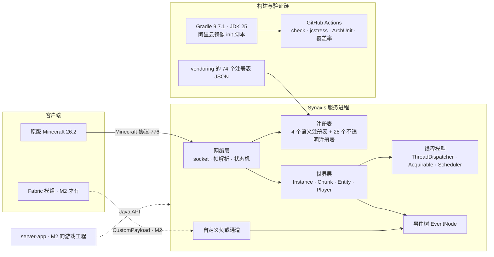
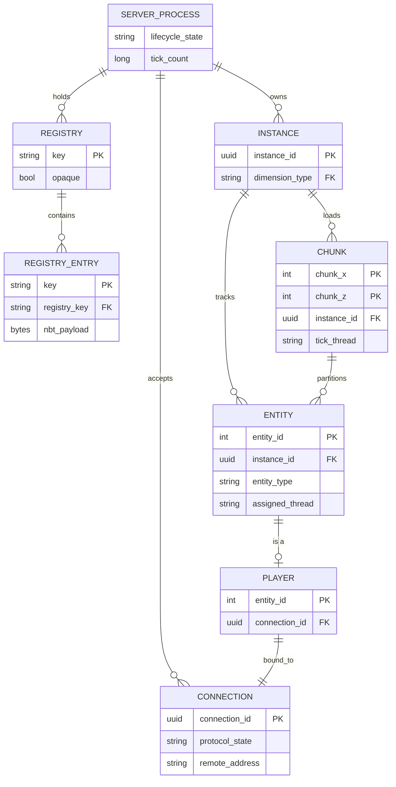
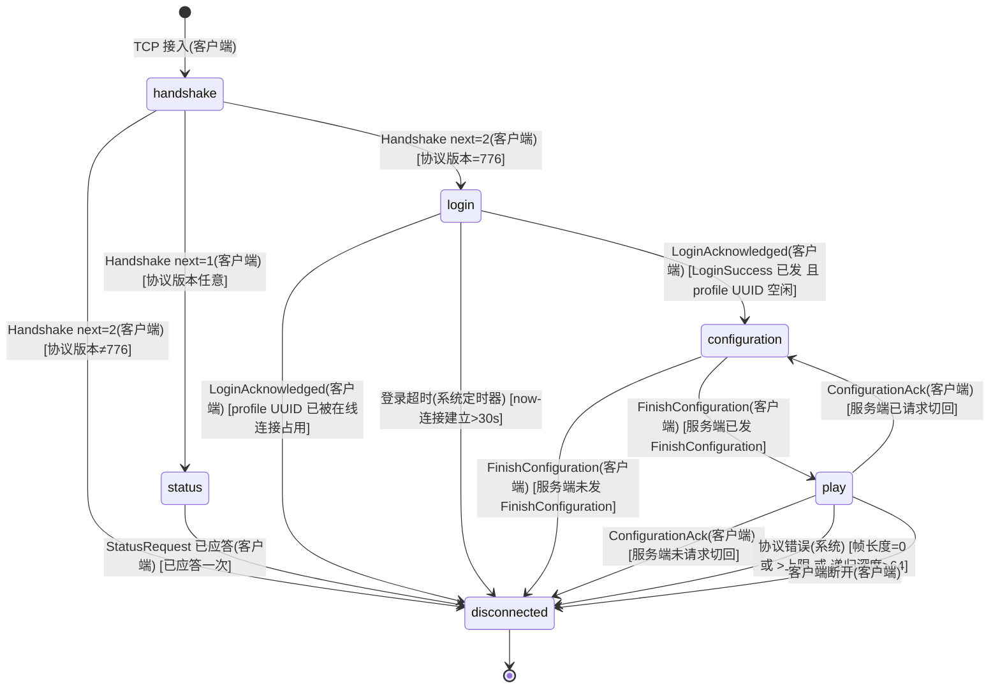
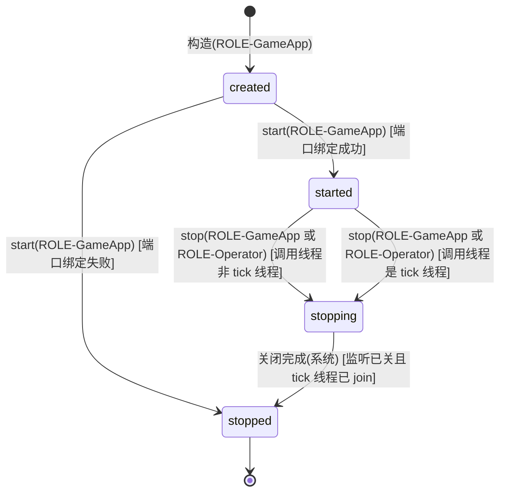
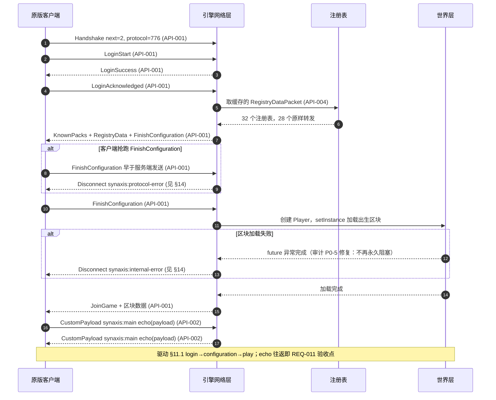

# Synaxis 设计文档 · 里程碑 M1「引擎独立化」

## 1. 元信息 / 变更记录

| 字段 | 值 |
| --- | --- |
| 状态 | 已批准并实施完毕（M1 与 M1.5 代码侧于 2026-09-09 完成，见 §26；仅剩 TC-012、TC-016 两条人工用例） |
| 项目画像 | 内部系统（引擎只被本团队的游戏工程消费，不对公网；§3/§20 降为按需，§23 简化为「直接放量 + 回滚预案」。游戏本身对外发布时另立设计文档，画像为生产产品） |
| Owner | Bearisbug |
| 评审人 | Bearisbug |
| 最后更新 | 2026-09-18 |
| 关联 | 仓库 `https://github.com/Bearisbug/synaxis` · **里程碑分册 `docs/DESIGN-M2.md`（M2「游戏工程骨架与 RTS 垂直切片」，M2 范围内的需求 / 接口 / 状态机 / ADR 一律以该分册为准）** · 审计与架构评审 `docs/research/minestom-audit/`（00 总结、07 架构评审第八章） · 测试文档 `docs/TEST.md` |

变更记录：

| 日期 | 版本 | 改动 | 作者 |
| --- | --- | --- | --- |
| 2026-09-18 | v0.30 | 客户端可驱动日志的清点范围由「引擎根模块」纠正为「全部模块的主源码」，口径改成一条能照抄复跑的命令；宿主 `:server-app` 上同形状的四处逐包日志（未注册频道的丢弃行、频道 handler 抛异常、插件事件监听器抛异常、台账写入失败）按引擎已有的形状限流，并由 `:server-app` 自己测试源集里的 `ClientDrivenLogArchitectureTest` 守同一条规则——引擎的 `ArchitectureTest` 拿不到别的模块的 classpath，一条规则守不了两个模块。§15 的「日志量」一行补上宿主那半边的门禁 | Bearisbug |
| 2026-09-18 | v0.29 | `ADR-007` 写死测试密度口径（含 `network` 排除 19 个 `package-info.java` 与 219 个纯 record 包定义后的逻辑文件分母），实测现状连同仍在 0.30 线下的 `command` / `utils` / `listener` / `adventure` / `world` 记进 §19：`event` 由 0.05 补到 0.32（新增 36 个测试文件），`network` 按逻辑文件为 1.09；拆分的前置条件按待拆类所在的 `entity`、`instance` 判，两者已过线。同批修两处事件树缺陷：`EventNode#setPriority` 在节点已挂载并派发过之后不失效父节点缓存，改后的优先级不生效；`addChild` 不拒绝把祖先（含节点自己）当孩子，直接把调用方打成 `StackOverflowError` 并在树上留下环。设计正文其余章节未动 | Bearisbug |
| 2026-09-18 | v0.28 | §15 的「入站包 50 玩家峰值 5,000 包/秒无丢包」由 2026-09-18 组 6 实测闭合（Java 发包端 `tools/loadtest/PacketFlood.java`，5,014.9 包/秒 / 6 分钟 / 0 掉线，发包窗口内 7,200 个 tick 的 p99 1.631 ms，超 50 ms 的只有 50 条连接同时进场的那个窗口首 tick；组 7 抬到 40,015 包/秒仍 0 掉线）。设计正文未动；§28 新增两条技术债：① §15 写的 500 包/秒速率闸没有实现，实际起作用的是 `playerPacketPerTick` 的排空能力 + 队列深度；② §14 的错误码信封之外，默认配置下客户端的包就能触发的纯文本断线还有七处（`SOAK-6` 按全部 30 个 `kick(...)` 调用点分档清点，本轮只追齐了填满包队列的那一条） | Bearisbug |
| 2026-09-18 | v0.27 | §15 新增非功能约束「日志量不由客户端决定」（客户端可驱动频率的 WARN/ERROR 必须有界），并由 `ArchitectureTest#clientDrivenPathsDoNotWriteALinePerPacket` 一条 ArchUnit 规则守住 `network..` 与 `listener..` 两个包树（`ExceptionManager#handleException` 一并算作写日志）；`PacketReading` 的「包未读完」按 10 秒限流并带区间累计次数；`PlayerSocketConnection` 派发一批包时遇到已断开的连接就 `break`，「紧跟断开」那一档才真的有界。§28 登记引擎根模块 27 处 WARN/ERROR/printStackTrace 的按频率归属扫描结论 | Bearisbug |
| 2026-09-18 | v0.26 | `SOAK-3` 修复（离线模式下同名玩家的重复 UUID）：§14 新增原因键 `synaxis:duplicate-login`，§11.1 的 login→configuration 守卫补上「profile UUID 未被在线连接占用」并新增 login→disconnected 一条转移；§28 登记一条「已决」 | Bearisbug |
| 2026-09-18 | v0.25 | `SOAK-1` / `SOAK-2` 修复：断线时释放 known-packs 等待，玩家进入生命周期集合改走与 `removePlayer` 同锁的 `trackPlayer`，§28 两条技术债转「已决」。§14 按实现更正——`connection_id` 只进服务端日志，不拼进断线文本（`docs/DESIGN-M2.md` §28.2 登记的那条文实不符随之关闭） | Bearisbug |
| 2026-09-18 | v0.24 | §28 新增两条技术债：2026-09-18 压测发现 `SOAK-1`——configuration 阶段被中断的连接，其虚拟线程与整个 `Player` 对象图滞留到 `knownPacksResponseTimeout`（默认 5 分钟，从最后一次连接起算）才回收，属 2026-09-15 审计 F02 未修完的那一半；`SOAK-2`——同一路径上约 1% 的连接留下永不回收的 `Player` | Bearisbug |
| 2026-09-09 | v0.1 | 初稿：里程碑 M1 范围、实体、协议契约、状态机、阶段计划 | Bearisbug |
| 2026-09-16 | v0.23 | §28 的四条审计残留全部转「已决」，由 `docs/DESIGN-M2.md` 的阶段 3 处置并在每条里注明去向：F29 残留（a）`SharedInstance` 整块删除（`REQ-M2-012`）、F29 残留（b）卸载区块时同步移除已下线玩家（`REQ-M2-013`）、F11 残留视距收缩的两半（`REQ-M2-014`）、F49 残留按「降级不修」处置（Javadoc + `:game-rts` 测试源集里的无条件 ArchUnit 规则，`REQ-M2-015`）。同批把 `InstanceContainer#copy()` 的内存警告写进该方法 Javadoc（登记在 M2 分册 §28.2，行为不变）。本文档其余章节未动——引擎侧契约没有变化 | Bearisbug |
| 2026-09-16 | v0.22 | §8 演进与弃用与 `ADR-007` 里的「唯一稳定面」由 `platform-api` 改称 `plugin-api`——M2 实际落地的稳定面模块是 `:plugin-api`（谁接 ABI 门谁就是稳定面），`platform-api` 这个模块名不会存在；这是 `docs/DESIGN-M2.md` `ADR-M2-005` 要求的显式决策改名 | Bearisbug |
| 2026-09-16 | v0.21 | 登记里程碑分册 `docs/DESIGN-M2.md`：§1「关联」行加分册指引，§26 里程碑表加 M2 一行并补「M2 起每个里程碑一份分册」的规则段 | Bearisbug |
| 2026-09-16 | v0.20 | 审计修复第二轮：F29、F49、F11 按用户拍板修复合入（§28 三条改为已决），并发表「非 tick 线程卸载区块」行随新契约更新；§28 新增四条修复员与审查员发现的同源残留 | Bearisbug |
| 2026-09-15 | v0.19 | 审计修复轮：2026-09-15 审计的 60 条发现修复 57 条并合入 main（台账 `docs/research/audit-2026-09-15/fixes.md`，RUN-014 全量通过）；§28 新增三条待拍板项（F29、F49、F11 剩余半边） | Bearisbug |
| 2026-09-15 | v0.18 | 项目定名 Synaxis：包名 `io.github.bearisbug.synaxis`、品牌 `synaxis`、系统属性键 `synaxis.*`、断线原因键与负载通道命名空间 `synaxis:`、仓库 `Bearisbug/synaxis`；§28 包名问题关闭 | Bearisbug |
| 2026-09-13 | v0.17 | REQ-017 完成；协议错误日志技术债关闭；`deep-recursion` 语义随创造包跳过而变 | Bearisbug |
| 2026-09-13 | v0.16 | §15 增加输入分配上限（移植上游 2026-09-12 的三个加固 PR）；REQ-017 | Bearisbug |
| 2026-09-09 | v0.15 | M1.5 全部完成（RUN-011）：命名残留清理，主源码 1,108 文件，2,576 测试；§1 状态更新 | Bearisbug |
| 2026-09-09 | v0.14 | REQ-015 合入；阶段 6 完成 | Bearisbug |
| 2026-09-09 | v0.13 | REQ-015 按实际交付改写（9 包底层集合、移出 6 包及理由、`JvmFlags` 豁免）；§24 规则描述同步 | Bearisbug |
| 2026-09-09 | v0.12 | REQ-014 完成；`PacketViewableUtils` 改为进程级（技术债关闭）；记录 JVM 级开关的归属决定 | Bearisbug |
| 2026-09-09 | v0.11 | REQ-013 完成；§28 记录门面改造的四处偏离；`CommandPacketFilteringTest` 技术债关闭 | Bearisbug |
| 2026-09-09 | v0.10 | §26 阶段 0～3 标记完成状态；M1 仅剩两条人工用例 | Bearisbug |
| 2026-09-09 | v0.9 | M1 gate（RUN-007）：代码侧全部通过；REQ-004 并发拦截场景措辞改为「回归单测或 jcstress」 | Bearisbug |
| 2026-09-09 | v0.8 | 阶段 3 完成：包名 `dev.gameengine`、品牌 `game-engine`、NOTICE / README / pom；文档路径同步 | Bearisbug |
| 2026-09-09 | v0.7 | 阶段 2 完成；主源码阈值改为 ≤ 1,150（REQ-008 把 49 个生成文件并入主源码后口径变化，等价手写 ≤ 1,100） | Bearisbug |
| 2026-09-09 | v0.6 | REQ-001 / REQ-007 按实测改写（黄金 NBT、精简形式基线、39 JSON + 23 NBT）；REQ-006 补 13 个协议枚举宿主类的处理 | Bearisbug |
| 2026-09-09 | v0.5 | 阶段 2 第一轮完成（REQ-005 波次 1 除注册表相关包、REQ-006、`demo` 删除）；补三条技术债 | Bearisbug |
| 2026-09-09 | v0.4 | REQ-009 补服务端品牌字符串；`net.minestom.data` 依赖已随 REQ-001 移除 | Bearisbug |
| 2026-09-09 | v0.3 | `monitoring` 改为保留；M1.5 按用户指示视为确认；vendoring 实测 74 个 JSON（由 freeze-data 同步） | Bearisbug |
| 2026-09-09 | v0.2 | 用户确认 M1；`snapshot` 纳入删除波次 1；`command` 保留至 M2 评估；包名改名后置为阶段 3 的一次性操作；新增 M1.5 草案 REQ-013～016 与 §26 阶段 4～6（待确认） | Bearisbug |
| 2026-09-09 | v0.2.1 | 更正注册表数据规模与落点：数据 jar 内 85 个条目里实际是 74 个 JSON，vendoring 路径确定为 `src/main/resources/data` | Bearisbug |

## 2. 背景 / 目标 / 非目标

- 背景：我们要做一款跑在 Minecraft 客户端上的自研游戏（小游戏 + MMORPG + 肉鸽），不要任何原版玩法，客户端强制安装我们的 Fabric 模组。服务端以 Minestom（Apache-2.0，commit `16842f1954`）为起点硬 fork，不再跟随上游。审计发现 15 条 P0 与 48 条 P1，已在分支 `fork/main` 修复并合入（133 个提交，187 文件）。当前代码仍带着 1,412 个文件的原版玩法逻辑、上游包名、上游数据生成链和一个 GitHub fork 关系，这些都不属于我们。
- 目标：在一个独立维护的仓库里得到一个**只含我们需要的部分、以我们的名字命名、构建与验证链完全自控**的引擎，并证明原版客户端仍能登录进世界、完成一次自定义协议往返。
- 非目标：
  - 不做任何游戏玩法、不做 Fabric 客户端模组、不做美术资源（属于下一里程碑 M2「RTS 垂直切片」）。
  - 不拆 `Entity` / `Player` / `Instance` / `InstanceContainer` 上帝类（测试密度不足 0.3 时拆分等于无安全网作业，见 `ADR-007`）。
  - 不改 `MinecraftServer` 静态门面、不改 `ServerFlag`（属于 M1 之后的阶段 4 与 5）。
  - 不做代理层、多机部署、经济、反作弊、基岩版。
  - 不升 Minecraft 版本。

规模画像：

| 维度 | 估算 | 依据 / 假设（未知则写假设 + 重估阈值） |
| --- | --- | --- |
| 用户量 | 引擎的直接用户是本团队 1 到 3 名开发者；引擎最终承载的游戏内测规模为同时在线 ≤ 50 人 | 用户于 2026-09-09 选定「内测规模，单机单区」；超过 50 同时在线需重估线程模型与是否上代理 |
| 请求量 | 每玩家每 tick 约 1 到 5 个入站包，50 人峰值约 5,000 包/秒；tick 频率 20 Hz | 原版协议经验值；超过 20,000 包/秒需重估网络线程数 |
| 数据量 | 注册表数据 74 个 JSON 解压 17.6 MB 随包 vendoring；世界数据由 M2 决定格式（预烘焙地图整块载入），M1 不落盘任何世界 | 数据量假设 ≤ 100 MB/张地图；超过需重估载入策略 |
| 分布与形态 | 单机单进程单区，无 CDN | 用户选定 |

## 3. 成功指标 / 验收阈值

N/A — 画像:内部系统，本里程碑无产品指标与埋点事件；工程验收阈值统一放在 §19 验收与 §26 里程碑退出条件，避免第二套口径。

## 4. 术语表 / 统一语言

| 术语 | 定义 | 代码/字段标识 | 对应实体 |
| --- | --- | --- | --- |
| 引擎 | 本仓库，由 Minestom 硬 fork 演化而来的服务端库，不含任何游戏规则 | `engine` | — |
| 服务进程 | 一个引擎实例：网络监听、tick 调度、注册表、事件树的持有者 | `ServerProcess` | `ENT-ServerProcess` |
| 连接 | 一个客户端 socket 及其协议状态 | `PlayerConnection` | `ENT-Connection` |
| 世界实例 | 一组区块与实体的容器，可有多个并存 | `Instance` | `ENT-Instance` |
| 区块 | 16×16 列的世界切片，实体的线程归属单位 | `Chunk` | `ENT-Chunk` |
| 实体 | 世界中有位置的对象，含玩家 | `Entity` | `ENT-Entity` |
| 玩家 | 绑定一个连接的实体 | `Player` | `ENT-Player` |
| 注册表 | 配置阶段全量下发给客户端的数据表，如维度类型、生物群系 | `DynamicRegistry` | `ENT-Registry` |
| 不透明注册表 | 服务端不解析语义、只按原样转发的注册表 | `OpaqueRegistry` | `ENT-Registry` |
| 自定义负载 | Minecraft 协议的 `CustomPayload` 包，我们的协议全部走它 | `PluginMessagePacket` / `ClientPluginMessagePacket` | — |
| 线程归属 | 实体或区块被分配到哪个 tick 线程；跨线程访问必须先获取所有权 | `Acquirable` | — |
| 删除波次 | 按依赖强度分批删除原版玩法子系统的批次 | — | — |

## 5. 功能清单与需求 ID

| ID | 功能 | 对应目标 | 优先级 |
| --- | --- | --- | --- |
| REQ-001 | 冻结：Minecraft 26.2（协议 776）、JDK 25、Gradle 9.7.1 钉死；注册表数据 74 个 JSON 从 `net.minestom:data:26.2-rv3` 解出 vendoring 进 `src/main/resources/data`，移除该外部依赖 | 构建链自控 | P0 |
| REQ-002 | 仓库独立：断开 GitHub fork 与 `upstream` 远程，推送到 `Bearisbug/synaxis`，保留完整 git 历史；删除旧 fork；本地目录改名 `synaxis` | 独立维护 | P0 |
| REQ-003 | 止血：审计 15 条 P0 与 48 条 P1 的修复合入主干，全量测试绿 | 可用基线 | P0（已完成） |
| REQ-004 | CI 门禁：`check`（Error Prone 96 项 `-Werror`、命名检查、禁止 import 检查）+ jcstress 并发场景 + ArchUnit 分层规则 + 新增行覆盖率门 | 防回退 | P0 |
| REQ-005 | 删除波次 1：21 个原版玩法子包共 157 文件约 12,660 行整包删除（寻路、AI、Anvil、batch、配方、进度、统计、对话、地图、ping、extras、计分板、调试、附魔、盔甲纹饰、乐器、书、弩、载具、`utils/nbt`、`snapshot`）；`monitoring` 保留，§21 的 tick 监控依赖它，替代品属 M2 | 只含需要的部分 | P0 |
| REQ-006 | 删除波次 2：`entity/metadata` 下 10 个原版生物子包共 181 文件 6,357 行删除，保留基类与 display / avatar / projectile / item 四组及 `ArmorStandMeta`、`InteractionMeta`；13 个仅作为物品组件 / 元数据槽位枚举宿主的 `*Meta` 类，把枚举抽到协议侧宿主后删壳（枚举同时定义 VarInt 序数与 NBT 名并参与 `ItemStack` 哈希，线格式不变） | 只含需要的部分 | P0 |
| REQ-007 | 不透明注册表：32 个注册表中仅 `dimensionType`、`biome`、`chatType`、`damageType` 保留服务端语义，其余 28 个降级为 `RegistryKey → BinaryTag` 原样转发（实现为「黄金 NBT」：删除类型前用原类型化 codec 编码一次固化为 `data/opaque/*.nbt`，JSON 直通因无法表达 NBT 数值类型被实测否决）；改造前后 `RegistryDataPacket` 字节序列逐字节相同（基线为客户端声明已有原版数据包时的精简形式，完整形式因 Adventure NBT compound 的 map 顺序按进程随机盐而天然不稳定，另以结构比对覆盖） | 协议行为不变 | P0 |
| REQ-008 | 生成链收编：`src/autogenerated` 26,126 行转为普通源码；删除 `code-generators` 与 `demo` 模块，同时新增最小启动器模块 `smoke`（一个 `main`：启动进程、一个平坦世界、注册 `synaxis:main` 的 echo 处理器）作为冒烟入口 | 构建链自控 | P1 |
| REQ-009 | 命名空间：`net.minestom.server` → 我们的包名（`io.github.bearisbug.synaxis`，见 §28），单独提交，`.git-blame-ignore-revs` 登记；GraalVM 可达性元数据单独处理；服务端品牌字符串（客户端 F3 显示）同步改为 `synaxis` | 以我们的名字命名 | P0 |
| REQ-010 | Apache-2.0 合规：`LICENSE` 原样保留；新建 `NOTICE` 声明派生自 Minestom 与起点 commit；README 顶部显著变更声明；pom 元数据换成我们的 | 合法分发 | P0 |
| REQ-011 | 冒烟：原版 26.2 客户端走完 login → configuration → play 进入世界，并通过自定义负载通道完成一次 echo 往返 | 证明仍可用 | P0 |
| REQ-012 | 运行手册：`docs/ENGINE.md` 写清 JDK、镜像脚本、分支策略、升版本 checklist；集成测试基类 teardown 清理 `$TMPDIR/minestom-test-world-*` | 冷启动可用 | P1 |
| REQ-013 | M1.5 · 静态门面实例化：`MinecraftServer` 静态访问（实测 142 调用点 / 56 文件）改为 `ServerProcess` 实例（`ServerProcess.of(auth)` 工厂，`Instance`/`Entity`/`PlayerConnection`/`CommandSender` 暴露 `process()`，`EventDispatcher` 删除）；`@EnvTest` 类级并行。已完成 | 可维护、可测 | P2 |
| REQ-014 | M1.5 · 配置对象：`ServerFlag`（实测 55 个开关）删除；37 个进程级开关进 `ServerConfig`（`process.config()`，系统属性键 `synaxis.*` 同默认值），10 个结构上 JVM 级的进 `JvmFlags` 并逐条注明原因，4 个归各自的包，4 个死开关删除；测试与生产同一份默认值（`ServerConfigTest` 断言 `defaults() == fromSystemProperties()`）。已完成 | 可维护 | P2 |
| REQ-015 | M1.5 · 分层：底层集合最终为 `codec、condition、coordinate、exception、gamedata、monitoring、thread、timer、utils` 9 个包，不得依赖集合之外的引擎包（实测起点 35 条边 260 条 import，终点 0）；`registry`、`color`、`component`、`crypto`、`sound`、`tag` 因各自声明 `NetworkBuffer.Type` 或直接产协议包而移出集合（理由在 `ArchitectureTest` javadoc）；`utils` 内 22 个错放类归位；ArchUnit 由「冻结」改为「禁止」，冻结存储删除；根包 `JvmFlags` 为唯一豁免；`tools/pkgdeps.py` 入库复核。已完成并合入 | 可读、可扩展 | P2 |
| REQ-017 | 上游加固移植：按可读字节限定集合预分配、不可信 NBT 解码限额与错误信息截断、非创造玩家跳过创造包解码、`DataComponentMap` 与注册表标签读取校验、`ArgumentNumber` 去 radix、依赖升级；协议错误改单行 WARN 日志。已完成（2026-09-13，+26 测试） | 抗恶意客户端 | P1 |
| REQ-016 | M1.5 · 拆 `NetworkBufferTypeImpl`（拆前 1,297 行）为按类型族分文件的实现，零 API 影响。已完成：枢纽剩 15 行，10 个 package-private 持有类 | 可读 | P3 |

## 6. 总体架构



## 7. 数据模型 / 领域实体



实体 ID：`ENT-ServerProcess`、`ENT-Connection`、`ENT-Registry`（含 `REGISTRY_ENTRY`）、`ENT-Instance`、`ENT-Chunk`、`ENT-Entity`、`ENT-Player`。字段完整定义见 §9。

## 8. 接口契约 (API-first)

本引擎没有 HTTP 接口。对外契约有两类：面向客户端的 Minecraft 二进制协议，面向游戏工程的 Java API。契约文件：协议以 Minecraft 26.2 协议 776 的公开规范为准（`https://minecraft.wiki/w/Java_Edition_protocol`），Java API 以模块 `engine` 导出的包为准。

- **`API-001` 原版协议会话** — 实现 `REQ-011`、`REQ-007`
  - 方法/路径：TCP 25565，帧格式 `VarInt 长度 + 包 ID + 负载`，压缩阈值 256 字节，握手后按 §11 连接状态机推进
  - 鉴权/权限：`ROLE-Client`，离线模式下按用户名，见 §10
  - 请求：客户端按协议 776 发送 Handshake、LoginStart、KnownPacks、FinishConfiguration 等
  - 响应：LoginSuccess、`RegistryDataPacket`（内容来自 `ENT-Registry`，不透明注册表原样转发）、FinishConfiguration、JoinGame
  - 分页/幂等/版本：协议版本固定 776，不支持其他版本，握手声明其他版本必须断线并给出 `synaxis:unsupported-version`（见 §14）
  - 缓存与超时：`RegistryDataPacket` 在进程内缓存一份，注册表冻结后不再变化；登录阶段总超时 30 秒（§15）
- **`API-002` 自定义负载通道** — 实现 `REQ-011`
  - 方法/路径：`CustomPayload` 包，通道标识 `synaxis:main`，负载为我们的二进制消息；M1 只定义一个 `echo` 消息：客户端发任意 ≤ 1,024 字节，服务端原样回发
  - 鉴权/权限：仅 `play` 状态的连接可用，其他状态收到即断线 `synaxis:protocol-error`
  - 请求/响应：见 §12 时序；消息编解码用引擎 `codec` 包，往返测试向量放 `src/test/resources/protocol/`
  - 幂等：`echo` 天然幂等；后续消息由 M2 的 `protocol` 模块定义
  - 缓存与超时：不缓存；单条负载超过 1,024 字节断线
- **`API-003` 服务进程生命周期 Java API** — 实现 `REQ-003`、`REQ-011`
  - 方法：`ServerProcess.start(address)`、`ServerProcess.stop()`、`ServerProcess.isAlive()`
  - 约束：`stop()` 必须可以从任意线程调用，包括 tick 线程，且必须在返回后保证监听关闭与线程 join（对应审计 P0 停服死锁，已修）
  - 错误：绑定失败抛 `IOException`，进程进入 `stopped`（§11）
- **`API-004` 注册表访问 Java API** — 实现 `REQ-007`
  - 方法：`Registries.dimensionType()` 等 4 个语义注册表返回类型化对象；`Registries.opaque(key)` 返回 `RegistryKey → BinaryTag`
  - 约束：注册表在 `start()` 后冻结，写入抛 `IllegalStateException`

演进与弃用：

- 版本方案：日期版本 `YYYY.MM.DD-26.2`（沿用上游格式，MC 版本后缀固定） · 当前：M1 完成时打 `2026.xx.xx-26.2`
- 弃用期：Java API 无外部消费者，M1 内允许直接破坏；M2 起 `plugin-api` 成为唯一稳定面，引擎内部 API 不承诺兼容
- 兼容承诺对象：仅本仓库内的游戏工程
- 当前 deprecated 清单：无

## 9. 数据字典

| 字段 | API 名 | DB 名 | 类型 | 必填 | 枚举/约束 | 单位/精度 | PII |
| --- | --- | --- | --- | --- | --- | --- | --- |
| 进程生命周期状态 | `lifecycle_state` | — | enum | 是 | created / started / stopping / stopped | — | 否 |
| tick 计数 | `tick_count` | — | long | 是 | ≥ 0，每 50 ms 加 1 | tick | 否 |
| 连接 ID | `connection_id` | — | uuid | 是 | 进程内唯一，用于日志关联（§14） | — | 否 |
| 协议状态 | `protocol_state` | — | enum | 是 | handshake / status / login / configuration / play / disconnected | — | 否 |
| 远端地址 | `remote_address` | — | string | 是 | IPv4/IPv6 加端口 | — | 是（日志脱敏到 /24） |
| 注册表键 | `key` | — | string | 是 | `minecraft:` 命名空间，26.2 共 32 个 | — | 否 |
| 是否不透明 | `opaque` | — | bool | 是 | 4 个语义注册表为 false，其余 28 个为 true | — | 否 |
| 注册表条目负载 | `nbt_payload` | — | bytes | 是 | NBT 二进制，原样来自 vendoring 的 JSON 转换 | — | 否 |
| 世界实例 ID | `instance_id` | — | uuid | 是 | 进程内唯一 | — | 否 |
| 维度类型 | `dimension_type` | — | string | 是 | 引用 `dimensionType` 注册表键 | — | 否 |
| 区块坐标 | `chunk_x` / `chunk_z` | — | int | 是 | 区块坐标，非方块坐标 | 区块 | 否 |
| tick 线程 | `tick_thread` / `assigned_thread` | — | string | 否 | `Ms-Tick-N`，未分配为 null | — | 否 |
| 实体 ID | `entity_id` | — | int | 是 | 进程内自增，协议要求 int | — | 否 |
| 实体类型 | `entity_type` | — | string | 是 | 引用 `entity_type` 注册表；M1 删除波次 2 后服务端只保留 display / avatar / projectile / item 四组元数据类型，其余类型仍可生成但无类型化元数据 | — | 否 |
| 断线原因码 | `disconnect_reason` | — | enum | 是 | 见 §14 错误码表 | — | 否 |

## 10. 权限与角色

| 角色 \ 操作 | `API-001` 协议会话 | `API-002` 自定义负载 | `API-003` 进程生命周期 | `API-004` 注册表访问 |
| --- | --- | --- | --- | --- |
| ROLE-Client（任意原版客户端） | ✓ | ✓（仅 play 状态） | ✗ | ✗ |
| ROLE-GameApp（我们的游戏工程，进程内 Java 调用） | ✗ | ✓（服务端侧发送） | ✓ | ✓ |
| ROLE-Operator（运维，通过 server-app 命令行） | ✗ | ✗ | ✓（stop） | ✗ |

行级可见性：不适用，M1 无按角色过滤的读接口。`API-001`/`API-002` 的「鉴权」是协议状态机守卫而非登录主体，已在矩阵中按状态标注。

## 11. 状态机

### 11.1 连接 `ENT-Connection`



迁移表：

| 源 → 目标 | 事件 | 守卫（纯布尔） | 动作（副作用） | 谁触发 | 接口/事件 |
| --- | --- | --- | --- | --- | --- |
| [*] → handshake | TCP 接入 | — | 分配 `connection_id`，记日志 | 客户端 | `API-001` |
| handshake → status | Handshake next=1 | 协议版本任意 | — | 客户端 | `API-001` |
| handshake → login | Handshake next=2 | 协议版本 = 776 | — | 客户端 | `API-001` |
| handshake → disconnected | Handshake next=2 | 协议版本 ≠ 776 | 发 LoginDisconnect `synaxis:unsupported-version` | 客户端 | `API-001` |
| status → disconnected | StatusRequest 已应答 | 已应答一次 | 第二次 StatusRequest 直接关闭（审计网络层修复） | 客户端 | `API-001` |
| login → configuration | LoginAcknowledged | LoginSuccess 已发 且 profile UUID 未被在线连接占用 | 创建 `ENT-Player` 并占用该 UUID，发 KnownPacks、`RegistryDataPacket` | 客户端 | `API-001` |
| login → disconnected | LoginAcknowledged | profile UUID 已被在线连接占用 | 断线 `synaxis:duplicate-login`，不创建 `ENT-Player`；被拒的是**后来者**，在线会话不受影响（离线模式下 UUID 由用户名派生，踢老的等于给了任何人顶掉别人的手段）。旧连接尚未清理时的重连同样被拒，客户端重试即可——僵死会话由 keep-alive 在 `keepAliveKick` 内清掉，占用窗口有界 | 客户端 | `API-001` |
| login → disconnected | 登录超时 | now − 连接建立 > 30 s | 关闭 socket | 系统定时器 | 内部任务 `connection.login-timeout`（无对外 API） |
| configuration → play | FinishConfiguration | 服务端已发 FinishConfiguration | 创建 `ENT-Player`，发 JoinGame，进入世界 | 客户端 | `API-001` |
| configuration → disconnected | FinishConfiguration | 服务端未发 FinishConfiguration | 断线 `synaxis:protocol-error`（审计网络层 P0-1 修复：抢跑不再 NPE） | 客户端 | `API-001` |
| play → configuration | ConfigurationAck | 服务端已请求切回 | 移除玩家实体，保留连接 | 客户端 | `API-001` |
| play → disconnected | ConfigurationAck | 服务端未请求切回 | 断线 `synaxis:protocol-error` | 客户端 | `API-001` |
| play → disconnected | 协议错误 | 帧长度 = 0 或 > 上限 或 递归深度 > 64 | 断线 `synaxis:protocol-error`，记 `connection_id` | 系统 | 内部任务 `connection.frame-guard`（无对外 API） |
| play → disconnected | 客户端断开 | — | 移除玩家实体，触发 `PlayerDisconnectEvent` | 客户端 | `API-001` |

### 11.2 服务进程 `ENT-ServerProcess`



迁移表：

| 源 → 目标 | 事件 | 守卫（纯布尔） | 动作（副作用） | 谁触发 | 接口/事件 |
| --- | --- | --- | --- | --- | --- |
| [*] → created | 构造 | — | 加载 vendoring 注册表，冻结 | ROLE-GameApp | `API-003` |
| created → started | start | 端口绑定成功 | 启动网络线程、tick 调度线程 | ROLE-GameApp | `API-003` |
| created → stopped | start | 端口绑定失败 | 抛 `IOException`，释放已建线程 | ROLE-GameApp | `API-003` |
| started → stopping | stop | 调用线程非 tick 线程 | 同步执行关闭序列 | ROLE-GameApp / ROLE-Operator | `API-003` |
| started → stopping | stop | 调用线程是 tick 线程 | 把关闭序列投递到非 tick 线程执行，本次调用立即返回（审计 P0-1 修复） | ROLE-GameApp / ROLE-Operator | `API-003` |
| stopping → stopped | 关闭完成 | 监听已关且 tick 线程已 join | 先执行 scheduler shutdown 任务，再踢玩家，最后 join 线程 | 系统 | 内部任务 `process.shutdown`（无对外 API） |

其余实体：`ENT-Instance`、`ENT-Chunk`、`ENT-Entity`、`ENT-Player`、`ENT-Registry` 的状态由他机翻转或为极简态（加载/卸载、注册/移除、冻结），免建理由：`ENT-Chunk` 的 loaded/unloaded 由 `Instance.loadChunk/unloadChunk` 单向驱动且无多步流程；`ENT-Entity` 的 spawned/removed 同理；`ENT-Player` 随 `ENT-Connection` 的 configuration→play 与 play→disconnected 翻转；`ENT-Registry` 创建即冻结无第二态。每个目标态的产生转移已在 11.1 迁移表的动作列核到。

## 12. 关键流程时序



## 13. 页面与跳转地图

N/A — 无前端。客户端 Fabric 模组与其界面属于 M2。

## 14. 错误处理与错误码

无 HTTP，不用 RFC 9457。统一错误信封是 Minecraft 协议的 `Disconnect` / `LoginDisconnect` 包，原因文本为 Adventure `Component`，其 `translate` 键即稳定错误码。排障关联 ID 就是 `connection_id`（§9），由网络层在 TCP 接入时生成，该连接的所有服务端日志行都带上它——**断线包本身不带**：`DisconnectReasons` 是纯 `TranslatableComponent`，`PlayerConnection#kick` 只把 `connection_id` 写进日志（`Kicking connection_id=… identifier=… reason=synaxis:…`）。用户报障时按时间与用户名在服务端日志里定位这串 id；要让玩家能直接读出它，需要 kick 时把它拼进 `Component`，那会改变每一次断线的可见文本，另行决定。

| 错误码（type） | 协议动作 | 语义 | 客户端处理约定 |
| --- | --- | --- | --- |
| `synaxis:unsupported-version` | LoginDisconnect | 协议版本 ≠ 776 | 提示安装指定版本 |
| `synaxis:protocol-error` | Disconnect | 帧格式非法、状态机非法推进、负载超限、递归超深 | 提示重连，重复出现提示报障（`connection_id` 在服务端日志里） |
| `synaxis:login-timeout` | 关闭 socket | 30 秒内未完成登录 | 提示重连 |
| `synaxis:duplicate-login` | Disconnect（configuration 阶段） | 该 profile UUID 已有在线连接（离线模式下 UUID 由用户名派生，同名即同 UUID） | 提示换个用户名；若是自己刚掉线后重连，稍候重试 |
| `synaxis:internal-error` | Disconnect | 服务端内部异常，如出生区块加载失败或实体注册被拒 | 提示重连并报障 |
| `synaxis:server-stopping` | Disconnect | 进程关闭 | 提示服务器已关闭 |

## 15. 非功能需求

| 维度 | 场景 | 目标 |
| --- | --- | --- |
| tick 预算 | 50 玩家同时在线，各自站在不同区块 | 单 tick 用时 P99 < 50 ms（追溯 §2 用户量 ≤ 50） |
| 登录延迟 | 单客户端从 TCP 接入到收到 JoinGame | < 2 s；登录总超时 30 s（§11.1） |
| 入站包 | 50 玩家峰值 | 5,000 包/秒无丢包（追溯 §2 请求量） |
| 内存 | 进程常驻，1 个世界实例 100 MB 地图 | 堆 < 2 GB（追溯 §2 数据量假设） |
| 限流 | 单连接 | 每秒 > 500 包或单包 > 2 MB 断线 `synaxis:protocol-error`；不做 429 类退避 |
| 输入分配上限 | 单个客户端包 | 客户端提供的 NBT 解码后估算堆占用 ≤ 2 MiB（`JvmFlags.NBT_MAX_BYTES`），集合与映射的预分配按可读字节数而非声明长度，注册表标签条目数 ≤ 注册表大小，创造模式背包包对非创造玩家不解码；超限断线 `synaxis:protocol-error`（学习上游 PR #3361/#3362/#3364） |
| 日志量 | 单个客户端持续发包 | 日志行数不由客户端决定：凡是频率由对端决定的 WARN / ERROR，必须按时间限流（行内带区间累计次数）、按类型去重，或紧跟一次**真的把这一批包停下来**的断开；网络栈 `network` 与客户端包监听器 `listener` 两个包树由 `ArchitectureTest#clientDrivenPathsDoNotWriteALinePerPacket` 守门（交给宿主的 `ExceptionManager#handleException` 同等对待——宿主决定落点，调用点决定频率），宿主的 `io.github.bearisbug.synaxis.app..` 由 `:server-app` 自己测试源集里的 `ClientDrivenLogArchitectureTest#hostPathsDoNotWriteALinePerPacket` 守同一条规则（一条规则守不了两个模块：ArchUnit 扫的是自己模块 classpath 上的类，引擎的测试源集里没有宿主的类），两边的豁免名单都逐条写明其上界。**这条约束的上界是「日志量正比于连接数，不正比于包数」**：每连接常数行是达标的，所以不断重连仍能把总量做上去（`PacketReading` 的限流计数器做成进程级而非每连接，就是因为每连接的额度照样随连接数放大），要挡的是连接数本身，不归这一行管 |
| 数据增长 | 12 个月 | M1 不落盘任何持久数据，无需清理；世界持久化由 M2 设计 |
| 构建 | 全量测试 | 本机 < 3 分钟，CI < 10 分钟 |
| 规模 | 主源码文件数 | 删除完成后 ≤ 1,150，其中含 REQ-008 并入的 49 个原生成文件，即手写源码 ≤ 1,100（起点 1,412 + 生成物 85 分置） |
| 兼容 | 客户端 | 仅原版 26.2；其他版本拒绝 |

## 16. 并发与一致性

| 竞态场景 | 参与方 | 期望结果 | 依据（约束/守卫） |
| --- | --- | --- | --- |
| tick 线程内调用 `stop()` | tick 线程 × `API-003` | 立即返回，关闭序列在另一线程完成，不死锁 | §11.2 守卫「调用线程是 tick 线程」；`ThreadDispatcher.shutdown` 不再持 monitor |
| 非 tick 线程卸载区块，区块内有实体 | 调用线程 × 实体所属 tick 线程 | 区块内有在线玩家时整个卸载被拒绝（`IllegalStateException`，状态零变更）；否则在实例监视器内清缓存、监视器外逐个实体通过 `Acquirable.sync` 获取所有权后移除 | `InstanceContainer.unloadChunk`（审计 F27、F29）；`assertOwnership` 在测试 JVM 强制开启 |
| 两个线程同时首次触发同一事件类型的监听器重建 | tick 线程 × 虚拟线程 | 只重建一次，之后不丢事件 | `EventNodeImpl.Handle` 缓存合并为一个 volatile 不可变记录 |
| 区块加载 future 异常完成时玩家 `setInstance().join()` | 加载线程 × 调用线程 | `join` 在 5 秒内抛出，不永久阻塞 | `whenComplete` 两条路径都 countDown |
| 同一客户端连续两次 StatusRequest | 客户端 × 网络线程 | 第二次直接关闭 | §11.1 守卫「已应答一次」 |
| 实体被移除的同时其 `setInstance` 续体到达 | tick 线程 × 加载线程 | 续体检查 `isRemoved()` 后放弃注册，无幽灵实体 | 审计实体层 P0-3 修复 |

一致性承诺：

- read-after-write：注册表在 `start()` 后冻结，任何线程读到同一份；实体状态只在其所属 tick 线程或持有 `Acquirable` 所有权时可写，其他线程读到的是上一个 tick 的快照。
- 异步投递：事件树同步分发；`AsyncEvent` 在虚拟线程上 at-most-once，监听器自行幂等。

## 17. 依赖与外部系统 / SLA

| 依赖 | 用途 | SLA | 超时/重试 | 失败影响 | 降级 |
| --- | --- | --- | --- | --- | --- |
| JDK 25（Homebrew `openjdk@25`） | 编译与运行 | 本机安装 | — | 无法构建 | 无；`docs/ENGINE.md` 写明安装 |
| Gradle 9.7.1 + 阿里云镜像 init 脚本 | 依赖解析 | 镜像可用性由阿里云保证 | Gradle 默认 3 次重试 | 无法构建 | 回退 Maven Central 直连（经本机代理，不稳） |
| Adventure 5.2、fastutil 8.5、JCTools 4.0 | 文本、集合、并发队列 | Maven Central 存量 | — | 无法构建 | 版本钉死在 `libs.versions.toml` |
| vendoring 的注册表数据（39 个 JSON + 23 个黄金 NBT） | 运行时注册表 | 随仓库 | — | 进程无法启动 | 无外部链，`REQ-001` 后不再依赖 `net.minestom:data` |
| GitHub `Bearisbug/synaxis` | 代码托管与 CI | GitHub SLA | — | CI 不跑 | 本地 `./gradlew check` 等价 |
| 原版 Minecraft 26.2 客户端 | 冒烟验收 | Mojang 分发 | — | 无法冒烟 | 钉死版本，启动器离线可用 |

内部后台任务：

| 任务 | 触发 | 批量/互斥 | 超时 | 失败策略 | 对应告警 |
| --- | --- | --- | --- | --- | --- |
| `tick`（`TickSchedulerThread`） | 每 50 ms | 单实例；各区块分区并行 | 单 tick > 50 ms 记入 `TickMonitor` | 跳过等待，下一 tick 补 | 见 `RB-001` |
| `connection.login-timeout` | 连接建立后 30 s 定时器 | 每连接一个 | — | 关闭 socket | 无 |
| `connection.frame-guard` | 每个入站帧 | 每连接串行 | — | 断线 `synaxis:protocol-error` | 高频出现见 `RB-003` |
| `process.shutdown` | `stop()` | 单实例，幂等（`stopped` CAS） | 10 s join 上限 | 超时记日志并强制退出 | 见 `RB-002` |

## 18. ADR 决策记录

- **`ADR-001` 硬 fork Minestom，不再跟随上游** — Status: Accepted
  - Context：Minestom 是唯一生产可用的从零实现的 Java 版服务端库，但上游 68 个 open bug 中 88% 半年无人回应，包结构 37 个包成环，我们的游戏不要原版玩法。
  - Decision：以 commit `16842f1954` 为起点硬 fork，独立仓库、独立包名、自控构建链；Minecraft 版本钉死。
  - Alternatives：跟随上游 rebase（每季度 drop 都要 rebase，且不能重排结构）；Paper 系（要先做减法）；Rust 实现（无一生产可用）。
  - Consequences：正——可以删、可以重排、可以改门面；负——升 MC 版本变成有预算的主动项目（§28 与 `docs/ENGINE.md` checklist）。
- **`ADR-002` Minecraft 版本钉死 26.2，客户端强制 Fabric 模组** — Status: Accepted
  - Context：客户端本来就要装我们的模组，版本由整合包钉死。
  - Decision：协议 776 唯一支持版本，其他版本握手即拒。
  - Alternatives：ViaVersion 多版本兼容（引擎要维护多套协议，且与自定义负载冲突）。
  - Consequences：玩家必须用指定版本；升版本走 checklist。
- **`ADR-003` 删除原版玩法子系统，注册表降级为不透明转发** — Status: Accepted
  - Context：1,412 个文件中 394 个是我们永远不用的原版玩法逻辑；32 个注册表中 28 个服务端不解析。
  - Decision：三条判据（协议必需、原版玩法、数据基础设施）决定删/留/降级；`RegistryDataPacket` 字节一致是删除的硬验收。
  - Alternatives：全部保留（读不懂、测不动、上帝类不缩小）；连协议层一起裁（客户端会拒绝握手）。
  - Consequences：主源码减 23%；寻路、AI、背包点击语义、Anvil 需要自研替代，但都在 M2 本来的计划里。
- **`ADR-004` 改名在删除之后、门面改造之前** — Status: Accepted
  - Context：改名触及 1,889 文件 11,127 处。
  - Decision：删完再改少 23% 白工；单独 commit 并登记 `.git-blame-ignore-revs`；门面改造是语义改动，不与改名混在一段历史里。
  - Alternatives：先改名（多改 394 个要删的文件）；不改名（暗示这还是 Minestom）。
  - Consequences：阶段 0 到 3 必须连续完成，中途停下会留下「删一半、名一半」的状态。
- **`ADR-005` 注册表数据 vendoring，删除生成器** — Status: Accepted
  - Context：`net.minestom:data` 是我们不控制的外部数据链；`code-generators` 会在下次运行时覆盖手工裁剪。
  - Decision：74 个 JSON 进 `src/main/resources/data`；`src/autogenerated` 转普通源码；删除 `code-generators`，需要时从历史复活。
  - Alternatives：保留生成器并改造 11 个生成器只输出保留部分（额外 3 到 5 人日）。
  - Consequences：升版本时的常量表更新变成三方合并，见 `docs/ENGINE.md`。
- **`ADR-006` 保留完整 git 历史，不压缩** — Status: Accepted
  - Context：用户 2026-09-09 选定。
  - Decision：断开 fork 关系但保留 6,400 多个上游提交。
  - Alternatives：压成一个初始提交（失去 blame）。
  - Consequences：仓库 410 MB；`git blame` 可追溯每行来历，配合 `.git-blame-ignore-revs` 跳过改名提交。
- **`ADR-007` M1 不拆上帝类、不改静态门面** — Status: Accepted
  - Context：M1 起点时 `entity` 包测试密度 0.12，`event` 0.03；删除只让 `Entity` 少 1 条 import。
  - Decision：先把待拆类所在的包补测试到密度 ≥ 0.3（M1 后阶段 7），再按需求驱动拆分；门面与配置改造排在阶段 4 与 5。
  - Alternatives：M1 一起做（无安全网作业，回归面极大）。
  - Consequences：M2 游戏工程通过 `plugin-api` 六个接口隔离引擎，不直接依赖上帝类。
  - 密度口径：同名包树下的测试源文件数 ÷ 主源码文件数（两边都含子包）。`network` 包另按**逻辑文件**计分母——从 282 个主源码文件里排除 19 个 `package-info.java` 与 `packet/client`、`packet/server` 下 219 个纯 record 的包定义，余下 44 个解码 / 编码 / 状态机 / 缓冲区文件才是分母。那 219 个里 212 个是注册表条目，`PacketWriteReadRegistriesTest` 遍历五个状态的全部注册表条目、某个包类缺测试实例就直接失败，逐个做字节往返；余下 7 个不进注册表——`ChunkData` / `LightData` / `PlayerSpawnInfo` / `WorldPos` 随宿主包被间接覆盖，`FramedPacket` / `BufferedPacket` / `LegacyServerListPingPacket` 没有覆盖，都是一到三行的平凡 record，把这 7 个算回分母也只是 48/51 = 0.94，不改变结论。各包实测密度见 §19。

## 19. 验收 / 测试

测试策略：单元与集成测试用 JUnit 5 加仓库 `testing` 模块的 `@EnvTest`；并发用 jcstress；分层用 ArchUnit；协议用真 socket 冒烟。全量 `./gradlew check` 是每次提交的回归范围，冒烟在阶段 2 与 3 结束时必跑。可执行用例与轮次台账见 `docs/TEST.md`。

测试密度现状（2026-09-18 实测，口径见 `ADR-007`，只列主源码 ≥ 15 个文件的 13 个包）：过 0.30 的有 `tag` 1.25（20/16）、`network` 1.09（48/44 逻辑文件；按 282 个文件的粗口径为 0.17）、`inventory` 0.75（18/24）、`instance` 0.70（57/81）、`entity` 0.61（62/102）、`item` 0.50（32/64）、`registry` 0.41（9/22）、`event` 0.32（42/130）；仍在线下的有 `command` 0.27（23/86）、`utils` 0.27（9/33）、`listener` 0.23（10/43）、`adventure` 0.11（4/37）、`world` 0.07（2/29）。`ADR-007` 的拆分前置条件只看待拆的 `Entity` / `Player` / `Instance` / `InstanceContainer` 所在的 `entity` 与 `instance` 两个包，两者都已过线；线下那五个包不拦拆分，但密度门在全引擎范围尚未达成。

```gherkin
场景: 依赖冻结后离线构建 (REQ-001)
  Given 仓库不含对 net.minestom:data 的依赖，src/main/resources/data 含 39 个注册表 JSON 与 opaque/ 下 23 个黄金 NBT
  When 断开外网只保留阿里云镜像执行 ./gradlew check
  Then 构建成功，且 module-info 不再 requires net.minestom.data

场景: 仓库独立 (REQ-002)
  Given 本地仓库远程只有 origin 指向 Bearisbug/synaxis
  When 查询 GitHub 仓库元数据
  Then isFork 为 false，旧仓库 Bearisbug/Minestom 不存在，且 git log 保留起点 commit 16842f1954

场景: 止血基线 (REQ-003)
  Given 分支 main 含审计修复
  When 执行 ./gradlew :test --rerun-tasks
  Then 0 失败 0 错误，且从 tick 线程调用 stop() 在 5 秒内返回

场景: CI 门禁拦截并发回归 (REQ-004)
  Given 一个故意重新引入 ThreadDispatcher.shutdown synchronized 的提交
  When CI 运行 jcstress 场景
  Then 流水线红：并发回归单测失败（如 ThreadDispatcherTest）或 jcstress 出现 FORBIDDEN

场景: CI 门禁拦截分层违规 (REQ-004)
  Given 一个在 coordinate 包里 import entity 包的提交
  When CI 运行 ArchUnit 规则
  Then 规则失败，流水线红

场景: 删除波次 1 与 2 后协议不变 (REQ-005, REQ-006, REQ-007)
  Given 删除前录制的 RegistryDataPacket 字节序列
  When 删除完成后启动进程并录制同一包
  Then 两段字节逐字节相同，主源码文件数 ≤ 1,100，./gradlew check 绿

场景: 不透明注册表拒绝写入 (REQ-007)
  Given 进程已 start()
  When 调用 Registries.opaque("minecraft:enchantment") 并尝试写入
  Then 抛出 IllegalStateException

场景: 生成链收编 (REQ-008)
  Given 仓库不含 code-generators 与 demo 模块
  When 执行 ./gradlew check
  Then 构建成功，且 src/autogenerated 目录不存在、其内容位于 src/main/java

场景: 命名空间改名 (REQ-009)
  Given 改名提交已合入且登记在 .git-blame-ignore-revs
  When grep -r "net.minestom" 排除 resources 与 net.minestom.data 引用
  Then 零命中，且 git blame 任意源码行不指向改名提交

场景: Apache-2.0 合规 (REQ-010)
  Given 仓库根目录
  When 检查 LICENSE、NOTICE、README
  Then LICENSE 与上游逐字节相同，NOTICE 含派生声明与起点 commit，README 顶部含显著变更声明

场景: 原版客户端登录与协议往返 (REQ-011)
  Given 进程监听 25565，原版 26.2 客户端
  When 客户端登录进入世界并通过 synaxis:main 发送 echo 负载 "ping"
  Then 客户端在 1 秒内收到 echo "ping"，服务端日志含该连接的 connection_id

场景: 抢跑 FinishConfiguration 被拒绝 (REQ-011)
  Given 一个处于 login 状态的裸 socket 客户端
  When 在服务端发送 FinishConfiguration 之前先发 FinishConfiguration
  Then 收到 Disconnect synaxis:protocol-error，服务端本 tick 其他玩家正常更新

场景: 非法协议版本被拒绝 (REQ-011)
  Given 握手声明协议版本 775
  When next=2 进入登录
  Then 收到 LoginDisconnect synaxis:unsupported-version

场景: 分配攻击被拒绝 (REQ-017)
  Given 一个已登录的裸 socket 客户端
  When 发送声明 65,535 个元素但只含 10 字节负载的集合包，或自定义数据组件里估算超过 2 MiB 的 NBT
  Then 收到 Disconnect synaxis:protocol-error，服务端堆没有按声明长度分配，日志为单行 WARN 带 connection_id

场景: 非创造玩家的创造包不被解码 (REQ-017)
  Given 一个生存模式玩家
  When 发送 ClientCreativeInventoryActionPacket
  Then 包被整体跳过，连接保持，后续 KeepAlive 正常

场景: M1.5 · 静态门面实例化后测试可并行 (REQ-013)
  Given 引擎源码中不再有 MinecraftServer 静态访问器
  When 开启 JUnit 并行执行运行全量测试
  Then 0 失败，且总耗时低于串行基线

场景: M1.5 · 配置对象取代全局开关 (REQ-014)
  Given 两个 ServerProcess 实例分别配置 dispatcher 线程数 1 与 2
  When 同一 JVM 内同时启动
  Then 各自按自己的线程数分区 tick，互不影响

场景: M1.5 · 底层包不依赖上层 (REQ-015)
  Given ArchUnit 分层规则由冻结改为禁止
  When 运行 ./gradlew check
  Then 规则通过，依赖矩阵脚本显示底层集合出向上层的边为 0

场景: M1.5 · 拆分 NetworkBufferTypeImpl (REQ-016)
  Given 拆分完成
  When 运行全部 network 包往返测试
  Then 0 失败，且 NetworkBufferTypeImpl 单文件不超过 300 行

场景: 测试不留临时目录 (REQ-012)
  Given 全量测试运行完毕
  When 列出 $TMPDIR 下 minestom-test-world-* 目录
  Then 数量为 0
```

## 20. 埋点 / 分析事件

N/A — 画像:内部系统，本里程碑无产品埋点；运行指标见 §21。

## 21. 可观测性 (SLI/SLO/告警)

| SLI | SLO | 告警阈值 | 对应 Runbook |
| --- | --- | --- | --- |
| tick 用时 P99（`TickMonitor`） | < 50 ms | 连续 60 s P99 > 50 ms | 见 `RB-001` |
| `stop()` 到进程退出用时 | < 10 s | 超过 10 s | 见 `RB-002` |
| `synaxis:protocol-error` 断线率 | < 1% 连接 | 5 分钟内 > 5% | 见 `RB-003` |

日志：每行携带 `connection_id`（有连接上下文时）与 tick 计数；错误码与 §14 一致。M1 只写标准输出与文件日志，不接外部监控。

## 22. 运维 Runbook

- **`RB-001` tick 超时**：影响 全服卡顿 · owner Bearisbug · 诊断 用 spark 或 JFR 采样 tick 线程，看 `TickMonitor` 报告的最慢 instance · 处置 降低在线人数或减少实例数 · 回滚 回退到上一 tag · 升级判据 连续 5 分钟 SLO 不达标即停服排查 · 恢复验证 P99 回到 50 ms 以内持续 10 分钟
- **`RB-002` 停服卡死**：影响 进程无法退出，需 kill -9 · owner Bearisbug · 诊断 `jstack` 看 `process.shutdown` 卡在哪个 join · 处置 kill -9，收集线程转储 · 回滚 回退到上一 tag · 升级判据 出现一次即视为 P0 回归 · 恢复验证 `stop()` 10 秒内返回
- **`RB-003` 协议错误断线激增**：影响 玩家被踢 · owner Bearisbug · 诊断 按 `connection_id` 聚合日志，区分单一恶意来源与全体客户端版本错配 · 处置 恶意来源加防火墙；版本错配核对整合包 · 回滚 N/A · 升级判据 5 分钟内 > 20% 连接 · 恢复验证 断线率回落到 1% 以下

## 23. 发布: Feature Flag / 灰度 / 回滚

内部系统，直接放量 + 回滚预案。无 feature flag：删除与改名是结构性变更，不能用开关控制，靠阶段 gate 与 tag 回滚。

| 环 | 放量 | 进入门槛 | 回滚动作 |
| --- | --- | --- | --- |
| 阶段 gate | 每阶段一个 tag | `./gradlew check` 绿 + 该阶段 ArchUnit 规则绿 + 冒烟（阶段 2、3） | `git checkout` 上一阶段 tag |

上线前检查单（M1 完成时填写）：

| 检查项 | 状态（过 / N-A + 证据） |
| --- | --- |
| 验收用例全量通过（见 §19 与 `docs/TEST.md` 轮次） | 待填 |
| 告警 ↔ Runbook 双向就绪 | 待填：M1 只有日志，`RB-*` 以人工检查代替告警 |
| 容量/负载按 §15 验证 | 待填：50 连接压测 |
| 回滚演练 | 待填：`git checkout` 上一 tag 后 `./gradlew check` 绿 |
| 用户文档/帮助中心已同步 | N-A：对玩家不可见；开发者文档 `docs/ENGINE.md` 为 REQ-012 验收项 |

## 24. 契约同步与防漂移机制

- 协议层：`network/packet` 每个包的 write→read 往返测试（上游已有 232 个）继续作为门禁；`RegistryDataPacket` 字节对比测试固化为集成测试，录制样本入库 `src/test/resources/protocol/registry-data-26.2.bin`。
- 分层：ArchUnit 规则入仓：底层 9 包不得依赖集合之外的引擎包（严格规则，无冻结存储）；`engine` 不得依赖 `game`（M2 生效）。`tools/pkgdeps.py` 输出依赖矩阵与「底层出向上层边数」，进 CI 前先在 gate 里人工跑。
- 自定义负载：M1 只有 `echo`，编解码测试向量入库；M2 的 `protocol` 模块同一份向量两端各跑一遍。
- 文档：本文档与 `docs/TEST.md` 按 `CLAUDE.md` 功能开发纪律随代码同步。

## 25. 迁移 / 数据回填

N/A — 无 schema 变更，M1 不落盘任何持久数据。

## 26. 里程碑

| 阶段 | 内容 | 退出条件 | 预估 |
| --- | --- | --- | --- |
| 0 冻结与独立 | REQ-001、REQ-002、REQ-004、REQ-012 | 独立仓库 CI 绿，基线测试数与耗时记录在 `docs/TEST.md` | 已完成（RUN-004） |
| 1 止血 | REQ-003 | 已完成：133 个提交合入，2,659 个测试 0 失败 | 已完成 |
| 2 删除 | REQ-005、REQ-006、REQ-007、REQ-008 | 字节对比通过，主源码 ≤ 1,150 文件（含 49 个并入的原生成文件），冒烟通过 | 已完成（RUN-006，主源码 1,116） |
| 3 改名与合规 | REQ-009、REQ-010、REQ-011 | grep 零命中，NOTICE 就位，原版客户端冒烟与 echo 往返通过 | 代码侧完成（RUN-007/008）；待人工 TC-012、TC-016 |
| 4 门面（M1.5） | REQ-013 | 测试并行开启后全量绿且总耗时下降 | 已完成（串行 30.1 s → 并行 20 s） |
| 5 配置（M1.5） | REQ-014 | `DISPATCHER_THREADS=2` 下全量绿 | 已完成（2,576 测试，线程数 2 全绿两次后恢复默认 1） |
| 6 分层（M1.5） | REQ-015、REQ-016 | ArchUnit 禁止规则绿，依赖矩阵底层出向上层边为 0 | 已完成（2,576 测试；`pkgdeps.py` 底层出向上层边 0） |
| M2 游戏工程与 RTS 垂直切片 | 见 **`docs/DESIGN-M2.md`**（独立分册） | 见该分册 §26 | 见该分册 §26 |

阶段 0 到 3 必须连续完成（`ADR-004`）。阶段 2 的删除必须在阶段 1 的实体层与 instance 层修复合入之后开始，否则复现测试会随被删代码丢失。

本文档只覆盖 M1 与 M1.5。**M2 起，每个里程碑一份分册**：M2 的需求、接口契约、状态机、ADR、里程碑与风险全在 `docs/DESIGN-M2.md`，本文档只在被它引用时作为引擎侧的背景事实源；改 M2 范围内的东西要改分册，不要改本文档。

## 27. 上线后度量与复盘

N/A — M1 尚未完成；完成后按 §26 退出条件逐项对照并记录实际人日与偏差。

## 28. 风险与开放问题

| 类型 | 描述 | 负责人 | 何时需拍板 |
| --- | --- | --- | --- |
| 技术债 | §15 的限流那一行写「单连接每秒 > 500 包断线」，**实现里没有任何按秒计数的速率闸**（2026-09-18 组 6 / 组 7 实测：一条连接 600 包/秒连发 60 秒、50 条连接各 800 包/秒连发 90 秒，一条都不掉）。真正起作用的是队列排空能力——`Player#interpretPacketQueue` 每 tick 至多取 `playerPacketPerTick`（默认 50，20 TPS 即 1,000 包/秒），超过它 `playerPacketQueueSize`（默认 1000，数组队列实际容量取到 1024）才会满、才以 `synaxis:protocol-error` 断开。文档写的是速率闸、实现是排空能力 + 队列深度：数不同（500 vs ~1,000），语义也不同（速率闸挡持续超速，队列只挡超过排空速度的那部分，999 包/秒可以长期跑满）。定 500 还是 1,000、要不要在热路径上每包加一次计数、超限踢还是丢，是三个设计决定 | Bearisbug | 定 `playerPacketPerTick` / `playerPacketQueueSize` 默认值时一并定 |
| 技术债 | §14 写明「原因文本为 Adventure `Component`，其 `translate` 键即稳定错误码」，但**默认配置下客户端的包就能触发的纯文本断线还有七处**（2026-09-18 `SOAK-6` 清点，口径是把 `grep -rn 'kick(' src/main/java` 的 30 个调用点逐个分档，不是抽样）：`KeepAliveListener:16`（`Bad Keep Alive packet`，一个 id 对不上的 KeepAlive 就够）、`PlayerPositionListener:61`（`You moved too far away!`，位置包带 NaN 或越界坐标）与共用同一常量的 `PlayerVehicleListener:22`、`LoginListener:48`（`Malformed username!`）、`LoginListener:124`（`Error during login!`，一个服务端从没请求过的登录插件应答就够，`PreAuthConnectionIntegrationTest#aKickStopsTheRestOfTheBatchFromBeingHandled` 每轮都在走这条路）、`ConnectionManager:484`（`Timeout`，停止应答 KeepAlive 超过 `keepAliveKick`，是真实环境里最常见的一种断线）、`Player:1566`（`Required resource pack was not loaded.`）。其余调用点的分档：入口是客户端包但要先有一次服务端内部失败的 2 处（`LoginListener:149 / 198`，同一个 `ERROR_DURING_LOGIN`）；只在代理转发配置或宿主自己发过登录插件请求时够得着的 5 处（`LoginListener:100 / 110 / 83`、`ConnectionManager:237`、`HandshakeListener:152`，其中 `LoginListener:83` 因 `ServerProcessImpl#auth` 是 `final` 实际是条不可达分支）；客户端够不着的 3 处（`Player:654`，以及 `kick(Component)` / `kick(String)` 两个公开 API 本身）；带原版 `translate` 键而非 §14 错误码的 2 处（`Player:2362` 的 `multiplayer.disconnect.invalid_packet`、`HandshakeListener:57` 的 `multiplayer.disconnect.transfers_disabled`）；已经用 `DisconnectReasons` 的 11 处。7 + 2 + 5 + 3 + 2 + 11 = 30。又因为 `PlayerConnection#kick` 只对 `TranslatableComponent` 写 `Kicking connection_id=…`，上面这些纯文本断线在服务端一行日志都不留，排障时连计数都拿不到。本轮只把压测直接打到的那一条（填满包队列）追齐成 `synaxis:protocol-error`；其余要么复用 `synaxis:protocol-error`、要么往 §14 的原因键表里加行（资源包、用户名格式、keep-alive 超时、代理握手各一个语义），是设计决定 | Bearisbug | 扩 §14 原因键表时一并定 |
| 已决 | `SOAK-3` 的同形状路径清点（2026-09-18，**只覆盖引擎根模块**，其余模块见下一条）：`SOAK-3` 证明的是「只要有一条每包一行的日志，客户端就能决定日志有多大」，所以按「这条日志的频率由谁决定」扫了引擎根模块 `src/main/java` 的 27 个报告点（口径：`grep -rn -e 'LOGGER\.warn(' -e 'LOGGER\.error(' -e 'logger\.warn(' -e 'logger\.error(' -e 'printStackTrace' src/main/java` 在本轮 HEAD 上输出 28 行，减去 `ExceptionManager.java:50` 那行——它是把 `Throwable::printStackTrace` 装成默认落点的方法引用，不是一次报告——即 27 个调用点；写成多个 `-e` 而不是 `-E` 的正则分支，是因为分支符在 Markdown 表格里会把这一格切开，照抄下来反而跑不通）。分档结论——**① 逐包由客户端决定**：2 处，`EntityTrackerImpl` 的「移动未注册实体」（已随 `SOAK-3` 修）与 `PacketReading` 的「包未读完」（本轮修：同样按 10 秒限流、行内带区间累计次数；计数器是进程级而非每连接，因为它是拿不到连接的静态解码器，而每连接的额度仍会随连接数放大）；**② 每连接至多一行、同一分支紧跟断开**：5 处（`PlayerSocketConnection` 协议错误、`HandshakeListener` BungeeGuard、`LoginListener` 登录插件应答、`ConnectionManager` 的 known-packs 超时与 spawn 失败）——这一档成立的前提是那次断开**真的把活停下来**：一次读上来的是一整批包（默认读缓冲 16,383 字节、最小帧 4 字节 ⇒ 一批约 4,000 帧），所以 `PlayerSocketConnection#processPackets` 在派发每个包之前先看连接还在不在、不在就 `break`。没有这一下，kick 只是排了一个断开包，同批剩下的帧照样逐个进监听器，②「每连接一行」就退化成「每包一行」（实测：一条连接发 3,000 个最小登录插件应答 ⇒ 2,994 行 `Error handling Login Plugin Response`、日志 5.8 MB）；**③ 按类型去重一次**：1 处（`PacketListenerManager` 的「无默认监听器」，客户端加不了包类型）；**④ 由启动 / 注册表数据决定**：10 处，进程生命周期内次数固定；**⑤ 交给宿主 `ExceptionHandler`**：4 处（`ExceptionManager`、`EventNodeImpl`、`TickThread`、`Entity`，引擎默认 `printStackTrace`）——**宿主只决定这份报告落到哪里，写多少次仍由调用点决定**，所以 `ExceptionManager#handleException` 与 WARN / ERROR 同等对待，一并进门禁的禁止目标；**⑥ 由服务端代码决定、客户端够不着**：4 处；**⑦ 客户端够得着但未设门**：1 处，见下一条。⑥ 里点名复核过 `InstanceContainer` / `DynamicChunk` 的 `tried to set a block outside the world bounds`：客户端两条入口都在到达它之前就挡住了——`BlockPlacementListener` 在 `placeBlock` 之前显式判 `placementPosition.y()` 是否在 `[minY, maxY)`，`InstanceContainer#breakBlock` 对越界 y 拿到的是 `Chunk#getBlock` 返回的 `Block.AIR` 并在 `block.air()` 处返回，`executeNeighboursBlockPlacementRule` 也先判 `neighborY`；同理 `TagNbtSeparator` 的 `printStackTrace` 只在 `TagHandler.fromCompound` 之下，而该路径按 F49 残留的处置已不接客户端 NBT。纪律本身做成门禁：`ArchitectureTest#clientDrivenPathsDoNotWriteALinePerPacket` 禁止 `network..` / `listener..` 两个包树调用 `Logger#warn` / `Logger#error` / `Throwable#printStackTrace` / `ExceptionManager#handleException`，豁免名单是七个类（`PacketReading`、`PlayerSocketConnection`、`Server`、`ConnectionManager`、`PacketListenerManager`、`HandshakeListener`、`LoginListener`）且逐条写明其上界；规则会不会真的红由两个 fixture 反证——`theClientDrivenLogRuleRejectsALinePerPacket`（逐包 WARN）与 `theClientDrivenLogRuleRejectsAReportPerPacket`（逐包交给宿主，fixture 就放在 `network` 包本身，一并反证包清单覆盖整棵网络栈）。**已知盲点**三个：① 豁免是按类而非按调用点，这七个类里再加一条无界的行不会红；② 包清单只到 `network..` / `listener..`，而 PLAY 态的包并不在这两棵树里派发——`PlayerSocketConnection` 只内联派发 `IMMEDIATE_PROCESS_PACKETS` 那 11 个握手 / 登录 / 配置期的包，其余一律进 `Player#addPacketToQueue`，由 `entity` 包的 `Player#interpretPacketQueue` 每 tick 取 `playerPacketPerTick` 个交给监听器，`entity..` 不在清单里（实测：在 `Player#addPacketToQueue` 插一行 `LOGGER.warn` 仍然全绿），所以这条规则守住的是「谁写」而不是「哪条路径」；③ 它只看引擎根模块的类——`ArchitectureTest` 扫的是自己模块 classpath 上的包，别的模块的类根本不在里面，所以这条规则对 `:server-app` / `:game-rts` 完全失明，见下一条 | Bearisbug | 已于 2026-09-18 处置，回归用例 `PacketReadingUnreadBytesTest`、`PreAuthConnectionIntegrationTest`、`ArchitectureTest` |
| 已决 | 清点范围纠正（引擎根模块 → 全部模块的主源码）与宿主侧的四处处置（2026-09-18）：上一条的 27 处**只是引擎根模块一个模块的数字**，扫描没有进别的模块，而宿主 `:server-app` 坐在同一条客户端可达路径上——`PluginChannelRouter.attach(hostNode)` 在 `PluginHost` 构造函数里无条件执行，引擎的 `listener/common/PluginMessageListener` 对**每个** `ClientPluginMessagePacket` 无条件 fire `PlayerPluginMessageEvent`，而该包的 channel 是客户端给的任意 ≤ 256 字符串，于是一个进了 PLAY 的客户端循环发 `ClientPluginMessagePacket("x:y", 空负载)` 就是一包一行，上界只有 §15 那条「单连接 500 包/秒」（而它本身没有实现，见本节第一条技术债）。**逐模块重扫**（口径同上一条，把路径换成各模块的主源码）：引擎根模块 28 行 − 1 = **27**、`server-app` **15**、`game-rts` **2**、`protocol` / `plugin-api` / `testing` / `example-plugin` 各 **0**，合计 **44** 个报告点（`settings.gradle.kts` 里还有 `jmh-benchmarks` 与 `jcstress-tests` 两个模块，它们**没有主源码**——命中全在 `src/jmh` 与 `src/jcstress` 下，共 8 处 `printStackTrace`，都只在基准与并发压测里跑，不计入运行期报告点）。`server-app` 那 15 处的分档——**① 逐包由客户端决定**：4 处，全部本轮修，`PluginChannelRouter` 的「丢弃未注册频道的负载」与「频道 handler 抛异常」（带栈）、`PluginEventsImpl` 的「插件事件监听器抛异常」（带栈）、`EventLedger` 的「台账写不进去」（带栈）——最后这处的频率不是宿主定的：`PluginHost` 把 `ledger::record` 当作 `PluginAnalytics` 能力交给每个插件，而 `DESIGN-M2` §20 要求逐条指令记 `EVT:unit_order_issued` / `unit_order_rejected` / `unit_selected` / `unit_order_superseded`，即每个 `C2S_ORDER` / `C2S_SELECT` 包一次 `record`，`logs/` 不可写或磁盘满时就是一包一行带栈（上界只有 `DESIGN-M2` §14 那条 300 包/秒的洪水闸门）；**② 每连接至多一行**：2 处（`AdmissionGate` 的准入回调抛异常，同分支断开；与超预算的 WARN）；**④ 由启动 / 停机 / 插件启用决定**：9 处（`Main` 5、`PluginHost` 4）；**由插件排了什么任务决定**：1 处（`PluginSchedulerImpl`，一次失败的任务运行一行；周期与任务条数都由插件在 `scheduleTask` 时定，客户端发包本身加不了任务——插件若在收包路径上给每个包排一个一次性任务，无界的就是插件自己排的那些任务，不是这一行）。`game-rts` 的 2 处都在 `Match`，一次对局创建 / 结束各至多一行。**修法与取舍**：四处改为经 `LogBudget` 输出，形状照抄引擎已有的两处（`PacketReading#reportUnreadBytes` / `EntityTrackerImpl#reportUnregisteredMove`：10 秒一条、行内带区间累计次数），所以 grep 里这 4 处现在表现为 `LogBudget` 自己的 3 行（`warn` 两个重载 + `error`），`server-app` 的 15 与合计 44 因此不变。带栈的那三处不能靠限流把「插件真的坏了」吞掉，所以预算的粒度按**宿主注册过什么**切、而不是按客户端发了什么切：每个频道注册一份、每个事件监听器一份（数量由插件决定），客户端唯一能相乘的那一维（它自己编的 channel id）共用一份；台账那处整份文件共用一份（目录不可写是关于文件的一个事实，与谁在写无关）。一个区间里第一条报告保留完整的栈，同区间的其余次数只进计数，由**下一次触发**写出的那一行报出来——洪水停在区间中途时积压的计数就留在计数器里等下一次触发（`LogBudgetTest` 第一条把这个行为钉住：洪水后 `suppressed` 停在 10,000，要再来一次才报 10,001），丢的是重复栈，不是「有插件在抛异常」这件事。**宿主门禁**：`:server-app` 测试源集新增 `ClientDrivenLogArchitectureTest`，规则与引擎那条同形（禁止 `io.github.bearisbug.synaxis.app..` 调用 `Logger#warn` / `Logger#error` / `Throwable#printStackTrace` / `ExceptionManager#handleException`），豁免名单是 `LogBudget`、`Main`、`PluginHost`、`AdmissionGate`、`PluginSchedulerImpl` 五个类且逐条写明上界；`PluginChannelRouter`、`PluginEventsImpl` 与 `EventLedger` **不进**豁免名单——它们经 `LogBudget` 输出，于是引擎那条规则的盲点 ①（豁免按类，同一个类里再加一行不会红）在宿主这边不成立。有齿的证据：临时在 `PluginChannelRouter#route` 插一行无节制的 `LOGGER.warn`，`hostPathsDoNotWriteALinePerPacket` 变红并点名 `PluginChannelRouter.route(…) calls method <org.slf4j.Logger.warn(java.lang.String, java.lang.Object)>`（消息尾部的 `in (PluginChannelRouter.java:N)` 是插入行的行号，随文件变动，不作判据）；在 `EventLedger#record` 的 `catch` 里并排插一行直写的 `LOGGER.warn` 同样变红并点名 `EventLedger.record(…)`；两次撤销后都复绿；常驻反证是 `theHostLogRuleRejectsALinePerPayload`（测试源集里的 `UnboundedHostLogFixture`）。**剩余盲点**：`:game-rts` 没有这条门禁（它那 2 处都不由客户端驱动，且本轮范围不含给游戏侧加东西），再有新模块要自己加一份——一条 ArchUnit 规则只守得住它自己模块 classpath 上的类 | Bearisbug | 已于 2026-09-18 处置，回归用例 `PluginPayloadLogBudgetIntegrationTest`、`LogBudgetTest`、`EventLedgerTest`、`ClientDrivenLogArchitectureTest` |
| 技术债 | `CommandParserImpl` 执行命令抛异常时每次写一行带栈的 ERROR，频率由「客户端发多少条命令 × 该命令是否必抛」决定，是上一条 ⑦ 档的那一处；没有一并处理是因为引擎自带的命令都不抛，要触发得由游戏侧注册一个必抛的命令，且限流会改变命令错误上报的语义（调试时要的就是每次一条）。`command` 包因此没有进 `ArchitectureTest` 的客户端可驱动包清单 | Bearisbug | M2 评估 `command` 包去留时一并定 |
| 技术债 | 「监听器抛了异常就每包交一次 `ExceptionManager#handleException`」（引擎默认落点是 `printStackTrace`）在**两条派发路径上各有一处**，两处都只有 `rejectMisusedPacket` 才在同一分支断开，而它默认是关的：默认配置下一个能让某个监听器必抛的包，客户端发多少次就上报多少次。① `PlayerSocketConnection#processPackets`，管 `IMMEDIATE_PROCESS_PACKETS` 里那 11 个握手 / 登录 / 配置期的包；② `Player#interpretPacketQueue`，管其余**全部 PLAY 态的包**，即主路径——它每 tick 至多取 `playerPacketPerTick` 个（默认 50），频率仍由客户端决定，且 `suppressMisusedPacketErrorLevel` 默认 0 只压住 HANDSHAKE 态，PLAY 态照报。本轮没改默认值，也没给它限流——引擎自带的监听器里客户端够得着的那几条都自己 catch（`LoginListener` 三处、`PacketListenerManager` 一处），要触发得先有一个会把异常抛出监听器的实现；而限流会吞掉宿主要的那份异常。门禁对两处都不设防：①（`PlayerSocketConnection`）在豁免名单里，②（`Player`）连包清单都没覆盖到（`entity..` 不在 `network..` / `listener..` 里），见上一条的盲点 ②；两处都写在 `boundedReporters()` 的 Javadoc 与 `docs/ENGINE.md` §8 的盲点清单里 | Bearisbug | 定 `rejectMisusedPacket` 默认值时一并定 |
| 已决 | 压测 `SOAK-3`（2026-09-18，NFR 级复测）：离线模式下 UUID 由用户名派生，两个压测进程用同一批用户名 ⇒ 第二批玩家带着**已在线的 UUID** 走完登录与 configuration 进 play，`EntityTrackerImpl.register` 抛 `IllegalStateException`，异常被 `Entity#setInstance` 续体的 `catch` 吞掉，于是玩家「在世界里、连接活着、不在追踪器里」，此后每个移动包写一行 `Attempted to move unregistered entity`（实测 15 分钟 662,803 行 / 84 MiB）。**这是 2026-09-15 审计 F59 的 notes 里点名「不在本批次范围、未处理」的那一条**（「离线模式下 `LoginListener` 直接采信客户端 `profileId`、`ConnectionManager` 无重复 UUID 拒绝」）。处置是三层：① `ConnectionManager#createPlayer` 与 `removePlayer` 同锁地占用 / 释放 profile UUID，占用失败返回 `null`，`LoginListener` 以新原因键 `synaxis:duplicate-login` 拒掉**后来的**那条连接（§11.1、§14）；② 注册失败不再被吞——续体抛 `CompletionException`，`Player#spawnPlayer` 与 `Player#setInstance` 把它交回 future，`updateWaitingPlayers` 既有的 `exceptionally` 以 `synaxis:internal-error` 断开该连接，对**任何**注册失败成立；③ `EntityTrackerImpl` 的「移动未注册实体」改为每 10 秒最多一行、行内带区间内累计次数，日志量与客户端包速率脱钩 | Bearisbug | 已于 2026-09-18 修复，回归用例 `DuplicateUuidLoginIntegrationTest`、`FailedSpawnRegistrationIntegrationTest`、`EntityTrackerUnregisteredMoveTest` |
| 已决 | 审计 F29：`Instance#unloadChunk` 对区块内有在线玩家的调用抛 `IllegalStateException` 且不做任何卸载动作，与 `InstanceManager.unregisterInstance` 对称；Javadoc 与 `UnloadChunkIntegrationTest` 已随之更新 | Bearisbug | 已于 2026-09-16 决定并实施 |
| 已决 | 审计 F49：客户端 NBT 不进 tag 系统。`CustomData` / `TypedCustomData` 的 getTag / withTag 经内部 `TagNbtAccess` 直接对 compound 读写单个 tag，不再整包 `TagHandler.fromCompound`，客户端键名不再登记进 `TagImpl.INDEX_MAP` | Bearisbug | 已于 2026-09-16 决定并实施 |
| 已决 | 审计 F49 残留：按「降级不修」处置——`Tag.Structure` / `Tag.View` / `TagHandler.fromCompound` 的 Javadoc 标明不可用于不可信数据，并由 `:game-rts` 自己的测试源集里一条 ArchUnit 规则**无条件**禁止游戏侧使用这三者（「来源」是运行期污点属性，静态分析判断不了，按来源写等于规则形同虚设）；引擎自身的读取路径不变 | Bearisbug | 已于 2026-09-16 由 `docs/DESIGN-M2.md` 的 `REQ-M2-015` 处置 |
| 已决 | 审计 F11：视距变更按 tick 节流。`Player` 记录「客户端区块环所依据的视距」`clientViewDistance`，`effectiveViewDistance()` 由它计算，settings 包只改设置，`update()` 每 tick 最多追平一次并按最终值重算一圈；`refreshSettings` 对视距不再立即生效（其它设置仍即时） | Bearisbug | 已于 2026-09-16 决定并实施 |
| 已决 | 审计 F29 残留：`SharedInstance` 整块删除（含 `EntityTracker#viewable` 的多态参数、`Chunk` 的 shared 列表、`Player#setInstance` 的 areLinked 快路径、`InstanceManager` 的两个 shared 工厂），「shared 实例的玩家挡不住容器卸载」随之不复存在 | Bearisbug | 已于 2026-09-16 由 `docs/DESIGN-M2.md` 的 `REQ-M2-012` 处置 |
| 已决 | 审计 F29 残留：`InstanceContainer#unloadChunk` 收集待移除实体时，把「连接已下线但实体尚未 remove」的玩家当普通实体一并走 `Acquirable.sync(Entity::remove)` 同步移除；分区被删前它已经不在 tracker 里，幽灵不再产生 | Bearisbug | 已于 2026-09-16 由 `docs/DESIGN-M2.md` 的 `REQ-M2-013` 处置 |
| 已决 | 审计 F11 残留：`sendPendingChunks` 出队时按 `chunksLoadedByClient` 与 `effectiveViewDistance()` 惰性丢弃越界区块（优先队列没有按值删除，惰性丢弃是正解）；`updateViewDistance` 的中心一并改为 `chunksLoadedByClient`，与客户端环记账同源 | Bearisbug | 已于 2026-09-16 由 `docs/DESIGN-M2.md` 的 `REQ-M2-014` 处置 |
| 已决 | 正式名字 Synaxis（用户 2026-09-15 拍板）：包名 `io.github.bearisbug.synaxis`，仓库 `Bearisbug/synaxis`，品牌 `synaxis`；原占位名 `dev.gameengine` / `game-engine` 的改名提交登记在 `.git-blame-ignore-revs` | Bearisbug | 已于 2026-09-15 决定 |
| 已决 | M1.5（REQ-013～016，阶段 4～6）按用户 2026-09-09「按重构计划并行推进」指示视为确认，M1 阶段 3 完成后开工 | Bearisbug | 已决 |
| 已决 | `command` 包（83 文件）M1 保留：耦合低，开发期调试与运维指令依赖它；M2 自定义协议成型后再评估 | Bearisbug | 已于 2026-09-09 决定 |
| 已决 | `snapshot` 包（11 文件，零测试）删除，纳入 REQ-005 | Bearisbug | 已于 2026-09-09 决定 |
| Open Question | 新仓库公开还是私有；当前私有 | Bearisbug | M2 前 |
| 风险 | Apache-2.0 §4(b) 修改声明采用 NOTICE 加 README 集中声明而非逐文件头，需法务确认 | Bearisbug | 阶段 3 |
| 风险 | `assertOwnership()` 对未分配线程的实体一律拒绝，`setInstance` / `teleport` 三处仍未接线；接线需先放宽未分配态语义 | Bearisbug | 阶段 4 前 |
| 风险 | jcstress Gradle 插件与 isolated-projects / configuration cache 不兼容，CI 需单独 job 并关闭这两项 | Bearisbug | 阶段 0 |
| 技术债 | `network` 包三处小缺陷（拆分时发现，未改）：`IOUTF8StringType` javadoc 含 `${@link ...}` 坏标签；`ListType`/`SetType` 的 `write` 空值分支写 `BYTE 0` 而 `read` 读 `VAR_INT`，仅因同为单字节 0 而巧合往返；`RawBytesType.write` 局部变量遮蔽记录组件 `length` | Bearisbug | M1.5 阶段 7 补测试时修 |
| 技术债 | 删除 `instance/anvil` 连带删掉了 `LightParityIntegrationTest`（对原版光照逐值比对），光照引擎暂无 parity 测试；M2 决定光照去留时一并处理 | Bearisbug | M2 |
| 技术债 | `Auth.Velocity` / `Auth.Bungee` 代理转发模式暂留（单机单区用不到，但不是 Mojang 会话鉴权）；`MojangUtils.authenticateSession` 已零调用，随 REQ-014 一起清理 | Bearisbug | 阶段 5 |
| 技术债 | ArchUnit 冻结存储在纯删除后需要手动剪枝（临时 `allowStoreUpdate=true` 跑一次再改回，核对 diff 只有删除）；每轮删除都要做 | Bearisbug | 每轮删除 |
| Open Question | Adventure `ClickCallback.Provider` SPI 是 JVM 全局的，无法选择进程，REQ-013 后未注册；`ClickEvent.callback()` 退化为「不支持」，可用入口是 `process.clickCallbackManager().createClickEvent(...)`。要决定：接受实例入口，还是用「当前进程」线程局部桥接 | Bearisbug | M2 设计前 |
| 技术债 | Adventure 数据组件转换 SPI 与 `NbtComponentSerializer` 用惰性构建的原版 `Registries` 快照，看不到服务端注册的条目 | Bearisbug | M2 |
| 技术债 | `Tag.Structure` 不再接受含 `ItemStack`/`Component` 组件的记录（REQ-013 副作用） | Bearisbug | M2 |
| 已决 | 14 个开关结构上是 JVM 级（TPS 喂给 `Tick.SERVER_TICKS` 时间单位、NBT/模板 codec 与包池是 `static final`、Adventure flattener 是 JVM 单例等），放在 `JvmFlags`/各包常量而非 `ServerConfig`；一个开关只住一处，避免两半不一致 | Bearisbug | 已于 2026-09-09 决定 |
| 技术债 | JFR 事件类型名仍带 `minestom.` 前缀（改名会改变录制格式），与 `Minestom*` 类名、`build-src` 的 `minestom.*.gradle.kts` 插件 id 一起在分层合入后统一处理 | Bearisbug | M1.5 收尾 |
| 技术债 | 上游未修的 `ObjectPoolTest` 在 jcstress pre-test 阶段 NPE | Bearisbug | 阶段 0 CI 接入时处理 |
| 已决 | 压测 `SOAK-1`（2026-09-18）：`ConnectionManager.doConfiguration` 等待 known-packs 应答的虚拟线程，在连接先断开时滞留到 `knownPacksResponseTimeout`（默认 5 分钟），与之绑定的 `Player` / `PlayerSocketConnection` 一并滞留。**这是 2026-09-15 审计 F02 未修完的那一半**（F02 只修了同一方法的 `packFuture`）。处置：`removePlayer` 在 `releaseResourcePackWait()` 之外再调 `PlayerConnection#releaseKnownPacksWait()`，用空清单完成这个 future，`doConfiguration` 拿到结果后按 `isOnline()` 直接退出；同一条 `WARN` 补上 `connection_id`（§14 的日志关联口径） | Bearisbug | 已于 2026-09-18 修复，回归用例 `ConfigurationKnownPacksIntegrationTest#configurationStopsWaitingForKnownPacksWhenTheClientLeaves` |
| 已决 | 压测 `SOAK-2`（2026-09-18，与 `SOAK-1` 同一条早退路径但没有时间上界）：configuration 阶段早退的连接里约 1% 留下**永不回收**的 `Player`。持有者是 `configurationPlayers` / `keepAlivePlayers`——`doConfiguration` 先把玩家放进这两个集合，断线处理若在这之前跑完，`removePlayer` 就摘了个空，之后的插入再没有人来撤销。处置：三处插入（`doConfiguration` 与 `updateWaitingPlayers` 的两条 drain）统一走 `ConnectionManager#trackPlayer`，它与 `removePlayer` 同锁，并在插入前复核连接仍在 `connectionPlayerMap` 里，插不进去就直接返回 | Bearisbug | 已于 2026-09-18 修复，回归用例 `ConfigurationKnownPacksIntegrationTest#aClientGoneBeforeConfigurationStartsLeavesNothingBehind` |