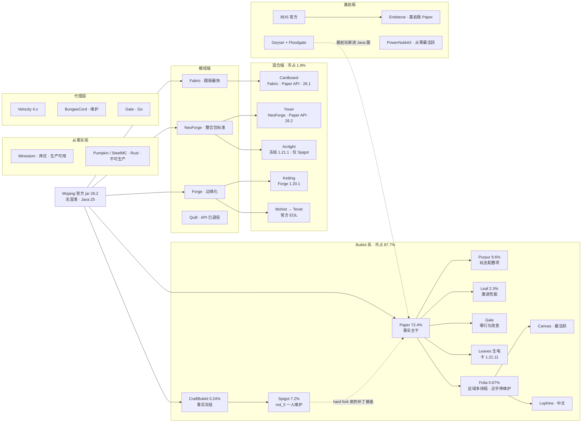

# Minecraft 服务器核心生态调研总报告（2026-09-08）

> 本报告汇总 6 份分报告的结论，给出全景图、横向对比与选型决策树。每个判断都能在分报告里找到出处；分报告内区分了「已核实 / 推断 / 未核实」，本文只引用已核实与明确标注的推断。

## 一、给决策者的六句话

1. **Java 版新开服的默认答案是 Paper**，没有第二个。bStats 实测 Paper 系合计占 87.7%，纯 Paper 72.4%，Spigot 只剩 7.2%。
2. **2025–2026 最大的变量来自 Mojang 而不是任何核心团队**：版本号改为日历制（当前正式版 26.2，不存在 1.22）、26.1 起服务端 jar 完全不混淆、强制 Java 25。所有讲「1.21.x / Java 21 / 重映射」的资料已过期。
3. **混合端一代退场**：Mohist 官方 EOL 且产权 2025 年 1 月转手，Arclight 冻结在 1.21.1。要 26.x 上跑「模组 + 插件」只剩 Youer 与 Cardboard 两家，都还标 beta。
4. **Folia 技术真实但项目近乎停维护**，插件生态约 19%，绝大多数服务器不该碰；Folia 系里值得看的是 Canvas。
5. **模组端选边已定**：Fabric 跟版最快、服务端模组最多且独占 Krypton / C2ME / VMP / Polymer；NeoForge 是大型整合包的事实标准；Forge 边缘化；Quilt API 层已退役；Sponge 生态冻结。
6. **周边层同样完成代际更替**：代理只选 Velocity 4.x（Java 25）；基岩版 PocketMine-MP 已于 2026-07-09 归档，Endstone 成为「基岩版 Paper」；基岩玩家进 Java 服用 Geyser + Floodgate 即可，不必另搭基岩服务端。

## 二、上游前提：Mojang 2025–2026 做了什么

| 事件 | 时间 | 对核心生态的连锁影响 |
|---|---|---|
| 版本号改为 `年.drop.修订` | 2025-12 起 | 1.21.11（2025-12-09）是最后一个 1.x；之后 26.1 → 26.1.2 → 26.2（2026-06-16）→ 26.3 预发布中。季度 drop 让跟版从「一年一次大 crunch」变成小步快跑 |
| **取消 Java 版代码混淆** | 公告 2025-10-29，26.1 生效 | Paper 删除内部 remapper；Spigot mappings 与 BuildTools 重映射流水线失去意义；Fabric Yarn 停维护、Quilt Mappings 停更；Mojmap 成唯一标准。「Spigot-mapped vs Mojang-mapped 插件」的二分在 26.x 不再存在 |
| 强制 Java 25 | 26.1 起 | Paper、Velocity 4.x 全部要求 Java 25；网传「只需 Java 21」是错的 |
| Server Management Protocol | 1.21.9 | JSON-RPC / WebSocket 的管理面协议，是 RCON 替代品，**不是插件 API**。官方插件 API 至今没有任何公告 |
| EULA / 服务器商业化条款 | 2023-06 至今 | 逐年 diff 验证零变更。允许卖影响玩法的权益，红线是竞争优势，无金额上限，不存在 loot box 条款 |
| 分发权 | 持续 | 代码可读不等于可分发，Microsoft 2025 年仍在 DMCA 反编译源码仓库。从零实现的法律优势论据改为「仓库里没有 Mojang 代码」 |

基岩版侧：BDS 当前 1.26.45.1，协议 2169，同样改了日历版本号但保留 `1.` 前缀。

## 三、全景地图

## 四、六大板块一页摘要

### 1. Bukkit 主干：CraftBukkit → Spigot → Paper（分报告 01）

- Paper 2024-12-13 宣布、随 1.21.4 落地 hard fork，不再是 Spigot 的补丁集。生态拐点精确对应：Modrinth 新建插件「只支持 Paper」的比例从三年稳定的 21% 升到最新队列的 53%。
- **「Paper 跟版最快」需要限定**：Spigot 在 26.x 每版都是 Mojang 发布后 2–4 小时出构建；Paper 完全跳过了 26.1 正式版，26.x 首个 STABLE 迟至 2026-05-01，26.2 转 STABLE 用了 40 天。Spigot 的「当天可用」只对等 Paper 的 ALPHA。
- Brigadier 与 DataComponent API 已于 26.2 脱离实验期；`paper-plugin.yml` 与 Registry 修改 API 仍实验性，采用率约 7%。
- Spigot 没死但 **bus factor = 1**：md_5 是唯一管理员兼唯一开发者，无公开继任安排。它仍托管 9 万个资源和唯一有规模的付费插件市场，Hangar 与 Modrinth 都不支持付费分发。
- 生态硬伤：Vault 停更四年却仍是标准桥接层；Dynmap 无 26.x 支持；ProtocolLib 正式版停在 2025-08，新项目改用 PacketEvents。
- 运维必知：Paper 下载 API v2 已于 2026-07-01 关闭，迁 `fill.papermc.io/v3`；Timings 自 1.21.3 起为空操作，排障一律用 spark。

### 2. 高性能分支与 Folia（分报告 02）

- 近 90 天提交分层：活跃 Canvas 299 / Gale 221 / Leaf 124 / Lophine 123 / Purpur 54 / DivineMC 42；已死 Pufferfish（停在 1.21.10）、Plazma、Kaiiju、KTP、Luminol、Mint、Lumina；Leaves 卡在 1.21.11 且 90 天仅 3 次提交。
- Folia 26.2 至今仍 BETA，2026 年 7 月起提交几乎全是「Update Paper」，PaperMC 贡献者公开说它「不是一个真正由 Paper 维护的项目」。
- Folia 硬约束：EssentialsX、Vault、Multiverse、Dynmap、FAWE 全不支持，24 条原版命令被禁用（含 scoreboard），默认 `threads:-1` 在 8 核机器上只给 1 个 tick 线程，内置 spark 被 patch 掉。
- 2026 年 7 月 LuminolMC 指控 CanvasMC 违反 GPL-3.0 后全线删库，中文 Folia 分支只剩 Lophine。
- **不存在可信的公开跨分支基准**。Pufferfish「漏斗快 30%」溯源到 2022 年已死的 Airplane且无方法论；Leaf 官方基准用笔记本 CPU、零玩家。
- 定位差异：Gale 刻意零行为偏差；Leaf 默认偏差小、开关打开后大；Leaves 主动向原版靠拢服务生电；Purpur 主动把原版行为变配置项。

### 3. 混合端（分报告 03）

- Mohist 官方 EOL，所有权与版权 2025 年 1 月出售，仓库改名 Teneted/Tenet，构建止于 2025-05，原团队拒受理反馈。Banner 仓库已删，CatServer 近乎停更，Magma 经历「冻结 → 复活 → 半停」三段。
- 仍真活的五个：Youer（NeoForge + Paper/Purpur API，26.2/26.3，最活跃）、Cardboard（Fabric + Paper API，26.1 稳定 / 26.2 WIP）、Ketting（Forge 1.20.1，仅 Spigot API）、Crucible（1.7.10）、Silkard（Mohist 团队新 Fabric 端，极新）。
- Arclight 冻结 1.21.1，近三月 7 次提交，FAQ 明写 Paper API「尚未」；但口碑最干净，不在任何 shame list 上。
- 两条架构路线：源码 patch（Mohist / Ketting / CatServer / Crucible / Magma）与 Mixin 注入（Arclight / Cardboard / Banner / Silkard）。Ketting 给出量化：换 Paper 基座需再加约 1500 个补丁。
- 英文社区态度一致负面且有实名实据：EssentialsX 的 do-not-use-mohist PSA（2021-04-10 起）、KennyTV 的 list-of-shame（Mohist 换包、CatServer 违反许可证）。别向插件作者报混合端 bug。
- Youer、Ketting、Magma 系许可证均未声明标准许可，商业部署前需自行确认。

### 4. 纯模组端与 Sponge（分报告 04）

- 26.2 首个构建滞后（Maven 时间戳硬数据）：Fabric API 提前 1 天，NeoForge 3.5 小时，Forge 1.6 天。Modrinth 26.2 模组数 Fabric 11,045 / NeoForge 5,701 / Quilt 3,019 / Forge 2,952。
- NeoForge 2023-07-12 分裂的真因是治理而非技术；1.20.2 起 API 真分叉，与 Forge 模组不可混装。
- Quilt 的 QSL / QFAPI / QKL 在 26.1 官宣退役，Loader 仍是 beta；选 Fabric 严格优于 Quilt。
- Sponge 工程活但生态冻结：SpongeNeo 存在且跟到 26.2 RC，但 Ore 仓库总共 589 个插件，2026 年新增 4 个。
- 服务端重型优化是 Fabric 独占：Krypton / C2ME / VMP 全 fabric-only；Lithium 已自带 NeoForge 构建；Radium / Canary 2024 年停更；Starlight 归档；Noisium 归档。
- 替代 Bukkit 的能力矩阵：权限（LuckPerms 官方多平台）、WorldEdit、BlueMap、领地（OPAC）已无差距；**经济与反作弊是硬伤**；Polymer（Fabric 独占）是模组端做「客户端零安装」体验的唯一路径。
- 分发：itzg Docker 镜像与 packwiz、mrpack-install 活跃；ServerStarter 已停更。

### 5. 代理层与网络（分报告 05）

- Velocity 4.0.0（2026-07-14）/ 4.1.1（2026-08-26）要求 Java 25 + Adventure 5，是破坏性大版本；3.5.1 并行维护作过渡。支持 1.7.2–26.2。
- BungeeCord 仍跟到 26.2 但只做维护，只有 legacy 转发。Waterfall 官方 2024-03-26 EOL 但仓库仍有人提交，别用 `pushed_at` 判生死。
- Gate（Go）内建托管 Geyser + 跨版本，一行配置带齐；但插件生态为零，两边插件都不吃。
- 安全边界是最大的坑：后端必被迫 `online-mode=false`，防护顺序是防火墙 > localhost 绑定 > VPN > modern forwarding > BungeeGuard（一年未更新）。
- Via 家族 5.11.0 到 26.2，Bungee 支持已拆成独立 ViaBungee；大版本首日想用要付费订阅。Geyser 2.11.2 支持 Bedrock 26.0–26.45 ↔ Java 26.2。
- 群组基建：ValioBungee 接替 RedisBungee；Shulker 停在 2025-04 且锁 Velocity 3.x；Pterodactyl 与 Pelican 2026-08 均有发版；Infrared 2024-07 停更却仍被教程推荐。
- TCPShield 的 `only-allow-proxy-connections` 必须为 true，否则等于没防护。

### 6. 从零实现、官方原版与基岩版（分报告 06）

- Java 从零实现只有 Minestom 生产可用，且它是库不是服务端，原版玩法约为零；已核实生产用户 EmortalMC、BlueDragonMC，头部网络采用说法全部未核实。
- Rust 阵营无人能替 Paper：Pumpkin 11.1K 星但缺红石、战斗、AI、插件系统；FerrumC 卡 1.21.8；Valence 事实停摆。真正可用的是窄用途的 MCHPRS（计算红石）与 PicoLimbo（limbo）；SteelMC 是唯一给出可复现 parity 证据的。
- Glowstone、Cuberite、Feather 已死。Glowstone 的 `pushed_at` 显示 2026 年有推送，但最后一次功能性提交是 2022-06-22。
- 基岩版：PocketMine-MP 2026-07-09 归档，axolotl-pm fork 接盘代码但 Poggit 插件发布已冻结。Endstone（Apache-2.0，原生 Win+Linux，追平 1.26.45）是原版保真首选；PowerNukkitX 是从零系最活跃；LeviLamina 星数第二却落后 4 个版本且 Linux 靠 Wine；Allay 巴士因子约 1。
- 11 个基岩项目里 8 个追平最新版，「基岩服务端跟不上版本」的刻板印象已不成立。
- 许可证要读原文：Paper 整包 GPL-3.0，Glowstone 实为 MIT，Cuberite 实为 Apache-2.0，GitHub 字段不可信。

## 五、横向总对比

### Java 版核心

| 项目 | 类别 | 2026-09 状态 | 最新 MC | 插件 API | 许可证 | 市占 | 判定 |
|---|---|---|---|---|---|---|---|
| **Paper** | Bukkit 主干 | 🟢 活跃 | 26.2 STABLE | Paper | GPL-3.0 | 72.4% | **默认答案** |
| Spigot | Bukkit | 🟡 保守维护，bus factor 1 | 26.2 | Spigot | 不可分发 | 7.2% | 仅因闭源付费插件才留 |
| Purpur | Paper 下游 | 🟢 活跃 | 26.2 | Paper + Purpur | MIT | 9.6% | 要玩法配置项 |
| Leaf | Paper 下游 | 🟢 活跃 | 26.2 | Paper | GPL-3.0 | 2.3% | 愿调参换极限性能 |
| Gale | Paper 下游 | 🟢 小众 | 26.2 | Paper | GPL-3.0 | ≈0 | 零行为改变的 drop-in |
| Leaves | Paper 下游 | 🟡 卡版 | 1.21.11 | Paper | GPL-3.0 | 0.25% | 生电服，接受滞后 |
| Folia | Paper 官方 | 🟡 近乎停维护 | 26.2 BETA | Folia（约 19% 插件） | GPL-3.0 | 0.67% | 五条件全满足才上 |
| Canvas | Folia 下游 | 🟢 最活跃 | 26.2 | Folia | GPL-3.0 | 0.35% | Folia 系优先 |
| Pufferfish / Plazma / Kaiiju / KTP | Paper 下游 | 🔴 停更 | ≤1.21.10 | — | — | ≤0.25% | 别用 |
| Youer | 混合 NeoForge | 🟢 活跃 beta | 26.2 / 26.3 | Paper + Purpur | 未声明 | — | 26.x 混合端两选一 |
| Cardboard | 混合 Fabric | 🟢 活跃 | 26.1 / 26.2 WIP | Paper | GPL-3.0 | — | 26.x 混合端两选一 |
| Arclight | 混合三线 | 🟡 缓慢 | 1.21.1 | Spigot | GPL-3.0 | 0.87% | 1.21.1 整合包 |
| Ketting | 混合 Forge | 🟢 beta | 1.20.1 | Spigot | 未声明 | — | 1.20.1 整合包 |
| Mohist / Tenet | 混合 Forge | 🔴 官方 EOL | 构建止于 1.20.2 | Spigot | GPL-3.0 | 0.54% | 别用 |
| CatServer | 混合 Forge | 🔴 近乎停更 | 1.18.2 | Spigot | LGPL-3.0 | 0.41% | 仅怀旧包 |
| Fabric | 模组端 | 🟢 跟版最快 | 26.2（26.3 快照已跟） | 无，用服务端模组 | Apache-2.0 | — | 轻模组长期服 |
| NeoForge | 模组端 | 🟢 Forge 系标准 | 26.2 | 无 | LGPL-2.1 | — | 大型整合包 |
| Forge | 模组端 | 🟡 边缘化 | 26.2 | 无 | 未声明 | — | 仅 1.20.1 及更早老包 |
| Quilt | 模组端 | 🔴 API 层退役 | — | — | Apache-2.0 | — | 别选 |
| Sponge | 模组端 API | 🟡 工程活，生态冻 | 26.2 RC | Sponge（589 插件） | MIT | — | 不建议新开 |
| Minestom | 从零 | 🟢 生产可用 | 26.2 | 自有 | Apache-2.0 | — | 完全自研玩法 |
| Pumpkin / SteelMC | 从零 Rust | 🟡 不可生产 | 26.2 | — | GPL / AGPL | — | 尝鲜 |

市占来自 bStats 2026-09-08 快照，样本约 18 万台。口径限制：只统计装了接入 bStats 插件的服务器；不改品牌的分支以上游身份上报，Gale、Lophine 被低估；中国大陆上报率偏低，Leaves、Lophine 被系统性低估。

### 周边层

| 项目 | 类别 | 状态 | 版本覆盖 | 许可证 | 判定 |
|---|---|---|---|---|---|
| **Velocity** | 代理 | 🟢 活跃演进 | 1.7.2–26.2（4.1.1） | GPL-3.0 | 新建群组唯一选择 |
| BungeeCord | 代理 | 🟡 维护 | 1.8–26.2 | BSD 风格 | 仅为存量 Bungee 插件 |
| Waterfall | 代理 | 🔴 官方 EOL | — | MIT | 别用 |
| Gate | 代理（Go） | 🟢 活跃 | 1.7–latest | Apache-2.0 | Go 栈且不需要 Java 插件 |
| ViaVersion 家族 | 跨版本 | 🟢 5.11.0 | 到 26.2 | GPL-3.0 | 有反作弊装后端，否则装代理 |
| **Geyser + Floodgate** | 跨平台桥接 | 🟢 活跃 | Bedrock 26.0–26.45 ↔ Java 26.2 | MIT | 基岩玩家进 Java 服 |
| **Endstone** | 基岩（基于 BDS） | 🟢 追平 | 1.26.45 | Apache-2.0 | 基岩原版保真首选 |
| PowerNukkitX | 基岩（从零） | 🟢 最活跃 | 1.26.45 | LGPL-3.0 | 纯 Java 深度定制 |
| LeviLamina | 基岩（基于 BDS） | 🟡 落后 4 版 | BDS 1.26.32.2 | LGPL-3.0 部分闭源 | 仅 Windows + LLSE 资产 |
| Allay | 基岩（从零） | 🟡 观望 | 1.26.44 | LGPL-3.0 | 巴士因子约 1 |
| PocketMine-MP | 基岩（从零） | 🔴 2026-07-09 归档 | 1.26.30 | LGPL-3.0 | 必须规划迁移 |

## 六、选型决策树

**先问两个问题：要不要模组？要不要原版玩法？**

1. **基岩版**
   - 只是让基岩玩家进 Java 服 → Paper 后端直装 Geyser + Floodgate，不必另搭基岩服务端。
   - 原生基岩服，要原版保真 + 可改玩法 → Endstone；要纯 Java 深度定制 → PowerNukkitX。
2. **要模组**
   - 跑现成整合包 → 跟整合包走，基本是 NeoForge；1.20.1 及更早的老包才是 Forge。
   - 自己攒轻模组 + 完整管理功能 → Fabric + 服务端模组（LuckPerms、WorldEdit、BlueMap、OPAC、Ledger、Polymer），前提是不需要经济与反作弊。
   - 模组 + 插件生态都要 → 先把管理功能拆成清单。没有经济 / 反作弊刚需，纯模组端能覆盖八成以上，稳定性收益远大于混合端。确有刚需：26.x 用 Youer 或 Cardboard，1.21.1 用 Arclight，1.20.1 用 Ketting，并接受「崩溃归因困难、备份要更狠」。
3. **不要模组，Java 版**
   - 生存 / RPG / 插件服 → Paper 最新 STABLE。要玩法开关 → Purpur。性能吃紧 → 先调 `paper-world-defaults.yml`，再上 Gale（零风险 drop-in），仍不够再上 Leaf 并逐项验证开关。
   - 生电 / 技术服 → Leaves（接受停在 1.21.11）或 Fabric + Carpet；必须 26.x 则 Paper 或全关开关的 Leaf。绝不用 Folia 系。
   - 大型分散生存 → Paper / Purpur。只有同时满足「物理核 ≥16、世界已预生成、玩家确实分散、每个插件都支持 Folia、能自行排查跨线程 bug」五条才上 Folia 系，且优先 Canvas，先在 staging 跑。
   - 小游戏群组 → Paper / Purpur 多实例 + Velocity 横向扩展，明确不用 Folia。完全自研玩法且有 Java 团队 → Minestom。
   - 排队 / limbo 服 → PicoLimbo；计算红石 → MCHPRS。
4. **要不要代理**
   - 在线 <50、单一玩法、无跨版本 / 跨平台需求 → 不上代理。只要基岩或老版本进来也不必上代理，后端直装 Geyser 或 ViaVersion。
   - 大厅 + ≥2 个玩法子服，或需不停机重启子服 → Velocity 4.x + modern forwarding + 防火墙。
   - 多代理实例 + 跨代理好友 / 私聊 → Velocity ×N + ValioBungee + Redis 6.2+。
   - 按人数自动扩缩容 → K8s + Agones；Shulker 会锁在 Velocity 3.x。

## 七、2026 年「别再新部署」清单

| 项目 | 原因 |
|---|---|
| Mohist / Tenet | 官方 EOL，产权已转手，构建止于 2025-05 |
| Banner | 仓库已删 |
| CatServer、Magma-Forge | 近乎停更 / 冻结 1.12.2 |
| Pufferfish、Plazma、Kaiiju、KTP、Luminol、Mint、Lumina | 停更或删库 |
| Quilt | QSL / QFAPI / QKL 已退役 |
| Waterfall | 官方 EOL 2024-03-26 |
| Infrared | 2024-07 停更却仍被教程推荐 |
| ServerStarter | 最后提交 2023-04 |
| PocketMine-MP、Nukkit、Cloudburst | 归档 / 原版特性缺失 / 6 年零 release |
| Glowstone、Cuberite、Feather、Valence | 事实死亡 |
| Timings、ProtocolLib、Paper 下载 API v2 | 空操作 / 停在 2025-08 / 2026-07-01 关闭 |

## 八、跨报告共同的坑

- **Java 25**：26.1+ 与 Velocity 4.x 都要求，托管商镜像先确认。
- **26.1 起插件必须 Mojang-mapped**：老服升级先升到 1.21.11 清插件，再升 26.x；26.x 世界不可降级。
- **Paper STABLE 晚 22–40 天**：赶首发只有 ALPHA，生产环境等 STABLE。
- **Adventure 5** 是 2026 年真正的破坏性变更，编译与运行都要用 5.x。
- **别用 `pushed_at` 判项目生死**：Waterfall、Glowstone 都有推送但功能性开发早已停止；看提交内容与贡献者分布。
- **别信任何跨分支的通用性能数字**：用 spark 在自己的负载下测 p95 MSPT。
- **代理后端 `online-mode=false` 是安全面**：上线前从公网 telnet 每个后端端口确认连不上。
- **许可证读 LICENSE 原文**：Youer / Ketting / Magma 未声明，GitHub 字段对 Glowstone、Cuberite 是错的。
- **混合端 bug 别报给插件作者**：先在纯 Spigot 与纯模组端各复现一次。

## 九、方法与未核实事项

- 调研日期 2026-09-08，6 个 agent 并行联网查证，数据源：GitHub API（stars / pushed_at / releases）、bStats、Modrinth API、Hangar、Maven 时间戳、各项目官网与官方博客、archive.org 逐年 diff。
- 每份分报告末尾列出了未核实项，合计 52 处标注。主要缺口：主流插件在混合端的逐项可用性、各社区「禁止讨论 Mohist」的成文规则、Pufferfish+ 是否在售、Gale 的 SIMD 声称、头部网络是否采用 Minestom、Mojang 对 Geyser 的官方态度、Quilt / Sponge 对 26.2 的首发滞后时间。
- 分报告 03 有一处需要注意：MCBBS 关闭时间是 2024 年 1–2 月，不是 2023 年。

## 十、分报告索引

| 文件 | 范围 | 字数 |
|---|---|---|
| `01-bukkit-spigot-paper.md` | CraftBukkit → Spigot → Paper 主干、插件生态、bStats 全量数据 | 约 7,500 |
| `02-performance-forks-folia.md` | Folia 与 Purpur / Leaf / Gale / Leaves / Canvas 等分支 | 约 8,500 |
| `03-hybrid-cores.md` | Mohist / Youer / Arclight / Cardboard / Ketting 等混合端及争议出处 | 约 4,800 |
| `04-modded-servers.md` | Forge / NeoForge / Fabric / Quilt / Sponge、性能模组、服务端模组替代插件矩阵 | 约 6,000 |
| `05-proxy-network.md` | Velocity / BungeeCord / Gate、Via、Geyser、群组架构、抗 DDoS | 约 5,000 |
| `06-alternative-implementations.md` | Minestom / Rust 实现、官方原版与 EULA、基岩版全谱系 | 约 8,800 |
