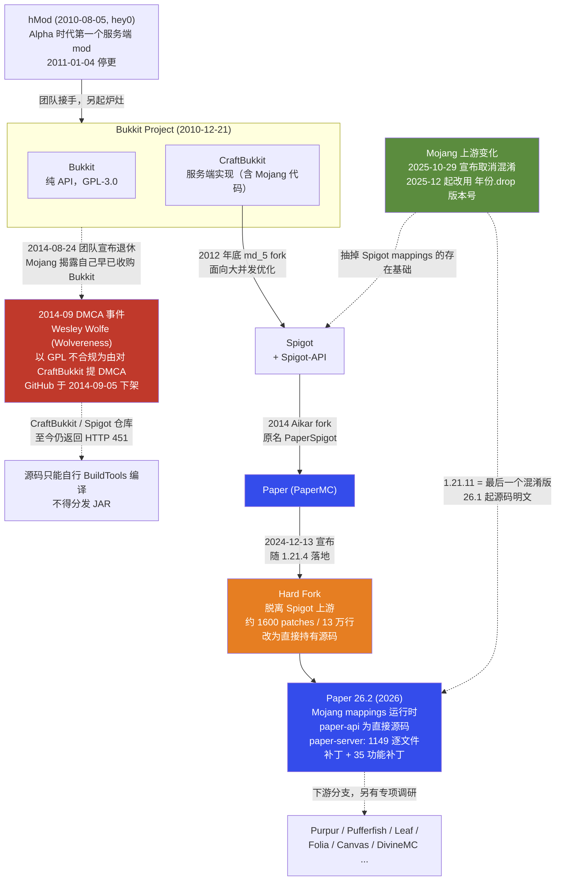

# Bukkit 系主干调研：CraftBukkit → Spigot → Paper

> 调研日期：2026-09-08 ｜ 所有数据均为该日联网查证。
> 标注约定：**【已核实】**= 本次查到一手来源（官方站点 / 官方 API / GitHub API / 官方文档）；**【推断】**= 由已核实事实推导；**【未核实】**= 查不到可靠来源。

---

## ① TL;DR

1. **Paper 已经是事实上的唯一主干。** bStats 全球 Bukkit 平台采样（2026-09-08，181,529 台上报服务器）显示：纯 Paper 占 **72.42%**，加上 Purpur / Leaf / Folia 等 Paper 下游分支后 **Paper 系合计 87.70%**；Spigot 仅剩 **7.15%**，原生 CraftBukkit 只有 **0.24%**。
2. **2024-12-13 宣布、随 1.21.4 落地的「hard fork」是这条谱系十年来最大的一次断裂**：Paper 不再是 Spigot 的补丁集，而是自己直接持有源码。收益部分兑现——26.2 发布当天 Paper 就出了首个构建；但**别信「Paper 跟版最快」这个流行说法**：实测 Spigot 在 26.x 每次都是 Mojang 发布后 2–4 小时出构建，而 **Paper 完全跳过了 26.1 正式版**、26.1.1 从未离开 ALPHA，26.x 线的首个 STABLE 迟至 2026-05-01。**Spigot 的「当天可用」只对等于 Paper 的 ALPHA；Paper 的稳定版要慢 22–40 天。**
3. **Mojang 在 2025-10-29 宣布彻底取消 Java 版混淆**，1.21.11 是最后一个混淆版本，26.1 Snapshot 1 起源码带真实名字。这一刀直接抽掉了 Spigot 技术护城河的地基（BuildTools + SpecialSource + Spigot mappings 那一整套重映射流水线），Paper 也在 26.1 **彻底删掉了内部 remapper，不再支持混淆过的插件**。
4. **Mojang 同时把版本号改成了「年份.drop.修订」**（26.1 / 26.2 / 26.3，不再有 1.22），配合季度 drop 节奏。核心跟版从「一年一次大crunch」变成「一个季度一次小步跟」，Paper 从 1.21.9 起改为全程跟快照，把跟版压力摊平了。
5. **生态已经在选边，且拐点精确对应 hard fork**：Modrinth 新建插件中「只支持 Paper」的比例三年稳定在 ~21%，hard fork 后一路升到最新队列的 **53%**，Spigot-only 掉到约 1%。同时 **Brigadier 与 DataComponent 两大 API 已于 26.2 正式脱离实验期**（PR #14106），但 `paper-plugin.yml` 与 Registry 修改 API **仍是实验性**，实际采用率仅约 7%。2026 年开新项目没有理由选 Spigot——但 Spigot 作为**插件市场**（9 万资源、唯一有规模的付费市场）仍然无可替代。

---

## ② 谱系关系图



---

## ③ 逐项目档案

### 3.1 上游前提：Minecraft Java 版自身的 2025–2026 变化

这两件事是理解 2026 年整个 Bukkit 生态的前置条件，必须先讲。

**（a）版本号改为「年份.drop.修订」【已核实】**

2025-12-16 起启用：第一位年份，第二位当年第几个 drop，第三位仅用于 hotfix。**没有 1.22，以后也不会有。**快照命名同步改为 `26.1 Snapshot 1`（不再是 `25w45a`），预发布为 `26.1-pre-1`。

| 版本 | 代号 | 发布日 | 备注 |
|---|---|---|---|
| 1.21.11 | Mounts of Mayhem | 2025-12 | **旧编号最后一版，也是最后一个混淆版** |
| 26.1 | Tiny Takeover | 2026-03-24 | 新编号第一版，**首个要求 Java 25 的版本** |
| 26.1.1 / 26.1.2 | — | 2026-04-01 / 04-09 | hotfix |
| **26.2** | **Chaos Cubed** | **2026-06-16** | **当前最新正式版** |
| 26.3 | Wilderness Bound | 快照始于 2026-06-23 | 预计 2026 Q3，截至 2026-09-08 未发布 |

Java 要求可从 Spigot 构建元数据侧证：26.1/26.2 的 `javaVersions` 为 `[69, 70]`（class file major 69/70 = Java 25/26），1.21.11 为 `[65, 70]`（Java 21–26）。
来源：[Java Edition version history](https://minecraft.wiki/w/Java_Edition_version_history)、[Version formats](https://minecraft.wiki/w/Version_formats)、`https://hub.spigotmc.org/versions/26.2.json`

**（b）Mojang 彻底取消混淆【已核实】**

- 2025-10-29 官方宣布（[Removing obfuscation in Java Edition](https://www.minecraft.net/en-us/article/removing-obfuscation-in-java-edition)）。过渡期内（`25w45a` ~ `1.21.11`）官方在混淆版之外额外发布 "experimental release" 非混淆版供工具链适配。
- **1.21.11 是最后一个混淆版；26.1 Snapshot 1 是第一个完全非混淆版。**version json 中不再提供 obfuscation map。明文的是类名、方法名、字段名，**外加以前从来没有过的方法参数名和局部变量名**。
- **法律状态没有放松**：EULA 与 Usage Guidelines 照旧适用，jar 内新增 LICENSE 文件直指 EULA。「代码能读」≠「可以重新分发」。
- 连带效应：Fabric 的 Yarn / Intermediary 宣布不再以原形式维护；Spigot mappings 的存在基础同样被抽空。
- 来源：[Obfuscation map](https://minecraft.wiki/w/Obfuscation_map)、[Fabric 公告](https://fabricmc.net/2025/10/31/obfuscation.html)

---

### 3.2 Bukkit / CraftBukkit

| 项 | 内容 |
|---|---|
| 仓库（API） | https://github.com/Bukkit/Bukkit 【已核实，HTTP 200】 |
| 仓库（实现） | https://github.com/Bukkit/CraftBukkit 【已核实，**HTTP 451**，GitHub API 返回 `block.reason = "dmca"`, `created_at = 2014-09-05T17:09:34Z`】 |
| 许可证 | Bukkit：GPL-3.0（CraftBukkit 含 Mojang 专有代码，这正是 2014 年 DMCA 的法律核心） |
| GitHub 活跃度 | Bukkit/Bukkit：2,478 stars，未归档，只有 `master` 一个分支，**HEAD 提交日期停在 2013-07-08** |
| 实际维护位置 | SpigotMC 的 Stash（`hub.spigotmc.org/stash/projects/SPIGOT/repos/bukkit`），由 md_5 随 CraftBukkit 一起更新 |
| 市占 | bStats 上标记为 `Bukkit` 的服务端 443 台 = **0.24%** |

**2014 DMCA 事件时间线【已核实】**

1. **2014-08-24**：老 Bukkit 团队宣布退休（贡献者流失）。Mojang 随即揭露 **Bukkit 项目几年前就已被 Mojang 秘密收购**，并收回团队对 GitHub / 论坛的权限。
2. **2014-09-03**：CraftBukkit 主贡献者之一 Wesley Wolfe（Wolvereness）提交 DMCA。法理是 GPL 不兼容——CraftBukkit 在 GPL 项目里内嵌 Mojang 专有服务端代码，而 Mojang COO 明确表示**从未授权**以任何开源许可分发；那么包含他本人 GPL 代码的分发就侵犯了他的著作权。
3. **2014-09-05**：GitHub 执行下架（[github/dmca 存档](https://github.com/github/dmca/blob/master/2014/2014-09-05-CraftBukkit.md)）。Spigot 作为下游、代码里同样含 Wolfe 的提交而被波及；md_5 撤下 Jenkins 下载，动用捐款请律师准备反通知。
4. Mojang 公开回应：Wesley 无权阻止他自愿以开源许可提交的贡献被继续使用，并否认自己是幕后推手。

**遗留影响（到 2026 年仍然生效）【已核实】**

- CraftBukkit 与 Spigot 的 GitHub 仓库**十二年后仍是 451**（2026-09-08 实测确认）。
- **Spigot 至今不能分发编译好的 JAR**，用户必须自己跑 BuildTools 本地编译。这是 Spigot 与 Paper 分发体验差距的直接根源。
- Paper 继承自 CraftBukkit/Spigot，`LICENSE.md` 整体沿用 **GPL-3.0**，但允许贡献者选择以 MIT 发布自己的部分（文件内维护 MIT 贡献者名单）。

**GitHub 上那个 Bukkit 仓库是化石，别拿它判断 Bukkit API 的死活【已核实】**

`Bukkit/Bukkit` 的 `master` HEAD 是 **`f210234e59275330f83b994e199c76f6abd41ee7`，日期 2013-07-08**——而这个 SHA **正是 2014 年 DMCA 通知里用来指认许可证的那一个**（通知原文引用 `.../blob/f210234e.../LICENCE.txt`；本次已比对确认字符串一致）。**仓库被精确冻结在了那一刻**，同 org 的 `Bukkit/CraftBukkit` 则停在 2014-08-17。它至今还能收 issue（68 个 open）纯属误导性副作用。

**Bukkit API 本身是否停滞？【已核实 + 推断】**

「Bukkit API」这个统一概念在 2026 年已不成立，它分叉成了两条线：

- `org.bukkit.*` 的包名和大量老接口仍是所有实现的公分母；
- **Spigot 侧**：真正在演进的 Bukkit API 在 **SpigotMC Stash** 上，不在 GitHub。节奏是 **约 40–45 commits/年**（最近 100 次提交：2024 年 35 / 2025 年 43 / 2026 年至 7 月 22），**全部经 md_5 一人合并**。**它没有停滞，只是低速且保守**——2026 年仍在合入社区 PR 新增 API（如 `GameRule#getDefaultValue`、停止袭击的方法、袭击总波数设置）。但没有独立的 API 路线图，版本号随 CraftBukkit 走；md_5 在 26.2 公告里自陈 *"There are currently no significant API changes since 26.1"*；
- **Paper 侧**：hard fork 后 `paper-api` 是仓库里的**直接源码**（`paper-api/src/`，无补丁目录【已核实，GitHub API 查证】），Paper 团队自行增删。官方公告明说：hard fork 之后 **Spigot 新增的 API 不会自动进入 Paper**。
- 结论：**由 Mojang 拥有、由老 Bukkit 团队维护的那个「Bukkit API」已经死了十年**；现在活着的是「Paper 维护的 org.bukkit 超集」和「Spigot 维护的 org.bukkit 保守集」两个不同东西。

---

### 3.3 Spigot

| 项 | 内容 |
|---|---|
| 官网 / 资源站 | https://www.spigotmc.org （对脚本返回 403，Cloudflare 挡了） |
| 源码 | `hub.spigotmc.org/stash/`（自建 Bitbucket/Stash），**GitHub 镜像 HTTP 451** |
| 构建 | BuildTools，https://hub.spigotmc.org/jenkins/job/BuildTools/ |
| 许可证 | Spigot-API 沿 Bukkit 的 GPL-3.0；CraftBukkit/Spigot 服务端因含 Mojang 代码不可分发 |
| 支持 MC 版本 | `hub.spigotmc.org/versions/` 列出从 1.8 到 **26.2**【已核实】 |
| 最新版本 | **26.2 = Jenkins build 4647**，`toolsVersion 197`，`javaVersions [69,70]`【已核实】 |
| 主维护者 | md_5（Spigot 创始人） |
| 市占 | **7.15%**（12,980 台 / 181,529） |

**维护状态：单人、持续、但生态热度在塌陷【已核实】**

各仓库 HEAD（`hub.spigotmc.org/stash` REST API 实测）：`spigot` 2026-06-16、`bukkit` 2026-07-13、`craftbukkit` **2026-08-16**、`builddata` 2026-06-16、`buildtools` 2026-04-19，**全部由 md_5 本人提交**。最新 Jenkins 构建 **#4647，2026-08-16 20:53**；Maven 上 `spigot-api:26.2-R0.1-SNAPSHOT` 最后 deploy 于同一时刻。

⚠️ **治理风险是这条线最该被记下的一条：md_5 是 SpigotMC 唯一的 Administrator，也是唯一的 Developer。**`spigot` 仓库最近 200 次提交中 **199 次** committer 是他；CraftBukkit 最近 100 次提交里他占 87 次；2025 年 4 月之后再无他人直接推送。**Bus factor = 1，且未找到任何公开的继任安排**（属「未找到」，不等于「不存在」）。

**生态热度：Spigot JIRA 新建 issue 数**（`hub.spigotmc.org/jira` REST API，累计 7,735 个）：

| 年份 | 2023 | 2024 | 2025 | 2026（1/1–9/8） |
|---|---:|---:|---:|---:|
| 新建 issue | 319 | 367 | **112** | **43**（年化 ≈62） |

**2024 → 2026 下降约 83%【已核实】。**成因【推断】最可能是用户流失（份额只剩 7.16%）叠加代码成熟，但无法排除 JIRA 提报政策变化的影响。

**API 与版本支持【已核实】**

**【已核实，且推翻了一个流行误解】Spigot 在 26.x 上不但没掉队，逐版本比 Paper 更快。**下表 Mojang 时刻取自 `version_manifest_v2.json`，Spigot 取 `hub.spigotmc.org/versions/` 构建落盘时间，Paper 取 Fill v3 首个 build 的 `time`：

| MC 版本 | Mojang 发布 | Spigot 首个构建 | Δ | Paper 首个构建 | Δ | Paper 转 STABLE |
|---|---|---|---|---|---|---|
| 1.21.11 | 2025-12-09 12:23 | 16:13 (#4598) | **+3h50m** | 16:42 | +4h19m | — |
| **26.1** | 2026-03-24 12:11 | 16:25 (#4599) | **+4h14m** | **从未构建** | **—** | — |
| 26.1.1 | 2026-04-01 09:06 | 11:14 (#4612) | **+2h08m** | 04-03 21:05 | **+2 天** | **从未**（止于 ALPHA） |
| 26.1.2 | 2026-04-09 10:12 | 11:55 (#4618) | **+1h43m** | 04-11 12:04 | **+2 天** | 05-01（**+22 天**） |
| 26.2 | 2026-06-16 12:03 | 15:34 (#4633) | +3h31m | 15:16 | +3h13m | 07-26（**+40 天**） |

- **必须加的口径限定**：Spigot 没有稳定性通道，「首个构建」就是它唯一的产物；Paper 分 ALPHA→BETA→STABLE。**公平的说法是：Spigot 的「当天可用」对等于 Paper 的 ALPHA；Paper 的「官方推荐稳定」要慢 22–40 天。**
- **但 26.1 那次是 Paper 真实的失误，不是口径差异**：本次实测 `fill.papermc.io/v3/projects/paper/versions/26.1/builds` 返回 **404 `version_not_found`**，版本族列表里 26.1 线只有 `["26.1.2","26.1.1"]`——**Paper 完全跳过了 26.1 正式版**；26.1.1 只有 23 个构建、**全部停留在 ALPHA**（2026-04-03 ~ 04-06）。26.x 线上 Paper 的第一个 STABLE 要等到 **2026-05-01**（26.1.2），比 Mojang 晚 22 天。
- 【已核实】Paper 当年 hard fork 的理由仍成立且有官方原话：Spigot 的 snapshot / pre-release / rc 工作是 "behind closed doors"，Paper 拿不到提前量。**但这是「Paper 无法提前准备」的问题，不等于「Spigot 正式版发得慢」。**

**BuildTools 流程【已核实】**

因 DMCA 遗留，Spigot 只能分发构建脚本，不能分发 JAR：

```
java -jar BuildTools.jar --rev 26.2
```

- BuildTools 拉 `BuildData` / `Bukkit` / `CraftBukkit` / `Spigot` 四个仓库的指定 commit（见 `hub.spigotmc.org/versions/<ver>.json` 的 `refs`），下载 vanilla 服务端，应用 access transformer 与包重定位，Fernflower 全量反编译 `net/minecraft/**`，打补丁，两次 Maven 构建。**反编译是主要耗时项**（单次构建总耗时**未核实**——官方 wiki 被 Cloudflare 挡住，本次也未实跑）。
- 参数（取自源码 `Flags.java`）：`--rev <版本>`（默认 `latest`）、`--compile <NONE|CRAFTBUKKIT|SPIGOT>`（可逗号多选，**`--compile craftbukkit` 仍有效**）、`--remapped`、`--generate-source` / `--generate-docs`、`--pull-request`、`--gui` / `--nogui`（现已自带完整 Swing GUI）。
- **最低 BuildTools 版本**：各版本 JSON 的 `toolsVersion` = **197**（26.x 与 1.21.11 均是；1.21.10 时为 181），低于此值会被拒绝构建。
- **Java 要求（硬数据，注意网上普遍传错）**：`javaVersions` 是 class-file major 区间。**26.1 ~ 26.2 = `[69,70]` = Java 25–26**；1.21.11 = `[65,70]` = Java 21–26。交叉验证：26.2 的 CraftBukkit `pom.xml` 里 `<maven.compiler.release>25</maven.compiler.release>`（1.21.11 时为 21）。**「26.2 只需 Java 21」是错的。**

**【已核实，决定性证据】26.1 起 Spigot 的整条重映射流水线已被拆除，`--remapped` 成了空操作。**

md_5 在 26.1 公告帖的原话：*"Obfuscation has been moved from the server jar in version 26.1 and there is therefore no need to remap plugins using SpecialSource and indeed no mappings to do so."* 代码侧证据是 `BuildData/info.json` 的前后对比：

| 字段 | 1.21.10（混淆时代） | **26.2（当前）** |
|---|---|---|
| `mappingsUrl` | Mojang ProGuard `server.txt` | **字段整个消失** |
| `classMappings` | `bukkit-1.21.10-cl.csrg` | **消失** |
| `classMapCommand` | SpecialSource-2 `map --auto-lvt …` | **`""`（空）** |
| `memberMapCommand` | SpecialSource-2 `map --auto-member …` | **`""`（空）** |
| `accessTransforms` | `bukkit-1.21.10.at`（按版本） | `bukkit.at`（**不再分版本**） |
| `packageMappings` | `package.srg` | `package.srg`（**保留**） |

`Builder.java` 的逻辑是：`classMapCommand` 为空即跳过类名映射，`memberMapCommand` 为空即跳过成员映射，整个 mapping 安装块被 `if (getMappingsUrl() != null)` 包住——**26.x 下完全不执行**。同时 26.2 的 `CraftBukkit/pom.xml` 里 **`specialsource-maven-plugin` 及 `remapped` profile 已被整体删除**，而 `--remapped` 的作用仅仅是给 Maven 加 `-P remapped`。

**推论（高置信度）：`remapped-mojang` / `remapped-obf` 产物在 26.x 不再产出；「spigot-mapped 插件 vs mojang-mapped 插件」这个二分在 26.x 已经不存在——两边都是 Mojang 名。**Paper 侧是同一件事的另一半，其 1.21.11 公告原文：*"As Spigot is moving to unobfuscated server jars for 26.1 as well, we will fully drop the internal remapper in 26.1."*

- **一个易漏的细节**：Mojang 对 1.21.11 额外发过 `1.21.11_unobfuscated`，Spigot 据此建了一条并存的 **`1.21.11-R0.2-SNAPSHOT`** 线（对应构建 #4598），其 `info.json` 里 map 命令已清空但 `mappingsUrl` 仍残留，是典型的过渡态。

**SpigotMC 资源站【已核实，经 Spiget API 实测】**

- **90,185 个资源**（Spiget `x-total`，实测）：`/resources/free` = 69,718，`/resources/premium` = **1,673**，另有约 18,794 个两个端点均未归类。⚠️ **注意**：网上流传的「付费占两成」是拿总数减免费数得来的，与 Spiget 专用付费端点的 1,673 差了一个数量级，**不要采信**。
- 日新增约 **17–24** 个，已分配的最大资源 ID 达 138,613，调研当日仍在增长。**SpigotMC 没有萎缩，只是在「新增速率」上被 Modrinth 反超**（Modrinth 约 32 个/日）。
- **付费市场机制（已核实，规则帖最后编辑 2023-08-24，2025–2026 无改动）**：平台**抽成 0%**（SpigotMC 完全不经手资金）；价格硬性区间 **$0.99–$19.99**；**禁止任何形式的授权/DRM 系统**；**买家一旦发起争议即自动失去插件访问权**，平台原则上不介入调查；审核 SLA 约一周。这套「零抽成 + 零托管 + 零买家保护」的设计，正是它二十年没被撼动、也没法被 Hangar/Modrinth 复制的原因。
- 【推断】其「插件集散地 + **付费插件主战场** + 论坛社区」三合一的地位仍在，付费插件几乎未被 Hangar / Modrinth 分流（两者都不做付费分发）；被边缘化的是**服务端软件本身**的入口地位。
- 【已核实】Paper hard fork 讨论帖中，社区最集中的反对意见之一正是「Spigot 资源站的社区与讨论功能是 Hangar 比不了的」，Paper 团队的回应是拿 85–90% 市占率说事。

---

### 3.4 Paper（本报告主角）

| 项 | 内容【均已核实，GitHub API / 官方 API，2026-09-08】 |
|---|---|
| 仓库 | https://github.com/PaperMC/Paper（创建于 2016-01-22） |
| Stars / Forks | 12,619 / 3,521 |
| 许可证 | GPL-3.0 为底，贡献者可选 MIT（`LICENSE.md` 内维护名单）；GitHub 识别为 `NOASSERTION` |
| 最近 push | 2026-09-07T14:29:31Z（`dev/26.3` 分支，"Update JOML dependency to 1.10.9"） |
| `main` 分支 HEAD | 2026-08-29T11:31:38Z |
| 支持 MC 版本 | Fill API 列出 **1.7.10 → 26.2**，共 20 个大版本线 |
| 当前推荐版本 | **26.2，build 121（2026-08-29，STABLE）** |
| 活跃度 | 开放 issue 506，开放 PR 215，**近 180 天合并 172 个 PR** |
| 核心贡献者 | Machine-Maker (1449)、aikar (1379)、zachbr (1047)、kennytv (803)、electronicboy (726)、jpenilla (639)、Spottedleaf (601)、Owen1212055、Lulu13022002、lynxplay |
| 下载渠道 | https://papermc.io/downloads/paper ；API：**Fill v3 `https://fill.papermc.io/v3/...`**（含 GraphQL） |
| Maven 坐标 | `io.papermc.paper:paper-api:26.2.build.+`（26.1 起从 `-R0.1-SNAPSHOT` 改为 `<mcver>.build.<n>-<status>`），toolchain **Java 25** |
| 市占 | 纯 Paper **72.42%**，Paper 系合计 **87.70%** |

#### 3.4.1 Hard Fork：2024-12-13 宣布，随 1.21.4 落地【已核实】

**动机**：Paper 此前维护约 **1,600 个补丁、13 万行以上**的 diff 叠在 Spigot 上。真正致命的不是量，而是**依赖顺序**——Spigot 的快照/预发布/RC 工作不公开，Paper 必须等 Spigot 发布后才能开工，导致每次跟版都是「Mojang 发布 → 等 Spigot → Paper 大 crunch 数天到数周」。

**做法**（下列数字由本次实测当前仓库结构得出）：

- `paper-api/` → **纯源码目录，没有 patches**。API 与 API 实现直接进仓库，可以像改普通 Java 项目一样改。
- `paper-server/patches/` 拆成三类，实测数量：
  - `sources/` — **1,149 个逐文件补丁**（对 vanilla 反编译源码的修改，一个文件一个补丁）
  - `features/` — **35 个功能补丁**（跨文件的大改动，例如 Moonrise 区块系统）
  - `resources/` — 14 个
- 迁移工作量：官方 issue [#11735](https://github.com/PaperMC/Paper/issues/11735) 里，「应用约 800 个逐文件补丁」「应用约 30 个巨型功能补丁」都已勾掉。

**兑现的收益【已核实，硬数据】**：

- 1.21.9 是**第一次 Paper 全程跟（几乎每个）快照**的版本周期（由 @jmp 主导的流程实验），目标是做到「hour 0 发布」。Paper 官方称 hard fork 消除了以往的 "major crunch"。
- 实测验证：Minecraft **26.2 于 2026-06-16 发布，Paper 首个 26.2 构建（build 10, ALPHA）时间戳为 2026-06-16T15:16:04Z——同日**。
- ⚠️ **但这个成果并不稳定，必须给出反例**：**Paper 完全跳过了 26.1 正式版**（Fill v3 对该版本返回 404 `version_not_found`），26.1.1 只出了 23 个构建且**全部停在 ALPHA**，26.x 线的首个 STABLE 迟至 **2026-05-01**（26.1.2，比 Mojang 晚 22 天）；26.2 转 STABLE 也用了 40 天。**同期 Spigot 每个版本都在 Mojang 发布后 2–4 小时出构建。**结论应当是：**hard fork 让 Paper 拿到了「快照期就能动手」的能力，但并未让它每次都跑赢 Spigot 的首发速度；它换来的是「稳定版质量把关」而非「最快可用」。**

**代价与争议**：

- 【已核实】**升级到 1.21.4+ 的 Paper 后无法回退到 Spigot**。
- 【已核实】hard fork 后 **Spigot 的新增 API 不再自动进入 Paper**，两边 API 正式分家。
- 【已核实】Paper 明确会**删除所有旧版本分支（`ver/1.8.8` 及之后的全部）**，因为新分支的 git 历史与旧分支完全无关；旧构建产物仍在下载归档里，但不再有源码分支。
- 【已核实】**paperweight 至今没有正式版**：issue #11735 唯一还没勾掉的项就是 "Non-beta paperweight release"，而 paperweight 最新 tag 是 `v2.0.0-beta.23`（2026-08-28）——距离 hard fork 宣布已经 21 个月，下游分支仍在用 beta 版构建工具链。
- 【已核实】社区在公告帖里的主要担忧：插件作者「不愿维护两套 API」，废弃插件会失效，Hangar 的社区功能不如 SpigotMC 资源站。Paper 团队的核心论据是市占率 85–90%，以及维护 Spigot 兼容已经 "increasingly unbearable"。

#### 3.4.2 Mappings：两步走，26.1 是终点【已核实】

| 时间 | 事件 |
|---|---|
| 2024-03-22 | 官方 PSA：预告将移除 CraftBukkit 包重定位 |
| **1.20.5** | Paper **运行时切换为 Mojang mappings**，不再把服务端重混淆回 Spigot mappings；同时**取消 `org.bukkit.craftbukkit.<version>` 包重定位**（`v1_20_R3` 那种版本号从此消失，靠解析包名判断版本的代码全部作废） |
| 1.20.5 – 1.21.11 | 老插件（编译到重混淆 API 的）靠**启动时一次性 remap** 兼容，产物缓存在插件目录的 `.paper-remapped/`；同时做 reflection rewriting，但**反射不能完全覆盖**，是已知局限。可用 jar manifest 的 `paperweight-mappings-namespace: mojang` 标记跳过 remap |
| **26.1** | Mojang 不再提供混淆服务端 jar → Paper **完全移除内部 remapper，不再支持混淆插件** |

Paper 官方对 1.20.5+ 的重混淆运行时的态度是：**不会支持**（有过 "Bring Back the Re-obfuscated Version of Paper" 的讨论帖，未被接受）。

**对插件开发者的现实含义【推断，证据充分】**：
- 用 `paperweight-userdev` 时，`reobfJar` 任务对 26.1+ 已被标为危险；推荐路径是**直接编译到 Mojang mappings**。
- 副作用是这样的产物**只能跑在 Paper 上**；要同时兼容 Spigot 需要额外做重混淆输出。绝大多数插件不再这么干。
- 好处也是实打实的：可热替换、可正常调试、跨小版本更稳定。

#### 3.4.3 API 演进：Paper 独占的一整套新 API

本次以 javadoc 包路径逐版本探测（HTTP 200/404）定位各 API 的引入版本，结果如下：

| API | 包 | 首次出现 | 2026-09 状态【已核实】 |
|---|---|---|---|
| Paper Plugins / `paper-plugin.yml` | `io.papermc.paper.plugin.bootstrap` | **1.19.3**（1.19.2 无） | ⚠️ **仍是实验性**（文档挂 danger 徽标），自 2023-02 起未转正 |
| Brigadier 命令 API | `io.papermc.paper.command.brigadier` | **1.20.6**（1.20.4 无） | ✅ **26.2 起已转正**（`Commands` 页在 1.21.6/1.21.7/26.1.2 仍含 Experimental，26.2 已清零） |
| Registry 修改 API | `io.papermc.paper.registry.event` | **1.21**（1.20.6 无） | ⚠️ 仍是实验性，且**只能在 Paper plugin 的 bootstrap 里用** |
| DataComponent API | `io.papermc.paper.datacomponent` | **1.21.3**（1.21.1 无） | ✅ **26.2 起已转正**（`ItemStack` 页 Experimental 出现次数：26.1.2 = 26 → 26.2 = **0**） |
| Adventure 文本 | `net.kyori.adventure.*` | 早已内建 | ✅ 稳定，但 **5.x 有真实移除性破坏**，见下 |

**转正来自一次集中清理【已核实】**：Paper PR [#14106](https://github.com/PaperMC/Paper/pull/14106)「Remove experimental annotations from a lot of API」于 **2026-08-06 合入 main**，改动 143 个文件、净删 281 行注解，覆盖 data components、dialogs、inventory view/menu builders、combat tracker、server links 等。**这是本条谱系 2026 年对插件作者最友好的一次变化：主力新 API 终于脱离实验期。**但注意 **`paper-plugin.yml` 与 Registry 修改 API 不在转正名单内**——而后者恰恰只能通过前者使用，构成一个「两个实验性特性互相绑定」的闭环。

**（a）Paper Plugin 加载器 / `paper-plugin.yml`【已核实】**

与 `plugin.yml` **两套并存**（同一 jar 可同放两个文件，便于渐进迁移）。新增两个扩展点：`PluginBootstrap`（服务器启动**前**运行，可带参构造插件）与 `PluginLoader`（动态管理 classpath，支持 **Maven 依赖运行时解析**，终结 shade 地狱）。依赖声明拆 `bootstrap` / `server` 两段，每条可指定 `BEFORE`/`AFTER`/`OMIT`、是否必需、是否 `join-classpath`。**明确不支持**：`commands` 字段（须改用 Brigadier）、未声明依赖就互访 classloader、**循环依赖直接导致启动失败**（旧 Bukkit 是尽力而为）。官方**未给出 `plugin.yml` 废弃时间表**。

**（b）Lifecycle API + Brigadier 命令【已核实】**

`LifecycleEventManager` 可从 `Plugin` 或 `BootstrapContext` 取得，解决「`/reload` 后注册丢失」的老问题——挂在 lifecycle 上的注册会自动重注册。命令经 `LifecycleEvents.COMMANDS` 拿到 `Commands` registrar。**在 bootstrapper 里注册**（需 `paper-plugin.yml`）是官方推荐，好处是时机早到**数据包函数也能调用你的命令**，副作用是同名 literal 会覆盖所有已加载数据包的 vanilla 命令。**重要坑：只要有任一插件注册了该事件，全服 Bukkit `/reload` 就被禁用。**另有 `BasicCommand` 接口，写法接近老 `CommandExecutor`，作为低门槛入口。

**（c）Registry 修改 API【已核实，仍实验性】**

经 `RegistryEvents` 的两个事件工作：`compose()` 在 vanilla 内容加载后**新增**条目（如自定义附魔），`entryAdd()` 在任何条目加入时**改**已有 vanilla 条目（如把锋利上限改到 20），支持过滤。**必须在 bootstrap 阶段做，因此只有 Paper plugin 能用**；此阶段抛异常会让服务器在加载完成前关闭，避免半改状态。可注册附魔、生物群系、物品类型等。

**（d）DataComponent API【已核实，26.2 已转正】**

对应 Mojang 1.20.5 的 item components 体系，Paper 侧自 1.21.3 提供。读：`hasData`/`getData`/`getDataTypes`/`isDataOverridden`；写：`setData`/`resetData`/`unsetData`；工具：`copyDataFrom`/`matchesWithoutData`/`Material.getDefaultData`。**很大程度取代老的 `ItemMeta` 工作流**，但 `editMeta`/`editPersistentDataContainer` 保留做互操作。

**（e）Adventure 文本 API —— 2025–2026 出现治理变更【已核实】**

- **仓库已从 `KyoriPowered/adventure` 迁移到 `PaperMC/adventure`**（老 URL 302 重定向），`adventure-platform-fabric` 改名迁为 `PaperMC/adventure-platform-mod`，文档/javadoc 搬到 `docs.papermc.io/adventure` 与 `jd.papermc.io/adventure`；`adventure-platform` 仓库已归档。**Maven 坐标仍是 `net.kyori:adventure-api`**。MIT，887★，最后 push 2026-08-30。
- **Adventure 5.0 是 4.0 之后五年来第一个大版本**（500+ 文件、+7000/-12000 行）。5.1.0 / 5.1.1（2026-05-12）主要修 5.0 的意外破坏；**5.2.0（2026-06-27）专门恢复了一处二进制兼容性**——移除 `BuildableComponent` 导致按 4.x 编译、在 5.x 运行的插件抛 `MethodNotFoundException`，bridge 方法将在 6.x 移除。**按 4.x 编译的老插件是真实的踩坑点。**

**（f）与 Spigot 的兼容边界，2026 年的真实状态【已核实 + 推断】**

- 【已核实】`bukkit.yml` 与 `spigot.yml` **仍然生成、仍然生效**，Paper 官方公告承诺它们「会照旧工作」。Paper 只是把自己的配置放在 `config/` 下作为**增量**，不替换。
- 【已核实】被废弃的是 **API 访问器**而不是文件：`Server.Spigot#getSpigotConfig()` / `getPaperConfig()` 自 **1.21.4 起标记 deprecated for removal**，替代品是 `Server.getServerConfig()`。理由是「服务端配置项可能随时改名或删除」。
- 【推断，证据充分】兼容层次可以这样理解：
  1. **运行层**：绝大多数 Spigot 插件仍能在 Paper 上直接跑（`plugin.yml` 路径完好）。
  2. **NMS/内部层**：1.20.5 起因 Mojang mappings + 取消包重定位而大面积失效；26.1 起因删除 remapper 而**彻底失效**（除非插件本身就是 Mojang-mapped）。
  3. **开发层**：反向不成立——**用 Paper API 写的插件不能在 Spigot 上跑**。
- 结论：**Paper → 单向兼容 Spigot 插件；Spigot → 完全不兼容 Paper 插件。**

#### 3.4.4 配置与性能特性

**配置文件布局【已核实】**

```
config/paper-global.yml           # 全服级
config/paper-world-defaults.yml   # 世界级默认值（继承基底）
world/dimensions/<ns>/<key>/paper-world.yml   # 单世界覆盖（26.1 起路径变了）
bukkit.yml / spigot.yml / server.properties   # 仍然存在且生效
commands.yml / help.yml / permissions.yml
```
老的单文件 `paper.yml` 会被自动迁移到 `config/paper-global.yml`。继承机制让单世界文件只写差异项。

**`paper-global.yml` 主要分区【已核实】**：`anticheat`（物品混淆）、`chunk-loading`、`chunk-system`（`io-threads` / `worker-threads`）、`packet-limiter`（默认 500 包/7 秒，动作 DROP/KICK）、`proxies`（BungeeCord / Velocity / PROXY Protocol）、`spam-limiter`、`spark`、`unsupported-settings`（无头活塞、活塞复制等 exploit 开关）、`watchdog`，另有 `block-updates`/`collisions`/`commands`/`console`/`item-validation`/`messages`/`misc`/`player-auto-save`/`scoreboards`/`update-checker`。

**`paper-world-defaults.yml` 里值得点名的性能开关【已核实】**：

| 选项 | 作用 |
|---|---|
| `anticheat.anti-xray.enabled` / `engine-mode`（1/2/3） | **核心内建的反矿透**，Spigot 侧必须装 Orebfuscator 之类插件 |
| `misc.redstone-implementation` | 可选 `VANILLA` / `EIGENCRAFT` / `ALTERNATE_CURRENT`，红石粉更新风暴的最大杀手 |
| `hopper.disable-move-event` | 直接关掉 `InventoryMoveItemEvent`，漏斗密集场景收益极大（**代价是依赖该事件的插件会静默失效**） |
| `entities.spawning.per-player-mob-spawns` | 按玩家分配生物上限，而非全局 |
| `entities.spawning.count-all-mobs-for-spawning` | 关掉可显著减负 |
| `tick-rates.behavior.*` / `tick-rates.sensor.*` / `tick-rates.mob-spawner` | 实体 AI / 传感器 / 刷怪笼的分频 |
| `misc.update-pathfinding-on-block-update` | 关掉后大量实体场景明显减负 |
| `chunks.max-auto-save-chunks-per-tick` / `delay-chunk-unloads-by` | 存盘与卸载节流 |
| `max-block-ticks` / `max-fluid-ticks` | 方块/流体更新安全阀 |

**核心级优化【已核实】**

- **Moonrise 区块系统**（Spottedleaf，原为独立 mod 后并入）：多线程区块加载/生成/IO，用 worker pool（生成、光照、通用处理）与 IO pool（磁盘读写）两个线程池。最初目标（PR #8177）是把玩家区块调度搬离主线程，使**区块生成速度不再受 TPS 影响**。副作用见 ⑤：其 `TickThread` 断言会把插件里原本静默的跨线程访问变成显式崩溃。
- **Starlight 光照引擎**：独立仓库已于 2024-03 归档，代码并入 Paper。异步 chunk API（`loadChunksAsync` 等）仍在活跃修复——26.2 build 121 就是该路径的修复。

**Timings → spark【已核实，含明确时间线】**

| 版本 | 状态 |
|---|---|
| ~2022-08 | 团队内部决定替换 Timings（理由：多年无人维护、分类粒度太粗、报告对新手不可读、开启本身有非平凡性能开销） |
| **1.21**（2024-07-20） | **随发行版内置 spark**（riley 与 Luck 完成），Timings **默认关闭** |
| **1.21.3**（2024-11-24） | Timings 设为 **no-op**，无法再开启；API 类保留 |
| 26.1.2 分支 | 出现提交 "Remove timings executor from event executor stack"，说明实现层面仍在继续清理 |

现在的官方排障路径是 `/spark profiler`，`/timings` 完全无效；插件开发者应删掉所有自定义 Timings 调用。spark 版本随 Paper 一起升级（26.2 build 119 把 spark 集成升到 1.10.180）。

#### 3.4.5 基础设施与运营变化（2025–2026）【已核实】

- **下载 API 换代**：新服务叫 **Fill**（前身 Bibliothek），域名 `api.papermc.io` → **`fill.papermc.io`**，新增 GraphQL 端点。v2 于 **2025-12-31 停止接收新构建、2026-07-01 彻底关闭**——实测 `https://api.papermc.io/v2/projects/paper` 现返回 `{"ok":false,"error":"sunset"}`。**任何还在用 v2 的托管面板 / CI 脚本现在都是坏的。**v3 构建通道为 `ALPHA` / `BETA` / `STABLE` / `RECOMMENDED`；下载 URL 内嵌在响应中指向 `fill-data.papermc.io`，官方**要求不要自行拼 URL**，且**必须带含联系方式的 User-Agent**。
- **论坛关停**：`forums.papermc.io` 挂出停用横幅（理由：使用率低）。新闻 2025-11-06 迁到 `papermc.io/news`，插件上传去 **Hangar**，讨论与支持去 **Discord**；旧帖仍可读。
- **Waterfall EOL**：2024-03-26 宣布终止（维护人力不足），代理层官方推荐 **Velocity**（GPL-3.0，2,248★，最后 push 2026-09-01）。
- **旧版本政策**：对 1.8.8 / 1.12.2 这类老版本**不提供支持、不修 bug、不回移安全补丁**；新版本稳定一段时间后 **exploit 修复也不再回移**。Fill API 上能列出 1.7.10 起的所有版本，那是**归档**，不是支持。

---

### 3.5 插件生态与分发

#### 3.5.1 四个分发渠道的实测状态（2026-09-08）

| 渠道 | 归属 | 规模【已核实】 | 日新增 | 定位 |
|---|---|---|---|---|
| **SpigotMC Resources** | SpigotMC | **90,185** 个资源（Spiget `x-total`）：明确免费 69,718 / **明确付费 1,673** / 其余 ~18,794 两个端点都未归类 | **~17–24** | catalog 最大 + **唯一有规模的付费插件市场** + 论坛社区 |
| **Modrinth** | Spark Universe（2026 被收购，见下） | **17,577 个 plugin**（对比 mod 74,884） | **~32** | **新增速率已反超 SpigotMC 约 36%**，API 最好 |
| **Hangar** | **PaperMC 官方** | **3,774 个项目**（PAPER 3,619 / VELOCITY 416 / WATERFALL 211；**无 SPIGOT 平台**） | ~6 | ⚠️ **仍处 Open Beta**（自 2023-04-20 至今 3 年 5 个月） |
| **Voxel Shop**（原 Polymart） | 独立商业 | 约 10,194 个商品 ID | ~3 | 付费市场；**已更名**，`polymart.org` → 301 → `voxel.shop`（约 2026-03/04） |
| **BuiltByBit** | 独立商业 | 无法测量（Cloudflare） | — | 付费市场，仍在运营 |
| CurseForge Bukkit 插件区 | Overwolf | **10,000+** | — | **未死**：26.2/26.1.x 是可用筛选项，WorldEdit/WorldGuard 等仍在此发版，但新作者基本不选它 |

**读法**：
- **【已核实】真正的拐点是「新增速率」而非「存量」**：SpigotMC 存量是 Modrinth 的约 5 倍，但**日新增已被反超**（~32 vs ~24）。SpigotMC 在绝对量上没有萎缩，衰退是**相对的**。
- 【已核实】**Hangar 至今仍未走出 Open Beta**：站点横幅仍写 "Welcome to the Hangar Open Beta"，线上构建版本号为 `0.2.0-SNAPSHOT`，且 PaperMC 新闻页自 2023-04-20 的开放 beta 公告后**再无 Hangar 相关公告**。增长真实但基数小（新建项目：2023 年 779 / 2024 年 740 / 2025 年 1,047 / 2026 年至今 1,180，2026-08 的 193 是历史峰值），然而**全站 3,774 个项目的累计下载量合计仅约 357 万**——不及 Modrinth 单个头部插件。
- 【已核实】**Hangar 有一项别处没有的差异化能力：jar 自动扫描**（`JarScanningService` + 公开的逐版本扫描结果页，2026 年仍在活跃开发）。**SpigotMC 明文规定不做自动扫描。**
- 【已核实】Modrinth 加载器标签：**paper 16,561 / spigot 11,390 / purpur 9,593 / bukkit 8,612 / folia 3,241 / velocity 877**（可多选）。**paper 标签覆盖 94% 的插件，是事实上的默认目标**；folia 标签 18%，但 Folia 实际部署只有 0.67%——**打标签几乎零成本，不代表真实适配**。
- 【已核实】按游戏版本：支持 **26.2 的插件 3,814 个** vs 支持 **1.21.11 的 10,856 个**。**26.2 发布近三个月，插件覆盖率仅为 1.21.11 的 35%**——「服务端跟版快、插件跟版慢」的量化证据，也是服主升级时的最大阻力。
- 【推断】免费插件的地位正被 Modrinth 侵蚀，但**付费插件几乎未被撼动**——Hangar 与 Modrinth 都不做付费分发。

#### 3.5.2 主流插件对 26.x 的跟进情况【已核实】

| 插件 | 最新版本 / 日期 | 最近提交 | Modrinth 最高支持版本 | 许可证 | 判定 |
|---|---|---|---|---|---|
| **LuckPerms** | 无 GitHub release（走自建 CI） | 2026-08-27 | **26.2** | MIT | ✅ 健康，已跟到 26.2 |
| **WorldEdit** | 无 GitHub release | 2026-09-05 | **26.2** | 自定义 | ✅ 健康 |
| **WorldGuard** | 无 GitHub release | 2026-08-11 | **26.2** | 自定义 | ✅ 健康 |
| **FastAsyncWorldEdit** | 2.15.4 / 2026-08-16 | 2026-09-07 | **26.2** | 自定义 | ✅ 健康 |
| **PlaceholderAPI** | 2.12.3 / 2026-07-03 | 2026-07-03 | **26.2** | GPL-3.0 | ✅ 健康 |
| **ViaVersion** | 5.11.0 / 2026-07-12 | 2026-09-04 | **26.2** | GPL-3.0 | ✅ 健康（Hangar 下载量第一） |
| **spark** | v1.10 | 2026-08-25 | **26.2** | GPL-3.0 | ✅ 健康，且已随 Paper 内置 |
| **Multiverse-Core** | 5.8.1 / 2026-08-28 | 2026-08-28 | — | BSD-3 | ✅ 健康 |
| **Citizens2** | 无 release | 2026-09-06 | — | OSL-3.0 | ✅ 活跃 |
| **EssentialsX** | 2.22.0 / **2026-05-31** | 2026-08-29 | **26.1.2** | GPL-3.0 | ⚠️ 代码活跃但**正式版停在 26.2 发布之前**；26.2 需用 dev build |
| **CoreProtect** | v24.0 / 2026-07-07 | 2026-09-05 | **26.1.2** | Artistic-2.0 | ⚠️ 同上 |
| **ProtocolLib** | **5.4.0 / 2025-08-07**（13 个月前） | 2026-08-24 | 不在 Modrinth | GPL-2.0 | ⚠️ **未被弃养**：作者本人 2026 年仍提交 36 次，26.2 支持已合入，且**是本表唯一发布 `paper-plugin.yml` 的插件**；真问题是**正式版停更 13 个月**，26.x 用户被迫跑 dev-build |
| **PacketEvents** | 2.13.0 / 2026-06-22 | 2026-08-24 | — | GPL-3.0 | ✅ 4–8 周一发版、跨平台更广；**是方向性此消彼长，不是取代** |
| **Vault** | **1.7.3 / 2020-07-17** | **master HEAD = 2022-07-29** | 不在 Modrinth | LGPL-3.0 | ❌ **事实上已废弃 4 年**（从未正式宣告死亡：未归档、无 README 声明） |
| **Dynmap** | v3.8 / 2026-01-14 | **2026-03-12** | **最高仅 1.21.11** | Apache-2.0 | ❌ **本表真正的掉队者**：完全无 26.x 支持，26.x 的 PR 自 2026-06 挂起。迁移路径为 BlueMap / squaremap |
| **Skript** | 2.16.2 / 2026-09-01 | 活跃 | — | GPL-3.0 | ✅ **Paper 独占的旗舰案例**，README 明写「Spigot 不行」 |

**要点【已核实 + 推断】**

- **Vault 是这个生态最大的定时炸弹**：最后一个正式版是 **2020 年**，`master` 分支最后一次提交是 **2022-07-29**，但它依然是经济/权限/聊天插件之间**事实上的标准桥接层**，被成百上千个插件当作硬依赖。继任者 `TheNewEconomy/VaultUnlocked`（LGPL-3.0，2026-06-22 有提交）目前只有 **41 stars**，远未形成迁移共识。
- **ProtocolLib 的处境体现了 mappings 断裂的代价，但它没有被弃养**【已核实】：作者 dmulloy2 本人 2026 年仍提交 36 次，26.2 支持已合入，提交里出现 "Java 17 bytecode target on **paper module**"、"Restore Java 17 compat for **Spigot too**"——**它被迫为 Paper 与 Spigot 分别维护模块**，也是本报告核查的插件中**唯一发布 `paper-plugin.yml`** 的。真问题是**正式版停更 13 个月**，26.x 用户只能跑 dev-build。新写协议层项目仍建议 **PacketEvents**（4–8 周一发版），但那是此消彼长，**不是取代**。
- **「正式版滞后于服务端」是普遍模式**【推断，证据充分】：EssentialsX、CoreProtect、ProtocolLib 三个都是「仓库很活跃、正式 release 落后数月到一年」。**服主升级到最新 MC 版本时，大概率要跑一堆 dev/CI 构建**，这是升级的隐性成本。
- **LuckPerms 已开始支持 Hytale**（提交 "Update to Hytale Update 6", 2026-08-27）【已核实】—— 头部插件的目标平台正在超出 Minecraft 范围。

#### 3.5.3 API 迁移压力：生态选边了吗？

**答案是：已经在选边，且拐点精确对应 hard fork。**按 Modrinth 项目创建时间分队列采样（每档 n≈300–500，读取各项目的 loader 标签）【已核实】：

| 队列 | Paper-only | 打 spigot 标签 | Spigot-only |
|---|---:|---:|---:|
| 2022 H2 | 21.6% | 72.7% | 2.2% |
| 2023 H2 | 21.0% | 74.2% | 3.4% |
| 2024 H2 | 20.6% | 76.6% | 2.0% |
| 2025 H2 | 30.2% | 64.8% | 1.6% |
| 2026 H1 | 41.4% | 57.2% | 0.6% |
| **2026-08-27 ~ 09-07（最新）** | **53.0%** | 43.8% | 1.2% |

- **Paper-only 连续三年稳定在 ~21%，在 2024 年 12 月 hard fork 之后开始上翘，如今已翻倍有余到 53%。**同期 Spigot-only 从 2.2% 掉到约 1%。全站存量口径：Paper-only 5,602/17,577 = **31.9%**，Spigot-only 431 = **2.5%**。
- **但「用上 Paper 新插件格式」远远落后于「只支持 Paper」**【已核实】：全生态 `paper-plugin.yml` 约 2,816 个 vs `plugin.yml` 约 36,800 个（**约 7%**）；本报告核查的 14 个主流插件中**只有 ProtocolLib 一个**发布了 `paper-plugin.yml`。原因很清楚——**它自 2023-02 起一直是实验性，且 Paper 自己的入门文档仍在教 `plugin.yml`**。
- 【已核实】**分水岭是 NMS**：不碰服务端内部的插件仍两边通吃；一旦碰 NMS，26.1 起就只能是 Paper + Mojang mappings。
- 【已核实】**Paper 从未走「弃用—移除」路线**：`ChatColor`、`CommandExecutor`、`plugin.yml` 的 `commands:`、`Player.Spigot`、`net.md_5.bungee.api.chat` 在 26.2 里全都还在（已弃用但可用）。**真正在做减法的是上游 mappings 变化和 Adventure 5，不是 Paper 删 API。**
- 【已核实】**2026 年真正的破坏性变更是 Adventure 5**（5.0.0 于 2026-04-15 发布，Paper 26.2 内置 5.2.0）：`ClickEvent#value`、`MessageType`、`TranslationRegistry` 被**真删**，多数类型改为 sealed，最低 Java 21。Paper 26.2 公告将其列为破坏性变更。

---

#### 3.5.4 2025–2026 生态大事【已核实】

- **Modrinth 被收购**：2026 年 2 月成交、**2026-06-15** 披露，买方 **Spark Universe**（Essential Mod 的东家，50+ 员工）。创始人给出的理由是本人要上大学 + 审核排队/站点稳定性/API 技术债。承诺保持开源、不与 Essential 合并。**装机量最大的客户端 mod 东家现在拥有最大的开源内容平台，是一次实质性行业集中。**
- **AI 内容泛滥，只有 Modrinth 在管**：2026-08-13 公告称项目提交量从年初每周 ~2,500 涨到 **5,000+**；新规禁 AI 生成项目图、禁 AI 为主体的项目、强制披露，**宽限期 2026-09-27 到期**，并禁止用其数据训练 AI。**SpigotMC 站规与 Hangar 指南对 AI 零条款。**
- **SpigotMC 论坛 2025-08 大规模删帖**：08-05 → 08-20 主题数 619,311 → 368,817（**−250,494，−40.4%**），消息数近 1:1 同降。**数字已核实，原因未核实（官方零公告）。**此后讨论量塌陷（新建主题从 +37,700/年降到 ~+7,000/年），但注册（+13 万/年）与资源上架（+6,200/年）未同步下滑。
- **零许可证变更**：逐个检查 16 个主流项目（Paper、Velocity、Folia、EssentialsX、Citizens2、Towny、Skript、ViaVersion、Geyser、LuckPerms、packetevents、ProtocolLib、PlotSquared、mcMMO、Multiverse、DiscordSRV）的 LICENSE git 历史，**2025–2026 两年零次重新授权**，无 BSL / source-available 迁移。
- **无已证实的插件市场投毒事件（2025–2026）**：可查证事件均早于本窗口（2021 Spigot 作者账号失陷、2023 fractureiser、2023 Ectasy、2024 Modrinth "Windows Borderless"）。2025-06 Check Point 披露的 **Stargazers Ghost Network**（~500 恶意仓库、~1,500 次感染）针对的是**经 GitHub 分发的客户端 mod / 作弊工具用户，不是服务端插件市场**。⚠️ 追踪该领域的 MMPA 博客**自 2023 年起再无更新**——「没有报告」可能是报告能力下降而非攻击减少。盗版站 `spigotunlocked.com` 至 2026-06 仍存活。
- **Hangar 缺付费托管是 Paper 生态的真实短板**：Paper issue [#13425](https://github.com/PaperMC/Paper/issues/13425)（2025-12-22 当天以 `not_planned` 关闭）中，维护者以「hard fork 一年多了，作者有充足时间适配」回应，提交者的反驳点破症结——付费插件「没法放到 Hangar，因为它完全不具备这个功能」。同期 CrazyCrew 等开发者已公开迁离 SpigotMC，只发 Modrinth / Hangar。
- **小信号**：LuckPerms 官方元数据 API 已列出 **`hytale`** 下载目标，BuiltByBit 与 CurseForge 也开了 Hytale 分区。Java 插件生态正在向 Hytale 外溢（更大图景未调研）。

---

### 3.6 下游分支（仅一句话，另有专项调研）

Paper 之下已经形成一个完整的分支层——Purpur（可玩性/配置化，MIT，2,407 stars，活跃）、Pufferfish（极限性能，2025-12 后未见更新）、Folia（PaperMC 官方的区域化多线程，GPL-3.0，4,353 stars）、Leaf / Canvas / DivineMC / Leaves 等——bStats 上它们合计约占 **15.3%** 的服务端份额，具体分析见另一份专项报告。

---

## ④ 横向对比表

### 4.1 三者对比

| 维度 | CraftBukkit / Bukkit | Spigot | **Paper** |
|---|---|---|---|
| 当前状态 | 事实冻结（Bukkit/Bukkit 最后 push 2023-12-17） | 维护中，保守跟版 | **主干，高强度活跃** |
| GitHub | CraftBukkit **451（DMCA）**；Bukkit 200 | **451（DMCA）** | 12,619★，近 180 天合并 172 PR |
| 源码托管 | SpigotMC Stash | SpigotMC Stash | GitHub（公开、可 PR） |
| 支持 MC 版本 | 随 Spigot | 1.8 → **26.2** | 归档 1.7.10 → **26.2**（仅最新受支持） |
| 最新构建 | 随 Spigot | 26.2 = Jenkins **build 4647** | **26.2 build 121**（2026-08-29） |
| 跟版速度（首个构建） | 随 Spigot | **Mojang 发布后 2–4 小时**（26.x 每次如此）【已核实】 | 26.2 同日；**但 26.1 完全跳过**，26.x 首个 STABLE 晚 22 天【已核实】 |
| 稳定性通道 | 无 | **无**（一个构建就是全部） | ALPHA / BETA / STABLE / RECOMMENDED |
| 治理 | — | **md_5 一人**（唯一 Admin + 唯一 Developer，bus factor = 1） | 十余名活跃维护者，PR 流程公开 |
| 分发方式 | 只能自行编译 | **只能自行编译（BuildTools）** | **官网 / Fill v3 API 直接下载 jar** |
| 运行时 mappings | Spigot mappings + 混淆 | Spigot mappings（26.x 情况未核实） | **Mojang mappings（1.20.5 起）**，26.1 起无 remapper |
| 内建反矿透 | ✗ | ✗ | ✓ Anti-Xray（engine-mode 1/2/3） |
| 内建 profiler | ✗ | ✗ | ✓ **spark**（1.21 起内置） |
| 异步区块 | ✗ | ✗ | ✓ **Moonrise** 多线程加载/生成/IO |
| 配置粒度 | `bukkit.yml` | `+ spigot.yml` | `+ paper-global.yml / paper-world-defaults.yml / 单世界` |
| 现代 API | ✗ | ✗ | Brigadier ✅ 与 DataComponent ✅ **26.2 已转正**；Registry / `paper-plugin.yml` 仍实验性 |
| API 演进速度 | 冻结 | **约 40–45 commits/年**，保守但未停滞 | 近 180 天合并 172 个 PR |
| 插件加载器 | `plugin.yml` | `plugin.yml` | `plugin.yml` **与** `paper-plugin.yml` 并存 |
| 官方插件平台 | — | SpigotMC Resources | **Hangar** |
| 许可证 | Bukkit GPL-3.0 / CB 不可分发 | 同左 | GPL-3.0 + 贡献者可选 MIT |
| 市占（bStats 2026-09-08） | **0.24%** | **7.15%** | **72.42%**（含下游 87.70%） |

### 4.2 bStats 全球服务端软件分布（2026-09-08 实测，n=181,529）

| 服务端 | 台数 | 占比 |
|---|---:|---:|
| **Paper** | 131,464 | **72.42%** |
| Purpur | 17,455 | 9.62% |
| **Spigot** | 12,980 | **7.15%** |
| Unknown | 5,419 | 2.99% |
| Leaf | 4,214 | 2.32% |
| UniverseSpigot | 2,069 | 1.14% |
| Arclight | 1,578 | 0.87% |
| Folia | 1,217 | 0.67% |
| Mohist | 982 | 0.54% |
| AdvancedSlimePaper | 808 | 0.45% |
| CatServer | 753 | 0.41% |
| Canvas | 638 | 0.35% |
| Leaves / Pufferfish | 458 / 458 | 0.25% / 0.25% |
| **Bukkit (CraftBukkit)** | 443 | **0.24%** |
| 其余 | — | — |

汇总：**Paper 系合计 87.70%**，Spigot 7.15%，Forge/Bukkit 混合端（Mohist/Arclight/CatServer/Magma/Ketting）合计 1.89%，CraftBukkit 0.24%。

### 4.3 MC 版本分布（同源，n=187,649）

| 版本 | 占比 | 备注 |
|---|---:|---|
| **26.2** | **33.56%** | 当前最新正式版 |
| **1.21.11** | **27.15%** | 旧编号最后一版，事实上的「上一个 LTS」 |
| 26.1.2 | 10.48% | |
| 1.21.4 | 4.20% | hard fork 落地版本 |
| 1.21.10 / 1.21.8 / 1.21.1 | 3.60% / 3.46% / 2.89% | |
| 1.20.1 | 2.50% | |
| **1.8.8** | **2.33%** | PvP 服顽固存量 |
| 1.12.2 | 1.76% | 老 mod/插件包存量 |
| 1.16.5 | 0.78% | |

**读法【推断】**：26.x 合计约 44%、1.21.11 占 27%，说明**季度 drop 制下版本迁移比过去快得多**（26.2 发布仅两个半月就吃下三分之一）；但 1.8.8 + 1.12.2 + 1.16.5 加起来仍有近 5%，长尾没有消失。

---

## ⑤ 已知问题 / 争议 / 坑

按「会不会真的咬到你」排序。除注明外均【已核实】。

**A. 会直接弄坏生产环境的**

1. **26.1 起插件必须是 Mojang-mapped，这是硬断裂**——不是弃用，是 Paper 内部 remapper 被**删除**（因 Mojang 不再出混淆 jar）。仍按重混淆分发的 NMS 插件在 26.1+ 直接不可用。
2. **26.1/26.2 的世界不可降级**——维度改存到 `world/dimensions/`。升级前完整备份是硬要求。
3. **Fill v2 已于 2026-07-01 彻底关闭**（实测返回 `sunset`）。任何仍指向 `api.papermc.io/v2` 的托管面板 / CI 脚本现在都是坏的，须迁到 `fill.papermc.io/v3` 并带可识别 User-Agent。
4. **Adventure 5 真删了 API**（`ClickEvent#value`、`MessageType`、`TranslationRegistry`，多数类型改 sealed，最低 Java 21）。**这是 2026 年真正的破坏性变更**——Paper 从不走「弃用—移除」路线，`ChatColor`/`CommandExecutor`/`Player.Spigot` 在 26.2 里都还在。
5. **Moonrise 的 TickThread 断言把插件的线程 bug 变成崩溃**（`Cannot asynchronously load chunks` 等）。表面像 Paper 回归，实为暴露既有隐患；服主体感就是「升级后炸了」。
6. **只要有任一插件注册 `LifecycleEvents.COMMANDS`，全服的 Bukkit `/reload` 就被禁用**。2026 年很容易被无意触发。
7. **Paper 不回移 exploit 修复**——新版本稳定一段时间后旧版不再收安全补丁。跑 1.20.x 或更老 = 自带已知漏洞。

**B. 生态层面的结构性风险**

8. **Spigot 的 bus factor = 1**——md_5 是 SpigotMC 唯一 Administrator 兼唯一 Developer，`spigot` 最近 200 次提交 199 次出自他手，2025-04 后再无他人推送，**无公开继任安排**。鉴于 Spigot 仍托管 9 万资源与唯一有规模的付费市场，**这是整个 Bukkit 系的单点风险，不只是 Spigot 自己的事**。
9. **Vault 已废弃四年**（正式版停在 2020-07，master HEAD 2022-07-29），却仍是经济/权限/聊天插件间事实上的标准桥接层。继任者 VaultUnlocked 仅 41★，且最大的经济提供方 EssentialsX 仍在编译老 VaultAPI。**从未被正式宣告死亡：未归档、无声明。**
10. **付费插件在 Paper 官方阵地无处安放**——Hangar 与 Modrinth 都不支持付费分发。Paper issue #13425 里作者的原话点破了症结：付费插件「没法放到 Hangar，因为它完全不具备这个功能」。
11. **插件跟版显著慢于服务端**——支持 26.2 的插件 3,814 个 vs 1.21.11 的 10,856 个（**仅 35%**）。EssentialsX / CoreProtect / ProtocolLib 均「仓库活跃但正式 release 落后数月至一年」，服主升级往往被迫跑 dev 构建。**Dynmap 是彻底掉队者**（无 26.x，需换 BlueMap / squaremap）。
12. **分发渠道碎片化**：免费插件散在 SpigotMC(90,185) / Modrinth(17,577) / Hangar(3,774)，付费几乎只在 SpigotMC 与 Voxel Shop / BuiltByBit。**没有任何单一渠道覆盖全生态。**
13. **AI 生成内容正在涌入，且只有 Modrinth 在管**——其提交量从年初每周 2,500 涨到 5,000+，新规宽限期 2026-09-27 到期；SpigotMC 与 Hangar 对 AI 零条款。

**C. 需要修正的流行说法**

14. **「Paper 跟版最快」要加限定**——Paper **完全没构建 26.1 正式版**（Fill v3 返回 404），26.1.1 的 23 个构建**全停在 ALPHA**，26.x 首个 STABLE 迟至 2026-05-01（晚 22 天），26.2 转 STABLE 用了 40 天；同期 **Spigot 每版都在 2–4 小时内出构建**。准确说法：Paper 快在**快照期准备**，不快在正式版首发；它换来的是稳定版把关。
15. **「新 API 都还是实验性」已过时**——Brigadier 与 DataComponent 于 **26.2（PR #14106，2026-08-06）集中转正**。但 `paper-plugin.yml` 与 Registry 修改 API **仍是实验性，且后者只能通过前者使用**，构成互锁；这解释了 `paper-plugin.yml` 全生态采用率只有约 **7%**——连 Paper 自家入门文档都还在教 `plugin.yml`。
16. **「SpigotMC 在萎缩」不准确**——目录仍以约 +6,200/年增长，日新增 17–24 个。衰退是**相对的**（被 Modrinth 的 ~32/日反超），不是绝对的。另：网传「付费占两成」是拿总数减免费数得来，与 Spiget 专用付费端点的 **1,673** 差一个数量级，不要采信。
17. **「Paper 比 Spigot 快 X TPS」不要引用**【未核实】——这类数字几乎全来自主机商 SEO 博客，无可复现方法。**架构优势（异步区块、内建反矿透、tick 分频）是已核实的，具体百分比不是。**
18. **SpigotMC 论坛在 2025-08 删掉了 40% 主题**（−250,494，数字已核实）**且无任何官方解释**【原因未核实】。大量历史技术讨论可能已消失。Paper 论坛也已关停，新讨论全在 Discord——**搜索引擎索引不到**，2026 年之后的决策将更难查证。
19. **DMCA 遗留仍在造成实际摩擦**——CraftBukkit / Spigot 仓库十二年后仍返回 451，Spigot 仍不能分发 JAR。`Bukkit/Bukkit` 的 master HEAD 冻结在 **2013-07-08**，其 SHA `f210234e…` **正是当年 DMCA 通知里引用的那一个**（本次比对确认）。

**D. 本报告的信息缺口**【未核实，勿当事实引用】

① BuildTools 单次构建耗时（wiki 被 Cloudflare 挡，未实跑，故不引用任何流传数字）；② 2025-08 论坛删帖原因；③ md_5 全名（仅 2016 年二手来源称 Michael Dardis）与其 2025–2026 是否点名回应过 PaperMC、是否有继任安排（均属「未找到」≠「不存在」）；④ Polymart→Voxel Shop 改名确切日期（仅能框定 2025-12 ~ 2026-03/04）与各付费平台费率；⑤ BuiltByBit / Voxel Shop 的可比规模（均有 Cloudflare 防护）；⑥ Mojang 商业条款 2025–2026 是否有变。

⚠️ **方法学提示**：采集期间 spigotmc.org / hub.spigotmc.org 对本机施加 Cloudflare 挑战（Spigot 自家 issue SPIGOT-8150 显示该限流连它自己的 version 命令都误伤），部分 Spigot 数据经浏览器式请求与 Wayback 取得。GitHub 代码搜索计数含 fork 与死仓库，**是严重滞后指标**，故本报告所有趋势结论均改用按时间分队列抽样得出。

## ⑥ 选型建议

**默认答案：用 Paper 最新稳定版。** 2026 年在这条谱系上不存在「该选 Spigot」的新项目场景。

| 场景 | 建议 |
|---|---|
| **新开服（任意规模）** | **Paper 26.2 最新 STABLE 构建**，Java 25。经 Fill v3 API 或官网下载。 |
| **想在 Mojang 发版当天就上新版** | 别指望 Paper 的 STABLE——实测 26.x 的稳定构建要晚 **22–40 天**。当天只有 ALPHA 可用。**赶首发是有代价的，生产环境应当等 STABLE**；确实要抢的，把 ALPHA 当测试环境用，别直接上生产。 |
| **老服升级（1.20.x / 1.21.x → 26.x）** | 分两步：先升到 **1.21.11**（旧编号末版，插件生态最厚，占 27.15%），把插件问题清干净；再升 26.x。**26.1 起插件必须 Mojang-mapped**，先逐个确认。升级前完整备份——26.1/26.2 世界不可降级。 |
| **仍在 Spigot 上** | 迁移成本极低（换 jar 名即可，`bukkit.yml`/`spigot.yml` 照旧生效），且**只能单向迁**（1.21.4+ 的 Paper 世界回不去 Spigot）。**唯一还留在 Spigot 的合理理由是：你依赖某个只在 Spigot 上跑的闭源付费插件。** |
| **PvP / 1.8.8 存量服** | 不要动。Paper 的 1.8.8 归档构建仍可下载，但**无支持、无安全修复**。要现代化就整体重做，不要指望原地升级。 |
| **插件开发（新项目）** | 直接用 `paper-api` + Mojang mappings + `paper-plugin.yml`。命令用 Brigadier（在 bootstrapper 里注册），文本用 Adventure（注意 5.x 的破坏性变更，编译与运行都用 5.x），物品用 DataComponent。**做好新 API 仍是 `@Experimental` 的心理准备。** |
| **插件开发（要兼容 Spigot）** | 只在有明确商业理由时做。代价是：不能碰 NMS、不能用任何 Paper 独占 API、要额外维护重混淆输出。**推荐做法是仅兼容到 Bukkit API 公分母，用反射做 Paper 特性的可选增强。** |
| **托管商 / 自动化脚本** | 立即把 `api.papermc.io/v2` 换成 `fill.papermc.io/v3`（v2 已于 2026-07-01 关闭），只取 `STABLE` 通道，下载 URL 用响应里给的、不要自己拼，**必须设置含联系方式的 User-Agent**。 |
| **选插件 / 做依赖审计** | 优先 Modrinth（API 最好、17,577 个插件、94% 带 paper 标签）与 Hangar（官方，3,619 个 Paper 插件，**且是唯一做 jar 自动扫描的平台**）；**付费插件目前只能去 SpigotMC / Voxel Shop / BuiltByBit——Hangar 与 Modrinth 都不支持付费分发，这是短期内无解的结构性缺口。****升级前先按 Modrinth 的 `versions` facet 核对目标版本的插件覆盖率**——26.2 目前只有 1.21.11 的 35%。特别检查 Dynmap（无 26.x 支持，需换 BlueMap / squaremap）。 |
| **新写数据包/协议层插件** | 用 **PacketEvents** 而不是 ProtocolLib（后者正式版停在 2025-08，且被迫为 Paper/Spigot 分模块维护）。 |
| **依赖 Vault 的项目** | 记在风险台账上：Vault 已停更四年。短期无替代方案，但要预期它随时可能在某个 MC 版本上彻底失效。 |
| **排障** | 一律用 `/spark profiler`，`/timings` 已完全无效。 |
| **需要极限性能 / 超高并发** | 先把 `paper-world-defaults.yml` 调好（`anti-xray engine-mode`、`redstone-implementation`、`hopper.disable-move-event`、`per-player-mob-spawns`、tick-rates 分频），再考虑下游分支。**先调配置，后换核心。** |

**给决策者的三句话**：

1. **服务端软件层面权力交接已完成**——Paper 系占 87.7%，Spigot 只剩 7.2%，CraftBukkit 0.24%。新项目选 Paper，没有第二个答案。
2. **但「Spigot 已死」是错的，而且是危险的错**：它仍以 2–4 小时的速度跟每个 MC 版本，仍托管 9 万个资源和**唯一有规模的付费插件市场**（Hangar 与 Modrinth 都不做付费分发）。真正该记在风险台账上的是它的 **bus factor = 1**——md_5 一人既是唯一管理员又是唯一开发者，且无公开继任安排。
3. **2025–2026 真正的结构性变量来自上游而非这条谱系内部**：Mojang 取消混淆一举拆掉了 Spigot mappings 与两边的重映射流水线，改用年度 drop 又重塑了跟版节奏。**这条线未来的形态，越来越由 Mojang 而不是由 Paper 或 Spigot 决定。**

---

## ⑦ 参考链接

**Minecraft 上游**
- Java 版版本历史（26.2 为最新正式版，2026-06-16）：https://minecraft.wiki/w/Java_Edition_version_history
- 版本号格式变更（年份.drop.修订）：https://minecraft.wiki/w/Version_formats
- Mojang 取消混淆官方公告（2025-10-29）：https://www.minecraft.net/en-us/article/removing-obfuscation-in-java-edition
- 混淆映射表历史（1.21.11 = 最后一个混淆版；26.1 Snapshot 1 = 第一个非混淆版）：https://minecraft.wiki/w/Obfuscation_map
- Fabric 侧的响应（Yarn / Intermediary 的终结）：https://fabricmc.net/2025/10/31/obfuscation.html

**Bukkit / DMCA**
- GitHub DMCA 存档（2014-09-05, CraftBukkit）：https://github.com/github/dmca/blob/master/2014/2014-09-05-CraftBukkit.md
- Bukkit API 仓库（最后 push 2023-12-17）：https://github.com/Bukkit/Bukkit
- SpigotMC 对 DMCA 的非官方说明：https://www.spigotmc.org/wiki/unofficial-explanation-about-the-dmca/
- 服务端开发史（hMod → Bukkit → Spigot）：https://github.com/nsporillo/GlobalWarming/wiki/History-of-Minecraft-Server-Development

**Spigot**
- 版本构建元数据（含 26.2 = build 4647）：https://hub.spigotmc.org/versions/
- 源码（Stash，Bukkit API 的真实演进位置）：https://hub.spigotmc.org/stash/projects/SPIGOT/
- Stash REST API（本次取提交记录用）：`https://hub.spigotmc.org/stash/rest/api/1.0/projects/SPIGOT/repos/<repo>/commits`
- Spigot JIRA（issue 数量趋势）：https://hub.spigotmc.org/jira/
- BuildTools：https://hub.spigotmc.org/jenkins/job/BuildTools/
- Spigot-API javadoc（26.2-R0.1-SNAPSHOT）：https://hub.spigotmc.org/javadocs/spigot/
- 资源站：https://www.spigotmc.org/resources/
- 付费资源规则（md_5 发布，最后编辑 2023-08-24）：https://www.spigotmc.org/threads/premium-resource-guidelines.31667/
- Spigot 26.1 公告（md_5 关于取消混淆的原话）：https://www.spigotmc.org/threads/spigot-bungeecord-26-1-26-1-1-26-1-2.718646/
- Spigot 26.2 公告：https://www.spigotmc.org/threads/spigot-bungeecord-26-2.721331/
- Spiget 第三方 API（资源总数 / 免费 / 付费）：https://api.spiget.org/v2/resources
- SpigotMC 官方只读资源 API：https://github.com/SpigotMC/XenforoResourceManagerAPI

**Paper — 官方公告**
- Hard fork 公告（2024-12-13）：https://papermc.io/news/the-future-of-paper-hard-fork/
- 公告讨论帖（社区反对意见与团队回应）：https://forums.papermc.io/threads/the-future-of-paper-hard-fork.1451/
- 1.21（spark 内置、Timings 默认关闭）：https://papermc.io/news/1-21/
- 1.21.3（Timings → no-op）：https://papermc.io/news/1-21-3/
- 1.21.9 & 1.21.10（全程跟快照、消除 crunch）：https://papermc.io/news/1-21-9-and-10/
- 26.1（世界存储重构、删除内部 remapper、版本号变更）：https://papermc.io/news/26-1/
- 26.2（2026-06-12 发布公告）：https://papermc.io/news/26-2/
- Waterfall EOL（2024-03-26）：https://papermc.io/news/
- CB 包重定位移除 PSA（2024-03-22）：https://papermc.io/news/

**Paper — 代码与工程**
- 主仓库：https://github.com/PaperMC/Paper
- Hard fork tracking issue #11735（唯一未完成项 = 正式版 paperweight）：https://github.com/PaperMC/Paper/issues/11735
- 区块系统重写 PR #8177（Spottedleaf）：https://github.com/PaperMC/Paper/pull/8177
- Timings → spark 替换讨论 #10565 / issue #8948：https://github.com/PaperMC/Paper/discussions/10565
- paperweight（最新 `v2.0.0-beta.23`, 2026-08-28）：https://github.com/PaperMC/paperweight
- paperweight-examples（下游分支迁移参考）：https://github.com/PaperMC/paperweight-examples
- Adventure（已迁至 PaperMC，MIT）：https://github.com/PaperMC/adventure
- Velocity（代理层官方推荐）：https://github.com/PaperMC/Velocity
- Folia：https://github.com/PaperMC/Folia

**Paper — 文档**
- Paper plugins / `paper-plugin.yml`：https://docs.papermc.io/paper/dev/getting-started/paper-plugins/
- Lifecycle API：https://docs.papermc.io/paper/dev/lifecycle/
- 命令 API（Brigadier）注册：https://docs.papermc.io/paper/dev/command-api/basics/registration/
- Registry 修改 API：https://docs.papermc.io/paper/dev/registries/
- Minecraft internals / mappings 与 remap：https://docs.papermc.io/paper/dev/internals/
- paperweight-userdev（26.1 起不再支持混淆插件）：https://docs.papermc.io/paper/dev/userdev/
- 配置总览：https://docs.papermc.io/paper/reference/configuration/
- `paper-global.yml`：https://docs.papermc.io/paper/reference/global-configuration/
- `paper-world-defaults.yml`：https://docs.papermc.io/paper/reference/world-configuration/
- `spigot.yml` 参考（Paper 仍支持）：https://docs.papermc.io/paper/reference/spigot-configuration/
- Profiling（spark）：https://docs.papermc.io/paper/profiling/
- 下载服务 Fill v3：https://docs.papermc.io/misc/downloads-service/

**生态事件**
- Modrinth 被 Spark Universe 收购（2026-06-15 披露）：https://modrinth.com/news/article/joining-spark-universe/
- Modrinth AI 内容政策（2026-08-13，宽限期至 09-27）：https://modrinth.com/news/article/ai-policy-and-disclosures/
- Paper issue #13425（Hangar 缺付费托管的争论，2025-12-22）：https://github.com/PaperMC/Paper/issues/13425
- Paper PR #14106（26.2 集中移除实验性注解，2026-08-06）：https://github.com/PaperMC/Paper/pull/14106

**插件分发平台与主流插件**
- Hangar（PaperMC 官方，3,774 项目）：https://hangar.papermc.io/
- Modrinth 插件区（17,577 个）：https://modrinth.com/plugins
- Voxel Shop（原 Polymart，`polymart.org` 已 301 至此）：https://voxel.shop/
- Dynmap（本表真正的掉队者，无 26.x 支持）：https://github.com/webbukkit/dynmap
- Skript（Paper 独占旗舰）：https://github.com/SkriptLang/Skript
- SpigotMC 资源站：https://www.spigotmc.org/resources/
- LuckPerms：https://github.com/LuckPerms/LuckPerms
- EssentialsX：https://github.com/EssentialsX/Essentials
- WorldEdit / WorldGuard：https://github.com/EngineHub/WorldEdit ｜ https://github.com/EngineHub/WorldGuard
- FastAsyncWorldEdit：https://github.com/IntellectualSites/FastAsyncWorldEdit
- PlaceholderAPI：https://github.com/PlaceholderAPI/PlaceholderAPI
- ProtocolLib（正式版停在 2025-08）：https://github.com/dmulloy2/ProtocolLib
- PacketEvents（ProtocolLib 的现代替代）：https://github.com/retrooper/packetevents
- **Vault（已废弃：master HEAD 2022-07-29）**：https://github.com/MilkBowl/Vault
- VaultUnlocked（继任尝试，41★）：https://github.com/TheNewEconomy/VaultUnlocked
- ViaVersion：https://github.com/ViaVersion/ViaVersion
- spark：https://github.com/lucko/spark

**数据来源（本次实测 API 调用）**
- bStats 全球服务端软件分布：https://bstats.org/api/v1/plugins/1/charts/serverSoftware/data
- bStats MC 版本分布：https://bstats.org/api/v1/plugins/1/charts/minecraftVersion/data
- Paper Fill v3 项目/构建：https://fill.papermc.io/v3/projects/paper
- Paper javadoc（用于逐版本探测 API 引入点）：https://jd.papermc.io/paper/
- Modrinth 搜索 API（插件数量 / 加载器标签 / 版本覆盖率）：https://api.modrinth.com/v2/search
- Hangar API（项目数量 / 平台分布 / 下载量排行）：https://hangar.papermc.io/api/v1/projects
- Spigot 版本构建元数据：https://hub.spigotmc.org/versions/
- GitHub REST API（仓库元数据、提交、release、git tree）：https://api.github.com/
- Mojang 版本清单（用于比对各核心跟版时刻）：https://launchermeta.mojang.com/mc/game/version_manifest_v2.json
