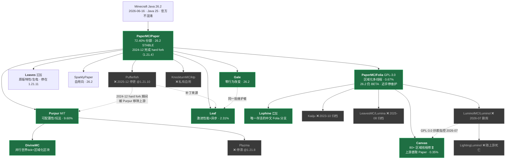

# Paper 下游高性能分支与 Folia 多线程（2026-09 现状）

> 调研日期 **2026-09-08**。数据来自 GitHub API、PaperMC Fill API、Purpur API、bStats、Modrinth / Hangar API 实时拉取，以及各项目仓库源码与 issue 实读。
> 全文区分「查证过的事实」与「推断」；查不到的明确标注「未核实」。

## 一、TL;DR

1. **版本基线变了。** Minecraft Java 已改用日历版本号（`年.drop.修订`），最新正式版 **26.2「Chaos Cubed」（2026-06-16）**，26.3 在预发布（26.3-pre-2，2026-09-04）。**26.1 起 Mojang 官方发布完全不混淆的 jar**，且强制 **Java 25**。讲「1.21.x / Java 21 / 需要 deobf mapping」的资料全部过期。
2. **Folia 技术是真的，但项目已接近无人维护。** 26.1.2 于 2026-05-06 出 STABLE，**26.2 至今（build #7，2026-08-25）仍是 BETA**；2026 年 7 月以来的提交几乎全是「Update Paper」，实质修复仅 3 条，51 个 open issue + 24 个 open PR。PaperMC 贡献者本人在公开讨论中说过 **"folia aint a real paper maintained project"**。
3. **插件生态是硬约束**：Hangar 上仅 **725/3774 ≈ 19%** 的项目声明支持 Folia，且 **EssentialsX、Vault、Multiverse、Dynmap、FastAsyncWorldEdit 全部不支持**，WorldEdit 只有阉割版，**连 spark 本体都不支持**（Folia 还把 Paper 内置的 spark 直接 patch 成 `if (false)`）。
4. **下游分支已明显分层。** 活跃：**Canvas(299) / Gale(221) / Leaf(124) / Lophine(123) / Purpur(54) / DivineMC(42)**（近 90 天提交）；**Pufferfish（2025-12 停更，停在 1.21.10）、Plazma、Kaiiju、KTP** 已死；**Leaves 卡在 1.21.11**，落后正式版两个 drop。2026 年 7 月中文社区还发生了 **LuminolMC 指控 CanvasMC 违反 GPL-3.0 后全线删库**的事件，中文 Folia 分支只剩 Lophine 一家。
5. **结论：绝大多数服务器该用 Paper 或 Purpur。** 想要性能又一行行为都不能变 → Gale；愿意调参换极限性能 → Leaf；生电/技术服 → Leaves（须接受版本滞后）。Folia 只适用于「16+ 物理核 + 玩家天然分散 + 插件极少」的大型生存/空岛服，且**优先看 Canvas 而非 Folia 本体**。

---

## 二、谱系关系图

实线 = fork 关系，虚线 = 补丁移植 / 争议 / 上游变更。**Canvas 是特例**：补丁基于 Folia，但把 Folia 补丁打包进自己仓库、**直接从 Paper 上游同步**，因此能比 Folia 本体更早跟版（事实佐证：Canvas 已在 26.2，Folia 26.2 仍 BETA）。

---

## 三、逐项目档案

### 3.1 PaperMC/Folia —— 官方区域化多线程

`github.com/PaperMC/Folia`，GPL-3.0，4,353★，推送 2026-08-25，90 天提交 **13**。作者 Spottedleaf + PaperMC 团队。bStats **0.67%（1,213 台）**。

**原理（源码/文档实证）**：世界被切成「独立 region」，每个 region 有自己的 tick loop、按 20 TPS **并行（parallel）而非并发**执行，**没有主线程**。region 按 region section 网格管理，默认 `grid-exponent=4` 即 **16×16 区块**一格。四条不变式保证独立性：正在 tick 的 region 不能扩张、必须持有外围一圈缓冲区块、有活跃邻居时不能开始 tick、相邻 region 最终必须合并；不相连的部分要拆分以保持并行度。merge/split 时对 tick 计数器施加偏移量对齐，**红石/方块 tick 的相对 deadline 不会错乱**。另有一个永不 merge/split、恒定 20TPS 的 **global region**，负责 gamerule、全局游戏时间、日光、天气、世界边界、控制台命令。

**线程模型（最易误解处）**：**region 不绑定线程**。`TickRegionScheduler` 用固定线程池按「最早开始时间优先」（等价 EDF）调度，官方明说该算法**既非 NUMA 感知也非 CPU core 感知**。26.2 新增 `threaded-regions.scheduler` 可选 `WORK_STEALING`（NUMA 感知）。

> **⚠️ 默认线程数是个坑**：`threads: -1` 的公式是 `cores/2`，**若结果 ≤4 则取 1**，否则再除以 4。即 **8 核 → 1 个 tick 线程**、32 核 → 4 个、64 核 → 8 个。**生产必须手动设置**，否则多核完全没用上。

**TPS 按 region 计算**：`/tps` 换成 `/tps [server|region] [n]`。`Bukkit.getTPS()` 返回**当前正在 tick 的那个 region** 的数据，**不在 region 线程上调用会抛 `UnsupportedOperationException("Not on any region")`**；新增 `getRegionTPS(Location/Chunk/...)` 返回 `double[5]`。**尚无 MSPT 版 API**（issue #391，最高赞开放 issue 之一）。

**插件适配的硬性要求：**
- `plugin.yml` / `paper-plugin.yml` 必须有 **`folia-supported: true`**，否则服务器**拒绝加载**（三处拦截）。官方同时警告：**打这个标记远远不够**。
- **`BukkitScheduler` 被 patch 成永远抛异常**——`CraftScheduler.handle()`（所有 `runTask*`/`BukkitRunnable` 的汇聚点）里就一行 `if (true) throw new UnsupportedOperationException();`。**陷阱：`folia-api` 仍导出 `BukkitScheduler` 接口（只标 `@Deprecated`），所以编译完全能过，只在运行时炸——不要把「编译通过」当兼容性证据。** 实例：CoreProtect 23.4b 已声明支持，仍因一处 `runTaskLater()` 让 Copper Golem 功能抛异常。
- 四种替代 scheduler：`GlobalRegionScheduler`（全局态）、`RegionScheduler`（按坐标；javadoc 明确**「用它给实体调度任务是完全不合适的」**，因为实体传送后 region 会变而它不跟随）、`EntityScheduler`（`entity.getScheduler()`，跟随实体跨 region/跨世界，带 `retired` 回调，本身线程安全）、`AsyncScheduler`（用 `TimeUnit` 而非 tick）。
- **这四个类现在住在 Paper 上游**（`io.papermc.paper.threadedregions.scheduler`），在 Paper 上会映射到主线程。**因此「一套代码同时跑 Paper 和 Folia」不需要任何兼容库**，只要别再用 `BukkitScheduler`；只有还要兼容 Spigot / 老版本时才需要 FoliaLib（133★，最新 0.5.1 / 2025-06）或 FoliaScheduler（v0.8.0 / 2026-05，三者中最新）。
- **线程安全模型**：唯一保证是「region 正在 tick 时对自己的实体/区块/POI 数据独占」，README 强调这**与任何插件数据无关**；跨 region 访问 = 数据损坏，运行时有 `TickThread.ensureTickThread()` 硬检查。经验规则是事件源点周围**约 8 个区块**大概率属当前 region，**但这不是保证**，确认必须调 `Bukkit.isOwnedByCurrentRegion(...)`。事件与命令**并行**触发（不能同步，否则死锁），插件自己的数据毫无保护；README 特意警告 `ConcurrentHashMap` 用得草率「只会把线程问题藏起来，然后变得几乎无法调试」。事件的 `async` 修饰符已废弃。

**已知损坏（README 自陈 + 源码 + issue 实读）：**

| 域 | 具体表现 |
|---|---|
| **API（README 自陈）** | 传送门/重生/部分登录 API 大部分损坏；**全部 scoreboard API 视为损坏**；世界加载/卸载损坏；**`Entity#teleport` 永久移除**（"NEVER UNDER ANY CIRCUMSTANCE come back"）|
| **原版命令** | **24 条被禁用**：bossbar、clone、data、datapack、debug、function、item、loot、reload、return、ride、rotate、schedule、**scoreboard**、spectate、spreadplayers、tag、team、teammsg、tick、trigger、perf、saveall、restart |
| **跨维度（重灾区）** | `PlayerTeleportEvent` 对 `ENDER_PEARL`/`NETHER_PORTAL`/`END_PORTAL` **全不触发**（#490）；骑载具走末地门被送回 world spawn（#453）；村民过下界门抛 `World mismatch`（#431）；跨维度丢鱼钩（#435）。原理上 Folia 重做了传送门——出口位置直到 async place 阶段才确定，来不及像原版那样中止，**因此玩家和实体现在都会创建出口传送门，行为与原版不同** |
| **红石 / 技术机器** | 「28w Pork Tower」触发跨线程实体状态访问错误（#334）；音符盒不响应红石（#470）|
| **末影龙 / 高速实体** | 远离原点 summon 后立即被删（#427）；PR #504 表明**多部件实体跨 region 注册是坏的**；**速度够快的实体能越出 region 边界**，末影珍珠炮之类会导致崩溃 |
| **安全** | #454（2026-05，open）configuration 阶段的包可让 netty 线程等待，**可被利用按需卡死服务器**，至今未修 |
| **生命周期** | #353（最高赞）关服时 region ticker 先于插件停止，插件 `onDisable()` 的世界清理**永远执行不了** |

**#469 是最有说服力的生产事故报告**（2026-06，open）：一个下界→主世界的传送门刷怪塔（约 98 万/小时掉落、28 万猪灵），因为**下界侧与主世界侧 region 完全解耦到不同线程**，下界侧全速生产且不感知主世界侧堆积，形成**正反馈循环**，多次把服务器打到完全无响应；加大掉落井、切传送门底部等物理缓解**全部无效**。

> Raid、活塞、大范围爆炸：历史 issue 均已关闭且无新报告，但**无官方正确性声明**，只能说「无已知开放问题」（未核实）。

**维护状态争议（重要）**：issue #471（2026-06-24，某 Folia 下游 fork 维护者提交，后被 PaperMC 成员以「这不是解决问题的方式」关闭）列出更长的损坏清单——末影珍珠、Waypoints、世界边界非完全线程安全、**玩家未被正确自动保存**、AntiXray 未 regionize、`/tp` 的 pitch/yaw 坏、region 崩溃时不生成 crash report 等。**该清单非官方认可**，但争议暴露了两件可查证的事：① 截至 2026-09-08 有 **51 个 open issue + 24 个 open PR**，2026 年 7 月至今提交几乎全是「Update Paper」，实质修复仅 3 条；② PaperMC 贡献者 PedroMPagani 的原话是 **"folia aint a real paper maintained project"**。社区的共性担忧是「把想用的人都劝去自己 fork」，导致每个网络重复修同样的 bug。

**是否还标 experimental**：**README 与官方文档里已没有 "experimental" 字样**，但发布渠道仍分级——26.1.2 是 **STABLE**，26.2 的 6 个 build **全是 BETA**，下载页默认隐藏 26.2。

**硬件与调优（README 官方口径）**：理想 **≥16 个物理核心（不是线程）**；**必须预生成世界**；线程预算：netty IO 每 200–300 人约 4 条、chunk io 约 3 条、预生成后 chunk worker 约 2 条，还要给 `-XX:ConcGCThreads` 留量；**总分配不超过 CPU 的 80%**。数字来自峰值约 330 人的测试服，官方自称「非常粗略」。

**生产案例（可信度必须打折）**：**官方压测**可信度最高但属测试而非生产——2023-06-18 单台 **Ryzen 9 7950X3D 跑 1000 人**未分片、2023-08 96 核 EPYC 稳定性测试、双路 EPYC 128 线程 320+ 人无明显 TPS 下降。**DonutSMP**（社区站称其部署多个 Folia 实例、日活并发数千、46 万实体）**为单一社区来源，官网无法独立验证**。**2b2t 使用 Folia 的说法倾向于不成立**（与「2b2t 运行自研分支」这一已知事实冲突）；流传的「200 人→800 人」出自 SEO 内容农场，**不予采信**。间接硬证据是 #469 的报告者运行真实生产服、#334 的报告者列出 25 个插件的生产清单——**确有商业服在跑 Folia，但没有任何一个「服名+规模+人数」三者齐全且可独立核实的案例。**

### 3.2 Purpur —— 可配置性与玩法，不是纯性能

`github.com/PurpurMC/Purpur`，**MIT**（补丁），2,407★，推送 2026-09-04，90 天提交 **54**。MC **26.2**（build #2632），**已有 `ver/26.3` 分支跟踪 26.3-pre-1**。bStats **9.60%（17,411 台，全网第二）**。

常被误解成「更快的 Paper」。它的仓库描述现在是 *"designed for configurability, and new fun and exciting gameplay features"*——**已经不再宣称 performance**。主轴是把大量原版写死的行为变成配置项，以及加入原版没有的玩法（骑乘各种生物、可配置生物属性/掉落/繁殖等）。

**MIT 许可证是它独有的实务优势**，下游引用其补丁的合规成本远低于 GPL 系——这也是 DivineMC、Plazma、Leaf 都从它取补丁的原因。**跟版极快**：MC 26.2 发布 2026-06-16 → Purpur 首个 26.2 构建 2026-06-18（**+2 天**）。

代价：配置项数量巨大，误配容易偏离原版行为，对生电/技术服是负面因素。

---

### 3.3 Leaf —— 激进性能 + 异步化（中文团队，全球化运营）

`github.com/Winds-Studio/Leaf`，许可证混合（补丁默认 MIT，部分 GPL/LGPL/Apache；**二进制 GPL-3.0-only**），1,073★，推送 2026-09-07，90 天提交 **124**。MC **26.2**（`ver-26.2`，2026-09-06）。维护者 Dreeam-qwq、hayanesuru、HaHaWTH 等。文档 `leafmc.one/docs`（英/中），QQ 群 619278377。bStats **2.31%（4,192 台，Paper 系分支第一）**。

**核心优化手段与代价：**

| 手段 | 做法 | 代价 |
|---|---|---|
| **DAB**（Dynamic Activation of Brain）| 按与玩家的距离**渐进降低**实体 brain tick 频率（不同于 EAR 的硬截断）。`start-distance:12`、`max-tick-freq:20`、`activation-dist-mod:8` | **默认关闭**。调大 `max-tick-freq` 让远处怪物行为严重退化；**依赖寻路的刷怪塔会被打坏**，需加黑名单（默认已含 villager/axolotl/hoglin/zombified_piglin/goat）|
| 异步寻路 | 导航计算移出 tick 线程。`max-threads:0` 时取核数 1/4，建议 1/3 | 寻路延迟一帧，行为与原版有可观察差异 |
| 异步实体追踪器 | 多线程处理玩家—实体可见性 | **默认关闭**，以竞态风险换吞吐 |
| 异步生怪 | 声称高实体量下最多约 15% | 生怪时序偏离原版 |
| 异步玩家数据保存 | 实验性 | 文档自陈**可能丢数据** |
| Linear 区域格式 | 整 region 一次性压缩 | 见 §5.5 |

另有 Sentry 集成（取自 Pufferfish）、**允许中文等非 ASCII 用户名**、Mod 协议支持。**异步模块不支持 `/leaf reload` 热重载。** README 大方列出约 16 个补丁来源（Gale、Pufferfish、Purpur、Mirai、Petal、Carpet Fixes、Akarin、Slice、Parchment、Leaves、Kaiiju、Plazma、SparklyPaper、Luminol、Nitori、**KeYi（标注 R.I.P.）** 等），是这个生态高度交叉移植的典型样本。

---

### 3.4 Gale —— 零行为改变的 drop-in

`github.com/GaleMC/Gale`，GPL-3.0，162★，推送 2026-09-06，90 天提交 **221（活跃度极高）**。MC **26.2**（`26.2-R2.3.0`）。维护者 MartijnMuijsers（原作者）、Dreeam-qwq、granny、HaHaWTH。

卖点明确：**"Zero behavioral changes – all your plugins work exactly as before"**，换 jar 即用。Features.md 官方口径是 *"Gale changes do not affect plugins. All changes are purely internal."*，只修「无可观察副作用」的 bug。优化类别：缓存/预计算、fastutil 专用集合、廉价条件前置与惰性求值、事件驱动的缓存失效、减少分配、局部代码优化。

**两个必须点出的矛盾：**
1. README 声称含「SIMD 加速运算、虚拟线程」，但 **Features.md 的功能清单里没有对应条目**，实现程度**未核实**。
2. **bStats 只有 7 台**，与 221 次/90 天的提交严重不符。合理推断（**推断**）：作为「零行为改变的 drop-in」，很多用户不认为需要区分品牌，或部分构建仍以 Paper 身份上报。**不要据此认为 Gale 不可用，但也不能声称它有规模化生产验证。**

Gale 与 Leaf 由重叠的维护者群体维护，Gale README 直接写「想要改变行为的优化请去 Leaf」——**这两个是有意做成互补的一对，不是竞品**。

---

### 3.5 Leaves（LeavesMC）—— 原版特性/生电，方向与 Purpur 相反

`github.com/LeavesMC/Leaves`，GPL-3.0，849★，推送 2026-08-13，90 天提交 **3（几乎停滞）**。**MC 停在 1.21.11**（`mcVersion=1.21.11`；官方 API `api.leavesmc.org/v2/projects/leaves` 列出的最高版本就是 1.21.11，**无 26.x**）。文档 `docs.leavesmc.org`（简中+英双语），QQ 群 815857713。bStats 0.25%。

**与 Purpur 的定位差异（本报告最易被误读的一点）：**

| | **Leaves** | **Purpur** |
|---|---|---|
| 目标 | **修复被破坏的原版特性**，行为向原版靠拢 | **把原版行为变成配置项 + 加新玩法**，主动增加偏差 |
| 典型功能 | 服务端侧支持 Syncmatica、Carpet 假人、MiniHUD、BBOR、Jade、Xaero；玩家自动录制（ReplayAPI）；同步全服村民折扣；取消铁砧「过于昂贵」 | 骑乘各种生物、可配置生物属性/掉落/繁殖 |
| 服务对象 | 生电服、技术性生存 | 娱乐生存、RPG |

它是 **Paper 的分支**（不是 Fabric 替代品），因此能用全部 Paper 插件——这正是「既要插件又要生电」的服主选它的原因。中文社区有单点实测：某服从 Fabric 迁到 Leaves 后 MSPT 中位数从一度飙到 90ms 降到 21ms、TPS 稳 20（服主自述，变量不受控）。

**最大风险是跟版**：26.1 已发布 5 个多月、26.2 近 3 个月，Leaves 仍在 1.21.11 且 90 天只有 3 次提交（团队精力可能被分散，见 §5.2 的 Lumina 归档）。**若必须跑 26.x，Leaves 目前不是可选项。**

---

### 3.6 Canvas（CanvasMC）—— Folia 系里最值得看的一个

`github.com/CraftCanvasMC/Canvas`，GPL-3.0，364★，推送 2026-09-05，90 天提交 **299（本次调研最高）**。MC **26.2**，要求 **Java 25**。GitHub 上无 release/tag，走 `canvasmc.io/downloads/canvas`。bStats 0.35%（已超过 Pufferfish 与 Leaves）。

三个关键差异（README 自述，其中跟版能力被事实佐证）：① **80+ 项区域线程修复**，声明计划回流 Folia；② **上游取自 Paper 而非 Folia**，把 Folia 补丁打包进自己仓库，**无需等 Folia 更新即可跟版**；③ 源码中带 `io.canvasmc.canvas.spark.*` 包（`FoliaSparkPlugin`、`FoliaTickReporter`、`ChunkRegionCenter` 等），**声称支持按区域剖析——只核实到源码存在，其对外行为与文档未核实**。默认配置取向是**原版兼容优先、性能其次**（与 Leaf 相反）。

**争议见 §5.2。** 当前 README 中已有来源致谢与许可证声明（列出 Lithium、Leaf、Luminol 等，并在 `META-INF/licenses/` 放完整许可证），**该声明是否为争议后补强，未核实**。

---

### 3.7 Lophine —— 目前唯一活跃的中文 Folia 分支

`github.com/LophineLabs/Lophine`，GPL-3.0（继承 Folia），180★，推送 2026-09-04，90 天提交 **123**。MC **26.2**（8 月起几乎每周发版），Java 25。维护者 Suisuroru、Bacteriawa、HaHaWTH 等。

自我定位：*「基于 Folia 的分支……目标是在 Folia 上实现更多生电的内容」*，并**主动声明「完整生电请使用 Fabric」**——这个自我设限比很多同类项目诚实。特性：可配置原版特性、Tpsbar、Folia 已知 bug 的专项修复、`b_linear` 存档格式、可选的插件 Mixin 支持。

**中文社区分支的共性（Lophine 是最典型样本）**：文档中文优先；提供 **CNB 镜像**（`cnb.cool/LophineLabs/Lophine`，同 commit 独立构建）解决国内访问；QQ + Discord 双渠道；自建 Maven（`repo.bacteriawa.com`）。**代价是英文社区可见度低、bStats 完全不出现**（推断以 Folia 身份上报或未接入，**未核实**），外部难以评估其真实装机量与生产验证程度。

---

### 3.8 DivineMC —— Purpur 分支，把多线程往 Paper 侧硬塞

`github.com/BX-Team/DivineMC`，GPL-3.0，270★，推送 2026-09-06，90 天提交 **42**。MC **26.2**，上游 **Purpur**。bStats 0.09%。

「不换 Folia 但要多线程」路线的代表。自述特性：**Regionized Chunk Ticking**（并行 tick 区块，自称「类似 Folia 的做法」）、**Parallel World Ticking**、**Parallel Sensor Phase**（把生物 AI 里昂贵的只读部分——实体扫描、视线检查——放线程池）、异步寻路/追踪/生怪/加入/区块发送/传送门预加载、**Raytrace 实体剔除**、**Secure Seed（1024 位）**、Linear（V1/V2 + Buffered）、Mod 协议、Sentry。

**风险（推断）**：在保留完整 Bukkit 单线程 API 语义的前提下做并行世界 tick，本质上比 Folia 更激进——Folia 至少用 `folia-supported` 白名单和硬线程检查把不安全插件挡在门外，而这类分支要维持「完全兼容 Paper 插件」的承诺，就必须在并行与 API 契约之间做隐式妥协。**未找到针对其并行世界 tick 的独立正确性验证或竞态压测报告（未核实）。** 上生产务必自行长跑并做数据一致性校验。

---

### 3.9 SparklyPaper —— 明确「自用向」，但补丁有参考价值

`github.com/SparklyPower/SparklyPaper`，**仓库未声明许可证**，202★，推送 2026-08-30，90 天提交 34，默认分支 `ver/26.2`。README 顶部警告：**为自家生存服定制，不追求成为公共稳定分支，出问题不提供支持**，并建议「有能力的话自己 fork Paper 挑需要的补丁」。

补丁写得极详实，是理解「大型生存服卡在哪」的好材料：跳过 `ServerEntity#sendChanges` 里的 `distanceToSqr`、无默认 `CraftMapRenderer` 时跳过 `MapItem#update()`（地图画服的大头）、优化 `EntityScheduler#executeTick`、简化耕地/作物湿度检查（**与 Paper 的 dry/wet farmland 自定义 tick 频率不兼容**）、fastutil 优化 `canSee`。作者在 README 里主动吐槽了 profiler 数字的可比性问题——这是本次调研里少见的诚实基准表述（详见 §5.6）。

---

### 3.10 已停更 / 归档 / 事实死亡

| 项目 | 最后活动 | 停在的版本 | 判定依据 |
|---|---|---|---|
| **Pufferfish** | 最后提交 **2025-12-21**，90 天提交 **0** | 仓库 1.21.10；官网只提供 **1.20.4 / 1.21.8** | 未归档但**事实停更约 9 个月**，未跟进 1.21.11 / 26.x |
| **Pufferfish+**（付费）| — | — | Pufferfish Host 的付费层（宣称含异步实体追踪、进阶寻路）。**2026 年是否在售、是否跟进 26.x 无法从公开渠道查证（未核实）。** 开源版已停更 9 个月，不建议依赖 |
| **Kaiiju** | **2023-10-15 归档**，build #240 | 1.20.1 | 仓库 `archived: true`。曾是 Folia 的无政府服分支，补丁已被 Leaf 等吸收 |
| **Plazma** | 2026-03-15（仅改 README），90 天提交 **0** | 分支 1.21.8；release 停在 1.20.6（2024-10）| 韩国团队的 Purpur 分支，含全部 Pufferfish 补丁 + FreedomChat。bStats 仅 11 台 |
| **KTP（KnockturnMC/ktp）** | 2026-05-20，90 天提交 **0**，13★ | 有 `ver/26.2` 分支 | 自述 *"a fork of paper with some random added mechanics that I needed"*——**私有网络自用项目，不是通用高性能分支**，不应进入选型清单 |
| **KeYi** | 原仓库 404 | — | Leaf 的 credits 里直接标注 **"(R.I.P.)"**，备份仓已归档（2023-04）|
| **LeavesMC/Lumina** | **2025-08-04 归档** | 1.21.6 | README 原文 **"THIS PROJECT IS ARCHIVED NOW. (DUE TO PERSONAL ABILITIES)"**。曾是 LeavesMC 面向大型生电服的 Folia 分支 |
| **Luminol / LightingLuminol** | **2026-07 删库**，归档副本在 `MenthaMC/*`（2026-07-11~12）| 26.1.2 | `LuminolMC/Luminol` 现返回 404，组织下只剩一个 `AboutCanvas` |
| **Mint（MenthaMC）** | **2026-07-16 归档** | — | 同为 Folia 分支，随 MenthaMC 组织整体归档（该组织 19 个仓库现已全部 archived）|

---

## 四、横向对比表

### 4.1 现状与跟版

| 项目 | 上游 | 许可证 | ★ | 90d 提交 | 最新 MC | bStats | 状态 |
|---|---|---|---|---|---|---|---|
| **Paper** | CraftBukkit（已 hard fork 解耦）| GPL-3.0 系 | 12,619 | 102 | **26.2 STABLE**（+dev/26.3）| **72.40%** | 🟢 基准 |
| **Purpur** | Paper | **MIT** | 2,407 | 54 | **26.2**（+ver/26.3）| **9.60%** | 🟢 活跃 |
| **Leaf** | Paper | 混合（二进制 GPL-3.0）| 1,073 | 124 | **26.2** | 2.31% | 🟢 活跃 |
| **Leaves** | Paper | GPL-3.0 | 849 | **3** | **1.21.11** ⚠️ | 0.25% | 🟡 跟版滞后 |
| **Gale** | Paper | GPL-3.0 | 162 | **221** | **26.2** | 0.00%(7) | 🟢 活跃/小众 |
| **SparklyPaper** | Paper | **未声明** ⚠️ | 202 | 34 | **26.2** | — | 🟢 自用向 |
| **Pufferfish** | Paper | GPL-3.0 | 650 | **0** | 1.21.10 ⚠️ | 0.25% | 🔴 停更 9 个月 |
| **DivineMC** | **Purpur** | GPL-3.0 | 270 | 42 | **26.2** | 0.09% | 🟢 活跃 |
| **Plazma** | **Purpur** | MIT | 153 | **0** | 1.21.8 ⚠️ | 0.01% | 🔴 停滞 |
| **Folia** | Paper | GPL-3.0 | 4,353 | 13 | **26.2 BETA** / 26.1.2 STABLE | 0.67% | 🟡 近乎停维护 |
| **Canvas** | **Folia**（上游取 Paper）| GPL-3.0 | 364 | **299** | **26.2** | 0.35% | 🟢 最活跃 |
| **Lophine** | **Folia** | GPL-3.0 | 180 | 123 | **26.2** | — | 🟢 活跃（🇨🇳）|
| **Kaiiju / Lumina / Luminol / KTP** | Folia / Paper | — | — | 0 | 1.20.1 / 1.21.6 / 26.1.2 / — | — | ⚫ 死亡 |

> **bStats 数据**（2026-09-08 快照，n=181,278）**的四点限制**：只统计装了接入 bStats 的插件且未关闭遥测的服务器；不重新品牌化的分支会以上游身份上报（Gale、Lophine、SparklyPaper 的数字都应打折看）；中国大陆服务器上报率普遍偏低，会**系统性低估 Leaves / Lophine**；份额高低不等于技术质量。

### 4.2 定位与行为偏差取向

| 项目 | 一句话定位 | 与原版行为的关系 | 插件兼容性 |
|---|---|---|---|
| **Gale** | 更快的 Paper，**一行行为都不变** | **刻意零偏差** | ≈100%，换 jar 即用 |
| **Leaf** | 性能优先，允许可配置的偏差 | 默认偏差小，**开关打开后偏差大** | ≈100%（单线程 API 不变）|
| **Leaves** | **修复被破坏的原版特性**，服务生电 | **主动向原版靠拢** | ≈100%，另加生电协议支持 |
| **Purpur** | **原版行为变配置项 + 加新玩法** | **主动增加可配置偏差** | ≈100%，另有 Purpur API |
| **DivineMC** | Purpur + 多线程与异步 | 继承 Purpur 偏差 + 并行时序偏差 | 声称完全兼容 |
| **Folia / Canvas / Lophine** | 区域化多线程，**无主线程** | 区域边界处存在结构性差异 | **需 `folia-supported`；约 19% 插件可用** |

---

## 五、已知问题 / 争议 / 坑

### 5.1 Folia 的插件生态：约 19%，且缺的正是基础件

两个独立数据源交叉验证（2026-09-08 实测）：**Hangar 3,774 个项目中 725 个带 `SUPPORTS_FOLIA` 标签 ≈ 19%**；**Modrinth plugin 类目下 Paper 16,561 个 vs Folia 3,241 个 ≈ 19.6%**。

逐个核实（判据：直接读仓库 `plugin.yml` 里有无 `folia-supported: true`）：

| 插件 | 支持 | 说明 |
|---|---|---|
| LuckPerms | ✅ | PR #3615 于 **2026-05-21** 合并 |
| PlaceholderAPI / ViaVersion / Citizens / mcMMO / BlueMap | ✅ | plugin.yml 含标记 |
| **VaultUnlocked** | ✅ | **这是 Vault 的 Folia 替代品** |
| WorldEdit（EngineHub）| ⚠️ **阉割** | PR #2905「Add **very basic** Folia support」2026-03-01 合并。**主 region 外的编辑被禁、实体操作被禁、`//regen` 被禁** |
| CoreProtect | ⚠️ | 声明支持但有实测 bug（issue #842）|
| **EssentialsX** | ❌ | PR #6586（2026-07-06 开）**仍 open**，截至 2026-09 无官方 Folia 版 |
| **Vault** | ❌ | PR #947（2026-08-12）仍 open |
| **FastAsyncWorldEdit** | ❌ | issue #2297 从 2023-06 开到现在。⚠️ **Hangar 上 FAWE 带 Folia 标签是过期数据**（其 Hangar 版本停在 2023-10），别信 |
| **Dynmap** | ❌ | PR #4266 仍 open。替代：BlueMap / squaremap / Pl3xMap 均已支持 |
| **Multiverse-Core** | ❌ | issue #2901 标题直接写 **"Folia support for Multiverse-Core (Not possible for now)"**，根因之一是 **Folia 的世界加载/卸载 API 本身就是坏的** |
| **spark** | ❌ | `spark-bukkit` 无标记，issue #549 仍 open。详见下条 |

> **⚠️ Folia 上剖析工具的坑（两边官方文档都没写）**：Folia 的区域线程补丁**直接把 Paper 内置的 spark 改成 `if (false)`**，并把 `isPluginPreferred()` 硬编码为 `true`。**所以在 Folia 上 `spark.enabled: true` 也没用**，必须从 `lucko/spark-extra-platforms` 单独安装 `spark-folia`（该仓库 2026-08-25 已跟到 Folia 26.2，但 README 明示「不享受与主插件同等的支持级别」）。
> 更麻烦的是**按 region 剖析基本做不到**：Folia issue #390 里维护者的结论是 region **不绑定线程**、可能每 tick 在线程间跳、且多个 region 共享线程，所以「只会在线程间乱跳，显示不出有用信息」。用 `--not-combined` 能看到各线程独立的树，但无法对应到具体 region。

**实操建议：不要信任何第三方兼容清单**（`BlockhostOfficial/folia-plugins`、`XeraPlugins/Folia-Plugins`、paper-chan.moe 都有过期条目——paper-chan.moe 把 spark 列为支持就与仓库现状矛盾）。唯一判据是解压 jar 看 `plugin.yml`；有标记也只说明作者声明过，仍需实测（CoreProtect 就是反例）。

### 5.2 2026 年 7 月：Luminol ↔ Canvas 的 GPL 争议与中文 Folia 生态坍缩

**可直接查证的事实：**
- `github.com/LuminolMC/Luminol` 现在返回 **404**；LuminolMC 组织下只剩一个已归档的 `AboutCanvas`（12★）。
- Luminol / LightingLuminol / MaplePile 等的归档副本出现在 `MenthaMC/*`，描述统一为 "Archive of LuminolMC/..."，归档时间 **2026-07-11~12**。
- **`LuminolMC/AboutCanvas` 是一份证据档案**，README 标题为 *"well well well / let's see what shit had happened once before"*，逐条列出它认为 CanvasMC 复制 Luminol 代码的对照：high velocity fix（Canvas PR #164 ↔ Luminol commit `41df3b2`）、world unload/load API（PR #249 ↔ `a130019`）、异步协议切换（Canvas 的 `Connection.java.patch` ↔ `a61142a`/`ef7b2d6`），并附 web.archive.org 存档与聊天截图。
- `MenthaMC/Mint` 于 **2026-07-16 归档**；`LeavesMC/Lumina` 更早在 **2025-08-04 归档**（README 写明原因是 "DUE TO PERSONAL ABILITIES"）。

**社区转述（二手）**：中文论坛报道标题为「LuminolMC 三款服务端核心宣布停更，开发团队指控 CanvasMC 涉嫌抄袭并违反 GPL-3.0」与「争议升级：多个服务端核心删除全部代码，EarthMe 宣布退出维护」。**双方完整声明原文与技术裁定未取得一手材料，孰是孰非本报告不下结论。**

**对选型的实际影响（重点）：**
1. **Luminol 系已死，最终版停在 26.1.2**，不要新部署。社区有人自行把补丁移植到 26.2 Folia「续命」，属个人行为、无维护保证。
2. 中文 Folia 分支从「Luminol / Mint / Lumina / Lophine 四家」坍缩到**只剩 Lophine**。这既提高了 Lophine 的重要性，也放大了它的单点风险。
3. **这个生态高度依赖交叉移植补丁，而 GPL 合规（署名、许可证头、来源标注）长期做得不严格**。选用小众分支时，法务风险与「上游突然消失」是同一类风险。

### 5.3 跟进上游的时滞：实测数据

以 MC 26.2（2026-06-16 发布）为标尺：

| 项目 | 首个 26.2 构建 | 滞后 |
|---|---|---|
| **Paper** | 2026-06-16（build 10, ALPHA）| **0 天**（8 月已 STABLE）|
| **Purpur** | 2026-06-18（build 2593）| **+2 天**（已在跟 26.3-pre-1）|
| **Folia** | 2026-07-28（build 1, BETA）| **+42 天，且至今未出 STABLE** |
| **Leaves** | **无** | **≥84 天且未开始** |

Folia 上一轮参考：1.21.11 首个 ALPHA 2025-12-16 → STABLE 2026-02-22，**约 68 天**。即 **Folia 稳定版通常比 Paper 晚 1.5–2 个月以上**；下游的 Lophine 反而更快，Canvas 则通过「直接从 Paper 上游同步」绕开了这个瓶颈。

### 5.4 Paper hard fork 与「官方不混淆」对下游的影响

这常被混为一谈，实际是**三个独立事件**：

| 时间 | 事件 | 意义 |
|---|---|---|
| **2024-05（1.20.5）** | Paper 运行时切到 **Mojang mappings** | 早于 hard fork，常被误记为其成果 |
| **2024-12 公告，1.21.4 落地**（build #100 于 2025-01-12 转 STABLE）| **hard fork**：彻底脱离 Spigot 源码树 | 补丁体系整体重写 |
| **2026-03-24（26.1）** | Mojang 发布**完全不混淆**的 jar | 反混淆链路消失 |

**hard fork 变了什么（仓库实测）**：改造前 Paper 挂 4 个 Spigot 子模块，补丁为 `patches/api` + `patches/server` 约 **1,576 个顺序补丁**。改造后：**零 Spigot 依赖**，Minecraft 源码来自 PaperMC 自研的 **Mâché**；**API 与 API 实现变成仓库里的普通 `.java` 源码**（不再是补丁）；只有 Mojang 源码走补丁，拆成 `sources/`（逐文件，934 个）、`resources/`（6 个）、`features/`（34 个大改动，可整体丢弃再回贴）。

> 纠正两个流传说法：**① `paperclip` 不是补丁格式**，它是发行 jar 的引导器，前后一直在用；**② 26.1 之后 deobfuscation 没有整体消失，消失的只是 remap 那一半**——Mojang 发的仍是编译好的 jar，Mâché 依旧要跑 Vineflower 反编译并用 Parchment 补参数名（Mojang 只公开类/方法/字段名）。

**对下游的实测影响——短期一次性痛，长期净减负，但淘汰了跟不上的项目：**
1. **减负可验证**：Leaf 迁到 1.21.4 时一次性丢弃 24 个补丁，其中包括 `Decompile-fix.patch` 与 `Dev-import-deobfuscation-fixes.patch`——这类「修反编译/反混淆」的旧管线固定税，Mâché 接手后直接消失。补丁上下文现在是可读真名，跨 fork 移植成本显著下降。
2. **门槛提高**：下游现在要维护**两层**补丁——对 Minecraft 源码的（`minecraft-patches/`）和对 **Paper 自己源码**的（`paper-patches/`，因为 Paper 的实现层从补丁变成了普通源码）。Purpur 补丁总数持平（342→333）但语义复杂度翻倍。
3. **有实际伤亡**：Purpur 在公告后 7 天（2024-12-20）把 `Pufferfish-Server-Changes.patch` 挪进 `unapplied-server/`，**此后 21 个月未恢复**，`Paper→Pufferfish→Purpur` 链条塌成 `Paper→Purpur`；Pufferfish 本身随后停更。

**收益可量化**（Mojang version manifest × Paper Fill API 交叉计算「MC 发版 → Paper 首构建」）：1.21.3 是 **8 天**；hard fork 后 1.21.5 是 **18 天**（新流程磨合的一次性代价）；此后 1.21.6/1.21.7/1.21.8/1.21.11 稳定在 **2–5 小时**；26.1 因 Java 25 + 无混淆 + 世界存储重构叠加而**跳过 26.1/26.1.1、约 10 天**；**26.2 是 3 小时 13 分**。Paper 官方目标是 "hour 0 releases"。

**副作用**：26.1 起 Paper **不再支持混淆插件**，`reobfJar` 必须去掉（「不存在 26.1 的 Spigot mappings 可供混淆回去」）。

### 5.5 优化手段的代价清单

| 手段 | 出现在 | 代价 |
|---|---|---|
| **DAB** | Leaf、多数性能分支 | **打坏依赖寻路的刷怪塔**；远处怪物行为退化；需逐实体调黑名单 |
| **EAR / 实体激活范围** | Spigot 起的老手段 | 硬截断，远处实体直接不 tick |
| **异步寻路 / 异步实体追踪** | Leaf、DivineMC、Kaiiju | 行为延迟与竞态风险；多数分支默认关闭 |
| **并行世界 tick / 区域化区块 tick** | DivineMC | 保持单线程 API 契约的同时并行，正确性边界模糊，**无公开独立验证** |
| **区域化多线程** | Folia 系 | 见 §3.1、§5.1 |
| **Linear 区域格式** | Leaf、DivineMC、Lophine(`b_linear`)、Kaiiju | **整 region 一次性压缩**：省磁盘（Anvil 把每个 chunk 补齐到 4096 字节，满区域平均浪费约 1MB）、利于顺序 IO，**但不利于单区块随机访问**；直接读 `.mca` 的插件会失效（走 NMS/Bukkit 的没问题）；需 `mca2linear`/`linear2mca` 转换 |
| **异步玩家数据保存** | Leaf（实验性）| 官方文档自陈**可能丢数据** |
| **简化耕地/作物检查** | SparklyPaper | 与 Paper 的 dry/wet farmland 自定义 tick 频率**不兼容** |
| **SIMD** | Pufferfish（2025-12 有相关提交）、Gale README 声称 | Gale 的 SIMD/虚拟线程在 Features.md 中**未列出**，实现程度**未核实** |

### 5.6 基准与剖析：结论是「无可信的公开横向基准」

**这是本次调研最重要的结论之一。** 不存在方法论透明、可复现、覆盖 Paper/Purpur/Pufferfish/Leaf/Folia 的第三方横向基准。全网只有：1 份 fork 官方自测（Leaf，仅 vs Paper）、1 份半透明的个人横评、1 套不测这些 fork 的学术基准。

**流传数字的溯源结果：**
- **Pufferfish README 的「漏斗快 30%」逐字来自 Airplane**，而 Airplane **最后 push 2022-05-09、最高只支持 1.17.1、从未发布过测试方法**；其作者自己的 commit 标题是 "Your daily dose of 1-3% optimization patches"，与 30% 量级不符。社区 2021 年就质疑过。
- **Leaf 官方基准**给了 seed、坐标、精确到 commit SHA（全网最好的一份），但**用笔记本 CPU（i7-10750H）、完全没有玩家/假人、MSPT 2.8–8.1ms 近乎空载、无误差棒、无原始数据、基于 MC 1.21.4（落后约 1.5 年）、且只有 Leaf vs Paper**。作者自己承认 "We will provide more detailed and reliable performance benchmark in the future!"
- **Purpur 已不再宣称 performance**（仓库描述已改）。
- **主机商 SEO 博客**占据搜索首页，特征一致：精确到小数点的 TPS + 零方法论 + 直接利益冲突。**不应引用。**
- **唯一接近可用的第三方横评**（semblock，2025-08）公开了机器规格、seed、Chunky 预生成与 SoulFire 假人，但未公开 JVM flags、bot 数量含糊、原始数据未发布。其结果很有启发：**Leaf 区块生成最快（+7.6%），但在玩家模拟场景下略逊于 Paper/Purpur**——「分场景互有胜负」本身就说明单一「提升 X%」无意义。

**权威说法：** Maddy Miller（Paper 贡献者）：*"These forks have historically **not lived up to the performance claims**, and in some cases, been extremely unstable." / "In most cases, using Paper is the way to go."* ｜ YouHaveTrouble 优化指南（2,864★，社区最主流）：*"Any paid server JAR that claims async anything — **99.99% chance of being a scam**"*，其推荐名单**只有 Paper 与 Purpur**，且把 Purpur 定位写作「features and the freedom of customization」而**非性能** ｜ paper-chan 优化指南：*"**Server startup time and idle MSPT are not useful metrics**... a sign of incompetence."* ｜ spark 作者的方法论标准：TPS 是均值因而有误导性（单 tick 在 20–100ms 间抖动时仍可能报 16），**必须看 min/max/median/p95 MSPT**——推论是绝大多数流传的对比只给平均 TPS 或 `/tps` 截图，**按 spark 作者自己的标准就是无效测量**。

> **社区从未收敛出标准 benchmark 的直接证据**：GitHub 上「minecraft server benchmark」类仓库最高星数是 **5**（Leaf 的 JMH 微基准集 SunBox），对比 spark 1,325★、mineflayer 7,413★。Paper 官方文档全库搜索 `Purpur`/`Pufferfish` **零命中**——既不背书也不批评，更没有官方基准。

**剖析工具现状（已查证）：** Paper 官方文档明确——**从 1.21 起 Paper 捆绑 spark 并列为首选剖析方式**（`/spark profiler start --timeout 600`，`spark.enabled` 默认 true）；**Timings v2 在 1.21 被弃用并默认关闭**（PR #11095，2024-07-17），**实现于 2024-10-27 的 "Remove timings impl" 提交被掏空**（1.21.3 起进入 no-op 模式），收尾清理做到 2026-07。官方原话曾说「可能在 1.22 彻底移除」——**这句已作废，因为版本号改成日历版了，根本不会有 1.22**；`co.aikar.timings` 的 14 个 API 类至今仍留在 Paper 里，标 `@Deprecated(forRemoval = true)`，纯空壳。`timings.aikar.co` 站点仍返回 HTTP 200 且无关停公告，但**是 Paper 侧先断的**——客户端已不再生成/上传报告，`aikar/timings` 仓库最后一次实质提交是 **2021-06-19**。**任何还教你用 `/timings paste` 的教程都已作废。**

spark 本体（`lucko/spark`，1,325★，GPL-3.0，最新 1.10.181 / 2026-08-25，**不发 GitHub Release**）提供 CPU profiler（默认引擎 async-profiler）、heap summary/dump、GC 监控、tick 监控、以及 2026-08 新增的 metrics 时序（仅内存留 1 小时，无 Prometheus/OTel 导出）。**async-profiler 只有 Windows 不支持**——Linux/macOS 的 amd64 与 aarch64 都支持，「Mac/ARM 用不了」是误解；但**不支持时是静默降级**到内置 Java 引擎，很容易让人以为一直在用 async-profiler。

**实务建议：** 不要引用任何流传的百分比。自建 harness 的要点：① 负载用 **Chunky 固定 seed 定量区块生成**（唯一被多方独立采用的确定性负载）+ **SoulFire 分级加压**（SoulFire 跑真实客户端代码，比 Carpet 的 `/player` 假人更接近真人，后者不走真实连接、测不到网络 I/O 与每连接序列化开销）；② 用 spark 记录 **p95 MSPT，不看平均 TPS**；③ **必须拉平各分支的配置默认值**——不拉平的话测出来的差异很可能是**默认值差异而非补丁差异**，这也是「调优后的 Paper ≈ Purpur」这个常见观察的根本原因；④ Folia 上必须按 region 分别看，全局单值无意义。

### 5.7 其他容易踩的坑

- **SparklyPaper 仓库未声明许可证**（GitHub API `license: null`），商业场景使用前需自行评估。
- **Canvas / DivineMC / SparklyPaper 在 GitHub 上没有 release**，只走官网或 CI 分发，对「拉取固定版本 + 校验哈希」的自动化部署和「回滚到已知良好版本」都不友好。
- **Java 版本门槛**：MC 26.1 起需 Java 25；Canvas / Leaf / Lophine 均已要求 Java 25 工具链，仍在 1.21.11 的 Leaves 用 JDK 21。混用直接启动失败。
- **维护者高度重叠**：HaHaWTH 同时在 Leaf、Lophine、DivineMC、Gale 的贡献者前列；Dreeam-qwq 是 Leaf 与 Gale 的核心；granny 在 Purpur 与 Gale；Suisuroru 在 Leaves 与 Lophine。**「选多个分支做冗余」在这个生态里是伪冗余**——它们的人员和补丁是同一个池子。

---

## 六、选型建议（按场景）

### 6.1 技术生存服（生电，需要原版机器精确工作）

**首选 Leaves（若可接受停在 1.21.11）；必须上 26.x 则用 Paper 原版或 Leaf（关闭全部行为改变开关）。**

- Leaves 的存在意义就是「修复被破坏的原版特性」，服务端侧支持 Syncmatica / Carpet 假人 / MiniHUD / BBOR / Jade / Xaero，别家没有。**但它卡在 1.21.11 且 90 天只有 3 次提交**，这是本方案最大风险。
- **绝对不要**启用 DAB、异步寻路、EAR——它们打坏刷怪塔与农场的方式恰恰是生电服最不能接受的。
- **不要为了生电选 Folia 系**：跨维度与红石正是 Folia 最弱的部分（#469 的跨维度正反馈崩服、#334 红石线程检查失败、#470 音符盒），Lophine 自己都说「完整生电请使用 Fabric」。**真正的极致生电应当考虑 Fabric + Carpet，而不是任何 Paper 分支。**

### 6.2 大型生存服（几百人，玩家分散，插件适中）

**主线 Paper 或 Purpur；追求极限且愿意调参用 Leaf。**

**只有同时满足全部五条，才考虑 Folia 系：** ① 物理核心 ≥16（不是超线程数）；② 世界已预生成；③ 玩家分布确实分散（不是全挤在主城）；④ 插件清单里**每一个**都能在 Folia 上跑（尤其要先解决 EssentialsX / Vault / Multiverse / Dynmap 的替代）；⑤ 你能接受 §3.1 那份损坏清单，并有能力自己排查跨线程 bug。

**别忘了手动设 `threaded-regions.threads`**——默认值在 8 核机器上只会给你 1 个 tick 线程。

Folia 系内部**优先看 Canvas 而非 Folia 本体**：跟版更快、80+ 项区域线程修复、默认原版优先、且在做按区域剖析。中文团队/中文文档需求看 Lophine。**务必先在 staging 跑，绝不直接迁生产。**

### 6.3 小游戏群组服（大厅、起床战争、竞速）

**Paper，需要玩法配置项时用 Purpur。明确不要用 Folia。**

理由是结构性的：小游戏服玩家天然聚集 → region 不断 merge 成一个大 region → 退化成单线程，还多背一层调度开销；而且 **Folia 的 scoreboard API 整个是坏的、`scoreboard` 命令也在被禁用的 24 条之列**，而计分板是小游戏的基础设施。小游戏群组的扩展方式应该是**横向多实例 + 代理（Velocity）**，不是单实例多线程。

### 6.4 混合 RPG 服（大量自研/第三方插件、自定义物品与技能）

**Paper 为基准；需要 Purpur 的玩法配置项就上 Purpur；性能吃紧时考虑 Gale（零风险）或 Leaf（需调参验证）。**

- **Gale 是这个场景性价比最高的一步**：drop-in 换 jar、声明零行为改变、插件完全不受影响，风险接近于零。代价是装机量极小、缺乏大规模生产验证——但由于它不改变行为，爆炸半径也小。
- **Leaf 可以上，但必须逐项确认开关**：DAB、异步寻路、异步追踪都会改变实体行为，RPG 服的自定义怪物 AI 与刷怪逻辑很可能被打坏。先全关跑基线，再一项项开、一项项测。
- **绝对不要用 Folia**：RPG 服插件依赖最重、自研插件最多，而 Folia 要求每个插件为区域模型重写（`folia-supported` + 四种 scheduler + 跨区域数据自行同步）。这是一次几乎等同于重写整个插件层的工程。

### 6.5 通用规避清单

- ❌ **不要新部署**：Pufferfish、Plazma、Kaiiju、Luminol / LightingLuminol、Mint、Lumina、KTP。
- ⚠️ **谨慎**：SparklyPaper（作者明确不提供支持、无许可证声明）、DivineMC（并行世界 tick 无独立验证）、Folia（近乎停维护，且 26.2 仍 BETA）。
- ✅ **通用原则**：分支越小众，你就越是那个唯一的 QA。选型前用 spark 在自己的负载下实测 p95 MSPT，**不要采信任何跨分支的通用性能数字**。

---

## 七、参考链接

**版本基线**
- Java 版本历史：https://minecraft.wiki/w/Java_Edition_version_history
- Java Edition 26.1（**首个完全不混淆的正式版、需 Java 25、日历版本号、2026-03-24**）：https://minecraft.wiki/w/Java_Edition_26.1 ｜ 26.2：https://minecraft.wiki/w/Java_Edition_26.2
- 新版本号体系官方公告：https://www.minecraft.net/en-us/article/minecraft-new-version-numbering-system

**Paper / Folia 官方**
- Paper：https://github.com/PaperMC/Paper ｜ **hard fork 公告**：https://papermc.io/news/the-future-of-paper-hard-fork/ ｜ 跟踪 issue：https://github.com/PaperMC/Paper/issues/11735
- **26.1 不混淆公告**：https://papermc.io/news/26-1/ ｜ 插件开发影响：https://docs.papermc.io/paper/dev/userdev/
- Mojang mappings 运行时（1.20.5）：https://docs.papermc.io/paper/dev/internals/ ｜ Mâché：https://github.com/PaperMC/mache
- Folia 仓库（README 含区域模型、线程预算、损坏 API 清单）：https://github.com/PaperMC/Folia
- Folia 文档：https://docs.papermc.io/folia/reference/overview ｜ https://docs.papermc.io/folia/reference/region-logic ｜ https://docs.papermc.io/folia/faq
- **Folia 插件开发指引**：https://docs.papermc.io/paper/dev/folia-support ｜ scheduler API 源码（已在 Paper 上游）：https://github.com/PaperMC/Paper/tree/main/paper-api/src/main/java/io/papermc/paper/threadedregions/scheduler
- Folia 下载：https://papermc.io/downloads/folia ｜ Fill API：`https://fill.papermc.io/v3/projects/folia`
- Paper 剖析文档（spark 捆绑 / Timings 弃用）：https://docs.papermc.io/paper/profiling/ ｜ Timings 弃用讨论：https://github.com/PaperMC/Paper/discussions/10565

**各分支**
- Purpur：https://github.com/PurpurMC/Purpur ｜ https://purpurmc.org/downloads ｜ `https://api.purpurmc.org/v2/purpur`
- Leaf：https://github.com/Winds-Studio/Leaf ｜ https://www.leafmc.one/download ｜ 配置（DAB/异步寻路）：https://www.leafmc.one/en/docs/config/leaf-global ｜ JMH 微基准 SunBox：https://github.com/Winds-Studio/SunBox
- Gale：https://github.com/GaleMC/Gale ｜ 优化清单：https://github.com/GaleMC/Gale/blob/main/Features.md
- Leaves：https://github.com/LeavesMC/Leaves ｜ https://docs.leavesmc.org/zh_hans/leaves/guides/getting-started ｜ `https://api.leavesmc.org/v2/projects/leaves`
- Canvas：https://github.com/CraftCanvasMC/Canvas ｜ https://canvasmc.io/downloads/canvas
- Lophine：https://github.com/LophineLabs/Lophine ｜ 国内镜像：https://cnb.cool/LophineLabs/Lophine
- DivineMC：https://github.com/BX-Team/DivineMC ｜ SparklyPaper：https://github.com/SparklyPower/SparklyPaper
- Pufferfish：https://github.com/pufferfish-gg/Pufferfish ｜ Kaiiju（归档）：https://github.com/KaiijuMC/Kaiiju ｜ Lumina（归档）：https://github.com/LeavesMC/Lumina

**争议材料（一手）**
- LuminolMC 的指控档案：https://github.com/LuminolMC/AboutCanvas
- 归档副本：https://github.com/MenthaMC
- Folia 维护状态争议 issue #471：https://github.com/PaperMC/Folia/issues/471

**Folia 已知问题（均 open）**
- #490 `PlayerTeleportEvent` 对多数传送不触发：https://github.com/PaperMC/Folia/issues/490
- #469 跨维度 region 解耦导致正反馈崩服（最详细的生产事故报告）：https://github.com/PaperMC/Folia/issues/469
- #454 可按需触发的崩服漏洞：https://github.com/PaperMC/Folia/issues/454
- #353 region ticker 早于插件停止：https://github.com/PaperMC/Folia/issues/353
- #391 缺 MSPT API｜#427 末影龙｜#431 村民过下界门｜#453 末地门+载具｜#470 音符盒｜#334 红石跨线程｜#390 无法按 region 剖析

**插件生态（逐个核实的来源）**
- Hangar Folia 标签：`https://hangar.papermc.io/api/v1/projects?tag=SUPPORTS_FOLIA`（725/3774）
- Modrinth：`https://api.modrinth.com/v2/search?facets=[["categories:folia"],["project_type:plugin"]]`
- LuckPerms PR #3615｜WorldEdit PR #2905（very basic）｜FAWE issue #2297｜EssentialsX PR #6586｜Vault PR #947｜Dynmap PR #4266｜Multiverse issue #2901（"Not possible for now"）｜spark issue #549
- spark：https://github.com/lucko/spark ｜ **Folia 需单独装**：https://github.com/lucko/spark-extra-platforms
- 社区兼容清单（**有过期条目，仅供参考**）：https://github.com/BlockhostOfficial/folia-plugins ｜ https://paper-chan.moe/folia/
- FoliaLib：https://github.com/TechnicallyCoded/FoliaLib ｜ FoliaScheduler：https://github.com/CJCrafter/FoliaScheduler

**基准与工具**
- Maddy Miller《Using Paper forks》：https://madelinemiller.dev/blog/using-paper-forks/
- YouHaveTrouble 优化指南：https://github.com/YouHaveTrouble/minecraft-optimization
- paper-chan 优化指南：https://paper-chan.moe/paper-optimization/
- spark TPS/MSPT 方法论：https://spark.lucko.me/docs/guides/TPS-and-MSPT
- SoulFire（推荐的假人压测）：https://github.com/AlexProgrammerDE/SoulFire ｜ Chunky：https://github.com/pop4959/Chunky
- Linear 区域格式与转换工具：https://github.com/xymb-endcrystalme/LinearRegionFileFormatTools

---

### 附：标注为「未核实」的事项

1. Pufferfish+（付费版）2026 年是否在售、是否跟进 26.x。
2. Gale 的 SIMD 与虚拟线程实现程度（README 声称，Features.md 未列出）。
3. Lophine / SparklyPaper 在 bStats 中的上报身份。
4. Canvas README 中来源致谢与许可证声明的添加时间点是否在争议之后；其按区域剖析能力的对外行为（只核实到源码类存在）。
5. DivineMC 并行世界 tick 的正确性边界与竞态验证。
6. **2b2t 使用 Folia**——社区站有此暗示但与已知事实冲突，**倾向于不成立**；「200 人→800 人」出自内容农场，不予采信。
7. **DonutSMP 的规模数字**——单一社区来源，官网无法验证。
8. Folia 上 raid / 活塞 / 大范围爆炸在 26.2 的实际正确性（历史 issue 已关闭且无新报告，但无官方验证声明）。
9. Luminol ↔ Canvas 争议中双方声明原文与技术裁定（仅取得指控方的证据档案与社区转述）。
