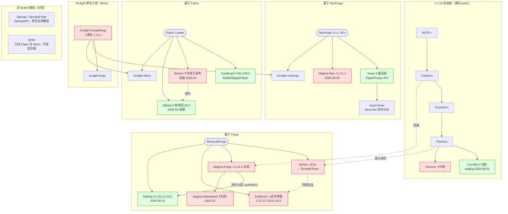

# 混合核心调研：Forge / NeoForge / Fabric + Bukkit API

> 调研日期：2026-09-08 ｜ 所有版本与日期均于当日联网查证
> 基准事实：Minecraft Java 版已于 2026 年改为**日历版本号**（`年.批次.修订`）。当前正式版 **26.2「Chaos Cubed」（2026-06-16 发布，要求 Java 25）**，26.3 处于预发布（26.3-pre-2，2026-09-04）。26.1（2026-03-24）接续 1.21.11，不存在 1.22。([minecraft.wiki](https://minecraft.wiki/w/Java_Edition_version_history))

---

## ① TL;DR

1. **老一代混合端已经集体退场**：Mohist 官方标记 **EOL**，其所有权与版权于 **2025 年 1 月被出售（买家 @TT）**，仓库先转到 `Rz-C/Mohist`、再改名为 **`Teneted/Tenet`**，官方构建停在 2025-05 前后；Magma（Forge）与 CatServer 实质停更；Banner 仓库已从 MohistMC 组织消失。
2. **仍在真活的只有五个**：Youer（NeoForge+Paper/Purpur，最活跃，已跟到 26.2/26.3）、Cardboard（Fabric+Bukkit/Spigot/Paper，跟到 26.1/26.2）、Ketting（Forge 1.20.1 源码 patch）、Crucible（1.7.10 长尾）、Silkard（Mohist 团队新 Fabric 端，26.3）。**Arclight 停在 1.21.1，近三个月仅 7 次提交**。
3. **技术上有两条路线**：源码 patch（Mohist/Ketting/CatServer/Crucible/Magma）与 Mixin 运行时注入（Arclight/Cardboard/Banner/Silkard）。前者补丁量爆炸（Ketting 称若改用 Paper 基座需再加约 1500 个补丁），后者与模组抢 Mixin 目标。两条路都绕不开 Bukkit 硬编码注册表、双事件系统、mapping 三套体系与单主线程假设四个结构性冲突。
4. **英文社区态度是一致的负面**，且有实名实据：EssentialsX 的 `do-not-use-mohist` PSA（2021-04-10 起）、KennyTV 的 list-of-shame（Mohist 换包、CatServer 违反许可证）、Patbox 与 Maddy Miller 的技术批评。Arclight 口碑明显更好——它不在任何 shame list 上、GPL-3.0 合规、在自家 FAQ 里主动列出不兼容清单。
5. **1.21.1 是当下混合端的现实上限**（Arclight/Magma-Neo/Youer 主力分支都在这里），追新版只有 Youer 和 Cardboard 两家；要 26.x + 插件生态，几乎只剩「纯模组端 + 服务端模组」这一条路。

---

## ② 谱系关系图

---

## ③ 逐项目档案

### Mohist → Tenet（Forge）｜⚠ 官方 EOL

| 项 | 值 |
|---|---|
| 仓库 | `github.com/MohistMC/Mohist` **已 301 跳转到** [`github.com/Teneted/Tenet`](https://github.com/Teneted/Tenet) |
| 许可证 | GPL-3.0 ｜ 1511 stars / 280 forks / 342 open issues |
| 分支 | 1.7.10 / 1.12.2 / 1.16.5 / 1.18.2 / 1.19.2 / 1.19.4 / 1.20.1 / 1.20.2 / 1.21.1 / 1.21.4 |
| 最近提交 | 默认分支 1.20.1 → **2026-01-16「fix build」**；1.21.1 → 2025-02-14；1.21.4 → 2024-12-04 |
| 官方构建 | 各版本末次构建集中在 **2025-05-21/22**（v2 API 实测）；1.20.6/1.21.4 在 API 中列出但**构建数为 0** |
| 下载 | mohistmc.com（仍开放） |

**产权转移链（已查证）**：MohistMC 官网首页原文 —— *"Ownership and copyright were sold in January 2025 (Buyer: @TT)"*、*"The code repository has been transferred to https://github.com/Rz-C/Mohist"*、*"Updates have been paused, but downloads remain available"*、*"We currently do not accept or process any feedback regarding the Mohist core"*。中文站 mohistmc.cn 同步写着「Mohist 已于 2025 年 1 月出售其所有权和版权（购买者: @TT），更新已暂停」。而 `Rz-C/Mohist` 现在又跳转到 `Teneted/Tenet`——`Teneted` 组织创建于 **2025-12-21**，即二次转手/改名。原 MohistMC 团队在官网明确切割：Youer / Silkard 是「独立新项目」。

**架构**：fork MinecraftForge，叠加 CraftBukkit/Spigot patch + Paper 优化，README 承认部分源码取自 **Atom 与 Thermos**。属于**源码 patch 路线**。

### Youer（NeoForge）｜✅ 当前最活跃

| 项 | 值 |
|---|---|
| 仓库 | [MohistMC/Youer](https://github.com/MohistMC/Youer) ｜ 许可证 **NOASSERTION（未声明标准许可证）** ｜ 216 stars |
| 创建 | 2023-10-20 ｜ 最近推送 **2026-09-07** |
| 分支 | `1.21.1`（默认）、`26.2`、`26.2-spigot`、`26.3` |
| 提交节奏 | 近 30 天：1.21.1 **69 次**、26.2 **30 次**、26.3 **13 次** |
| 技术栈 | NeoForge 26.2 / **JDK 25.0.1** / Gradle 9.6.0；核心集成 NeoForge + **Paper** + **Purpur** |
| 最新动作 | 2026-09-07「Updated to NeoForge-21.1.250」（1.21.1 线仍在跟 NeoForge 21.1.x） |

README 自述：*"Minecraft NeoForge Hybrid server implementing the Paper/Purpur API"*。**这是唯一一个既跟 NeoForge 21.x 长期支持线、又跟到 26.2/26.3 的混合端**。无 GitHub Release；mohistmc.com 的 v2 API 目前只暴露 mohist / banner 两个项目，Youer 走新后端分发，具体构建号与稳定性**未核实**。官网标注「测试版已上架」。

**AsyncYouer**：官网描述为「a branch of Paper that improves upon Youer async API based on Moonrise」/「增强 Paper 专用插件的兼容性」。MohistMC 组织下未见公开仓库，**未核实**。

### Banner → Silkard（Fabric）

- **Banner**：`MohistMC/Banner` 现为 **404**（仓库已从组织移除）；`Teneted/Banner` 存在但只是 1 star 的存档 fork（末次推送 2025-01-05）。官方 API 中末次构建：1.20.1 = build #800（2024-12-25）、1.21.1 = 2025-04-14；1.21.4 / 1.21.4-hack / 1.21.5 三个版本**列出但构建数为 0**。**结论：Banner 已死。**
- **Silkard**：[MohistMC/Silkard](https://github.com/MohistMC/Silkard)，**2026-02-19 创建**，GPL-3.0，19 stars，唯一分支 `26.3`，末次提交 2026-08-18「26.3-snapshot-9」。README：*"Minecraft Fabric Hybrid server implementing the Spigot API"*，JDK 25.0.1，直接对齐 Spigot/CraftBukkit 上游 commit。**只实现 Spigot API，不含 Paper**。项目极新，生产可用性**未核实**。

### Arclight（IzzelAliz，Forge/NeoForge/Fabric 三线）｜⚠ 冻结在 1.21.1

| 项 | 值 |
|---|---|
| 仓库 | [IzzelAliz/Arclight](https://github.com/IzzelAliz/Arclight) ｜ **GPL-3.0** ｜ **2082 stars** / 343 forks / 435 open issues |
| 默认分支 | `FeudalKings` ｜ 最近提交 **2026-08-13**「Bump Minecraft and dependency versions」 |
| 提交节奏 | 2026-06-01 以来仅 **7 次提交** |
| 最新 Release | **FeudalKings/1.0.1（2025-07-16）**，代码内版本号已是 1.0.2-SNAPSHOT |
| FeudalKings 目标 | **MC 1.21.1** ／ Forge 52.1.16 ／ **NeoForge 21.1.248** ／ Fabric Loader 0.19.3 + API 0.116.15 ／ Mixin 0.8.5 ／ Spigot reversion 4344 |
| 下载 | arclight.izzel.io ｜ 文档 wiki.izzel.io ｜ **QQ 群 3556966** + Discord ｜ 赞助 BisectHosting |

**单仓三线是实锤**：`FeudalKings` 分支根目录含 `arclight-common` / `arclight-forge` / `arclight-neoforge` / `arclight-fabric` 四个模块，用 architectury-loom 统一构建，`supportedPlatforms = ['forge', 'neoforge', 'fabric']`。

**官方版本支持表**（[wiki.izzel.io](https://wiki.izzel.io/s/arclight-docs/doc/versions-and-its-supporting-status-NCKYxXI3mt)）：

| 代号 | MC | Forge | NeoForge | Fabric | 状态 |
|---|---|---|---|---|---|
| Heart | 1.21.3 | — | — | — | 🚧 WIP，**无构建** |
| **FeudalKings** | **1.21.1** | 52.1.0 | 21.1.133 | 0.16.10 | ✅ **唯一 Active** |
| Whisper | 1.20.4 | 49.1.0 | 20.4.237 | 0.15.11 | ❗Legacy |
| Net / Trials / Executions / GreatHorn / Horn | 1.20.2 / 1.20.1 / 1.19.4 / 1.19.3 / 1.19.2 | — | — | — | ❗Legacy（不支持，但收 issue/PR） |

FAQ 关键自述：**完整支持 Bukkit / Spigot 插件，Paper「not yet」**；*"Multithreading will never take into consideration"*（永不考虑多线程）；已知不兼容清单：Performant、ExtendedNether、WorldEdit（需最新版）、ItemPhysic、Quark 附魔台（需改 `arclight.conf`）、AuthMe（需把假人名加进 UnrestrictedName）。**架构走 Mixin 注入路线。**

### Magma（MagmaFoundation）｜停更 → 复活 → 半停

三条线，全部可查证：

1. **Magma-Forge**（原 `magmafoundation/Magma` 改名）：只剩 `1.12.2` 一个分支，78 stars，许可证 NOASSERTION，末次提交 2026-04-29（仅 changelog），最后一个正式 Release tag 是 2022-06-21 的占位 `download`，开发构建停在 2022-03。
2. **Magma Maintained**（社区接管）：`magmamaintained/Magma-1.20.1` **2024-02 归档**，归档说明写明 Magma 从未完成 1.20.1，且**部分原 Magma 团队另起炉灶做了 Ketting**。`magmamaintained` 组织现已 404。
3. **Magma-Neo**：[magmafoundation/Magma-Neo](https://github.com/magmafoundation/Magma-Neo)，2024-07-21 创建，43 stars，自述 *"the next generation of hybrid minecraft server softwares. NeoForge + Spigot (1.21.1)"*。分支 `1.21.x`（末次 2026-04-27）与 `paper`（末次 2026-06-05「feat: more paper server patches」）。官网 magmafoundation.org 标「Minecraft 1.21.1 now supported」，版权年 2019–2026。

itzg/docker-minecraft-server 官方文档把 `TYPE=MAGMA` 标为 **Deprecated / "terminated"**，建议 1.12.2/1.18.2/1.19.3 用 Magma Maintained、**1.20.1+ 改用 Ketting**。

### CatServer（Luohuayu）｜⚠ 近乎停更

| 项 | 值 |
|---|---|
| 仓库 | [Luohuayu/CatServer](https://github.com/Luohuayu/CatServer) ｜ **LGPL-3.0** ｜ **2055 stars** / 212 forks |
| 官网 | **http://catmc.org**（HTTPS 连不通，实测仅 HTTP 200） |
| 官网列出版本 | 1.12.2（Forge 14.23.5.2860）／1.16.5（Forge 36.2.39）／1.18.2（Forge 40.0.83），全部 `*-R0.1-SpigotAPI` |
| 分支 | 1.12.2 / 1.16.5 / 1.18.2 / 1.19.4 / **1.20.1** / 1.20.1-dev / legacy-* |
| 最近提交 | 1.20.1 → **2026-02-13**「CatServer 1.20.1 (#928)」，**上一次是 2024-09-05**（17 个月只有 1 次提交）；1.12.2 → 2025-02-03 |
| Release | 只有 3 个，最新 tag `25.02.04`（2022-04-26） |

架构为 Forge 源码 patch（仓库含 `fmlcore` / `fmlloader` / `foxlaunch` / `patches/` 目录）。**1.20.1 分支存在但官网未列出下载**，实际可用性存疑。官网挂着国内主机商「昱通云 - 想开服? 点我点我!」广告，是中国社区渠道的直接证据。

### Ketting（Magma 后继，Forge）｜✅ 1.20.x

| 项 | 值 |
|---|---|
| 仓库 | [kettingpowered/Ketting-1-20-x](https://github.com/kettingpowered/Ketting-1-20-x) ｜ 许可证 NOASSERTION ｜ 131 stars |
| 分支 | `1.20.1`（默认，末次 **2026-08-14**）／`1.20.2` ／`1.20.4`（末次 2024-08-20，实质冻结） |
| 提交节奏 | 1.20.1 分支 2026 年至今 **48 次提交** |
| 分发 | **无 GitHub Release**；走 `kettinglauncher` + Reposilite maven（`Ketting-Server-Releases`），版本号格式 `MC-Forge-Ketting`，如 `1.20.1-47.2.20-0.1.x` |

官网 kettingpowered.org 自述：由 **JustRed23**（前 Magma 开发者之一）在 Magma 被弃后创立，*"Ketting is not a continuation of Magma, but a project rewritten from scratch after Magma was discontinued"*，且**明确不选 Paper 作基座**——理由是那样需要**再加约 1500 个补丁**，且 Paper 对内部代码有「drastic changes」。仓库描述即 *"A fork of MinecraftForge with added Bukkit & Spigot patches"*，纯源码 patch 路线，仍自称 beta。

### Cardboard（Fabric 上的 Bukkit 实现）｜✅ 版本跟得最新

| 项 | 值 |
|---|---|
| 仓库 | [CardboardPowered/cardboard](https://github.com/CardboardPowered/cardboard) ｜ GPL-3.0（README 自称「继承 Paper 的许可证」）｜ **1179 stars** / 211 open issues |
| 默认分支 | `ver/26.1` ｜ 最近推送 2026-08-25 |
| 提交节奏 | 2026-06 至今：`ver/26.1` **37 次**、`ver/26.2` **29 次** |
| 官方版本表 | **26.2 = WIP** ／ **26.1.2 = Active** ／ **1.21.11 = Active** ／ 1.21.4、1.20.4 = Active（低优先级）；**1.21.10 / 1.21.8 / 1.21.1 / 1.20.6 / 1.20.1 / 1.19.x / 1.18.2 及以下 = 不支持** |

以 **Fabric mod** 形态实现 Bukkit/Spigot/Paper API，通过 SpecialSource + SrgLib 在运行时把 Spigot 的 `net.minecraft.server` 类名重映射到 Fabric intermediary——README 自己承认 *"the current system is far from perfect"*。合作方 Apex Hosting。注意其版本策略与其他混合端相反：**只保新不保旧**，1.20.1/1.21.1 这些整合包主力版本反而被标为不支持。

### Crucible（1.7.10，Thermos 后继）｜✅ 长尾里最健康

- [CrucibleMC/Crucible](https://github.com/CrucibleMC/Crucible)，GPL-3.0，236 stars，默认分支 `staging`
- 最近推送 **2026-09-01**，2026-06 以来 **36 次提交**；滚动构建如 `staging-83c2ff2 | dev-252`（2026-09-01）
- 最后一个稳定 Release 是 **v5.4（2022-09-23）**，日常走 staging 预发布
- 卖点：跨系统稳定构建、**通过内置 lwjgl3ify 支持 Java 8–21**、TimingsV2、回填 Bukkit API（部分需配套模组 **NecroTempus**）
- 血脉：MCPC+ → Cauldron → KCauldron → Thermos → Crucible

### Ignite（对照项，**不是混合端**）

[vectrix-space/ignite](https://github.com/vectrix-space/ignite)，**MIT**，317 stars，2021-01-05 创建，最近推送 **2026-09-07**，最新 Release **v1.2.1（2026-04-11）**。自述 *"A Mixin loader for Paper/Velocity/Spigot/Hytale"*——它只是让你往 Paper/Velocity 里注入 Mixin，**不加载 Forge/Fabric 模组，不实现任何跨生态桥接**。2026-07-19 新增「support for different paper branches」。放进本报告只为澄清分类：它解决的是「插件想改服务端内部」，不是「模组 + 插件共存」。

### 2025–2026 新出现的项目

- **Silkard**（2026-02，MohistMC，Fabric+Spigot）— 见上。
- **Teneted 组织系列**（2025-12 起）：`Teneted/NeoTenet`（NeoForge+Spigot，6 stars）、`Teneted/Taiyitist`（"The Bukkit/Spigot API implementation for Fabric"，43 stars，末次 2026-05-15）、`Teneted/TenetPaper`、`Teneted/PaperModLoader`（「把 Fabric Loader 注入 Paper」，反方向思路）。均为 Mohist 买家方的新摊子，**star 数极低、社区认可度未核实**。
- **MohistMC/Connector**（MIT，「在 NeoForge 上跑 Fabric 模组的兼容层」）与 **MohistMC/LibrariesVault**（已归档，「解决 JarJar 与 Spigot 依赖冲突」）——不是混合端本体，但暴露了混合端要额外解决的依赖层问题。

---

## ④ 横向对比表

| 项目 | 基座 | 实现的 API | 路线 | MC 版本覆盖 | 最新活跃 | 许可证 | Stars | 状态 |
|---|---|---|---|---|---|---|---|---|
| **Youer** | NeoForge | Paper + Purpur | Patch（Paper fork） | 1.21.1 / **26.2 / 26.3** | 2026-09-07 | 未声明 | 216 | ✅ 最活跃 |
| **Cardboard** | Fabric | Bukkit/Spigot/Paper | Mixin + 运行时重映射 | **26.1 ✅ / 26.2 WIP** / 1.21.11 / 1.21.4 / 1.20.4 | 2026-08-25 | GPL-3.0 | 1179 | ✅ 活跃 |
| **Ketting** | Forge | Bukkit/Spigot（**明确不做 Paper**） | 源码 patch | 1.20.1 / 1.20.2（1.20.4 冻结） | 2026-08-14 | 未声明 | 131 | ✅ 活跃(beta) |
| **Crucible** | Forge 1.7.10 | Bukkit/Spigot（回填） | 源码 patch | 仅 1.7.10 | 2026-09-01 | GPL-3.0 | 236 | ✅ 活跃 |
| **Silkard** | Fabric | Spigot | Mixin | 26.3 | 2026-08-18 | GPL-3.0 | 19 | 🆕 极新 |
| **Arclight** | **Forge+NeoForge+Fabric** | Bukkit/Spigot（**Paper 无**） | Mixin | 1.21.1（1.19–1.20.4 legacy） | 2026-08-13 | GPL-3.0 | **2082** | ⚠ 缓慢 |
| **Magma-Neo** | NeoForge | Spigot | 源码 patch | 1.21.1 | 2026-06-05 | 未声明 | 43 | ⚠ 半停 |
| **CatServer** | Forge | Bukkit/Spigot | 源码 patch | 1.12.2 / 1.16.5 / 1.18.2（1.20.1 分支未发布） | 2026-02-13 | LGPL-3.0 | 2055 | ⚠ 近乎停更 |
| **Mohist/Tenet** | Forge | Bukkit/Spigot | 源码 patch | 1.7.10–1.21.4（构建止于 1.20.2） | 2026-01-16 | GPL-3.0 | 1511 | ❌ **官方 EOL** |
| **Magma-Forge** | Forge | Bukkit/Spigot | 源码 patch | 仅 1.12.2 | 2026-04-29 | 未声明 | 78 | ❌ 冻结 |
| **Banner** | Fabric | Bukkit/Spigot/Paper | Mixin | 1.19.4–1.21.1 | 2025-04 | — | — | ❌ 仓库已删 |
| *Ignite（非混合端）* | Paper/Velocity | — | Mixin loader | 随 Paper | 2026-09-07 | MIT | 317 | ✅ 活跃 |

---

## ⑤ 架构原理与「为什么天然不稳定」

### 两条实现路线

**A. 源码 patch**：把模组加载器（Forge/NeoForge）源码拉下来，逐文件打上 CraftBukkit/Spigot 的 patch，编译出一个既是 Forge 又是 CraftBukkit 的服务端。Mohist、Ketting、CatServer、Crucible、Magma 全走这条。优点是行为最接近真 CraftBukkit；代价是**补丁量随版本线性爆炸**——Ketting 官方 FAQ 给出的量化数字是：若把基座从 Spigot 换成 Paper，需要**额外约 1500 个补丁**。每个 MC 大版本都要重打一遍，这是这些项目版本跟不上的直接原因。

**B. Mixin 运行时注入**：把 Bukkit 实现打包成一个普通 mod，用 Mixin 在运行时往 MC 类里注入 CraftBukkit 的行为。Arclight、Cardboard、Banner/Silkard 走这条。Arclight 用 architectury-loom 让 `arclight-common` 一套代码同时产出 forge / neoforge / fabric 三个产物，这是它能维持三线的原因。代价是**与模组抢 Mixin 目标**——CatServer 有过提交「Fix mixin conflict with swem mod」，Magma-Neo 有过「fix: mixin now able to load ATM 10」，都是这类冲突的直接证据。Patbox 的批评正是针对这点：Cardboard *"uses lots of hacks, code overriding entire methods in Minecraft (breaks lots of mods mixing into them!)"*。

### 注册表桥接

Bukkit 把方块、物品、实体、生物群系**写死成 Java enum**（`Material`、`EntityType`…）。混合端必须在运行时把模组新增的条目塞进这些 enum。Maddy Miller 的总结：*"Bukkit hard codes the list of blocks, entities, biomes, etc., meaning plugins might not even be aware that certain blocks exist."* EssentialsX 记录了 Mohist 在这里翻车的具体形态：**把同一个 Material 注册了不止一次**，违反 Java enum「一个标识符一个实例」的语义，结果是任何按 Material 注册默认权限的插件都会莫名其妙地坏掉。MohistMC 自己维护 `DynamicEnum` 仓库，就是为了做这件事。

### 四个结构性冲突

1. **双事件系统**：Bukkit 插件靠监听事件工作，但混合端只能在**原版调用点**注入 Bukkit 事件。模组自己写的方块/实体逻辑不走原版路径，事件根本不触发——所以 WorldGuard 这类保护插件在混合端上"看不见"模组行为，圈地形同虚设。这是 Maddy Miller 与 Patbox 共同强调的第一原因。
2. **Mapping 三套体系**：Forge 用 SRG / 官方 Mojmap，Fabric 用 intermediary / Yarn，Spigot 用自己的混淆映射 + NMS 包名版本号。三者必须在同一 JVM 里对上。Cardboard 靠 SpecialSource + SrgLib 运行时重映射，自评 *"far from perfect"*；Arclight 则要额外生成 `io.izzel.arclight.generated:spigot:<mc>:deobf` 制品并挂一整套 lorenz / mercury / SpecialSource 工具链。任何依赖 NMS 反射的插件（ProtocolLib 是典型）在这一层最容易崩。
3. **线程模型**：Bukkit 假定单一主线程 + 明确的 sync/async 划分；模组生态与 Paper 的 Moonrise 异步区块都在打破这个假定。Arclight FAQ 的表态直白到极点：*"Multithreading will never take into consideration."*
4. **对象生命周期**：EssentialsX 指出 Mohist 让 Bukkit `Player` 对象**在玩家每次死亡时被重建**，而该接口的契约是包装底层实体并随之更新——结果插件持有的 `Player` 引用在玩家一死就与服务端脱钩，EssentialsX 大半功能失效。

---

## ⑥ 兼容性实情（含 Paper API 支持程度）

**插件侧**（均为查证到的公开表态或 issue，非推测）：

- **EssentialsX**：官方 PSA 页 `essentialsx.net/do-not-use-mohist` 长期挂着，明确 *"we strongly recommend that you do not use or support the Mohist project in any way going forwards"*。支持政策另见其下载页。
- **LuckPerms**：官方自我定位是 Bukkit/Spigot、BungeeCord、Sponge、Nukkit、Velocity——**混合端不在支持列表内**。实际 issue：LuckPerms#2902（Mohist/Magma 线程死锁，换 Magma 后问题依旧）、#3071（Mohist 1.16.5 命令失效）、Tenet#2869（1.20.1 上插件版报内部错误、模组版直接崩服，删掉即恢复）。**Arclight#2063（2025-12-31 开，至今 open）**是最有代表性的架构级问题：桥接模式下 LuckPerms 只能装在模组侧**或**插件侧，只有它所在那一侧能通过依赖检查，导致「同时依赖 LuckPerms 的模组和插件」无法共存；关掉桥接、双份共库也不行，因为插件版检测到两份就拒绝加载。
- **WorldEdit / FAWE**：Arclight FAQ 把 WorldEdit 列入需特别处理清单。更硬的证据是 **MohistMC 自建了 `WorldEdit-1.21.1` 与 `FastAsyncWorldEdit-1.21.1` 两个 fork 仓库**——即官方版在混合端上跑不了，得用魔改版。
- **ProtocolLib / Vault / PlaceholderAPI / Citizens / MythicMobs**：均无法找到各项目的**官方**混合端支持声明，逐项可用性**未核实**。可确认的通则是 Maddy Miller 的总结：*"most plugin developers won't provide support when a hybrid server is in use"*，且混合端社区规模远小于 Paper/Forge/Fabric，社区支援也稀薄。

**Paper API 支持程度**（这是选型的关键分水岭）：

| 项目 | 声称 | 实证 |
|---|---|---|
| Arclight | 只到 Spigot | FAQ 原文：Bukkit/Spigot 全支持，**Paper "not yet"** |
| Ketting | 只到 Spigot | FAQ 明确说明**主动不选 Paper 基座**（约 1500 补丁 + 内部改动过大） |
| Silkard | 只到 Spigot | README 只列 Bukkit/CraftBukkit/Spigot 上游 commit |
| Youer | **Paper + Purpur** | README 列出 Paper/Purpur 的具体集成 commit；实际覆盖度未核实 |
| Cardboard | Bukkit/Spigot/**Paper** | README 自称继承 Paper 许可证；实际覆盖度未核实 |

**推断（非查证）**：由于当代主流插件大量依赖 Paper API（Adventure、`paper-plugin.yml`、Brigadier 命令等），Arclight / Ketting / Silkard 这条「只到 Spigot」的线在 2026 年会越来越吃力。PaperMC 官方文档中未找到针对混合端的成文表态，**未核实**。

**模组包侧**：直接证据不多但很说明问题——Magma-Neo 2026-04-27 的提交「**fix: mixin now able to load ATM 10**」意味着 ATM 10 此前在该端上根本加载不了；CatServer 有「Fix MCEternal」「Fix mixin conflict with swem mod」等逐包救火提交。Create 系与 GregTech（GTNH/GTCEu）在各混合端上的具体表现，**未查到可靠一手记录，未核实**。

---

## ⑦ 已知问题 / 争议 / 坑（事实 + 出处）

**1. EssentialsX 的「Do not use Mohist」PSA**（[essentialsx.net/do-not-use-mohist](https://essentialsx.net/do-not-use-mohist)）
自 **2021-04-10** 起。核心指控是 Mohist 加入了一个「plugin checker」：扫描出被 Mohist 弄坏的插件后，弹提示**诱导用户删除从可信来源下载的 jar，改装来源不明的魔改版**——原文 *"it tricks users into deleting the software they downloaded from a trusted source and running arbitrary code from an unknown source, without telling the user what is wrong with the plugin they downloaded, how the 'correct version' is any better, or where the 'correct' version even originates from"*，并指出该机制**很容易被滥用来分发恶意软件**。技术指控见上文（Material 重复注册、Player 对象重建），且称 Mohist 被告知后**拒绝修**，转而用更多 workaround 掩盖症状。推荐替代：SpongeForge + Nucleus，或直接用服务端模组（FTB Essentials、FTB Chunks）。

**2. 反驳方也存在**：`Shawiizz/MohistEssentialsX` 逐条回应，主张提示不等于「bug 在 EssentialsX」、下载魔改版**需用户点头同意**、魔改源码公开在 GitHub 故不构成「未知代码」，且 EssentialsX 后来已在 Mohist 上修好、不再需要替换版。EssentialsX 未撤回 PSA。**本报告不站队，两边原文均已列出。**

**3. KennyTV 的 list-of-shame**（[github.com/KennyTV/list-of-shame](https://github.com/KennyTV/list-of-shame)）
- **Mohist**：① 在 `AutoDeletePlugins.java` 里替换 Essentials 的插件 jar（附具体 commit 行号链接），且是在向 Essentials 提 PR 修自家 Bukkit API 实现之后；② 试图把 Essentials 的安全 PSA **改成一则广告**（附 `EssentialsX/Website` PR #44）。
- **CatServer**：**"Breaking license restrictions"**，链接指向 `Luohuayu/FoxServer` issue #7 的评论。
- 该清单把混合端整体归类为「combining two incompatible APIs and break them both in the process」。
- **Magma、Arclight、Cardboard、Banner 未被列入。**

**4. Patbox 的技术批评**（[gist](https://gist.github.com/Patbox/e44844294c358b614d347d369b0fc3bf)）：Cardboard「大量 hack、整方法覆盖 MC 代码，会破坏往同样位置注入的模组」，并质疑其**许可证问题**（"GPL isn't really compatible with Minecraft code"）；Mohist/Banner「known to modify/swap plugins」；另指出 Bukkit 系软件会破坏数据包，加剧与模组的冲突。

**5. Mohist 产权出售**：2025 年 1 月售予 @TT，仓库两度转手至 `Teneted/Tenet`，原团队公开声明不再受理任何 Mohist 内核反馈。**注意实际风险**：一个仍有 1511 stars、被大量教程指向、下载渠道仍开放的服务端，其产权已转移给身份不透明的第三方，而分发域名仍是原团队的 mohistmc.com。这是本轮调研发现的**最值得警惕的一条**。

**6. 「Mohist 早年抄袭 / 移除 Magma 署名」**：本轮**未查证到**可靠一手出处，标记**未核实**。已确认的相关事实只有：Mohist README 自承部分源码取自 Atom 与 Thermos；Ketting 团队来自 Magma 的分裂。

**7. 「哪些社区禁止讨论 Mohist」**：未找到 r/admincraft、SpigotMC、PaperMC Discord 的**成文规则原文**，标记**未核实**。可确认的是插件作者层面的普遍拒绝支持（EssentialsX 明文、LuckPerms 支持列表不含混合端）。

**8. Arclight 口碑更好的可查证原因**：不在任何 shame list 上；GPL-3.0 合规且明确；**从不替换用户的插件 jar**；在自家 FAQ 主动公开不兼容清单与「永不做多线程」的能力边界；issue 模板强制要求提交者先确认「该问题在纯 Spigot 上无法复现」且「在纯模组端上无法复现」，把责任边界划清楚。代价是**版本更新慢**——近三个月 7 次提交，1.21.3 的 Heart 分支至今无构建。

---

## ⑧ 选型建议

| 场景 | 建议 | 理由 |
|---|---|---|
| **26.x 最新版 + 插件** | **Cardboard**（26.1 稳定 / 26.2 WIP）或 **Youer**（26.2/26.3） | 只有这两家跟到日历版本；但都需自行压测，Youer 官网仍标 beta |
| **1.21.1 + NeoForge 21.x 整合包** | **Arclight FeudalKings** | 唯一 Active 分支，NeoForge 21.1.248，口碑最干净；接受它 **无 Paper API** 与更新慢 |
| **1.20.1 整合包（ATM9 等）** | **Ketting** | itzg 官方文档对 1.20.1+ 的推荐；Arclight Trials 已 legacy，Mohist 已 EOL |
| **1.12.2 / 1.16.5 / 1.18.2 怀旧包** | **CatServer**（LGPL-3.0，可用但近乎停更）或 Magma Maintained | Mohist 该线构建止于 2025-05 且已 EOL |
| **1.7.10（GTNH 等）** | **Crucible** | 该版本段唯一持续活跃者，滚动 staging 构建 + Java 8–21 支持 |
| **新开服、可自由选型** | **不要用混合端** | 见下 |

**硬性提醒**：

1. **Mohist / Tenet 不要再用于新部署**——官方 EOL、产权已转手、拒绝受理反馈、构建停在 2025-05。
2. **选型先看「有没有 Paper API」**。要跑现代插件生态就只能在 Youer / Cardboard 里选；Arclight / Ketting / Silkard 只到 Spigot。
3. **许可证要看清**：Youer、Ketting、Magma 系均为 NOASSERTION（未声明标准许可证），商业部署前需自行确认。Arclight / Cardboard / Crucible / Silkard 为 GPL-3.0，CatServer 为 LGPL-3.0。
4. **别向插件作者报混合端的 bug**——EssentialsX 已明文拒绝，LuckPerms 的支持列表也不含混合端；先在纯 Spigot 与纯模组端各复现一次，这也是 Arclight issue 模板的强制要求。
5. **备份策略要更狠**。混合端的失败模式是「插件持有的对象与服务端状态脱钩」，损坏往往在数据层而非崩服日志里。

---

## ⑨ 中国社区因素

**三个主力混合端出自中国开发者，均已查证**：Mohist（双语站 mohistmc.com / **mohistmc.cn**）、Arclight（IzzelAliz，**QQ 群 3556966**，文档站 wiki.izzel.io）、CatServer（Luohuayu，README 以中文为主，官网 **catmc.org**）。三者合计 GitHub star 约 5.6k，是中文 MC 服务端生态最有国际能见度的产出。

**国内商业渠道的直接证据**：catmc.org 首页挂着国内主机商「**昱通云 - 想开服? 点我点我! >_<**」的推广位；Arclight 的赞助方是 BisectHosting，Cardboard 的合作方是 Apex Hosting。国内面板服商家提供 Mohist/CatServer 一键开服的具体清单本轮**未逐一核实**（Web 搜索配额耗尽）。

**MCBBS 关闭时间需要更正**：任务描述里的「2023 年关闭」不准确。实际时间线是 **2024-01-22 论坛闭站维护**、2024-01-23 主页换成维护公告、**2024-02-19 永久关闭消息传开**。2023 年是伏笔年——据前管理人员说法，B 站当时试图将 MCBBS 与 BigFun 合并未果，项目长期亏损（镜像下载源月均消耗 **800–1000 TB** 流量，寒暑假达 PB 级）。**数据未提供备份窗口，已经没了**；且「MCBBS」是 B 站注册商标，原班人马即便重启也不会再用此名，现存自称 MCBBS 的站点均非原站。（来源：[MineBBS 讨论帖](https://www.minebbs.com/threads/mcbbs.23993/)、[MCBBS Wiki「1·22 论坛闭站维护事件」](https://mcbbs.wiki/wiki/1%C2%B722%E8%AE%BA%E5%9D%9B%E9%97%AD%E7%AB%99%E7%BB%B4%E6%8A%A4%E4%BA%8B%E4%BB%B6)）

**社区去向**：**苦力怕论坛 KlpBBS**（klpbbs.com，原大陆第二大、原以基岩版为主，事后扩充 Java 版分区，成为最大站）、**MineBBS**（minebbs.com，重开 Java 版资源版块承接用户）、**MC 百科**（mcmod.cn）、**Minecraft 插件百科**（mineplugin.org），以及 CurseForge / Modrinth 等国际站。

**推断（非查证）**：国内偏好混合端的动因是插件生态刚需——经济、权限、领地、菜单这类运营向功能在 Bukkit 插件生态里成熟度远高于服务端模组，而中文服的商业化运营对这些是硬依赖。这解释了为什么中国开发者会连做三个混合端，也解释了 CatServer 官网直接挂主机商广告。此项**无一手数据支撑，标为推断**。

**Mohist 出售一事在中文社区的反响**：mohistmc.cn 有同步中文公告，但中文论坛的讨论热度与具体反应本轮**未核实**。

---

## ⑩ 替代路线（简述，详见同事报告）

1. **纯 NeoForge/Fabric + 服务端模组**：用 FTB Essentials 替 EssentialsX、FTB Chunks 替圈地插件、LuckPerms 有模组版——这是 EssentialsX 官方 PSA 亲自推荐的路线，也是唯一没有架构级隐患的方案。
2. **Sponge**：`SpongePowered/Sponge`，**MIT**，默认分支 `api-12`，最近推送 2026-09-01。SpongeAPI 从设计之初就考虑模组场景，SpongeForge 可让 Sponge 插件与 Forge 模组共存；EssentialsX 明确推荐它，Nucleus 覆盖 EssentialsX 绝大部分功能。代价是插件生态远小于 Bukkit。
3. **Ignite**：只是往 Paper 注入 Mixin 的加载器，**不加载模组**，与「模组+插件共存」这个需求无关，别选错。

---

## ⑪ 参考链接

**版本基准**
- Minecraft Java 版本历史（26.1/26.2/26.3、日历版本号改制）— https://minecraft.wiki/w/Java_Edition_version_history

**项目仓库与官网**
- Mohist → Tenet — https://github.com/Teneted/Tenet ｜ MohistMC 官网（EOL 与出售公告）— https://mohistmc.com/ ｜ 中文站 — https://www.mohistmc.cn/
- Youer — https://github.com/MohistMC/Youer ｜ Silkard — https://github.com/MohistMC/Silkard
- Arclight — https://github.com/IzzelAliz/Arclight ｜ 版本支持表 — https://wiki.izzel.io/s/arclight-docs/doc/versions-and-its-supporting-status-NCKYxXI3mt ｜ FAQ — https://github.com/IzzelAliz/Arclight/wiki/FAQ ｜ 下载 — https://arclight.izzel.io/
- Magma-Forge — https://github.com/magmafoundation/Magma-Forge ｜ Magma-Neo — https://github.com/magmafoundation/Magma-Neo ｜ 官网 — https://magmafoundation.org/
- CatServer — https://github.com/Luohuayu/CatServer ｜ 官网 — http://catmc.org
- Ketting — https://github.com/kettingpowered/Ketting-1-20-x ｜ 官网/FAQ — https://kettingpowered.org/faq/
- Cardboard — https://github.com/CardboardPowered/cardboard ｜ 支持版本表 — https://github.com/CardboardPowered/cardboard/wiki/Supported-Versions
- Crucible — https://github.com/CrucibleMC/Crucible
- Ignite — https://github.com/vectrix-space/ignite ｜ Sponge — https://github.com/SpongePowered/Sponge

**争议与技术批评**
- EssentialsX「PSA: Do not use Mohist」— https://essentialsx.net/do-not-use-mohist （源文件：https://github.com/EssentialsX/Website/blob/master/pages/do-not-use-mohist.md）
- Mohist 方的反驳 — https://github.com/Shawiizz/MohistEssentialsX
- KennyTV list-of-shame（Mohist 换包、CatServer 许可证）— https://github.com/KennyTV/list-of-shame
- Patbox「Why you shouldn't use cardboard, banner or any other hybrid server」— https://gist.github.com/Patbox/e44844294c358b614d347d369b0fc3bf
- Maddy Miller「Should you use a hybrid Minecraft server?」（2022-03-21，2024-12-30 更新）— https://madelinemiller.dev/blog/minecraft-hybrid-servers/
- LuckPerms 相关 issue — https://github.com/LuckPerms/LuckPerms/issues/2902 ｜ https://github.com/LuckPerms/LuckPerms/issues/3071 ｜ Arclight 桥接依赖冲突 — https://github.com/IzzelAliz/Arclight/issues/2063
- 混合端类型与弃用说明（itzg/docker-minecraft-server 官方文档）— https://docker-minecraft-server.readthedocs.io/en/latest/types-and-platforms/server-types/hybrids/
- 混合端历史清单（2023-08 归档，用于谱系考证）— https://github.com/Shawiizz/minecraft-hybrids

**中国社区**
- MCBBS 永久关闭讨论 — https://www.minebbs.com/threads/mcbbs.23993/ ｜ 疑问解答 — https://www.minebbs.com/threads/mcbbs.26842/
- MCBBS Wiki「1·22 论坛闭站维护事件」— https://mcbbs.wiki/wiki/1%C2%B722%E8%AE%BA%E5%9D%9B%E9%97%AD%E7%AB%99%E7%BB%B4%E6%8A%A4%E4%BA%8B%E4%BB%B6
- KlpBBS — https://klpbbs.com/ ｜ MineBBS — https://www.minebbs.com/

---

### 本报告的核实边界

**已查证**：所有 GitHub 仓库元数据（star / license / pushed_at / 分支 / 逐分支末次提交 / 提交频次）均通过 GitHub API 于 2026-09-08 实时拉取；Mohist 与 Banner 的历史构建日期通过 `mohistmc.com/api/v2` 实测；各项目官网、Arclight 版本表、EssentialsX PSA、Ketting FAQ、Cardboard 版本表、list-of-shame、Patbox gist 均为直接抓取原文。

**未核实**：Youer/AsyncYouer 的具体构建号与实测稳定性；ProtocolLib / Vault / PlaceholderAPI / Citizens / MythicMobs 的逐项混合端可用性；ATM / Create / GregTech 在各混合端的具体兼容记录；PaperMC / r/admincraft / SpigotMC 是否有成文的「禁止讨论混合端」规则；「Mohist 抄袭 / 移除 Magma 署名」的一手出处；中文社区对 Mohist 出售一事的具体反应；国内面板服商家提供混合端一键开服的清单。以上均因缺乏可靠一手来源而未下结论（本次会话 Web 搜索配额已用尽，剩余项建议后续补查）。

**推断（已标注）**：国内偏好混合端的动因分析；「只到 Spigot API」的项目在 2026 年会越来越吃力的判断。
