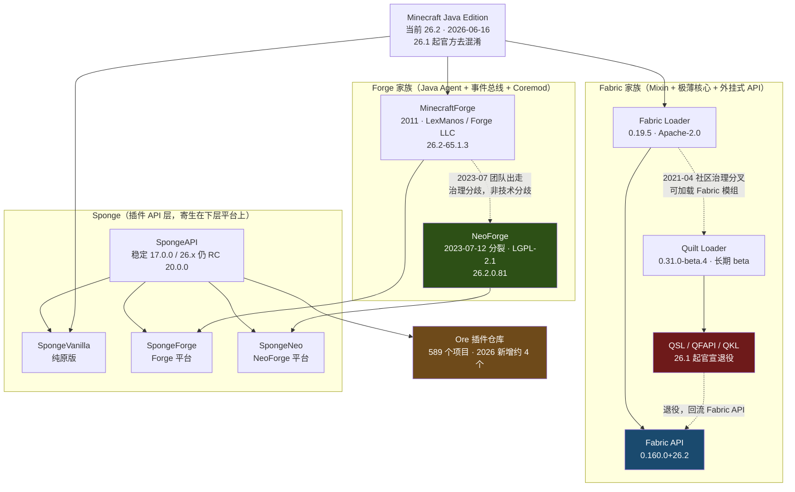

# 纯模组端服务器调研：Forge / NeoForge / Fabric / Quilt / Sponge

> 数据采集日期：**2026-09-08**（GitHub API、Modrinth API、Mojang version_manifest、NeoForged Maven、Forge Maven、Sponge Ore API、Sponge dl API 实时拉取）
> 视角：开服者 / 服务端运维，不是玩家客户端视角
> 标注约定：**【实测】**= 本次通过 API / 官方站点直接查得；**【引证】**= 来自官方博客或新闻稿；**【推断】**= 基于实测数据的判断；**【未核实】**= 查不到可靠来源

---

## ① TL;DR

1. **版本号体系已经变了**：Minecraft Java 当前正式版是 **26.2**（2026-06-16 发布），不是 1.22 —— Mojang 已改用 `年份.drop.hotfix` 日历版本号，1.21.11（2025-12-09）是最后一个 `1.x` 版本，之后是 26.1 → 26.1.1 → 26.1.2 → 26.2，最新快照 26.3-pre-2（2026-09-04）。**【实测】**
2. **2025 年底 Mojang 移除了 Java 版的代码混淆**（2025-10-29 公告，自 26.1 生效），这是过去十年对模组端影响最大的官方动作：Fabric 的 Yarn 映射被宣布停止、intermediary 运行期消失、Mojmap 成为唯一标准，Quilt Mappings 直接停更。**但 Mojang 依然没有、也没有宣布任何官方服务端插件 API。** **【引证】**
3. **NeoForge 已是 Forge 系事实标准，但 Forge 没死**：NeoForge 26.2 在 MC 26.2 发布后 **3.5 小时**出首个构建，26.2 分支已累计 76 个版本；Forge 慢 1.6 天出首个构建、26.2 分支只有 14 个版本。Forge 仍在跟版，但迭代密度约为 NeoForge 的 1/5。**【实测】**
4. **Fabric 是跟版最快、服务端模组最多的一端**（Fabric API 甚至比 MC 26.2 正式版早一天发布，26.3 快照当天跟进）；**Quilt 已实质性收缩**——QSL / Quilted Fabric API / QKL 三大库在 26.1 官宣退役，只剩 Loader 一个旗舰项目且仍是 beta（beta 状态已持续 4 年 5 个月）。**【实测+引证】**
5. **Sponge 是本次调研里最应该谨慎的选项**：Ore 插件仓库总共只有 **589 个项目**，2026 全年新建插件仅约 4 个，26.2 只有 RC 构建，官方"推荐"稳定版还停在 1.21.10。它在 NeoForge 上有 SpongeNeo 了，但生态存量已接近冻结。**【实测】**

---

## ② 谱系关系图

**关键区别（不是三个同类物）**：Forge / NeoForge / Fabric / Quilt 是**模组加载器**，加载的是直接改游戏代码的 mod，客户端必须装同样的 mod；Sponge 是**插件 API**，跑在前者或原版之上，插件纯服务端、客户端不用装 —— 定位上 Sponge 才是和 Bukkit/Paper 同一层的东西。

---

## ③ 逐项目档案

### 3.1 MinecraftForge

| 项 | 值 |
|---|---|
| 仓库 | https://github.com/MinecraftForge/MinecraftForge |
| Stars / Forks | 7,778 / 2,809 **【实测】** |
| 许可证 | GitHub 识别为 `NOASSERTION`（历史上为 LGPL 2.1 + 自定义条款）**【实测】** |
| 最近 push | 2026-08-27 **【实测】** |
| 支持 MC 范围 | promotions 表共 116 条，覆盖 1.1 至 26.2 **【实测】** |
| 26.2 最新 / 推荐 | `65.1.3`（2026-08-27 02:42 UTC 上传）/ `65.1.0` **【实测】** |
| 26.2 分支构建数 | 14 个；26.1 分支 32 个 **【实测】** |
| 首个 26.2 构建 | `26.2-65.0.0`，2026-06-18 02:42 UTC → **滞后 MC 正式版约 1.6 天** **【实测】** |
| 维护 | LexManos / Forge LLC（个人所有制），资金靠下载页广告 + Patreon |
| 下载渠道 | files.minecraftforge.net / maven.minecraftforge.net |

**要点**：Forge 常被说成"已死"，实测不成立 —— 它跟到了 26.2，且 1.20.1 分支仍在更新（47.4.23）。真实差距是**迭代密度**（26.2 上 14 vs NeoForge 76）和**模组供给**（Modrinth 上 26.2 标 forge 的模组 2,952 个 vs neoforge 5,701 个）。**【实测】**

值得开服者注意的一条：itzg Docker 镜像文档里原样引用了 Forge 安装器的声明——"Please do not automate the download and installation of Forge. Our efforts are supported by ads from the download page."**【实测】** 这意味着自动化拉取 Forge 在道义上是被作者反对的（NeoForge / Fabric 没有这个问题）。

### 3.2 NeoForge

| 项 | 值 |
|---|---|
| 仓库 | https://github.com/neoforged/NeoForge（创建于 **2023-07-08**）**【实测】** |
| Stars | 2,049 **【实测】** |
| 许可证 | **LGPL-2.1**（比 Forge 清晰）**【实测】** |
| 最近 push | 2026-09-07（当天仍有合并）**【实测】** |
| 最新版本 | `26.2.0.81`，Maven 上传时间 2026-09-07 17:50 UTC **【实测】** |
| 26.2 分支构建数 | 76；26.1 分支 151 **【实测】** |
| 首个 26.2 构建 | `26.2.0.0-beta`，2026-06-16 15:36 UTC → **滞后 MC 26.2 正式版（12:03 UTC）仅 3 小时 33 分** **【实测】** |
| 快照支持 | 自 26.1 起支持，首个快照 alpha `26.1.0.0-alpha.1+snapshot-1` 于 2025-12-19 上传 **【实测】** |
| 26.3 支持 | **截至 2026-09-08 Maven 上尚无任何 26.3 构建**（26.3-pre-2 于 09-04 发布）**【实测】** |
| 配套 | neoforged/FancyModLoader（87★，2026-08-27 push）**【实测】** |
| 下载渠道 | neoforged.net / maven.neoforged.net（有 REST API，适合自动化）|

**分裂始末**（**【引证】** NeoForged 官方复盘《2023: The Good, The Bad... and The Fork》）：2023-07-12，原 "Forgecord" Discord 被改名为 NeoForged，除 LexManos 外几乎全部原团队（含长期核心开发 cpw）出走。**分歧本质是治理而非代码** —— cpw 的说法是"把它归因于单一事件，就像把千刀万剐归因于其中一刀"，导火索是 Curle 从 Lex 指派的团队领导职位上辞职。次要动机才是技术：团队想重构模组加载与 API 内部结构，而 Forge 历史上对大改持强硬保守立场。法律层面，Forge 核心资产授权在 Lex 的 Forge LLC 名下，所以选择了彻底换品牌而非争夺所有权。治理上 NeoForged 改为成文章程 + 分权领导 + Open Collective 收款。

**兼容性硬边界**（**【引证】+【推断】**）：只有 1.20.1 两边基本互通；1.20.2 起 API 真正分叉，包名全部重命名，模组元数据文件从 `mods.toml` 变成 `neoforge.mods.toml`，加载器启动即校验。**一台服务器只能跑一个加载器，Forge 模组和 NeoForge 模组不能混装。**

### 3.3 Fabric

| 项 | 值 |
|---|---|
| Loader 仓库 | https://github.com/FabricMC/fabric-loader —— 878★，Apache-2.0，最新 **0.19.5（2026-08-28）** **【实测】** |
| API 仓库 | https://github.com/FabricMC/fabric-api —— 3,166★，Apache-2.0，最新 **0.160.0+26.2（2026-09-07）**，另有 `0.160.0+26.3` 预发布 **【实测】** |
| Fabric API 下载量 | Modrinth 上 **249,844,407** 次 **【实测】** |
| 跟版速度（实测三次） | MC 26.2 正式版 2026-06-16 → Fabric API `0.152.1+26.2` **2026-06-15**（早一天，靠预发布期铺垫）；MC 26.3-snapshot-1 2026-06-23 → API **同日**；MC 26.3-pre-1 2026-09-01 → API **同日** **【实测】** |
| 26.2 上模组数 | Modrinth 11,045 个（全加载器第一）**【实测】** |
| 下载渠道 | fabricmc.net（提供无交互的 server launcher jar，最适合脚本化）|

**要点**：Fabric 是四家里唯一做到**新版当天甚至提前可用**的。设计上 Loader 极薄、几乎版本无关（0.19.x 通吃所有 MC 版本），版本相关的部分全在 Fabric API 里，这是它跟版快的结构性原因。**【推断】**

**去混淆的冲击**（**【引证】** fabricmc.net 2025-10-31 官方博文）：Mojang 去混淆后，Fabric 明确表示 —— intermediary 在运行期不再存在，官方名直接生效；**Yarn 以现有形态停止维护**（原话："Given the current circumstances we can't see a way to justify maintaining Yarn"）；Mojmap 成为标准并首次包含参数名和变量名。Loom 1.13 支持实验版本，未来 Loom 2.0 可能提供无重映射的精简版。对**服务端运维**的实际影响接近零，但对模组作者是工具链级重构，**推断**这会在 26.x 周期里造成一部分老模组的更新滞后。

### 3.4 Quilt

| 项 | 值 |
|---|---|
| Loader 仓库 | https://github.com/QuiltMC/quilt-loader —— 515★，Apache-2.0，最新 tag **0.31.0-beta.4**，最后一次提交 2026-09-04 **【实测】** |
| QSL 仓库 | QuiltMC/quilt-standard-libraries —— 150★，最后 push **2026-01-14** **【实测】** |
| Mappings | QuiltMC/quilt-mappings —— 96★，最后 push **2025-12-12** **【实测】** |
| beta 状态 | Loader **自 2022-04 起一直是 beta**，至今未出 1.0 **【引证】** |
| 26.2 上模组数 | Modrinth 3,019（但绝大部分是 Fabric 模组被同时打上 quilt 标签）**【实测+推断】** |

**官方退役公告**（**【引证】** quiltmc.org 2026-02-03《QuiltMC's Future Plans》）：
- Quilt Standard Libraries、Quilted Fabric API、Quilt Kotlin Libraries **三个库在 MC 26.1 正式退役**，原文"We (your hardworking admin board) have decided to officially retire all three of these libraries in Minecraft `26.1`"；老版本仍收维护更新。
- **Quilt Mappings 不再支持新 MC 版本**，直接理由是 26.1 起官方去混淆。
- 退役原因官方给了两条：开发者人力不足（主要靠一位开发者 Oro），以及与 Fabric API 的设计不兼容造成用户困惑。
- 现在的重心：Quilt Loader（自动更新、崩溃诊断）、Enigma 映射工具、与 Parchment 的协作、新开发者 wiki。

**结论（【推断】）**：对开服者来说 Quilt 在 2026 年已**没有独立价值主张** —— 它的差异化 API 层没了，剩下的 Loader 优势（更好的崩溃报告、依赖处理）对服务端收益有限，而代价是多一层兼容风险。**Quilt 能装 Fabric 模组，Fabric 装不了 Quilt 模组**，所以选 Fabric 是严格更安全的。

### 3.5 Sponge

| 项 | 值 |
|---|---|
| 实现仓库 | https://github.com/SpongePowered/Sponge —— 435★，**MIT**，2026-09-01 push **【实测】** |
| API 仓库 | https://github.com/SpongePowered/SpongeAPI —— 1,173★，MIT，2026-08-31 push **【实测】** |
| 三种发行 | **SpongeVanilla**（纯原版）、**SpongeForge**（Forge 平台）、**SpongeNeo**（NeoForge 平台，确认存在）**【实测】** |
| 26.2 构建 | 三者都有，但全是 RC：如 `26.2-26.2.0.62-20.0.0-RC2703`（SpongeNeo，对应 NeoForge 26.2.0.62）**【实测】** |
| 官方"推荐"稳定版 | **仍是 `1.21.10-21.10.64-17.0.0`（SpongeAPI 17.0.0）** **【实测】** |
| 快照跟进 | SpongeVanilla 已有 `26.3-snapshot-2-21.0.0-RC2675` 构建 **【实测】** |
| Ore 插件总数 | **589** **【实测】** |
| Ore 下载量 Top5 | Nucleus 166,737 / LuckPerms 89,745 / WorldEdit 82,525 / GriefPrevention 47,523 / Total Economy 32,318 **【实测】** |
| Ore 2026 新增插件 | 仅 4 个：No nether roof(08-06)、Tab Modifier v2(07-22)、lelMenu(03-24)、MapArt(03-20) **【实测】** |
| Modrinth 上 sponge 插件 | 126 个（对比 paper 16,561 / bukkit 8,612）**【实测】** |

**判断（【推断】）**：Sponge 的工程本体是活的（三个平台都跟到了 26.2 RC、快照都在编），但**生态是冻结的**。589 个插件的存量、一年 4 个新增、头部插件下载量只有六位数——这已经不是"小而美"，是长尾枯竭。它唯一还成立的场景：你已经在用 Nucleus / Total Economy / EconomyLite 这套 Sponge 专属栈，且能接受停在 1.21.10 稳定版。

**另一个坑**：itzg/docker-minecraft-server **只支持 `TYPE=SPONGEVANILLA`**，SpongeForge / SpongeNeo 没有一等公民支持。**【实测】**

---

## ④ 横向对比表

### 4.1 加载器本体

| | Forge | NeoForge | Fabric | Quilt | Sponge |
|---|---|---|---|---|---|
| Stars | 7,778 | 2,049 | 878(loader)/3,166(api) | 515 | 435/1,173 |
| 许可证 | NOASSERTION | LGPL-2.1 | Apache-2.0 | Apache-2.0 | MIT |
| 最新版（26.2） | 65.1.3 | 26.2.0.81 | 0.19.5 + API 0.160.0 | 0.31.0-beta.4 | 20.0.0-RC2703 |
| 26.2 首发滞后 | ~1.6 天 | **~3.5 小时** | **-1 天（提前）** | 未核实 | 未核实 |
| 26.2 分支构建数 | 14 | 76 | 持续滚动 | — | 多个 RC |
| 26.3 快照支持 | 未核实 | **暂无** | **已有**(0.160.0+26.3) | 未核实 | SpongeVanilla 已有 |
| Modrinth 26.2 模组数 | 2,952 | 5,701 | **11,045** | 3,019 | 126(插件) |
| 治理 | 个人（Forge LLC） | 章程+分权 | 团队 | 社区（收缩中） | 团队 |
| 自动化友好 | 差（作者反对） | **好（有 REST API）** | **好** | 中 | 中 |
| 2026 状态判断 | 存活但边缘化 | **事实标准（Forge 系）** | **事实标准（轻量系）** | 收缩 / 只剩 Loader | 工程活，生态冻结 |

### 4.2 服务端性能模组

| 模组 | 加载器 | 26.2 支持 | 下载量 | 最近状态 | 许可 |
|---|---|---|---|---|---|
| **Lithium** | fabric + **neoforge** + quilt | ✅ `mc26.2-0.25.3` (07-29) | 125.3M | 活跃，2No2Name 维护 | LGPL-3.0 |
| **FerriteCore** | fabric/forge/neoforge/quilt | ✅ | 148.0M | 仓库 2026-03-24 | MIT |
| **Krypton**（网络栈） | **仅 fabric** | ✅ | 40.8M | 仓库 2026-08-23 | LGPL-3.0 |
| **C2ME**（并行区块） | **仅 fabric** | ✅ 甚至到 **26.3-pre-2** | 36.1M | 稳定版 0.3.6.0(2025-12-31)，26.x 走 beta | NOASSERTION |
| **VMP**（高人数） | **仅 fabric** | ✅ | 16.1M | 仓库 2026-07-02 | MIT |
| **ServerCore** | fabric/forge/neoforge | ✅ | 16.0M | 仓库 2026-09-04 | **无许可证** |
| **ModernFix** | fabric/forge/neoforge | ⚠️ **只到 26.1.2** | 76.3M | 仓库 2026-08-31 | NOASSERTION |
| **Alternate Current**（红石） | fabric/forge/neoforge | ✅ | 10.9M | 仓库 2026-06-16 | MIT |
| **spark**（性能剖析） | 全平台 | ✅ | 21.6M | 仓库 2026-08-25 | GPL-3.0 |
| **Noisium** | fabric/forge/neoforge/quilt | ❌ 停在 1.21.6 | 24.0M | **仓库已 archive（2025-07-29）** | NOASSERTION |
| **Starlight** | — | ❌ | — | **仓库 2024-03-08 archive** | — |
| **Radium**（Lithium 的 Forge 移植） | forge/neoforge | ❌ 停在 1.21.1 | 6.4M | **最后更新 2024-09-20** | — |
| **Canary**（Lithium 的 Forge 移植） | forge | ❌ 停在 1.20.4 | 4.6M | **最后更新 2024-02-08** | — |

**三个必须知道的结论**：

1. **Radium 和 Canary 都死了，但这不是坏消息** —— Lithium 自己变成了多加载器项目，release 里同时出 `lithium-fabric-*.jar` 和 `lithium-neoforge-*.jar`。**【实测】** 所以 NeoForge 服现在直接用 Lithium 本体，不需要移植版。
2. **Starlight 不需要了** —— PaperMC/Starlight 于 2024-03-08 归档，作者 Spottedleaf 的说明是：Mojang 在 1.20 借鉴了 Starlight 的两个核心思路重写了光照引擎，性能差距从 0.1ms vs 30ms 收敛到 0.75ms vs 1.5ms，不值得再维护。注意**是 Mojang 独立重写并借鉴思路，不是把 Starlight 代码合并进原版**。**【引证】**
3. **服务端重型优化仍然是 Fabric 独占** —— Krypton（网络）、C2ME（并行区块生成）、VMP（高在线人数）三个最吃重的服务端优化**全都只有 Fabric 版**。**【实测】** Modrinth 上 26.2 的 optimization 分类：fabric 686 个 / neoforge 303 个 / forge 126 个，而 NeoForge 那 303 个里下载量前列的（Sodium、Iris、ImmediatelyFast、Dynamic FPS、More Culling、Distant Horizons）绝大多数是**客户端渲染模组**，对开服毫无用处。**这是选 NeoForge 时最实在的性能代价。**

### 4.3 "用服务端模组替代 Bukkit 插件"可行性逐项拆解

| 能力 | Fabric 侧方案 | NeoForge 侧方案 | 相对 Bukkit 的差距 |
|---|---|---|---|
| **权限** | **LuckPerms 5.5.81**（官方 fabric 构建）+ `lucko/fabric-permissions-api`（82★，834K 下载，MIT） | **LuckPerms 官方 neoforge 构建**（仓库里确有 `neoforge/` 模块）**【实测】** | **基本无差距。** LuckPerms 官方平台已含 bukkit / bukkit-legacy / bungee / **fabric** / **forge** / **neoforge** / nukkit / sponge / velocity / hytale **【实测】**。真正的差距是**下游生态**：Bukkit 侧几乎每个插件都读 Vault/LuckPerms 权限节点，模组侧很多 mod 根本没有权限节点概念，只认 OP 等级 |
| **经济** | ❌ **最大短板**。Numismatic Overhaul（4.26M 下载）停在 1.21.1；Modrinth 上 26.2 + server_side:required 的经济类只有几百下载量的小项目 **【实测】** | 同样缺失 | **差距最大的一项。** Bukkit 侧有 Vault + EssentialsX Economy + 几十个成熟经济/商店插件；模组侧没有任何一个具备同等地位的经济抽象层 |
| **领地 / 保护** | **Open Parties and Claims**（21.7M 下载，跨 fabric/forge/neoforge/quilt，支持 26.2）**【实测】**；FTB Chunks + FTB Teams（FTBTeam 仓库均活跃，FTB-Chunks 2026-09-02 push）**【实测】** | 同上，OPAC 与 FTB 系都是多加载器 | **可用，但形态不同。** OPAC 是"玩家自助圈地+组队"，FTB 系同理；缺 WorldGuard 那种**管理员按区域配 flag** 的细粒度模型。Cadmus 未在 Modrinth 检索到，**推断**为 CurseForge 独占分发 **【未核实】** |
| **传送 / 家 / 指令** | **Essential Commands**（472K 下载，仅 fabric，支持 26.2）**【实测】** | FTB Essentials（FTBTeam/FTB-Essentials，2026-07-16 push，仅 29★）**【实测】** | 覆盖基本够（home/warp/tpa/back），但没有 EssentialsX 那种一装几百条命令 + 全套配置的完整度 |
| **聊天** | **Styled Chat**（394K，fabric/quilt，26.2）**【实测】** | FTB Ranks 附带 | 差距中等，缺 DiscordSRV / ChatControl 级别的成熟度 |
| **操作日志 / 回滚** | **Ledger**（304K，fabric/quilt，26.2）—— CoreProtect 对应物 **【实测】** | 无同级对应物 **【未核实】** | Ledger 可用但下载量只有 30 万级，社区规模远小于 CoreProtect |
| **WorldEdit** | ✅ **官方 Fabric 版**（EngineHub/WorldEdit 3,498★，7.4.5，26.2，loaders 含 bukkit/fabric/folia/forge/neoforge，10.4M 下载）**【实测】** | ✅ 同上，官方多平台 | **无差距。** 这是模组端最没有痛点的一项 |
| **地图 / Web 面板** | **BlueMap**（476K，fabric/folia/forge/neoforge/paper/sponge，26.2）**【实测】** | 同上 | 无差距。⚠️ **Dynmap 最新只到 1.21.11，尚未跟进 26.x** **【实测】** |
| **反作弊** | 生态碎片化，无 GrimAC 级别的公认方案；社区在用 PRAXIC、Fragments、Sentry 等 | 同样碎片化 | **差距很大。** Bukkit 侧有 Grim/Matrix/Vulcan 这类被大服验证过的成熟反作弊；模组端没有等价物 |
| **"服务端插件"抽象** | **Polymer**（Patbox，424★，LGPL-3.0，2026-09-02 push，3.9M 下载，26.2，**仅 fabric/quilt**）**【实测】**——让服务端模组把自定义方块/物品/UI"伪装"成原版内容推给未装模组的原版客户端 | ❌ **NeoForge 侧无等价物** **【未核实】** | Polymer 是 Fabric 侧独有的杀手锏：它让你**在纯模组端上做出"插件式"体验**（客户端零安装）。这是 Fabric 相对 NeoForge 在开服场景下的最大结构性优势 |
| **性能剖析** | spark（fabric/forge/neoforge/quilt，26.2）**【实测】** | 同 | 无差距 |

**总体差距判断（【推断】）**：模组端在**权限、WorldEdit、地图、领地、日志**这几项已经能打；**经济和反作弊是硬伤**；最本质的差距不在单点功能，而在**没有统一 API 导致的组合成本** —— Bukkit 侧装 20 个插件互相认识（Vault、PAPI、LuckPerms 三根总线串起来），模组侧装 20 个 mod 就是 20 个各写各的配置、各不认识彼此的孤岛。

### 4.4 生态规模数据（Modrinth，2026-09-08 实测）

| 分类 | 数量 |
|---|---|
| 模组总数 · fabric 标签 | 45,371 |
| 模组总数 · forge 标签 | 34,226 |
| 模组总数 · neoforge 标签 | 28,284 |
| 模组总数 · quilt 标签 | 10,177 |
| **26.2 上的模组 · fabric** | **11,045** |
| **26.2 上的模组 · neoforge** | **5,701** |
| 26.2 上的模组 · quilt | 3,019 |
| 26.2 上的模组 · forge | 2,952 |
| 26.2 上 server_side:required · fabric | 6,210 |
| 26.2 上 server_side:required · neoforge | 3,843 |
| 26.2 上的整合包 | 1,154 |
| 插件 · paper | 16,561 |
| 插件 · bukkit | 8,612 |
| 插件 · sponge | **126** |

⚠️ **口径提醒（【推断】）**：Modrinth 结构性偏向 Fabric（社区起家于 Fabric），而 CurseForge 是 NeoForge 大型整合包（All The Mods 系、FTB 系）的主场。**上表不能直接读成"Fabric 生态比 NeoForge 大两倍"**——它准确反映的是"Modrinth 上 Fabric 内容更多"，而**内容型 / 科技型大模组（机械动力、应用能源、格雷科技这一类）在 NeoForge 侧的占比显著更高**。做整合包选 NeoForge，做纯服务端工具链选 Fabric，两个结论并不矛盾。

---

## ⑤ 已知问题 / 争议 / 坑

**1. 版本号断层会坑掉所有硬编码脚本**
`1.21.11` → `26.1` 不是一次普通升级：任何按 `1.x` 正则解析版本号的启动脚本、监控、面板都会挂。Bedrock 先于 Java 切换（26.0，2026-02-10），Java 从 26.1（2026-03-24）跟上，Java 与 Bedrock 的次级号并不对齐（Java 26.1 ≈ Bedrock 26.10）**【引证】**。另外**自 26.1 起 Java 25 是硬性要求** **【引证，二手来源，建议自行以官方 JSON 复核】**。

**2. Forge / NeoForge 模组不能混装，且没有任何兼容层**
1.20.2 起 API 真正分叉、包名全改、元数据文件名不同（`mods.toml` vs `neoforge.mods.toml`）。迁移整合包时"看起来同名的 mod"极可能是两个不同构建。**【引证】**

**3. 去混淆的过渡期成本被低估**
Yarn 停维护、intermediary 运行期消失、Quilt Mappings 停更——这些都发生在 2025Q4~2026Q1。**推断**：26.x 上一部分老模组的更新会比历史节奏更慢，因为作者要重做工具链。开服者的实际表现就是"加载器早就支持 26.2 了，但我要的那个 mod 还没更新"。NeoForge 官方文档提到 Parchment 因为官方参数名可用而可以移除 **【引证】**——对作者是利好，但迁移期是真实成本。

**4. 加载器支持 ≠ 模组支持**
NeoForge 3.5 小时出构建、Fabric 提前一天出 API，都不代表你的整合包能跑。实测就有反例：**ModernFix（76M 下载的主流优化模组）截至 2026-09-08 还只支持到 26.1.2，没跟到 26.2**。**【实测】**

**5. 服务端重型优化是 Fabric 独占，NeoForge 侧没有替代**
Krypton / C2ME / VMP 全是 fabric-only。Radium（2024-09 最后更新）、Canary（2024-02 最后更新）这两个曾经的 Forge 侧移植都已停更 **【实测】**。NeoForge 服现在能拿到的服务端优化基本就是 Lithium + FerriteCore + ServerCore + Alternate Current 四件套。

**6. 多个关键模组的许可证不干净**
ServerCore **完全没有许可证文件**（法律上默认保留全部权利，严格说不可再分发）；C2ME、ModernFix、Noisium、Forge 本体在 GitHub 上都是 `NOASSERTION`。**【实测】** 商业服 / 需要二次分发时要单独核实。

**7. Noisium 已归档、Starlight 已归档**
Noisium 仓库 2025-07-29 归档、最高只到 1.21.6 **【实测】**；Starlight 2024-03-08 归档 **【引证】**。老教程里推荐这两个的，直接跳过。

**8. Sponge 的"稳定版"和"最新版"落差极大**
26.2 上只有 RC（SpongeAPI 20.0.0-RC），官方标记 Recommended 的还是 1.21.10 + API 17.0.0 **【实测】**。加上 Ore 一年只新增 4 个插件，**推断**：把 Sponge 当作"要长期投入的平台"风险很高。

**9. Quilt 的价值主张已经消失**
QSL/QFAPI/QKL 在 26.1 官宣退役 **【引证】**，Loader beta 状态已持续 4 年多。Quilt 能装 Fabric 模组、反向不行 —— 所以**选 Fabric 严格优于选 Quilt**，除非你有具体依赖 Quilt Loader 特性的理由。

**10. 分发链条上有几个"看着能用其实停更"的工具**
`BloodyMods/ServerStarter` 最后一次 push 是 **2023-04-24**（110★，MIT）**【实测】**——很多老整合包的服务端包仍然依赖它。`packwiz-installer` 最后 push 2024-06-27（仍可用但停滞）**【实测】**。`CurseForgeCommunity/cf-mc-server` 最后 push 2023-07-12 **【实测】**。

**11. Forge 官方反对自动化下载**
如果你的部署流水线自动拉 Forge 安装器，是在违反作者明确表达的意愿（NeoForge / Fabric 无此问题）**【实测】**。

**12. 关于"为什么没有统一插件 API"**
根因不是技术，是**架构差异 + 治理割裂**：Forge/NeoForge 用事件总线 + Coremod，Fabric 用 Mixin + 极薄核心，两者的注入模型不兼容；Sponge 试图做那一层抽象，但代价是要为每个下层平台各维护一套实现（SpongeVanilla/Forge/Neo），人力上撑不住，最终就是 589 个插件的结局。**Mojang 侧：本次未检索到任何 2025–2026 年官方服务端插件 API 或官方 modding API 的公告**；官方唯一的实质动作是移除混淆（2025-10-29 公告、26.1 生效），且公告措辞是"希望让创建、更新和调试模组更容易"，**没有承诺任何 API**。**【引证 + 未检索到反证】**

---

## ⑥ 选型建议

### 按场景

| 你要做的事 | 选型 | 理由 |
|---|---|---|
| **跑现成大型整合包**（ATM、FTB、GTNH 等） | **跟着整合包走，基本是 NeoForge** | 整合包不给你选择权。1.20.1 及更早的老包才是 Forge |
| **自己攒一套"轻模组 + 完整管理功能"的长期服** | **Fabric** | 服务端模组数最多（26.2 上 6,210 个 server_side:required）、跟版最快、Krypton/C2ME/VMP 独占、Polymer 让客户端零安装 |
| **要高在线人数（100+）** | **Fabric**，必上 Lithium + Krypton + VMP + C2ME + FerriteCore + ServerCore + spark | NeoForge 侧拿不到 Krypton/C2ME/VMP，这个人数区间差距会直接体现在 TPS 上 |
| **要内容型科技/魔法大模组** | **NeoForge** | 这类模组在 NeoForge 侧供给显著更好，且 26.2 跟版只慢 3.5 小时 |
| **想用 Sponge 插件生态** | **不建议新开** | 589 个插件、2026 新增 4 个、26.x 只有 RC。除非你已有 Nucleus/Total Economy 存量资产 |
| **选 Quilt** | **不建议** | API 层已退役，Fabric 是严格更优选择 |
| **管理功能优先、模组只要少量** | **考虑混合端或 Paper + 少量服务端模组** | 见下 |

### 纯模组端 vs 混合端（对照，混合端由同事详细调研）

选**纯模组端**（Fabric/NeoForge）的取舍：
- ✅ 稳定性可预期 —— 只有一套加载器语义，崩了能定位
- ✅ 跟版快 —— 26.2 上 Fabric 提前一天、NeoForge 3.5 小时
- ✅ 上游活跃、许可证清晰（NeoForge LGPL-2.1、Fabric Apache-2.0）
- ❌ 放弃整个 Bukkit 插件生态（Modrinth 上 paper 16,561 + bukkit 8,612 个插件）
- ❌ **经济和反作弊基本没有可用方案**
- ❌ 管理功能要自己拼 10+ 个互不认识的 mod

选**混合端**（Mohist/Arclight/Banner/Cardboard 等）的取舍：
- ✅ 理论上模组 + 插件通吃
- ❌ 跟版慢、崩溃归因困难（出问题时分不清是 mod、插件还是兼容层）
- ❌ 兼容层本身是最大的不确定性来源

**给"想要模组 + 部分管理功能"服主的实际建议（【推断】）**：先把"管理功能"拆成具体清单，逐条对照 4.3 表格。如果你的清单里**没有经济和反作弊**，纯模组端（优先 Fabric）能覆盖到 80% 以上，稳定性收益远大于混合端；如果**经济或反作弊是刚需**，纯模组端会持续难受，此时要么接受混合端的不确定性，要么反过来问：这个服是不是本来就该用 Paper + 少量服务端模组。

### 整合包服务端分发与运维推荐

| 工具 | 状态 | 建议 |
|---|---|---|
| **itzg/docker-minecraft-server** | 14,271★，Apache-2.0，2026-09-07 push **【实测】** | **首选。** 支持 `TYPE=FORGE / NEOFORGE / FABRIC / QUILT / SPONGEVANILLA`，模组平台支持 auto-curseforge / curseforge / ftb / gtnh / modrinth-modpacks，另有 `PACKWIZ_URL` 直连 **【实测】**。注意只支持 SpongeVanilla |
| **packwiz** | 987★，MIT，2026-09-06 push（活跃）**【实测】** | **自维护整合包首选。** TOML + git 友好，可导出 CurseForge/Modrinth |
| **packwiz-installer** | 72★，2024-06-27 最后 push **【实测】** | 仍可用但停滞，注意风险 |
| **mrpack-install** | 326★，MIT，2026-09-02 push **【实测】** | **消费别人的 Modrinth 整合包首选**，Modrinth 官方帮助中心推荐路径之一 **【引证】** |
| **ServerStarter (BloodyMods)** | 110★，**2023-04-24 最后 push** **【实测】** | **已停更**，只在老包强依赖时被动使用 |
| **cf-mc-server** | 12★，2023-07-12 最后 push **【实测】** | 不建议 |
| CurseForge / Modrinth 官方服务端包 | — | 最省事的路径：几乎每个整合包都发独立 server pack，已配好加载器且剔除客户端专属模组 **【引证】** |

---

## ⑦ 参考链接

**版本与官方动向**
- Mojang version_manifest（本报告 MC 版本与发布时间的一手来源）：https://launchermeta.mojang.com/mc/game/version_manifest.json
- Minecraft 官方新版本号说明：https://www.minecraft.net/en-us/article/minecraft-new-version-numbering-system
- Fabric 官方：去混淆对工具链的影响（Yarn 停维护、Mojmap 成标准）：https://fabricmc.net/2025/10/31/obfuscation.html
- 去混淆事件报道：https://www.windowscentral.com/gaming/minecraft/mojang-studios-is-removing-obfuscation-from-minecraft-java-edition ／ https://alternativeto.net/news/2025/11/microsoft-to-remove-code-obfuscation-from-minecraft-java-edition-greatly-helping-modders

**加载器**
- MinecraftForge 仓库：https://github.com/MinecraftForge/MinecraftForge
- Forge promotions（版本一手来源）：https://files.minecraftforge.net/net/minecraftforge/forge/promotions_slim.json
- NeoForge 仓库：https://github.com/neoforged/NeoForge ／ 官网：https://neoforged.net/
- NeoForge Maven API（版本一手来源）：https://maven.neoforged.net/api/maven/versions/releases/net/neoforged/neoforge
- NeoForged 分裂官方复盘：https://neoforged.net/news/2023-retrospection/ ／ https://neoforged.net/news/theproject/
- NeoForge 快照支持公告：https://neoforged.net/news/26.1snapshots/
- NeoForge 版本号规范：https://docs.neoforged.net/docs/gettingstarted/versioning/
- Fabric Loader：https://github.com/FabricMC/fabric-loader ／ Fabric API：https://github.com/FabricMC/fabric-api
- Fabric 26.2 移植文档：https://docs.fabricmc.net/develop/porting/
- QuiltMC 未来计划（QSL/QFAPI/QKL 退役公告，2026-02-03）：https://quiltmc.org/en/blog/2026-02-03-non-obfuscated-updates/
- Quilt Loader：https://github.com/QuiltMC/quilt-loader

**Sponge**
- 官网：https://spongepowered.org/ ／ 下载：https://dl.spongepowered.org/
- Sponge 实现仓库：https://github.com/SpongePowered/Sponge ／ API：https://github.com/SpongePowered/SpongeAPI
- Ore 插件仓库 API（589 项目数据来源）：https://ore.spongepowered.org/api/v2/projects
- SpongeForge on NeoForge 讨论：https://github.com/SpongePowered/Sponge/issues/3887 ／ https://github.com/SpongePowered/Sponge/issues/4113

**服务端模组**
- LuckPerms：https://github.com/lucko/LuckPerms ／ 版本元数据：https://metadata.luckperms.net/data/all
- Fabric Permissions API：https://github.com/lucko/fabric-permissions-api
- spark：https://github.com/lucko/spark
- WorldEdit：https://github.com/EngineHub/WorldEdit
- Polymer：https://github.com/Patbox/polymer
- Open Parties and Claims：https://github.com/thexaero/open-parties-and-claims ／ https://modrinth.com/mod/open-parties-and-claims
- FTB 系：https://github.com/FTBTeam/FTB-Chunks ／ FTB-Teams ／ FTB-Essentials ／ FTB-Ranks

**性能模组**
- Lithium（含 NeoForge 构建）：https://github.com/CaffeineMC/lithium ／ https://modrinth.com/mod/lithium
- FerriteCore：https://github.com/malte0811/FerriteCore
- Krypton：https://github.com/astei/krypton
- C2ME：https://github.com/RelativityMC/C2ME-fabric
- VMP：https://github.com/RelativityMC/VMP-fabric
- ServerCore：https://github.com/Wesley1808/ServerCore
- ModernFix：https://github.com/embeddedt/ModernFix
- Alternate Current：https://github.com/SpaceWalkerRS/alternate-current
- Noisium（已归档）：https://github.com/Steveplays28/noisium
- Starlight（已归档）+ 作者停更说明：https://github.com/PaperMC/Starlight ／ https://gist.github.com/Spottedleaf/6cc1acdd03a9b7ac34699bf5e8f1b85c

**分发与运维**
- itzg/docker-minecraft-server：https://github.com/itzg/docker-minecraft-server ／ 文档：https://docker-minecraft-server.readthedocs.io/
- packwiz：https://github.com/packwiz/packwiz ／ https://packwiz.infra.link/
- mrpack-install：https://github.com/nothub/mrpack-install
- ServerStarter（已停更）：https://github.com/BloodyMods/ServerStarter
- Modrinth 整合包官方说明：https://support.modrinth.com/en/articles/8802250-modpacks-on-modrinth
- Modrinth API（本报告全部生态规模数据来源）：https://api.modrinth.com/v2/search
