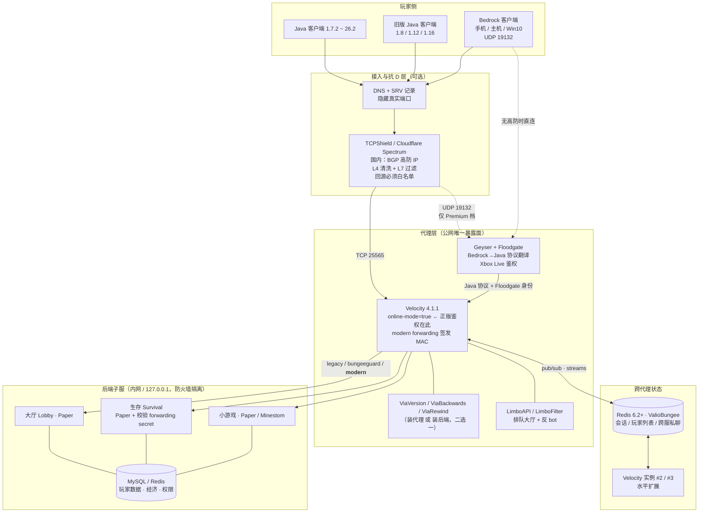

# Minecraft Java 服务器生态：代理层、跨版本、跨平台与群组服网络架构

> 调研日期 2026-09-08。除标注外，版本号与时间戳均于当日通过 GitHub API、各项目官方下载 API 或官方文档站查证。
> **基准版本：Minecraft Java Edition 26.2「Chaos Cubed」，2026-06-16 发布，协议号 776。** 2026 年起 Mojang 改用日历版本号（`年.批次.修订`），1.21.11 之后不存在 1.22；26.3「Wilderness Bound」的 `26.3-pre-2` 于 2026-09-04 发布，正式版预计 2026 Q3。26.1 起要求 Java 25。

---

## ① TL;DR

代理层已完成代际更替：**Velocity 是唯一值得新建网络采用的 Java 代理**，2026-07-14 跨入 4.0.0（要求 **Java 25** + Adventure 5，属破坏性大版本），3.5.x 并行维护作为过渡。BungeeCord 并未死亡——对 26.2 的支持是当期跟进的，但一年内提交中 65 次是 dependabot、29 次是 md_5，属「保守维护」；Waterfall 处于**官方 EOL（2024-03-26）但仓库仍有人提交（最近 2026-09-07）**的分裂状态，不应用于新部署。跨版本靠 ViaVersion 家族（5.11.0），跨平台靠 Geyser + Floodgate（Bedrock 26.0–26.45 ↔ Java 26.2），二者都是「装代理还是装后端」的取舍题。真正的坑不在选型而在安全边界：**后端必须 `online-mode=false`，防火墙不是可选项**；1.19+ 聊天签名、1.20.2 配置阶段、1.21 transfer packet 持续在代理上制造新的边界情况。

---

## ② 架构图

- **鉴权只在代理做一次**：代理 `online-mode=true` 向 Mojang 验证，后端一律 `online-mode=false`、身份由 forwarding 报文携带。后端一旦能被公网直连，任何人都能以任意 UUID 冒名进入。
- **ViaVersion 与 Geyser 的位置可选**：装代理（集中管理、反作弊判定受影响）或装后端（更准、运维更碎）；Geyser 另受后端版本约束（Paper 1.20.5+ 才能直装后端）。

---

## ③ 逐项目档案

### 3.1 代理核心

#### Velocity

| 项 | 值 |
|---|---|
| 仓库 / 许可证 | `PaperMC/Velocity`（默认分支 `dev/4.0.0`）/ GPL-3.0 |
| 热度 / 活跃 | 2,248 ★ / 950 fork；最近推送 2026-09-01 |
| 最新版本 | **4.1.1（2026-08-26，STABLE）**；4.1.0（08-24）、**4.0.0（2026-07-14）** |
| 并行旧线 | 3.5.1、3.5.0（均 2026-07-11） |
| MC / 运行时 | **1.7.2 – 26.2**；**4.0.x 起最低 Java 25**（构建 toolchain 已设 25） |
| 下载 | papermc.io/downloads/velocity；API `fill.papermc.io/v3/projects/velocity` |

**4.0 的破坏性变更**：核心是 `Adventure 5`（PR #1774，2026-07-10 合入），聊天组件 API 大版本跳跃，所有依赖 Adventure 的插件需重编译甚至改代码；叠加 Java 25 门槛，等于要求整条插件链同步升级。同期新增 `Player Loaded World API`（#1541）、`provides API`（#1853）。**推断**：3.5.x 仍发版是给来不及跟进 Java 25 的网络留的退路。

**4.x 配置要点**（读自 `default-velocity.toml`，config-version 2.9）：新增 `[packet-limiter]`，其中 `decompressed-bytes-per-second` 默认 5 MiB —— **默认开启的压缩炸弹防护**；`accepts-transfers = false` 控制是否接收 1.20.5 transfer packet 转入的玩家；另有 `haproxy-protocol`、`enable-reuse-port`、`tcp-fast-open`、`force-key-authentication = true`、`prevent-client-proxy-connections`（比对 ISP/AS，官方自评「弱防护」）。`bungee-plugin-message-channel = true` 意味着 **Bungee 插件消息通道是支持的**，但 Bungee 插件本身不行。

**明确不支持**：Forge-Bukkit 混合端；**代理套代理**（官方原话 completely unsupported）。Forge：1.7.2–1.12.2 与 1.20.2+ 支持（后者自 3.3.0 起），1.13–1.20.1 不计划（可用 Ambassador）。

#### BungeeCord（md_5）——仍在维护，但只做维护

`SpigotMC/BungeeCord`，自定义 BSD-3 风格许可（GitHub 识别为 NOASSERTION），1,728 ★ / 1,147 fork，最近推送 2026-09-06，走 Jenkins 构建号而非 GitHub Releases。

**「BungeeCord 已停更」是错误认知**——源码 `ProtocolConstants` 已含 `MINECRAFT_26_2 = 776`，支持 **1.8.x – 26.2**。但 2025-09 至今提交中 dependabot 65 次、md_5 29 次、Outfluencer 6 次，功能演进基本停滞，且**只有 legacy 转发、没有安全转发**——这是与 Velocity 的根本差距。

#### Waterfall（PaperMC）——官方已死，事实上被单人续命

- 官方 EOL 公告 **2024-03-26**（`forums.papermc.io/threads/1088/`），理由是开发人力不足、引擎变更适配量过大。README 顶部现挂 `[!CAUTION] This project has reached end of life and is no longer maintained.`
- **但仓库仍在提交**：2026-09-07「Temp: 26.3-pre-2 protocol support (#876)」及 09-05 / 09-02 / 09-01，作者全部是 Shane Freeder。papermc.io 最后一个正式构建是 1.21 线 **build 615，2026-06-16**（恰为 26.2 发布日）。
- 官方对比页评价：Waterfall 证明了「多数 BungeeCord 插件深度依赖 BungeeCord 的行为与怪癖」（Hyrum 定律），改进必然破坏兼容。
- **结论**：官方定性 + 无新版本线 = 不要用于新部署。

#### 其他分支

`PaperMC/Travertine`（Waterfall + 1.7），MIT，145 ★，**已 archived，2021-06-04 停**。`arkflame/FlameCord` 于 2026-09-08 查询返回 **404**（删库或改名，**未核实**），官网仍在但已转 BuiltByBit 付费分发；衍生的 `MangoCord`（30 ★）2023-08 已 archived。**结论**：Bungee 分支生态已无可依赖的开源选项；其卖点（内置反 bot）现在该用 Velocity + LimboFilter 或 TCPShield 替代。

#### Gate（Go 实现的挑战者）

`minekube/gate`，Apache-2.0，1,074 ★ / 108 fork，**v0.73.4（2026-09-05）**，最近推送 2026-09-07，MC 1.7 – latest，Go 单二进制约 10 MB。

- **内建 Bedrock**：一行 `bedrock: true` 启用托管 Geyser + Floodgate，**零后端插件**。
- **内建 Via**：`config.via.enabled: true` 自动拉起 `vialite` 子进程、解析最新稳定版、下载校验产物并路由后端连接。
- **Lite 模式**：按 hostname/子域反代，支持通配符、round-robin / least-connections / lowest-latency、ping 缓存、PROXY protocol 与 **TCPShield RealIP**；代价是失去切服与代理命令。
- 转发模式齐全（`none`/`legacy`/`bungeeguard`/`velocity`）；限流按 IPv4 /24、IPv6 /64 做连接与登录配额 + 每连接包/字节限制。

**最大短板：插件生态。** Gate 用自有 Go API，既不吃 Velocity 插件也不吃 Bungee 插件，LuckPerms 等现成插件全部不可用。

### 3.2 转发与安全

| 模式 | 机制 | MC 要求 | 安全性 |
|---|---|---|---|
| `none` | 不转发，玩家全显示为从代理连入 + 离线 UUID | 任意 | 无意义（身份丢失） |
| `legacy` | BungeeCord 兼容格式，明文带 IP/UUID | 1.7.2+ | **根本不安全**（官方原话 fundamentally insecure） |
| `bungeeguard` | legacy + 握手内共享 token | 1.7.2+ | 中等；给无防火墙权限的共享主机 |
| `modern` | Velocity 原生二进制格式 + **MAC 校验** | **1.13+** | 最高；与 ProtocolSupport 冲突 |

**后端配置对照**：Paper/Spigot 用 `paper-global.yml` 的 `proxies.velocity.enabled: true` + 与 `forwarding.secret` 一致的 secret（legacy 则是 `spigot.yml` 的 `settings.bungeecord: true`；Paper 1.14+ 及 1.13.1/1.13.2 build 377+ 原生支持 modern）；Fabric 用 FabricProxy-Lite；Forge 1.14+ 用 ProxyCompatibleForge；Sponge 开 `bungeecord.ip-forwarding`。

**防「绕过代理直连后端」的正确顺序**（Velocity 安全文档 + BungeeGuard 作者建议）：① **操作系统防火墙**，官方首选且**不可被 modern forwarding 替代**（官方明说它只是「第二层」）；② 同机部署把后端设 `server-ip=127.0.0.1`；③ 跨机走 WireGuard / OpenVPN；④ modern forwarding + 严格保密 `forwarding.secret`；⑤ **BungeeGuard 兜底**（`lucko/BungeeGuard`，227 ★，**推送停在 2025-08-23**）。

**协议演进带来的三处代理侧适配**：

- **1.19+ 聊天签名**：Velocity 有 `force-key-authentication`（默认 true）。要在代理侧取消/改写聊天或命令且不出同步问题，需第三方 **SignedVelocity**（`4drian3d/SignedVelocity`，GPL-3.0，73 ★，2026-09-04）——官方 FAQ 直接列为 1.19.1+ 的解法。
- **1.20.2+ 配置阶段**：切服时协议状态机变复杂且**仍在出边界 bug**——Velocity 2026-08-12 才修完配置阶段引用计数泄漏（#1856），BungeeCord 2026-08-23 刚合入「丢弃非过渡确认的跨阶段包」（#4010）。
- **1.20.5 / 1.21 transfer packet**：`accepts-transfers` **默认 false**；开启即接受来自其它服务器 transfer 的玩家，是需要显式评估的新入口面。

### 3.3 跨版本兼容：ViaVersion 家族

全部 GPL-3.0，kennytv 主导，核心版本线 **5.11.0（2026-07-12）**，支持到 26.2。

| 项目 | 作用 | 最新版 | ★ | 最近推送 |
|---|---|---|---|---|
| ViaVersion | 新客户端 → 旧服务端 | 5.11.0 (2026-07-12) | 1,621 | 2026-09-04 |
| ViaBackwards | 旧客户端 → 新服务端 | 5.11.0 (2026-07-12) | 607 | 2026-09-07 |
| ViaRewind | 1.7/1.8 客户端专用补丁 | 4.1.3 (2026-07-12) | 290 | 2026-09-02 |
| ViaProxy | **独立代理**，覆盖 Classic/Alpha/Beta/Release/Bedrock | 3.4.12 (2026-06-29) | 642 | 2026-09-07 |
| ViaFabric / ViaFabricPlus | Fabric 端 / 客户端「连任意版本」 | GitHub release 停在 2021，实走 Modrinth+Jenkins | 406 / 664 | 2026-09-03 / 09-07 |
| ViaBungee | **BungeeCord/Waterfall 的 Via 加载器** | 0.4.0 (2026-04-20) | 8 | 2026-09-02 |

**一个易踩的结构性变化**：主 jar 现在**只支持 Paper 和 Velocity**，BungeeCord 支持已拆成独立的 ViaBungee。用 Bungee 的人照老教程丢主 jar 会失败。

**装代理还是装后端**（官方原话「只需装在代理**或**后端其中之一」）：装代理单点安装、子服全受益，代价是客户端状态细节丢失（如「1.8 服务端下看不到自己格挡剑」）且**反作弊性能受影响**；装后端判定更准（官方称「在 Paper 上运行效果最好」）但实例多时运维碎。**推断**：有反作弊需求装后端，纯小游戏/大厅装代理。

**付费门槛**：官方明写「ViaVersion 只在 Minecraft 更新**之后几天**才发布」，想提前（数天至数周）必须订阅 GitHub Sponsors 或 Patreon。**大版本首日开服必须把这笔成本算进去。**

### 3.4 跨平台：Geyser + Floodgate

均 MIT。Geyser 5,774 ★ / 873 fork，版本线 2.11.2，推送 2026-09-06；Floodgate 685 ★，2.2.5，推送 2026-08-09。二者都不走 GitHub Releases，下载走 `download.geysermc.org/v2`。

**原理**：Geyser 把 Bedrock 的 RakNet/UDP 实时翻译成 Java 协议——对后端而言**它就是一个 26.2 的 Java 客户端**。Floodgate 负责身份：让 Xbox Live 认证的 Bedrock 玩家在 `online-mode=true` 网络里无需 Java 正版账号进入（用户名默认加 `.` 前缀）。**支持 Bedrock 26.0 – 26.45、Java 26.2**，旧 Bedrock 版本一律不支持。

**部署位置**：后端直装 Geyser-Spigot 仅限 Paper/Spigot **1.20.5+**（需 Java 21+）；群组服标准做法是装代理（Geyser-Velocity / Geyser-BungeeCord）；Standalone 前接 ViaVersion；后端老版本时官方推荐 **ViaProxy + Geyser-ViaProxy**（可与 Floodgate 鉴权共存）；Fabric/NeoForge 只支持最新 Java 版本；Gate 一行配置托管。

**限制（官方 current-limitations，按运营影响排序）**：

1. **单向**：只能 Bedrock → Java。
2. **聊天签名硬冲突**：1.19.1/1.19.2 下开 `enforce-secure-profile` 则 Bedrock 玩家**根本进不来**；1.19.3+ 能进但**不能聊天**。要让基岩玩家说话就必须关掉——代价是 Java 玩家消息也不再可举报。
3. **客户端 mod 不可能支持**：无法翻译 mod 新增方块/物品，只兼容纯服务端 mod。
4. **自定义物品受限**：靠 mapping 映射到改过的 Java 原版物品，**必须另配 Bedrock 资源包**；不支持运行时改物品组件；每个 Java 非原版物品只能有一个非原版自定义定义。Geyser **不转换 Java 资源包**（需 Rainbow / Thunder 等工具）。**自定义方块更不稳**：Mojang 改 Bedrock 方块组件比物品频繁，已注册组件可能在未来失效。
5. **代理下无法按子服切资源包**（Bedrock 只允许初次连接时增删包）；**远地图视觉 bug**（32 位 vs 64 位坐标精度）；**副手需 `/geyser offhand` 手动交换**。

**运维层常见坑**：Bedrock 走 UDP，大量主机商默认不开 UDP 端口（「连不上」头号原因）；与 TCPShield 共存且不用其隧道时必须 `advanced.java.use-haproxy-protocol=false`；Floodgate 用户名前缀导致 LuckPerms 需 `allow-invalid-usernames: true`（或关 `perform-username-validation`）；BungeeCord 侧 `ip-forwarding` 必须为 true；开 `send-floodgate-data` 时各处 key 必须一致。

**周边**：`GeyserIntegratedPack`（100 ★）、`Hurricane`（71 ★，2026-05-30，改服务端行为修基岩玩家体验）、`Floodgate-Modded`（58 ★）、`GeyserConnect`（240 ★）、`PackConverter`（163 ★）；`Erosion`（卸载计算到后端）**推送停在 2024-05**。**Mojang 的态度：未核实**（未查到官方表态；可观察事实是 GeyserMC 长期公开运营、未见下架或法律行动记录）。

### 3.5 群组服架构实践

**跨代理会话同步**：**ValioBungee**（`ProxioDev/ValioBungee`，EPL-1.0，245 ★，推送 2026-04-04）是 RedisBungee 的事实继任者（因 Redis 商标限制改名），同时支持 BungeeCord 与 Velocity。现代化改动：Java 17、**Redis Streams 取代 Pub/Sub**、要求 **Redis 6.2+**、支持 `REDISBUNGEE_PROXY_ID` 等环境变量、可把玩家重连回上次所在子服。原 `minecrafter/RedisBungee`（168 ★）**推送停在 2023-12-16**。
**关键区分**：这一层同步的是**代理级会话数据**（玩家列表、在线数、跨代理私聊/好友），**不是背包/统计**——后者靠后端的 MySQL/Redis 数据插件。

**排队与 Limbo**：`Elytrium/LimboAPI`（AGPL-3.0，310 ★，2026-07-19）给 Velocity 提供虚拟服务器能力；`LimboFilter`（172 ★，2026-03-25）基于它做 bot 过滤——子服全挂时仍能把玩家挂在代理上，也是 Velocity 侧反 bot 的主要开源方案。

**Kubernetes 扩缩容**：**Agones**（**仓库已迁至 `agones-dev/agones`**，Apache-2.0，7,009 ★，**v1.60.0 @ 2026-08-12**，推送 2026-09-07）提供通用 GameServer / Fleet 原语，活跃度健康。**Shulker**（AGPL-3.0，404 ★）是基于 Agones 的 Minecraft 专用 Operator：CRD 为 `MinecraftCluster` / `ProxyFleet` / `MinecraftServerFleet`（子服无持久存储、按需创建销毁），Rust + Kotlin，带 gRPC API 与 `shulker-cli`；用 **transfer packet 实现代理排空（drain）**。**⚠️ 但**最新 release 是 **v0.13.0，2025-04-05**，此后一年半无新版本；2026 年提交几乎全是 renovate 依赖升级，依赖仍钉在 **`velocity-api` 3.4.0**——**尚未跟进 Velocity 4**。

**Minestom**（Apache-2.0，3,260 ★，仓库描述标 **26.2**，推送 2026-09-06）：从零实现的服务端，**不含任何原版功能**，是框架不是替代品，宜用于大厅、队列服与自研小游戏。

**管理面板**（共同点：**都不理解「群组服」语义**，只是把代理端与每个子服各当一个实例管，群组逻辑仍在 `velocity.toml` 里手写）：

| 面板 | 许可证 | ★ | 最新版本 | 说明 |
|---|---|---|---|---|
| Pterodactyl | Panel 自定义 / Wings MIT | 9,217 | Panel **v1.15.1**、Wings **v1.13.3**，均 2026-08-14 | 生态最大。**「已进维护模式」的说法与实测发版节奏不符** |
| Pelican | AGPL-3.0 | 2,297 | **v1.0.0-beta38 @ 2026-08-16**；Wings beta29 | Pterodactyl 的 fork（2024 年中，因 Wings 20 个月未发版），Laravel + Filament 重写；**仍是 beta**。egg schema 兼容，官方有迁移文档 |
| MCSManager | Apache-2.0 | 4,946 | **v10.18.3 @ 2026-08-24** | 国内主力，中文、分布式 daemon（面板 23333 / **daemon 24444**，跨机群组必须放行）、Docker 虚拟化。社区有插件经其 API 自动把新实例注册进 BungeeCord 且免重启 |

**仓库名陷阱**：`pelican-dev/panel` 实际重定向到 `pelican/panel`。GeyserMC 官方维护 `pterodactyl-stuff`（86 ★，2026-04-27）提供 Geyser 的 Pterodactyl egg。

### 3.6 抗 DDoS 与接入

**TCPShield**（托管反代清洗服务）

- anycast 前端 12 标准节点 + 3 Premium 节点，L3/L4/L7 清洗后回源，源站 IP 隐藏。官方 FAQ 自述 **L4 16 Tbps、L7 每秒连接数无上限**。
- **服务端侧**装 TCPShield 插件（原名 RealIP），**只装前端机，不能两边都装**。`only-allow-proxy-connections` **必须为 true**，否则「你根本没被保护」，扫描器可直接找到后端 IP；`enable-geyser-support` 仅在用其 Geyser 隧道时可开；支持 CIDR 白名单。
- **2022-02 起支持 PROXY protocol v2，且与自家插件互斥**。
- **Bedrock 仅 Premium 档**：Bedrock 不支持虚拟主机名路由，无法共享 anycast IP，每条隧道须静态分配独立 IP。
- **TCPShield × Cloudflare（2025-11 上线）**：借 Spectrum 的 L4 容量 + 自研 L7。定价 **Pro $12/TB、Premium $10/TB、Enterprise $0/TB**；需至少 Pro 档，**仅 Minecraft、仅 Java**，Bedrock 走默认网络。
- **transfer packet 正确接法**：目标子服注册成**独立受保护 backend set + 独立子域**（如 `srv05.example.com`），子服设 `accept-transfers=true`，客户端 transfer 目标写子域而非内网 IP:端口，源站不暴露。

**Cloudflare Spectrum（直接用）**：L4 反代 + 软件定义 IP 防火墙。**限制很硬**——Pro/Business 的 Minecraft 应用类型**只代理 25565**，任意端口需 Enterprise；**不支持 Bedrock**（UDP 属通用应用）；Universal SSL 不兼容；TCP 类型不支持以 Cloudflare Tunnel 为源。Enterprise 议价（第三方转售 $2/TB 量级，**未核实**）。

**Infrared**（`haveachin/infrared`，AGPL-3.0，859 ★）——**事实停更**。定位是极轻量反代 + 空闲占位，支持子域路由、状态缓存、PROXY protocol、限流、Prometheus exporter、REST API。但**最后推送 2024-07-29，最新 release `v2.0.0-alpha.r2`（2024-02-07）长期卡在 alpha，Docker 镜像约两年未更新**，而大量 2025–2026 教程仍在推荐它。**替代**：Gate Lite 或 nginx/HAProxy 的 stream 转发。

**SRV 记录**：`_minecraft._tcp.example.com` 让玩家用裸域名连非标准端口并隐藏真实端口，配合高防 CNAME 是标准做法；Bedrock 不支持。

**国内特殊情况**

- **备案**：域名接入国内服务器必须 ICP 备案，否则只能用香港等境外节点。**推断**：直连 `IP:端口` 理论上不涉及域名备案，但云主机实名与机房合规审查仍在，且失去 SRV/CNAME 隐藏源站的能力。
- **四层业务**：MC 是 TCP 25565 / UDP 19132，**必须确认高防支持非网站类四层转发**——不少「高防」只做七层 Web。**基岩版是短板**：UDP 19132 的国内支持面明显窄于 TCP。
- **BGP 高防**：阿里云 DDoS 高防（新 BGP）称国内平均延时约 20ms、一 IP 覆盖主流运营商；腾讯云 30 线 BGP；火山引擎支持「保底+弹性」计费，均优于单线/静态 IDC 高防。
- **架构**：源站 IP 隐藏 + 高防 IP 转发 + **白名单回源**（源站 IP 一泄漏就会被绕过直打）；计费选「保底+弹性」并确认**弹性封顶或黑洞策略**。

---

## ④ 横向对比表

### 代理核心

| | Velocity 4.1.1 | BungeeCord | Waterfall | Gate v0.73.4 |
|---|---|---|---|---|
| 许可证 | GPL-3.0 | 自定义 BSD-3 风格 | MIT | Apache-2.0 |
| ★ | 2,248 | 1,728 | 752 | 1,074 |
| 最新版本 / 日期 | 4.1.1 / 2026-08-26 | Jenkins 构建号 | build 615 / 2026-06-16 | v0.73.4 / 2026-09-05 |
| 最近提交 | 2026-09-01 | 2026-09-06 | 2026-09-07 | 2026-09-07 |
| 维护状态 | **活跃演进** | 维护（依赖为主） | **官方 EOL，个人续命** | 活跃演进 |
| MC 版本范围 | 1.7.2 – 26.2 | 1.8.x – 26.2 | 跟随 Bungee 上游 | 1.7 – latest |
| 运行时 | **Java 25**（4.x） | Java 8+ | Java 8+ | Go 单二进制（~10 MB） |
| 安全转发 | ✅ modern（MAC） | ❌ 仅 legacy | ❌ 仅 legacy | ✅ velocity 模式 |
| 插件生态 | 自有 API + Hangar，**不吃 Bungee 插件** | Bungee 插件（最大存量） | Bungee 插件 | **自有 Go API，两边都不吃** |
| 内建限流/反 bot | packet-limiter + 多级 rate limit | 基础 | 基础 | 连接/登录/包 三级配额 |
| 内建 Bedrock / 跨版本 | ❌ / ❌ | ❌ / ❌ | ❌ / ❌ | ✅ `bedrock: true` / ✅ 托管 vialite |
| transfer packet | `accepts-transfers`（默认关） | 上游已支持协议 | 同上 | 未核实 |
| 适用 | **绝大多数新网络** | 存量 Bungee 插件重资产 | 不推荐新建 | Go 技术栈 / 云原生 |

### 跨版本 · 跨平台组件放置

| 方案 | 位置 | 优点 | 代价 |
|---|---|---|---|
| ViaVersion 装代理 / 装后端 | 代理 / 每个后端 | 单点安装子服全受益 / 反作弊更准且 Paper 上 API 最完整 | 反作弊判定受影响 / 实例多时运维碎 |
| ViaProxy 独立部署 | 代理前 | 覆盖 Classic/Alpha/Beta/Bedrock；可与 Floodgate 共存 | 多一跳、多一进程 |
| Geyser 装后端 / 装代理 | Paper 1.20.5+ / Velocity·Bungee | 最简单 / 群组服标准做法，切服逻辑统一 | 单服限定 / 代理承担翻译开销 |
| Geyser Standalone | 独立进程 | 后端版本无关（配 ViaVersion） | 独立运维；网络多一跳 |
| Gate 托管 Geyser | 代理内 | 零后端插件，一行配置 | 绑定 Gate，放弃 Java 插件生态 |

### 抗 D 与接入

| | TCPShield | TCPShield × Cloudflare | Spectrum 直用 | Infrared | Gate Lite |
|---|---|---|---|---|---|
| 类型 | 托管反代 | 托管反代 | 托管 L4 反代 | 自建反代 | 自建反代 |
| 容量 | L4 16 Tbps | 借 Spectrum 全网 | Cloudflare 全网 | 无（仅路由） | 无（仅路由） |
| Java / Bedrock | ✅ 全档 / ✅ 仅 Premium | ✅ Pro+ / ❌ | ✅ 仅 25565 / ❌ | ✅ / ✅ | ✅ / ✅ |
| 计费 | 免费档 + 付费档 | $12 / $10 / $0 每 TB | 付费档含额度，超出计流量 | 免费 | 免费 |
| 维护状态 | 商业运营 | 2025-11 上线 | 商业运营 | **2024-07 停更** | 活跃 |
| 源站保护 | ✅ 插件强制 | ✅ | ✅ | 需自行防火墙 | 需自行防火墙 |

---

## ⑤ 已知问题 / 争议 / 坑

1. **Velocity 4 升级门槛被低估**：Java 25 + Adventure 5 双重破坏性变更，要求整条插件链同步升级。存量网络先确认插件全部有 4.x 兼容版再动。
2. **别拿 `pushed_at` 判断项目生死**：Waterfall 昨天还有提交，但官方 2024-03-26 已 EOL、README 挂 CAUTION、papermc.io 无新版本线。
3. **Bungee 插件不能跑在 Velocity 上**，是迁移最大摩擦。`Phoenix616/Snap`（LGPL-3.0，136 ★，2026-03-22）提供实验性适配，但官方明说**不受 PaperMC 支持**：`TabCompleteEvent`、`ProxyDefineCommandEvent`、`ProxyExceptionEvent` **完全不工作**，依赖 Bungee 内部结构或原始封包的插件全部失败。反过来，**只装后端、走 Bungee 插件消息通道的插件是原生兼容的**。
4. **绕过代理直连后端是本生态最经典的洞**：后端 `online-mode=false` + 无防火墙 = 任何人可用任意 UUID 登录。BungeeGuard 作者原话：「多年来许多（甚至很大的）服务器被这样攻破。」必须**防火墙优先，modern forwarding 只是第二层**。
5. **1.19+ 聊天签名是三方冲突**：Java 正版玩家要签名 → 代理插件改写聊天会破坏签名（需 SignedVelocity）→ Bedrock 玩家没有签名机制（必须关 `enforce-secure-profile`），关掉后装特定 mod 的 Java 玩家消息也变得不可举报。**这是功能取舍，不是配置问题。**
6. **1.20.2 配置阶段仍在出边界 bug**：Velocity #1856、BungeeCord #4010 均是 2026-08 才修，切服偶发断连优先怀疑这一层。**transfer packet 则是新增入口面**，默认关是对的。
7. **ViaVersion 大版本首日不可用**：官方明写「更新后几天才发布」，早期访问要付费订阅。且**跨版本 ≠ 全功能**——新方块/新实体在老客户端上是替身显示。
8. **Bedrock 的 UDP 是运维盲区**：主机商默认不开 UDP、国内高防对 19132 支持窄、Spectrum 非 Enterprise 不支持、TCPShield 要 Premium。**「顺手支持一下基岩版」的成本远高于装个插件。**
9. **Shulker 尚未跟进 Velocity 4**：release 停在 2025-04-05，依赖仍是 `velocity-api` 3.4.0。上 K8s 扩缩容要么锁在 Velocity 3.x，要么自己接 Agones。
10. **Infrared 停更但仍被广泛推荐**：v2 卡在 alpha 两年、Docker 镜像两年未更新。同类信息陷阱还有仓库重定向（`googleforgames/agones` → `agones-dev/agones`，`pelican-dev/panel` → `pelican/panel`）。**PaperMC 论坛也已宣布关停**（迁往 Discord + Hangar，日期未核实），Waterfall EOL 公告这类一手资料建议本地留档。
11. **面板不懂群组**：转发密钥、forced-hosts、try 顺序等语义仍要手写。且 Pelican 至今是 beta38——「Pterodactyl 已死、必须迁 Pelican」不成立，其 Panel v1.15.1 / Wings v1.13.3 同在 2026-08-14 发版。

## ⑥ 选型建议

### 什么规模才值得上代理

**代理不会提升任何单个子服的 TPS**，它解决拓扑问题不解决性能问题。价值只有四条：① 多玩法在同一域名下无缝切换；② 单个子服可重启而玩家不掉线；③ 跨版本/跨平台的统一入口（Via / Geyser 只装一处）；④ 多代理水平扩展 + 单一公网暴露面。代价：多一跳延迟、多一个进程要运维、**后端 offline-mode 带来的安全面**、插件生态割裂、跨服数据同步是凭空多出的分布式问题。

| 场景 | 建议（阈值为推断） |
|---|---|
| 在线 < 50，单一玩法，无版本/平台跨越需求 | **不上代理**，单 Paper 服 |
| 只想让基岩玩家进来 | **不上代理**，Paper 1.20.5+ 后端直装 Geyser + Floodgate |
| 只想让老版本客户端进来 | **不上代理**，后端装 ViaVersion + ViaBackwards（+ ViaRewind 若要 1.7/1.8） |
| 「大厅 + ≥2 个玩法子服」，或需不停机重启某子服 | **上 Velocity 4.x**，modern forwarding + 防火墙 |
| 在线 200+，或单机资源已不够分给多子服 | **上 Velocity**，子服拆多机，后端走内网 / WireGuard |
| 需要多代理实例、跨代理好友/私聊/在线列表 | **Velocity ×N + ValioBungee + Redis 6.2+**（只同步会话） |
| 需要按人数自动扩缩容 | **K8s + Agones**；Shulker 能省胶水但会锁在 Velocity 3.x |

### 具体组件

- **代理**：新建一律 **Velocity**，4.x 优先（Java 25 就绪的话），否则 3.5.1 过渡。存量 Bungee 插件是唯一值得留在 BungeeCord 的理由——那是技术债，别靠 Snap 长期硬撑。**Gate 何时值得选**：Go 技术栈、网络逻辑自研、或想要「一个二进制 + 一份 YAML 带齐 Bedrock 与跨版本」；**只要需要 LuckPerms 这类现成 Java 插件就别选 Gate**。
- **转发**：只支持 1.13+ → `modern`；必须支持 1.12 及以下 → `legacy` + **防火墙**；无防火墙权限才用 `bungeeguard`。同机部署一律先把后端设 `server-ip=127.0.0.1`。
- **跨版本**：有反作弊需求装**后端**，纯小游戏/大厅装**代理**；大版本首日必须支持则提前订阅 kennytv 的 Sponsors。
- **跨平台**：群组服 → Geyser 装**代理**；单服且 Paper ≥ 1.20.5 → 装**后端**；后端老版本 → **ViaProxy + Geyser-ViaProxy**。上线前先和运营对齐「基岩玩家不能用的功能清单」。
- **抗 D**：起步 **TCPShield 免费档**（务必 `only-allow-proxy-connections=true`，否则等于没装），流量上来再升 Premium。**别自建 Infrared。** 国内走 BGP 高防 + 白名单回源 + 弹性封顶，域名接入前把备案排进时间表。
- **面板**：国内团队 → **MCSManager**；要最大第三方生态 → **Pterodactyl**（它没死）；要现代 UI 且能接受 beta → **Pelican**。
- **一条通用纪律**：**报「已上线」之前，从公网 telnet 一遍每个后端端口**，确认连不上。这条能挡掉本生态最经典的事故。

---

## ⑦ 参考链接

**版本基准** — Java Edition 版本历史 https://minecraft.wiki/w/Java_Edition_version_history

**代理核心**
- Velocity https://github.com/PaperMC/Velocity ｜ 下载 API https://fill.papermc.io/v3/projects/velocity
- 服务器兼容性（1.7.2–26.2 / Java 25）https://docs.papermc.io/velocity/server-compatibility/
- 代理对比（含 Waterfall EOL 表述）https://docs.papermc.io/velocity/comparisons-to-other-proxies/
- FAQ https://docs.papermc.io/velocity/faq/
- BungeeCord https://github.com/SpigotMC/BungeeCord ｜ `ProtocolConstants`（1.8.x–26.2 / 协议 776）https://github.com/SpigotMC/BungeeCord/blob/master/protocol/src/main/java/net/md_5/bungee/protocol/ProtocolConstants.java
- **Waterfall EOL 官方公告（2024-03-26）** https://forums.papermc.io/threads/1088/ ｜ 仓库 https://github.com/PaperMC/Waterfall
- Travertine（已 archived）https://github.com/PaperMC/Travertine
- Gate https://github.com/minekube/gate ｜ 文档 https://gate.minekube.com/guide/ ｜ Lite https://gate.minekube.com/guide/lite/
- Snap（Bungee 插件跑在 Velocity，实验性）https://github.com/Phoenix616/Snap

**转发与安全**
- 玩家信息转发 https://docs.papermc.io/velocity/player-information-forwarding/ ｜ 安全加固 https://docs.papermc.io/velocity/security/ ｜ BungeeGuard https://github.com/lucko/BungeeGuard ｜ SignedVelocity https://github.com/4drian3d/SignedVelocity

**跨版本**
- ViaVersion https://github.com/ViaVersion/ViaVersion ｜ 5.11.0 https://github.com/ViaVersion/ViaVersion/releases/tag/5.11.0 ｜ 安装位置 https://github.com/ViaVersion/ViaVersion/wiki/Installation
- ViaBackwards / ViaRewind / ViaProxy / ViaBungee https://github.com/ViaVersion/ViaBackwards ｜ https://github.com/ViaVersion/ViaRewind ｜ https://github.com/ViaVersion/ViaProxy ｜ https://github.com/ViaVersion/ViaBungee ｜ 总览 https://viaversion.com

**跨平台**
- Geyser https://github.com/GeyserMC/Geyser ｜ 官网 https://geysermc.org/ ｜ 支持版本 https://geysermc.org/wiki/geyser/supported-versions/
- 当前限制 https://geysermc.org/wiki/geyser/current-limitations/ ｜ 安全聊天 https://geysermc.org/wiki/geyser/secure-chat/ ｜ 常见问题 https://geysermc.org/wiki/geyser/common-issues/
- Floodgate https://github.com/GeyserMC/Floodgate ｜ 问题 https://geysermc.org/wiki/floodgate/issues/ ｜ Hurricane https://github.com/GeyserMC/Hurricane

**群组服架构**
- ValioBungee https://github.com/ProxioDev/ValioBungee ｜ LimboAPI https://github.com/Elytrium/LimboAPI ｜ LimboFilter https://github.com/Elytrium/LimboFilter ｜ Minestom https://github.com/Minestom/Minestom
- Agones（新组织名）https://github.com/agones-dev/agones ｜ Shulker https://github.com/jeremylvln/Shulker ｜ 架构 https://shulker.jeremylvln.fr/latest/guide/architecture.html
- Pterodactyl https://github.com/pterodactyl/panel ｜ Pelican https://github.com/pelican-dev/panel ｜ MCSManager https://github.com/MCSManager/MCSManager

**抗 DDoS 与接入**
- TCPShield FAQ https://docs.tcpshield.com/faq ｜ 插件 https://docs.tcpshield.com/panel/tcpshield-plugin ｜ Cloudflare Network 定价 https://docs.tcpshield.com/premium-features/cloudflare-network
- transfer packet https://docs.tcpshield.com/miscellaneous/transfer-packets ｜ Geyser https://docs.tcpshield.com/premium-features/geyser
- Spectrum for Minecraft https://www.cloudflare.com/products/spectrum-for-minecraft/ ｜ 限制 https://developers.cloudflare.com/spectrum/reference/limitations/ ｜ Infrared（已停更）https://github.com/haveachin/infrared
- 阿里云 DDoS 高防（新 BGP）https://www.aliyun.com/product/bgp_new ｜ 腾讯云 DDoS 防护 https://s.tencent.com/product/ddos/index.html

---

**未核实清单**：Mojang/微软对 Geyser 的态度；FlameCord 仓库 404 的原因；PaperMC 论坛关停日期；Spectrum Enterprise 官方单价；Gate 对 transfer packet 的支持情况。
