# 非官方从零实现的服务端、官方原版服务端与基岩版服务端

> 调研日期 **2026-09-08**，所有版本号 / star / 提交活跃度均为该日实测。
> 基线：Java 版最新正式版 **26.2**（2026-06-16，需 Java 25），快照 26.3-pre-2；基岩版 BDS **1.26.45.1**（协议 2169）。
> 标注约定：**已查证**＝读到一手来源；**推断**＝我的判断；**未核实**＝查不到，不编造。

---

## ① TL;DR

1. **2026 年最大的变化是 Mojang 自己**：自 26.1 起官方 Java 服务端 jar **完全不再混淆**，mappings 停发。实测 26.2 内层 jar 的 7445 个 class 全是 `net/minecraft/network/FriendlyByteBuf.class` 这类可读名，零混淆短名；Paper 已在 26.1 删掉内部 remapper。**但"读代码"变容易 ≠ "分发代码"变合法**——Microsoft 2025 年仍在持续 DMCA 反编译源码仓库，官方公告明写"EULA 无变化"。从零实现的法律优势没消失，只是论据要换成"我们仓库里没有 Mojang 的代码"。
2. **Java 版从零实现里唯一生产可用的是 Minestom**，但它是**库不是服务端**——原版玩法几乎为零，只适合小游戏/大厅/自研玩法。已核实的生产用户是 EmortalMC 和 BlueDragonMC；**任何头部网络（Hypixel 等）采用它的说法均未核实**。
3. **Rust 阵营热度极高但无人能替代 Paper**：Pumpkin 11139★、提交量第一，却仍缺红石、战斗、实体 AI、插件系统；FerrumC 卡在 1.21.8 且重写停滞约 7 周；Valence 事实停摆（12 个月 6 次提交）。真正可用的反而是两个窄用途项目：**MCHPRS**（计算红石，有真实社区在跑）与 **PicoLimbo**（limbo 服，支持 1.7.2–26.2）。新秀 **SteelMC** 是唯一给出可复现 parity 验证的。
4. **基岩版 2026 年 7 月地震：PocketMine-MP 已于 2026-07-09 归档**。代码有人接（`axolotl-pm` fork 次日建立、已追平 1.26.45），但**插件生态冻结**——Poggit 自 2026-07-11 零新发布，存量插件 API 上限停在 5.36.0。新格局：要原版保真选 **Endstone**（Apache-2.0、原生双平台、已追平）；要纯 Java 可控选 **PowerNukkitX**（全生态最活跃）。反直觉的是 star 数第二的 **LeviLamina 落后最多**（锁定 BDS 1.26.32.2，落后约 2.5 个月）且 Linux 只能靠 Wine。
5. **Glowstone / Cuberite / Feather / Valence 可以划掉**——但小心 GitHub 的 `pushed_at` 骗人：Glowstone 显示 2026-05-18 有推送，最后一次**功能性**提交其实是 2022-06-22。

---

## ② 分类图

```mermaid
graph TB
    ROOT["Minecraft 服务端生态 2026-09"]
    ROOT --> A["A. 基于原版 jar 改<br/>(含 Mojang 代码)"]
    ROOT --> B["B. Java 版从零实现<br/>(clean-room)"]
    ROOT --> C["C. 基岩版"]

    A --> A1["官方 server.jar 26.2<br/>已去混淆"]
    A --> A2["Paper 12.6k★ → Folia 4.4k★ / Purpur 2.4k★"]
    A --> A3["Spigot / CraftBukkit<br/>(仍 HTTP 451)"]

    B --> B1["Minestom 3.3k★ ✅活跃<br/>库式·26.2·无原版玩法"]
    B --> B2["Glowstone 2.0k★ ☠️停在 1.19"]
    B --> B3["Cuberite C++ 5.4k★ ☠️停在 1.12.2"]
    B --> B4["Rust 系"]
    B --> B5["Obsidian C# 0.5k★ 🧪"]

    B4 --> R1["Pumpkin 11.1k★ ⚠️最热但残缺"]
    B4 --> R2["SteelMC 0.6k★ ⚠️有 parity 验证"]
    B4 --> R3["FerrumC 2.4k★ ⚠️重写停滞·1.21.8"]
    B4 --> R4["Valence 3.3k★ ☠️事实停摆"]
    B4 --> R5["MCHPRS 2.3k★ ✅红石专用·真生产"]
    B4 --> R6["PicoLimbo 0.5k★ ✅limbo 专用"]

    C --> C1["C1. 基于官方 BDS 二进制<br/>原版特性 100% 保真"]
    C --> C2["C2. 从零实现"]
    C --> C3["C3. 跨版本桥接"]

    C1 --> D1["BDS 官方 1.26.45.1"]
    C1 --> D2["Endstone 0.7k★ ✅Apache-2.0<br/>原生 Linux+Win·已追平"]
    C1 --> D3["LeviLamina 1.7k★ ⚠️锁 BDS 1.26.32.2<br/>落后 2.5 月·Linux 靠 Wine"]

    C2 --> E1["PowerNukkitX 0.7k★ ✅已追平·最活跃"]
    C2 --> E2["Nukkit 1.4k★ ⚠️协议同步但特性缺"]
    C2 --> E3["Cloudburst 0.2k★ ⚠️6 年零 release"]
    C2 --> E4["Allay 0.3k★ ⚠️落后 1 版·多版本+网易"]
    C2 --> E5["Dragonfly Go 0.8k★ ✅库模式"]
    C2 --> E6["PocketMine-MP 3.6k★ ☠️2026-07-09 归档"]
    E6 --> E7["axolotl-pm fork ✅已追平<br/>但插件供给冻结"]

    C3 --> F1["Geyser 5.8k★ 全生态最大<br/>+ Floodgate 0.7k★"]

    style B1 fill:#c8e6c9
    style R5 fill:#c8e6c9
    style R6 fill:#c8e6c9
    style D2 fill:#c8e6c9
    style E1 fill:#c8e6c9
    style E5 fill:#c8e6c9
    style F1 fill:#c8e6c9
    style B2 fill:#ffcdd2
    style B3 fill:#ffcdd2
    style R4 fill:#ffcdd2
    style E6 fill:#ffcdd2
```

---

## ③ 逐项目档案

### 版本基线（一手实测）

| 项 | 值 | 取证 |
|---|---|---|
| Java 最新正式版 | **26.2**（2026-06-16），需 **Java 25** | `launchermeta.mojang.com/.../version_manifest_v2.json` |
| 最后一个 1.21.x | 1.21.11（2025-12-09），也是**最后一个混淆版本** | 同上 |
| BDS 稳定 / 预览 | **1.26.45.1** / 1.26.60.21 | `net-secondary.web.minecraft-services.net/api/v1.0/download/links` |

**两个版本号陷阱**：① Java 版 2026 年改用**日历版本号**（`年.本年第几次大版本.修订`），1.21.11 之后没有 1.22，直接 26.1——任何假设版本号以 `1.` 开头的解析代码都会炸。② 基岩版**也改了**，但保留 `1.` 前缀作内部号：营销版 `26.45` = 内部版 `1.26.45` = BDS `1.26.45.1`。所以第三方 README 写的 "1.26.45" **就是最新版**，不是旧版。

---

### A 类：官方原版服务端

**server.jar 结构**：26.x 是 bundler——外层 `net/minecraft/bundler/Main.class` + 内层真身 `META-INF/versions/26.2/server-26.2.jar` + `META-INF/libraries/` 全部依赖。**Java 版本要求只写在 piston-meta 的 `javaVersion` 字段，官网页面不写。**

#### A1. Mojang 对服务端 modding 的态度（2025–2026）

**① 有官方服务端 API，但是管理面不是玩法面。** Mojang 在 **Java 1.21.9（2025-09-30）** 加入 **Minecraft Server Management Protocol**——面向 dedicated server 的 **JSON-RPC over WebSocket** 管理 API：查询/更新玩家、白名单、OP、设置、game rules，状态变化推送通知，`rpc.discover` 返回 schema。默认关闭（`management-server-enabled=true`），默认 localhost:25585，40 位 bearer token，默认开 TLS。演进：1.0.0（1.21.9）→ 3.0.0（26.2，管理服务器改为先于 MC 服务器启动）→ 3.1.0（26.3 快照）。**它是 RCON 的替代品，不是 Bukkit 的替代品。** 同版本还加了"服务器可设置游戏内 Code of Conduct"。

**② 历史承诺的官方插件 API（代号 "Workbench"）确认已死**：2010 年宣布，反复跳票，最后公开表态停在 2015 年，**2020–2026 无任何复活声明**。

**③ Minecraft Live 2025/2026 四场（2025-03-22、2025-09-27、2026-03-21、2026-05-30）全部无 modding / API / 服务器工具公告。** 2026 年 Java 侧唯一"API 级"动向是 OpenGL→**Vulkan** 迁移（26.2 已带实验后端），冲击客户端 shader 生态，与服务端无关。

**④ 数据包确有实质扩展，但没有脚本。** pack_format：81（1.21.7–8）→ **88.0**（1.21.9，引入 minor 版本号机制）→ 94.1（1.21.11）→ **101.1**（26.1）→ **107.1**（26.2）→ 120.0（26.3 快照）。1.21.9 新增 5 条 gamerule（`pvp`、`spawnMonsters`、`commandBlocksEnabled` 等，把原本只能靠插件做的开关变成原版能力）；**26.1 把村民交易数据驱动化**（`villager_trade` 目录），引入 world clock、环境属性，重组世界存档目录；26.2 实体 predicate **未知字段从"忽略"改为"拒绝"**，新增 `/unpublish`、chat/command 分离限流。**Java 数据包仍是纯声明式 JSON + mcfunction，未引入任何脚本语言**（推断，官方无正面声明）。

**⑤ 反差：Bedrock 才是 Mojang 唯一落地的官方脚本方案，且已 GA。** `@minecraft/server` **2.0.0 于 2025-06-17 转正**，此后稳定发版至 **2.9.0（2026-08-04）**，**不再需要 "Beta APIs" 实验开关**。⚠️ Microsoft Learn 上的 Scripting V2 文档仍写"实验性预览、需开 Beta 实验"，但该页 `ms.date` 停在 2025-07-11，**已过期一年多**——以 npm dist-tag 为准。BDS 独占模块：`@minecraft/server-net`（HTTP + 2026 新增 WebSocket 客户端）、`@minecraft/server-admin`（密钥管理，2026-03 加入 `opPlayer`/`deopPlayer`），走 `permissions.json` 的 `allowed_modules` 白名单，`server-net` 默认关闭。

> **格局判断（推断）**：Mojang 的"官方 modding"**双轨且不对称**——Bedrock 有正经官方脚本 API，Java 只有声明式数据包 + 一个管理面 RPC。**Java 的玩法级服务端扩展仍 100% 依赖非官方生态**，这个结构 15 年没变。

#### A2. EULA 与商业化：2025–2026 一个字都没改（快照 diff 验证）

对 `minecraft.net/usage-guidelines` 与 `/eula` 取 archive.org 的 `id_` 原始快照共 7 个时间点（2023-06 至 2026-09）逐对 diff：

- **Usage Guidelines "Servers and hosting" 节（3725 字符）7 个快照两两 diff 全部为空**，与今日线上逐字相同；整份 Guidelines（23,484 字符）**2023-06 到 2026-09 全程零差异**。
- **EULA**：2023-06→2024-06 有一次整体重写（并入 Microsoft Services Agreement）；此后仅两次链接/措辞级润色，**无实质变更**。

**结构要点**：EULA 本身**不含**服务器商业化细则，只写"不得商业化使用我们做的东西"，把具体许可外包给 Usage Guidelines，并保留"随时无预告撤回"的权利。**BDS 没有独立 EULA**——两个下载页共用同一份 Minecraft EULA（实测 BDS 压缩包内**无任何 LICENSE 文件**，与 Java jar 不同）。

**允许卖**：① 服务器准入，但**所有人价格必须相同**、付费者能用全部已启用 mod；② 捐赠，但**不得给捐赠者独享物**，可给全服奖励；③ **影响玩法的权益**——条件是"不毁他人体验、不给竞争优势"；④ 装饰品，**但明确禁止披风及任何视觉上模仿披风的东西**；⑤ 游戏内广告；⑥ 服务器货币，须"**无真实价值、不可兑现、不可跨服转移**"。

**红线**：全年龄适宜（**点名禁止 gambling**、色情、暴力）；不得隐藏或篡改游戏内任何对话框/警告；收真钱须提供在线支付与购买历史；注册前须告知全部内容与定价；推广网红须按美国 FTC 指引披露。Mods 节另有两条：不得做 **play-to-earn**；不得直接或间接验证玩家是否拥有游戏外内容——官方原话举例就是**用 NFT 解锁皮肤不被允许**（该立场公告发布于 2022-07-20）。

**三处常见误传的纠正**：

| 常见说法 | 实测 |
|---|---|
| "禁止卖任何影响玩法的东西" | ❌ 原文明确允许 "Selling entitlements that **affect gameplay**"，红线是"竞争优势/毁坏他人体验" |
| "有金额上限 / 收入只能覆盖成本" | ❌ 当前文本**无任何金额上限**，也无成本限制（历史上有过，现已不在）。全文唯一的 $5,000/年门槛属周边商品节 |
| "有 loot box / 开箱概率规则" | ❌ **不存在**。对今日全文及 7 个历史快照检索，`loot box` 出现 **0 次**、`random` **0 次**。只有两条间接约束：全年龄条款点名禁 gambling，以及服务器货币不可兑现 |

执法端点 `sessionserver.mojang.com/blockedservers` 真实存在，但具体封禁流程仅有二手来源，**部分未核实**。

#### A3. Realms 与第三方服务器

| | Realms (Bedrock) | Realms Plus | Realms (Java) |
|---|---|---|---|
| 月费 / 同时在线 | **$3.99** / 你+2 | **$7.99** / 你+10 | **$7.99** / 你+10 |
| 插件 mod | ❌ | ❌ | **❌ 明确不可安装** |
| Marketplace / Add-On | ✅ | ✅（含 Marketplace Pass） | ❌ |

Java Realms 可上传自建世界（≤5GB）但**不能用 experimental settings**；普通 datapack 支持状态**未核实**。2025–2026 变化仅运营级（2026-02 改 Ore UI、2026-03 新增 Administrator 角色、Realms Hub）。**未发现涨价、区域关停或开放 mod。**

**最有价值的一条**：Java 服务端下载页在下载区正下方**主动导流第三方服务器**，把 `findmcserver.com` 称为 "our **official** Server Listing Site"，并称"所有列出的服务器都已审核并确认符合我们的社区标准"。

> **推断**：两者基本不构成竞争。Realms 是"给朋友开的私人世界"（零运维、禁插件、10 人上限，**EULA 明文禁止转售 Realm 或从中获取任何商业利益**）；第三方托管的生存空间恰好是 Realms 的全部硬约束（可装插件、人数不限、可公开、**允许在 Guidelines 框架内商业化**）。**Mojang 在制度上就把"能赚钱的服务器"划给了第三方**，还在自家下载页为它们背书。

#### A4. 认证链路：无变化

`sessionserver.mojang.com`、`api.mojang.com`、`api.minecraftservices.com` **三个域名全部健在**，第三方 authlib 链路没搬家；wiki 记载的接口弃用全部停在 2022 年及更早，**未发现 2025–2026 的弃用或迁移**（但这是"未查到"而非"确认没有"，PaperMC/SpigotMC/authlib-injector 渠道未覆盖，**未核实**）。`enforce-secure-profile` 默认仍为 true。

**离线模式**：EULA 与 Guidelines 全文检索**均无禁止 `online-mode=false` 的条款**，官方表述是技术警告而非禁令。但 Guidelines 要求服务器准入"**只能授予拥有正版付费 Minecraft 的用户**"。**推断**：关掉 online-mode 本身不违规（局域网、代理后端子服都合法且必需），但用它接纳非正版玩家违反该条款——**规则约束的是"谁能进服"，不是"用哪个开关"**。

#### A5. 基于原版 jar 的分支（对照组）

**Paper** 12619★（已支持 26.2）、**Folia** 4353★（GPL-3.0，区域化多线程）、**Purpur** 2407★（MIT）、**Velocity** 2248★ / **BungeeCord** 1728★、**ViaVersion** 1621★。

---

### B 类：Java 版从零实现

#### B1. Minestom —— 本类唯一生产可用，但它不是服务端

Apache-2.0 ｜ 3260★ ｜ **260 commits/12 个月** ｜ 支持 **26.2** ｜ 最新 `2026.08.28-26.2`，**约 10–14 天一版** ｜ 分发走 **Maven Central**（`net.minestom:minestom-snapshots`）——是依赖，不是可运行 jar。

官方文档提供"Minecraft 协议以及每个服务器都需要的部分：网络、区块、实体、物品栏"；instance 模型替代 world，"创建和丢弃都很廉价"；线程池统一调度所有区块。

**不能做什么（原文引用）**："A chest is a block like any other **until you tell it to open an inventory**, and hitting a player does nothing by default."；"**unsuitable for a vanilla experience**"，因为 "Minestom implements almost none of it"；"**Nothing written for Bukkit, Spigot, Paper, Forge, or Fabric will run.**"；目标人群是 "developers who want to make a server that **benefits little from vanilla features**"。

**必须说清的细节**：它宣称"不含任何 Mojang 代码"属实，但**依赖从原版提取的数据**——构建时引入 `minestomData`，来自 `Minestom/MinestomDataGenerator`（MIT，2026-09-04 活跃），自述 "a **data extractor and generator** for Minecraft"。**无 Mojang 代码 ≠ 无 Mojang 数据。**

**已核实生产案例**：**EmortalMC**（`emortalmc/games` 游戏与大厅 monorepo + k8s-configs + argocd-deployments + velocity-core，完整 k8s/ArgoCD 形态）、**BlueDragonMC/Server**（AGPL-3.0，2026-09-05 活跃，分模式隔离 instance + gRPC + MongoDB）。周边：`hollow-cube/polar`（Minestom 专用世界格式，MIT，活跃）；社区分支 `minestom-ce` **已于 2024-02 归档**。

#### B2. Pumpkin（Rust）—— 热度第一，成熟度远未匹配

服务端 **GPL-3.0**，插件 API 双 **MIT OR Apache-2.0** ｜ **11139★（从零实现最高）** ｜ **1250 commits/12 个月（最活跃）** ｜ 最新 `0.1.0-dev+26.2-26.45`（2026-09-04）→ 同时跟 **Java 26.2 与 Bedrock 26.45** ｜ 多平台二进制（含 aarch64-android）。

**已实现**：Java+Bedrock 协议握手、加密压缩、世界加载/保存/光照、区块加载与保存（Vanilla/Linear/Pump 三格式）、实体生成、液体物理、物品栏、经验、饥饿、副手、粒子、聊天、权限、Query、RCON、BungeeCord/BungeeGuard/Velocity 代理。

**未实现**（README 里这些是 tracking issue 链接而非 `[x]`，**极易看漏**）：**区块生成、红石、战斗、实体 AI、插件系统、命令框架**。另有一批 W.I.P.：怪物、动物、村民、Boss、进度。

**性能宣称的可信度**：官网称 "~5ms 启动 vs Paper ~10s vs 原版 ~15s"、"~100MB 内存 vs Paper ~1.4GB vs 原版 ~1.8GB"，**但不提供任何方法学**——无硬件、无配置、无负载。且这是**空载对比**：一个尚未实现红石、实体 AI、区块生成的服务端当然吃 100MB。**这些数字不能用于选型。** 亮点是插件走 **WebAssembly Component Model**（`pumpkin-plugin-wit`），且插件 API 单独用宽松许可避免 GPL 传染。

#### B3. SteelMC（Rust）—— 最年轻，方法学最硬

**AGPL-3.0** ｜ 639★ ｜ 建仓 2025-10-15 ｜ **825 commits/12 个月** ｜ 支持 **26.2** ｜ 最新 `v0.15.3+mc26.2`（2026-08-30）。自述 pre-alpha，明写 "**Do not replace your production server with it yet**"。架构：玩法更新同步，但区块生成、光照、包处理、区块发送移出主 tick。

**为什么值得点名**：它是这批 Rust 项目里唯一给出**可验证质量证据**的——世界生成 parity 套件对比 **7500 个随机区块**（三维度各 2500）与可复现的原版参考，**全部逐方块一致**；基准指名硬件（**Ryzen 9 9950X**）、指标明确（生成 10201 区块的 Overworld，中位 **3.98 秒**），并提供复现说明。同时诚实标注"实体生成不在 parity 范围内"。**与 Pumpkin 的无方法学对比表形成鲜明反差。**

#### B4. FerrumC / Valence / 窄用途项目 / 已死项目

- **FerrumC**（MIT，2393★）：**仅支持 1.21.8**，落后约一年。正在 `rework/v2-skeleton` 重写，但**该分支最后提交 2026-07-18**，master 最后 2026-08-14 且是 README 合并——**实质停滞约 7 周**（12 个月 799 次提交，近 12 周仅 6 次）。自述极坦诚："early, offline-mode alpha: a creative and minigame server, **not survival, not vanilla-accurate, and not a drop-in replacement for Paper or Spigot**."
- **Valence**（MIT，3269★，基于 Bevy ECS）：**事实停摆**——12 个月仅 6 次提交，最后一次 2026-06-15 且是 CI 修复，唯一 release 是 2022-09 的 v0.1.0。**未归档不等于活着。**
- **MCHPRS**（MIT，2305★）：**1.20.4 创造模式、专为计算红石而生**。每个 512×512 plot 独立线程；自研 **Redpiler**（"红石编译器"）；自带 WorldEdit 实现；支持 LuckPerms；可选兼容 Open Redstone Engineers 的 Schemati 布局。最新 `v0.5.2`（2026-08-14）。**从零实现里罕见的、有真实社区在生产使用的案例。**
- **PicoLimbo**（MIT，527★）：limbo/AFK/排队服，只实现登录与 keep-alive 所需最小包集，换来**支持 1.7.2 一路到 26.2**。最新 `v1.13.2+mc26.2`。
- **已死**：**Glowstone**（MIT；停在 **MC 1.19**，最后功能性提交 **2022-06-22**，12 个月仅 2 次提交，LICENSE 版权年份止于 2022）；**Cuberite**（Apache-2.0，5445★ 本类最高星；**仅支持 1.8–1.12.2**，12 个月 2 次提交，GitHub 最新 release 是 2019 年的 `1.7EOL`；仅剩价值：C++/Lua 插件、可跑树莓派与嵌入式）；**Feather**（Apache-2.0，2703★，最后推送 2024-04，官方引导转向 Valence——而 Valence 自己也停摆了）。

#### B5. 其他语言

- **C#：Obsidian**（GPL-3.0，480★，2026-08-08 活跃）——本语言唯一还在动的，仍属实验。支持的 MC 版本**未核实**。
- **Go：Java 版方向无严肃项目**，全部集中在基岩版（Dragonfly、gophertunnel）与运维工具（`mc-router` 905★、`phantom` 698★、pufferpanel 1743★）。
- **Zig：无可用项目**。最高星是 CrossCraft（102★，且是客户端方向），`zig-mc-server`（21★，2024-01 停）、`laddercraft`（17★，2023 停）都是玩具。**任何"Zig 版服务端可用"的说法都不成立。**

---

### C 类：基岩版

#### C0. 官方 BDS

最新 **1.26.45.1**（2026-08-28，26.44 的 hotfix，**与 26.44 及更低版本不能联机**），预览 1.26.60.21。协议：26.45=**2169**，26.40–44=2168。下一版 26.50 "Wilderness Bound" 原计划 2026-09，截至调研日**尚未落地**。

**平台**：仅 Windows x64 + Linux x64（官方只支持 Ubuntu 22.04 LTS+），原生二进制无需 JVM。**性能（纠正常见误解）**：BDS **不是严格单线程**——有 `max-threads`（默认 8，设 0 = 尽可能多），但核心 tick 循环仍瓶颈在少数核心，区块生成最贵。`max-players` 默认 10，无硬上限。调优项：`tick-distance`（4–12）、`view-distance`、`compression-threshold`。

**官方能力 = Script API，不是插件系统**，**本质限制是只能加内容、改不了核心玩法**——这正是 LeviLamina / Endstone 存在的理由（Endstone README 原话："Bedrock's official addon and script APIs let you add content, but can hardly modify core gameplay"）。

#### C1. PocketMine-MP —— 2026 年基岩版最大事件：已死

**2026-07-09 被所有者归档，仓库只读**（LGPL-3.0，3575★、1682 fork）。最后 release `5.44.3`（2026-07-06，对应 Bedrock 1.26.30），最后一次提交信息就是 **"End of support announcement"**。pmmp.io 现为告别页，标注 **"2012 – 2026"**，说明核心开发者离开、"no further updates will be provided by the PMMP team"。Packagist 上已标记 **abandoned 且未指定替代包**；告别页**也没推荐任何替代方案**，团队明确拒绝指定接班人。

**接盘者：`axolotl-pm/PocketMine-MP`**（建库 **2026-07-10**，即归档次日；42★；LGPL-3.0；最新 **5.48.0**（2026-08-31）**支持 Bedrock 1.26.45——完全追平**；90 天 71 次提交，约每周一版；自行 fork 了 PHP-Binaries）。5.48.0 的 notes 写明含"新方块、新世界生成器和多项 API 新增"——**不只跟协议，还在加功能**。其他 fork 小得多（`BetterPMMP` 11★、`KhronosDevs` 14★），**尚未形成共识性单一继任者**。

**真正的问题不在代码，在插件供给：Poggit 已停摆。** 抓取其完整 API（9.1 MB，HTTP 200）统计：累计 **5034 条 release、1442 个插件**，**最后一条发布日期 2026-07-11**（归档后两天），此后近两个月零新增；发布量本就长期衰减（2025-01 有 42 条 → 2026-04 仅 3 条）；**存量插件声明的 API 上限最高只到 5.36.0**，而 fork 已到 5.48.0。准确说法是**发布管线停止流动**而非站点关停（审核者随团队解散）。**推断**：因 PMMP 按 API 版本做兼容检查，存量插件大概率需更新 manifest 才能在 5.45+ 加载——**这才是迁移的真实摩擦点：代码有人接，插件没人更新。**

#### C2. 基于 BDS 二进制（原版特性 100% 保真）

**Endstone** —— 综合观感最好的基岩方案。**Apache-2.0**（本类最宽松）｜728★｜**680 commits/12 个月**｜`v0.11.10`（2026-08-28）支持 **BDS 1.26.45，客户端 1.26.40–1.26.44 也可进**｜**原生 Linux + Windows 双平台**｜`pip install endstone && endstone` 即起服，插件用 **Python**（装饰器式 `@event_handler`）或 **C++**。

README 定位："PocketMine、Nukkit 这类自研服务端能改玩法，但牺牲原版特性；Endstone 两样都给：可取消事件、包控制、深度玩法访问，同时完整兼容原版。**Think of it as Paper for Bedrock.**" 周边扎实：`endweave`（让不同协议版本的基岩客户端接入）、已移植的 `spark`（性能分析）与 `papi`（PlaceholderAPI）、`protocol-docs`、`raknet-python`、`bedrock-server-data`。**仍是 0.x**，v0.11.10 就含一条 BREAKING（默认不再监听 IPv6）——API 未冻结。

**LeviLamina** —— star 第二、社区最强，但**版本落后最多**，本轮最大反差。LGPL-3.0（措辞为"for its **non-closed source parts**"，即**存在闭源部分**）｜1657★｜**760 commits/12 个月**（90 天 226 次）｜最新 `v26.32.2`（2026-09-07）｜前身 **LiteLoaderBDS**（已归档，README 写明 EOL 并引导转向；**未发现任何法律原因**，呈现为正常代际更替）｜中文优先（3 个 QQ 群 + 中文 README 与中文 EULA）。

**限制一：版本号就是它锁定的 BDS 版本，而它落后了。** 从各 tag 的 `xmake.lua` 依赖解出：`v26.32.2` → `bedrockdata v26.32.2-server.6` → **BDS 1.26.32.2**（发布于 2026-06-25）；main 分支才追到 26.40。**→ 落后官方最新的 1.26.45 约 2.5 个月、4 个正式版本**，因为 native hook 对二进制布局强绑定，每次 BDS 更新都要重新逆向偏移量。**跨版本能力：完全没有**（一个版本硬绑一个 BDS）。

**限制二：Windows-only。** 最近三个 release **全部只有 `windows-x64` 产物**，`tooth.json` variants 只有 `win-x64`，xmake syslink 的是 `DbgHelp`/`dwrite` 等 Windows 专有 API。官方 Linux 方案 `docker-levilamina-server` 的目录结构是 `windows/` + **`wine/`**——**Linux 靠 Wine 跑 Windows 二进制，不是原生**。

**生态**：包管理器 `lip`（注册表就是 GitHub 仓库本身）；`LegacyScriptEngine` 兼容旧 LLSE 的 JS/Lua 插件；**`LeviStone` 让它跑 Endstone 插件**——两大框架已开始互通。溢出价值在客户端侧：`LeviLaunchroid`（544★ Android 启动器）、`LeviLauncher`（376★），star 甚至超过多数服务端项目。**推断**：它重心有一半在客户端 mod，Windows-only 恰好符合那个场景。

#### C3. 基岩版从零实现

| 项目 | 许可 | ★ | 90 天提交 | 支持版本 | 要点 |
|---|---|---|---|---|---|
| **PowerNukkitX** | LGPL-3.0 | 665 | **457（全生态最活跃）** | **1.26.45 / 2169** ✅ | `3.0.4`（2026-08-29）。血缘 Nukkit→PowerNukkit→PNX（上游 PowerNukkit 已死，2024-08 后无更新）。**268 contributors**，3.0.4 的 12 条变更来自 12 个不同贡献者。Plugin Hub **66 个插件**（含 LuckPerms、PlaceholderAPI、WorldEdit 移植），配套 `pnx-cli`、Pterodactyl egg。⚠️ **"国内团队+中文社区"已过时**——起源确与中国开发者相关，但现已国际化（全英文文档、Discord 主阵地）；中文社区入口**未核实** |
| **Nukkit**（原 NukkitX） | GPL-3.0 | 1357 | 11 | **1.26.45 / 2169** ✅ | **"已死"不准确，但"够用"更不准确**。协议跟得上（源码 `ProtocolInfo.java` 实测），**真正问题是原版特性缺失**——社区说法是升级"只加协议兼容让新客户端能连上，不支持新方块和新特性"（**未直接核实原帖**）；间接佐证：PNX 把"原版世界生成/怪物 AI/完整命令"当卖点写首屏 |
| **Cloudburst**（已更名 `CloudburstMC/Cloudburst`） | `server/`=GPL-3.0、`api/`=LGPL-3.0，**根目录无 LICENSE** | 198 | 30 | **1.26.45 / 2169** ✅ | **不是烂尾，是"永久未发布"**：建库 6 年（2020-07 至今）**零 release、零 tag**，README 仍写 "under improvement"。生产选型不可靠 |
| **Allay** | LGPL-3.0 | 346 | 39（放缓） | 1.26.44 / 2168 ⚠️ | **唯一原生做多协议的 Java 服务端**（`1.21.90(NetEase) ~ 1.26.44`），**网易中国版是一等公民**。插件支持任意 JVM 语言，走 Maven Central，**不兼容 Nukkit 插件**。⚠️ **巴士因子≈1**（主创 2766 次提交 vs 第二名 315）；AllayHub 仅 **62 条目/15 作者**，其中 24 个来自主创、8 个来自官方组织——**真第三方插件不足 30 个** |
| **Dragonfly** | MIT | 842 | 101 | **1.26.45** ✅ | Go 从零实现。**"无 release"是误解**——走 Go module 语义化版本，最新 **v0.11.4**。README 明写它**是库不是服务端**："generally used as a **library** to extend"，`go get` 后自己写 `main.go`；**没有插件系统也不会有**（Go 无可用动态插件机制）。公开生产案例**未核实** |

> **纠错**：网传"gophertunnel 已于 2025-02 归档"**不实**——实测未归档，最后推送 2026-09-02。
> **隐藏的公共资产**：`CloudburstMC/Protocol`（415★）是整个 Java 系基岩生态的共同底座（Nukkit、Cloudburst、Allay、Geyser 共用），甚至已提前提交下一版 "26.50" 的编解码。生态内部高度互相输血——Allay 致谢里写着它用 **Endstone 内置的 DevTools** 从 BDS dump 数据、参考 df-mc 与 gophertunnel 的 API 设计。

#### C4. 跨版本桥接：生态里体量最大的项目

**Geyser**（MIT，**5774★——本次调研所有项目中最高**，比第二名 PocketMine 高 60%、比 LeviLamina 高 3.5 倍；540 commits/12 个月）让基岩客户端连 Java 服务端。最新 **2.11.2**，支持 **Bedrock 26.0–26.45 全世代**，Java 侧模拟 26.2 客户端。六种部署形态（Spigot/Paper、BungeeCord、Velocity、Sponge、Fabric、Standalone）。

**Floodgate**（MIT，685★，最新 2.2.5，90 天仅 7 次提交——功能稳定的维护模式）让**通过 Xbox Live 认证的基岩玩家无需 Java 版账号**进入正版验证的 Java 服。**这不是破解/离线模式**，是把 Xbox Live 认证桥接过来。另有 `Hydraulic`（315★）让基岩玩家进 modded Java 服。

> **这个体量说明**：基岩生态最大的现实需求不是"更好的基岩服务端"，而是"**让基岩玩家进 Java 服**"——Geyser 一个项目的 star，比整个基岩原生服务端阵营加起来（约 4300）还多。

---

## ④ 横向对比表

### Java 版从零实现

| 项目 | 语言 | 许可 | ★ | 12mo 提交 | 支持 MC | 最新版本 | 原版覆盖率 | 判定 |
|---|---|---|---|---|---|---|---|---|
| **Minestom** | Java | Apache-2.0 | 3260 | 260 | **26.2** | 2026.08.28-26.2 | **刻意接近 0**（设计如此） | ✅ 生产可用（限自研玩法） |
| **Pumpkin** | Rust | GPL-3.0 / 插件 MIT+Apache | **11139** | **1250** | 26.2 + BR 26.45 | 0.1.0-dev (09-04) | 中；缺红石/战斗/AI/插件/命令/区块生成 | ⚠️ 不可生产 |
| **SteelMC** | Rust | AGPL-3.0 | 639 | 825 | **26.2** | v0.15.3 (08-30) | 低-中；世界生成已 parity 验证 | ⚠️ pre-alpha（自陈） |
| **FerrumC** | Rust | MIT | 2393 | 799（近 12 周 6） | 1.21.8 | v0.1.0-rc2 (02-16) | 低（创造/小游戏向） | ⚠️ 重写停滞 |
| **MCHPRS** | Rust | MIT | 2305 | — | 1.20.4 | v0.5.2 (08-14) | 极低但**红石超原版** | ✅ 生产可用（红石专用） |
| **PicoLimbo** | Rust | MIT | 527 | — | **1.7.2–26.2** | v1.13.2 (07-24) | 极低（仅登录+保活） | ✅ 生产可用（limbo 专用） |
| **Valence** | Rust | MIT | 3269 | **6** | 未跟进 | v0.1.0 (2022-09) | 低 | ☠️ 事实停摆 |
| **Feather** | Rust | Apache-2.0 | 2703 | 0 | 1.16.5 | — | 低 | ☠️ 已死（2024-04） |
| **Glowstone** | Java | **MIT** | 2004 | **2** | **1.19** | 2021.8.0 | 中（曾兼容 Bukkit API） | ☠️ 已死 |
| **Cuberite** | C++ | **Apache-2.0** | 5445 | **2** | **1.8–1.12.2** | 1.7EOL (2019) | 中（Lua 插件） | ☠️ 已死 |
| **Obsidian** | C# | GPL-3.0 | 480 | — | 未核实 | — | 低 | 🧪 实验 |

### 基岩版（基准 = BDS 1.26.45 / 协议 2169）

| 项目 | 类型 | 语言 | 许可 | ★ | 90 天提交 | 支持版本 | 落后 | 平台 | 判定 |
|---|---|---|---|---|---|---|---|---|---|
| **BDS** | 官方 | C++ | 共用 MC EULA | — | — | **1.26.45.1** | 基准 | Win/Linux x64 | ✅ 基线 |
| **Geyser** | 桥接 | Java | MIT | **5774** | 137 | Bedrock 26.0–26.45 | ✅ | JVM | ✅ 强烈推荐 |
| **Endstone** | 基于 BDS | C++/Python | **Apache-2.0** | 728 | 124 | **1.26.45**（客户端 26.40–45） | ✅ | **原生 Win+Linux** | ✅ 首选 |
| **PowerNukkitX** | 从零 | Java | LGPL-3.0 | 665 | **457** | **1.26.45 / 2169** | ✅ | JVM | ✅ 从零系首选 |
| **Dragonfly** | 从零 | Go | MIT | 842 | 101 | **1.26.45**（v0.11.4） | ✅ | 全平台 | ✅ Go 生态可用（库模式） |
| **axolotl-pm** (fork) | 从零 | PHP | LGPL-3.0 | 42 | 71 | **1.26.45**（5.48.0） | ✅ | 全平台 | ⚠️ 代码活，插件供给冻结 |
| **Nukkit** | 从零 | Java | GPL-3.0 | 1357 | 11 | **1.26.45 / 2169** | ✅ | JVM | ⚠️ 协议同步但原版特性缺 |
| **Cloudburst** | 从零 | Java | 子模块分授权 | 198 | 30 | **1.26.45 / 2169** | ✅ | JVM | ⚠️ 6 年零 release |
| **Allay** | 从零 | Java 21 | LGPL-3.0 | 346 | 39 | 1.26.44 / 2168 | ⚠️ 1 个 hotfix | JVM | ⚠️ 观望（巴士因子≈1） |
| **LeviLamina** | 基于 BDS | C++ | LGPL-3.0（部分闭源） | 1657 | **226** | **BDS 1.26.32.2** | ❌ **4 版 / 2.5 月** | **Win x64**（Linux 靠 Wine） | ⚠️ 平台+版本双受限 |
| ~~**PocketMine-MP**~~ | 从零 | PHP | LGPL-3.0 | 3575 | 0 | 1.26.30 | 💀 | 全平台 | ☠️ **2026-07-09 归档** |

**一个反直觉的结论**："基岩服务端跟不上版本"这个刻板印象在 2026 年**已不成立**——11 个项目里 8 个追平最新版，多数在发布当周跟上。真正的差异化不再是版本，而是 **原版特性完整度 × 可编程深度 × 许可证 × 平台**。而落后最多的偏偏是 star 第二、提交量第二活跃的 LeviLamina。

---

## ⑤ 已知问题 / 争议 / 坑

### 5.1 许可证与法律边界

**① 去混淆的完整时间线**：2019-09-03/04 快照 **19w36a** 起发布 mappings（实测：1.14.3 无、1.14.4 起有）→ 2020-08-14 许可从"仅内部参考"放宽为"可用于开发用途"（Forge 的 cpw 曾把原措辞称为"毒圣杯"，因为它给的权限并不比原来多）→ **2025-10-29 官宣移除混淆** → 25w45a 至 1.21.11 并行提供非混淆实验版 → **26.1 Snapshot 1 起正式版彻底不再混淆**。当前 mapping 许可原文："*You may copy and use the mappings for development purposes, but you may **not redistribute the mappings complete and unmodified**.*" 一个少见细节：Mojang **回溯替换了旧版本的 mapping 文件**——19w36a 现在指向的 `server.txt` 头部已是 2020 版许可。

第一手验证：① 26.1/26.1.2/26.2/26.3-pre-2 的 version json `downloads` 只有 `client`/`server`，**无 `*_mappings`**，1.21.11 及更早全有；② 26.2 内层 jar **7445 个 class 全部可读名**，匹配 1–3 字母混淆类名结果为 **0**；③ 2025-10 起 jar 内新增 `META-INF/LICENSE`，指向 Minecraft EULA。

**② 关键纠正：去混淆没有放开分发权。** 官方公告明写 "**No changes to EULA**"。检索 `github/dmca` 全库证实 Microsoft（通过代理商 Tracer）持续执法：2025-05-06 `Luna0x01/minecraft`（"decompiled code includes proprietary game logic, network code"）、**2025-09-05 `MinecraftDeobfuscated-Mojang` / `-Yarn` / `LecitronArts/Vision`**（"**decompiled and deobfuscated Minecraft source code**… in direct violation of the Minecraft EULA"）、2025-10-23 `mcp-reborn`。**→ 读可以，存进仓库不行。** 有意思的是，现行 EULA 中 `reverse engineer` / `decompile` / `disassemble` / `source code` 出现次数**均为 0**——约束全落在"分发"上。

**③ 2014 年 Bukkit DMCA 的真实逻辑（常被讲错）**：发起人是 **Wolvereness 个人，不是 Mojang**。他主张的是**自己的 GPL 著作权**——CraftBukkit = 他的 GPL 代码 + Mojang 的专有代码，而 Mojang 明确拒绝把自己的代码置于 GPL 下，因此其分发必然违反 GPL。他在 IRC 上原话："I intend to enforce my copyright." 后果延续至今：`Bukkit/CraftBukkit` 与 `SpigotMC/Spigot` **至今返回 HTTP 451**（`reason: dmca, created_at: 2014-09-05`），十二年未解封。

**④ BuildTools 与 Paperclip：两套同构的"把构建挪到用户机器上"。** Spigot 官方说明：律师建议下项目可继续，但"**it wouldn't be possible to just download the .jar**"。注意它解决的是**双重**问题：既不分发 Mojang 代码，也不分发含争议 GPL 代码的成品（常见说法只提前者）。Paper 的 **Paperclip** 是自动化版（bsdiff 补丁 + 启动器，首次运行在用户机器上下载 vanilla 并打补丁）。⚠️ **纠正流行说法**：Paperclip readme 给的理由是 "**This avoids the legal problems of the GPL's linking clause**"，**不是**"规避分发 Mojang 代码"——虽然实际效果两者兼得。所以"Paper 不需要 BuildTools"对，"Paper 不需要本地构建"错。2024-12 hardfork 公告的红线同样重要：**"Changes to Mojang-owned sources will still be based on patches"**——Mojang 源码永远只以 patch 形式存在，绝不以源文件入库。

**⑤ 各实现许可证（逐个抓 LICENSE 核验，不信 GitHub 字段）**

| 许可 | 项目 |
|---|---|
| **Apache-2.0** | Minestom、Endstone、**Cuberite**（GitHub 显示 NOASSERTION）、Feather |
| **MIT** | FerrumC、Valence、Dragonfly、MCHPRS、PicoLimbo、Geyser、Floodgate、Purpur、Polar、**Glowstone**（GitHub NOASSERTION，只因 LICENSE 前加了三行版权抬头导致匹配失败；其 API fork **Glowkit 是 GPL-3.0**） |
| **GPL-3.0** | **Paper**、Nukkit、Folia、Velocity、ViaVersion、Obsidian、**Pumpkin**（插件 API 例外） |
| **LGPL-3.0** | PowerNukkitX、Allay、PocketMine-MP、**LeviLamina**（仅限非闭源部分） |
| **AGPL-3.0** | SteelMC、BlueDragonMC |

⚠️ **Paper 的双授权常被讲错**：`paper-api` 与 `paper-server` 的 LICENCE 文件**逐字相同，都是 GPL-3.0**。所谓双授权是**按贡献者**（约 60 人白名单可选 MIT），不是按模块。**整包按 GPL-3.0 用最安全。** 另：SteelMC 的 **AGPL-3.0** 传染性最强，闭源商业服务前务必先评估；Pumpkin 把服务端（GPL-3.0）与插件 API（MIT OR Apache-2.0）分开授权，是对插件作者最友好的设计；**Cloudburst 根目录无 LICENSE**，按子模块分授权。

**⑥ 从零实现的法律优势：证据比想象的强。** 检索 `github/dmca` 全库（2011–2026），**没有任何一起针对 Cuberite / Glowstone / Minestom / Pumpkin / Valence / FerrumC / Dragonfly / Nukkit / PocketMine / Geyser 的 DMCA**。Microsoft 执法目标高度集中在三类：反编译源码仓库、盗版客户端（Eaglercraft 全家族）、绕过 DRM 的注入工具。**从零实现 + 不入库 Mojang 源码 + 不重分发官方二进制，十二年零法律行动**——不是保证，但是很强的经验证据。

⚠️ **但"从零实现"内部也有差别。** FerrumC 在 README 里直接点名："Pumpkin… often sacrificing performance and **referencing decompiled vanilla code** to achieve 1:1 parity. FerrumC prioritizes performance and takes a **clean-room approach**." 两者法律画像并不相同。Glowstone 更极端，**因法律风险明确拒绝 AI 生成代码**："The legal risk is too high for a clean-room reverse-engineering project."

⚠️ **纠正一个常见引用错误**：**Google v. Oracle（2021）并没有判定 API 不受版权保护**——最高法院**明确回避了可版权性问题**，只依 fair use 判决并"假定其可受版权保护"。用它论证"协议不受版权保护"是错的。**推断**：网络协议的线格式更接近 §102(b) 排除的"方法/操作方式"，从零实现的处境应优于 Google（后者还逐字复制了 11,500 行 declaring code），但这是推断不是判例。

另：Usage Guidelines 要求 mod 显著标注 "NOT AN OFFICIAL MINECRAFT PRODUCT… NOT APPROVED BY OR ASSOCIATED WITH MOJANG OR MICROSOFT"，但**绝大多数主流实现的 README 并未照做**——只有 PocketMine-MP 和 PowerNukkitX 有规范声明。

**⑦ BDS 侧：分界线在"是否绕过付费校验"。** **LeviLamina 与 Endstone 都不重分发 BDS**——都要求用户从 Mojang 官方地址下载（LeviLamina 的 `bdsdown` 写死了 minecraft.net 链接，下载前还把 EULA 链接打印给用户看）。这是 BuildTools 的同构方案。

Microsoft 在 2025 年 10 月对 Bedrock 侧动过两次手，但打击面很窄：**2025-10-15** 对 `mcbedoc` 等逆向文档站（指控"复现只有反编译才能看到的专有行为组件、CODEC 与 NBT 结构"）；**2025-10-23** 对 `BEAMinject` 等注入工具，依据是 **17 U.S.C. §1201 反规避条款**，理由是"绕过 Windows 版 Bedrock **客户端**的 DRM 授权校验（即 cracking）"。

**关键边界（推断，依据充分）：被打击的不是"注入/hook"，而是"绕过付费授权校验"。** BDS 免费、无 DRM、无授权校验，§1201 对它没有抓手——这是 Endstone / LeviLamina 服务端侧至今平安的原因。

⚠️ **但 LeviLamina 有一处 Endstone 没有的敞口**：它**明确支持客户端注入**（`label: "client"` 变体，post_install 执行 `PeEditor.exe --exe Minecraft.Windows.exe --inplace`，直接改写付费客户端的 PE 文件），与 BEAMinject 被指控的行为**技术形态重合度很高**（尽管目的不是破解授权）。另外它在仓库提交了 **18,452 个重建的 BDS 头文件**，而 Endstone 只提交 **61 个符号偏移**（由字节特征扫描生成）——**法律敞口不在一个量级**。值得注意的是，LeviLamina 的头文件生成工具已归档并**转为闭源私有**。LeviMC 还有**自有闭源 EULA**（适用 PreLoader、PeEditor，禁止对其反向工程，**管辖为中国法律、上海法院**）——**推断**：这是把法律风险集中隔离在闭源边界内的设计。

**⑧ 重大认知更新：Bedrock 协议现在是官方文档化的。** "Bedrock 协议加密不公开"**已过时**——Mojang 官方仓库 **`Mojang/bedrock-protocol-docs`** 创建于 **2024-02-06**，670★，**至今活跃**，发布 packet/type/enum schema。其 LICENSE 仅 3 行："(c) Mojang AB. All rights reserved. By downloading… you agree to the Minecraft EULA"——**保留所有权利 + 转致 EULA，不是开源许可**，但 schema 已由 Mojang 主动公开，与 2019 年公开 mappings 同一思路。技术形态：UDP + **RakNet**、zlib、**NIST P-384** 密钥对、`SHA256(salt‖sharedSecret)` 派生会话密钥、**AES-CFB8**。

**存在一个真实张力（推断）**：Mojang 官方发布协议 schema，同时 Microsoft DMCA 打击社区编写的 Bedrock 内部数据结构文档。分界线**推测**在于——官方 schema 覆盖**网络协议**，被打的 `mcbedoc` 覆盖**行为组件、实体属性、NBT 存档格式**等未公开部分。**Microsoft 从未公开表述过这条线。**

### 5.2 工程与选型上的坑

**1｜`pushed_at` 最容易骗人。** Glowstone 显示 2026-05-18 有推送，实际最后功能性提交是 **2022-06-22**——那两次 2026 的推送是"删掉 bountysource 提及"和"澄清对 AI 生成代码的立场"。**必须看提交内容和支持的 MC 版本。**

**2｜star 与可用性严重脱钩。** Cuberite 5445★ 但一年 2 次提交、停在 1.12.2；Pumpkin 11139★ 却连红石和战斗都没实现。真正能上生产的 MCHPRS（2305★）和 PicoLimbo（527★）star 都不算多。

**3｜性能宣称普遍缺方法学。** Pumpkin 的 "~100MB vs 原版 ~1.8GB" 无硬件、无配置、无负载，且是**空载**——一个没实现红石、AI、区块生成的服务端内存低是必然而非成就。**SteelMC 是正面样板**（7500 区块逐方块 parity + 具名硬件 + 中位 3.98s + 复现说明），可拿它当验收标准去要求别的项目。

**4｜"从零实现"≠"零 Mojang 依赖"。** Minestom 靠 `MinestomDataGenerator` 从原版提取注册表数据；Pumpkin 的 `NOTICE.md` 也声明 Bedrock mappings、协议转换数据与 assets 适用各自许可。**代码干净，数据不是凭空来的**——法律评估要算进这层。

**5｜bus factor 是这个生态的头号杀手。** PocketMine-MP 跑了 10 年、3575★、1682 fork，因核心开发者离开而归档；据报道其主导开发者解释：仓库可以转移，但代码库知识、评审能力、发布公信力和长期承诺转移不了。**同类风险随处可见**：Allay 主创一人 2766 次提交（第二名 315）、Valence 12 个月 6 次、FerrumC 停滞 7 周。**尽调要看 contributor 分布，不只看总提交数。**

**6｜"代码有人接"≠"生态活着"。** PocketMine 是最好的教材：fork 两个月发了 5 个版本、追平最新版、还在加功能；但 **Poggit 自 2026-07-11 零新发布，存量插件 API 上限 5.36.0，fork 已到 5.48.0**。**评估存续要同时看代码仓库和插件/扩展分发渠道——后者往往先死。**

**7｜版本兼容悬崖咬的是最意外的那个。** 被咬最狠的不是小项目，而是 **star 第二的 LeviLamina（落后 4 个正式版）**，因为 native hook 对二进制布局强绑定。**这恰好推翻了"基于 BDS 追版成本更低"的直觉**：基于 BDS 白拿原版特性，但若实现方式是 native hook，追版成本可能高于纯协议实现（PowerNukkitX、Nukkit、Dragonfly 都当周跟上）。Endstone 用字节特征扫描定位 61 个符号而非重建 1.8 万个头文件，追版成本明显更低——**架构选择直接决定追版速度。**

**8｜Minestom 的语义陷阱。** "把 Paper 换成 Minestom"是伪命题——它不是服务端而是库，不实现 Bukkit API，没有原版玩法。用它意味着**自己写整个游戏**，文档自己写着 "takes longer to reach something playable"。

**9｜"未归档"≠"活着"，"低提交"≠"死"。** Valence 和 Cuberite 都没归档，但一个 12 个月 6 次提交、一个 2 次。反过来 Nukkit 一年才 28 次提交，协议却同步到最新的 1.26.45；Cloudburst 只有 198★ 却在 2026-08-30 提交了 1.26.45 支持。**必须逐个核实，不能套用社区流传的印象。**

---

## ⑥ 选型建议

**先问：你要的是原版玩法，还是自研玩法？** 这决定整棵决策树。

### Java 版

| 场景 | 建议 | 理由 |
|---|---|---|
| 生存 / SMP / 需要插件生态 | **Paper**（配置需求多加 Purpur；超大世界考虑 Folia） | 从零实现里**没有任何一个**能覆盖原版玩法。这不是保守，是事实 |
| 小游戏 / 大厅 / 完全自研玩法，团队有 Java 能力 | **Minestom** | 唯一生产验证过的从零实现（EmortalMC、BlueDragonMC）。前提：接受"原版特性全部自己实现"并有足够开发预算 |
| 排队服 / AFK / limbo | **PicoLimbo** | 支持 1.7.2–26.2 全版本，极轻，比用 Paper 跑空服划算 |
| 计算红石 / 技术向红石社区 | **MCHPRS** | 红石性能**超过原版**（Redpiler 编译），有真实社区在跑 |
| 想尝鲜 Rust | **SteelMC 优先于 Pumpkin** | Pumpkin 生态更大更新更快，但方法学不透明；SteelMC 给了可复现的 parity 证据。**两者都不要上生产** |
| 让基岩玩家进 Java 服 | **Geyser + Floodgate** | 通常比另搭一套基岩服务端便宜得多 |

**什么情况下值得放弃 Paper？** 只有一种成立的理由：**你的玩法根本不需要原版机制，而 Paper 的原版包袱（实体 tick、区块系统、Bukkit 事件开销）成了净负担**——典型是纯小游戏网络、大厅、排队服、红石计算服。**"想要更好性能"本身不是充分理由**：Paper/Folia/Purpur 的调优空间通常还没用尽，而换到 Minestom 意味着重写整个游戏逻辑，成本以人月计。反例也要说清：做生存服、需要现成插件、或团队没有能长期维护自研服务端的 Java 工程师——放弃 Paper 一定是错的。

### 基岩版

| 场景 | 建议 | 理由 |
|---|---|---|
| 要原版 100% 保真 + 能改玩法 | **Endstone** | Apache-2.0 最宽松、**原生 Linux+Windows**、Python 上手极快、已追平 1.26.45。定位就是"Bedrock 版 Paper" |
| 同上，但有 LLSE 插件资产、C++ 栈、且**跑 Windows** | **LeviLamina** | 活跃度与中文社区最强，但要接受**落后 4 个版本**、**Linux 只能靠 Wine**。生产环境是 Linux 就直接排除；可先看 `LeviStone`（在它上面跑 Endstone 插件）能否满足 |
| 要纯 Java 可控、深度定制服务端本体 | **PowerNukkitX** | 追版最快（当周跟上）、活跃度全生态第一、268 位贡献者、Plugin Hub 66 个插件 |
| 要多版本客户端 / 网易版支持 | **Allay** | 唯一原生多协议的 Java 服务端，网易版一等公民。但**巴士因子≈1、第三方插件不足 30 个、落后 1 个 hotfix**——适合尝鲜，不建议承载重要生产负载 |
| Go 技术栈 | **Dragonfly** | MIT、已追平、协议层健康。但它**是库不是服务端**，无插件系统——定位接近 Bedrock 版的 Minestom |
| 还在用 PocketMine-MP | **必须规划迁移，且要评估插件** | 官方已归档、锁死 1.26.30。留在 PHP 可跟 `axolotl-pm` fork（已追平）；但 **Poggit 已停止新发布**，你依赖的插件很可能要自己维护。要原版保真去 Endstone，要"自研服务端"范式去 PowerNukkitX——**两条路 PHP 插件都无法移植，需重写** |
| Nukkit / Cloudburst | **新项目不建议起步于此** | 协议都跟平了，但 Nukkit 一年仅 28 次提交且**原版特性缺失**（这才是它真正的问题，不是版本落后）；Cloudburst **建库 6 年零 release**。已在用则不必急于迁移 |

### 通用尽调清单

1. 支持的 MC 版本 vs 最新版（Java **26.2** / Bedrock **1.26.45 / 协议 2169**）差多少？**去源码读常量**（Nukkit 的 `ProtocolInfo.java`、LeviLamina 各 tag 的 `xmake.lua`），别信 README badge——Endstone 的 badge 就落后于实际支持版本。
2. **看提交内容，不看 `pushed_at`**——最后一次改功能是什么时候？
3. 近 90 天提交数 + **贡献者分布**（一人 2766 次 vs 第二名 315 次是危险信号）。
4. 性能宣称有没有具名硬件 + 负载 + 复现步骤？没有就当营销。
5. 许可证**读 LICENSE 原文**，不信 GitHub 字段；注意"仅限非闭源部分"这类措辞。
6. 发布产物覆盖哪些平台？（LeviLamina 的 Windows-only 就是从 release assets 看出来的）
7. 未实现清单——尤其注意 README 里用 **tracking issue 链接代替 `[x]`** 的条目（Pumpkin 的红石、战斗、插件系统都藏在这里）。
8. **插件/扩展的分发渠道还在流动吗？**（Poggit 的教训）
9. 有没有 release/tag？（Cloudburst 6 年零 release；但 Dragonfly 走 Go module、Geyser 走自有下载站，"无 GitHub Release"不一定是坏信号——要分清）

---

## ⑦ 参考链接

**官方接口（第一手实测）**
- Java version manifest：`https://launchermeta.mojang.com/mc/game/version_manifest_v2.json`（26.2 / 26.3-pre-2 / mappings 缺失）
- BDS 下载接口：`https://net-secondary.web.minecraft-services.net/api/v1.0/download/links`（1.26.45.1 / 预览 1.26.60.21）
- Paper 版本接口：`https://fill.papermc.io/v3/projects/paper` ｜ Bedrock 脚本 API 版本：`https://registry.npmjs.org/@minecraft/server`

**Mojang 官方态度 / EULA / Realms**
- 1.21.9 公告（**Server Management Protocol** 首发）：https://www.minecraft.net/en-us/article/minecraft-java-edition-1-21-9 ｜ 26.2 公告（SMP 3.0.0、Vulkan）：https://www.minecraft.net/en-us/article/minecraft-java-edition-26-2 ｜ 协议文档：https://minecraft.wiki/w/Server_Management_Protocol
- 官方插件 API（"Workbench"）历史：https://minecraft.wiki/w/Mod_API
- EULA：https://www.minecraft.net/en-us/eula ｜ Usage Guidelines：https://www.minecraft.net/en-us/usage-guidelines ｜ NFT 立场（2022-07-20）：https://www.minecraft.net/en-us/article/minecraft-and-nfts
- Realms：https://www.minecraft.net/en-us/realms ｜ Java 服务端下载页（内含 `findmcserver.com` 官方背书）：https://www.minecraft.net/en-us/download/server
- BDS server.properties / Scripting：https://learn.microsoft.com/en-us/minecraft/creator/documents/bedrockserver/server-properties

**去混淆与法律边界**
- 去混淆官宣（2025-10-29）：https://www.minecraft.net/en-us/article/removing-obfuscation-in-java-edition ｜ mapping 时间线与许可原文：https://minecraft.wiki/w/Obfuscation_map
- Paper 26.1（移除 remapper）：https://papermc.io/news/26-1/ ｜ hardfork 公告：https://papermc.io/news/the-future-of-paper-hard-fork/ ｜ Paperclip：https://github.com/PaperMC/Paperclip ｜ Fabric 的应对：https://fabricmc.net/2025/10/31/obfuscation.html
- 2014 CraftBukkit DMCA 原文：https://github.com/github/dmca/blob/master/2014/2014-09-05-CraftBukkit.md ｜ Spigot 官方 DMCA/BuildTools 说明：https://www.spigotmc.org/wiki/unofficial-explanation-about-the-dmca/
- 2025 年针对反编译仓库的 DMCA：`github/dmca` 的 `2025/09/2025-09-05-minecraft.md`、`2025/05/2025-05-06-minecraft.md`、`2025/10/2025-10-23-minecraft.md`
- **Bedrock 官方协议文档**：https://github.com/Mojang/bedrock-protocol-docs ｜ LeviMC 自有闭源 EULA：https://github.com/LiteLDev/LeviLamina/blob/main/EULA.en.md

**Java 版从零实现**
- Minestom：https://github.com/Minestom/Minestom ｜ 定位与限制：https://minestom.net/docs/what-is-minestom 、https://minestom.net/docs/when-to-use ｜ 数据提取器：https://github.com/Minestom/MinestomDataGenerator ｜ 生产案例：https://github.com/BlueDragonMC/Server 、https://github.com/emortalmc ｜ Polar：https://github.com/hollow-cube/polar
- Pumpkin：https://github.com/Pumpkin-MC/Pumpkin ｜ 性能宣称页：https://pumpkinmc.org/ ｜ 1.0 路线图：https://github.com/Pumpkin-MC/Pumpkin/issues/449
- SteelMC：https://github.com/Steel-Foundation/SteelMC ｜ parity 与基准：https://steelmc.dev/reference/benchmarks/
- FerrumC：https://github.com/ferrumc-rs/ferrumc ｜ Valence：https://github.com/valence-rs/valence ｜ MCHPRS：https://github.com/MCHPR/MCHPRS ｜ PicoLimbo：https://github.com/Quozul/PicoLimbo
- Glowstone：https://github.com/GlowstoneMC/Glowstone ｜ Cuberite：https://cuberite.org/ ｜ Feather：https://github.com/feather-rs/feather ｜ Obsidian：https://github.com/ObsidianMC/Obsidian

**基岩版**
- BDS 下载页：https://www.minecraft.net/en-us/download/server/bedrock ｜ 版本元数据镜像：https://github.com/EndstoneMC/bedrock-server-data
- PocketMine 告别页：https://pmmp.io/ ｜ 归档仓库：https://github.com/pmmp/PocketMine-MP ｜ **接盘 fork**：https://github.com/axolotl-pm/PocketMine-MP ｜ 插件站（已停止新发布）：https://poggit.pmmp.io/releases.json
- Endstone：https://github.com/EndstoneMC/endstone ｜ LeviLamina：https://github.com/LiteLDev/LeviLamina ｜ 其 BDS 下载器（证明不重分发）：https://github.com/LiteLDev/bdsdown
- PowerNukkitX：https://powernukkitx.org/docs/ ｜ 插件站：https://powernukkitx.org/plugins ｜ Nukkit：https://github.com/CloudburstMC/Nukkit ｜ Cloudburst：https://github.com/CloudburstMC/Cloudburst ｜ **共同协议底座**：https://github.com/CloudburstMC/Protocol
- Allay：https://docs.allaymc.org ｜ Dragonfly：https://github.com/df-mc/dragonfly ｜ gophertunnel：https://github.com/Sandertv/gophertunnel
- Geyser：https://github.com/GeyserMC/Geyser ｜ 支持版本表：https://geysermc.org/wiki/geyser/supported-versions/ ｜ Floodgate：https://github.com/GeyserMC/Floodgate

---

### 附：未核实 / 存疑项

**项目侧**：任何头部商业网络（Hypixel 等）采用 Minestom——**未找到可信来源**，已核实的生产用户只有 EmortalMC 与 BlueDragonMC ｜ Obsidian 支持的 MC 版本 ｜ MCHPRS 与 Open Redstone Engineers 的具体合作关系（仅从 Schemati 兼容选项推断）｜ Pumpkin 性能数字的测试条件（官方未披露）｜ Nukkit"只加协议不加新特性"（仅社区论坛说法，未读原帖）｜ Dragonfly 的原版特性完成度与公开生产案例 ｜ PowerNukkitX 是否仍有中文社区入口 ｜ Allay 官方的生产可用性声明 ｜ LeviLamina 官方 mod 市场确切数量 ｜ LiteLoaderBDS 改名原因及是否曾有法律纠纷（`github/dmca` 与英文渠道均无命中，**中文渠道未能检索**）。

**官方 / 法律侧**：BDS 二进制的商用许可条款（下载页多次抓取超时；已知与 Java server jar 共用同一份 EULA）｜ Mojang 服务器黑名单的具体执法流程（接口真实存在，流程仅二手来源）｜ 2025–2026 是否有第三方认证接口弃用（**未查到 ≠ 确认没有**，PaperMC/SpigotMC/authlib-injector 未覆盖）｜ Java Realms 对普通 datapack 的支持 ｜ Realms 区域运营公告 ｜ Bedrock Marketplace 创作者政策中是否另有 loot box 条款（文档 404）｜ Sega v. Accolade / Sony v. Connectix 等互操作性判例的具体表述（本报告中关于协议可版权性的表述**均已标为推断**）｜ wiki.vg 并入 minecraft.wiki 的日期与原因（该域名当前已不可访问）。

**方法论说明**：本次调研 WebSearch 配额中途耗尽，后半程改用 `curl` / `gh api` / 官方 JSON 接口直取一手来源，反而提升了可靠性——mapping 许可原文、EULA 全文、server jar 内部类名、BDS 压缩包内容、DMCA 通知原文、Poggit 完整 API、各项目 LICENSE 与源码常量，**都是从原始文件读出的，不是转述**。EULA / Usage Guidelines 的"无变更"结论是用 archive.org 原始快照做逐年 diff 得出的，不是靠搜索摘要。
