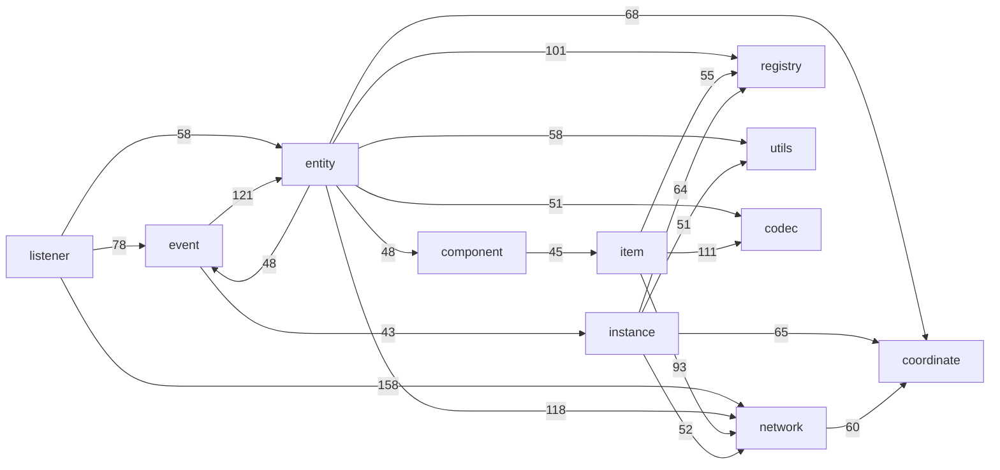
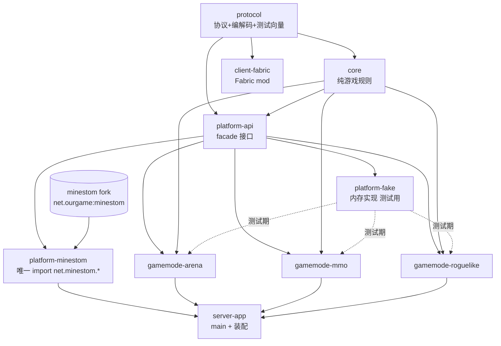
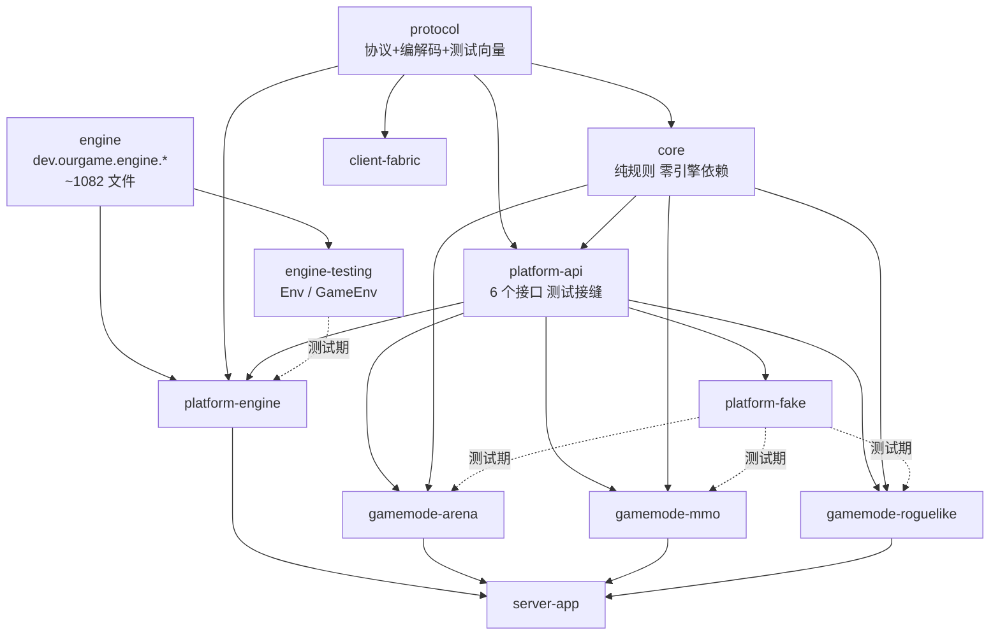

# Minestom fork 架构与文件结构评审（07）

对象：`/Users/bug/Documents/Projects/Minecraft/Minestom`，分支 `fork/main`（upstream master `16842f1954` + 4 个 cherry-pick）。
方法：只读。依赖关系用 Python 静态扫描 `import net.minestom.server.*` 构建顶层包矩阵，规模用 `wc -l` / `find`，其余为逐文件阅读。未运行 Gradle。
前置：本文不重复 `01`–`06` 已列的具体缺陷，只在需要「结构性根因」证据时引用它们。

---

## 一、TL;DR

> **前提已于本轮变更为「硬 fork」**：不再跟随 Minestom 上游，把这份代码当起点大改并新建自己的项目，Minecraft 协议版本由我们钉死（客户端强制 Fabric 模组，钉死成立）。因此**第二至七章里所有以「rebase 成本」为由的结论已作废**，它们保留下来是因为其中的测量数据（依赖矩阵、环、规模、耦合点）在新前提下依然成立，且是第八章重新判定的依据。**结论以第八章为准。**

1. **可以放心大改，但「协议」不是可以大改的部分**：钉死版本免掉的是「跟版本」，不是「实现协议」——客户端是原版 Minecraft + Fabric 模组，服务端仍必须完整说 26.2 的 login/configuration/play 协议，所以 `network/packet` 的 264 个文件、配置阶段全量下发的 32 个注册表、`entity/metadata` 与 `item/component` 的线格式**都不能按「我们不玩这个玩法」来删**。可删的是**服务端玩法逻辑**。
2. **删是最高杠杆的一步，而且便宜**：一份可整包删除的清单是 330 个文件 / 18,776 行（占主源码 17%），级联只波及 57 个文件 322 条 import，其中 6 个文件吃掉 226 条——`MetadataHolder` 一个 `Map.ofEntries` 就占 116 条。生成物侧只有 30 个文件 1,545 行受影响。这一步约 5–8 人日，风险低、可编译器驱动。
3. **改里只有三件真正值得做**：`MinecraftServer` 静态门面实例化（182 个调用点 / 66 文件，解锁测试并行与多实例）、`ServerFlag` 收进配置对象（126 个调用点 / 36 文件）、以及**建立一个 15 包的稳定底层**（只需消除 39 条边 / 335 条 import，而做成完整无环 DAG 要 957 条——花 35% 的钱拿 80% 的收益）。
4. **上帝类拆分即使没有 rebase 约束也不值得现在做**：实测删除清单只让 `Entity` 少 1 条 import（118→117）、`Player` 少 8 条（165→157），删除**不会**让它们缩小；而 `entity` 包的测试密度只有 0.12、`event` 只有 0.03，此刻拆 2,564 行的 `Player` 是在没有安全网的悬崖上作业。先补测试，后拆。
5. **工程形态转为单仓多模块**：引擎作为一个 Gradle 子项目留在游戏仓内、`platform-api` 从「防腐层」降级为「测试接缝」、`core` 保持零引擎依赖——与协调方的判断一致；唯一分歧是我主张**保留引擎独立的包命名空间与一条 ArchUnit 规则**，否则「引擎/游戏」边界会在三个月内消失。

## 二、依赖矩阵与环

### 2.1 复现命令

```bash
# 环境（遵守全局约定：Python 必须在 venv 里跑）
mkdir -p "$TMPDIR/mstom-audit" && cd "$TMPDIR/mstom-audit"
uv venv --python 3.10 && source .venv/bin/activate

# 规模
find src/main/java/net/minestom/server -name '*.java' | wc -l      # 1412
find src/main/java -name '*.java' | xargs wc -l | tail -1          # 113328
find src/autogenerated -name '*.java' | xargs wc -l | tail -1      # 26126（85 文件，入库）
for d in src/main/java/net/minestom/server/*/; do \
  echo "$(find "$d" -name '*.java' | wc -l) $(basename "$d")"; done | sort -rn

# 最大的类（含生成物）
find src/main/java src/autogenerated -name '*.java' | xargs wc -l | sort -rn | head -30

# 包依赖矩阵 / 环 / 扇入扇出（脚本核心：只认 import 语句，把 FQCN 折成顶层包）
#   grep 正则：^\s*import\s+(?:static\s+)?(net\.minestom\.server\.[A-Za-z0-9_.$]+)\s*;
#   折叠规则：net.minestom.server.<seg>.… → <seg>（首字母小写才算包，否则算 <root>）
#   环检测：Tarjan SCC；断环代价：Eades-Lin-Smyth 加权反馈弧集近似
python pkgdeps.py
```

脚本 `pkgdeps.py` 输出四段：每包 files/fanout/fanin/outImp/inImp、互相依赖的 2-环、Tarjan SCC、以及 SCC 内最弱的边（断环候选）。脚本已在 `$TMPDIR` 删除，正文给出的是它的输出。

### 2.2 规模底数

| 项 | 数值 |
|---|---|
| 主源码 | 1412 个 `.java`（+`module-info.java`），113,328 行 |
| 生成源码 | `src/autogenerated/java` 85 个文件，26,126 行，**已入库**（`git ls-files src/autogenerated` = 85） |
| 顶层包 | `src/main` 下 39 个 + 只存在于生成物的 `worldevent` + 根包 `net.minestom.server` = 分析中 41 个节点 |
| 包间依赖 | 343 条有向边，3,503 条 import 语句 |
| 公开顶层类型 | 1,132 个 |
| `module-info` 导出包 | 161 个（含 `utils` 全部 17 个子包与 `listener.*`） |
| 测试 | `src/test` 249 个文件；`testing/` 模块 13 个类 766 行 |
| 本 fork 相对上游的 diff | 12 个文件，+235 / −29 |

### 2.3 扇入 / 扇出（按文件数排序，节选）

| 包 | 文件 | 扇出(包) | 扇入(包) | 出向 import | 入向 import |
|---|---:|---:|---:|---:|---:|
| `network` | 303 | 29 | 28 | 269 | 639 |
| `entity` | 300 | 32 | 24 | 661 | 395 |
| `event` | 134 | 14 | 9 | 253 | 173 |
| `command` | 83 | 15 | 6 | 81 | 12 |
| `instance` | 77 | 22 | 15 | 388 | 185 |
| `item` | 74 | 16 | 16 | 351 | 191 |
| `utils` | 73 | 13 | **30** | 100 | **310** |
| `listener` | 46 | 20 | 3 | **385** | 5 |
| `registry` | 21 | 16 | 23 | 145 | 350 |
| `codec` | 14 | 7 | 20 | 38 | **328** |
| `coordinate` | 9 | **2** | 14 | 10 | **293** |
| `<root>` | 10 | 23 | 22 | 124 | 122 |

读法：
- `coordinate`（9 文件 / 扇出 2 / 入向 293）和 `codec`（14 文件 / 扇出 7 / 入向 328）是两个**设计得很好的叶子**——小、稳定、被所有人用、几乎不反向依赖别人。这两个包不要碰，也是我们游戏里**可以直接用、不必包 facade** 的部分。
- `listener`（46 文件 / 出向 385 / 入向 5）是纯粹的**接线层**：它依赖 20 个包，几乎没人依赖它。这是上游唯一一处干净的分层。
- `utils` 扇入 30 个包、310 条 import，是名副其实的公共依赖底座——问题是它里面装了不该装的东西（见 3.2）。
- `entity` 出向 661 条是全仓最高，`network` 入向 639 条是全仓最高，两者互相 118 / 24。

### 2.4 环

**Tarjan SCC：一个 37 节点的强连通分量，内部 3,480 条 import。**

成员（37/41）：`<root>, advancements, adventure, codec, collision, color, command, component, condition, coordinate, crypto, dialog, entity, event, exception, extras, game, instance, inventory, item, listener, message, network, particle, ping, potion, recipe, registry, scoreboard, snapshot, sound, statistic, tag, thread, timer, utils, world`

环外只剩 4 个：`map`、`gamedata`、`monitoring`、`worldevent`（都是没人依赖或不依赖任何人的孤立包）。

**最强的 22 条边（≥40 条 import）**：



**双向环（weakest ≥ 12 的 17 组）**：

| A ↔ B | A→B | B→A | 断哪边便宜 |
|---|---:|---:|---|
| `entity` ↔ `event` | 48 | 121 | 无（事件必须带实体类型） |
| `entity` ↔ `registry` | 101 | 35 | 35 |
| `entity` ↔ `component` | 48 | 25 | 25 |
| `entity` ↔ `instance` | 37 | 24 | 24 |
| `entity` ↔ `network` | 118 | 24 | 24 |
| `item` ↔ `registry` | 55 | 20 | 20 |
| `entity` ↔ `utils` | 58 | 18 | 18 |
| `<root>` ↔ `network` | 18 | 17 | 17 |
| `entity` ↔ `item` | 20 | 17 | 17 |
| `component` ↔ `item` | 45 | 16 | 16 |
| `utils` ↔ `instance` | 16 | 51 | 16 |
| `network` ↔ `registry` | 15 | 16 | 15 |
| `instance` ↔ `event` | 15 | 43 | 15 |
| `network` ↔ `utils` | 48 | 14 | 14 |
| `network` ↔ `instance` | 13 | 52 | 13 |
| `codec` ↔ `network` | 21 | 12 | 12 |
| `network` ↔ `item` | 12 | 93 | 12 |

### 2.5 断环代价（这一节是本报告最重要的数字）

我用脚本做了四组「假设性切割」，每组都是直觉上最该切的反向依赖，切完重跑 Tarjan：

| 假设切割 | 需改写的 import 数 | 切完后最大 SCC |
|---|---:|---:|
| `event` → `entity/instance/item/inventory` | 198 | **37** |
| `entity` → `network` | 118 | **37** |
| `network` → `entity/instance/item` | 49 | **37** |
| `registry` → 13 个上层包 | 139 | **37** |
| `utils` → 12 个上层包 | 99 | **37** |
| 上面四组一起切 | **485** | **37** |

结论很硬：**这不是「几条坏边」造成的环，是一张稠密的互相引用网**。用 Eades-Lin-Smyth 加权反馈弧集近似算最优分层，最好的排序也要去掉 **121 条包间边、957 条 import 语句（占 3,503 条的 27%）** 才能得到无环图，而排在最前面的反馈弧是 `event→entity`(121)、`component→item`(45)、`event→instance`(43)、`registry→entity`(35)——每一条都是语义上说得通的（事件必须携带实体、组件必须知道物品、注册表必须知道被注册的东西）。

**对 rebase 成本的影响：极高。收益：接近零。这是本报告第一条「明确不要动」。**

---

## 三、逐维度发现

### 维度 1：模块划分

**现状**。`settings.gradle.kts` 一共 5 个 `include` + 1 个 `includeBuild`：root（主库）、`testing`、`code-generators`、`jmh-benchmarks`、`jcstress-tests`、`demo`，外加 `includeBuild("build-src")`。发布的只有 root 和 `testing` 两个（`build.gradle.kts:96-99` 的 `nmcpAggregation`）。

| 模块 | 规模 | 插件 | 依赖 | 是否发布 |
|---|---|---|---|---|
| root | 1412 文件 | `minestom.java-library` + `minestom.publishing` + blossom + graalvm-native | adventure/slf4j/minestomData/fastutil/flare/gson/jctools | ✅ `net.minestom:minestom` |
| `testing` | 13 类 766 行 | java-library + publishing | root + junit | ✅ `net.minestom:testing` |
| `code-generators` | 11 类 | `minestom.java-binary` | minestomData + javaPoet + gson | ❌ |
| `demo` | 64 文件 | `minestom.java-binary` | root + logback(runtime) | ❌ |
| `jmh-benchmarks` | 36 文件 | java-library + jmh plugin | root | ❌ |
| `jcstress-tests` | 11 文件 | — | root | ❌ |
| `build-src` | 4 个约定插件 + 3 个自定义 Task | `includeBuild` | — | ❌ |

**边界评价：清楚，不需要改。** 三条具体依据：

1. `code-generators` 是**手动触发的一次性工具**，不接在 `build` 生命周期上——`code-generators/build.gradle.kts` 末尾把 `run` 的 args 写死成 `rootProject/src/autogenerated/java`，需要人跑 `:code-generators:run`。11 个生成器（`RegistryGenerator`、`BuiltinRegistriesGenerator`、`ParticleGenerator`、`GenericEnumGenerator`、`WorldEventGenerator`、`GameRuleGenerator`、`ConstantsGenerator`、`DyeColorGenerator` 等）从 `net.minestom:data:26.2-rv3` 这个 JSON 数据包读入，产出 85 个文件 26,126 行，**全部入库**（`.gitignore` 没有排除它，`git ls-files` 计数 85）。生成物入库是正确选择：让 clone 即可编译、让 diff 可审、让 IDE 索引可用；代价是 MC 版本一变必须重跑生成器并提交——这一步要写进我们的季度升级 checklist（见 5.6）。
2. `testing` 独立成模块**对下游有真实价值**，但价值边界要认清。它提供 `@EnvTest`（JUnit 5 扩展 `EnvTestExt`）、`@RegistriesTest`、`Env`/`EnvImpl`、`TestConnection`/`TestConnectionImpl`、`Collector`、`FlexibleListener`、`MockBlockGetter`。它能给你一个**真的 `ServerProcess`**、确定性的 `env.tick()`、出站包收集断言。审计 06 已经逐条列过它的 11 个盲区，其中三条对我们最致命：不走真实 socket（`TestConnectionImpl.PlayerConnectionImpl` 是 fake）、**集成路径完全不经过 codec**（`sendPacket` 只传对象引用，改错字段顺序 89 个集成测试仍然全绿）、`DISPATCHER_THREADS=1` 让多线程竞态被结构性压掉。
3. `demo` 不是玩具：64 个文件、引用了 **216 个不同的 Minestom 类型**（`grep -rh '^import net.minestom.server' demo/src/main/java | sort -u | wc -l`）。它是判断「下游到底会碰到多大的 API 面」的最好样本，5.3 的 facade 取舍就建立在这个数字上。

**问题**。两条，都不严重：

- `jmh-benchmarks`（36 文件）和 `jcstress-tests`（11 文件）**不在任何 CI workflow 里**（`.github/workflows/` 零引用，与审计 06 第 6 节一致）。而且 11 个 jcstress 场景的分布是：`tag` 7 个（`TagPathTest`、`TagRehashTest`、`TagUpdateTest`…）、`thread` 2 个（`AcquirableSyncTest`、`ThreadDispatcherSyncTest`）、`utils` 2 个（`ObjectPoolTest`、`ObjectArrayTest`）。也就是说**上游把并发验证的注意力几乎全投在 `Tag` 上**，而审计 04 的 3 条 P0 全在 `event` 和 `thread` 的 shutdown 路径——一个场景都没有。
- `code-generators/minestom_checks.xml`（14 KB Checkstyle 配置）在整个仓库里零引用，是转向 Error Prone 之后留下的死配置。**记录，不要删**（理由同 4.2 第 3 条）。

**建议**。不改模块划分。只在 fork 里**新增一个 workflow 文件**跑 `:jcstress-tests:jcstress`，并把我们自己的并发场景加进 `jcstress-tests`。

**rebase 成本：无**（新增 `.github/workflows/fork-concurrency.yml`，不碰上游已有的 4 个 workflow）；往 `jcstress-tests/` 加新文件同样是**无**。

### 维度 2：包结构与依赖方向

**2a. 职责单一性：`network` 与 `entity` 的内部结构。**

`network` 303 个文件里 264 个在 `packet/` 下，已按 `client`/`server` × 六个连接阶段分好（`server/play` 127、`client/play` 62）。**这个划分是对的，不缺子结构。** 真正拥挤的是 `network` 根目录那 11 个文件：4 个 `NetworkBuffer*`（797 + 1284 + 2142 行 + 模板实现）、`BinaryTagTypeImpl`、`ComponentNetworkBufferTypeImpl` 挤在 `ConnectionManager` / `ConnectionState` / `PlayerProvider` 旁边——缓冲区实现和连接管理是两件完全不同的事。

`entity` 300 个文件里 222 个在 `metadata/`，剩下 78 个里有 27 个直接躺在 `entity/` 根（`Entity` 1986、`Player` 2562、`LivingEntity` 757、`Metadata*` 四件套、`EntityView`、`PlayerSkin`、`GameMode`…）。**缺一个 `entity/player/` 子包**——而 `src/test/java/net/minestom/server/entity/player/` 这个测试子包**已经存在**，说明上游自己也想过。

**建议：都不动。** 移动一个类会同时改它的全部 import 方、`module-info` 的 exports、以及 `CheckAbiTask` 的兼容基线。

**rebase 成本：高。**

**2b. `utils` 是不是垃圾桶：是，但只有一半。**

73 个文件，扇入 30 个包 / 310 条 import。按被引用次数（`grep -rl "import net.minestom.server.<FQCN>;" src/main/java | wc -l`）分类：

*真正通用、留在 utils 是对的*（占引用量的大头）：
`utils.validate.Check`(89)、`utils.MathUtils`(21)、`utils.Either`(20)、`utils.StringUtils`(18)、`utils.Unit`(9)、`utils.Range`(8)、`utils.collection.ObjectArray`(8)、`utils.ArrayUtils`(3)、`utils.async.AsyncUtils`(3)、`utils.json.JsonUtil`(3)、`utils.ObjectPool`(2)、`utils.WeightedList`(2)、`utils.url.URLUtils`(1)、`utils.Either`/`ThrowingFunction`/`IntProvider`/`Ease` 等。

*明显属于别的包*（共 20 个类）：

| 现在的位置 | 应该在 | 被引用数 |
|---|---|---:|
| `utils.PacketSendingUtils` / `utils.PacketViewableUtils` | `network` | 12 / 2 |
| `utils.chunk.{ChunkUtils,ChunkCache,ChunkSupplier,ChunkUpdateLimitChecker}` | `instance` | 4/4/4/1 |
| `utils.block.{BlockUtils,BlockIterator,BlockBreakCalculation}` | `instance.block` | 7/2/1 |
| `utils.entity.{EntityFinder,EntityUtils}` | `entity` | 1 / 1 |
| `utils.inventory.PlayerInventoryUtils` | `inventory` | 8 |
| `utils.position.PositionUtils` / `utils.Direction` / `utils.Rotation` | `coordinate` | 7 / 11 / 2 |
| `utils.time.{Cooldown,Tick,TimeUnit}` | `timer` | 6 / 1 / 11 |
| `utils.crypto.KeyUtils` | `crypto` | 2 |
| `utils.location.RelativeVec` | `command` 或 `coordinate` | 1 |
| `utils.identity.NamedAndIdentified(Impl)` | `adventure` | 2 |
| `utils.mojang.MojangUtils` | `extras`/auth | 2 |
| `utils.callback.CommandCallback` | `command` | 1 |
| `utils.nbt.{BinaryTagReader,BinaryTagWriter,BinaryTagUtil}` | — | **0（全仓零引用，死代码，仍被 `module-info` 导出）** |

这也解释了 `utils` 为什么会出现在 SCC 里：`utils → entity`(18)、`utils → instance`(16)、`utils → network`(14) 这三条反向边，全部来自上表这些「放错位置」的类。

**建议：记录，不搬。** 搬 20 个类要改 ~99 条 import + 20 条 `exports` + 破坏二进制兼容。`utils.nbt` 那 3 个死类**也不要删**——删了一样是 ABI 破坏 + 每季度冲突，只在我们的编码规范里写一句「不要用」。

**rebase 成本：高**（搬迁）/ **无**（只记录）。

**2c. `module-info.java` 导出 161 个包，等于没有封装。**

`src/main/java/module-info.java` 205 行，`exports` 出现 161 次，其中包含 `net.minestom.server.utils` 全部 17 个子包、`net.minestom.server.listener` 全部 4 个子包、`net.minestom.server.instance.palette`、`net.minestom.server.thread`、`net.minestom.server.network.debug`、`net.minestom.server.crypto`。JPMS 在这里没有起到任何封装作用，只是把 1,132 个公开类型全部合法化了。

**建议：不动。** 我们靠自己这边的 ArchUnit / 分模块规则约束「哪些包禁止 import」，比改上游的 exports 便宜几个数量级。**rebase 成本：不动=无；改=高（ABI 破坏 + `CheckAbiTask` 红）。**

### 维度 3：核心抽象

**3a. `MinecraftServer` 静态门面 vs `ServerProcess` 实例：两套入口的真实代价。**

`MinecraftServer.java` 417 行，其中约 60 个 `public static` 访问器，核心是 `private static volatile ServerProcess serverProcess`（`:87`）。`ServerProcess` 是一个 `@ApiStatus.NonExtendable` 的 22 方法接口（`ServerProcess.java`），实现 `ServerProcessImpl` 是 **package-private final**（`:50`），唯一构造路径是 `MinecraftServer.updateProcess(Auth)`（`:103-106`），而这个方法**同时**把新实例写进静态字段。

三个具体后果：

1. **多实例在编译期就被封死**。你无法在同一个 JVM 里持有两个互不干扰的 `ServerProcess`，因为 `new ServerProcessImpl(...)` 在包外不可见，而唯一的工厂有副作用。
2. **测试隔离靠「覆盖全局」实现**。`testing/src/main/java/net/minestom/testing/EnvTestExt.java:27` 就是 `_ -> new EnvImpl(MinecraftServer.updateProcess())` ——每个 `@EnvTest` 类都在替换那个静态字段。审计 06 已经指出这直接禁止了测试并行：89 个类要起真进程，1,461 个 `@Test` 全部串行。
3. **6 处 `static final` 缓存把类初始化顺序变成隐式契约**：`Player.java:176`（`DIMENSION_TYPE_REGISTRY`）、`entity/damage/Damage.java:24`、`listener/ChatMessageListener.java:19-20`、`listener/BlockPlacementListener.java:35`、`utils/entity/EntityFinder.java:34`。这些类只要在 `MinecraftServer.init()` 之前被加载一次，拿到的就是空引用。全仓 66 个文件调用 `MinecraftServer.*`。

**建议**：不改上游。改为**在我们这边立一条硬规则：游戏业务模块禁止 import `net.minestom.server.MinecraftServer`**，所有进程级能力从我们的 `GameServer` facade 拿（内部再去调 `ServerProcess`）。这条规则用 Gradle 模块边界 + 一条 ArchUnit 测试即可强制。

**rebase 成本：不动=无；改成 DI=高**（66 个文件 + 上游核心设计选择，必然每季度冲突）。

**3b. `ServerFlag`：54 个系统属性开关，读一次就冻结。**

`ServerFlag.java` 150 行、54 个 `public static final`，全部在类初始化时通过 `System.getProperty` / `Boolean.getBoolean` 读取（`:97-148`）。也就是说：**改 flag 只能靠 JVM 启动参数，且必须在 `ServerFlag` 类被加载之前设置**。

结构性问题不在「用系统属性」，而在于**这 54 个开关切出的代码路径没有被统一测过**。三条实证：

- 构建脚本 `build-src/src/main/kotlin/minestom.java-library.gradle.kts:67-77` 给所有测试强制注入 `-Dminestom.viewable-packet=false`、`-Dminestom.inside-test=true`、`-Dminestom.acquirable-strict=true`——**测试 JVM 的三个 flag 值与生产默认值不同**，任何依赖它们的生产 bug 在测试里天然不可见。
- `ServerFlag.DISPATCHER_THREADS`（`:20`，默认 1）：调到 >1 是上游明确支持的配置，但整套测试从未在这个配置下跑过。
- `ServerFlag.UNSAFE_COLLECTIONS`（`:85`，注释自称「Likely to be removed」）和 `ServerFlag.FASTER_SOCKET_WRITES`（`:83`，注释 `TODO: promote to default`）是两个**半成品分支**，两侧语义已经分叉（审计 04 P1-6）。

**建议**：不改 `ServerFlag`。在**我们的启动器**（游戏仓，不在 fork 里）做两件事：(1) 启动时反射读出全部 54 个 flag 打日志；(2) 与我们锁定的期望值表比对，不一致直接拒绝启动。这样「配置漂移」变成开机自检，而不是线上事故。

**rebase 成本：无**（改动全在我们自己的仓）。

**3c. `Instance` / `Chunk` / `Entity` 的所有权模型：契约存在，断言从未接线。**

`ThreadDispatcher<P, E extends Tickable>`（`thread/ThreadDispatcher.java:25`，sealed）把 partition（`Chunk`）和 element（`Entity`）分配到 `TickThread`，`ServerProcess.dispatcher()` 返回 `ThreadDispatcher<Chunk, Entity>`。`Acquirable<T>` 提供跨线程安全访问，官方文档明确要求「缓存 acquirable 而不是 acquired 对象」「不要随便 `unwrap()`」。**设计意图是清晰的。**

问题是执行层完全空的：

- **`AcquirableImpl.assertOwnership()`（`:106-114`）在 `src/main` 里的调用点数量是 0。** 我用 `grep -rn "assertOwnership()" src/main/java | grep -v thread/Acquirable` 验证，输出为空。也就是说这个方法只有声明（`Acquirable.java:177`）和实现，从来没有任何一处调用它。
- 而 `ServerFlag.ACQUIRABLE_STRICT`（`:84`）在测试 JVM 里是 **true**，构建脚本 3 处设置它（`minestom.java-library.gradle.kts:73`、`build.gradle.kts:81,85`）。**一张全程打开、但根本没接上电源的安全网。**
- 唯一能证明它生效的测试断言从引入之日起就是注释掉的（`src/test/java/net/minestom/server/thread/AcquirableEntityIntegrationTest.java:23`）。

这解释了审计 02/03/04 里为什么会有那么多「续体跑在虚拟线程上直接写非 volatile 的 `position`/`currentChunk`」类型的 P0：**运行期完全没有东西会喊。**

**建议（这是 fork 里唯一值得做的代码改动）**：在 4 个写入入口各加一行 `acquirable.assertOwnership()`：
- `Entity#refreshPosition` 系列（`entity/Entity.java`，审计 02 的 P0-7 落点 `:938-947`）
- `Entity#setInstance` 的续体
- `InstanceContainer#UNSAFE_setBlock`（`instance/InstanceContainer.java`）
- `EntityTrackerImpl#register/unregister`（`instance/EntityTrackerImpl.java`）

同时取消 `AcquirableEntityIntegrationTest.java:23` 的注释。收益是把整类「跨线程写实体状态」的缺陷从「读代码才能发现」变成「CI 直接红」。

**rebase 成本：中**（碰 4 个上游高频文件，但每处 1 行，冲突形态是「上下文变了」而不是「同一行被改」，解起来是分钟级）。

**3d. `EventNode` 树。**

`event` 包 134 个文件，其中 `EventNode.java` 360 行接口 + `EventNodeImpl.java` 543 行 + `EventNodeLazyImpl.java` 87 行，事件类型按 `player`(57)/`entity`(20)/`instance`(10)/`inventory`(9)/`item`(8)/`server`(4)/`trait`(12)/`book`(2) 分包。

设计意图（把树编译成扁平的 `ListenerHandle` Consumer 链）是好的，但审计 04 找到的两条 P0 都在这条编译/失效路径上：`EventNodeImpl:492,508-513` 把 `WeakHashMap` 捕获进热路径 lambda 被无锁并发读；`EventNodeImpl:380-394,534-541` 的 `invalidate()` 在锁外写 `listener=null`。加上 `ServerFlag.EVENT_NODE_ALLOW_MULTIPLE_PARENTS`（`:82`）这个默认关闭的实验开关，说明这棵树的拓扑语义上游自己也还没定稿。

**建议**：不改结构，但**我们的事件总线不要直接暴露 `EventNode`**。业务代码注册监听走我们的 `GameEvents`，内部桥到一个（或少数几个）`EventNode`。理由不是抽象洁癖，是**保留把整棵树换掉的能力**：如果上游半年内没修 P0-3/P0-4，我们要能在不改一行业务代码的前提下换成自己的实现。

**rebase 成本：无**（改动在我们这边）。

**3e. `Tag` / `DataComponent` / `Codec` 三套并存。**

三个包一共 9,558 行：`codec/`(14 文件，含 `StructCodec.java` 3464 行、`CodecImpl.java` 668 行、4 个 `Transcoder*Impl`)、`component/`(6 文件)、`tag/`(14 文件)。

它们不是冗余，是**三个不同年代、不同目的的层**：

| 层 | 目的 | 落点 |
|---|---|---|
| `Tag`/`TagHandler` | Minestom 自己的、附着在任意 `Taggable` 上的用户数据（NBT 树） | `Entity:208`、`Instance:141`、`Chunk`、`AbstractInventory`、`CommandSender`、`Damage` |
| `DataComponent`/`DataComponentMap` | 1.20.5+ 原版物品组件模型（patch 语义） | `ItemStack`（`ItemStack.java:51` 直接 `extends TagReadable, DataComponent.Holder`）、`Entity implements DataComponent.Holder` |
| `Codec`/`StructCodec`/`Transcoder` | 统一的 NBT ↔ JSON ↔ Java 互转 | 被 20 个包引用，入向 328 条 import |

冗余的证据是具体的、也已经在审计 05 里落成缺陷：同一份递归结构在 `NetworkBufferTypeImpl.RecursiveType`(`:954-971`) 和 `CodecImpl.RecursiveImpl`(`:450-467`) 各写一遍且都没有深度上限；`RegistryTag` 的顺序契约在网络侧（`RegistryNetworkTypes:106` 用 `ArrayList`）与 codec 侧（`RegistryCodecs:142` 解成 `HashSet`）不一致，导致存盘读回后 `ItemStack.equals` 为 false。而 `ItemStack` 一个类型同时是 `TagReadable` 和 `DataComponent.Holder`，是「新 API 外壳套旧实现内核」最直接的体现。

**建议（对我们的游戏，这条比对 fork 更重要）**：**我们自己的游戏状态一律不用 `TagHandler` 存**（它有独立的锁与快照机制，审计 05 P2-7 指出其内存屏障方向是反的），放在我们自己的 `GameEntity`/`World` 对象字段里；只有两种数据需要落到这三套里的某一套——(a) 必须发给客户端的 → 走我们自定义协议的 `Codec`（复用 `net.minestom.server.codec` 是划算的，它是好叶子）；(b) 必须让原版客户端理解的物品语义 → `DataComponent`。**不写第三条路径。**

**rebase 成本：无。**

### 维度 4：公开 API 面

**现状（全部为实测）**：
- 公开顶层类型 1,132 个，`module-info` 导出 161 个包。
- 带 `@ApiStatus.Internal` 的文件 124 个（234 处注解），带 `@ApiStatus.Experimental` 的 39 个。覆盖率 **11%**（124/1132）。
- 分布极不均：`registry` 8/21（38%）、`thread` 7/14（50%）、`codec` 6/14（43%）算标注得不错；`event` 2/134（1.5%）、`command` 3/83（3.6%）、`network` 15/303（5%）、`adventure` 0/34、`listener` 1/46 基本没标。
- `*Impl.java` 共 96 个，其中 **13 个是 public 顶层类型**：`tag/TagImpl`、`collision/ShapeImpl`、`snapshot/SnapshotImpl`、`entity/VillagerProfessionImpl`、`network/NetworkBufferTemplateImpl`、`adventure/BinaryTagHolderImpl`、`network/debug/DebugSubscriptionImpl`、`item/instrument/InstrumentImpl`、`instance/generator/GeneratorImpl`、`world/timeline/TimelineImpl`、`world/clock/ClockTimeMarkerImpl`、`entity/metadata/animal/PigVariantImpl`、`entity/metadata/animal/FrogVariantImpl`。其中 **8 个连 `@ApiStatus.Internal` 都没有**。

**关键机制**：`CheckAbiTask.kt`（`build-src/src/main/kotlin/`，用 JDK `java.lang.classfile` 手写的 ABI diff）在比对时**显式排除带 `@ApiStatus.Internal` 和 `@ApiStatus.Experimental` 的成员**。也就是说，那 11% 的注解覆盖率不是文档偏好，而是**直接决定了哪些东西被二进制兼容门禁锁住**：剩下约 1,008 个公开类型，上游改一下就会让 `checkBinaryCompatibility` 变红。这对我们是好事（保护面很大），但有两个反面：
- 上游可以随时给某个类补一个 `@ApiStatus.Internal` 来「解锁」它，然后合法地破坏它——注解本身就是逃生舱。
- 13 个 public 的 `*Impl` 里有 8 个没标 `Internal`（`ShapeImpl`、`VillagerProfessionImpl`、`BinaryTagHolderImpl`、`DebugSubscriptionImpl`、`InstrumentImpl`、`TimelineImpl`、`ClockTimeMarkerImpl`、`PigVariantImpl`/`FrogVariantImpl`），它们现在受 ABI 门禁保护——但那只是标注疏漏，随时会被补上注解然后改掉。

**问题**：对下游而言，「什么算 API」这个问题**没有可机读的答案**。`@ApiStatus.Internal` 覆盖 11%，`module-info` 导出 100%，`sealed` 用得零散（`ItemStack`、`ThreadDispatcher`、`PacketParser` 是 sealed，`Instance`、`Entity` 不是）。一个下游只要 import 了 `NetworkBufferTemplateImpl` 或 `utils.chunk.ChunkUtils`，下一个季度就可能被打到——而编译器不会警告。

**建议**：不改上游注解（补 1000 个注解 = 每季度上千行冲突）。改为在我们这边定一张**白名单**：只有出现在我们 facade 实现模块（`platform-minestom`）的 import 才允许，且这个模块的 import 清单要在 code review 里被看。ArchUnit 一条规则：`platform-minestom` 之外的任何模块出现 `net.minestom..` import 即测试失败。另外把 8 个「没标 Internal 的 public Impl」加进我们自己的禁用清单——它们现在受 ABI 保护纯属侥幸。

**rebase 成本：不动=无。**

### 维度 5：上帝类

按 `wc -l` 排序，剔除 `src/autogenerated` 后的前 20：

| # | 文件 | 行 | import | 方法 |
|---:|---|---:|---:|---:|
| 1 | `codec/StructCodec.java` | 3464 | — | — |
| 2 | `entity/Player.java` | **2562** | 165 | 176 |
| 3 | `network/NetworkBufferTemplate.java` | 2142 | — | — |
| 4 | `entity/Entity.java` | **1986** | 118 | 150 |
| 5 | `network/NetworkBufferTypeImpl.java` | **1284** | 53 | — |
| 6 | `instance/Instance.java` | 1179 | 80 | 79 |
| 7 | `registry/RegistryData.java` | 996 | — | — |
| 8 | `particle/Particle.java` | 895 | — | — |
| 9 | `network/NetworkBufferImpl.java` | 797 | — | — |
| 10 | `instance/InstanceContainer.java` | 791 | 62 | 44 |
| 11 | `coordinate/Point.java` | 789 | — | — |
| 12 | `entity/LivingEntity.java` | 757 | 55 | 50 |
| 13 | `instance/palette/PaletteImpl.java` | 753 | — | — |
| 14 | `entity/MetadataDef.java` | 716 | — | — |
| 15 | `instance/block/Block.java` | 686 | — | — |
| 16 | `codec/CodecImpl.java` | 668 | — | — |
| 17 | `coordinate/BlockVec.java` | 667 | — | — |
| 18 | `instance/block/predicate/DataComponentPredicate.java` | 666 | — | — |
| 19 | `coordinate/Pos.java` | 634 | — | — |
| 20 | `coordinate/AreaImpl.java` | 626 | — | — |

其中 3、7、8、11、14、15、17、19 是**大而不复杂**的（常量表 / 值类型 / 模板生成器），不算上帝类。真正的上帝类是四个：

- **`Entity`（1986 行 / 150 方法 / 41 字段）实现 12 个接口**：`Viewable, Tickable, Schedulable, Snapshotable, EventHandler<EntityEvent>, Taggable, HoverEventSource<ShowEntity>, Sound.Emitter, Shape, AcquirableSource<Entity>, DataComponent.Holder, Pointered, Identified`（`Entity.java:128-129`）。混了至少 7 种职责：位置/物理、可见性(viewer 集合)、tick、调度、快照、事件分发、标签与组件存储、Adventure 展示、碰撞形状、线程归属。
- **`Player`（2562 行 / 176 方法）**：方法名前缀统计 `set`(33) / `get`(31) / `send`(13) / `refresh`(12) / `is`(9) / `play`(5)。它同时是「实体」「网络连接的服务端代表」（`interpretPacketQueue`、`sendPacket`）「调度驱动者」（`:707` 里拿 `MinecraftServer.getSchedulerManager()`）「资源包/配置阶段状态机」「Adventure Audience」「CommandSender」。
- **`InstanceContainer`（791 行 / 44 方法）**：方块写入 + 锁获取 + 区块加载/卸载/生成 + `copy()` + 邻居更新 + 爆炸。
- **`NetworkBufferTypeImpl`（1284 行 / 53 import）**：一个文件里十几种互不相关的编解码实现（`VarIntType`、`VarLongType`、`LazyType`、`RecursiveType`、`TypedNbtType`、`StringTerminatedType`、`LengthPrefixedType`…）。这一个**在不改公开 API 的前提下最容易拆**：它是 `Impl` 类，内部静态类拆成同包多文件不影响任何签名。

**建议：全部不拆。** 理由是量化的：我们本季度相对上游的 diff 只有 12 个文件 235 行，其中 4 个 cherry-pick 有 2 个落在 `network`/`instance`。这四个文件恰好是上游改动最频繁的地方；任何「抽 mixin / 拆委托」的改动都会把 rebase 冲突面从「几十行」放大到「整个文件重排」。

唯一可以有条件地做的是 `NetworkBufferTypeImpl` 的拆分（纯 Impl、零 API 影响），但**收益只是可读性**，我不推荐现在做。

**rebase 成本：拆 `Entity`/`Player`/`InstanceContainer` = 高；拆 `NetworkBufferTypeImpl` = 中（整文件重排，任何上游改动都会全冲突）。**

### 维度 6：测试结构

**`src/test` 镜像主代码吗：形状镜像，密度严重失衡。**

249 个测试文件对 1412 个主文件，构成是：`*IntegrationTest`（`@EnvTest`）**90** 个、`*RegistriesTest`（`@RegistriesTest`）**11** 个、纯单元 `*Test` **137** 个、辅助类 11 个。也就是说 **40% 的测试要起真服务器**，这正是 `MinecraftServer` 静态单例禁止测试并行的代价所在（`src/test/java` 下也没有 `module-info.java`，测试跑在 unnamed module 里）。按包对比（main→test）：

| 包 | main | test | 比 |
|---|---:|---:|---:|
| `tag` | 14 | 19 | 1.36 |
| `coordinate` | 9 | 7 | 0.78 |
| `instance` | 77 | 46 | 0.60 |
| `collision` | 14 | 7 | 0.50 |
| `inventory` | 23 | 11 | 0.48 |
| `codec` | 14 | 6 | 0.43 |
| `item` | 74 | 28 | 0.38 |
| `command` | 83 | 20 | 0.24 |
| `entity` | 300 | 36 | 0.12 |
| `listener` | 46 | 4 | 0.09 |
| **`network`** | **303** | **18** | **0.06** |
| **`event`** | **134** | **4** | **0.03** |
| `adventure` | 34 | 1 | 0.03 |
| `crypto` / `map` / `scoreboard` / `potion` | 11/10/8/8 | **0** | 0 |

`event`（134 个文件 4 个测试）和 `network`（303 个文件 18 个测试）是两个最大的洞——而审计 04 的 3 条 P0 全在 `event`，审计 01 的 2 条 P0 全在 `network`。`crypto` 11 个文件 0 测试。

命名约定由 `build-src/src/main/kotlin/CheckTestNamingTask.kt` 强制，规则写在 `.github/CONTRIBUTING.md`：普通单测 `*Test`、用 `@RegistriesTest` 的 `*RegistriesTest`、用 `@EnvTest` 的 `*IntegrationTest`，`testNamingCheck` 挂在 `check` 上。这条约定很好，**我们的游戏工程直接照抄**。

**`testing/` 的 `Env` 对下游够不够：不够，但缺的东西我们自己补得起。**

先说它做对的部分，因为这直接决定我们该复用多少：`Env` 能给你真的 `ServerProcess`、`createConnection()` 走**完整登录流程**、`trackIncoming(Class)` 收集下行包、`tick()` / `tickWhile(cond, timeout)` 精确步进、`listen()` 返回的 `FlexibleListener` 会在 cleanup 阶段强制校验「该收到的事件是否真收到」、以及**任何未捕获异常直接 `Assertions.fail`**（避免异步线程吞异常造成假绿）。这套东西自己重写不划算，应该复用。

对一个在 Minestom 上写游戏逻辑的团队，缺的最关键四样：

1. **没有模拟「客户端 → 服务端」包的正规通道**。`TestConnectionImpl` 只重写了出站的 `sendPacket`。要测「客户端发来一个我们自定义协议的包」，测试必须绕过 `testing` 模块、直接调主库内部 API `player.addPacketToQueue(clientPacket)` + `player.interpretPacketQueue()`（上游自己的 `src/test/.../entity/player/PlayerPacketQueueIntegrationTest.java` 就是这么写的）。**对我们这是最痛的一条**——自定义协议的服务端处理逻辑正是我们最需要测的东西。→ 对策见 5.5：`GameEnv` 必须把这两个调用包成一个 `inbound(player, msg)`。
2. **假时钟只有一半**。这条要说准确：`SchedulerImpl` 的 **tick 维度调度是确定性的**（内部计数器 `tickState` 只在 `processTick()` 里 +1，与墙钟解耦，`env.tick()` 可以快进）；但 `TaskSchedule.duration(...)` 交给真正的 `ScheduledExecutorService` 按 `duration.toMillis()` 排程，**没有可注入的虚拟时钟**。→ **对策：我们的技能冷却、buff 时长、肉鸽回合计时一律用 tick 计数写，禁止用 `Duration`。**
3. **不过 codec**。`TestConnection` 只传对象引用，不做序列化往返（审计 06 盲区 2）。→ 对策见 5.5：协议往返测试独立于 Env。
4. **多线程与真实 socket**。`DISPATCHER_THREADS=1`、fake `PlayerConnection`（盲区 1、8）。→ **对策：并发用 jcstress，连接层用一个裸 socket bot 做冒烟。**

两个容易踩的坑：`Collector.collect()` 是一次性的，`EnvImpl.EventCollector.collect()` 还会 `unmap` 该 actor 的全部映射监听器；`RegistriesTestExt` 把 vanilla `Registries` 存在 **JUnit 根 store**（`context.getRoot().getStore(...)`），整轮 `test` 只算一次并被全部 `@RegistriesTest` 共享——**这是一份事实上可变的共享状态，测试里绝不能改它**（对比 `EnvTestExt` 是按测试类缓存）。

**建议**：不改 `testing/` 模块（上游在动它，且改它对我们没有杠杆）。我们在游戏仓写自己的 `GameEnv`，内部可以用 `Env`，但暴露我们自己的 API。**rebase 成本：无。**

### 维度 7：构建与发布

**`build-src` 四个约定插件**（`includeBuild`，非 `buildSrc`，因此可以自己带版本目录）：

- `minestom.java-library`：Java toolchain 由 `JAVA_VERSION` 环境变量控制（默认 **25**）；`group = "net.minestom"`；`version = System.getenv("MINESTOM_VERSION") ?: "dev"`（`:8-9`）；排除 `checker-qual`；开 `withSourcesJar()` / `withJavadocJar()` / `modularity.inferModulePath`；测试 JVM 注入三个偏离生产的 flag（`:67-77`），堆 512m–1024m。
- `minestom.style`：Error Prone。`-Werror` + `-Xlint:all,-requires-automatic,-requires-transitive-automatic,-exports,-missing-explicit-ctor`，**96 项检查提升为 `error`**（从 `AlmostJavadoc` 到 `WildcardImport`，包含一整组 `Nullable*` 空安全检查、`UnusedMethod`/`UnusedVariable` 死代码检查、`JdkObsolete`、`PatternMatchingInstanceof` 等现代写法强制），8 项 `disable`（其中 `ReferenceEquality` 和 `ArrayRecordComponent` 带 `//TODO, likely needs to be fixed`）。生成物路径被排除（`excludedPaths = .*/build/generated/.*|.*/src/autogenerated/.*`）。另外挂了三个自定义 Task 到 `check`：`forbiddenImportsCheck`（`CheckImportsTask`，禁止 `org.jspecify` / `org.checkerframework`，因为 Adventure 传递性带进来了但只允许用 JetBrains 注解）、`errorproneCheck`、`testNamingCheck`。
- `minestom.publishing`：maven-publish + signing + `nmcp`，并注册 `checkBinaryCompatibility`（`CheckAbiTask.kt`）。这个 Task 是零第三方依赖、用 JDK `java.lang.classfile` 手写的 ABI diff：检测类删除/降可见性、class↔interface 互换、加 `final`/`abstract`、父类或接口被移除、方法/字段签名或可见性变化、编译期常量值变化、接口新增抽象方法等；**比对时排除带 `@ApiStatus.Internal` / `@ApiStatus.Experimental` 的成员**；`CI` 环境下输出 GitHub Actions `::error file=…::` 注解；没有 baseline 时静默跳过（这一点很重要——忘了传 `-PbaselineJarDir` 会得到一个假绿）。
- `minestom.java-binary`：给 `demo` / `code-generators` 用的 application 插件。

**版本号方案**。Gradle 侧不算版本，只读环境变量；真正的算法在 CI 里。`MINESTOM_VERSION` 由 `.github/workflows/release.yml:38-63` 计算：`DATE=$(date +'%Y.%m.%d')`，`MC_VERSION` 从 `:determineMinecraftVersion` 拿（= `libs.minestomData` 版本号 `26.2-rv3` 的 `-` 前半段 `26.2`），同日多次发布追加字母后缀（`2026.09.09b-26.2`）。发到 Maven Central（`net.minestom:minestom`、`net.minestom:testing`，`publishingType = "AUTOMATIC"`，上传即发布、无人工确认环节）；`release.yml` 是 `workflow_dispatch` 手动触发；而每次 push 到 master 由 `build-main.yml` 发一个固定的 `master-SNAPSHOT`，PR 分支发 `<branch>-SNAPSHOT`。另有 `jitpack.yml`（`sdk install java 25-graal`）作为「按 commit 直接引用」的第三条消费渠道。

**对下游锁版本的影响（这条对我们最实际）**：这个方案里**没有语义化版本**，没有任何东西告诉你 `2026.09.09-26.2` 到 `2026.12.01-26.4` 之间破坏了什么。上游唯一的兼容性信号是 CI 里的 `checkBinaryCompatibility` + `breaking` 标签，而这个标签是**可以被绕过**的（审计 06）。结论：**我们必须锁死具体版本，永不使用动态版本 / `+` / `latest.release`**，并且每次升级都当作可能破坏来处理。

**建议**：
- fork 的 `group` 改成我们自己的（`minestom.java-library.gradle.kts:8` 一行），避免与上游 artifact 在同一坐标下混淆。**rebase 成本：低**（build-src 上游极少改，且冲突是一行，一眼可解）。
- `MINESTOM_VERSION` 用 `<上游日期>-<MC>-f<N>`，例如 `2026.09.04-26.2-f3`，`f` 后是我们自己的补丁序号。**rebase 成本：无**（只是 CI 环境变量）。
- `checkBinaryCompatibility` 的 baseline 指向我们上一版 fork 产物而不是上游 release：只是 `-PbaselineJarDir` 参数。**rebase 成本：无。**

---

## 四、两张清单

> **⚠ 本节写于「跟随上游」前提，已被第八章取代。** 4.1 的 8 条在硬 fork 下仍然值得做（但优先级重排，见 8.7），4.2 的 13 条已逐条重新判定，见 **8.1 表**。

### 4.1 fork 内值得做的小改动

| # | 改动 | 收益 | rebase 成本 |
|---:|---|---|---|
| 1 | 新增 `FORK.md`（**不要叫 `CLAUDE.md`/`AGENTS.md`——`.gitignore` 第 44-46 行把它们忽略了**），写清：JDK 25、必须带 `--init-script gradle-init/aliyun-mirror.init.gradle.kts`、分支策略（`master` 只跟上游、补丁在 `fork/main`）、季度升级 checklist | 新人 / 新 agent 冷启动，避免每次重新踩镜像和 JDK | **无**（新文件） |
| 2 | 新增 `.github/workflows/fork-concurrency.yml` 跑 `:jcstress-tests:jcstress`（上游 4 个 workflow 一个字不改） | 审计 04 的 3 条并发 P0 目前 0 场景覆盖；jcstress 不在 CI 是上游的已知空洞 | **无**（新文件） |
| 3 | 往 `jcstress-tests/` 加我们自己的场景（`EventNodeImpl` 的 `WeakHashMap` 并发读、`ThreadDispatcherImpl` 的 shutdown/updateAndAwait 争用） | 把「读代码发现的 P0」变成「CI 能复现的 P0」 | **无**（新文件，上游几乎不动这个模块） |
| 4 | 接线 `assertOwnership()`：`Entity#refreshPosition`、`Entity#setInstance` 续体、`InstanceContainer#UNSAFE_setBlock`、`EntityTrackerImpl#register/unregister` 各 1 行 | `AcquirableImpl.assertOwnership()` 当前在 `src/main` 里**零调用点**，而测试 JVM 一直开着 `acquirable-strict=true`。接上之后整类跨线程写入在 CI 里直接红 | **中**（4 个高频文件，每处 1 行） |
| 5 | 取消 `src/test/.../AcquirableEntityIntegrationTest.java:23` 被注释掉的 `assertThrows` | 让第 4 条有回归保护 | **低**（测试文件） |
| 6 | 给集成测试加 teardown 删 `$TMPDIR/minestom-test-world-*`（审计总结第八节实测每跑一次留 ~18 个目录） | 直接对应全局磁盘卫生约定，本机已被撑爆过三次 | **低**（测试基类） |
| 7 | `minestom.java-library.gradle.kts:8` 把 `group` 改成我们的坐标；CI 里设 `MINESTOM_VERSION=<日期>-<MC>-fN` | 我们的 artifact 与上游 `net.minestom:minestom` 不再同坐标，避免解析到错误的 jar | **低**（一行 + CI 变量） |
| 8 | `checkBinaryCompatibility` 的 `-PbaselineJarDir` 指向我们上一版 fork 产物 | 让 ABI 检查检的是「相对我们上个版本」而不是「相对上游」，下游（我们的游戏）才真受保护 | **无**（CI 参数） |

**注意第 4 条是唯一碰上游 Java 源码的**。其余 7 条要么是新增文件，要么在构建/CI 里。

### 4.2 明确不要动的

| # | 不要动 | 原因（带数字） |
|---:|---|---|
| 1 | **顶层包的依赖环** | 37 个包在同一个 SCC；实测切掉 4 组最像多余的反向依赖（485 条 import）之后 SCC 仍然是 37；做成无环需要重写 957 条 import（27%）。rebase 成本极高，收益 0 |
| 2 | **`utils` 归位** | 20 个类确实放错了（`PacketSendingUtils`、`chunk/*`、`block/*`、`entity/*`、`time/*` 等，共 ~99 条 import），但搬迁会同时改 import、`module-info` exports、破坏 ABI，`CheckAbiTask` 必红 |
| 3 | **`utils/nbt/BinaryTagReader`、`BinaryTagWriter`（全仓 0 引用的死代码）** | 删了同样是 ABI 破坏 + `module-info` 改动 + 每季度冲突。只在我们的规范里写「禁止使用」 |
| 4 | **拆 `Entity`(1986) / `Player`(2562) / `Instance`(1179) / `InstanceContainer`(791)** | 这四个是上游改动最频繁的文件（我们自己的 4 个 cherry-pick 里 2 个落在 `network`/`instance`）。抽 mixin 会把 rebase 冲突从「几十行」放大到「整文件重排」 |
| 5 | **拆 `NetworkBufferTypeImpl`(1284)** | 技术上零 API 影响（纯 Impl，内部静态类），但整文件重排后上游任何改动都会全冲突，而收益只有可读性 |
| 6 | **把 `MinecraftServer` 静态门面改成依赖注入** | 66 个文件调用它，6 处 `static final` 缓存 manager。这是上游的核心设计选择，改它等于永久 fork。对策在我们这边：业务模块禁 import |
| 7 | **把 `ServerFlag` 改成配置对象** | 54 个 `public static final` + 全仓引用。对策：在我们的启动器做开机自检 |
| 8 | **`module-info.java` 的 161 条 exports** | 改任何一条都是 ABI 破坏。JPMS 在这里等于没封装，但纠正它的代价全部由我们承担 |
| 9 | **给 `ServerProcessImpl:87` 的 `packetParser` 加注入点做自定义包 ID** | `this.packetParser = PacketVanilla.CLIENT_PACKET_PARSER` 是写死的，`ServerProcessImpl` 是 package-private final。但我们**不需要**自定义包 ID：Fabric Networking API 本身就建立在 custom payload 上，走 `PluginMessagePacket` / `ClientPluginMessagePacket` 就够。加注入点 = 给自己找每季度的冲突 |
| 10 | **Error Prone 规则集 / 代码格式化** | `-Werror` + ~100 项 error 级检查。多开一项可能触发几十处修改，全是 rebase 噪声。`disable` 列表里那两个带 TODO 的（`ReferenceEquality`、`ArrayRecordComponent`）尤其不要碰 |
| 11 | **`src/autogenerated/` 里的任何文件** | 85 个文件 26,126 行由 `:code-generators:run` 重生成，手改会在下次生成时静默丢失 |
| 12 | **`testing/` 模块的公共 API（`Env`/`TestConnection`/`Collector`）** | 上游在动它，且改它对我们没有杠杆。要新能力就在游戏仓写自己的 `GameEnv` 包一层 |
| 13 | **在 fork 仓里放游戏代码 / 拿 `demo/` 当游戏入口** | fork 要 rebase 到上游 tag，游戏要线性历史；混在一起会让每次 `git rebase upstream/master` 把游戏提交也卷进来 |

---

## 五、我们游戏工程的推荐结构

> **⚠ 本节的分仓 + 全量防腐层方案已被 8.6 取代。** 其中仍然有效的部分：5.4 的「不包，直接用」清单、5.5 的测试策略（尤其协议往返测试向量两端共用、`GameEnv.inbound()`）。

### 5.1 为什么不做全量 facade

一个 64 文件的 `demo` 就用到了 **216 个不同的 Minestom 类型**。全量包一遍是几千行纯转发代码，会在第一次赶工期时被绕过，变成「有 facade 但一半代码直接 import minestom」的最坏状态。所以规则是**选择性防腐层**：只包同时满足「上游易变」和「我们迟早要自己实现」的东西；其余（值类型、编解码、Adventure）直接用。

### 5.2 Gradle 多模块布局

```
game/                              (独立 git 仓库)
├── settings.gradle.kts
├── gradle/libs.versions.toml      锁死 minestom fork 的具体版本
├── build-logic/                   我们自己的约定插件（照抄 fork 的 style 思路）
├── protocol/                      自定义协议：消息定义 + 编解码 + 测试向量
├── core/                          纯游戏规则：属性、伤害、技能、词条、掉落、肉鸽种子
├── platform-api/                  facade 接口，零 Minestom 依赖
├── platform-minestom/             facade 实现（唯一允许 import net.minestom.*）
├── platform-fake/                 内存实现，给 core/gamemode 的测试用
├── gamemode-arena/                小游戏
├── gamemode-mmo/                  MMORPG
├── gamemode-roguelike/            肉鸽
├── server-app/                    main()、装配、配置、日志、开机自检
├── client-fabric/                 Fabric mod（Loom），依赖 protocol
└── tools/                         地图烘焙、掉落表校验等离线工具
```

### 5.3 每个模块允许依赖什么

| 模块 | 允许依赖 | 硬禁止 |
|---|---|---|
| `protocol` | JDK 25 + 一个序列化库（自己写或用 fork 的 `net.minestom.server.codec`，见下） | Minestom 的其余部分、Fabric、Adventure |
| `core` | `protocol`、JDK | **任何 `net.minestom.*`**、Fabric |
| `platform-api` | `protocol`、`core`、Adventure（`Component` 是事实标准，包它不划算） | **任何 `net.minestom.*`** |
| `platform-minestom` | `platform-api`、`core`、`protocol`、**Minestom fork** | Fabric、`gamemode-*` |
| `platform-fake` | `platform-api` | Minestom、Fabric |
| `gamemode-*` | `platform-api`、`core`、`protocol` | **任何 `net.minestom.*`**、Fabric |
| `server-app` | 全部服务端模块（唯一同时看得见 `platform-minestom` 和 `gamemode-*` 的地方） | Fabric |
| `client-fabric` | `protocol`、Fabric API | Minestom、`core`（客户端不跑游戏规则） |

用一条 ArchUnit 测试强制：除 `platform-minestom` 与 `server-app` 外，任何模块出现 `net.minestom..` import 即失败。



（箭头方向为「被依赖 → 依赖方」，即编译顺序。）

### 5.4 facade 应该包裹的 Minestom 类型清单

**必须包（8 组）**——判据是「上游易变或已知有 P0」且「我们可能要换实现」：

| 我们的接口（`platform-api`） | 包裹的 Minestom 类型 | 为什么必须包 |
|---|---|---|
| `GameServer`（`start/stop/tickCount/flags`） | `MinecraftServer`、`ServerProcess`、`ServerProcessImpl`、`ServerFlag` | 静态单例 + 54 个全局 flag；业务代码一旦碰到就永远测不了 |
| `GameEvents`（`on(Class,handler)` / `emit`） | `EventNode`、`GlobalEventHandler`、`EventNode.*` 静态工厂、`EventFilter`、`ListenerHandle`、`Event` 子类 | `EventNodeImpl` 有 2 条并发 P0（审计 04）；要保留整棵树换实现的能力 |
| `GameScheduler`（**只接受 tick 数，不接受 `Duration`**） | `Scheduler`、`SchedulerManager`、`Task`、`TaskSchedule`、`ExecutionType` | park/unpark 有 lost-wakeup（审计 04 P1-3/P1-4）；且 `Env` 推不动墙钟时间，用 tick 才可测 |
| `PacketBus` / `Channel<T>`（自定义协议唯一出入口） | `SendablePacket`、`PluginMessagePacket`、`ClientPluginMessagePacket`、`PlayerConnection#sendPacket`、`PacketListenerManager` | 这是我们和 Fabric 端的主干道，必须能独立于 Minestom 做往返测试 |
| `Owned<T>` / `ThreadAffinity` | `Acquirable`、`Acquired`、`AcquirableSource`、`TickThread`、`ThreadDispatcher` | `assertOwnership()` 零调用点，上游的所有权模型只有文档没有执行 |
| `World` | `Instance`、`InstanceContainer`、`SharedInstance`、`InstanceManager`、`Chunk`、`ChunkLoader` | `Instance` 1179 行 11 接口；我们用**组合**（`World` 持有 `Instance`），绝不继承 |
| `Actor` / `PlayerHandle` | `Entity`、`LivingEntity`、`EntityCreature`、`Player`、`EntityType` | `Player` 2562 行 176 方法；继承它等于把上游每次改动直接接进我们的类 |
| `WorldView`（方块读写、光照、区块加载策略） | `InstanceContainer#setBlock/loadChunk`、`Batch`、`LightingChunk` | 审计 03 的光照死锁与区块加载失败 P0 都在这条线上；我们要能整体绕开（预烘焙光照 + Polar 整块载入） |

**不包，直接用**——包了只有成本：

- `coordinate` 全包（`Pos`、`Vec`、`Point`、`BlockVec`、`Area`）：9 个文件、扇出仅 2、入向 293，是全仓最稳定的叶子。
- `codec`（`Codec`、`StructCodec`、`Transcoder`）：14 个文件、扇出 7、入向 328。**建议 `protocol` 模块直接用它做自定义协议的编解码**——它是 fork 里质量最好的部分，自己再写一套没有意义。代价是 `protocol` 会依赖 fork，接受它；作为交换，`protocol` 必须有完整的往返测试。
- `instance.block.Block` / `item.Material` / `item.ItemStack`：值语义、`sealed`、且常量表是生成物。
- `net.kyori.adventure.text.Component`：不是 Minestom 的，是事实标准。
- `tag.Tag` / `TagHandler`：**既不包也不用**。我们的游戏状态放自己的对象里（理由见 3e）。

### 5.5 测试策略

| 层 | 手段 | 目标占比 |
|---|---|---|
| `core` / `protocol` | 纯 JUnit 5，不启服务器，毫秒级 | 全部测试的 ~70% |
| `protocol` 编解码 | **往返测试 + 与 `client-fabric` 共用同一份测试向量**（向量放 `protocol` 的 `testFixtures`，服务端和 Fabric 端各跑一遍） | 补上 `testing/` 框架「集成路径不过 codec」这个盲区 |
| `gamemode-*` | 依赖 `platform-fake` 的内存实现，不启 Minestom | ~15% |
| `platform-minestom` | 用上游 `net.minestom:testing` 的 `@EnvTest`，且**明知它的盲区**（不走 socket、不过 codec、`DISPATCHER_THREADS=1`） | ~10% |
| 自定义协议的**入站**处理 | 我们的 `GameEnv` 必须提供 `inbound(player, msg)`，内部包 `player.addPacketToQueue(...)` + `player.interpretPacketQueue()`——`testing` 模块没有这个能力，上游自己也是绕过框架直调主库 API | 每个协议消息 ≥1 条 |
| 并发 | 独立 jcstress 模块，进 CI（上游没做） | 关键路径各 1 个场景 |
| 端到端 | 一个裸 socket bot（或 headless Fabric 客户端）跑登录→进世界→自定义协议往返的冒烟，进 CI nightly | 1 条主干路径 |

命名约定照抄上游 `CONTRIBUTING.md`：`*Test` / `*IntegrationTest`，并把 `CheckTestNamingTask` 的思路搬进 `build-logic`。

### 5.6 版本锁定与季度升级

**日常依赖形态：发布坐标，不用 `includeBuild`。** 三条理由：

1. fork 开了 `org.gradle.isolated-projects=true` 和 `configureondemand=true`（`gradle.properties`），常驻 `includeBuild` 会把 fork 的 6 个子项目 + `build-src` 的配置阶段挂进我们每一次构建。
2. fork 是「每季度动一次」的东西，日常不该参与我们的增量编译。
3. CI 必须构建可复现，动态引用外部工作目录不可复现。

具体做法：fork 的 CI 产出 `net.ourgame:minestom:2026.09.04-26.2-f3` 与 `net.ourgame:testing:...`，发到内网 Maven（没有内网仓库时先发 `mavenLocal()`，但那是临时方案，第一个季度内必须换掉）。游戏仓 `gradle/libs.versions.toml` 锁死这个版本字符串，**永不使用 `+` / `latest.release` / snapshot**——上游版本号里没有语义化信息，`2026.09.04-26.2` 到 `2026.12.xx-26.4` 之间破坏了什么，只有二进制兼容报告能告诉你。

改 fork 的那几天用开关切进 composite build：

```kotlin
// game/settings.gradle.kts
if (providers.gradleProperty("useLocalMinestom").orNull == "true") {
    includeBuild("../minestom-fork") {
        dependencySubstitution {
            substitute(module("net.ourgame:minestom")).using(project(":"))
            substitute(module("net.ourgame:testing")).using(project(":testing"))
        }
    }
}
```

平时 `./gradlew build`，改 fork 时 `./gradlew build -PuseLocalMinestom=true`。

**季度升级流程（7 步，写进 `FORK.md`）**：

1. `git fetch upstream --tags`，选定上游 tag（不要跟 `master` HEAD）。
2. `git rebase <tag> fork/main`。当前基线是 12 个文件 235 行，这一步应该是分钟级；如果某次超过半小时，说明我们违反了 4.2 的某一条，回去查。
3. `libs.versions.toml` 的 `data` 版本若变（`26.2-rv3` → 新版），跑 `:code-generators:run` 并把 `src/autogenerated/` 的 diff 单独提一个 commit。
4. `./gradlew check` 全绿（含 errorprone、`forbiddenImportsCheck`、`testNamingCheck`、我们新增的 jcstress workflow）。
5. `./gradlew checkBinaryCompatibility -PbaselineJarDir=<上一版 fork 产物>`，**逐条读破坏项**，写进升级说明。
6. 发布 `<日期>-<MC>-f0`，游戏仓改 `libs.versions.toml` 一行，跑全量测试 + 端到端冒烟。
7. 破坏项落到我们代码里的部分，**优先改 facade 实现（`platform-minestom`）而不是 `gamemode-*`**——如果某次升级逼你改了 `gamemode-*`，说明 facade 漏了一个类型，把它补进 5.4 的清单。

同时把审计总结第五节的那条也执行：**小而确定的修复优先提 PR 回上游**（1、3、10 三条），每被合并一条，我们的季度 rebase 面就少一块。

---

## 六、项目目录建议

> **⚠ 本节已被 8.6 末尾的「第六节目录建议的更新版」取代**（硬 fork 下改为单仓）。

当前 `/Users/bug/Documents/Projects/Minecraft/` 下有 `research/`、`Minestom/`、`gradle-init/`、`.worktrees/`（临时）。建议：

```
Minecraft/
├── minestom-fork/         ← 由 Minestom/ 改名（git remote: origin=我们的、upstream=Minestom/Minestom）
├── game/                  ← 新建，独立 git 仓库，结构见 5.2
├── gradle-init/           ← 保留在此，两个仓库共用（阿里云镜像脚本）
└── .worktrees/            ← 临时，本轮修 bug 结束后删掉
```

**为什么 fork 改名**：`Minestom/` 与上游同名，脚本、agent、构建缓存路径都分不清「上游」和「我们的」。改名是零成本消歧，Gradle 侧只需清一次 `.gradle/`。

**fork 与游戏是否同仓：分仓。** 四条理由：(1) fork 要反复 `git rebase upstream/<tag>`，同仓时每次 rebase 会把游戏提交一起卷进冲突；(2) fork 是 Apache-2.0 派生物且我们要往上游提 PR，同仓会让「提一个干净的 PR」变成手工 cherry-pick；(3) 发布节奏差一个数量级（季度 vs 每天）；(4) 分仓后 `includeBuild` 依然可用（5.6 的开关），没有任何开发体验损失。

**`research/` 归档到哪**：这 400 KB markdown（7 份横向调研 + 10 份 Minestom 审计）是我们的选型决策依据，价值在于「三年后有人问『为什么是 Minestom 不是 Paper』时能答上来」。移到 `game/docs/research/`——决策记录要和它约束的代码放在一起、走同一套 review。真正的决定另用 ADR 沉淀在 `game/docs/decisions/`（`ADR-001 选择 Minestom`、`ADR-002 fork 内不做结构性重排`、`ADR-003 选择性防腐层`），每条引用对应报告。`minestom-audit/` 的 P0 清单**开工时逐条建成 issue**，markdown 只作证据链。

---

## 七、参考链接

- Minestom 上游仓库：https://github.com/Minestom/Minestom
- 官方文档（`wiki.minestom.net` 已 301 到此）：https://minestom.net/docs/introduction
- 线程架构 / Acquirable API：https://minestom.net/docs/thread-architecture/acquirable-api
- Javadoc：https://javadoc.minestom.net
- 贡献与测试命名约定：仓库内 `.github/CONTRIBUTING.md`
- 安装与 snapshot 用法：仓库内 `.github/README.md`
- Maven Central 坐标：https://mvnrepository.com/artifact/net.minestom/minestom
- 本仓库内的关键文件（绝对路径）：
  - `/Users/bug/Documents/Projects/Minecraft/Minestom/src/main/java/module-info.java`（161 条 exports）
  - `/Users/bug/Documents/Projects/Minecraft/Minestom/src/main/java/net/minestom/server/MinecraftServer.java`（静态门面）
  - `/Users/bug/Documents/Projects/Minecraft/Minestom/src/main/java/net/minestom/server/ServerProcessImpl.java:87`（写死的 packetParser）
  - `/Users/bug/Documents/Projects/Minecraft/Minestom/src/main/java/net/minestom/server/ServerFlag.java`（54 个 flag）
  - `/Users/bug/Documents/Projects/Minecraft/Minestom/src/main/java/net/minestom/server/thread/AcquirableImpl.java:106`（零调用点的断言）
  - `/Users/bug/Documents/Projects/Minecraft/Minestom/build-src/src/main/kotlin/minestom.style.gradle.kts`（Error Prone 规则集）
  - `/Users/bug/Documents/Projects/Minecraft/Minestom/.github/workflows/release.yml:38-63`（版本号算法）
- 相关审计报告：`00-总结与开发计划.md`、`01-network.md`、`02-entity.md`、`03-instance-world.md`、`04-threading-events.md`、`05-item-inventory-command-codec.md`、`06-issues-prs-test-coverage.md`

---

## 八、硬 fork 前提下的重排计划

> 本章在「不再跟上游、协议版本钉死」的新前提下重写结论。第二至七章的**测量数据**继续有效，**以 rebase 成本为由的判定**全部作废。
> 人日估算的口径：一名已经熟悉这份代码的资深工程师，含写/改测试与自测，不含 code review 排队时间。删除类工作按「编译器驱动、错误即清单」估；语义改动类按当前测试密度打折（`network` 0.06、`event` 0.03 意味着改完没人告诉你错了，验证成本要翻倍）。

### 8.1 前提变更推翻了什么、又新增了什么约束

作废的：所有「这会让每季度 rebase 变贵」的论证——即第四节 4.2 的 13 条里，13 条中有 11 条的**唯一**理由就是 rebase 成本。

**但硬 fork 引入两条新的硬约束，它们比 rebase 成本更难绕开：**

**约束 A：协议是外部契约，钉死版本 ≠ 可以裁剪协议。** 客户端是原版 Minecraft 26.2 + Fabric 模组。Fabric 模组能加自定义 payload、能改渲染与 UI，但**不能改变客户端解析原版包的方式**。三处实测证据：
- `ConnectionManager.java:283` 在配置阶段 `player.sendPackets(Registries.registryDataPackets(registries, excludeVanilla))`，把 `Registries.java` 里 **32 个 `DynamicRegistry`** 全量发给客户端。删掉 `Enchantment` 类型 = 无法枚举 enchantment 注册表 = 客户端配置阶段拿不到它。
- `RegistryData.java:8` `import net.minestom.data.MinestomData`、`:167` `RegistryData.load("%s.json")`——注册表内容是**运行时**从 `net.minestom:data:26.2-rv3`（688 KB / 85 个 JSON / 解压 17.6 MB）读的，不是编译期常量。
- `MetadataHolder.java:309` 的 `ENTITY_META_SUPPLIER` 是 `EntityType → Meta 构造器` 的全量映射；实体元数据的**线格式**由协议规定，不是我们能省的。

结论：**能删的是「服务端玩法逻辑」，不能删的是「协议骨架」**。对那些我们不解析、但协议要求存在的注册表，正确做法不是删，是**降级成不透明注册表**（见 8.2.3）。

**第四节 4.2「明确不要动」13 条的逐条重新判定：**

| # | 原条目 | 原理由 | 硬 fork 下的新判定 | 工作量 | 阶段 |
|---:|---|---|---|---:|:---:|
| 1 | 拆 37 包依赖环 | rebase 成本极高 | **部分反转**。完整 DAG（957 import）仍不值得；但**底层化 15 个包只要 39 边 / 335 import**，做，并用 ArchUnit 锁住 | 8–11 人日 | 6 |
| 2 | `utils` 归位（20 类） | ABI 破坏 + 冲突 | **反转：做。** 纯 IDE refactor，且正好覆盖 `utils→entity/instance/network` 三条底层化必删边 | 1–2 人日 | 6 |
| 3 | 不删 `utils/nbt` 死代码 | ABI 破坏 | **反转：删。** 全仓 0 引用，4 文件 140 行，随波次 1 走 | 计入波次 1 | 2 |
| 4 | 拆 `Entity`/`Player`/`Instance`/`InstanceContainer` | 上游高频文件 | **理由作废，但结论不变：暂不做。** 新理由是实测的——删除只让 `Entity` 少 1 条 import、`Player` 少 8 条，且 `entity` 测试密度 0.12。**先补测试（阶段 7），再按需求驱动拆** | 按需 | 8 |
| 5 | 拆 `NetworkBufferTypeImpl` | 整文件重排必冲突 | **反转：做。** 零语义风险，纯 Impl 内部静态类分文件 | 1 人日 | 6 |
| 6 | `MinecraftServer` 改 DI | 上游核心设计 | **反转：做，且是收益最高的一项。** 解锁测试并行（90 个 `@EnvTest` 当前全串行）与多实例 | 5–8 人日 | 4 |
| 7 | `ServerFlag` 改配置对象 | 全仓引用 | **反转：做。** 消灭「测试 flag ≠ 生产 flag」的结构性盲区 | 3 人日 | 5 |
| 8 | `module-info` 161 条 exports | ABI 破坏 | **反转：重写。** 改名之后本来就要重写整个 `module-info`；顺手把 `utils.*`/`listener.*`/`instance.palette` 等收回不导出 | 计入阶段 3 | 3 |
| 9 | 不给 `packetParser` 加注入点 | 每季度冲突 | **理由作废，但结论不变：仍不做。** 客户端是原版 MC，自定义包 ID 会被客户端直接拒；Fabric Networking 本就建立在 custom payload 上。这条与 rebase 无关 | — | — |
| 10 | 不动 Error Prone / 不格式化 | rebase 噪声 | **部分反转。** 96 项 error 级检查**保留**（那是真资产，别关）；`disable` 里两条带 TODO 的（`ReferenceEquality`、`ArrayRecordComponent`）现在可以打开并修 | 2–3 人日 | 6 |
| 11 | 不动 `src/autogenerated` | 会被重生成覆盖 | **反转：转为普通源码并手工裁剪，同时删掉 `code-generators`。** 一个会悄悄覆盖你编辑的生成器在钉死版本后是负债（见 8.5） | 计入波次 1/2 | 2 |
| 12 | 不动 `testing/` 公共 API | 上游在改它 | **反转：改造成 `engine-testing`。** 必须补 `inbound(player, msg)`（模拟客户端→服务端包），这是自定义协议最需要测的能力 | 2–3 人日 | 7 |
| 13 | 不在 fork 仓放游戏代码 | rebase 会卷进游戏提交 | **反转：单仓。** 不跟上游就没有 rebase，分仓只剩纯成本（见 8.6） | 计入阶段 0 | 0 |

13 条里 **9 条反转、2 条部分反转、2 条结论不变**（第 4 条与第 9 条，且第 9 条的新理由与 rebase 完全无关）。

**约束 B：上游的 bug 从此 100% 是我们的 bug。** 审计 00 的 15 条 P0 / 48 条 P1 不再有「上游会不会修」这个变量，也不再有「小修先提回上游以减负」的动机（该动机在 00 第六节阶段 0 里写过，现在作废——回馈上游变成纯粹的社区选择，与我们的成本无关）。这把「阶段 1 止血」的优先级顶到最高：**它必须排在任何结构性改动之前**，否则你会在一个还在漏血的地基上做重排。

### 8.2 删什么

#### 8.2.1 三条判据

1. **协议必需吗？** 客户端会因为缺它而握手失败、渲染错误或崩溃 → 不能删（可降级为不透明）。
2. **是原版玩法逻辑吗？** 服务端为了复刻原版行为而写的代码，我们的游戏不要 → 删。
3. **是数据表达/基础设施吗？** `coordinate`/`codec`/`registry`/`tag`/`component`/`thread` → 不删，进底层。

#### 8.2.2 三个波次（数字全部实测）

**波次 1 — 整包删除，无需替代品。**

| 包 | 文件 | 行 | 包外引用（文件/import） | 关联测试 | 删除后要补什么 |
|---|---:|---:|---|---:|---|
| `entity/pathfinding` | 18 | 1572 | 5 / 6 | 1 | 自研导航网格（本来就要做，见 00 阶段 2） |
| `entity/ai` | 17 | 1317 | 1 / 2 | 1 | 自研行为树/状态机 |
| `instance/anvil` | 3 | 853 | 1 / 1 | 1 | Polar 或自研整块格式 |
| `instance/batch` | 6 | 860 | 1 / 1 | 0 | 无（整块载入不需要 batch） |
| `recipe` | 8 | 699 | 8 / 13 | 1 | 无（合成走自定义 UI） |
| `advancements` | 8 | 727 | 8 / 9 | 1 | 自研任务系统 |
| `statistic` | 5 | 95 | 3 / 3 | 0 | 自研埋点 |
| `dialog` | 9 | 628 | 7 / 7 | 2 | 降级为不透明注册表 |
| `map` | 10 | 690 | **0 / 0** | 0 | 无（零引用，删了无感） |
| `ping` | 3 | 403 | 3 / 4 | 0 | 一个固定 JSON 的 status 响应（~30 行） |
| `extras` | 5 | 313 | 4 / 4 | 1 | LAN 广播与 Mojang 鉴权按需自写 |
| `utils/nbt` | 4 | 140 | 1 / 1 | 0 | 无（全仓零引用死代码） |
| `scoreboard` | 8 | 1815 | 7 / 8 | 0 | 自定义 HUD 走 Fabric 端渲染 |
| `network/debug` | 16 | 472 | 7 / 7 | 1 | 无 |
| `item/enchant` | 12 | 1074 | 7 / 19 | 1 | 降级为不透明注册表 |
| `item/armor`(trim) | 5 | 238 | 6 / 11 | 0 | 降级为不透明注册表 |
| `item/instrument` | 3 | 126 | 5 / 5 | 0 | 降级为不透明注册表 |
| `item/book` | 2 | 38 | 3 / 3 | 0 | 无 |
| `item/crossbow` | 2 | 21 | 1 / 1 | 0 | 无 |
| `entity/vehicle` | 2 | 53 | 1 / 1 | 0 | 无 |
| `monitoring` | 3 | 285 | 8 / 9 | 0 | 换成我们自己的 Micrometer/JFR 埋点 |
| **小计** | **149** | **12,419** | | **9** | |

**波次 2 — 实体元数据裁剪。** 我们的游戏用 display 实体 + 少量类玩家单位，原版生物元数据无用。

| 子包 | 文件 | 行 | | 子包 | 文件 | 行 |
|---|---:|---:|---|---|---:|---:|
| `metadata/animal` | 63 | 3153 | | `metadata/golem` | 6 | 183 |
| `metadata/monster` | 44 | 931 | | `metadata/villager` | 4 | 132 |
| `metadata/other` | 26 | 904 | | `metadata/flying` | 4 | 58 |
| `metadata/water` | 14 | 465 | | `metadata/ambient` | 3 | 37 |
| `metadata/minecart` | 10 | 157 | | `metadata/cube` | 7 | 337 |
| | | | | **小计** | **181** | **6,357** |

**保留**：`metadata/` 根的 8 个基类（`EntityMeta` 229 行、`LivingEntityMeta`、`MobMeta`、`PathfinderMobMeta`、`AgeableMobMeta`、`AbstractVehicleMeta`、`ObjectDataProvider`）、`metadata/display`(5)、`metadata/avatar`(4)、`metadata/projectile`(12)、`metadata/item`(12)。

**波次 1+2 的级联总成本（实测）**：删除集之外需要修改 **57 个文件 / 322 条 import**，分布 `network`:18、`listener`:7、`entity`:7、`<root>`:4、`item`:4、`instance`:4、`event`:4，其余 9 个包各 1–2 个。改动高度集中：

| 文件 | 需改 import | 性质 |
|---|---:|---|
| `entity/MetadataHolder.java` | **116** | `ENTITY_META_SUPPLIER` 一个 `Map.ofEntries`（`:309-470`），删条目即可 |
| `component/DataComponents.java` | 24 | 组件常量表，删条目 |
| `registry/Registries.java` | 23 | 32 个 registry 访问器，改成不透明或删 |
| `registry/VanillaRegistries.java` | 23 | 同上的实现 |
| `MinecraftServer.java` | 22 | 静态访问器，随门面改造一起处理 |
| `entity/MetadataDef.java` | 18 | 元数据定义表 |
| 其余 51 个文件 | 96 | 平均 <2 条，多为整文件删除（`network/packet` 15 个、`listener` 7 个） |

生成物侧：受影响 **30 个文件 / 1,545 行**，其中 29 个是「本体」（`Enchantments`、`StatisticTypes`、`RecipeType`、各 `*Variants` 等）直接删，只有 `registry/BuiltinRegistries.java`（286 行 / 20 条 import）需要编辑。

**`demo` 模块**：64 文件 3,526 行，整个删掉（我们有自己的 `server-app`）。

**波次 1+2+demo 合计：394 个文件 / 22,302 行**，主源码从 1,412 降到约 **1,082 个文件**（−23%），加上生成物精简后总规模从 139k 行降到约 **116k 行**。**估算 5–8 人日**（波次 1 约 3–5，波次 2 约 2–3；后者虽然文件多但改动集中在一张表）。

**波次 3 — 需要替代品，不要在阶段 1 做。**

| 包 | 文件 | 行 | 测试 | 判定 |
|---|---:|---:|---:|---|
| `command` | 83 | 6308 | 20 | **可删可留**。包外只有 11 文件 / 12 条 import 依赖它，耦合极低。但 `DeclareCommandsPacket` 是协议的一部分（客户端补全用），删掉要自己发一个空/最小命令树。建议**先留着**，等自定义协议成型后再评估。~5 人日 |
| `inventory` | 23 | 2901 | 11 | **不能整删**。手持物品、快捷栏、容器界面都是协议级（`SetSlot`/`SetHeldItem`/`OpenScreen`）。审计 05 的 3 条 P0 都在 `InventoryClickProcessor` 的原版点击事务里——**删的是「原版点击语义」（事务/拖拽/shift 规则），保留「槽位容器 + 同步」**。~5–8 人日，风险中高 |
| `instance/light` | 5 | 668 | 4 | 与 00 阶段 2 一致：预烘焙光照、运行时不重算，P0-6 随之失效。但 `LightingChunk`(605 行) 在 `instance` 根，删要动 `InstanceContainer`。~2 人日 |
| `snapshot` | 11 | 531 | 0 | 入向 23 条 import，散在 `instance`(9)/`entity`(8)/`<root>`(6)。零测试。用途不明确，**建议观察一个迭代再决定** |

#### 8.2.3 不能删、但可以降级的：不透明注册表

`Registries.java`（376 行）有 32 个 `DynamicRegistry`，配置阶段全量下发。我们真正需要**服务端解析语义**的只有 4 个：`dimensionType`、`biome`、`chatType`、`damageType`。其余 28 个（enchantment、trim material/pattern、instrument、jukebox song、banner pattern、painting variant、dialog、timeline、world clock、sulfur cube archetype，以及 **24 个动物变体注册表**）我们一条都不读。

**方案**：写一个 `OpaqueRegistry`——从 `net.minestom:data` 的 JSON 直接读成 `RegistryKey → BinaryTag`，原样再序列化进 `RegistryDataPacket`，不定义任何 Java 类型。收益：
- 直接消灭 `item/enchant`(12/1074)、`item/armor`(5/238)、`item/instrument`(3/126)、`dialog`(9/628)、`instance/block/banner`(3/100)、`instance/block/jukebox`(3/131)、`world/timeline`(3/188)、`world/clock`(5/81)、`entity/metadata/cube`(7/337)、`entity/metadata/other`(26/904) 以及 24 个变体类——**约 100 个类型定义文件**，同时保持协议行为一比一不变。
- `VanillaRegistries.java`(279 行) 和 `BuiltinRegistries.java`(286 行) 大幅缩短。

**估算 3–4 人日**（`DynamicRegistryImpl` 364 行已经有缓存包机制，`vanillaRegistryDataPacket` 复用现成的 `CachedPacket`）。**验证手段：原版客户端能完整走完 login→configuration→play 并进入世界；对比改造前后 `RegistryDataPacket` 的字节序列必须逐字节相同。** 这条字节对比是整个删除计划里最重要的一道门。

### 8.3 改什么

| 项 | 收益 | 工作量 | 顺序依赖 | 值不值 |
|---|---|---|---|---|
| **`MinecraftServer` → 实例化 `ServerProcess`**<br>182 调用点 / 66 文件 / 6 处 `static final` 缓存 | 解锁测试并行（当前 **90 个 `@EnvTest` 全串行**，因为 `EnvTestExt:27` 每次替换静态字段）；解锁同 JVM 多实例（小游戏场景很值）；消灭 `Player:176`、`Damage:24`、`ChatMessageListener:19-20`、`BlockPlacementListener:35`、`EntityFinder:34` 这五处类初始化顺序陷阱 | **5–8 人日**（把 `ServerProcess` 顺着构造函数穿下去；机械但触面广，测试改动量大） | 必须在**删除之后**（少改 22 条 `MinecraftServer.java` 的死引用），在 `ServerFlag` 改造**之前** | **值得，且是收益最高的一项** |
| **`ServerFlag` → 配置对象**<br>126 调用点 / 36 主文件 + 9 测试文件 | 消灭「测试 JVM 的 flag 与生产不同」这个结构性盲区（`minestom.java-library.gradle.kts:67-77` 强制注入 3 个偏离值）；让 `DISPATCHER_THREADS>1` 变成可测配置；开机自检不再需要反射 | **3 人日** | 必须在 `ServerProcess` 实例化之后（配置对象应挂在 process 上） | **值得** |
| **建立 15 包稳定底层**<br>`coordinate/codec/utils/registry/tag/component/thread/timer/exception/color/sound/condition/gamedata/monitoring/crypto` | 实测：让这 15 个包变成「只被依赖、不依赖上层」只需消除 **39 条边 / 335 条 import**（最大几条：`component→item` 45、`registry→entity` 35、`crypto→network` 29、`component→entity` 25、`codec→network` 21、`utils→entity` 18）。之后一条 ArchUnit 规则就能永久锁住 | **6–8 人日**（另需处理底层内部的 8 对互相依赖：`registry↔codec` 20、`utils↔coordinate` 19、`registry↔utils` 10…） | 在删除之后（删除会自然消掉一部分边） | **值得——这是「断环」这件事里唯一划算的那 35%** |
| **完整无环 DAG（957 条 import）** | 理论上的分层美感 | **20–30 人日**，且反馈弧里排第一的是 `event→entity`(121)——事件携带实体类型是语义上正确的，强行反转会引入大量泛型/回调噪声 | — | **不值得。** 改为：底层锁死（上一行）+ ArchUnit 规则禁止**新增**反向边，存量上层的环留着 |
| **`utils` 归位（20 个类 / ~99 条 import）** | 消除 `utils→entity/instance/network` 这三条反向边（正好是上一行底层化的一部分）；可读性 | **1–2 人日**，纯 IDE refactor | 必须在删除之后（`utils/nbt` 等会随波次 1 消失） | **值得，随底层化一起做** |
| **拆 `NetworkBufferTypeImpl`（1284 行）** | 十几种编解码实现分文件；零 API 影响（纯 Impl 内部静态类） | **1 人日**，零语义风险 | 无 | **值得，随手做** |
| **拆 `Entity`(1986) / `Player`(2564) / `Instance`(1179) / `InstanceContainer`(791)** | 可读性、职责分离 | `Player` 单独 **5–10 人日**，回归面极大 | — | **暂不做。** 两条实测理由：① 删除清单只让 `Entity` 少 1 条 import（118→117）、`Player` 少 8 条（165→157）——**删除不会让上帝类缩小**，「先删再拆就轻松了」是错觉；② `entity` 包测试密度 0.12、`event` 0.03，此刻拆是在没有安全网时作业。**先把 `entity`/`network`/`event` 的测试密度提到 0.3 以上，再拆。** |
| **补测试到可拆分水位** | 让上一行成为可能 | `event`(134 文件/4 测试)、`network`(303/18)、`crypto`(11/0)、`listener`(46/4) 是四个最大的洞，**10–15 人日** | 在删除之后（别给要删的代码写测试） | **值得，且应排在拆分之前** |

### 8.4 命名空间与 Apache-2.0

**改不改包名：改。** 硬 fork 之后 `net.minestom.server` 是误导——它暗示「这是 Minestom，可以查 Minestom 文档、可以问 Minestom 社区」，而三个月后它不再是。改成 `<我们的域>.engine`（例如 `dev.ourgame.engine`）。

**什么时候改：删除之后、静态门面改造之前。**
- 在删除之后：少改 394 个文件（约 23% 的白工）。
- 在门面改造之前：一次纯机械的重命名和一次语义改造混在同一段历史里会让 `git log -S`、`git bisect` 全部失效。

**怎么做才不把历史搞乱**：
1. 用 IDE 的 *Rename Package* 做（IntelliJ 能正确处理 `module-info.java` 的 `module`/`exports`、字符串字面量要单独扫）。实测覆盖面：**1,889 个文件、11,127 处 `net.minestom` 字面量**（含 `src/main`、`src/autogenerated`、`src/test`、`testing`、`demo`、`jmh`、`jcstress`、`code-generators`）。
2. 提成**一个独立 commit**，commit message 只写「rename package namespace」，不夹带任何其他改动。
3. 把这个 commit 的 SHA 写进 `.git-blame-ignore-revs`，并 `git config blame.ignoreRevsFile .git-blame-ignore-revs`——否则全仓 blame 归零。
4. 注意两处不会被 IDE 自动改到的：`net.minestom.data`（**外部依赖，不要改**）和 `META-INF/native-image/net.minestom/minestom/` 下的 GraalVM 可达性元数据（路径与内容都含全限定名）。

**Apache-2.0 义务（我不是律师，最终请法务确认）**。实测起点：仓库有 `LICENSE`（201 行标准 Apache-2.0 全文），**没有 `NOTICE` 文件**，`src/main/java` 下 **0 个文件带 `Copyright` 头**。最省事且合规的做法是四步：
1. **`LICENSE` 原样保留**，不改一个字（§4(a)：分发衍生作品必须附带许可证副本）。
2. **新建 `NOTICE`**：写明本项目派生自 Minestom（`https://github.com/Minestom/Minestom`）、起点 commit `16842f1954`、Apache-2.0，并声明「本项目已对源代码做出大量修改」。上游没有 NOTICE，所以**没有需要传递的第三方声明**（§4(d) 无事可做）。
3. **§4(b) 要求「修改过的文件带有显著声明说明你改过它」**。逐文件加头是 1,000+ 文件的噪声；业界通行且被广泛接受的省事做法是：在 `NOTICE` 与 `README` 顶部各放一段显著声明，说明「本仓库是 Minestom 的修改版，除另有注明外所有文件均已被修改」。**包名改成我们自己的这件事本身也是很强的显著声明**，但不要只靠它。
4. `LICENSE` 里 Minestom 的版权归属**不能删**；我们新增的代码可以在 `NOTICE` 里追加我们自己的版权行。另外 `build-src/.../minestom.publishing.gradle.kts` 的 pom 里写死了上游的 `developers`/`scm`/`url`，改造时一并改成我们的——那不是法律义务，是别把错误的 issue 地址发到内网仓库。

### 8.5 数据链与「升 MC 版本」checklist

**现状链路**：`MinestomDataGenerator`（**上游的另一个仓库**，跑 Mojang 官方 jar）→ `net.minestom:data:26.2-rv3`（688 KB jar / 85 个 JSON / 解压 17.6 MB）→ 两个消费端：(a) **运行时** `RegistryData.load(...)` 读 JSON；(b) **编译期** `:code-generators:run`（11 个生成器，JavaPoet）产出 `src/autogenerated` 的 85 个文件 26,126 行常量表。

**判定**：
- **数据 jar 必须保留**，因为注册表内容是运行时读的，不是常量。**建议 vendoring**：把 `data-26.2-rv3.jar` 的 85 个 JSON 解出来放进我们仓库的 `engine/src/main/resources/`（688 KB，完全可接受），删掉对 `net.minestom:data` 的外部依赖和 `module-info` 的 `requires net.minestom.data`。理由：硬 fork 之后不应该有一条我们不控制的外部数据链，而且这样才能**裁剪 JSON**（波次 1 删掉的注册表对应的 JSON 也可以删）。
- **`src/autogenerated` 的 26,126 行转为普通源码**：移进 `src/main/java`，从 `build.gradle.kts:14` 的 `srcDir` 里去掉。理由：一旦按 8.2 手工裁剪过（30 个生成文件受影响），再跑生成器就会把裁剪覆盖掉——**一个会悄悄清掉你的编辑的生成器是负债，不是资产**。
- **`code-generators` 模块（11 个类）删掉**，从 git 历史里随时可复活。如果坚持保留，必须同时改造 11 个生成器让它们只输出我们保留的部分，那是额外 3–5 人日，不划算。

**升 MC 版本 checklist（骨架）**——注意这在硬 fork 下是一次**主动的、有预算的项目**，不是季度例行：

1. **决策**：为什么升？（新客户端特性 / 玩家被迫升级 / 安全）没有明确理由就不升——我们钉死版本的全部价值就在这里。
2. **拿数据**：从上游 `MinestomDataGenerator` 跑出新版 JSON（或直接取新版 `net.minestom:data`），替换 vendoring 的 resources，`git diff` 逐个注册表看增删。
3. **协议 diff**：对照 wiki.vg / Mojang 版本差异，列出新增/删除/改字段的包。这是工作量主体。
4. **改包定义**：`network/packet/**` 按 diff 改；每个改动的包必须有往返测试（这也是为什么 8.3 要求先把 `network` 测试密度提上去）。
5. **改常量表**：`src/autogenerated` 已经是普通源码，从 git 历史里复活 `code-generators` 跑一次，把输出与我们的裁剪版做三方合并。
6. **注册表**：新增/删除的注册表在 `Registries.java` 与 `OpaqueRegistry` 里加减；**跑字节对比**（同 8.2.3 的那道门）。
7. **客户端**：Fabric 模组同步升 Loader/Yarn/API，自定义 payload 的编解码用 `protocol` 模块共享的测试向量两端各跑一遍。
8. **验收**：原版客户端 + 我们的 Fabric 模组走完整登录→进世界→自定义协议往返；全量测试绿；ArchUnit 绿。

### 8.6 项目结构（硬 fork 版）

**与协调方判断的异同**：三点一致——单仓、引擎作为一个模块、`core` 保持零引擎依赖仍有测试价值。一点分歧：

> 协调方说「`platform-api`/`platform-fake` 的必要性下降」。同意「必要性下降」，**不同意取消**。理由是实测数字：上游 249 个测试里 **90 个（36%）需要起真服务器**，而这正是 `MinecraftServer` 静态单例逼出来的。就算我们在 8.3 把门面实例化了，起一个 `ServerProcess` 仍然比构造一个内存假实现慢一到两个数量级。`platform-api` 在硬 fork 下的定位从**防腐层**（挡上游破坏性变更）降级为**测试接缝**（让 `core`/`gamemode-*` 能在毫秒级测试里跑），并且它的接口面可以大幅缩小——只保留 `World`/`Actor`/`PlayerHandle`/`Events`/`Scheduler`/`PacketBus` 六个，不再需要包 `ServerFlag`、`Acquirable`、`Instance` 生命周期这些（因为引擎现在是我们的，可以直接改）。

**另一点我要坚持的**：引擎必须保留**独立的 Gradle 子项目 + 独立的包命名空间**（`dev.ourgame.engine.*` vs `dev.ourgame.game.*`），并有一条 ArchUnit 规则禁止 `engine` 依赖 `game`。否则三个月内会出现「引擎里写了一个技能系统」这种事，然后引擎就不能被第二个游戏模式复用了。这条规则的成本是零，收益是保住「我们有一个引擎」这个事实。

```
game/                              单一 git 仓库
├── settings.gradle.kts
├── gradle/libs.versions.toml
├── build-logic/                   约定插件（沿用 Error Prone 96 项 + -Werror + 测试命名检查）
├── LICENSE                        Apache-2.0 原样
├── NOTICE                         派生声明（见 8.4）
├── engine/                        ← 由 Minestom fork 演化而来，dev.ourgame.engine.*
│   ├── src/main/java              约 1,082 文件（删后）
│   ├── src/main/resources         vendoring 的 85 个注册表 JSON
│   └── src/test/java
├── engine-testing/                ← 由 testing/ 演化，Env / GameEnv / inbound()
├── protocol/                      自定义协议：消息 + 编解码 + 共享测试向量
├── core/                          纯游戏规则，零引擎依赖
├── platform-api/                  测试接缝（6 个接口）
├── platform-engine/               platform-api 的引擎实现
├── platform-fake/                 内存实现
├── gamemode-arena / -mmo / -roguelike
├── server-app/                    main + 装配 + 开机自检
├── client-fabric/                 Fabric mod
├── tools/                         地图烘焙等离线工具
└── docs/                          research/ + decisions/(ADR) + DEPLOY/FORK 运行手册
```



**ArchUnit 规则（三条，全部零成本）**：① `engine` 不得依赖 `dev.ourgame.game..`；② `core`/`gamemode-*`/`platform-api` 不得依赖 `dev.ourgame.engine..`；③ 8.3 定义的 15 个底层包不得依赖上层包。

**第六节目录建议的更新版**（原版基于分仓，现作废）：

```
Minecraft/
├── game/          ← 单一仓库，结构如上；Minestom fork 以 engine/ 子目录形式并入
├── gradle-init/   ← 保留（阿里云镜像脚本）
└── .worktrees/    ← 临时，本轮修 bug 结束即删
```

`Minestom/` 目录在并入后**保留为只读归档**（`Minestom-archive/`）直到阶段 3 结束，用于对拍——删除/重构之后如果行为变了，需要能回去看原始实现。原 `research/` 移进 `game/docs/research/`，ADR 放 `game/docs/decisions/`（含新的 `ADR-004 硬 fork 决策`、`ADR-005 协议版本钉死 26.2`）。

**并入方式**：`git subtree add --prefix=engine <fork 仓库> fork/main`，保留 fork 的完整历史（对 `git bisect` 到上游引入的 bug 至关重要，而审计已经证明我们会需要这个能力——P0-3 引入自 #1835、P0-4 引入自 #2212、P0-1 回归自 #2857）。

### 8.7 执行顺序

每个阶段的**验收标准统一为**：`./gradlew check` 全绿（含 96 项 Error Prone、`forbiddenImportsCheck`、`testNamingCheck`）+ 该阶段新增的 ArchUnit 规则绿 + 原版客户端能走完登录→进世界→自定义协议往返的冒烟。

| 阶段 | 内容 | 依赖 | 人日 | 额外验收 |
|---|---|---|---:|---|
| **0 冻结** | 钉死 `data:26.2-rv3` 与 JDK 25；vendoring 85 个 JSON；CI 加 jcstress + 新增行覆盖率门；把 `Minestom/` 归档为 `Minestom-archive/`；`git subtree` 并入 `game/engine`；写 `docs/FORK.md` | — | 2–3 | 基线测试数与耗时记录在案（当前 2480 测试 / 1m41s），后续每阶段对比 |
| **1 止血** | 修审计 00 的 15 条 P0（顺序按其第三节），每条先落复现测试；并发类补 jcstress 场景 | 阶段 0 | 10–15 | 15 条各有一个失败→通过的测试；jcstress 无 `FORBIDDEN` 结果 |
| **2 删除** | 波次 1（149 文件）+ 波次 2（181 文件）+ `demo`（64 文件）+ 不透明注册表改造 | 阶段 1（别在漏血的代码上删） | 8–12 | **`RegistryDataPacket` 字节序列与阶段 1 结束时逐字节相同**；主源码文件数 ≤1,100 |
| **3 改名** | 包名 `net.minestom.server` → `dev.ourgame.engine`（1,889 文件 / 11,127 处）；`NOTICE` + README 声明；pom 元数据换成我们的 | 阶段 2 | 1–2 | 独立 commit + `.git-blame-ignore-revs`；`grep -r "net\.minestom" --exclude-dir=resources` 只剩零命中 |
| **4 门面** | `MinecraftServer` 静态门面 → 实例化 `ServerProcess`（182 调用点 / 66 文件） | 阶段 3 | 5–8 | **测试可并行**：`useJUnitPlatform` 打开并行执行后全绿，且总耗时下降 |
| **5 配置** | `ServerFlag` → 挂在 process 上的配置对象（126 调用点）；`server-app` 加开机自检 | 阶段 4 | 3 | 测试与生产使用同一份默认值；`DISPATCHER_THREADS=2` 下全量测试绿 |
| **6 底层** | 15 包底层化（39 边 / 335 import）+ `utils` 归位（20 类）+ 拆 `NetworkBufferTypeImpl` | 阶段 2（删除先行） | 8–11 | ArchUnit 规则③ 绿；重跑依赖矩阵脚本，底层集合出向上层边 = 0 |
| **7 补测试** | `event`(134/4)、`network`(303/18)、`crypto`(11/0)、`listener`(46/4) 四个洞 | 阶段 4（门面改完测试才好写） | 10–15 | 四个包测试密度 ≥0.3；新增行覆盖率门通过 |
| **8 拆分** | 视需要拆 `Player`/`Entity`/`InstanceContainer`——**由具体需求驱动，不为拆而拆** | 阶段 7 | 按需 | 拆分前后行为等价（依赖阶段 7 的测试） |

**合计约 47–69 人日**，其中阶段 0–3（冻结→止血→删除→改名，共 21–32 人日）是必须连续做完的一块——中途停下会留下一个「删了一半、名字一半」的最坏状态。阶段 4–7 可以与游戏垂直切片（00 第六节阶段 3）并行推进，阶段 8 应当推迟到有明确需求为止。

**并行建议**：阶段 1 的 15 条 P0 与阶段 2 的删除清单在文件层面重叠很少（P0 集中在 `thread`/`event`/`instance`/`network`/`inventory`，删除集中在 `entity/*`/`item/*`/外围子系统），可以两条线并行，但**删除必须等 P0 里落在 `entity`/`instance` 的那 4 条先合入**，否则复现测试会被删掉的代码带走。
