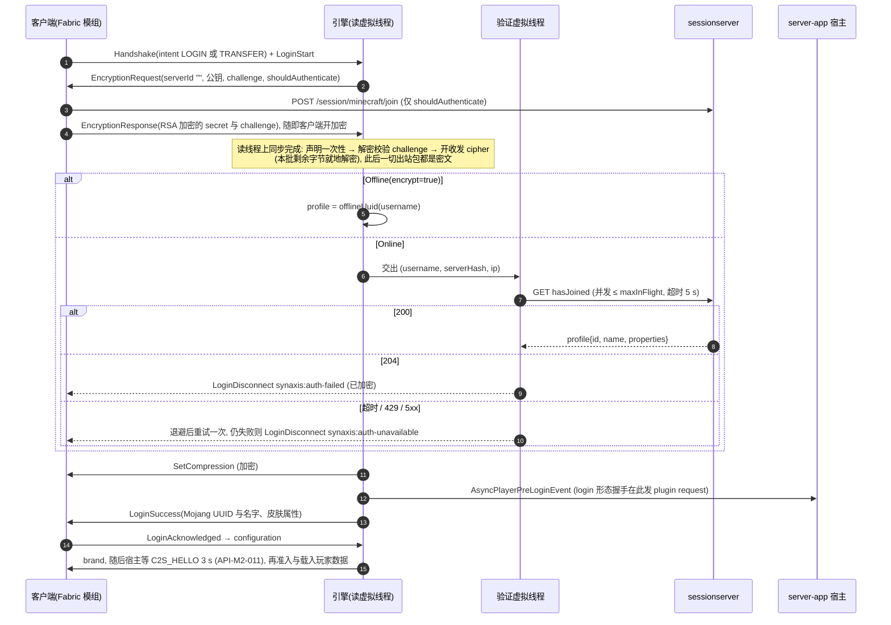

# 恢复加密与 Mojang 正版验证 · 技术设计草案（2026-09-23）

| 字段 | 值 |
| --- | --- |
| 状态 | 草案，只读调研产物；将来并入 `docs/DESIGN.md` 或新的里程碑分册时再编 REQ / API / ADR 号 |
| 基线 | `main` `3085e0edab` |
| 用户已拍板（2026-09-23） | 恢复加密与 Mojang 正版验证；每个分片自己验证，不用 Velocity；跨大区 Transfer 后重新验证 |
| 不在本文范围 | 世界存储与区块（归 `docs/DESIGN-M3.md`）；玩家数据与写权租约（归同目录 `design-persistence.md`）；连接数上限与每 IP 登录令牌桶（归同目录 `design-ops-scale.md` ②）；聊天签名 |
| 本文实测 | AES/CFB8 与 RSA-1024 在本机（Apple M4 Pro、JDK 25.0.4、aarch64）的单核耗时，见 §5；26.2 客户端与 authlib 9.0.75 的字节码取证，见 §1、§2 |

## 结论与推荐

在线模式的代码是 2026-09-09 的 `5c20d1724e`「remove extras package (REQ-005)」删掉的，当时的判断是「Mojang 在线鉴权不属于引擎，离线模式是唯一模式」；会话查询函数 `MojangUtils.authenticateSession` 随后在 `87901a7bfa`（REQ-014）以「零调用」删除。**推荐按原协议重写，不整段回滚**：`EncryptionRequestPacket`（45 行）与 AES/CFB8 的收发接缝（`NetworkBuffer#cipher` 还在）可以原样拿回；登录监听器、会话查询与 `MojangCrypt` 有 5 处缺陷，要重写（§1.3），其中两处会让玩家看到错误的断线原因：密钥交换失败时断线包是明文，客户端已切到密文，读出来是乱码；Mojang 回 204（未验证）时报「会话服务器挂了」。上游对在线模式没有任何行为测试，只有一个包编解码用例，恢复时没有现成的测试可以一起拿回。接口上 `Auth` 新增 `Online(keyPair, sessionServer)`；`Offline` 保留并加一个 `encrypt` 开关，默认不加密，测试与核心模式照旧用它。`server-app` 默认改为在线模式，离线要显式传参。sessionserver 地址做成配置项，CI 与压测指向本地假 sessionserver。26.2 客户端的 authlib 支持用三个系统属性改会话主机（§2.2 有字节码证据），所以真客户端 gametest 可以在无正版账号的情况下走完整条正版路径。加密的 CPU 代价按本机实测是加密 11.2～11.6 ms/MiB、解密 6.2～6.9 ms/MiB；拿 2026-09-22 压测 4,000 单位档的下行速率折算，500 人约占 0.21 个核（§5），不在 tick 线程上。sessionserver 故障时默认拒绝登录，与原版专用服务端、Velocity 一致。Mojang 没有公开 `hasJoined` 的限速（未核实），所以要限并发、对 429 与 5xx 退避重试一次，并且先把每 IP 登录令牌桶做完，才能对公网开在线模式（§4.3、§4.4）。

---

## ① 上游原本怎么做，谁删的，恢复还是重写

### 1.1 协议流程（26.2 原版，服务端视角）

26.2 专用服务端的做法（字节码取证：`net/minecraft/server/network/ServerLoginPacketListenerImpl.class`，取自 `~/.gradle/caches/fabric-loom/26.2/minecraft-client.jar`，26.2 不混淆）：

1. 收 `LoginStart`（`minecraft:hello`，serverbound），回 `ClientboundHelloPacket`（clientbound `minecraft:hello`，login ID 1）：`serverId = ""`、RSA 公钥（X.509 DER）、4 字节 challenge、`shouldAuthenticate`。密钥对进程启动时生成一次，`Crypt.generateKeyPair` 固定 `RSA` 1024 位（`sipush 1024`）。
2. 客户端（`ClientHandshakePacketListenerImpl#handleHello`）：`Crypt.generateSecretKey` 生成 128 位 AES 密钥（`sipush 128`），`serverHash = new BigInteger(SHA-1(serverId ‖ secret ‖ publicKey)).toString(16)`（有符号，负数带负号）。`shouldAuthenticate` 为真时先在 IO 线程上调 `authenticateServer`（authlib `joinServer`，POST `{sessionHost}/session/minecraft/join`），成功后才发 `ServerboundKeyPacket`（`minecraft:key`，serverbound login ID 1）并立即 `setEncryption`；为假时跳过 `joinServer`，直接发包、开加密（字节码 `96: shouldAuthenticate` / `99: ifeq 123` / `128: setEncryption`）。
3. 服务端 `handleKey`：用私钥解 challenge 校验、解出共享密钥、算同一个 `serverHash`，**先** `Connection#setEncryptionKey(decryptCipher, encryptCipher)`，**再**起一条 `User Authenticator #n` 线程调 `hasJoinedServer(name, serverHash, ip)`（字节码 `127: setEncryptionKey` 在 `182: Thread.start` 之前）。
4. 验证结果：拿到 profile 就进入 `startClientVerification`；返回空（HTTP 204）断线 `multiplayer.disconnect.unverified_username`；`AuthenticationUnavailableException` 断线 `multiplayer.disconnect.authservers_down`。两种失败只有单人游戏（`isSingleplayer`）才放行为离线 profile。
5. 之后才是 `login_compression`、`login_finished`。所以压缩开在加密之后，压缩后的字节再加密。

流加密：`Crypt.getCipher` 用 `AES/CFB8/NoPadding`，IV 等于密钥；加解密两个 `Cipher` 在连接生命周期内连续 `update`，不按包重置（minecraft.wiki「Java Edition protocol/Encryption」）。`hasJoined` 是 GET `https://sessionserver.mojang.com/session/minecraft/hasJoined?username=…&serverId=…[&ip=…]`，成功回 200 与 profile JSON（`id`、`name`、`properties[{name,value,signature}]`，皮肤在 `textures` 属性里），失败回 204（同一页面与 minecraft.wiki「Mojang API」）。

### 1.2 上游代码在哪、谁删的

| 组件 | 删除前位置（`net.minestom.server.*`） | 删除提交 | 删了什么 | 结论 |
| --- | --- | --- | --- | --- |
| `Auth.Online(KeyPair)` | `Auth.java` | `5c20d1724e`（2026-09-09） | 6 行 record，无参构造调 `MojangCrypt.generateKeyPair()` | 重写（签名改了，见 §3.1） |
| `MojangCrypt` | `extras/mojangAuth/MojangCrypt.java` | 同上 | 97 行：RSA-1024 生成、SHA-1 摘要、RSA 解密、`AES/CFB8/NoPadding` | 重写：出错返回 `null` 并调已删的静态门面 `MinecraftServer.getExceptionManager()`（REQ-013 已实例化） |
| `EncryptionRequestPacket` | `network/packet/server/login/` | 同上 | 45 行 record：`serverId`、`publicKey`、`verifyToken`、`shouldAuthenticate` | **原样恢复**（只改包名），它的线格式与 26.2 `ClientboundHelloPacket` 四个字段一致（`javap -p` 结果见 1.1） |
| `SERVER_LOGIN` 注册表条目 | `PacketVanilla.java` | 同上；`cb44131ef1` 用 `ReservedPacket` 补回空位 | 1 行 | 把 `PacketVanilla.java:386` 的 `ReservedPacket` 换回该包 |
| 在线分支与 `loginEncryptionResponseListener` | `listener/preplay/LoginListener.java` | 同上 | 约 95 行 | 重写，缺陷见 1.3 |
| 监听器注册 | `listener/manager/PacketListenerManager.java` | 同上 | 1 行 | 恢复。当前 `ClientEncryptionResponsePacket` 无监听器，按「无 listener 只警告一次」丢弃（`PacketListenerManager.java:217`） |
| 连接上的加解密 | `network/player/PlayerSocketConnection.java` | 同上 | `EncryptionContext`、`setEncryptionKey`、nonce、读写两处 `cipher` 调用，共约 45 行 | 逻辑恢复，启用时机改掉（1.3 第 ①、④ 条） |
| `NetworkBuffer#cipher` | `network/NetworkBuffer.java:281`、`NetworkBufferImpl.java:287` | **未删**，现在零调用 | — | 直接复用 |
| `MojangUtils.authenticateSession` 与 `ServerFlag.AUTH_URL` / `AUTH_PREVENT_PROXY_CONNECTIONS` | `utils/mojang/MojangUtils.java` | `87901a7bfa`（REQ-014，「had no callers」） | 约 20 行 | 重写成独立的会话客户端（1.3 第 ②、③ 条） |
| `ClientEncryptionResponsePacket` | `network/packet/client/login/` | 保留 | — | 现存，`PacketVanilla.java:286`，`PacketVanillaIdTest` 第 266 行钉在 serverbound login ID 1 |
| 在线模式行为测试 | — | — | 上游**没有**：`git grep "Auth.Online\|setEncryptionKey\|EncryptionRequestPacket" 5c20d1724e^ -- src/test` 只命中 `PacketWriteReadRegistriesTest` 的三个编解码实例 | 全部新写（§6） |

`Auth.Online` 最早由上游 `ec9adb4a99`「Auth interface rework (#2876)」引入。fork 在删除前改过同一路径上的 `URLUtils`（`21fe22d7ee` 加了 5 s 连接与读超时），在线分支本身没动过。

### 1.3 上游实现的 5 处缺陷（所以重写而不是回滚）

1. **失败断线包是明文。** 上游只在 `hasJoined` 成功后调 `setEncryptionKey`，失败分支直接 `kick`。但客户端发完 `minecraft:key` 就开了加密（1.1 第 2 步），明文的 `LoginDisconnect` 被它当密文解，玩家看到的是解码异常而不是原因。原版与 Velocity 都是先开加密再验证（1.1 第 3 步；Velocity `InitialLoginSessionHandler.java` 在所有结果分支之前调 `enableEncryption`）。
2. **204 被报成「会话服务器挂了」。** `URLUtils.getText` 对 204 这种无正文响应返回空串（`URLUtils.java:34-36`），`MojangUtils.retrieve` 把空串当 `IOException("The Mojang API is down")`（`MojangUtils.java:128`），上游据此踢出 `Failed to contact Mojang's Session Servers (Are they down?)`。盗版客户端与会话服务器故障因此无法区分，运维也就没法按失败类型告警。Velocity 按 200 / 204 / 其他三分（同文件第 244、259 行及其后的 else）。
3. **HTTP 调用阻塞读循环。** 上游在包监听器里同步调 `authenticateSession`。登录包在该连接的读虚拟线程上处理，阻塞期间读循环不跑，对端断开也看不到；最长 5 s 连接 + 5 s 读（`URLUtils.java:12-13`）。原版用独立线程，Velocity 用 `HttpClient.sendAsync`。
4. **没有状态守卫。** 上游监听器只检查 `auth instanceof Online`，没检查「本连接发过加密请求且只处理一次」。重复发 `minecraft:key` 会对同一连接再调一次 `setEncryptionKey`，由 `Check.stateCondition` 抛异常，最后落到通用错误断线；一个从没收到加密请求的连接发 `minecraft:key`，上游会拿着默认的全零 nonce 去比对。本仓库的做法是 `claimLoginStart()` 那种一次性声明（`LoginListener.java:41`），这里照做。
5. **两处死代码或错误检查。** `hasPublicKey || …`（登录阶段 `playerPublicKey()` 恒为空，这是 1.19 的遗留）；按用户名预查 `ALREADY_CONNECTED`，这一步在服务端验证身份之前，谁都能拿别人的名字把对方挡在门外，而验证之后 UUID 已经可信，按 UUID 判重即可（§3.4）。

---

## ② 恢复后对现有占位、测试与工具的影响

### 2.1 逐项改法

| 对象 | 现状证据 | 改法 |
| --- | --- | --- |
| `PacketVanilla` 占位 | `PacketVanilla.java:386` `entry(ReservedPacket.class, …) // minecraft:hello, offline mode never asks for encryption` | 换成 `EncryptionRequestPacket`；login 表的 `ReservedPacket` 从 1 个变 0 个，play 表的 18 个不动 |
| `PacketVanillaIdTest`（TC-036） | 第 256 行 `row(1, "minecraft:hello", RESERVED)` | 改成 `row(1, "minecraft:hello", EncryptionRequestPacket.class)`。测试第 566～578 行的逻辑不用改：非占位行自动转成「类 ↔ ID 双向一致」断言 |
| `PacketRegistryLookupTest` | 第 107 行 `assertThrows(IllegalStateException.class, () -> login.packetInfo(1))`，第 100 行注释「hello is never sent in offline mode」 | 改成 `assertEquals(1, login.packetInfo(EncryptionRequestPacket.class).id())`，注释同步 |
| `PacketWriteReadRegistriesTest` | 注册表条目缺测试实例就失败（`docs/DESIGN.md` `ADR-007` 密度口径段） | 补回删除前的三个实例（`5c20d1724e^` 第 348～350 行） |
| 探针 `tools/protocol-probe/probe.py` | 包 ID 从 `PacketVanilla.java` 源码解析（`_load_registries`，第 105～113 行）；收到加密请求直接退出（第 658～659 行 `raise SystemExit("EncryptionRequest received: …")`） | 解析自动跟上：`EncryptionRequestPacket` 重新出现在 `SERVER_LOGIN` 里，第 658 行的名字恰好对上。探针只打 `Offline(encrypt=false)` 的服务端，不做加密（Python 标准库没有 RSA 与 AES）。加密路径的恶意输入改由 Java 集成测试覆盖（§6.1），这样探针不必新增依赖 |
| 压测 `tools/loadtest/soak.py` | 复用探针的 `Session` 登录（第 55～76 行） | 同探针，只能压离线服；加不加密压测要不要走 Python，见拍板 ⑥ |
| 压测 `tools/loadtest/PacketFlood.java` | 同样解析 `PacketVanilla.java`（第 124～125 行）；第 467～468 行收到加密请求抛 `IOException("the server is not in offline mode")` | 加 `--auth offline\|offline-encrypted\|online` 三档。JDK 自带 JCE，客户端半边约 60 行：RSA/PKCS#1 加密密钥与 challenge、算 `serverHash`，读写两侧接 `AES/CFB8/NoPadding`。`online` 档连本地假 sessionserver（§2.3），这样 200～500 人压测走的是生产登录路径，HTTP 并发上限也一起受压。`design-ops-scale.md` ⑤ 已按「sessionserver 地址可配置」提了需求，本文 §3.1 的 `SessionServer` 满足它 |
| 真客户端 gametest（`client-fabric/src/gametest/**`、`.github/workflows/client-gametest.yml`） | 客户端用 `ConnectScreen.startConnecting` 连 `SYNAXIS_GAMETEST_SERVER`（`SpikeClientGameTest.java:63-74`）；服务端由工作流以 `./gradlew :server-app:run` 起在游戏模式（工作流第 53～57 行） | 见 2.2 |
| `server-app` 启动 | `Main.java:96` `MinecraftServer.init(new Auth.Offline())` | 按 `synaxis.app.auth` 选模式（§3.2）；工作流、`soak.py`、探针文档里起服的命令都要显式带上模式 |
| `docs/TEST.md` §2「包 ID 口径」 | 第 82 行说探针与 harness 的 ID 从本仓库注册表推导 | 不变；TC-036 的步骤 2 反证那一步（删掉 `award_stats` 的占位即红）不受影响 |

### 2.2 开发环境客户端没有正版账号，怎么测

26.2 客户端依赖 authlib 9.0.75（`~/.gradle/caches/modules-2/files-2.1/com.mojang/authlib/9.0.75/`）。`com/mojang/authlib/EnvironmentParser.class` 读取三个系统属性 `minecraft.api.session.host`、`minecraft.api.services.host`、`minecraft.api.profiles.host`：三个都设了才生效，缺一个就打日志 `Ignoring hosts properties. All need to be set: {}` 并回落到正式环境（`javap -c` 结果：三处 `ifnull 46`，随后 `ldc "Ignoring hosts properties…"`）。`YggdrasilMinecraftSessionService` 的常量池里有 `/session/minecraft/`、`join`、`hasJoined` 三段路径，客户端的 `joinServer` 因此会发到 `{session.host}/session/minecraft/join`。

所以 CI 可以分两档，都不需要正版账号：

| 档 | 服务端 | 客户端 | 覆盖 | 缺口 |
| --- | --- | --- | --- | --- |
| A 加密不验证 | `Auth.Offline(encrypt=true)`，加密请求带 `shouldAuthenticate=false` | 不加任何参数。26.2 客户端在该标志为假时跳过 `joinServer`，直接开加密（1.1 第 2 步的字节码） | RSA 交换、AES/CFB8 收发、压缩与加密叠加、真实客户端的整条登录 | 不覆盖 `hasJoined` 与 profile 解析 |
| B 完整正版路径 | `Auth.Online`，`SessionServer` 指向本地假服务 | JVM 参数带上述三个属性，都指向假服务 | A 的全部，加客户端 `join` → 服务端 `hasJoined` → profile（含皮肤属性）→ 进世界 | 假服务不校验 access token，Mojang 那一侧没被测到；客户端在假 services 主机上拉聊天证书等接口会失败，是否影响进服**未核实** |

**默认选 B 进常驻 CI**，它包含 A。切换条件：B 的客户端在假 services 主机上因为聊天证书或属性接口失败而进不了服，且 1 人日内修不好（比如假服务补几个固定响应），就先上 A，B 挂成手动触发的工作流。假 sessionserver 放在 `tools/fake-sessionserver/FakeSessionServer.java`：单文件，只用 JDK 的 `com.sun.net.httpserver`，`java FakeSessionServer.java` 直接跑。它有两种模式：`record` 记下客户端 `join` 的 `(selectedProfile, serverId)`，`hasJoined` 只对记过的组合回 200，其余回 204，CI 的 B 档用它；`allow-all` 对任何用户名都回 200，压测用它。两种模式都支持注入延迟、204、429、503 与超时。它在工作流里只作为一个后台进程存在，不打镜像。authlib 是否接受 `http://` 而不是 `https://` 的会话主机**未核实**。不接受的话，假服务要带自签证书，客户端 JVM 还得信任这张证书，B 档的工作量要重估。

### 2.3 加密对探针「包 ID 口径」的影响

`docs/TEST.md` §2 已经写明：探针与 harness 的 ID 从本仓库推导，证明不了与原版一致。加密包一回来，login ID 1 这一格从「占位必须没有包」变成「必须是这个包」，仍由 TC-036 裁决。B 档 gametest 是第一个让真客户端经过 login ID 1 的用例，它补上了探针证明不了的那一半。

---

## ③ `Auth` 接口怎么扩，与握手的先后

### 3.1 接口

```java
public sealed interface Auth {
    /** 身份不经验证；encrypt 为真时仍做 RSA 交换与 AES/CFB8，加密请求带 shouldAuthenticate=false。 */
    record Offline(boolean encrypt) implements Auth {
        public Offline() { this(false); }
    }

    /** 每条连接向 sessionServer 验证一次；密钥对进程内生成一次（RSA-1024，与原版一致）。 */
    record Online(KeyPair keyPair, SessionServer sessionServer) implements Auth {
        public Online() { this(LoginCrypt.generateKeyPair(), SessionServer.mojang()); }
    }

    record Velocity(Key key) implements Auth { … }   // 去留见拍板 ⑧
    record Bungee(@Nullable Set<String> bungeeGuardTokens) implements Auth { … }
}

/** hasJoined 的地址与调用约束。 */
public record SessionServer(URI hasJoinedUrl, boolean sendClientIp, Duration timeout, int maxInFlight) {
    public static SessionServer mojang() {
        return new SessionServer(URI.create("https://sessionserver.mojang.com/session/minecraft/hasJoined"),
                false, Duration.ofSeconds(5), 32);
    }
}
```

- 身份是否可信只看 `Online` 与 `Offline` 这一个维度，`encrypt` 是正交的开关。「加密但不验证」于是只能以 `Offline` 的身份出现，日志和 `store_meta.auth_mode`（`design-persistence.md` 第 95 行）不会把它误记成在线。
- `Offline` 保留：`@EnvTest` 与引擎集成测试、探针、`soak.py`、核心模式冒烟都要一个不出网的模式。`ServerProcess.of()` 与 `MinecraftServer.init()` 的无参重载（`ServerProcess.java:49,56`、`MinecraftServer.java:38`）继续默认 `new Auth.Offline()`：它们只给测试和嵌入用，生产入口只有 `server-app`，由 §3.2 管。
- 新代码落点：`LoginCrypt`（RSA 解密、`serverHash`、CFB8 `Cipher` 工厂）放 `crypto` 包。该包已因声明 `NetworkBuffer.Type` 移出底层集合（`docs/DESIGN.md` REQ-015），依赖网络层不违反 ArchUnit 规则。`SessionClient`（`java.net.http.HttpClient` 异步调用、三分结果）放 `network/player` 旁。`module-info.java` 要加 `requires java.net.http;`（现有 `requires` 列表第 16～30 行没有它）。`MojangUtils` 与 `URLUtils` 不动，它们只剩 `PlayerSkin` 的 profile 查询在用。
- `ServerProcessImpl.java:248` 起的 `switch (auth)` 是穷举 switch，加 record 后编译器会逼着补分支；`HandshakeListener` 与 `LoginListener` 里用的是 `instanceof`，要逐处看（`LoginListener.java:59,68,86`，`HandshakeListener.java:42,70,84`）。

**`SessionClient` 的结果三分**：`Verified(GameProfile)`（200，按返回的 `name` 与 `id` 建 profile，`properties` 原样带上，`signature` 可空，对应 `GameProfile.Property` 的 `@Nullable String signature`，`GameProfile.java:60`）；`Unverified`（204）；`Unavailable(cause)`（连接失败、超时、429、5xx、200 但 JSON 不合法）。皮肤不用另外做：`Player.java:378-379` 已经从 profile 的 `textures` 属性建初始皮肤，`Player.java:2488` 把它带进 `PlayerInfoUpdatePacket`。

### 3.2 `server-app` 怎么选

新增系统属性 `synaxis.app.auth`，取值 `online`（默认）、`offline`、`offline-encrypted`；另加 `synaxis.app.auth.session-server`，覆盖 `hasJoined` 地址，只给 CI 和压测用。启动自检日志（`Main.java` 的 `Effective {}` 两行之后）打出模式与地址；地址不是 `sessionserver.mojang.com` 时打 WARN。Transfer 目标分片要打开引擎既有的 `synaxis.accept-transfers`（默认 false，`ServerConfig.java:190`），这一项归 M3 的分片宿主，`docs/DESIGN-M3.md` `API-M3-011` 已写。

**拍板 ①：`server-app` 默认模式。** 默认 `online`。切换条件：只要还有人在不传参的情况下用 `server-app` 做本机开发，而本机又连不上 sessionserver，就改成默认 `offline` 并在启动日志打 WARN。代价：忘传参的生产部署会以离线模式对外，任何人都能冒用任何名字，而在线模式下这种疏忽只会表现为「登不进去」，当场就能发现。

### 3.3 与现有握手（`ADR-M2-010`，configuration 阶段 `C2S_HELLO`）的先后

加密与会话验证都在 login 状态内完成，比 `transitionLoginToConfig` 早（`ConnectionManager.java:237`：开压缩 → `AsyncPlayerPreLoginEvent` → 等 login plugin 应答 → `LoginSuccess`）。两种握手阶段都排在验证之后：



`ADR-M2-010` 不需要改：`C2S_HELLO` 的 3 s 预算从进入 configuration 起算，`hasJoined` 花的时间计入 login 阶段的 30 s 总超时（`ServerConfig.java:187` `loginTimeout = 30_000`），不占这 3 s。有两处副作用要写进正式设计：

- 装了模组但版本不符的正版客户端、没装模组的正版客户端，都会先消耗一次 `hasJoined`，然后才在 configuration 被踢。这笔配额无法省：模组校验在 configuration 阶段做，是 `ADR-M2-010` 定下的。
- 会话台账的三条事件（`session_entered_configuration` 等）只在验证通过后才会写，在线模式下写一行至少要有一个真实的 Mojang 会话。`docs/DESIGN.md` §28 那条「条数由对端说了算」的技术债因此收窄；但离线模式依旧，所以 `design-ops-scale.md` ③ 的带缓冲写入仍然要做。

### 3.4 同一账号重复登录

现状：新连接的 UUID 已在线时，拒绝新来的一方（`LoginListener.java:141-148` 注释：「离线模式下 UUID 由用户名派生，踢旧会话等于让任何人能踢任何人」）。在线模式下 UUID 由 Mojang 担保，这条理由不再成立。反过来，玩家断网重连时旧会话要等 keep-alive 超时（`keepAliveKick = 15_000`，`ServerConfig.java:194`）才会被清掉，这 15 s 内他会一直收到 `synaxis:duplicate-login`。

**拍板 ②：在线模式下的重复登录。** 默认踢旧会话、放新连接进来（原版语义），旧会话收到新原因键 `synaxis:logged-in-elsewhere`；离线模式保持拒新不变。切换条件：持久化侧的写权移交（`design-persistence.md` 的分片会话租约）做不到「旧会话保存并释放之后新会话才载入」，就暂时在两种模式下都拒新。代价：拒新会让断线重连的玩家白等最多 15 s。跨分片的同号双开由持久化侧的租约兜底，本文不另设机制。

### 3.5 线程与并发

| 场景 | 参与方 | 期望 | 守卫 |
| --- | --- | --- | --- |
| `minecraft:key` 到达 | 读虚拟线程 | 在同一线程上同步开 cipher，再处理本批剩余字节；剩余部分已是密文，从下一个帧的起点就地解密 | 一次性声明 `claimEncryptionResponse()`，第二次、或没发过加密请求时收到，断线 `synaxis:protocol-error` |
| 开 cipher 与出站队列 | 读线程 × 写虚拟线程 | 开 cipher 之前出站队列里没有待发包。login 状态下服务端在加密请求之后、`LoginSuccess` 之前不会主动发包，写线程每包读一次 volatile 的 `EncryptionContext` | 开 cipher 时断言 `packetQueue.isEmpty() && writeLeftover == null`，测试 JVM 下强制开（与 `assertOwnership` 同一开关） |
| `hasJoined` 等待 | 验证虚拟线程 × 读线程 | 读循环继续跑，对端断开时验证结果被丢弃，不再进 `enterConfig` | 结果回来先查 `isOnline()`（Velocity 同法：`if (mcConnection.isClosed()) return;`） |
| 登录风暴 | N 个验证线程 | 同时在途的 `hasJoined` 不超过 `maxInFlight`（默认 32），其余排队；排队加请求的耗时超过登录总超时剩余部分的，按 `Unavailable` 处理 | `Semaphore`，拿许可的等待有上限 |
| 广播包 | 写线程 | 共享的 `FramedPacket` / `CachedPacket` 先被拷进每连接自己的缓冲（`PlayerSocketConnection.java:458-470` 的 `writeBuffer` 分支），再在该缓冲上加密；共享字节不被改写 | 与上游一致：加密发生在 `writeSendable` 成功之后，对 `[start, writeIndex)` 就地进行 |

---

## ④ Transfer 后重新验证、sessionserver 故障、限速

### 4.1 Transfer 跨大区

客户端收到 `TransferPacket` 后另开一条连接，握手 intent 为 TRANSFER（`ClientHandshakePacket.java:29,35`），然后从 1.1 第 1 步开始把登录重走一遍：新的加密请求、新的 `joinServer`、目标分片新的 `hasJoined`。Cookie 随 `TransferState` 一起带到新连接（26.2 客户端 `net/minecraft/client/multiplayer/TransferState` 是 `record(Map<Identifier, byte[]> cookies, …)`），值上限 5,120 字节（`ClientboundStoreCookiePacket` 里 `sipush 5120`）。

目标分片的判定顺序：Mojang 验证先出 UUID，然后是 `docs/DESIGN-M3.md` `API-M3-011` 的票据检查 ①～⑥（在 configuration 阶段），外加一条「票据里的 `player_uuid` 等于本次验证出的 UUID」。这一条 `design-persistence.md` 第 205 行已建议补进检查 ④，本文同意，不再另起。正版验证之后，身份只由 Mojang 担保；票据只担保「数据已交接、这次转入是源分片发起的」，不参与认人。

两条 Transfer 专属的约束：

- **客户端侧每账号 30 s 内最多 6 次 `join`**（minecraft.wiki「Mojang API」的「Verify login session on client」一节：「per-account ratelimit of 6 joins per 30 seconds」）。每次转服都消耗一次，所以同一玩家两次转服至少隔 5 s（30 ÷ 6）。**拍板 ③**：宿主对 `ShardService#transfer` 设每玩家冷却，默认 5 s。切换条件：Mojang 限额被证实与上述不同，就按新值重算。代价：玩法侧不能做 5 s 内的连续跨区传送。
- 服务端侧：每次转服在目标分片消耗一次 `hasJoined`。大区之间集体转服（公会、副本）会形成一次小型登录风暴，受 4.3 的并发上限与 `design-ops-scale.md` ② 的 transfer 令牌桶共同约束。

### 4.2 sessionserver 故障时

| 结果 | 原版专用服务端 | Velocity 3.x | Paper | 本文默认 |
| --- | --- | --- | --- | --- |
| 204（未验证） | 断线 `multiplayer.disconnect.unverified_username` | 断线 `velocity.error.online-mode-only` | 同原版（Paper 的登录监听器是原版代码；未逐行核对 Paper 补丁，**未核实**） | 断线 `synaxis:auth-failed` |
| 不可达、超时、非 200/204 | 断线 `multiplayer.disconnect.authservers_down`，仅单人游戏放行 | 断线 `multiplayer.disconnect.authservers_down` | 同原版；`docs.papermc.io` 全局配置里有「Mojang's authentication servers are unreachable」时的踢出消息配置项，默认值就是 `<lang:multiplayer.disconnect.authservers_down>` | 退避 0.5～1.5 s（随机）重试一次，仍失败断线 `synaxis:auth-unavailable` |

**拍板 ④：故障时拒绝还是降级。** 默认拒绝登录（与上表三家一致），已在线的玩家不受影响，Transfer 进来的玩家同样被拒。降级方案是「近 N 小时内在同一 IP 上验证过的 UUID 放行」，需要 Redis 里存 `(username, uuid, ip, verified_at)`。**默认不做**，理由有两条：同一出口 IP 后面的其他人（网吧、校园网 CGNAT）拿到用户名就能冒用；这套缓存本身又是一个要测、要运维的东西。切换条件：Mojang 会话服务出现单次超过 30 分钟的故障，并且运营判定「全服进不来」比「同 IP 冒名风险」更贵，这时再做，而且做成运维手动开关（带过期时间），不自动触发。

新增三个断线原因键（格式照 `docs/DESIGN.md` §14）：

| 错误码 | 协议动作 | 语义 | 客户端处理约定 |
| --- | --- | --- | --- |
| `synaxis:auth-failed` | LoginDisconnect（已加密） | `hasJoined` 回 204：这个名字没有用正版会话加入本服 | 提示用正版启动器登录 |
| `synaxis:auth-unavailable` | LoginDisconnect（已加密） | `hasJoined` 超时、不可达、429 或 5xx，重试一次后仍失败 | 提示正版验证服务暂时不可用，稍后重试 |
| `synaxis:logged-in-elsewhere` | Disconnect（发给旧会话） | 同一 Mojang UUID 从别处登录（仅在线模式，拍板 ②） | 提示账号在别处登录 |

加密失败（challenge 不符、RSA 解密失败、密钥长度不是 16 字节）只可能来自非原版的对端，归入既有的 `synaxis:protocol-error`。三个新键在模组的语言文件里要有译文。没装模组的客户端在 login 阶段被踢时会看到原始键名，但这类客户端本来就进不了服，可以接受。

### 4.3 限速

- **`hasJoined` 的服务端限速，Mojang 没有公开。** minecraft.wiki「Mojang API」只写了「Most of the API has a per-IP ratelimit of 200 requests per 2 minutes」，没说它是否覆盖 `sessionserver` 的 `hasJoined`。第三方库 go-mclib 的 `session_server` 包文档写的是「approximately 600 requests per 10 minutes」，不是官方数字。**两个数都记为未核实**。按较严的每 IP 200 次 / 2 分钟估算：一个 500 人分片重启后全员重连，光验证就要排 5 分钟。
- `hasJoined` 结果不能缓存：`serverId` 由每次登录的随机共享密钥算出，每次都不同。能缓存的只有 profile 与皮肤查询，那是 `PlayerSkin` 的另一条路（Paper issue #13727 报告的 429 洪水就出在 profile 查询，不在 `hasJoined`）。
- 本文的防线：`maxInFlight = 32` 限并发；429 与 5xx 按 `Unavailable` 退避重试一次；每个分片进程用独立出口 IP，不要让多个分片共用一个 NAT 出口去分摊同一份配额（这一条是否必要取决于上面那个未核实的限额，**切换条件**：实测到 429 前不强制）；分片重启时，客户端模组的自动重连在 0～30 s 内随机抖动（归模组，本文只提需求）。
- 上线前必须实测：从目标机房对 `sessionserver.mojang.com` 发 1,000 次 `hasJoined`（用一个固定的假 `serverId`，预期全是 204），记录 p50 / p99 延迟与第一次出现 429 时的累计次数。服务器如果放在中国大陆，这一步同时回答「能不能稳定连上」，本文没有数据（**未核实**）。

### 4.4 验证之前的攻击面

在线模式新开了一个验证前就能触发的代价：任何对端都能拿我们的公钥造出合法的 `minecraft:key`，让服务端做两次 RSA 解密（实测每次 103.1 µs，§5），再替它向 Mojang 发一次 `hasJoined`（结果是 204）。一个 IP 持续这样打，前者烧 CPU，后者烧掉我们出口 IP 在 Mojang 那里的配额，正版玩家就会被 429 挡在外面。所以 `design-ops-scale.md` ② 的 L1 每 IP 并发与 L2 每 IP 登录令牌桶（「所有检查都在会话验证之前」，该文第 115 行）是在线模式对公网开放的**前置条件**，不是可选项。本文另加一条：验证失败（204）不写事件台账，只进按 10 s 限流的计数日志，与 `docs/DESIGN.md` §15「日志量不由客户端决定」一致。

`hasJoined` 的 `ip` 参数（`sendClientIp`）默认关。Velocity 的 `prevent-client-proxy-connections` 默认也是 `false`，配置注释自称「a weak form of protection」（`default-velocity.toml` 第 21～24 行）；双栈与移动网络下，客户端连 Mojang 与连我们用的出口地址可能不同，打开会误伤。

---

## ⑤ 加密的 CPU 代价

**本机实测**（2026-09-23，Apple M4 Pro，JDK 25.0.4.1 aarch64，`UseAES=true`；单线程循环调 `Cipher#update(ByteBuffer, ByteBuffer)`，每组 256 MiB，取第 3 轮）：

| 操作 | 块大小 64 / 1,024 / 16,384 B（堆内缓冲） | 直接缓冲 | 每 MiB CPU |
| --- | --- | --- | --- |
| AES/CFB8 加密（服务端出站） | 87.7 / 89.1 / 88.9 MiB/s | 86.6 / 89.0 / 88.6 MiB/s | 11.2～11.6 ms |
| AES/CFB8 解密（服务端入站） | 154.6 / 161.1 / 159.7 MiB/s | 145.9 / 154.4 / 155.7 MiB/s | 6.2～6.9 ms |
| RSA-1024 PKCS#1 私钥解密 | 103.1 µs/次，每次登录 2 次（共享密钥、challenge） | — | — |
| RSA-1024 密钥对生成 | 9.9 ms/次，每进程 1 次 | — | — |

块大小对吞吐几乎没影响：CFB8 每加密 1 字节就要做一次 AES 块运算，开销在字节数上，与调用次数无关。基准程序在 `docs/research/production-readiness-2026-09/bench/Cfb8Bench.java` 与 `RsaBench.java`（随本目录入库）；要可复算，正式实现时应把它做成 `jmh-benchmarks/src/jmh/java/io/github/bearisbug/synaxis/network/Cfb8CipherBenchmark.java`（该模块已有 `network` 目录），在生产机型上重跑。x86 服务器上的数字**未核实**。

**折算**（下行速率取 `docs/research/soak-2026-09-22/report.md` 第 52 行「入站合计 B/s/玩家」，即 harness 客户端收到的、服务端发出的线上字节，压缩之后；那是 RTS 玩法模式的画像，MMO 的每玩家下行速率还没有测量）：

| 场景 | 每玩家下行 | 总下行 | 加密 CPU（按 11.29 ms/MiB） |
| --- | --- | --- | --- |
| 50 人 · 1,000 单位档 | 17,795.3 B/s | 0.85 MiB/s | 9.6 ms/s（0.96% 核） |
| 50 人 · 4,000 单位档 | 38,375.8 B/s | 1.83 MiB/s | 20.7 ms/s（2.1% 核） |
| 500 人 · 按 1,000 单位档的每人速率 | 17,795.3 B/s | 8.49 MiB/s | 95.8 ms/s（0.10 核） |
| 500 人 · 按 4,000 单位档的每人速率 | 38,375.8 B/s | 18.30 MiB/s | 206.6 ms/s（0.21 核） |
| 500 人同时登录（仅 RSA） | — | — | 500 × 2 × 103.1 µs = 103 ms，分摊在登录风暴的持续时间里 |

入站方向每玩家只有十几到几十个包每秒，按解密 6.9 ms/MiB 算，量级比出站小，表里没列。加解密都跑在每连接的读、写虚拟线程上，不在 tick 线程上，所以不直接进 `docs/DESIGN.md` §15 的 tick 预算，而是和 tick 线程争载体线程（ForkJoin 载体线程数 = 核数）。进服时的区块下发是一次性的突发，按 11.3 ms/MiB 线性增长；每次进服下发多少 MiB，目前没有测量。

Paper 与 Velocity 都用 Velocity 的原生库（OpenSSL / macOS CommonCrypto）做 CFB8：Paper 补丁 `paper-server/patches/features/0008-Use-Velocity-compression-and-cipher-natives.patch`；Velocity 仓库 `native/src/main/c/jni_cipher_openssl.c`、`jni_cipher_macos.c`，Java 回退实现是 `JavaVelocityCipher.java`。**拍板 ⑤**：默认用 JDK 自带的 `AES/CFB8/NoPadding`。切换条件：200～500 人压测（`PacketFlood --auth online`）在生产机型上测得加密占用超过 1 个核的 10%，就评估引入原生实现。代价：引入 JNI 与每平台一个二进制，而引擎目前是纯 Java 构建。

---

## ⑥ 测试计划

### 6.1 自动化（进 `./gradlew check` 或 CI）

| 用例 | 手段 | 判据 |
| --- | --- | --- |
| 包 ID 与编解码 | `PacketVanillaIdTest`（TC-036）、`PacketRegistryLookupTest`、`PacketWriteReadRegistriesTest`，按 §2.1 改 | login ID 1 ↔ `EncryptionRequestPacket` 双向一致；三个编解码实例往返 |
| `serverHash` 与原版一致 | 单元测试两部分：有符号十六进制格式用 minecraft.wiki 协议页给出的三组示例（`Notch`、`jeb_`、`simon` 的 SHA-1，该页是否仍保留这三组示例**未核实**，拿不到就用 26.2 客户端 `Crypt.digestData` 加 `BigInteger#toString(16)` 现算的值当常量）；完整的 `serverHash` 与 26.2 客户端同一算法的结果比对 | 与期望值逐字相同 |
| 加密往返 | 引擎集成测试：真 socket，JCE 实现的测试客户端连 `Offline(encrypt=true)` | 进到 configuration；压缩开启后的包也能解；抓包看 `LoginSuccess` 之后不再有明文 |
| 在线路径成功 | 集成测试 + 测试内的 `com.sun.net.httpserver` 假 sessionserver | UUID 与名字取自假 profile，而不是 `offlineUuid`；`textures` 属性进 `Player` 皮肤 |
| 204 | 同上，假服务回 204 | 客户端**解密后**读到 `synaxis:auth-failed`（这条专门钉 §1.3 第 ① 条：断线包是加密的） |
| 不可用与重试 | 假服务依次回 503、200 | 第二次成功进服；连着两次 503 则 `synaxis:auth-unavailable`；超时档由假服务阻塞 6 s 来触发 |
| 并发上限 | 假服务阻塞，发起 `maxInFlight + 10` 个登录 | 同时在途的请求数不超过 `maxInFlight`，由假服务侧计数 |
| 恶意输入 | 集成测试：没发过加密请求就发 `minecraft:key`；发两次；challenge 错；密钥解出来不是 16 字节；`Offline(encrypt=false)` 时发 `minecraft:key` | 一律 `synaxis:protocol-error`；不发 HTTP（假服务计数为 0）；日志按 `docs/DESIGN.md` §15 限流 |
| 验证期间断开 | 假服务阻塞 2 s，客户端在此期间关闭 socket | 验证结果被丢弃，不创建 `Player`，不写台账 |
| 重复登录（拍板 ② 默认） | 集成测试，在线模式同一 UUID 连两次 | 旧会话收到 `synaxis:logged-in-elsewhere`，新会话进服；离线模式仍是拒新（`DuplicateUuidLoginIntegrationTest` 不变） |
| 真客户端 B 档 | `client-gametest.yml` 起假 sessionserver（`record` 模式）与 `server-app -Dsynaxis.app.auth=online -Dsynaxis.app.auth.session-server=…`，客户端带 authlib 三个属性 | 与现有 S1 同样进世界；假服务记到一次 `join` 与一次 `hasJoined`，二者的 `serverId` 相同 |
| 压测 | `PacketFlood --auth online` 连 `allow-all` 假服务，200 / 500 连接 | 全部登录成功；报告里加密前后的进程 CPU 差值，与 §5 的折算比对 |

### 6.2 只能人工、需要正版账号

执行者是用户，每轮登记进 `docs/TEST.md` 执行记录。

| 用例 | 步骤要点 | 判据 |
| --- | --- | --- |
| 正版账号进服 | 官方启动器 + 整合包，连 `synaxis.app.auth=online` 且未覆盖 session-server 的服 | 进世界；服务端日志里的 UUID 等于该账号在 `api.minecraftservices.com` 上查到的 UUID；其他玩家看到正确皮肤 |
| 非正版客户端被拒 | 同一台服，用离线启动器（无 Mojang 会话）连 | 客户端提示 `synaxis:auth-failed` 对应的译文，而不是解码错误 |
| 跨大区 Transfer | 两个分片均为在线模式，由游戏内操作触发转服 | 目标分片日志有第二次 `hasJoined`；票据 UUID 校验通过；5 s 内连转两次被冷却挡住（拍板 ③） |
| sessionserver 不可达 | 在服务端机器上用防火墙挡掉 `sessionserver.mojang.com`，再登录 | 约 5～12 s 后收到 `synaxis:auth-unavailable`；已在线玩家不受影响 |
| 同号两地登录 | 同一账号在两台电脑上先后登录同一分片 | 先登录的一方收到 `synaxis:logged-in-elsewhere`（拍板 ② 默认） |
| 目标机房连通性 | 在生产机房跑 4.3 的 1,000 次 `hasJoined` 探测 | 记下 p50、p99 与第一次 429 出现的位置；这几个数字决定 `maxInFlight` 与超时是否要调 |

---

## 待拍板汇总

| 编号 | 问题 | 默认 | 切换条件 | 代价 |
| --- | --- | --- | --- | --- |
| ① | `server-app` 默认模式 | `online` | 本机开发频繁因不传参而连不上 sessionserver | 改成默认离线后，忘传参的生产部署会对外开成离线服 |
| ② | 在线模式重复登录 | 踢旧会话，放新连接 | 持久化侧做不到「旧会话先保存并释放，新会话再载入」 | 拒新让断线重连的玩家白等最多 15 s |
| ③ | 转服冷却 | 每玩家 5 s | Mojang 客户端 join 限额被证实不是 6 次 / 30 s | 玩法不能做 5 s 内连续跨区 |
| ④ | sessionserver 故障 | 拒绝登录，重试一次 | 单次故障超过 30 分钟，且运营判定停服比冒名更贵 | 降级缓存引入同 IP 冒名风险与一套新组件 |
| ⑤ | CFB8 实现 | JDK 自带 | 生产机型上加密占用超过 1 核的 10% | JNI 与多平台二进制 |
| ⑥ | Python 探针与 `soak.py` 要不要支持加密 | 不支持，加密由 Java 测试与 `PacketFlood` 覆盖 | 需要 `soak.py` 的攻击子命令在加密连接上跑 | 在 `.venv` 里用 `uv pip` 引入 `cryptography`，探针不再只靠标准库 |
| ⑦ | CI 真客户端档位 | B（完整正版路径 + 假 sessionserver） | B 在假 services 主机上 1 人日内进不了服 | 退到 A，`hasJoined` 只剩 JUnit 覆盖 |
| ⑧ | `Auth.Velocity` / `Auth.Bungee` 去留 | 在线模式落地后单独一个提交删除（用户已定不用 Velocity；`docs/DESIGN.md` §28 早已把它们登记为「暂留」技术债） | M3 内出现代理层计划 | `Bungee` 模式信任握手里转发来的 UUID，开错一个参数就等于谁都能冒名；删除后要用代理时得从 git 历史复活 |

## 正式写入设计文档时的落点

- `docs/DESIGN.md`：§8 `API-001` 的鉴权行（离线 → 在线 / 离线两种）；§11.1 连接状态机在 login 内加 `awaiting_key → verifying` 两态及三条失败出边；§14 加三个原因键；§15 加「验证前代价」一行（引 §4.4）；§16 加 §3.5 表里的四行；§17 加 sessionserver 一行（第一次有网络第三方依赖）；§28 关掉「`Auth.Velocity` / `Auth.Bungee` 暂留」与「离线身份」两条的边界描述。
- `docs/DESIGN-M2.md`：§17 结尾那句「所有运行时依赖都在同一个进程或同一个整合包内，无网络第三方」不再成立；§21 加两条 SLI：验证成功率（200 ÷ 全部 `hasJoined`，排除 204）与 `hasJoined` p99。
- `docs/TEST.md`：TC-036 第 1 步期望值；新增 §6.1 的自动化用例与 §6.2 的人工用例；§3 探针表注明探针只打 `Offline(encrypt=false)`。

## 未核实事项

1. Mojang 对 `hasJoined` 的服务端限速：官方未公开。minecraft.wiki 的「200 次 / 2 分钟 / IP」是否覆盖它、go-mclib 的「约 600 次 / 10 分钟」从哪来，都没有核实。
2. 客户端侧「每账号 30 s 内最多 6 次 join」只来自 minecraft.wiki，没有官方出处。
3. authlib 9.0.75 用三个 host 属性指向 `http://` 地址是否可行；客户端在假 services 主机上能否进服（聊天证书、玩家属性、屏蔽列表这几个接口失败后的行为）。
4. Loom 开发环境客户端的 access token 与用户名是什么，假 sessionserver 的 `join` 会收到什么值。
5. x86 生产机型上的 CFB8 与 RSA 耗时；MMO 玩法下每玩家的下行速率与进服区块突发量。
6. 目标机房到 `sessionserver.mojang.com` 的延迟与连通性（尤其是中国大陆机房）。
7. Paper 的登录验证代码与原版逐行一致：只核对了配置文档，没有逐个核对 Paper 补丁。
8. 真客户端在线模式下 `ChatSessionUpdate`（聊天签名密钥）的服务端处理是否有缺口，本文没有看。

## 出处

- 本仓库（`main` `3085e0edab`）：`src/main/java/io/github/bearisbug/synaxis/Auth.java:19-78`；`listener/preplay/LoginListener.java:40-83,141-148`；`network/packet/PacketVanilla.java:284-290,384-391`；`network/NetworkBuffer.java:281`、`NetworkBufferImpl.java:287-297`；`network/player/PlayerSocketConnection.java:122-142,405-475,520-545`；`network/ConnectionManager.java:237-266`；`network/player/GameProfile.java:19-74`；`entity/Player.java:378-384,2488`；`utils/mojang/MojangUtils.java:128`；`utils/url/URLUtils.java:12-36`；`ServerConfig.java:187-194`；`ServerProcess.java:33-56`；`ServerProcessImpl.java:248`；`network/player/PlayerConnection.java:324-340`；`module-info.java:16-30`；`server-app/.../Main.java:96`；`client-fabric/src/gametest/.../SpikeClientGameTest.java:63-81`；`.github/workflows/client-gametest.yml:53-78`；`tools/protocol-probe/probe.py:105-113,645-667`；`tools/loadtest/PacketFlood.java:124-125,446-473`；`src/test/.../PacketVanillaIdTest.java:254-268,558-578`；`src/test/.../PacketRegistryLookupTest.java:99-107`。
- git 历史：`5c20d1724e`（删除在线模式，提交说明与 diff）；`87901a7bfa`（删除 `authenticateSession`）；`ec9adb4a99`（上游引入 `Auth.Online`）；`21fe22d7ee`（fork 给 `URLUtils` 加超时）；`cb44131ef1`（`ReservedPacket` 补位）；起点 `16842f1954` 的 `ServerFlag.java:58-59`（`minestom.auth.url`、`minestom.auth.prevent-proxy-connections`）。
- 26.2 客户端 jar（`~/.gradle/caches/fabric-loom/26.2/minecraft-client.jar`，`javap -c -p`）：`ClientHandshakePacketListenerImpl#handleHello`、`ClientboundHelloPacket`、`util/Crypt`、`network/Connection#setEncryptionKey`、`server/network/ServerLoginPacketListenerImpl` 及其 `$1`、`client/multiplayer/TransferState`、`network/protocol/common/ClientboundStoreCookiePacket`。
- authlib 9.0.75（`javap -c -p` / `-v`）：`com/mojang/authlib/EnvironmentParser`、`com/mojang/authlib/yggdrasil/YggdrasilEnvironment`、`YggdrasilMinecraftSessionService`。
- minecraft.wiki：<https://minecraft.wiki/w/Java_Edition_protocol/Encryption>（流程、CFB8、`serverHash`、`hasJoined` 与 204）；<https://minecraft.wiki/w/Mojang_API>（「200 requests per 2 minutes」「6 joins per 30 seconds」），均于 2026-09-23 读取。
- Velocity（`PaperMC/Velocity` 分支 `dev/3.0.0`）：`proxy/src/main/java/com/velocitypowered/proxy/connection/client/InitialLoginSessionHandler.java`（`mojang.sessionserver` 属性、先开加密再判 200/204/其他）；`proxy/src/main/resources/default-velocity.toml`（`login-ratelimit = 3000`、`prevent-client-proxy-connections = false`）；`native/src/main/c/jni_cipher_openssl.c`、`jni_cipher_macos.c`。
- Paper：<https://docs.papermc.io/paper/reference/global-configuration/>（`max-joins-per-tick` 默认 5、`authservers_down` 踢出消息）；`PaperMC/Paper` 仓库 `paper-server/patches/features/0008-Use-Velocity-compression-and-cipher-natives.patch`；Paper issue #13727（profile 查询引发的 429，<https://github.com/PaperMC/Paper/issues/13727>）。
- 第三方：go-mclib `session_server` 包文档（<https://pkg.go.dev/github.com/go-mclib/protocol/java_protocol/session_server>，「approximately 600 requests per 10 minutes」，非官方）。
- 本仓库调研：`docs/research/attack-surface-2026-09/README.md` 第 42、66-67 行；`docs/research/soak-2026-09-22/report.md` 第 43-52、135 行；`docs/research/05-proxy-network.md` 第 68、90 行；同目录 `design-ops-scale.md` ②⑤、`design-persistence.md` 第 95、151-205 行；`docs/DESIGN-M3.md` `API-M3-011`。
