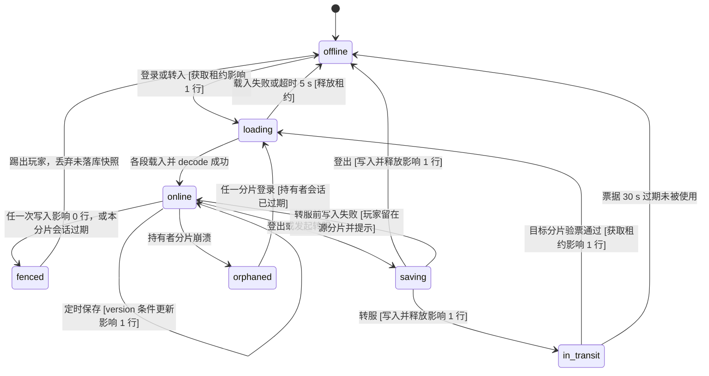

# 玩家数据持久化技术设计草案（PostgreSQL + Redis）

| 字段 | 值 |
| --- | --- |
| 状态 | 草案，未评审。将来并入 `docs/DESIGN.md` 或新里程碑分册，届时再编 ID；本文的 D1～D14 只是本文内的拍板编号 |
| 基线 | `main` @ `3085e0edab`（2026-09-23），`docs/DESIGN-M3.md` 取工作区里的 v0.2（未提交，另一会话在改） |
| 用户已拍板（2026-09-23） | 恢复加密与 Mojang 正版验证，每个分片自己验证，跨大区 Transfer 后重新验证；玩家数据用 PostgreSQL + Redis；真客户端端到端回归常驻 CI；200～500 人真实压测 |
| 不在本文范围 | 世界存储与区块（归 `docs/DESIGN-M3.md`）；Mojang 验证本身的实现（另一份草案）；数据库备份与 PITR（归运维） |

## 结论与推荐

仓库里目前没有任何持久化代码，玩家数据要从零做。推荐的切法是：**引擎一行不动，宿主 `server-app` 实现存储，`plugin-api` 只暴露一个按「数据段」读写的 `PlayerDataStore`，玩法插件定义数据段的内容与编码**。PostgreSQL 是唯一的权威存储，负责写权租约、版本号与全部玩家数据；Redis 只放可以丢的东西（在线位置、跨分片消息、登录限流），Redis 整个挂掉时登录照常。写权租约不放 Redis，原因是防双写的判据必须和写入在同一个事务里（fencing），Redis 主从切换会丢锁。与 `docs/DESIGN-M3.md` v0.2 的 `REQ-M3-018` / `API-M3-012` 相比，本文建议改三处：租约从「每玩家每 10 s 续一次」改成「每分片一个会话租约」（正式档写入量从 3,200 次/秒降到约 26 次/秒），状态正文从一个不透明 `payload` 拆成按插件命名的数据段，外部依赖从「只有 PostgreSQL」改成加一个非权威的 Redis。选型默认：pgjdbc 42.7.13 + HikariCP 7.1.0 + Flyway 13.7.0 + Jedis 8.0.1，四者运行时闭包合计 4,159,717 字节（约 4.0 MiB），许可证为 BSD-2-Clause / Apache-2.0 / Apache-2.0 / MIT。崩溃时最多丢 60 s 的非关键进度，交易等关键操作先落库后生效，不丢。

## 0. 现状核对

| 论断 | 证据 |
| --- | --- |
| 没有任何数据库、JDBC 或 Redis 代码与依赖 | `grep -rln "java\.sql\|jdbc\|redis" --include='*.java' --include='*.kts' --include='*.toml' .`（排除 `build/`）输出为空；`gradle/libs.versions.toml` 的 `[libraries]` 里没有数据库相关条目 |
| 设计文档把持久化明确排除在 M1 / M2 之外 | `docs/DESIGN.md:397`「M1 不落盘任何持久数据」；`docs/DESIGN-M2.md` §2 非目标「不做战斗、技能、经济、背包、存档、排行榜」 |
| `DESIGN-M3.md` v0.2 已写了一版外部状态存储 | `docs/DESIGN-M3.md:150` `REQ-M3-018`；`:429-435` `API-M3-012`（表 `player_state(... payload bytea ...)`、每 10 s 续租、每 60 s 自动保存）；`:578` §11.4 租约状态机；`:871` `ADR-M3-009`（PostgreSQL 16，Redis 被列为备选并否决） |
| 当前是离线模式，UUID 由服务端按用户名派生 | `server-app/.../Main.java:96` `MinecraftServer.init(new Auth.Offline())`；`listener/preplay/LoginListener.java:80` 用 `GameProfile.offlineUuid(username)`；`Auth.java:19` 只有 `Offline` / `Velocity` / `Bungee` 三种 |
| 登录包 ID 空位里 `minecraft:hello`（加密请求）是占位 | `network/packet/PacketVanilla.java:386` `ReservedPacket`，注释「offline mode never asks for encryption」 |
| 转服用到的引擎能力都在 | `PlayerConnection.java:324` `storeCookie`、`:328` `fetchCookie`、`:398` `transfer`；`HandshakeListener.java:53-57` 识别 TRANSFER 意图并按 `ServerConfig#acceptTransfers`（默认 false，`ServerConfig.java:190`）放行；Cookie 值上限 5,120 B（`CookieStorePacket.java:14`） |
| 插件在玩家被踢之前就被禁用 | `Main.java:141` 把 `host::disableAll` 注册为 shutdown task；`ServerProcessImpl.java:306` `scheduler.shutdown()`（执行 shutdown task）先于 `:307` `connection.shutdown()`（踢人）与 `:313` 最后一个 tick（`PlayerDisconnectEvent` 在这里发）。**推论**：若把「登出保存」写在插件的 `PlayerDisconnectEvent` 监听器里，停机时它已被摘掉，停机那一刻在线的玩家全部不保存 |
| PLAY 态的 `PlayerDisconnectEvent` 在 tick 线程上发 | `PlayerConnection.java:249` `player.scheduleNextTick(Entity::remove)`；`Player.java:628` 在 `remove` 里 `call(new PlayerDisconnectEvent(this))`。在这里同步写库会卡住整个 tick |
| 准入回调禁止阻塞，也拿不到玩家 UUID | `AdmissionProvider.java:7`「It must not block」；`AdmissionGate.java:38` 事后软预算 200 ms；`AdmissionRequest.java:13` 只有 `connectionId, username, modVersion, schemaVersion` |
| configuration 虚拟线程上可以阻塞 | `AdmissionGate.java:60` `handshake.await(player)` 就在这条线程上做 3 s 有界等待（`docs/DESIGN-M2.md` §17 `handshake.await` 行） |
| `plugin-api` 目前不依赖 `java.sql` | `plugin-api/src/main/java/module-info.java` 只 `requires transitive` 引擎、协议、slf4j |
| Gson 已经是引擎的传递依赖 | `build.gradle.kts:41` `api(libs.gson)`；`src/main/java/module-info.java:17` `requires transitive com.google.gson` |
| 同进程重复登录已按 UUID 拒绝，但只管本进程 | `ConnectionManager.java:220` `createPlayer` 占用 UUID；原因键 `synaxis:duplicate-login`（`docs/DESIGN.md` §28 `SOAK-3` 条）。跨分片没有任何互斥 |

## ① 放在哪一层

### 分层

| 层 | 职责 | 不做什么 |
| --- | --- | --- |
| 引擎（根模块） | 不变。提供已有的钩子：`AsyncPlayerConfigurationEvent`（虚拟线程）、`PlayerDisconnectEvent`、`scheduleNextTick`、Cookie 与 Transfer | 不依赖 `java.sql`、驱动或 Redis 客户端。`module-info` 不加 `requires java.sql` 本身就是编译期门禁 |
| `:plugin-api` | 新增 `PlayerDataStore`、`DataSection<T>`、`SaveResult` 三个类型，`PluginContext` 加一个 `playerData()` | 不暴露 `Connection`、SQL 或 Redis 类型；插件看不见租约 |
| `:server-app`（宿主） | 实现存储：连接池、Flyway、租约、版本号、载入与保存调度、停机冲刷、Redis 在线表与跨分片消息。`ShardMain`（M3 的分片宿主）接 PostgreSQL；M2 的 RTS `Main` 接内存实现，不连数据库 | 不理解数据段内容 |
| 玩法插件（MMO 插件，`game-rts` 不用） | 定义数据段（背包、任务、技能……）的 Java 模型、JSON 编码与升级链；关键操作调 `saveNow` / `commitTogether` | 不写 SQL，不碰 Redis |

默认把 JDBC 挡在 `plugin-api` 外面，理由是写权校验（fencing）必须和每一次写入在同一个事务里：插件一旦拿到 `Connection`，就能绕过版本号直接 `UPDATE`，防双写只剩约定。代价是插件做不了跨玩家的 SQL 查询（排行榜、拍卖行），这类数据等出现时单独设计成宿主服务。

**D1（待拍板）**：默认如上，插件只见数据段。切换条件：出现第一个必须由插件自定义表结构的功能（拍卖行、公会仓库）时，给那个功能单独开宿主服务；仍不把 `Connection` 交给插件。

### 接口草案

```java
// :plugin-api，新增。PluginContext 增加 PlayerDataStore playerData();
public interface PlayerDataStore {

    /** 只能在 onEnable 内调用；id 必须以 "<plugin_id>:" 开头，重复注册抛 IllegalStateException。 */
    <T> void register(DataSection<T> section);

    /** 玩家所属 tick 线程上调用。玩家进世界前宿主已载入全部已注册段，缺失的段给 createDefault()。 */
    <T> T get(Player player, DataSection<T> section);

    /** 标脏；下一次定时保存只写脏段。 */
    void markDirty(Player player, DataSection<?> section);

    /** 立即保存该玩家全部脏段。future 在虚拟线程上完成，不要在回调里碰实体。 */
    CompletableFuture<SaveResult> saveNow(Player player);

    /**
     * 先落库后生效：staged 是各玩家各段的「提交后状态」，宿主在一个事务里带全部玩家的
     * 版本校验写入，成功后在 tick 线程上执行 apply。任一玩家校验失败则整笔不写、apply 不执行。
     * 参与者必须都在本分片（交易、邮件领取都满足：双方都在线且在同一分片）。
     */
    CompletableFuture<SaveResult> commitTogether(Map<Player, Map<DataSection<?>, Object>> staged,
                                                 Runnable apply);
}

public interface DataSection<T> {
    String id();                                   // 例："mmo:inventory"
    int schemaVersion();                           // 只增
    T createDefault();
    T decode(JsonElement json, int storedVersion); // 含 storedVersion → schemaVersion 的升级链
    JsonElement encode(T value);                   // tick 线程上调用；返回的树不得与 value 共享可变对象
}

public enum SaveResult { SAVED, FENCED, UNAVAILABLE }
```

`FENCED` 表示本分片已失去写权（见 ③），宿主已经踢出该玩家；`UNAVAILABLE` 表示数据库不可达，快照仍留在内存等下一次重试。

`AdmissionRequest` 需要带上玩家 UUID，插件才能按账号做准入。它是 record，加字段会改 canonical 构造器的签名；`checkBinaryCompatibility`（`build-src/src/main/kotlin/synaxis.publishing.gradle.kts:67`）会不会把它判为破坏性变更要实测，判为破坏就按 `docs/DESIGN-M2.md` §8 把 `API_VERSION` 从 1 加到 2。

## ② 数据模型

### 表（宿主拥有，Flyway 管理）

| 表 | 主键 | 关键列 | 说明 |
| --- | --- | --- | --- |
| `store_meta` | `key text` | `value text` | 写入 `auth_mode = online / offline`。分片起服时比对自己的 `Auth` 模式，不一致拒绝起服，防止压测用的离线 UUID 写进正式库 |
| `account` | `account_uuid uuid` | `last_name text`、`first_login_at`、`last_login_at timestamptz` | UUID 取 Mojang 正版 UUID。名字可以在 Mojang 改，只做展示，不做键 |
| `character` | `character_id bigint`（identity） | `account_uuid` FK、`slot smallint`、`version bigint`、`lease_session_id bigint NULL`、`current_region text`、`last_saved_at` | `unique(account_uuid, slot)`。`version` 每次成功写入加 1；`lease_session_id` 指向持有写权的分片会话 |
| `character_location` | `(character_id, region_id)` | `x, y, z double`、`yaw, pitch real`、`updated_at` | 每个大区各记一个最后位置，回到旧大区时落在上次离开的地方 |
| `character_section` | `(character_id, section_id)` | `schema_version int`、`data jsonb`、`updated_at` | 插件数据段。单段编码后上限 64 KiB（沿用 `API-M3-012` 的 65,536 B），超限保存失败并记 ERROR |
| `shard_session` | `session_id bigint`（identity） | `shard_id text`、`started_at`、`expires_at timestamptz` | 分片每次起服新建一行，`session_id` 就是这次运行的纪元号。每 5 s 续期到 `now() + 30 s` |
| `transfer_nonce` | `nonce bytea` | `expires_at` | 沿用 `API-M3-012`；每小时删一次过期行 |
| `item_ledger`（可选，见 D5） | `ledger_id bigint` | `item_uid uuid`、`def_id text`、`from_character`、`to_character`、`reason text`、`at` | 只记带 `uid` 的物品的产生、销毁与跨角色转移，用于查刷物品 |

**D2（待拍板）**：账号与角色 1:N。默认表结构按 1:N 建（`slot`），首个版本界面只开 `slot = 0` 一个角色、首次登录自动建。切换条件：确定永远只有一个角色时可以把 `character` 合进 `account`，但之后再拆要做数据迁移，拆的代价远大于现在多一张表。

### 背包与物品

与「内容不注册成 MC 物品」的路线一致（`docs/DESIGN-M2.md` §2 背景），物品只存自有内容 ID，不存 MC 的 `ItemStack` 或数据组件。背包是插件的数据段 `mmo:inventory`，JSON 形如：

```json
{ "bags": { "main": [ { "slot": 0, "def": "mmo:iron_sword", "uid": "0192…", "n": 1,
                        "bound": true, "dur": 87, "affix": { "str": 3 } },
                      { "slot": 1, "def": "mmo:herb_red", "n": 20 } ],
            "equip": [ … ], "bank": [ … ] },
  "currency": { "gold": 1520 } }
```

| 字段 | 规则 |
| --- | --- |
| `def` | 内容定义 ID，字符串，来源是我们自己的内容表，客户端模组按它渲染 |
| `uid` | 只有不可堆叠的物品（装备、任务道具）才有，UUIDv7，产生时由服务端分配。刷物品的判据是「同一 `uid` 同时出现在两个角色的背包里」 |
| `n` | 数量；可堆叠物品没有 `uid` |
| 其余 | 耐久、词缀、绑定等由内容定义决定，JSON 自由扩展 |

交易、邮件附件、商店购买走 `commitTogether`，一个事务同时改两个角色的 `mmo:inventory` 并校验两边的 `version`，不存在「一边扣了另一边没加」的中间态。

**D5（待拍板）**：默认写 `item_ledger`，只记带 `uid` 的物品（可堆叠材料不记）。切换条件：压测时 `item_ledger` 写入超过 `character` 保存次数的 2 倍，改成只记稀有度在阈值以上的物品。写入量本轮未测。

### 任务

数据段 `mmo:quests`：`{ "active": { "<quest_id>": { "stage": 2, "counters": { "kill_wolf": 7 }, "since": 1758600000 } }, "done": { "<quest_id>": { "at": 1758000000, "times": 3 } } }`。可重复任务只记完成次数与最后一次时间，不留每次记录，防止这个段随游戏时长无界增长。

### 位置（按大区）

位置不进插件数据段，由宿主写 `character_location`：转服要用它决定目标分片的出生点，宿主本身知道 `region_id`（`docs/DESIGN-M3.md` 术语表「大区」行）。每次定时保存、登出与转服前都写当前大区那一行；`character.current_region` 记最后所在大区，登录时路由到该大区的分片。

### 版本号与迁移

版本分三层，互不替代：

| 层 | 载体 | 何时变 | 不一致时 |
| --- | --- | --- | --- |
| 表结构 | Flyway 版本号（`db/migration/V<n>__*.sql`） | 宿主改表 | 分片起服时 `validate`，库版本与代码期望不一致拒绝起服 |
| 数据段格式 | `character_section.schema_version` | 插件改段结构 | 载入时按 `decode(json, storedVersion)` 的升级链升到当前版本，下次保存时写回新版本（惰性迁移）。库里的版本高于代码时拒绝该玩家登录（`synaxis:state-unavailable`），不降级解码，防止旧代码把新字段写丢 |
| 行数据 | `character.version` | 每次成功保存 +1 | 条件更新影响 0 行即 `FENCED` |

表结构迁移按「先扩后缩」（expand / contract）写：同一次发布里只加列、加表，删列放到下一次发布，这样滚动升级时新旧两版分片可以同时连同一个库。

## ③ 读写时机

### 写权：分片会话租约

`API-M3-012` 的写法是每个玩家一行租约、每 10 s 续一次。正式档按 `docs/DESIGN-M3.md` §2 是 64 个大区、每分片 500 人，只算每大区一个频道也有 32,000 人在线，续租就是 32,000 ÷ 10 = 3,200 次 `UPDATE`/秒，已经超过 `ADR-M3-009` 自己写的重估线（2,000 次/秒）。

本文改成：玩家行只记「哪个分片会话持有我」（`character.lease_session_id`），续期的只有分片会话自己。按每大区 2 个频道算 128 个分片、每 5 s 续一次，是 25.6 次/秒。

```sql
-- 获取（登录或转入）：持有者为空，或持有者的会话已过期
UPDATE character c SET lease_session_id = :mine
 WHERE c.character_id = :id
   AND (c.lease_session_id IS NULL
        OR NOT EXISTS (SELECT 1 FROM shard_session s
                        WHERE s.session_id = c.lease_session_id AND s.expires_at > now()))
RETURNING version;

-- 保存（同一事务里先做这一句，再写脏段与位置）
UPDATE character SET version = version + 1, last_saved_at = now()
 WHERE character_id = :id AND lease_session_id = :mine AND version = :expected;
-- 影响 0 行 → 回滚整个事务，返回 FENCED

-- 分片会话续期：影响 0 行说明会话已过期，本分片必须自我隔离
UPDATE shard_session SET expires_at = now() + interval '30 seconds'
 WHERE session_id = :mine AND expires_at > now();
```

这个设计的三条性质：

- 时间只取数据库的 `now()`，分片机器之间的时钟偏差不影响租约判断。
- 分片崩溃后重启会拿到新的 `session_id`，旧会话留下的租约立刻可以被任何分片（包括重启后的自己）接管，不必等 30 s；机器整个宕掉时最多等 30 s。
- 被接管后，旧分片任何迟到的写入都因 `lease_session_id` 不再等于旧会话而影响 0 行。这是 fencing token 的做法（Kleppmann 2016，见出处），纪元号就是 token。

分片会话续期连续失败到过期（30 s）时，分片进入自我隔离：停止一切写入，把在线玩家全部以 `synaxis:state-unavailable` 踢出。

**D3（待拍板）**：默认用分片会话租约，替换 `API-M3-012` 的每玩家租约。切换条件：如果将来要支持「一个玩家的状态在同一分片内跨进程迁移」之类以玩家为粒度的写权转移，才需要回到每玩家租约；目前 Transfer 都是「源分片释放 → 目标分片获取」，分片粒度够用。

**为什么不用 Redis 做租约**：用 Redis 锁防双写，写入时 PostgreSQL 仍然要验证一个 token，否则 GC 停顿或网络分区后旧持有者照样能写（Kleppmann 2016）；而 Redis 主从是异步复制，主节点宕机切换时可能丢掉刚发出的锁（Redis 官方分布式锁页面把这一点列为单实例方案的已知问题，见出处）。既然 token 校验必须在 PostgreSQL 里做，锁也放在 PostgreSQL 里，少一个会出错的环节。

### 每个时机做什么

| 时机 | 线程 | 做什么 | 预算 |
| --- | --- | --- | --- |
| 登录载入 | configuration 虚拟线程，插在 `AdmissionGate` 的 `handshake.await` 之后、`provider.admit` 之前（`AdmissionGate.java:60-71`） | upsert `account` → 查或建 `character` → 获取租约 → 读全部 `character_section` 与当前大区的 `character_location` → 在内存里 `decode` 成各段对象。握手失败的连接不碰数据库 | 连接池取连接 2 s + 语句超时 2 s，整段 ≤ 5 s（登录总超时 30 s，`docs/DESIGN.md` §15）。同时在途的载入数用信号量限到 2，给定时保存留出连接 |
| 定时保存 | 快照在玩家所属 tick 线程（`scheduleNextTick`），写库在虚拟线程 | 每 60 s 一轮（与 `API-M3-012` 一致），按玩家摊到每个 tick：每 tick 最多快照 ⌈在线人数 ÷ 1,200⌉ 个玩家，500 人即每 tick 1 个。只 `encode` 脏段。每个角色同时至多一次在途写入，新快照覆盖排队中的旧快照 | 单玩家 `encode` 耗时未测，验收线见 ⑦ |
| 关键操作 | 同上 | `saveNow` / `commitTogether`，先落库后生效 | 玩家可见的等待 ≤ 1 s（P99） |
| 登出 | `PlayerDisconnectEvent`：PLAY 态在 tick 线程（`Player.java:628`），非 PLAY 态在断线线程（`PlayerConnection.java:251`） | tick 线程上只做快照，写库与释放租约（保存 SQL 之后加 `SET lease_session_id = NULL`）交给虚拟线程 | 失败按 ⑤ 重试 |
| 停机 | shutdown task，必须在 `host::disableAll` 之前注册（`Main.java:141`） | 此时 tick 线程已经 join（`ServerProcessImpl.java:306` 之前），停机线程直接读各段做快照是安全的；批量写入并释放全部租约，然后标记「已冲刷」，之后到来的 `PlayerDisconnectEvent` 不再写 | 整段 ≤ 8 s，给 `process.shutdown` 的 10 s join 上限（`docs/DESIGN.md` §17）留 2 s |
| 崩溃（`kill -9`、OOM、断电） | — | 不做任何事。丢失窗口 = 距上次成功保存的时间，≤ 60 s；关键操作已同步落库，不在窗口里 | 租约在 ≤ 30 s 后可被接管，同机重启时立即可接管 |

**D4（待拍板）**：崩溃安全默认只靠「乐观版本 + 60 s 定时保存 + 关键操作同步落库」，不做分片本地的写前日志。切换条件：如果运营要求非关键进度（经验、任务计数）的丢失窗口 ≤ 5 s，先把定时保存缩到 10 s（32,000 人即 3,200 次事务/秒，要先压测数据库），仍不够再加本地日志。本地日志的代价是崩溃恢复时要回放，而回放时这台机器上的租约可能已被别的分片接管，回放逻辑本身就要做 fencing。

**D6（待拍板）**：Redis 当写回缓冲（先写 Redis、再异步刷 PostgreSQL）默认不做。切换条件：PostgreSQL 写入 P99 在 500 人压测下超过 200 ms 且加机器解决不了。不做的原因是那样会出现两个权威副本，Redis 默认的 AOF `everysec` 本身就有丢 1 s 的窗口（`ADR-M3-009` 否决 Redis 的理由相同）。

### Transfer 跨大区交接

Transfer 之后客户端重新走一遍握手（意图 TRANSFER，`HandshakeListener.java:53`）与完整登录，恢复正版验证之后目标分片会自己做一次 Mojang 验证；票据里的 `player_uuid` 必须等于这次验证出来的 UUID，否则按 `wrong-target` 同档拒绝（`API-M3-011` 的检查 ②～⑥ 里没有这一条，建议补进检查 ④）。

玩家的归属状态（全局一份，由 PostgreSQL 的租约与 Redis 的在线表共同表达；PostgreSQL 为准，Redis 只做路由提示）：



| 源 → 目标 | 事件 | 守卫 | 动作 | 谁触发 |
| --- | --- | --- | --- | --- |
| offline → loading | 登录 / 转入 | 租约获取语句影响 1 行 | Redis `SET presence:{uuid} {shard, session, loading} PX 30000` | 登录分片 |
| loading → online | 载入完成 | 全部段 `storedVersion ≤ schemaVersion` 且解码成功 | 调 `admit`，presence 改 `online` | 登录分片 |
| loading → offline | 载入失败 | 超时 5 s，或段版本高于代码，或解码抛异常 | 释放租约；断线 `synaxis:state-unavailable`；**不写任何段**，解码失败的原始 JSON 保持不动 | 登录分片 |
| online → fenced | 写入被拒 | 条件更新影响 0 行，或分片会话续期失败到过期 | 停止该玩家（会话过期时是全部玩家）的一切写入 | 源分片 |
| online → saving | 登出 / 发起转服 | 转服时：目标频道在线且未满（`API-M3-010` 心跳） | 冻结该玩家的交易、拾取、邮件等改变数据的操作；tick 线程快照 | 源分片 |
| saving → in_transit | 写回成功 | 写入并释放影响 1 行 | presence 改 `in_transit(target)` 带 30 s TTL；签票据（带新 `state_version`），先 `storeCookie` 再 `transfer`（`API-M3-011`） | 源分片 |
| saving → online | 写回失败 | 数据库错误或超时 | 解冻，提示「转服失败，请稍后再试」，不签票据 | 源分片 |
| in_transit → loading | 目标验票 | HMAC、有效期、目标、UUID 一致、nonce 未用全部通过，且获取租约影响 1 行 | 插入 nonce；进入 loading | 目标分片 |
| in_transit → offline | 票据过期 | 30 s 内没有分片验票 | 无动作（租约早已释放），Redis presence 自然过期 | — |
| online → orphaned | 分片崩溃 | 持有者 `shard_session.expires_at < now()` | 无动作 | — |
| orphaned → loading | 再次登录 | 同 offline → loading 的获取语句（它已覆盖「持有者会话过期」） | 写 `EVT:lease_takeover` | 任一分片 |

目标分片读到的 `character.version` 应等于票据里的 `state_version`；不等说明源分片释放之后又有别的分片写过这个角色，这在上表里不可能出现，出现即记 ERROR 并拒绝进入，作为一致性断言。

同一账号在另一个分片再次登录（玩家开了第二个客户端，或客户端崩溃后旧连接还没被 keep-alive 的 15 s 踢掉）：

**D7（待拍板）**：默认「新登录顶掉旧会话」，与原版同服重复登录的行为一致。新分片看到租约被一个活着的会话持有时，经 Redis 发 `kick:{shard}` 消息给持有者，持有者走 online → saving → offline，新分片在 5 s 内每 250 ms 重试获取租约，超时断线 `synaxis:state-unavailable`。Redis 不可用时退化为直接拒绝新登录。切换条件：如果运营认为顶号会被盗号者利用，改成「拒绝新登录」，代价是客户端崩溃后要等最多 15 s 才能重连。注意这与当前离线模式下的 `synaxis:duplicate-login`「拒绝后来者」相反，那条规则是为离线模式下任何人能冒用名字而定的；恢复正版验证后可以翻过来。

## ④ 选型

版本取 2026-09-23 Maven Central `maven-metadata.xml` 的 `<release>`；体积是在临时 Gradle 工程里解析各自 `runtimeClasspath` 后逐个 jar 求和（临时工程已删）。

| 用途 | 默认 | 版本 | 许可证 | 运行时闭包 | 备选与不选的原因 |
| --- | --- | --- | --- | --- | --- |
| JDBC 驱动 | pgjdbc | 42.7.13 | BSD-2-Clause | 2 个 jar，1,462,833 B（含 checker-qual） | 无实质备选 |
| 连接池 | HikariCP | 7.1.0 | Apache-2.0 | 2 个 jar，242,904 B（含 slf4j-api，与已有依赖合并） | 不用池、每次新建连接：握手加 TLS 每次数毫秒到数十毫秒，登录高峰撑不住（数值未测） |
| 迁移 | Flyway（`flyway-core` + `flyway-database-postgresql`） | 13.7.0 | Apache-2.0（`flyway-parent` POM） | 4 个 jar，950,582 B | Liquibase 5.0.4：许可证是 FSL-1.1-ALv2（`liquibase-core` POM 与仓库 `LICENSE.txt`），不是开源许可证；闭包 8 个 jar，6,392,463 B。`DESIGN-M3.md` §25 已写 Flyway |
| Redis 客户端 | Jedis | 8.0.1（8.1.0 仍是 beta） | MIT | 7 个 jar，1,928,035 B；扣掉已有的 gson 与 slf4j 后净增 1,573,306 B | Lettuce 7.7.0：MIT，闭包 14 个 jar，7,563,406 B（Netty 4.2 + Reactor）。它的优势是异步与单连接多路复用，而我们在虚拟线程上阻塞调用即可，JDK 25 上 `synchronized` 不再钉住载体线程（JEP 491，JDK 24 起） |
| Redis 服务端 | Valkey 8 | — | BSD-3-Clause（`valkey-io/valkey` 仓库 `COPYING`） | — | Redis 8：RSALv2 / SSPLv1 / AGPLv3 三选一（`redis/redis` 仓库 `LICENSE.txt`）。本机已有的 `redis:7-alpine` 是 7.4.10，7.4 起只有 RSALv2 / SSPLv1 两选一（未核实，见文末） |
| PostgreSQL | 16 | — | PostgreSQL License | — | 与 `ADR-M3-009` 一致；本机已有 `postgres:16-alpine`（16.13，388 MB），开发不用再拉镜像 |

四个默认库合计净增 1,462,833 + 242,904 − 69,908（slf4j 已有）+ 950,582 + 1,573,306 ≈ 4.16 MB，只进 `server-app` 的运行时，不进引擎与 `plugin-api`。Apache-2.0 的依赖随发行包分发时要带上它们的 NOTICE（本仓库 `NOTICE` 已按 Apache-2.0 §4 维护，发行打包时补）。

**D8（待拍板）**：默认 Jedis。切换条件：跨分片消息量大到单个分片要维持 ≥ 20 条 Redis 连接（Jedis 每个阻塞中的订阅占一条连接）时换 Lettuce。

**D9（待拍板）**：默认 Valkey 8。切换条件：要用只有 Redis 8 才有的模块（例如 Redis Query Engine）时换 Redis 8，按 AGPLv3 使用未修改的服务端二进制。

连接池参数默认：`maximumPoolSize = 4`、`connectionTimeout = 2000`（Hikari 默认 30,000 ms，最低 250 ms，见 HikariCP README）、语句超时 `statement_timeout = 2s`（连接参数里设）。PostgreSQL 默认 `max_connections` 是 100（PostgreSQL 16 文档），128 个分片 × 4 = 512 条连接会超。**D10（待拍板）**：分片数 ≤ 24 时分片直连（≤ 96 条）；超过 24 个分片时加 PgBouncer（事务模式），不去调大 `max_connections`。

Flyway 的执行方式：**D11（待拍板）**：默认由发布流程先跑一次 `server-app --migrate-only`，分片起服只 `validate`。切换条件：只有一个分片时可以让它起服时直接 `migrate`。Flyway 的 PostgreSQL 模块带 `PostgreSQLAdvisoryLockTemplate`（`flyway-database-postgresql-13.7.0.jar` 内），多个分片同时 `migrate` 会被 advisory lock 串行化而不是互相破坏，但滚动发布里让每个分片都有改表权限没有必要。

密钥：沿用 `API-M3-011` 已定的 `SYNAXIS_STATE_DB_URL`，新增 `SYNAXIS_STATE_DB_USER`、`SYNAXIS_STATE_DB_PASSWORD`、`SYNAXIS_REDIS_URL`，按 `CLAUDE.md` 密钥纪律只进 `.env` 与 Bitwarden，`.env.example` 登记键名、用途与获取方式。分片用的数据库账号只有 DML 权限，DDL 权限只给 `--migrate-only` 用的账号。

## ⑤ 失败模式

| 故障 | 新登录 | 已在线玩家 | 恢复后 |
| --- | --- | --- | --- |
| PostgreSQL 不可达 | 载入超时 ≤ 5 s 后断线 `synaxis:state-unavailable`（`DESIGN-M3.md` §14 已有此键）。不设「游客模式」：没载入数据就进世界，产生的进度要么丢、要么将来和真实数据冲突 | 定时保存失败，快照留在内存按 1 s / 2 s / 4 s 退避重试（上限 30 s）。分片会话续期失败超过 10 s 时进入冻结：禁止交易、邮件、拍卖等改变物品归属的操作，移动与战斗照常；会话过期（30 s）时踢出全部玩家（D12） | 新登录立即恢复；被踢玩家的丢失量 = 距上次成功保存的时间，≤ 60 s + 30 s |
| PostgreSQL 慢（P99 > 2 s） | 登录载入信号量（2）排满后，后来者在 configuration 阶段排队，排到 5 s 仍未开始即断线 | 定时保存堆积，同一角色的新快照覆盖旧快照，内存占用上界 = 在线人数 × 单人快照大小 | — |
| Redis 不可达 | 照常登录。重复登录退化为「拒绝新登录」（D7） | 跨分片聊天、好友在线状态、顶号消息不可用；每 10 s 记一行 WARN（按 `LogBudget` 限流） | 各分片把本分片在线名单重写一遍 presence（TTL 30 s，本来就要每 10 s 刷一次） |
| 分片进程崩溃 | 该分片上的玩家可立即登录其他分片（同机重启的新会话也可立即接管）；整机宕机最多等 30 s | — | — |
| 分片与数据库之间网络分区，其他分片正常 | 其他分片可以在 30 s 后接管这批玩家 | 分区一侧的分片自我隔离并踢人；它在隔离前发出的迟到写入被 fencing 拒掉 | — |
| 数据段解码失败（插件 bug 或数据损坏） | 拒绝该角色登录，断线 `synaxis:state-unavailable`，记 ERROR 带 `character_id` 与 `section_id` | — | 修代码后可正常登录；**任何路径都不得用 `createDefault()` 覆盖一个解码失败的段** |
| 库表版本与代码不一致 | 分片拒绝起服 | — | 先跑迁移或回滚分片 |
| Mojang 会话服务不可达 | 新登录失败（与数据库无关，归 Mojang 验证草案） | 不受影响 | — |

**D12（待拍板）**：数据库故障时在线玩家的处置，默认「冻结 10 s 起、30 s 踢出」。切换条件：若运营宁可多丢进度也不愿踢人，可以改成不踢、只冻结，代价是分区时另一个分片可能接管同一角色，玩家在两边各玩各的，其中一边的进度最终被 fencing 丢掉，丢失量不再有 90 s 上界。

## ⑥ 本地开发与 CI

本机磁盘纪律要求固定名字、复用同一套环境。本机已有 `postgres:16-alpine`（388 MB），不再拉新的 PostgreSQL 镜像；Valkey 镜像需要拉一次（体积未核实）。本机已有 `kando-account-test-pg`、`accounts-mail-lab-postgres-1`、`accounts-mail-lab-redis-1` 等容器，端口避开 5432 / 6379。

| 场景 | 默认做法 |
| --- | --- |
| 本地手动起服 | 一份 `tools/dev/compose.yaml`（草案，未建）：`container_name: synaxis-dev-pg`（`postgres:16-alpine`，端口 55432，具名卷 `synaxis-dev-pg-data`）与 `synaxis-dev-valkey`（`valkey/valkey:8-alpine`，端口 56379，不挂卷）。要干净状态就 `docker compose down -v` 后重建同名容器，不按分支或按轮次起新名字 |
| 本地跑测试 | Testcontainers 2.0.5（`org.testcontainers:testcontainers-postgresql`，Valkey 用 `GenericContainer`，不加第三方模块）。本机在 `~/.testcontainers.properties` 打开复用，容器声明 `withReuse(true)`，全机只保留一套测试容器；每个测试类 `CREATE DATABASE t_<随机>`，`@AfterAll` 里 `DROP`。Testcontainers 官方把复用标为 Experimental |
| CI | GitHub Actions `ubuntu-latest`（现有 `ci.yml:14`）自带 Docker，用同一套 Testcontainers 代码、不开复用，容器随 runner 销毁。依赖数据库的测试放进 `:server-app` 的独立 Gradle 任务 `dbTest`，`check` 依赖它 |
| 没有 Docker 的机器 | `@Testcontainers(disabledWithoutDocker = true)` 跳过并在 Gradle 输出里打印跳过数；CI 上跳过数必须为 0（任务里断言） |
| 插件单元测试 | `:testing` 模块提供内存版 `PlayerDataStore`，插件测试不需要数据库 |
| 200～500 人压测 | 机器人走离线模式，连一个单独的库，库里 `store_meta.auth_mode = offline`；正式分片（正版模式）连它会拒绝起服 |

**D13（待拍板）**：本地测试默认用 Testcontainers 复用模式。切换条件：复用模式在某次 Testcontainers 升级后行为变化（它是 Experimental），改为测试直接连 compose 起的 `synaxis-dev-pg`，由环境变量 `SYNAXIS_TEST_DB_URL` 指定。

## ⑦ 测试计划与验收判据

| 编号 | 层 | 内容 | 验收判据 |
| --- | --- | --- | --- |
| P1 | 单元 | 各数据段 `encode` → `decode` 往返；升级链用固化的旧版本 JSON 夹具（v1、v2）升到当前版本 | 往返后 `equals`；每个历史版本至少一份夹具 |
| P2 | 集成（PostgreSQL） | 首次建档竞争：100 个线程同时对同一新账号走登录载入 | 恰好 1 个获得租约，`character` 恰好 1 行 |
| P3 | 集成 | fencing：两个存储实例 A、B 各自一个分片会话；A 持有租约后把 A 的 `shard_session.expires_at` 改到过去，B 接管，随后 A 保存 | A 得到 `FENCED`，库里数据等于 B 写入的版本，A 的写入 0 行生效 |
| P4 | 集成 | `commitTogether` 两人交易，中途让其中一方的版本失配 | 两边都不变，`apply` 未执行；正常路径两边 `version` 各 +1 |
| P5 | 集成 | 段版本高于代码、段 JSON 损坏 | 拒绝登录；库里原始数据逐字节不变 |
| P6 | 进程级 | 真实 `server-app` 进程，20 个机器人在线 90 s 后 `kill -9`，重启 | 每个角色的 `last_saved_at` 距崩溃 ≤ 60 s；重启后 10 s 内全部可登录（新会话立即接管） |
| P7 | 进程级 | 500 人在线时执行 `stop` | 所有有脏段的角色 `version` 各 +1，全部租约为空，停机总时长 < 10 s |
| P8 | 故障注入 | `docker pause synaxis-dev-pg` 60 s 再恢复 | 新登录 ≤ 5 s 收到 `synaxis:state-unavailable`；在线玩家 10 s 冻结、30 s 被踢；恢复后 5 s 内可登录 |
| P9 | 故障注入 | `docker pause` Valkey 60 s | 登录成功率 100%；WARN 行数 ≤ 7（每 10 s 一行） |
| P10 | 端到端 | 两个分片进程 + PostgreSQL + Valkey + 无头真客户端（`3085e0edab` 引入的 26.2 无头客户端）来回转服 100 次 | 100 次全部成功；每个 `uid` 物品在全库只出现一次；`version` 严格递增 |
| P11 | 端到端故障 | 转服途中分别杀掉目标分片、暂停数据库 | 玩家最终停在源分片或目标分片之一，数据不重复不丢失；票据过期后可正常登录 |
| P12 | 压测 | 500 机器人、定时保存 60 s，与关闭持久化的同配置对照 | tick P99 增量 ≤ 1 ms；单玩家快照 P99 ≤ 0.2 ms；数据库写入 P99 ≤ 50 ms；500 人 60 s 内登录风暴全部载入成功 |
| P13 | 迁移 | 空库 `migrate`；从上一版本 `migrate`；库版本领先代码时起服 | 前两个成功；第三个拒绝起服 |
| P14 | 架构门禁 | ArchUnit：引擎与 `plugin-api` 不依赖 `java.sql..`、`org.postgresql..`、`com.zaxxer..`、`redis.clients..`；玩法插件同样不依赖 | 规则通过 |

P2～P5、P13 进 CI 的 `dbTest`；P10 进常驻 CI 的真客户端回归（用户已拍板）；P6～P9、P11、P12 进压测流程，每次改存储代码跑一遍。P12 的四个数字是本文定的目标，还没有任何测量依据，第一次压测后按实测改。

## 与 `DESIGN-M3.md` 的交叉点

`DESIGN-M3.md` v0.2 已经把玩家状态存储写进 `REQ-M3-018` / `API-M3-012` / §11.4 / `ADR-M3-009`，本文不改那份文件，以下建议交给 M3 的负责会话决定取舍：

| M3 v0.2 | 本文建议 | 理由 |
| --- | --- | --- |
| 每玩家租约，每 10 s 续租 | 分片会话租约，每分片每 5 s 续期 | 正式档续租 3,200 次/秒 → 25.6 次/秒 |
| `player_state.payload bytea` 由插件定格式 | `character_section` 按段存 jsonb，宿主做版本与升级 | 只写脏段；运维可以用 SQL 查物品 |
| 外部依赖只有 PostgreSQL | 加非权威的 Redis（Valkey） | 用户 2026-09-23 拍板 PostgreSQL + Redis；本文把 Redis 限定为可丢数据 |
| 票据检查 ②～⑥ | 在 ④ 加「票据 UUID = 本次 Mojang 验证得到的 UUID」 | 恢复正版验证后目标分片自己有权威身份 |
| 玩家 UUID「离线模式按用户名派生」（`DESIGN-M3.md:467`） | 改为 Mojang 正版 UUID，离线库与正式库用 `store_meta.auth_mode` 隔开 | 用户已拍板恢复正版验证 |

## 待拍板汇总

| 编号 | 问题 | 默认 | 切换条件 |
| --- | --- | --- | --- |
| D1 | 插件能否拿到 JDBC | 不能，只见数据段 | 需要自定义表的功能出现时做成宿主服务 |
| D2 | 账号与角色 | 1:N 建表，先开 1 个角色 | 确定永远单角色才合表 |
| D3 | 写权租约粒度 | 分片会话 | 出现玩家粒度的写权转移需求 |
| D4 | 崩溃安全 | 乐观版本 + 60 s 保存 + 关键操作同步 | 非关键进度丢失窗口要求 ≤ 5 s |
| D5 | 物品流水 | 只记带 `uid` 的物品 | 流水写入 > 保存次数 2 倍 |
| D6 | Redis 写回缓冲 | 不做 | 数据库写入 P99 > 200 ms 且扩容无效 |
| D7 | 跨分片重复登录 | 新登录顶掉旧会话 | 顶号被判定为安全风险 |
| D8 | Redis 客户端 | Jedis | 单分片 Redis 连接 ≥ 20 |
| D9 | Redis 服务端 | Valkey 8 | 需要 Redis 8 独有模块 |
| D10 | 数据库连接 | 直连，池 4 | 分片数 > 24 加 PgBouncer |
| D11 | 迁移执行者 | 发布流程 `--migrate-only` | 只有一个分片时可起服即迁移 |
| D12 | 数据库故障时在线玩家 | 10 s 冻结、30 s 踢出 | 运营宁可无上界丢进度也不踢人 |
| D13 | 本地测试容器 | Testcontainers 复用 | 复用模式行为变化 |

## 未核实事项与出处

未核实：

- Redis 7.4 的许可证是否只有 RSALv2 / SSPLv1 两选一：本轮只读了 `redis/redis` 仓库当前 `LICENSE.txt`（它说明 8.0 起三选一、7.2 及以前是 BSD-3），7.4 的条款没有打开原文。
- Valkey 8 镜像体积；Jedis 8.0.1 对 Valkey 8 的兼容性（两者协议兼容是常识性判断，没有读到官方兼容声明）。
- Flyway 13 社区版对 PostgreSQL 16 的支持年限（Flyway 历史上对较旧数据库版本收费，13.x 的政策未查）。
- Mojang 会话服务 `hasJoined` 的速率限制；500 人登录风暴下是否会被限流。
- Testcontainers 复用模式的具体行为（只核实了官方页面标题为「Reusable Containers (Experimental)」）。
- Paper 的玩家存档：Paper 把玩家数据写在原版 `world/playerdata/<uuid>.dat`、不提供数据库，本轮没有打开 Paper 源码核对，只核实了下面那条自动保存配置。
- 本文所有「耗时」目标（P12 的四个数字、登录载入 5 s、停机 8 s 冲刷）都是按预算推的，没有测量。
- 写入量估算用的「每大区 2 个频道、128 个分片」是本文的假设；`DESIGN-M3.md` §2 只写了「每个大区 1～N 个频道」。

出处：

- 本仓库：`docs/DESIGN.md`（§15 `:397`、§17、§28 `SOAK-3` 条）；`docs/DESIGN-M2.md`（§2、§8、§17）；`docs/DESIGN-M3.md` v0.2 工作区版本（`:66`、`:150`、`:423-435`、`:467`、`:578-596`、`:797`、`:871-875`）；源码文件与行号见 §0。
- Maven Central：`https://repo1.maven.org/maven2/` 下各构件的 `maven-metadata.xml` 与 POM（版本、许可证，2026-09-23 读取）；运行时闭包体积由 Gradle 9.7.1 解析得到。
- Liquibase 许可证：`https://raw.githubusercontent.com/liquibase/liquibase/master/LICENSE.txt`（FSL-1.1-ALv2）。
- Redis 许可证：`https://raw.githubusercontent.com/redis/redis/unstable/LICENSE.txt`；Valkey：`https://raw.githubusercontent.com/valkey-io/valkey/unstable/COPYING`。
- Fencing token：Martin Kleppmann，「How to do distributed locking」，2016-02-08，`https://martin.kleppmann.com/2016/02/08/how-to-do-distributed-locking.html`。
- Redis 分布式锁：`https://redis.io/docs/latest/develop/clients/patterns/distributed-locks/`（本轮只确认页面存在，文中「单实例方案丢锁」的转述来自 Kleppmann 一文对 Redlock 的分析，页面原文措辞未逐句核对）。
- PostgreSQL 16 `max_connections` 默认 100：`https://www.postgresql.org/docs/16/runtime-config-connection.html`。
- HikariCP `connectionTimeout` 默认 30,000 ms、最低 250 ms：`https://github.com/brettwooldridge/HikariCP` README。
- Paper 玩家自动保存的分摊：`PaperMC/Paper` 仓库 `paper-server/src/main/java/io/papermc/paper/configuration/GlobalConfiguration.java:283`，`PlayerAutoSave` 的 `maxPerTick` 未配置时取 10 或 20，与本文「按 tick 摊开保存」同一思路。
- LuckPerms 的存储依赖（HikariCP、pgjdbc、Jedis）：`LuckPerms/LuckPerms` 仓库 `common/build.gradle:108-113`。
- Testcontainers 复用：`https://java.testcontainers.org/features/reuse/`。
- JEP 491（虚拟线程在 `synchronized` 内不再钉住载体线程，JDK 24）：`https://openjdk.org/jeps/491`（本轮未打开，版本号来自已知发布记录，列入未核实同档）。
